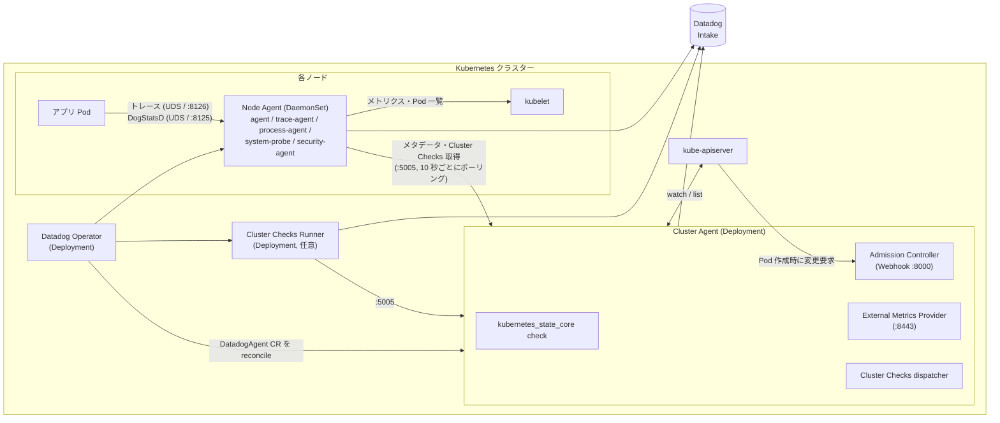
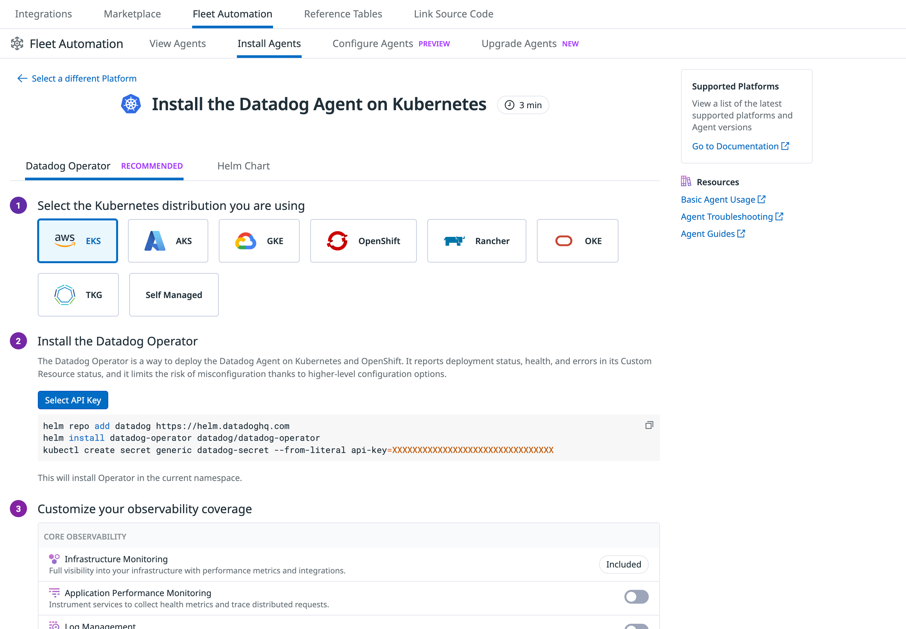
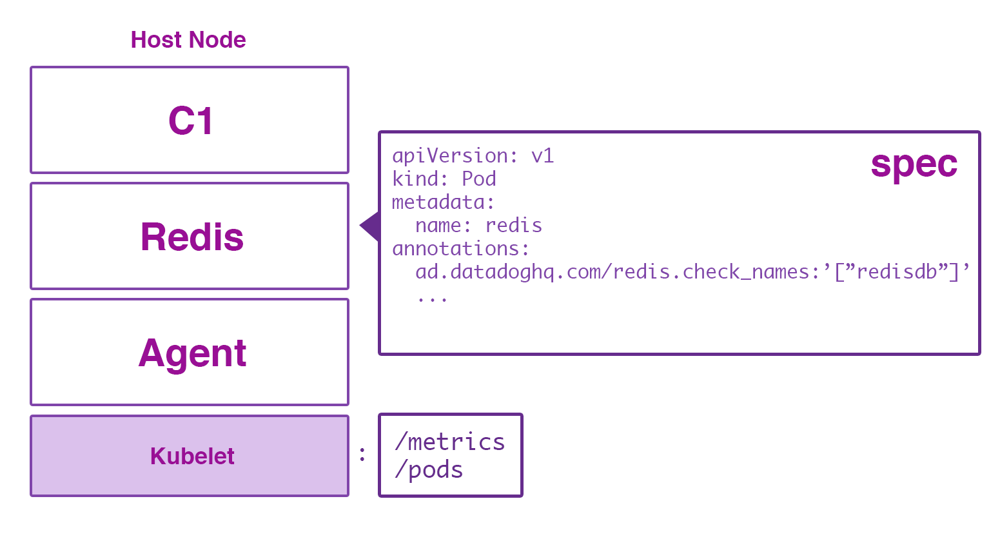
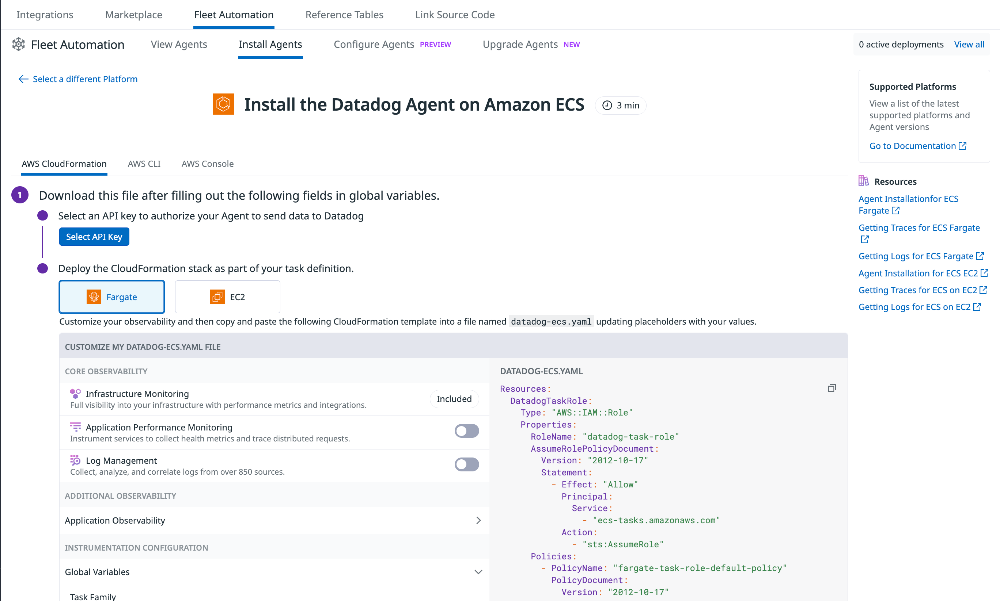

# コンテナ/Kubernetes向けAgent

## 概要

コンテナ/Kubernetes 向け Datadog Agent は、Datadog Agent（v7 系）をコンテナとして動かし、Kubernetes・Docker・Amazon ECS・AWS Fargate などのコンテナ基盤からメトリクス・ログ・トレース・イベント・クラスター状態を収集する仕組みの総称である。Kubernetes 環境では次の構成要素を組み合わせて使う。[出典](https://docs.datadoghq.com/containers/kubernetes/installation/) [出典](https://docs.datadoghq.com/containers/cluster_agent/)

- **Node Agent（ノード Agent）**: 各ノードに DaemonSet として 1 Pod ずつ配置される Datadog Agent。kubelet・コンテナランタイムから当該ノードのデータを収集する。
- **Cluster Agent（Datadog Cluster Agent、DCA）**: Deployment として配置され、Kubernetes API サーバーとノード Agent の間のプロキシとして、クラスターレベルのメタデータ、Kubernetes イベント、Cluster Checks の配布、Admission Controller、External Metrics（HPA 用）、Kubernetes State Metrics Core を担う。
- **Cluster Checks Runner（CLC Runner）**: Cluster Checks だけを実行する専用 Agent 群（任意）。
- **Datadog Operator（Datadog オペレーター）**: `DatadogAgent` カスタムリソース 1 つから Node Agent・Cluster Agent・Cluster Checks Runner を展開し、状態を継続的に調整（reconcile）する Kubernetes Operator。Datadog は新規導入に Operator を推奨している。[出典](https://docs.datadoghq.com/containers/datadog_operator/)
- **Helm chart（`datadog/datadog`）**: `values.yaml` からマニフェストを生成して展開する方式。

本ファイルは「Agent をコンテナ基盤に展開・設定する方法」の仕様を扱う。関連トピックは次のファイルを参照。

| 関連トピック | ファイル |
|---|---|
| Agent 本体（プロセス構成、OS、コマンド、flare） | [Datadog Agent](agent.md) |
| `datadog.yaml` の設定キー全般 | [Agent 設定リファレンス](agent-configuration.md) |
| Fleet Automation（画面からのインストール・リモート更新）と Remote Configuration | [Fleet Automation と Remote Configuration](fleet-automation.md) |
| 収集されたコンテナ/Kubernetes データの画面（Containers、Kubernetes Explorer、Orchestrator Explorer、Kubernetes Autoscaling など） | [コンテナ・Kubernetes 監視](../infrastructure/container-and-kubernetes-monitoring.md) |
| タグ設計全般、Unified Service Tagging | [Tagging（タグ）](tagging.md) |
| ログ収集全般 | [ログ収集](../logs/log-collection.md) |
| APM のライブラリ導入、Single Step Instrumentation | [APM インスツルメンテーション](../apm/apm-instrumentation.md) |
| DogStatsD とカスタムメトリクス | [Custom Metrics と DogStatsD](custom-metrics-and-dogstatsd.md) |
| AWS Lambda など Serverless | [Serverless Monitoring](../infrastructure/serverless.md) |
| Kubernetes 監視の実務ノウハウ | [Kubernetes 監視の実践](../../04_応用編/kubernetes-monitoring-practices.md) |
| Agent の展開設計（導入計画） | [Agent 展開設計](../../03_導入編/agent-rollout-design.md) |

---

## 1. 全体アーキテクチャ

### 1.1 Kubernetes 上の構成

Kubernetes 上の Datadog Agent 構成は、ノードごとの Node Agent（DaemonSet）と、クラスター単位の Cluster Agent（Deployment）の 2 層が基本である。ノード Agent は kubelet からメトリクス・メタデータを読むだけで済み、Kubernetes API サーバーと通信するのは Cluster Agent のみとなる（API サーバー負荷の削減と RBAC の局所化）。[出典](https://docs.datadoghq.com/containers/cluster_agent/) [出典](https://docs.datadoghq.com/containers/cluster_agent/setup/)



### 1.2 構成要素一覧

| 構成要素 | Kubernetes リソース | 主な役割 | 既定で有効か |
|---|---|---|---|
| Node Agent | DaemonSet | ノード・コンテナのメトリクス、ログ、トレース、プロセス、Autodiscovery によるインテグレーション実行 | 有効 |
| Cluster Agent | Deployment（Helm 既定 `replicas: 1`） | API サーバーのプロキシ、クラスターメタデータ、Kubernetes イベント収集、Cluster Checks 配布、Admission Controller、External Metrics、KSM Core | 有効（Helm chart v2.7.0 以降、Operator v1.0.0 以降） |
| Cluster Checks Runner | Deployment（Helm 既定 `replicas: 2`） | Cluster Checks 専用の実行 Agent | 無効（任意） |
| Datadog Operator | Deployment（Operator chart 既定 `replicaCount: 1`） | `DatadogAgent` などの CR を調整 | Operator 方式のみ |
| Datadog CSI Driver | DaemonSet | APM / DogStatsD の UDS を hostPath なしでアプリ Pod に共有 | 無効（任意） |

出典: [Cluster Agent](https://docs.datadoghq.com/containers/cluster_agent/)、[Helm chart values.yaml](https://github.com/DataDog/helm-charts/blob/main/charts/datadog/values.yaml)、[Operator chart values.yaml](https://github.com/DataDog/helm-charts/blob/main/charts/datadog-operator/values.yaml)、[CSI Driver](https://docs.datadoghq.com/containers/csi_driver/)

### 1.3 Kubernetes 以外のコンテナ基盤

| 基盤 | Agent の配置形態 | 詳細 |
|---|---|---|
| Docker（単体ホスト） | ホストごとに Agent コンテナを 1 つ `docker run` | [12. Docker](#12-docker) |
| Amazon ECS on EC2 | Daemon サービス（ホストごとに 1 タスク） | [13.1](#131-ecs-on-ec2) |
| Amazon ECS Managed Instances | Daemon タスク（推奨）またはサイドカー | [13.2](#132-ecs-managed-instances) |
| AWS Fargate（ECS） | タスク定義内のサイドカーコンテナ | [13.3](#133-ecs-on-fargate) |
| AWS Fargate（EKS） | Pod 内のサイドカーコンテナ（Admission Controller で自動注入可） | [11.2](#112-amazon-eks-on-aws-fargate) |

---

## 2. 対応バージョンと最新版

### 2.1 Kubernetes と Agent の最低バージョン

Datadog は Kubernetes のバージョンに応じて次の最低 Agent / Cluster Agent バージョンを定めている。また Cluster Agent と Node Agent は同じバージョンに揃えることを推奨している。[出典](https://docs.datadoghq.com/containers/kubernetes/installation/)

| Kubernetes バージョン | Agent | Cluster Agent | 理由 |
|---|---|---|---|
| 1.16.0 以降 | 7.19.0 以降 | 1.9.0 以降 | kubelet メトリクスの非推奨化 |
| 1.21.0 以降 | 7.36.0 以降 | 1.20.0 以降 | Kubernetes リソースの非推奨化 |
| 1.22.0 以降 | 7.37.0 以降 | 7.37.0 以降 | 動的 ServiceAccount トークンへの対応 |
| 1.25.0 以降 | 7.40.0 以降 | 7.40.0 以降 | `v1` API グループへの対応 |
| 1.33.0 以降 | 7.67.0 以降 | 7.67.0 以降 | `/pods` 出力の `AllocatedResources` との非互換修正 |

> 補足: Cluster Agent は 1.x 系の独自バージョン番号から、Agent と同じ 7.x 系の番号に統一されている（上表の 1.22 以降の行が 7.x 表記）。

### 2.2 2026-11-02 時点の最新リリース

| コンポーネント | 最新版（GA） | 公開日 | 出典 |
|---|---|---|---|
| Datadog Agent | 7.85.0 | 2026-10-29（GitHub Release 公開日） | [GitHub Releases](https://github.com/DataDog/datadog-agent/releases) |
| Helm chart `datadog` | 3.264.0 | 2026-10-29 | [helm-charts Releases](https://github.com/DataDog/helm-charts/releases) |
| Helm chart `datadog-operator` | 2.31.0 | 2026-10-21 | [helm-charts Releases](https://github.com/DataDog/helm-charts/releases) |
| Datadog Operator | v1.31.2（v1.32.0 は RC 段階） | 2026-10-21 | [datadog-operator Releases](https://github.com/DataDog/datadog-operator/releases) |

- `datadog` Helm chart の main ブランチの `values.yaml` では、既定の Agent / Cluster Agent / Cluster Checks Runner イメージタグが `7.84.6`、同梱 Operator のイメージタグが `1.31.2` になっている。chart の既定タグは最新 Agent リリースより遅れることがあるため、特定バージョンを使う場合は `agents.image.tag` などで明示する。[出典](https://github.com/DataDog/helm-charts/blob/main/charts/datadog/values.yaml)
- Agent 本体のバージョン体系とアップグレード手順は [Datadog Agent](agent.md) を参照。

---

## 3. Kubernetes へのインストール

### 3.1 インストール方式の比較

| 方式 | 概要 | Datadog の位置付け | 向いているケース |
|---|---|---|---|
| Datadog Operator | `DatadogAgent` CR を Operator が継続的に reconcile。CR の status に展開状態・ヘルス・エラーを出す | **推奨**（新規導入） | ほとんどのクラスター。EKS / OpenShift の制御プレーン監視なども自動設定 |
| Helm chart | `values.yaml` からインストール/アップグレード時にマニフェストを生成 | サポート | Operator 非対応プラットフォーム（Talos、Flatcar など）、GKE on Google Distributed Cloud、Operator が公開していない Helm 固有機能を使う場合 |
| 手動（DaemonSet マニフェスト） | RBAC・DaemonSet・Cluster Agent を個別に適用 | サポートするが非推奨 | 特殊な制約がある環境 |
| マーケットプレイス経由の Operator | Red Hat OperatorHub（OLM）、Amazon EKS add-on、Google Cloud Marketplace | Operator の配布チャネル | 各クラウドの管理手段に寄せたい場合 |
| Fleet Automation の Install Agents 画面 | 画面でディストリビューションと機能を選ぶと、Operator / Helm のコマンドとマニフェストを生成 | 導入支援 UI | 初回導入 |

出典: [Datadog Operator](https://docs.datadoghq.com/containers/datadog_operator/)、[Kubernetes Installation](https://docs.datadoghq.com/containers/kubernetes/installation/)

- Operator の Helm chart との機能パリティは、主要クラウドプロバイダー上で Operator v1.29.0 以降で達成されたとされる。[出典](https://docs.datadoghq.com/containers/datadog_operator/)
- APM の Single Step Instrumentation（SSI）を使う予定がある場合、SSI は Agent と同じ Namespace の Pod を計装しないため、Agent は専用 Namespace にインストールする。[出典](https://docs.datadoghq.com/containers/kubernetes/installation/)



**キャプション:** Fleet Automation の「Install Agents」タブで Kubernetes を選んだときのインストール画面。

**画面の説明:** 上部メニューは Integrations > Fleet Automation。サブタブに View Agents / Install Agents / Configure Agents（PREVIEW 表記）/ Upgrade Agents（NEW 表記）が並ぶ。画面中央の見出しは「Install the Datadog Agent on Kubernetes」（所要時間 3 min 表記）。方式タブは「Datadog Operator（RECOMMENDED）」と「Helm Chart」。手順 1「Select the Kubernetes distribution you are using」で EKS / AKS / GKE / OpenShift / Rancher / OKE / TKG / Self Managed から選択する。手順 2「Install the Datadog Operator」では「Select API Key」ボタンでキーを選ぶと、`helm repo add datadog https://helm.datadoghq.com`、`helm install datadog-operator datadog/datadog-operator`、`kubectl create secret generic datadog-secret --from-literal api-key=...` のコマンドが表示される（Operator はカレント Namespace にインストールされる旨の注記あり）。手順 3「Customize your observability coverage」で Infrastructure Monitoring（Included）、Application Performance Monitoring、Log Management などをトグルで選び、`DatadogAgent` マニフェストが生成される。右側には Supported Platforms と Resources（Basic Agent Usage、Agent Troubleshooting、Agent Guides）へのリンクがある。

**出典:** https://docs.datadoghq.com/containers/kubernetes/ （画像: https://docs.dd-static.net/images/agent/basic_agent_usage/agent_install_k8.87a6fe7c46a100f599d01b336f611910.png）、取得日 2026-11-02

### 3.2 Datadog Operator によるインストール手順

前提: Helm と kubectl。[出典](https://docs.datadoghq.com/containers/kubernetes/installation/)

```shell
helm repo add datadog https://helm.datadoghq.com
helm install datadog-operator datadog/datadog-operator
kubectl create secret generic datadog-secret --from-literal api-key=<DATADOG_API_KEY>
```

`datadog-agent.yaml`（最小構成）:

```yaml
apiVersion: datadoghq.com/v2alpha1
kind: DatadogAgent
metadata:
  name: datadog
spec:
  global:
    clusterName: <CLUSTER_NAME>
    site: <DATADOG_SITE>        # 例: ap1.datadoghq.com
    credentials:
      apiSecret:
        secretName: datadog-secret
        keyName: api-key
```

```shell
kubectl apply -f datadog-agent.yaml
```

> **サイト差異:** `site` には利用する Datadog サイトのドメインを指定する（AP1 は `ap1.datadoghq.com`、US1 は `datadoghq.com`、EU1 は `datadoghq.eu` など）。未指定時の既定は `datadoghq.com`（US1）であり、AP1 などのユーザーが指定を忘れると送信先を誤る。サイト一覧は [Datadog Sites](datadog-sites.md) を参照。

### 3.3 Helm によるインストール手順

```shell
helm repo add datadog https://helm.datadoghq.com
helm repo update
kubectl create secret generic datadog-secret --from-literal api-key=<DATADOG_API_KEY>
```

`datadog-values.yaml`（最小構成）:

```yaml
datadog:
  apiKeyExistingSecret: datadog-secret
  clusterName: <CLUSTER_NAME>
  site: <DATADOG_SITE>
```

```shell
helm install datadog-agent -f datadog-values.yaml datadog/datadog
```

- Windows ノード向けには `--set targetSystem=windows` を付けた別リリースとしてインストールする（Helm の `targetSystem` 既定値は `linux`）。Cluster Agent は Linux ノードでのみ動作するため、Linux / Windows 混在クラスターでは 2 つ目の Helm リリースを `targetSystem: windows` で追加する。[出典](https://docs.datadoghq.com/containers/kubernetes/installation/) [出典](https://docs.datadoghq.com/containers/cluster_agent/setup/)
- 確認: 数分以内に Datadog の Containers ページに Agent Pod（ラベル `app.kubernetes.io/component:agent`）が表示される。[出典](https://docs.datadoghq.com/containers/kubernetes/installation/)

### 3.4 Helm から Operator への移行

`datadog` Helm chart の `values.yaml`（main ブランチ）には、Datadog Operator をサブチャート依存として扱う設定がある。[出典](https://github.com/DataDog/helm-charts/blob/main/charts/datadog/values.yaml)

| Helm キー | 既定値 | 意味 |
|---|---|---|
| `datadog.operator.enabled` | `true` | Datadog Operator chart 依存を有効化する |
| `datadog.operator.migration.enabled` | `false` | 現在のリリースの `values.yaml` から `DatadogAgent` マニフェストを生成し、Agent ワークロードの管理を Operator に移行する |
| `datadog.operator.migration.preview` | `false` | `true` で変換後の `DatadogAgent` マニフェストを移行 Job の `dda-mapper` コンテナログでプレビューする |
| `datadog.operator.migration.userValues` | `""` | 変換元の values を YAML 文字列で渡す（`--set-file` で指定） |

- `kubectl datadog helm2dda` サブコマンド（kubectl プラグイン）でも Helm values を `DatadogAgent` スキーマにマッピングできる。[出典](https://github.com/DataDog/datadog-operator/blob/main/docs/kubectl-plugin.md)
- Operator chart 2.19.0 以降を Agent Helm chart の依存として入れた場合、`registryMigrationMode` が Operator 管理の Agent イメージにも適用される。サイト別レジストリを維持したい場合は Agent chart の values で `registryMigrationMode: ""` とする。[出典](https://docs.datadoghq.com/containers/kubernetes/installation/)

### 3.5 非特権（unprivileged）インストール

Agent を root 以外で動かす場合は Pod レベルの `securityContext` を設定する。[出典](https://docs.datadoghq.com/containers/kubernetes/installation/)

| 方式 | 設定箇所 | 値 |
|---|---|---|
| Operator | `spec.override.nodeAgent.securityContext` | `runAsUser: <USER_ID>`、`supplementalGroups: [<GROUP_ID>]` |
| Helm | `datadog.securityContext` | 同上 |

- `<USER_ID>` は、Agent v7.48 以降に存在する `dd-agent` ユーザーの UID `100` が推奨。
- `<GROUP_ID>` は Docker / containerd ソケットを所有するグループ ID。
- Docker ランタイムで非特権のままログを収集する場合は、`DD_LOGS_CONFIG_K8S_CONTAINER_USE_FILE=true`（`logs_config.k8s_container_use_file`）でファイル経由の収集を強制する。`/var/log/pods` から Docker の `/var/lib/docker/containers` へのシンボリックリンクは root でないと辿れないためである。[出典](https://docs.datadoghq.com/containers/kubernetes/log/)

### 3.6 コンテナレジストリ

Agent・Cluster Agent のイメージは次のレジストリで配布されている。[出典](https://docs.datadoghq.com/containers/kubernetes/installation/)

| レジストリ | パス |
|---|---|
| Datadog Container Registry | `registry.datadoghq.com` |
| Google Artifact Registry | `gcr.io/datadoghq` |
| Google Artifact Registry（Europe） | `eu.gcr.io/datadoghq` |
| Google Artifact Registry（Asia） | `asia.gcr.io/datadoghq` |
| Amazon ECR | `public.ecr.aws/datadog` |
| Azure ACR | `datadoghq.azurecr.io` |
| Docker Hub | `docker.io/datadog` |

- Docker Hub にはイメージ取得のレート制限があるため、Docker Hub の有償顧客でない場合は他のレジストリへの切り替えが推奨される。
- `registry.datadoghq.com` を使う場合、ファイアウォールで `us-docker.pkg.dev/datadog-prod/public-images` への通信を許可する。[出典](https://docs.datadoghq.com/containers/docker/)
- レジストリの変更: Operator は `spec.global.registry`、Helm はトップレベルの `registry`。Operator Pod 自体のイメージは Operator chart の `image.repository` で指定する。

**Helm chart の `registryMigrationMode`**（`registry` を明示した場合は無効）: 既定のレジストリをサイト別ミラー（GCR、ACR）から `registry.datadoghq.com` へ段階的に移行する設定。[出典](https://github.com/DataDog/helm-charts/blob/main/charts/datadog/values.yaml)

| 値 | 動作 |
|---|---|
| `"auto"`（既定） | 移行がロールアウト済みのサイトで `registry.datadoghq.com` を使う。values.yaml の記載時点では AP1、AP2、US5、EU1、US1（APM 無効時のみ）が対象 |
| `"all"` | AP1、AP2、EU、US1、US5 のすべてで `registry.datadoghq.com` を使う |
| `""` | 移行しない（サイト別レジストリを維持） |

> **サイト差異:** GKE Autopilot と GKE on Google Distributed Cloud は常にサイト別の `gcr.io` 系を使い、`gcr.io` 系レジストリが必須。US1-FED（`ddog-gov.com`）は常に `public.ecr.aws/datadog`、US3（`us3.datadoghq.com`）は常に `datadoghq.azurecr.io` を使う。

### 3.7 クラスター名（`clusterName`）の規則

クラスター名はホストと Cluster Checks のスコープに使われ、`kube_cluster_name` タグの元になる。[出典](https://docs.datadoghq.com/containers/kubernetes/installation/)

| 項目 | 内容 |
|---|---|
| 設定箇所 | Operator `spec.global.clusterName` / Helm `datadog.clusterName` / 環境変数 `DD_CLUSTER_NAME` |
| 使用可能文字 | 英小文字、数字、ハイフン。ドット区切りのトークン |
| 先頭・末尾 | 英字で始まり、英字または数字で終わる |
| 最大長 | 80 文字（Installation ページ）。ただし Configuration ページの `DD_CLUSTER_NAME` の説明では 40 文字と記載されており、公式ドキュメント内で不一致がある。安全側に 40 文字以内にするのが無難【推定】 |

### 3.8 アンインストール

| 方式 | コマンド |
|---|---|
| Operator | `kubectl delete datadogagent datadog` の後 `helm delete datadog-operator`（Operator と Agent が作成したリソースがすべて削除される） |
| Helm | `helm uninstall datadog-agent` |

[出典](https://docs.datadoghq.com/containers/kubernetes/installation/)

---

## 4. Datadog Operator

### 4.1 Operator の特徴

Datadog Operator は Kubernetes Operator パターンで Datadog Agent を展開・設定するオープンソースソフトウェア（`github.com/DataDog/datadog-operator`）である。[出典](https://docs.datadoghq.com/containers/datadog_operator/) [出典](https://github.com/DataDog/datadog-operator)

- 1 つの `DatadogAgent` CR で Node Agent、Cluster Agent、Cluster Checks Runner をまとめて展開する。
- Agent 設定のバリデーション、設定との継続的な同期（reconcile）、CR の status への展開状態・ヘルス・エラーの報告を行う。
- クラスタープロバイダーを自動検出し、Amazon EKS や Red Hat OpenShift の制御プレーン監視などプロバイダー固有の設定を自動適用する（[4.4](#44-クラスタープロバイダーの自動検出)）。
- Fleet Automation によるリモート管理【Preview】に対応（docs 上は private preview と記載）。
- `DatadogAgent` の API バージョンは `datadoghq.com/v2alpha1`。旧 `v1alpha1` からの移行には v1.7.0 の変換 Webhook が必要。ExtendedDaemonSet のサポートは削除済み。

**Operator 方式で既定で有効な機能**（README 記載）: Cluster Agent、Admission Controller、Cluster Checks、Kubernetes Event Collection、Kubernetes State Core Check、Live Container Collection、Orchestrator Explorer、DogStatsD（および APM 有効時は APM）の Unix Domain Socket 通信、Process Discovery、Control Plane Monitoring。[出典](https://github.com/DataDog/datadog-operator)

> **注意:** Control Plane Monitoring は「既定で有効」だが、Control Plane Monitoring ドキュメントは EKS / OpenShift 4 の Operator 方式について「introspection の有効化が必要」としている。一方、Operator chart の `introspection.enabled` の既定値は `false` である（[4.2](#42-operator-が扱うカスタムリソースcrd)）。そのため、既定構成のままでは自動設定が効かない可能性がある（[11.8](#118-制御プレーン監視)）。[出典](https://docs.datadoghq.com/containers/kubernetes/control_plane/)

### 4.2 Operator が扱うカスタムリソース（CRD）

`datadog-operator` リポジトリの CRD 定義（`config/crd/bases/v1`）には次のリソースがある。[出典](https://github.com/DataDog/datadog-operator) [出典](https://github.com/DataDog/helm-charts/blob/main/charts/datadog-operator/values.yaml)

| CRD（Kind） | API バージョン | 用途 | Operator chart の既定 |
|---|---|---|---|
| `DatadogAgent` | `v2alpha1` | Agent 一式の展開・設定 | コントローラー有効（`datadogAgent.enabled: true`） |
| `DatadogAgentInternal` | `v1alpha1` | `DatadogAgent` の内部表現（v1.16.0 で導入、v1.22.0 で既定有効） | 有効（`datadogAgentInternal.enabled: true`） |
| `DatadogAgentProfile` | `v1alpha1` | ノードサブセットごとの設定上書き（[4.3](#43-datadogagentprofiledap)） | 無効（`datadogAgentProfile.enabled: false`、CRD も既定で非デプロイ） |
| `DatadogMonitor` | `v1alpha1` | Monitor を Kubernetes リソースとして管理 | コントローラー無効（`datadogMonitor.enabled: false`）、CRD はデプロイ |
| `DatadogSLO` | `v1alpha1` | SLO を Kubernetes リソースとして管理 | 無効 |
| `DatadogDashboard` | `v1alpha1` | Dashboard を Kubernetes リソースとして管理 | 無効 |
| `DatadogGenericResource` | `v1alpha1` | その他の Datadog リソースの汎用管理 | 無効 |
| `DatadogMetric` | `v1alpha1` | HPA 用の Datadog メトリクスクエリ（Cluster Agent が処理） | CRD をデプロイ |
| `DatadogPodAutoscaler` / `DatadogPodAutoscalerClusterProfile` | `v1alpha1`〜`v2alpha1` / `v1alpha2` | Datadog Kubernetes Autoscaling | CRD をデプロイ |
| `DatadogInstrumentation` | `v1alpha1` | Autodiscovery 設定・APM 設定をワークロード単位で指定（[9.5](#95-datadoginstrumentation-crd)） | — |
| `DatadogCSIDriver` | `v1alpha1` | CSI Driver の管理（[14](#14-datadog-csi-driver)） | 有効（`datadogCSIDriver.enabled: true`） |
| `DatadogBYOCCluster` / `DatadogObservabilityPipelinesWorker` | `v1alpha1` | Observability Pipelines Worker 等の管理（Operator v1.32.0 以降が必要） | 無効 |

- Monitor / SLO / Dashboard を CRD で管理する方式（GitOps）は [Monitoring as Code](../../04_応用編/monitoring-as-code.md) と [Terraform と IaC](terraform-and-iac.md) も参照。
- Operator chart の主な既定値: `replicaCount: 1`、`logLevel: "info"`、`metricsPort: 8383`、`installCRDs: true`、`remoteConfiguration.enabled: false`、`introspection.enabled: false`。[出典](https://github.com/DataDog/helm-charts/blob/main/charts/datadog-operator/values.yaml)

### 4.3 DatadogAgentProfile（DAP）

DatadogAgentProfile（DAP、プロファイル）は、`DatadogAgent`（DDA）で設定した内容をノードのサブセットに対して上書きする仕組みで、ノード形状（インスタンスタイプ、ノードロール等）ごとに Agent のリソースや設定を変えたい場合に使う。[出典](https://docs.datadoghq.com/containers/datadog_operator/datadog_agent_profiles/)

| 項目 | 内容 |
|---|---|
| 構造 | `profileAffinity`（NodeSelectorRequirement のリストで対象ノードを選ぶ）と `config`（DatadogAgentSpec 形式の上書き内容） |
| 動作 | DAP ごとに DAP 名の DaemonSet を新規作成し、既定プロファイル用の DaemonSet も作成する |
| 重複 | 複数 DAP は共存できるが、互いに異なるノードサブセットを対象にする必要がある |
| 前提 | Operator v1.5.0 以降（v1.5.0 で導入、v1.24.0 で GA。Operator chart の values.yaml のコメントには「beta」の表記が残っている）。Helm でプロファイルコントローラー（`datadogAgentProfile.enabled`）と CRD（`datadogCRDs.crds.datadogAgentProfiles`）を有効化。既定は無効 |
| 制約 | Operator がノードをパッチできる必要があり、GKE Autopilot などノード変更を禁止する環境では使えない。有効化すると Operator のリソース消費が増える |
| プロバイダー指定 | DAP に `agent.datadoghq.com/cluster-provider` アノテーション（例: `gke-cos`、`eks-ec2-use-hostname-from-file`）を付けてノードサブセット単位でプロバイダー設定を適用できる。Operator はセレクターとアノテーションの整合を検証しないため、セレクターが広すぎると不適切なノードに適用される |

### 4.4 クラスタープロバイダーの自動検出

Operator はノードラベル等からクラスタープロバイダーを検出し、`agent.datadoghq.com/cluster-provider` に応じた設定を自動適用する。[出典](https://docs.datadoghq.com/containers/datadog_operator/providers/)

| プロバイダー値 | 検出条件 | 検出に必要な Operator | 自動設定内容 |
|---|---|---|---|
| `default` | 他に該当なし（オンプレミス等） | v1.29.0 | なし |
| `aks` | `kubernetes.azure.com/*` ノードラベル | v1.29.0 | Cluster Agent に `DD_ADMISSION_CONTROLLER_ADD_AKS_SELECTORS=true` |
| `eks` | `eks.amazonaws.com/*` または `alpha.eksctl.io/*` ノードラベル | v1.29.0 | API Server・Controller Manager・Scheduler の制御プレーン監視 |
| `openshift`（`openshift-<os_id>`） | `node.openshift.io/os_id` ノードラベル | v1.29.0 | API Server・Controller Manager・Scheduler・etcd の制御プレーン監視。v1.31.0 以降は Node Agent の SCC、SELinux、toleration、kubelet TLS 検証も設定 |
| `talos` | ノード `osImage` が `Talos (` で始まる | v1.31.0 | Talos にないホストパスを外し、eBPF 機能用に tracefs をマウント。v1.32.0 以降は制御プレーン監視も有効化 |

- `eks` / `openshift` の制御プレーン監視の自動設定には、introspection の有効化が必要な場合がある（Operator chart の既定は `introspection.enabled: false`。詳細は [11.8](#118-制御プレーン監視)）。

自動検出されず、アノテーションでのみ指定するプロバイダー: `gke-cos`、`eks-ec2-use-hostname-from-file`、`gke-autopilot`、`windows`。

### 4.5 kubectl プラグイン（`kubectl datadog`）

Krew で `kubectl krew install datadog` としてインストールする補助ツール。Operator と Helm のどちらの導入でも使える。[出典](https://github.com/DataDog/datadog-operator/blob/main/docs/kubectl-plugin.md)

| サブコマンド | 用途 |
|---|---|
| `agent check` / `agent find` / `agent upgrade` | チェックエラーの検出 / 指定 Pod を監視している Agent Pod の特定 / Agent バージョン更新 |
| `clusteragent` | Cluster Agent 関連の操作 |
| `autoscaling` | Autoscaling 機能の管理 |
| `flare` | Operator の flare を収集して Datadog に送信 |
| `get` | `DatadogAgent` の展開状況を取得 |
| `helm2dda` | Helm values を `DatadogAgent` CRD スキーマにマッピング |
| `metrics` / `validate` | メトリクス関連 / 検証 |

---

## 5. 主要設定項目（Operator と Helm の対応）

### 5.1 基本設定

| 項目 | Operator（`DatadogAgent` `spec.`） | Helm（`values.yaml`） | 既定値 |
|---|---|---|---|
| API キー | `global.credentials.apiKey` / `apiSecret.secretName`・`keyName` | `datadog.apiKey` / `datadog.apiKeyExistingSecret` | なし（必須） |
| アプリケーションキー | `global.credentials.appKey` / `appSecret` | `datadog.appKey` / `datadog.appKeyExistingSecret` | なし（External Metrics 等で必要） |
| サイト | `global.site` | `datadog.site` | `datadoghq.com` |
| クラスター名 | `global.clusterName` | `datadog.clusterName` | なし |
| ログレベル | `global.logLevel` | `datadog.logLevel` | `info`（Helm values は `INFO`） |
| レジストリ | `global.registry` | `registry` | `registryMigrationMode` に依存（[3.6](#36-コンテナレジストリ)） |
| グローバルタグ | `global.tags` | `datadog.tags` | なし |
| Cluster Agent トークン | `global.clusterAgentToken` / `global.clusterAgentTokenSecret` | `clusterAgent.token` / `clusterAgent.tokenExistingSecret` | 自動生成 |

出典: [Kubernetes Configuration](https://docs.datadoghq.com/containers/kubernetes/configuration/)、[Cluster Agent Setup](https://docs.datadoghq.com/containers/cluster_agent/setup/)

### 5.2 機能の有効化キー

| 機能 | Operator キー（`spec.features.`） | Helm キー | Helm の既定値 |
|---|---|---|---|
| APM（トレース受信） | `apm.enabled` | `datadog.apm.socketEnabled` / `datadog.apm.portEnabled` | UDS 有効（`socketEnabled: true`）、TCP 無効（`portEnabled: false`） |
| ログ収集 | `logCollection.enabled`、`logCollection.containerCollectAll` | `datadog.logs.enabled`、`datadog.logs.containerCollectAll` | どちらも `false` |
| Live Processes | `liveProcessCollection.enabled` | `datadog.processAgent.processCollection` | `false`（`datadog.processAgent.enabled` 自体は `true`） |
| Live Containers（Containers ビュー） | `liveContainerCollection.enabled` | `datadog.processAgent.enabled` | `true` |
| Orchestrator Explorer | `orchestratorExplorer.enabled` | `datadog.orchestratorExplorer.enabled` | `true` |
| Kubernetes イベント | `eventCollection.collectKubernetesEvents` | `datadog.collectEvents` | `true` |
| Kubernetes State Metrics Core | `kubeStateMetricsCore.enabled` | `datadog.kubeStateMetricsCore.enabled` | `true` |
| Cluster Checks | `clusterChecks.enabled` | `datadog.clusterChecks.enabled` | `true` |
| Cluster Checks Runner | `clusterChecks.useClusterChecksRunners` | `clusterChecksRunner.enabled` | `false` |
| Admission Controller | `admissionController.enabled` | `clusterAgent.admissionController.enabled` | `true` |
| External Metrics Server（HPA） | `externalMetricsServer.enabled` | `clusterAgent.metricsProvider.enabled` | `false` |
| Cloud Network Monitoring（旧称: NPM） | `npm.enabled` | `datadog.networkMonitoring.enabled` | `false` |
| Universal Service Monitoring | `usm.enabled` | `datadog.serviceMonitoring.enabled` | `false` |
| コンテナイメージ収集 | — | `datadog.containerImageCollection.enabled` | `true` |
| Prometheus 自動スクレイプ | `prometheusScrape.enabled` | `datadog.prometheusScrape.enabled` | `false` |
| Remote Configuration | `remoteConfiguration.enabled` | `datadog.remoteConfiguration.enabled` | `true` |
| GPU Monitoring | — | `datadog.gpuMonitoring.enabled` | `false` |
| DatadogInstrumentation CRD コントローラー | アノテーション `agent.datadoghq.com/instrumentation-crd-enabled`（v1.30 以降は既定有効） | `datadog.instrumentationCrd.enabled` | `true` |
| CSI Driver | `spec.global.csi.enabled`（`features` ではなく `global` 配下） | `datadog.csi.enabled` | `false` |
| Workload Autoscaling | `autoscaling.workload.enabled` | `datadog.autoscaling.workload.enabled` | 未設定 |

出典: [Kubernetes Configuration](https://docs.datadoghq.com/containers/kubernetes/configuration/)、[Helm chart values.yaml](https://github.com/DataDog/helm-charts/blob/main/charts/datadog/values.yaml)。Operator キーのうち `usm.enabled`、`prometheusScrape.enabled`、`remoteConfiguration.enabled`、`autoscaling.workload.enabled`、`global.csi.enabled`、および 5.4 節の `dogstatsd.*` キーは [configuration.v2alpha1.md](https://github.com/DataDog/datadog-operator/blob/main/docs/configuration.v2alpha1.md) に基づく。

> 注: Helm の既定値は `datadog` chart main ブランチの `values.yaml`（chart 3.264.0 相当）に基づく。chart バージョンにより既定値は変わるため、利用中の chart の values を確認すること。

### 5.3 kubelet 関連

| 項目 | Operator（`spec.global.kubelet.`） | Helm（`datadog.kubelet.`） | 既定値 |
|---|---|---|---|
| kubelet ホスト | `host` | `host` | `status.hostIP`（fieldRef） |
| TLS 検証 | `tlsVerify` | `tlsVerify` | `true` |
| ホスト上の CA 証明書パス | `hostCAPath` | `hostCAPath` | なし |
| Agent 内の CA パス | `agentCAPath` | `agentCAPath` | `hostCAPath` 指定時は `/var/run/host-kubelet-ca.crt`、未指定時は `/var/run/secrets/kubernetes.io/serviceaccount/ca.crt` |
| Pod ログパス | — | `podLogsPath` | Linux `/var/log/pods`、Windows `C:\var\log\pods` |
| kubelet コアチェック（Go 実装） | — | `coreCheckEnabled` | `true`（Agent / Cluster Agent 7.53.0 以降） |
| Pod 一覧を API サーバーから取得 | — | `useApiServer` | `false`（Agent 7.65.0 以降。GKE Autopilot で使用） |
| kubelet の細粒度認可 | — | `fineGrainedAuthorization` | `false`（Kubernetes 1.32 以降） |

出典: [Helm chart values.yaml](https://github.com/DataDog/helm-charts/blob/main/charts/datadog/values.yaml)

### 5.4 APM と DogStatsD の受信設定

Kubernetes では、アプリ Pod から Node Agent への送信方法として Unix Domain Socket（UDS、推奨）、TCP（hostPort）、Kubernetes の local service の 3 つが使え、併用もできる。[出典](https://docs.datadoghq.com/containers/kubernetes/apm/)

| 項目 | Operator | Helm | 既定値 |
|---|---|---|---|
| APM UDS パス | `features.apm.unixDomainSocketConfig.path` | `datadog.apm.socketPath` | `/var/run/datadog/apm.socket` |
| APM ホスト側ソケットディレクトリ | — | `datadog.apm.hostSocketPath` | `/var/run/datadog/` |
| APM TCP（hostPort） | `features.apm.hostPortConfig.enabled` / `hostPort` | `datadog.apm.portEnabled` / `datadog.apm.port` | 無効 / `8126` |
| APM local service 経由 | — | `datadog.apm.useLocalService` | `false`（Kubernetes 1.22 以降） |
| DogStatsD ポート | — | `datadog.dogstatsd.port` | `8125`（UDP） |
| DogStatsD UDS | `features.dogstatsd.unixDomainSocketConfig.enabled` | `datadog.dogstatsd.useSocketVolume` | 有効 |
| DogStatsD UDS パス | — | `datadog.dogstatsd.socketPath` | `/var/run/datadog/dsd.socket` |
| DogStatsD hostPort | `features.dogstatsd.hostPortConfig.enabled` | `datadog.dogstatsd.useHostPort` | `false` |
| 他 Pod からの DogStatsD 受信 | — | `datadog.dogstatsd.nonLocalTraffic` | `true` |
| Origin Detection | `features.dogstatsd.originDetectionEnabled` | `datadog.dogstatsd.originDetection` | `false` |
| DogStatsD タグカーディナリティ | — | `datadog.dogstatsd.tagCardinality` | `low` |
| ホスト PID 名前空間 | — | `datadog.useHostPID` | `true`（Origin Detection に必要） |

出典: [Kubernetes APM](https://docs.datadoghq.com/containers/kubernetes/apm/)、[Helm chart values.yaml](https://github.com/DataDog/helm-charts/blob/main/charts/datadog/values.yaml)

- アプリ側（UDS）: `DD_TRACE_AGENT_URL=unix:///var/run/datadog/apm.socket` と hostPath `/var/run/datadog/` のマウント。アプリ側（TCP）: `DD_AGENT_HOST` を Downward API の `status.hostIP` から設定。これらは Admission Controller で自動注入できる（[8](#8-admission-controller)）。
- docs の Operator 節には UDS パスとして `/var/run/datadog/apm/apm.socket` の記述もあり、既定パスの記載に不一致がある。実際のパスは `agent status` やマニフェストで確認すること。
- APM の Agent 側既定値（Agent 7.18 以降）: `DD_APM_ENABLED=true`、`DD_APM_NON_LOCAL_TRAFFIC=true`、`DD_APM_RECEIVER_PORT=8126`、`DD_APM_MAX_MEMORY=500000000`、`DD_APM_MAX_CPU_PERCENT=50`、`DD_APM_CONNECTION_LIMIT=2000`（30 秒あたり）、`DD_APM_DEBUG_PORT=5012`。[出典](https://docs.datadoghq.com/containers/kubernetes/apm/)
- OpenShift では UDS を避け、APM は TCP（`hostPortConfig`）、DogStatsD も UDS 無効とする（[11.5](#115-red-hat-openshift)）。

### 5.5 ログ収集

| 項目 | Operator | Helm | 既定値 |
|---|---|---|---|
| ログ収集の有効化 | `features.logCollection.enabled` | `datadog.logs.enabled` | `false` |
| 全コンテナのログ収集 | `features.logCollection.containerCollectAll` | `datadog.logs.containerCollectAll` | `false`（`false` の場合は Pod ごとに Autodiscovery のログ設定が必要） |

- Kubernetes はコンテナの stdout/stderr をホストの `/var/log/pods` に書き出し、Agent はこれを読む。`containerCollectAll` 有効時、`source` と `service` の既定値はコンテナのショートイメージ名。
- ログ設定アノテーション `ad.datadoghq.com/<CONTAINER_NAME>.logs` はイメージ名ではなく**コンテナ名**で対象を特定する。
- アノテーションで `type: file` の設定を追加すると、そのコンテナの stdout/stderr 自動収集は止まる。両方収集するには `{"source":"container",...}` も併記する。

出典: [Kubernetes Log Collection](https://docs.datadoghq.com/containers/kubernetes/log/)。ログ収集の詳細は [ログ収集](../logs/log-collection.md) を参照。

### 5.6 DaemonSet / 環境変数による主な設定

| 環境変数 | 既定値・説明 |
|---|---|
| `DD_API_KEY` | 必須 |
| `DD_SITE` | `datadoghq.com` |
| `DD_ENV` | グローバル `env` タグ |
| `DD_HOSTNAME` | ホスト名の自動検出に失敗する場合のみ指定 |
| `DD_TAGS` | スペース区切りのホストタグ |
| `DD_DD_URL` / `DD_URL` | メトリクス送信先 URL の上書き（`DD_URL` は 6.36 / 7.36 以降、`DD_DD_URL` 指定時は無視） |
| `DD_CHECK_RUNNERS` | `4`（`1` で逐次実行） |
| `DD_LEADER_ELECTION` | リーダー選出。複数 Agent で Kubernetes イベントを重複収集しないために `true` |
| `DD_COLLECT_KUBERNETES_EVENTS` | Kubernetes イベント収集 |
| `DD_KUBERNETES_APISERVER_CLIENT_TIMEOUT` | `10`（秒）。大規模クラスターでは引き上げる（Cluster Agent に設定） |
| `DD_LISTENERS` / `DD_EXTRA_LISTENERS` | Autodiscovery リスナー |
| `DD_CONFIG_PROVIDERS` / `DD_EXTRA_CONFIG_PROVIDERS` | Autodiscovery 設定プロバイダー（`kubelet`、`docker`、`clusterchecks`、`kube_services` など） |
| `DD_PROXY_HTTP` / `DD_PROXY_HTTPS` / `DD_PROXY_NO_PROXY` | プロキシ設定（`NO_PROXY` はスペース区切り） |
| `DD_HISTOGRAM_PERCENTILES` | `0.95` |
| `DD_HISTOGRAM_AGGREGATES` | `max median avg count` |
| `DD_PROCESS_AGENT_CONTAINER_SOURCE` | Agent 7.35.0 以降は不要 |

出典: [Kubernetes Configuration](https://docs.datadoghq.com/containers/kubernetes/configuration/)。`datadog.yaml` の全キーは [Agent 設定リファレンス](agent-configuration.md) を参照。

### 5.7 ラベル・アノテーションのタグ化

コンテナ/Kubernetes 環境で Agent が自動付与するタグ（`kube_namespace`、`kube_deployment`、`pod_name`、`container_id` など）と、そのカーディナリティ区分（low / orchestrator / high）は [Tagging（タグ）](tagging.md) と [コンテナ・Kubernetes 監視](../infrastructure/container-and-kubernetes-monitoring.md) を参照。Agent 側の設定キーは次のとおり。[出典](https://docs.datadoghq.com/containers/kubernetes/tag/)

| 設定 | Operator / Helm キー | 環境変数 | 最低バージョン |
|---|---|---|---|
| 任意リソースのラベル→タグ（推奨） | `kubernetesResourcesLabelsAsTags` | `DD_KUBERNETES_RESOURCES_LABELS_AS_TAGS` | Agent 7.64（ワイルドカードは 7.73） |
| 任意リソースのアノテーション→タグ（推奨） | `kubernetesResourcesAnnotationsAsTags` | `DD_KUBERNETES_RESOURCES_ANNOTATIONS_AS_TAGS` | Agent 7.64 |
| Pod ラベル→タグ（従来） | `podLabelsAsTags` | `DD_KUBERNETES_POD_LABELS_AS_TAGS` | Agent 6.0（ワイルドカードは 7.24） |
| Pod アノテーション→タグ（従来） | `podAnnotationsAsTags` | `DD_KUBERNETES_POD_ANNOTATIONS_AS_TAGS` | Agent 6.0 |
| Node ラベル→タグ（従来） | `nodeLabelsAsTags` | `DD_KUBERNETES_NODE_LABELS_AS_TAGS` | Agent 6.0 |
| Namespace ラベル / アノテーション→タグ | `namespaceLabelsAsTags` / `namespaceAnnotationsAsTags` | `DD_KUBERNETES_NAMESPACE_LABELS_AS_TAGS` / `..._ANNOTATIONS_AS_TAGS` | Agent 7.55（KSM メトリクスへは 7.70） |
| コンテナ環境変数→タグ | `datadog.env`（Helm）/ `override.nodeAgent.env` | `DD_CONTAINER_ENV_AS_TAGS` | Agent 7.32 |
| コンテナラベル→タグ | 同上 | `DD_CONTAINER_LABELS_AS_TAGS` | Agent 7.33（containerd は 1.5.6 以降） |

- 推奨方式（`kubernetesResources*AsTags`）の環境変数は Agent と Cluster Agent の両方に設定する。リソース種別は `deployments.apps` のように `resourceType.apiGroup` 形式で書く（コアリソースはグループ不要）。
- Pod 単位のタグはアノテーション `ad.datadoghq.com/tags`、コンテナ単位は `ad.datadoghq.com/<CONTAINER_NAME>.tags`（Agent 6.10 以降）。
- Unified Service Tagging は Pod ラベル `tags.datadoghq.com/env`・`tags.datadoghq.com/service`・`tags.datadoghq.com/version`、またはコンテナ環境変数 `DD_ENV`・`DD_SERVICE`・`DD_VERSION` で設定する。

---

## 6. Cluster Agent

### 6.1 Cluster Agent の役割

Datadog Cluster Agent は、Kubernetes API サーバーとノード Agent の間のプロキシとして動作するクラスター単位のコンポーネントである。[出典](https://docs.datadoghq.com/containers/cluster_agent/)

- API サーバーへの問い合わせを集約して API サーバー負荷を下げる。ノード Agent の RBAC は kubelet の読み取りだけに限定できる。
- API サーバーにしかないクラスターレベルのメタデータ（例: Pod と Service の対応）をノード Agent に提供し、ノード Agent はこれでローカルのデータを補強する。
- Kubernetes イベント、Service の監視、単一障害点（SPOF）など、クラスターレベルのデータを収集する。
- Cluster Checks / Endpoint Checks の配布、Admission Controller、External Metrics Provider（HPA 用カスタム/外部メトリクス）、Kubernetes State Metrics Core を提供する。
- Cluster Agent 自身を監視する「Datadog Cluster Agent インテグレーション」は、Cluster Agent 内ではなく同じノードの Node Agent Pod 上で実行される。

### 6.2 セットアップ

| 方式 | 手順 |
|---|---|
| Operator | 既定で有効。Operator が RBAC 作成、Cluster Agent の展開、Agent DaemonSet の変更を行う |
| Helm | chart v2.7.0 以降は既定で有効。旧版は `clusterAgent.enabled: true` を設定してアップグレード |
| 手動 | (1) RBAC 設定（`rbac.yaml`、`cluster-agent-rbac.yaml`）、(2) 通信用トークンの設定、(3) Cluster Agent と Service の作成、(4) ノード Agent の設定、の 4 段階 |

出典: [Cluster Agent Setup](https://docs.datadoghq.com/containers/cluster_agent/setup/)

- **認証トークン**: ノード Agent と Cluster Agent の間で共有するトークン。手動で設定する場合は **英数字 32 文字**。手動構成では Secret `datadog-cluster-agent`（キー `token`）に保存し、環境変数 `DD_CLUSTER_AGENT_AUTH_TOKEN` で渡す。Helm は `clusterAgent.token` / `clusterAgent.tokenExistingSecret`、Operator は `global.clusterAgentToken` / `global.clusterAgentTokenSecret`。
- **Service**: ClusterIP Service `datadog-cluster-agent` のポート `5005/TCP` でノード Agent からの接続を受ける。
- Cluster Agent は Linux ノードでのみ動作する。
- 確認: ノード Agent で `agent status` を実行し、「Successfully connected to the Datadog Cluster Agent」と出ることを確認する。

確認コマンド例:

```shell
kubectl get deploy
kubectl get pods -l app=datadog-cluster-agent
kubectl get service -l app=datadog-cluster-agent
kubectl exec -it <AGENT_POD_NAME> agent status
```

### 6.3 Cluster Agent のコマンド

| コマンド | 用途 |
|---|---|
| `datadog-cluster-agent status` | コンポーネントとヘルスの表示 |
| `datadog-cluster-agent metamap <NODE_NAME>` | ノード上の Pod とクラスターメタデータの対応（ローカルキャッシュ）を表示。ノード名省略で全ノード |
| `datadog-cluster-agent flare <CASE_ID>` | ログと設定をまとめてサポートへ送付（Cluster Agent Pod 内で実行） |
| `agent clusterchecks` | Cluster Checks の配布状況（どのノードで何が動くか、解決済み設定、タグ）を表示 |

出典: [Cluster Agent Commands](https://docs.datadoghq.com/containers/cluster_agent/commands/)、[Cluster Checks](https://docs.datadoghq.com/containers/cluster_agent/clusterchecks/)

### 6.4 Cluster Agent の環境変数と既定値

環境変数は Operator では `spec.override.clusterAgent.env`、Helm では `clusterAgent.env` に設定する。[出典](https://docs.datadoghq.com/containers/cluster_agent/commands/)

| 環境変数 | 既定値 | 説明 |
|---|---|---|
| `DD_CLUSTER_AGENT_AUTH_TOKEN` | — | ノード Agent と共有する 32 文字トークン |
| `DD_CLUSTER_AGENT_KUBERNETES_SERVICE_NAME` | `datadog-cluster-agent` | Cluster Agent を公開する Service 名 |
| `DD_CLUSTER_NAME` | — | クラスター名。全 Cluster Checks 設定にインスタンスタグとして付与 |
| `DD_METRICS_PORT` | `5000` | Cluster Agent 自身のメトリクス公開ポート |
| `DD_CLUSTER_CHECKS_ENABLED` | `false`（素の Cluster Agent の既定。Helm / Operator では有効化される） | Cluster Checks の Autodiscovery |
| `DD_CLUSTER_CHECKS_NODE_EXPIRATION_TIMEOUT` | `30`（秒） | 応答のないノード Agent をプールから外すまでの時間 |
| `DD_CLUSTER_CHECKS_WARMUP_DURATION` | `30`（秒） | リーダー取得から Cluster Checks 処理開始までの待機 |
| `DD_CLUSTER_CHECKS_CLUSTER_TAG_NAME` | `cluster_name` | `DD_CLUSTER_NAME` の値を入れるインスタンスタグ名 |
| `DD_CLUSTER_CHECKS_EXTRA_TAGS` | — | Cluster Checks のメトリクスに付ける追加タグ |
| `DD_CLUSTER_CHECKS_ADVANCED_DISPATCHING_ENABLED` | v7.73 以降 `true`、それ以前 `false` | 実行時間・メトリクス数に基づく高度な配布 |
| `DD_CLUSTER_CHECKS_KSM_SHARDING_ENABLED` | — | `kubernetes_state_core` を CLC Runner 間でシャーディング（v7.74 以降、高度な配布が必要） |
| `DD_CLUSTER_CHECKS_CLC_RUNNERS_PORT` | `5005` | Cluster Agent から CLC Runner への接続ポート |
| `DD_LEADER_ELECTION` | `false`（Helm の `datadog.leaderElection` 既定は `true`） | リーダー選出 |
| `DD_LEADER_LEASE_DURATION` | `60`（秒） | リーダーリース期間 |
| `DD_KUBE_RESOURCES_NAMESPACE` | — | リーダー選出・イベント収集・HPA 用 ConfigMap の Namespace |
| `DD_COLLECT_KUBERNETES_EVENTS` | `false`（Helm の `datadog.collectEvents` 既定は `true`） | Kubernetes イベント収集 |
| `DD_USE_METADATA_MAPPER` | `true` | クラスターメタデータのマッピング |
| `DD_KUBERNETES_INFORMERS_RESYNC_PERIOD` | `300`（秒） | API サーバーとのキャッシュ再同期間隔 |
| `DD_KUBERNETES_INFORMERS_RESTCLIENT_TIMEOUT` | `60`（秒） | API サーバークライアントのタイムアウト |
| `DD_EXTERNAL_METRICS_PROVIDER_BATCH_WINDOW` | `10`（秒） | 複数オートスケーラーからのメトリクス要求をまとめる時間 |
| `DD_EXTERNAL_METRICS_PROVIDER_MAX_AGE` | `120`（秒） | データポイントが無効とみなされる経過時間 |
| `DD_EXTERNAL_METRICS_PROVIDER_BUCKET_SIZE` | `300`（秒） | Datadog へのクエリ時間窓 |
| `DD_EXTERNAL_METRICS_AGGREGATOR` | — | 集約方法（`sum` / `avg` / `max` / `min`） |
| `DD_EXTRA_CONFIG_PROVIDERS` / `DD_EXTRA_LISTENERS` | — | 追加の Autodiscovery 設定プロバイダー / リスナー |
| `DD_PROXY_HTTPS` / `DD_PROXY_HTTP` / `DD_PROXY_NO_PROXY` | — | プロキシ |

> 注: `DD_CLUSTER_CHECKS_ADVANCED_DISPATCHING_ENABLED` について、Commands ページは「v7.73 以降は既定 `true`」とする一方、Cluster Checks ページは「`true` に設定した場合のみ有効」と記載しており、公式ドキュメント間で記述が一致しない。v7.73 以降でも明示的に設定しておくと確実【推定】。

### 6.5 ポート一覧（コンテナ/Kubernetes 関連）

| ポート | コンポーネント | 用途 | 出典 |
|---|---|---|---|
| 5005/TCP | Cluster Agent | ノード Agent・CLC Runner からの API 接続（Service `datadog-cluster-agent`） | [Setup](https://docs.datadoghq.com/containers/cluster_agent/setup/) |
| 5000/TCP | Cluster Agent | Cluster Agent 自身のメトリクス（`DD_METRICS_PORT`） | [Commands](https://docs.datadoghq.com/containers/cluster_agent/commands/) |
| 8000/TCP | Cluster Agent | Admission Controller Webhook（Service ポート 443 → targetPort 8000） | [Admission Controller](https://docs.datadoghq.com/containers/cluster_agent/admission_controller/) |
| 8443/TCP | Cluster Agent | External Metrics Provider（Service `datadog-custom-metrics-server`） | [Autoscaling](https://docs.datadoghq.com/containers/guide/cluster_agent_autoscaling_metrics/) |
| 5556/TCP | Cluster Agent | ヘルスチェック（Helm `clusterAgent.healthPort`） | [values.yaml](https://github.com/DataDog/helm-charts/blob/main/charts/datadog/values.yaml) |
| 5555/TCP | Node Agent | ヘルスチェック（Helm `agents.containers.agent.healthPort`、Docker では `DD_HEALTH_PORT=5555` で有効化） | 同上 |
| 5557/TCP | CLC Runner | ヘルスチェック（Helm `clusterChecksRunner.healthPort`） | 同上 |
| 6000/TCP | Node Agent | pprof / expvar（Helm `datadog.expvarPort`。Cluster Agent の 5000 と衝突しないよう既定で 6000） | 同上 |
| 8126/TCP | Node Agent（trace-agent） | APM 受信（TCP 利用時） | [Kubernetes APM](https://docs.datadoghq.com/containers/kubernetes/apm/) |
| 8125/UDP | Node Agent | DogStatsD 受信 | 同上 |
| 8383/TCP | Datadog Operator | Operator のメトリクス | [Operator values.yaml](https://github.com/DataDog/helm-charts/blob/main/charts/datadog-operator/values.yaml) |

ホスト型 Agent のポート（5001、5002 など）は [Datadog Agent](agent.md) を参照。

### 6.6 External Metrics Provider（HPA 連携）

Cluster Agent は Kubernetes の External Metrics API を実装し、Horizontal Pod Autoscaler（HPA）が Datadog のメトリクスクエリでスケールできるようにする。[出典](https://docs.datadoghq.com/containers/guide/cluster_agent_autoscaling_metrics/)

| 項目 | 内容 |
|---|---|
| 前提 | Kubernetes v1.10 以降で aggregation layer 有効。API キーと**アプリケーションキー**が必要 |
| 有効化 | Operator `features.externalMetricsServer.enabled: true` / Helm `clusterAgent.metricsProvider.enabled: true` / 手動 `DD_EXTERNAL_METRICS_PROVIDER_ENABLED=true` |
| DatadogMetric CRD（推奨） | Operator `features.externalMetricsServer.useDatadogMetrics: true` / Helm `clusterAgent.metricsProvider.useDatadogMetrics: true`（Cluster Agent v1.7.0 以降）。複数メトリクスの演算・関数が使える |
| HPA からの参照名 | `datadogmetric@<NAMESPACE>:<DATADOG_METRIC_NAME>`（`type: External`） |
| クエリ要件 | 構文的に正しいこと（不正なクエリは全メトリクスの更新を止める）、ちょうど 1 系列を返すこと、2 点以上の非 null 値を返すことが望ましい |
| 既定の時間窓 | 過去 5 分。遅延のあるクラウドインテグレーションのメトリクスは `DD_EXTERNAL_METRICS_PROVIDER_BUCKET_SIZE` と `..._MAX_AGE` を引き上げる（例: 900） |
| クエリ頻度 | 30 秒ごと、1 リクエストに最大 35 個の DatadogMetric をまとめる（35 オブジェクトあたり約 120 API リクエスト/時） |
| 自動移行 | 旧形式の HPA に対して `dcaautogen-` リソースを自動生成。`DD_EXTERNAL_METRICS_PROVIDER_ENABLE_DATADOGMETRIC_AUTOGEN=false` で無効化 |
| 制約 | Cluster Agent 停止中やクエリ不正時はスケールが止まる。HPA 専用であり、Datadog Kubernetes Autoscaling（DatadogPodAutoscaler）は別製品 |

DatadogMetric と HPA の例:

```yaml
apiVersion: datadoghq.com/v1alpha1
kind: DatadogMetric
metadata:
  name: nginx-requests
spec:
  query: max:nginx.net.request_per_s{kube_container_name:nginx}.rollup(60)
---
apiVersion: autoscaling/v2
kind: HorizontalPodAutoscaler
metadata:
  name: nginxext
spec:
  minReplicas: 1
  maxReplicas: 3
  scaleTargetRef:
    apiVersion: apps/v1
    kind: Deployment
    name: nginx
  metrics:
  - type: External
    external:
      metric:
        name: datadogmetric@nginx-demo:nginx-requests
      target:
        type: Value
        value: 9
```

Datadog Kubernetes Autoscaling（Workload Autoscaling、`DatadogPodAutoscaler`）の機能と画面は [コンテナ・Kubernetes 監視](../infrastructure/container-and-kubernetes-monitoring.md) を参照。

### 6.7 Cluster Agent の冗長化

- Helm の既定は `clusterAgent.replicas: 1`、`clusterAgent.createPodDisruptionBudget: false`、`priorityClassName` は未設定（コメント例 `system-cluster-critical`）。[出典](https://github.com/DataDog/helm-charts/blob/main/charts/datadog/values.yaml)
- Cluster Checks Runner の公式ガイドの Operator 例では `spec.override.clusterAgent.replicas: 2` を指定している。[出典](https://docs.datadoghq.com/containers/guide/clustercheckrunners/)
- 複数レプリカ時はリーダー選出（`DD_LEADER_ELECTION`、Helm `datadog.leaderElection: true`、リース 60 秒）でリーダーだけがイベント収集や Cluster Checks の配布を行う。
- 本番での推奨レプリカ数・リソース量の公式な数値は公開情報では確認できず。2 レプリカ + PodDisruptionBudget が一般的【経験則】。

---

## 7. Cluster Checks・Endpoint Checks・Cluster Checks Runner

### 7.1 Cluster Checks

Cluster Checks は、外部データストア（RDS、Cloud SQL など）やロードバランスされた Kubernetes Service など、コンテナ化されていない対象やクラスター単位の対象を、ノードごとではなく**クラスター内で 1 インスタンスだけ**実行するチェックである。[出典](https://docs.datadoghq.com/containers/cluster_agent/clusterchecks/)

| 項目 | 内容 |
|---|---|
| 配布の仕組み | Cluster Agent がチェック設定を保持し、ノード Agent（または CLC Runner）に配布。Agent は 10 秒ごとに Cluster Agent をポーリング |
| フェイルオーバー | Agent が報告しなくなると、Cluster Agent がその Agent をプールから外し、チェックを他の Agent に再配布 |
| 送信データ | メトリクス・イベント・サービスチェックはホスト名なしで送信され、`kube_cluster_name` タグが付く |
| ホストタグ | 継承しない。グローバルタグは `DD_CLUSTER_CHECKS_EXTRA_TAGS`、または Cluster Agent の `DD_TAGS`（7.60.0 以降）。Operator `spec.global.tags`、Helm `datadog.tags` |
| Unified Service Tagging | Kubernetes Service のラベルが配布チェックに付与される |
| カスタムチェック | 全ノード Agent がそのチェックを実行可能（コード配置済み、ローカル資源に依存しない）であれば利用可 |

**有効化**

| 方式 | 設定 |
|---|---|
| Operator | `spec.features.clusterChecks.enabled: true` |
| Helm | `datadog.clusterChecks.enabled: true`（既定で有効） |
| 手動（Cluster Agent 側） | `DD_CLUSTER_CHECKS_ENABLED=true`、`DD_CLUSTER_NAME`、`DD_EXTRA_CONFIG_PROVIDERS=kube_services`、`DD_EXTRA_LISTENERS=kube_services` |
| 手動（ノード Agent 側） | `DD_EXTRA_CONFIG_PROVIDERS=clusterchecks`（または `datadog.yaml` の `config_providers` に `name: clusterchecks`、`polling: true`） |

**設定ソース**

| ソース | 書き方 |
|---|---|
| 設定ファイル（静的な URL / IP） | 通常のチェック YAML に `cluster_check: true` を追加。Operator は `spec.override.clusterAgent.extraConfd.configDataMap`（または `extraConfd.configMap`）、Helm は `clusterAgent.confd`（`datadog.confd` はノード Agent 向けなので注意）、手動は Cluster Agent の `/conf.d/` に ConfigMap をマウント |
| Service アノテーション（AD v2、Agent 7.36 以降） | `ad.datadoghq.com/service.checks` に JSON。`init_config` が `{}` なら省略可 |
| Service アノテーション（AD v1） | `ad.datadoghq.com/service.check_names`、`service.init_configs`、`service.instances` |
| ファイルから Service を指定 | `advanced_ad_identifiers` に `kube_service`（Cluster Agent v1.18.0 以降） |
| DatadogInstrumentation CRD | `spec.targetRef` に `kind: Service`（[9.5](#95-datadoginstrumentation-crd)） |

- Service アノテーションの `%%host%%` は Service の IP に解決され、`kube_namespace` と `kube_service` タグが自動付与される。

### 7.2 Endpoint Checks

Endpoint Checks は Cluster Checks の拡張で、Kubernetes Service の背後にある**各エンドポイント（Pod）**を個別に監視する。Cluster Agent は、エンドポイントを提供する Pod と同じノードの Node Agent にチェックを配布するため、その Agent が持つ Pod・コンテナのタグが付与される。[出典](https://docs.datadoghq.com/containers/cluster_agent/endpointschecks/)

| 項目 | 内容 |
|---|---|
| 最低バージョン | Agent v6.12.0 以降、Cluster Agent v1.3.0 以降 |
| Pod 以外のエンドポイント | Cluster Agent v1.4.0 以降、通常の Cluster Check に変換（Cluster Checks の有効化が必要） |
| アノテーション（AD v2） | `ad.datadoghq.com/endpoints.checks`（JSON）、`ad.datadoghq.com/endpoints.logs` |
| アノテーション（AD v1） | `endpoints.check_names`、`endpoints.init_configs`、`endpoints.instances`、`endpoints.logs` |
| `%%host%%` | 各エンドポイントの IP に解決 |
| 付与タグ | Service タグ、Kubernetes タグ、ホストタグ、`kube_endpoint_ip`、`kube_namespace`、`kube_service` |
| Static Pod | Service に `ad.datadoghq.com/endpoints.resolve` アノテーション |
| 静的ファイルでの指定 | `advanced_ad_identifiers` の `kube_endpoints`（`name`、`namespace`）と `cluster_check: true`（Cluster Agent v1.18.0 以降） |
| 手動構成 | Cluster Agent: `DD_EXTRA_CONFIG_PROVIDERS="kube_endpoints"`、`DD_EXTRA_LISTENERS="kube_endpoints"` / Node Agent: `DD_EXTRA_CONFIG_PROVIDERS="endpointschecks"` |
| 制約 | エンドポイント用のカスタムログ設定は Docker ソケット経由のログ収集でのみ動作し、Kubernetes のログファイル収集では動作しない |

### 7.3 Cluster Checks Runner（CLC Runner）

Cluster Checks Runner は Cluster Checks だけを実行する少数の専用 Agent 群で、Cluster Checks の数が増えたときに配布を制御しやすくするための任意コンポーネントである。Endpoint Checks は引き続き通常の Node Agent で実行される。[出典](https://docs.datadoghq.com/containers/guide/clustercheckrunners/)

| 方式 | 設定 |
|---|---|
| Operator | `spec.features.clusterChecks.enabled: true`、`spec.features.clusterChecks.useClusterChecksRunners: true` |
| Helm | `datadog.clusterChecks.enabled: true`、`clusterAgent.enabled: true`、`clusterChecksRunner.enabled: true`、`clusterChecksRunner.replicas: 2` |

- Helm の `clusterChecksRunner.replicas` 既定値は `2`、`clusterChecksRunner.enabled` 既定値は `false`。[出典](https://github.com/DataDog/helm-charts/blob/main/charts/datadog/values.yaml)
- Operator・Helm とも `podAntiAffinity` で CLC Runner 同士を別ノードに配置する。Cluster Agent が Runner をノード名で識別するため、同一ノードに 2 つ置くと名前が衝突する。
- 高度な配布（advanced dispatching）は、Runner 側で `DD_CLC_RUNNER_ENABLED=true` と `DD_CLC_RUNNER_HOST`（`status.podIP`）で統計を公開し、Cluster Agent がチェックの実行時間とメトリクスサンプル数を考慮して配布する。[出典](https://docs.datadoghq.com/containers/cluster_agent/clusterchecks/)
- 推奨 Runner 数の公式な計算式は公開情報では確認できず。

---

## 8. Admission Controller

### 8.1 概要

Admission Controller は Cluster Agent の機能で、`MutatingAdmissionWebhook` として Pod 作成時に設定を自動注入する。[出典](https://docs.datadoghq.com/containers/cluster_agent/admission_controller/)

| 注入内容 | 詳細 |
|---|---|
| Agent への接続設定 | `DD_AGENT_HOST`、`DD_TRACE_AGENT_URL`、`DD_DOGSTATSD_URL`、`DD_ENTITY_ID`、`DD_EXTERNAL_ENV` |
| 標準タグ | Pod ラベル（なければ ReplicaSet / Deployment などオーナーのラベル）から `DD_ENV`・`DD_SERVICE`・`DD_VERSION`。既に設定済みの場合は注入しない |
| APM ライブラリ（Single Step Instrumentation） | init コンテナでトレーシングライブラリを注入（Cluster Agent v7.39 以降）。詳細は [APM インスツルメンテーション](../apm/apm-instrumentation.md) |
| Agent サイドカー | EKS Fargate 向けに Agent サイドカーを注入（[11.2](#112-amazon-eks-on-aws-fargate)） |
| CWS Instrumentation | Workload Protection 用（`cwsInstrumentation`、既定無効、mode 既定 `remote_copy`） |

- 要件: Datadog Cluster Agent v7.40 以降。

### 8.2 有効化と既定値

| 方式 | 設定 | 既定 |
|---|---|---|
| Operator | `features.admissionController.enabled`、`features.admissionController.mutateUnlabelled` | 有効 |
| Helm | `clusterAgent.admissionController.enabled`、`clusterAgent.admissionController.mutateUnlabelled` | chart v2.35.0 以降は有効（v2.34.6 以前は明示的に有効化が必要） |
| 手動 | `DD_ADMISSION_CONTROLLER_ENABLED=true`、`DD_ADMISSION_CONTROLLER_SERVICE_NAME=datadog-cluster-agent-admission-controller`、任意で `DD_ADMISSION_CONTROLLER_MUTATE_UNLABELLED=true`。Service はポート 443 → targetPort 8000 | — |

Helm の主な Admission Controller 既定値（`clusterAgent.admissionController.`）:[出典](https://github.com/DataDog/helm-charts/blob/main/charts/datadog/values.yaml)

| キー | 既定値 | 説明 |
|---|---|---|
| `enabled` | `true` | Admission Controller |
| `mutation.enabled` / `validation.enabled` | `true` / `true` | Mutating / Validating Webhook（Agent 7.59.0 以降） |
| `webhookName` | `datadog-webhook` | Webhook 設定名 |
| `mutateUnlabelled` | `false` | ラベルなし Pod にも注入するか |
| `configMode` | 未設定（自動判定） | `hostip` / `service` / `socket` / `csi` |
| `failurePolicy` | `Ignore` | Webhook が利用不能でも Pod を作成させる。`Fail` にすると注入できない Pod は作成されない |
| `port` | `8000` | Webhook ポート |
| `remoteInstrumentation.enabled` | `false` | Remote Config によるライブラリ注入【Preview】（Helm values では beta 表記、Cluster Agent 7.43 以降、Deployment をパッチする権限が付与される） |
| `probe.enabled` | `false` | Webhook 到達性プローブ（Cluster Agent 7.78.0 以降、間隔 60 秒、初回猶予 60 秒） |
| `agentSidecarInjection.enabled` | `false` | Agent サイドカー注入（`provider` は現状 `fargate` のみ） |

### 8.3 Pod ラベル `admission.datadoghq.com/enabled` と注入可否

| `mutateUnlabelled` | Pod ラベル | 注入 |
|---|---|---|
| `true` | なし | する |
| `true` | `"true"` | する |
| `true` | `"false"` | しない |
| `false` | なし | しない |
| `false` | `"true"` | する |
| `false` | `"false"` | しない |

[出典](https://docs.datadoghq.com/containers/cluster_agent/admission_controller/)

### 8.4 通信モード（`configMode`）

グローバルは `admission_controller.inject_config.mode`、Pod 単位はラベル `admission.datadoghq.com/config.mode` で指定し、Pod 単位の指定が優先される。[出典](https://docs.datadoghq.com/containers/cluster_agent/admission_controller/)

| モード | 動作 | 要件 |
|---|---|---|
| `hostip`（基本の既定） | `DD_AGENT_HOST` にホスト IP を注入 | — |
| `service` | `DD_AGENT_HOST` に Datadog の local service の DNS 名を注入 | Kubernetes v1.22 以降 |
| `socket` | `DD_TRACE_AGENT_URL` に UDS パス、`DD_DOGSTATSD_URL` を設定し、hostPath ボリュームを追加 | — |
| `csi` | UDS パスを注入し、Datadog CSI ボリュームを追加 | Cluster Agent v7.67 以降、CSI Driver 有効化（未有効時は `socket` にフォールバック） |

- Helm chart v3.22.0 以降・Operator v1.1.0 以降は、APM または DogStatsD のソケットが有効なら自動で `socket` を使う。Helm の既定は `datadog.apm.socketEnabled: true` なので、`configMode` 未設定の Helm 既定構成では実質 `socket` モードになる。[出典](https://github.com/DataDog/helm-charts/blob/main/charts/datadog/values.yaml)
- AKS では Operator は自動で、Helm は `providers.aks.enabled: true` で `DD_ADMISSION_CONTROLLER_ADD_AKS_SELECTORS=true` を設定する（[11.3](#113-azure-aks)）。

---

## 9. Autodiscovery

### 9.1 Autodiscovery の仕組み

Autodiscovery（オートディスカバリー）は、Agent がコンテナの起動・停止を検知し、コンテナに紐づく設定テンプレート（アノテーション、ラベル、設定ファイルなど）に基づいてインテグレーションチェックやログ収集を自動的に開始・停止する仕組みである。IP やポートはテンプレート変数で実行時に解決される。[出典](https://docs.datadoghq.com/getting_started/containers/autodiscovery/)



**キャプション:** Kubernetes ノード上で Autodiscovery が Pod 仕様のアノテーションを読み取る概念図。

**画面の説明:** 左側に「Host Node」上の縦積みのボックスとして C1、Redis、Agent、Kubelet が並ぶ。Redis ボックスから右の「spec」ボックスへ吹き出しが出ており、そこに `apiVersion: v1`、`kind: Pod`、`metadata: name: redis`、`annotations: ad.datadoghq.com/redis.check_names: '["redisdb"]'` という Pod 定義が示されている。Kubelet ボックスの横には `/metrics` と `/pods` が示され、Agent が kubelet の `/pods` から Pod 仕様（アノテーション）を、`/metrics` からメトリクスを取得することを表す。なお図中のアノテーションは旧形式（AD v1）である。

**出典:** https://docs.datadoghq.com/getting_started/containers/autodiscovery/ （画像: https://docs.dd-static.net/images/agent/autodiscovery/ad_1.bc1078410d94c1dbe6601ec2007b18ef.png）、取得日 2026-11-02

### 9.2 Pod アノテーション

**AD v2（Agent v7.36 以降）**: チェック設定を `ad.datadoghq.com/<CONTAINER_NAME>.checks` の 1 つの JSON にまとめる。[出典](https://docs.datadoghq.com/containers/kubernetes/integrations/)

```yaml
apiVersion: v1
kind: Pod
metadata:
  name: postgres
  annotations:
    ad.datadoghq.com/postgres.checks: |
      {
        "postgres": {
          "instances": [
            {
              "host": "%%host%%",
              "port": "5432",
              "username": "datadog",
              "password": "%%env_PG_PASSWORD%%"
            }
          ]
        }
      }
    ad.datadoghq.com/postgres.logs: |
      [{"type": "file", "path": "/var/log/postgres.log", "source": "postgresql", "service": "pg_service"}]
spec:
  containers:
    - name: postgres
```

**AD v1（旧形式）**: `ad.datadoghq.com/<CONTAINER_NAME>.check_names`、`.init_configs`、`.instances`、`.logs` の 4 キーに分ける。

| アノテーション | 用途 | 最低バージョン |
|---|---|---|
| `ad.datadoghq.com/<CONTAINER>.checks` | チェック設定（v2） | Agent 7.36 |
| `ad.datadoghq.com/<CONTAINER>.logs` | ログ設定 | — |
| `ad.datadoghq.com/<CONTAINER>.check_tag_cardinality` | チェックメトリクスのタグカーディナリティ（`low` / `orchestrator` / `high`。DogStatsD には影響しない） | — |
| `ad.datadoghq.com/tags` / `ad.datadoghq.com/<CONTAINER>.tags` | Pod / コンテナへのタグ付与 | Agent 6.10（テンプレート変数は 7.77 以降、`%%env_*%%` を除く） |
| `ad.datadoghq.com/exclude`、`.logs_exclude`、`.metrics_exclude` | 収集除外（[9.7](#97-コンテナの収集対象の制御)） | Agent 7.45 |
| `ad.datadoghq.com/tolerate-unready` | Ready でない Pod からも収集 | — |

- Deployment・ReplicaSet などではアノテーションを `spec.template.metadata` に置く。
- `<CONTAINER_NAME>` はコンテナ名であり、イメージ名ではない。

### 9.3 テンプレート変数

| 変数 | 解決される値 | Docker | ECS Fargate | Kubernetes |
|---|---|---|---|---|
| `%%host%%` | コンテナのネットワーク IP（見つからなければ bridge ネットワークの IP） | ○ | ○ | ○ |
| `%%host_<NETWORK_NAME>%%` | 複数ネットワーク接続時の指定ネットワークの IP | ○ | — | — |
| `%%port%%` | 公開ポートのうち最大のもの（昇順ソート） | ○ | — | ○ |
| `%%port_<NUMBER_X>%%` | 昇順ソートで X 番目のポート（`%%port_0%%` が最小） | ○ | — | ○ |
| `%%port_<NAME>%%` | 名前付きポート | ○ | — | ○ |
| `%%pid%%` | コンテナのプロセス ID | ○ | — | — |
| `%%hostname%%` | コンテナ設定のホスト名（ECS awsvpc モードなど `%%host%%` が不安定な場合に使用） | ○ | — | — |
| `%%env_<ENV_VAR>%%` | Agent プロセスから見た環境変数の値（シークレット受け渡しに使用） | ○ | ○ | ○ |
| `%%kube_namespace%%` | Namespace | — | — | ○ |
| `%%kube_pod_name%%` | Pod 名 | — | — | ○ |
| `%%kube_pod_uid%%` | Pod UID | — | — | ○ |

[出典](https://docs.datadoghq.com/containers/guide/template_variables/)（プラットフォーム別対応は同ページの記載に基づく）

### 9.4 設定方法と優先順位

| 方法 | 内容 |
|---|---|
| Pod アノテーション | 上記 [9.2](#92-pod-アノテーション) |
| DatadogInstrumentation CRD | ワークロード単位で設定（[9.5](#95-datadoginstrumentation-crd)） |
| ローカルファイル | `conf.d/<INTEGRATION>.d/conf.yaml` を Agent にマウント（変更後は Agent 再起動） |
| ConfigMap | テンプレートを ConfigMap にして `conf.d` 配下にマウント |
| Key-Value ストア | Consul / etcd / ZooKeeper の `/datadog/check_configs` |
| Operator | `spec.override.nodeAgent.extraConfd.configDataMap` |
| Helm | `datadog.confd`（ノード Agent）、`clusterAgent.confd`（Cluster Checks） |

**優先順位**（高い順）: (1) Pod アノテーション、(2) DatadogInstrumentation リソース、(3) 自動設定（auto-configuration）と静的設定（Operator / Helm を含む）。自動設定されるインテグレーションを Operator / Helm で設定し直す場合は、先に自動設定を無効化する（Helm では `datadog.ignoreAutoConfig`）。[出典](https://docs.datadoghq.com/containers/kubernetes/integrations/)

### 9.5 DatadogInstrumentation CRD

DatadogInstrumentation は、Pod 仕様を編集・再起動せずに、ワークロードや Service に対して Autodiscovery のチェック・ログ設定（および APM 設定）を宣言する CRD である。[出典](https://docs.datadoghq.com/containers/guide/configure-autodiscovery-with-the-datadoginstrumentation-crd/)

| 項目 | 内容 |
|---|---|
| 要件 | Agent・Cluster Agent v7.82 以降。CRD のインストールに Operator v1.29 以降または Helm chart v3.236.0 以降 |
| 既定の有効化 | Operator v1.30 以降、Helm chart v3.241.0 以降は既定で有効 |
| 手動有効化 | Operator: `DatadogAgent` にアノテーション `agent.datadoghq.com/instrumentation-crd-enabled: "true"` / Helm: `datadog.instrumentationCrd.enabled: true` |
| `spec.targetRef` | `apiVersion`・`kind`・`name`。CR とターゲットは同じ Namespace |
| `spec.config.checks` | `integration`（必須）、`containerName`（ワークロード対象では必須、Service 対象では省略）、`initConfig`、`instances` |
| `spec.config.logs` | `containerName`（必須）とログアノテーションと同じオプション |
| `spec.config.apm` | SSI 用（Agent・Cluster Agent v7.85 以降、Operator v1.31 以降）。APM 設定は Pod 作成時のみ反映 |
| 制約 | 1 つのワークロード / Service を対象にできる DatadogInstrumentation は Namespace 内で 1 つだけ（Validation Webhook が重複・未対応 kind を拒否）。Service 対象はチェックのみ |
| 確認 | Node Agent で `agent configcheck`。プロバイダー名 `instrumentation-checks` で表示される |

| 対象 kind | 最低 Agent |
|---|---|
| Deployment、DaemonSet、StatefulSet、CronJob、Job | 7.82.0 |
| Service（チェックのみ。エンドポイントごとに Endpoint Check を生成） | 7.82.0 |
| Rollout（Argo Rollouts） | 7.83.0 |
| StrimziPodSet | 7.84.0 |

```yaml
apiVersion: datadoghq.com/v1alpha1
kind: DatadogInstrumentation
metadata:
  name: redis-monitoring
  namespace: cache
spec:
  targetRef:
    apiVersion: apps/v1
    kind: StatefulSet
    name: redis
  config:
    checks:
      - integration: redisdb
        containerName: redis
        instances:
          - host: "%%host%%"
            port: "6379"
    logs:
      - containerName: redis
        tags:
          - env:demo
```

### 9.6 Docker ラベル

Docker（Compose、ECS を含む）ではコンテナラベルで Autodiscovery を設定する。[出典](https://docs.datadoghq.com/containers/docker/integrations/)

| ラベル | 用途 | バージョン |
|---|---|---|
| `com.datadoghq.ad.checks` | チェック設定（JSON） | Agent v7.36 以降 |
| `com.datadoghq.ad.check_names` / `com.datadoghq.ad.init_configs` / `com.datadoghq.ad.instances` | チェック設定（旧形式） | v7.36 未満 |
| `com.datadoghq.ad.logs` | ログ設定 | — |
| `com.datadoghq.ad.tags` | タグ（`KEY:VALUE` のリスト） | Agent v7.17 以降 |

```yaml
# docker-compose.yaml の例
labels:
  com.datadoghq.ad.checks: '{"redisdb": {"instances": [{"host": "%%host%%", "port": "6379"}]}}'
```

### 9.7 コンテナの収集対象の制御

**環境変数（Agent v7.20 以降、値はスペース区切りの正規表現）**:[出典](https://docs.datadoghq.com/containers/guide/container-discovery-management/)

| 環境変数 | Helm キー | 対象 |
|---|---|---|
| `DD_CONTAINER_EXCLUDE` / `DD_CONTAINER_INCLUDE` | `datadog.containerExclude` / `datadog.containerInclude` | 全体（Autodiscovery、メトリクス、ログ） |
| `DD_CONTAINER_EXCLUDE_METRICS` / `DD_CONTAINER_INCLUDE_METRICS` | `datadog.containerExcludeMetrics` / `...IncludeMetrics` | メトリクスのみ |
| `DD_CONTAINER_EXCLUDE_LOGS` / `DD_CONTAINER_INCLUDE_LOGS` | `datadog.containerExcludeLogs` / `...IncludeLogs` | ログのみ |
| `DD_CONTAINERD_NAMESPACES` / `DD_CONTAINERD_EXCLUDE_NAMESPACES` | — | containerd の Namespace 単位 |

- 記法: `name:<正規表現>`（コンテナ名。Pod 名ではない）、`image:<正規表現>`（レジストリ・タグ/ダイジェストを含む完全なイメージ参照）、`kube_namespace:<正規表現>`。接頭辞なしの `.*` は機能しない。
- Operator では `spec.override.nodeAgent.env` に環境変数として設定する。
- 優先順位: 基本は Include が Exclude に優先する（特定イメージだけ監視するには `image:.*` を除外し、対象を Include）。ただし Pod アノテーション `ad.datadoghq.com/exclude` は常に最優先。グローバルのリストと `_METRICS` / `_LOGS` のリストは相互に作用せず、グローバルで除外したコンテナを `_LOGS` の Include で戻すことはできない。
- トレースと DogStatsD はこの設定の影響を受けない。[出典](https://docs.datadoghq.com/containers/kubernetes/configuration/)
- Kubernetes / OpenShift の pause コンテナは既定で除外（`DD_EXCLUDE_PAUSE_CONTAINER=false`、Helm `datadog.excludePauseContainer: false` で監視可能）。
- 件数系メトリクス `kubernetes.containers.running`、`kubernetes.pods.running`、`docker.containers.running` / `.stopped` / `.running.total` / `.stopped.total` は除外設定に関係なく全コンテナを数える。

**Pod アノテーションによる除外（Agent v7.45 以降、値は `"true"`）**: `ad.datadoghq.com/exclude`（Pod 全体）、`ad.datadoghq.com/logs_exclude`、`ad.datadoghq.com/metrics_exclude`、コンテナ単位の `ad.datadoghq.com/<CONTAINER_NAME>.exclude` / `.logs_exclude` / `.metrics_exclude`。

**CEL ベースの除外（Agent v7.73 以降）**: `datadog.yaml` の `cel_workload_exclude` または JSON 環境変数 `DD_CEL_WORKLOAD_EXCLUDE`。Operator（v1.23.0 以降）は `spec.override.nodeAgent.celWorkloadExclude` / `clusterAgent.celWorkloadExclude`、Helm は `datadog.celWorkloadExclude`。属性は `container.name`、`container.image.reference`、`container.pod.name`、`container.pod.namespace`、`container.pod.annotations`。対象プロダクトは `metrics` / `logs` / `global`。構文エラー時は意図しない収集を避けるため Agent が終了する。検証コマンドは `agent workloadfilter verify-cel`。

**セキュリティ製品別（Agent v7.70 以降）**: Misconfigurations は `datadog.securityAgent.compliance.containerInclude/Exclude`、Vulnerabilities は `datadog.sbom.containerImage.containerInclude/Exclude`、Workload Protection は `datadog.securityAgent.runtime.containerInclude/Exclude`。

---

## 10. Kubernetes State Metrics Core

### 10.1 概要

Kubernetes State Metrics Core（`kubernetes_state_core` チェック、KSM Core）は、kube-state-metrics v2 以降のライブラリを Cluster Agent に内蔵し、Deployment・Pod・Node などの Kubernetes オブジェクトの状態メトリクス（`kubernetes_state.*`）を収集するチェックである。別途 kube-state-metrics を展開する必要はなく、旧 `kubernetes_state` チェック（レガシー）よりも性能とタグ付けが改善されている。[出典](https://docs.datadoghq.com/integrations/kubernetes_state_core/)

| 項目 | 内容 |
|---|---|
| 要件 | Cluster Agent v1.12 以降。Operator 利用時は Operator v0.7.0 以降 |
| 有効化 | Helm `datadog.kubeStateMetricsCore.enabled: true`（既定 `true`）/ Operator `spec.features.kubeStateMetricsCore.enabled: true`（既定有効） |
| レガシーチェック | Helm で KSM Core を有効にすると、レガシー `kubernetes_state` の自動設定は無視される（`ignoreLegacyKSMCheck: true` が既定）。移行中に両方動かす場合のみ `false`（Datadog は併用を推奨しない） |
| kube-state-metrics の展開 | Helm `datadog.kubeStateMetricsEnabled`（既定 `false`）。KSM Core では不要 |
| 大規模クラスター向け | Helm `datadog.kubeStateMetricsCore.useApiServerCache`（既定 `false`）で API サーバー負荷を低減 |
| Secret / ConfigMap メトリクス | 既定では収集しない。Helm `datadog.kubeStateMetricsCore.collectSecretMetrics` 等で有効化 |
| CLC Runner での実行 | `DD_CLUSTER_CHECKS_KSM_SHARDING_ENABLED` で CLC Runner 間にシャーディング（v7.74 以降、高度な配布が必要） |
| イベント | 生成しない |
| 確認 | Cluster Agent の `status` の Checks 節に `kubernetes_state_core` が表示されること |

出典: [KSM Core](https://docs.datadoghq.com/integrations/kubernetes_state_core/)、[Helm chart values.yaml](https://github.com/DataDog/helm-charts/blob/main/charts/datadog/values.yaml)、[Cluster Agent Commands](https://docs.datadoghq.com/containers/cluster_agent/commands/)

### 10.2 収集対象リソース

apiservice、configmap、container、CRD、cronjob、daemonset、deployment、endpoint、HPA、ingress、initcontainer、job、limitrange、namespace、node、PDB、persistentvolume、persistentvolumeclaim、pod、replicaset、replicationcontroller、resourcequota、secret、service、statefulset、VPA。CPU・メモリ・GPU・ネットワーク帯域のリソースメトリクスはコンテナ単位と `.total` 集計の両方がある。[出典](https://docs.datadoghq.com/integrations/kubernetes_state_core/)

**サービスチェック**: `kubernetes_state.cronjob.complete`、`kubernetes_state.cronjob.on_schedule_check`、`kubernetes_state.job.complete`、`kubernetes_state.node.ready`、`.out_of_disk`、`.disk_pressure`、`.network_unavailable`、`.memory_pressure`。

### 10.3 レガシー `kubernetes_state` からの主な変更点

| 変更 | 内容 |
|---|---|
| タグ名 | 非推奨タグを公式タグに置換（例: `namespace` → `kube_namespace`、`pod` → `pod_name`、`deployment` → `kube_deployment`） |
| `kubernetes_state.node.by_condition` | 新設（ノード名粒度）。`nodes.by_condition` は非推奨 |
| `persistentvolume.by_phase` | `persistentvolumes.by_phase` を置換 |
| `pod.status_phase` | Pod レベルのタグを持つ |
| `node.count` | `host` タグなし。`kernel_version`、`os_image`、`container_runtime_version`、`kubelet_version` で集計 |
| `container.waiting` 等 | 0 以外の値のみ送信 |
| `kube_job` / `kube_cronjob` | `kube_job` は常に Job 名、CronJob 名は新タグ `kube_cronjob` |
| `job.succeeded` | count から gauge に変更 |
| ホストタグ | クラスターレベルのメトリクスには付かない（`node.by_condition`、`container.restarts` などノードレベルのメトリクスは継承） |

既定のラベル→タグ変換: `app.kubernetes.io/*` → `kube_app_*`、`helm.sh/chart` → `helm_chart`、ノードのトポロジーラベル → `kube_region` / `kube_zone`、Unified Service Tagging ラベル → `env` / `service` / `version`。

---

## 11. ディストリビューション別の設定

### 11.1 Amazon EKS

- 特別な設定は不要。Operator は Helm または **Amazon EKS add-on** でインストールでき、`DatadogAgent` は Operator と同じ Namespace に作成する。[出典](https://docs.datadoghq.com/containers/kubernetes/distributions/)
- Operator は `eks` プロバイダーを自動検出し、制御プレーン監視（API Server、Controller Manager、Scheduler）を有効化する（[11.8](#118-制御プレーン監視)）。
- EKS の pause コンテナを課金対象外とするには Agent v7.20 以降が必要。[出典](https://docs.datadoghq.com/account_management/billing/containers/)

### 11.2 Amazon EKS on AWS Fargate

EKS Fargate のノードは AWS 管理で DaemonSet を置けないため、Agent をアプリ Pod 内の**サイドカー**として動かす。サイドカーは同じ Pod 内の他コンテナを監視し、Cluster Agent と通信し、APM・DogStatsD を受信する。[出典](https://docs.datadoghq.com/integrations/eks_fargate/)

| 項目 | 内容 |
|---|---|
| 最低 Agent | 7.18.0（手動構成の節では v7.17 以降と記載があり、ページ内で不一致） |
| 非対応 | Cloud Network Monitoring |
| 前提 | Fargate プロファイル、`datadog-secret`（API キーと 32 文字の Cluster Agent トークン。Admission Controller 注入時は名前が `datadog-secret` 固定、必要な Namespace ごとに作成） |
| RBAC | ClusterRole `datadog-agent-fargate`（nodes・namespaces・endpoints の get/list、`nodes/proxy`・`nodes/stats`・`nodes/pods` の get）を Pod の ServiceAccount にバインド |
| 自動注入（推奨） | ラベル `agent.datadoghq.com/sidecar: fargate` の付いた**新規** Pod に Admission Controller がサイドカーを注入。Operator `features.admissionController.agentSidecarInjection.enabled: true`・`provider: fargate`、Helm `clusterAgent.admissionController.agentSidecarInjection.enabled: true`・`provider: fargate` |
| 注入サイドカーの既定リソース | 例として requests / limits とも CPU 200m、メモリ 256Mi |
| プロファイル・セレクター | `profiles` で環境変数・リソースを上書き、`selectors` で既定ラベル以外の Pod を対象化（それぞれ現状 1 つのみ） |
| 手動構成 | `datadog-agent` コンテナを追加し、`DD_API_KEY`、`DD_SITE`、`DD_EKS_FARGATE: "true"`、`DD_KUBERNETES_KUBELET_NODENAME`（`spec.nodeName`）、CPU 200m / メモリ 256Mi |
| Cluster Agent | EC2 ノード側に展開。Fargate のみのクラスターでは Helm で `agents.enabled=false`。サイドカーは `DD_CLUSTER_AGENT_ENABLED`、`DD_CLUSTER_AGENT_AUTH_TOKEN`、`DD_CLUSTER_AGENT_URL`（ポート 5005）で接続 |
| APM / DogStatsD | サイドカーの `localhost:8126` / `localhost:8125` |
| プロセス収集 | Pod に `shareProcessNamespace: true`、サイドカーに `DD_PROCESS_CONFIG_PROCESS_COLLECTION_ENABLED=true` |
| ログ | Agent 7.71.0 以降はサイドカーで kubelet API 経由のネイティブ収集が可能（Cluster Agent に `DD_ADMISSION_CONTROLLER_AGENT_SIDECAR_KUBELET_API_LOGGING_ENABLED=true`）。代替は Fluent Bit → CloudWatch → Datadog Forwarder |
| セキュリティコンテキスト | Agent は `dd-agent`（UID 100）で動作。`runAsUser` を別 UID に上書きすると起動失敗。プロファイルで `runAsUser: 100` を指定（Cluster Agent v7.62 以降） |
| メトリクス | `eks.fargate.cpu.capacity`、`eks.fargate.memory.capacity`、`eks.fargate.pods.running` |
| タグ | `eks_fargate_node` タグが付与される（[出典](https://docs.datadoghq.com/containers/kubernetes/tag/)） |

### 11.3 Azure AKS

| 項目 | 設定 |
|---|---|
| Admission Controller | Operator は `aks` プロバイダー自動検出で、Helm は `providers.aks.enabled: true` で、Cluster Agent に `DD_ADMISSION_CONTROLLER_ADD_AKS_SELECTORS=true` を設定 |
| kubelet 証明書ローテーション | `kubectl get nodes -L kubernetes.azure.com/kubelet-serving-ca` で全ノードが `cluster` であることを確認。Kubernetes 1.27 以降で 2025 年 7 月以降に更新されたノードプールでは既定で有効 |
| ローテーション未有効時 | kubelet ホストを `spec.nodeName`、`hostCAPath` を `/etc/kubernetes/certs/kubeletserver.crt` に設定（Operator `spec.global.kubelet.*` / Helm `datadog.kubelet.*`）。**ローテーション有効化後はこの設定を削除**しないと、証明書ファイル消失により Agent が起動失敗する（Operator: ホスト名判定エラーで終了、Helm: `hostPath type check failed`） |
| TLS 検証なし | Windows ノードやカスタム DNS の Linux クラスターでは `tlsVerify: false`（上記ホストパス設定と併用しない） |

[出典](https://docs.datadoghq.com/containers/kubernetes/distributions/)

### 11.4 Google GKE（Standard / Autopilot）

**GKE Standard**: Agent 7.26 以降は Docker / containerd とも追加設定不要。Container-Optimized OS（COS）を Helm で使う場合は `providers.gke.cos: true`（Operator は自動検出）。[出典](https://docs.datadoghq.com/containers/kubernetes/distributions/)

**GKE Autopilot**:

| 項目 | 内容 |
|---|---|
| リソース要求 | Autopilot の既定（CPU 50m、メモリ 100Mi）では OOMKill の恐れがあるため明示する。推奨: agent CPU 200m / メモリ 256Mi、trace-agent と process-agent 各 CPU 100m / メモリ 200Mi、system-probe CPU 100m / メモリ 400Mi |
| Helm | `providers.gke.autopilot: true`、`datadog.kubelet.useApiServer: true`（Agent 7.65.0 以降・chart 3.113.0 以降。非推奨の kubelet 読み取り専用ポートを使わないため）、`agents.priorityClassCreate: true` |
| Operator | v1.27.0 以降、`DatadogAgent` の metadata にアノテーション `experimental.agent.datadoghq.com/autopilot: "true"`。Operator が API サーバー経由の Pod 検出と WorkloadAllowlist を設定 |
| レジストリ | `gcr.io` 系が必須（[3.6](#36-コンテナレジストリ)） |
| 制約 | DatadogAgentProfile は使用不可。CSI Driver は Agent Helm chart 3.138.0 以降・CSI chart 0.4.2 以降で対応 |
| Spot Pod / Compute Class | toleration（例: key `cloud.google.com/gke-spot`、value `"true"`、effect `NoSchedule`。Compute Class は key `cloud.google.com/compute-class`）を Helm `agents.tolerations` / Operator `spec.override.nodeAgent.tolerations` に追加 |
| 課金 | GKE Standard とは異なり Serverless 区分で課金（[課金への影響](#課金への影響)） |

**GKE on Google Distributed Cloud（GDC）**: Helm `providers.gke.gdc: true`。Operator ではなく Helm chart の利用が案内されている。[出典](https://docs.datadoghq.com/containers/datadog_operator/)

### 11.5 Red Hat OpenShift

OpenShift 3.11 と 4 をサポートし、4 での利用が推奨される。昇格した SCC、kubelet TLS の扱い、`master` / `infra` ノード用 toleration、明示的なクラスター名が必要。Unix Domain Socket は避け、APM は TCP、DogStatsD は UDS 無効にする。[出典](https://docs.datadoghq.com/containers/kubernetes/distributions/)

| 項目 | Operator（OLM で OperatorHub からインストール） | Helm |
|---|---|---|
| APM | `features.apm.hostPortConfig.enabled: true`、`apm.unixDomainSocketConfig.enabled: false` | `datadog.apm.portEnabled: true`、`datadog.apm.socketEnabled: false` |
| DogStatsD | `dogstatsd.unixDomainSocketConfig.enabled: false` | — |
| kubelet | `spec.global.kubelet.tlsVerify: false` | `datadog.kubelet.tlsVerify: false` |
| SCC | `serviceAccountName: datadog-agent-scc`（Cluster Agent・Node Agent） | `agents.podSecurity.securityContextConstraints.create: true`、`clusterAgent.podSecurity.securityContextConstraints.create: true` |
| ホストネットワーク | `nodeAgent.hostNetwork: true`（任意、IMDS 用） | `agents.useHostNetwork: true` |
| SELinux | `nodeAgent.securityContext` に `runAsUser: 0` と `seLinuxOptions`（`level: s0`、`role: system_r`、`type: spc_t`、`user: system_u`）。ログ収集に必須 | — |
| toleration | `node-role.kubernetes.io/master`、`node-role.kubernetes.io/infra`（`NoSchedule`、`Exists`） | 同左を `agents.tolerations` に |

- `DatadogAgent` は Operator と同じ Namespace に作成する。Operator v1.31.0 以降は `openshift` プロバイダーとして SCC・SELinux・toleration・kubelet TLS 検証を自動設定する。[出典](https://docs.datadoghq.com/containers/datadog_operator/providers/)

### 11.6 Rancher / Oracle OKE / VMware

| ディストリビューション | 設定 |
|---|---|
| Rancher | toleration `node-role.kubernetes.io/controlplane`（`NoSchedule`）と `node-role.kubernetes.io/etcd`（`NoExecute`）、明示的なクラスター名、kubelet `tlsVerify: false` |
| Oracle OKE | 特別な設定は不要 |
| VMware vSphere Kubernetes Service（VKS） | 事前に Agent の Namespace に `pod-security.kubernetes.io/enforce=privileged` ラベル。`eventCollection.collectKubernetesEvents: true`、`kubeStateMetricsCore.enabled: true`、kubelet `tlsVerify: false`、`node-role.kubernetes.io/master` toleration。Helm は `datadog.kubeStateMetricsEnabled: false`、`datadog.kubeStateMetricsCore.enabled: true` |
| VMware Tanzu Kubernetes Grid（TKG） | VKS と同様（Namespace の privileged ラベルの記載はなし） |

[出典](https://docs.datadoghq.com/containers/kubernetes/distributions/)

### 11.7 Talos Linux / Flatcar

- Operator 非対応のプラットフォームとして Helm chart の利用が案内されている。[出典](https://docs.datadoghq.com/containers/datadog_operator/)
- Helm: Talos は `providers.talos.enabled: true`、Flatcar は `providers.flatcar.enabled: true`（`/usr` が読み取り専用のため system-probe に `/usr/src` をマウントしない）。[出典](https://github.com/DataDog/helm-charts/blob/main/charts/datadog/values.yaml)
- なお Operator の `talos` プロバイダー検出（v1.31.0 以降）も存在し（[4.4](#44-クラスタープロバイダーの自動検出)）、Operator 対応は拡大途上である。

### 11.8 制御プレーン監視

| ディストリビューション | 対象 | 設定・要件 |
|---|---|---|
| kubeadm（v1.18 以降で検証） | API Server、etcd、Controller Manager、Scheduler | API Server は自動検出。etcd はホスト証明書の読み取りが必要。Controller Manager / Scheduler は非セキュアポートなら自動検出、セキュアポートは手動設定 |
| Amazon EKS | API Server、Controller Manager、Scheduler | 推奨方式は【Preview】。Operator v1.18.0 以降または Helm chart 3.152.0 以降、Agent v7.69 以降。Helm は `providers.eks.controlPlaneMonitoring: true` |
| OpenShift 4 | 4 コンポーネントすべて | 【Preview】。Operator v1.18.0 以降または Helm chart 3.150.0 以降、Agent v7.69 以降。etcd は 4.0〜4.13 非対応、4.14 以降は etcd 証明書を Agent の Namespace にコピー。Helm は `providers.openshift.controlPlaneMonitoring: true` |
| OpenShift 3 | 4 コンポーネント | Service アノテーションによる Endpoint Checks |
| Talos Linux | 4 コンポーネント | Helm `providers.talos.enabled: true`。etcd 証明書は `/system/secrets/etcd` |
| RKE v2.5 以降 / それ以前 | 4 コンポーネント | PushProx + headless service / エンドポイントアノテーション |
| AKS / GKE | 対象外 | マネージド制御プレーンにアクセスできないため不可 |

- Operator の EKS / OpenShift 4 自動設定には introspection の有効化が必要（Helm では `introspection.enabled: true`、OperatorHub 経由の導入では CSV に `--introspectionEnabled=true` を追加）。ドキュメントは「制御プレーン監視は既定で有効だが、introspection の有効化が必要」と説明している。[出典](https://docs.datadoghq.com/containers/kubernetes/control_plane/)
- ただし、Operator chart の `introspection.enabled` の既定値は `false` である（Operator バイナリのフラグ既定値も `false`）。v1.29.0 以降のプロバイダー検出（[4.4](#44-クラスタープロバイダーの自動検出)）でもこの要件が残るのかは、公式ドキュメントに明記がない。EKS / OpenShift で制御プレーン監視を使う場合は、`introspection.enabled: true` を明示的に設定する。[出典](https://github.com/DataDog/helm-charts/blob/main/charts/datadog-operator/values.yaml) [出典](https://docs.datadoghq.com/containers/datadog_operator/providers/)

---

## 12. Docker

### 12.1 Docker 上での起動

単体の Docker ホストでは、Agent コンテナをホストごとに 1 つ起動する。[出典](https://docs.datadoghq.com/containers/docker/)

```shell
# Linux
docker run -d --cgroupns host --pid host --name dd-agent \
  -v /var/run/docker.sock:/var/run/docker.sock:ro \
  -v /proc/:/host/proc/:ro \
  -v /sys/fs/cgroup/:/host/sys/fs/cgroup:ro \
  -e DD_SITE=<DATADOG_SITE> \
  -e DD_API_KEY=<DATADOG_API_KEY> \
  registry.datadoghq.com/agent:7
```

```powershell
# Windows（Windows Server 2019 LTSC / 2022 LTSC）
docker run -d --name dd-agent `
  -v \\.\pipe\docker_engine:\\.\pipe\docker_engine `
  -e DD_SITE=<DATADOG_SITE> `
  -e DD_API_KEY=<DATADOG_API_KEY> `
  registry.datadoghq.com/agent:7
```

- イメージは 64-bit x86 と Arm v8 に対応。
- Docker Compose は公式ガイド「Compose and the Datadog Agent」、Podman は「Podman support with Docker integration」を参照。

### 12.2 イメージタグ

| タグ | 意味 |
|---|---|
| `7`、`7-jmx` | Agent 7 の最新マイナー（破壊的変更なしで追従） |
| `7.X.X`、`7.X.X-jmx` | バージョン固定 |
| `latest`、`latest-jmx` | 最新リリース（次のメジャーを含むため破壊的変更の可能性あり） |
| `6`、`6-jmx` 等 | Agent 6 系（Python 2 を含む） |

- `-jmx` 付きは JMX ベースのチェック用に Java ランタイムを同梱（なしの方が軽量）。本番ではバージョン固定タグが推奨される【経験則】。[出典](https://hub.docker.com/r/datadog/agent)

### 12.3 主な環境変数（Docker）

| 環境変数 | 既定値 | 説明 |
|---|---|---|
| `DD_API_KEY` | — | 必須 |
| `DD_SITE` | `datadoghq.com` | 送信先サイト |
| `DD_HOSTNAME` / `DD_HOSTNAME_FILE` | — | ホスト名の自動検出に失敗する場合 |
| `DD_TAGS` | — | スペース区切りのホストタグ |
| `DD_APM_ENABLED` | `true` | トレース収集 |
| `DD_APM_NON_LOCAL_TRAFFIC` | 無効 | 他コンテナからのトレース受信 |
| `DD_LOGS_ENABLED` | 無効 | ログ収集 |
| `DD_PROCESS_CONFIG_PROCESS_COLLECTION_ENABLED` | 無効 | Live Processes |
| `DD_DOGSTATSD_NON_LOCAL_TRAFFIC` | — | 他コンテナからの DogStatsD 受信（カスタムメトリクスに必要） |
| `DD_CHECK_RUNNERS` | `4` | 並列チェックランナー数 |
| `DD_HEALTH_PORT` | — | `5555` を指定するとヘルスチェックポートを公開 |
| `DD_CONFIG_PROVIDERS` | `docker` | Autodiscovery 設定プロバイダー |
| `DD_LOGS_CONFIG_EXPECTED_TAGS_DURATION` | — | 新規ホストのログにタグが付かない場合 `10m` などを指定 |
| `DD_CONTAINER_LABELS_AS_TAGS` / `DD_CONTAINER_ENV_AS_TAGS` | — | コンテナラベル / 環境変数をタグ化 |
| `DD_COLLECT_EC2_TAGS` | — | EC2 タグの収集 |

- サービスチェック: `datadog.agent.up`（Datadog に接続できないと CRITICAL）、`datadog.agent.check_status`（チェックがメトリクスを送れないと CRITICAL）。Agent の起動・再起動時にイベントが送信される。[出典](https://docs.datadoghq.com/containers/docker/)

---

## 13. Amazon ECS / AWS Fargate



**キャプション:** Fleet Automation の「Install Agents」タブで Amazon ECS を選んだときのインストール画面。

**画面の説明:** 見出しは「Install the Datadog Agent on Amazon ECS」。方式タブとして AWS CloudFormation（選択中）/ AWS CLI / AWS Console がある。手順 1 で「Select API Key」ボタンから API キーを選び、「Deploy the CloudFormation stack as part of your task definition.」の下で起動タイプ「Fargate」または「EC2」を選ぶ。左の「CUSTOMIZE MY DATADOG-ECS.YAML FILE」では CORE OBSERVABILITY（Infrastructure Monitoring は Included、Application Performance Monitoring と Log Management はトグル）、ADDITIONAL OBSERVABILITY（Application Observability）、INSTRUMENTATION CONFIGURATION（Global Variables、Task Family など）を設定し、右側に生成された `datadog-ecs.yaml`（`DatadogTaskRole` の IAM ロール定義などを含む CloudFormation テンプレート）が表示される。右サイドバーには ECS Fargate / ECS EC2 向けの Agent インストール、トレース、ログのドキュメントリンクが並ぶ。

**出典:** https://docs.datadoghq.com/containers/amazon_ecs/ （画像: https://docs.dd-static.net/images/agent/basic_agent_usage/ecs_install_page.f9eb4152161e990dc5f6843bc174cb41.png）、取得日 2026-11-02

### 13.1 ECS on EC2

ECS on EC2 では、Agent コンテナを各 EC2 ホストに 1 つずつ Daemon サービスとして動かす。Fleet Automation でタスク定義または CloudFormation テンプレートを生成するか、手動で構成する。[出典](https://docs.datadoghq.com/containers/amazon_ecs/)

| 項目 | 内容 |
|---|---|
| サンプルタスク定義 | `datadog-agent-ecs.json`（Linux）、`datadog-agent-ecs1.json`（Amazon Linux 1）、`datadog-agent-ecs-win.json`（Windows）。APM は `datadog-agent-ecs-apm-uds.json`、ログは `datadog-agent-ecs-logs.json`、CNM は `datadog-agent-sysprobe-ecs.json` |
| サンプルの資源指定 | `datadog-agent-ecs.json` は `cpu: 100`、`memory: 512`、イメージ `public.ecr.aws/datadog/agent:latest`、マウント `/var/run/docker.sock`・`/proc/`・`/sys/fs/cgroup/`（いずれも読み取り専用）（[サンプル](https://docs.datadoghq.com/resources/json/datadog-agent-ecs.json)） |
| 必須環境変数 | `DD_API_KEY`（AWS Secrets Manager の ARN も可）、`DD_SITE`（未設定時 `datadoghq.com`） |
| ヘルスチェック（任意） | コマンド `agent health`、`retries` 3、`timeout` 5、`interval` 30、`startPeriod` 15 |
| サービス作成 | サービス名 `datadog-agent`、`--scheduling-strategy DAEMON`、`--launch-type EC2` |
| ECS Anywhere | `"requiresCompatibilities": ["EXTERNAL"]` を追加 |
| DogStatsD | ホストポート 8125/udp をマップし `DD_DOGSTATSD_NON_LOCAL_TRAFFIC=true`。アプリは `DD_AGENT_HOST` にホスト IP を設定。APM・DogStatsD ポートは公開しない |
| プロセス収集 | `DD_PROCESS_AGENT_ENABLED=true` |
| Cloud Network Monitoring | Linux のみ。`DD_SYSTEM_PROBE_NETWORK_ENABLED=true`、`/sys/kernel/debug` のマウント、`SYS_ADMIN`・`NET_ADMIN`・`NET_RAW` などの capability |
| Network Path | `DD_TRACEROUTE_ENABLED=true`、`DD_NETWORK_PATH_CONNECTIONS_MONITORING_ENABLED=true`、`DD_NETWORK_PATH_COLLECTOR_WORKERS` 既定 4 |
| ネットワークモード | アプリコンテナの `awsvpc` は Agent v6.10 以降で対応（セキュリティグループで該当ポートを許可）。ただし ENI の IP 取得が難しいため、Agent は bridge モード＋ポートマッピングが推奨 |

### 13.2 ECS Managed Instances

ECS Managed Instances では Agent を **Daemon タスク**として動かすのが推奨で、Managed Instance がクラスターに参加すると ECS が自動的に各ホストへ展開する。従来のサイドカー方式はレガシー扱い。[出典](https://docs.datadoghq.com/containers/amazon_ecs/managed_instances/)

| 項目 | 内容 |
|---|---|
| 最低 Agent | 7.77.0 |
| Daemon の登録 | `aws ecs register-daemon-task-definition` → `aws ecs create-daemon --daemon-name ... --daemon-task-definition-arn ... --cluster-arn ... --capacity-provider-arns ...`（キャパシティプロバイダーに紐づけ） |
| アプリとの通信 | UDS 推奨。Daemon は `/var/run/datadog/apm.socket`、`/var/run/datadog/dsd.socket` をホストに公開し、アプリタスクは同じホストパスをマウント（アプリに `DD_TRACE_AGENT_URL=unix:///var/run/datadog/apm.socket`） |
| 制約 | Daemon モードでは Agent によるコンテナログ収集は非対応（FireLens + Fluent Bit、または `awslogs` + CloudWatch 転送を使う）。CNM は Linux のみ。サイドカー方式のプロセス収集は `pidMode: task` が必要 |

> 注: 英語版以外の一部ローカライズ版や過去の版では「Managed Instances は Daemon スケジューリング非対応でサイドカーのみ」と記載されたものがあり、英語版の現行ページ（Daemon 推奨）と食い違う。最新の英語版を正とする。

### 13.3 ECS on Fargate

ECS Fargate では Task Metadata エンドポイントがタスク内からしか参照できないため、Agent をタスク定義内のサイドカーコンテナとして追加する。[出典](https://docs.datadoghq.com/integrations/ecs_fargate/)

| 項目 | 内容 |
|---|---|
| Agent コンテナ | イメージ `public.ecr.aws/datadog/agent:latest`、必須環境変数 `ECS_FARGATE=true` と `DD_API_KEY`（`DD_SITE` 未設定時は `datadoghq.com`） |
| 最低 Agent | 6.1.1 |
| デプロイ手段 | Web UI、AWS CLI、CloudFormation、AWS CDK（`DatadogECSFargate` コンストラクト）、Terraform（`DataDog/ecs-datadog/aws//modules/ecs_fargate`） |
| サービス | レプリカサービス。CLI 例はプラットフォームバージョン 1.4.0 |
| IAM 権限 | `ecs:ListClusters`、`ecs:ListContainerInstances`、`ecs:DescribeContainerInstances` |
| メトリクス | `ecs_fargate` チェックが Task Metadata エンドポイントから `ecs.fargate.*`（CPU、メモリ、I/O、ネットワーク、エフェメラルストレージ）を収集。ネットワークとエフェメラルストレージは Fargate 1.4.0 以降。一部は Linux のみ |
| サービスチェック | `fargate_check`（Fargate に接続できないと CRITICAL） |
| CloudWatch 経由（代替） | `aws.ecs.*`。粒度 1〜5 分、既定クローラーは 10 分間隔 |
| ログ | FireLens 推奨（`log_router` コンテナに `amazon/aws-for-fluent-bit:stable`、`enable-ecs-log-metadata: true`。アプリは `logDriver: awsfirelens`、`Name: datadog`、`Host: http-intake.logs.<SITE>`、`TLS: on`、`provider: ecs`） |
| APM | `DD_APM_ENABLED=true`。アプリ側の `DD_AGENT_HOST` は設定不要（`localhost`） |
| プロセス収集 | タスク定義に `"pidMode": "task"`。Fargate コンテナとの関連付けは Agent v7.50.0 以降 |
| Windows | 対応（作業ディレクトリ `C:\`）。一部メトリクスは Linux のみ |
| 読み取り専用ルートファイルシステム | `VOLUME /etc/datadog-agent` を宣言したカスタムイメージ、または空ボリュームのマウント（後者は既存ファイルが消えるため `ignore_autodiscovery_tags: true` と Docker ラベルが必要） |
| 注意 | `DD_HOSTNAME` を設定しない（タスクが APM ホストとして扱われ課金に影響する可能性） |

---

## 14. Datadog CSI Driver

Datadog CSI Driver は、各ノードで gRPC の CSI サーバーを動かす DaemonSet で、Agent の Trace Agent と DogStatsD の UDS を hostPath を使わずにアプリ Pod へ共有する。hostPath を禁止する Pod Security Standards（baseline / restricted）の Namespace でも UDS を使えるようにするのが目的である。[出典](https://docs.datadoghq.com/containers/csi_driver/)

| 項目 | 内容 |
|---|---|
| インストール | Helm `datadog.csi.enabled: true`（Cluster Agent 7.67 以降）/ Operator v1.26.0 以降 `spec.global.csi.enabled: true`（`DatadogCSIDriver` を自動作成、`spec.global.csi.autoManage: false` で手動管理）/ それ以前は `datadog-csi-driver` chart を別途導入 |
| ボリュームタイプ（ドライバー `k8s.csi.datadoghq.com`） | `APMSocket`、`APMSocketDirectory`、`DSDSocket`、`DSDSocketDirectory` |
| Admission Controller 連携 | `csi` モード（Agent v7.67 以降）で CSI ボリュームを自動注入 |
| 要件・制約 | 特権コンテナ、`/var/lib/kubelet/pods` の読み書きと双方向マウント伝播が必要。Windows 非対応。ソケットファイルがないと Pod は `ContainerCreating` のまま |
| GKE Autopilot | Agent Helm chart 3.138.0 以降・CSI chart 0.4.2 以降で対応（Helm 以外で導入した場合は `AllowlistSynchronizer` リソースが必要） |
| アップグレード注意 | Operator v1.26.0 / v1.27.0 から v1.28.0 以降に上げる際、`k8s.csi.datadoghq.com` CSIDriver オブジェクトの削除が必要な場合がある |

---

## 15. 動作確認とトラブルシューティング

| 目的 | コマンド / 確認方法 |
|---|---|
| Node Agent の状態 | `kubectl exec -it <AGENT_POD> -- agent status`（Cluster Agent 接続、チェック、ログ、APM の状態） |
| Autodiscovery で解決された設定 | `kubectl exec <AGENT_POD> -- agent configcheck` |
| Cluster Checks の配布状況 | `kubectl exec <CLUSTER_AGENT_POD> -- agent clusterchecks` |
| Cluster Agent の状態 | `kubectl exec <CLUSTER_AGENT_POD> -- datadog-cluster-agent status` |
| Pod とクラスターメタデータの対応 | `datadog-cluster-agent metamap <NODE_NAME>` |
| flare の送信 | `agent flare <CASE_ID>` / `datadog-cluster-agent flare <CASE_ID>` / `kubectl datadog flare`（Operator） |
| Operator の展開状態 | `kubectl get datadogagent`（CR の status）、`kubectl datadog get` |
| CEL 除外ルールの検証 | `agent workloadfilter verify-cel` |
| KSM Core の確認 | Cluster Agent の `status` の Checks に `kubernetes_state_core` |

よくある事象:

| 事象 | 原因・対処 |
|---|---|
| `Unable to detect the kubelet URL automatically`（Minikube 等） | kubelet の TLS 検証を無効化（`tlsVerify: false`）[出典](https://docs.datadoghq.com/containers/kubernetes/apm/) |
| AKS で Agent が起動しない（ホスト名判定エラー / `hostPath type check failed`） | kubelet 証明書ローテーション有効化後に `hostCAPath` 設定が残っている（[11.3](#113-azure-aks)） |
| GKE Autopilot で OOMKill | Autopilot の既定リソースが小さい。リソース要求を明示（[11.4](#114-google-gkestandard--autopilot)） |
| 大規模クラスターで KSM メトリクスが欠ける | API サーバー呼び出しのタイムアウト（既定 10 秒）。Cluster Agent の `DD_KUBERNETES_APISERVER_CLIENT_TIMEOUT` を引き上げる [出典](https://docs.datadoghq.com/integrations/kubernetes_state_core/) |
| Kubernetes イベントが重複する | 複数 Agent が収集している。`DD_LEADER_ELECTION=true`（Cluster Agent 利用時は Cluster Agent が収集） |
| SSI で Agent の Namespace の Pod が計装されない | 仕様。Agent は専用 Namespace に置く |
| EKS Fargate のサイドカーが起動失敗 | `runAsUser` の上書き。プロファイルで `runAsUser: 100` |

Agent 共通のトラブルシューティング（status / flare / debug モード）は [Datadog Agent](agent.md) を参照。

---

## 制限値・クォータ・デフォルト値

| 項目 | 値 | 出典 |
|---|---|---|
| クラスター名の最大長 | 80 文字（Configuration ページの `DD_CLUSTER_NAME` 説明では 40 文字。公式内で不一致） | [Installation](https://docs.datadoghq.com/containers/kubernetes/installation/)、[Configuration](https://docs.datadoghq.com/containers/kubernetes/configuration/) |
| Cluster Agent 認証トークン | 英数字 32 文字 | [Setup](https://docs.datadoghq.com/containers/cluster_agent/setup/) |
| Cluster Agent レプリカ数（Helm 既定） | 1 | [values.yaml](https://github.com/DataDog/helm-charts/blob/main/charts/datadog/values.yaml) |
| Cluster Checks Runner レプリカ数（Helm 既定） | 2（`enabled` 既定 `false`） | 同上 |
| Operator レプリカ数（Operator chart 既定） | 1 | [Operator values.yaml](https://github.com/DataDog/helm-charts/blob/main/charts/datadog-operator/values.yaml) |
| Cluster Checks のポーリング間隔 | 10 秒 | [Cluster Checks](https://docs.datadoghq.com/containers/cluster_agent/clusterchecks/) |
| ノード Agent の失効タイムアウト | 30 秒（`DD_CLUSTER_CHECKS_NODE_EXPIRATION_TIMEOUT`） | [Commands](https://docs.datadoghq.com/containers/cluster_agent/commands/) |
| Cluster Checks のウォームアップ | 30 秒 | 同上 |
| リーダーリース期間 | 60 秒 | 同上 |
| Informer 再同期間隔 / REST クライアントタイムアウト | 300 秒 / 60 秒 | 同上 |
| Kubernetes API サーバークライアントタイムアウト | 10 秒（`DD_KUBERNETES_APISERVER_CLIENT_TIMEOUT`） | [Configuration](https://docs.datadoghq.com/containers/kubernetes/configuration/) |
| External Metrics: バッチ窓 / 最大経過時間 / バケット | 10 秒 / 120 秒 / 300 秒 | [Commands](https://docs.datadoghq.com/containers/cluster_agent/commands/) |
| External Metrics: クエリ間隔 / 1 リクエストあたり DatadogMetric 数 | 30 秒 / 最大 35 | [Autoscaling](https://docs.datadoghq.com/containers/guide/cluster_agent_autoscaling_metrics/) |
| Admission Controller の failurePolicy（Helm 既定） | `Ignore` | [values.yaml](https://github.com/DataDog/helm-charts/blob/main/charts/datadog/values.yaml) |
| Admission Controller の `mutateUnlabelled`（Helm 既定） | `false` | 同上 |
| Agent サイドカー注入のセレクター / プロファイル数 | それぞれ 1 つのみ | 同上 |
| DatadogInstrumentation | 1 ワークロード / Service あたり Namespace 内で 1 つ | [DatadogInstrumentation](https://docs.datadoghq.com/containers/guide/configure-autodiscovery-with-the-datadoginstrumentation-crd/) |
| チェックランナー数 | 4（`DD_CHECK_RUNNERS`） | [Configuration](https://docs.datadoghq.com/containers/kubernetes/configuration/) |
| DogStatsD ヒストグラム | パーセンタイル `0.95`、集計 `max median avg count` | 同上 |
| APM 受信の上限（Agent 既定） | メモリ 500,000,000 バイト、CPU 50%、接続数 2000 / 30 秒 | [Kubernetes APM](https://docs.datadoghq.com/containers/kubernetes/apm/) |
| GKE Autopilot の既定コンテナリソース（Autopilot 側） | CPU 50m、メモリ 100Mi | [Distributions](https://docs.datadoghq.com/containers/kubernetes/distributions/) |
| EKS Fargate 注入サイドカーのリソース例 | CPU 200m、メモリ 256Mi | [EKS Fargate](https://docs.datadoghq.com/integrations/eks_fargate/) |
| ECS サンプルタスク定義の Agent リソース | CPU 100、メモリ 512（MiB） | [サンプル JSON](https://docs.datadoghq.com/resources/json/datadog-agent-ecs.json) |
| ECS ヘルスチェック | retries 3、timeout 5、interval 30、startPeriod 15 | [Amazon ECS](https://docs.datadoghq.com/containers/amazon_ecs/) |
| ECS Fargate の CloudWatch クローラー間隔 | 10 分（短縮はサポートへの依頼が必要） | [ECS Fargate](https://docs.datadoghq.com/integrations/ecs_fargate/) |
| 課金上のコンテナ計測間隔 | 5 分 | [Containers Billing](https://docs.datadoghq.com/account_management/billing/containers/) |
| Cluster Agent の推奨リソース量・推奨レプリカ数 | 公開情報では確認できず | — |
| 1 クラスターあたりの Node Agent 数・コンテナ数の上限 | 公開情報では確認できず | — |
| Cluster Checks Runner の推奨台数 | 公開情報では確認できず | — |

---

## 課金への影響

コンテナ/Kubernetes 向け Agent 自体は無償で、課金は Agent が監視する対象（ホスト、コンテナ、Fargate タスクなど）と有効化した製品に応じて発生する。以下の金額は公式料金ページの定価（2026-11-02 時点、USD）。料金の正本は [製品別料金表](../../03_導入編/pricing-by-product.md)、課金計算の詳細は [課金計算の仕組み](../../03_導入編/billing-mechanics.md) を参照。

> **サイト差異:** 以下の金額は US / EU1 の定価である。AP1（日本）は掲載値ベースで約 1.25 倍、AP2 は約 1.20 倍になる。AP1 の例は次のとおり。Infrastructure Pro は年契約 $18.75 / 月契約・オンデマンド $22.50。コンテナは前払い $1.25 / コンテナ・月、オンデマンド $0.0025 / コンテナ・時。Serverless Apps は $3.75 / $5 / $5.40。Kubernetes Autoscaling は $3.75 / $4.50 / $5.40。正確な値は [製品別料金表](../../03_導入編/pricing-by-product.md) の AP1 列を参照。

### コンテナ（Kubernetes / Docker / ECS on EC2）

| 項目 | 内容 | 出典 |
|---|---|---|
| ホスト課金 | Node Agent が動くノードは Infrastructure のホストとして課金（Pro: 年契約 $15 / 月契約 $18 / オンデマンド $18、Enterprise: $23 / $27 / $27、いずれもホスト・月あたり） | [Pricing list](https://www.datadoghq.com/pricing/list/) |
| 無料コンテナ枠 | ホストライセンスあたり Pro 5 コンテナ、Enterprise 10 コンテナ。インフラ全体で平均して判定 | [Containers Billing](https://docs.datadoghq.com/account_management/billing/containers/) |
| 超過分 | 追加コンテナは $0.002 / コンテナ・時（オンデマンド）、前払いは $1 / コンテナ・月 | [Pricing](https://www.datadoghq.com/pricing/) |
| 計測方法 | 5 分間隔で計測し、1 時間ごとに合計 ÷ 12 で平均。各時間から割当（無料枠＋契約分）を差し引き、超過時間の合計がオンデマンド使用量（例: ある 5 分間に 1,200 オンデマンドコンテナ → 100 コンテナ時） | 同上 |
| 課金対象外 | Datadog Agent のコンテナ、Kubernetes の pause コンテナ（Agent v5.8 以降、EKS は v7.20 以降） | 同上 |
| CrashLoopBackOff | 計測間隔内に 10 秒を超えて動いたコンテナは課金対象 | 同上 |

### Fargate・GKE Autopilot

| 項目 | 内容 | 出典 |
|---|---|---|
| ECS Fargate / EKS Fargate | 監視中のタスク（ECS）/ Pod（EKS）の同時数で課金。料金ページ FAQ では、Fargate のアクティブインスタンスを「5 分間の計測間隔で 1 回以上アクティブと観測されたユニークな Fargate タスク / Pod 数の月平均」と定義 | [Containers Billing](https://docs.datadoghq.com/account_management/billing/containers/)、[Pricing](https://www.datadoghq.com/pricing/) |
| GKE Autopilot | GKE Standard とは異なり Serverless 区分で課金。アクティブインスタンスは「5 分間隔で 1 回以上アクティブだったユニーク Pod 数の月平均」 | 同上 |
| 単価（Serverless Workload Monitoring - Apps） | アクティブアプリケーションインスタンスあたり月 $3（年契約）/ $4（月契約）/ $4.32（オンデマンド）。1 インスタンスあたり取り込みカスタムメトリクス 20・インデックス済みカスタムメトリクス 20 の枠を含む | [Pricing list](https://www.datadoghq.com/pricing/list/)、[Pricing](https://www.datadoghq.com/pricing/) |
| APM（Serverless Application APM） | トレース対象アプリケーションインスタンスあたり月 $6 / $7.20 / $9 | 同上 |
| Fargate のセキュリティ・プロファイラー | Continuous Profiler $1.20 / $1.40 / $1.70、Workload Protection $2.60 / $3.10 / $3.70、App and API Protection $2 / $2.40 / $2.90（いずれも Fargate タスク・月あたり） | [Pricing list](https://www.datadoghq.com/pricing/list/) |

> 注: 料金ページ上の名称は「Serverless Workload Monitoring」と「Serverless Application Monitoring」が混在している。Fargate / GKE Autopilot が上記の Serverless 単価で課金される点は料金ページの FAQ（AWS Fargate、GKE Autopilot タブ）に基づく。既存顧客は契約書の条件が優先される。

### 機能別の課金への影響

| 有効化する機能 | 課金単位 | 参照 |
|---|---|---|
| Kubernetes Autoscaling | vCPU・月あたり $3（年契約）/ $3.60（月契約）/ $4.32（オンデマンド） | [Pricing list](https://www.datadoghq.com/pricing/list/) |
| APM（`features.apm`） | APM ホスト（Fargate は上記） | [APM の概念とインジェスト制御](../apm/apm-concepts-and-ingestion.md) |
| ログ収集（`containerCollectAll`） | 取り込み GB・インデックス件数。全コンテナ収集はログ量を急増させやすい【経験則】 | [Indexes・保持・アーカイブ](../logs/log-indexes-retention-archives.md) |
| Cloud Network Monitoring / USM | ホスト単位の追加製品 | [Cloud Network Monitoring](../infrastructure/cloud-network-monitoring.md)、[Universal Service Monitoring](../apm/universal-service-monitoring.md) |
| DogStatsD・Prometheus スクレイプ・`labelsAsTags` | カスタムメトリクス数（タグの組み合わせ数）が増え得る | [Custom Metrics と DogStatsD](custom-metrics-and-dogstatsd.md) |
| Workload Protection / Cloud Security のコンテナ | コンテナ・時またはコンテナ・月 | [Workload Protection](../security/workload-protection.md)、[Cloud Security](../security/cloud-security.md) |

- 収集対象の除外設定（[9.7](#97-コンテナの収集対象の制御)）でメトリクスやログの収集は減らせるが、`kubernetes.containers.running` など件数系メトリクスは常に全コンテナを数える。除外設定がコンテナ課金の計測に与える影響は公開情報では確認できず。
- コスト最適化の実践は [コスト最適化](../../04_応用編/cost-optimization.md) を参照。

---

## 参照元

- Datadog Docs: Install the Datadog Agent on Kubernetes — https://docs.datadoghq.com/containers/kubernetes/installation/
- Datadog Docs: Further Configure the Datadog Agent on Kubernetes — https://docs.datadoghq.com/containers/kubernetes/configuration/
- Datadog Docs: Kubernetes distributions — https://docs.datadoghq.com/containers/kubernetes/distributions/
- Datadog Docs: Kubernetes and Integrations — https://docs.datadoghq.com/containers/kubernetes/integrations/
- Datadog Docs: Kubernetes Tag Extraction — https://docs.datadoghq.com/containers/kubernetes/tag/
- Datadog Docs: Kubernetes Trace Collection — https://docs.datadoghq.com/containers/kubernetes/apm/
- Datadog Docs: Kubernetes Log Collection — https://docs.datadoghq.com/containers/kubernetes/log/
- Datadog Docs: Kubernetes Control Plane Monitoring — https://docs.datadoghq.com/containers/kubernetes/control_plane/
- Datadog Docs: Datadog Operator — https://docs.datadoghq.com/containers/datadog_operator/
- Datadog Docs: Datadog Operator Providers — https://docs.datadoghq.com/containers/datadog_operator/providers/
- Datadog Docs: Datadog Agent Profiles — https://docs.datadoghq.com/containers/datadog_operator/datadog_agent_profiles/
- Datadog Docs: Cluster Agent for Kubernetes — https://docs.datadoghq.com/containers/cluster_agent/
- Datadog Docs: Set up the Datadog Cluster Agent — https://docs.datadoghq.com/containers/cluster_agent/setup/
- Datadog Docs: Cluster Agent Commands and Options — https://docs.datadoghq.com/containers/cluster_agent/commands/
- Datadog Docs: Cluster Checks — https://docs.datadoghq.com/containers/cluster_agent/clusterchecks/
- Datadog Docs: Endpoint Checks with Autodiscovery — https://docs.datadoghq.com/containers/cluster_agent/endpointschecks/
- Datadog Docs: Admission Controller — https://docs.datadoghq.com/containers/cluster_agent/admission_controller/
- Datadog Docs: Cluster Check Runners — https://docs.datadoghq.com/containers/guide/clustercheckrunners/
- Datadog Docs: Autoscaling with Cluster Agent Custom & External Metrics — https://docs.datadoghq.com/containers/guide/cluster_agent_autoscaling_metrics/
- Datadog Docs: Autodiscovery Template Variables — https://docs.datadoghq.com/containers/guide/template_variables/
- Datadog Docs: Container Discovery Management — https://docs.datadoghq.com/containers/guide/container-discovery-management/
- Datadog Docs: Configure Autodiscovery with the DatadogInstrumentation CRD — https://docs.datadoghq.com/containers/guide/configure-autodiscovery-with-the-datadoginstrumentation-crd/
- Datadog Docs: Datadog CSI Driver — https://docs.datadoghq.com/containers/csi_driver/
- Datadog Docs: Docker Agent — https://docs.datadoghq.com/containers/docker/
- Datadog Docs: Docker and Integrations — https://docs.datadoghq.com/containers/docker/integrations/
- Datadog Docs: Amazon ECS — https://docs.datadoghq.com/containers/amazon_ecs/
- Datadog Docs: Amazon ECS Managed Instances — https://docs.datadoghq.com/containers/amazon_ecs/managed_instances/
- Datadog Docs: ECS sample task definition — https://docs.datadoghq.com/resources/json/datadog-agent-ecs.json
- Datadog Docs: Amazon ECS on AWS Fargate — https://docs.datadoghq.com/integrations/ecs_fargate/
- Datadog Docs: Amazon EKS on AWS Fargate — https://docs.datadoghq.com/integrations/eks_fargate/
- Datadog Docs: Kubernetes State Metrics Core — https://docs.datadoghq.com/integrations/kubernetes_state_core/
- Datadog Docs: Getting Started with Autodiscovery — https://docs.datadoghq.com/getting_started/containers/autodiscovery/
- Datadog Docs: Containers Billing — https://docs.datadoghq.com/account_management/billing/containers/
- Datadog Pricing（2026-11-02 取得）— https://www.datadoghq.com/pricing/
- Datadog Pricing List（2026-11-02 取得）— https://www.datadoghq.com/pricing/list/
- GitHub: DataDog/helm-charts `charts/datadog/values.yaml`（main、chart 3.264.0 相当、2026-11-02 取得）— https://github.com/DataDog/helm-charts/blob/main/charts/datadog/values.yaml
- GitHub: DataDog/helm-charts `charts/datadog-operator/values.yaml`（main、2026-11-02 取得）— https://github.com/DataDog/helm-charts/blob/main/charts/datadog-operator/values.yaml
- GitHub: DataDog/helm-charts Releases — https://github.com/DataDog/helm-charts/releases
- GitHub: DataDog/datadog-operator（README、CRD 定義）— https://github.com/DataDog/datadog-operator
- GitHub: DataDog/datadog-operator configuration.v2alpha1 — https://github.com/DataDog/datadog-operator/blob/main/docs/configuration.v2alpha1.md
- GitHub: DataDog/datadog-operator kubectl plugin — https://github.com/DataDog/datadog-operator/blob/main/docs/kubectl-plugin.md
- GitHub: DataDog/datadog-operator Releases — https://github.com/DataDog/datadog-operator/releases
- GitHub: DataDog/datadog-agent Releases — https://github.com/DataDog/datadog-agent/releases
- Docker Hub: datadog/agent — https://hub.docker.com/r/datadog/agent
