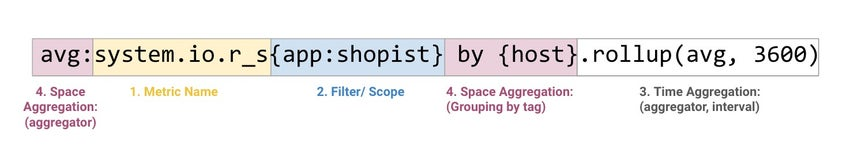
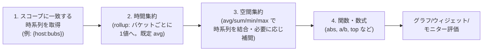
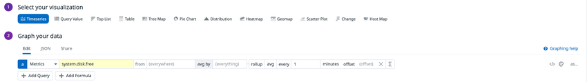
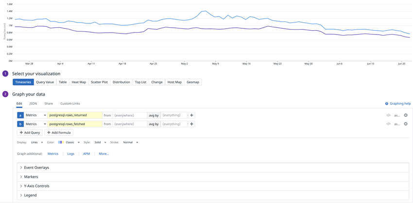
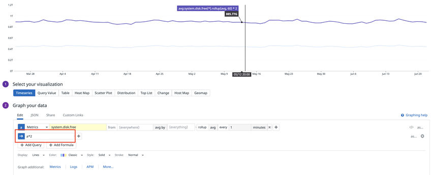
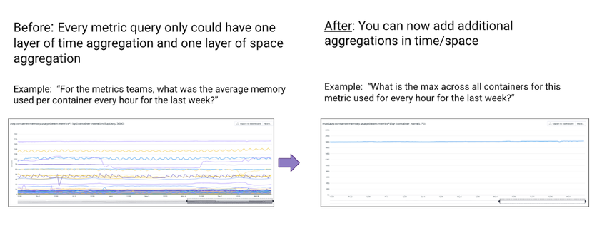

# メトリクスクエリと関数

## 概要

Datadog のメトリクスクエリ（Metric Query）は、**メトリクス名 → フィルタ（スコープ）→ 時間集約（Time Aggregation / rollup）→ 空間集約（Space Aggregation）→ 関数（Functions）/ 数式（Formulas）** の順で評価される。グラフ作成体験は Dashboards（ダッシュボード）、Notebooks（ノートブック）、Monitors（モニター）、Metrics Explorer で共通で、グラフエディタ（UI）でもクエリ文字列（`</>` ボタン）でも編集できる。[出典](https://docs.datadoghq.com/metrics/)

本ファイルは次の内容を扱う。

| 範囲 | 本ファイルで扱う内容 | 詳細を扱う別ファイル |
|---|---|---|
| クエリ構文 | 構成要素、評価順序、スコープ（タグ）フィルタ、ブール演算子、ワイルドカード | タグ設計は [Tagging](tagging.md) |
| 集約 | 時間集約（rollup）、空間集約、補間（interpolation）、`as_count()` / `as_rate()` / `weighted()` | メトリクスタイプ（COUNT/RATE/GAUGE/DISTRIBUTION）は [Metrics](metrics.md) |
| 関数 | 13 カテゴリの関数一覧と構文・パラメータ・注意点 | — |
| Formulas | 数式（`a / b` 等）、`minimum()` / `maximum()`、`time()`、エイリアス、非表示クエリ | ウィジェットごとの表示設定は [Dashboards](dashboards.md) |
| 応用クエリ | ネストクエリ（多層集約・任意パーセンタイル・標準偏差）、ブール閾値関数、Distribution のパーセンタイル | Distribution の送信は [Custom Metrics と DogStatsD](custom-metrics-and-dogstatsd.md) |
| 監視 | モニターでクエリ/関数を使う際の制約（rollup、`cumsum`、anomalies 等） | モニター設定全般は [Monitors](monitors.md) |
| API | `/api/v2/query/timeseries`、`/api/v2/query/scalar`、`/api/v1/query` | API キー・認証は [API とキー管理](api-and-keys.md) |

> **注記:** ログ・トレース・RUM などイベント系データのクエリ構文（Log Search Syntax）は本ファイルの対象外。[ログ検索と分析](../logs/log-search-and-analytics.md) を参照。

---

## クエリの構成要素（Anatomy）

Datadog のメトリクスクエリは次の 5 要素からなる。[出典](https://docs.datadoghq.com/metrics/)

| # | 要素 | 説明 | 例 |
|---|---|---|---|
| 1 | Metric name（メトリクス名） | 検索または Metric ドロップダウンから選ぶ。Metrics Explorer、Notebooks、Metrics Summary ページでも探せる | `system.io.r_s` |
| 2 | Filter / Scope（フィルタ・スコープ） | タグで対象の時系列を絞り込む。デフォルトは `(everywhere)`（クエリ文字列では `{*}`） | `{app:shopist}`、`{account:prod}` |
| 3 | Time Aggregation（時間集約） | 粒度（rollup 間隔）と、各時間バケット内の点の結合方法 | `.rollup(avg, 3600)` |
| 4 | Space Aggregation（空間集約） | 複数の時系列をどう結合するか（集約子）と、何を 1 本の線にするか（グルーピング） | `avg:` ＋ `by {host}` |
| 5 | Functions（関数・任意） | 値の算術変換、メトリクス間演算、平滑化、異常検知など | `abs(...)`、`a / b` |

クエリ文字列の一般形は次のとおり。

```text
<空間集約子>:<メトリクス名>{<スコープ>} by {<グループ化タグ>}.<修飾子/rollup>
例: avg:system.io.r_s{app:shopist} by {host}.rollup(avg, 3600)
```



- **キャプション:** メトリクスクエリ `avg:system.io.r_s{app:shopist} by {host}.rollup(avg, 3600)` の各部分を色分けした構成図。
- **画面の説明:** 先頭の `avg:` に「4. Space Aggregation（aggregator）」、`system.io.r_s` に「1. Metric Name」、`{app:shopist}` に「2. Filter/Scope」、`by {host}` に「4. Space Aggregation（Grouping by tag）」、`.rollup(avg, 3600)` に「3. Time Aggregation（aggregator, interval）」のラベルが付いている。クエリ文字列上の記述順と評価順（フィルタ → 時間集約 → 空間集約）が異なる点を示している。
- **出典:** https://docs.datadoghq.com/metrics/ （2026-11-02 取得）

---

## クエリの評価順序

Datadog のバックエンドはメトリクスクエリを次の順で処理する。[出典](https://docs.datadoghq.com/dashboards/guide/query-to-the-graph/)



| 手順 | 処理内容 | 補足 |
|---|---|---|
| 1. 時系列の取得 | Datadog は `{host, device}` のようなタグ組み合わせごとに別々の時系列として保存している。クエリのスコープに一致する時系列だけを取得する | `{*}` や広いスコープほど多くのソースを含む |
| 2. 時間集約（rollup） | 時間範囲をバケットに区切り、各バケットを 1 値に縮約する。既定の集約子は平均（avg） | データは 1 秒粒度で保存されるが、表示点数には上限がある（後述） |
| 3. 空間集約 | ソースごとの時系列をタイムスタンプごとに `max` / `min` / `avg` / `sum` で結合する | ソースが 1 つなら集約子の選択は結果に影響しない |
| 4. 関数・数式 | 手順 2・3 で得られた点列に対して関数・Formula の算術を適用する | 例外: `rollup` などクエリパラメータ自体を変える関数、`diff()` のように空間集約前に計算されるもの |

- 時間集約は **すべてのクエリに必ず適用される**（"time aggregation is always applied in every query you make"）。[出典](https://docs.datadoghq.com/metrics/)
- 多くの関数は時間・空間集約の後に実行されるが、`rollup` のようにクエリ実行前のパラメータ（時間集約）を変更するものもある。[出典](https://docs.datadoghq.com/dashboards/functions/)
- `diff()` は時間集約の後・空間集約の前に計算される。[出典](https://docs.datadoghq.com/dashboards/functions/rate/)
- グループ化クエリでは `rollup` や `as_count` は `by {...}` 句の **後ろ** に書く（例: `sum:my.count{*} by {host}.as_count()`）。複数タグ `by {host,device}` も可。[出典](https://docs.datadoghq.com/dashboards/guide/query-to-the-graph/)
- Distribution メトリクスは COUNT/GAUGE/RATE と異なり、DDSketch として保存され **時間と空間で同時にマージ** される。[出典](https://docs.datadoghq.com/metrics/faq/rollup-for-distributions-with-percentiles/)

---

## メトリクスの選択とスコープ（フィルタ）

### メトリクスの選択

グラフエディタでメトリクスを選ぶ際、ドロップダウンには単位（unit）、タイプ（type）、間隔（interval）、説明、タグ、タグ値の数が表示される。[出典](https://docs.datadoghq.com/dashboards/querying/)

- Metrics Explorer では、**過去 24 時間に報告されていないメトリクスはクエリエディタの候補に出ない**。メトリクス名またはクエリ全体を直接入力すれば追加できる。[出典](https://docs.datadoghq.com/metrics/explorer/)
- Datadog と OpenTelemetry の両方のソースがある環境では、Telemetry source 修飾子で両者を 1 つのグラフで扱える（後述「Telemetry Source」）。

### スコープ（from）の基本

| 項目 | 内容 |
|---|---|
| デフォルト | `(everywhere)`（クエリ文字列では `{*}`） |
| 指定方法 | ホストまたはタグ（`key:value`）で指定。例: `{account:prod}` |
| テンプレート変数 | `$` ＋ タグキー（例: `$env`）でダッシュボードのテンプレート変数を適用 |
| 複数タグの包含 | AND で結合される |
| 複数タグの除外 | OR で結合される |
| Metrics without Limits の除外タグ | Metrics without Limits™ のブロックリストに入れたタグは、ダッシュボード・モニターでクエリできない |

[出典](https://docs.datadoghq.com/dashboards/querying/)、[出典](https://docs.datadoghq.com/metrics/advanced-filtering/)、[出典](https://docs.datadoghq.com/metrics/metrics-without-limits/)

### ブール演算子（Advanced Filtering）

Datadog のメトリクスフィルタは Metrics Explorer、Monitors、Dashboards で次の演算子をサポートする。[出典](https://docs.datadoghq.com/metrics/advanced-filtering/)

| 演算子 | 種別 | 意味 |
|---|---|---|
| `!` | 記号構文 | 否定（除外） |
| `,` | 記号構文 | 列挙（包含は AND） |
| `NOT` / `not` | 関数構文 | 否定 |
| `AND` / `and` | 関数構文 | 論理積 |
| `OR` / `or` | 関数構文 | 論理和 |
| `IN` / `in` | 関数構文 | タグ値のリストに含まれる |
| `NOT IN` / `not in` | 関数構文 | タグ値のリストに含まれない |

- **記号構文（`!`、`,`）と関数構文（`NOT`、`AND`、`OR`、`IN`、`NOT IN`）は混在できない。** 例: `{env:prod AND !region:us-east}` は無効。
- UI のクエリエディタに以下のような例を貼り付けるには、コードアイコン（`</>`）をクリックして文字列編集モードにする。

```text
avg:system.cpu.user{env:staging AND (availability-zone:us-east-1a OR availability-zone:us-east-1c)} by {availability-zone}
avg:system.cpu.user{env:shop.ist AND availability-zone IN (us-east-1a, us-east-1b, us-east4-b)} by {availability-zone}
avg:system.cpu.user{env:prod AND location NOT IN (atlanta,seattle,las-vegas)}
```

### ワイルドカード

| 種類 | 例 |
|---|---|
| 前方一致（prefix） | `pod_name:web-*` |
| 後方一致（suffix） | `cluster:*-trace` |
| 部分一致（infix / substring） | `node:*-prod-*`、`region:*east*` |
| ワイルドカードによる除外 | `avg:system.disk.in_use{!device:/dev/loop*} by {device}` |

[出典](https://docs.datadoghq.com/metrics/advanced-filtering/)

- タグ値の大文字小文字の区別、メトリクス名に対するワイルドカード、フィルタ式の長さ・条件数の上限は **公開情報では確認できず**（Advanced Filtering ページに記載なし）。

---

## 時間集約（Time Aggregation / Rollup）

### 時間集約の概要

Datadog の時間集約（rollup）は、グラフが画素数以上の点を描かずに済むよう、データ点を時間バケットにまとめる処理である。表示する時間範囲が長いほど粒度は粗くなる（例: 4 時間の表示では 2 分バケット。ただし Rollup ページの既定間隔表との食い違いは後述の注記を参照）。[出典](https://docs.datadoghq.com/metrics/)

| 項目 | 値 | 出典 |
|---|---|---|
| 集約子（aggregator） | `avg`、`sum`、`min`、`max`、`count` | [Rollup](https://docs.datadoghq.com/dashboards/functions/rollup/) |
| 既定の集約子 | `avg` | [Rollup](https://docs.datadoghq.com/dashboards/functions/rollup/) |
| 間隔の単位 | 秒（例: `.rollup(avg, 60)`、`.rollup(sum, 120)`、`.rollup(avg, 86400)`） | [Rollup](https://docs.datadoghq.com/dashboards/functions/rollup/) |
| Agent の一般的な収集間隔 | 15〜20 秒（1 日で約 4,320 点。20 秒間隔で計算した場合。15 秒間隔なら 5,760 点） | [Querying](https://docs.datadoghq.com/dashboards/querying/) |
| 保存粒度 | 1 秒（バックエンドの保存粒度） | [Query to the graph](https://docs.datadoghq.com/dashboards/guide/query-to-the-graph/) |

### rollup 関数の構文

| 構文 | 説明 |
|---|---|
| `.rollup(<AGGREGATOR>, <INTERVAL>)` | 集約子と間隔（秒）を指定 |
| `.rollup(<AGGREGATOR>)` | 集約子のみ指定（間隔は自動） |
| `.rollup(<AGGREGATOR>, <CALENDAR_UNIT>, <ALIGNMENT>, '<TIMEZONE>')` | カレンダー整列 rollup（後述） |
| `moving_rollup(<METRIC_NAME>, <INTERVAL>, <AGGREGATOR>)` | 直近 X 秒の点を結合する移動 rollup |

- 例: `avg:system.disk.free{*}.rollup(avg, 60)` は全マシンの空きディスクの平均を 1 分バケットで表示する。[出典](https://docs.datadoghq.com/dashboards/querying/)
- UI ではグラフエディタの Σ（Add Function）から Rollup を追加する。UI 上は「rollup [集約子] every [数値] [単位]」の形で表示される。
- Distribution メトリクスには集約子パラメータがない（時間と空間で同時に集約されるため）。パーセンタイル（p50 等）を選んだ場合は間隔だけを指定し、`p99:distribution.rollup(avg, 60)` と `p99:distribution.rollup(60)` は同じ値を返す。[出典](https://docs.datadoghq.com/dashboards/functions/rollup/)、[出典](https://docs.datadoghq.com/metrics/faq/rollup-for-distributions-with-percentiles/)



- **キャプション:** グラフエディタで `system.disk.free` に rollup（avg, 1 分）を設定したクエリ行。
- **画面の説明:** 「1 Select your visualization」で Timeseries が選択され、「2 Graph your data」の Edit タブにクエリ `a` が表示されている。行は左から「Metrics」（データソース）、メトリクス名 `system.disk.free`、`from (everywhere)`、`avg by (everything)`、`rollup` `avg` `every` `1` `minutes` `offset (offset)` の各フィールド、Σ（関数追加）ボタン、右端に `</>`（クエリ文字列編集）と `as...`（エイリアス）が並ぶ。下部に「+ Add Query」「+ Add Formula」ボタンがある。
- **出典:** https://docs.datadoghq.com/dashboards/querying/ （2026-11-02 取得）

### 自動 rollup（Enforced rollup）と表示点数の上限

Datadog は、1 系列の点数が上限を超える場合に `avg` で自動 rollup する。既定の間隔は時間範囲と可視化の種類で決まる。[出典](https://docs.datadoghq.com/dashboards/functions/rollup/)

| 時間範囲 | Line Graph | Bar Graph | API |
|---|---|---|---|
| Past minute（過去 1 分） | 1 秒 | 1 秒 | 1 秒 |
| Past 5 minutes（過去 5 分） | 2 秒 | 5 秒 | 2 秒 |
| Past 15 minutes（過去 15 分） | 5 秒 | 10 秒 | 5 秒 |
| Past 30 minutes（過去 30 分） | 10 秒 | 30 秒 | 10 秒 |
| Past hour（過去 1 時間） | 20 秒 | 1 分 | 20 秒 |
| Past four hours（過去 4 時間） | 1 分 | 2 分 | 1 分 |
| Past day（過去 1 日） | 5 分 | 20 分 | 5 分 |
| Past two days（過去 2 日） | 10 分 | 30 分 | 10 分 |
| Past week（過去 1 週間） | 1 時間 | 2 時間 | 1 時間 |
| Past month（過去 1 か月） | 4 時間 | 12 時間 | 4 時間 |
| Past 3 months（過去 3 か月） | 12 時間 | 1 日 | 12 時間 |
| Past 6 months（過去 6 か月） | 1 日 | 1 日 | 1 日 |
| Past year（過去 1 年） | 1 日 | 1 週間 | 1 日 |

> **注記（記述の食い違い）:** Metrics ページ（/metrics/）は「4 時間の表示ではデータ点が 2 分バケットにまとめられる」と説明しているが、Rollup ページの上表では過去 4 時間の既定間隔は Line Graph 1 分・Bar Graph 2 分・API 1 分である（2026-11-04 時点）。2 分は Bar Graph の値と一致するが、Line Graph では 1 分になる。[出典](https://docs.datadoghq.com/metrics/)、[出典](https://docs.datadoghq.com/dashboards/functions/rollup/)

| 表示点数に関する記述 | 値 | 出典 |
|---|---|---|
| Line / Bar グラフの 1 系列あたり上限 | **1,500 点** | [Rollup](https://docs.datadoghq.com/dashboards/functions/rollup/) |
| Query Value ウィジェットの目標点数 | **150 点**（同じ時間範囲でも rollup が粗くなる） | [Rollup](https://docs.datadoghq.com/dashboards/functions/rollup/) |
| カスタム rollup で可能な最細粒度の例 | 1 日の範囲で 1 分 1 点（1,440 点）まで | [Rollup](https://docs.datadoghq.com/dashboards/functions/rollup/) |
| 既定表示の目安 | 「約 300 点」（例: 1 日表示で 5 分バケット＝288 点） | [Querying](https://docs.datadoghq.com/dashboards/querying/)、[Query to the graph](https://docs.datadoghq.com/dashboards/guide/query-to-the-graph/) |

> **注記（記述の整合）:** 「約 300 点」は自動 rollup 時の既定間隔の目安（過去 1 時間 20 秒＝180 点、過去 1 日 5 分＝288 点）を説明したもので、`.rollup()` で明示指定した場合は **1 系列 1,500 点まで** 細かくできる、というのが Rollup ページの現行記述である。上限を超える細かい間隔を指定しても受け付けられず、より大きな間隔に置き換えられる（例: 2 か月範囲で `rollup(60)` を指定しても 1 分粒度にはならない）。[出典](https://docs.datadoghq.com/dashboards/functions/rollup/)、[出典](https://docs.datadoghq.com/dashboards/guide/query-to-the-graph/)

### COUNT / RATE メトリクスの rollup

- COUNT・RATE タイプのメトリクスでは、UI がクエリ末尾に自動で `.as_count()` を付与する。`.as_count()` は rollup 方式を `sum` にし、補間を無効化する。[出典](https://docs.datadoghq.com/dashboards/functions/rollup/)
- 詳細は後述「メトリクスタイプ修飾子」を参照。

### カレンダー整列 rollup（Calendar-aligned rollup）

Datadog の rollup は、日・週・月の暦に整列したバケットで集計できる。[出典](https://docs.datadoghq.com/dashboards/functions/rollup/)

| パラメータ | 指定値 | デフォルト |
|---|---|---|
| `<CALENDAR_UNIT>` | `daily`、`weekly`、`monthly` | — |
| `<ALIGNMENT>`（weekly） | 小文字の曜日名 `monday`〜`sunday` | `sunday` |
| `<ALIGNMENT>`（daily） | 開始時刻（例: `12am`） | 公開情報では確認できず |
| `<ALIGNMENT>`（monthly） | 開始日 | 公開情報では確認できず |
| `'<TIMEZONE>'` | IANA タイムゾーン文字列（例: `America/New_York`、`Europe/Paris`、`Asia/Tokyo`） | UTC |

```text
sum:requests.count{*}.as_count().rollup(sum, weekly, monday)                       # 月曜始まりの週次（UTC）
sum:requests.count{*}.as_count().rollup(sum, weekly, monday, 'America/New_York')   # 東部時間の週次
sum:requests.count{*}.as_count().rollup(sum, daily, 12am, 'America/Los_Angeles')   # 太平洋時間 0 時始まりの日次
```

> **注記:** 日本時間の日次集計が必要な場合は `'Asia/Tokyo'` を指定する（IANA 形式であれば指定可能）。指定しない場合は UTC 0 時区切りになる。

### moving_rollup（移動 rollup）

| 項目 | 内容 |
|---|---|
| 構文 | `moving_rollup(<METRIC_NAME>, <INTERVAL>, <AGGREGATOR>)` |
| 動作 | 各時点で直近 `<INTERVAL>` 秒の点を結合する |
| 集約子（Rollup ページ記載） | `sum`、`min`、`max`、`count`、`avg` |
| 集約子（Nested Queries ページ記載・標準版） | `avg`、`sum`、`min`、`max`、`median` |
| ネストクエリでの利用 | lookback mode 版のみ可。`avg`、`sum`、`min`、`max`、`count`、`count by`、任意パーセンタイル `pXX`、`stddev` をサポート。元のクエリ時間範囲より前のデータ点も分析対象にできる |
| ネスト時の制約 | moving rollup を重ねる場合、各 rollup 間隔は前段より大きくなければならない |

[出典](https://docs.datadoghq.com/dashboards/functions/rollup/)、[出典](https://docs.datadoghq.com/metrics/nested_queries/)

> **注記（記述の食い違い）:** 標準の `moving_rollup` が受け付ける集約子は、Rollup ページ（`count` を含み `median` なし）と Nested Queries ページ（`median` を含み `count` なし）で記載が異なる（2026-11-02 時点）。利用時は UI の候補で確認すること。

### モニターでの rollup

- モニタークエリでは rollup は **原則避ける** べきとされる。rollup 間隔はモニターのクエリウィンドウではなく UNIX 時刻に整列するため、評価時点で未完了の間隔（少数サンプル）を評価してアラートすることがある。
- 回避策: モニターの評価遅延（evaluation delay）を少なくとも rollup 間隔の長さ以上に設定する。
- 想定外の No Data が出る場合は rollup と評価ウィンドウの設定を見直す。

[出典](https://docs.datadoghq.com/dashboards/functions/rollup/)

---

## 空間集約（Space Aggregation）

Datadog の空間集約は、タグ（host、container、region など）で分かれた複数の時系列を、どの集約子でまとめ（Aggregator）、何を 1 本の線とするか（Grouping）を決める。[出典](https://docs.datadoghq.com/metrics/)

| 項目 | 内容 |
|---|---|
| 集約子 | `avg by`、`sum by`、`min by`、`max by` |
| 既定値 | `avg by`（Metrics Explorer では「Average」） |
| グルーピング | `by {tag}` で指定したタグ値ごとに 1 本の線。例: 4 リージョンに散らばるホストを `by {region}` でまとめると 4 本 |
| グルーピングなし | `(everything)` ＝全時系列を 1 本に集約 |
| メトリクスタイプによる制約 | Metrics Explorer では利用可能な集約子がメトリクスタイプにより異なる |

[出典](https://docs.datadoghq.com/dashboards/querying/)、[出典](https://docs.datadoghq.com/metrics/explorer/)

- 例: レイテンシを `max by {region}` にするとリージョンごとの最大値、`avg by {region}` にするとリージョンごとの平均値が得られる。
- Query Value ウィジェットは 2 段の集約結果をさらに 1 値に縮約し、Top List はグループごとに 1 値を返す。[出典](https://docs.datadoghq.com/metrics/)
- 空間集約に使えるのは上記 4 種のみ。パーセンタイル・標準偏差による空間集約は **ネストクエリ**（2 層目以降）または **Distribution メトリクス** で行う（後述）。

### 補間（Interpolation）と空間集約

Datadog は、報告タイミングの異なる複数ソースを空間集約するとき、計算用に値を補間して系列を揃える。[出典](https://docs.datadoghq.com/metrics/guide/interpolation-the-fill-modifier-explained/)

| ケース | 補間の有無 |
|---|---|
| 空間集約（例: `avg:system.cpu.user{env:prod}` で 2 ホスト以上） | 行う（平均を正しく計算するため） |
| グループ化クエリ（例: `net.bytes_rcvd{*} by {host}`） | 系列間の計算はないが、マウスオーバーや比較のために揃える |
| 単一ソースの単一メトリクス（例: `avg:net.bytes_rcvd{host:a}`） | 不要 |
| カンマ区切りの複数クエリ（例: `avg:system.cpu.user{env:prod},avg:system.cpu.user{env:dev}`） | 行わない |

| 項目 | 既定値・動作 |
|---|---|
| 既定の補間方式 | 全メトリクスタイプで **線形補間（linear）**、実サンプルから **最大 5 分** 後まで |
| `.as_count()` / `.as_rate()` 使用時 | GAUGE 以外のメトリクスタイプで補間を無効化 |
| 補間の目的 | 系列の整列のみ。長いデータ欠損を埋めるものではない |

- 長い欠損区間はグラフ上で点と点を結ぶ直線として描かれる（`fill(zero)` を指定しても同様）。
- `fill(null)` 相当の状態では、最後の実データから 5 分後以降は補間値が表示されない。

---

## メトリクスタイプ修飾子（as_count / as_rate / weighted）

Datadog のメトリクスタイプ修飾子（in-application modifiers）は、保存されたメトリクスを変更せずに、グラフ・モニター上で COUNT 表現と RATE 表現を切り替える。[出典](https://docs.datadoghq.com/metrics/custom_metrics/type_modifiers/)

| 修飾子 | 意味 |
|---|---|
| `.as_count()` | rollup 間隔内の絶対的な変化量を表示。rollup 間隔に依存するため、表示時間範囲を変えるとグラフ形状が変わりうる |
| `.as_rate()` | 1 秒あたりの変化量を表示 |
| `.weighted()` | GAUGE の値を、各タグ組み合わせが存在した時間で重み付けする |

### メトリクスタイプ別の動作

| メトリクスタイプ | 修飾子 | 補間 | 時間集約子 | 正規化 |
|---|---|---|---|---|
| COUNT | `as_count()` | 無効 | SUM | なし |
| COUNT | `as_rate()` | 無効 | SUM | 集約後の値をサンプリング間隔で割る（例: 1 秒ごとに `[1,1,1,1]`、rollup 20 秒 → `[0.05, 0.05, 0.05, 0.05]`）。時間集約がない極小間隔では正規化されず生の count を返す |
| RATE | `as_count()` | 無効 | SUM | 集約後の値にサンプリング間隔を掛ける（例: `[0.05,...]`、rollup 20 秒 → `[1,1,1,1]`） |
| RATE | `as_rate()` | 無効 | SUM（メタデータの間隔がない場合は AVG） | 各完全バケットを `min(metadata_interval, rollup_interval) / rollup_interval` で再スケール（例: 60 秒間隔で送信、rollup 1,800 秒 → 集約値 / 30）。送信間隔より小さい rollup 要求は送信間隔に引き上げ。右端の不完全バケットは観測サンプルの平均を反映するよう再スケール |
| GAUGE | `as_count()` / `as_rate()` | （GAUGE は補間を維持） | — | Metrics Explorer での保存・表示は変わらない。モニターでは `pct_change()` など rollup 依存関数の評価方法が変わる |

[出典](https://docs.datadoghq.com/metrics/custom_metrics/type_modifiers/)

- GAUGE をモニターで評価する際、`as_count()` なしでは関数がバケットごとに実行され、その値がウィンドウで合算される（疎な GAUGE では大きな負値になりうる）。`as_count()` ありでは先にバケット化・集約してからウィンドウに対して関数を実行する。
- RATE の `as_rate()` を検証するには Advanced graphing で `(post_aggregation / rollup_interval) * min(metadata_interval, rollup_interval)` を使う（アクティブな rollup 値に依存するため基本の Timeseries ウィジェットでは描けない）。
- `as_count()` / `as_rate()` は StatsD/DogStatsD のカウンター用の時間集約子として rollup の代わりに機能する。[出典](https://docs.datadoghq.com/dashboards/guide/query-to-the-graph/)

### weighted()

| 項目 | 内容 |
|---|---|
| 構文 | `sum:(<GAUGE_METRIC_NAME>{*}).weighted()` |
| 目的 | `pod_name`、`container_name` などチャーン（入れ替わり）の多いタグ値の短い寿命を考慮し、GAUGE を合算したときの人為的なスパイクを防ぐ。コスト・キャパシティ・オートスケーリング系クエリで重要 |
| 利用条件 | GAUGE メトリクスを `SUM BY` で空間集約するときのみ |
| 自動付与条件 | GAUGE が定期的に送信され（補間で欠損を埋めていない）、かつ送信間隔（submission interval）が正しく設定されている場合に自動付与 |
| 送信間隔の設定 | Agent またはインテグレーションが取り込み時に設定。Metrics Summary ページで確認・編集可能 |

[出典](https://docs.datadoghq.com/dashboards/functions/smoothing/)、[出典](https://docs.datadoghq.com/metrics/custom_metrics/type_modifiers/)

> **注記:** Metrics Summary でメトリクスタイプを変更すると、旧タイプで保存された履歴データが誤って解釈されることがある。履歴を保ちたい場合は新しいメトリクス名を作ることが推奨されている。[出典](https://docs.datadoghq.com/metrics/custom_metrics/type_modifiers/)

---

## グラフエディタでのクエリ作成

Datadog のグラフエディタは、ウィジェットの鉛筆アイコンから開き、**Edit**（既定・UI で設定）、**JSON**（グラフ定義言語で編集）、**Share**（外部 Web ページへの埋め込み）の 3 タブを持つ。任意のページで `G` キーを押すと Quick Graphs も使える。[出典](https://docs.datadoghq.com/dashboards/querying/)

ダッシュボードでのグラフ設定手順は次のとおり。

| 手順 | 内容 |
|---|---|
| 1 | 可視化（ウィジェット）を選ぶ |
| 2 | メトリクスを定義する |
| 3 | メトリクスをフィルタする（from） |
| 4 | 時間集約を設定する |
| 5 | 空間集約を設定する |
| 6 | 関数を適用する（Σ） |
| 7 | タイトルを付ける（空欄なら選択内容から自動生成） |



- **キャプション:** Timeseries ウィジェットのグラフエディタで、`postgresql.rows_returned`（クエリ a）と `postgresql.rows_fetched`（クエリ b）を表示している画面。
- **画面の説明:** 上部にプレビューグラフ（2 本の折れ線）。「1 Select your visualization」に Timeseries / Query Value / Table / Heat Map / Scatter Plot / Distribution / Top List / Change / Host Map / Geomap の選択肢。「2 Graph your data」に Edit / JSON / Share / Custom Links タブ、クエリ行 a・b（データソース「Metrics」、メトリクス名、`from (everywhere)`、`avg by (everything)`、`+`）、「+ Add Query」「+ Add Formula」ボタン、Display（Lines）/ Color（Classic）/ Style（Solid）/ Stroke（Normal）、「Graph additional: Metrics | Logs | APM | More...」、折りたたみの Event Overlays / Markers / Y-Axis Controls / Legend がある。
- **出典:** https://docs.datadoghq.com/dashboards/querying/ （2026-11-02 取得）

### クエリの表示・非表示とエイリアス

| 機能 | 内容 |
|---|---|
| クエリのラベル | クエリはアルファベット順（a, b, c...）にラベル付けされる。Formula にはラベルが付かない |
| 非表示 | クエリのラベルをクリックして切り替える。**青＝表示、灰色＝非表示**。非表示のクエリも Formula の入力としては使われる |
| エイリアス | データソースにカスタムエイリアスを設定し、凡例等を読みやすくできる |
| 保存 | **Done** で保存して閉じる。**Cancel** で破棄 |

[出典](https://docs.datadoghq.com/dashboards/querying/)

### その他のオプション（Timeseries）

| 機能 | 内容 |
|---|---|
| Event overlays | Timeseries のみ。ログ検索構文でイベントを重ねる（全データソース対応）。例: RUM エラー率にデプロイイベントを重ねる |
| Split graph | タグでメトリクス可視化を分割表示。sort-by メトリクスと表示グラフ数の limit を設定可能。既定の limit 値は公開情報では確認できず |

[出典](https://docs.datadoghq.com/dashboards/querying/)

---

## Formulas（数式）とメトリクス間演算

Datadog の Formulas は、グラフエディタの「+ Add Formula」から、ラベル付きクエリ（a, b, c...）を参照する数式を定義する機能である。[出典](https://docs.datadoghq.com/dashboards/querying/)

### 使用できる演算子・関数

| 演算子 / 関数 | 意味 | 例 |
|---|---|---|
| `+` `-` `*` `/` | 四則演算（クエリと定数、クエリ同士） | `a * 2`、`a / b` |
| `minimum(a, b)` | 2 つのクエリを各タイムスタンプで比較し小さい方 | `minimum(a, b)` |
| `maximum(a, b)` | 2 つのクエリを各タイムスタンプで比較し大きい方 | `maximum(a, b)` |
| `time()` | 現在の Unix 時刻（秒）を返す。データ鮮度チェックに有用 | `time() - max:backup.last_completed_timestamp{*}` |
| `,`（カンマ） | 複数クエリを別々に描画（`a, b, c`）。**可視化でのみ有効、モニターでは不可** | `a, b` |
| 関数 | 下記「関数一覧」の関数を Formula に適用（Σ） | `abs(a - b)` |

- **利用例:** `jvm.heap_memory / jvm.heap_memory_max` で使用率を算出。ログクエリ同士の比較（`status:error / status:info`）も可能。[出典](https://docs.datadoghq.com/metrics/)、[出典](https://docs.datadoghq.com/dashboards/querying/)
- Formulas は Metrics だけでなく、Logs・APM など他のデータソースのクエリも入力にできる（エディタの「Graph additional: Metrics / Logs / APM / More...」）。



- **キャプション:** クエリ a（`system.disk.free`、rollup avg 1 分）に対して Formula `a*2` を適用した例。
- **画面の説明:** グラフ上部のツールチップに `avg:system.disk.free{*}.rollup(avg, 60) * 2` と値 `885.77G` が表示されている。エディタにはクエリ a の行（Metrics / `system.disk.free` / `from (everywhere)` / `avg by (everything)` / `rollup avg every 1 minutes`）と、その下に赤枠で強調された Formula 行（矢印アイコン、入力欄 `a*2`）がある。
- **出典:** https://docs.datadoghq.com/dashboards/querying/ （2026-11-02 取得）

### Formulas の制約

| 制約 | 内容 | 出典 |
|---|---|---|
| Formula 同士の演算不可 | "Arithmetic cannot be done between formulas."（Formula を別の Formula で参照できない） | [Querying](https://docs.datadoghq.com/dashboards/querying/) |
| カンマ区切り | 可視化のみ。モニターでは複数メトリクスを結合するのにブール演算子または算術を使う | [Querying](https://docs.datadoghq.com/dashboards/querying/) |
| 旧 `min()` / `max()` 演算 | 算術比較用の `min()` / `max()` は **非推奨**。`minimum()` / `maximum()` を使う（集約子の `min by` / `max by` は変更なし） | [Querying](https://docs.datadoghq.com/dashboards/querying/) |
| 適用順序 | Formula の算術は時間・空間集約後の点列（自動 rollup 後）に対して実行される | [Query to the graph](https://docs.datadoghq.com/dashboards/guide/query-to-the-graph/) |
| 補間 | カンマ区切りの複数クエリ間では補間されない | [Interpolation](https://docs.datadoghq.com/metrics/guide/interpolation-the-fill-modifier-explained/) |
| 1 ウィジェットあたりのクエリ・Formula 数の上限 | 公開情報では確認できず | — |
| モニターでの除算 | 除算の Formula を使うモニターでは 60 秒の評価遅延が有効とされる | [Monitor configuration](https://docs.datadoghq.com/monitors/configuration/) |

---

## 関数一覧

Datadog の関数（Functions）は、メトリクスクエリの結果を可視化前に変換する。多くはクエリ結果が返った後に適用されるが、`rollup` のようにクエリパラメータ（時間集約）を変えるものもある。グラフエディタの Σ（Add Function）アイコンから追加する。[出典](https://docs.datadoghq.com/dashboards/functions/)

### カテゴリ一覧

| カテゴリ | 概要 | 主な関数 |
|---|---|---|
| Algorithmic | 異常・外れ値検知、予測 | `anomalies()`、`outliers()`、`forecast()` |
| Arithmetic | 結果に対する算術 | `abs()`、`round()`、`ceil()`、`floor()`、`pow()`、`log2()`、`log10()`、`cumsum()`、`integral()` |
| Count | 非ゼロ・非 null の数を数える | `count_nonzero()`、`count_not_null()` |
| Exclusion | 特定の値を除外 | `exclude_null()`、`clamp_min()`、`clamp_max()`、`cutoff_min()`、`cutoff_max()` |
| Interpolation | 欠損補完・既定値設定 | `fill()`、`default_zero()` |
| Rank | 時系列の部分集合を選択 | `top()`、`top5_mean()` 等のショートカット |
| Rate | カスタム微分 | `per_second()`、`per_minute()`、`per_hour()`、`dt()`、`diff()`、`monotonic_diff()`、`derivative()`、`throughput()` |
| Regression | 回帰（機械学習系） | `robust_trend()`、`trend_line()`、`piecewise_constant()` |
| Rollup | 使用する生データ点数の制御 | `.rollup()`、`moving_rollup()` |
| Smoothing | 変動の平滑化 | `autosmooth()`、`ewma_*()`、`median_*()`、`weighted()` |
| Telemetry Source | メトリクスデータのテレメトリソース選択 | Native / Combined（`semantic_mode`） |
| Timeshift | データ点を時間軸上でずらす | `timeshift()`、`calendar_shift()`、`hour_before()` ほか |
| Beta | ローリング平均 | `rollingavg_5()` ほか |

[出典](https://docs.datadoghq.com/dashboards/functions/)

### Arithmetic（算術）

| 関数 | 構文 | 説明 |
|---|---|---|
| `abs()` | `abs(<METRIC>{*})` | 絶対値 |
| `round()` | `round(<METRIC>{*})` / `round(<METRIC>{*}, <DECIMAL_PLACES>)` | 最も近い値に丸める。第 2 引数で小数桁数（任意） |
| `ceil()` | `ceil(<METRIC>{*})` | 整数へ切り上げ |
| `floor()` | `floor(<METRIC>{*})` | 整数へ切り捨て |
| `pow()` | `pow(<METRIC>{*}, <CONSTANT>)` / `pow(<METRIC>{*}, <METRIC>{*})` / `pow(<CONSTANT>, <METRIC>{*})` / `pow(<CONSTANT>, <CONSTANT>)` | べき乗。底・指数ともメトリクスまたは定数可。例: `pow(METRIC{*}, 2)` は二乗 |
| `log2()` | `log2(<METRIC>{*})` | 底 2 の対数 |
| `log10()` | `log10(<METRIC>{*})` | 底 10 の対数 |
| `cumsum()` | `cumsum(<METRIC>{*})` | 表示中の時間範囲での累積和 |
| `integral()` | `integral(<METRIC>{*})` | 積分。連続する点の [時間差] × [値の差] を累積（単純な値の合計ではない）。表示中の時間範囲に限定 |

[出典](https://docs.datadoghq.com/dashboards/functions/arithmetic/)

- `cumsum()` は表示時間範囲に依存する「視覚的な関数」のため、**モニタークエリでは避ける**。モニターでは評価期間に Cumulative Time Windows を使う。
- `log2()` / `log10()` のゼロ・負値入力時の扱いは公開情報では確認できず。

### Count（カウント）

| 関数 | 構文 | 説明 |
|---|---|---|
| `count_nonzero()` | `count_nonzero(<METRIC>{*})` | 非ゼロ値の数。`by {tag}` 付きでは各時点で非ゼロ値を持つタグ値の数（例: `count_nonzero(system.cpu.user{*} by {host})` は負荷が非ゼロのホスト数）。別名 `count_nonzero_finite()` |
| `count_not_null()` | `count_not_null(<METRIC>{*})` | 非 null（有限値を持つ）値の数。`by {tag}` 付きでは各時点で値を持つタグ値の数 |

[出典](https://docs.datadoghq.com/dashboards/functions/count/)

### Exclusion（除外）

| 関数 | 構文 | 説明・注意 |
|---|---|---|
| `exclude_null()` | `exclude_null(avg:system.load.1{*} by {host})` | タグ値が N/A のグループをグラフ・Top List から除く。いずれかのタグ値が N/A なら除外（例: account 3 値 × region 4 値の 12 本 → 6 グループ） |
| `clamp_min()` | `clamp_min(<QUERY>, <THRESHOLD>)` | 閾値未満の点を閾値に置き換える。`NaN` も閾値になるため、防ぐには先に `default_zero()` を適用 |
| `clamp_max()` | `clamp_max(<QUERY>, <THRESHOLD>)` | 閾値超の点を閾値に置き換える。`NaN` の扱いは `clamp_min()` と同じ |
| `cutoff_min()` | `cutoff_min(<QUERY>, <THRESHOLD>)` | 閾値未満の値を `NaN` に置き換える（閾値と等しい値は残る） |
| `cutoff_max()` | `cutoff_max(<QUERY>, <THRESHOLD>)` | 閾値超の値を `NaN` に置き換える（閾値と等しい値は残る） |

[出典](https://docs.datadoghq.com/dashboards/functions/exclusion/)

- 関数は Datadog 上のデータ点を削除しない。可視化からデータ点を除くだけである。[出典](https://docs.datadoghq.com/metrics/advanced-filtering/)
- clamp / cutoff の閾値を示すには、ダッシュボードの水平マーカー（Markers）の併用が推奨されている。

### Interpolation（補間）

| 関数 | 構文 | 説明 |
|---|---|---|
| `fill()` | `<METRIC>{*}.fill(<METHOD>, <LIMIT>)` | 補間方式と補間する最大ギャップ（秒）を指定 |
| `default_zero()` | `default_zero(<METRIC_QUERY>)` | 空の時間区間を 0（または補間が適用される場合は補間値）で埋める。時間・空間集約の後に適用 |

| `fill()` の METHOD | 動作 |
|---|---|
| `linear` | ギャップの始点と終点の間を線形補間 |
| `last` | ギャップ前の最後の値を繰り返す |
| `zero` | 0 で埋める |
| `null` | 補間を無効化（LIMIT 値は無関係） |

| パラメータ | デフォルト | 最大 |
|---|---|---|
| `fill()` の LIMIT | **300 秒** | **600 秒** |
| `fill()` の METHOD | 公開情報では確認できず | — |

[出典](https://docs.datadoghq.com/dashboards/functions/interpolation/)、[出典](https://docs.datadoghq.com/metrics/guide/interpolation-the-fill-modifier-explained/)

- `default_zero()` は GAUGE にのみ効果がある。`as_count()` / `as_rate()` を使う COUNT・RATE のクエリは常に 0 で整列されるため変化しない。
- モニターでは `default_zero()` で埋めた 0 がトリガーになりうる（例: `avg(last_10m):avg:system.cpu.idle{*} < 10` は解消ではなく 0 でトリガー）。`as_count()` を使うエラー率モニターでの `default_zero()` は避ける。`default_zero()` を含むモニタークエリは欠損データを常に 0 として評価する。[出典](https://docs.datadoghq.com/dashboards/functions/interpolation/)、[出典](https://docs.datadoghq.com/monitors/configuration/)

### Rank（ランク）

| 関数 | 構文 | パラメータ |
|---|---|---|
| `top()` | `top(<METRIC>{*}, <LIMIT_TO>, '<BY>', '<DIR>')` | `LIMIT_TO`: `5`、`10`、`25`、`50`、`100` / `BY`: `max`、`mean`、`min`、`sum`、`last`、`l2norm`、`area` / `DIR`: `asc`、`desc` |
| ショートカット | `[top, bottom][5, 10, 15, 20]_[mean, min, max, last, area, l2norm][2]` | 例: `bottom10_min()` は `min` で最も低い 10 系列。単一の系列リストを入力に取る |

| `BY` の値 | 意味 |
|---|---|
| `max` / `min` / `mean` / `sum` | 全値の最大 / 最小 / 平均 / 合計 |
| `last` | 最後の値 |
| `l2norm` | 時系列のノルム（常に正）。大きさで順位付け |
| `area` | 曲線下の符号付き面積（負になりうる） |

[出典](https://docs.datadoghq.com/dashboards/functions/rank/)

- `top()` の各パラメータの既定値は公開情報では確認できず。
- ショートカットの件数（5/10/15/20）と `top()` の件数（5/10/25/50/100）は異なる。ショートカット表記末尾の `[2]` の意味は公式ページに説明がない（公式表記をそのまま記載）。

### Rate（レート）

| 関数 | 構文 | 説明・注意 |
|---|---|---|
| `per_second()` | `per_second(<METRIC>{*})` | 変化の速さを 1 秒あたりで表示 |
| `per_minute()` | `per_minute(<METRIC>{*})` | 1 分あたり |
| `per_hour()` | `per_hour(<METRIC>{*})` | 1 時間あたり |
| `dt()` | `dt(<METRIC>{*})` | 送信された点の間隔（秒）。複数グループがあっても常に 1 本の時系列を返す |
| `diff()` | `diff(<METRIC>{*})` | 連続する区間の差分。時間集約の後・空間集約の前に計算。15 秒間隔の送信なら 15 秒レート |
| `monotonic_diff()` | `monotonic_diff(<METRIC>{*})` | `diff()` と同様だが正の変化のみ（負の差分は除外） |
| `derivative()` | `derivative(<METRIC>{*})` | 変化率（diff / dt） |
| `throughput()` | `throughput(<METRIC>{*})` | 各値をその時間バケットの秒数で割り、1 秒あたりのレートに変換 |

[出典](https://docs.datadoghq.com/dashboards/functions/rate/)

### Regression（回帰）

| 関数 | 構文 | 説明・注意 |
|---|---|---|
| `robust_trend()` | `robust_trend(avg:<METRIC>{*})` | Huber 損失によるロバスト回帰のトレンド線。極端値の影響が OLS より小さい |
| `trend_line()` | `trend_line(avg:<METRIC>{*})` | 最小二乗法（OLS）の回帰直線。少数の極端値で大きく歪むため外れ値がある場合は `robust_trend()` を使う |
| `piecewise_constant()` | `piecewise_constant(avg:<METRIC>{*})` | 一定値の区間からなる階段状の近似 |

[出典](https://docs.datadoghq.com/dashboards/functions/regression/)

### Smoothing（平滑化）

| 関数 | 構文 | 説明・注意 |
|---|---|---|
| `autosmooth()` | `autosmooth(<METRIC>{*})` | 自動で span を選ぶ移動平均（ASAP アルゴリズム）。**モニターでは使用不可**（span が動的に変わり閾値設定が困難・フラッピングの原因）。`group by` クエリでは全系列に同じ span、グラフ内の複数メトリクスにはそれぞれ別の span |
| `ewma_1()` | `ewma_1(<METRIC>{*})` | 指数加重移動平均（EWMA）、span 1 |
| `ewma_3()` / `ewma_5()` / `ewma_7()` / `ewma_10()` | `ewma_3(<METRIC>{*})` など | EWMA、span 3 / 5 / 7 / 10 |
| `ewma()` / `ewma_20()` | `ewma(<METRIC>{*})` | EWMA、span 20（両者同一） |
| `median()` / `median_3()` | `median(<METRIC>{*})` | 直近 3 点のローリング中央値（両者同一） |
| `median_5()` / `median_7()` / `median_9()` | `median_5(<METRIC>{*})` など | 直近 5 / 7 / 9 点のローリング中央値 |
| `weighted()` | `sum:(<GAUGE_METRIC>{*}).weighted()` | 前述「weighted()」参照 |

[出典](https://docs.datadoghq.com/dashboards/functions/smoothing/)

- EWMA の span 値は系列の加重平均年齢（weighted average age）の 2 倍と説明されている。median 系の span は **時間ではなくデータ点数**。
- いずれもパラメータを取らず、span は関数名に含まれる。

### Timeshift（タイムシフト）

| 関数 | 構文 | 説明 | 状態 |
|---|---|---|---|
| `timeshift()` | `timeshift(<METRIC>{*}, -<TIME_IN_SECOND>)` | 任意秒数前の値を表示。例: `timeshift(avg:system.load.1{*}, -1209600)` は 2 週間前と比較 | GA |
| `calendar_shift()` | `calendar_shift(<METRIC>{*}, "<TIME_SHIFT_STRING>", "<TIME_ZONE_CODE>")` | 暦に整列した前日・前週・前月の値を表示 | GA |
| `hour_before()` | `hour_before(<METRIC>{*})` | 1 時間前の値 | GA |
| `day_before()` | `day_before(<METRIC>{*})` | 1 日前の値 | **非推奨**（→ `calendar_shift(..., "-1d", ...)`） |
| `week_before()` | `week_before(<METRIC>{*})` | 7 日前の値 | **非推奨**（→ `"-7d"`） |
| `month_before()` | `month_before(<METRIC>{*})` | 28 日（4 週）前の値 | **非推奨**（→ `"-1mo"`、`"-30d"`、`"-4w"` のいずれか） |

| `calendar_shift()` パラメータ | 指定値 |
|---|---|
| `<TIME_SHIFT_STRING>` | 負の整数＋単位。単位は `d`（日）、`w`（週）、`mo`（月）。例: `"-1d"`、`"-7d"`、`"-1mo"`、`"-30d"`、`"-4w"` |
| `<TIME_ZONE_CODE>` | IANA タイムゾーンまたは `UTC`。例: `"UTC"`、`"America/New_York"`、`"Europe/Paris"`、`"Asia/Tokyo"` |

[出典](https://docs.datadoghq.com/dashboards/functions/timeshift/)

- ダッシュボードエディタで `calendar_shift()` を追加するには Add function → Timeshift → Month before を選ぶ。
- タイムシフト関数は単独より、現在値と並べて表示するときに有用。

### Telemetry Source（テレメトリソース）【Preview】

| UI の選択肢 | JSON 値 | 動作 |
|---|---|---|
| Native telemetry（既定） | `"semantic_mode": "native"` | 入力したメトリクス名のみを返す |
| Combined telemetry | `"semantic_mode": "combined"` | 同等の Datadog メトリクスと OpenTelemetry メトリクスを 1 つの結果に統合 |

```json
"queries": [
  {
    "name": "query1",
    "data_source": "metrics",
    "query": "sum:go.goroutine.count{*}",
    "semantic_mode": "combined"
  }
]
```

- UI ではクエリエディタの **Modify** → **Telemetry sources** で選択する。
- 例: Combined で `system.cpu.load_average.15m` をクエリすると `system.load.15` も含まれる。対応関係は 1 対多のことがあり（例: `system.cpu.utilization` ↔ `system.cpu.idle`、`system.cpu.user` など）、Metrics > Summary > Metric Details で確認できる（例: `system.cpu.idle` は `state=idle` 時に値 ×100 で対応）。
- Telemetry source 修飾子の利用には OTel Native Instrumentation の Preview への参加が必要（公式ページのフォームから申請）。モニターでの対応可否は公開情報では確認できず。

[出典](https://docs.datadoghq.com/dashboards/functions/telemetry_source/)、[出典](https://docs.datadoghq.com/metrics/open_telemetry/query_metrics/)。OTel 全般は [OpenTelemetry サポート](opentelemetry.md) を参照。

### Beta（ローリング平均）

| 関数 | 構文 | 説明 |
|---|---|---|
| `rollingavg_5()` | `rollingavg_5(system.load.1{*})` | span 5 のローリング平均 |
| `rollingavg_13()` | `rollingavg_13(system.load.1{*})` | span 13 |
| `rollingavg_21()` | `rollingavg_21(system.load.1{*})` | span 21 |
| `rollingavg_29()` | `rollingavg_29(system.load.1{*})` | span 29 |

- Beta 関数は **クエリ JSON を直接編集した場合のみ** 利用でき、標準の UI からは選べない。[出典](https://docs.datadoghq.com/dashboards/functions/beta/)

---

## Algorithmic 関数（anomalies / outliers / forecast）の詳細

### anomalies()（異常検知）

| 項目 | 内容 |
|---|---|
| 構文（関数） | `anomalies(<METRIC_NAME>{*}, '<ALGORITHM>', <BOUNDS>)` |
| 表示 | 過去データに基づく「想定される挙動」の灰色バンドを重ねる |
| `<ALGORITHM>` | `basic`、`agile`、`robust` |
| `<BOUNDS>` | バンド幅（標準偏差相当）。2 または 3 で通常の点の大半を含むとされる |
| 既定の季節性 | `agile` / `robust` は weekly |

[出典](https://docs.datadoghq.com/dashboards/functions/algorithms/)、[出典](https://docs.datadoghq.com/monitors/types/anomaly/)

| アルゴリズム | 適する対象 | 特徴 |
|---|---|---|
| `basic` | 季節性のない（繰り返しパターンがない）メトリクス | 遅延ローリング分位点で想定範囲を算出。必要データが少なく素早く適応。季節性・長期トレンドを考慮しない（`seasonality` は省略） |
| `agile` | 季節性があり、水準がシフトしうるメトリクス | SARIMA のロバスト版。水準シフトに素早く追随するが、直近の長期異常には弱い。シフト後にバンドが広がらない。スケールに敏感（定数を足すと検知が変わりうる） |
| `robust` | 安定した季節性があり、緩やかな水準シフトも異常とみなしたいメトリクス | 季節性トレンド分解（seasonal-trend decomposition）。長い異常中も予測が安定するが、意図的なシフト（コード変更後など）への追随は遅い。水準シフト後にバンドが広がる。スケールに鈍感 |

| 季節性 | 意味 | 必要な履歴 |
|---|---|---|
| `hourly` | 毎時の同じ「分」が過去の同じ分と同様に振る舞う | 最低 3 時間 |
| `daily` | 今日の同時刻が過去の同時刻と同様 | 最低 3 日 |
| `weekly` | 曜日ごとに過去の同じ曜日と同様 | 最低 3 週 |

- 季節性アルゴリズムは最大 6 週間の履歴を使う。新しいメトリクスでは `agile` / `robust` は最初の数シーズン（週）バンドを表示しないが、`basic` は出現後すぐにバンドを表示する。
- 夏時間（DST）補正は `agile` / `robust` かつ `weekly` / `daily` 季節性のみ。モニターは既定で UTC。
- 旧 `adaptive` アルゴリズムは廃止（既存モニターは動作継続）。
- **`anomalies()` の中に入れられない関数:** `cumsum()`、`integral()`、`outliers()`、`piecewise_constant()`、`robust_trend()`、`trend_line()`（クエリウィンドウの位置に敏感で一貫したベースラインを作れないため）。

[出典](https://docs.datadoghq.com/monitors/types/anomaly/)、[出典](https://docs.datadoghq.com/monitors/guide/anomaly-monitor/)

**Anomaly モニターのクエリ構文（API）**

```text
avg(<query_window>):anomalies(<metric_query>, '<algorithm>', <deviations>, direction='<direction>', alert_window='<alert_window>', interval=<interval>, count_default_zero='<count_default_zero>' [, seasonality='<seasonality>']) >= <threshold>
```

| パラメータ | 内容 |
|---|---|
| `query_window` | 通知グラフに表示する履歴（評価には影響しない）。`alert_window` の約 5 倍が目安、`alert_window` 以上必須 |
| `deviations` | 正の数。バンド幅（感度） |
| `direction` | `above`、`below`、`both` |
| `alert_window` | 異常を確認する期間（例: `last_5m`） |
| `interval` | rollup 間隔（正の整数・秒）。`alert_window` の 1/5 以下が推奨 |
| `count_default_zero` | 多くのモニターで `true`。欠損を 0 とみなすべきでない count メトリクスのみ `false` |
| `seasonality` | `hourly`、`daily`、`weekly`（`basic` では省略） |
| `threshold` | 0 より大きく 1 以下。`alert_window` 内で異常であるべき点の割合 |

- クエリに `.rollup()` を明示すると、モニターの rollup 間隔オプションは無視される。[出典](https://docs.datadoghq.com/monitors/guide/anomaly-monitor/)
- モニター設定の詳細は [Monitors](monitors.md)、ノイズ低減の実践は [アラート設計とノイズ削減](../../04_応用編/alert-design-and-noise-reduction.md) を参照。

### outliers()（外れ値検知）

| 項目 | 内容 |
|---|---|
| 構文 | `outliers(<METRIC_NAME>{*}, '<ALGORITHM>', <TOLERANCE>, <PERCENTAGE>)` |
| 表示 | グループ内で他と異なる振る舞いの系列を強調表示 |
| `<ALGORITHM>` | `DBSCAN`（既定）、`scaledDBSCAN`、`MAD`、`scaledMAD` |
| `<TOLERANCE>` | アルゴリズムの許容度。大きいほど逸脱を許容 |
| `<PERCENTAGE>` | 系列を外れ値とするために外れ値であるべき点の割合。**MAD / scaledMAD のみ** |
| データ要件 | 同様に振る舞うメンバーが 3 つ以上あるグループ（ホスト、AZ など） |

| アルゴリズム | 説明 | 推奨される場面 |
|---|---|---|
| DBSCAN | 密度ベースのクラスタリングの簡易版。各グループを d 次元の点とみなし、中央値系列からのユークリッド距離の中央値 × tolerance を閾値とし、最大クラスタ外を外れ値とする | 既定。検知がうまくいかなければパラメータ調整か MAD を試す |
| MAD | 中央絶対偏差（標準偏差のロバスト版）。tolerance は中央値からの偏差数、pct はグループを外れ値とする割合 | 同時再起動など、アーティファクトで一時的にずれた系列を DBSCAN が拾ってしまう場合 |
| scaledDBSCAN / scaledMAD | スケール版。多くの場合通常版と同様に振る舞う | 値のスケールが大きく密集しており、全体の大きさに応じて検知させたい場合 |

- 公式の設定例は tolerance `0.33`、`1.0`、`3.0`、pct `10`、`20`、`30`。既定値は公開情報では確認できず。
- 「バンド状」のパターン（シャードごとの帯など）は、帯ごとにタグ付けして別々の Outlier モニターを作ることが推奨されている。

[出典](https://docs.datadoghq.com/dashboards/functions/algorithms/)、[出典](https://docs.datadoghq.com/monitors/types/outlier/)

### forecast()（予測）

| 項目 | 内容 |
|---|---|
| 構文（関数） | `forecast(<METRIC_NAME>{*}, '<ALGORITHM>', <DEVIATIONS>)` |
| `<ALGORITHM>` | `linear`、`seasonal` |
| `<DEVIATIONS>` | 予測範囲の幅。1 または 2 が一般的に十分。API では 1 以上 |

| アルゴリズム | 適する対象 | オプション |
|---|---|---|
| `linear` | 繰り返しパターンのない安定したトレンド | `model`: `default`（直近のトレンドに追随・ノイズに頑健）、`simple`（全履歴でロバスト線形回帰）、`reactive`（直近に強く追随・過学習の恐れ）/ `history`（例: `'1w'`、`'3d'`） |
| `seasonal` | 繰り返しパターンのあるメトリクス | `seasonality`: `hourly`、`daily`、`weekly`。最低 2 シーズンの履歴が必要、最大 6 シーズンを使用 |

**Forecast モニターのクエリ構文（API）**

```text
<aggregator>(<query_window>):forecast(<metric_query>, '<algorithm>', <deviations>, interval=<interval>[, history='<history>'][, model='<model>'][, seasonality='<seasonality>']) <comparator> <threshold>

min(next_1w):forecast(min:system.disk.free{service:database,device:/data}by{host}, 'linear', 1, interval=3600, history='1w', model='default') <= <threshold>
max(next_1w):forecast(avg:my.metric{*}, 'seasonal', 2, interval=3600, seasonality='daily') >= <threshold>
```

- `aggregator`: `min`（予測が閾値を下回るとアラート）/ `max`（上回るとアラート）。`query_window`: `next_4h`、`next_7d` など。`interval`: 正の整数（秒）。比較子は `<=` / `>=`。
- **`forecast()` の中に入れられない関数:** `anomalies`、`cumsum`、`integral`、`outliers`、`piecewise_constant`、`robust_trend`、`trend_line`。
- UI で設定する予測のアラートウィンドウは 12 時間〜3 か月（カスタム）。
- DST 補正は `seasonal` かつ `daily` / `weekly` のみ。
- `history`、`interval`、`deviations` の API 既定値、`linear` の最低履歴は公開情報では確認できず。

[出典](https://docs.datadoghq.com/dashboards/functions/algorithms/)、[出典](https://docs.datadoghq.com/monitors/types/forecasts/)

---

## ネストクエリ（Nested Queries）

Datadog のネストクエリは、既存のメトリクスクエリの結果に対して時間集約・空間集約の層を追加する機能である。既定の「時間 1 層＋空間 1 層」を超えて、count・rate・gauge の集約結果に対するパーセンタイルや標準偏差、過去範囲での高解像度分析が可能になる。UI と公開 API（timeseries クエリ API の formula オブジェクト）で利用できる。[出典](https://docs.datadoghq.com/metrics/nested_queries/)



- **キャプション:** ネストクエリ導入前（Before）と導入後（After）の比較図。
- **画面の説明:** 左（Before）は「各メトリクスクエリは時間集約 1 層・空間集約 1 層のみ」という説明と、「metrics チームのコンテナごとの 1 時間ごとの平均メモリ使用量（過去 1 週間）」を表す多数の折れ線グラフ（`avg:container.memory.usage{team:metrics} by {container_name}.rollup(avg, 3600)`）。右（After）は「時間・空間で追加の集約を加えられる」という説明と、「全コンテナにわたる 1 時間ごとの最大値」を表す 1 本の線（外側に `max` を重ねたクエリ）のグラフ。
- **出典:** https://docs.datadoghq.com/metrics/nested_queries/ （2026-11-02 取得）

### 多層時間集約（Multilayer Time Aggregation）

| 項目 | 内容 |
|---|---|
| 構文 | `rollup` 関数を重ねる。1 つ目が既定の時間集約、2 つ目以降が追加層 |
| 1 層目の集約子 | `avg`、`sum`、`min`、`max`、`count` |
| 2 層目以降の集約子 | `avg`、`sum`、`min`、`max`、`count`、任意パーセンタイル `pXX`（例: `p78`、`p99`、`p99.99`）、`stddev` |
| 併用可能な関数 | 算術（`+` `-` `*` `/`）、timeshift（`-<秒>`、`hour_before`、`day_before`、`week_before`、`month_before`）、top-k（`top(<METRIC>{*}, <LIMIT>, '<BY>', '<DIR>')`） |
| 併用不可 | 上記以外の関数 |

### 多層空間集約（Multilayer Space Aggregation）

| 項目 | 内容 |
|---|---|
| 前提 | 1 層目で `by` 句（グループ化タグ）を指定していること |
| 1 層目の集約子 | `avg by`、`sum by`、`min by`、`max by` |
| 2 層目以降の集約子 | `avg by`、`sum by`、`min by`、`max by`、任意パーセンタイル `pXX`、`stddev by` |
| 引数 | 多くは 1 引数（グループ化タグキー）。パーセンタイルは 2 引数（pXX とタグキー） |
| 併用可能な関数 | 多層時間集約と同じ |

- 例: `avg:aws.ec2.cpuutilization{*} by {env,host}.rollup(avg, 300)` に対し、`env` ごとの `max` を外側に重ねる。
- 公式の例: 「5 分 rollup の平均 CPU（`env`・`team` 別）に対し 30 分ごとの p95」「API リクエスト数の合計（4 時間平均）の 12 時間ごとの標準偏差」。

### ネストクエリの用途と注意

| 用途 | 内容 |
|---|---|
| 集約結果のパーセンタイル・標準偏差 | count・rate・gauge の集約後の値に対して計算できる。ただし **集約済みの値から計算** されるため、生データに対するグローバルに正確なパーセンタイルが必要なら Distribution メトリクスを使う |
| 過去範囲の高解像度分析 | 既定では 1 か月表示は 4 時間粒度になるが、1 層目を細かい rollup（例: 5 分）にし、外側で粗い時間集約（例: 4 時間ごとの stddev）をかけられる。最も細かい rollup から始め、外側で粗くするのが推奨 |
| ブール閾値リマップ | `is_greater(<QUERY>, <THRESHOLD>)`（超過で 1.0、それ以外 0.0）、`is_less(<QUERY>, <THRESHOLD>)`、`is_between(<QUERY>, <LOWER>, <UPPER>)`（境界は含まない） |

- ネストの層数上限、モニターでの利用可否、返却点数・系列数の上限は公開情報では確認できず。

[出典](https://docs.datadoghq.com/metrics/nested_queries/)

---

## Distribution メトリクスのクエリ

Datadog の Distribution（分布）メトリクスは、全ホストの生データに対してグローバルにパーセンタイルを計算できる。[出典](https://docs.datadoghq.com/metrics/distributions/)

| 項目 | 内容 |
|---|---|
| 標準の集約 | `count`、`min`、`max`、`sum`、`avg` |
| パーセンタイル（要有効化） | `p50`、`p75`、`p90`、`p95`、`p99`、および小数 2 桁までの任意パーセンタイル（例: 99.99） |
| 有効化方法 | Metrics Summary でメトリクスごとに有効化。一括では Configure Metrics → 「Enable percentiles」でメトリクス名前空間のプレフィックスを指定 |
| 有効化で使える機能 | パーセンタイル集約、閾値クエリ、標準偏差 |
| クエリ例 | `p99:distribution.rollup(60)`、APM の `p99:trace.http.request{service:foo, resource:abcdef1234}` |
| 閾値クエリ | 「count values」集約子で閾値と比較演算子を指定し、閾値を超える/下回る値の数を数える。閾値は送信前に決める必要がなく後から変更可能。メトリクスベース SLO の分子にも使える |
| 名前の衝突 | 同じメトリクス名を Distribution と非 Distribution で使うと、クエリは Distribution のデータのみ返す |
| rollup | 集約子パラメータなし（時間と空間で同時にマージ） |

[出典](https://docs.datadoghq.com/metrics/distributions/)、[出典](https://docs.datadoghq.com/metrics/faq/rollup-for-distributions-with-percentiles/)

- Distribution のパーセンタイルとネストクエリの `pXX` の違い: 前者は生データ（DDSketch）から計算、後者は集約済みの値から計算する。
- Distribution の送信方法は [Custom Metrics と DogStatsD](custom-metrics-and-dogstatsd.md)、タイプの説明は [Metrics](metrics.md) を参照。

---

## Metrics Explorer

Datadog の Metrics Explorer は、メトリクスを調べるための基本的な画面で、より高度な分析は Notebooks や Dashboards に誘導される。[出典](https://docs.datadoghq.com/metrics/explorer/)

| 機能 | 内容 |
|---|---|
| 時間範囲 | 右上のセレクター。既定は **Past 1 Hour** |
| スコープ（from） | タグ値の選択・検索で絞り込む |
| 空間集約 | Average（既定）、Max、Min、Sum（メトリクスタイプにより異なる） |
| 関数・Formula | 関数ボタンで追加（メトリクスタイプにより適用できない関数がある） |
| Split graph | タグ値（region、service、env など）でグラフを分割 |
| Export | 共有リンクのコピー、インシデントへの追加、モニター作成、ダッシュボードへ保存、ノートブックへ保存 |
| Natural Language Queries（NLQ） | 検索欄の Ask で自然言語からメトリクスクエリに変換。`org_management` 権限を持つユーザーが無効化可能 |
| Sessions | 調査履歴を保持。作成・切替・ピン留め・名前変更・複製・リンク共有・削除 |

> **サイト差異:** Metrics Explorer の Natural Language Queries は `app.ddog-gov.com`（US1-FED）および `us2.ddog-gov.com`（US2-FED）では利用できない。US2-FED は本ナレッジ規約のサイト一覧にないが、公式のサイト一覧には掲載されている（[Datadog Sites](datadog-sites.md) を参照）。[出典](https://docs.datadoghq.com/metrics/explorer/)

---

## API によるメトリクスクエリ

Datadog はメトリクスクエリ用に次の API を提供する。エンドポイントのホストはサイトごとに異なる（`https://api.<site>/...`、サイトは [Datadog Sites](datadog-sites.md) を参照）。

| API | メソッド・パス | 用途 | 推奨度 |
|---|---|---|---|
| Query timeseries data across multiple products | `POST /api/v2/query/timeseries` | 複数データソース（metrics、cloud_cost ほか）の時系列を Formula 付きで取得 | 推奨 |
| Query scalar data across multiple products | `POST /api/v2/query/scalar` | 集約済みのスカラー値（Query Value・Top List 相当）を取得 | 推奨 |
| Query timeseries points | `GET /api/v1/query` | 旧来のクエリ文字列で時系列取得 | 公式は v2 の利用を推奨 |

[出典](https://docs.datadoghq.com/api/latest/metrics/query-timeseries-data-across-multiple-products/)、[出典](https://docs.datadoghq.com/api/latest/metrics/query-scalar-data-across-multiple-products/)、[出典](https://docs.datadoghq.com/api/latest/metrics/query-timeseries-points/)

### v2 timeseries / scalar のリクエスト項目

| フィールド | 型 | 内容 |
|---|---|---|
| `data.type` | enum | timeseries は `timeseries_request`、scalar は `scalar_request` |
| `data.attributes.from` | int64 | 開始（含む）。Unix エポックからの **ミリ秒** |
| `data.attributes.to` | int64 | 終了（含まない）。ミリ秒 |
| `data.attributes.interval` | int64（timeseries のみ） | 時間間隔（ミリ秒）。指定期間で点数が多すぎる場合は **より大きな間隔に上書きされることがある**。省略時は期間に応じた適切な間隔 |
| `data.attributes.queries[]` | array | Formula の入力となるクエリ。metrics の場合 `data_source`（`metrics` / `cloud_cost`）、`query`（従来のメトリクスクエリ文字列）、`name`（Formula で参照する変数名）、`cross_org_uuids`（1 org UUID まで） |
| `queries[].aggregator`（scalar のみ） | enum | `avg`、`min`、`max`、`sum`、`last`、`percentile`、`mean`、`l2norm`、`area` |
| `data.attributes.formulas[]` | array | `formula`（例: `"a+b"`、`name` を参照）、`limit`（`count`、`order`: `asc`/`desc`）。**`limit` は scalar クエリ専用で timeseries には効かない** |

- イベント系データソース（`logs`、`spans`、`rum` など）の `group_by.limit` は最大 10,000 バケット（複数 facet の場合は limit の積が 10,000 以下）。
- 必要な権限: `timeseries_query`（OAuth アプリは `timeseries_query` スコープ）。

### v1 /api/v1/query

| 項目 | 内容 |
|---|---|
| パラメータ | `from`、`to`（Unix エポック **秒**）、`query`（クエリ文字列）。すべて必須 |
| 主なレスポンス | `series[]`（`pointlist`（タイムスタンプはミリ秒）、`interval`（サンプル間隔ミリ秒）、`length`、`unit`、`scope`、`expression`、`tag_set` など） |
| 旧フィールド | `times`、`values` は常に空配列 |
| 権限 | `timeseries_query` |

- **レート制限:** メトリクスクエリ API の具体的な数値は公式ページに記載がなく、レスポンスヘッダー `X-RateLimit-Limit`、`X-RateLimit-Period`、`X-RateLimit-Remaining`、`X-RateLimit-Reset` で確認する。上限超過時は HTTP 429。[出典](https://docs.datadoghq.com/api/latest/rate-limits/)
- API キー・アプリケーションキーの扱いは [API とキー管理](api-and-keys.md) を参照。

---

## モニターでクエリ・関数を使う際の注意

Datadog のメトリクスモニターはダッシュボードと同じクエリ構文を使うが、評価方式が異なるため次の注意点がある。モニター設定の全体は [Monitors](monitors.md) を参照。

| 項目 | 内容 | 出典 |
|---|---|---|
| 評価ウィンドウ内の集約 | `avg()`（平均）、`max()`（どれか 1 点でも閾値超え）、`min()`（全点が閾値超え）、`sum()`（合計）、`pXX`（Distribution のみ） | [Metric monitor](https://docs.datadoghq.com/monitors/types/metric/) |
| 評価ウィンドウ | プリセット 5 分（既定）/ 15 分 / 1 時間、カスタムは 1 分〜730 時間（1 か月） | [Metric monitor](https://docs.datadoghq.com/monitors/types/metric/) |
| rollup | 原則避ける。UNIX 時刻整列で不完全区間を評価しうる。使うなら評価遅延 ≥ rollup 間隔 | [Rollup](https://docs.datadoghq.com/dashboards/functions/rollup/) |
| `cumsum()` | 避ける。Cumulative Time Windows を使う | [Arithmetic](https://docs.datadoghq.com/dashboards/functions/arithmetic/) |
| `autosmooth()` | 使用不可 | [Smoothing](https://docs.datadoghq.com/dashboards/functions/smoothing/) |
| `default_zero()` | 欠損を常に 0 で評価。`as_count()` のエラー率モニターでは避ける | [Interpolation](https://docs.datadoghq.com/dashboards/functions/interpolation/) |
| カンマ区切りクエリ | 不可（可視化専用） | [Querying](https://docs.datadoghq.com/dashboards/querying/) |
| `as_count()` | モニター評価では挙動が異なる（GAUGE の `pct_change()` 等） | [Type modifiers](https://docs.datadoghq.com/metrics/custom_metrics/type_modifiers/) |
| 評価遅延 | 0〜86,400 秒（24 時間）。クラウドメトリクスは 15 分、除算 Formula は 60 秒が推奨 | [Monitor configuration](https://docs.datadoghq.com/monitors/configuration/) |
| `anomalies()` / `forecast()` | 内側に `cumsum`、`integral`、`outliers`、`piecewise_constant`、`robust_trend`、`trend_line`（forecast はさらに `anomalies`）を入れられない | [Anomaly FAQ](https://docs.datadoghq.com/monitors/guide/anomaly-monitor/)、[Forecast](https://docs.datadoghq.com/monitors/types/forecasts/) |
| N/A グループ | 除外されるため、タグキーには値が必要 | [Metric monitor](https://docs.datadoghq.com/monitors/types/metric/) |

---

## 制限値・クォータ・デフォルト値

| 項目 | 値 | 出典 |
|---|---|---|
| 既定の時間集約子 | `avg` | [Metrics](https://docs.datadoghq.com/metrics/) |
| 既定の空間集約子 | `avg by` | [Querying](https://docs.datadoghq.com/dashboards/querying/) |
| 既定のスコープ | `(everywhere)`（`{*}`） | [Querying](https://docs.datadoghq.com/dashboards/querying/) |
| Line / Bar グラフの最大点数 | 1 系列あたり 1,500 点 | [Rollup](https://docs.datadoghq.com/dashboards/functions/rollup/) |
| Query Value の目標点数 | 150 点 | [Rollup](https://docs.datadoghq.com/dashboards/functions/rollup/) |
| 自動 rollup 時の目安点数 | 約 300 点 | [Query to the graph](https://docs.datadoghq.com/dashboards/guide/query-to-the-graph/) |
| 自動 rollup 間隔（Line / API） | 1 分: 1 秒 / 5 分: 2 秒 / 15 分: 5 秒 / 30 分: 10 秒 / 1 時間: 20 秒 / 4 時間: 1 分 / 1 日: 5 分 / 2 日: 10 分 / 1 週: 1 時間 / 1 か月: 4 時間 / 3 か月: 12 時間 / 6 か月: 1 日 / 1 年: 1 日（/metrics/ の「4 時間表示 = 2 分バケット」との食い違いは時間集約節の注記を参照） | [Rollup](https://docs.datadoghq.com/dashboards/functions/rollup/) |
| 自動 rollup 間隔（Bar） | 1 分: 1 秒 / 5 分: 5 秒 / 15 分: 10 秒 / 30 分: 30 秒 / 1 時間: 1 分 / 4 時間: 2 分 / 1 日: 20 分 / 2 日: 30 分 / 1 週: 2 時間 / 1 か月: 12 時間 / 3 か月: 1 日 / 6 か月: 1 日 / 1 年: 1 週 | [Rollup](https://docs.datadoghq.com/dashboards/functions/rollup/) |
| カレンダー rollup の既定タイムゾーン | UTC | [Rollup](https://docs.datadoghq.com/dashboards/functions/rollup/) |
| カレンダー rollup（weekly）の既定開始曜日 | `sunday` | [Rollup](https://docs.datadoghq.com/dashboards/functions/rollup/) |
| 既定の補間 | 線形、実サンプルから最大 5 分 | [Interpolation guide](https://docs.datadoghq.com/metrics/guide/interpolation-the-fill-modifier-explained/) |
| `fill()` の LIMIT | 既定 300 秒、最大 600 秒 | [Interpolation](https://docs.datadoghq.com/dashboards/functions/interpolation/) |
| `top()` の件数 | 5 / 10 / 25 / 50 / 100 | [Rank](https://docs.datadoghq.com/dashboards/functions/rank/) |
| ショートカット rank 関数の件数 | 5 / 10 / 15 / 20 | [Rank](https://docs.datadoghq.com/dashboards/functions/rank/) |
| median 系の span | 3 / 5 / 7 / 9 点 | [Smoothing](https://docs.datadoghq.com/dashboards/functions/smoothing/) |
| EWMA の span | 1 / 3 / 5 / 7 / 10 / 20 | [Smoothing](https://docs.datadoghq.com/dashboards/functions/smoothing/) |
| 任意パーセンタイルの精度（Distribution） | 小数 2 桁まで（例: 99.99） | [Distributions](https://docs.datadoghq.com/metrics/distributions/) |
| anomalies の必要履歴 | hourly 3 時間 / daily 3 日 / weekly 3 週。最大 6 週使用 | [Anomaly](https://docs.datadoghq.com/monitors/types/anomaly/) |
| anomalies の `interval` | `alert_window` の 1/5 以下推奨 | [Anomaly](https://docs.datadoghq.com/monitors/types/anomaly/) |
| forecast seasonal の必要履歴 | 最低 2 シーズン、最大 6 シーズン使用 | [Forecast](https://docs.datadoghq.com/monitors/types/forecasts/) |
| forecast の `deviations`（API） | 1 以上 | [Forecast](https://docs.datadoghq.com/monitors/types/forecasts/) |
| forecast のアラートウィンドウ（UI） | 12 時間〜3 か月 | [Forecast](https://docs.datadoghq.com/monitors/types/forecasts/) |
| outliers のデータ要件 | 3 メンバー以上のグループ | [Outlier](https://docs.datadoghq.com/monitors/types/outlier/) |
| メトリクスモニターのカスタム評価ウィンドウ | 1 分〜730 時間（1 か月） | [Metric monitor](https://docs.datadoghq.com/monitors/types/metric/) |
| モニターの評価遅延 | 最大 86,400 秒 | [Monitor configuration](https://docs.datadoghq.com/monitors/configuration/) |
| v2 API `cross_org_uuids` | 1 org UUID まで | [API](https://docs.datadoghq.com/api/latest/metrics/query-timeseries-data-across-multiple-products/) |
| v2 API イベント系 `group_by.limit` | 最大 10,000 バケット（複数 facet は積で 10,000 以下） | [API](https://docs.datadoghq.com/api/latest/metrics/query-scalar-data-across-multiple-products/) |
| Metrics Explorer の既定時間範囲 | Past 1 Hour | [Metrics Explorer](https://docs.datadoghq.com/metrics/explorer/) |
| Metrics Explorer の候補表示 | 過去 24 時間に報告されたメトリクスのみ | [Metrics Explorer](https://docs.datadoghq.com/metrics/explorer/) |
| 1 ウィジェットあたりのクエリ / Formula 数上限 | 公開情報では確認できず | — |
| ネストクエリの層数上限 | 公開情報では確認できず | — |
| 1 クエリで返る系列数（グループ数）上限 | 公開情報では確認できず | — |
| メトリクスクエリ API のレート制限値 | 公開情報では確認できず（レスポンスヘッダーで確認） | [Rate limits](https://docs.datadoghq.com/api/latest/rate-limits/) |
| Split graph の既定表示数 | 公開情報では確認できず | — |

---

## 課金への影響

- **クエリ・関数の実行自体は課金されない。** カスタムメトリクスの課金対象使用量は「データ点の送信頻度やメトリクスに対して実行するクエリ数の影響を受けない」と明記されている。[出典](https://docs.datadoghq.com/account_management/billing/custom_metrics/)
- **Distribution のパーセンタイル有効化はカスタムメトリクス数を増やす。** Distribution メトリクスは既定でタグ値の組み合わせごとに 5 カスタムメトリクス（count、sum、min、max、avg）を生成し、パーセンタイル（p50/p75/p90/p95/p99）を有効化すると、さらに 5 × 組み合わせ数が加わる（合計 `2 × 5 × タグ値の組み合わせ数`）。例: 4 組み合わせなら 20 → 40 カスタムメトリクス。[出典](https://docs.datadoghq.com/account_management/billing/custom_metrics/)
- **Metrics without Limits™ のタグ設定** でクエリ可能なタグを絞ると、除外タグはクエリできなくなる一方で、インデックスされるカスタムメトリクス数を抑えられる。GAUGE では有効化した集約の数によってインデックス数は増えない。[出典](https://docs.datadoghq.com/account_management/billing/custom_metrics/)、[出典](https://docs.datadoghq.com/metrics/metrics-without-limits/)
- 単価・課金計算は [製品別料金表](../../03_導入編/pricing-by-product.md)、[課金計算の仕組み](../../03_導入編/billing-mechanics.md)、削減策は [コスト最適化](../../04_応用編/cost-optimization.md) を参照。

---

## よくある誤解と注意点

| 誤解・落とし穴 | 実際の仕様 | 出典 |
|---|---|---|
| 長期間のグラフでもスパイクがそのまま見える | 既定は avg で rollup されるため、ズームアウトすると局所平均になりスパイクが埋もれる。最大値を見たいなら `.rollup(max, N)` | [Query to the graph](https://docs.datadoghq.com/dashboards/guide/query-to-the-graph/) |
| `rollup(60)` を指定すれば常に 1 分粒度 | 点数上限を超えると受け付けられない（2 か月範囲では 1 分粒度にならない） | [Query to the graph](https://docs.datadoghq.com/dashboards/guide/query-to-the-graph/) |
| `as_count()` のグラフ形状は範囲によらず一定 | rollup 間隔に依存するため時間範囲で変わる | [Type modifiers](https://docs.datadoghq.com/metrics/custom_metrics/type_modifiers/) |
| `fill(zero)` で欠損期間が 0 として描かれる | 補間は整列のためで、長い欠損は直線で結ばれる | [Interpolation guide](https://docs.datadoghq.com/metrics/guide/interpolation-the-fill-modifier-explained/) |
| ネストクエリの p99 は Distribution の p99 と同じ | ネストは集約済み値から計算、Distribution は生データから計算 | [Nested queries](https://docs.datadoghq.com/metrics/nested_queries/) |
| `clamp_min()` は欠損を残す | `NaN` も閾値に置き換わる。先に `default_zero()` が必要な場合あり | [Exclusion](https://docs.datadoghq.com/dashboards/functions/exclusion/) |
| Formula 同士を組み合わせられる | Formula 間の算術は不可 | [Querying](https://docs.datadoghq.com/dashboards/querying/) |
| GAUGE の `sum by {pod_name}` は正確 | チャーンするタグでは人為的スパイクが出うる。`weighted()` を利用（条件を満たせば自動付与） | [Smoothing](https://docs.datadoghq.com/dashboards/functions/smoothing/) |
| `day_before()` / `week_before()` を使い続けてよい | 非推奨。`calendar_shift()` へ移行 | [Timeshift](https://docs.datadoghq.com/dashboards/functions/timeshift/) |
| 日次集計は日本時間で区切られる | カレンダー rollup・`calendar_shift` の既定は UTC。`'Asia/Tokyo'` を指定する | [Rollup](https://docs.datadoghq.com/dashboards/functions/rollup/) |

ダッシュボード設計の実践は [ダッシュボード設計の実践](../../04_応用編/dashboard-design-practices.md)、失敗例の総覧は [よくある失敗とアンチパターン](../../04_応用編/common-pitfalls.md) を参照。

---

## 関連ファイル

- [Metrics（メトリクス）](metrics.md) — メトリクスタイプ、Metrics Summary、Metrics without Limits™
- [Custom Metrics と DogStatsD](custom-metrics-and-dogstatsd.md) — カスタムメトリクス・Distribution の送信
- [Tagging（タグ）](tagging.md) — タグ設計とスコープ指定の前提
- [Dashboards（ダッシュボード）](dashboards.md) — ウィジェット、テンプレート変数
- [Monitors（モニター）](monitors.md) — メトリクス/Anomaly/Outlier/Forecast モニター
- [Service Level Objectives（SLO）](slo.md) — メトリクスベース SLO
- [Notebooks・DDSQL・Reference Tables](notebooks-and-data-tools.md)
- [OpenTelemetry サポート](opentelemetry.md)
- [API とキー管理](api-and-keys.md)
- [Datadog Sites（サイト）](datadog-sites.md)

---

## 参照元

- Metrics（Querying metrics）: https://docs.datadoghq.com/metrics/
- Querying（Graphing editor）: https://docs.datadoghq.com/dashboards/querying/
- Functions overview: https://docs.datadoghq.com/dashboards/functions/
- Algorithmic functions: https://docs.datadoghq.com/dashboards/functions/algorithms/
- Arithmetic functions: https://docs.datadoghq.com/dashboards/functions/arithmetic/
- Count functions: https://docs.datadoghq.com/dashboards/functions/count/
- Exclusion functions: https://docs.datadoghq.com/dashboards/functions/exclusion/
- Interpolation functions: https://docs.datadoghq.com/dashboards/functions/interpolation/
- Rank functions: https://docs.datadoghq.com/dashboards/functions/rank/
- Rate functions: https://docs.datadoghq.com/dashboards/functions/rate/
- Regression functions: https://docs.datadoghq.com/dashboards/functions/regression/
- Rollup: https://docs.datadoghq.com/dashboards/functions/rollup/
- Smoothing functions: https://docs.datadoghq.com/dashboards/functions/smoothing/
- Telemetry Source: https://docs.datadoghq.com/dashboards/functions/telemetry_source/
- Timeshift functions: https://docs.datadoghq.com/dashboards/functions/timeshift/
- Beta functions: https://docs.datadoghq.com/dashboards/functions/beta/
- From the query to the graph: https://docs.datadoghq.com/dashboards/guide/query-to-the-graph/
- Nested Queries: https://docs.datadoghq.com/metrics/nested_queries/
- Advanced Filtering: https://docs.datadoghq.com/metrics/advanced-filtering/
- Metric Type Modifiers: https://docs.datadoghq.com/metrics/custom_metrics/type_modifiers/
- Interpolation and the Fill Modifier: https://docs.datadoghq.com/metrics/guide/interpolation-the-fill-modifier-explained/
- Distributions: https://docs.datadoghq.com/metrics/distributions/
- Rollup for distributions with percentiles: https://docs.datadoghq.com/metrics/faq/rollup-for-distributions-with-percentiles/
- Metrics Explorer: https://docs.datadoghq.com/metrics/explorer/
- Query Across Datadog and OpenTelemetry Metrics: https://docs.datadoghq.com/metrics/open_telemetry/query_metrics/
- Metrics without Limits™: https://docs.datadoghq.com/metrics/metrics-without-limits/
- Anomaly Monitor: https://docs.datadoghq.com/monitors/types/anomaly/
- Anomaly Monitor FAQ: https://docs.datadoghq.com/monitors/guide/anomaly-monitor/
- Outlier Monitor: https://docs.datadoghq.com/monitors/types/outlier/
- Forecast Monitor: https://docs.datadoghq.com/monitors/types/forecasts/
- Metric Monitor: https://docs.datadoghq.com/monitors/types/metric/
- Monitor configuration: https://docs.datadoghq.com/monitors/configuration/
- API: Query timeseries data across multiple products: https://docs.datadoghq.com/api/latest/metrics/query-timeseries-data-across-multiple-products/
- API: Query scalar data across multiple products: https://docs.datadoghq.com/api/latest/metrics/query-scalar-data-across-multiple-products/
- API: Query timeseries points: https://docs.datadoghq.com/api/latest/metrics/query-timeseries-points/
- API Rate Limits: https://docs.datadoghq.com/api/latest/rate-limits/
- Custom Metrics Billing: https://docs.datadoghq.com/account_management/billing/custom_metrics/

（すべて 2026-11-02 時点で取得・確認）
