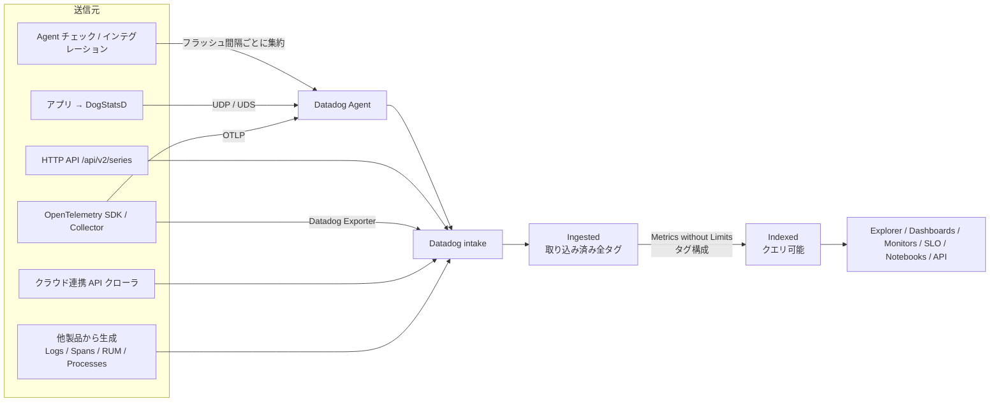
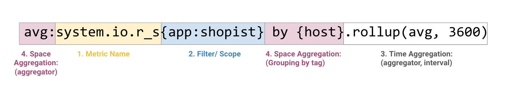
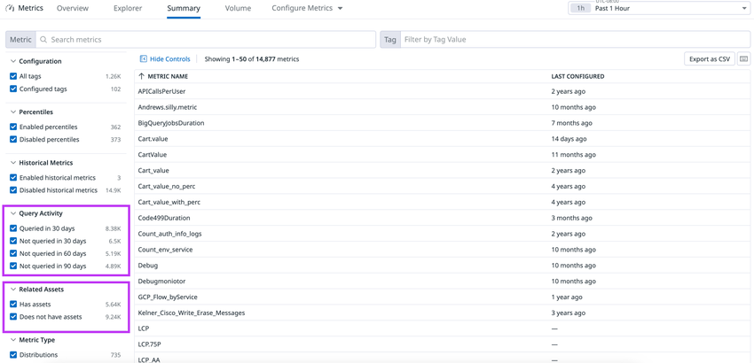
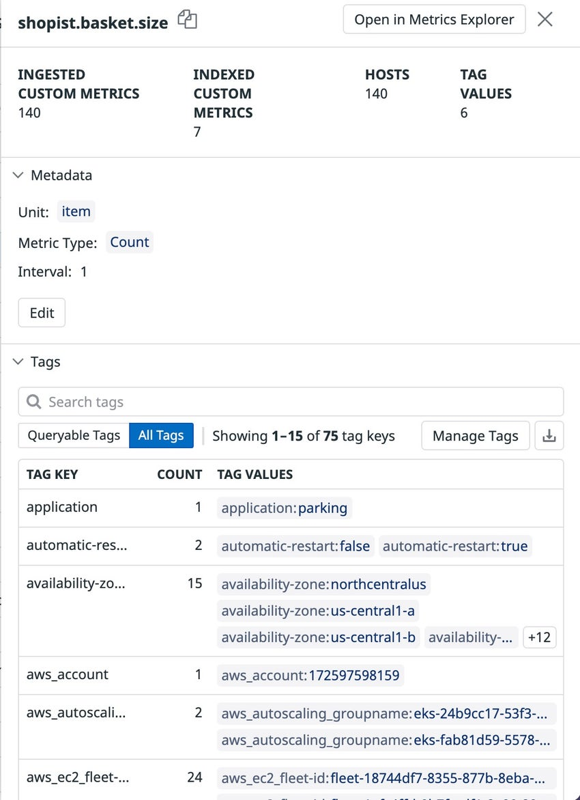
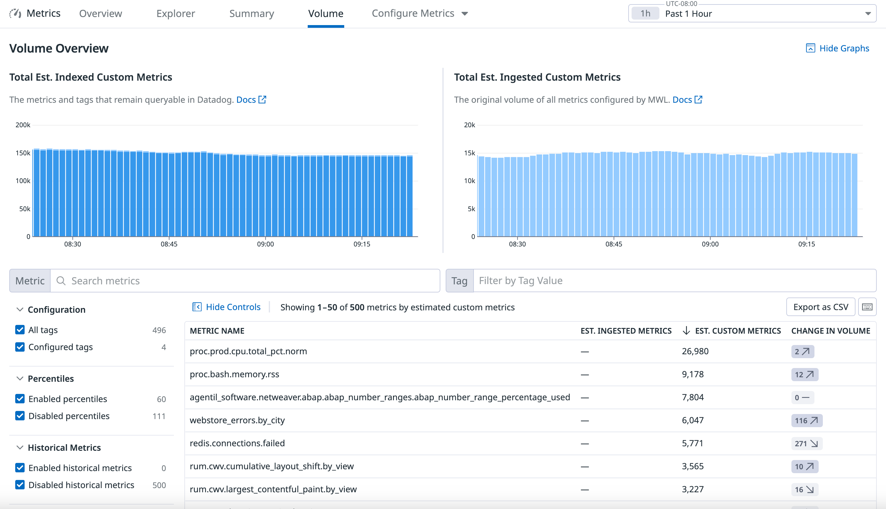
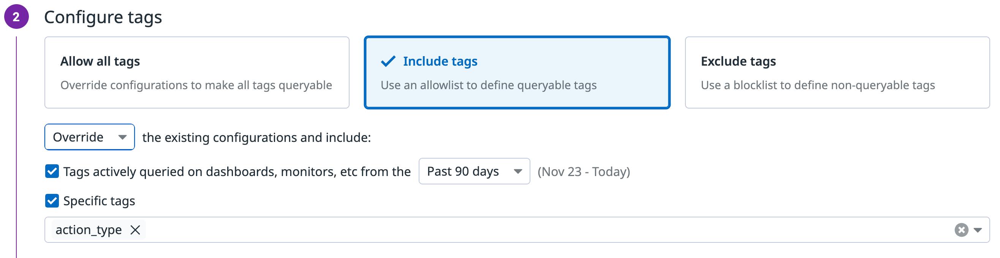

# Metrics（メトリクス）

## 概要

Datadog の Metrics（メトリクス）は、環境のふるまいを時系列で追跡する数値データである。各データポイントは「値」と「タイムスタンプ」の組で、その列が timeseries（時系列）を構成する。Datadog のインフラ監視・APM・ログ由来メトリクス・RUM 等、ほぼ全製品のグラフ・モニター・SLO の土台になる。[出典](https://docs.datadoghq.com/metrics/)

本ファイルは Datadog Metrics の **データモデル・種別・送信・保存・管理・課金単位** を扱う。関連トピックは以下のファイルを参照する。

| 関連トピック | ファイル |
|---|---|
| クエリ構文、関数（rollup 以外の詳細）、数式 | [メトリクスクエリと関数](./metrics-query-and-functions.md) |
| カスタムメトリクスの送信実装、DogStatsD の設定・クライアント | [Custom Metrics と DogStatsD](./custom-metrics-and-dogstatsd.md) |
| タグの付け方・予約タグ | [Tagging（タグ）](./tagging.md) |
| OpenTelemetry からのメトリクス取り込み | [OpenTelemetry サポート](./opentelemetry.md) |
| Agent の収集・設定 | [Datadog Agent](./agent.md)、[Agent 設定リファレンス](./agent-configuration.md) |
| 使用量の確認、Usage Attribution | [Usage・Usage Attribution・Cost Visibility](./usage-and-cost-attribution.md) |
| 料金の数値（正本） | [製品別料金表](../../03_導入編/pricing-by-product.md) |
| コスト削減の実践 | [コスト最適化](../../04_応用編/cost-optimization.md)、[タグ戦略の実践](../../04_応用編/tagging-strategy.md) |

### Datadog Metrics の主要コンポーネント

| コンポーネント | 役割 | 画面の場所 |
|---|---|---|
| Metrics Explorer（メトリクスエクスプローラー） | アドホックにメトリクスをグラフ化・分析する | Metrics > Explorer |
| Metrics Summary（メトリクスサマリー） | 報告中のメトリクス一覧、メタデータ編集、タグ構成、パーセンタイル・HMI の有効化 | Metrics > Summary |
| Metrics Volume Management（ボリューム管理） | カスタムメトリクス量の推移・上位メトリクス・急増の把握 | Metrics > Volume |
| Metrics without Limits™（MWL） | 取り込み（ingest）とインデックス（index）を分離し、クエリ可能なタグを制御する | Metrics Summary の Manage Tags / Configure Metrics |
| Historical Metrics Ingestion（HMI、履歴メトリクス取り込み） | 1 時間より古いタイムスタンプのデータ点を取り込む | Metrics Summary の Advanced / Configure Metrics |

[出典](https://docs.datadoghq.com/metrics/)、[出典](https://docs.datadoghq.com/metrics/summary/)、[出典](https://docs.datadoghq.com/metrics/volume/)

### データフロー

- Agent 経由（Agent チェックと DogStatsD）のデータは、Agent がフラッシュ間隔内に受け取った値を 1 つの代表値にまとめ、1 つのタイムスタンプで送る。集約方法はメトリクス種別で決まる。
- API で直接送ったデータは、Datadog 側で集約されず生の値のまま保存される（Distribution を除く）。
- 秒未満のタイムスタンプは最も近い秒に丸められる。同じタイムスタンプの点が複数ある場合は、最後に届いた点で上書きされる。

[出典](https://docs.datadoghq.com/metrics/types/)、[出典](https://docs.datadoghq.com/metrics/)

## メトリクス種別（Metric Types）

### 送信タイプ（submission type）とアプリ内タイプ（in-app type）

Datadog Metrics には「送信時のタイプ」と「Datadog 内で保存・表示されるタイプ（in-app type）」の 2 つの概念がある。in-app type は Metrics Summary に表示され、利用できる修飾子（modifier）や関数、グラフの表示方法に影響する。[出典](https://docs.datadoghq.com/metrics/types/)

| 送信タイプ | in-app type | 補足 |
|---|---|---|
| COUNT | COUNT | DogStatsD 経由の COUNT は RATE として保存される（後述） |
| RATE | RATE | Agent チェックの `self.rate()` は GAUGE として保存 |
| GAUGE | GAUGE | |
| SET | GAUGE | DogStatsD `set()` のみ |
| HISTOGRAM | GAUGE、RATE（集約ごと） | Agent 側で集約される |
| DISTRIBUTION | DISTRIBUTION（集約は GAUGE / COUNT として表現） | サーバー側で集約される |

- 公式ドキュメント上の in-app type の一覧は COUNT、RATE、GAUGE、DISTRIBUTION、HISTOGRAM（Explicit / Exponential）である。HISTOGRAM（Explicit / Exponential）という in-app type の詳細な挙動は、本ページの公開情報では確認できず。[出典](https://docs.datadoghq.com/metrics/types/)
- タイプなしで送られたメトリクスは **Not Assigned** と表示され、最初にタイプ付きの送信があるまで他の in-app type に変更できない。
- Metrics Summary のサイドパネルでタイプを変更すると、既存の可視化・モニターの挙動が変わり、過去データの解釈が誤解を招くものになる場合がある。

### 種別ごとの意味と集約例

以下の例はいずれもフラッシュ間隔 10 秒を前提とする（公式ドキュメントの例と同じ）。[出典](https://docs.datadoghq.com/metrics/types/)

| 種別 | 1 間隔内の値の扱い | 例（入力値 → 結果） | 主な用途 |
|---|---|---|---|
| COUNT | 間隔内の発生回数の合計。単調増加ではなく増減しうる | `[1,1,1,2,2,2,3,3]` → `15` | リクエスト数、エラー数 |
| RATE | 間隔内の発生回数を秒あたりに正規化 | 同上 → `15 / 10s = 1.5` | 秒間リクエスト数 |
| GAUGE | 間隔内で最後に送られた値 | `[71,71,71,71,71,71,71.5]` → `71.5` | CPU 使用率、メモリ量、キュー長 |
| SET | 間隔内のユニーク値の数（GAUGE として保存） | — | ユニークユーザー数 |
| HISTOGRAM | Agent 側で間隔内の値の統計（複数の時系列）を算出 | `[1,1,1,2,2,2,3,3]` → avg `1.88`、count `0.8`、median `2`、95percentile `3`、max `3` | ホスト単位のレイテンシ分布 |
| DISTRIBUTION | 全ホストの生値をサーバー側で集約しグローバルな分布を算出 | 2 台・計 11 値 → avg `1.73`、count `11`、max `3`、min `1`、sum `19` | サービス単位のレイテンシ、パーセンタイル |

[出典](https://docs.datadoghq.com/metrics/types/)、[出典](https://docs.datadoghq.com/metrics/custom_metrics/dogstatsd_metrics_submission/)

### COUNT

- Datadog Metrics の COUNT は、1 つの時間間隔内のイベント発生総数を表す。単調増加カウンタではなく、間隔ごとの値は増減しうる。
- DogStatsD の `increment()` / `decrement()` / `count()` で送った COUNT は、**in-app type が RATE** になり、各点はフラッシュ期間で時間正規化された差分になる。このため小数で表示されることがある。生の合計を見るには Cumulative Sum や Integral 関数を使う。
- Agent チェックの `self.count()`、`self.monotonic_count()` は COUNT として保存される。`monotonic_count` は単調増加する生カウンタの差分を送るためのもの。

[出典](https://docs.datadoghq.com/metrics/types/)、[出典](https://docs.datadoghq.com/metrics/custom_metrics/dogstatsd_metrics_submission/)

### RATE

- Datadog Metrics の RATE は、1 つの時間間隔内の秒あたり発生数である。
- DogStatsD には RATE を直接送る関数はなく、COUNT または HISTOGRAM（`.count`）を送ると RATE として保存される。
- Agent チェックの `self.rate()` は 2 回のサンプル間の差分から秒間レートを計算し、GAUGE として保存される。

[出典](https://docs.datadoghq.com/metrics/types/)

### GAUGE

- Datadog Metrics の GAUGE は、時間間隔内に最後に送られた値（スナップショット）を表す。
- 修飾子 `weighted()` は GAUGE に適用され、`pod_name` や `container_name` のように寿命の短い（churn が高い）タグの存在時間で値を重み付けする。Datadog は、GAUGE が欠損なく定期的に送られ、送信間隔（interval メタデータ）が正しく設定されている場合のみ自動で付与する。

[出典](https://docs.datadoghq.com/metrics/types/)、[出典](https://docs.datadoghq.com/metrics/custom_metrics/type_modifiers/)

### SET

- Datadog Metrics の SET は DogStatsD 専用の送信タイプで、`set(<METRIC_NAME>, <METRIC_VALUE>, <SAMPLE_RATE>, <TAGS>, <CARDINALITY>)` で送る。
- フラッシュ期間中に送られたユニークな値の数を数え、GAUGE として保存する。
- サンプルレートによる補正は行われない。
- SET は Agent チェック・HTTP API からは送れない（公式の送信元対応表に記載なし）。

[出典](https://docs.datadoghq.com/metrics/custom_metrics/dogstatsd_metrics_submission/)、[出典](https://docs.datadoghq.com/metrics/types/)

### HISTOGRAM（と TIMER）

Datadog Metrics の HISTOGRAM は、StatsD の timer を拡張した型で、Agent が 1 間隔内の値の統計を計算し、複数のメトリクスとして送る。ホストごとに計算されるため、ホストをまたいだ正確なパーセンタイルは得られない（全体分布が必要なら DISTRIBUTION を使う）。[出典](https://docs.datadoghq.com/metrics/types/)

| 生成されるメトリクス | 意味 | in-app type |
|---|---|---|
| `<METRIC_NAME>.avg` | 平均 | GAUGE |
| `<METRIC_NAME>.count` | 値の個数（間隔で割ったレートとして送信） | RATE |
| `<METRIC_NAME>.median` | 中央値 | GAUGE |
| `<METRIC_NAME>.95percentile` | 95 パーセンタイル | GAUGE |
| `<METRIC_NAME>.max` | 最大値 | GAUGE |

Agent の `datadog.yaml` で生成する集約を変更できる。

| 設定キー | デフォルト | 指定可能な値 |
|---|---|---|
| `histogram_aggregates` | `["max", "median", "avg", "count"]` | `max`、`median`、`avg`、`count`、`sum`、`min` |
| `histogram_percentiles` | `["0.95"]`（`95percentile`） | 任意のパーセンタイル（例：`0.99`） |

- 集約・パーセンタイルを増やすと、生成される時系列（＝カスタムメトリクス数）が増える。
- TIMER は DogStatsD 上の HISTOGRAM の実装で、実行時間・描画時間などの時間データ専用。`timed(...)`（Python ではデコレータ／コンテキストマネージャー）で送り、HISTOGRAM と同じ設定が適用される。
- `histogram_percentiles` の値の書式は Agent 設定リファレンス（[Agent 設定リファレンス](./agent-configuration.md)）を参照。

[出典](https://docs.datadoghq.com/metrics/types/)、[出典](https://docs.datadoghq.com/metrics/custom_metrics/dogstatsd_metrics_submission/)

### DISTRIBUTION

Datadog Metrics の DISTRIBUTION は、フラッシュ間隔内の生値をそのまま送り、Datadog のサーバー側で **DDSketch** データ構造を用いて集約する型である。ホストに依存しない「グローバルな分布」を算出できるため、サービスなど論理単位のレイテンシ計測に向く。[出典](https://docs.datadoghq.com/metrics/distributions/)

**デフォルトの集約**

| 集約 | 意味 | 表現上の in-app type |
|---|---|---|
| `avg:` | 平均 | GAUGE |
| `count:` | 点の数 | COUNT |
| `max:` | 最大 | GAUGE |
| `min:` | 最小 | GAUGE |
| `sum:` | 合計 | COUNT |

集約は GAUGE / COUNT として表現されるが、メトリクス自体の型は DISTRIBUTION のままである。[出典](https://docs.datadoghq.com/metrics/types/)

**パーセンタイルと高度なクエリ（Advanced query functionality）**

| 項目 | 内容 |
|---|---|
| 有効化 | Metrics Summary でメトリクスごと、または Configure Metrics > Enable percentiles で名前空間プレフィックス単位に一括有効化。無効化は Percentile aggregations トグル |
| 追加される集約 | `p50`、`p75`、`p90`、`p95`、`p99`（有効化後は計 10 集約） |
| 任意パーセンタイル | 小数点以下 2 桁までのユーザー定義パーセンタイル（例：`99.99`） |
| 閾値クエリ | 「count values」集約で、閾値より上／下の生値の数を数える。送信前に閾値を決めておく必要はない。メトリクスベース SLO（例：95% のリクエストが X ms 未満）に利用可能 |
| 標準偏差 | 任意期間の標準偏差を算出 |
| モニター | パーセンタイル閾値のメトリクスモニターを作成可能 |

[出典](https://docs.datadoghq.com/metrics/distributions/)

**DISTRIBUTION に関する注意事項**

- DogStatsD の `distribution(<METRIC_NAME>, <METRIC_VALUE>, <TAGS>, <CARDINALITY>)` にはサンプルレート引数がない（クライアントによってはサンプルレートを指定でき、その場合は 1/rate 回として数えられる）。[出典](https://docs.datadoghq.com/metrics/custom_metrics/dogstatsd_metrics_submission/)
- ロールアップの集約関数は指定できない（時間・空間の両方で集約される）。[出典](https://docs.datadoghq.com/dashboards/functions/rollup/)
- タグ構成（Manage Tags の Custom）は許可リスト方式で、タグの除外指定は不可、`!` で始まるタグは拒否される。[出典](https://docs.datadoghq.com/metrics/distributions/)
- **名前の衝突（overshadowing）**：同じメトリクス名に DISTRIBUTION と非 DISTRIBUTION の両方のデータが届くと、両方保存されるがクエリ結果は DISTRIBUTION のデータのみになる。最初の DISTRIBUTION の点が届いた時点から発生し、症状として想定外のタグ・データの変化、API エラー「New tag-configuration conflicts with existing configuration」、型が `distribution` と表示される等がある。ログ由来メトリクスは常に DISTRIBUTION で送られるため名前衝突に注意。解消には Datadog Support に連絡して保持する型を選び、以後の送信名を変更する。[出典](https://docs.datadoghq.com/metrics/distributions/)
- タグ構成やパーセンタイル設定の変更は Event Explorer に変更者付きのイベントとして記録される。[出典](https://docs.datadoghq.com/metrics/distributions/)
- OTLP の Histogram はデフォルトで Datadog の DISTRIBUTION にマッピングされる。[出典](https://docs.datadoghq.com/metrics/distributions/)

### HISTOGRAM と DISTRIBUTION の比較

| 観点 | HISTOGRAM | DISTRIBUTION |
|---|---|---|
| 集約場所 | Agent（ホストごと） | Datadog サーバー（全ホスト横断） |
| パーセンタイルの正確さ | ホスト単位。ホストをまたぐ集約は「パーセンタイルの平均」等になり統計的に正確でない | 全体の生値から DDSketch で算出 |
| 生成時系列 | `.avg` `.count` `.median` `.95percentile` `.max`（設定で変更可） | 1 メトリクス名で `avg/count/max/min/sum`、パーセンタイル有効時 +5 |
| 任意パーセンタイル・閾値クエリ | 不可（事前に `histogram_percentiles` で指定したもののみ） | 可（Advanced query 有効時） |
| HMI（履歴取り込み） | — | 非対応 |
| カスタムメトリクス数（タグ組合せ 1 つあたり） | 既定 5 | 5（パーセンタイル有効時 10） |

[出典](https://docs.datadoghq.com/metrics/types/)、[出典](https://docs.datadoghq.com/metrics/distributions/)、[出典](https://docs.datadoghq.com/account_management/billing/custom_metrics/)

### 送信元ごとの関数と保存タイプ

| 送信タイプ | Agent チェック | DogStatsD | HTTP API |
|---|---|---|---|
| COUNT | `self.count()`、`self.monotonic_count()` → COUNT | `dog.count()`、`dog.increment()`、`dog.decrement()` → RATE | `type` = count → COUNT |
| RATE | `self.rate()` → GAUGE | 直接不可（COUNT / HISTOGRAM を送る） | `type` = rate → RATE |
| GAUGE | `self.gauge()` → GAUGE | `dog.gauge()` → GAUGE | `type` = gauge → GAUGE |
| SET | 記載なし | `dog.set()` → GAUGE | 記載なし |
| HISTOGRAM | `self.histogram()` → GAUGE, RATE | `dog.histogram()` → GAUGE, RATE | 記載なし |
| DISTRIBUTION | 記載なし | `dog.distribution()` → DISTRIBUTION（送信タブの表では GAUGE, COUNT） | `/api/v1/distribution_points`（`submit_distribution_points(...)`）→ GAUGE, COUNT（公式表の記載。メトリクス型は DISTRIBUTION） |

- DISTRIBUTION の in-app type は、公式ページ内で表記が揃っていない。送信元ごとの表（DogStatsD・API）では「GAUGE, COUNT」、末尾のまとめ表（DogStatsD のみ）では「DISTRIBUTION」と書かれている。前者は集約結果の表現（GAUGE / COUNT）を、後者はメトリクス自体の型を示すと考えられる【推定】（本ページの「DISTRIBUTION（集約は GAUGE / COUNT として表現）」の記述と同じ意味）。

[出典](https://docs.datadoghq.com/metrics/types/)

### サンプルレートの補正（DogStatsD）

DogStatsD はクライアント側のサンプリング（0〜1）を Datadog 側で補正する。[出典](https://docs.datadoghq.com/metrics/custom_metrics/dogstatsd_metrics_submission/)

| 種別 | 補正 |
|---|---|
| COUNT | 値に 1/rate を掛ける |
| GAUGE | 補正なし |
| SET | 補正なし |
| HISTOGRAM | `.count` のみ補正 |
| DISTRIBUTION | 値を 1/rate 回分として数える |

### アプリ内修飾子（in-application modifiers）

Datadog Metrics のクエリでは、COUNT / RATE に対して `as_count()` / `as_rate()` 修飾子で表示形式を切り替えられる。COUNT / RATE には UI で自動的に `.as_count()` が付与される。[出典](https://docs.datadoghq.com/metrics/custom_metrics/type_modifiers/)、[出典](https://docs.datadoghq.com/dashboards/functions/rollup/)

| 型 | 修飾子 | 効果 |
|---|---|---|
| COUNT | `as_count()` | 補間を無効化し、時間集約を SUM にする |
| COUNT | `as_rate()` | 補間を無効化、SUM で集約後にサンプリング間隔で割る（極小間隔では正規化しない） |
| RATE | `as_count()` | 補間を無効化、SUM で集約後にサンプリング間隔を掛ける |
| RATE | `as_rate()` | 補間を無効化、SUM、ロールアップをメトリクスの interval メタデータ単位に切り捨て、完全／部分バケットを再スケール。interval メタデータがなければ再スケールせず AVG にフォールバック |
| GAUGE | どちらも | 保存・Metrics Explorer 表示には影響なし。モニターでは `pct_change()` 等ロールアップ依存関数の評価が変わる |

例：1 秒ごとに送られる COUNT に 20 秒ロールアップで `as_rate()` を適用すると、`[1,1,1,1]` は `[0.05, 0.05, 0.05, 0.05]` になる。[出典](https://docs.datadoghq.com/metrics/custom_metrics/type_modifiers/)

### OpenTelemetry（OTLP）メトリクス型のマッピング

OTLP メトリクスの Datadog 型へのマッピング概要。詳細と設定は [OpenTelemetry サポート](./opentelemetry.md) を参照。[出典](https://docs.datadoghq.com/metrics/open_telemetry/otlp_metric_types/)

| OTLP 型 | 条件 | Datadog 型 |
|---|---|---|
| Sum | Cumulative・単調増加 | COUNT（連続点の差分。最初の点は保存されるが報告されない） |
| Sum | Cumulative・非単調 | GAUGE |
| Sum | Delta | COUNT |
| Gauge | — | GAUGE（整数も浮動小数に変換） |
| Histogram（Explicit / Exponential） | Delta（推奨・デフォルト） | DISTRIBUTION（count 0 のヒストグラムは破棄） |
| Histogram（Explicit / Exponential） | Cumulative | DISTRIBUTION（差分。count 0 の差分は報告しない） |
| Summary（レガシー） | `.sum`、`.count` | COUNT |
| Summary（レガシー） | `.quantile`（`quantile` タグ付き） | GAUGE |

- SDK のテンポラリティは DELTA を推奨（CUMULATIVE は起動時にデータ点が欠落しうる）。
- Histogram を `counters` モード＋`send_aggregation_metrics` で送ると `.count` `.sum` `.min` `.max` `.bucket`（`lower_bound`/`upper_bound` タグ付き）が生成される。

## 送信方法

### 送信経路の一覧

| 経路 | 概要 | 標準 / カスタム | 詳細ファイル |
|---|---|---|---|
| Datadog Agent（システムメトリクス） | CPU・メモリ・ディスク等を自動送信 | 標準 | [Datadog Agent](./agent.md) |
| インテグレーション | 1,000 以上の公式インテグレーションがメトリクスを提供 | 標準（一部はカスタム扱い） | [Integrations](./integrations.md) |
| クラウド連携（API クローラ） | AWS / Azure / Google Cloud 等の監視 API から取得 | 標準（AWS はカスタムも送信可） | [AWS](./aws-integration.md) / [Azure](./azure-integration.md) / [GCP](./gcp-integration.md) |
| カスタム Agent チェック | Python で独自チェックを実装 | カスタム | [Custom Metrics と DogStatsD](./custom-metrics-and-dogstatsd.md) |
| DogStatsD | アプリから UDP / UDS で Agent に送信 | カスタム | 同上 |
| HTTP API | `POST /api/v2/series` 等で直接送信 | カスタム | [API とキー管理](./api-and-keys.md) |
| OpenTelemetry | Agent の OTLP 受信、または OTel Collector の Datadog Exporter | カスタム扱い（OTel 由来） | [OpenTelemetry サポート](./opentelemetry.md) |
| 他データからの生成 | ログ（logs-to-metrics）、APM スパン、RUM イベント、Live Processes からメトリクス生成 | カスタム | 各製品ファイル |
| その他 | PowerShell、AWS Lambda（サーバーレス）、公式／コミュニティのクライアントライブラリ | カスタム | [Serverless](../infrastructure/serverless.md) |

[出典](https://docs.datadoghq.com/metrics/)、[出典](https://docs.datadoghq.com/metrics/custom_metrics/)

### カスタムメトリクスの定義と命名規則

- Datadog の **カスタムメトリクス** は「メトリクス名とタグ値（host タグを含む）の一意な組合せ」で識別される。DogStatsD・カスタム Agent チェックからの送信、Marketplace インテグレーションのメトリクス、標準インテグレーション外のメトリクス等が該当する。
- 標準インテグレーションでもカスタムメトリクスを送るものがある。

| 区分 | インテグレーション |
|---|---|
| デフォルト上限 350 カスタムメトリクス | ActiveMQ XML、Go-Expvar、Java-JMX |
| デフォルト上限なし | Nagios、PDH Check、OpenMetrics、Windows performance counters、WMI、Prometheus |
| 設定でカスタムメトリクスを収集可能 | MySQL、Oracle、Postgres、SQL Server |
| カスタムメトリクスを送信しうるクラウド連携 | AWS |

**命名規則**

| 規則 | 内容 |
|---|---|
| 先頭文字 | 英字で始まる |
| 使用可能文字 | ASCII 英数字、アンダースコア `_`、ピリオド `.`。それ以外（空白含む）は `_` に変換。Unicode 非対応 |
| 長さ | 最大 200 文字（UI の都合上 100 文字未満を推奨） |
| 大文字小文字 | 区別される |
| 値 | 32 ビットの数値。日付・タイムスタンプを値にしない |

[出典](https://docs.datadoghq.com/metrics/custom_metrics/)

タグのキー・値の文字数等の規則は [Tagging（タグ）](./tagging.md) を参照。

### HTTP API による送信

| 項目 | v2 `POST /api/v2/series` | v1 `POST /api/v1/series` | `POST /api/v1/distribution_points` |
|---|---|---|---|
| 用途 | count / rate / gauge の送信（推奨） | 同左（旧版） | DISTRIBUTION の送信 |
| ペイロード上限 | 500 KB（512,000 バイト） | 3.2 MB（3,200,000 バイト） | 公開情報では確認できず |
| 圧縮時の展開後上限 | 5 MB（5,242,880 バイト）未満 | 62 MB（62,914,560 バイト）未満 | 公開情報では確認できず |
| タイプ指定 | `type` 整数：`0` unspecified、`1` count、`2` rate、`3` gauge | `type` 文字列：`count` / `gauge` / `rate` | — |
| 点の形式 | `{"timestamp":..., "value":...}` | `[timestamp, value]` | `[timestamp, [values...]]` |
| 主なフィールド | `metric`、`points`、`type`、`interval`、`unit`、`tags`、`resources`（`name` と `type`、host を含む）、`source_type_name`、`metadata.origin` | `metric`、`points`、`host`、`interval`、`tags`、`type` | — |

- 認証は `DD-API-KEY` ヘッダー。`Content-Encoding` で圧縮を指定（公式例では `deflate`、v2 SDK では `zstd1`）。
- タイムスタンプは POSIX 秒。**未来 10 分超、過去 1 時間超のタイムスタンプは受け付けない**（過去 1 時間超を送るには Historical Metrics Ingestion の有効化が必要）。
- 値は数値で、文字列は不可。
- 応答：`202`（受理）、`400`、`403`、`408`（タイムアウト）、`413`（ペイロード過大）、`429`（レート超過）。
- エンドポイントのホストはサイトごとに異なる（例：US1 は `api.datadoghq.com`、AP1 は `api.ap1.datadoghq.com`）。

> **サイト差異:** API ホスト名はサイトごとに異なる。各サイトの URL は [Datadog Sites（サイト）](./datadog-sites.md) を参照。

[出典](https://docs.datadoghq.com/api/latest/metrics/)、[出典](https://docs.datadoghq.com/metrics/custom_metrics/)

### メトリクス関連 API エンドポイント

| 機能 | メソッドとパス | 必要な権限（判明分） |
|---|---|---|
| メトリクス送信（v2） | `POST /api/v2/series` | API キー |
| Distribution 送信 | `POST /api/v1/distribution_points` | API キー |
| アクティブなメトリクス一覧 | `GET /api/v1/metrics` | — |
| メトリクス一覧（タグ構成フィルタ等） | `GET /api/v2/metrics` | — |
| メトリクスメタデータ取得・編集 | `GET` / `PUT /api/v1/metrics/{metric_name}` | 編集は `metrics_metadata_write` |
| タグ構成（MWL）の一覧・作成・更新・削除 | `GET` / `POST` / `PATCH` / `DELETE /api/v2/metrics/{metric_name}/tags` | 作成・更新・削除は Manage Tags for Metrics（`metric_tags_write`） |
| ボリューム（ingested / indexed） | `GET /api/v2/metrics/{metric_name}/volumes` | — |
| タグ構成カーディナリティ推定 | `GET /api/v2/metrics/{metric_name}/estimate` | — |
| 複数メトリクスのタグ一括構成・削除 | Bulk tag configuration エンドポイント | `metric_tags_write` |
| 時系列クエリ（v2、複数製品横断） | `POST /api/v2/query/timeseries` | `timeseries_query` |
| スカラークエリ（v2） | `POST /api/v2/query/scalar` | `timeseries_query` |
| 時系列クエリ（v1） | `GET /api/v1/query` | — |

[出典](https://docs.datadoghq.com/api/latest/metrics/)、[出典](https://docs.datadoghq.com/account_management/rbac/permissions/)

## 保持期間と解像度

### 保持期間

| データ | 保持期間 | 出典 |
|---|---|---|
| Metrics（タグと値） | **15 か月** | [Data Retention Periods](https://docs.datadoghq.com/data_security/data_retention_periods/) |
| Historical Metrics Ingestion で受け付ける過去タイムスタンプの範囲 | メトリクス保持期間まで（デフォルト 15 か月） | [Historical Metrics](https://docs.datadoghq.com/metrics/custom_metrics/historical_metrics/) |
| Database Monitoring のクエリメトリクス | 15 か月 | [Data Retention Periods](https://docs.datadoghq.com/data_security/data_retention_periods/) |
| Cloud Cost Management のコストメトリクス | 15 か月 | 同上 |
| Continuous Profiler のプロファイルメトリクス | 30 日 | 同上 |
| APM のサービス／リソース統計 | 30 日 | 同上 |

- 15 か月を超えてメトリクスを保持する追加オプションは、公開情報では確認できず。
- 第三者記事には「カスタムメトリクスの拡張保持（`extended_retention_days`）」に言及するものがあるが、公式ドキュメントでは確認できなかったため採用しない。

### 収集間隔と最小解像度

Datadog が保存するメトリクスの最小解像度は送信元により異なる。[出典](https://docs.datadoghq.com/developers/guide/data-collection-resolution/)

| 送信元 | 収集方法 | 収集間隔 | 最小解像度 |
|---|---|---|---|
| Agent インテグレーション | Agent | 15 秒 | 1 秒 |
| カスタムメトリクス（Agent チェック） | Agent | 15 秒 | 1 秒 |
| カスタムメトリクス（StatsD / DogStatsD） | Agent 内蔵 StatsD | 15 秒（※） | 1 秒 |
| カスタムメトリクス（API） | API への POST | リアルタイム | 1 秒 |
| システムメトリクス | Agent | 15 秒 | 1 秒 |
| Network Device Monitoring | Agent | 15 秒 | 1 秒 |
| Cloud Network Monitoring | System Probe | 30 秒 | 1 分 |
| AWS | API クローラ | 10 分（デフォルト） | 1 分 |
| Alibaba Cloud | API クローラ | 10 分（デフォルト） | 1 分 |
| Google Cloud | API クローラ | 5 分（デフォルト） | 1 分 |
| Azure | API クローラ | 2 分（デフォルト） | 1 分 |
| Oracle Cloud Infrastructure | メトリクスコレクター | リアルタイム | 1 分 |
| APM トレースメトリクス（非サンプリング） | Agent + SDK | 10 秒 | 1 秒 |
| Database Monitoring クエリメトリクス | Agent | 10 秒 | 1 秒 |
| USM RED メトリクス | Agent | 30 秒 | 30 秒 |
| Synthetics API テスト | Synthetics | ユーザー定義 | 1 分 |
| Synthetics ブラウザテスト | Synthetics | ユーザー定義 | 5 分 |

※ DogStatsD のフラッシュ間隔（Agent が受信値を集約して送る間隔）は、メトリクス種別ページの例では 10 秒として説明されている。上表の「15 秒」は公式の収集間隔表の記載値で、両者は別の概念（DogStatsD の集約単位と Datadog 側の収集間隔表記）として扱う。[出典](https://docs.datadoghq.com/metrics/types/)、[出典](https://docs.datadoghq.com/developers/guide/data-collection-resolution/)

- Datadog の製品ページでは、メトリクスを「15 秒粒度で 15 か月保持」と説明している。[出典](https://www.datadoghq.com/product/metrics/)
- クラウド連携のクロール間隔は連携側の設定・サービスにより変わる。詳細は各クラウド連携ファイルを参照。
- 保存時点では解像度が落とされず、表示時にロールアップで間引かれる（次節）。長期間の表示で粗く見えるのはクエリ時ロールアップの結果である。ただし、保存データ自体が期間経過で間引かれる（ダウンサンプリングされる）かどうかの公式説明は公開情報では確認できず。

## ロールアップ（時間集約）

### 時間集約と空間集約

Datadog のメトリクスクエリは、常に **時間集約（time aggregation / rollup）** と **空間集約（space aggregation）** の 2 段階で集約される。[出典](https://docs.datadoghq.com/metrics/)

*キャプション：メトリクスクエリの構文の構成要素（Anatomy of a metric query）*

画面の説明：クエリ文字列 `avg:system.io.r_s{app:shopist} by {host}.rollup(avg, 3600)` を色分けし、`system.io.r_s` が「1. Metric Name（メトリクス名）」、`{app:shopist}` が「2. Filter/Scope（絞り込み）」、`.rollup(avg, 3600)` が「3. Time Aggregation（集約関数と間隔）」、先頭の `avg:` と `by {host}` が「4. Space Aggregation（集約関数とタグによるグループ化）」であることを示している。

出典：https://docs.datadoghq.com/metrics/ （取得日 2026-11-02）

| 段階 | 役割 | 選択肢 | デフォルト |
|---|---|---|---|
| 時間集約（rollup） | 各時系列の点を時間バケットにまとめる | `avg`、`sum`、`min`、`max`、`count` | `avg`（COUNT / RATE は `.as_count()` 付与で `sum`） |
| 空間集約 | 複数の時系列（host、container、region など）をまとめる・グループ化する | `avg`、`sum`、`min`、`max` | `avg`（Metrics Explorer） |

- ネストクエリ（Nested Queries）により、既存のクエリ結果にさらに時間・空間集約を重ねられる。詳細は [メトリクスクエリと関数](./metrics-query-and-functions.md) を参照。

### rollup 関数の構文

| 構文 | 説明 |
|---|---|
| `.rollup(<AGGREGATOR>)` | 集約関数のみ指定。間隔はデフォルト |
| `.rollup(<AGGREGATOR>, <INTERVAL>)` | 間隔を秒で指定（例：`.rollup(sum, 120)`） |
| `.rollup(<AGGREGATOR>, <CALENDAR_UNIT>, <ALIGNMENT>, '<TIMEZONE>')` | カレンダー整列ロールアップ |
| `moving_rollup(<METRIC_NAME>, <INTERVAL>, <AGGREGATOR>)` | 直近 X 秒の移動ウィンドウで集約（固定バケットではない） |

**カレンダー整列ロールアップ**

| パラメータ | 値 |
|---|---|
| `<CALENDAR_UNIT>` | `daily`、`weekly`、`monthly` |
| `<ALIGNMENT>` | weekly：小文字の曜日（`monday`〜`sunday`、デフォルト `sunday`）。daily：開始時刻（例：`12am`）。monthly：開始日 |
| `<TIMEZONE>` | IANA 形式（例：`America/New_York`、`Asia/Tokyo`）。省略時 UTC |

例：`sum:requests.count{*}.as_count().rollup(sum, weekly, monday)`、`sum:requests.count{*}.as_count().rollup(sum, daily, 12am, 'America/Los_Angeles')`

[出典](https://docs.datadoghq.com/dashboards/functions/rollup/)

### デフォルトのロールアップ間隔

線グラフ・棒グラフは 1 系列あたり最大 **1,500 点** に制限されるため、表示期間が長くなるほどデフォルトのロールアップ間隔が大きくなる。[出典](https://docs.datadoghq.com/dashboards/functions/rollup/)

| 表示期間 | 線グラフ | 棒グラフ | API |
|---|---|---|---|
| 過去 1 分 | 1s | 1s | 1s |
| 過去 5 分 | 2s | 5s | 2s |
| 過去 15 分 | 5s | 10s | 5s |
| 過去 30 分 | 10s | 30s | 10s |
| 過去 1 時間 | 20s | 1m | 20s |
| 過去 4 時間 | 1m | 2m | 1m |
| 過去 1 日 | 5m | 20m | 5m |
| 過去 2 日 | 10m | 30m | 10m |
| 過去 1 週間 | 1hr | 2hr | 1hr |
| 過去 1 か月 | 4hr | 12hr | 4hr |
| 過去 3 か月 | 12hr | 1d | 12hr |
| 過去 6 か月 | 1d | 1d | 1d |
| 過去 1 年 | 1d | 1w | 1d |

- カスタムロールアップも 1,500 点の上限内で指定可能（例：1 日を 1 分粒度で表示）。上限を超える細かい間隔を指定した場合の挙動は、本ページでは明記されていない。
- Query Value ウィジェットは 150 点を目標にするため、同じ期間でも実効ロールアップ間隔が粗くなる。
- Distribution メトリクスには rollup の集約関数を指定できない。

### モニターでのロールアップの注意

- モニタークエリでのロールアップはできるだけ避ける。ロールアップのバケットはモニターの評価ウィンドウではなく UNIX 時刻に整列されるため、評価時点で不完全なバケット（少数サンプル）を評価してしまう場合がある。
- 対策として、評価遅延（evaluation delay）をロールアップ間隔以上に設定する。
- モニター設計の詳細は [Monitors（モニター）](./monitors.md) を参照。

[出典](https://docs.datadoghq.com/dashboards/functions/rollup/)

## Metrics Explorer

Datadog の Metrics Explorer は、メトリクスをアドホックにグラフ化して調査する画面である（Metrics > Explorer）。[出典](https://docs.datadoghq.com/metrics/explorer/)

| 項目 | 内容 |
|---|---|
| クエリエディタ | 過去 24 時間に報告のないメトリクスは候補に出ないが、名前やクエリを直接入力すれば追加可能 |
| from（スコープ） | host、cluster、env、region 等のタグ値で絞り込み |
| 空間集約 | Average（デフォルト）、Max、Min、Sum（メトリクス型により異なる） |
| 関数・数式 | 関数ボタンで追加（型により使えない関数あり） |
| Split graph | タグ値ごとに別グラフへ分割 |
| エクスポート | 共有リンクのコピー、インシデントへの追加、モニター作成、ダッシュボード／ノートブックへの保存 |
| デフォルト期間 | Past 1 Hour |
| 生クエリ編集 | `</>` ボタンでクエリ文字列を直接編集 |

[出典](https://docs.datadoghq.com/metrics/explorer/)

## Metrics Summary

### 概要

Datadog の Metrics Summary は、選択した期間（過去 1 時間／1 日／1 週間）に Datadog へ報告されたメトリクスの一覧と、各メトリクスのメタデータ・タグ・ボリューム・構成を管理する画面である（Metrics > Summary。Cmd/Ctrl + K で「metrics」を検索しても到達可能）。[出典](https://docs.datadoghq.com/metrics/summary/)、[出典](https://docs.datadoghq.com/metrics/)

*キャプション：Metrics Summary 画面（左側ファセットパネルとメトリクス一覧）*

画面の説明：上部に Metrics のタブ（Overview / Explorer / Summary / Volume / Configure Metrics ドロップダウン）と期間選択（Past 1 Hour）がある。その下に「Metric」検索欄と「Tag（Filter by Tag Value）」検索欄が並ぶ。左側のファセットパネルには Configuration（All tags / Configured tags）、Percentiles（Enabled / Disabled percentiles）、Historical Metrics（Enabled / Disabled historical metrics）、Query Activity（Queried in 30 days / Not queried in 30・60・90 days）、Related Assets（Has assets / Does not have assets）、Metric Type（Distributions 等）の各チェックボックスと件数が表示される。右側はメトリクス名（METRIC NAME）と最終構成日時（LAST CONFIGURED）の一覧で、「Export as CSV」ボタンがある。

出典：https://docs.datadoghq.com/metrics/summary/ （取得日 2026-11-02）

### 検索

| 機能 | 内容 |
|---|---|
| メトリクス名検索 | あいまい検索（enhanced fuzzy matching）対応 |
| タグ検索 | ワイルドカードとブール論理対応（例：`team:*` はタグキーを持つ、`NOT team:*` は持たない） |
| タグ検索候補の保持 | タグ値は 28 時間、タグ検索欄の候補に残る。28 時間送信のない値は候補に出ない（サイドパネルには表示される場合あり） |

[出典](https://docs.datadoghq.com/metrics/summary/)

### ファセット

| ファセット | 内容 |
|---|---|
| Configuration | タグ構成（MWL）を持つメトリクス |
| Percentiles | パーセンタイル／高度なクエリが有効な Distribution |
| Historical Metrics | HMI が有効なメトリクス |
| Metric Category | Custom Metrics か Standard Integration Metrics か |
| Query Activity | 過去 30 / 60 / 90 日に未クエリのメトリクス。未クエリ＝モニター・SLO・ノートブック・ダッシュボード・Metrics Explorer・API で参照されていない |
| Related Assets | ダッシュボード・ノートブック・モニター・SLO で使われているか（クエリ実績にかかわらず資産上に存在すれば「Used」） |
| Metric Type | Distribution か非 Distribution（count / gauge / rate）か |
| Metric Origin | 発生元製品（例：Logs、APM Spans） |

[出典](https://docs.datadoghq.com/metrics/summary/)

**Metric Origin の主な値**

| 分類 | 値 |
|---|---|
| インフラ・Agent | Agent、Cloud Integrations、SAAS Integrations、Processes、Synthetic Monitoring |
| 製品テレメトリ | APM、DBM、DSM、RUM、USM、Logs、Events、CNM、Serverless、Cloud Security、Observability Pipelines、Agent Observability |
| OpenTelemetry / API | Datadog Exporter、Metrics API |
| プラットフォーム・カタログ | API Catalog、Catalog、Datadog Platform |
| フォールバック | Other（対応する Datadog インテグレーションがない） |

[出典](https://docs.datadoghq.com/metrics/summary/)

### Configure Metrics（一括構成）

| メニュー | 内容 |
|---|---|
| Manage tags | 名前空間に一致する複数のカスタムメトリクスのタグを MWL で一括構成 |
| Percentile aggregations | 複数 Distribution のパーセンタイルを一括有効化／無効化 |
| Historical metrics ingestion | HMI を一括有効化／無効化 |

[出典](https://docs.datadoghq.com/metrics/summary/)

### メトリクス詳細サイドパネル

*キャプション：Metrics Summary でメトリクス名をクリックすると開く詳細サイドパネル（例：`shopist.basket.size`）*

画面の説明：上部にメトリクス名と「Open in Metrics Explorer」ボタン、その下に INGESTED CUSTOM METRICS（例 140）、INDEXED CUSTOM METRICS（例 7）、HOSTS（例 140）、TAG VALUES（例 6）の 4 つの数値が並ぶ。Metadata 節に Unit（例：item）、Metric Type（例：Count）、Interval（例：1）と「Edit」ボタンがある。Tags 節には検索欄、「Queryable Tags / All Tags」切替、表示中のタグキー数、「Manage Tags」ボタン、CSV ダウンロードボタンがあり、TAG KEY・COUNT・TAG VALUES の表が続く。この例では MWL によりインデックス対象が 140 から 7 に削減されている。

出典：https://docs.datadoghq.com/metrics/summary/ （取得日 2026-11-02）

| 項目 | 内容 |
|---|---|
| Ingested custom metrics | 元々送信された全データ（全タグ組合せ）に基づく取り込み量 |
| Indexed custom metrics | プラットフォーム全体でクエリ可能な量。パーセンタイル設定と MWL で変わる |
| Hosts | このメトリクスを報告するホスト数 |
| Tag values | 付与されたユニークなタグ値の数 |
| Metric unit | グラフのホバー時に表示される単位。グラフ描画自体は変えない。表示は自動整形（例：bytes → KiB） |
| Metric type | gauge / rate / count / distribution。**変更すると、このメトリクスを使う全ダッシュボード・モニターに影響** |
| Integration name | 対応インテグレーションの場合に表示。編集不可 |
| Interval | 収集間隔（秒）。`as_rate()` の再スケール等に使われる |
| Metric description | カスタムメトリクスは閲覧・編集可能。インテグレーションメトリクスは事前入力済み |
| AI-generated description | カスタムメトリクス向け。メトリクス名、主要タグ、クエリ実績、接続済みソースコード（GitHub / GitLab / Azure DevOps 連携）から生成 |
| Source Code | メトリクスを送信するソースファイル、コミット履歴、blame を表示しオーナー特定を支援。動的に組み立てた名前やラッパー経由では検出できないことがあり、明示的な文字列名の使用が推奨 |
| Tags table | ユニーク値数でソート、検索・ページング、CSV エクスポート、構成済みタグ／送信された全タグの切替、`key:value` でのフィルタ・Explorer 表示・コピー |
| Metrics Related Assets | パネル下部。そのメトリクスをクエリするダッシュボード・モニター・ノートブック・SLO と、各資産が使うタグを表示 |

> **サイト差異:** AI-generated description と Source Code は `app.ddog-gov.com`（US1-FED）および `us2.ddog-gov.com` では利用できない。[出典](https://docs.datadoghq.com/metrics/summary/)

- Metrics Summary に表示される distinct metric 数は課金を決定するものではなく、課金の正は Usage の詳細（Plan & Usage）である。[出典](https://docs.datadoghq.com/metrics/)
- メタデータ（単位・型・interval・説明）は API（`PUT /api/v1/metrics/{metric_name}`）でも編集できる。

### Custom Metrics Tags Cardinality Explorer

Datadog の Custom Metrics Tags Cardinality Explorer は、カスタムメトリクス数の急増を引き起こしているタグキーを特定する機能で、特定したタグを MWL で除外する判断に使う。[出典](https://docs.datadoghq.com/metrics/summary/)

## Metrics Volume Management

Datadog の Metrics Volume Management ページ（Metrics > Volume）は、カスタムメトリクスの量と変化を把握するための画面である。[出典](https://docs.datadoghq.com/metrics/volume/)

*キャプション：Metrics > Volume の Volume Overview 画面*

画面の説明：上段に 2 つの棒グラフがあり、左が「Total Est. Indexed Custom Metrics（クエリ可能なメトリクスとタグの推定量）」、右が「Total Est. Ingested Custom Metrics（MWL 構成済みメトリクスの元の量）」。下段に Metric 検索欄と Tag 検索欄、左にファセット（Configuration、Percentiles、Historical Metrics 等）、右に「Showing 1–50 of 500 metrics by estimated custom metrics」と表示された表（METRIC NAME、EST. INGESTED METRICS、EST. CUSTOM METRICS、CHANGE IN VOLUME 列）がある。

出典：https://docs.datadoghq.com/metrics/volume/ （取得日 2026-11-02）

| 機能 | 内容 |
|---|---|
| リアルタイム推定グラフ | 推定 indexed カスタムメトリクス量（うち MWL 未最適化分）、MWL 構成済みメトリクスの推定 ingested 量 |
| グラフ操作 | モニター作成へのエクスポート、ノートブックへの送信 |
| 上位メトリクス表 | Top 500 Metric Names by Estimated Real-time Cardinality、Top 500 Metric Names by Change in Volume |
| Compare | メトリクスのカーディナリティ推移と増加率を表示 |
| ファセット | Configuration、Percentiles、Historical Metrics、Query Activity（30/60/90 日）、Metric Type、Distribution Metric Origin |
| 推奨期間 | 急増分析には Past 1 Day または Past 4 Weeks |

> Metric Name Pricing 契約の組織では、Volume Overview のグラフが「Estimated Unique Metric Names」「Estimated Total Points」「Estimated Ingested to Indexed Points Ratio」に置き換わる。[出典](https://docs.datadoghq.com/metrics/guide/metric_name_pricing_experience/)

## Metrics without Limits™

### 概要

Datadog の **Metrics without Limits™（MWL）** は、カスタムメトリクスの「取り込み（ingestion）」と「インデックス（indexing）」を分離し、クエリ可能にするタグを選ぶことで、エージェントやコードを変更せずにインデックス対象のカスタムメトリクス量（コスト）を制御する機能である。対象はカスタムメトリクスのみ。構成は Metrics Summary で行う。[出典](https://docs.datadoghq.com/metrics/metrics-without-limits/)、[出典](https://docs.datadoghq.com/metrics/summary/)

| 用語 | 意味 |
|---|---|
| Ingested Custom Metrics（取り込みカスタムメトリクス） | コードから送られた全タグに基づく量 |
| Indexed Custom Metrics（インデックスカスタムメトリクス） | MWL 構成後にクエリ可能として残る量 |
| Queryable tags | クエリ可能なタグ（indexed 量を決める） |
| All tags（submitted tags） | 送信された全タグ（ingested 量を決める） |

### 構成方式

| 方式 | 内容 | 操作 |
|---|---|---|
| 許可リスト（Include tags / allowlist） | 指定したタグのみクエリ可能にし、他は落とす | サイドパネル > Manage Tags > Include tags |
| 拒否リスト（Exclude tags / blocklist） | 指定したタグをクエリ不可にし、他は残す | サイドパネル > Manage Tags > Exclude Tags |
| Allow all tags | 既存構成を上書きし全タグをクエリ可能にする（デフォルト状態） | Configure Metrics > Manage Tags |

**単一メトリクスの構成手順（許可リスト）**

1. Metrics Summary でメトリクス名をクリックしサイドパネルを開く。
2. **Manage Tags** > **Include tags** を選ぶ。
3. モーダルには Datadog の推奨タグ（過去 30 日に実際にクエリされたタグ、折れ線グラフアイコン付き）が事前入力される。
4. ダッシュボード・モニター・ノートブック・SLO 上で使われているがクエリ実績のないタグはターゲットアイコンで示される。可視性を失わないよう追加を検討する。
5. **Estimated New Volume** を確認して **Save**。

- 拒否リストで除外したタグはダッシュボード・モニターでクエリできなくなる。
- MWL を構成するにはメトリクスにタイプが宣言されている必要がある（通常は送信時に設定、Metrics Summary の Edit で手動設定も可）。
- カーディナリティ推定（estimator）には、メトリクスが作成から 48 時間以上経過している必要がある。

[出典](https://docs.datadoghq.com/metrics/metrics-without-limits/)、[出典](https://docs.datadoghq.com/metrics/summary/)

### 一括構成

*キャプション：Configure Metrics > Manage Tags の一括構成画面（Configure tags ステップ）*

画面の説明：「Configure tags」ステップに 3 つの選択肢カード「Allow all tags（Override configurations to make all tags queryable）」「Include tags（Use an allowlist to define queryable tags）」「Exclude tags（Use a blocklist to define non-queryable tags）」が並び、Include tags が選択されている。その下に「Override ▼ the existing configurations and include:」のドロップダウン、「Tags actively queried on dashboards, monitors, etc from the [Past 90 days ▼]」チェックボックス、「Specific tags」チェックボックスとタグ入力欄（例：`action_type`）がある。

出典：https://docs.datadoghq.com/metrics/metrics-without-limits/ （取得日 2026-11-02）

| 選択肢 | 内容 |
|---|---|
| 対象指定 | メトリクス名または名前空間（`*` 構文で複数メトリクス） |
| Override（上書き） | 既存構成を置き換え、過去 30 / 60 / 90 日に実際にクエリされたタグ、および／または指定タグを含める |
| Keep（保持） | 既存構成を保持し、新しいタグを追加 |
| 完了通知 | 一括ジョブ完了時に通知される |

### API

- 単一メトリクス：タグ構成の作成・更新・削除、カーディナリティ推定（`/api/v2/metrics/{metric_name}/tags`、`/estimate`）。
- 複数メトリクス：タグの一括構成、一括削除。
- `exclude_tags_mode: true` で拒否リストを作成・編集。
- `include_actively_queried_tags_window` で指定期間内にクエリされたタグのみを含める。

[出典](https://docs.datadoghq.com/metrics/metrics-without-limits/)

### 導入と効果検証の手順（公式推奨）

| 段階 | 内容 |
|---|---|
| 着手 | 上位 20 メトリクスを Metrics Summary または API で構成する |
| 未使用メトリクス | 未クエリのメトリクスは空の許可リストで構成しコストを最小化（Query Activity ファセットで抽出し一括構成） |
| 保存前 | 推定器で予測 indexed 量を確認。**推定 indexed 量が ingested 量を上回る構成は保存しない** |
| 保存後 | サイドパネルで indexed 量が ingested 量を下回ることを確認 |
| 24 時間後 | Plan & Usage の Top Custom Metrics 表で、Month-to-Date と Most Recent Day を比較し削減を確認 |
| 監視 | リアルタイム推定カスタムメトリクス使用量メトリクスにアラートを設定し、構成変更と相関させる |
| 統制 | 課金に影響するため RBAC（`metric_tags_write`）で変更者を限定。Events で `tags:audit` と「queryable tag configuration」「percentile aggregations」を検索して変更を監査 |

[出典](https://docs.datadoghq.com/metrics/metrics-without-limits/)

- MWL で落としたタグのデータも取り込み自体は行われているため、後から再びクエリ可能に戻すことができる（2021 年の公式ブログでの説明）。戻した後に過去分がどこまでクエリ可能になるかの現行仕様の詳細は、公開情報では確認できず。[出典](https://www.datadoghq.com/blog/metrics-without-limits/)（2021 年公開。現行仕様と異なる可能性あり）
- MWL の実践的な使い方は [コスト最適化](../../04_応用編/cost-optimization.md) を参照。

## メトリクス単位（Metric Units）

### 単位の設定と表示

- Datadog のメトリクス単位は、Metrics Summary でメトリクスを選び Metadata の **Edit** から選択して設定する（API の `unit` フィールドでも送信時に指定可能）。インテグレーションのメトリクスは「Data Collected」表で「Shown as <unit>」とあれば設定済み。
- 単位を設定すると、生データが読みやすい単位に自動変換されて表示される（例：3,000,000,000 は単位なしで「3G」、bytes 設定で「3GB」）。単位はグラフの描画自体は変えない。
- ダッシュボード上の表示単位を上書きする方法は Unit override ガイドを参照（[Dashboards](./dashboards.md)）。

[出典](https://docs.datadoghq.com/metrics/units/)、[出典](https://docs.datadoghq.com/metrics/summary/)

### 単位ファミリー一覧

| ファミリー | 単位 |
|---|---|
| BYTES | bit、byte (b)、kibibyte (KiB)、mebibyte (MiB)、gibibyte (GiB)、tebibyte (TiB)、pebibyte (PiB)、exbibyte (EiB) |
| TIME | nanosecond (ns)、microsecond (μs)、millisecond (ms)、second (s)、minute (min)、hour (hr)、day、week (wk) |
| PERCENTAGE | percent_nano (n%)、percent (%)、apdex、fraction |
| NETWORK | connection (conn)、request (req)、packet (pkt)、segment (seg)、response (rsp)、message (msg)、payload、timeout、datagram、route、session、hop |
| SYSTEM | process (proc)、thread、host、node、fault、service (svc)、instance、cpu |
| DISK | file、inode、sector、block (blk) |
| GENERAL | buffer、error (err)、read (rd)、write (wr)、occurrence、event、time、unit、operation (op)、item、task、worker、resource (res)、garbage collection (gc)、email、sample (smpl)、stage、monitor、location、check、attempt、device (dev)、update (up)、method (mthd)、job、container、execution、throttle、invocation、user、success、build、prediction、exception |
| DB | table、index (idx)、lock、transaction (tx)、query、row、key、command (cmd)、offset、record、object、cursor、assertion (assert)、scan、document、shard、flush、merge、refresh、fetch、column (col)、commit、wait、ticket、question |
| CACHE | hit、miss、eviction、get、set |
| MONEY | dollar ($)、cent (¢)、microdollar (μ$)、euro (€)、pound (£)、pence (p)、yen (¥) |
| MEMORY | page (pg)、split |
| FREQUENCY | hertz (Hz)、kilohertz (kHz)、megahertz (MHz)、gigahertz (GHz) |
| LOGGING | entry |
| TEMPERATURE | decidegree celsius (d°C)、degree celsius (°C)、degree fahrenheit (°F) |
| CPU | nanocore (ncores)、microcore (μcores)、millicore (mcores)、core、kilocore (Kcores)、megacore (Mcores)、gigacore (Gcores)、teracore (Tcores)、petacore (Pcores)、exacore (Ecores) |
| POWER | nanowatt (nW)、microwatt (μW)、milliwatt (mW)、deciwatt (dW)、watt、kilowatt、megawatt、gigawatt、terrawatt |
| CURRENT | milliampere (mA)、ampere (A) |
| POTENTIAL | millivolt (mV)、volt (V) |
| APM | span |
| SYNTHETICS | run、step |

注：公式ページでは gibibyte の略記が「GB」と記載されているが、他の単位の命名規則から GiB の誤記と考えられる【推定】。[出典](https://docs.datadoghq.com/metrics/units/)

### 表示フォーマットの規則

| 条件 | 規則 | 例 |
|---|---|---|
| 単位なし | SI 接頭辞 k / M / G / T。T を超える数や極小値は指数表記。既定は小数 2 桁（指数表記は 0 桁） | `1337` → `1.34k`、`31536000` → `31.54M`、`0.001` → `1e-3` |
| 単位あり | 該当ファミリー内で桁に応じた単位に換算 | kibibyte `1234235` → `1.18 GiB`、hertz `6345223` → `6.35 MHz`、cent `1337` → `13.37 $`、second `0.03212` → `32.12ms` |
| 時間 | 短時間は小数、最小単位はナノ秒、長時間は日数（小数） | `95` 秒 → `1m 35s`、`3671` → `1h 1m`、`96400` → `1d 3h`、`52596400` → `608.75 days` |

[出典](https://docs.datadoghq.com/metrics/units/)

## Historical Metrics Ingestion（履歴メトリクス取り込み）

### 概要

Datadog の **Historical Metrics Ingestion（HMI）** は、送信時刻から **1 時間より古いタイムスタンプ** を持つメトリクス値を取り込む機能である。HMI を有効化していないメトリクスでは、1 時間より古い値は取り込まれない。受け付ける過去の範囲はメトリクス保持期間（デフォルト 15 か月）まで。同じメトリクス・タイムスタンプ・タグ値の組合せを複数回送った場合は最後に送られた値が保持される。[出典](https://docs.datadoghq.com/metrics/custom_metrics/historical_metrics/)

| 項目 | 内容 |
|---|---|
| 対象型 | count、rate、gauge |
| 非対象 | distribution メトリクス、他の Datadog データ（ログ等）から生成したカスタムメトリクス |
| 有効化（単一） | Metrics Summary > メトリクス名 > サイドパネル Advanced 節 > Configure > 「Enable historical metrics」をオン > Save |
| 有効化（一括） | Configure Metrics > 「Enable historical metrics」> 名前空間プレフィックス指定。名前空間ごとの無効化は Historical metrics トグル |
| API 送信 | `POST /api/v2/series` に過去タイムスタンプで送信（事前に UI で有効化が必要） |
| Agent（DogStatsD）送信 | Agent 7.40.0 以降。タイムスタンプ付き送信に対応したクライアント：Java（`gaugeWithTimestamp`、`countWithTimestamp`）、Go（`GaugeWithTimestamp`、`CountWithTimestamp`）、.NET（`Gauge` / `Counter` に `DateTimeOffset`） |

[出典](https://docs.datadoghq.com/metrics/custom_metrics/historical_metrics/)

### 取り込みレイテンシ

| 遅延の大きさ | 取り込みレイテンシ |
|---|---|
| 1〜12 時間 | ほぼリアルタイム（最大 1 時間） |
| 12 時間〜30 日 | 最大 14 時間 |
| 30 日超 | 14 時間超 |

[出典](https://docs.datadoghq.com/metrics/custom_metrics/historical_metrics/)

### HMI の課金

- 履歴メトリクスはインデックスカスタムメトリクスとして計数・課金される。課金対象かどうかは送信データのタイムスタンプで判定され、あるメトリクス名とタグ値の組合せが「その時間」に値を報告していればその時間はアクティブと数えられる。
- Plan & Usage の Usage Summary では、カスタムインデックスメトリクスと履歴インデックスメトリクスが別の明細行として表示される。
- Metric Name Pricing 契約では、HMI の使用量は元のタイムスタンプではなく取り込み時刻で計上され、各 HMI データ点は ingested と indexed の両方に加算される（HMI では両者は等しい）。

[出典](https://docs.datadoghq.com/metrics/custom_metrics/historical_metrics/)、[出典](https://docs.datadoghq.com/account_management/billing/metric_name_pricing/)

## 権限（RBAC）

Datadog の Metrics に関する RBAC 権限は以下のとおり。[出典](https://docs.datadoghq.com/account_management/rbac/permissions/)

| 権限名（表示名） | キー | 内容 | デフォルトで付与されるロール |
|---|---|---|---|
| Metrics Read | `metrics_read` | カスタムメトリクスの閲覧 | Datadog Read Only Role 以上 |
| Metric Tags Write（Manage Tags for Metrics） | `metric_tags_write` | カスタムメトリクスのタグ構成（MWL）の編集・保存 | Datadog Standard Role 以上 |
| Metrics Metadata Write | `metrics_metadata_write` | メトリクスのメタデータ（型・単位・interval・説明）の編集 | Datadog Standard Role 以上 |
| Host Tags Write | `host_tags_write` | ホストタグの追加・変更 | Datadog Standard Role 以上 |
| Timeseries Query（Cross-Product） | `timeseries_query` | 製品横断のデータクエリ | Datadog Read Only Role 以上 |

- パーセンタイル有効化・HMI 有効化専用の権限は、公開の権限一覧では確認できず。
- ロール・権限管理の詳細は [組織・ユーザー・権限管理](./account-and-access-management.md) を参照。

## 制限値・クォータ・デフォルト値

| 項目 | 値 | 出典 |
|---|---|---|
| メトリクス保持期間 | 15 か月 | [出典](https://docs.datadoghq.com/data_security/data_retention_periods/) |
| 最小解像度（Agent / API） | 1 秒 | [出典](https://docs.datadoghq.com/developers/guide/data-collection-resolution/) |
| Agent チェックの収集間隔（デフォルト） | 15 秒 | 同上 |
| DogStatsD フラッシュ間隔（公式例） | 10 秒 | [出典](https://docs.datadoghq.com/metrics/types/) |
| タイムスタンプの許容範囲 | 未来 10 分以内、過去 1 時間以内（HMI 有効時は保持期間まで） | [出典](https://docs.datadoghq.com/metrics/custom_metrics/) |
| タイムスタンプの精度 | 秒（秒未満は丸め）。同一タイムスタンプは後勝ち | [出典](https://docs.datadoghq.com/metrics/) |
| メトリクス名の長さ | 最大 200 文字（100 未満推奨） | [出典](https://docs.datadoghq.com/metrics/custom_metrics/) |
| メトリクス値 | 32 ビット数値、文字列不可 | 同上 |
| `/api/v2/series` ペイロード | 500 KB、展開後 5 MB 未満 | [出典](https://docs.datadoghq.com/api/latest/metrics/) |
| `/api/v1/series` ペイロード | 3.2 MB、展開後 62 MB 未満 | 同上 |
| `/api/v1/distribution_points` ペイロード | 公開情報では確認できず | — |
| メトリクス送信のレート制限 | 固定のレート制限は課していない（超過分は課金対象）。API は `429` を返しうる | [出典](https://docs.datadoghq.com/metrics/custom_metrics/)、[出典](https://docs.datadoghq.com/api/latest/metrics/) |
| グラフ 1 系列あたり最大点数 | 1,500 点（線・棒グラフ） | [出典](https://docs.datadoghq.com/dashboards/functions/rollup/) |
| Query Value ウィジェットの目標点数 | 150 点 | 同上 |
| デフォルト時間集約 | `avg` | 同上 |
| HISTOGRAM の既定集約 | `max`、`median`、`avg`、`count` ＋ `95percentile` | [出典](https://docs.datadoghq.com/metrics/types/) |
| DISTRIBUTION の既定集約 | `avg`、`count`、`max`、`min`、`sum`（パーセンタイル有効で +`p50/p75/p90/p95/p99`） | 同上 |
| ユーザー定義パーセンタイルの精度 | 小数点以下 2 桁まで | [出典](https://docs.datadoghq.com/metrics/distributions/) |
| 一部標準インテグレーションのカスタムメトリクス上限 | 350（ActiveMQ XML、Go-Expvar、Java-JMX） | [出典](https://docs.datadoghq.com/metrics/custom_metrics/) |
| Metrics Summary の表示期間 | 過去 1 時間 / 1 日 / 1 週間 | [出典](https://docs.datadoghq.com/metrics/summary/) |
| タグ検索候補の保持 | 28 時間 | 同上 |
| Query Activity の判定期間 | 30 / 60 / 90 日 | 同上 |
| MWL 推奨タグの判定期間 | 過去 30 日（一括構成では 30 / 60 / 90 日を選択） | [出典](https://docs.datadoghq.com/metrics/metrics-without-limits/) |
| MWL カーディナリティ推定の前提 | メトリクスが 48 時間以上経過 | [出典](https://docs.datadoghq.com/metrics/summary/) |
| Volume 管理の上位表 | 上位 500 メトリクス名 | [出典](https://docs.datadoghq.com/metrics/volume/) |
| Metrics Explorer の候補表示 | 過去 24 時間に報告のあるメトリクス | [出典](https://docs.datadoghq.com/metrics/explorer/) |
| Metrics Explorer のデフォルト期間 | Past 1 Hour | 同上 |
| HMI 対応 Agent | 7.40.0 以降 | [出典](https://docs.datadoghq.com/metrics/custom_metrics/historical_metrics/) |
| HMI 取り込みレイテンシ | 1〜12 時間遅れ：最大 1 時間 / 12 時間〜30 日：最大 14 時間 / 30 日超：14 時間超 | 同上 |
| 推定使用量メトリクスの誤差 | 請求使用量と平均 10〜20% 程度の差が生じうる（小規模ほど大きい） | [出典](https://docs.datadoghq.com/account_management/billing/usage_metrics/) |
| 1 組織あたりのメトリクス名数・タグ数の上限 | 公開情報では確認できず | — |

## 課金への影響

Datadog の Metrics は、**標準メトリクス**（Agent・標準インテグレーション由来）がインフラホスト料金に含まれ、**カスタムメトリクス**が課金対象になる。カスタムメトリクスの課金モデルには、従来の **カーディナリティ（Timeseries）課金** と、新しい **Metric Name Pricing** の 2 種類があり、契約により一方が適用される（SKU は相互排他）。料金数値の正本は [製品別料金表](../../03_導入編/pricing-by-product.md)、計算の仕組みは [課金計算の仕組み](../../03_導入編/billing-mechanics.md) を参照。

### カーディナリティ（Timeseries）課金

| 項目 | 内容 |
|---|---|
| 課金単位 | 1 時間ごとのユニークなカスタムメトリクス（メトリクス名＋タグ値組合せ＝時系列）の数を、月の時間数で平均 |
| 送信頻度・クエリ回数 | 課金量に影響しない |
| タグ順序 | タグ値の並び順が違っても新しいカスタムメトリクスにはならない |
| 型ごとの計数（タグ組合せ 1 つあたり） | COUNT / RATE / GAUGE：1、HISTOGRAM：5（既定）、DISTRIBUTION：5、DISTRIBUTION＋パーセンタイル：10 |
| ホストあたり割当（プール） | Pro：100 ingested ＋ 100 indexed / ホスト、Enterprise：200 ingested ＋ 200 indexed / ホスト。全ホストでプールされる |
| MWL 未構成メトリクス | indexed 分のみ課金（ingested に計上されない） |
| MWL 構成済みメトリクス | ingested と indexed の両方に計上 |
| HMI | indexed カスタムメトリクスとして課金（別明細） |

[出典](https://docs.datadoghq.com/account_management/billing/custom_metrics/)

**公式料金ページの定価（US1/EU1 等、2026-11-02 時点）**

| 品目 | 単位 | 年契約 | 月契約 | オンデマンド |
|---|---|---|---|---|
| Custom Metrics | 100 メトリクスあたり / 月 | $5 | $5 | $5 |
| Ingested Custom Metrics | 100 ingested メトリクスあたり / 月 | $0.10 | $0.10 | $0.10 |

[出典](https://www.datadoghq.com/pricing/list/)（取得日 2026-11-02）

> **サイト差異:** AP1 では Custom Metrics $6.25、Ingested Custom Metrics $0.125（100 あたり／月、全契約形態）。料金ページの既定表示（Datadog Site: US）は上表の値。サイト別の単価は [製品別料金表](../../03_導入編/pricing-by-product.md) を参照。

- 既存顧客の割当量は最新の契約書を参照するよう料金ページに注記がある。
- indexed 超過分の単価は「契約で定める」と課金ドキュメントに記載。

**計算例（公式）**：`request.Latency` を 4 つのタグ組合せで送ると、COUNT / GAUGE は 4、DISTRIBUTION は 20（パーセンタイル有効で 40）。MWL でタグを絞り 3 組合せにすると、COUNT / GAUGE は ingested 4 → indexed 3、DISTRIBUTION は ingested 20 → indexed 15。[出典](https://docs.datadoghq.com/account_management/billing/custom_metrics/)

### Metric Name Pricing

| 課金項目 | 内容 |
|---|---|
| Metric-Name | 月内に 100 を超える indexed データ点を送信したユニークなメトリクス名ごとに課金。月内で最初に indexed データ点を送った時間に 1 回だけ数える |
| Indexed Points | メトリクス名あたり 1,000 万（10M）indexed データ点を含み、超過分は全メトリクス共通の月次超過バケットに累積 |
| Ingested Points | indexed 量の 5 倍までは無料。それを超える ingested データ点に課金 |
| DISTRIBUTION の乗数 | 既定 5 倍（count / sum / min / max / avg）、パーセンタイル有効時 10 倍（例：100 点 → 500 点 / 1,000 点） |
| MWL の効果 | ingested 量は減らない（全データ点が ingested に計上）。indexed 量を減らす |
| HMI | 取り込み時刻で計上、ingested と indexed の両方に加算 |
| 料金構造 | 5 段階の限界（marginal）ティア料金。月次で計上しリセット |
| 契約形態の差 | 年契約を基準に、月契約 +20%、オンデマンド +40%。具体的な単価とティア境界は契約で定める |
| Usage Attribution | 当初は indexed データ点のみ対応。ingested の配賦は非対応 |

[出典](https://docs.datadoghq.com/account_management/billing/metric_name_pricing/)

- Metric Name Pricing の具体的な単価は公式料金ページでは確認できず。
- Metric Name Pricing の組織では、Metrics Summary のサイドパネルが「INGESTED POINTS / INDEXED POINTS」表示に、Manage Tags の推定がデータ点量ベースに、Plan & Usage の明細が「Indexed Points」「Ingest Points」「Metric Names」に変わる。また `datadog.estimated_usage.metrics.custom` などカーディナリティ系の推定使用量メトリクスは提供されなくなり、それを使うモニター・ダッシュボードはデータを受信しなくなる。[出典](https://docs.datadoghq.com/metrics/guide/metric_name_pricing_experience/)

### 使用量の確認（推定使用量メトリクス）

| メトリクス | 内容 | 適用 |
|---|---|---|
| `datadog.estimated_usage.metrics.custom` | 直近 1 時間のユニーク indexed カスタムメトリクス | カーディナリティ課金 |
| `datadog.estimated_usage.metrics.custom.by_metric` | 同上のメトリクス名別 | 同上 |
| `datadog.estimated_usage.metrics.custom.by_tag` | 同上のタグ別（Usage Attribution のタグ設定が必要） | 同上 |
| `datadog.estimated_usage.metrics.custom.ingested` | 直近 1 時間のユニーク ingested カスタムメトリクス | 同上 |
| `datadog.estimated_usage.metrics.custom.ingested.by_metric` / `.by_tag` | 同上の内訳 | 同上 |
| `datadog.estimated_usage.metrics.points.indexed` / `.by_tag` / `.hourly` | indexed データ点（ローリング 60 分 / タグ別 / 時間別）【Preview】 | Metric Name Pricing |
| `datadog.estimated_usage.metrics.points.ingested` / `.hourly` | ingested データ点【Preview】 | Metric Name Pricing |
| `datadog.estimated_usage.billable.metrics` | 月初来の課金対象メトリクス名数（indexed 100 点超）【Preview】 | Metric Name Pricing |
| `datadog.estimated_usage.billable.points` | 月初来の、名あたり 10M を超える indexed データ点【Preview】 | Metric Name Pricing |
| `datadog.estimated_usage.metrics.points.ratio` | ingested 対 indexed のデータ点比率【Preview】 | Metric Name Pricing |

- これらのメトリクスは複数系列に分かれるため、合計値を得るには `sum by` で空間集約する。
- Usage の詳細ページでは、Admin ロールまたは `usage_read` 権限のユーザーが月平均（時間あたり）のカスタムメトリクス数と上位 5,000 のカスタムメトリクスを確認できる。

[出典](https://docs.datadoghq.com/account_management/billing/usage_metrics/)、[出典](https://docs.datadoghq.com/metrics/custom_metrics/)

Usage 画面と Usage Attribution の詳細は [Usage・Usage Attribution・Cost Visibility](./usage-and-cost-attribution.md) を参照。

### コストに効く主な設定（要点）

| 設定・行為 | カスタムメトリクス量への影響 |
|---|---|
| 高カーディナリティのタグ（ユーザー ID、リクエスト ID 等）を付与 | 組合せ数が増え大幅増加 |
| `histogram_aggregates` / `histogram_percentiles` の追加 | HISTOGRAM 1 組合せあたりの時系列が増加 |
| DISTRIBUTION のパーセンタイル有効化 | 1 組合せあたり 5 → 10 |
| MWL で不要タグを除外 | indexed 量を削減（カーディナリティ課金では構成メトリクスの ingested 分が別途発生） |
| HMI 有効化 | 履歴分が indexed として別途計上 |

コスト削減の実践は [コスト最適化](../../04_応用編/cost-optimization.md)、[よくある失敗とアンチパターン](../../04_応用編/common-pitfalls.md) を参照。

## 参照元

- https://docs.datadoghq.com/metrics/ （取得日 2026-11-02）
- https://docs.datadoghq.com/metrics/types/ （取得日 2026-11-02）
- https://docs.datadoghq.com/metrics/distributions/ （取得日 2026-11-02）
- https://docs.datadoghq.com/metrics/summary/ （取得日 2026-11-02）
- https://docs.datadoghq.com/metrics/volume/ （取得日 2026-11-02）
- https://docs.datadoghq.com/metrics/explorer/ （取得日 2026-11-02）
- https://docs.datadoghq.com/metrics/metrics-without-limits/ （取得日 2026-11-02）
- https://docs.datadoghq.com/metrics/units/ （取得日 2026-11-02）
- https://docs.datadoghq.com/metrics/custom_metrics/ （取得日 2026-11-02）
- https://docs.datadoghq.com/metrics/custom_metrics/historical_metrics/ （取得日 2026-11-02）
- https://docs.datadoghq.com/metrics/custom_metrics/type_modifiers/ （取得日 2026-11-02）
- https://docs.datadoghq.com/metrics/custom_metrics/dogstatsd_metrics_submission/ （取得日 2026-11-02）
- https://docs.datadoghq.com/metrics/open_telemetry/otlp_metric_types/ （取得日 2026-11-02）
- https://docs.datadoghq.com/metrics/guide/metric_name_pricing_experience/ （取得日 2026-11-02）
- https://docs.datadoghq.com/dashboards/functions/rollup/ （取得日 2026-11-02）
- https://docs.datadoghq.com/api/latest/metrics/ （取得日 2026-11-02）
- https://docs.datadoghq.com/developers/guide/data-collection-resolution/ （取得日 2026-11-02）
- https://docs.datadoghq.com/data_security/data_retention_periods/ （取得日 2026-11-02）
- https://docs.datadoghq.com/account_management/billing/custom_metrics/ （取得日 2026-11-02）
- https://docs.datadoghq.com/account_management/billing/metric_name_pricing/ （取得日 2026-11-02）
- https://docs.datadoghq.com/account_management/billing/usage_metrics/ （取得日 2026-11-02）
- https://docs.datadoghq.com/account_management/rbac/permissions/ （取得日 2026-11-02）
- https://www.datadoghq.com/pricing/list/ （取得日 2026-11-02）
- https://www.datadoghq.com/product/metrics/ （取得日 2026-11-02）
- https://www.datadoghq.com/blog/metrics-without-limits/ （2021 年公開、取得日 2026-11-02）
- https://www.datadoghq.com/blog/engineering/computing-accurate-percentiles-with-ddsketch/ （DDSketch 解説、取得日 2026-11-02）
