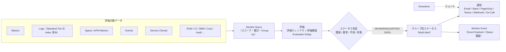
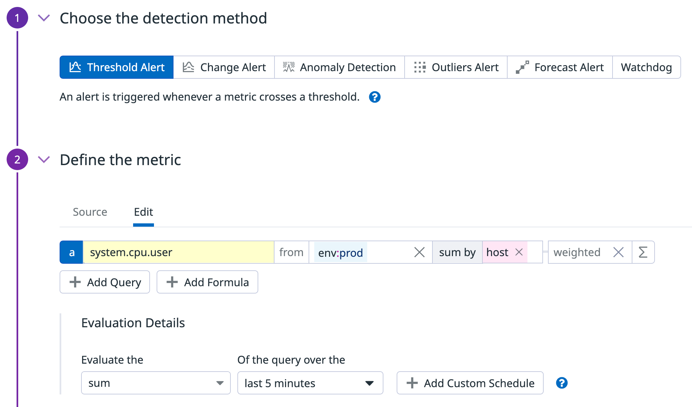
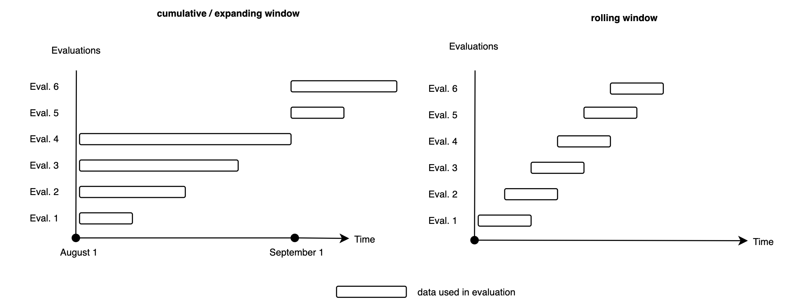
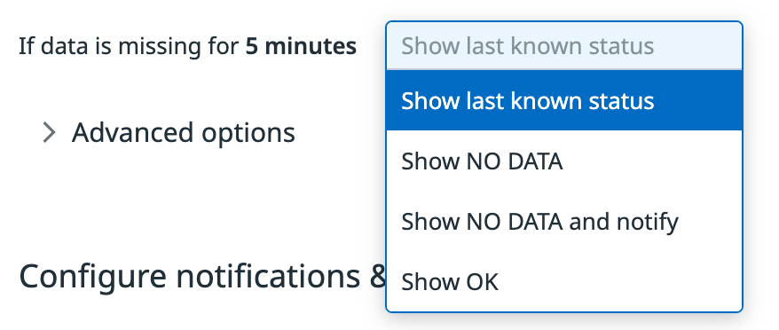
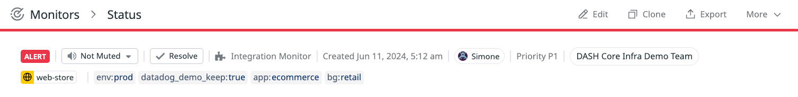
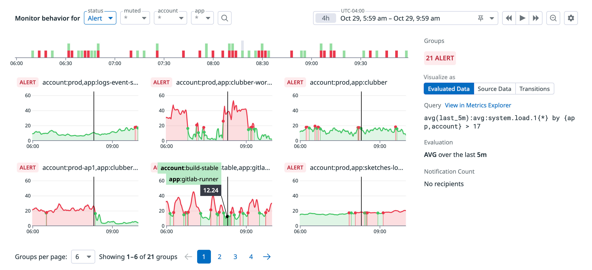
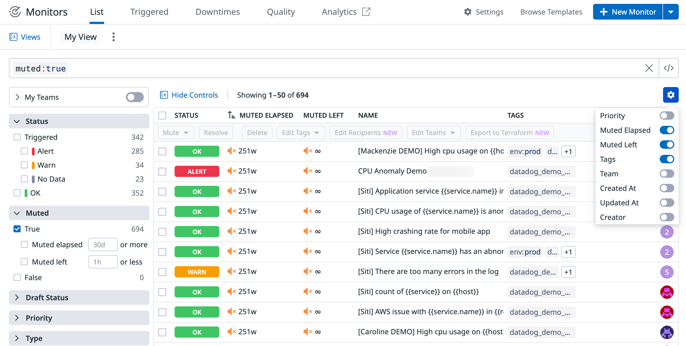

# Monitors（モニター）

## 概要

Datadog の **Monitors（モニター）** は、メトリクス・ログ・トレース・イベント・サービスチェック・RUM・CI・コストなど Datadog に取り込まれたデータを定期的に評価し、条件（閾値・異常・予測・状態）を満たしたときにステータスを `ALERT` / `WARN` / `NO DATA` などへ遷移させ、通知（メール、Slack、PagerDuty、Microsoft Teams、Webhook、On-Call 等）を送る機能である。[出典](https://docs.datadoghq.com/monitors/)

本ファイルは次の内容を扱う。

- モニタータイプ全一覧（公式ドキュメントの Monitor Types ページ掲載の 29 タイプ＋ API 上の `type` 値の対応）
- 各タイプの検出方式・設定項目・タイプ固有の制限
- 共通の評価設定（評価ウィンドウ、評価頻度、集計方法、閾値、Recovery 閾値、No Data、Auto Resolve、Group Retention、New Group Delay、Evaluation Delay、Require Full Window、Custom Schedule）
- Simple Alert / Multi Alert と通知グルーピング
- Monitor Status 画面、Manage Monitors（一覧・Triggered Monitors）、Monitor Quality、Monitor Templates、Monitor Settings（Tag Policies、削除モニターの復元）
- Monitors API の主要オプションとクエリ構文
- 制限値・クォータ・デフォルト値、課金への影響

次の内容は別ファイルで扱う（重複を避けるため本ファイルでは要点とリンクのみ）。

| 内容 | 参照先 |
|---|---|
| 通知メッセージ、テンプレート変数、`@` 通知先、Renotify、Notification Rules、Downtime（ミュート） | [通知と Downtime](./notifications-and-downtimes.md) |
| SLO 本体（Metric-based / Monitor-based / Time Slice SLO、Error Budget、Burn Rate の理論） | [Service Level Objectives（SLO）](./slo.md) |
| Watchdog 本体（自動検知の仕組み、Watchdog Insights、RCA） | [Watchdog](./watchdog.md) |
| メトリクスクエリ構文、関数（`anomalies()`、`outliers()`、`forecast()`、`timeshift()` 等）、`as_count()` | [メトリクスクエリと関数](./metrics-query-and-functions.md) |
| Event Explorer、Event Management（相関・ケース化） | [Event Management](./event-management.md) |
| Terraform による Monitor 管理 | [Terraform と IaC](./terraform-and-iac.md)、[Monitoring as Code](../../04_応用編/monitoring-as-code.md) |
| アラート設計・ノイズ削減の実践 | [アラート設計とノイズ削減](../../04_応用編/alert-design-and-noise-reduction.md) |
| Incident / On-Call への連携 | [Incident Management](../service-management/incident-management.md)、[On-Call](../service-management/on-call.md) |
| ロール・権限全般 | [組織・ユーザー・権限管理](./account-and-access-management.md) |

## モニタータイプ全一覧

Datadog 公式ドキュメントの Monitor Types ページ（2026-11-02 取得）には次の 29 タイプが掲載されている。UI では **Monitors > New Monitor** からタイプを選択して作成する。[出典](https://docs.datadoghq.com/monitors/types/)

| # | タイプ（UI 名） | 概要 | API の `type` 値 | 関連製品・前提 |
|---|---|---|---|---|
| 1 | Host | 1 台以上のホストが Datadog に報告しているか（`datadog.agent.up`）を監視 | `service check` | Datadog Agent |
| 2 | Metric | メトリクス値を閾値と比較（Threshold / Change / Anomaly / Outlier / Forecast の検出方式を選択） | `query alert`（旧 `metric alert` も enum に残存） | Metrics |
| 3 | Analysis | Notebook Analysis / DDSQL の分析結果に対してアラート（複数データソース、変換チェーン、SQL） | 公開情報では確認できず | Notebooks・DDSQL |
| 4 | Anomaly | 過去の挙動から期待レンジを算出し、外れた割合でアラート | `query alert` | Metrics |
| 5 | APM | APM Metrics（サービスレベルのメトリクス）または Trace Analytics（Indexed Spans 検索）を監視 | `query alert`（APM Metrics）/ `trace-analytics alert` | APM |
| 6 | Audit Trail | 特定の監査ログが閾値を超えたらアラート | `audit alert` | Audit Trail |
| 7 | Change Alert | 値の絶対変化量・変化率が閾値を超えたらアラート | `query alert` | Metrics |
| 8 | CI（UI 上は CI/CD & Tests） | CI Pipeline、CI Test、CD Deployments を監視 | `ci-pipelines alert` / `ci-tests alert` | CI Visibility / Test Optimization / CD Visibility |
| 9 | Cloud Cost | クラウドコストの変化・異常・閾値・予測・予算を監視 | `cost alert` | Cloud Cost Management |
| 10 | Composite | 複数モニターの状態をブール式で組み合わせる | `composite` | ― |
| 11 | Data Observability | データの鮮度、行数、カラム統計、カスタム SQL を監視 | `data-quality alert`【API 上の対応は enum 名からの推定】 | Data Observability（Quality Monitoring） |
| 12 | Database Monitoring | Query Samples / Explain Plans を監視 | `database-monitoring alert` | Database Monitoring |
| 13 | Error Tracking | 新規 Issue（New Issue）や影響の大きい Issue（High Impact）を監視 | `error-tracking alert` | Error Tracking |
| 14 | Event | イベント件数・属性集計・ユニーク値数を監視 | `event-v2 alert`（旧 `event alert`） | Events |
| 15 | Forecast | メトリクスが将来閾値を超えると予測されたらアラート | `query alert` | Metrics |
| 16 | Integration | 特定インテグレーションのメトリクス値またはヘルスステータスを監視 | `query alert`（メトリクス）/ `service check`（ステータス） | Integrations |
| 17 | Live Process | ホスト上のプロセスの稼働数を監視 | `process alert` | Live Processes |
| 18 | Logs | ログ件数・ユニーク値数・メジャー値が閾値を超えたらアラート | `log alert` | Log Management |
| 19 | Network | TCP / HTTP（および SSL）エンドポイントのステータスを監視 | `service check`（ステータス）/ `query alert`（メトリクス） | Agent の `http_check` / `tcp_check` |
| 20 | Network Path | Network Path のテスト結果（traceroute）を監視 | `network-path alert` | Network Path |
| 21 | Cloud Network Monitoring（旧称：Network Performance Monitoring / NPM） | ネットワークトラフィック（Volume / TCP / DNS）にアラート | `network-performance alert` | Cloud Network Monitoring |
| 22 | NetFlow | NetFlow 対応機器のフローレコードを監視【Preview】 | 公開情報では確認できず | NetFlow Monitoring |
| 23 | Outlier | グループ内で他のメンバーと異なる挙動のメンバーを検出 | `query alert` | Metrics |
| 24 | Process Check | `process.up` サービスチェックのステータスを監視 | `service check` | Agent の Process Check |
| 25 | Real User Monitoring | RUM イベント・メジャーを監視 | `rum alert` | RUM |
| 26 | Service Check | カスタムチェックのステータスを監視 | `service check` | カスタム Agent チェック / DogStatsD / API |
| 27 | SLO Alerts | SLO の Error Budget 消費と Burn Rate を監視 | `slo alert` | SLO |
| 28 | Synthetic Monitoring | Synthetic テストに紐づくモニター（テスト作成時に自動作成） | `synthetics alert` | Synthetic Monitoring |
| 29 | Watchdog | Watchdog が異常を検知したときに通知 | `event-v2 alert` | Watchdog |

[出典（タイプ一覧）](https://docs.datadoghq.com/monitors/types/)、[出典（API の type 対応）](https://docs.datadoghq.com/api/latest/monitors/create-a-monitor/)、[出典（OpenAPI 定義 `MonitorType`）](https://github.com/DataDog/datadog-api-client-python/blob/master/.generator/schemas/v1/openapi.yaml)

### API の `type` 列挙値（Monitors API v1）

Monitors API v1 の OpenAPI 定義（`MonitorType`）には次の値がある（2026-11-02 時点）。UI のタイプ一覧にない `data-jobs alert`（Data Jobs Monitoring 向け）と `llm-observability alert`（LLM Observability 向け）も含まれる。

| `type` 値 | 主な用途 |
|---|---|
| `composite` | Composite |
| `event alert` | 旧 Event モニター（現行は `event-v2 alert`） |
| `log alert` | Logs |
| `metric alert` | 旧メトリクスモニター（現行は `query alert` が一般的） |
| `process alert` | Live Process |
| `query alert` | Metric / Anomaly / Outlier / Forecast / Change / APM Metrics / Integration メトリクス |
| `rum alert` | RUM |
| `service check` | Host / Process Check / Network / Integration ステータス / Service Check |
| `synthetics alert` | Synthetic |
| `trace-analytics alert` | APM Trace Analytics |
| `slo alert` | SLO Alerts |
| `event-v2 alert` | Event、Watchdog |
| `audit alert` | Audit Trail |
| `ci-pipelines alert` / `ci-tests alert` | CI Pipeline / CI Test |
| `error-tracking alert` | Error Tracking |
| `database-monitoring alert` | Database Monitoring |
| `network-performance alert` | Cloud Network Monitoring |
| `cost alert` | Cloud Cost |
| `data-quality alert` | Data Observability【API 上の対応は enum 名からの推定】 |
| `network-path alert` | Network Path |
| `data-jobs alert` | Data Jobs Monitoring【用途は enum 名からの推定】 |
| `llm-observability alert` | LLM Observability【用途は enum 名からの推定】 |

[出典](https://github.com/DataDog/datadog-api-client-python/blob/master/.generator/schemas/v1/openapi.yaml)

- Synthetic モニターは Monitors API ではなく **Synthetics API** で作成する。[出典](https://docs.datadoghq.com/api/latest/monitors/create-a-monitor/)
- Log モニターを API で作成するには、スコープ制限のない（unscoped）Application Key が必要。[出典](https://docs.datadoghq.com/api/latest/monitors/create-a-monitor/)

## モニター作成の基本フロー

Datadog の Monitor は、どのタイプでもおおむね次の順で設定する。[出典](https://docs.datadoghq.com/monitors/configuration/)

| 手順 | 内容 | 主な設定項目 |
|---|---|---|
| 1. 検出方式の選択（Metric 系） | Threshold / Change / Anomaly / Outlier / Forecast（UI 上は Watchdog も並ぶ） | ― |
| 2. クエリ定義 | 監視対象データのクエリ、スコープ（`from`）、集計、Group by | メトリクス名、タグ、検索クエリ、Facet、Measure |
| 3. アラート条件 | 評価ウィンドウ、集計方法、比較演算子、Alert / Warning 閾値、Recovery 閾値 | `thresholds`、評価ウィンドウ |
| 4. 欠損データ・詳細オプション | No Data、Auto Resolve、Group Retention、New Group Delay、Evaluation Delay、Require Full Window | `on_missing_data`、`notify_no_data`、`timeout_h` など |
| 5. 通知とメタデータ | 通知メッセージ、通知先、Simple / Multi Alert、通知グルーピング、Tags、Teams、Priority | `message`、`notify_by`、`tags`、`priority` |
| 6. 権限 | 編集可能なロール・チーム・ユーザーの制限 | `restricted_roles`、Restriction Policies |

- **キャプション:** Metric Monitor 作成画面の「1 Choose the detection method」と「2 Define the metric」セクション。
- **画面説明:** 上部の「Choose the detection method」に `Threshold Alert`（選択中）、`Change Alert`、`Anomaly Detection`、`Outliers Alert`、`Forecast Alert`、`Watchdog` のタブが並び、「An alert is triggered whenever a metric crosses a threshold.」と説明が表示される。下部の「Define the metric」には `Source` / `Edit` タブがあり、クエリ行 `a` に メトリクス `system.cpu.user`、`from env:prod`、`sum by host`、`weighted` が設定されている。その下に「Add Query」「Add Formula」ボタン、「Evaluation Details」として「Evaluate the `sum` of the query over the `last 5 minutes`」と「Add Custom Schedule」ボタンがある。
- **出典:** https://docs.datadoghq.com/monitors/types/metric/ （取得日 2026-11-02）

## 共通の評価設定

### 集計方法（Aggregation）

Datadog Monitor のしきい値評価では、評価ウィンドウ内の時系列を 1 つの値に集約してから閾値と比較する。[出典](https://docs.datadoghq.com/monitors/configuration/)

| 集計方法 | 挙動（above 条件の場合） | クエリへの付与 |
|---|---|---|
| average | 時系列を平均して 1 値にする | `avg()` |
| max | いずれかの点が閾値を超えればアラート | `max()` |
| min | すべての点が閾値を超えればアラート | `min()` |
| sum | 合計値が閾値を超えればアラート | `sum()` |
| percentile（pXX） | パーセンタイル値で評価（**Distribution メトリクスのみ**） | `pXX()` |

- `below` 条件のモニターでは max と min の意味が反転する（max は「すべての点が下回れば」、min は「いずれかの点が下回れば」）。[出典](https://docs.datadoghq.com/monitors/types/metric/)
- Distribution メトリクスにパーセンタイル集計を使うと、対応するパーセンタイル閾値が自動設定される。パーセンタイル集計を使うモニターは通知にスナップショットグラフを生成しない。[出典](https://docs.datadoghq.com/monitors/types/metric/)
- `as_count()` を使ったクエリはモニター評価時の挙動がダッシュボードと異なる。詳細は [メトリクスクエリと関数](./metrics-query-and-functions.md) を参照。

### 比較演算子

| モニタータイプ | 利用可能な比較演算子 |
|---|---|
| Metric（Threshold） | above / above or equal to / below / below or equal to / equal to / not equal to |
| Logs、Event | above / above or equal to / below / below or equal to / equal to / not equal to |
| APM、RUM、CI、Live Process、Database Monitoring | above / above or equal to / below / below or equal to |

[出典（Metric）](https://docs.datadoghq.com/monitors/types/metric/)、[出典（Log）](https://docs.datadoghq.com/monitors/types/log/)、[出典（Event）](https://docs.datadoghq.com/monitors/types/event/)、[出典（APM）](https://docs.datadoghq.com/monitors/types/apm/)、[出典（RUM）](https://docs.datadoghq.com/monitors/types/real_user_monitoring/)、[出典（CI）](https://docs.datadoghq.com/monitors/types/ci/)、[出典（Process）](https://docs.datadoghq.com/monitors/types/process/)

- 0 と 1 の間の小数を閾値に指定する場合は先頭の 0 を付ける（例：`.5` ではなく `0.5`）。[出典](https://docs.datadoghq.com/monitors/configuration/)

### 評価ウィンドウ（Evaluation Window）

Datadog Monitor の評価ウィンドウには **Rolling（ローリング）** と **Cumulative（累積）** の 2 種類がある。[出典](https://docs.datadoghq.com/monitors/configuration/)

| 種類 | 挙動 | 選択肢・上限 |
|---|---|---|
| Rolling | 固定長のウィンドウが時間とともに移動する | 5 分、15 分、1 時間、またはカスタム（最大 1 か月。Log モニターは最大 2 日） |
| Cumulative: Current hour | 開始点固定で伸び、最大幅に達するとリセット | 最大 1 時間。開始分（何分から）を設定可能 |
| Cumulative: Current day | 同上 | 最大 24 時間。開始時刻（時・分）を設定可能 |
| Cumulative: Current month | 月初からの累積（Month-to-date） | 開始日・時・分を設定可能。**Metric モニターのみ** |

- **キャプション:** Rolling 評価ウィンドウと Cumulative（拡張型）評価ウィンドウの違いを示す概念図。
- **画面説明:** Rolling ウィンドウは同じ幅の枠が時刻とともに右へずれていく様子、Cumulative ウィンドウは開始点が固定されたまま枠が伸び、最大幅に達するとリセットされる様子を、横軸を時間とした帯で示している。
- **出典:** https://docs.datadoghq.com/monitors/configuration/ （取得日 2026-11-02）

タイプ別の評価ウィンドウ範囲は次のとおり。

| モニタータイプ | 評価ウィンドウ（UI） | 出典 |
|---|---|---|
| Metric（Threshold） | プリセット 5 分 / 15 分 / 1 時間、カスタム 1 分〜730 時間（1 か月） | [Metric](https://docs.datadoghq.com/monitors/types/metric/) |
| Metric（Change） | 評価ウィンドウ・timeshift ともに最大 1 か月 | [Change Alert](https://docs.datadoghq.com/monitors/types/change-alert/) |
| Anomaly | Trigger window：15 分、1 時間、またはカスタム 15 分〜2 週間 | [Anomaly](https://docs.datadoghq.com/monitors/types/anomaly/) |
| Outlier | プリセットまたはカスタム 1 分〜1 年 | [Outlier](https://docs.datadoghq.com/monitors/types/outlier/) |
| Forecast | 予測ホライズン：24 時間、1 週間、1 か月等、カスタム 12 時間〜3 か月 | [Forecast](https://docs.datadoghq.com/monitors/types/forecasts/) |
| Logs | Rolling 最大 2 日 | [Log](https://docs.datadoghq.com/monitors/types/log/) |
| APM Metrics | カスタム 1 分〜48 時間 | [APM](https://docs.datadoghq.com/monitors/types/apm/) |
| APM Trace Analytics | カスタム 5 分〜48 時間 | [APM](https://docs.datadoghq.com/monitors/types/apm/) |
| RUM | プリセット 5 分 / 15 分 / 1 時間、カスタム 5 分〜48 時間 | [RUM](https://docs.datadoghq.com/monitors/types/real_user_monitoring/) |
| CI/CD & Tests | 5 分 / 15 分 / 1 時間、カスタム 1 分〜2 日 | [CI](https://docs.datadoghq.com/monitors/types/ci/) |
| Live Process | 5 分 / 15 分 / 1 時間以上、カスタム 5 分〜24 時間 | [Process](https://docs.datadoghq.com/monitors/types/process/) |
| Error Tracking | デフォルトは直近 1 日（変更可） | [Error Tracking](https://docs.datadoghq.com/monitors/types/error_tracking/) |
| SLO Alerts | SLO の時間ウィンドウ 7 日 / 30 日 / 90 日 | [SLO](https://docs.datadoghq.com/monitors/types/slo/) |
| Cloud Cost（確定コスト） | 30 分ごとに、48 時間遅延させたウィンドウで評価 | [Cloud Cost](https://docs.datadoghq.com/monitors/types/cloud_cost/) |
| Host / Process Check / Network / Service Check | ウィンドウではなく連続回数（Check Alert）または割合（Cluster Alert）で判定 | 各タイプ節参照 |

> **注意:** 一般的な Monitor 設定ページでは閾値アラートのカスタムウィンドウを「1 分〜48 時間（Metric モニターは最大 1 か月）」と記載している。一方、Monitors API の Metric クエリ構文説明では `last_#m`（1〜10080）、`last_#h`（1〜168）、`last_1d`、`last_1w` と記載されており、UI の「最大 730 時間」と表現が異なる。API で長いウィンドウを指定する場合は UI で作成したモニターの JSON をエクスポートして確認することを推奨する。[出典（設定）](https://docs.datadoghq.com/monitors/configuration/)、[出典（API）](https://docs.datadoghq.com/api/latest/monitors/create-a-monitor/)

### 評価頻度（Evaluation Frequency）

Datadog Monitor の評価頻度は評価ウィンドウの長さで自動的に決まる。[出典](https://docs.datadoghq.com/monitors/configuration/)

| 評価ウィンドウ | 評価頻度 |
|---|---|
| 24 時間未満 | 1 分ごと |
| 24 時間以上 48 時間未満 | 10 分ごと |
| 48 時間以上 | 30 分ごと |

- 評価頻度はウィンドウと独立して、日次・週次・月次のスケジュール（Custom Schedule）にも設定できる（次節）。
- Cloud Cost の確定コストモニターは 30 分ごとに評価、Real-time AI anomaly モニターは 15 分以内に通知（4 時間のローリングウィンドウ）。[出典](https://docs.datadoghq.com/monitors/types/cloud_cost/)
- Data Observability モニターは Hourly / 3・6・12 時間ごと / Daily / cron 式（最短 15 分ごと）で実行される。[出典](https://docs.datadoghq.com/monitors/types/data_observability/)

### Custom Schedule（カスタム評価スケジュール）

Datadog Monitor の Custom Schedule は、モニターを特定の時刻・曜日・日付にだけ評価する機能である。[出典](https://docs.datadoghq.com/monitors/guide/custom_schedules/)

| 項目 | 内容 |
|---|---|
| 対応モニタータイプ | Events、Logs、Metrics（RUM モニターでも任意のカスタムスケジュールが設定可能と RUM ページに記載） |
| スケジュール種別 | Daily（時刻）、Weekly（1 つ以上の曜日＋時刻）、Monthly（日＋時刻）、RRULE（iCalendar RFC 準拠の再帰ルール） |
| RRULE の例 | `FREQ=MONTHLY;BYMONTHDAY=28,29,30,31;BYSETPOS=-1`（月末日）、`FREQ=MONTHLY;INTERVAL=2;BYDAY=1SU,-1SU`（隔月の第 1・最終日曜） |
| 通知の挙動 | 各評価は独立し、結果が OK 以外なら毎回通知する（通常スケジュールのモニターはステータス遷移時のみ通知） |
| Group Retention | Daily：30 日、Weekly：90 日、Monthly：180 日 |
| 最小頻度 | 1 日以上の間隔のみ。それより短い間隔は通常スケジュールを使う |
| RRULE の制約 | `DTSTART`、`DTEND`、`DURATION` は使用不可 |
| 変更の制約 | Custom Schedule はモニター作成時にのみ追加・削除でき、作成後に無効化できない。外す場合は新規モニターを作り直す |
| 非対応設定 | 「Remove non-reporting groups」は使用不可 |
| API | `options.scheduling_options.custom_schedule.recurrences`（`rrule`、`start`、`timezone`）。Metric モニターで Custom Schedule を使う場合は `on_missing_data` の指定が必須 |

[出典（ガイド）](https://docs.datadoghq.com/monitors/guide/custom_schedules/)、[出典（API）](https://docs.datadoghq.com/api/latest/monitors/create-a-monitor/)、[出典（RUM）](https://docs.datadoghq.com/monitors/types/real_user_monitoring/)

### 閾値（Thresholds）と Recovery

Datadog Monitor の閾値には次の 4 種類がある。[出典](https://docs.datadoghq.com/monitors/configuration/)

| 閾値 | 必須 | API キー | 説明 |
|---|---|---|---|
| Alert threshold | 必須 | `thresholds.critical` | `ALERT` に遷移する値 |
| Warning threshold | 任意 | `thresholds.warning` | `WARN` に遷移する値 |
| Alert recovery threshold | 任意 | `thresholds.critical_recovery` | `ALERT` から回復するための追加条件 |
| Warning recovery threshold | 任意 | `thresholds.warning_recovery` | `WARN` から回復するための追加条件 |

- Recovery 閾値を設定しない場合、値が Alert / Warning 閾値を逆方向に越えた時点で回復する。Recovery 閾値を設定するとヒステリシス（回復に余裕幅）を持たせ、閾値付近での状態のばたつき（フラッピング）を抑えられる。[出典](https://docs.datadoghq.com/monitors/configuration/)
- サービスチェック系では `thresholds.ok`、`thresholds.critical`、`thresholds.warning`、`thresholds.unknown` を連続回数として使う。[出典](https://docs.datadoghq.com/api/latest/monitors/create-a-monitor/)
- Anomaly モニターでは `threshold_windows.trigger_window` / `recovery_window` も使う（Anomaly 節参照）。
- `thresholds.critical_query` / `critical_recovery_query`（動的な閾値クエリ）は【Preview】で、`variables` を使うメトリクスの Formula モニター専用。静的閾値とは併用できない。[出典](https://docs.datadoghq.com/api/latest/monitors/create-a-monitor/)

### Check Alert と Cluster Alert（サービスチェック系）

Host、Process Check、Network、Integration（ステータス）、Service Check の各モニターは、メトリクスの閾値ではなくサービスチェックのステータス（`OK` / `WARN` / `CRITICAL` / `UNKNOWN`）で判定する。[出典](https://docs.datadoghq.com/monitors/types/custom_check/)

| 方式 | 判定方法 | 主な設定 |
|---|---|---|
| Check Alert | チェックのグループ（例：`host`、`process`）ごとに連続ステータスを追跡 | 何回連続 `WARN` / `CRITICAL` で通知するか（1 なら初回失敗で通知、2 以上で単発の揺らぎを無視）、何回連続 `OK` で回復するか |
| Cluster Alert | 指定ステータスのチェックの**割合**を算出し閾値と比較 | Alert / Warn 閾値（%、どちらか片方で可）、全体で集計するかタグごとに集計するか。タグ組み合わせごとに最新ステータスのみをカウント |

- Service Check / Integration の Check Alert では `UNKNOWN` を「通知しない」か「通知する」かを選べる。通知を有効にした場合、`UNKNOWN` のグループはステータス画面で灰色の `NODATA` バーとして表示されるが、モニター全体のステータスは `OK` のままとなる。[出典（Service Check）](https://docs.datadoghq.com/monitors/types/custom_check/)、[出典（Integration）](https://docs.datadoghq.com/monitors/types/integration/)
- API の Service Check クエリ構文は `"check".over(tags).last(count).by(group).count_by_status()` で、`count` は最大 100 かつ最大閾値回数以上でなければならない。[出典](https://docs.datadoghq.com/api/latest/monitors/create-a-monitor/)
- ホスト選択の include フィールドは AND（すべての名前・タグを持つホストが対象）、exclude フィールドは OR（いずれかに該当すれば除外）で評価される。[出典](https://docs.datadoghq.com/monitors/types/host/)

### No Data（データ欠損時の扱い）

Datadog Monitor の No Data 設定は、クエリが一定時間データを返さないときのステータスを決める。[出典](https://docs.datadoghq.com/monitors/configuration/)

- **キャプション:** モニター設定画面の「If data is missing for 5 minutes」ドロップダウン。
- **画面説明:** 「If data is missing for **5 minutes**」の右にドロップダウンがあり、`Show last known status`（選択中）、`Show NO DATA`、`Show NO DATA and notify`、`Show OK` の 4 つの選択肢が表示されている。その下に「Advanced options」の折りたたみ、「Configure notifications & ...」セクションの見出しがある。
- **出典:** https://docs.datadoghq.com/monitors/configuration/ （取得日 2026-11-02）

| UI の選択肢 | API（`on_missing_data`） | 挙動 |
|---|---|---|
| Evaluate as zero / Show last known status | `default` | Count クエリでは空の評価結果を 0 として閾値と比較。Gauge・Measure・Rate など Count 以外のクエリでは直前のステータスを維持 |
| Show NO DATA | `show_no_data` | ステータスを `NO DATA` にする（通知しない） |
| Show NO DATA and notify | `show_and_notify_no_data` | ステータスを `NO DATA` にして通知する |
| Show OK | `resolve` | `OK` に解決する |

[出典（設定）](https://docs.datadoghq.com/monitors/configuration/)、[出典（OpenAPI `OnMissingDataOption`）](https://github.com/DataDog/datadog-api-client-python/blob/master/.generator/schemas/v1/openapi.yaml)

- `on_missing_data` は APM Trace Analytics、Audit Trail、CI、Error Tracking、Event、Logs、RUM の各モニターで使え、Custom Schedule を使う Metric モニターでは必須。[出典](https://github.com/DataDog/datadog-api-client-python/blob/master/.generator/schemas/v1/openapi.yaml)
- それ以外（Metric の通常スケジュールやサービスチェック）は従来型の `notify_no_data`（真偽値、デフォルト `false`）と `no_data_timeframe`（分）で設定する。`no_data_timeframe` を省略すると、クエリアラートは評価ウィンドウの 2 倍、サービスチェックは 24 時間が使われる。Datadog の推奨値はクエリアラートで評価ウィンドウの 2 倍以上、サービスチェックで 2 分以上。[出典](https://github.com/DataDog/datadog-api-client-python/blob/master/.generator/schemas/v1/openapi.yaml)
- `on_missing_data` のドロップダウンでは欠損判定時間を設定できない（「Do not notify」方式の場合と異なる）。[出典](https://docs.datadoghq.com/monitors/configuration/)
- モニターは一度データを評価してからでないと欠損データでアラートできない。[出典](https://docs.datadoghq.com/monitors/configuration/)
- クエリで `default_zero()` を使うと欠損データが 0 に固定され、その他の No Data 選択肢は無効になる。[出典](https://docs.datadoghq.com/monitors/configuration/)
- Host モニター（Check Alert / Cluster Alert）の欠損判定時間のデフォルトは 2 分。[出典](https://docs.datadoghq.com/monitors/types/host/)
- Database Monitoring モニターでは、データが 5 分間ない場合に欠損データ処理が適用される。[出典](https://docs.datadoghq.com/monitors/types/database_monitoring/)
- Logs / RUM / APM Trace Analytics / DBM で「データが来なくなった」ことを検知したい場合は、条件を `below 1` にする。Group by で分割し `below` 条件にした場合、アラートは「グループにデータがありかつ閾値を下回った」か「全グループにデータがない」場合のみ発火する（特定グループだけが完全に止まったケースはこの条件では発火しない可能性がある【推定】）。[出典（Log）](https://docs.datadoghq.com/monitors/types/log/)、[出典（APM）](https://docs.datadoghq.com/monitors/types/apm/)
- Composite モニターで No Data をアラートさせるには、Composite と構成モニターの両方で欠損データ通知を有効にする必要がある。[出典](https://docs.datadoghq.com/monitors/types/composite/)

### Auto Resolve

Datadog Monitor の Auto Resolve は、データが送られなくなったトリガー状態のモニター（グループ）を一定時間後に自動で `OK` に戻す設定である。[出典](https://docs.datadoghq.com/monitors/configuration/)

| 項目 | 内容 |
|---|---|
| 選択肢 | Never（デフォルト、通常推奨）、After 1 hour、After 2 hours … |
| API | `timeout_h`（時間、0〜24） |
| 動作条件 | データの送信が止まった場合のみ。データが送られている間は自動解決されない |
| 再アラート | 自動解決後の次の評価で回復条件を満たさなければ再度アラートする |
| Group Retention との関係 | クエリがデータを返さなくなった時点で、Retention と Auto Resolve のカウントが同時に始まる |

[出典（設定）](https://docs.datadoghq.com/monitors/configuration/)、[出典（API `timeout_h`）](https://github.com/DataDog/datadog-api-client-python/blob/master/.generator/schemas/v1/openapi.yaml)

- 用途例：エラーが発生していないときに送られないエラーメトリクス（スパースなメトリクス）のモニターでは、アラート後にデータが来なくなると状態が `ALERT` のまま残るため、Auto Resolve や手動 Resolve を使う。[出典](https://docs.datadoghq.com/monitors/status/events/)

### Group Retention Time（グループ保持時間）

Datadog Monitor の Group Retention Time は、報告が止まったグループをモニターのステータスに保持し続ける時間である。[出典](https://docs.datadoghq.com/monitors/configuration/)

| 項目 | 値 |
|---|---|
| デフォルト | 24 時間 |
| Host モニター、および欠損データ通知を有効にしたサービスチェック | 48 時間 |
| Dynamic retention | 多数のグループを持つモニターではデフォルトで有効。報告が止まったグループの保持期間を短縮する（報告中のグループは削除されない） |
| カスタム保持 | 1〜72 時間。Multi Alert の APM Trace Analytics、Audit Logs、CI Pipelines、Error Tracking、Events、Logs、RUM で設定可能（API：`group_retention_duration`、例 `"60m"`、`"1h"`、`"2d"`） |
| Custom Schedule 使用時 | Daily 30 日、Weekly 90 日、Monthly 180 日 |

[出典（設定）](https://docs.datadoghq.com/monitors/configuration/)、[出典（Custom Schedule）](https://docs.datadoghq.com/monitors/guide/custom_schedules/)、[出典（API）](https://docs.datadoghq.com/api/latest/monitors/create-a-monitor/)

### New Group Delay（新規グループ遅延）

Datadog Monitor の New Group Delay は、新しく現れたグループの評価開始を指定秒数遅らせ、起動直後のホストやコンテナでの誤検知を防ぐ。[出典](https://docs.datadoghq.com/monitors/configuration/)

| 項目 | 内容 |
|---|---|
| 単位・値 | 秒、非負整数 |
| デフォルト | 60 秒 |
| 対象 | 過去 24 時間に出現していないグループ |
| 適用範囲 | Multi Alert モードのみ |
| API | `new_group_delay` |
| 旧オプション | `new_host_delay`（デフォルト 300 秒、**非推奨**。`new_group_delay` を使う） |

[出典（設定）](https://docs.datadoghq.com/monitors/configuration/)、[出典（OpenAPI）](https://github.com/DataDog/datadog-api-client-python/blob/master/.generator/schemas/v1/openapi.yaml)

### Evaluation Delay（評価遅延）

Datadog Monitor の Evaluation Delay は、評価対象の時間範囲を指定秒数だけ過去へずらす設定で、遅れて到着するデータ（クラウドメトリクスのバックフィル等）による誤検知を防ぐ。[出典](https://docs.datadoghq.com/monitors/configuration/)

| 項目 | 内容 |
|---|---|
| 単位・値 | 秒、非負整数、最大 86,400 秒（24 時間） |
| 例 | 遅延 900 秒・ウィンドウ 5 分で 7:00 に評価すると、6:40〜6:45 のデータを評価 |
| 推奨値 | クラウドメトリクス（AWS / Azure / Google Cloud）は 15 分（900 秒）、除算の Formula は約 60 秒 |
| API | `evaluation_delay` |
| Monitor Quality との関係 | クラウドデータを使い Evaluation Delay がないモニターは「Missing a delay」として検出される |

[出典（設定）](https://docs.datadoghq.com/monitors/configuration/)、[出典（Monitor Quality）](https://docs.datadoghq.com/monitors/quality/)

### Require Full Window（データウィンドウの充足要件）

Datadog の Metric モニターでは、評価ウィンドウがデータで「満たされる」まで評価を待つかを選べる。[出典](https://docs.datadoghq.com/monitors/types/metric/)

| 設定 | 挙動 |
|---|---|
| Do not require（デフォルト、API `require_full_window: false`） | ウィンドウ内にデータ点が 1 つでもあれば評価する。スパースなメトリクス向け |
| Require（`true`） | ウィンドウが「満たされる」まで評価しない |

ウィンドウの充足判定はバケット単位で行われる。[出典](https://docs.datadoghq.com/monitors/types/metric/)

| 評価ウィンドウの単位 | バケットサイズ |
|---|---|
| 分 | 1 分 |
| 時間 | 10 分 |
| 日 | 1 時間 |
| 月 | 4 時間 |

- 充足条件：最も古いバケットにデータ点が 1 つ以上あり、かつ空のバケットが合計 3 つ以下。条件を満たさない場合はその回の評価がキャンセルされ、モニターの状態は変わらない。
- 例（2 時間ウィンドウ＝12 バケット）：全バケットにデータあり → 充足。先頭バケットが空 → 非充足。先頭にデータあり・空 3 つ → 充足。空 4 つ以上 → 非充足。
- この設定は Metric モニターにのみ適用される。スパースなメトリクスで `true` にすると評価がスキップされるため `false` が推奨される。[出典](https://github.com/DataDog/datadog-api-client-python/blob/master/.generator/schemas/v1/openapi.yaml)

### Simple Alert / Multi Alert と通知グルーピング

Datadog Monitor の通知集約（Alert aggregation）は、クエリのグループ単位で通知を分けるかを決める。[出典](https://docs.datadoghq.com/monitors/configuration/)

| モード | 挙動 | 使う場面 |
|---|---|---|
| Simple Alert | 全ソースを集約して 1 つの通知を送る | クエリに Group by がない場合 |
| Multi Alert | 閾値を満たしたグループごとに 1 通知を送る | クエリを何らかのディメンションで Group by している場合 |
| 通知グルーピング（Notification grouping） | Multi Alert の通知ディメンションから一部を外し、通知数を減らす。外したディメンションは UI 上で Sub Groups として表示 | 例：`host, service` で評価し `service` 単位で通知 |

- API では `notify_by`（クエリの Group by タグの部分集合）で指定する。`["*"]` を指定すると Simple Alert になる。旧オプション `groupby_simple_monitor` は非推奨。[出典](https://docs.datadoghq.com/api/latest/monitors/create-a-monitor/)
- `host` タグだけを報告し `service` タグを持たないメトリクスは、通知グルーピングで検出されない（両方のタグが必要）と公式ドキュメントに記載がある。[出典](https://docs.datadoghq.com/monitors/configuration/)
- Metric モニターでは値が `N/A` のグループは除外されるため、Group by のタグキーには値が必要。[出典](https://docs.datadoghq.com/monitors/types/metric/)
- Event モニターの Multi Alert は最大 1,000 グループ。[出典](https://docs.datadoghq.com/monitors/types/event/)

### メタデータ（Tags / Teams / Priority）

| 項目 | 内容 |
|---|---|
| Monitor Tags | Agent やインテグレーションのタグとは独立したモニター自体のタグ。1 モニターあたり最大 80 個。モニター一覧・Triggered Monitors・Downtime 画面での絞り込みに使え、アラートイベントにも付与される |
| Teams | モニターにチームを関連付ける |
| Priority | 1（高）〜5（低）の整数。UI 上は P1〜P5 と表示（API `priority`、null 可） |
| Draft | 【Preview】`draft_status: draft` のモニターは Draft と表示され通知を送らない。`published` で有効化 |

[出典（タグ）](https://docs.datadoghq.com/monitors/manage/)、[出典（Priority）](https://github.com/DataDog/datadog-api-client-python/blob/master/.generator/schemas/v1/openapi.yaml)、[出典（Draft）](https://docs.datadoghq.com/api/latest/monitors/create-a-monitor/)

### プレビューグラフ（作成画面）

Datadog Monitor の作成・編集画面には 2 種類のプレビューグラフがある。[出典](https://docs.datadoghq.com/monitors/configuration/)

| グラフ | 内容 | 対応タイプ |
|---|---|---|
| Evaluated Data | 現在のクエリと閾値で過去データを評価した場合の状態遷移、通知先、設定ミスを表示 | Metrics、Logs、APM、RUM、Events、Audit、Database、Agent Observability、Deployment |
| Source Data | 閾値・アラートロジックを適用しない生のクエリ結果 | ― |

## タイプ別リファレンス

### Metric Monitor（メトリクスモニター）

Datadog の Metric Monitor は、メトリクスクエリの値を評価する最も基本的なモニターで、5 つの検出方式を持つ。[出典](https://docs.datadoghq.com/monitors/types/metric/)

| 検出方式 | 判定 |
|---|---|
| Threshold | 期間内の average / min / max / sum（Distribution は percentile も可）を静的閾値と比較 |
| Change | N 分前と現在の差（絶対値または %）を閾値と比較 |
| Anomaly | 過去の挙動（時刻・曜日の季節性を考慮可能）から期待レンジを算出し、レンジ外の割合を閾値と比較 |
| Outlier | グループ（ホスト、AZ、パーティション等）のメンバーが他と乖離していないか判定 |
| Forecast | 将来値と偏差範囲を予測し、範囲のいずれかが閾値を越えたらアラート |

Threshold のクエリ定義項目は次のとおり。[出典](https://docs.datadoghq.com/monitors/types/metric/)

| 手順 | 必須 | デフォルト | 例 |
|---|---|---|---|
| メトリクスの選択 | 必須 | なし | `system.cpu.user` |
| `from`（スコープ） | 任意 | Everywhere | `env:prod` |
| メトリクス集計（space aggregation） | 必須 | `avg by` | `sum by` |
| Group by | 任意 | Everything | `host` |
| モニタークエリ集計（time aggregation） | 任意 | `average` | `sum` |
| 評価ウィンドウ | 任意 | 5 分 | 1 日 |
| Change の場合：変化タイプ | 任意 | `change` | `% change` |
| Change の場合：比較ウィンドウ | 任意 | 5 分 | 1 か月 |

- 複数クエリと Formula を組み合わせられる（「Add Query」「Add Formula」）。`Advanced...` オプションはダッシュボードのグラフ作成と同じルールに従う。
- API のクエリ構文：`time_aggr(time_window):space_aggr:metric{tags} [by {key}] operator #`（例：`avg(last_5m):sum:system.net.bytes_rcvd{host:host0} > 100`）。[出典](https://docs.datadoghq.com/api/latest/monitors/create-a-monitor/)
- Integration Monitor のメトリクス版、Network Monitor のメトリクス版、APM Metrics も Metric モニターと同じ `query alert` として扱われる。

### Change Alert（変化アラート）

Datadog の Change Alert は、現在の値と過去の値の差分を評価するモニター（Metric モニターの Change 検出方式）である。[出典](https://docs.datadoghq.com/monitors/types/change-alert/)

| 項目 | 内容 |
|---|---|
| 計算手順 | ①現在時刻のデータ点を取得 ②N 分/時間/日/週前のデータ点を取得 ③差分を計算 ④集計して 1 値にする ⑤閾値と比較 |
| Change（絶対値） | `a - b` |
| % Change（変化率） | `((a - b) / b) * 100` |
| 集計方法 | Average、Maximum、Minimum、Sum |
| 評価ウィンドウ | 最大 1 か月 |
| Timeshift（比較先） | 最大 1 か月前 |
| API 構文例 | `pct_change(avg(last_5m),last_30m):<METRIC> > -50` |
| API の範囲 | `change_aggr(time_aggr(time_window), timeshift)`、`last_#m` 1〜2880、`last_#h` 1〜48、`last_#d` 1〜2、timeshift は 5/10/15/30 分、1/2/4 時間、`1d_ago` |

[出典（Change Alert）](https://docs.datadoghq.com/monitors/types/change-alert/)、[出典（API）](https://docs.datadoghq.com/api/latest/monitors/create-a-monitor/)

> **注意:** Change Alert のドキュメント本文では評価ウィンドウ・timeshift とも「最大 1 か月」と記載され、API 構文の説明では `last_#d` 1〜2 や固定の timeshift 値が列挙されており、両者の上限表現が一致しない。最新仕様は UI で確認すること。

- Notebook で再現する場合は `timeshift(a, -1800)` を使い `((a - timeshift(a, -1800)) / timeshift(a, -1800)) * 100` を計算する。Gauge メトリクスで `pct_change()` が想定外に大きな負値になる場合は `as_count()` の追加が案内されている。[出典](https://docs.datadoghq.com/monitors/types/change-alert/)

### Anomaly Monitor（異常検知モニター）

Datadog の Anomaly Monitor は、過去データから期待レンジ（灰色の帯）を算出し、レンジ外にある時間の割合でアラートする。[出典](https://docs.datadoghq.com/monitors/types/anomaly/)

| アルゴリズム | 適するメトリクス | 特徴 |
|---|---|---|
| Basic | 季節性のないメトリクス | 遅延ローリング分位点を使用。少ないデータで素早く追従。季節性は考慮しない |
| Agile | 季節性があり、レベルが変化しうるメトリクス | 頑健な SARIMA の変種。レベルシフトに素早く追従するが、最近の長期異常には弱い。スケールに敏感 |
| Robust | 季節性が安定しており、緩やかなレベル変化も異常とみなしたいメトリクス | 季節トレンド分解（STL 系）。意図したレベル変化への追従は遅いが長期異常に対して安定。スケールに鈍感 |

| 設定項目 | 内容 |
|---|---|
| Seasonality（Agile / Robust のみ） | Hourly、Daily、Weekly |
| Deviations | 帯の幅（`anomalies()` 関数の `bounds` パラメータに相当） |
| Direction | Above or below（デフォルト）、Above、Below |
| Trigger window | 異常が続く必要がある時間。15 分、1 時間、カスタム 15 分〜2 週間 |
| Recovery window | 回復に必要な正常期間。Trigger window と同じ値が推奨。最小値は `trigger window × (1 − threshold) + 1 分`（例：4 時間・閾値 50% → 121 分、80% → 49 分） |
| 閾値 | Critical / Critical recovery / Warning / Warning recovery を 0〜1 の割合（ウィンドウ中の異常の比率）で指定 |
| Daylight savings | Agile / Robust かつ Daily / Weekly 季節性のときのみ |
| 必要な履歴 | 季節周期の 3 倍以上（Hourly 3 時間、Daily 3 日、Weekly 3 週間）。季節性アルゴリズムは最大 6 週間の履歴を使用 |
| Rollup | API の `interval`（秒）は `alert_window` の 1/5 以下を推奨 |

- API 構文：`avg(<query_window>):anomalies(<metric_query>, '<algorithm>', <deviations>, direction='<direction>', alert_window='<alert_window>', interval=<interval>, count_default_zero='<count_default_zero>' [, seasonality='<seasonality>']) >= <threshold>`
- 例：`avg(last_1h):anomalies(avg:system.cpu.system{name:cassandra}, 'basic', 3, direction='above', alert_window='last_5m', interval=20, count_default_zero='true') >= 1`
- `query_window` は `alert_window` 以上が必須で、約 5 倍が推奨。`options.threshold_windows.trigger_window` はクエリの `alert_window` と一致させる。`count_default_zero` はほとんどのモニターで `true` が推奨。クエリ内の `threshold` は `options` の critical 閾値と一致させる。
- 公式ドキュメントには「API による Anomaly モニターの作成には Enterprise プランが必要」と記載されている。UI で調整したモニターの JSON をエクスポートして使うことが推奨されている。
- 新しいメトリクスは履歴が不足するため精度が低い。

[出典](https://docs.datadoghq.com/monitors/types/anomaly/)

### Outlier Monitor（外れ値モニター）

Datadog の Outlier Monitor は、同じ挙動をするはずのグループ（ホスト、AZ、パーティション等）の中で、他と異なる挙動のメンバーを検出する。[出典](https://docs.datadoghq.com/monitors/types/outlier/)

| 項目 | 内容 |
|---|---|
| 前提 | 3 メンバー以上で、通常は均一に振る舞うグループ |
| 通知 | 外れ値グループごとに個別アラート |
| 時間ウィンドウ | プリセット（5 分、15 分、1 時間等）またはカスタム 1 分〜1 年 |
| アルゴリズム | `DBSCAN`（デフォルト）、`scaledDBSCAN`、`MAD`、`scaledMAD` |
| `tolerance` | 例：0.33、1.0、3.0（大きいほど外れ値と判定されにくい） |
| `%` | 例：10、20、30（MAD 系のみ。グループの点のうち何%が外れ値なら外れ値グループとするか） |

| アルゴリズム | 挙動 | 使い分け |
|---|---|---|
| DBSCAN | 各グループを d 次元の点とみなし、中央値系列から導いた距離閾値（`tolerance` で調整）でクラスタリング。最大クラスタ外を外れ値と判定 | グループの同期が想定される場合（例：スケジュールジョブ） |
| MAD | 中央値から `tolerance` 個分の偏差以上離れた点を外れ値とし、`%` 以上の点が外れ値ならそのグループを外れ値と判定 | 同期が偶然の産物である場合（例：同時再起動） |
| scaledDBSCAN / scaledMAD | 多くの場合は同等。大きな値で密集したメトリクスで、全体の大きさに比例して判定したい場合向け | ― |

- シャードのように「帯（バンド）」状に分かれるパターンでは、帯ごとにタグを付けて帯ごとに Outlier モニターを作る。
- ウィンドウが短いと変化を素早く検知できるが単発スパイクに弱く、長いと頑健だが検知が遅れる。

### Forecast Monitor（予測モニター）

Datadog の Forecast Monitor は、メトリクスの将来値を予測し、予測信頼区間の端が閾値を越えるとアラートする（例：ディスクフル予測）。[出典](https://docs.datadoghq.com/monitors/types/forecasts/)

| 設定項目 | 内容 |
|---|---|
| 予測ホライズン | 24 時間、1 週間、1 か月等、カスタム 12 時間〜3 か月 |
| 閾値 | Alert / Warning とそれぞれの Recovery |
| Algorithm | `linear`、`seasonal` |
| Model（linear のみ） | `default`（直近トレンドに追従、直近ノイズに頑健）、`simple`（全履歴での頑健な線形回帰）、`reactive`（直近の挙動に強く追従、スパイクへの過適合リスク） |
| Seasonality（seasonal のみ） | `hourly`、`daily`、`weekly`。少なくとも 2 季節分の履歴が必要、最大 6 季節分を使用 |
| Daylight savings | seasonal の daily / weekly のみ |
| Rollup | 大きいほどノイズの影響を低減 |
| Deviations | 予測範囲の幅。通常データでは 1 か 2 が適切 |

- API 構文：`<aggregator>(<query_window>):forecast(<metric_query>, '<algorithm>', <deviations>, interval=<interval>[, history='<history>'][, model='<model>'][, seasonality='<seasonality>']) <comparator> <threshold>`
  - `aggregator`：`min`（下回りを検知）または `max`（上回りを検知）
  - `query_window`：`next_4h`、`next_7d` など
  - `history`（linear のみ）：`1w`、`3d` など
  - `comparator`：`<=` または `>=`
- `forecast()` の内側にネストできない関数：`anomalies`、`cumsum`、`integral`、`outliers`、`piecewise_constant`、`robust_trend`、`trend_line`。
- linear の最小必要履歴は公開情報では確認できず。

### Host Monitor（ホストモニター）

Datadog の Host Monitor は、Datadog Agent が報告するサービスチェック `datadog.agent.up`（ステータス `OK`）を監視し、ホストが報告を停止したことを検知する。[出典](https://docs.datadoghq.com/monitors/types/host/)

| 項目 | 内容 |
|---|---|
| 監視対象 | `datadog.agent.up`。AIX の Agent は送信しないため、`datadog.agent.running` メトリクス（報告中は `1`）を Metric モニターで使う |
| ホスト選択 | include（AND）、exclude（OR） |
| Check Alert | ホストが指定分数以上報告しなければアラート。欠損判定のデフォルトは 2 分 |
| Cluster Alert | 指定割合のホストが報告を停止したらアラート。全体またはタグ単位のグループで割合計算。Alert / Warn どちらか一方の閾値で可。デフォルト 2 分 |
| Group Retention | 48 時間 |

- Agent 本体については [Datadog Agent](./agent.md) を参照。

### Live Process Monitor（ライブプロセスモニター）

Datadog の Live Process Monitor は、Live Processes のデータを使い、ホスト／タグをまたいだプロセス数でアラートする。[出典](https://docs.datadoghq.com/monitors/types/process/)

| 項目 | 内容 |
|---|---|
| 前提 | Live Processes（Process Agent による収集）。Live Processes と Live Process Monitoring は Enterprise プランに含まれ、他プランは営業窓口（success@datadoghq.com）へ問い合わせ |
| 作成方法 | Monitors > New Monitor > Live Process、または Processes 画面で「+ New Metric」横のドロップダウン →「Create monitor」 |
| プロセス選択 | タグで絞り込み＋コマンドライン・ユーザー名への部分一致／あいまい全文検索（`AND`、`OR`、`NOT`） |
| 対象規模の目安 | 1 モニターあたり数千プロセス程度に収める |
| 比較演算子 | above / above or equal to / below / below or equal to |
| 評価ウィンドウ | Rolling（毎分、過去 X 分を評価）。カスタム 5 分〜24 時間。5 分未満は Agent〜Datadog 間のネットワーク断で誤検知しやすく非推奨 |
| 注意 | 20 秒未満の短命プロセスは不安定な結果になる可能性 |
| API 構文 | `processes(search).over(tags).rollup('count').last(timeframe) operator #`（単位 s / m / h / d） |

[出典（Process）](https://docs.datadoghq.com/monitors/types/process/)、[出典（API）](https://docs.datadoghq.com/api/latest/monitors/create-a-monitor/)

### Process Check Monitor（プロセスチェックモニター）

Datadog の Process Check Monitor は、Agent の Process Check が送るサービスチェック `process.up` のステータスを監視する。閾値（プロセス数）は Agent 側の設定で決まる。[出典](https://docs.datadoghq.com/monitors/types/process_check/)

| 項目 | 内容 |
|---|---|
| 作成 | Monitors > New Monitor > Process Check。プロセスを選び、ホスト名・タグ・「All Monitored Hosts」で対象を指定 |
| Check Alert | `host` と `process` のグループごとに連続ステータスを追跡。通知までの連続 `WARN` / `CRITICAL` 回数と、回復までの連続 `OK` 回数を設定 |
| Cluster Alert | 指定ステータスのチェック割合で判定。全体またはタグ単位 |

Live Process Monitor と Process Check Monitor の違い：Live Process は Live Processes データ（Enterprise 等）を使い UI でプロセスを検索・カウントするのに対し、Process Check は Agent の `process` チェック（`conf.d/process.d`）の設定に依存し、サービスチェックとしてステータスを評価する。

### Log Monitor（ログモニター）

Datadog の Log Monitor は、ログ検索クエリに一致するログの件数・ユニーク値数・メジャーの集計値でアラートする。[出典](https://docs.datadoghq.com/monitors/types/log/)

| 項目 | 内容 |
|---|---|
| 対象データ | **Index 済みのログのみ**。Standard Tier のみ対応、**Flex Tier（Flex Logs）のログは対象外** |
| 検索クエリ | Log Explorer と同じ構文。Advanced search（Σ Modify Query）でサブクエリや Reference Tables も利用可。Functions / Formulas で結果を変換・結合可能 |
| 集計 | Log count（属性・メジャー未指定）、Unique value count（任意属性、補完には Facet のみ表示）、Measure（min / avg / sum / median / pc75 / pc90 / pc95 / pc98 / pc99 / max） |
| Group by | タグ・属性、最大 4 Facet |
| 評価ウィンドウ | Rolling 最大 2 日 |
| 比較演算子 | above / above or equal to / below / below or equal to / equal to / not equal to |
| モニター数上限 | アカウントあたりデフォルト 1,000（Multi Alert の利用またはサポートへの相談を案内） |
| API 構文 | `logs(query).index(index_name).rollup(rollup_method[, measure]).last(time_window) operator #`（`time_window` は 1〜2880 分または 1〜48 時間） |

[出典（Log）](https://docs.datadoghq.com/monitors/types/log/)、[出典（API）](https://docs.datadoghq.com/api/latest/monitors/create-a-monitor/)

Group by の上限（Log / Event / RUM / CI / Network Path 等の「イベント系」モニター共通の考え方）：

| ディメンション数 | 各ディメンションの上位値の上限 | 最大グループ数 |
|---|---|---|
| 1 | 1,000 | 1,000 |
| 2 | 30 | 900 |
| 3 | 10 | 1,000 |
| 4 | 5 | 625 |

- 上位値の合計は Facet 数によらず 1,000 が上限で、あるディメンションの上位値を増やすと他が減る。デフォルトは各ディメンション 10、4 つ目のみ 5。[出典](https://docs.datadoghq.com/monitors/types/log/)

通知に含められるログサンプル（`enable_logs_sample`）：

| 構成 | 通知に追加できる内容 |
|---|---|
| Group by なし Simple Alert（件数） | 最大 10 件のログサンプル |
| Group by あり Simple Alert（件数） | 最大 10 件の Facet / Measure 値 |
| Group by あり Multi Alert（件数） | 最大 10 件のログサンプル |
| Group by なし Simple Alert（メジャー） | 最大 10 件のログサンプル |
| Group by あり Simple Alert（メジャー） | 最大 10 件の Facet / Measure 値 |
| Group by あり Multi Alert（メジャー） | 最大 10 件の Facet / Measure 値 |

- 対応チャネル：Slack、Jira、Webhook、Microsoft Teams、PagerDuty、メール。メッセージのないログはサンプルから除外。回復通知にはサンプルは含まれない。通知セクションのチェックボックスで無効化可能。[出典](https://docs.datadoghq.com/monitors/types/log/)
- ログのインデックス設計・Flex Logs は [Indexes・保持・アーカイブ](../logs/log-indexes-retention-archives.md) を参照。

### APM Monitor（APM モニター）

Datadog の APM Monitor には **APM Metrics** と **Trace Analytics** の 2 種類がある。[出典](https://docs.datadoghq.com/monitors/types/apm/)

| 項目 | APM Metrics | Trace Analytics |
|---|---|---|
| 対象 | サービスレベルのトレースメトリクス（Requests/sec、Errors/sec、Apdex、Error rate、Avg latency、p50〜p99 latency） | Indexed Spans の検索結果 |
| スコープ | Primary tag、service、resource | Trace 検索と同じ構文のクエリ |
| 検出方式 | Threshold、Anomaly | Threshold |
| 監視値 | メトリクス値 | Trace count、Facet のユニーク値数、Measure（min / avg / sum / median / pc75〜pc99 / max） |
| Group by | ― | 最大 4 Facet、Simple / Multi Alert |
| 評価ウィンドウ（カスタム） | 1 分〜48 時間 | 5 分〜48 時間 |
| API `type` | `query alert` | `trace-analytics alert` |
| モニター数上限 | 公開情報では確認できず | アカウントあたりデフォルト 1,000 |

- Trace Analytics モニターは **カスタム Retention Filter で保持された Span のみ** を評価し、Intelligent Retention Filter で保持された Span は対象外。Trace-level の Retention Filter によってのみ含まれた（クエリに直接一致しない）Span も評価されない。
- Span が来なくなったことを検知するには `below 1` を使う。
- APM のインジェスト・保持設定は [APM の概念とインジェスト制御](../apm/apm-concepts-and-ingestion.md) を参照。

### Composite Monitor（複合モニター）

Datadog の Composite Monitor は、既存モニターの状態をブール式で組み合わせてアラートする。[出典](https://docs.datadoghq.com/monitors/types/composite/)

| 項目 | 内容 |
|---|---|
| 演算子 | `&&`、`\|\|`、`!`、括弧 |
| 例 | `!(a && b)`、`a \|\| b && !c`、`(a \|\| b) && (c \|\| d)` |
| API | モニター ID で参照（例：`"1234 && 5678"`、`"!1234 \|\| 5678"`） |
| 構成モニター数 | 最大 10 |
| 構成モニターの種類 | Simple Alert、Multi Alert、混在可。**Composite を構成要素にすることは不可** |
| 独立性 | Composite の通知設定は構成モニターと独立。Composite を削除しても構成モニターは削除されない。1 モニターを複数 Composite で利用可 |

ステータスの重大度と演算規則：

| ステータス | アラート対象 | 重大度 |
|---|---|---|
| Alert | Yes | 4（最大） |
| Warn | Yes | 3 |
| No Data | Yes | 2 |
| Ok | No | 1（最小） |

- `&&` は入力のうち**最も重大度の低い**ステータスを返す。
- `||` は入力のうち**最も重大度の高い**ステータスを返す。
- `!` は No Data → No Data、アラート対象ステータス → Ok、非アラート対象 → Alert。

| 例 | 結果 |
|---|---|
| Alert && Warn | Warn（アラート） |
| Alert \|\| Ok | Alert（アラート） |
| Alert && Ok | Ok（アラートなし） |
| Warn \|\| Ok | Warn（アラート） |
| No Data && Warn（Notify No Data 有効） | No Data（アラート） |
| No Data \|\| Warn | Warn（アラート） |
| No Data && Ok（Notify No Data 無効） | Ok |
| No Data \|\| Ok（Notify No Data 無効） | 直前の状態 |

- Composite の Notify No Data が無効で結果が No Data になる場合は、直前の状態を使う。
- **Multi Alert のグループ照合**：構成モニターに共通するレポーティングソースのみを対象とする。比較するのは**タグの値のみ**（キーは比較しない）ため、`host:web04` と `service:web04` は `web04` で一致する。`device,host` で分割したモニターは `host` で分割したモニターと組み合わせられるが、`host,url` とは組み合わせられない。共通ソースがない場合は永遠にトリガーされず、UI に Group Matching Error が表示される（上書き可能）。
- 構成モニターに Multi Alert が含まれると Composite も Multi Alert となり、共通ソースの数だけ通知されうる。
- **Downtime**：Composite に設定した Downtime は Composite の通知のみミュートする。構成モニターの Downtime は Composite をミュートしない。

### SLO Alerts（SLO アラート）

Datadog の SLO Alerts は、SLO の Error Budget 消費と Burn Rate を監視するモニターである。[出典](https://docs.datadoghq.com/monitors/types/slo/)

| 項目 | 内容 |
|---|---|
| アラート種別 | Error Budget alert（Error Budget の指定割合を消費したら通知）、Burn Rate alert（消費速度が閾値を一定期間超えたら通知、短期・長期の 2 ウィンドウ） |
| 対応 SLO | Metric-based SLO、Time Slice SLO、Monitor-based SLO（構成モニターが Metric、Integration、APM Metric、Anomaly、Forecast、Outlier の場合） |
| SLO 時間ウィンドウ | 7 日、30 日、90 日（`{{timeframe}}`） |
| テンプレート変数 | `{{value}}`（消費した Error Budget %）、`{{short_window_burn_rate}}`、`{{long_window_burn_rate}}` |
| API 構文（Error Budget） | `error_budget("slo_id").over("time_window") operator #`（ウィンドウ 7d / 30d / 90d、演算子 `>=` または `>`） |
| 作成 | Monitors > New Monitor > SLO |

[出典（SLO Alerts）](https://docs.datadoghq.com/monitors/types/slo/)、[出典（API）](https://docs.datadoghq.com/api/latest/monitors/create-a-monitor/)

Burn Rate の推奨ウィンドウや閾値の考え方、SLO 自体の仕様は [Service Level Objectives（SLO）](./slo.md) と [SLO 運用の実践](../../04_応用編/slo-practices.md) を参照。

### Event Monitor（イベントモニター）

Datadog の Event Monitor は、取り込まれたイベント（Watchdog、Error Tracking、Agent、インテグレーション、サードパーティのアラート、変更要求、デプロイ、構成変更など）のうち検索クエリに一致するものでアラートする。[出典](https://docs.datadoghq.com/monitors/types/event/)

| 項目 | 内容 |
|---|---|
| 検索 | Event Explorer の検索構文 |
| 監視値 | イベント件数、属性・タグの集計値（Avg、Median、Min、Sum）、Facet のユニーク値数 |
| Group by | 最大 4 Facet（上限表は Log Monitor 節と同じ） |
| 比較演算子 | above / above or equal to / below / below or equal to / equal to / not equal to |
| Multi Alert | 最大 1,000 グループ |
| 除外 | **モニターイベントにはアラートしない**（ループ防止） |
| 遅延イベント | 一部プロバイダーはイベントを遅れて送信し、Datadog は発生時刻にバックデートするため評価ウィンドウ外になることがある。ウィンドウを広げて対処 |
| テンプレート変数 | `{{event.id}}`、`{{event.title}}`、`{{event.text}}`、`{{event.host.name}}`、`{{event.tags}}`、`{{event.tags.<TAG_KEY>}}` |
| モニター数上限 | アカウントあたりデフォルト 1,000 |
| API 構文 | `events(query).rollup(rollup_method[, measure]).last(time_window) operator #`（1〜2880 分または 1〜48 時間） |

[出典（Event）](https://docs.datadoghq.com/monitors/types/event/)、[出典（API）](https://docs.datadoghq.com/api/latest/monitors/create-a-monitor/)

### Watchdog Monitor（Watchdog モニター）

Datadog の Watchdog Monitor は、Watchdog（APM、Infrastructure、Logs を対象とするアルゴリズム的な自動検知機能）が異常を検知したときに通知する。[出典](https://docs.datadoghq.com/monitors/types/watchdog/)

| 項目 | 内容 |
|---|---|
| 作成 | Monitors > New Monitor > Watchdog |
| 事前定義セレクタ | Environment（`env` タグ）、Alert Category（Watchdog アラートの種類で絞り込み）、Team（Catalog 由来） |
| 追加スコープ | Watchdog イベントの任意タグでフィルタ、Group By（通知のグルーピング）、ワイルドカード可 |
| Log 異常の照合 | `service`、`source`、`env` タグで照合。`host` など他のタグを含めると、そのタグに関係する `service` / `source` / `env` の組み合わせのみを表示 |
| API `type` | `event-v2 alert` |
| 制限値 | 公開情報では確認できず |

Watchdog 本体は [Watchdog](./watchdog.md) を参照。

### Analysis Monitor（分析モニター）

Datadog の Analysis Monitor は、Notebook の Analysis セルや DDSQL Editor で公開した分析（複数データソース、変換チェーン、SQL）に対してアラートする。[出典](https://docs.datadoghq.com/monitors/types/analysis/)

| 項目 | 内容 |
|---|---|
| 作成方法 | Monitors > New Monitor > Analysis、Notebook Analysis セルの Send To > Monitors、DDSQL Editor の Save to dashboard > Create monitor |
| 対応データソース | Agent Observability、Audit、CI Pipelines、CI Tests、Events、Logs、Metrics、NetFlow、Network、Reference Tables、RUM、Service Checks、Spans |
| 非対応データソース | AI Usage、Cloud Cost、Database Queries、DORA Metrics、Errors、Infrastructure Resources、Monitor Groups and Monitors、Product Analytics、Security Findings、Security Signals、Snowflake Query、Synthetics |
| 制約 | 使用する全データソースが対応している必要あり。Flex Logs 上のログは監視不可 |
| 条件 | 閾値、Recovery 閾値、Evaluation Delay |
| 提供状況 | Preview / GA の区別は公開情報では確認できず |

> **サイト差異:** Analysis Monitor は `app.ddog-gov.com`（US1-FED）および `us2.ddog-gov.com` では利用できない。[出典](https://docs.datadoghq.com/monitors/types/analysis/)

### Integration Monitor（インテグレーションモニター）

Datadog の Integration Monitor には 2 種類ある。[出典](https://docs.datadoghq.com/monitors/types/integration/)

| 種類 | 内容 |
|---|---|
| Integration metric | インテグレーションのメトリクスに絞った通常の Metric モニター |
| Integration status | インストール済みインテグレーションが稼働しているか（サービスチェック）を Check Alert / Cluster Alert で監視。例：環境ごとに CRITICAL が 70% 超でアラート、WARN が 50% 超で警告 |

- Check Alert は例えば Postgres を `db`、`host`、`port` でグループ化し、`OK` / `WARN` / `CRITICAL` / `UNKNOWN` を評価する。

### Network Monitor（ネットワークモニター）

Datadog の Network Monitor は、Agent の HTTP Check（`http_check`）・TCP Check（`tcp_check`）を使い、エンドポイントの状態を監視する。[出典](https://docs.datadoghq.com/monitors/types/network/)

| 項目 | 内容 |
|---|---|
| 種類 | Network status（`ssl`、`http`、`tcp` チェック。特定エンドポイントまたは同種の全エンドポイント）、Network metric（通常の Metric モニターとして作成し、Manage Monitors の network facet に表示） |
| Check Alert | 連続 `CRITICAL` 回数で通知、連続 `OK` 回数で回復 |
| Cluster Alert | 指定ステータスの割合で判定 |

外形監視（ロケーションからの HTTP / ブラウザテスト）は Synthetic Monitoring を使う（[Synthetic Monitoring](../dem/synthetic-monitoring.md)）。

### Service Check Monitor（サービスチェックモニター）

Datadog の Service Check Monitor（UI 上は Service Check、旧ドキュメント上は Custom Check）は、カスタム Agent チェック、DogStatsD、API で送信されたサービスチェックのステータスを監視する。グルーピングは事前に分からないため利用者が指定する。Check Alert / Cluster Alert と UNKNOWN の扱いは「Check Alert と Cluster Alert」節を参照。[出典](https://docs.datadoghq.com/monitors/types/custom_check/)

### Real User Monitoring（RUM）Monitor

Datadog の RUM Monitor は RUM イベントとメジャーを監視する。[出典](https://docs.datadoghq.com/monitors/types/real_user_monitoring/)

| 項目 | 内容 |
|---|---|
| 作成 | Monitors > New Monitor > Real User Monitoring。テンプレートから、またはカスタム作成 |
| クエリ | RUM Explorer と同じ検索（検索バーは任意）。全トラフィックのメトリクスまたは保持イベントを監視可能。複数クエリと Formula（例：`(a/b)*100` でエラー率） |
| 監視値 | RUM event count、Facet のユニーク値数、Measure（min〜max、pc75〜pc99、median） |
| Group by | 最大 4 Facet（上限表は Log Monitor 節と同じ） |
| 評価ウィンドウ | 5 分 / 15 分 / 1 時間、カスタム 5 分〜48 時間 |
| モニター数上限 | アカウントあたりデフォルト 1,000 |
| 停止検知 | `below 1` |
| RUM without Limits | メトリクスベースのモニターでサンプリング前の全トラフィックにアラートでき、15 か月分のデータ（Anomaly 検知を含む）を利用可 |

### CI/CD & Tests Monitor（CI モニター）

Datadog の CI/CD & Tests Monitor は、CI Pipeline、CI Test、CD Deployments のイベントを監視する。[出典](https://docs.datadoghq.com/monitors/types/ci/)

| 項目 | 内容 |
|---|---|
| 種類と前提製品 | CI Pipeline（CI Visibility）、CI Test（Test Optimization）、CD Deployments（CD Visibility） |
| Pipeline のイベントレベル | Pipeline、Stage、Job、Command（カスタムコマンドのみ）、All |
| 監視値 | イベント件数、Facet のユニーク値数、Measure |
| Rate formula | 最大 2 クエリを 1 Formula に（例：失敗数 / 総数）。分母 0 のときは前の状態を維持するため、件数モニターで起こる「ウィンドウ後に No Data で解決 → 再通知」を避けられる |
| Group by | 最大 4 Facet（上限表は Log Monitor 節と同じ） |
| 評価ウィンドウ | 5 分 / 15 分 / 1 時間、カスタム 1 分〜2 日 |
| 共通テンプレート | New Flaky Test（Test Full Name でグループ化）、Test Failures、Test Performance |
| サンプル | 最大 10 件のサンプルまたは閾値超過値を通知に添付（`enable_samples`）。回復通知には含まれない |
| モニター数上限 | アカウントあたりデフォルト 1,000（サポートで引き上げ可） |
| Tips | パラメタライズドテストは `@test.fingerprint` を使う。CODEOWNERS ベースのルーティングはメッセージ内の `is_match` 条件分岐で行う |

> **サイト差異:** CI/CD & Tests モニターは `app.ddog-gov.com`（US1-FED）および `us2.ddog-gov.com` では利用できない。[出典](https://docs.datadoghq.com/monitors/types/ci/)

### Error Tracking Monitor（エラートラッキングモニター）

Datadog の Error Tracking Monitor は、Error Tracking の Issue を監視する。[出典](https://docs.datadoghq.com/monitors/types/error_tracking/)

| 項目 | 内容 |
|---|---|
| アラート種別 | New Issue（初発生または回帰した Issue。例：影響ユーザー 2 人超）、High Impact（多数のユーザーに影響。例：影響ユーザー 500 人超） |
| ソース | All、Browser、Mobile、Backend（API の `.source()` は 1 値のみ） |
| 監視値 | Error Occurrences（全ソース）、Impacted Users / Impacted Sessions（Browser / Mobile のみ）、カスタム Measure（Facet のユニーク値数） |
| 評価ウィンドウ | デフォルト直近 1 日 |
| 閾値 | デフォルト 0（初回発生でトリガー） |
| 対象 Issue 状態 | New Issue：For Review（回帰で For Review に戻ったものを含む）。モニター作成・最終編集後に作成または回帰した Issue のみ（24 時間のルックバック）。High Impact：For Review または Reviewed。Ignored の Issue は通知されない |
| 推奨 | Issue ごとに通知するため Multi Alert。`issue.age` / `issue.regression.age` フィルタは見逃しの原因となるため非推奨 |
| API | New Issue は `.new()`、High Impact は `.impact()`。Group by に `issue.id` を含める |
| モニター数上限 | アカウントあたりデフォルト 1,000 |

### Database Monitoring Monitor（DBM モニター）

Datadog の Database Monitoring Monitor は、DBM の Query Samples と Explain Plans を監視する。[出典](https://docs.datadoghq.com/monitors/types/database_monitoring/)

| 項目 | 内容 |
|---|---|
| データタイプ | Query Samples、Explain Plans |
| 共通タイプ | Waiting Queries、Long Running Queries |
| クエリ | DBM の Query Samples / Explain Plan Explorer と同じ Facet ベースの検索。Facet のユニーク値数で評価、最大 4 Facet で Group by |
| 欠損データ | 5 分間データがない場合に適用（evaluate as zero / show NO DATA / show NO DATA and notify / show OK） |
| 応用例 | Explain plan cost（`@db.plan.cost`）の日次平均と 1 週間前（Timeshift）の差分で週次の悪化を検知 |
| モニター数上限 | アカウントあたりデフォルト 1,000 |

### Cloud Cost Monitor（クラウドコストモニター）

Datadog の Cloud Cost Monitor は、クラウドコストの変化を監視する。[出典](https://docs.datadoghq.com/monitors/types/cloud_cost/)

| 種類 | 内容 |
|---|---|
| Changes | 日次・週次・月次の変化を % または金額で、増減いずれかの方向で検知 |
| Anomalies | 期待範囲の上・下・外でアラート。確定コストのモニターは agile アルゴリズム、2 bounds、月次季節性 |
| Threshold | 指定値との比較 |
| Forecast | 予測値と閾値の比較 |
| Budget | 実績または予測コストを予算と比較。全体または行単位、閾値 0〜100%、全月または当月 |
| Real-time AI anomaly | Agent Observability（LLM）の推定コスト（`ml_obs.span.llm.total.cost`）を使用。15 分以内に通知、4 時間ローリング。3 日以上（推奨 21 日）のデータが必要。閾値は今後 24 時間の推定総コストで組織通貨 500 以上 |

- 確定コストのモニターは課金データが利用可能になるまで最大 48 時間かかるため、30 分ごとに 48 時間遅延したウィンドウで評価する（例：1 月 15 日に 7 日間ルックバックで評価すると 1 月 6〜13 日が対象）。
- 確定コストの Anomaly モニターは 1 か月以上のコストデータが必要で、不完全な日は除外される。
- API 構文：`formula(query).timeframe_type(time_window).function(parameter) operator #`（function は threshold（デフォルト）/ `change` / `anomaly` / `forecast`）。[出典](https://docs.datadoghq.com/api/latest/monitors/create-a-monitor/)
- Cloud Cost Management 自体は [Cloud Cost Management](../infrastructure/cloud-cost-management.md) を参照。

### Data Observability Monitor（データオブザーバビリティモニター）

Datadog の Data Observability Monitor は、データウェアハウスのテーブル・カラムの品質を監視する。[出典](https://docs.datadoghq.com/monitors/types/data_observability/)

| 項目 | 内容 |
|---|---|
| テーブルレベル | Freshness、Row Count、Custom SQL |
| カラムレベル | Freshness、Uniqueness、Nullness、Cardinality、Percent Zero、Percent Negative、Min、Max、Mean、Sum、Standard Deviation |
| その他 | Source to Target【Preview】、Schema Change【Preview】、Job |
| 前提 | Quality Monitoring と対応ウェアハウス（例：Snowflake、Databricks、BigQuery）。Schema Change は Snowflake、BigQuery、Databricks、Redshift |
| スケジュール | Hourly、3 / 6 / 12 時間ごと、Daily、cron 式（最短 15 分）、Manual【Preview】（API 起動） |
| 学習期間 | 異常検知モデルはデータ更新頻度に応じて 3〜7 日の学習期間が必要。学習中はアラートしない |
| 上限 | 1 モニターあたり 5,000 テーブル／ビュー／カラム（引き上げ不可）、Group by モニターあたりデフォルト 500 グループ（サポートで引き上げ可）、Model Instructions 500 文字 |
| 課金 | Custom SQL モニター 1 つは監視テーブル 1 つとしてカウント |

> **サイト差異:** Data Observability モニターは `app.ddog-gov.com`（US1-FED）と `us2.ddog-gov.com` では利用できない。Source to Target は GovCloud 以外の全リージョンで利用可能。[出典](https://docs.datadoghq.com/monitors/types/data_observability/)

詳細は [Data Observability](../data/data-observability.md) を参照。

### Cloud Network Monitoring Monitor

Datadog の Cloud Network Monitoring（旧称：Network Performance Monitoring / NPM）Monitor は、CNM のネットワークトラフィックにアラートする。[出典](https://docs.datadoghq.com/monitors/types/cloud_network_monitoring/)

| 項目 | 内容 |
|---|---|
| 前提 | Cloud Network Monitoring の有効化 |
| クエリ | CNM Analytics の検索バーと同じ構文。メトリクスをドロップダウンで選択、Formula 可（例：`a/b*100` で再送率） |
| デフォルト集計 | 選択メトリクスの sum |
| メトリクス | Volume（Bytes Received / Sent、Packets Sent）、TCP（Retransmits、Latency、RTT、Jitter、Timeouts、Refusals、Resets、Established / Closed Connections ほか）、DNS（Requests、Failures、Timeouts、NXDOMAIN、SERVFAIL ほか） |
| Group by | クライアント側・サーバー側のタグを選択。N/A トラフィックの表示有無 |
| Limit | クエリに含める結果数（デフォルト・最大値は公開情報では確認できず） |
| API `type` | `network-performance alert` |

### Network Path Monitor

Datadog の Network Path Monitor は、Network Path のテスト結果を監視する。[出典](https://docs.datadoghq.com/monitors/types/network_path/)

| 項目 | 内容 |
|---|---|
| 前提 | Network Path の有効化 |
| データタイプ | Test Runs（エンドツーエンドの traceroute 結果、通常はこちら）、Hops（ホップ単位） |
| 監視値 | Event count、Facet のユニーク値数、Measure |
| 主なメトリクス | `e2e_probe.rtt.avg`、`e2e_probe.packets_sent`、`e2e_probe.packets_received`、`e2e_probe.packet_loss_percentage`、`e2e_probe.jitter` |
| Group by | 最大 4 Facet |
| API | `network-path alert`。index は `netpath-path` または `netpath-hop` |

### NetFlow Monitor

Datadog の NetFlow Monitor は【Preview】で、利用には Datadog 担当者への連絡が必要。NetFlow Monitoring が収集したフローメトリクスに対し、bytes または packets でアラートする。Formula / Function 対応。評価ウィンドウ、Group by の上限、モニター数上限は公開情報では確認できず。[出典](https://docs.datadoghq.com/monitors/types/netflow/)

### Audit Trail Monitor

Datadog の Audit Trail Monitor は、特定の監査イベントが期間内に閾値を超えたときにアラートする。[出典](https://docs.datadoghq.com/monitors/types/audit_trail/)

| 項目 | 内容 |
|---|---|
| 検索 | Log Explorer と同じ構文 |
| Group by | 例：`@metadata.api_key.id`、`@usr.id`、`@usr.email` |
| Auto Resolve | Never（デフォルト）〜 After 24 Hours |
| Renotify | Never 〜 Every 24 Hours |
| モニター数上限 | アカウントあたりデフォルト 1,000 |

Audit Trail 自体は [Audit Trail](./audit-trail.md) を参照。

### Synthetic Monitoring Monitor

Datadog の Synthetic モニターは、Synthetic テストごとに**自動作成**される。Monitors 画面からは直接作成できず、Synthetic テストの作成・編集画面の Monitor セクションで設定する。[出典](https://docs.datadoghq.com/monitors/types/synthetic_monitoring/)

| 項目 | 内容 |
|---|---|
| アラート条件 | テスト設定側のアラート条件（失敗ロケーション数、失敗継続時間など）に従う。API の `min_location_failed`（1 以上）、`min_failure_duration`（秒、最大 7,200） |
| メッセージ構成 | タイトル、任意のカスタムメッセージ、自動付与のサマリー（失敗ロケーション、エラー、テストリンク）、直近失敗のフッター |
| 自動付与タグ | `check_type`、`check_status`（live / paused）、`probe_dc`（ロケーション）、`ci_execution_rule`（blocking / non-blocking） |
| 一覧での絞り込み | Manage Monitors で `type:synthetics` |
| その他 | Renotify、`{{#is_renotify}}`、Bits Investigation / Auto-Investigate（Browser / API テスト） |
| 削除と復元 | 削除した Synthetic モニターは復元できない |

[出典（Synthetic）](https://docs.datadoghq.com/monitors/types/synthetic_monitoring/)、[出典（API オプション）](https://docs.datadoghq.com/api/latest/monitors/create-a-monitor/)、[出典（削除モニター）](https://docs.datadoghq.com/monitors/settings/)

詳細は [Synthetic Monitoring](../dem/synthetic-monitoring.md) を参照。

## ステータス（Monitor State）

Datadog Monitor（およびグループ）のステータスは次の値を取る。Monitors API の `overall_state` 列挙値は `Alert`、`Ignored`、`No Data`、`OK`、`Skipped`、`Unknown`、`Warn` の 7 つ（読み取り専用）。[出典（OpenAPI）](https://github.com/DataDog/datadog-api-client-python/blob/master/.generator/schemas/v1/openapi.yaml)

| ステータス | 意味 | 検索での扱い |
|---|---|---|
| OK | 条件を満たしていない（正常） | `status:OK` |
| Warn | Warning 閾値を満たした | Triggered に含まれる |
| Alert | Alert 閾値を満たした | Triggered に含まれる |
| No Data | 欠損データ設定により No Data と判定 | Triggered に含まれる |
| Unknown / Ignored / Skipped | API 上の状態値。各状態の詳細な定義は公開情報では確認できず | ― |

- Manage Monitors 画面の検索で `Triggered` を選ぶと `status:(Alert OR Warn OR "No Data")` に展開される（`Triggered` 自体は status 値ではない）。[出典](https://docs.datadoghq.com/monitors/manage/search/)
- ミュート状態（Downtime）は status とは別属性（`muted:true/false`）。

## Monitor Status 画面

Datadog の Monitor Status 画面は、モニターがアラートしたときに最初に見る画面で、アラートの文脈を示すグラフとイベント、調査を進めるクイックアクションを提供する。モニター一覧でモニター名をクリックすると開く。[出典](https://docs.datadoghq.com/monitors/status/)

- **キャプション:** Monitor Status 画面のヘッダー部分。
- **画面説明:** 左上にパンくず「Monitors > Status」、右上に「Edit」「Clone」「Export」「More」メニューがある。その下の行に、赤い `ALERT` ステータスバッジ、「Not Muted」ドロップダウン（Downtime の確認・作成）、「Resolve」ボタン、モニタータイプ（Integration Monitor）、作成日時、作成者、「Priority P1」、関連チーム名が並ぶ。2 行目にサービス（`web-store`）とモニタータグ（`env:prod`、`app:ecommerce` など）が表示される。
- **出典:** https://docs.datadoghq.com/monitors/status/ （取得日 2026-11-02）

| 領域 | 内容 |
|---|---|
| ヘッダー | ステータス、モニタータイプ、作成日、作成者、関連チーム・サービス、タグ。ボタン：Edit、Clone、Export、Permissions、Delete（More メニュー内を含む） |
| Resolve（ヘッダー） | アラート中の全グループを解決し全グループを OK にする。OK は次回評価までで、次回評価は現在のデータで通常どおり実施 |
| Downtimes | 「Not Muted」表示から、モニターに影響する Downtime の確認・管理・新規作成 |
| Evaluation Graphs | Evaluated Data / Source Data / Transitions の 3 グラフを切替。モニタークエリ、評価設定、通知情報も表示。テンプレート変数でグループを絞り込み |
| Event Timeline / Event Details | モニターが生成したイベント（グループ名、イベント種別、時刻）、Downtime イベント、Audit Trail イベント。イベントをクリックすると詳細とクイックアクション |

[出典（Status）](https://docs.datadoghq.com/monitors/status/)、[出典（Events）](https://docs.datadoghq.com/monitors/status/events/)

### Evaluation Graphs（評価グラフ）

- **キャプション:** Monitor Status 画面の Evaluated Data グラフ。
- **画面説明:** 上部の「Monitor behavior for」に `status`（Alert を選択中）、`muted`、`account`、`app` のテンプレート変数フィルタと検索ボタン、右上に時間範囲（例：4h）と再生・ズーム・設定ボタンがある。その下にイベントタイムライン（赤＝アラート、緑＝回復の縦棒）が並ぶ。中央はグループ（例：`account:prod,app:clubber`）ごとの小さなグラフで、各グループ名の左に `ALERT` バッジがあり、閾値を超えた区間は赤、正常区間は緑で塗られる。右側パネルに「Groups: 21 ALERT」、「Visualize as」の `Evaluated Data` / `Source Data` / `Transitions` 切替、Query（`avg(last_5m):avg:system.load.1{*} by {app,account} > 17` と「View in Metrics Explorer」リンク）、Evaluation（AVG over the last 5m）、Notification Count が表示される。下部に「Groups per page」とページ送りがある。
- **補足:** グループ名ホバーで「Filter to Group」を選べ、グラフ上のアラートイベントをクリックすると Event Details が開く（公式ドキュメントの記述）。
- **出典:** https://docs.datadoghq.com/monitors/status/graphs/ （取得日 2026-11-02）

| グラフ | 内容 |
|---|---|
| Evaluated Data | モニターの評価設定に沿った個々の評価結果（例：5 分平均なら評価時刻ごとに 1 値）とグループ別ステータス履歴。アラートイベントのクリックで Event Details（例：`WARN` → `ALERT` の遷移情報）。Change Tracking でデプロイ・Feature Flag・DB 変更などを重ねて表示 |
| Source Data | ダッシュボードと同じ生のクエリ結果。収集・送信の問題や生データの変動を確認。**非対応タイプ：** Anomaly、Cloud Cost、Composite、Database Monitoring、Forecast、Live Process、Outlier、Synthetics、SLO Alerts、Usage |
| Transitions | グループ別の状態遷移。点線は「非報告（non-reporting）」区間：作成後に新しく現れたグループの最初の評価まで、または報告停止から再開までの区間。non-reporting は No Data とは別概念 |

- グループの絞り込み：グループステータス、ミュート状態、グループ名（タグ）。[出典](https://docs.datadoghq.com/monitors/status/graphs/)
- 表示できる最大グループ数、時間範囲の上限、ステータス履歴の保持期間は公開情報では確認できず。

### Event Details とクイックアクション

| 機能 | 内容 |
|---|---|
| Quick Actions | Mute（Downtime 作成）、Resolve、Declare Incident、Create Work Item、Run Workflow |
| Resolve（Event Details） | 選択したイベントに関係する**グループのみ**を解決（ヘッダーの Resolve は全グループ） |
| Resolve の注意 | Resolve は「確認（Acknowledge）」ではない。データがまだ `ALERT` 条件を満たしていれば、`OK` に変わった後すぐ `ALERT` に戻る |
| Event troubleshooting | `service` タグ（モニタータグまたはグループ）がある場合、Dependency Map と Change Tracking（サービスと依存先の変更一覧）を表示 |
| 他製品への遷移 | 同じアラート時間帯・サービス条件を保ったまま他の製品画面へ移動し、クエリを引き継いで相互参照 |

[出典](https://docs.datadoghq.com/monitors/status/events/)

## Manage Monitors（モニター一覧）

Datadog の Manage Monitors 画面（Monitor List）は、モニターの検索・一括操作を行う画面である。[出典](https://docs.datadoghq.com/monitors/manage/)

- **キャプション:** Manage Monitors 画面のモニター一覧。
- **画面説明:** 左側にファセットパネル（Status、Type、Muted、Tag など）、上部に検索バーがあり、`muted:true` で絞り込まれた一覧（694 monitors）が表示されている。列は Status、Muted Elapsed、Muted Left、モニター名、タグで、列の表示・非表示を切り替えるドロップダウンが開いている。
- **出典:** https://docs.datadoghq.com/monitors/manage/ （取得日 2026-11-02）

| 機能 | 内容 |
|---|---|
| 検索 | 左のファセットまたは上部検索バー |
| 一括操作 | Mute（定義済み期間またはカスタム）、Unmute、Resolve、Delete、Edit Recipients、Edit Tags、Edit Teams、Export to Terraform |
| 個別操作 | ホバーで Edit、Clone、Mute、Delete。名前クリックで Status 画面 |
| Triggered Monitors | Alert / Warn / No Data のモニターをグループ（レポーティングソース）単位で 1 行表示。一括 Mute / Resolve。属性は `group_status`、`triggered`（トリガー継続時間）、`group`（例：`group:"env:prod"`） |
| モバイル | Datadog Mobile App でモニターの閲覧・ミュート。Monitor Saved Views をホーム画面から表示 |

### 検索構文

| 構文 | 例・内容 |
|---|---|
| フリーテキスト | タイトルと通知メッセージを検索。例：`*postgresql*` |
| フィールド指定 | `title:text`、`message:text` |
| モニター ID | 例：`1234567` |
| ブール演算 | `AND`、`OR`、`NOT`、括弧。例：`status:(Alert OR Warn)` |
| ワイルドカード | `?`（1 文字）、`*`（任意）。引用符内では無効 |
| 予約文字 | `-`、`(`、`)`、`"`、`~`、`*`、`:`、`.`、空白（引用符で囲む） |
| コロンのエスケープ | `tag:service\:*` |
| 非対応 | 正規表現、近接検索、範囲、ブースト（あいまい検索は対応） |

| 属性 | 値・内容 |
|---|---|
| Status | `Alert`、`Warn`、`No Data`、`OK`（Triggered = Alert / Warn / No Data） |
| Muted | `true`、`false` |
| Type | モニタータイプ（例：`type:synthetics`） |
| Creator | 作成者 |
| Service / Env | `service:<VALUE>`、`env:<VALUE>` |
| Tag | モニタータグ |
| Scope | モニタークエリの `from` のタグ |
| Metric/Check | `metric:` |
| Notification | 通知先 |
| Muted left / Muted elapsed | 例：`muted_left:30m`、`muted_elapsed:30d`（単位 s / m / h / w） |

[出典](https://docs.datadoghq.com/monitors/manage/search/)

## Monitor Quality

Datadog の Monitor Quality は、Manage Monitors 画面のタブで、設定ミスのあるモニターを検出・修正する機能である。最初のモニター作成後に自動で有効になる。Teams、Creators、Services、Environments で絞り込める。[出典](https://docs.datadoghq.com/monitors/quality/)

| 検出される問題 | 内容 | 推奨アクション |
|---|---|---|
| High volume of alerts | アラートが多すぎる（アラート疲れ） | 調整 |
| Muted for over 60 days | Downtime で 60 日以上（部分的含む）ミュート | ミュート解除 |
| Missing recipients | 通知先が設定されていない | 通知先追加 |
| Missing a delay | AWS / Azure / Google Cloud のデータで Evaluation Delay がない | Evaluation Delay 追加 |
| Misconfigured notification channels | 壊れた `@` 通知（インテグレーション、ワークフロー、ケース） | 修正 |
| Composite monitors missing constituents | 削除された構成モニターを参照する Composite（評価・通知されない） | 削除 |
| Stuck in alert state | 常に `ALERT` のまま | 調査・編集 |

## Monitor Templates

Datadog の Monitor Templates は、Datadog とインテグレーションパートナーが作成した事前構成済みモニターである（旧称として「Recommended Monitors」の名称が関連ブログで使われているが、公式ページでは改称の明記はない）。[出典](https://docs.datadoghq.com/monitors/templates/)

- Agent とインテグレーションを導入すると利用可能になる。Monitors > Templates で検索・絞り込み（インストール済みインテグレーションのみ／全テンプレート）。
- Monitor List でモニターが 10 個未満の場合、インストール済みインテグレーションに基づいて Integration-Monitor Template が自動推奨される。
- インテグレーション開発者は Integration-Monitor Template を作成できる。
- 組織独自のユーザーテンプレート API（`/api/v2/monitor/template`）は【Preview】。[出典](https://docs.datadoghq.com/api/latest/monitors/)

## Monitor Settings（Tag Policies・タイムゾーン・削除モニター）

Datadog の Monitor Settings では組織全体のモニター設定を管理する。[出典](https://docs.datadoghq.com/monitors/settings/)

| 設定 | 内容 | 必要な権限 |
|---|---|---|
| Tag Policies：Require tags with mandatory values | タグキー必須かつ値を定義済み集合に限定（例：`cost_center` は `cc1`/`cc2`/`cc3`） | `MONITOR_CONFIG_POLICY_WRITE_PERMISSION` を持つロール |
| Tag Policies：Require tags only | タグキー必須、値は任意（例：`product_id`） | 同上 |
| Tag Policies：Optional tag with mandatory values | タグは任意だが使う場合は値を限定（例：`env` は `dev`/`staging`/`prod`） | 同上 |
| Monitors time zone preference | 通知のアラートグラフスナップショットのタイムゾーン（組織全体） | `Org Management` |
| Notification rules | モニタータグに基づく通知ルーティング（詳細は [通知と Downtime](./notifications-and-downtimes.md)） | 公開情報では確認できず |
| Deleted monitors | 削除後 7 日間保持され Deleted Monitors タブから復元可能（Synthetic モニターは不可） | 公開情報では確認できず |

- Tag Policy 設定後は新規モニターが準拠必須。既存の非準拠モニターはアラートを続けるが、他の設定を変更する前にタグを修正する必要がある。
- API：Configuration policies は `/api/v2/monitor/policy`。[出典](https://docs.datadoghq.com/api/latest/monitors/)

## 権限（Permissions）

| 項目 | 内容 |
|---|---|
| 閲覧 | 全ユーザーがすべてのモニターを閲覧可能 |
| 編集 | デフォルトで Monitors Write 権限を持つロール（Datadog Admin、Datadog Standard）と作成者 |
| アクセスレベル | Viewer（閲覧のみ）、Muter【Preview】（閲覧とミュート。編集・削除不可。ミュートには Manage Downtimes 権限も必要）、Editor（閲覧、ミュート、編集、削除） |
| 制限時の注意 | 編集アクセスを制限すると、Viewer のミュート権（Downtime 経由を含む）も失われる |
| 保存条件 | 自分が所属するロールまたはチームを少なくとも 1 つ Editor に含める必要あり |
| 制限解除 | More → Permissions → Restore Full Access → Save |
| API | `restricted_roles`（編集可能なロール ID 一覧。編集にはモニター設定変更、削除、任意期間のミュートを含む）。チーム・ユーザー単位は Restriction Policies API。旧 `locked` は非推奨 |

[出典（設定）](https://docs.datadoghq.com/monitors/configuration/)、[出典（OpenAPI）](https://github.com/DataDog/datadog-api-client-python/blob/master/.generator/schemas/v1/openapi.yaml)

ロール設計全般は [組織・ユーザー・権限管理](./account-and-access-management.md) を参照。

## Monitors API

### エンドポイント

Datadog Monitors API の主なエンドポイント（パスは全サイト共通、ホストはサイトごとの API ホスト。サイト別ホストは [Datadog Sites](./datadog-sites.md) を参照）。[出典](https://docs.datadoghq.com/api/latest/monitors/)

| 操作 | メソッド・パス |
|---|---|
| 作成 | `POST /api/v1/monitor` |
| 一覧取得 | `GET /api/v1/monitor` |
| 詳細取得 | `GET /api/v1/monitor/{monitor_id}` |
| 更新 | `PUT /api/v1/monitor/{monitor_id}` |
| 削除 | `DELETE /api/v1/monitor/{monitor_id}` |
| 削除可否確認 | `GET /api/v1/monitor/can_delete` |
| 検証 | `POST /api/v1/monitor/validate`、`POST /api/v1/monitor/{monitor_id}/validate` |
| 検索 | `GET /api/v1/monitor/search` |
| グループ検索 | `GET /api/v1/monitor/groups/search` |
| ミュート／解除 | `POST /api/v1/monitor/{monitor_id}/mute`、`/unmute` |
| 全ミュート／全解除 | `POST /api/v1/monitor/mute_all`、`/unmute_all`（**非推奨**。Downtime を使う） |
| Configuration policies（Tag Policy） | `GET`/`POST /api/v2/monitor/policy`、`GET`/`PATCH`/`DELETE /api/v2/monitor/policy/{policy_id}` |
| Notification rules | `GET`/`POST /api/v2/monitor/notification_rule`、`GET`/`PATCH`/`DELETE /api/v2/monitor/notification_rule/{rule_id}` |
| User templates【Preview】 | `/api/v2/monitor/template` ほか |

### 主要オプション（`options`）

| オプション | 型・単位 | デフォルト・制約 | 説明 |
|---|---|---|---|
| `thresholds` | object | ― | `critical`、`warning`、`ok`、`unknown`、`critical_recovery`、`warning_recovery` |
| `threshold_windows` | object | ― | Anomaly の `trigger_window`、`recovery_window` |
| `evaluation_delay` | int（秒） | 非負 | 評価遅延 |
| `new_group_delay` | int（秒） | 非負（UI デフォルト 60） | 新規グループの評価スキップ |
| `new_host_delay` | int（秒） | 300、**非推奨** | `new_group_delay` を使う |
| `notify_no_data` | bool | `false` | データ停止時に通知 |
| `no_data_timeframe` | int（分） | 省略時：クエリアラートは評価ウィンドウの 2 倍、サービスチェックは 24 時間 | No Data 判定時間 |
| `on_missing_data` | enum | `default` / `show_no_data` / `show_and_notify_no_data` / `resolve` | イベント系モニター・Custom Schedule の Metric モニター用 |
| `timeout_h` | int（時間） | 0〜24 | Auto Resolve |
| `require_full_window` | bool | `false` | Metric モニターのみ |
| `renotify_interval` | int（分） | null | 未解決時の再通知間隔 |
| `renotify_occurrences` | int | ― | 再通知回数 |
| `renotify_statuses` | array | `renotify_interval` 設定時のデフォルトは Alert と No Data | 再通知対象ステータス |
| `escalation_message` | string | `renotify_interval` 未設定時は無効 | 再通知メッセージ（`{{#is_renotify}}` 推奨） |
| `include_tags` | bool | `true` | 通知タイトルにトリガー元タグを挿入（例：`[Triggered on {host:h1}] Monitor Title`） |
| `notify_audit` | bool | ― | モニター変更時にタグ付けされたユーザーへ通知 |
| `notify_by` | array | クエリ Group by の部分集合、`["*"]` で Simple Alert | 通知グルーピング |
| `group_retention_duration` | string | 1h〜72h | イベント系 Multi Alert のみ |
| `notification_preset_name` | enum | `show_all`、`hide_query`、`hide_handles`、`hide_all`、`hide_query_and_handles`、`show_only_snapshot`、`hide_handles_and_footer` | 通知内容の表示プリセット |
| `enable_logs_sample` | bool | ― | Log モニターでログサンプルを送る |
| `enable_samples` | bool | ― | CI Test / Pipeline モニターでサンプルを送る |
| `scheduling_options` | object | ― | `custom_schedule`、`evaluation_window`（`hour_starts` または `day_starts`＋`month_starts`、`timezone`）＝Cumulative ウィンドウ |
| `variables` | array（beta） | ― | イベント系・コスト系の Formula クエリ |
| `min_location_failed` / `min_failure_duration` | int | 1 以上 / 最大 7,200 秒 | Synthetic 用 |
| `silenced`、`locked`、`groupby_simple_monitor`、`device_ids`、`synthetics_check_id` | ― | **非推奨** | ― |

[出典（API）](https://docs.datadoghq.com/api/latest/monitors/create-a-monitor/)、[出典（OpenAPI）](https://github.com/DataDog/datadog-api-client-python/blob/master/.generator/schemas/v1/openapi.yaml)

トップレベルの主なフィールド：`name`、`type`、`query`、`message`、`tags`、`priority`（1〜5）、`restricted_roles`、`options`、`draft_status`【Preview】。

### クエリ構文早見表

| タイプ | 構文 |
|---|---|
| Metric | `time_aggr(time_window):space_aggr:metric{tags} [by {key}] operator #` |
| Change | `change_aggr(time_aggr(time_window), timeshift):...` 例 `pct_change(avg(last_5m),last_30m):<METRIC> > -50` |
| Anomaly | `avg(<query_window>):anomalies(<metric_query>, '<algorithm>', <deviations>, ...) >= <threshold>` |
| Forecast | `max(next_7d):forecast(<metric_query>, '<algorithm>', <deviations>, interval=<interval>, ...) >= <threshold>` |
| Service Check | `"check".over(tags).last(count).by(group).count_by_status()` |
| Event v2 | `events(query).rollup(rollup_method[, measure]).last(time_window) operator #` |
| Process | `processes(search).over(tags).rollup('count').last(timeframe) operator #` |
| Logs | `logs(query).index(index_name).rollup(rollup_method[, measure]).last(time_window) operator #` |
| Composite | `12345 && 67890` |
| SLO | `error_budget("slo_id").over("time_window") operator #` |
| Audit / CI / DBM / Network Performance / Network Path | `<type>(query).rollup(rollup_method[, measure]).last(time_window) operator #` |
| Error Tracking | `error-tracking(query).source(issue_source).new()`（または `.impact()`）`.rollup(...).by(group_by).last(time_window) operator #` |
| Cost | `formula(query).timeframe_type(time_window).function(parameter) operator #` |

[出典](https://docs.datadoghq.com/api/latest/monitors/create-a-monitor/)

Terraform（`datadog_monitor` リソース）による管理は [Terraform と IaC](./terraform-and-iac.md)、API キー・Application Key は [API とキー管理](./api-and-keys.md) を参照。

## 制限値・クォータ・デフォルト値

| 項目 | 値 | 出典 |
|---|---|---|
| 組織あたりのモニター総数の上限 | 公開情報では確認できず（Metric モニター等に一般的な上限の記載なし） | ― |
| Log モニター数 | アカウントあたりデフォルト 1,000（サポートで相談可） | [Log](https://docs.datadoghq.com/monitors/types/log/) |
| APM Trace Analytics モニター数 | デフォルト 1,000 | [APM](https://docs.datadoghq.com/monitors/types/apm/) |
| Event モニター数 | デフォルト 1,000 | [Event](https://docs.datadoghq.com/monitors/types/event/) |
| RUM モニター数 | デフォルト 1,000 | [RUM](https://docs.datadoghq.com/monitors/types/real_user_monitoring/) |
| CI/CD & Tests モニター数 | デフォルト 1,000 | [CI](https://docs.datadoghq.com/monitors/types/ci/) |
| Error Tracking モニター数 | デフォルト 1,000 | [Error Tracking](https://docs.datadoghq.com/monitors/types/error_tracking/) |
| Database Monitoring モニター数 | デフォルト 1,000 | [DBM](https://docs.datadoghq.com/monitors/types/database_monitoring/) |
| Audit Trail モニター数 | デフォルト 1,000 | [Audit](https://docs.datadoghq.com/monitors/types/audit_trail/) |
| Composite の構成モニター数 | 最大 10（Composite のネスト不可） | [Composite](https://docs.datadoghq.com/monitors/types/composite/) |
| モニタータグ数 | 1 モニターあたり最大 80 | [Manage](https://docs.datadoghq.com/monitors/manage/) |
| Group by（イベント系） | 最大 4 Facet、最大グループ 1,000 / 900 / 1,000 / 625（1〜4 Facet）、上位値合計 1,000 | [Log](https://docs.datadoghq.com/monitors/types/log/) |
| Event モニターの Multi Alert グループ | 最大 1,000 | [Event](https://docs.datadoghq.com/monitors/types/event/) |
| Data Observability | 1 モニターあたり 5,000 テーブル等（固定）、Group by 500 グループ（引き上げ可） | [Data Obs](https://docs.datadoghq.com/monitors/types/data_observability/) |
| Outlier の最小グループメンバー数 | 3 | [Outlier](https://docs.datadoghq.com/monitors/types/outlier/) |
| 評価ウィンドウ（Metric） | 1 分〜730 時間（1 か月）、デフォルト 5 分 | [Metric](https://docs.datadoghq.com/monitors/types/metric/) |
| 評価ウィンドウ（Logs） | 最大 2 日 | [Configuration](https://docs.datadoghq.com/monitors/configuration/) |
| 評価ウィンドウ（その他） | 「評価ウィンドウ」節の表を参照 | ― |
| 評価頻度 | 24h 未満：1 分、24〜48h：10 分、48h 以上：30 分 | [Configuration](https://docs.datadoghq.com/monitors/configuration/) |
| Custom Schedule の最小間隔 | 1 日 | [Custom Schedules](https://docs.datadoghq.com/monitors/guide/custom_schedules/) |
| Evaluation Delay | 0〜86,400 秒 | [Configuration](https://docs.datadoghq.com/monitors/configuration/) |
| New Group Delay | デフォルト 60 秒（Multi Alert のみ） | [Configuration](https://docs.datadoghq.com/monitors/configuration/) |
| `new_host_delay`（非推奨） | デフォルト 300 秒 | [OpenAPI](https://github.com/DataDog/datadog-api-client-python/blob/master/.generator/schemas/v1/openapi.yaml) |
| No Data（`notify_no_data`） | デフォルト `false` | 同上 |
| `no_data_timeframe` デフォルト | クエリアラート：評価ウィンドウの 2 倍、サービスチェック：24 時間 | 同上 |
| Host モニターの欠損判定 | デフォルト 2 分 | [Host](https://docs.datadoghq.com/monitors/types/host/) |
| Auto Resolve（`timeout_h`） | デフォルト Never、0〜24 時間 | [Configuration](https://docs.datadoghq.com/monitors/configuration/) |
| Group Retention | デフォルト 24 時間（Host・欠損通知ありサービスチェックは 48 時間）、カスタム 1〜72 時間 | 同上 |
| Require Full Window | デフォルト `false` | [Metric](https://docs.datadoghq.com/monitors/types/metric/) |
| Priority | 1（高）〜5（低）、未設定可 | [OpenAPI](https://github.com/DataDog/datadog-api-client-python/blob/master/.generator/schemas/v1/openapi.yaml) |
| Service Check クエリの `count` | 最大 100 | [API](https://docs.datadoghq.com/api/latest/monitors/create-a-monitor/) |
| Log サンプル／CI サンプル | 通知あたり最大 10 件 | [Log](https://docs.datadoghq.com/monitors/types/log/) |
| 削除モニターの保持 | 7 日（Synthetic は復元不可） | [Settings](https://docs.datadoghq.com/monitors/settings/) |
| Monitor Quality の長期ミュート判定 | 60 日超 | [Quality](https://docs.datadoghq.com/monitors/quality/) |
| Synthetic `min_failure_duration` | 最大 7,200 秒 | [API](https://docs.datadoghq.com/api/latest/monitors/create-a-monitor/) |
| API レート制限 | エンドポイントごとに異なり、レスポンスヘッダー（`X-RateLimit-Limit`、`X-RateLimit-Period`、`X-RateLimit-Remaining`、`X-RateLimit-Reset`、`X-RateLimit-Name`）で通知。超過時は HTTP 429。Monitors API 個別の数値は公開情報では確認できず | [Rate Limits](https://docs.datadoghq.com/api/latest/rate-limits/) |
| モニターイベント・ステータス履歴の保持期間 | 公開情報では確認できず | ― |

> **サイト差異:** Analysis、CI/CD & Tests、Data Observability の各モニターは `app.ddog-gov.com`（US1-FED）と `us2.ddog-gov.com` で利用できない。その他タイプのサイト差異は公開情報では確認できず。サイト一覧は [Datadog Sites](./datadog-sites.md) を参照。

## 課金への影響

- Datadog Monitors（アラート）自体には個別の課金単位がない。公式料金ページの Infrastructure の比較表では「Alerts」が Basic / Pro / Enterprise いずれも **Unlimited** と記載されている（2026-11-02 時点）。[出典](https://www.datadoghq.com/pricing/?product=infrastructure)
- Infrastructure の Enterprise プランのカードには「Machine learning-based alerts」と「Live Processes」が挙げられている。Live Process Monitor は Live Processes を前提とし、公式ドキュメント上 Enterprise プランに含まれる（他プランは営業へ相談）。Anomaly モニターの API 作成には Enterprise プランが必要と Anomaly ページに記載がある。プランごとの機能差の正本は [エディション・プラン](../../03_導入編/editions-and-plans.md) と [製品別料金表](../../03_導入編/pricing-by-product.md) を参照。
- モニターが評価するデータ側の課金は各製品に従う。例：Log モニターは Index 済み（Standard Tier）ログのみを対象とするため、監視したいログはインデックス（=Indexed Logs 課金）する必要がある。Trace Analytics モニターはカスタム Retention Filter で保持した Indexed Spans が対象。カスタムメトリクスを監視に使う場合はカスタムメトリクス課金の対象。
- Synthetic モニターはテスト実行数、Data Observability モニターは監視テーブル数（Custom SQL モニター 1 つ = 1 テーブル）で課金される。
- 通知の連携先（On-Call、Incident Management、Workflow Automation、Event Management など）はそれぞれの製品で別途課金される。
- 具体的な料金額は [製品別料金表（料金の正本）](../../03_導入編/pricing-by-product.md) を参照。

## 関連ファイル

- [必須概念](../../01_入門編/core-concepts.md) ／ [はじめての Datadog](../../01_入門編/getting-started.md)
- [通知と Downtime](./notifications-and-downtimes.md)
- [Service Level Objectives（SLO）](./slo.md)
- [Watchdog](./watchdog.md)
- [メトリクスクエリと関数](./metrics-query-and-functions.md) ／ [Metrics](./metrics.md)
- [Event Management](./event-management.md)
- [Tagging](./tagging.md) ／ [タグ戦略の実践](../../04_応用編/tagging-strategy.md)
- [Terraform と IaC](./terraform-and-iac.md) ／ [Monitoring as Code](../../04_応用編/monitoring-as-code.md)
- [アラート設計とノイズ削減](../../04_応用編/alert-design-and-noise-reduction.md)
- [運用設計](../../03_導入編/operations-design.md)
- [よくある失敗とアンチパターン](../../04_応用編/common-pitfalls.md)

## 参照元

- Datadog Docs, Monitors: https://docs.datadoghq.com/monitors/
- Datadog Docs, Monitor Types: https://docs.datadoghq.com/monitors/types/
- Datadog Docs, Configure Monitors: https://docs.datadoghq.com/monitors/configuration/
- Datadog Docs, Metric Monitor: https://docs.datadoghq.com/monitors/types/metric/
- Datadog Docs, Change Alert Monitor: https://docs.datadoghq.com/monitors/types/change-alert/
- Datadog Docs, Anomaly Monitor: https://docs.datadoghq.com/monitors/types/anomaly/
- Datadog Docs, Outlier Monitor: https://docs.datadoghq.com/monitors/types/outlier/
- Datadog Docs, Forecast Monitor: https://docs.datadoghq.com/monitors/types/forecasts/
- Datadog Docs, Host Monitor: https://docs.datadoghq.com/monitors/types/host/
- Datadog Docs, Live Process Monitor: https://docs.datadoghq.com/monitors/types/process/
- Datadog Docs, Process Check Monitor: https://docs.datadoghq.com/monitors/types/process_check/
- Datadog Docs, Log Monitor: https://docs.datadoghq.com/monitors/types/log/
- Datadog Docs, APM Monitor: https://docs.datadoghq.com/monitors/types/apm/
- Datadog Docs, Composite Monitor: https://docs.datadoghq.com/monitors/types/composite/
- Datadog Docs, SLO Alerts: https://docs.datadoghq.com/monitors/types/slo/
- Datadog Docs, Event Monitor: https://docs.datadoghq.com/monitors/types/event/
- Datadog Docs, Watchdog Monitor: https://docs.datadoghq.com/monitors/types/watchdog/
- Datadog Docs, Analysis Monitor: https://docs.datadoghq.com/monitors/types/analysis/
- Datadog Docs, Integration Monitor: https://docs.datadoghq.com/monitors/types/integration/
- Datadog Docs, Network Monitor: https://docs.datadoghq.com/monitors/types/network/
- Datadog Docs, Service Check Monitor: https://docs.datadoghq.com/monitors/types/custom_check/
- Datadog Docs, Real User Monitoring Monitor: https://docs.datadoghq.com/monitors/types/real_user_monitoring/
- Datadog Docs, CI/CD & Test Monitor: https://docs.datadoghq.com/monitors/types/ci/
- Datadog Docs, Error Tracking Monitor: https://docs.datadoghq.com/monitors/types/error_tracking/
- Datadog Docs, Database Monitoring Monitor: https://docs.datadoghq.com/monitors/types/database_monitoring/
- Datadog Docs, Cloud Cost Monitor: https://docs.datadoghq.com/monitors/types/cloud_cost/
- Datadog Docs, Data Observability Monitor: https://docs.datadoghq.com/monitors/types/data_observability/
- Datadog Docs, Cloud Network Monitoring Monitor: https://docs.datadoghq.com/monitors/types/cloud_network_monitoring/
- Datadog Docs, Network Path Monitor: https://docs.datadoghq.com/monitors/types/network_path/
- Datadog Docs, NetFlow Monitor: https://docs.datadoghq.com/monitors/types/netflow/
- Datadog Docs, Audit Trail Monitor: https://docs.datadoghq.com/monitors/types/audit_trail/
- Datadog Docs, Synthetic Test Monitors: https://docs.datadoghq.com/monitors/types/synthetic_monitoring/
- Datadog Docs, Custom Schedules: https://docs.datadoghq.com/monitors/guide/custom_schedules/
- Datadog Docs, Monitor Status Page: https://docs.datadoghq.com/monitors/status/
- Datadog Docs, Monitor Status Graphs: https://docs.datadoghq.com/monitors/status/graphs/
- Datadog Docs, Monitor Status Events: https://docs.datadoghq.com/monitors/status/events/
- Datadog Docs, Manage Monitors: https://docs.datadoghq.com/monitors/manage/
- Datadog Docs, Search Monitors: https://docs.datadoghq.com/monitors/manage/search/
- Datadog Docs, Monitor Quality: https://docs.datadoghq.com/monitors/quality/
- Datadog Docs, Monitor Templates: https://docs.datadoghq.com/monitors/templates/
- Datadog Docs, Monitor Settings: https://docs.datadoghq.com/monitors/settings/
- Datadog API, Monitors: https://docs.datadoghq.com/api/latest/monitors/
- Datadog API, Create a monitor: https://docs.datadoghq.com/api/latest/monitors/create-a-monitor/
- Datadog API, Rate Limits: https://docs.datadoghq.com/api/latest/rate-limits/
- DataDog/datadog-api-client-python, OpenAPI v1 定義（`MonitorType`、`MonitorOverallStates`、`MonitorOptions`、`OnMissingDataOption`）: https://github.com/DataDog/datadog-api-client-python/blob/master/.generator/schemas/v1/openapi.yaml
- Datadog Pricing（Infrastructure、2026-11-02 取得）: https://www.datadoghq.com/pricing/?product=infrastructure
- Datadog Pricing List（2026-11-02 取得）: https://www.datadoghq.com/pricing/list/
