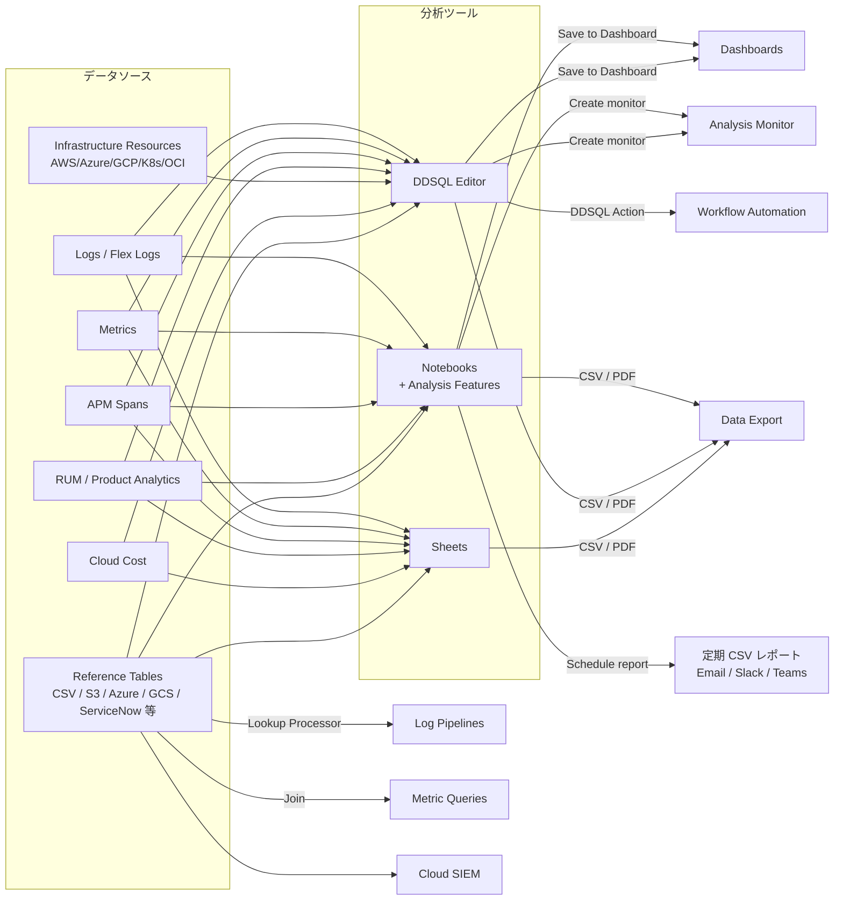
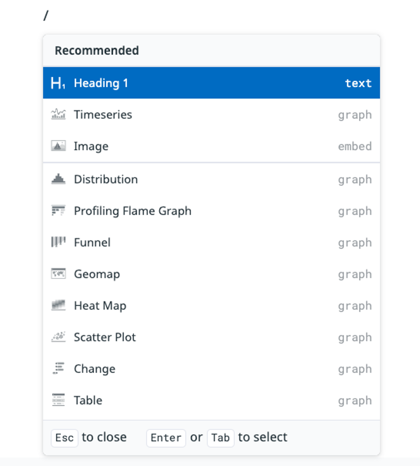
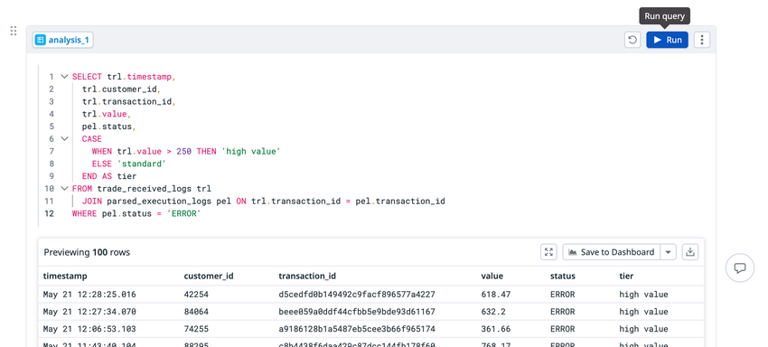
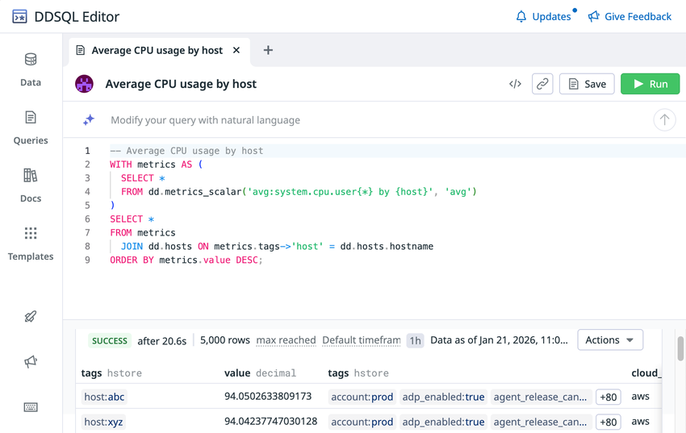
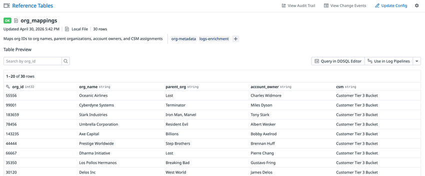
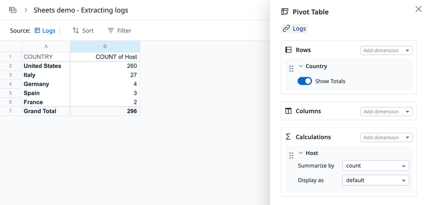

# Notebooks・DDSQL・Reference Tables

## 概要

Datadog には、ダッシュボードやモニターとは別に「収集済みデータを人が掘り下げて分析・共有する」ためのツール群がある。本ファイルはそれらを横断して扱う。

| ツール | 一言でいうと | 主な利用者 | 主な入力 | 主な出力 |
|---|---|---|---|---|
| **Notebooks（ノートブック）** | ライブなグラフを埋め込めるリッチテキストの共同編集ドキュメント | 調査担当、SRE、ポストモーテム作成者 | 全ウィジェット種別のグラフ、テキスト、画像 | ドキュメント、PDF |
| **Notebooks の Analysis Features（分析機能）**（Log Workspaces / Logs Workspaces の機能を統合した後継【推定】） | Notebook 内でデータソースを読み込み、変換・結合・SQL を多段で連鎖させる分析機能 | ログ分析者、調査担当 | Logs、RUM、Spans、Reference Tables、Metrics 等 | データセット、グラフ、CSV、ダッシュボード、定期 CSV レポート、Analysis Monitor |
| **DDSQL Editor** | DDSQL（タグを列のように扱える SQL 方言）または自然言語で、インフラリソースとテレメトリーを問い合わせる SQL IDE | エンジニア、FinOps、セキュリティ | Data Directory の各テーブル、テーブル関数 | 結果表、CSV、ダッシュボード、ノートブック、Workflow、Analysis Monitor |
| **Reference Tables（リファレンステーブル）** | 主キー付きの外部メタデータ表（CSV / クラウドストレージ / SaaS 連携）。他製品から参照してエンリッチする | プラットフォーム管理者 | CSV、S3、Azure Storage、GCS、ServiceNow 等 | Log Lookup Processor、Cloud SIEM、DDSQL、Sheets、Notebooks、メトリクス結合 |
| **Sheets（Datadog Sheets）** | Datadog データを表・ピボット・数式で分析するスプレッドシート | 非エンジニアを含む関係者、FinOps | 15 種のデータソース、Reference Tables | 表、ピボット、ウィジェット |
| **Data Export（データエクスポート手段の総称）** | CSV ダウンロード、定期 CSV レポート、PDF、API、Export Pipelines など、データを Datadog の外へ出す各種手段 | レポート担当、データ基盤担当 | 各ツールの結果 | CSV、PDF、JSON / Parquet（クラウドストレージ） |

公式ブログ（2025-06-10 公開）は、Sheets・DDSQL Editor・Notebooks の分析機能を「高度な分析ツール」の3本柱として紹介しており、Notebooks の分析機能は「以前は Logs Workspaces でのみ利用可能だった」機能であると説明している。[出典](https://www.datadoghq.com/blog/advanced-analysis-tools/)（2025-06-10 公開）

関連ファイル:

- ダッシュボード本体、ウィジェット、テンプレート変数、PDF 定期レポートは [Dashboards（ダッシュボード）](./dashboards.md) を参照。
- メトリクスクエリ構文・関数は [メトリクスクエリと関数](./metrics-query-and-functions.md) を参照。
- ログ検索・Log Explorer の分析機能は [ログ検索と分析](../logs/log-search-and-analytics.md)、Lookup Processor を含むパイプライン処理は [Log Pipelines と処理](../logs/log-pipelines-and-processing.md)、ログアーカイブ（大量データの外部保存）は [Indexes・保持・アーカイブ](../logs/log-indexes-retention-archives.md) を参照。
- モニター全般は [Monitors（モニター）](./monitors.md)、Workflow の DDSQL Action は [Workflow Automation](../service-management/workflow-automation.md)、Bits AI は [Bits AI と AI 機能](../ai/bits-ai.md) を参照。
- 権限・ロールの全体像は [組織・ユーザー・権限管理](./account-and-access-management.md)、API キーとスコープは [API とキー管理](./api-and-keys.md) を参照。

注: 上図のデータソースは主要なものの抜粋である。Sheets のデータソース全 15 種は「Sheets のデータソース」表、DDSQL のテーブルは「Data Directory」節を参照。

## Notebooks（ノートブック）

### Notebooks の位置づけと用途

Datadog Notebooks は、ライブな Datadog グラフを埋め込めるリッチテキストの共同編集ドキュメントである。公式ドキュメントが挙げる代表用途は、インシデント調査、ポストモーテム、ランブック、ドキュメント作成である。[出典](https://docs.datadoghq.com/notebooks/)

Notebooks と Dashboards の使い分け（公式の明示比較表は見当たらないため、両者のドキュメント記載機能から整理）:

| 観点 | Notebooks | Dashboards |
|---|---|---|
| 主目的 | 文章とグラフを組み合わせた記録・調査・共有 | 継続的な監視・可視化 |
| レイアウト | 上から下へのドキュメント形式（見出し・リスト・コード・表・Callout） | グリッド上のウィジェット配置 |
| 時間範囲 | グローバル時間（既定）＋グラフ単位でリンク解除可能 | グローバル時間＋ウィジェット単位の時間設定 |
| データ保全 | 固定時間範囲のグラフは自動スナップショット（保持期限後も表示を保全） | 公開情報では同等機能の記載を確認できず |
| 多段分析 | Analysis Features（データソース→変換→SQL→グラフ） | 不可（Notebook / DDSQL の結果を「Save to Dashboard」で取り込む） |
| エクスポート | PDF（1冊ずつ、UI のみ） | PDF 定期レポート等（[Dashboards](./dashboards.md) 参照） |

### Notebook の作成

| 方法 | 手順 |
|---|---|
| 左ナビゲーションから | **Dashboards > New Notebook** |
| Notebooks 一覧から | Notebooks List ページの **New Notebook** ボタン |
| テンプレートから | **Template Gallery** から選択。公式テンプレートとして Incident Response postmortem（インシデント対応ポストモーテム）、Incident Report（インシデントレポート）、SLO Specification（SLO 仕様）がある。独自のカスタムテンプレートも作成可能 |
| Log Explorer から | Log Explorer の **Analyze in Notebooks**（後述の Analysis Features 参照）、またはログのサイドパネルから個別ログを **Save to notebook** |
| API から | `POST /api/v1/notebooks`（後述） |

[出典](https://docs.datadoghq.com/notebooks/)、[出典](https://docs.datadoghq.com/logs/explorer/export/)

### Notebook の編集機能

Notebooks の本文はリッチテキストエディタで編集し、入力に応じて自動保存される。グラフの編集はグラフエディタで保存したときに Notebook に反映される。[出典](https://docs.datadoghq.com/notebooks/)

#### コンテンツ種別

| 種別 | 説明 |
|---|---|
| Graphs | すべてのウィジェット種別のグラフ |
| Images | PNG / JPG / JPEG / GIF、最大 4MB |
| Headers | H1〜H3 |
| Lists | 箇条書き、番号付き、チェックリスト |
| Code blocks | コードブロック |
| Block quotes | 引用 |
| Markdown cells | Markdown セル |
| Text tables | テキストの表 |
| Callouts | `NOTE`、`TIP`、`WARNING`、`IMPORTANT`、`CAUTION` |

`/` を新しい行で入力するとスラッシュコマンドメニューが開き、全コンテンツ種別を選べる。グラフ種別を選ぶとグラフエディタが開き、保存するとグラフが挿入される。[出典](https://docs.datadoghq.com/notebooks/)

*図1: Notebook でスラッシュコマンド（`/`）を入力したときのメニュー*

画面説明: 本文中で `/` を入力すると「Recommended」としてポップアップメニューが表示される。上部に Heading 1（text）、Timeseries（graph）、Image（embed）が推奨として並び、その下に Distribution、Profiling Flame Graph、Funnel、Geomap、Heat Map、Scatter Plot、Change、Table などのグラフ種別（graph）が並ぶ。メニュー下部には「Esc to close」「Enter or Tab to select」の操作ガイドが表示される。
出典: https://docs.datadoghq.com/notebooks/ （取得日: 2026-11-02）

#### リッチテキストのショートカット

| 操作 | 入力 |
|---|---|
| 太字 | `Cmd/Ctrl+B` |
| 斜体 | `Cmd/Ctrl+I` |
| インラインコード | テキストをバッククォートで囲む |
| 引用 | `>` を入力 |
| 表 | `/table` |
| Callout | `!NOTE`、`!TIP` などを入力して Space |
| 見出し | `#` ＋ Space（Markdown ショートカット） |
| コードブロック | バッククォート3つ |
| ウィジェットの切り取り・貼り付け | `Cmd/Ctrl+X`、`Cmd/Ctrl+V` |
| ショートカット一覧 | 左下のキーボードアイコン |

[出典](https://docs.datadoghq.com/notebooks/)

#### Smart Chips

| Chip | 入力 | 内容 |
|---|---|---|
| メンション | `@` ＋ユーザー名またはメール | ユーザーをメンション |
| テンプレート変数 | `$` ＋テンプレート変数名 | テンプレート変数の値を本文に表示 |
| 日付 | `/date`、`/today`、`/now` | 日付チップ（クリックで編集） |

[出典](https://docs.datadoghq.com/notebooks/)

#### グラフの操作

| 項目 | 内容 |
|---|---|
| Quick Edit | グラフにホバーして表示されるインライン編集 |
| フルエディタ | `Cmd/Ctrl` クリック、または鉛筆アイコン |
| 時間のリンク | 時計アイコンでグローバル時間とのリンク／解除を切り替え |
| サイズ | XS、S、M（既定）、L、XL |
| 凡例 | 非表示にできる。XS と S では既定で無効 |
| 目次 | 見出しとグラフから自動生成 |

[出典](https://docs.datadoghq.com/notebooks/)

### Notebook のタグ・コメント・共同編集

| 機能 | 内容 |
|---|---|
| Favorite | スターを付けると一覧で上部に固定 |
| Team タグ | 1 Notebook あたり最大 5 チーム |
| Type タグ | Postmortem、Runbook、Investigation、Documentation、Report |
| コメント | 選択テキスト（ツールバーから）、グラフ・画像（横のアイコン）にコメント可能。右マージンに表示。返信、@メンション、解決、リンクコピー、自分のコメントの編集・削除が可能 |
| コメント通知 | 新規コメントは作成者へメール通知、返信はスレッド参加者へ通知。三点メニューから調整可能 |
| リアルタイム共同編集 | カーソルとプレゼンスアバターが表示される |
| 競合解決 | ウィジェットは last-write-wins（最後の書き込みが優先）。他者が編集中のウィジェットは枠線で示されるため、同時編集を避ける |

[出典](https://docs.datadoghq.com/notebooks/)

### Notebook の設定（テンプレート変数・時間・モード・バージョン履歴）

| 設定 | 内容 |
|---|---|
| Template variables | グラフのスコープを絞り込む。タグキー `team` のテンプレート変数は、チーム階層を考慮した選択が可能なチームフィルタになる |
| Analysis 機能との関係 | Analysis Features の一部は、テンプレート変数のサポートが限定的または非対応 |
| 時間コントロール | 既定で全グラフがグローバル時間に従う。タイムピッカーやグラフのスクラブでグローバル時間を変えても保存はされない。**Set Default Time** で既定時間を保存、**Reset** で保存済み既定に戻る |
| グラフ単位の時間 | 個々のグラフをグローバル時間から解除し、独立した時間範囲を設定できる。編集モードでの変更は **Done** で保存 |
| モード | 右上のドロップダウンで **Editing**（編集）／**Viewing**（読み取り専用）を切り替え |
| Version history | 時計アイコンからサイドパネルを開き、過去バージョンのプレビュー・復元・クローンが可能 |

[出典](https://docs.datadoghq.com/notebooks/)

### Graph Snapshots（グラフスナップショット）

Notebooks の Graph Snapshots は、**固定時間範囲**のグラフについて、データ保持期限を過ぎる前にデータを自動でスナップショット保存する機能で、設定は不要である。[出典](https://docs.datadoghq.com/notebooks/)

| 項目 | 挙動 |
|---|---|
| 対象 | 固定時間範囲のグラフ |
| 更新 | グラフを変更すると、時間範囲が固定のままであればスナップショットも更新 |
| 解除 | 「Past 1 hour」などの相対（グローバル）時間に切り替えるとスナップショットは削除 |
| 表示 | タイトル下のインジケータに最新スナップショット時刻と総数を表示 |
| 保持期限切れ時 | データが保持期限外のグラフはインラインのスナップショットで表示。グラフを編集するとスナップショットは置き換わる |

実務上の含意: ポストモーテムでは、障害時間帯を固定時間範囲で設定したグラフを貼っておくと、メトリクスやログの保持期限を過ぎても当時のグラフが Notebook 上に残る【経験則】。保持期限そのものは [Metrics](./metrics.md) と [Indexes・保持・アーカイブ](../logs/log-indexes-retention-archives.md) を参照。

### Notebook の権限（アクセス制御）

| 設定 | 手順・挙動 |
|---|---|
| 既定 | 組織内の全ユーザーがフルアクセス |
| 自分のみ | **Share > Private to me > Save** |
| カスタム | Organization のアクセスを **Viewer** にし、ロール・チーム・ユーザーを **Editor** として追加。保存前に自分が所属するロールを少なくとも1つ含める必要がある |
| 全体アクセスの復元 | 編集権限が必要。**Share > My Org > Save** |

ロール権限（RBAC）:

| 権限 | 識別子 | 内容 | 既定で含むロール |
|---|---|---|---|
| Notebooks Read | `notebooks_read` | Notebook の閲覧 | Datadog Read Only Role |
| Notebooks Write | `notebooks_write` | Notebook の作成・変更 | Datadog Standard Role |

[出典](https://docs.datadoghq.com/notebooks/)、[出典](https://docs.datadoghq.com/account_management/rbac/permissions/)

### Notebook の検索と一覧

| 機能 | 内容 |
|---|---|
| 検索 | 全文検索 |
| フィルタ | 作成者、チーム、Type（investigation / postmortem / runbook / report / documentation）、更新日 |
| クイックフィルタ | 自分の Notebook、自分のチームでタグ付けされた Notebook |
| Jump Back In | フィルタ未指定時に最近閲覧・編集した Notebook を表示 |
| ソート | スター、詳細、更新日 |

[出典](https://docs.datadoghq.com/notebooks/)

### Notebook のダウンロード（PDF）

Notebook は三点メニューから PDF としてエクスポートできる。1回に1冊ずつで、すべてのグラフの読み込み完了後に実行する。公式ドキュメントには「API によるエクスポートは存在しない」と記載されている（PDF エクスポートの API は無い。Notebook 定義の取得 API は別途存在する）。[出典](https://docs.datadoghq.com/notebooks/)

### Notebooks API

| 操作 | メソッド | パス | 必要権限 |
|---|---|---|---|
| Notebook 作成 | `POST` | `/api/v1/notebooks` | `notebooks_write` |
| 全 Notebook 取得 | `GET` | `/api/v1/notebooks` | 公式ページ上で明記を確認できず（閲覧系のため `notebooks_read` と推定）【推定】 |
| Notebook 取得 | `GET` | `/api/v1/notebooks/{notebook_id}` | 同上【推定】 |
| Notebook 更新 | `PUT` | `/api/v1/notebooks/{notebook_id}` | 公式ページ上で明記を確認できず |
| Notebook 削除 | `DELETE` | `/api/v1/notebooks/{notebook_id}` | 公式ページ上で明記を確認できず |

- API のホストはサイトごとに異なる（例: US1 は `https://api.datadoghq.com`、AP1 は `https://api.ap1.datadoghq.com`）。サイトの一覧は [Datadog Sites](./datadog-sites.md) を参照。
- API の Notebook 属性で記述されるセル種別は `markdown`、`timeseries`、`toplist`、`heatmap`、`distribution`、`log_stream` である。Analysis Features のデータソース／変換／SQL セルを API で扱えるかは公開情報では確認できず。
- Terraform では `datadog_notebook` 相当のリソース提供有無は公開情報（本調査範囲）では確認できず。IaC 全般は [Terraform と IaC](./terraform-and-iac.md) を参照。

[出典](https://docs.datadoghq.com/api/latest/notebooks/)、[出典](https://docs.datadoghq.com/api/latest/notebooks/create-a-notebook/)

## Notebooks の Analysis Features（Log Workspaces の機能を統合）

### Log Workspaces との関係

Log Workspaces（Logs Workspaces）は、2025-05-23 公開の公式ブログで「Datadog Log Management の一部として一般提供（GA）」と発表された、複数ソースのログを多段で分析するための環境である。データソースセル（ログ、RUM、Reference Tables、メトリクス）、変換セル（grok 抽出、フィルタ、集計、結合、計算、変換、Limit、Sort）、分析セル（SQL または Bits AI による自然言語）、可視化（テーブル、トップリスト、時系列、ツリーマップ、円グラフ、散布図）を備えていた。[出典](https://www.datadoghq.com/blog/log-workspaces/)（2025-05-23 公開）

その後、2025-06-10 公開の公式ブログで、これらの機能は Notebooks に統合され「以前は Logs Workspaces でのみ利用可能だった高度な分析機能を Notebooks がサポートする」と説明された。[出典](https://www.datadoghq.com/blog/advanced-analysis-tools/)（2025-06-10 公開）

2026-11-02 時点の状況:

| 項目 | 状況 |
|---|---|
| 旧ドキュメント URL | `https://docs.datadoghq.com/logs/workspaces/` は Notebooks の「Analysis Features」ページ（`/notebooks/advanced_analysis/`）の内容を表示する。ページ内に Log Workspaces の改称・移行手順の説明は無い |
| 権限 | RBAC 権限一覧には `logs_read_workspaces`（Read Logs Workspaces、既定: Read Only Role）と `logs_write_workspaces`（Write Logs Workspaces、既定: Standard Role）が引き続き掲載されている |
| 機能名 | 公式ドキュメント上の名称は「Analysis Features」（Notebooks のサブ機能）。ブログ等では「advanced analysis」とも表記 |
| 移行手順 | 既存 Workspace から Notebook への公式な移行ガイドは公開情報では確認できず |
| 位置付け | 公式には「改称」とは明記されておらず、「Log Workspaces の機能が Notebooks に統合された」とのみ説明されている。本ファイルで Analysis Features を Log Workspaces の後継として扱うのは上記ブログとドキュメント URL の状況からの判断である【推定】 |

[出典](https://docs.datadoghq.com/logs/workspaces/)、[出典](https://docs.datadoghq.com/notebooks/advanced_analysis/)、[出典](https://docs.datadoghq.com/account_management/rbac/permissions/)

関連プレビュー: **Advanced Log Analytics**【Preview】は、(1) Splunk などの既存ログツールのクエリを Datadog Notebook へ自動変換する「Bring Your Own Query」と、(2) Notebook 内で自然言語によりクエリ・変換・結合・可視化のセルを連鎖生成する「Bits AI Data Analyst」から成る。[出典](https://www.datadoghq.com/product-preview/advanced-log-analytics)。他ツールからの移行全般は [他製品からの移行](../../03_導入編/14-migration-from-other-tools.md) を参照。

### Analysis Features の概要

Notebooks の Analysis Features は、データセットの結合、クエリの連鎖（集計結果をさらに集計する等）、定義済み変換または SQL によるデータ変換を Notebook 内で行う機能である。公式が挙げるユースケースは、クエリの連鎖、ログソース同士や他データセットとの結合、高度なパース、クエリ時の計算フィールド、変換済みデータセットのグラフ化である。[出典](https://docs.datadoghq.com/notebooks/advanced_analysis/)

*図2: Notebook の Analysis セルで SQL を実行した例*

画面説明: セル名 `analysis_1` の Analysis セル。エディタには `trade_received_logs` と `parsed_execution_logs` を `transaction_id` で `JOIN` し、`CASE WHEN trl.value > 250 THEN 'high value' ELSE 'standard' END AS tier` で区分列を作り、`WHERE pel.status = 'ERROR'` で絞り込む SQL が書かれている。右上に **Run**（Run query）ボタン、下部に「Previewing 100 rows」と結果表（timestamp、customer_id、transaction_id、value、status、tier 列）、結果表右上に **Save to Dashboard** ボタンとダウンロードアイコンがある。
出典: https://docs.datadoghq.com/notebooks/advanced_analysis/ （取得日: 2026-11-02）

### セル種別

| セル | スラッシュコマンド | 役割 |
|---|---|---|
| Data source cell（データソースセル） | `/datasource` | ベースとなるデータセットを定義。ソースをドロップダウンで選択しクエリを入力。予約属性が列になる |
| Transformation cell（変換セル） | `/transformation` | 元データセットに操作を適用（下表） |
| Analysis cell（分析セル） | `/sql` または `/analysis` | SQL でデータを変換。構文は DDSQL Reference に従う。ソースを選び、クエリを書き **Run** |
| Graph cell（グラフセル） | `/graph` | 選択したチャート種別で可視化 |

依存先のセルが変わると、依存するセルは自動的に更新される。[出典](https://docs.datadoghq.com/notebooks/advanced_analysis/)

Transformation cell の操作:

| 操作 | 内容 |
|---|---|
| Parse | Grok 構文で新しい列へ抽出 |
| Group | 選択フィールドでグループ化 |
| Join | 結合種別、結合先データセット、結合フィールドを指定 |
| Filter | フィルタクエリ |
| Calculate | 計算フィールドの式で名前付きフィールドを作成 |
| Limit | 表示行数 |
| Sort | ソート列と順序 |
| Convert | 列の型変換 |

[出典](https://docs.datadoghq.com/notebooks/advanced_analysis/)

### データソースの追加

| 方法 | 手順・挙動 |
|---|---|
| Notebook から | `/datasource` または Data Source タイルをクリック。ソースを選んでクエリを入力 |
| Log Explorer から | **Analyze in Notebooks** をクリックし、「Use as a computational data source」にチェックして Notebook を選択。Log Explorer のクエリと列が引き継がれる |
| 計算フィールド付きのクエリ | Log Explorer の Calculated Fields を含むクエリは Transformation セルに変換される。Notebook 内では Transformation セル > **More operations > Calculate** で作成 |
| 列の追加 | プレビューの列検索、または行の詳細パネルの「Add "@column" to "@datasource" dataset」 |
| 時間範囲 | Notebook で作成したセルは Notebook のグローバル時間を使用。Log Explorer から作成したセルはエクスポート時点で固定されたローカル時間を使用。トグルで切り替え可能 |
| フィルタ | 検索バーのクエリを編集すると当該セルと下流のセルが再実行される |

公式ブログによれば、Notebooks の分析機能で扱えるデータとしてログ、RUM イベント、Spans、Reference Tables が挙げられている。[出典](https://docs.datadoghq.com/notebooks/advanced_analysis/)、[出典](https://www.datadoghq.com/blog/advanced-analysis-tools/)（2025-06-10 公開）

チュートリアル（Getting Started）の流れの例: 2 つのログソースを読み込む → Transform セルで grok により `transaction_id` を抽出 → Analysis セルの SQL で結合 → Reference Table を追加して `customer_id` で LEFT JOIN → ツリーマップで `status:ERROR` を可視化。[出典](https://docs.datadoghq.com/notebooks/advanced_analysis/getting_started/)

### 結果の閲覧・エクスポート・共有

| 機能 | 内容 |
|---|---|
| Dataset preview | **View dataset** で 100 行のプレビューを表示 |
| Save to Dashboard | セル結果を既存または新規ダッシュボードへ出力。ダッシュボードのグラフはセルと同期するが、Notebook 側でクエリを変えてもダッシュボードは自動更新されない。**Publish** すると、そのクエリを使う全ダッシュボードが更新される。ダッシュボード側のデータセットは既定でダッシュボードのグローバル時間を使い、ウィジェット単位でカスタム時間も設定可能 |
| CSV ダウンロード | セル右上のダウンロードアイコン。行数は「利用可能な最大行数」まで選択可能（具体値は公開情報では確認できず） |
| 定期 CSV レポート | **Save to Dashboard > Schedule report** から作成（下表） |
| Analysis Monitor | Analysis セルの **Send To > Monitors** から作成（後述） |

[出典](https://docs.datadoghq.com/notebooks/advanced_analysis/)

#### 定期 CSV レポート（Scheduled CSV Reports）

| 設定項目 | 内容 |
|---|---|
| スケジュール | 頻度・レポート名・時間範囲 |
| Email 受信者 | 既定で自分のアカウントのメールを含む。**Send Test Email** でプレビュー。**Datadog に登録されていないメールアドレスへの送信は Enterprise / Pro アカウントのみ** |
| Slack | Datadog Slack インテグレーションが必要。公開チャンネルは自動表示、プライベートチャンネルは Datadog Slack bot を招待。**Send Test Message** でプレビュー |
| Microsoft Teams | Microsoft Teams インテグレーションと、対象 Team への Datadog アプリ追加が必要。Tenant、Team、Channel を選択 |
| 管理 | **Reports** タブでスケジュールの閲覧・検索・編集・削除 |

| 権限 | 識別子 | 内容 | 既定で含むロール |
|---|---|---|---|
| CSV Report Schedules Write | `generate_log_reports` | CSV レポートのスケジュール作成、他ユーザーのスケジュール閲覧 | Datadog Standard Role |
| CSV Report Schedules Manage | `manage_log_reports` | 他ユーザーが作成したスケジュールの編集 | Datadog Admin Role |

これらの権限は Org Management 権限を持つユーザーが付与できる。Slack / Teams 連携の設定は [通知・コラボレーション連携](./collaboration-integrations.md) を参照。[出典](https://docs.datadoghq.com/notebooks/advanced_analysis/)、[出典](https://docs.datadoghq.com/account_management/rbac/permissions/)

### Analysis Features のサイト差異

> **サイト差異:** Notebooks の Analysis Features は `app.ddog-gov.com`（US1-FED）および `us2.ddog-gov.com` ではサポートされない。US1（`app.datadoghq.com`）、US3、US5、EU1（`app.datadoghq.eu`）、AP1、AP2、および公式ドキュメントのサイト選択に表示される `uk1` では利用可能で、未提供のデータソースは「Request Access」フォームで申請する。[出典](https://docs.datadoghq.com/notebooks/advanced_analysis/)

## DDSQL Editor

### DDSQL Editor の概要

DDSQL Editor は、インフラストラクチャリソースとテレメトリーを、自然言語または **DDSQL**（タグのクエリを追加サポートした SQL 方言）で問い合わせる Datadog のアプリである。[出典](https://docs.datadoghq.com/ddsql_editor/)

提供状況: 2026-11-02 時点の DDSQL Editor 本体ページには Preview 表記は無い。ただし、DDSQL Editor 配下の一部ページ（例: 「Reference Tables in DDSQL (Preview)」、旧構文の「DDSQL (Preview)」リファレンス）には Preview 表記が残っている。Datadog MCP Server の `ddsql` ツールセットは【Preview】。[出典](https://docs.datadoghq.com/ddsql_editor/)、[出典](https://docs.datadoghq.com/ddsql_editor/reference_tables/)、[出典](https://docs.datadoghq.com/ddsql_reference/ddsql_preview/)

*図3: DDSQL Editor でホスト別平均 CPU 使用率を問い合わせた画面*

画面説明: 左のサイドバーに **Data**、**Queries**、**Docs**、**Templates** のアイコンが縦に並ぶ。上部にクエリタブ「Average CPU usage by host」、その右に埋め込みコード・リンク・**Save**・**Run** ボタン。タイトル下に「Modify your query with natural language」の自然言語入力欄がある。エディタには `WITH metrics AS (SELECT * FROM dd.metrics_scalar('avg:system.cpu.user{*} by {host}', 'avg'))` の CTE と、`dd.hosts` を `metrics.tags->'host' = dd.hosts.hostname` で JOIN し `value` の降順に並べる SQL が書かれている。結果欄には「SUCCESS after 20.6s」「5,000 rows」「max reached」「Default timeframe 1h」と **Actions** メニューが表示され、`tags`（hstore 型）、`value`（decimal 型）などの列が並ぶ。
出典: https://docs.datadoghq.com/ddsql_editor/ （取得日: 2026-11-02）

### DDSQL Editor の主な機能

| 機能 | 内容 |
|---|---|
| 自然言語クエリ | 質問を入力すると SQL が生成される。結果の採用／破棄、フィードバック送信が可能 |
| DDSQL 構文 | `SELECT` 等の標準 SQL 操作に加え、タグをテーブルの列のように扱える（例: `tags->'region'`） |
| Data Explorer | テーブル名をクリックすると列とリレーションを表示。Logs などのデータソースはクエリビルダーでテーブル関数を生成 |
| 保存・共有 | クエリの保存、CSV ダウンロード、サイドパネルで最近／保存済みクエリを参照 |
| エクスポート | 保存したクエリ結果を Dashboard または Notebook へエクスポート |
| Workflow 連携 | Workflow Automation の **DDSQL Action** で自動化（例: カスタムメトリクスの作成、結果のエクスポート、コンプライアンスチェックの Slack 定期送信） |
| アラート | DDSQL クエリでアラート可能（DDSQL Editor ページの記載では Logs、Metrics、RUM、Spans、Product Analytics。詳細は Analysis Monitor 節） |
| AI エージェント | Datadog MCP Server の `ddsql` ツールセット【Preview】経由で AI エージェントが DDSQL を実行 |
| 追加データソース | 未提供のデータソースは「Advanced Data Sources」申請フォームでリクエスト |

[出典](https://docs.datadoghq.com/ddsql_editor/)

公式ブログが挙げる DDSQL Editor の活用例: EC2 インベントリと APM 有効サービスの結合、AWS アカウント横断のリソース監査、過剰プロビジョニングされたクラスターや孤立した EBS ボリュームの特定（コスト最適化）。[出典](https://www.datadoghq.com/blog/advanced-analysis-tools/)（2025-06-10 公開）

### DDSQL Editor の権限

| 権限 | 識別子 | 内容 | 既定で含むロール |
|---|---|---|---|
| DDSQL Editor Read | `ddsql_editor_read` | DDSQL Editor の利用 | Datadog Read Only Role（カスタムロールには手動追加が必要） |

クエリ対象データ自体の閲覧権限（例: ログの Data Access 制御）がどのように DDSQL に適用されるかの詳細は、公開情報（本調査範囲）では確認できず。[出典](https://docs.datadoghq.com/ddsql_editor/)、[出典](https://docs.datadoghq.com/account_management/rbac/permissions/)

### Data Directory（クエリ可能なテーブル）

DDSQL でクエリできるテーブルの一覧は **Data Directory** に掲載されている。プロバイダ別に分類され、テーブル名は `aws.ec2_instance` のようにプロバイダ接頭辞付きの形式である。[出典](https://docs.datadoghq.com/ddsql_reference/data_directory/)

| 分類 | 代表的なテーブル（Data Directory 記載の表示名） |
|---|---|
| AWS | EC2 Instance、S3 Bucket、Lambda Function、RDS Instance、EKS Cluster、IAM Role など |
| Azure | Virtual Machine Instance、Storage Account、AKS Cluster、Key Vault、Log Analytics Workspace など |
| GCP | Compute Instance、Storage Bucket、Kubernetes Engine Cluster、Cloud Run Service、BigQuery Table など |
| K8S | Kubernetes Pods、Deployments、Nodes、Services など |
| OCI | Compute Instance、Autonomous Database、Bucket、Virtual Cloud Network、Load Balancer など |
| Datadog | Hosts（`dd.hosts`）、Logs、APM Spans、RUM Events、Events、Audit Trail、Monitors（`dd.monitors`）、Services、Containers、Database Instances、Network Device Flows、Security Findings、LLM Observability、Product Analytics など |

- メトリクスと Cloud Cost は Data Directory の通常テーブルではなく、後述のテーブル関数（`dd.metrics_scalar` 等）で扱う。
- Reference Tables は `reference_tables.<テーブル名>` で参照する（例: `SELECT * FROM reference_tables.test`）。他テーブルとの JOIN も可能。ただし出典ページは「DDSQL には2つの構文系統があり、本ガイドの例は DDSQL (Preview) 構文を使う」と明記しており、この記法は **DDSQL (Preview) 構文** の例である。現行の DDSQL Reference でも同じ記法が使えるかは公開ドキュメントで確認できず（後述「DDSQL の2つの構文系統」参照）。[出典](https://docs.datadoghq.com/ddsql_editor/reference_tables/)
- `dd.monitors` はモニターとその現在の評価状態を返すデータセット。[出典](https://docs.datadoghq.com/ddsql_reference/data_directory/)
- インフラリソース系テーブル（クラウドリソースのインベントリ）は Resource Catalog 等と同じリソース収集に基づくと考えられるが、収集条件（インテグレーション設定・リソース収集の有効化）の詳細は各インテグレーションのファイルを参照: [AWS Integration](./aws-integration.md)、[Azure Integration](./azure-integration.md)、[Google Cloud Integration](./gcp-integration.md)【推定】。

### DDSQL 構文リファレンス（要約）

DDSQL は DDSQL Editor と Notebooks（Analysis セル）で利用できる。[出典](https://docs.datadoghq.com/ddsql_reference/)

#### 文・句

| 構文 | サポート内容 |
|---|---|
| `SELECT` | `DISTINCT` 可 |
| `JOIN` | `INNER`、`LEFT`、`RIGHT`、`FULL`。`ON` 句。列名が同じ場合は `USING` |
| `WHERE` | `LIKE`、`IN`、`OR`、`IS NULL`、`IS NOT NULL` 等 |
| `GROUP BY` / `HAVING` / `ORDER BY` | `ASC` / `DESC` |
| `CASE` | 条件式 |
| ウィンドウ句 | `OVER`、`PARTITION BY`、`ORDER BY`、`ROWS BETWEEN` 等のフレーム指定 |
| `LIMIT` / `OFFSET` | あり |
| CTE（`WITH`） | 構文表には未記載だが、公式の例で使用されている |
| 演算子 | `+ - * /`、文字列連結 `||`、別名 `AS` |
| `INTERVAL` | milliseconds、seconds、minutes、hours、days（単数・複数形） |

#### データ型

| 型 | 備考 |
|---|---|
| `BIGINT`、`BOOLEAN`、`DECIMAL`、`INET`、`INTERVAL`、`JSON`、`TIMESTAMP`、`VARCHAR` | すべて配列型あり |
| 型リテラル | `TYPE 'value'`（例: `TIMESTAMP '2025-01-01'`）。接頭辞を省略した日付文字列は `VARCHAR` と推論される点に注意 |
| `CAST` の変換先 | `BIGINT`、`DECIMAL`、`INET`、`TIMESTAMP`、`VARCHAR` |
| タグ | `hstore` 型 |

#### 関数

| 分類 | 関数 |
|---|---|
| 集約 | `MIN`、`MAX`、`COUNT`、`SUM`、`AVG`、`BOOL_AND`、`BOOL_OR`、`APPROX_PERCENTILE(p) WITHIN GROUP (ORDER BY ...)`（p は 0.0〜1.0） |
| 数値 | `CEIL` / `CEILING`、`FLOOR`、`ROUND`（1 引数）、`POWER`、`ABS` |
| 文字列 | `LOWER`、`UPPER`、`LENGTH`、`TRIM`、`REPLACE`、`SUBSTRING`、`REVERSE`、`STRPOS`、`SPLIT_PART` |
| NULL・型 | `COALESCE`、`CAST` |
| 時刻 | `EXTRACT`、`TO_TIMESTAMP`（書式文字列版／Unix 秒版）、`TO_CHAR`、`DATE_BIN`、`DATE_TRUNC`、`NOW()`、`CURRENT_SETTING('dd.time_frame_start' / 'dd.time_frame_end')`（グローバル時間範囲の境界） |
| 正規表現（ICU） | `REGEXP_LIKE`、`REGEXP_MATCH`、`REGEXP_REPLACE`。フラグ `i`、`n` / `m`、`g` |
| ウィンドウ | `RANK()`、`ROW_NUMBER()`、`LEAD`、`LAG`、`FIRST_VALUE`、`LAST_VALUE`、`NTH_VALUE` |
| 配列 | `ARRAY[...]`、1 始まりの添字（範囲外は `NULL`）、`CARDINALITY`、`ARRAY_POSITION`、`STRING_TO_ARRAY`、`ARRAY_TO_STRING`、`ARRAY_AGG`、`UNNEST`（FROM 句のみ） |
| JSON | `json_extract_path_text`、`json_extract_path`、`json_array_elements`、`json_array_elements_text`（後2者は FROM 句のみ） |
| INET | `host`、`network`、`netmask`、`masklen`、`broadcast`、`family`。包含演算子 `<<`、`<<=`、`>>`、`>>=`、重なり `&&` |
| タグ | `tags -> 'key'`（text を返す。キーが無ければ NULL。複数値はソート済みのカンマ区切り文字列）、`akeys(tags)`、`avals(tags)` |

[出典](https://docs.datadoghq.com/ddsql_reference/)

#### テーブル関数

| 関数 | 主な引数 | 備考 |
|---|---|---|
| `dd.logs` | `columns`、`filter`、`indexes`、`storage`（例: `hot`、`flex_tier`）、`from_timestamp`、`to_timestamp` | `AS (...)` で出力スキーマを定義。ネストはドット記法、コア以外の属性は `@` 接頭辞。`storage` の既定は hot。時間未指定時はグローバル時間設定に従い、DDSQL Editor では過去 1 時間（`dd.metrics_*`・`dd.cloud_cost_*` の時間パラメータも既定 1 時間） |
| `dd.metrics_scalar` | クエリ、リデューサ（`avg`、`max` 等）、任意の時間境界 | スカラー値 |
| `dd.metrics_timeseries` | クエリ、任意の時間境界 | 時系列データポイント |
| `dd.cloud_cost_scalar` | クエリ、リデューサ（コストは `sum`）、任意の時間境界 | Cloud Cost データは通常 24〜48 時間遅延 |
| `dd.cloud_cost_timeseries` | クエリ、任意の時間境界 | 同上 |

列の別名にドットは使えない。Flex Logs の詳細は [Indexes・保持・アーカイブ](../logs/log-indexes-retention-archives.md)、Cloud Cost は [Cloud Cost Management](../infrastructure/cloud-cost-management.md) を参照。[出典](https://docs.datadoghq.com/ddsql_reference/)

#### クエリ効率の公式ガイダンス

| 指針 | 内容 |
|---|---|
| 選択的なフィルタ | `filter` に選択的なトークンを含める（`service:*` のようなワイルドカードはスキャン範囲を絞らない） |
| 時間範囲 | 質問に必要な最小限に絞る |
| 列 | 必要な列だけ選択 |
| 集約 | 大きな生データの `LIMIT` より `GROUP BY` で要約 |
| 自己結合 | 繰り返しの自己結合は `CASE`、ウィンドウ関数、`GROUP BY ... HAVING` による単一スキャンに書き換え |
| 結合キー | 高カーディナリティのキーを使い、ソース横断結合では両側をフィルタ |
| 正規表現 | 1 行につき 1 回だけ評価されるようにする |

重いクエリは遅くなるかリソースエラーを返すことがある。[出典](https://docs.datadoghq.com/ddsql_reference/)

#### DDSQL の2つの構文系統

公式ドキュメントには現行の「DDSQL Reference」（`/ddsql_reference/`）とは別に「DDSQL (Preview)」（`/ddsql_reference/ddsql_preview/`、Functions / Data Types / Expressions and Operators / Statements の各ページを持つ）が存在する。両者の差分や旧構文の廃止予定は公開情報では確認できず。新規に書くクエリは現行の DDSQL Reference に従うのが無難である【推定】。[出典](https://docs.datadoghq.com/ddsql_reference/ddsql_preview/)

注意: 公式ドキュメントの例がすべて現行構文とは限らない。たとえば Reference Tables の問い合わせ例（`SELECT * FROM reference_tables.test`）は、出典ページ自身が DDSQL (Preview) 構文であると明記している。現行の DDSQL Reference には `reference_tables` の記法に関する記載が無く、現行構文で同一記法が使えるかは公開情報では確認できず。[出典](https://docs.datadoghq.com/ddsql_editor/reference_tables/)

## Analysis Monitor（DDSQL / Notebook 分析に対するモニター）

Analysis Monitor は、公開（Publish）された Notebook の分析または DDSQL クエリの結果に対してアラートを設定するモニター種別である。[出典](https://docs.datadoghq.com/monitors/types/analysis/)

| 項目 | 内容 |
|---|---|
| 作成経路 | (1) **Monitors > New Monitor > Analysis**、(2) Notebook の Analysis セルの **Send To > Monitors**、(3) DDSQL Editor で **Save to dashboard** 横のドロップダウン > **Create monitor** |
| 設定 | 公開済みの Notebook / DDSQL 分析を選び、列で結果をフィルタし、出力をプレビューしてから条件を設定 |
| アラート条件 | クエリ値がしきい値を超えたときにトリガー。回復しきい値、評価遅延などの詳細オプションあり |
| サポートされるデータソース | Agent Observability、Audit、CI Pipelines、CI Tests、Events、Logs、Metrics、NetFlow、Network、Reference Tables、RUM、Service Checks、Spans |
| サポートされないデータソース | AI Usage、Cloud Cost、Database Queries、DORA Metrics、Errors、Infrastructure Resources、Monitor Groups and Monitors、Product Analytics、Security Findings、Security Signals、Snowflake Query、Synthetics |
| Flex Logs | Flex ストレージのログはモニター対象外 |
| 依存関係 | 分析が依存する全データソースがサポート対象である必要がある。非対応ソースを含むと「This query is not monitorable because it's based on an unsupported data source for monitoring: …」とエラー表示 |
| 評価頻度・時間窓 | 公開情報（Analysis Monitor ページ）では確認できず |

> **サイト差異:** Analysis Monitor は `app.ddog-gov.com`（US1-FED）と `us2.ddog-gov.com` では非サポート。データソースは、モニター規模のクエリ負荷に耐えると Datadog が検証したものから順に有効化される。[出典](https://docs.datadoghq.com/monitors/types/analysis/)

注意（ドキュメント間の差異）: DDSQL Editor ページは「アラートは Logs、Metrics、RUM、Spans、Product Analytics のみ」と記載する一方、Analysis Monitor ページは Product Analytics を**非サポート**に挙げ、Audit・Events・CI 等を**サポート**に挙げている。2026-11-02 時点で両ページの記載は一致していない。対応可否はモニター作成画面のエラー表示で最終確認すること。[出典](https://docs.datadoghq.com/ddsql_editor/)、[出典](https://docs.datadoghq.com/monitors/types/analysis/)

モニター全般（通知、再通知、評価）は [Monitors](./monitors.md) と [通知と Downtime](./notifications-and-downtimes.md) を参照。

## Reference Tables（リファレンステーブル）

### Reference Tables の概要

Reference Tables は、顧客情報、サービス名・情報、IP アドレスなどのメタデータを主キー付きのテーブルとして Datadog に取り込み、ログ・イベント・セキュリティ・コスト・メトリクス・分析ツールから参照してテレメトリーをエンリッチする機能である。[出典](https://docs.datadoghq.com/reference_tables/)、[出典](https://docs.datadoghq.com/integrations/guide/reference-tables/)

*図4: Reference Table（`org_mappings`）の詳細画面*

画面説明: 画面上部にパンくず「Reference Tables」と、右側に **View Audit Trail**、**View Change Events**、**Update Config**、歯車（設定）アイコン。テーブル名 `org_mappings` の左に状態バッジ「OK」、下に「Updated April 30, 2026 5:42 PM」「Local File」「30 rows」と説明文、タグ（`org-metadata`、`logs-enrichment`）が表示される。**Table Preview** には主キー列で検索する「Search by org_id」欄と、**Query in DDSQL Editor**、**Use in Log Pipelines** ボタンがあり、表には主キー `org_id`（int32、鍵アイコン付き）と `org_name`、`parent_org`、`account_owner`、`csm`（いずれも string）の列が並ぶ。
出典: https://docs.datadoghq.com/reference_tables/ （取得日: 2026-11-02）

### データソース（作成方法）

| ソース | 要件・挙動 | ファイル上限 | 自動更新 |
|---|---|---|---|
| 手動アップロード（CSV、Local File） | テーブル作成→CSV アップロード→列名を確認→主キーを定義。作成後に UI で行編集可能 | 200MB | 自動更新なし |
| Amazon S3 | AWS インテグレーションの IAM ロールに `s3:GetObject`、`s3:ListBucket`（KMS 暗号化時は `kms:Decrypt`）が必要。SSE-S3 / SSE-KMS 対応。ファイル変更時にテーブルを置き換え、内容が同一なら置き換えない | 200MB | 5 分ごと |
| Azure Storage | Azure インテグレーションのアプリ登録に **Storage Blob Data Reader** ロールを付与 | 200MB | 5 分ごと |
| Google Cloud Storage | GCP インテグレーションのサービスアカウントにバケットの **Storage Object Viewer** ロールを付与 | 200MB | 5 分ごと |
| Terraform | `datadog_reference_table` リソース | クラウドストレージと同じ | ソースに依存 |
| API | Create Reference Table エンドポイント。ローカルファイルは先にアップロード ID を取得 | クラウドストレージと同じ | ソースに依存 |
| インテグレーション | Databricks、Salesforce、ServiceNow、Snowflake（設定手順は各インテグレーションのドキュメント） | 200MB | 1 時間ごと |

[出典](https://docs.datadoghq.com/reference_tables/)、[出典](https://docs.datadoghq.com/integrations/guide/reference-tables/)

各クラウドインテグレーションの設定は [AWS Integration](./aws-integration.md)、[Azure Integration](./azure-integration.md)、[Google Cloud Integration](./gcp-integration.md) を参照。

> **サイト差異:** Reference Tables（少なくとも Google Cloud Storage ソース）は `app.ddog-gov.com`（US1-FED）と `us2.ddog-gov.com` では利用できない旨が公式ドキュメントに表示される。他ソース（手動アップロード、S3 等）の GovCloud での提供可否は公開情報では明確に確認できず。[出典](https://docs.datadoghq.com/reference_tables/)

### 主キーと更新（Upsert）の挙動

| 項目 | 内容 |
|---|---|
| 主キー | セットアップ時に定義し、ルックアップに使用（例: `org_id`）。API 上の主キーは 1 列のみサポート |
| CSV 更新（**Update Config**） | 主キーが一致する行は更新、新規行は追加、新ファイルに無い旧行は削除 |
| 反映時間 | Upsert された行の処理は非同期で、最大 10 分 |
| テーブル削除時 | エンリッチが停止するまで最大 10 分 |

[出典](https://docs.datadoghq.com/reference_tables/)、[出典](https://docs.datadoghq.com/api/latest/reference-tables/create-reference-table/)

### テーブル名・列名の検証ルール

| ルール | 内容 |
|---|---|
| 先頭文字 | 小文字アルファベット |
| 使用可能文字 | 小文字、数字、`_` のみ。スペースは `_` に変換 |
| 大文字 | 小文字に変換 |
| 重複 | 連番で区別（例: `fileid1`、`fileid2`） |
| 最大長 | 56 文字（超過は拒否され、名前の変更が必要） |

[出典](https://docs.datadoghq.com/reference_tables/)

### UI での行編集

| 項目 | 内容 |
|---|---|
| 対象 | **Local File** ソースのテーブルのみ（クラウドストレージ・インテグレーションのテーブルは不可） |
| 必要権限 | `reference_tables_write` とテーブルの編集アクセス |
| 1 万行未満のテーブル | ページ送りで全行を閲覧・編集可能 |
| 1 万行以上のテーブル | プレビューは先頭 100 行のみ。主キー検索で対象行を探す |
| 保存 | 変更は **Save Version** を押すまでドラフト |

[出典](https://docs.datadoghq.com/reference_tables/)

### Reference Tables の利用先

| 利用先 | 使い方 | 関連ファイル |
|---|---|---|
| Logs（Lookup Processor） | パイプラインの Lookup Processor の **Reference Table** タブでテーブルを選択し、ログ属性に値を付与 | [Log Pipelines と処理](../logs/log-pipelines-and-processing.md) |
| Logs（Log Explorer） | Reference Table に基づくログのフィルタ | [ログ検索と分析](../logs/log-search-and-analytics.md) |
| Events | Events 用の Lookup Processor | [Event Management](./event-management.md) |
| Cloud SIEM | 検知・調査のエンリッチ | [Cloud SIEM](../security/cloud-siem.md) |
| Cloud Cost Management | Tag Pipelines で複数タグをコストデータにマッピング | [Cloud Cost Management](../infrastructure/cloud-cost-management.md) |
| Metrics | Reference Table Joins with Metrics（クエリ時にタグ追加） | [メトリクスクエリと関数](./metrics-query-and-functions.md) |
| DDSQL Editor | `reference_tables.<name>`（DDSQL (Preview) 構文の例）で問い合わせ・JOIN、CSV やダッシュボードへ出力 | 本ファイル |
| Sheets | Lookup で列を追加 | 本ファイル |
| Notebooks | Analysis Features のデータソースとして使用 | 本ファイル |
| Observability Pipelines | ログのエンリッチ（ServiceNow CMDB のコンテキスト付与を含む） | [Observability Pipelines](../logs/observability-pipelines.md) |
| Analysis Monitor | サポート対象データソース | 本ファイル |

[出典](https://docs.datadoghq.com/reference_tables/)

#### Lookup Processor での Reference Table と Mapping Table の違い

| 項目 | Manual Mapping（マッピングテーブル） | Reference Table |
|---|---|---|
| 定義場所 | Processor 内に `source_key,target_value` を手入力または CSV アップロード | Reference Tables で管理 |
| サイズ上限 | **100KB（プラットフォーム上の全 Lookup Processor の合計）** | Reference Tables の上限（1 ファイル 200MB 等）に従う |
| 更新 | Processor の編集 | ソースに応じて自動更新（S3 等 5 分、インテグレーション 1 時間） |

Lookup Processor は、ソース属性が存在し値がテーブルにあればターゲット属性を作成し、無ければ任意のフォールバック値（UI 上の `fallbackValue`、API 上の `default_lookup`）を設定する。[出典](https://docs.datadoghq.com/logs/log_configuration/processors/lookup_processor/)

#### Reference Table Joins with Metrics

メトリクスクエリ時に Reference Table を結合してタグを追加・別名付けする機能。手順は、(1) space aggregation（1 つ以上のタグで group by）を含むメトリクスクエリを作成、(2) **Modify > Join** を選択、(3) 結合種別と Reference Table を指定、(4) クエリ側の既存タグ（例: `team`）とテーブル列で結合条件を定義、(5) 追加するタグとして使う列を選択。[出典](https://docs.datadoghq.com/metrics/reference_table_joins_with_metrics/)

- 現行ページには Preview 表記・有効化要件・結合種別一覧・制限値の記載が無い。同機能を扱う旧ページ（Composite Metrics Queries）では Preview で CSM 経由の有効化が必要と記載されていた。提供状況はアカウントで確認すること。[出典](https://docs.datadoghq.com/metrics/composite_metrics_queries/)

### Reference Tables の権限

| 権限 | 識別子 | 内容 | 既定で含むロール |
|---|---|---|---|
| Reference Tables Read | `reference_tables_read` | Reference Tables の閲覧 | Datadog Read Only Role |
| Reference Tables Write | `reference_tables_write` | Reference Tables の作成・変更 | Datadog Standard Role |

- テーブル単位のきめ細かなアクセス制御: 歯車アイコン > **Permissions > Restrict Access** で、特定のチーム・ロール・ユーザーに **Editor** または **Viewer** を付与。
- Audit Trail の閲覧には組織管理系の権限が必要。

[出典](https://docs.datadoghq.com/reference_tables/)、[出典](https://docs.datadoghq.com/account_management/rbac/permissions/)

### Reference Tables の監視

| 仕組み | 内容 |
|---|---|
| Audit Trail | アセット種別 `reference_table_file`（インポート・アップロード）と `reference_table`（作成・変更・削除） |
| Change Events | クラウドストレージ・インテグレーションのインポートと自動更新で送信（ソース: `reference_tables`）。ローカルアップロードでは生成されない |
| Event Monitor | インポートエラーをアラート。Monitors タブから作成、または **New Reference Table +** 横の設定アイコンから事前入力済みモニターを作成 |

[出典](https://docs.datadoghq.com/reference_tables/)。Audit Trail は [Audit Trail](./audit-trail.md) を参照。

### Reference Tables API

| 操作 | メソッド | パス |
|---|---|---|
| アップロード作成 | `POST` | `/api/v2/reference-tables/uploads` |
| テーブル作成 | `POST` | `/api/v2/reference-tables/tables` |
| テーブル一覧 | `GET` | `/api/v2/reference-tables/tables` |
| テーブル取得 | `GET` | `/api/v2/reference-tables/tables/{id}` |
| ID で行取得 | `GET` | `/api/v2/reference-tables/tables/{id}/rows` |
| 行一覧 | `GET` | `/api/v2/reference-tables/tables/{id}/rows/list` |
| テーブル更新 | `PATCH` | `/api/v2/reference-tables/tables/{id}` |
| テーブル削除 | `DELETE` | `/api/v2/reference-tables/tables/{id}` |
| 行の Upsert | `POST` | `/api/v2/reference-tables/tables/{id}/rows` |
| 行の削除 | `DELETE` | `/api/v2/reference-tables/tables/{id}/rows` |
| 複数行の一括照会 | `POST` | `/api/v2/reference-tables/queries/batch-rows` |

テーブル作成 API の主なフィールド:

| フィールド | 内容 |
|---|---|
| `data.type` | `reference_table` |
| `attributes.table_name` | 必須 |
| `attributes.source` | 作成時に指定可能なのは `LOCAL_FILE`、`S3`、`GCS`、`AZURE` のみ。レスポンスではこれに加え `SERVICENOW`、`SALESFORCE`、`DATABRICKS`、`SNOWFLAKE` が返り得る |
| `attributes.description` / `tags` | 任意 |
| `attributes.file_metadata` | クラウドストレージ: `access_details`（`aws_detail` / `azure_detail` / `gcp_detail`）と `sync_enabled`（自動同期の有無）。ローカル: `upload_id` |
| `attributes.schema.fields` | 最大 200。各要素は `name` と `type`（`STRING` または `INT32`） |
| `attributes.schema.primary_keys` | 1 列のみサポート |

ローカルファイルの流れ: アップロード ID を取得 → CSV をチャンクで PUT → `upload_id` を指定してテーブル作成。認証はベアラートークン（Personal Access Token または Service Access Token）と記載されている（API キー／アプリケーションキーでの利用可否は公式ページ上で明記を確認できず）。[出典](https://docs.datadoghq.com/api/latest/reference-tables/)、[出典](https://docs.datadoghq.com/api/latest/reference-tables/create-reference-table/)

注: 公式のローカルファイルのサンプルには `"type": "DOUBLE"` が使われているが、スキーマ定義上の型は `STRING` と `INT32` のみであり、ドキュメント内で不整合がある（2026-11-02 時点）。

## Sheets（Datadog Sheets）

### Sheets の概要

Datadog Sheets は、Datadog のデータを他ツールへエクスポートせずに分析するためのスプレッドシートツールである。タブ種別は **Table**、**Pivot**、**Sheet** の3つ。[出典](https://docs.datadoghq.com/sheets/)

提供状況: Sheets（Table / Pivot）のドキュメントに Preview 表記は無い。**Sheet タブ（数式エンジン付きの自由形式スプレッドシート、"flexible spreadsheet"）**は、2026-05-06 公開の公式ブログで【Preview】とされている（Cloud Cost 向けテンプレートギャラリーも Preview で提供）。[出典](https://www.datadoghq.com/blog/flexible-sheets-cloud-cost-management/)（2026-05-06 公開）

*図5: Sheets の Pivot タブ（ログを国別に集計）*

画面説明: 上部にスプレッドシート名「Sheets demo - Extracting logs」、その下に「Source: Logs」、**Sort**、**Filter**。左側の表は A 列に COUNTRY（United States、Italy、Germany、Spain、France と Grand Total）、B 列に「COUNT of Host」（260、27、4、3、2、合計 296）。右側の **Pivot Table** パネルには、ソース「Logs」、**Rows**（Country、Show Totals トグル ON）、**Columns**（未設定）、**Calculations**（Host、Summarize by: count、Display as: default）の各セクションがあり、それぞれ「Add dimension」で項目を追加できる。
出典: https://docs.datadoghq.com/sheets/ （取得日: 2026-11-02）

### Table タブ

| 機能 | 内容 |
|---|---|
| 作成 | Sheets ページで **New Spreadsheet > Add Data** → データソース選択 → フィルタ → 列選択 → プレビュー → **Create Table** |
| 他製品から | Log Explorer 等の **Open in Sheets** から新規または既存スプレッドシートへ保存 |
| Calculated columns（計算列） | 右端列ヘッダーの **+** で追加。数式、ログメッセージのパース、正規表現抽出、ビジネスロジックに使用。ピボットでも使用可能 |
| Lookup | **Add Lookup** で他ソース（Reference Tables、Logs、RUM 等）の列を追加。共通列でマッチする LEFT JOIN / VLOOKUP 相当（例: RUM のユーザーメールを Reference Table の勤務先メールと突合してチーム名を付与） |

[出典](https://docs.datadoghq.com/sheets/)

### Pivot タブ

| 機能 | 内容 |
|---|---|
| 作成 | テーブルを持つスプレッドシートで **Add Pivot Table** |
| Rows / Columns | 分析する次元（例: ログの status） |
| Calculations | sum、average、count、min、max |
| 可視化 | **Show Graphs** で最大 6 ウィジェット。種別は Top List、Treemap、Pie Chart |
| ウィジェット操作 | 削除、複製、拡大、エクスポート、移動。鉛筆アイコンで種別・計算・グループ化を変更 |

[出典](https://docs.datadoghq.com/sheets/)

### Sheet タブ（自由形式スプレッドシート）【Preview】

| 項目 | 内容 |
|---|---|
| 追加 | 下部の **+** タブ > **Add Sheet** |
| セル参照 | 相対 `A1`、絶対 `$A$1`、列絶対 `$A1`、行絶対 `A$1`、範囲 `A1:C5` |
| シート間参照 | 範囲 `='Summary'!B2:B20`、テーブル列名 `='Error Logs'#"duration_ms"` |
| 書式 | プレーンテキスト、数値、パーセント、通貨（USD / EUR）、日時。書式は表示のみで計算値は変えない |
| エラー値 | `#DIV/0!`、`#VALUE!`、`#NUM!`、`#N/A`、`#REF!`、`#NAME?`、`#ERROR!` |

数式例（公式）: `=SUM('Error Logs'#"duration_ms")`、`=COUNTIF('Error Logs'#"status","error")`、`=IFNA(VLOOKUP(A2,'User Directory'!A:B,2,0),"unknown")`、`=PERCENTILE('APM Data'#"duration",0.95)`。[出典](https://docs.datadoghq.com/sheets/)

### Sheets の関数と演算子

| 分類 | 関数数 |
|---|---|
| Text | 20 |
| Logical | 11 |
| Math（集約・条件付き集計を含む） | 22 |
| Date and time | 17 |
| Lookup and reference | 7 |
| Statistical | 10 |
| Financial | 8 |
| Info | 3 |
| **合計** | **98** |

- 演算子（12）: 算術 `+ - * / ^`、連結 `&`、比較 `= <> > < >= <=`。
- 主な関数: `REGEXMATCH`、`REGEXEXTRACT`、`REGEXCOUNT`、`REGEXREPLACE`、`IF`、`IFS`、`SWITCH`、`IFERROR`、`IFNA`、`COUNTIFS`、`SUMIFS`、`AVERAGEIFS`、`MAXIFS`、`MINIFS`、`VLOOKUP`、`HLOOKUP`、`INDEX`、`MATCH`、`EPOCHTODATE`（`unit` 既定は秒、`2` でミリ秒、`3` でマイクロ秒）、`PERCENTILE`、`FORECAST`、`NPV`、`IRR`、`PMT`。
- 利用可能な文脈: 多くの関数（`SUM`、`AVERAGE` 等の集約、ルックアップ、財務関数）は Sheet タブの数式でのみ使用可能。Table の計算列は行単位の変換（正規表現、基本テキスト、論理、数学、日付）に絞った部分集合。

[出典](https://docs.datadoghq.com/sheets/functions_operators/)

### Sheets のデータソース

| # | データソース | 元の Explorer |
|---|---|---|
| 1 | APM Spans | APM Explorer |
| 2 | Audit Trail | Audit Trail |
| 3 | CI Pipelines | CI Visibility |
| 4 | Cloud Cost | Cloud Cost Analytics |
| 5 | Database Queries | Database Monitoring |
| 6 | Events | Event Management |
| 7 | Infrastructure | Host List |
| 8 | Agent Observability | — |
| 9 | Logs | Logs Explorer |
| 10 | Metrics | Metrics Explorer |
| 11 | Product Analytics | Product Analytics Events |
| 12 | Real User Monitoring | RUM Explorer |
| 13 | Reference Tables | Reference Tables |
| 14 | Security Findings | Cloud Security |
| 15 | Security Signals | Security |

その他のデータソースは Advanced Data Sources のアクセス申請フォームでリクエストする。[出典](https://docs.datadoghq.com/sheets/)

### Sheets の権限

| 権限 | 識別子 | 内容 | 既定で含むロール |
|---|---|---|---|
| Sheets Read | `sheets_read` | Sheets の閲覧 | Datadog Read Only Role |
| Sheets Write | `sheets_write` | Sheets の作成・変更 | Datadog Standard Role |

- 既定では全ユーザーがフルアクセス。編集制限は歯車メニュー > **Permissions > Restrict Access** で、ロール・チーム・ユーザーを Editor に追加（他のメンバーは Viewer になる）。保存前に自分の所属ロールを含めないと自分の編集権を失う。**Restore Full Access** で解除（編集権が必要）。

[出典](https://docs.datadoghq.com/sheets/)、[出典](https://docs.datadoghq.com/account_management/rbac/permissions/)

## Data Export（データエクスポート手段の整理）

Datadog には「Data Export」という単一製品は無く（2026-11-02 時点の公開情報では確認できず）、各ツール・製品にエクスポート手段が分散している。本節は分析ツール群に関わるエクスポート手段を横断整理する。

| 手段 | 対象 | 形式 | 上限・条件 | 出典 |
|---|---|---|---|---|
| Notebook の PDF ダウンロード | Notebook 全体 | PDF | 1 冊ずつ、UI のみ（API なし） | [Notebooks](https://docs.datadoghq.com/notebooks/) |
| Notebook Analysis セルの CSV ダウンロード | セルの結果 | CSV | 「利用可能な最大行数」まで（具体値は確認できず） | [Analysis Features](https://docs.datadoghq.com/notebooks/advanced_analysis/) |
| 定期 CSV レポート | Notebook Analysis セルの結果 | CSV（Email / Slack / Teams） | 未登録メールへの送信は Enterprise / Pro のみ。`generate_log_reports` 権限 | [Analysis Features](https://docs.datadoghq.com/notebooks/advanced_analysis/) |
| DDSQL Editor の CSV ダウンロード | クエリ結果 | CSV | 行数上限は公式ドキュメントに明記なし（公式スクリーンショット上では 5,000 行で「max reached」と表示） | [DDSQL Editor](https://docs.datadoghq.com/ddsql_editor/) |
| DDSQL Action（Workflow） | クエリ結果 | Workflow で任意に加工・送信 | Workflow Automation の課金・制限に従う | [DDSQL Editor](https://docs.datadoghq.com/ddsql_editor/) |
| Save to Dashboard / Notebook | Notebook・DDSQL の結果 | ダッシュボードウィジェット | Publish で同期 | [Analysis Features](https://docs.datadoghq.com/notebooks/advanced_analysis/) |
| Sheets のウィジェットエクスポート | Pivot のウィジェット | 公開情報では形式を確認できず | — | [Sheets](https://docs.datadoghq.com/sheets/) |
| Log Explorer の CSV | 個別ログ | CSV | 1 回 100,000 件 | [Log Explorer Export](https://docs.datadoghq.com/logs/explorer/export/) |
| Log Explorer の CSV（Patterns） | パターン | CSV | 300 件 | 同上 |
| Log Explorer の CSV（Transactions） | トランザクション | CSV | 500 件 | 同上 |
| Logs API（List） | ログ | JSON | 1 リクエスト最大 1,000 件（ページネーションで継続） | 同上 |
| Log Archives | 取り込んだ全ログ | 圧縮 JSON（顧客のストレージ） | [Indexes・保持・アーカイブ](../logs/log-indexes-retention-archives.md) 参照 | — |
| Export Pipelines | RUM・Product Analytics イベント | JSON（`.json.gz`）または Parquet を S3 / Azure Blob / GCS へ継続出力 | 下表参照 | [Export Pipelines](https://docs.datadoghq.com/product_analytics/export_pipelines/) |

CSV エクスポートの注意（Log Explorer）: 改行の除去、連続スペースの圧縮、数式として解釈され得る先頭文字への単一引用符付与、重複列名への連番付与など、値や列名が原本と異なることがある。未加工のデータが必要な場合は Log Search API または Log Archives を使う。[出典](https://docs.datadoghq.com/logs/explorer/export/)

ダッシュボードの PDF 定期レポート（`generate_dashboard_reports`）は [Dashboards](./dashboards.md) を参照。

### Export Pipelines（RUM / Product Analytics のエクスポート）

Export Pipelines は、取り込んだ RUM と Product Analytics のイベントを、顧客所有のクラウドストレージへ JSON または Parquet で継続的にストリーミングする機能である。Datadog が管理するのはストレージへの出力までで、ストレージからデータウェアハウス（BigQuery、Snowflake、Databricks 等）への取り込みは利用者側で行う。[出典](https://docs.datadoghq.com/product_analytics/export_pipelines/)

| 項目 | 内容 |
|---|---|
| 出力先 | Amazon S3（ロールベースの STS 連携が必要。アクセスキー連携は非対応）、Azure Blob Storage（ChinaCloud / GermanyCloud 非対応、GovCloud はサポート経由で Preview）、Google Cloud Storage（STS 対応インテグレーションと GCP プロジェクト ID が必要） |
| 形式 | JSON（gzip 圧縮の改行区切り、`.json.gz`）、Parquet（1 行 1 イベント、型付き列、`.parquet`） |
| ファイル配置 | `/<path>/dt=<YYYYMMDD>/hour=<HH>/archive_<HHmmss.SSSS>.<UUID>.<ext>` |
| パイプライン数 | アプリケーションごとに RUM 1 本、Product Analytics 1 本。組織ごとに User and Account Profiles 1 本 |
| プリセット | RUM: 全イベント種別、または Sessions・Views・Actions のみ。Product Analytics: 全イベント（sessions、views、actions、server-side events）。Profiles: User and Account Profiles |
| 頻度 | 各パイプラインが独立して継続出力。新規作成後、最初のアップロードまで数分かかることがある |
| ステータス | Active、Pending、Error、Paused。15 分以上 Pending の場合は **Test Configuration** で確認 |
| Datadog 側権限 | 出力先インテグレーションの読み取り権限（`aws_configuration_read`、`azure_configuration_read`、`gcp_configuration_read`） |
| バケット側権限 | S3: `s3:PutObject`、`s3:GetObject`。Azure: Storage Blob Data Contributor。GCS: Storage Object Admin |
| バケット要件 | 公開読み取り不可。Azure のイミュータビリティ、GCS の保持ポリシーは不可（再試行時にイベントを書き換えることがあるため） |
| 提供状況 | 製品プレビューページ（product-preview/export-pipelines）が存在する一方、料金ページには有償アドオンとして掲載されている。ドキュメント本体の Preview 表記の有無は取得時点で確認できず |

> **サイト差異:** Export Pipelines は `app.ddog-gov.com`（US1-FED）と `us2.ddog-gov.com` では非サポート。US1 / US3 / US5 では AWS のリージョン間データ転送料金が発生し得るため、バケットを `us-east-1` に作成することが推奨されている。[出典](https://docs.datadoghq.com/product_analytics/export_pipelines/)

RUM・Product Analytics 本体は [RUM（ブラウザ）](../dem/rum-browser.md)、[Session Replay と Product Analytics](../dem/session-replay-and-product-analytics.md) を参照。

## 制限値・クォータ・デフォルト値

### Notebooks

| 項目 | 値 | 出典 |
|---|---|---|
| 画像アップロードのファイルサイズ | 最大 4MB | [Notebooks](https://docs.datadoghq.com/notebooks/) |
| 画像形式 | PNG、JPG、JPEG、GIF | 同上 |
| Team タグ | 1 Notebook あたり最大 5 | 同上 |
| グラフサイズの既定 | M（XS / S / M / L / XL） | 同上 |
| 凡例の既定 | XS・S は非表示 | 同上 |
| 既定のアクセス | 組織内全ユーザーがフルアクセス | 同上 |
| PDF エクスポート | 1 回 1 冊、API なし | 同上 |
| 1 Notebook あたりのセル数・グラフ数上限 | 公開情報では確認できず | — |
| 組織あたりの Notebook 数上限 | 公開情報では確認できず | — |
| バージョン履歴の保持期間 | 公開情報では確認できず | — |
| Graph Snapshot の保持期間 | 公開情報では確認できず | — |
| Notebooks API のレート制限 | 公開情報（API ページ）では確認できず。API 全般のレート制限は [API とキー管理](./api-and-keys.md) 参照 | — |

### Notebooks の Analysis Features

| 項目 | 値 | 出典 |
|---|---|---|
| データセットプレビュー | 100 行 | [Analysis Features](https://docs.datadoghq.com/notebooks/advanced_analysis/) |
| CSV ダウンロード行数 | 「利用可能な最大行数」まで（具体値は公開情報では確認できず） | 同上 |
| 既定の時間範囲 | Notebook 作成セル: Notebook のグローバル時間。Log Explorer 由来セル: エクスポート時点の固定ローカル時間 | 同上 |
| 未登録メールへのレポート送信 | Enterprise / Pro アカウントのみ | 同上 |
| クエリ実行時間・データ量の上限 | 公開情報では確認できず | — |
| 非サポートサイト | `app.ddog-gov.com`、`us2.ddog-gov.com` | 同上 |

### DDSQL Editor / DDSQL

| 項目 | 値 | 出典 |
|---|---|---|
| `dd.logs` の既定ストレージ | hot | [DDSQL Reference](https://docs.datadoghq.com/ddsql_reference/) |
| DDSQL Editor の既定時間範囲（`dd.logs`、`dd.metrics_*`、`dd.cloud_cost_*`） | 過去 1 時間（グローバル時間設定に基づく） | 同上 |
| Cloud Cost テーブル関数のデータ遅延 | 通常 24〜48 時間 | 同上 |
| `APPROX_PERCENTILE` の p | 0.0〜1.0 | 同上 |
| 配列の添字 | 1 始まり、範囲外は `NULL` | 同上 |
| 結果行数の上限 | 公式ドキュメントに明記なし（公式スクリーンショットで 5,000 行時に「max reached」表示） | [DDSQL Editor](https://docs.datadoghq.com/ddsql_editor/) |
| クエリタイムアウト | 公開情報では確認できず（重いクエリは遅延・リソースエラーの可能性） | [DDSQL Reference](https://docs.datadoghq.com/ddsql_reference/) |
| 保存クエリ数の上限 | 公開情報では確認できず | — |
| 必要権限 | `ddsql_editor_read`（既定で Read Only Role に含む） | [DDSQL Editor](https://docs.datadoghq.com/ddsql_editor/) |

### Reference Tables

| 項目 | 値 | 出典 |
|---|---|---|
| 列数 | 1 テーブル最大 200 | [Reference Tables](https://docs.datadoghq.com/reference_tables/) |
| 行サイズ | 1 行最大 500 KiB | 同上 |
| ファイルサイズ | 最大 200 MB（UI アップロード、クラウドストレージ、インテグレーション、Terraform、API） | 同上 |
| テーブル数 | 1 組織最大 100 | 同上 |
| 上限緩和 | サポートへ連絡で上位の上限が可能 | 同上 |
| 主キー | 1 列のみ（API スキーマ） | [API](https://docs.datadoghq.com/api/latest/reference-tables/create-reference-table/) |
| 列の型（API） | `STRING`、`INT32` | 同上 |
| 名前の最大長 | 56 文字 | [Reference Tables](https://docs.datadoghq.com/reference_tables/) |
| 自動更新間隔 | S3 / Azure / GCS: 5 分ごと。インテグレーション: 1 時間ごと。手動 CSV: 自動更新なし | 同上 |
| Upsert の反映 | 最大 10 分（非同期） | 同上 |
| 削除後のエンリッチ停止 | 最大 10 分 | 同上 |
| UI での全行編集 | 1 万行未満のテーブル。1 万行以上はプレビュー先頭 100 行のみ | 同上 |
| Lookup Processor の Manual Mapping | 全 Lookup Processor 合計 100KB | [Lookup Processor](https://docs.datadoghq.com/logs/log_configuration/processors/lookup_processor/) |

### Sheets

| 項目 | 既定 | 最大 | 出典 |
|---|---|---|---|
| 行数 | 1,000 | 2,000 | [Sheets](https://docs.datadoghq.com/sheets/) |
| 列数 | 26 | 52 | 同上 |
| Pivot のウィジェット数 | — | 6 | 同上 |
| データソース数 | 15（申請で追加） | — | 同上 |
| 関数数 | 98 | — | [Functions](https://docs.datadoghq.com/sheets/functions_operators/) |
| スプレッドシート数・タブ数の上限 | 公開情報では確認できず | — | — |

注: Sheets の行数上限（既定 1,000 / 最大 2,000）が Table タブ・Sheet タブのいずれに適用されるか、公式ページには区別の記載が無い。

### Data Export

| 項目 | 値 | 出典 |
|---|---|---|
| Log Explorer CSV（個別ログ） | 100,000 件 / 回 | [Log Explorer Export](https://docs.datadoghq.com/logs/explorer/export/) |
| Log Explorer CSV（Patterns） | 300 | 同上 |
| Log Explorer CSV（Transactions） | 500 | 同上 |
| Logs API（List） | 1,000 件 / リクエスト | 同上 |
| Export Pipelines（RUM） | アプリごと 1 本 | [Export Pipelines](https://docs.datadoghq.com/product_analytics/export_pipelines/) |
| Export Pipelines（Product Analytics） | アプリごと 1 本 | 同上 |
| Export Pipelines（Profiles） | 組織ごと 1 本 | 同上 |
| Export Pipelines の Pending 許容 | 15 分超で要確認 | 同上 |

## 課金への影響

| ツール | 課金単位 | 備考 |
|---|---|---|
| Notebooks | 公式料金ページに独立した課金項目は無い（料金ページでは Platform Capabilities のナビゲーションに掲載されるのみ） | Notebook 内でクエリされる各データ（ログ、APM 等）は各製品の課金に従う |
| Notebooks の Analysis Features（旧 Log Workspaces） | 独立した課金項目は公式料金ページで確認できず | 旧 Log Workspaces は「Log Management の一部として GA」と発表されていた。[出典](https://www.datadoghq.com/blog/log-workspaces/)（2025-05-23 公開） |
| DDSQL Editor | 独立した課金項目は公式料金ページで確認できず | Flex Logs（`storage => 'flex_tier'`）のクエリ等、基盤データ側の課金体系に従う。Flex Logs の課金は [Indexes・保持・アーカイブ](../logs/log-indexes-retention-archives.md) 参照 |
| Reference Tables | 独立した課金項目は公式料金ページで確認できず | Lookup によりログ属性が増えても、ログの課金単位（取り込み量・インデックス件数）に従う |
| Sheets | 独立した課金項目は公式料金ページで確認できず | — |
| Analysis Monitor | 公開情報では確認できず | モニター自体の課金は [Monitors](./monitors.md) 参照 |
| Workflow の DDSQL Action | Workflow Automation の課金に従う | [Workflow Automation](../service-management/workflow-automation.md) 参照 |
| Export Pipelines | **Export Pipelines（Add-On for RUM Measure and Product Analytics）: 1,000 セッションあたり月額 $0.10（年契約）/ $0.12（月契約）/ $0.15（オンデマンド）**（2026-11-02 時点、公式料金ページ） | 出力先クラウドストレージの保存料・転送料（US1/US3/US5 でのリージョン間転送等）は別途クラウド事業者に発生 |

[出典](https://www.datadoghq.com/pricing/list/)

料金の正本は [製品別料金表](../../03_導入編/02-pricing-by-product.md)、課金計算の仕組みは [課金計算の仕組み](../../03_導入編/03-billing-mechanics.md)、コスト最適化は [コスト最適化](../../04_応用編/01-cost-optimization.md) を参照。

## 実務上の使い分けと注意点

| シナリオ | 推奨ツール | 理由 |
|---|---|---|
| 障害対応の記録・ポストモーテム | Notebooks（Incident Response postmortem テンプレート） | 固定時間範囲のグラフが Graph Snapshot で保持期限後も残る。コメント・バージョン履歴あり |
| ランブック | Notebooks（Type: Runbook） | テンプレート変数でスコープを切り替えつつ手順と可視化を併記できる |
| 複数ログソースの突合・grok による事後パース | Notebooks の Analysis Features | 変換セル・SQL セルを多段で連鎖でき、途中経過を文章で説明できる |
| クラウドリソース棚卸し・タグ監査・テレメトリーとの結合 | DDSQL Editor | Data Directory のインフラテーブルとテレメトリーを SQL で JOIN できる |
| 非エンジニアへの集計提供、Cloud Cost の手元計算 | Sheets | 表・ピボット・数式で操作でき、ライブデータに接続 |
| CMDB・顧客マスタ等によるテレメトリーのエンリッチ | Reference Tables | Lookup Processor、Cloud SIEM、メトリクス結合など横断で再利用できる |
| 定期的な CSV 配信 | Notebook Analysis セルの Scheduled Report | Email / Slack / Teams 配信。未登録メールは Enterprise / Pro のみ |
| RUM / Product Analytics の生イベントをDWHへ | Export Pipelines | Parquet でウェアハウスに直接ロード可能 |
| 全ログの長期保存・外部分析 | Log Archives（本ファイル対象外） | CSV は件数上限と値のサニタイズがある |

注意点:

- Reference Tables の Lookup Processor で Manual Mapping（100KB の全体共有上限）を多用すると上限に達しやすいため、大きな対応表は Reference Tables に寄せるのが一般的である【経験則】。
- Reference Tables を S3 等から自動同期する場合、ファイル内容が変わらなければ置き換えは発生しない。差分が無いのに更新されない、という問い合わせは仕様どおりである。[出典](https://docs.datadoghq.com/reference_tables/)
- Notebook の Analysis セルから Save to Dashboard した後に Notebook 側のクエリを修正しても、**Publish** するまでダッシュボードには反映されない。[出典](https://docs.datadoghq.com/notebooks/advanced_analysis/)
- DDSQL のタグ値は複数値のときソート済みのカンマ区切り文字列として返るため、`=` 比較で一致しないことがある。複数値タグは `LIKE` や `STRING_TO_ARRAY` 等での扱いを検討する【推定】。[出典](https://docs.datadoghq.com/ddsql_reference/)
- Flex ストレージのログは Analysis Monitor の対象外であるため、アラートが必要なログは Standard Indexing 側に置く必要がある。[出典](https://docs.datadoghq.com/monitors/types/analysis/)
- 運用設計全般（ダッシュボード・ノートブックの棚卸し、オーナー設定）は [運用設計](../../03_導入編/13-operations-design.md) と [ダッシュボード設計の実践](../../04_応用編/04-dashboard-design-practices.md) を参照。

## 参照元

公式ドキュメント（取得日: 2026-11-02）

- Notebooks: https://docs.datadoghq.com/notebooks/
- Analysis Features（旧 Logs Workspaces のドキュメント URL を含む）: https://docs.datadoghq.com/notebooks/advanced_analysis/ 、 https://docs.datadoghq.com/logs/workspaces/
- Getting Started with Analysis Features: https://docs.datadoghq.com/notebooks/advanced_analysis/getting_started/
- DDSQL Editor: https://docs.datadoghq.com/ddsql_editor/
- DDSQL Reference: https://docs.datadoghq.com/ddsql_reference/
- DDSQL (Preview): https://docs.datadoghq.com/ddsql_reference/ddsql_preview/
- Data Directory: https://docs.datadoghq.com/ddsql_reference/data_directory/
- Reference Tables in DDSQL: https://docs.datadoghq.com/ddsql_editor/reference_tables/
- Reference Tables: https://docs.datadoghq.com/reference_tables/ 、 https://docs.datadoghq.com/integrations/guide/reference-tables/
- Reference Table Joins with Metrics: https://docs.datadoghq.com/metrics/reference_table_joins_with_metrics/
- Composite Metrics Queries: https://docs.datadoghq.com/metrics/composite_metrics_queries/
- Lookup Processor: https://docs.datadoghq.com/logs/log_configuration/processors/lookup_processor/
- Sheets: https://docs.datadoghq.com/sheets/
- Sheets Functions and Operators: https://docs.datadoghq.com/sheets/functions_operators/
- Analysis Monitor: https://docs.datadoghq.com/monitors/types/analysis/
- Log Explorer Export: https://docs.datadoghq.com/logs/explorer/export/
- Export Pipelines: https://docs.datadoghq.com/product_analytics/export_pipelines/
- RBAC Permissions: https://docs.datadoghq.com/account_management/rbac/permissions/
- Notebooks API: https://docs.datadoghq.com/api/latest/notebooks/ 、 https://docs.datadoghq.com/api/latest/notebooks/create-a-notebook/
- Reference Tables API: https://docs.datadoghq.com/api/latest/reference-tables/ 、 https://docs.datadoghq.com/api/latest/reference-tables/create-reference-table/

公式サイト・ブログ・プレビュー

- 料金（List Pricing、2026-11-02 取得）: https://www.datadoghq.com/pricing/list/
- Explore your data with Sheets, DDSQL Editor, and Notebooks for advanced analysis in Datadog（2025-06-10 公開）: https://www.datadoghq.com/blog/advanced-analysis-tools/
- Log Workspaces（2025-05-23 公開）: https://www.datadoghq.com/blog/log-workspaces/
- Analyze cloud costs with flexible spreadsheets in Datadog Sheets（2026-05-06 公開）: https://www.datadoghq.com/blog/flexible-sheets-cloud-cost-management/
- Advanced Log Analytics（Product Preview）: https://www.datadoghq.com/product-preview/advanced-log-analytics
- Export Pipelines（Product Preview）: https://www.datadoghq.com/product-preview/export-pipelines/

画像（すべて公式ドキュメントより、取得日: 2026-11-02）

- `assets/images/notebooks-and-data-tools/notebook-slash-command-menu.png` … https://docs.datadoghq.com/notebooks/
- `assets/images/notebooks-and-data-tools/notebook-analysis-cell.png` … https://docs.datadoghq.com/notebooks/advanced_analysis/
- `assets/images/notebooks-and-data-tools/ddsql-editor-query-results.png` … https://docs.datadoghq.com/ddsql_editor/
- `assets/images/notebooks-and-data-tools/reference-table-overview.png` … https://docs.datadoghq.com/reference_tables/
- `assets/images/notebooks-and-data-tools/sheets-pivot-table.png` … https://docs.datadoghq.com/sheets/
