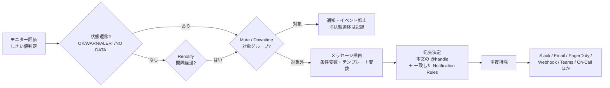
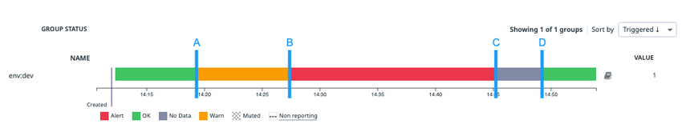
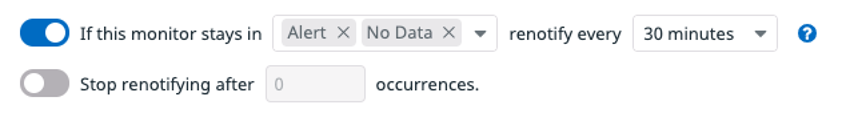
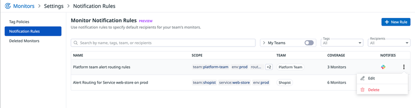
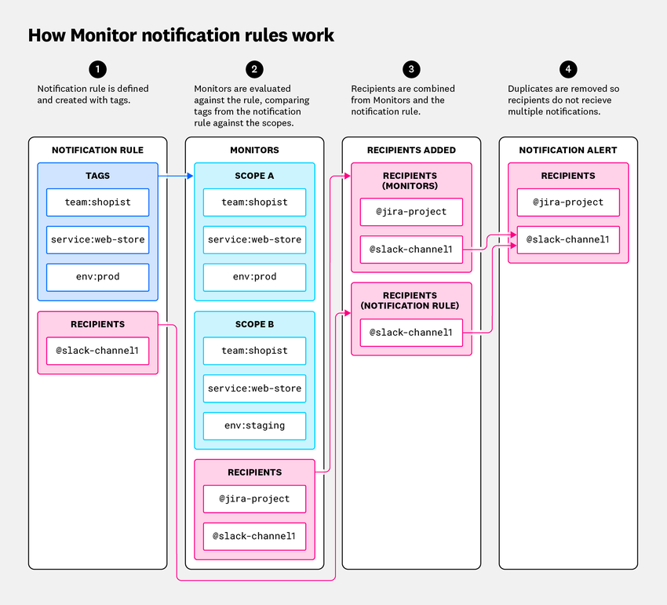
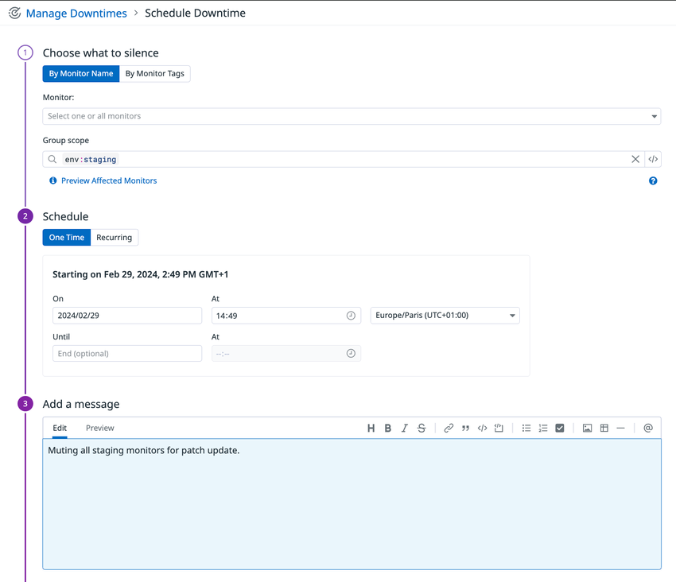
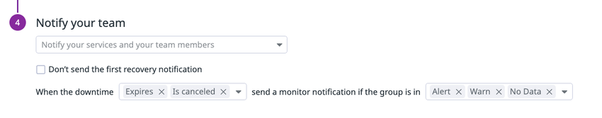

# 通知と Downtime

## 概要

Datadog の通知（Notifications）は、Monitor（モニター）の状態遷移（OK → ALERT など）をきっかけに、メッセージを組み立てて宛先へ送る仕組みである。Datadog の通知は、次の要素で構成される。[出典](https://docs.datadoghq.com/monitors/notify/)

- **通知メッセージ**：タイトルと本文。本文は Markdown、**Template Variables（テンプレート変数）**、**Conditional Variables（条件変数）** に対応する。
- **宛先**：本文中の `@メンション`（Notification handle、通知ハンドル）と、タグに基づいて宛先を自動付与する **Monitor Notification Rules（通知ルール）**。
- **通知の制御**：Priority（優先度 P1〜P5）、Renotify（再通知）、通知に含める内容（プリセット）、アラート集約（Simple Alert / Multi Alert）。

Datadog の **Downtime（ダウンタイム）** は、メンテナンスやシステム停止のあいだ、モニターのアラートと通知を止める仕組みである。Downtime はモニターの**状態遷移そのものは止めず**、通知とイベントの発生だけを抑止する。モニター状態ページのミュート操作も、内部的にはそのモニター用の Downtime を作る。さらに、AWS EC2 / Google Compute Engine / Azure VM では、インスタンスの停止・終了に合わせてモニターを**自動ミュート**できる。[出典](https://docs.datadoghq.com/monitors/downtimes/)

本ファイルは通知メッセージの書き方、宛先の決まり方、Renotify、Notification Rules、Mute / Downtime、自動ミュートの仕様を扱う。モニター本体（種類、評価ウィンドウ、しきい値、No Data 設定）は [Monitors（モニター）](./monitors.md)、各通知先ツールの接続方法とハンドル構文の詳細は [通知・コラボレーション連携](./collaboration-integrations.md) を参照。

| 関連トピック | 参照先 |
|---|---|
| モニターの種類・評価・しきい値・No Data | [Monitors（モニター）](./monitors.md) |
| Slack / Teams / PagerDuty / Webhooks 等の接続とハンドル構文 | [通知・コラボレーション連携](./collaboration-integrations.md) |
| タグ設計（Notification Rules・Downtime はタグが前提） | [Tagging（タグ）](./tagging.md)、[タグ戦略の実践](../../04_応用編/tagging-strategy.md) |
| SLO と Status Corrections | [Service Level Objectives（SLO）](./slo.md) |
| Datadog ネイティブのページング・エスカレーション | [On-Call](../service-management/on-call.md) |
| モニターからのインシデント自動作成 | [Incident Management](../service-management/incident-management.md) |
| モニターからのワークフロー起動 | [Workflow Automation](../service-management/workflow-automation.md) |
| Synthetic テストの実行停止（Synthetic Downtime） | [Synthetic Monitoring](../dem/synthetic-monitoring.md) |
| 権限・ロール・Teams | [組織・ユーザー・権限管理](./account-and-access-management.md) |
| Terraform 管理 | [Terraform と IaC](./terraform-and-iac.md)、[Monitoring as Code](../../04_応用編/monitoring-as-code.md) |
| アラート設計・ノイズ削減の実践 | [アラート設計とノイズ削減](../../04_応用編/alert-design-and-noise-reduction.md) |
| 運用設計（メンテナンス運用・エスカレーション） | [運用設計](../../03_導入編/operations-design.md) |

---

## 1. 通知処理の全体像

Datadog のモニター通知は、次の順で処理される。Downtime は「通知を送るかどうか」の段階で効く。モニターの評価と状態遷移は、Downtime 中も通常どおり続く。[出典](https://docs.datadoghq.com/monitors/downtimes/) [出典](https://docs.datadoghq.com/monitors/notify/notification_rules/)



| 段階 | 仕様の要点 | 本ファイルの節 |
|---|---|---|
| メッセージ描画 | 条件変数（`{{#is_alert}}` 等）で遷移ごとに本文と宛先を出し分ける。テンプレート変数で値・タグ・属性を埋め込む | [3](#3-テンプレート変数と条件変数) |
| 宛先決定 | 本文の `@handle` と、通知タグセットに一致した Notification Rules の宛先を統合し、重複を除く | [2](#2-通知の宛先メンション)、[6](#6-monitor-notification-rules通知ルール) |
| 再通知 | Renotify 間隔ごとに、未解決の状態で再送する。`{{#is_renotify}}` で再通知時だけの文面を足せる | [5](#5-renotify再通知) |
| 抑止 | Mute / Downtime の対象グループは、状態が変わっても通知・イベントを出さない | [7](#7-mute-と-downtime) |

---

## 2. 通知の宛先（@メンション）

### 2.1 通知メッセージの基本要素

Datadog のモニター通知は、モニター編集画面の「Configure notifications and automations」節で設定する。主な項目は次のとおり。[出典](https://docs.datadoghq.com/monitors/notify/) [出典](https://docs.datadoghq.com/monitors/configuration/)

| 項目 | 内容 | API 上の対応 |
|---|---|---|
| Title（タイトル） | **必須**。モニターごとに一意な名前を付ける。Multi Alert の場合、発報したスコープのタグがタイトルへ自動で入る。タグ変数も使える | `name` |
| Message（本文） | Markdown、テンプレート変数、条件変数、`@メンション` に対応 | `message` |
| 発報タグをタイトルに含める | 発報したグループのタグをタイトルに自動挿入するか。既定 `true` | `options.include_tags` |
| 追加コンテンツ（プリセット） | クエリ、ハンドル、スナップショット、フッターリンクを通知に含めるか | `options.notification_preset_name` |
| Renotify | 再通知の間隔・対象状態・回数・エスカレーションメッセージ | `options.renotify_*`、`options.escalation_message` |
| Metadata | Priority（P1〜P5）、モニタータグ、Datadog Team | `priority`、`tags` |
| Aggregation（集約） | Multi Alert のグループ次元を通知単位から外す、または Simple Alert にする | `options.notify_by` |
| Workflows / Incidents / Cases | ワークフロー起動、インシデント自動作成、ケース（Work Management）自動作成 | 本文中のハンドル |
| 権限・監査通知 | 編集できるユーザー・ロール・チームの制限。モニター変更時に通知する監査通知 | `restricted_roles`（または Restriction Policies API）、`options.notify_audit` |

- 本文の Markdown は宛先によって一部しか描画されない。Slack は太字・斜体・インラインコード・リンクに対応し、見出し（`#`、`##`）と表はプレーンテキストになる。Email も同様に基本書式に対応し、表はプレーンテキストになる。[出典](https://docs.datadoghq.com/monitors/notify/)
- percentile 集計（`p50`、`p75`、`p95`、`p99` など）を使う Distribution メトリクスのモニターでは、通知にスナップショットグラフが付かない。[出典](https://docs.datadoghq.com/monitors/notify/)

### 2.2 通知に含める追加コンテンツ（プリセット）

Datadog のモニター通知には、本文のほかにクエリ、使った `@メンション`、メトリクスのスナップショット、Datadog への戻りリンクが付く。どれを付けるかはモニターごとに選べる。[出典](https://docs.datadoghq.com/monitors/notify/) [出典](https://docs.datadoghq.com/monitors/guide/monitor_api_options/)

| UI の選択肢 | `notification_preset_name` の値 | 動作 |
|---|---|---|
| Default | `show_all`（既定） | 何も隠さない |
| Hide Query | `hide_query` | クエリを通知から除く |
| Hide Handles | `hide_handles` | `@メンション` を通知から除く |
| Hide All | `hide_all` | クエリ、ハンドル、スナップショット、フッターのリンクをすべて除く |
| （API のみで確認） | `hide_query_and_handles` | クエリとハンドルを除く |
| （API のみで確認） | `show_only_snapshot` | スナップショットのみ表示 |
| （API のみで確認） | `hide_handles_and_footer` | ハンドルとフッターを除く |

- 連携先によっては、既定で表示されない内容がある。[出典](https://docs.datadoghq.com/monitors/notify/)
- 後半 3 つの値は API リファレンスの enum に載っているが、UI での選択肢名は公開情報では確認できず。

### 2.3 @メンションの種類

Datadog のモニター本文と Notification Rules では、`@` で宛先を指定する。入力中に既存の候補がドロップダウンで提示され、**@ Add Mention**、**Add Workflow**、**Add Case** ボタンからも追加できる。[出典](https://docs.datadoghq.com/monitors/notify/)

| 宛先の種類 | 書式 | 補足 |
|---|---|---|
| Datadog ユーザー（メール） | `@<Datadogユーザーのメールアドレス>` | アクティブなユーザーのみ受信。招待保留中・無効化されたユーザーは受信しない |
| Datadog 外のメール | `@<メールアドレス>` | スラッシュ `/` を含むアドレス（例：`@DevOpS/West@example.com`）は非対応 |
| インテグレーション | `@<INTEGRATION_NAME>-<VALUES>` | 例：`@slack-<channel>`、`@pagerduty-<service>`、`@webhook-<name>`、`@teams-<channel>`、`@jira-<project>`、`@servicenow-<name>` |
| Datadog Team | `@team-<handle>` | Team に通知チャンネルが設定されていれば、そのチャンネルへ転送される |
| Datadog On-Call | `@oncall-<team>` | 公式ドキュメントの一括編集の例で `@oncall-sre` が使われている。詳細は [On-Call](../service-management/on-call.md) |
| Incident | `@incident-<option>` | ALERT / WARN / NO DATA への遷移時にインシデントを自動作成。選択肢は管理者が Incident Settings で作る |
| Workflow | **Add Workflow** から追加 | 事前にワークフロー側へ Monitor トリガーを追加しておく必要がある |
| Case（Work Management） | **Add Case** / Cases 欄から追加 | プロジェクトのハンドル（project handle）を使う |

[出典](https://docs.datadoghq.com/monitors/notify/)

記述上の共通ルールは次のとおり。[出典](https://docs.datadoghq.com/monitors/notify/)

| ルール | 内容 |
|---|---|
| 前の文字との区切り | `@メンション` の前には半角スペースが必要。`Disk space is low @ops-team@company.com` は正しく、`Disk space is low@ops-team@company.com` は誤り |
| 括弧 | 括弧 `()` を含むハンドルは非対応。解析されず、アラートも作られない |
| 条件ブロックとの関係 | 条件ブロックの外に書いたハンドルはすべての状態遷移で通知され、ブロック内のハンドルは条件が成立した遷移でだけ通知される（[3.1](#31-条件変数conditional-variables)） |
| メール不達 | ブロックリスト、IP・ドメインフィルタ、スパムフィルタ、メールセキュリティ製品が原因で届かないことがある |

- インシデントをモニターから作った場合、インシデントの項目値はモニタータグから自動で入る（例：`service:payments` → インシデントの service 欄が `payments`）。インシデント側の通知ルール（Incident Notification Rules）は、本ファイルのモニター Notification Rules とは**別に**設定する必要がある。[出典](https://docs.datadoghq.com/monitors/notify/)
- Slack、Teams、PagerDuty などハンドル構文の詳細、Slack チャンネル名の制約、Webhook ペイロード変数は [通知・コラボレーション連携](./collaboration-integrations.md) を参照。

### 2.4 @ハンドルの一括編集

Datadog は、複数のモニター本文の `@ハンドル` をまとめて編集できる。[出典](https://docs.datadoghq.com/monitors/notify/)

| 操作 | 例 |
|---|---|
| 置換（Swap） | `@pagerduty-sre` を `@oncall-sre` に置き換える。1 つを複数に置き換えることもできる（`@pagerduty-sre` → `@pagerduty-sre` と `@oncall-sre` の二重ページング） |
| 追加（Add） | 既存の宛先を残したまま `@slack-infra-leads` を追加 |
| 削除（Remove） | `@webhook-my-legacy-event-intake` を削除 |

### 2.5 Test Notifications（テスト通知）

Datadog のモニター編集画面右下の **Test Notifications** で、実際の宛先へテスト通知を送れる。[出典](https://docs.datadoghq.com/monitors/notify/)

| 項目 | 内容 |
|---|---|
| 対応モニター | host、metric、anomaly、outlier、forecast、logs、rum、apm、integration（check のみ）、process（check のみ）、network（check のみ）、custom check、event、composite |
| 選べる内容 | テストする状態遷移と、グループ（クエリにグループ化がある場合のみ） |
| 制約 | アラート条件で設定済みのしきい値の状態しかテストできない。例外として、Recovery しきい値の回復通知はテストできる |
| 送信 | **Run Test** で、モニターに書かれた宛先へ送信 |
| イベント | テスト通知はイベントとして Events Explorer で検索でき、タイトルに `[TEST]`、本文に実行者が入る |
| 変数 | メッセージ変数は、モニター定義のスコープからランダムに選んだグループで埋められる |
| 注意 | タグ変数は Datadog の子イベントの本文にだけ入る。親イベントは集約サマリーのみ |

---

## 3. テンプレート変数と条件変数

### 3.1 条件変数（Conditional Variables）

Datadog の条件変数は、`{{#変数}}…{{/変数}}`（成立時に表示）と `{{^変数}}…{{/変数}}`（不成立時に表示）の形で書く。条件ブロックの中に本文と `@メンション` を書くと、その状態遷移のときだけ送られる。[出典](https://docs.datadoghq.com/monitors/notify/variables/)

| 条件変数 | 成立する条件 |
|---|---|
| `{{#is_alert}}` | ALERT になった |
| `{{#is_warning}}` | WARNING になった |
| `{{#is_recovery}}` | `ALERT`、`WARNING`、`UNKNOWN`、`NO DATA` のいずれかから回復した |
| `{{#is_alert_recovery}}` | `ALERT` から `OK` に回復した |
| `{{#is_warning_recovery}}` | `WARNING` から `OK` に回復した |
| `{{#is_alert_to_warning}}` | `ALERT` から `WARNING` に遷移した |
| `{{#is_no_data}}` | データ欠損（No Data）で発報した |
| `{{#is_no_data_recovery}}` | `NO DATA` から回復した |
| `{{#is_unknown}}` | UNKNOWN 状態になった |
| `{{#is_renotify}}` | 再通知している |
| `{{#is_priority 'P1'}}` | モニターの Priority が指定値（`P1`〜`P5`）である |
| `{{#is_match "<TAG_VARIABLE>.name" "<STRING>"}}` | タグ変数の値が文字列を**含む**（部分一致）。文字列は複数指定でき、いずれかに一致すれば成立。数値は文字列に変換して比較 |
| `{{#is_exact_match "<TAG_VARIABLE>.name" "<STRING>"}}` | タグ変数の値が文字列と**完全一致**する。複数指定可。数値は値として比較（`"5"` は `5.0` にも一致）。`{{value}}` にも使える |

[出典](https://docs.datadoghq.com/monitors/notify/variables/)

条件変数の規則は次のとおり。[出典](https://docs.datadoghq.com/monitors/notify/variables/)

| 規則 | 内容 |
|---|---|
| 開始・終了の対 | 条件変数は必ず開始タグと終了タグを対で書き、その間に本文と `@メンション` を置く |
| 状態系は併用不可 | モニターは同時に 1 つの状態しか取らないため、`is_alert` や `is_warning` などの状態系は、それぞれ独立したブロックにする（組み合わせられない） |
| ネスト | 属性一致系はネストできる（例：`{{#is_renotify}}` の中に `{{#is_match "env" "production"}}`） |
| `{{else}}` | `is_match` などで `{{else}}` を使える |
| 空・未定義の判定 | タグや属性が空または存在しないかは `{{#is_exact_match "host.datacenter" ""}}` で判定する（`is_match` ではなく `is_exact_match` を使う） |
| alert と recovery の組 | ハンドルを入れた alert / warning ブロックには、対応する recovery ブロックを組み合わせることが推奨されている |
| ALERT→WARNING 遷移 | `{{#is_alert_recovery}}` の宛先は、ALERT→WARNING 遷移のとき本文なしの通知を受ける。本文を入れるには `{{#is_alert_to_warning}}` を使う |

```text
{{#is_alert}}
{{host.name}} のディスク使用率が {{threshold}}% を超えました（現在値 {{value}}%）。
@pagerduty-Infra @slack-infra-alerts
{{/is_alert}}

{{#is_warning}}
{{host.name}} のディスク使用率が警告しきい値 {{warn_threshold}}% を超えました。 @slack-infra-alerts
{{/is_warning}}

{{#is_recovery}}
{{host.name}} は回復しました。 @pagerduty-Infra @slack-infra-alerts
{{/is_recovery}}

{{#is_match "host.role.name" "db" "database"}}
DB ロールのホストです。 @db-team@company.com
{{else}}
@slack-app-team
{{/is_match}}
```

- 上の例で `@pagerduty-Infra` を `{{#is_recovery}}` にも書いているのは、PagerDuty 側のインシデントを自動解決させるためである。PagerDuty の自動解決は、ハンドルが `{{#is_alert}}` 内にしかない場合は動作しない。詳細は [通知・コラボレーション連携](./collaboration-integrations.md) を参照。[出典](https://docs.datadoghq.com/integrations/pagerduty/)

### 3.2 値・しきい値・時刻の変数

Datadog の通知メッセージでは、次のテンプレート変数を使える。[出典](https://docs.datadoghq.com/monitors/notify/variables/)

| 変数 | 内容 |
|---|---|
| `{{value}}` | しきい値を超えた値（メトリクス系クエリのモニター） |
| `{{threshold}}` | アラートしきい値 |
| `{{warn_threshold}}` | 警告しきい値 |
| `{{alert_recovery_threshold}}` | ALERT から回復した値 |
| `{{warn_recovery_threshold}}` | WARN から回復した値 |
| `{{ok_threshold}}` | Service Check モニターを回復させた値 |
| `{{comparator}}` | アラート条件の比較演算子 |
| `{{first_triggered_at}}` | 最初に発報した UTC 日時 |
| `{{first_triggered_at_epoch}}` | 同上（エポックミリ秒） |
| `{{last_triggered_at}}` | 最後に発報した UTC 日時 |
| `{{last_triggered_at_epoch}}` | 同上（エポックミリ秒） |
| `{{triggered_duration_sec}}` | イベント時点で発報状態が続いている秒数 |

発報時刻系の変数は次のように更新される。[出典](https://docs.datadoghq.com/monitors/notify/variables/)

| 変数 | 更新されるタイミング |
|---|---|
| `first_triggered_at` | グループが OK を抜けたとき、または OK 以外の状態の新しいグループが現れたとき |
| `last_triggered_at` | OK 以外の状態へ遷移するたび（WARN→ALERT、ALERT→WARN を含む） |
| 共通 | 状態遷移で更新され、**再通知では更新されない**。再通知時点の継続時間は `{{triggered_duration_sec}}` を使う |



- **キャプション:** 発報時刻系変数の更新タイミングを説明するグループ状態タイムライン。
- **画面の説明:** モニター状態ページの「GROUP STATUS」欄で、グループ `env:dev` の状態を時間軸の帯で表示している。帯は緑（OK）→ 黄（Warn）→ 赤（Alert）→ 灰（No Data）→ 緑（OK）と変わり、各遷移点に A（OK→WARN、14:20 頃）、B（WARN→ALERT）、C（ALERT→NO DATA）、D（NO DATA→OK）の縦線が引かれている。公式ドキュメントはこの 4 点について、A で `first_triggered_at` と `last_triggered_at` が設定され、B・C では `last_triggered_at` だけが更新されることを表で説明している。凡例は Alert / OK / No Data / Warn / Muted / Non reporting。
- **出典:** https://docs.datadoghq.com/monitors/notify/variables/ （2026-11-02 取得）

**ローカル時刻への変換：** `{{local_time 'last_triggered_at' 'Asia/Tokyo'}}` のように書くと、指定タイムゾーンの ISO 8601 形式（例：`2021-05-31 23:43:27+09:00`）で出力される。タイムゾーン名は TZ データベースの名前を使う。[出典](https://docs.datadoghq.com/monitors/notify/variables/)

- 通知に添付されるアラートグラフのスナップショットのタイムゾーンは、`Org Management` 権限を持つユーザーが Monitor Settings の組織設定（Monitors time zone preference）で変更できる。この設定は組織内のすべてのモニター通知に効く。[出典](https://docs.datadoghq.com/monitors/settings/)

### 3.3 タグ変数（Multi Alert のグループ変数）

Datadog の Multi Alert モニター（`by` でグループ化したモニター）では、グループのタグ値を変数で参照できる。[出典](https://docs.datadoghq.com/monitors/notify/variables/)

| 用途 | 構文 | 補足 |
|---|---|---|
| グループのタグ値 | `{{ key.name }}`（例：`{{service.name}}`、`{{env.name}}`） | 同じキーに複数値がある場合は、辞書順・カンマ区切りで出る |
| キーにピリオドを含むタグ | `{{[dot.key.test].name}}` | |
| Facet（Log / Trace / RUM / Event モニター） | `{{ @facet_key.name }}`、ピリオドを含む場合 `{{ [@network.client.ip].name }}` | |
| ホスト | `{{host.name}}`、`{{host.ip}}`、`{{host.metadata_agent_version}}`、`{{host.metadata_machine}}`、`{{host.metadata_platform}}`、`{{host.metadata_processor}}` | |
| Kubernetes Namespace | `{{kube_namespace.cluster_name}}`、`.display_name`、`.status`、`.labels`、`.key`、`.tags`、`.annotations`、`.uid` ほか | `kube_namespace` と `kube_cluster_name` でグループ化したとき |
| Kubernetes Pod | `{{pod_name.cluster_name}}`、`.name`、`.phase`、`.ip`、`.hostname`、`.node_name`、`.qosclass` ほか | `pod_name`、`kube_namespace`、`kube_cluster_name` でグループ化したとき |
| Service（Software Catalog） | `{{service.name}}`、`{{service.team}}`、`{{service.docs}}`、`{{service.links}}`、`{{service.links[Runbook]}}` | Catalog に登録したサービス情報を参照 |
| ネットワークデバイス | `{{network_device.name}}`、`.ip_address`、`.status`、`.vendor`、`.model`、`.serial_number`、`.location`、`.ping_status`、`.tags` ほか | `device_ip` と `device_namespace` でグループ化したとき |

[出典](https://docs.datadoghq.com/monitors/notify/variables/)

- **No Data からの回復時にタグ値を残す：** No Data からの回復メッセージで `{{tag.name}}` を使いたい場合は、モニターのクエリを追加のタグでグループ化しておく。[出典](https://docs.datadoghq.com/monitors/notify/variables/)
- Azure VM を Agent なしで監視している場合、`host` タグは GUID になる。通知で読みやすい名前を出すには `{{host.name_tag}}` を使う。[出典](https://docs.datadoghq.com/integrations/azure_vm/)
- Software Catalog（旧称：Service Catalog）の詳細は [Software Catalog](./software-catalog.md) を参照。

### 3.4 一致したイベントの属性・タグ変数

Datadog の Log・Trace Analytics・RUM などイベント系モニターでは、発報の原因となったイベントの属性とタグを通知に埋め込める。[出典](https://docs.datadoghq.com/monitors/notify/variables/)

| モニター種別 | 構文 |
|---|---|
| Audit Trail | `{{audit.attributes.key}}`、`{{audit.message}}` |
| CI Pipeline | `{{cipipeline.attributes.key}}` |
| CI Test | `{{citest.attributes.key}}` |
| Database Monitoring | `{{databasemonitoring.attributes.key}}` |
| Error Tracking | `{{issue.attributes.key}}` |
| Log | `{{log.attributes.key}}`、`{{log.tags.key}}` |
| RUM | `{{rum.attributes.key}}`、`{{rum.tags.key}}` |
| Synthetic Monitoring | `{{synthetics.attributes.key}}` |
| Trace Analytics | `{{span.attributes.key}}`、`{{span.tags.key}}` |

予約属性は次のように参照する。[出典](https://docs.datadoghq.com/monitors/notify/variables/)

| 種別 | 構文 | 使えるキー |
|---|---|---|
| Log | `{{log.key}}` | `message`、`service`、`status`、`source`、`span_id`、`timestamp`、`trace_id`、`link`、`host` |
| Trace | `{{span.key}}` | `env`、`operation_name`、`resource_name`、`service`、`status`、`span_id`、`timestamp`、`trace_id`、`type`、`link` |
| RUM | `{{rum.key}}` | `service`、`status`、`timestamp`、`link` |
| Event | `{{event.key}}` | `attributes`、`host.name`、`id`、`link`、`title`、`text`、`tags` |
| CI Pipeline | `{{cipipeline.key}}` | `pipeline_fingerprint`、`ci_level`、`status`、`link` ほか |
| CI Test | `{{citest.key}}` | `service`、`env`、`resource_name`、`status`、`link` ほか |

- 属性名の `@` は付けない。ピリオドを含む属性は `{{ log.attributes.[error.message] }}` のように角括弧で囲む。イベントのタグは `{{ event.tags.[dot.key.test] }}`。
- 属性・タグがイベントに存在しない場合、変数は空文字になる。空になりうる変数を `is_match` によるルーティングに使うのは避ける。
- Formulas & Functions を使うモニターでは、変数の値は最初のクエリから解決される。
- `{{log.link}}`、`{{span.link}}`、`{{rum.link}}`、`{{issue.link}}` は、一致したイベントに絞り込んだ各 Explorer へのリンクになる。

[出典](https://docs.datadoghq.com/monitors/notify/variables/)

### 3.5 Check モニター・Composite モニターの変数

| 種別 | 変数 | 内容 |
|---|---|---|
| Check（Service Check / カスタムチェック） | `{{check_message}}` | カスタムチェックまたはインテグレーションチェックが返したメッセージ |
| Composite | `{{ a.value }}` | サブモニター `a` の値 |
| Composite | `{{ a.status }}` | サブモニター `a` の状態（`OK`、`Alert`、`Warn`、`No Data` のいずれか） |
| Composite | `{{ a.log.message }}`、`{{ a.log.my_facet }}` | サブモニター `a` のタグ・Facet（サブモニター同士のグループ化が同じ場合） |

[出典](https://docs.datadoghq.com/monitors/notify/variables/)

### 3.6 エスケープ・コメント・raw・URL エンコード

| 機能 | 構文 | 内容 |
|---|---|---|
| HTML エスケープ（既定） | `{{variable}}` | 既定で HTML エンコードされる（`&` → `&amp;`） |
| エスケープなし | `{{{variable}}}` | 3 重波括弧で、エンコードせずに出力する。クエリパラメータを含む URL をクリック可能なまま出すときに使う（例：HTTP Check の `{{{check_message}}}`） |
| コメント | `{{!-- this is a comment --}}` | 通知には出力されない |
| raw | `{{{{raw}}}}` … `{{{{/raw}}}}` | 中の `{{ <TEXT> }}` を変数として解釈せず、そのまま出力する。raw ブロック内では条件ヘルパー（`#`、`^`）を使えない |
| URL エンコード | `{{urlencode "service.name"}}` | 例：`https://app.datadoghq.com/services/{{urlencode "service.name"}}` |
| Priority の上書き | `{{override_priority 'P1'}}` | 通知時の Priority を上書き（[4](#4-priority優先度)） |

[出典](https://docs.datadoghq.com/monitors/notify/variables/) [出典](https://docs.datadoghq.com/monitors/notify/)

### 3.7 `{{eval}}` による計算と関数

Datadog の通知メッセージでは、数値または文字列のテンプレート変数を `{{eval "..."}}` で計算・整形できる。式は必ず二重引用符で囲む。[出典](https://docs.datadoghq.com/monitors/guide/template-variable-evaluation/)

**演算子：** `+`（加算）、`-`（減算）、`*`（乗算）、`/`（除算）、`^`（べき乗）、`%`（剰余）。例：`{{eval "last_triggered_at_epoch-15*60*1000"}}`（発報時刻の 15 分前）。

| 分類 | 関数 | 内容 |
|---|---|---|
| 整形 | `humanize_bytes(var)` | バイト値を読みやすい単位に変換 |
| 整形 | `humanize_bits(var)` | ビット値を読みやすい単位に変換 |
| 整形 | `abs(var)` | 絶対値 |
| 整形 | `int(var)` / `trunc(var)` | 切り捨て整数（`int(12.345)` → 12）。`trunc` は `int` の別名 |
| 整形 | `float(var)` | 浮動小数点として返す |
| 整形 | `dec(var)` | 小数部（`dec(12.345)` → 0.345） |
| 数学 | `round(var)`、`round(var, n)` | 四捨五入（`round(12.376, 2)` → 12.38） |
| 数学 | `ceil`、`floor`、`sgn`、`to_bool`、`exp`、`log10` | 切り上げ、切り捨て、符号、真偽値化、指数、常用対数 |
| 三角関数 | `sin`、`cos`、`tan`、`asin`、`acos`、`atan`、`atan2(var1, var2)` | `atan2` は atan(var1 / var2) をラジアンで返す |
| 双曲線関数 | `sinh`、`cosh`、`tanh`、`asinh`、`acosh`、`atanh` | |
| 文字列 | `upper(var)`、`lower(var)` | 大文字化・小文字化 |
| 文字列 | `substring(var, start, end)` | 部分文字列。`end` は省略可（`substring("host:D", 5)` → `D`） |
| 文字列 | `strip(var, characters)` | 前後の文字を除去。第 2 引数を省くと空白を除去 |

[出典](https://docs.datadoghq.com/monitors/guide/template-variable-evaluation/)

- `{{eval}}` を使える変数の完全な一覧と、対応するモニター種別の一覧は公開情報では確認できず。公式ガイドの例では `value` と `last_triggered_at_epoch` が使われている。

### 3.8 動的ハンドルと動的リンク

**動的ハンドル：** テンプレート変数で宛先を組み立てられる（例：`@slack-{{service.name}}` でサービスごとの Slack チャンネルへ送る）。変数が空だとハンドルが無効になるため、空のときの代替先を書いておく。[出典](https://docs.datadoghq.com/monitors/notify/variables/)

```text
@slack-{{service.name}}
{{#is_exact_match "service.name" ""}}
  @slack-example
{{/is_exact_match}}
```

**動的リンク：** 通知本文に、発報したホストやサービスに絞った Datadog 画面へのリンクを入れられる。[出典](https://docs.datadoghq.com/monitors/notify/variables/)

| リンク先 | URL 例 | 追加できるパラメータ |
|---|---|---|
| Dashboard | `https://app.datadoghq.com/dash/integration/system_overview?tpl_var_scope=host:{{host.name}}` | インテグレーションダッシュボードは `dash/integration/<INTEGRATION_NAME>`。時間範囲は `from_ts={{eval "last_triggered_at_epoch-10*60*1000"}}`、`to_ts={{eval "last_triggered_at_epoch+10*60*1000"}}` |
| Host Map | `https://app.datadoghq.com/infrastructure/map?filter=service:{{service.name}}` | `fillby=avg:<METRIC_NAME>`、`groupby=<TAG_KEY>`、`sizeby=avg:<METRIC_NAME>` |
| Monitors | `https://app.datadoghq.com/monitors/manage?q=scope:host:{{host.name}}` | `status:Alert`（WARN / NO DATA / OK も可）、`muted: true`/`false`、`type:log` |
| Logs | `https://app.datadoghq.com/logs?from_ts={{eval "last_triggered_at_epoch-10*60*1000"}}&to_ts={{eval "last_triggered_at_epoch+10*60*1000"}}&live=false` | `service=<SERVICE_NAME>`、`host=<HOST_NAME>`、`status=<STATUS>` |

> **サイト差異:** 公式ドキュメントのリンク例は US1 のドメイン `app.datadoghq.com` で書かれている。AP1 では `ap1.datadoghq.com`、EU1 では `app.datadoghq.eu` のように、自組織のサイトのドメインに置き換える。サイトごとのドメインは [Datadog Sites（サイト）](./datadog-sites.md) を参照。

---

## 4. Priority（優先度）

Datadog の Monitor Priority は、モニターの重要度を P1（最高）〜 P5（最低）の 5 段階で表す任意の設定である。API では `priority` に 1（高）〜 5（低）の整数を指定する。[出典](https://docs.datadoghq.com/monitors/notify/) [出典](https://docs.datadoghq.com/api/latest/monitors/)

| 項目 | 内容 |
|---|---|
| 設定場所 | モニター編集画面の Metadata（Priority、Tags、Datadog Team） |
| 値の範囲 | UI：P1〜P5。API：整数 1〜5 |
| 通知時の上書き | 本文に `{{override_priority 'Pi'}}`（`Pi` は P1〜P5）を書くと、その通知の Priority を上書きする |
| 条件分岐 | `{{#is_priority 'P1'}}…{{/is_priority}}` で Priority に応じて文面・宛先を変えられる |
| 主な用途 | 重要度の明示、条件変数による文面・宛先の出し分け、Notification Rules のスコープ条件（[6](#6-monitor-notification-rules通知ルール)） |

```text
{{#is_alert}}
{{override_priority 'P1'}}
本番障害です。 @oncall-sre
{{/is_alert}}
{{#is_warning}}
{{override_priority 'P4'}}
警告です。 @slack-sre-warn
{{/is_warning}}
```

[出典](https://docs.datadoghq.com/monitors/notify/)

- Notification Rules のスコープで Priority を条件にする場合、タグとしては小文字（`priority:p1`）で指定しないと一致しなかったという検証報告がある。【第三者情報】[出典](https://dev.classmethod.jp/articles/datadog-monitor-notification-rules-tag-based-alert/)（2026-01-29 公開）
- Priority が PagerDuty などの外部ツールの重要度にどう対応付けられるかは連携先ごとに異なる。[通知・コラボレーション連携](./collaboration-integrations.md) を参照。

---

## 5. Renotify（再通知）

Datadog の Renotify は、モニターが解決されないまま特定の状態に留まっている場合に、一定間隔で通知を送り直す機能である。問題が未解決であることをチームに思い出させ、エスカレーションに使う。[出典](https://docs.datadoghq.com/monitors/notify/)



- **キャプション:** モニター編集画面の Renotify 設定。
- **画面の説明:** 1 行目はトグルを ON にした状態で「If this monitor stays in [Alert ×] [No Data ×] renotify every [30 minutes]」と表示され、対象状態（Alert、No Data）を複数選択し、再通知間隔をドロップダウンで選ぶ。2 行目は「Stop renotifying after [0] occurrences.」のトグルで、再通知の回数上限を設定する（画像ではトグル OFF）。
- **出典:** https://docs.datadoghq.com/monitors/notify/ （2026-11-02 取得）

| 設定項目（UI） | API オプション | 既定値 | 内容 |
|---|---|---|---|
| 再通知を有効化・間隔 | `renotify_interval` | `null`（再通知しない） | 最後の通知から何分後に再通知するか（分単位の整数）。解決していない場合のみ再通知する |
| 再通知する状態 | `renotify_statuses` | `renotify_interval` が `null` なら `null`。間隔を設定した場合は `alert` と `no data` | 選べる値は `alert`、`warn`、`no data` |
| 回数上限 | `renotify_occurrences` | `null`（無制限） | 再通知を送る回数。`renotify_interval` を設定したときだけ指定できる |
| エスカレーションメッセージ | `escalation_message` | `null` | 再通知に付けるメッセージ。`@username` 記法を使える。`renotify_interval` が未設定なら無効。公式は `{{#is_renotify}}` ブロックの利用を推奨 |

[出典](https://docs.datadoghq.com/monitors/guide/monitor_api_options/) [出典](https://docs.datadoghq.com/api/latest/monitors/)

エスカレーションメッセージの入れ方は 3 通りある。[出典](https://docs.datadoghq.com/monitors/notify/)

| 方法 | 内容 |
|---|---|
| 本文の `{{#is_renotify}}` ブロック（推奨） | 再通知では**元のメッセージも含めて**送られるため、ブロックには追加情報だけを書く。属性一致の条件とネストして、一部のグループにだけエスカレーションできる |
| Renotification message 欄 | 「Configure notifications and automations」節の入力欄 |
| API の `escalation_message` | 上表のとおり |

```text
{{#is_alert}}
{{service.name}} のエラー率が上昇しています。 @slack-app-alerts
{{/is_alert}}

{{#is_renotify}}
{{#is_match "env" "production"}}
本番で {{triggered_duration_sec}} 秒以上継続しています。エスカレーションします。 @pagerduty-App
{{/is_match}}
{{/is_renotify}}
```

[出典](https://docs.datadoghq.com/monitors/notify/variables/)

- 再通知の属性変数・タグ変数は、再通知時点の期間に得られたデータで埋められる。[出典](https://docs.datadoghq.com/monitors/notify/)
- `first_triggered_at` / `last_triggered_at` は再通知では更新されない（[3.2](#32-値しきい値時刻の変数)）。
- 「1 回だけエスカレーションする」には、回数上限を 1（`stop renotifying after 1 occurrence`）にする。[出典](https://docs.datadoghq.com/monitors/notify/)
- UI のドロップダウンで選べる再通知間隔の一覧（最小値・最大値）は公開情報では確認できず。API の `renotify_interval` は分単位の整数として定義されている。
- Downtime 中は再通知も通知の一種として抑止される、という明示的な記述は公開情報では確認できず。Downtime は「すべてのアラートと通知を止める」と説明されている（[7.7](#77-downtime-中と終了時の挙動)）。

---

## 6. Monitor Notification Rules（通知ルール）

### 6.1 概要

Datadog の Monitor Notification Rules（モニター通知ルール）は、タグとルールロジックで通知の宛先を自動で決める、組織単位の事前定義ルールである。モニターごとに宛先を書く代わりに、ルールを一度定義すれば、**通知タグセット（notification tagset）** がルールのスコープに一致したすべてのモニター通知へ宛先が付与される。Datadog はモニターの宛先管理に Notification Rules を使うことを推奨している。[出典](https://docs.datadoghq.com/monitors/notify/notification_rules/) [出典](https://docs.datadoghq.com/monitors/notify/)

- Notification Rules は 2025-06-27 公開の公式ブログで一般提供（GA）が告知された（同記事は 2026-02-17 更新）。ただし Dynamic routing、`monitor_notification_rules_write` 権限、API の `bundle_config` は 2026-11-02 時点で【Preview】である。[出典](https://www.datadoghq.com/blog/monitor-notification-rules/) [出典](https://docs.datadoghq.com/monitors/notify/notification_rules/)
- 設定場所は **Monitors → Settings → Notification Rules**（`https://app.datadoghq.com/monitors/settings/notifications`）。[出典](https://docs.datadoghq.com/monitors/notify/notification_rules/)



- **キャプション:** Monitors > Settings > Notification Rules の一覧画面。
- **画面の説明:** 左メニューに Tag Policies / Notification Rules / Deleted Monitors のタブがあり、Notification Rules が選択されている。右上に「+ New Rule」ボタン。上部に名前・タグ・チーム・宛先での検索欄、「My Teams」トグル、Tags と Recipients のフィルタがある。表の列は NAME（ルール名）、SCOPE（`team:platform-team env:prod` などのスコープタグ）、TEAM（関連チーム）、COVERAGE（一致するモニター数。例「3 Monitors」）、NOTIFIES（通知先チャネルのアイコン）で、各行の三点メニューから Edit / Delete を選べる。画像は取得元ドキュメント作成時点のもので、見出し横に「PREVIEW」表示がある（現在は GA）。
- **出典:** https://docs.datadoghq.com/monitors/notify/notification_rules/ （2026-11-02 取得）

### 6.2 作成手順

1. **Notification Rules** ページを開き、**New Rule** をクリックする。
2. **スコープ**を設定する：通知がこのルールに一致するために必要なタグを指定する。
3. **ルーティングと宛先**を設定する：手動ルーティング（Manual routing）か動的ルーティング（Dynamic routing）を選び、宛先を指定する。
4. 識別しやすい**ルール名**を付ける。

[出典](https://docs.datadoghq.com/monitors/notify/notification_rules/)

- 作成には `monitor_config_policy_write` または `monitor_notification_rules_write`（【Preview】）の権限が必要。[出典](https://docs.datadoghq.com/monitors/notify/notification_rules/)
- 公式ドキュメントの注記は「ルール保存**後に作成・更新された**モニターは、スコープに一致すればルールの宛先へルーティングされる」と書いている。一方、公式ブログは既存モニターのタグを使ってルールへ移行する例を示している。既存モニターに効いているかは、ルール一覧の **Coverage** とモニター側の **Recipient Summary** で確かめるのが確実である。[出典](https://docs.datadoghq.com/monitors/notify/notification_rules/) [出典](https://www.datadoghq.com/blog/monitor-notification-rules/)

### 6.3 スコープ構文

Datadog の Notification Rules のスコープは、プラットフォーム共通のイベント系検索構文に従う。[出典](https://docs.datadoghq.com/monitors/notify/notification_rules/)

| 構文要素 | 内容 |
|---|---|
| ブール演算子 | `AND`、`OR`、`NOT` に対応。演算子を省略すると `AND` |
| ワイルドカード | `key:*`（例：`env:*`）のみ。キーが通知タグセットのどこかにあれば一致する。`env:prod-*` のような部分ワイルドカードと `?` ワイルドカードは非対応 |
| 同じキーの複数値 | `env:(prod OR staging)` または `env:prod OR env:staging` |
| 引用符 | スペースや特殊文字を含む値は引用符で囲む（例：`team:"data platform"`） |
| キーなしタグ | 非対応（`prod` ではなく `env:prod` と書く） |
| 長さ | 最大 3,000 文字 |

| スコープの例 | 意味 |
|---|---|
| `service:web-store` | `web-store` サービスに関する通知をすべてルーティング |
| `service:web-store AND env:prod` | `prod` 環境の `web-store` に関する通知 |
| `service:webstore AND NOT env:staging` | `staging` 以外の `webstore` に関する通知 |
| `env:*` | `env:<値>` タグ（モニタータグまたはグループ由来）を持つ通知すべて |

[出典](https://docs.datadoghq.com/monitors/notify/notification_rules/)

### 6.4 ルーティングと宛先

**手動ルーティング（Manual routing）：** 一致した通知について、常に全宛先へ送るか、条件付き宛先（conditional recipients）を設定する。[出典](https://docs.datadoghq.com/monitors/notify/notification_rules/)

| 条件の種類 | 内容 |
|---|---|
| 状態（Status）ベース | モニターが特定の状態（Alert、OK、Warn、No data）に遷移したときに通知 |
| タグベース | 特定のタグキーが特定の値のとき（例：`env:prod`）に通知。1 つの条件で使えるタグキーは 1 つだけ |

- 宛先はメールまたは任意のインテグレーションチャネル。**1 ルールあたり宛先は最大 50 件**。[出典](https://docs.datadoghq.com/monitors/notify/notification_rules/)
- Slack 宛ての通知では、ルールで **Thread Notifications** を選ぶと、1 つのアラートサイクル（未回復状態から回復状態まで）の通知が 1 つの Slack スレッドにまとまり、親メッセージにはモニターの最新状態が表示される。[出典](https://docs.datadoghq.com/monitors/notify/)
- API では、条件ごとの `scope` に `transition_type:is_alert` のような状態条件を書き、どの条件にも当てはまらない場合の `fallback_recipients` を指定できる。`recipients` と `conditional_recipients` は同時に使えない。宛先は `@` を付けずに書く（例：`slack-test-channel`）。[出典](https://docs.datadoghq.com/api/latest/monitors/)

**動的ルーティング（Dynamic routing）【Preview】：** Teams と Catalog の設定から宛先を自動で解決する。利用には Datadog のアカウントチームまたはサポートへの申請が必要。[出典](https://docs.datadoghq.com/monitors/notify/notification_rules/)

| 構成 | 動作 | 前提 |
|---|---|---|
| Service-based | モニターの `service` タグ（またはグループタグ）から、Catalog 上でそのサービスを管理するチームを引き、チームの通知チャネルへ送る | Catalog でサービスにチームが割り当てられていること。未割り当てならフォールバック先へ |
| Team-based | モニターの `team` タグ（またはグループタグ）から、そのチームの通知チャネルへ直接送る | モニターに `team` タグがあること |
| Fallback | 解決できない場合（チーム未割り当て、チームに通知チャネル未設定など）の送信先。手動ルーティングの宛先と同じ扱い | すべての動的ルーティングルールで必須 |

- 動的ルーティングの対応チャネルは Slack、Email、PagerDuty、Microsoft Teams。チームの通知チャネルは Teams 設定で行う。[出典](https://docs.datadoghq.com/monitors/notify/notification_rules/)

### 6.5 一致判定と宛先の統合

Datadog の Notification Rules は、次の規則で一致を判定する。[出典](https://docs.datadoghq.com/monitors/notify/notification_rules/)

| 規則 | 内容 |
|---|---|
| 通知タグセット | モニタータグと、発報したグループのタグ（Multi Alert の場合）の和集合。同じキーに複数値があれば全値を考慮する |
| 現在の一致 | 報告中のグループのうち少なくとも 1 つがモニタータグと合わせてスコープを満たすか、モニタータグだけでスコープを満たせば一致 |
| `NOT` の評価 | 候補のタグセットごとに評価する。除外値を持つグループは一致しない |
| 将来の一致（編集画面） | 新しいグループが報告された場合に一致しうるルールも表示する。各 group-by キーは任意の値を持つとみなし、クエリの許可・除外フィルタで絞る |
| 複数ルールの一致 | 一致したすべてのルールの宛先を統合し、重複を除く |
| モニター本文の宛先との関係 | モニター本文の `@ハンドル` とルールの宛先は**統合**され、重複が除かれる（ルールが本文の宛先を置き換えるわけではない） |



- **キャプション:** 「How Monitor notification rules work」— Notification Rules の一致判定から通知までの 4 段階。
- **画面の説明:** ① NOTIFICATION RULE：タグ `team:shopist`、`service:web-store`、`env:prod` と宛先 `@slack-channel1` を持つルールを定義。② MONITORS：モニターのスコープ A（`team:shopist`、`service:web-store`、`env:prod`）とスコープ B（`env:staging`）をルールのタグと照合。モニター自体の宛先は `@jira-project` と `@slack-channel1`。③ RECIPIENTS ADDED：モニターの宛先（`@jira-project`、`@slack-channel1`）とルールの宛先（`@slack-channel1`）を合わせる。④ NOTIFICATION ALERT：重複を除き、最終的な宛先は `@jira-project` と `@slack-channel1` の 2 つになる。
- **出典:** https://docs.datadoghq.com/monitors/notify/notification_rules/ （2026-11-02 取得）

### 6.6 管理画面での確認

| 画面 | 確認できること |
|---|---|
| Monitor Settings の Notification Rules 一覧 | Name、Scope、Team（スコープに `team` タグがある場合）、Coverage（一致するモニター数）、Notifies（通知チャネル）。三点メニューから Edit / Delete |
| モニター編集画面の Recipient Summary | 一致するルールから付与される宛先。Multi Alert では、新しいグループが報告されたときに一致**しうる**ルールも表示 |
| モニター状態ページ | 一致しているルール |

[出典](https://docs.datadoghq.com/monitors/notify/notification_rules/)

### 6.7 Tag Policies との組み合わせ

Datadog の Notification Rules はモニタータグが揃っていることが前提になるため、Monitor Settings の **Tag Policies（タグポリシー）** でタグを必須化すると運用しやすい。[出典](https://docs.datadoghq.com/monitors/settings/) [出典](https://www.datadoghq.com/blog/monitor-notification-rules/)

| ポリシーの種類 | 内容 |
|---|---|
| Require tags with mandatory values | タグを必須にし、値も指定値に限定（例：`cost_center` は `cc1`/`cc2`/`cc3` のいずれか） |
| Require tags only | タグを必須にし、値は自由 |
| Optional tags with mandatory values | タグは任意だが、付ける場合は指定値に限定（例：`env` は `dev`/`staging`/`prod`） |

- Tag Policies は設定後、組織の**すべての**モニターに適用される。新規モニターはポリシーに従わないと作成できない。既存の違反モニターは通知を出し続けるが、他の設定を変更するにはポリシーに合わせる必要がある。[出典](https://docs.datadoghq.com/monitors/settings/)
- Tag Policies の設定には `monitor_config_policy_write` 権限（ドキュメント上の表記は `MONITOR_CONFIG_POLICY_WRITE_PERMISSION`）が必要。[出典](https://docs.datadoghq.com/monitors/settings/) [出典](https://docs.datadoghq.com/account_management/rbac/permissions/)
- 親チームを宛先にしてもサブチームのメンバーには通知されず、サブチームは個別に宛先へ追加する必要があった、という検証報告がある。【第三者情報】[出典](https://dev.classmethod.jp/articles/datadog-monitor-notification-rules-tag-based-alert/)（2026-01-29 公開）
- Security Signal 用の通知ルール（`security_monitoring_notification_profiles_*` 権限）や APM Recommendations の通知ルールは、モニターの Notification Rules とは別の機能である。Security 側は [Datadog Security 概要](../security/security-platform-overview.md) を参照。[出典](https://docs.datadoghq.com/account_management/rbac/permissions/)

---

## 7. Mute と Downtime

### 7.1 用語と違い

Datadog では、通知を止める操作として Mute（ミュート）、Downtime、Resolve（解決）があり、効果が異なる。

| 操作 | 何が起きるか | 状態遷移 | 作り方 |
|---|---|---|---|
| Downtime | 対象モニター（・グループ）のアラートと通知を、指定期間止める | 止めない（記録は続く） | Manage Downtime ページ、API、Terraform |
| Mute（モニター単位） | モニター状態ページのミュートアイコンで、そのモニター専用の Downtime を作る | 止めない | モニター状態ページ、モニター一覧の一括操作、Triggered Monitors ページ |
| Resolve | モニター状態を次の評価まで一時的に `OK` にする。次の評価は現在のデータで通常どおり行われる | 一時的に OK にする | モニター状態ページのヘッダー、モニター一覧、Triggered Monitors ページ |
| 自動ミュート（Auto-muting） | クラウド VM の停止・終了時に、関連モニターを自動でミュート | 止めない | AWS / Google Cloud / Azure インテグレーションの設定 |
| Synthetic Downtime | Synthetic テストの**実行自体**を止める（モニター Downtime とは別機能） | テストが走らない | Synthetic Monitoring の Settings > Downtimes |

[出典](https://docs.datadoghq.com/monitors/downtimes/) [出典](https://docs.datadoghq.com/monitors/status/status_page/) [出典](https://docs.datadoghq.com/monitors/manage/) [出典](https://docs.datadoghq.com/synthetics/platform/downtime/)

- モニター一覧（Manage Monitors）では、選択したモニターを、あらかじめ用意された期間（1 時間、1 日、無期限など）または任意の期間で一括ミュート・ミュート解除できる。Triggered Monitors ページではグループ単位の行があり、特定のグループだけをミュート・解決できる。[出典](https://docs.datadoghq.com/monitors/manage/)
- モニター状態ページからミュート・ミュート解除しても、そのモニターに関連する**スケジュール済み Downtime は削除されない**。Downtime の編集・削除は Manage Downtime ページか API で行う。[出典](https://docs.datadoghq.com/monitors/downtimes/)
- Resolve はヘッダーから実行するとすべてのグループを解決し、モニター状態を `OK`（全グループ）にする。[出典](https://docs.datadoghq.com/monitors/status/status_page/)
- Datadog Mobile App からもモニターの閲覧とミュートができる。[出典](https://docs.datadoghq.com/monitors/manage/)

### 7.2 Downtime の作成

Datadog の Downtime は、**Monitors → Manage Downtimes**（`https://app.datadoghq.com/monitors/downtimes`）の右上 **Schedule Downtime** から作る。作成画面は「Choose what to silence」「Schedule」「Add a message」「Notify your team」の順に並ぶ。[出典](https://docs.datadoghq.com/monitors/downtimes/)



- **キャプション:** Manage Downtimes > Schedule Downtime の作成画面（手順 1〜3）。
- **画面の説明:** ① Choose what to silence：「By Monitor Name」「By Monitor Tags」の切り替えタブ、Monitor のドロップダウン（「Select one or all monitors」）、Group scope の入力欄（例：`env:staging`）と「Preview Affected Monitors」リンク。② Schedule：「One Time」「Recurring」の切り替えタブ。One Time では On（開始日：2024/02/29）、At（開始時刻：14:49）、タイムゾーン（Europe/Paris (UTC+01:00)）、Until（終了日、任意）、At（終了時刻）を入力し、上部に「Starting on Feb 29, 2024, 2:49 PM GMT+1」と要約が表示される。③ Add a message：Markdown エディタ（Edit / Preview タブ、書式ボタン、@ メンションボタン）に「Muting all staging monitors for patch update.」と入力されている。手順 4（Notify your team）は画像の範囲外。
- **出典:** https://docs.datadoghq.com/monitors/downtimes/ （2026-11-02 取得）

### 7.3 対象モニターの選択

Datadog の Downtime は、まず対象モニターを選び、次に Group scope でグループを絞る 2 段階で範囲を決める。**Preview affected monitors** で対象を確認できる。[出典](https://docs.datadoghq.com/monitors/downtimes/) [出典](https://docs.datadoghq.com/monitors/guide/scoping_downtimes/)

| 選び方 | 内容 |
|---|---|
| By Monitor Name | 検索またはドロップダウンでモニターを選ぶ。**空欄にするとすべてのモニターが対象**。ホスト・デバイス・任意タグのスコープで絞れ、選んだスコープを**すべて**持つものだけがミュートされる |
| By Monitor Tags | モニタータグで選ぶ。最大 32 タグ、各タグ最大 256 文字。選んだタグを**すべて**持つモニター（AND）だけが対象。スコープでさらに絞れる |
| All Monitors | どちらの方式でも、ドロップダウン先頭の「All Monitors」で全モニターを対象にできる |

- **モニタータグ**は、Agent やインテグレーションが送るタグや、クエリ対象データのタグとは独立している。`env:dev team:automations` と入力すると、両方のタグを持つモニターが対象になる。[出典](https://docs.datadoghq.com/monitors/guide/scoping_downtimes/)
- Downtime を作った**後に**作成・編集されたモニターも、スコープに一致すれば自動的に対象に含まれる。[出典](https://docs.datadoghq.com/monitors/downtimes/)
- Downtime アクセス制御を使う組織では、プレビューには自分がミュート権限を持つモニターだけが表示される。[出典](https://docs.datadoghq.com/monitors/downtimes/)

### 7.4 Group scope（グループスコープ）の構文と制約

Datadog の Downtime の Group scope は、対象モニターを選んだ**後に**適用され、モニター内のどのグループ（通知単位）をミュートするかを絞る。すべてのグループを対象にするには `*` を入れる。構文はプラットフォーム共通の検索構文に従う。[出典](https://docs.datadoghq.com/monitors/downtimes/)

| Group scope の例 | 意味 |
|---|---|
| `service:web-store` | `web-store` サービスに関する通知をすべてミュート |
| `service:web-store AND env:dev` | `dev` 環境の `web-store` に関する通知 |
| `env:(dev OR staging)` | `dev` または `staging` に関する通知 |
| `service:web-store AND env:(dev OR staging)` | `dev` または `staging` の `web-store` に関する通知 |
| `host:authentication-*` | 名前が `authentication-` で始まるホスト |
| `host:*-prod-cluster` | 名前が `-prod-cluster` で終わるホスト |
| `service:webstore AND -env:prod` | `prod` 以外の `webstore` |
| `env:* -env:prod` | `env` タグを持ち、`prod` 以外のもの（非本番環境の一括ミュート） |

[出典](https://docs.datadoghq.com/monitors/downtimes/) [出典](https://docs.datadoghq.com/monitors/guide/scoping_downtimes/)

**多次元グループへの効き方：** `service:web-store` の Downtime は、`service:web-store,host:a` や `service:web-store,host:b` のように、そのタグを含む多次元グループもすべてミュートする。グループのタグにスコープのタグが含まれていなければミュートされない。[出典](https://docs.datadoghq.com/monitors/downtimes/) [出典](https://docs.datadoghq.com/monitors/guide/scoping_downtimes/)

| Group scope | モニターのグループ | ミュートされるか |
|---|---|---|
| `service:web-store` | `host:A`, `service:web-store` | される |
| `service:web-store` | `host:A`, `host:B`, `service:synthesizer`, `service:demo`, `service:web-store` | される |
| `service:web-store` | `host:A`, `host:B`, `service:synthesizer` | されない（`service:web-store` がない） |
| `env:prod service:web-store` | `env:dev`, `env:demo`, `service:web-store` | されない（`env:prod` がない） |
| `env:(dev OR staging)` | `env:demo`, `env:prod`, `service:web-store` | されない（`env:dev` も `env:staging` もない） |

[出典](https://docs.datadoghq.com/monitors/guide/scoping_downtimes/)

- 公式ガイドの例では、`host` でグループ化したモニターでも、モニターのクエリが `service:web-store` に絞られていれば、`service:web-store` の Downtime で全ホストがミュートされた。[出典](https://docs.datadoghq.com/monitors/guide/scoping_downtimes/)

**Group scope で使えない書き方：** [出典](https://docs.datadoghq.com/monitors/downtimes/)

| 制約 | 例 | 対処 |
|---|---|---|
| 3 段以上のネスト | `team:app AND (service:auth OR (service:graphics-writer AND (env:prod OR ...)))` | ネストは最大 2 段。Downtime を分ける |
| 否定は key:value と同一キーの OR のみ | `-key:value`、`-key(A OR B)` は可。`-service:(A AND B)`、`service:(-A OR -B)`、`-service(A B)` は不可 | |
| 異なるキー間のトップレベル OR | `service:A OR service:B` は可、`service:A OR host:X` は不可 | Downtime を 2 つに分ける |
| キーなしタグ | `prod`、`prod AND service:(A or B)` | `env:prod` のようにキーを付ける |
| `?` ワイルドカード | `service:auth?` | `*` を使う（前方一致・後方一致） |
| キーに不正文字 | `en&v:prod` | 拒否される |

### 7.5 スケジュール

Datadog の Downtime のスケジュールは One Time（1 回限り）と Recurring（繰り返し）の 2 種類である。[出典](https://docs.datadoghq.com/monitors/downtimes/)

| 種類 | 入力項目 | 補足 |
|---|---|---|
| One Time | 開始日・時刻・タイムゾーン。終了日時は任意 | 終了を省くと無期限 |
| Recurring | 開始日・時刻・タイムゾーン・繰り返し（repeat）・継続時間（duration）。終了日または回数は任意 | 1 回分が終わると、その回はキャンセル扱いになり、同じ条件で開始・終了時刻を更新した新しい Downtime が作られる。新しい Downtime の作成者は元の作成者のまま |

**RRULE：** Recurring には iCalendar（RFC 5545）の繰り返し規則 RRULE を使える（例：毎月第 3 月曜日）。RRULE の中で期間を表す `DTSTART`、`DTEND`、`DURATION` は使えない（期間は duration で別に指定する）。[出典](https://docs.datadoghq.com/monitors/downtimes/) [出典](https://docs.datadoghq.com/monitors/guide/suppress-alert-with-downtimes/)

| 用途（公式ガイドの例） | RRULE | duration | 開始時刻の例 |
|---|---|---|---|
| 週末のみ | `FREQ=WEEKLY;INTERVAL=1;BYDAY=SA,SU` | `24h` | 土曜 00:00 |
| 毎日の業務時間外 | 日次の繰り返し | `12h` | 18:00（公式ガイドの例） |
| 平日夜＋週末 | `FREQ=WEEKLY;INTERVAL=1;BYDAY=SU,MO,TU,WE,TH,FR`（12h）と `FREQ=WEEKLY;INTERVAL=1;BYDAY=SA,SU`（24h）の 2 つの recurrence | 12h / 24h | |
| 毎月第 2 火曜 | 公式ガイドは `FREQ=DAILY;INTERVAL=1;BYDAY=2TU` と記載 | `2h` | `2023-07-11T08:00` |

[出典](https://docs.datadoghq.com/monitors/guide/suppress-alert-with-downtimes/)

- 序数付き曜日（`2TU` など）は RFC 5545 では通常 `FREQ=MONTHLY` と組み合わせる。公式ガイドの `FREQ=DAILY` の例は、適用前にプレビューで次回発生日時を確認すること。【推定】
- 公式ガイドの「毎日の業務時間外」の例は、本文の説明（20 時〜翌 6 時）と設定値（18:00 開始・12h）が一致していない。設定値どおりなら 18:00〜翌 6:00 になる。【推定】
- API では、1 つの繰り返しスケジュールに**最大 5 つ**の RRULE（recurrence）を入れられる。スケジュールを省略すると、Downtime は作成と同時に始まり、終わらない。[出典](https://docs.datadoghq.com/api/latest/downtimes/)

### 7.6 Downtime の通知設定



- **キャプション:** Schedule Downtime 画面の手順 4「Notify your team」。
- **画面の説明:** 「Notify your services and your team members」のドロップダウンで、Downtime の監査通知の宛先を選ぶ。その下に「Don't send the first recovery notification」のチェックボックス（最初の回復通知を送らない）。最下行は「When the downtime [Expires ×] [Is canceled ×] send a monitor notification if the group is in [Alert ×] [Warn ×] [No Data ×]」で、Downtime がどう終わったとき（期限切れ / キャンセル）に、どの状態のグループについてモニター通知を送るかを選ぶ。
- **出典:** https://docs.datadoghq.com/monitors/downtimes/ （2026-11-02 取得）

| 設定 | 内容 | API フィールド |
|---|---|---|
| Message | Downtime の目的などを書く。Markdown と `@メンション` に対応 | `message` |
| 監査通知（Notify your team） | Downtime が**スケジュールされた・開始された・キャンセルされた・期限切れになった**ときに、指定した宛先へ通知する | （`message` 内の `@メンション`） |
| Don't send the first recovery notification | Downtime **前**に発報し、Downtime **中**に回復したモニターの最初の回復通知を止める。既定（チェックなし）では回復通知が送られる（外部ツールのインシデントを自動クローズさせるため） | `mute_first_recovery_notification` |
| 終了時の通知 | Downtime の終わり方（Expires / Is canceled）と、そのときのグループ状態（Alert / Warn / No Data）の組み合わせで、モニター通知を送るかを決める | `notify_end_types`（`expired`、`canceled`）、`notify_end_states`（`alert`、`warn`、`no data`） |

[出典](https://docs.datadoghq.com/monitors/downtimes/) [出典](https://docs.datadoghq.com/api/latest/downtimes/) [出典](https://docs.datadoghq.com/monitors/guide/suppress-alert-with-downtimes/)

- 「最初の回復通知を送らない」は、Downtime が重なった場合は加算的に効く。同じモニターをミュートする Downtime のうち**1 つでも**チェックしていれば、最初の回復通知は止まる。[出典](https://docs.datadoghq.com/monitors/downtimes/)
- このオプションが止めるのは**最初の**回復通知だけである。Downtime 中にその後また発報・回復した場合の通知は、設定にかかわらず常に止まる。[出典](https://docs.datadoghq.com/monitors/downtimes/)

### 7.7 Downtime 中と終了時の挙動

Datadog の Downtime は、モニターのアラートと通知を止めるが、状態遷移は止めない。[出典](https://docs.datadoghq.com/monitors/downtimes/)

| 場面 | 挙動 |
|---|---|
| Downtime 中に `RESOLVED`（OK）から別の状態へ遷移 | イベントも通知も発生しない |
| Downtime 前から ALERT で、Downtime 中も ALERT のまま | Downtime 中は通知が止まる。Downtime 終了時に条件がまだ満たされていれば通知が送られる |
| Downtime 前に ALERT、Downtime 中に OK へ回復 | ALERT→OK の遷移で、その Downtime 中の**最初の回復に限り**回復通知が送られる（「最初の回復通知を送らない」を有効にすると止まる） |
| Downtime が**期限切れ**で終了し、モニターが ALERT / WARNING / NO DATA | 既定で新しい通知が送られる。Downtime 中に状態が変わったモニターも、Downtime 開始時点からその状態だったモニターも対象 |
| Downtime が**手動でキャンセル**された | 既定では、モニターが通知すべき状態でも通知は送られない |
| 終了時通知の上書き | 「Configure notifications and automations」（UI では Notify your team 節）の選択肢で変更できる。**API で作った Downtime の既定は「Is cancelled」を含まない** |
| 週次モニターレポート | Downtime 中の発報状態もすべて含まれる |

[出典](https://docs.datadoghq.com/monitors/downtimes/)

- 公式ドキュメントのモニター状態は `ALERT`、`WARNING`、`RESOLVED`、`NO DATA` と表記されている。`RESOLVED` は OK 状態を指す。[出典](https://docs.datadoghq.com/monitors/downtimes/)
- API の `silenced` オプション（モニター定義の一部）は**非推奨**で、v1 の Downtime しか反映しない。現在の Downtime の確認には Downtimes API（`GET /api/v2/monitor/{monitor_id}/downtime_matches` など）を使う。[出典](https://docs.datadoghq.com/monitors/guide/monitor_api_options/) [出典](https://docs.datadoghq.com/api/latest/downtimes/)

### 7.8 権限とアクセス制御

| 項目 | 内容 |
|---|---|
| Downtime の作成・編集・キャンセル | **Manage Downtimes**（`monitors_downtime`）権限が必要。この権限は「組織内の任意のモニターのアラートを Downtime で抑止し、モニターをミュート・ミュート解除する」もので、既定で Datadog Standard Role に付与。Downtime の設定にはモニターの書き込み権限も必要 |
| API / OAuth | Downtime API は `monitors_downtime` 権限、OAuth アプリは `monitors_downtime` スコープが必要 |
| ミュートアイコン | モニターをミュートする権限がない場合、状態ページのミュートアイコンは無効化される |
| Muter アクセスレベル【Preview】 | 制限付きモニターに対し、閲覧とミュートだけを許可するアクセスレベル。編集・削除はできない。Muter がない組織では Editor だけがミュートできる |
| Downtime アクセス制御【Preview】 | Downtime は、作成者が Muter または Editor 権限を持つモニターだけをミュートする。所有していないモニターを誤ってミュートするリスクなしに、オンコール担当やサービスアカウントへミュートを委任できる |
| 実行主体 | Downtime は**作成者の権限で動き**、作成後は変更できない。中央チームが他チームの制限付きモニター向けに Downtime を作るなら、そのチームに Muter 権限を付与しておく |
| 編集制限の副作用 | モニターの編集権限を制限すると、Viewer のユーザーはミュート（Downtime 経由を含む）もできなくなる。ミュートさせたい場合は Muter を付与する |
| API の `run_as`【Preview】 | Downtime の代理実行を許可するプリンシパル（`user`、`role`、`team`）を指定するフィールド。一部の組織でしか使えない場合がある |

[出典](https://docs.datadoghq.com/monitors/downtimes/) [出典](https://docs.datadoghq.com/monitors/configuration/) [出典](https://docs.datadoghq.com/account_management/rbac/permissions/) [出典](https://docs.datadoghq.com/api/latest/downtimes/)

| モニターのアクセスレベル | できること |
|---|---|
| Viewer | 閲覧 |
| Muter【Preview】 | 閲覧・ミュート（編集・削除は不可） |
| Editor | 閲覧・ミュート・編集・削除 |

[出典](https://docs.datadoghq.com/monitors/configuration/)

### 7.9 管理と履歴

| 機能 | 内容 |
|---|---|
| Manage Downtime ページ | 有効（active）とスケジュール済み（scheduled）の Downtime を一覧表示。選択すると作成者・スコープ・対象モニター一覧を表示し、編集・削除できる |
| ファセット・検索 | Creator、Scope、Monitor Tags、Active、Automuted、Recurring で絞り込み |
| 自動ミュートの表示 | 「Show automatically muted hosts」で自動ミュート中のホストを表示 |
| モニター状態ページ | グループの遷移履歴に Downtime の履歴が重ねて表示される。ヘッダーの「Not Muted」などの表示から、そのモニターに効いている Downtime の確認・新規作成ができる |
| Events Explorer | `tags:audit downtime` で Downtime の監査イベントを検索。特定の Downtime は `tags:audit downtime_id:<DOWNTIME_ID>` |
| API のステータス | `active`、`canceled`、`ended`、`scheduled` |

[出典](https://docs.datadoghq.com/monitors/downtimes/) [出典](https://docs.datadoghq.com/monitors/status/status_page/) [出典](https://docs.datadoghq.com/integrations/amazon_ec2/) [出典](https://docs.datadoghq.com/api/latest/downtimes/)

- 長期間ミュートされたままのモニターは、Monitor Quality（モニター品質）機能で確認できる。詳細は [Monitors（モニター）](./monitors.md) を参照。[出典](https://docs.datadoghq.com/monitors/downtimes/)

### 7.10 Downtime と SLO

Datadog の SLO では、Downtime もモニターのミュートも、それだけでは SLO 計算から期間を除外しない。[出典](https://docs.datadoghq.com/service_management/service_level_objectives/monitor/) [出典](https://docs.datadoghq.com/service_management/service_level_objectives/)

| 項目 | 内容 |
|---|---|
| ミュートと Monitor-based SLO | モニターのミュートは SLO 計算に影響しない |
| 期間を除外する方法 | SLO の **Status Corrections（ステータス補正）** を使う |
| Downtime からの補正作成 | **By Monitor Tags** で新しい Downtime を作るとき、同じタグを持つ SLO があれば、Downtime 編集画面に一致した SLO 数のカードが表示される。補正フォームはモニタータグをクエリとして開き、Downtime を保存すると SLO 補正が作られる |
| 必要な権限 | `slos_corrections` |
| 制約 | このカードは、既存の Downtime を**編集**するときには表示されない |

[出典](https://docs.datadoghq.com/service_management/service_level_objectives/) [出典](https://docs.datadoghq.com/monitors/downtimes/)

- Status Corrections の件数上限（直近 90 日・SLO ごと：1 回限り 100 件、日次繰り返し 2 件、週次 3 件、月次 5 件、年次 20 件）などは [Service Level Objectives（SLO）](./slo.md) を参照。[出典](https://docs.datadoghq.com/service_management/service_level_objectives/)

### 7.11 Synthetic Monitoring の Downtime との違い

Datadog Synthetic Monitoring には、モニター Downtime とは別の **Scheduled Downtime（Synthetic Downtime）** がある。モニター Downtime はテストを実行したままアラートだけを止めるのに対し、Synthetic Downtime は**テストの実行自体を止める**。[出典](https://docs.datadoghq.com/synthetics/platform/downtime/)

| 観点 | モニター Downtime | Synthetic Downtime |
|---|---|---|
| 止めるもの | アラートと通知 | テストの実行 |
| 作成場所 | Monitors > Manage Downtimes | Digital Experience > Synthetic Monitoring & Testing > Settings > Downtimes |
| 対象の指定 | モニター名・モニタータグ＋ Group scope | 適用する Synthetic テストを選ぶ。テスト作成時に既存 Downtime を選ぶか、Tests ページで複数のテスト・テストスイートを選び **Add to Downtime** |
| スケジュール | One Time / Recurring（RRULE） | 1 つ以上のタイムスロット（繰り返しや複数ウィンドウに対応） |
| 有効・無効 | — | 有効／無効を保存でき、削除せずに無効化できる |
| 一覧表示 | リスト | リストとカレンダー表示。Tag、Environment、Team、Status（有効・無効）で絞り込み |
| 終了後 | 終了時通知の設定に従う | 期間が終わると自動でテストが再開 |
| 課金への効果 | なし（テスト実行は続く） | テスト実行が止まるため、実行回数とコストを減らせる |
| API | `/api/v2/downtime` | `/api/v2/synthetics/downtimes`（一覧・作成・取得・更新・削除、`/api/v2/synthetics/downtimes/{downtime_id}/tests/{test_id}` でテストの追加・削除） |

[出典](https://docs.datadoghq.com/synthetics/platform/downtime/) [出典](https://docs.datadoghq.com/api/latest/synthetics/)

- Synthetic Downtime の提供状況（GA / Preview）、権限、タイムスロット数やテスト数の上限は公開情報では確認できず。詳細は [Synthetic Monitoring](../dem/synthetic-monitoring.md) を参照。

---

## 8. 自動ミュート（Auto-muting）

Datadog は、特定のクラウドワークロードが手動またはオートスケールで停止・終了したとき、関連するモニターを自動でミュートできる。対応するのは次の 3 つ。[出典](https://docs.datadoghq.com/monitors/downtimes/)

| 対象 | 判定に使う情報 | 有効化の方法 | 補足 |
|---|---|---|---|
| Amazon EC2 インスタンス | CloudWatch API のホスト状態。手動停止と AWS オートスケールによる終了 | AWS インテグレーションページで **EC2 automuting** をチェック | EC2 インテグレーションが導入されている必要がある。メトリクス収集をタグで限定している場合（「Limit metric collection to specific resources」）、そのタグに一致するインスタンスだけが自動ミュートされる |
| Google Compute Engine（GCE）インスタンス | GCE API のホスト状態。手動停止と GCE オートスケールによる終了 | Google Cloud Platform インテグレーションタイルで **GCE automuting** をチェック | |
| Azure VM | Azure Resource Health API のヘルス状態。手動または Azure オートスケールによる停止・終了 | Azure インテグレーションタイルで **Azure automuting** をチェック | Azure インテグレーションが導入されている必要がある。**`host` タグでグループ化したメトリクスモニターだけ**が自動ミュートされる |

[出典](https://docs.datadoghq.com/integrations/amazon_ec2/) [出典](https://docs.datadoghq.com/integrations/google_compute_engine/) [出典](https://docs.datadoghq.com/integrations/azure_vm/)

- 自動ミュートされたホストは、Manage Downtime ページで「Show automatically muted hosts」を有効にすると表示される。ファセット **Automuted** でも絞り込める。[出典](https://docs.datadoghq.com/integrations/amazon_ec2/) [出典](https://docs.datadoghq.com/monitors/downtimes/)
- EC2 と GCE で、自動ミュートの対象になるモニターの条件（`host` でグループ化が必要かなど）は、Azure ほど明確には記載されていない。公開情報では確認できず。
- 自動ミュートがいつ解除されるか（インスタンス再起動時の挙動など）の詳細は公開情報では確認できず。
- 各クラウド連携の設定画面は [AWS Integration](./aws-integration.md)、[Google Cloud Integration](./gcp-integration.md)、[Azure Integration](./azure-integration.md) を参照。
- Kubernetes のように Pod やノードが頻繁に入れ替わる環境では、自動ミュートの対象外になるため、No Data の扱いやグループ保持期間（`group_retention_duration`）で対処する。詳細は [Monitors（モニター）](./monitors.md) と [Kubernetes 監視の実践](../../04_応用編/kubernetes-monitoring-practices.md) を参照。【推定】

---

## 9. 権限一覧

| 権限名（表示名） | 権限キー | 既定ロール | 本ファイルとの関係 |
|---|---|---|---|
| Monitors Read | `monitors_read` | Datadog Read Only Role | モニターの閲覧 |
| Monitors Write | `monitors_write` | Datadog Standard Role | 個別モニターの編集・削除・解決（Resolve） |
| Manage Downtimes | `monitors_downtime` | Datadog Standard Role | Downtime の設定、モニターのミュート・ミュート解除。モニター書き込み権限も必要 |
| Monitor Configuration Policy Write | `monitor_config_policy_write` | Datadog Admin Role | Tag Policies の作成・更新・削除。Notification Rules の作成にも使える |
| Monitor Notification Rules Write【Preview】 | `monitor_notification_rules_write` | 公開情報では確認できず | Notification Rules の作成 |
| Draft Monitors Write | `monitors_draft_write` | Datadog Standard Role | ドラフトモニターの作成・編集・テスト（本番モニターの編集や公開は不可） |
| SLO Corrections | `slos_corrections` | （[SLO](./slo.md) を参照） | Downtime からの SLO 補正作成 |
| Org Management | （[組織・ユーザー・権限管理](./account-and-access-management.md) を参照） | （同左） | 通知スナップショットのタイムゾーン設定 |

[出典](https://docs.datadoghq.com/account_management/rbac/permissions/) [出典](https://docs.datadoghq.com/monitors/notify/notification_rules/) [出典](https://docs.datadoghq.com/monitors/settings/)

---

## 10. API と Terraform

### 10.1 主な API エンドポイント

| 用途 | メソッドとパス | 補足 |
|---|---|---|
| Downtime 一覧 | `GET /api/v2/downtime` | クエリパラメータ：`current_only`（リクエスト時点で有効なものだけ）、`include`（`created_by`、`monitor`）、`page[offset]`、`page[limit]` |
| Downtime 作成 | `POST /api/v2/downtime` | |
| Downtime 取得 | `GET /api/v2/downtime/{downtime_id}` | |
| Downtime 更新 | `PATCH /api/v2/downtime/{downtime_id}` | |
| Downtime キャンセル | `DELETE /api/v2/downtime/{downtime_id}` | |
| モニターに効いている Downtime | `GET /api/v2/monitor/{monitor_id}/downtime_matches` | |
| スコープ指定で一括キャンセル | `POST /api/v1/downtime/cancel/by_scope` | **非推奨（deprecated）** |
| モニターのミュート / 解除 | `POST /api/v1/monitor/{monitor_id}/mute`、`POST /api/v1/monitor/{monitor_id}/unmute` | |
| 全モニターのミュート / 解除 | `POST /v1/monitor/mute_all`、`POST /v1/monitor/unmute_all` | **非推奨** |
| Notification Rules | `GET`/`POST /api/v2/monitor/notification_rule`、`GET`/`PATCH`/`DELETE /api/v2/monitor/notification_rule/{rule_id}` | 作成には `monitor_config_policy_write` または `monitor_notification_rules_write` |
| Tag Policies（設定ポリシー） | `GET`/`POST /api/v2/monitor/policy`、`GET`/`PATCH`/`DELETE /api/v2/monitor/policy/{policy_id}` | |
| Synthetic Downtime | `/api/v2/synthetics/downtimes` ほか | [7.11](#711-synthetic-monitoring-の-downtime-との違い) |

[出典](https://docs.datadoghq.com/api/latest/downtimes/) [出典](https://docs.datadoghq.com/api/latest/monitors/) [出典](https://docs.datadoghq.com/api/latest/synthetics/)

> **サイト差異:** API のホストはサイトごとに異なる（例：AP1 は `https://api.ap1.datadoghq.com`、US1 は `https://api.datadoghq.com`、EU1 は `https://api.datadoghq.eu`、US1-FED は `https://api.ddog-gov.com`）。Downtimes API・Notification Rules API・Synthetic Downtime API は、API リファレンス上、AP1・AP2・EU1・US1・US3・US5・US1-FED のほか UK1・US2-FED にもエンドポイントが掲載されている。サイト一覧は [Datadog Sites（サイト）](./datadog-sites.md) を参照。[出典](https://docs.datadoghq.com/api/latest/downtimes/) [出典](https://docs.datadoghq.com/api/latest/monitors/)

### 10.2 Downtime v2 API のリクエスト項目

`POST /api/v2/downtime` の `data.type` は `downtime`、本体は `data.attributes` に入れる。[出典](https://docs.datadoghq.com/api/latest/downtimes/)

| フィールド | 型 | 必須 | 内容 |
|---|---|---|---|
| `scope` | string | 必須 | Downtime の Group scope。共通検索構文 |
| `monitor_identifier.monitor_id` | int64 | どちらか必須 | 1 つのモニターを ID で指定 |
| `monitor_identifier.monitor_tags` | [string] | どちらか必須 | モニタータグで指定（**全タグ一致**）。`["*"]` でスコープ内の全モニター。ここに書くのはモニターに直接付けたタグで、クエリのタグは `scope` で絞る |
| `schedule`（繰り返し） | object | 任意 | `recurrences[]`（各要素：`duration`、`rrule`、`start`）と `timezone`。recurrence は最大 5 つ |
| `schedule.recurrences[].duration` | string | 必須（recurrence 内） | 整数＋`m`／`h`／`d`／`w`（例：`2h`） |
| `schedule.recurrences[].rrule` | string | 必須（recurrence 内） | iCalendar の RRULE。`DTSTART`、`DTEND`、`DURATION` は非対応 |
| `schedule.recurrences[].start` | string | 任意 | UTC オフセットなしの ISO-8601 日時。省略時は作成時点から開始 |
| `schedule.timezone` | string | 任意 | スケジュールに使うタイムゾーン。`display_timezone` と一致させる必要がある |
| `schedule`（1 回限り） | object | 任意 | `start`、`end`（ISO-8601）。`start` 省略時は作成時点から、`end` 省略時は無期限 |
| `display_timezone` | string | 任意 | Datadog 画面での表示用タイムゾーン（スケジュールのオフセットには使われない） |
| `message` | string | 任意 | 通知メッセージ。`@username` で宛先を指定 |
| `mute_first_recovery_notification` | boolean | 任意 | Downtime 中の最初の回復通知を止めるか |
| `notify_end_types` | [string] | 任意 | 終了時に通知する終わり方（`expired`、`canceled`） |
| `notify_end_states` | [string] | 任意 | 終了時に通知するグループ状態（`alert`、`warn`、`no data`） |
| `run_as` | [object] | 任意 | 【Preview】代理実行するプリンシパル（`user`／`role`／`team`） |

[出典](https://docs.datadoghq.com/api/latest/downtimes/) [出典](https://docs.datadoghq.com/monitors/guide/suppress-alert-with-downtimes/)

```json
{
  "data": {
    "type": "downtime",
    "attributes": {
      "monitor_identifier": { "monitor_tags": ["*"] },
      "scope": "env:prod",
      "display_timezone": "Asia/Tokyo",
      "message": "週末メンテナンス @slack-ops",
      "mute_first_recovery_notification": false,
      "notify_end_types": ["expired"],
      "notify_end_states": ["alert", "warn", "no data"],
      "schedule": {
        "timezone": "Asia/Tokyo",
        "recurrences": [
          { "start": "2026-11-07T00:00", "duration": "24h", "rrule": "FREQ=WEEKLY;INTERVAL=1;BYDAY=SA,SU" }
        ]
      }
    }
  }
}
```

- 上の例は公式ガイドの週末 Downtime の例を、タイムゾーン・開始日・メッセージだけ変えたもの。`notify_end_types` に `canceled` を入れていないため、手動キャンセル時には終了時通知が送られない（API 作成時の既定と同じ挙動）。[出典](https://docs.datadoghq.com/monitors/guide/suppress-alert-with-downtimes/) [出典](https://docs.datadoghq.com/monitors/downtimes/)
- 公式ガイドは、Downtime API で使うアプリケーションキーに管理者権限が必要としている。一方、API リファレンスに書かれている必要権限は `monitors_downtime` である。【推定】最小権限で運用する場合は、`monitors_downtime` を持つサービスアカウントのキーで動作を確認すること。[出典](https://docs.datadoghq.com/monitors/guide/suppress-alert-with-downtimes/) [出典](https://docs.datadoghq.com/api/latest/downtimes/)
- 公開情報には Downtime v1 API（作成・更新系）と v2 API の違いの説明はない。現在の API リファレンスでは、作成・更新・取得・キャンセルは v2 で提供され、v1 は非推奨の `cancel/by_scope` だけが残っている。

### 10.3 Notification Rules API のリクエスト項目

| フィールド | 内容 |
|---|---|
| `data.type` | `monitor-notification-rule` |
| `attributes.name` | 必須。ルール名 |
| `attributes.filter.tags` | `key:value` のリスト。すべて一致（AND） |
| `attributes.filter.scope` | `AND`／`OR`／`NOT` と括弧を使ったスコープ式 |
| `attributes.recipients` | 宛先のリスト。モニター本文と同じ書式だが先頭に `@` を付けない。`conditional_recipients` と同時には使えない |
| `attributes.conditional_recipients.conditions[]` | `scope`（例：`transition_type:is_alert`）と `recipients` の組 |
| `attributes.conditional_recipients.fallback_recipients` | どの条件にも当てはまらない場合の宛先 |
| `attributes.bundle_config.duration` | 【Preview】アラートのバンドル（まとめ送信）期間。変更される可能性がある |

[出典](https://docs.datadoghq.com/api/latest/monitors/)

- `bundle_config` の単位（秒・分など）と、UI での提供有無は公開情報では確認できず。

### 10.4 Terraform

| リソース | 内容 |
|---|---|
| `datadog_downtime_schedule` | v2 の Downtime を管理する。`monitor_tags = ["*"]` でスコープ内の全モニターを対象にできる |
| `datadog_downtime` | **非推奨**。`datadog_downtime_schedule` へ移行する |
| `datadog_monitor_notification_rule` | Notification Rules を管理する |
| `datadog_monitor` | モニター本体。`message`、`priority`、`renotify_interval`、`renotify_statuses`、`renotify_occurrences`、`notification_preset_name` などを指定 |

[出典](https://github.com/DataDog/terraform-provider-datadog/blob/master/docs/resources/downtime.md) [出典](https://github.com/DataDog/terraform-provider-datadog/blob/master/docs/resources/downtime_schedule.md) [出典](https://github.com/DataDog/terraform-provider-datadog/blob/master/docs/resources/monitor_notification_rule.md)

- Terraform の設定例と、プロバイダーのバージョン管理は [Terraform と IaC](./terraform-and-iac.md)、運用の考え方は [Monitoring as Code](../../04_応用編/monitoring-as-code.md) を参照。

---

## 11. 制限値・クォータ・デフォルト値

| 対象 | 項目 | 値 | 出典 |
|---|---|---|---|
| Notification Rules | 組織あたりのルール数 | 既定で 1,000 | [出典](https://docs.datadoghq.com/monitors/notify/notification_rules/) |
| Notification Rules | 1 ルールあたりの宛先数 | 最大 50 | [出典](https://docs.datadoghq.com/monitors/notify/notification_rules/) |
| Notification Rules | スコープの長さ | 最大 3,000 文字 | [出典](https://docs.datadoghq.com/monitors/notify/notification_rules/) |
| Notification Rules | 1 条件で使えるタグキー | 1 つ | [出典](https://docs.datadoghq.com/monitors/notify/notification_rules/) |
| Notification Rules | ワイルドカード | `key:*` のみ（部分一致・`?` は不可） | [出典](https://docs.datadoghq.com/monitors/notify/notification_rules/) |
| Downtime | By Monitor Tags で選べるタグ数 | 最大 32 | [出典](https://docs.datadoghq.com/monitors/downtimes/) |
| Downtime | 1 タグの長さ | 最大 256 文字 | [出典](https://docs.datadoghq.com/monitors/downtimes/) |
| Downtime | Group scope のネスト | 最大 2 段 | [出典](https://docs.datadoghq.com/monitors/downtimes/) |
| Downtime | 繰り返しスケジュールの recurrence 数（API） | 最大 5 | [出典](https://docs.datadoghq.com/api/latest/downtimes/) |
| Downtime | `duration` の書式 | 整数＋`m`／`h`／`d`／`w` | [出典](https://docs.datadoghq.com/api/latest/downtimes/) |
| Downtime | One Time の終了日時 | 任意（省略で無期限） | [出典](https://docs.datadoghq.com/monitors/downtimes/) |
| Downtime | 最大期間・組織あたりの最大件数 | 公開情報では確認できず | — |
| Downtime | API 一覧の `page[limit]` の既定値・上限 | 公開情報では確認できず | — |
| Downtime | 終了時通知の既定（UI） | 期限切れ（Expires）時に ALERT / WARNING / NO DATA なら通知。手動キャンセル時は通知しない | [出典](https://docs.datadoghq.com/monitors/downtimes/) |
| Downtime | 終了時通知の既定（API 作成） | 「Is cancelled」を含まない | [出典](https://docs.datadoghq.com/monitors/downtimes/) |
| Downtime | 最初の回復通知 | 既定で送る（`mute_first_recovery_notification` で停止） | [出典](https://docs.datadoghq.com/monitors/downtimes/) |
| Renotify | `renotify_interval` | 既定 `null`（再通知なし）。単位は分 | [出典](https://docs.datadoghq.com/monitors/guide/monitor_api_options/) |
| Renotify | `renotify_statuses` | 間隔設定時の既定は `alert` と `no data` | [出典](https://docs.datadoghq.com/monitors/guide/monitor_api_options/) |
| Renotify | `renotify_occurrences` | 既定 `null`（無制限） | [出典](https://docs.datadoghq.com/monitors/guide/monitor_api_options/) |
| Renotify | UI で選べる間隔の一覧・最小値・最大値 | 公開情報では確認できず | — |
| 通知 | `include_tags` | 既定 `true` | [出典](https://docs.datadoghq.com/monitors/guide/monitor_api_options/) |
| 通知 | `notification_preset_name` | 既定 `show_all` | [出典](https://docs.datadoghq.com/monitors/guide/monitor_api_options/) |
| 通知 | `notify_audit` | 既定 `false` | [出典](https://docs.datadoghq.com/monitors/guide/monitor_api_options/) |
| 通知 | `new_group_delay` | 既定 60 秒（新しいグループの通知開始までの待ち時間） | [出典](https://docs.datadoghq.com/monitors/guide/monitor_api_options/) |
| 通知 | `timeout_h`（発報後データなしで自動解決） | 既定 `null`。範囲 0〜24 時間 | [出典](https://docs.datadoghq.com/monitors/guide/monitor_api_options/) |
| 通知 | 本文（`message`）・タイトルの最大長、1 メッセージのメンション数上限 | 公開情報では確認できず | — |
| Priority | 値の範囲 | P1〜P5（API は整数 1〜5） | [出典](https://docs.datadoghq.com/api/latest/monitors/) |
| モニター | 削除したモニターの復元可能期間 | 7 日（Synthetic モニターは復元不可） | [出典](https://docs.datadoghq.com/monitors/settings/) |

- `new_group_delay`、`timeout_h`、`group_retention_duration`（1〜72 時間）など、評価や No Data に関わるオプションの詳細は [Monitors（モニター）](./monitors.md) を参照。

---

## 12. 課金への影響

Datadog の公式料金ページ（https://www.datadoghq.com/pricing/list/、2026-11-02 時点）には、モニター、アラート、通知、Downtime、Notification Rules そのものの課金項目は掲載されていない。通知と Downtime の機能自体に追加料金がかかるという公式情報は確認できない。[出典](https://www.datadoghq.com/pricing/list/)

| 項目 | 課金への影響 |
|---|---|
| 通知・Renotify・Notification Rules・モニター Downtime | 公式料金ページに独立した課金項目はない |
| モニター Downtime と Synthetic テスト | モニター Downtime はテストの実行を止めないため、**テスト実行の課金は減らない** |
| Synthetic Downtime | テストの実行自体を止めるため、Synthetic API テスト（10K 実行あたり）やブラウザテスト（1K 実行あたり）の課金対象となる実行回数を減らせる |
| On-Call（`@oncall-` ハンドル） | Datadog On-Call はユーザー（seat）単位で別途課金される |
| 外部通知先 | Slack、PagerDuty、ServiceNow などの外部ツール側のライセンス費用は、各製品の契約による |

[出典](https://www.datadoghq.com/pricing/list/) [出典](https://docs.datadoghq.com/synthetics/platform/downtime/)

- On-Call と Synthetic Monitoring の単価（年契約・月契約・オンデマンド別、2026-11-02 時点）は、料金の正本である [製品別料金表](../../03_導入編/pricing-by-product.md) を参照。課金の考え方は [課金計算の仕組み](../../03_導入編/billing-mechanics.md) を参照。

---

## 13. サイト差異

| 項目 | 差異 |
|---|---|
| 通知本文の動的リンク | 公式例は US1 の `app.datadoghq.com`。AP1 なら `ap1.datadoghq.com` など、自組織のサイトのドメインに置き換える |
| API ホスト | サイトごとに異なる（AP1：`api.ap1.datadoghq.com`） |
| Downtime / Notification Rules / Synthetic Downtime API | API リファレンスでは全サイト（US1、US3、US5、EU1、AP1、AP2、US1-FED、および UK1、US2-FED）にエンドポイントが掲載されている |
| 通知先インテグレーション | US1-FED などでは一部の通知連携が使えない、または例外申請が必要な場合がある。[通知・コラボレーション連携](./collaboration-integrations.md) のサイト差異を参照 |
| Dynamic routing などの Preview 機能 | サイト別の提供状況は公開情報では確認できず |

> **サイト差異:** 本ファイルの機能（通知、Notification Rules、Downtime、自動ミュート）について、サイトによって提供範囲が異なるという記述は、公式ドキュメント上では確認できなかった（2026-11-02 時点）。Preview 機能はサイトによって提供時期が異なる可能性があるため、利用前に自組織で確認する。

[出典](https://docs.datadoghq.com/api/latest/downtimes/) [出典](https://docs.datadoghq.com/api/latest/monitors/) [出典](https://docs.datadoghq.com/monitors/notify/variables/)

---

## 14. 設計・運用上の注意点

本節は仕様に基づく注意点と、実務での知見をまとめる。運用設計の全体像は [アラート設計とノイズ削減](../../04_応用編/alert-design-and-noise-reduction.md)、[運用設計](../../03_導入編/operations-design.md)、[よくある失敗とアンチパターン](../../04_応用編/common-pitfalls.md) を参照。

| 論点 | 注意点 | 根拠 |
|---|---|---|
| alert と recovery の対 | ハンドルを `{{#is_alert}}` の中だけに書くと、回復通知が届かず PagerDuty などの自動解決も働かない。recovery ブロックにも同じハンドルを書く | 公式（[3.1](#31-条件変数conditional-variables)） |
| 空のタグ変数 | 動的ハンドル `@slack-{{team.name}}` は、タグが無いと無効なハンドルになる。`is_exact_match` で空のときの代替先を書く | 公式（[3.8](#38-動的ハンドルと動的リンク)） |
| ルールと本文の二重管理 | Notification Rules の宛先は本文の `@ハンドル` に**追加**される（置き換えではない）。ルールへ移行するなら、本文の固定ハンドルを一括編集で外す | 公式（[6.5](#65-一致判定と宛先の統合)、[2.4](#24-ハンドルの一括編集)） |
| タグの欠落 | Notification Rules と Downtime の対象はタグで決まる。モニタータグが無いと通知が届かない／止まらない。Tag Policies で必須化する | 公式（[6.7](#67-tag-policies-との組み合わせ)） |
| Downtime の Group scope とグループ化 | Group scope のタグを持たないグループ（グループ化に使っていないタグ・クエリで絞っていないタグ）はミュートされない。**Preview affected monitors** で確認する | 公式（[7.4](#74-group-scopeグループスコープの構文と制約)） |
| 異なるキーの OR | `service:A OR host:X` は書けない。Downtime を分ける | 公式（[7.4](#74-group-scopeグループスコープの構文と制約)） |
| Downtime 終了直後の通知 | 期限切れ時点で ALERT のままなら、既定で通知が飛ぶ。メンテナンス直後の誤報を避けるなら、終了時通知の設定を見直すか、余裕を持った終了時刻にする | 公式（[7.7](#77-downtime-中と終了時の挙動)） |
| 手動キャンセルと API の既定 | UI と API で終了時通知の既定が異なる（API は「Is cancelled」を含まない） | 公式（[7.7](#77-downtime-中と終了時の挙動)） |
| ミュートと SLO | ミュートや Downtime では SLO から期間が除外されない。計画メンテナンスは Status Corrections で除外する | 公式（[7.10](#710-downtime-と-slo)） |
| Synthetic のメンテナンス | モニター Downtime ではテストは走り続け、課金も続く。テストを止めたいなら Synthetic Downtime を使う | 公式（[7.11](#711-synthetic-monitoring-の-downtime-との違い)） |
| 無期限ミュートの放置 | 「forever」のミュートや終了日のない Downtime は、気づかないうちに監視の穴になる。Monitor Quality や Manage Downtime で定期点検する | 【経験則】 |
| 中央チームによる Downtime | Downtime は作成者の権限で動く。制限付きモニターをミュートするには、作成者（チーム）に Muter 権限を付ける | 公式（[7.8](#78-権限とアクセス制御)） |
| Renotify の多用 | 再通知の多用は通知疲れの原因になる。回数上限（`renotify_occurrences`）を付け、エスカレーション先を `{{#is_renotify}}` で変える | 【経験則】 |
| Notification Rules の段階導入 | 狭いスコープから始め、タグの一貫性を確保してから広げる。各ルールに明確なオーナーを置く | 公式ブログ [出典](https://www.datadoghq.com/blog/monitor-notification-rules/)（2025-06-27 公開、2026-02-17 更新） |
| Priority タグの表記 | Notification Rules のスコープで Priority を指定するとき、小文字 `p1` でないと一致しなかったという報告がある | 【第三者情報】[出典](https://dev.classmethod.jp/articles/datadog-monitor-notification-rules-tag-based-alert/)（2026-01-29 公開） |
| Team 通知の前提 | Team を宛先候補に出すには、Teams 設定で通知（メール等）を有効にする必要があった（反映まで 1〜2 分程度）という報告がある | 【第三者情報】[出典](https://dev.classmethod.jp/articles/datadog-monitor-notification-rules-tag-based-alert/)（2026-01-29 公開） |

---

## 15. 確認できなかった事項

以下は 2026-11-02 時点の公開情報では確認できなかった。

- 通知本文・タイトルの最大文字数、1 メッセージ内の `@メンション` 数の上限。
- Renotify の UI で選べる間隔の一覧・最小値・最大値。
- Downtime の最大期間、組織あたりの Downtime 件数の上限、Downtime API 一覧取得の既定ページサイズと上限、レート制限の具体値。
- Notification Rules が対象とするモニター種別の明示的な一覧（公式ドキュメントは「monitors」とだけ記述）、Renotify・テスト通知への Notification Rules の適用有無。
- Notification Rules の保存前から存在するモニターへの適用条件（公式ドキュメントの注記とブログの記述が完全には一致しない。[6.2](#62-作成手順) 参照）。
- `{{eval}}` を使える変数とモニター種別の完全な一覧。
- EC2 / GCE の自動ミュートで対象となるモニター条件、自動ミュートの解除条件。
- Synthetic Downtime の提供状況（GA / Preview）、権限、上限値。
- `monitor_notification_rules_write` 権限の既定ロール、`bundle_config` の単位と UI 提供状況。

---

## 参照元

- Notifications（通知）: https://docs.datadoghq.com/monitors/notify/
- Notification Variables（テンプレート変数・条件変数）: https://docs.datadoghq.com/monitors/notify/variables/
- Template Variable Evaluation（eval）: https://docs.datadoghq.com/monitors/guide/template-variable-evaluation/
- Notification Rules: https://docs.datadoghq.com/monitors/notify/notification_rules/
- Monitor Settings（Tag Policies、組織設定、削除済みモニター）: https://docs.datadoghq.com/monitors/settings/
- Downtimes: https://docs.datadoghq.com/monitors/downtimes/
- Scoping Downtime（ガイド）: https://docs.datadoghq.com/monitors/guide/scoping_downtimes/
- Suppress Alerts with Downtimes（ガイド）: https://docs.datadoghq.com/monitors/guide/suppress-alert-with-downtimes/
- Monitor API Options: https://docs.datadoghq.com/monitors/guide/monitor_api_options/
- Configure Monitors（アクセスレベル、アラート集約）: https://docs.datadoghq.com/monitors/configuration/
- Manage Monitors: https://docs.datadoghq.com/monitors/manage/
- Monitor Status Page: https://docs.datadoghq.com/monitors/status/status_page/
- Role Permissions: https://docs.datadoghq.com/account_management/rbac/permissions/
- Downtimes API: https://docs.datadoghq.com/api/latest/downtimes/
- Monitors API（Notification Rules、mute、policy）: https://docs.datadoghq.com/api/latest/monitors/
- Synthetics API（Synthetic downtimes）: https://docs.datadoghq.com/api/latest/synthetics/
- Synthetic Monitoring Scheduled Downtime: https://docs.datadoghq.com/synthetics/platform/downtime/
- Service Level Objectives（Status Corrections、Downtime からの補正作成）: https://docs.datadoghq.com/service_management/service_level_objectives/
- Monitor-based SLOs: https://docs.datadoghq.com/service_management/service_level_objectives/monitor/
- Amazon EC2（EC2 automuting）: https://docs.datadoghq.com/integrations/amazon_ec2/
- Google Compute Engine（GCE automuting）: https://docs.datadoghq.com/integrations/google_compute_engine/
- Azure VM（Automuting monitors）: https://docs.datadoghq.com/integrations/azure_vm/
- PagerDuty Integration: https://docs.datadoghq.com/integrations/pagerduty/
- Datadog Pricing List（2026-11-02 取得）: https://www.datadoghq.com/pricing/list/
- Terraform Provider `datadog_downtime`（非推奨）: https://github.com/DataDog/terraform-provider-datadog/blob/master/docs/resources/downtime.md
- Terraform Provider `datadog_downtime_schedule`: https://github.com/DataDog/terraform-provider-datadog/blob/master/docs/resources/downtime_schedule.md
- Terraform Provider `datadog_monitor_notification_rule`: https://github.com/DataDog/terraform-provider-datadog/blob/master/docs/resources/monitor_notification_rule.md
- Datadog Blog「Route your monitor alerts with Datadog monitor notification rules」（2025-06-27 公開、2026-02-17 更新）: https://www.datadoghq.com/blog/monitor-notification-rules/
- 【第三者情報】DevelopersIO「Datadog Monitor Notification Rules でタグベースのアラート通知を設定してみた」（2026-01-29 公開）: https://dev.classmethod.jp/articles/datadog-monitor-notification-rules-tag-based-alert/
