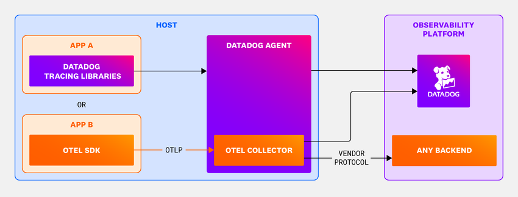
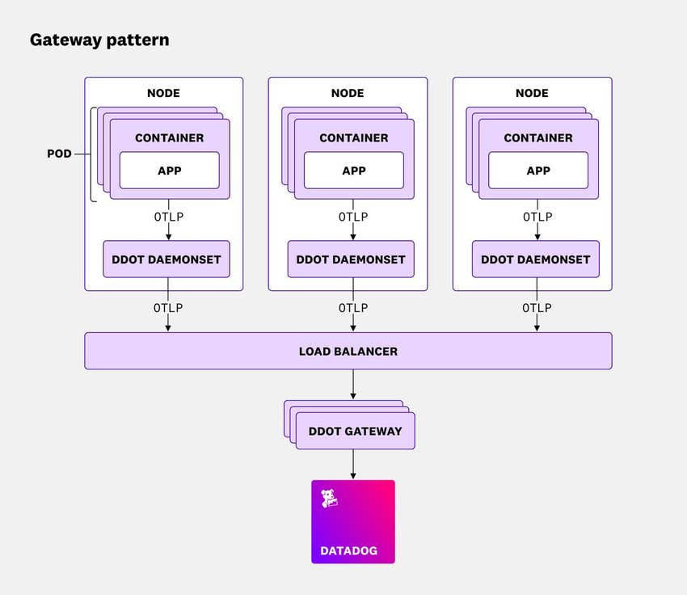
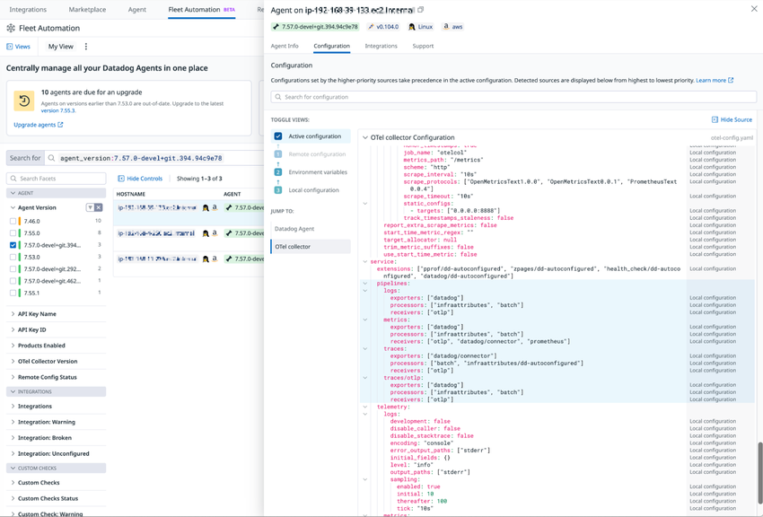
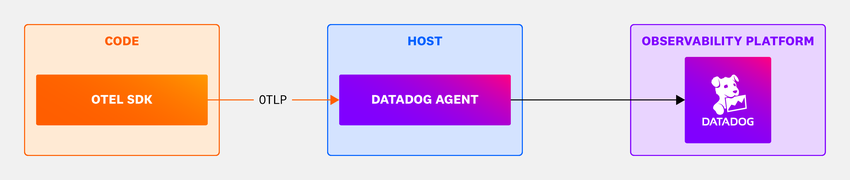
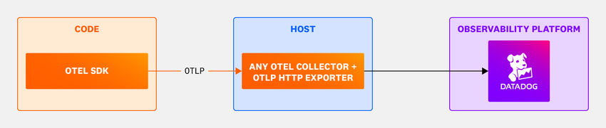

# OpenTelemetry サポート

## 概要

Datadog は OpenTelemetry（OTel、オープンテレメトリー）で計装（インスツルメンテーション）したアプリケーションのトレース、メトリクス、ログを受け付ける。Datadog で OpenTelemetry を使うときは、次の2点を決める必要がある [出典](https://docs.datadoghq.com/opentelemetry/)。

1. **計装方法**：OTel SDK＋OTel API（ベンダー中立）か、OTel API＋Datadog SDK（Datadog トレーサー）か。Datadog SDK と組み合わせたほうが使える Datadog 機能は多い。
2. **データ送信経路**：Datadog Agent に組み込まれた DDOT Collector、Datadog Agent の OTLP 受信機能（OTLP Ingest in the Agent）、自前で運用するアップストリームの OpenTelemetry Collector、Collector を使わない Direct OTLP Ingest（OTLP Intake Endpoint）のいずれか。

本ファイルは次の内容を扱う。

- 4つの送信経路の仕様、設定キー、デフォルト値、制限
- 機能互換性マトリクス
- OTel のセマンティック規約（semantic conventions）と Datadog 規約の対応
- Datadog SDK と OTel API/SDK の互換性
- 課金上の扱い

OTel を採用するかどうかや段階的な移行など、戦略面の判断は [OpenTelemetry 活用戦略](../../04_応用編/10-opentelemetry-strategy.md) を参照する。

> **ポイント（2026-11-02 時点）:** Datadog の公式推奨は「Datadog SDK + DDOT Collector」。自前で運用する Collector については、Datadog は新規構成で **OTLP HTTP Exporter + `span_metrics` Connector** の構成を推奨している。従来の Datadog Exporter / Datadog Connector も引き続きサポートされ、既存構成を移行する必要はない [出典](https://docs.datadoghq.com/opentelemetry/setup/collector_exporter/datadog_exporter/)。

---

## 用語と構成要素

| 用語 | 説明 |
|---|---|
| OTLP（OpenTelemetry Protocol） | OTel 標準のテレメトリ転送プロトコル。gRPC（デフォルトポート `4317`）と HTTP（デフォルトポート `4318`、`http/protobuf` または `http/json`）がある |
| OTel API / OTel SDK | API は計装コードが呼ぶインターフェース、SDK はその実装（サンプリング、エクスポートなど）。Datadog SDK も OTel API の実装を提供する |
| DDOT Collector | Datadog Distribution of OpenTelemetry Collector。Datadog Agent に組み込まれた、Datadog が保守する OTel Collector ディストリビューション |
| OTLP Ingest in the Agent | Datadog Agent が OTLP を直接受信する機能。Collector パイプラインを管理しなくてよい |
| アップストリーム OTel Collector | OpenTelemetry Collector Contrib など、ユーザーが自分で運用する Collector |
| Datadog Exporter（`datadogexporter`） | OTel Collector から Datadog へトレース、メトリクス、ログを送る Exporter。Datadog が保守し、Contrib に含まれる |
| Datadog Connector（`datadogconnector`） | スパンから Datadog の Trace Metrics（APM 統計）を計算する Connector |
| `span_metrics` Connector | OTel 標準の Connector。スパンから RED メトリクス（Rate、Error、Duration）を生成する。OTLP HTTP Exporter 構成では Trace Metrics の源になる |
| Direct OTLP Ingest（OTLP Intake Endpoint） | Agent も Collector も介さず、SDK やマネージドプラットフォームから Datadog の OTLP エンドポイントへ直接送る方式 |
| Infrastructure Attribute Processor（`infraattributes`） | DDOT 独自の Processor。OTLP テレメトリに Kubernetes などのインフラタグを付ける |

---

## データ送信経路の比較



*図: DDOT Collector のアーキテクチャ*
画面説明: 左側の「HOST」枠に2つのアプリがある。「APP A」は Datadog Tracing Libraries で計装されて Datadog Agent へ送り、「APP B」は OTel SDK で計装されて OTLP で Agent 内の「OTEL COLLECTOR」へ送る。Datadog Agent は Datadog へ送信し、Agent 内の OTel Collector は Datadog または「ANY BACKEND」へベンダープロトコルで送信できる。
出典: https://docs.datadoghq.com/opentelemetry/setup/ddot_collector/ （取得日: 2026-11-02）

### セットアップ種別（公式の分類）

| セットアップ | API | SDK | Collector / Agent | 主な用途 |
|---|---|---|---|---|
| **Datadog SDK + DDOT（推奨）** | Datadog API または OTel API | Datadog SDK | DDOT Collector | Datadog の機能を最大限に使いつつ OTel パイプラインも使いたい |
| **OTel SDK + DDOT** | OTel API | OTel SDK | DDOT Collector | ベンダー中立な計装を保ったまま、Agent 系の機能（Live Containers、CNM、USM、Fleet Automation 等）を使いたい |
| **OTel SDK + Upstream OpenTelemetry Collector** | OTel API | OTel SDK | OpenTelemetry Collector Contrib | Collector を自分で管理したい、テイルベースサンプリング等の高度な処理が必要 |
| **Direct OTLP Ingest** | OTel API | OTel SDK | なし（Datadog エンドポイントへ直接） | サーバーレス、マネージドプラットフォーム、リソース制約環境 |

[出典](https://docs.datadoghq.com/opentelemetry/compatibility/)

上の分類とは別に、**OTLP Ingest in the Agent**（Datadog Agent の OTLP 受信）も選べる。公式は「Kubernetes Linux 以外のプラットフォームのユーザー、または Collector パイプラインを管理せず最小構成にしたいユーザー」向けと位置付けている [出典](https://docs.datadoghq.com/opentelemetry/setup/)。

### 選定早見表

| 観点 | DDOT Collector | OTLP Ingest in the Agent | アップストリーム Collector | Direct OTLP Ingest |
|---|---|---|---|---|
| ホストに Datadog Agent が必要か | 必要（Agent に組み込み） | 必要 | 不要 | 不要 |
| Collector の処理機能（processor、tail sampling 等） | あり | なし（Agent の固定パイプライン） | あり | なし |
| Fleet Automation での管理 | あり | Agent として管理 | `datadog` extension で構成を可視化（テレメトリは送らない） | なし |
| Datadog 側のサポート範囲 | Datadog がサポートする | Datadog がサポートする | Datadog 製コンポーネントのみサポート対象 | Datadog がサポートする |
| Infrastructure Host List への反映 | される | される | `hostmetrics` receiver を構成すれば反映される | 反映されない |
| 代表的な前提条件 | Kubernetes v1.29+（DaemonSet/Gateway）、Linux、Windows、ECS/EKS Fargate（サイドカー） | Agent 7.32.0+（トレース/メトリクス）、7.48.0+（ログ） | Collector Contrib v0.154.0+（推奨構成の検証バージョン） | API キーと HTTP エクスポート（gRPC 非対応） |

[出典](https://docs.datadoghq.com/opentelemetry/setup/) / [出典](https://docs.datadoghq.com/opentelemetry/config/hostname_tagging/) / [出典](https://docs.datadoghq.com/opentelemetry/setup/otlp_ingest/)

---

## 機能互換性マトリクス

Datadog の各製品・機能がセットアップごとに使えるかどうかを、次の表に示す。公式表で空欄の項目は「非対応」と読む。

| 機能 | Datadog SDK + DDOT（推奨） | OTel SDK + DDOT | OTel SDK + Upstream Collector | Direct OTLP Ingest |
|---|---|---|---|---|
| Cloud SIEM | 対応 | 対応 | 対応 | 対応 |
| トレース・メトリクス・ログの相関 | 対応 | 対応 | 対応 | 対応 |
| Distributed Tracing | 対応 | 対応 | 対応 | 対応 |
| Agent Observability（LLM Observability） | 対応 | 対応 | 対応 | 対応 |
| Runtime Metrics | 対応 | 対応 | 対応 | 対応 |
| Span Links | 対応 | 対応 | 対応 | 対応 |
| Trace Metrics | 対応 | 対応 | 対応 | 対応（サンプリング後。Datadog に届いたスパンから計算するため、OTel 側のサンプリングが反映される） |
| Database Monitoring（DBM） | 対応 | 対応 | 非対応 | 非対応 |
| Infrastructure Host List | 対応 | 対応 | 対応 | 非対応 |
| Cloud Network Monitoring（CNM） | 対応 | 対応 | 非対応 | 非対応 |
| Kubernetes Monitoring | 対応 | 対応 | 対応 | 非対応 |
| Live Container Monitoring | 対応 | 対応 | 非対応 | 非対応 |
| Live Processes | 対応 | 対応 | 非対応 | 非対応 |
| Universal Service Monitoring（USM） | 対応 | 対応 | 非対応 | 非対応 |
| App and API Protection（AAP、旧称：Application Security Management / ASM） | 対応 | 非対応 | 非対応 | 非対応 |
| Continuous Profiler | 対応 | 非対応 | 非対応 | 非対応 |
| Data Observability: Jobs Monitoring（DJM、旧称：Data Jobs Monitoring） | 対応 | 非対応 | 非対応 | 非対応 |
| Data Streams Monitoring（DSM） | 対応 | N/A（OTel に DSM 相当の機能がない） | N/A | 非対応 |
| Real User Monitoring（RUM） | 対応 | 非対応 | 非対応 | 非対応 |
| Source Code Integration | 対応 | 非対応 | 非対応 | 非対応 |

[出典](https://docs.datadoghq.com/opentelemetry/compatibility/)

補足（公式の注記）:

- **Agent Observability**：OTel の GenAI セマンティック規約の属性を持つトレースは、自動で Agent Observability トレースに変換される。この変換は無効にできる。
- **Runtime Metrics**：Datadog SDK 構成では DogStatsD（UDP `8125`）で送るため、Agent の DogStatsD を有効にしておく必要がある。OTel SDK 構成では OTel Runtime Metrics 仕様に従い、通常は OTLP（`4317`/`4318`）で送る。
- **RUM**：RUM 機能をフルに使うには、RUM とトレースを相関させるヘッダーの注入が必要。
- **CNM**：スパン単位やエンドポイント単位のモニタリングには対応しない。
- **Source Code Integration**：OTel 構成で未対応の言語では、テレメトリへのタグ付けでコミットと紐付ける。
- **OTLP Ingest in the Agent の制約**：OTel SDK で計装したアプリのデータは、App and API Protection、Continuous Profiler、Ingestion Rules では使えない [出典](https://docs.datadoghq.com/opentelemetry/setup/otlp_ingest_in_the_agent/)。

### サポートレベル

| レベル | 対象 | サポート内容 |
|---|---|---|
| Datadog Supported Components | Datadog Connector、Datadog Exporter、Infra Attribute Processor など Datadog 製のコンポーネント | Datadog が保守する。定期的に更新され、バグ修正と機能改善が優先される |
| Community Supported Components | DDOT Collector に既定で含まれる OTel コンポーネント | Datadog が安全性、安定性、互換性の確保を支援する |
| Custom Components | 既定に含まれないコンポーネントや、未サポートランタイムの計装 | Datadog はガイダンスを出すが、機能そのものは直接サポートしない。OTel コミュニティかメンテナーに問い合わせる |

[出典](https://docs.datadoghq.com/opentelemetry/compatibility/#support-levels)

### 公式のベストプラクティス

- **混在計装を避ける**：原則として、1つのアプリで Datadog SDK と OTel SDK を両方使わない（動作が未定義になる）。ただし Python など一部の言語は、両方のインストールを前提とする。
- **同一ホストで Datadog Agent と別の OTel Collector を動かさない**：問題が起きる可能性がある。同じフリート内の別ホストで Agent と Collector を使い分けるのは問題ない。
- **AWS EKS Fargate**：アップストリームの OTel Collector では現時点で非対応。デプロイするとインフラホストの課金が正しく計算されない。

[出典](https://docs.datadoghq.com/opentelemetry/compatibility/)

---

## DDOT Collector（Datadog Distribution of OpenTelemetry Collector）

### 概要

DDOT Collector は Datadog Agent に組み込まれたオープンソースの OTel Collector ディストリビューションで、次の要素で構成される [出典](https://docs.datadoghq.com/opentelemetry/setup/ddot_collector/)。

- Datadog 向けに性能と信頼性を最適化して選定した OTel コンポーネント群（任意のコンポーネントを追加することもできる）
- Datadog Agent のデータ収集・処理機能（1,000 以上のインテグレーション、Live Container Monitoring、Cloud Network Monitoring、eBPF ベースの Universal Service Monitoring など）
- [Fleet Automation](./fleet-automation.md) による DDOT Collector フリートのリモート管理、構成と依存関係の可視化
- OTLP データへのタグ付与（Unified Service Tagging の自動適用）
- Datadog 独自コンポーネント（Infrastructure Attribute Processor、Converter、DD Flare Extension）
- Datadog による定期的な脆弱性スキャンと、グローバルサポートチームによる支援

> **【Preview】** DDOT Collector の Remote Configuration はプレビュー中で、フォームから利用を申請する [出典](https://docs.datadoghq.com/opentelemetry/setup/ddot_collector/)。

公式ブログで DDOT が発表されたのは 2025-05-06 で、このとき Agent v7.65 以上が前提とされた [出典](https://www.datadoghq.com/blog/datadog-distribution-otel-collector/)（2025-05-06 公開）。2026-11-02 時点のドキュメントでの最低要件は、プラットフォームごとに後述の表のとおり。

### 対応プラットフォームとインストール方式

| プラットフォーム | 方式 | 主な要件・注意 | 出典 |
|---|---|---|---|
| Kubernetes（DaemonSet） | Helm chart または Datadog Operator | Kubernetes v1.29+、Helm v3+、kubectl。Agent イメージタグを上書きするときは `7.67.0` 以上（`ddot-collector` イメージは 7.67.0 以上でのみ対応）。Operator v1.22.0 以降は DDOT コンテナに `-full` イメージではなく `ddot-collector` イメージを使う。`ddot-collector` イメージに `-full` 版はない | [出典](https://docs.datadoghq.com/opentelemetry/setup/ddot_collector/install/kubernetes_daemonset/) |
| Kubernetes（Gateway） | Helm chart 3.160.1+ または Datadog Operator 1.23.0+ | Kubernetes v1.29+。**EKS Fargate と GKE Autopilot は非対応** | [出典](https://docs.datadoghq.com/opentelemetry/setup/ddot_collector/install/kubernetes_gateway/) |
| Linux（ベアメタル / VM） | Agent インストールスクリプト（`DD_OTELCOLLECTOR_ENABLED=true`） | Debian、Ubuntu、CentOS、RHEL、Fedora、SUSE など。既存 Agent に追加するには Agent v7.78+ で `sudo datadog-agent otel install` | [出典](https://docs.datadoghq.com/opentelemetry/setup/ddot_collector/install/linux/) |
| Windows（ベアメタル / VM） | MSI（`DD_OTELCOLLECTOR_ENABLED=true`） | Windows Server 2016+ または Windows 10+。既存 Agent に追加するには Agent v7.78+ で、管理者権限の PowerShell から `agent.exe otel install` | [出典](https://docs.datadoghq.com/opentelemetry/setup/ddot_collector/install/windows/) |
| Amazon ECS Fargate | Agent をサイドカーコンテナとして配置 | エントリポイントは常に `--config /etc/datadog-agent/otel-config.yaml` で起動する。環境変数による構成（`env:` プロバイダ）は ECS Fargate では非対応で、独自設定はカスタムイメージに焼き込む | [出典](https://docs.datadoghq.com/opentelemetry/setup/ddot_collector/install/ecs_fargate/) |
| Amazon EKS Fargate | Agent をアプリ Pod のサイドカーとして配置 | Fargate profile を設定した EKS クラスタ | [出典](https://docs.datadoghq.com/opentelemetry/setup/ddot_collector/install/eks_fargate/) |

> **提供状況の注記:** Kubernetes 向け DDOT は、2025-05-06 の発表ブログで「production-ready」と紹介されているが [出典](https://www.datadoghq.com/blog/datadog-distribution-otel-collector/)、一般提供（GA）を明示した公式ページは 2026-11-04 時点で確認できなかった。インストールガイドに Preview の表記はない [出典](https://docs.datadoghq.com/opentelemetry/setup/ddot_collector/install/kubernetes_daemonset/)。Linux のベアメタル/VM 向けは、以前は Product Preview（プレビュー）として案内されていた [出典](https://www.datadoghq.com/product-preview/ddot-for-linux-based-hosts-or-vms)。2026-11-02 時点の英語版インストールガイド（Linux / Windows / ECS Fargate / EKS Fargate）には Preview の表記がないが、GA を明示した告知は公開情報では確認できなかった。

### OTel Collector バージョン対応

各 DDOT リリースに含まれる OTel Collector のバージョンは次のとおり。

| DDOT（Agent）バージョン | OTel Collector Beta | OTel Collector Stable |
|---|---|---|
| 7.82.x | v0.155.0 | v1.61.0 |
| 7.81.x | v0.154.0 | v1.60.0 |
| 7.80.x | v0.152.0 | v1.58.0 |
| 7.79.x | v0.150.0 | v1.56.0 |
| 7.78.x | v0.147.0 | v1.53.0 |
| 7.77.x | v0.145.0 | v1.51.0 |
| 7.76.x | v0.144.0 | v1.50.0 |
| 7.75.x | v0.142.0 | v1.48.0 |
| 7.74.x | v0.140.0 | v1.46.0 |
| 7.73.x | v0.138.0 | v1.44.0 |
| 7.72.x | v0.136.0 | v1.42.0 |
| 7.71.x | v0.133.0 | v1.39.0 |
| 7.70.x | v0.131.0 | v1.37.0 |
| 7.69.x | v0.129.0 | v1.35.0 |

[出典](https://docs.datadoghq.com/opentelemetry/setup/ddot_collector/)

### 既定で含まれるコンポーネント

既定で含まれるコンポーネントを次の表に示す。YAML 形式の一覧は [manifest.yaml](https://github.com/DataDog/datadog-agent/blob/main/comp/otelcol/collector-contrib/impl/manifest.yaml) にある。

| 種別 | コンポーネント（括弧内は利用可能になった DDOT バージョン） |
|---|---|
| Receivers | `dockerstatsreceiver`（7.56.0+）、`filelogreceiver`、`fluentforwardreceiver`、`hostmetricsreceiver`、`jaegerreceiver`、`k8sobjectsreceiver`（7.56.0+）、`kubeletstatsreceiver`（7.56.0+）、`otlpreceiver`、`podmanreceiver`（7.56.0+）、`prometheusreceiver`、`receivercreator`、`zipkinreceiver`、`nopreceiver` |
| Processors | `attributesprocessor`、`batchprocessor`、`cumulativetodeltaprocessor`、`filterprocessor`、`groupbyattributeprocessor`、`k8sattributesprocessor`、`memorylimiterprocessor`、`probabilisticsamplerprocessor`、`resourcedetectionprocessor`、`resourceprocessor`、`tailsamplingprocessor`、`transformprocessor`。※`routingprocessor` は非推奨となり **v7.71.0 で削除**（代わりに `routingconnector` を使う） |
| Exporters | `datadogexporter`、`debugexporter`、`loadbalancingexporter`、`otlpexporter`、`otlphttpexporter`、`sapmexporter`、`nopexporter` |
| Connectors | `datadogconnector`、`routingconnector`（7.68.0+）、`spanmetricsconnector` |
| Extensions | `datadogextension`（7.72.0+）、`healthcheckextension`、`observer`、`pprofextension`、`storage/filestorage`（7.56.0+）、`zpagesextension` |

[出典](https://docs.datadoghq.com/opentelemetry/setup/ddot_collector/)

### Datadog 独自コンポーネント

| コンポーネント | 種別 | 機能 |
|---|---|---|
| Infrastructure Attribute Processor（`infraattributes`） | Processor | Pod またはコンテナが出す OTLP のメトリクス、トレース、ログに、Kubernetes タグを自動で付ける。Unified Service Tagging とテレメトリの相関を実現する |
| Converter | Converter | ユーザーが書いた構成を補強し、元の構成と補強後の構成の両方を返す API を提供する。既知の誤設定を自動で検出する |
| DD Flare Extension | Extension | DDOT Collector と Agent の両方の診断情報を含む Agent Flare を生成する |

[出典](https://docs.datadoghq.com/opentelemetry/setup/ddot_collector/)

### 設定ファイルと主要キー（ホスト型：Linux / Windows）

| 項目 | Linux | Windows |
|---|---|---|
| Agent 設定 | `/etc/datadog-agent/datadog.yaml` | `C:\ProgramData\Datadog\datadog.yaml` |
| Collector 設定 | `/etc/datadog-agent/otel-config.yaml`（インストーラが雛形を作成する） | `C:\ProgramData\Datadog\otel-config.yaml`（インストーラが雛形を作成する。`datadog.yaml` と同じフォルダ）[出典](https://docs.datadoghq.com/opentelemetry/setup/ddot_collector/install/windows/) |
| 有効化キー | `otelcollector.enabled: true` | 同左 |
| IPC 設定 | `agent_ipc.port: 5009`、`agent_ipc.config_refresh_interval: 60` | 同左 |
| 既定のリッスンポート | `4317`（gRPC）、`4318`（HTTP） | 同左 |
| 設定の反映 | `datadog.yaml` または `otel-config.yaml` を編集したら Agent を再起動する | 同左 |

[出典](https://docs.datadoghq.com/opentelemetry/setup/ddot_collector/install/linux/) / [出典](https://docs.datadoghq.com/opentelemetry/setup/ddot_collector/install/windows/)

インストーラが作成する `otel-config.yaml` の主な内容（Linux の例）:

```yaml
receivers:
  prometheus:            # Collector 自身のヘルスメトリクスを 8888 から収集
    config:
      scrape_configs:
        - job_name: "otelcol"
          scrape_interval: 60s
          static_configs:
            - targets: ["0.0.0.0:8888"]
  otlp:
    protocols:
      grpc:
        endpoint: 0.0.0.0:4317
      http:
        endpoint: 0.0.0.0:4318
exporters:
  datadog:
    api:
      key: <DATADOG_API_KEY>
      site: <DATADOG_SITE>
    sending_queue:
      batch:
        flush_timeout: 10s
processors:
  infraattributes:
    cardinality: 2
  cumulativetodelta:
connectors:
  datadog/connector:
    traces:
      compute_top_level_by_span_kind: true
      peer_tags_aggregation: true
      compute_stats_by_span_kind: true
service:
  pipelines:
    traces:
      receivers: [otlp]
      processors: [infraattributes]
      exporters: [datadog, datadog/connector]
    metrics:
      receivers: [otlp, datadog/connector, prometheus]
      processors: [infraattributes, cumulativetodelta]
      exporters: [datadog]
    logs:
      receivers: [otlp]
      processors: [infraattributes]
      exporters: [datadog]
```

- Datadog Exporter の `api.key` を省略した場合や secret を指定した場合、また `api.site` を省略した場合は、コア Agent の設定値が使われる。コア Agent の `site` の既定値は `datadoghq.com`（US1）である [出典](https://docs.datadoghq.com/opentelemetry/setup/ddot_collector/install/linux/)。
- **AP1（日本）を使う場合は `site` に `ap1.datadoghq.com` を明示する**（[Datadog Sites](./datadog-sites.md) 参照）。
- 追加の Datadog 機能を有効にするときは、Datadog の環境変数ではなく、Datadog と Collector の設定ファイルを使うよう公式が推奨している。

### Kubernetes（Helm / Operator）の主要キー

| 方式 | キー | 意味 |
|---|---|---|
| Helm | `datadog.otelCollector.enabled` | DDOT Collector を有効にする |
| Helm | `datadog.otelCollector.ports` | `containerPort` / `hostPort` / `name`（`otel-grpc`=4317、`otel-http`=4318）を指定する |
| Helm | `datadog.otelCollector.config` | 独自の Collector 構成（`--set-file datadog.otelCollector.config=otel-config.yaml`） |
| Helm | `useFIPSAgent`（ルート） | FED サイト向けに FIPS 準拠の Agent イメージを使う |
| Operator | `features.otelCollector.enabled` | DDOT Collector を有効にする |
| Operator | `features.otelCollector.ports` | ポートを上書きする（既定では `4317` / `4318` をバインド） |
| Operator | `features.otelCollector.conf.configData` | Collector 構成をインラインで記述する |
| Operator | `features.otelCollector.conf.configMap.name` | `otel-config.yaml` を格納した ConfigMap を参照する |
| Operator | `spec.global.useFIPSAgent` | FIPS 準拠イメージを使う |
| Operator | `spec.override.nodeAgent.image.name` | Agent イメージを上書きする（`-full` イメージを使いたい場合など） |

[出典](https://docs.datadoghq.com/opentelemetry/setup/ddot_collector/install/kubernetes_daemonset/)

- `hostPort` を設定すると、アプリはノード IP（`status.hostIP` から取った `HOST_IP`）へ OTLP を送れる。`hostPort` を使わない場合は Agent の Service 経由で送る。
- 追加機能の例（`datadog.apm.portEnabled`、`datadog.apm.peer_service_aggregation`、`datadog.orchestratorExplorer.enabled`、`datadog.processAgent.processCollection`）は追加料金が発生しうる。`datadog.podLabelsAsTags` はカスタムメトリクス課金に影響しうると公式が警告している。

### Gateway 構成（Kubernetes）

Gateway パターンは、独立した Collector サービスを中央に置き、テイルベースサンプリング、集約、フィルタ、ルーティングをまとめて行う構成。



*図: DDOT Collector Gateway 構成*
画面説明: アプリは各ノードの DDOT DaemonSet へ OTLP を送る。DaemonSet は中央のロードバランサー（Kubernetes Service）へ転送し、ロードバランサーは別の Deployment として動く DDOT Gateway Pod 群に振り分ける。Gateway Pod が Datadog へ送信する。
出典: https://docs.datadoghq.com/opentelemetry/setup/ddot_collector/install/kubernetes_gateway/ （取得日: 2026-11-02）

| 項目 | 内容 |
|---|---|
| 生成されるリソース | Deployment `<RELEASE_NAME>-datadog-otel-agent-gateway-deployment`、Service `<RELEASE_NAME>-datadog-otel-agent-gateway` |
| 主な設定 | Helm: `otelAgentGateway.enabled` / `replicas` / `nodeSelector` / `affinity`。Operator: `otelAgentGateway` 機能と `override.otelAgentGateway.*` |
| DaemonSet の既定の送信先 | `http://<release>-datadog-otel-agent-gateway:4318` |
| テイルサンプリング | DaemonSet 側で `loadbalancing` Exporter（Kubernetes resolver、RBAC が必要）を使い、同じ traceID のスパンを同じ Gateway Pod に送る。Gateway 側で `tail_sampling` を適用する |
| APM 統計（Trace Metrics） | サンプリング前の 100% のトレースで計算するため、`datadog/connector` は `tail_sampling` のない別パイプラインに置く（DaemonSet 層と Gateway 層のどちらでもよい） |
| ホスト情報 | Gateway に届く前（DaemonSet 側）で `infraattributes` を残してホスト属性を付ける |
| Fleet Automation | Gateway には `datadog` extension が既定で含まれ、Integrations > Fleet Automation で Gateway Pod のビルド情報と実行中の構成を確認できる |
| 既知の制限 | 同じリリースで DaemonSet と Gateway を同時にデプロイすると、Gateway Service の準備前に DaemonSet が起動して接続エラーが一時的にログに出る（OTLP Exporter が自動リトライするので無視してよい） |

[出典](https://docs.datadoghq.com/opentelemetry/setup/ddot_collector/install/kubernetes_gateway/) / [ブログ](https://www.datadoghq.com/blog/ddot-gateway/)（2025-12-01 公開）

### カスタムコンポーネント（BYOC）

既定に含まれない OTel コンポーネントが必要な場合は、OpenTelemetry Collector Builder（OCB）のマニフェストに追加して、独自の DDOT（Agent）イメージをビルドする [出典](https://docs.datadoghq.com/opentelemetry/setup/ddot_collector/custom_components/)。

| 手順・要件 | 内容 |
|---|---|
| 前提 | Docker、OCB の知識。追加するコンポーネントが DDOT の Collector バージョンと互換であること |
| Dockerfile | `Dockerfiles/agent-ddot/Dockerfile.agent-otel`（Agent のタグごと）。Ubuntu 24.04 と `datadog/agent:<ver>-full` のマルチステージビルド |
| マニフェスト | `comp/otelcol/collector-contrib/impl/manifest.yaml` を取得して追記する |
| イメージ名 | `datadog/agent` にする（Docker Hub 以外なら `<REPOSITORY>/datadog/agent`）。タグはビルド元の Agent バージョンに合わせる |
| Helm の注意 | `agents.image.tag` は Agent バージョンとして解釈される。`byoc-0.0.2` のような非バージョン値は失敗や誤設定の原因になる。同じバージョンのビルドを区別するには `7.83.1-byoc.1` のような SemVer のプレリリース識別子を使う |
| 運用 | Agent バージョンを上げるたびにビルドし直す必要がある |
| サポート | カスタムコンポーネントの機能は Datadog の直接サポート対象外（サポートレベル「Custom Components」） |

### Fleet Automation での確認



*図: Fleet Automation の Agent 詳細パネル（Configuration タブ）*
画面説明: 左側は Fleet Automation の Agent 一覧で、Agent Version、API Key、OTel Collector Version などのファセットで絞り込める。右側は選択した Agent の詳細パネルで、「Configuration」タブの「Jump to」から「OTel collector」を選ぶと、`otel-config.yaml` の有効な構成（receivers、pipelines、telemetry など）と、各値の取得元（Local configuration / Remote configuration / 環境変数）が表示される。
出典: https://docs.datadoghq.com/opentelemetry/setup/ddot_collector/install/kubernetes_daemonset/ （取得日: 2026-11-02）

### アップストリーム Collector から DDOT への移行

| 項目 | 内容 |
|---|---|
| 前提 | Kubernetes v1.29+、Helm v3+、既存の Collector 構成。EKS Fargate は非対応 |
| 手順の概要 | 既存構成のレビュー → Datadog Helm リポジトリの追加と API キーの Secret 作成 → `otelCollector` 有効化と既存構成の取り込み → デプロイ → アプリの送信先を変更 → データ到達を確認 → アップストリーム Collector をアンインストール |
| 操作名マッピングの差 | アップストリームで `span_name_as_resource_name` や `span_name_remappings` を使っていた場合は、これらを削除し、Agent 設定で `enable_operation_and_resource_name_logic_v2` フィーチャーフラグを有効にする |

[出典](https://docs.datadoghq.com/opentelemetry/migrate/ddot_collector/)

---

## OTLP Ingest in the Agent（Agent の OTLP 受信）



*図: OTLP Ingest in the Agent*
画面説明: 左の「CODE」枠の OTel SDK が OTLP で、中央の「HOST」枠の Datadog Agent へ送る。Agent はそれを右の「OBSERVABILITY PLATFORM」枠の Datadog へ転送する。Collector は介さない。
出典: https://docs.datadoghq.com/opentelemetry/setup/otlp_ingest_in_the_agent/ （取得日: 2026-11-02）

### 概要と最低バージョン

OTLP Ingest in the Agent は、Datadog Agent が OTLP（gRPC / HTTP）で直接テレメトリを受け取る機能。**既定では無効**で、受信設定を有効にするとメトリクスとトレースの取り込みが有効になる。ログの取り込みは別途有効化が必要。

| シグナル | 最低 Agent バージョン | 既定 |
|---|---|---|
| トレース | 6.32.0 / 7.32.0 | 受信設定を有効にすると有効 |
| メトリクス | 6.32.0 / 7.32.0 | 受信設定を有効にすると有効 |
| ログ | 6.48.0 / 7.48.0 | **無効**（予期しない課金を避けるため。`logs_enabled: true` と `otlp_config.logs.enabled: true` の両方が必要） |

[出典](https://docs.datadoghq.com/opentelemetry/setup/otlp_ingest_in_the_agent/)

受け付ける OTLP のバージョンは、Agent に組み込まれた Collector の OTLP receiver がサポートする範囲に限られる（Agent の `go.mod` にある `go.opentelemetry.io/collector` のバージョンで確認する）。

### `datadog.yaml` の主要設定キー（`otlp_config`）

| キー | 環境変数 | 既定値 | 説明 |
|---|---|---|---|
| `otlp_config.receiver.protocols.grpc.endpoint` | `DD_OTLP_CONFIG_RECEIVER_PROTOCOLS_GRPC_ENDPOINT` | `localhost:4317` | gRPC 受信アドレス。コンテナ内では `0.0.0.0:4317` にする |
| `otlp_config.receiver.protocols.grpc.transport` | `DD_OTLP_CONFIG_RECEIVER_PROTOCOLS_GRPC_TRANSPORT` | `tcp` | トランスポート |
| `otlp_config.receiver.protocols.grpc.max_recv_msg_size_mib` | `DD_OTLP_CONFIG_RECEIVER_PROTOCOLS_GRPC_MAX_RECV_MSG_SIZE_MIB` | `0` | `0` のときは grpc-go 組み込みの 4 MiB 上限が適用される |
| `otlp_config.receiver.protocols.http.endpoint` | `DD_OTLP_CONFIG_RECEIVER_PROTOCOLS_HTTP_ENDPOINT` | `localhost:4318` | HTTP 受信アドレス |
| `otlp_config.metrics.enabled` | `DD_OTLP_CONFIG_METRICS_ENABLED` | `true` | メトリクスの取り込み |
| `otlp_config.metrics.resource_attributes_as_tags` | `DD_OTLP_CONFIG_METRICS_RESOURCE_ATTRIBUTES_AS_TAGS` | `false` | すべてのリソース属性をメトリクスタグにする（カーディナリティ増に注意） |
| `otlp_config.metrics.instrumentation_scope_metadata_as_tags` | `DD_OTLP_CONFIG_METRICS_INSTRUMENTATION_SCOPE_METADATA_AS_TAGS` | `true` | 計装スコープ名とバージョンをタグにする |
| `otlp_config.metrics.infra_attributes.as_tags` | `DD_OTLP_CONFIG_METRICS_INFRA_ATTRIBUTES_AS_TAGS` | `false` | インフラ属性をタグとして付ける |
| `otlp_config.metrics.tag_cardinality` | `DD_OTLP_CONFIG_METRICS_TAG_CARDINALITY`（`DD_OTLP_TAG_CARDINALITY`） | `low` | 付与するタグのカーディナリティ |
| `otlp_config.metrics.delta_ttl` | `DD_OTLP_CONFIG_METRICS_DELTA_TTL` | `3600`（秒） | 累積単調メトリクスの差分を計算するため、値をメモリに保持する時間 |
| `otlp_config.metrics.histograms.mode` | `DD_OTLP_CONFIG_METRICS_HISTOGRAMS_MODE` | `distributions` | `distributions` / `nobuckets` / `counters` |
| `otlp_config.metrics.histograms.send_aggregation_metrics` | `DD_OTLP_CONFIG_METRICS_HISTOGRAMS_SEND_AGGREGATION_METRICS` | `false` | sum / count / min / max を別メトリクスで送る（`send_count_sum_metrics` は旧キー） |
| `otlp_config.metrics.sums.cumulative_monotonic_mode` | `DD_OTLP_CONFIG_METRICS_SUMS_CUMULATIVE_MONOTONIC_MODE` | `to_delta` | `to_delta`（差分を COUNT で送る）/ `raw_value`（GAUGE で送る） |
| `otlp_config.metrics.sums.initial_cumulative_monotonic_value` | `DD_OTLP_CONFIG_METRICS_SUMS_INITIAL_CUMULATIVE_MONOTONIC_VALUE` | `auto` | 初回値の扱い：`auto` / `drop` / `keep` |
| `otlp_config.metrics.summaries.mode` | `DD_OTLP_CONFIG_METRICS_SUMMARIES_MODE` | `gauges` | `gauges` / `noquantiles` |
| `otlp_config.metrics.batch.min_size` / `max_size` / `flush_timeout` | `DD_OTLP_CONFIG_METRICS_BATCH_*` | `8192` / `0` / `200ms` | メトリクスのバッチ設定 |
| `otlp_config.traces.enabled` | `DD_OTLP_CONFIG_TRACES_ENABLED` | `true` | トレースの取り込み |
| `otlp_config.traces.span_name_as_resource_name` | `DD_OTLP_CONFIG_TRACES_SPAN_NAME_AS_RESOURCE_NAME` | `false` | OTel のスパン名を Datadog の操作名に使う |
| `otlp_config.traces.span_name_remappings` | `DD_OTLP_CONFIG_TRACES_SPAN_NAME_REMAPPINGS` | `{}` | 操作名の置換マップ |
| `otlp_config.traces.probabilistic_sampler.sampling_percentage` | `DD_OTLP_CONFIG_TRACES_PROBABILISTIC_SAMPLER_SAMPLING_PERCENTAGE` | `100` | 取り込むトレースの割合（0 より大きく 100 以下。範囲外の値は無視されて既定値になる） |
| `otlp_config.traces.infra_attributes.enabled` | `DD_OTLP_CONFIG_TRACES_INFRA_ATTRIBUTES_ENABLED` | `true` | トレースにインフラ属性を付ける |
| `otlp_config.traces.infra_attributes.container_tag_promotion` | `DD_OTLP_CONFIG_TRACES_INFRA_ATTRIBUTES_CONTAINER_TAG_PROMOTION` | `off` | コンテナタグの昇格方法 |
| `otlp_config.logs.enabled` | `DD_OTLP_CONFIG_LOGS_ENABLED` | `false` | ログの取り込み（`logs_enabled: true` も必要） |
| `otlp_config.logs.infra_attributes.tags_as_ddtags` | `DD_OTLP_CONFIG_LOGS_INFRA_ATTRIBUTES_TAGS_AS_DDTAGS` | `false` | インフラタグを `ddtags` として付ける |
| `otlp_config.logs.batch.*` | `DD_OTLP_CONFIG_LOGS_BATCH_*` | `8192` / `0` / `200ms` | ログのバッチ設定 |
| `otlp_config.debug.verbosity` | `DD_OTLP_CONFIG_DEBUG_VERBOSITY` | `basic` | debug exporter の出力の詳細度（`debug` セクションを宣言したときだけ有効） |

[出典](https://github.com/DataDog/datadog-agent/blob/main/pkg/config/example/datadog-agent_linux.yaml.example) / [出典](https://docs.datadoghq.com/opentelemetry/setup/otlp_ingest_in_the_agent/)

設定例（ホスト）:

```yaml
otlp_config:
  receiver:
    protocols:
      grpc:
        endpoint: 0.0.0.0:4317
      http:
        endpoint: 0.0.0.0:4318
  logs:
    enabled: false
```

> **注意:** 受信エンドポイントの環境変数は、コア Agent と Trace Agent の**両方のプロセス**に渡す必要がある [出典](https://docs.datadoghq.com/opentelemetry/setup/otlp_ingest_in_the_agent/)。

Service-entry span（後述）を `span.kind` から判定する新しいロジックは、Agent v7.53.0 以降で `apm_config.features` に `"enable_otlp_compute_top_level_by_span_kind"` を追加すると有効になる [出典](https://docs.datadoghq.com/opentelemetry/mapping/service_entry_spans/)。

### デプロイ方式別の有効化

| 方式 | 受信の有効化 | ログの有効化 |
|---|---|---|
| ホスト | `datadog.yaml` の `otlp_config.receiver.protocols.*` | `logs_enabled: true` と `otlp_config.logs.enabled: true` |
| Docker | `DD_OTLP_CONFIG_RECEIVER_PROTOCOLS_GRPC_ENDPOINT=0.0.0.0:4317` など。ポートを公開する | `DD_LOGS_ENABLED=true` と `DD_OTLP_CONFIG_LOGS_ENABLED=true` |
| Datadog Operator | `spec.features.otlp.receiver.protocols.grpc.enabled` / `http.enabled` を `true` | `spec.features.logCollection.enabled: true` と環境変数 `DD_OTLP_CONFIG_LOGS_ENABLED` |
| Helm | `datadog.otlp.receiver.protocols.grpc.enabled` / `http.enabled` を `true` | `datadog.otlp.logs.enabled: true` と `datadog.logs.enabled: true` |
| DaemonSet（手動マニフェスト） | `trace-agent` と `agent` の両コンテナに環境変数を設定し、hostPort 4317/4318（名前は `traceportgrpc` / `traceporthttp`）をマップ | コア Agent コンテナに `DD_LOGS_ENABLED` と `DD_OTLP_CONFIG_LOGS_ENABLED` |
| AWS Lambda | Serverless のドキュメントを参照 | 同左 |

[出典](https://docs.datadoghq.com/opentelemetry/setup/otlp_ingest_in_the_agent/)

### アプリ側の送信先（`OTEL_EXPORTER_OTLP_ENDPOINT`）

| 環境 | 値 |
|---|---|
| ホスト（gRPC） | `http://localhost:4317` |
| ホスト（HTTP） | `http://localhost:4318` |
| Docker | `http://<datadog-agent>:4318`（同じブリッジネットワークに置く） |
| Kubernetes | `http://$(HOST_IP):4317` または `:4318`（`HOST_IP` は `status.hostIP` から取る） |

- ライブラリによって `/v1/traces` などのパスが必要なものと、`/` でよいものがある。
- カスタムメトリクスにコンテナタグを付けるには、リソース検出器で `container.id` リソース属性を設定する。

### 制約と既知の問題

- 各ホストに取り込み用の Agent が必要。**あるホストのアプリや Collector から、別ホストの Agent へ送ることはサポートされない**。
- 受信プロトコルは gRPC か HTTP のどちらかを構成する。
- OTel SDK で計装したアプリのデータは、App and API Protection、Continuous Profiler、Ingestion Rules では使えない。
- **既知の問題（Docker 上の Agent 7.61.0 以降。公式の表記は「Starting with Agent version 7.61.0」）**：パイプラインが `failed to register process metrics: process does not exist` で失敗することがある。回避策は次のいずれか。
  - `HOST_PROC` を `/proc` に設定する
  - `volumes` から `/proc/:/host/proc/:ro` を外す
  - `pid` を `host` にする

[出典](https://docs.datadoghq.com/opentelemetry/setup/otlp_ingest_in_the_agent/)

---

## OpenTelemetry Collector（アップストリーム）で Datadog に送る

### 推奨構成：OTLP HTTP Exporter + `span_metrics` Connector



*図: アップストリーム OTel Collector 構成*
画面説明: 左の「CODE」枠の OTel SDK が OTLP で、中央の「HOST」枠の OpenTelemetry Collector へ送る。Collector は OTLP HTTP で右の Datadog（Observability Platform）へエクスポートする。
出典: https://docs.datadoghq.com/opentelemetry/setup/collector_exporter/ （取得日: 2026-11-02）

自前で運用する Collector では、この構成が公式の推奨。ドキュメントの構成は OpenTelemetry Collector Contrib **v0.154.0** で検証されている [出典](https://docs.datadoghq.com/opentelemetry/setup/collector_exporter/)。

| 項目 | 内容 |
|---|---|
| ディストリビューション | OpenTelemetry Collector Contrib v0.154.0 以降（Docker イメージ `otel/opentelemetry-collector-contrib:0.154.0`、バイナリ `otelcol-contrib`、Kubernetes では OpenTelemetry Helm chart。Helm chart の values ファイルは chart v0.147.1 で検証され、Collector 自体は v0.154.0 に固定される） |
| 対応環境 | ベアメタル、VM、Docker、Kubernetes（Amazon EKS（Auto Mode を含む）、GKE（Standard / Autopilot）、AKS（Automatic を含む）） |
| 非対応環境 | ECS Fargate、EKS Fargate、AWS Lambda などサーバーレスやタスクベースのランタイム（Direct OTLP Ingest を使う） |
| デプロイパターン | Agent パターン（ホストまたはノードごとに1つ）。複数 Collector でテイルサンプリングを行う場合は、同じトレースのスパンを同じ Collector に集める Gateway 構成が必要 |
| 送信先 | `https://otlp.<DD_SITE>`（traces / metrics / logs 共通。例：AP1 は `https://otlp.ap1.datadoghq.com`） |
| 認証 | ヘッダー `dd-api-key: ${env:DD_API_KEY}` |
| 圧縮 | `zstd` を推奨。`compression_params.level`（例：`3`）は明示する必要がある（既定は最低圧縮レベル） |
| バッチ | `sending_queue.batch`（`sizer: bytes`、`min_size: 2097152`（2 MiB）、`max_size: 4194304`（4 MiB））。HTTP 413 が返ったら値を下げる。この構成では batch processor を使わない |
| 必須・推奨コンポーネント | receivers: `otlp`、`host_metrics`（Infrastructure List に必要）。processors: `resource_detection`（`[env, system]`、クラウドでは `ec2` / `gcp` / `azure` / `eks` / `aks` を追加、`timeout: 2s`、`override: true`）、`cumulativetodelta`。Kubernetes ではさらに `k8s_attributes`、`kubelet_stats`、`deltatorate`、`health_check`（`13133`）。connectors: `span_metrics`、`forward/traces_sample`。extension: `datadog`（Fleet Automation 向けの構成レポートのみで、テレメトリは送らない） |
| 自己監視 | Collector の内部メトリクスを自分の OTLP 受信（`http://localhost:4318`）に送り、パイプラインを通してエンリッチしてから送信する |

[出典](https://docs.datadoghq.com/opentelemetry/setup/collector_exporter/)

パイプラインの骨格（ホスト向け構成の抜粋）:

```yaml
connectors:
  forward/traces_sample: {}
  span_metrics:
    aggregation_temporality: AGGREGATION_TEMPORALITY_DELTA
    add_resource_attributes: true
    histogram:
      exponential: {}
      unit: s
    dimensions:            # 公式構成の dimensions はすべて残す（抜粋）
      - name: deployment.environment.name
      - name: service.version
      - name: http.response.status_code
      - name: container.id
      - name: host.name
      - name: k8s.node.name
      - name: db.system
      - name: http.route
      # ...（ホスト名推定、peer service、操作名、リソース名推定のための属性が続く）
exporters:
  otlp_http:
    endpoint: https://otlp.${env:DD_SITE}
    headers:
      dd-api-key: ${env:DD_API_KEY}
      dd-otel-metric-config: '{"resource_attributes_as_tags": true, "instrumentation_scope_metadata_as_tags": true}'
    compression: zstd
    compression_params:
      level: 3
service:
  pipelines:
    traces:
      receivers: [otlp]
      processors: [resource_detection]
      exporters: [forward/traces_sample, span_metrics]
    traces/sample:
      receivers: [forward/traces_sample]
      exporters: [otlp_http]        # tail_sampling などはここに入れる
    metrics/span_metrics:
      receivers: [span_metrics]
      exporters: [otlp_http]
```

- **`span_metrics` Connector**：RED メトリクスを生成し、Software Catalog、Service Page、Resource Page を動かす。dimensions は、ホストタグ、peer service、操作名、リソース名を Datadog が導出するのに使われるので、**すべて残す**。公式のフル構成では、`- glob: container.**` のような glob でコンテナタグ群をまとめる例も示されている。
- **`forward/traces_sample` Connector**：トレース処理を2つのパイプラインに分ける。サンプリングは2本目のパイプラインに入れ、Trace Metrics がサンプリング前の全トレースから計算されるようにする。

#### `dd-otel-metric-config` ヘッダー

`dd-otel-metric-config` は、メトリクスリクエストに付ける JSON ペイロードのヘッダーで、Datadog 側の OTLP メトリクス変換を設定する。

| フィールド | 型 | 既定値 | 説明 |
|---|---|---|---|
| `resource_attributes_as_tags` | Boolean | `false` | OTLP のリソース属性をメトリクスタグにする |
| `instrumentation_scope_metadata_as_tags` | Boolean | `false` | 計装スコープ名とバージョンをタグにする |
| `trace_metrics.namespace` | String | `traces.span.metrics` | トレース由来メトリクスの名前空間プレフィックス |
| `trace_metrics.instrumentation_metrics_calc` | Boolean | `false` | `true` のとき、対応する HTTP 計装メトリクスを APM Trace Metrics に使う（`span_metrics` Connector とは併用しない。両方から二重に計算されるため） |
| `raw_instrumentation_metrics_drop` | Boolean | `false` | `instrumentation_metrics_calc` が `true` のとき、元の HTTP 計装メトリクスを通常のメトリクス取り込みから除く |

[出典](https://docs.datadoghq.com/opentelemetry/setup/collector_exporter/#dd-otel-metric-config-header)

> **注意（既定値の違い）:** `instrumentation_scope_metadata_as_tags` の既定値は経路によって違う。OTLP Intake のヘッダーは `false`、Agent の `otlp_config` と Datadog Exporter の設定は `true`。経路を切り替えるとタグ構成が変わる場合がある。
> **2026-09-01 以降:** `dd-otel-metric-config` の `histograms` と `summaries` フィールドは無視される。ヒストグラムはネイティブに保存される [出典](https://docs.datadoghq.com/opentelemetry/setup/otlp_ingest/metrics/)。

### 従来構成：Datadog Exporter + Datadog Connector

Datadog Exporter は、Agent を使わずに Collector からトレース、メトリクス、ログを Datadog に送る。Datadog Connector はスパンから Trace Metrics を計算する。新規構成には前述の OTLP HTTP 構成が推奨されるが、こちらも引き続きサポートされており、既存構成の移行は不要 [出典](https://docs.datadoghq.com/opentelemetry/setup/collector_exporter/datadog_exporter/)。

公式の基本構成（抜粋）:

```yaml
receivers:
  otlp:
    protocols:
      http: { endpoint: 0.0.0.0:4318 }
      grpc: { endpoint: 0.0.0.0:4317 }
  hostmetrics:            # インフラメトリクスを正しく出すために必要
    collection_interval: 10s
    scrapers: { paging: {}, cpu: {}, disk: {}, filesystem: {}, load: {}, memory: {}, network: {}, processes: {} }
  prometheus:             # OTel Collector ダッシュボード用に 8888 をスクレイプ
    config:
      scrape_configs:
        - job_name: 'otelcol'
          scrape_interval: 10s
          static_configs: [{ targets: ['0.0.0.0:8888'] }]
processors:
  batch:
    send_batch_max_size: 100
    send_batch_size: 10
    timeout: 10s
connectors:
  datadog/connector:
exporters:
  datadog/exporter:
    api:
      site: <YOUR_DATADOG_SITE>
      key: ${env:DD_API_KEY}
service:
  pipelines:
    metrics:
      receivers: [hostmetrics, prometheus, otlp, datadog/connector]
      processors: [batch]
      exporters: [datadog/exporter]
    traces:
      receivers: [otlp]
      processors: [batch]
      exporters: [datadog/connector, datadog/exporter]
    logs:
      receivers: [otlp]
      processors: [batch]
      exporters: [datadog/exporter]
```

- 開発環境以外では `batch` processor が必須。
- Datadog Connector は traces パイプラインの exporter、かつ metrics パイプラインの receiver として置く。
- サンプルは `0.0.0.0` で待ち受けているが、ローカル配置ではセキュリティのため `localhost` を推奨。
- SDK のログ対応はまだ不完全なので、JSON を出力する標準のロギングライブラリの利用が推奨されている。
- Datadog Exporter 0.83.0 以降では、OTel の `service.name` がログの `service` フィールドに入るが、既定のサービス属性としては扱われない。Service Remapper で対応付ける。

#### Datadog Exporter の主要設定パラメータ

| パラメータ | 既定値 | 説明 |
|---|---|---|
| `api.key` | （必須） | Datadog API キー |
| `api.site` | `datadoghq.com` | 送信先サイト（AP1 は `ap1.datadoghq.com`） |
| `api.fail_on_invalid_key` | `false` | 起動時に API キーが無効なら終了する |
| `hostname` | （自動検出） | ホスト名を明示する |
| `hostname_detection_timeout` | `25s` | ホスト名検出の待ち時間（トレース送信にはホスト名が必須） |
| `timeout` | `15s` | HTTP タイムアウト（confighttp の一部設定が使える） |
| `metrics.delta_ttl` | `3600` 秒 | 累積単調メトリクスの差分計算のための保持時間 |
| `metrics.resource_attributes_as_tags` | `false` | すべてのリソース属性をタグにする |
| `metrics.instrumentation_scope_metadata_as_tags` | `true` | 計装スコープのメタデータをタグにする |
| `metrics.histograms.mode` | `distributions` | `distributions`（推奨）/ `nobuckets` / `counters` |
| `metrics.histograms.send_aggregation_metrics` | `false` | sum / count / min / max を別メトリクスで送る（`send_count_sum_metrics` は v0.75.0 で非推奨） |
| `metrics.sums.cumulative_monotonic_mode` | `to_delta` | `to_delta` / `raw_value` |
| `metrics.sums.initial_cumulative_monotonic_value` | `auto` | `auto` / `drop` / `keep` |
| `metrics.summaries.mode` | `gauges` | `gauges` / `noquantiles` |
| `traces.ignore_resources` | なし | リソース名の正規表現によるブロックリスト（例：ヘルスチェックの除外） |
| `traces.span_name_remappings` | なし | 操作名の置換 |
| `traces.span_name_as_resource_name` | — | OTel のスパン名を操作名に使う |
| `traces.compute_stats_by_span_kind` | — | `span.kind`（server / consumer / client / producer）に基づいて APM 統計を計算する |
| `traces.compute_top_level_by_span_kind` | `false` | root と server / consumer スパンを top-level として扱う（v0.100.0+。Exporter と Connector の両方で有効にする） |
| `traces.peer_tags_aggregation` | `false` | `peer.service`、`db.instance` などの peer タグを Trace Metrics の次元に含める（`peer_service_aggregation` は非推奨） |
| `traces.peer_tags` | — | 【Beta】追加の peer タグ（Datadog 側で検証され、未承認のタグは除外される） |
| `traces.trace_buffer` | `0` | 送信トレースペイロードのバッファ数。`Payload in channel full. Dropped 1 payload.` が出たら増やす |
| `host_metadata.enabled` | `true` | ホストメタデータ（Infrastructure List、Host Map、ホストタグ）を送る |
| `host_metadata.hostname_source` | `config_or_system` | `config_or_system` / `first_resource`（複数ホストからデータを受ける場合は `first_resource` を使わない） |
| `host_metadata.tags` | 空 | ホストメタデータに付けるホストタグ |
| `host_metadata.reporter_period` | `30m` | ホストメタデータの送信間隔 |
| `logs.use_compression` / `logs.compression_level` / `logs.batch_wait` | `true` / `6` / `5`（秒） | ログ送信の圧縮とバッチ |

[出典](https://github.com/open-telemetry/opentelemetry-collector-contrib/blob/main/exporter/datadogexporter/examples/collector.yaml)

---

## Direct OTLP Ingest（Datadog OTLP Intake Endpoint）

### 位置付け

Direct OTLP Ingest は、Agent も Collector も置けない環境（サーバーレス関数、自社に代わってエクスポートするマネージドプラットフォーム、リソース制約環境）で、OTLP を Datadog に直接送る方式。本番では、メタデータ付与、シグナル処理、集中サンプリングができる Agent または Collector の経由を公式が推奨している [出典](https://docs.datadoghq.com/opentelemetry/setup/otlp_ingest/)。

| 区分 | 使う場面 | 参照 |
|---|---|---|
| マネージドプラットフォーム | Cloudflare、Vercel、Heroku、Netlify、Modal など。専用エンドポイントがあればそれを使う | [出典](https://docs.datadoghq.com/opentelemetry/setup/otlp_ingest/managed_platforms/) |
| サーバーレス | AWS（Lambda、ECS Fargate）、Azure（Container Apps、Web Apps、Functions）、GCP（Cloud Run、Cloud Run Functions、GKE Autopilot） | [出典](https://docs.datadoghq.com/opentelemetry/setup/otlp_ingest/serverless/) |
| 自前アプリ・ホスト・コンテナ | シグナル別（Logs / Metrics / Traces）のエンドポイント | [出典](https://docs.datadoghq.com/opentelemetry/setup/otlp_ingest/) |

### シグナル別の仕様

| シグナル | パス | プロトコル | 必須ヘッダー | 任意ヘッダー・注意 |
|---|---|---|---|---|
| Metrics | `/v1/metrics` | HTTP Protobuf（推奨）/ HTTP JSON | `dd-api-key` | `dd-otel-metric-config`。**デルタ（delta）のテンポラリティのみ受け付ける**（累積だとエラー）。`OTEL_EXPORTER_OTLP_METRICS_TEMPORALITY_PREFERENCE=delta` を設定する |
| Logs | `/v1/logs` | HTTP Protobuf | `dd-api-key` | `dd-otel-log-config`（例：`{"keep_raw_message": true}` で JSON ボディを `message` に生の文字列のまま残す）。既定では JSON ボディを属性にパースする |
| Traces | `/v1/traces` | `http/protobuf` / `http/json`（**gRPC 非対応**） | `dd-api-key` | `compute_stats=true`（Trace Metrics の計算。**既定では計算しない**）、`dd-otel-span-mapping`（スパンのマッピングとフィルタ。`span_name_as_resource_name` の既定は `true` なので、Agent / Collector と操作名を揃えるには `false` にする） |

[出典](https://docs.datadoghq.com/opentelemetry/setup/otlp_ingest/metrics/) / [出典](https://docs.datadoghq.com/opentelemetry/setup/otlp_ingest/logs/) / [出典](https://docs.datadoghq.com/opentelemetry/setup/otlp_ingest/traces/)

- エンドポイントのホストは、OTel Collector 推奨構成と同じ `https://otlp.<DD_SITE>` の形式（メトリクスの例：`https://otlp.datadoghq.com/v1/metrics`）。組織のサイトと一致しない URL に送ると `403 Forbidden` が返る。
- OTel Go SDK は、エクスポートが成功しても `202 Accepted` の警告をログに出すことがある。無視してよい。
- サーバーレス向けのトレースには、`dd-otlp-source=serverless` と `compute_stats=true` のヘッダーを付ける。`OTEL_SERVICE_NAME` を設定しないと `unknown_service` になる。`host.name` ではなく、`cloud.provider`、`faas.id` などのプラットフォーム属性でワークロードを識別する。
- トレースの Direct Ingest は、以前は「【Preview】CSM に問い合わせて利用を申請する」と案内されていた。2026-11-02 時点のドキュメントには Preview の表記がない。

### マネージドプラットフォーム専用エンドポイント

- 形式：`https://{subdomain}.integrations.otlp.<YOUR_DATADOG_SITE>`（例：`cloudflare.integrations.otlp.datadoghq.com`）。パスは `/v1/traces`、`/v1/metrics`、`/v1/logs`。
- プロトコルは `http/protobuf`、ヘッダーは `dd-api-key=${DD_API_KEY}`。マネージドプラットフォームのエンドポイントは `dd-otlp-source` ヘッダーを使わない（汎用エンドポイントから移行する場合は外す）。
- 対応サブドメイン（2026-11-02 時点）：`awx`、`claude`、`cloudflare`、`cribl`、`github-actions`、`grafbase`、`heroku`、`ibm`、`langsmith`、`livekit`、`modal`、`mulesoft`、`netlify`、`opentofu`、`retool`、`rwx`、`sfdc`（Salesforce）、`shopify`、`solace`、`spacelift`、`supabase`、`svix`、`triggerdev`、`vercel`。
- マネージドプラットフォームのエンドポイントに送ったホストメタデータは、Infrastructure Host List に反映されない。
- 料金ページによると、専用エンドポイントは「マネージドプラットフォーム向けの課金を適用するかどうかの識別」に使われる。実際のアーキテクチャに合ったエンドポイントを使う（Vercel などのマネージドプラットフォームでは、払い出された専用エンドポイントを使う。それ以外のアーキテクチャ（ホスト型、サーバーレス等）では標準エンドポイントを使う）[出典](https://www.datadoghq.com/pricing/?product=managed-platform-otlp#products)。

[出典](https://docs.datadoghq.com/opentelemetry/setup/otlp_ingest/managed_platforms/)

---

## セマンティック規約のマッピング

### リソース属性 → Datadog タグ

ここでのマッピングは、Datadog OTLP Intake、Datadog Exporter、Agent の OTLP 取り込み、DDOT Collector に共通して適用される。

| OpenTelemetry 規約 | Datadog 規約 | 種別 |
|---|---|---|
| `deployment.environment.name` ※ | `env` | Unified Service Tagging |
| `service.name` | `service` | Unified Service Tagging |
| `service.version` | `version` | Unified Service Tagging |
| `container.id` | `container_id` | コンテナ |
| `container.name` | `container_name` | コンテナ |
| `container.image.name` | `image_name` | コンテナ |
| `container.image.tag` | `image_tag` | コンテナ |
| `cloud.provider` | `cloud_provider` | クラウド |
| `cloud.region` | `region` | クラウド |
| `cloud.availability_zone` | `zone` | クラウド |
| `aws.ecs.task.family` | `task_family` | ECS |
| `aws.ecs.task.arn` | `task_arn` | ECS |
| `aws.ecs.cluster.arn` | `ecs_cluster_name` | ECS |
| `aws.ecs.task.revision` | `task_version` | ECS |
| `aws.ecs.container.arn` | `ecs_container_name` | ECS |
| `k8s.container.name` | `kube_container_name` | Kubernetes |
| `k8s.cluster.name` | `kube_cluster_name` | Kubernetes |
| `k8s.deployment.name` | `kube_deployment` | Kubernetes |
| `k8s.replicaset.name` | `kube_replica_set` | Kubernetes |
| `k8s.statefulset.name` | `kube_stateful_set` | Kubernetes |
| `k8s.daemonset.name` | `kube_daemon_set` | Kubernetes |
| `k8s.job.name` | `kube_job` | Kubernetes |
| `k8s.cronjob.name` | `kube_cronjob` | Kubernetes |
| `k8s.namespace.name` | `kube_namespace` | Kubernetes |
| `k8s.pod.name` | `pod_name` | Kubernetes |
| `app.kubernetes.io/name` | `kube_app_name` | Kubernetes ラベル |
| `app.kubernetes.io/instance` | `kube_app_instance` | Kubernetes ラベル |
| `app.kubernetes.io/version` | `kube_app_version` | Kubernetes ラベル |
| `app.kubernetes.io/component` | `kube_app_component` | Kubernetes ラベル |
| `app.kubernetes.io/part-of` | `kube_app_part_of` | Kubernetes ラベル |
| `app.kubernetes.io/managed-by` | `kube_app_managed_by` | Kubernetes ラベル |
| `client.address` | `http.client_ip` | HTTP |
| `http.response.body.size` | `http.response.content_length` | HTTP |
| `http.response.header.<header-name>` | `http.response.headers.<header-name>` | HTTP |
| `http.response.status_code` | `http.status_code` | HTTP |
| `http.request.body.size` | `http.request.content_length` | HTTP |
| `http.request.header.referrer` | `http.referrer` | HTTP |
| `http.request.header.<header-name>` | `http.request.headers.<header-name>` | HTTP |
| `http.request.method` | `http.method` | HTTP |
| `http.route` | `http.route` | HTTP |
| `network.protocol.version` | `http.version` | HTTP |
| `server.address` | `http.server_name` | HTTP |
| `url.full` | `http.url` | HTTP |
| `user_agent.original` | `http.useragent` | HTTP |

※ `deployment.environment.name` は非推奨になった `deployment.environment` の後継。**Datadog Agent 7.58.0+、Datadog Exporter v0.110.0+、または Datadog OTLP Intake が必要**。

[出典](https://docs.datadoghq.com/opentelemetry/mapping/semantic_mapping/)

メトリクスの既定の扱い: 上の表にあるリソース属性だけがメトリクスタグに変換される。それ以外も含めてすべてのリソース属性をタグにするには、`resource_attributes_as_tags` を有効にする（Datadog Exporter は `metrics.resource_attributes_as_tags`、Agent は `otlp_config.metrics.resource_attributes_as_tags`、OTLP HTTP は `dd-otel-metric-config`）。有効にするとタグのカーディナリティが大きく増え、[カスタムメトリクス](./custom-metrics-and-dogstatsd.md)の課金に直結する。

### Span type（`span.type`）の推定

Agent と Datadog の OTel コンポーネントは、スパンの属性から Datadog 独自の `span.type` を推定する。判定は上から順に優先される。

| # | 条件 | Datadog の `span.type` |
|---|---|---|
| 1 | `span.type` 属性がある | その値 |
| 2 | Span kind が server | `web` |
| 3a | Span kind が client で `db.system` がない | `http` |
| 3b | Span kind が client で `db.system` がある | 次の DB 種別表に従う |
| 4 | 上記のいずれにも当たらない | `custom` |

`db.system` → `span.type` の対応:

| `db.system` | `span.type` |
|---|---|
| SQL 系 DBMS（`adabas`、`cache`、`clickhouse`、`cloudscape`、`cockroachdb`、`coldfusion`、`db2`、`derby`、`edb`、`firebird`、`firstsql`、`filemaker`、`hanadb`、`h2`、`hsqldb`、`informix`、`ingres`、`instantdb`、`interbase`、`mariadb`、`maxdb`、`mssql`、`mysql`、`netezza`、`oracle`、`other_sql`、`pervasive`、`pointbase`、`postgresql`、`progress`、`redshift`、`sqlite`、`sybase`、`teradata`、`vertica`） | `sql` |
| `cassandra` | `cassandra` |
| `elasticsearch` | `elasticsearch` |
| `memcached` | `memcached` |
| `mongodb` | `mongodb` |
| `opensearch` | `opensearch` |
| `redis` | `redis` |
| `couchbase`、`couchdb`、`cosmosdb`、`dynamodb`、`geode`、`hive`、その他の未掲載の値 | `db` |

`span.type` は attributes processor や transform processor、または SDK の設定で明示的に上書きできる [出典](https://docs.datadoghq.com/opentelemetry/mapping/semantic_mapping/)。

### Service-entry span（サービスエントリスパン）の対応

Datadog の Trace Metrics と Trace Explorer は、Datadog 独自の「service-entry span」の概念を使う。OTel の `SpanKind` との対応は次のとおり。

| OpenTelemetry | Datadog |
|---|---|
| ルートスパン | Service-entry span |
| `span.kind: server` | Service-entry span |
| `span.kind: consumer` | Service-entry span |
| `span.kind: client` | Measured span |
| `span.kind: producer` | Measured span |
| `span.kind: internal` | Trace Metrics を生成しない |

経路ごとの有効化要件:

| 経路 | 要件 |
|---|---|
| OTLP HTTP + `span_metrics` | Collector Contrib v0.154.0+。推奨構成の dimensions のままで追加設定は不要 |
| Datadog Exporter / Connector | Collector Contrib v0.100.0+。`traces::compute_top_level_by_span_kind: true` を Exporter と Connector の**両方**に設定する |
| OTLP Ingest in the Agent | Agent v7.53.0+。`apm_config.features` に `enable_otlp_compute_top_level_by_span_kind` を追加する |

このロジックを有効にすると、Trace Metrics を生成するスパンが増え、既存の Trace Metrics ベースのモニターに影響することがある。internal スパンしかないアプリでは、逆に Trace Metrics が減る。transform processor で `kind` を書き換えて調整できる [出典](https://docs.datadoghq.com/opentelemetry/mapping/service_entry_spans/)。

### ホスト名の決定ロジック

OTLP ペイロードのリソース属性を次の順に調べ、最初に見つかった有効なホスト名を使う。

1. Datadog 固有の規約：`host`、次に `datadog.host.name`（名前空間付きの `datadog.host.name` の利用を推奨）
2. クラウドプロバイダ固有の規約
   - AWS：`aws.ecs.launchtype` で ECS Fargate と判定した場合は `aws.ecs.task.arn`（タグ名 `task_arn`）。それ以外は `host.id`（EC2 インスタンス ID）
   - GCP：`host.name` と `cloud.account.id` を組み合わせる
   - Azure：`host.id`、なければ `host.name`
3. Kubernetes 固有の規約：`k8s.node.name` とクラスタ名があれば `<ノード名>-<クラスタ名>`。クラスタ名は `k8s.cluster.name`、Azure では `azure.resourcegroup.name`、AWS では `ec2.tag.kubernetes.io/cluster/` で始まる属性から取る
4. `host.id`、次に `host.name`

どれも見つからない場合のフォールバック:

| 経路 | フォールバック |
|---|---|
| Datadog Exporter | Exporter の `hostname` 設定 → クラウドプロバイダ API → Kubernetes のホスト名 → FQDN → OS のホスト名（Gateway 構成では誤ったホスト名になりやすいので、`resource_detection` を使う） |
| OTLP Ingest in the Agent | Agent のホスト名 |

無効として破棄されるホスト名: `0.0.0.0`、`127.0.0.1`、`localhost`、`localhost.localdomain`、`localhost6.localdomain6`、`ip6-localhost`。

DDOT の `infraattributes` processor で `allow_hostname_override: true` を指定すると、属性から抽出したホスト名を Agent のホスト名で上書きできる（DDOT Collector 限定の設定）。

[出典](https://docs.datadoghq.com/opentelemetry/mapping/hostname/)

#### 経路別のホスト名の推奨設定

| 送信経路 | 推奨 |
|---|---|
| OTLP Ingest in the Agent | テレメトリを生成するすべてのホストで Agent を動かす。ホスト名属性は付けないか、Agent のホスト名に揃える |
| DDOT（ホスト型：K8s DaemonSet、Linux、Windows） | `infraattributes` で `allow_hostname_override: true` を有効にする（同じノードが2ホストとして見えるのを防ぐ） |
| DDOT（Fargate サイドカー） | ECS では SDK に ECS リソース検出器を入れて `aws.ecs.task.arn` を付ける。EKS では EKS 検出器、または `[env, eks]` の resource detection processor を使う |
| アップストリーム Collector（OTLP） | ホストまたはノードごとに Collector を置く。`resource_detection`（と Kubernetes では `k8s_attributes`）を残す。Docker では Collector の `OTEL_RESOURCE_ATTRIBUTES` に `host.name` を設定する |
| Direct OTLP Ingest | SDK またはプラットフォーム側でリソース属性を付ける。サーバーレスでは `host.name` ではなくプラットフォーム属性を使う |
| Gateway 経由 | ノード側の Collector でホスト情報を付け、Gateway ではそのまま保持する |

[出典](https://docs.datadoghq.com/opentelemetry/config/hostname_tagging/)

> 【第三者情報】DDOT を有効にしたところ、Container Agent と DDOT が報告するホスト名が食い違い、同じ Kubernetes ノードが別ホストとして数えられて Infrastructure ホストが二重に課金されうる事象があった。`allow_hostname_override: true` で解消したと報告されている [出典](https://zenn.dev/tetsuya28/articles/datadog-ddot)（2025-09-18 公開）。

APM トレースのホスト名が欠けている場合、エフェメラルな Kubernetes Pod 名に見える場合、または Agent が報告するホスト名と食い違う場合、Datadog は `datadog.apm.hostname_issue` ゲージを出す。このメトリクスは課金に影響しない [出典](https://docs.datadoghq.com/opentelemetry/config/hostname_tagging/)。

### OTLP メトリクス型 → Datadog メトリクス型

| OTLP 型 | 条件 | Datadog での扱い |
|---|---|---|
| Sum | 累積・単調 | 連続する点の差分を COUNT として送る。**最初の点は保存されるが送信されない**（元の値は `cumsum` 関数で復元できる） |
| Sum | 累積・非単調 | GAUGE |
| Sum | デルタ | COUNT |
| Gauge | — | GAUGE（整数も浮動小数点として扱う） |
| Histogram（Explicit Bucket / Exponential） | デルタ（既定・推奨） | ネイティブに取り込み、元のバケット構造のまま保存する。count が 0 のヒストグラムは捨てる |
| Histogram | 累積 | 連続する点の差分を DISTRIBUTION として送る。count 0 の差分は送らない |
| Exponential Histogram | — | 対応する scale は `[-4, 8]` |
| Summary（レガシー） | — | `<METRIC>.sum`（COUNT）、`<METRIC>.count`（COUNT）、`quantile` タグ付きの `<METRIC>.quantile`（GAUGE） |

- テンポラリティは **DELTA を推奨**。CUMULATIVE にすると、アプリや Collector の起動時にデータ点が欠けることがある。
- データポイント単位の属性はタグになる。リソース属性は、セマンティック規約に合うものだけが Datadog 規約に変換される。
- Histogram の `counters` モードでは、`.bucket`（`lower_bound` / `upper_bound` タグ付き）と、`.count` / `.sum` / `.min` / `.max` に展開される（`send_aggregation_metrics` が有効な場合）。

[出典](https://docs.datadoghq.com/metrics/open_telemetry/otlp_metric_types/)

### OTel メトリクス名 → Datadog メトリクス名（インテグレーションのマッピング）

Datadog は、受け取った OTel メトリクスを Datadog の既存製品やダッシュボードが期待する形式に自動でマッピングする。**このマッピングで追加のメトリクスが作られることがあるが、課金には影響しない** [出典](https://docs.datadoghq.com/opentelemetry/mapping/metrics_mapping/)。

| OTel メトリクス | Datadog メトリクス（例） |
|---|---|
| `system.cpu.utilization` | `system.cpu.idle` / `system.cpu.user` / `system.cpu.system` / `system.cpu.iowait` / `system.cpu.stolen` |
| `system.cpu.load_average.1m` | `system.load.1` |
| `system.memory.usage` | `system.mem.total` / `system.mem.usable` |
| `system.filesystem.utilization` | `system.disk.in_use` |
| `system.network.io` | `system.net.bytes_rcvd` / `system.net.bytes_sent` |
| `system.paging.usage` | `system.swap.free` / `system.swap.used` |

マッピング表がある対象には、host、docker stats、kubeletstats、k8s cluster、JVM、.NET、Kafka、MySQL、NGINX、Apache、Apache Spark、HAProxy、IIS、SQL Server、Redis、CockroachDB、Podman などのレシーバー・ランタイムがある。

Datadog がサポートする OTel インテグレーション（2026-11-02 時点）は次のとおり [出典](https://docs.datadoghq.com/opentelemetry/integrations/)。

- APM：Trace Metrics、Runtime Metrics
- Collector：Collector Health Metrics、Datadog Extension
- Containers and hosts：Docker、Host、Kubernetes、Podman
- Web servers and proxies：Apache、NGINX、IIS、HAProxy
- Databases and messaging：MySQL、PostgreSQL、SQL Server、Kafka
- Big data：Apache Spark

OTel Runtime Metrics の対応言語は Java、.NET、Go、Node.js、Python。Java の OTel Java agent は 2.0.0 以上が必要 [出典](https://docs.datadoghq.com/opentelemetry/integrations/runtime_metrics/)。

### ログのマッピングとトレース相関

- Datadog のカスタムタグをログに付けるには、ログ属性 `ddtags` を設定する（例：transform processor で `set(attributes["ddtags"], "first_custom:tag, second_custom:tag")`）[出典](https://docs.datadoghq.com/opentelemetry/config/log_collection/)。
- ファイルのログは `filelog` receiver で収集する。オペレーターは `json_parser`（JSON ボディを属性化）、`trace_parser`（`trace_id` / `span_id` を抽出）、`time_parser` を使う。Kubernetes では `/var/log/pods/*/*/*.log` を読む。
- ログとトレースを相関させるには、ログに `trace_id`（32 文字の小文字 16 進数）と `span_id` が必要 [出典](https://docs.datadoghq.com/opentelemetry/correlate/logs_and_traces/)。
- Unified Service Tagging には、`service.name`、`deployment.environment.name`、`service.version` のリソース属性を設定する。`service.name` がないと、OTel SDK は `unknown_service` のような既定名で報告する。

---

## OTel SDK / OTel API と Datadog トレーサー（Datadog SDK）の互換性

### Datadog SDK の OTel API 対応状況

Datadog SDK（dd-trace 系）は OpenTelemetry の Traces / Metrics / Logs API を実装している。アプリは OTel API でコードを書き、実装に Datadog SDK を使える。

| 言語 | Traces API | Metrics API | Logs API |
|---|---|---|---|
| .NET | 対応 | 対応 | 対応 |
| Python | 対応 | 対応 | 対応 |
| Node.js | 対応 | 対応 | 対応 |
| Java | 対応 | 対応 | 対応 |
| Go | 対応 | 対応 | 対応 |
| Ruby | 対応 | Alpha | 対応 |
| PHP | 対応 | 対応 | 対応 |

[出典](https://docs.datadoghq.com/opentelemetry/compatibility/#api-support)

Rust については、`datadog-opentelemetry` crate でトレース、メトリクス、ログに対応するドキュメントがある（上の互換表には載っていない）[出典](https://docs.datadoghq.com/opentelemetry/instrument/api_support/)。

### 言語別の最低バージョン（Datadog SDK）

| 言語 | Traces API | Metrics API | Logs API |
|---|---|---|---|
| Java | dd-trace-java 1.24.0 より後（スパンイベントは 1.40.0+）。OTel API だけに依存し、OTel SDK には依存しない | dd-trace-java 1.61.0+ | dd-trace-java 1.62.0+、`opentelemetry-api` 1.27.0+ |
| Python | `DD_TRACE_OTEL_ENABLED=true`（スパンイベントは 2.9.0+） | dd-trace-py 3.18.0+ | dd-trace-py 3.18.0+ |
| Node.js | `dd-trace` を初期化し、その `TracerProvider` を OTel API に登録する（スパンイベントは 5.17.0 / 4.41.0+） | dd-trace-js 5.81.0+、`@opentelemetry/api` 1.0.0〜1.10.0 | dd-trace-js 5.73.0+、`@opentelemetry/api-logs` v0.200.0〜v1.0 未満（実験的パッケージ） |
| Go | `github.com/DataDog/dd-trace-go/v2/ddtrace/opentelemetry` ラッパーを使う（スパンイベントは 1.67.0+） | dd-trace-go 2.6.0+ | dd-trace-go 2.5.0+ |
| .NET | `DD_TRACE_OTEL_ENABLED=true`（スパンイベントは 2.53.0+） | dd-trace-dotnet 3.30.0+、.NET 6+ | dd-trace-dotnet 3.31.0+ |
| Ruby | dd-trace-rb 1.9.0+（スパンイベントは 2.3.0+）。span processor と span exporter は非対応 | `datadog` gem 2.23.0+（OTel Ruby Metrics SDK は alpha） | `datadog` gem 2.34.0+ |
| PHP | `DD_TRACE_OTEL_ENABLED=true`（スパンイベントは 1.3.0+） | dd-trace-php 1.16.0+、OTel PHP SDK 1.0.0+ | dd-trace-php 1.20.0+ |
| Rust | `datadog-opentelemetry` crate | 0.3.0+（MSRV 1.84） | 0.2.1+ |

[出典](https://docs.datadoghq.com/opentelemetry/instrument/api_support/)

- .NET、Node.js、Go、Rust、Java の Metrics API では、Datadog SDK が OTel API のネイティブ実装を提供する。公式 OTel SDK や OTLP Exporter のパッケージは**入れてはいけない**（ランタイムの競合やデータの重複の原因になる）。
- Python、Ruby、PHP の Metrics API では、既存の OTel SDK と併用する。Datadog SDK が OTel SDK を検出し、その OTLP Exporter を Agent 宛てに構成する。
- Ruby、Go などでは、Runtime Metrics と Trace Metrics は引き続き StatsD で送られる。OTLP で送られるのは OTel Metrics API で作ったカスタムメトリクスだけ。OTLP メトリクスの送信先は Datadog Agent か OTel Collector に限られ、複数 Exporter には対応しない。
- OTel Logs API で出したログが Datadog のアクティブなトレース内で記録されると、`trace_id` と `span_id` が自動で付く。

### Datadog SDK の OTel 関連の環境変数

| 変数 | 既定値 | 説明 |
|---|---|---|
| `DD_TRACE_OTEL_ENABLED` | `false`（**Java SDK は `true`**） | トレースの OTel 相互運用を有効にする |
| `DD_METRICS_OTEL_ENABLED` | `false` | OTel Metrics API のメトリクスを収集・送信する（有効にしても標準の Runtime Metrics は DogStatsD のまま） |
| `DD_LOGS_OTEL_ENABLED` | `false` | ログを OTLP 形式で送信する（.NET では組み込みロガーをインターセプトする） |

### OTel 標準環境変数と Datadog 規約の対応

| OTel 環境変数 | 対応する Datadog 設定 | 主な注意 |
|---|---|---|
| `OTEL_SERVICE_NAME` | `DD_SERVICE` | `service.name` の優先順位は `DD_SERVICE` → `DD_TAGS` の `service` → `OTEL_SERVICE_NAME` →（`OTEL_RESOURCE_ATTRIBUTES`） |
| `OTEL_LOG_LEVEL` | `DD_LOG_LEVEL` | `debug` は `DD_TRACE_DEBUG=true` に対応。Python、.NET、Ruby、Go では非対応 |
| `OTEL_PROPAGATORS` | `DD_TRACE_PROPAGATION_STYLE` | 指定できる値：`tracecontext`、`b3`、`b3multi`、`none`、`datadog`（Java のみ `xray` も可） |
| `OTEL_TRACES_SAMPLER` / `OTEL_TRACES_SAMPLER_ARG` | `DD_TRACE_SAMPLE_RATE` | `parentbased_always_on`→1.0、`parentbased_always_off`→0.0、`parentbased_traceidratio`→ARG、`always_on`→1.0、`always_off`→0.0、`traceidratio`→ARG |
| `OTEL_TRACES_EXPORTER` | `DD_TRACE_ENABLED=false` | `none` だけを受け付ける |
| `OTEL_METRICS_EXPORTER` | — | `otlp`（既定）/ `none`。`none` は OTel メトリクスと APM Runtime Metrics の両方を止める（`DD_RUNTIME_METRICS_ENABLED=false` 相当） |
| `OTEL_RESOURCE_ATTRIBUTES` | `DD_TAGS` | 重複する設定は `DD_*` が優先 |
| `OTEL_EXPORTER_OTLP_ENDPOINT` | — | 既定値は gRPC で `http://localhost:4317`、HTTP で `http://localhost:4318` |
| `OTEL_EXPORTER_OTLP_PROTOCOL` | — | `grpc` / `http/protobuf` / `http/json`。既定値は言語ごとの公式 OTel SDK に合わせる |
| `OTEL_EXPORTER_OTLP_TIMEOUT` | — | 既定 `10000` ミリ秒 |
| `OTEL_EXPORTER_OTLP_METRICS_ENDPOINT` | — | HTTP の既定は `http://localhost:4318/v1/metrics` |
| `OTEL_EXPORTER_OTLP_LOGS_ENDPOINT` | — | HTTP の既定は `http://localhost:4318/v1/logs` |

> **注意:** 同じ概念について `DD_*` と `OTEL_*` の両方を設定すると、同じタグキーに重複した値が付くことがある。どちらか一方の規約に揃える [出典](https://docs.datadoghq.com/opentelemetry/config/environment_variable_support/)。

### コンテキスト伝播とトレース ID

- Datadog SDK の伝播形式の既定値は `datadog,tracecontext,baggage`（Rust は `baggage` 非対応）。W3C Trace Context（`tracecontext`）が既定で有効なので、OTel で計装したサービスとトレースがつながる [出典](https://docs.datadoghq.com/tracing/trace_collection/trace_context_propagation/)。
- W3C のトレースは暗黙に 128 ビットのトレース ID を持つ。最新の Datadog SDK は既定で `DD_TRACE_128_BIT_TRACEID_GENERATION_ENABLED=true` になっており、128 ビット ID を生成する。Datadog の 128 ビット ID は下位 64 ビットにランダム性を持たせているため、64 ビット ID のライブラリと混在しても、バックエンドで同じトレースとして相関できる [出典](https://docs.datadoghq.com/opentelemetry/reference/trace_ids/)。

### 必要なポート（Datadog SDK + OTel API 構成）

| シグナルの発生元 | プロトコル | ポート | 送信先 |
|---|---|---|---|
| OTel Metrics / Logs API | OTLP（gRPC / HTTP） | `4317` / `4318` | Agent の OTLP Receiver または DDOT Collector |
| Datadog Tracing | Datadog トレース intake | `8126`（TCP） | Datadog Trace Agent |
| Runtime Metrics | DogStatsD | `8125`（UDP） | DogStatsD サーバー |

DDOT 関連のポートとして、ほかに `8888`（Collector のヘルスメトリクス、Prometheus のスクレイプ対象）と `5009`（Agent IPC、`agent_ipc.port`）がある [出典](https://docs.datadoghq.com/opentelemetry/config/environment_variable_support/) / [出典](https://docs.datadoghq.com/opentelemetry/setup/ddot_collector/install/linux/)。

> Datadog SDK が OTel API を実装していても、OTLP のメトリクスとログを処理・転送するには DDOT Collector（または Agent の OTLP Receiver）が必要 [出典](https://docs.datadoghq.com/opentelemetry/setup/ddot_collector/install/linux/)。

計装方法の詳細（Single Step Instrumentation、言語別ライブラリ設定など）は [APM インスツルメンテーション](../apm/apm-instrumentation.md) を参照。

---

## サイト差異

> **サイト差異:** アップストリーム OpenTelemetry Collector のセットアップページ（OTLP HTTP Exporter 構成）には、「`app.ddog-gov.com`、`us2.ddog-gov.com`（Datadog for Government）のサイトではこの製品はサポートされない」と明記されている [出典](https://docs.datadoghq.com/opentelemetry/setup/collector_exporter/)。

> **サイト差異:** DDOT Collector（Kubernetes）を FED サイトで使う場合は、FIPS 準拠の Agent イメージを使う（Helm はルートの `useFIPSAgent: true`、Operator は `spec.global.useFIPSAgent: true`）[出典](https://docs.datadoghq.com/opentelemetry/setup/ddot_collector/install/kubernetes_daemonset/)。

> **サイト差異:** OTLP Intake のエンドポイントは `https://otlp.<DD_SITE>`（AP1 は `otlp.ap1.datadoghq.com`）、マネージドプラットフォームは `https://{subdomain}.integrations.otlp.<DD_SITE>`。組織のサイトと異なるエンドポイントに送ると `403 Forbidden` が返る。Datadog Exporter と DDOT の Exporter では `api.site` を正しく設定する（既定値は `datadoghq.com`（US1））。

> **サイト差異:** 料金ページによると、OTLP APM Ingest は「全リージョンで利用可能」とされている [出典](https://www.datadoghq.com/pricing/?product=managed-platform-otlp#products)。ただし価格はサイトで異なる（US $0.50 / GB、AP1 $0.625 / GB。「課金への影響」節を参照）。サイトごとの機能差（例：AP1 で OTLP トレース Intake が使えるか）を明示した情報は、公開情報では確認できなかった。

サイトの一覧とエンドポイントの全体像は [Datadog Sites](./datadog-sites.md) を参照。

---

## 制限値・クォータ・デフォルト値

| 項目 | 値 | 出典 |
|---|---|---|
| OTLP 受信ポート（Agent / DDOT / Collector 既定） | gRPC `4317`、HTTP `4318` | [出典](https://docs.datadoghq.com/opentelemetry/setup/otlp_ingest_in_the_agent/) |
| Agent `otlp_config` の受信アドレスの既定 | `localhost:4317` / `localhost:4318`（コンテナでは `0.0.0.0` にする） | [出典](https://github.com/DataDog/datadog-agent/blob/main/pkg/config/example/datadog-agent_linux.yaml.example) |
| Agent gRPC の最大受信メッセージ | `max_recv_msg_size_mib: 0` のとき grpc-go の既定 4 MiB | 同上 |
| OTLP Ingest in the Agent の既定状態 | 無効（受信設定を有効にするとメトリクスとトレースが有効、ログは既定で無効） | [出典](https://docs.datadoghq.com/opentelemetry/setup/otlp_ingest_in_the_agent/) |
| 最低 Agent バージョン（OTLP Ingest） | トレース・メトリクス 7.32.0、ログ 7.48.0 | 同上 |
| 最低バージョン（DDOT `ddot-collector` イメージ） | Agent 7.67.0 以上 | [出典](https://docs.datadoghq.com/opentelemetry/setup/ddot_collector/install/kubernetes_daemonset/) |
| 既存 Agent に DDOT を追加（`otel install`） | Agent 7.78 以上 | [出典](https://docs.datadoghq.com/opentelemetry/setup/ddot_collector/install/linux/) |
| DDOT Gateway の要件 | Helm chart 3.160.1+ / Operator 1.23.0+、Kubernetes v1.29+ | [出典](https://docs.datadoghq.com/opentelemetry/setup/ddot_collector/install/kubernetes_gateway/) |
| `deployment.environment.name` の対応 | Agent 7.58.0+ / Datadog Exporter v0.110.0+ / OTLP Intake | [出典](https://docs.datadoghq.com/opentelemetry/mapping/semantic_mapping/) |
| OTLP Intake ペイロード上限：Metrics | 512 KiB（圧縮後） | [出典](https://docs.datadoghq.com/opentelemetry/setup/otlp_ingest/) |
| OTLP Intake ペイロード上限：Logs | 5.1 MiB（非圧縮） | 同上 |
| OTLP Intake ペイロード上限：Traces | 15 MiB（非圧縮） | 同上 |
| 上限超過時の応答 | HTTP 413 Request Entity Too Large（バッチを小さくするか、フラッシュを頻繁にする） | 同上 |
| Datadog Exporter 経路の intake 上限（参考） | Traces 3.2 MB、Logs 5 MB（非圧縮）、Metrics V2 500 KB（展開後 5 MB） | [出典](https://docs.datadoghq.com/opentelemetry/setup/collector_exporter/datadog_exporter/) |
| ヒストグラムのバケットカウント上限 | 1 バケットあたり 2,147,483,647（2^31 − 1）。超えるとデータポイントごと破棄 | [出典](https://docs.datadoghq.com/opentelemetry/setup/collector_exporter/) |
| Exponential Histogram の scale | `[-4, 8]` | [出典](https://docs.datadoghq.com/metrics/open_telemetry/otlp_metric_types/) |
| OTLP Intake（Metrics）のテンポラリティ | デルタのみ | [出典](https://docs.datadoghq.com/opentelemetry/setup/otlp_ingest/metrics/) |
| 同一時刻・同一次元のメトリクス点 | 秒単位で同じタイムスタンプと次元を持つ点は後勝ち（先の点は破棄） | 同上 |
| Trace Intake のプロトコル | `http/protobuf`、`http/json`（gRPC は非対応） | [出典](https://docs.datadoghq.com/opentelemetry/setup/otlp_ingest/traces/) |
| Trace Intake の Trace Metrics | 既定では計算しない（`compute_stats=true` が必要） | 同上 |
| OTLP エクスポートのタイムアウト（SDK 既定） | 10,000 ミリ秒 | [出典](https://docs.datadoghq.com/opentelemetry/config/environment_variable_support/) |
| 累積単調メトリクスの差分保持（`delta_ttl`） | 3600 秒 | [出典](https://github.com/DataDog/datadog-agent/blob/main/pkg/config/example/datadog-agent_linux.yaml.example) |
| Agent のトレース確率サンプリングの既定 | `sampling_percentage: 100` | 同上 |
| Agent OTLP のメトリクス・ログのバッチ | `min_size: 8192`、`max_size: 0`、`flush_timeout: 200ms` | 同上 |
| Datadog Exporter のホストメタデータ送信間隔 | `30m` | [出典](https://github.com/open-telemetry/opentelemetry-collector-contrib/blob/main/exporter/datadogexporter/examples/collector.yaml) |
| Datadog Exporter のホスト名検出タイムアウト | `25s` | 同上 |
| Datadog Exporter の HTTP タイムアウト | `15s` | 同上 |
| 推奨 Collector（OTLP HTTP）のバッチ | 2 MiB でフラッシュ開始、4 MiB で分割 | [出典](https://docs.datadoghq.com/opentelemetry/setup/collector_exporter/) |
| `datadog` extension の利用 | DDOT 7.72.0 以上 | [出典](https://docs.datadoghq.com/opentelemetry/setup/ddot_collector/) |
| `routingprocessor` | DDOT 7.71.0 で削除 | 同上 |
| 非対応環境（アップストリーム Collector） | ECS Fargate、EKS Fargate、AWS Lambda（EKS Fargate ではホスト課金が正しく計算されない） | [出典](https://docs.datadoghq.com/opentelemetry/compatibility/) |
| 非対応環境（DDOT Gateway） | EKS Fargate、GKE Autopilot | [出典](https://docs.datadoghq.com/opentelemetry/setup/ddot_collector/install/kubernetes_gateway/) |
| GKE Autopilot / AKS Automatic（アップストリーム Collector） | `/hostfs` マウントと hostPort が使えないため `host_metrics` receiver を外す必要があり、Infrastructure List にホストが出ない | [出典](https://docs.datadoghq.com/opentelemetry/setup/collector_exporter/) |
| EKS での IMDS | hop limit を 2 にする。EKS Auto Mode では `EC2:DescribeInstances` を持つ Pod Identity の関連付けが必要 | 同上 |
| OTLP Intake の Rate limit | 公開情報では確認できず | — |
| DDOT 自体のリソース使用量（CPU / メモリ）の公式目安 | 公開情報では確認できず（`memory_limiter` を pipeline の先頭に置き、コンテナのメモリ制限より低く設定するよう推奨） | [出典](https://docs.datadoghq.com/opentelemetry/config/collector_batch_memory/) |

> **注意（2つの「intake 上限」）:** Datadog Exporter 経路（Datadog ネイティブの intake へ送る）と OTLP Intake 経路（`otlp.<site>`）では上限値の表記が違う。使う経路の値でバッチサイズを設計する。

---

## 課金への影響

OpenTelemetry 専用の課金体系はほとんどなく、基本的には OTel 経由で送ったデータにも Datadog の通常の製品課金が適用される。料金の数値は [製品別料金表](../../03_導入編/02-pricing-by-product.md) が正本で、課金計算の仕組みは [課金計算の仕組み](../../03_導入編/03-billing-mechanics.md) にある。

| データ・要素 | 課金単位・扱い | 根拠 |
|---|---|---|
| DDOT Collector / Datadog Exporter / OTLP Ingest の利用 | これら自体の利用料金は、公開情報では確認できなかった。送ったデータが各製品の課金対象になる | — |
| インフラホスト | OTel で送ったホストも Infrastructure Monitoring のホスト課金の対象になる。公式は「EKS Fargate に Collector を置くと、インフラホスト課金が正しく計算されない」と警告しており、OTel 経由のホストも課金計算に入ることを示している。ホスト名の不一致で同じノードが2ホストとして数えられると、課金が増えうる【第三者情報】 | [出典](https://docs.datadoghq.com/opentelemetry/compatibility/) / [出典](https://zenn.dev/tetsuya28/articles/datadog-ddot) |
| APM ホスト | 課金対象の APM ホストは「Datadog にトレースを送っているホスト（OpenTelemetry Collector を含むが、それに限らない）」。計装していないサービスだけのホスト（DB、キャッシュ等）は対象外 | [出典](https://www.datadoghq.com/pricing/) |
| スパン（Ingested / Indexed） | OTel トレースも APM の Ingested Spans と Indexed Spans として扱われる（詳細は [APM の概念とインジェスト制御](../apm/apm-concepts-and-ingestion.md)） | [出典](https://www.datadoghq.com/pricing/) |
| OTLP APM Ingest（マネージドプラットフォーム、ホストレス環境向け） | **US（US1/US3/US5）で $0.50 / GB（取り込んだスパン、月額、"Starting At" 表記）**。AP1 は $0.625 / GB（下記のサイト差異を参照）。含まれる量（allotment）はなく、取り込み GB 単位と Indexed Spans の 100 万件単位の完全従量課金。複数年割引やボリューム割引はない。全リージョンで利用可能（提供状況の記載であり、価格がサイト共通という意味ではない。2026-11-02 時点、料金ページの掲載値。契約形態の別（年契約 / オンデマンド）は掲載なし） | [出典](https://www.datadoghq.com/pricing/?product=managed-platform-otlp#products) |
| OTel メトリクス（サポート対象のレシーバー） | Datadog がサポートする OTel レシーバーのメトリクス（各レシーバーの `metadata.yaml` に定義され、Metrics Mappings 表に載っているもの）は**追加料金なし**。レシーバーの設定を誤るとカスタムメトリクスとして扱われ、追加料金が発生しうる | [出典](https://docs.datadoghq.com/opentelemetry/integrations/) |
| OTel メトリクス（アプリが OTel Metrics API で出すもの等） | Datadog の定義では「1,000 以上の Datadog インテグレーションから送られたもの以外のメトリクス」はカスタムメトリクスになる。そのため、アプリ独自の OTel メトリクスはカスタムメトリクスとして課金される（メトリクス名とタグ値の組み合わせごとにカウント）。Pro は 1 ホストあたり 100、Enterprise は 200 の Ingested / Indexed カスタムメトリクスが含まれ、アカウント全体でプールされる | [出典](https://docs.datadoghq.com/account_management/billing/custom_metrics/) |
| 自動マッピングで追加されるメトリクス | OTel → Datadog の自動マッピングで生成されるメトリクスは課金に影響しない | [出典](https://docs.datadoghq.com/opentelemetry/mapping/metrics_mapping/) |
| `resource_attributes_as_tags` / `podLabelsAsTags` | タグのカーディナリティが増え、カスタムメトリクス数（課金）が増えうる | [出典](https://docs.datadoghq.com/opentelemetry/mapping/semantic_mapping/) |
| OTLP ログ | 通常の Log Management（取り込み・インデックス）の課金。Agent の OTLP ログ取り込みは「予期しない課金を避けるため」既定で無効 | [出典](https://docs.datadoghq.com/opentelemetry/setup/otlp_ingest_in_the_agent/) |
| DDOT で有効にする追加機能 | APM、Orchestrator Explorer、Process Collection などは追加料金が発生しうる（公式は料金ページの確認と CSM への相談を推奨） | [出典](https://docs.datadoghq.com/opentelemetry/setup/ddot_collector/install/kubernetes_daemonset/) |
| 使用量メトリクス | `datadog.estimated_usage.apm.otlp_partner_ingested_bytes`（マネージドパートナー経由で取り込んだスパンのバイト数）が用意されている | [出典](https://docs.datadoghq.com/account_management/billing/usage_metrics/) |

参考として、Infrastructure Pro の定価は、2026-11-02 時点の料金ページで US（US1/US3/US5）が **$15 / ホスト / 月（年契約）、$18 / ホスト / 月（オンデマンド）**。最新値と他製品の単価は [製品別料金表](../../03_導入編/02-pricing-by-product.md) で確認する。

> **サイト差異:** 料金はサイトによって異なる。AP1（日本）の掲載値は、Managed Platform OTLP（OTLP APM Ingest）が **$0.625 / GB**、Infrastructure Pro が **$18.75 / ホスト / 月（年契約）、$22.50 / ホスト / 月（オンデマンド）**。見積りでは [製品別料金表](../../03_導入編/02-pricing-by-product.md) の AP1 列を使う [出典](https://www.datadoghq.com/pricing/?product=managed-platform-otlp#products)。

コスト削減の実践（Collector 側でのフィルタやサンプリング、タグ設計）は [コスト最適化](../../04_応用編/01-cost-optimization.md) と [OpenTelemetry 活用戦略](../../04_応用編/10-opentelemetry-strategy.md) を参照。

---

## トラブルシューティング（主な症状）

| 症状 | 主な原因 | 対処 |
|---|---|---|
| APM にサービスや Trace Metrics が出ない | Trace Metrics が計算されていないか、`service.name` / `deployment.environment.name` が付いていない | OTLP HTTP 構成なら `span_metrics` を追加する（traces の exporter かつ metrics の receiver にし、サンプリング前に置く）。Datadog Exporter 構成なら Datadog Connector を追加する。DDOT なら Datadog Connector を残す。Agent の OTLP Ingest なら APM が有効か確認し、SDK が `_dd.stats_computed` を付けていないか確認する。Direct Ingest なら `compute_stats=true` を付ける（`span_metrics` と併用しない） |
| 同じホストが別名で複数表示される | Agent / DDOT / SDK でホスト名属性が食い違っている | `allow_hostname_override: true`（DDOT）、`datadog.host.name` で統一、`resource_detection` の構成 |
| Gateway 経由でホストメタデータが正しくない | Gateway でホスト情報を付けているか、ノード側でホスト情報を付けていない | ノード側の Collector で `k8s_attributes`（passthrough）と `resource_detection` を構成する |
| インフラタグがテレメトリに付かない | `infraattributes` がコンテナを特定できる属性（`container.id` 等）を受け取っていない | SDK のリソース検出器で属性を付ける |
| Catalog やダッシュボードにメトリクスが出ない | セマンティック規約やメトリクス名がマッピングに合っていない | マッピング表と規約を確認する |
| ポートのバインドエラー | ポート名の競合や重複利用 | Operator では `features.otelCollector.ports` で上書きする（既定は `otel-grpc`=4317、`otel-http`=4318） |
| HTTP 413 | ペイロード上限超過 | バッチサイズを下げる。フラッシュを頻繁にする |
| HTTP 403（Direct Ingest） | エンドポイントのサイトが組織と一致しない | サイトに合ったエンドポイントにする |
| `team` 属性が Datadog の team タグにならない | 公開されている対処手順は公式トラブルシューティングにある | [公式手順](https://docs.datadoghq.com/opentelemetry/troubleshooting/) を参照 |

[出典](https://docs.datadoghq.com/opentelemetry/troubleshooting/)

---

## 関連ファイル

- [Datadog Agent](./agent.md) / [Agent 設定リファレンス](./agent-configuration.md)：`datadog.yaml` 全般
- [コンテナ/Kubernetes向けAgent](./kubernetes-and-containers-agent.md)：Helm / Operator の詳細
- [Fleet Automation と Remote Configuration](./fleet-automation.md)：DDOT の管理
- [Tagging（タグ）](./tagging.md)：Unified Service Tagging
- [Metrics（メトリクス）](./metrics.md) / [Custom Metrics と DogStatsD](./custom-metrics-and-dogstatsd.md)：メトリクス型とカスタムメトリクス
- [Datadog Sites（サイト）](./datadog-sites.md)
- [APM の概念とインジェスト制御](../apm/apm-concepts-and-ingestion.md) / [APM インスツルメンテーション](../apm/apm-instrumentation.md)
- [ログ収集](../logs/log-collection.md) / [Observability Pipelines](../logs/observability-pipelines.md)
- [Serverless Monitoring](../infrastructure/serverless.md)
- [LLM Observability](../ai/llm-observability.md)：GenAI セマンティック規約
- [製品別料金表](../../03_導入編/02-pricing-by-product.md) / [課金計算の仕組み](../../03_導入編/03-billing-mechanics.md)
- [他製品からの移行](../../03_導入編/14-migration-from-other-tools.md)
- [OpenTelemetry 活用戦略](../../04_応用編/10-opentelemetry-strategy.md)

---

## 参照元

すべて 2026-11-02 に取得した。

- OpenTelemetry in Datadog: https://docs.datadoghq.com/opentelemetry/
- Send OpenTelemetry Data to Datadog: https://docs.datadoghq.com/opentelemetry/setup/
- Datadog and OpenTelemetry Compatibility: https://docs.datadoghq.com/opentelemetry/compatibility/
- Datadog Distribution of OpenTelemetry Collector: https://docs.datadoghq.com/opentelemetry/setup/ddot_collector/
- Install the DDOT Collector as a Kubernetes DaemonSet: https://docs.datadoghq.com/opentelemetry/setup/ddot_collector/install/kubernetes_daemonset/
- Install the DDOT Collector as a Gateway on Kubernetes: https://docs.datadoghq.com/opentelemetry/setup/ddot_collector/install/kubernetes_gateway/
- Install the DDOT Collector on Linux: https://docs.datadoghq.com/opentelemetry/setup/ddot_collector/install/linux/
- Install the DDOT Collector on Windows: https://docs.datadoghq.com/opentelemetry/setup/ddot_collector/install/windows/
- Install the DDOT Collector on ECS Fargate: https://docs.datadoghq.com/opentelemetry/setup/ddot_collector/install/ecs_fargate/
- Install the DDOT Collector on EKS Fargate: https://docs.datadoghq.com/opentelemetry/setup/ddot_collector/install/eks_fargate/
- Use Custom OpenTelemetry Components: https://docs.datadoghq.com/opentelemetry/setup/ddot_collector/custom_components/
- Migrate to the Datadog Distribution of OTel Collector: https://docs.datadoghq.com/opentelemetry/migrate/ddot_collector/
- OTLP Ingestion by the Datadog Agent: https://docs.datadoghq.com/opentelemetry/setup/otlp_ingest_in_the_agent/
- Datadog Agent 設定例（otlp_config）: https://github.com/DataDog/datadog-agent/blob/main/pkg/config/example/datadog-agent_linux.yaml.example
- Set Up the OpenTelemetry Collector: https://docs.datadoghq.com/opentelemetry/setup/collector_exporter/
- Configure the Datadog Exporter and Connector: https://docs.datadoghq.com/opentelemetry/setup/collector_exporter/datadog_exporter/
- Datadog Exporter 設定例（collector.yaml）: https://github.com/open-telemetry/opentelemetry-collector-contrib/blob/main/exporter/datadogexporter/examples/collector.yaml
- Datadog OTLP Intake Endpoint: https://docs.datadoghq.com/opentelemetry/setup/otlp_ingest/
- Datadog OTLP Metrics Intake Endpoint: https://docs.datadoghq.com/opentelemetry/setup/otlp_ingest/metrics/
- Datadog OTLP Logs Intake Endpoint: https://docs.datadoghq.com/opentelemetry/setup/otlp_ingest/logs/
- Datadog OTLP Traces Intake Endpoint: https://docs.datadoghq.com/opentelemetry/setup/otlp_ingest/traces/
- OTLP Intake for Serverless: https://docs.datadoghq.com/opentelemetry/setup/otlp_ingest/serverless/
- OTLP Intake for Managed Platforms: https://docs.datadoghq.com/opentelemetry/setup/otlp_ingest/managed_platforms/
- OpenTelemetry Semantic Conventions and Datadog Conventions: https://docs.datadoghq.com/opentelemetry/mapping/semantic_mapping/
- Mapping OpenTelemetry Semantic Conventions to Hostnames: https://docs.datadoghq.com/opentelemetry/mapping/hostname/
- Mapping OpenTelemetry Semantic Conventions to Service-entry Spans: https://docs.datadoghq.com/opentelemetry/mapping/service_entry_spans/
- OpenTelemetry Metrics Mapping: https://docs.datadoghq.com/opentelemetry/mapping/metrics_mapping/
- OTLP Metrics Types: https://docs.datadoghq.com/metrics/open_telemetry/otlp_metric_types/
- Hostname and Tagging: https://docs.datadoghq.com/opentelemetry/config/hostname_tagging/
- Collector Memory Limits: https://docs.datadoghq.com/opentelemetry/config/collector_batch_memory/
- Log Collection（OTel）: https://docs.datadoghq.com/opentelemetry/config/log_collection/
- Correlate OpenTelemetry Logs and Traces: https://docs.datadoghq.com/opentelemetry/correlate/logs_and_traces/
- OpenTelemetry Environment Variables Interoperability: https://docs.datadoghq.com/opentelemetry/config/environment_variable_support/
- OpenTelemetry API Support: https://docs.datadoghq.com/opentelemetry/instrument/api_support/
- Trace IDs: https://docs.datadoghq.com/opentelemetry/reference/trace_ids/
- Trace Context Propagation: https://docs.datadoghq.com/tracing/trace_collection/trace_context_propagation/
- OpenTelemetry Integrations: https://docs.datadoghq.com/opentelemetry/integrations/
- OpenTelemetry Runtime Metrics: https://docs.datadoghq.com/opentelemetry/integrations/runtime_metrics/
- OpenTelemetry Troubleshooting: https://docs.datadoghq.com/opentelemetry/troubleshooting/
- Custom Metrics Billing: https://docs.datadoghq.com/account_management/billing/custom_metrics/
- Usage Metrics: https://docs.datadoghq.com/account_management/billing/usage_metrics/
- Datadog Pricing（OTLP APM Ingest、Infrastructure、APM FAQ）: https://www.datadoghq.com/pricing/
- 公式ブログ「Unify OpenTelemetry and Datadog with the DDOT Collector」（2025-05-06 公開）: https://www.datadoghq.com/blog/datadog-distribution-otel-collector/
- 公式ブログ「Centralize and govern your OpenTelemetry pipeline with the DDOT gateway」（2025-12-01 公開）: https://www.datadoghq.com/blog/ddot-gateway/
- 公式ブログ「How to select your OpenTelemetry deployment」（2025-05-12 公開）: https://www.datadoghq.com/blog/otel-deployments/
- Product Preview「DDOT for Linux-based hosts or VMs」: https://www.datadoghq.com/product-preview/ddot-for-linux-based-hosts-or-vms
- 【第三者情報】Zenn「Datadog DDOT」（2025-09-18 公開）: https://zenn.dev/tetsuya28/articles/datadog-ddot
