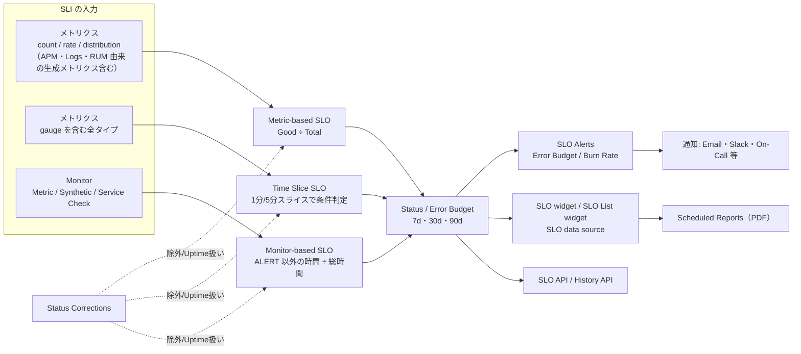
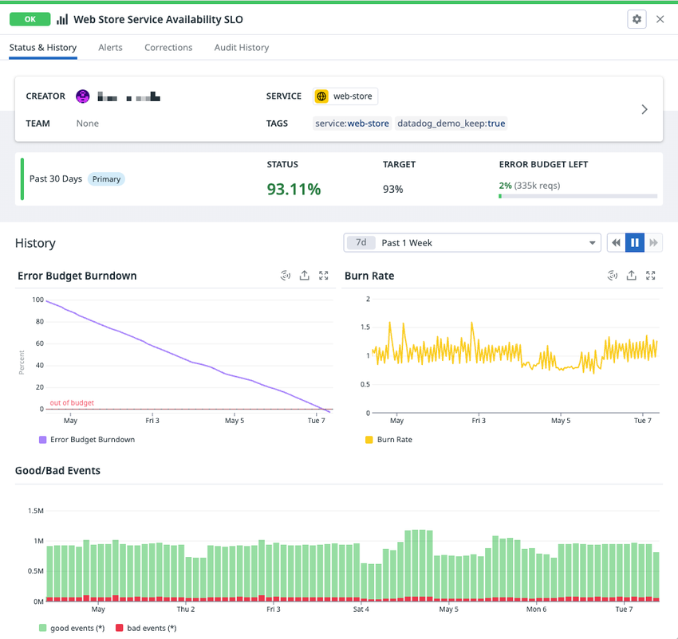
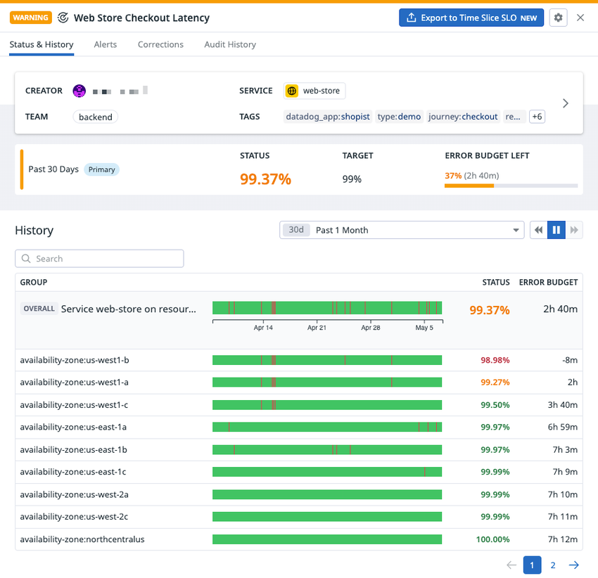
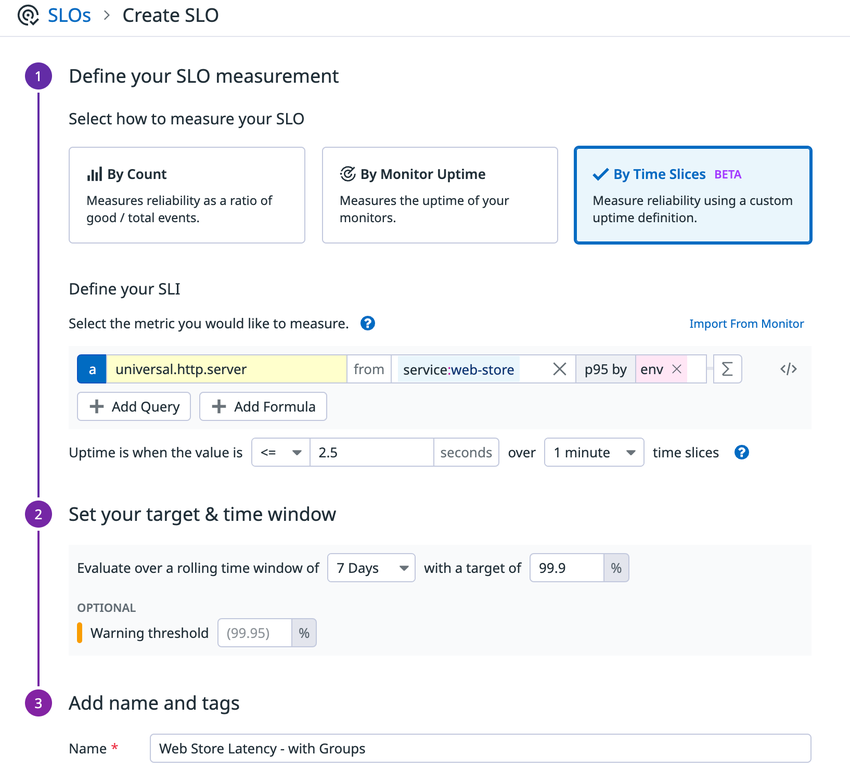
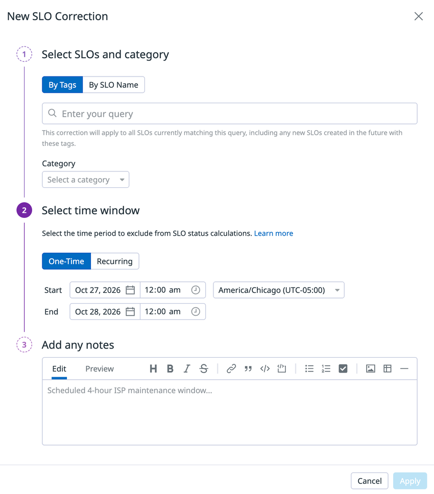
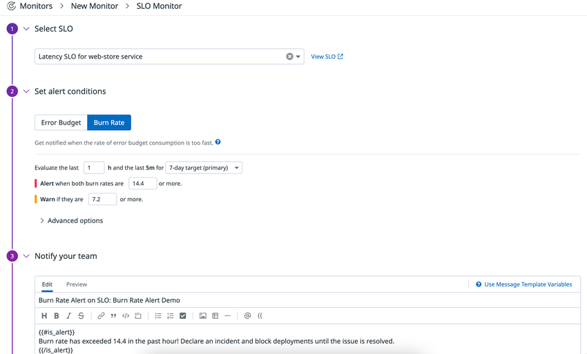
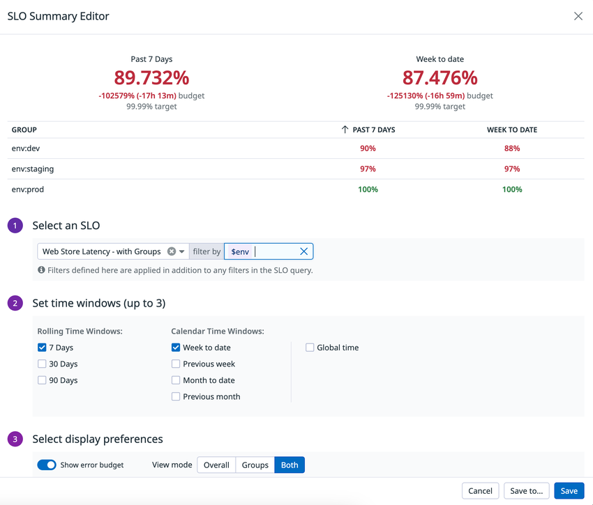

# Service Level Objectives（SLO）

## 概要

Datadog の Service Level Objectives（SLO、サービスレベル目標）は、サービスの信頼性を **SLI（Service Level Indicator、サービスレベル指標）** と **目標値（Target）** と **期間（Time Window）** の組で定義し、達成状況（Status）と残りの **Error Budget（エラーバジェット）** を継続的に追跡する機能である。Datadog の SLO は SLO 管理画面（US1 の場合 `https://app.datadoghq.com/slo/manage`。他サイトはサイトのドメインに読み替え）から作成・管理する。[出典](https://docs.datadoghq.com/service_level_objectives/)

Datadog の SLO には次の 3 タイプがある。[出典](https://docs.datadoghq.com/service_level_objectives/guide/slo_types_comparison/)

| SLO タイプ | UI 上の選択肢 | SLI の計算方式 | 一言でいうと |
|---|---|---|---|
| Metric-based SLO（メトリクスベース SLO） | **By Count** | カウントベース：Good イベント数 ÷ Total イベント数 | リクエスト成功率など「件数の比率」 |
| Monitor-based SLO（モニターベース SLO） | **By Monitor Uptime** | 時間ベース：モニターが ALERT でない時間 ÷ 総時間 | 既存 Monitor の稼働時間 |
| Time Slice SLO（タイムスライス SLO） | **By Time Slices** | 時間ベース：条件を満たした時間スライス ÷ 総スライス | Monitor 不要の独自アップタイム定義 |

本ファイルは SLO 機能の**仕様（何ができ、何が上限か）**を扱う。SLI/SLO の選び方・目標値設計・運用プロセスなどの実務知見は [SLO 運用の実践](../../04_応用編/slo-practices.md) を参照。

### 本ファイルの範囲と関連ファイル

| トピック | 参照先 |
|---|---|
| SLO の仕様（タイプ、計算、エラーバジェット、Corrections、アラート、ウィジェット、API、制限値） | 本ファイル |
| SLO の設計・運用ベストプラクティス、組織導入 | [SLO 運用の実践](../../04_応用編/slo-practices.md) |
| Monitor 全般（評価設定、No Data、モニタータイプ一覧。SLO Alerts も `slo alert` タイプとして掲載） | [Monitors（モニター）](./monitors.md) |
| 通知チャネル、Downtime | [通知と Downtime](./notifications-and-downtimes.md) |
| ダッシュボード全般、Scheduled Reports | [Dashboards（ダッシュボード）](./dashboards.md) |
| SLI に使うメトリクス（メトリクスタイプ、クエリ、関数） | [Metrics](./metrics.md)、[メトリクスクエリと関数](./metrics-query-and-functions.md) |
| SLI 用カスタムメトリクスの作成・課金 | [Custom Metrics と DogStatsD](./custom-metrics-and-dogstatsd.md) |
| SLO のタグ設計 | [Tagging](./tagging.md)、[タグ戦略の実践](../../04_応用編/tagging-strategy.md) |
| SLO を Terraform で管理 | [Terraform と IaC](./terraform-and-iac.md)、[Monitoring as Code](../../04_応用編/monitoring-as-code.md) |
| SLO の監査ログ | [Audit Trail](./audit-trail.md) |
| サービス単位の信頼性レポート | [Software Catalog（旧 Service Catalog）](./software-catalog.md) |
| アラート設計（Burn Rate アラートの位置づけ） | [アラート設計とノイズ削減](../../04_応用編/alert-design-and-noise-reduction.md) |

## 用語

Datadog の SLO ドキュメントで使われる主要用語は次のとおり。[出典](https://docs.datadoghq.com/service_level_objectives/)、[出典（Burn Rate）](https://docs.datadoghq.com/service_level_objectives/burn_rate/)

| 用語 | Datadog での定義 |
|---|---|
| SLI（Service Level Indicator） | サービスのパフォーマンスや信頼性の定量的な指標。Datadog では「メトリクス」または「1 つ以上のモニターの集約」 |
| SLO（Service Level Objective） | ある期間における SLI の目標パーセンテージ |
| SLA（Service Level Agreement） | 顧客と提供者の間の、信頼性の期待値と未達時の結果に関する明示的・暗黙的な合意 |
| Error Budget（エラーバジェット） | 許容される不信頼性。`100% − 目標値(%)` |
| Error Rate（エラー率） | `1 − (良い振る舞い ÷ 全体の振る舞い)`。Metric-based は件数、Monitor-based / Time Slice は時間で数える |
| Burn Rate（バーンレート） | エラーバジェットが SLO 期間に対してどの速さで消費されているかを示す無次元値（Google が提唱）。`観測エラー率 ÷ 理想エラー率（1 − 目標）` |
| Target（目標値） | SLI が満たすべきパーセンテージ。100% 未満であること |
| Warning（警告値） | 任意。目標値より厳しい（大きい）値を設定し、目標割れの前に黄色表示にする |
| Time Window（期間） | ローリング 7 日 / 30 日 / 90 日 |
| Primary time window | SLO 一覧に表示される主たる期間。最初に選択した（最短の）期間がデフォルト |
| Status Correction（ステータス補正） | 計画メンテナンス等の期間を SLO 計算から除外（または Uptime 扱い）する設定 |

## アーキテクチャとデータフロー

Datadog の SLO は、メトリクスまたはモニターの状態遷移を入力として SLI を計算し、その結果をアラート（SLO Alerts）、ダッシュボード（SLO ウィジェット・SLO データソース）、API に供給する。



## SLO タイプの比較

公式の SLO Type Comparison ガイドの比較表を整理すると次のとおり。[出典](https://docs.datadoghq.com/service_level_objectives/guide/slo_types_comparison/)

| 比較項目 | Metric-based SLO | Monitor-based SLO | Time Slice SLO |
|---|---|---|---|
| SLI の計算方式 | カウントベース（Good ÷ Total） | 時間ベース（Monitor の Uptime） | 時間ベース（独自アップタイム定義） |
| 対応データ | count / rate / distribution（パーセンタイル有効）メトリクス | Metric 系 Monitor、Synthetic Monitor、Service Check | gauge を含む全メトリクスタイプ |
| グループ | 全グループで計算。サイドパネル・SLO ウィジェットで全グループ表示可 | 単一の Multi Alert Monitor の場合のみ。①全グループで計算、または②最大 20 グループを選択して計算 | 全グループで計算。サイドパネル・SLO ウィジェットで全グループ表示可 |
| SLO サイドパネルの履歴 | カスタム期間で最大 15 か月 | カスタム期間で最大 15 か月 | カスタム期間で最大 15 か月 |
| SLO アラート（Error Budget / Burn Rate） | 利用可。グループがある場合は全体（Overall）のみ（※後述の注記参照） | Metric 系 Monitor のみで構成される場合に利用可（Synthetic・Service Check は不可）。グループがある場合は全体のみ | 利用可。グループ単位または全体でアラート可 |
| Status Corrections の扱い | 補正期間を計算から除外 | 補正期間を計算から除外 | 補正期間を **Uptime として計上** |
| SLO ウィジェット（SLO / SLO List） | 最大 15 か月の履歴表示 | 最大 15 か月の履歴表示（※SLO widget の Global time は 3 か月。後述） | 最大 15 か月の履歴表示 |
| SLO データソース（最大 15 か月） | 利用可 | **利用不可**（比較表上） | 利用可 |
| 欠損データ（Missing data） | Status・Error Budget 計算で無視 | 基になる Monitor の No Data 設定に従う | **Uptime として扱う** |
| Uptime 計算 | 該当なし | Monitor に基づく。グループがある場合、全体の Uptime には**全グループ**が Uptime であることが必要 | 離散的な時間チャンク（ローリングウィンドウではない）で判定。全体の Uptime には全グループが Uptime であることが必要 |
| Calendar View（SLO 管理画面） | 利用可 | **利用不可** | 利用可 |
| 公開 API・Terraform | 対応 | 対応 | 対応 |

Metric-based SLO と Time Slice SLO がサポートする履歴の長さは、アカウントのメトリクス保持期間（デフォルト 15 か月）に一致する。[出典](https://docs.datadoghq.com/service_level_objectives/guide/slo_types_comparison/)

> **注記（公式ドキュメント間の記述差）:** SLO データソースのガイドでは「Monitor-based と Time Slice は good minutes / bad minutes を利用可能」と記載されており、比較表の「Monitor-based は SLO データソース利用不可」と食い違う。また SLO データソースガイドの冒頭は「Metric-based と Time Slice SLO を 15 か月グラフ化できる」としている。Monitor-based SLO を SLO データソースで扱えるかは、実環境で確認すること。[出典（データソース）](https://docs.datadoghq.com/dashboards/guide/slo_data_source/)、[出典（比較表）](https://docs.datadoghq.com/service_level_objectives/guide/slo_types_comparison/)

### 公式が推奨するタイプ選択

Datadog 公式は SLO タイプの選択について次の優先順位を推奨している。[出典](https://docs.datadoghq.com/service_level_objectives/guide/slo_types_comparison/)

1. **可能な限り Metric-based SLO を使う。** エラーバジェットが「SLO 違反までに残っている悪いイベントの件数」を表し、計算がイベント数で重み付け（volume weighted）されるため。
2. 時間ベースの SLI で Uptime を追跡したい場合は **Time Slice SLO** を使う。Monitor-based と違い、基になるモニターを保守する必要がない。
3. Time Slice SLO でカバーできないユースケース（**メトリクス以外のモニター**（Synthetic、Service Check）や**複数モニター**に基づく SLO）では **Monitor-based SLO** を使う。

### SLI の種類（公式チェックリスト）

Datadog の SLO Checklist は、コンポーネント種別ごとに次の SLI を例示している。[出典](https://docs.datadoghq.com/service_level_objectives/guide/slo-checklist/)

| コンポーネント | SLI の種類 | 問い |
|---|---|---|
| Response/Request | Availability（可用性） | サーバーはリクエストに正常に応答できたか |
| Response/Request | Latency（レイテンシー） | 応答にどれだけ時間がかかったか |
| Response/Request | Throughput（スループット） | どれだけのリクエストを処理できるか |
| Storage | Availability | 必要なときにデータにアクセスできるか |
| Storage | Latency | 読み書きにどれだけ時間がかかるか |
| Storage | Durability（耐久性） | 必要なときにデータが残っているか |
| Pipeline | Correctness（正確性） | 正しいデータが返されたか |
| Pipeline | Freshness（鮮度） | 新しいデータや処理結果が現れるまでどれだけかかるか |

SLI の実装元として、カスタムメトリクス（カウンター等）、インテグレーションメトリクス（ロードバランサー、HTTP リクエスト等）、APM（スパンから生成したメトリクス、エラー・レイテンシー）、Logs（ログから生成したメトリクス）が挙げられている。[出典](https://docs.datadoghq.com/service_level_objectives/guide/slo-checklist/)

## SLO 作成の共通手順と設定項目

Datadog の SLO は、SLO 管理画面で **+ New SLO** を選択し、次の 3 ステップで作成する。[出典](https://docs.datadoghq.com/service_level_objectives/)

1. **Define your SLO measurement**：SLO タイプ（By Count / By Monitor Uptime / By Time Slices）を選び、SLI を定義する。
2. **Set your target & time window**：目標値とローリング期間（7 / 30 / 90 日）を設定。任意で Warning threshold を設定。
3. **Add name and tags**：名前、説明（リンクを含められる）、タグを付けて保存。保存ボタンは **Create** または **Create & Set Alert**（作成と同時に SLO アラートを設定）。

### 共通設定項目

| 項目 | 内容 | 値・制約 | 出典 |
|---|---|---|---|
| Time window | ローリング期間 | `7d` / `30d` / `90d`。1 つの SLO に複数期間（Target）を設定可能。最短の期間がデフォルトで Primary に選択される | [出典](https://docs.datadoghq.com/service_level_objectives/) |
| Target | 目標値（%） | **100% 未満**であること（100% はエラーバジェット 0% となり、アラート評価でゼロ除算エラーになる）。API/Terraform では `(0,100)` の範囲 | [出典](https://docs.datadoghq.com/service_level_objectives/)、[Terraform](https://registry.terraform.io/providers/DataDog/datadog/latest/docs/resources/service_level_objective) |
| Target の小数桁 | 入力できる小数点以下の桁数 | Monitor-based：7 日・30 日は最大 2 桁、90 日は最大 3 桁。Metric-based：全期間で最大 3 桁 | [出典](https://docs.datadoghq.com/service_level_objectives/) |
| Warning | 警告値（%） | 任意。目標値より大きい値（API の `warning_threshold` は `target_threshold` より大きいこと） | [出典](https://docs.datadoghq.com/api/latest/service-level-objectives/create-an-slo-object/) |
| Name | SLO 名 | 必須 | [出典](https://docs.datadoghq.com/api/latest/service-level-objectives/create-an-slo-object/) |
| Description | 説明 | 任意。リンクを含められる（公式ブログでは Markdown 対応と記載） | [出典](https://docs.datadoghq.com/service_level_objectives/)、[ブログ](https://www.datadoghq.com/blog/define-and-manage-slos/)（2024-06 更新） |
| Tags | タグ | 任意。作成・編集時または一覧画面から一括編集。`team`・`service` タグ付与が一般的な慣行と公式チェックリストに記載 | [出典](https://docs.datadoghq.com/service_level_objectives/guide/slo-checklist/) |
| Teams | チーム | 一覧画面の **Edit Teams** で一括設定可能 | [出典](https://docs.datadoghq.com/service_level_objectives/) |

### ステータスの色

| 色 | 意味 |
|---|---|
| 緑（OK） | 目標値以上（Warning を設定している場合は Warning 以上） |
| 黄（Warning） | Warning は下回ったが目標値は満たしている |
| 赤（Breached） | 目標値を下回った |
| No Data | データがない |

[出典（Metric-based）](https://docs.datadoghq.com/service_level_objectives/metric/)、[出典（Monitor-based）](https://docs.datadoghq.com/service_level_objectives/monitor/)

## Metric-based SLO（メトリクスベース SLO）

Datadog の Metric-based SLO は、イベントを「良い（good）」「悪い（bad）」に分類できるカウントベースのデータストリームに適した SLO タイプで、SLI は「一定期間の good イベント合計 ÷ total イベント合計」で計算される。APM スパン、RUM イベント、ログから生成したカスタムメトリクスを含め、任意のメトリクスを使える。[出典](https://docs.datadoghq.com/service_level_objectives/metric/)

### 作成手順

1. SLO 管理画面で **+ New SLO** をクリック。
2. **By Count** を選択。
3. 2 つのクエリ（**Good events** と **Bad events**）を定義する。
4. 目標値（パーセンテージと期間）を設定し、任意で Warning を設定する。

[出典](https://docs.datadoghq.com/service_level_objectives/metric/)

### クエリの要件

| 項目 | 仕様 |
|---|---|
| 計算式 | `SLI = good ÷ (good + bad)` |
| 対応メトリクスタイプ | **COUNT**、**RATE**、**パーセンタイル集計を有効にした DISTRIBUTION** |
| Total events クエリ | **レガシー定義**。既存のものは UI・API で編集可能だが、新規作成は API のみ |
| FROM フィールド | タグでグループを含める／除外する |
| COUNT / RATE のグループ化 | 任意で `sum by` アグリゲーターを使い SLI をグループ別に分割 |
| DISTRIBUTION（パーセンタイル有効）の場合 | `count values...` アグリゲーターに数値閾値を指定（Threshold Queries）し、条件に合う生の値の件数を数える。隣のドロップダウンでグループ別分割も可能 |

[出典](https://docs.datadoghq.com/service_level_objectives/metric/)

**例（HTTP ステータスコード）：** Good events を `sum:httpservice.hits{code:2xx} + sum:httpservice.hits{code:4xx}`、Bad events を `sum:httpservice.hits{code:5xx}` とする。3xx はリダイレクトのため SLI に影響させない目的で分母・分子どちらにも含めない。[出典](https://docs.datadoghq.com/service_level_objectives/metric/)

**例（APM トレースメトリクス）：** 公式の Scope metric-based SLO queries ガイドでは、`web-store` サービスの可用性 SLO を次のように定義している。[出典](https://docs.datadoghq.com/dashboards/guide/slo_graph_query/)

- Good events：`sum:trace.rack.request.hits{service:web-store} by {resource_name}.as_count()` − `sum:trace.rack.request.errors{service:web-store} by {resource_name}.as_count()`
- Total events：`sum:trace.rack.request.hits{service:web-store} by {resource_name}.as_count()`

### グループ

Metric-based SLO では、`datacenter`、`env`、`availability-zone`、`resource` などのタグでグループを追加できる。詳細パネルには各グループのステータス、good リクエスト数、残りエラーバジェットが表示される。棒グラフはデフォルトで全体の good / bad 件数を示し、表の行をクリックするとそのグループに絞り込まれる。凡例で good / bad の表示・非表示を切り替えられる。全体のステータスは全グループの good / bad 件数の合算で計算される。グループ数の上限は公開情報では確認できず。[出典](https://docs.datadoghq.com/service_level_objectives/metric/)

### 表示精度

| 項目 | 仕様 |
|---|---|
| 目標値の入力桁数 | 最大小数 3 桁 |
| ステータスの表示桁数 | `num_target_decimal_places + 1` 桁、最大 4 桁 |
| 表示精度の決まり方 | 分母（total イベント数）の大きさに依存。分母が大きいほど細かい精度で表示される |

[出典](https://docs.datadoghq.com/service_level_objectives/metric/)

### 画面例



- **キャプション:** Metric-based SLO（Web Store Service Availability SLO）の詳細サイドパネル。
- **画面説明:** 上部に SLO 名とステータスバッジ（OK）、右上に歯車アイコン（編集・権限設定などのメニュー）。タブは **Status & History / Alerts / Corrections / Audit History** の 4 つ。Status & History タブでは、Creator・Team・Service・Tags の情報カード、その下に期間ごとの行（例：Past 30 Days〔Primary〕、STATUS 93.11%、TARGET 93%、ERROR BUDGET LEFT 2%（335k reqs））が並ぶ。History セクションでは表示期間（例：Past 1 Week）を選択でき、**Error Budget Burndown**（100% から減少する折れ線）、**Burn Rate**（時系列）、**Good/Bad Events**（緑＝good、赤＝bad の積み上げ棒グラフ）の 3 つのグラフが表示される。Metric-based SLO ではエラーバジェットの残りが件数（reqs）でも表示される点が特徴。
- **出典:** https://docs.datadoghq.com/service_level_objectives/metric/ （画像取得日 2026-11-02）

## Monitor-based SLO（モニターベース SLO）

Datadog の Monitor-based SLO は、新規または既存の Datadog Monitor から作成する時間ベースの SLO で、SLI は「システムが良い振る舞いを示した時間 ÷ 総時間」である。SLI の調整は SLO 作成画面ではなく、基になる Monitor 側で行う必要がある。[出典](https://docs.datadoghq.com/service_level_objectives/monitor/)

### 対応 Monitor タイプ

| 区分 | Monitor タイプ |
|---|---|
| Metric Monitor 系 | Metric、Integration、APM Metric、Anomaly、Forecast、Outlier |
| その他 | Synthetic、Service Check |

上記以外（Log Monitor、Composite Monitor など）は対応タイプとして記載されていない。[出典](https://docs.datadoghq.com/service_level_objectives/monitor/)

### 作成手順

1. SLO 管理画面で **+ New SLO** → **By Monitor Uptime** を選択。
2. モニターを名前で検索してソースリストに追加する。
3. 目標値・期間・Warning を設定。
4. 名前・説明・タグを付けて **Create** または **Create & Set Alert** で保存。

[出典](https://docs.datadoghq.com/service_level_objectives/monitor/)

### モニター数とグループの上限

| 構成 | 上限・仕様 |
|---|---|
| 単一の Multi Alert Monitor | 任意でグループを選択可能。UI での選択は**最大 20 グループ**（API の `groups` は最大 100 と記載。後述の注記参照）。選択しない場合は全グループで計算・表示 |
| 複数モニター | **最大 20 モニター**。この場合グループ選択は不可 |
| グループの表示上限 | グループが **5,000 以下**なら全グループを表示。**5,000 超**の場合、計算は全グループで行われるが UI にグループは表示されない |

[出典](https://docs.datadoghq.com/service_level_objectives/monitor/)

> **注記（UI と API の上限差）:** UI ドキュメントでは選択できるグループは最大 20 だが、SLO 作成 API のスキーマでは `groups` は「最大 100 のモニターグループ。`monitor_ids` が 1 つの Monitor SLO でのみ有効」と記載されている。どちらが実効上限かは公開情報だけでは判断できないため、20 を超えるグループ選択を前提にした設計は避けるのが安全。[出典（UI）](https://docs.datadoghq.com/service_level_objectives/monitor/)、[出典（API）](https://docs.datadoghq.com/api/latest/service-level-objectives/create-an-slo-object/)

### ステータス計算

| 項目 | 仕様 |
|---|---|
| 評価粒度 | Monitor は 1 分に 1 回評価されるため、SLO の粒度は **1 分** |
| 全体ステータス | 全モニター（または全グループ）を通した Uptime。**時間スロットごと**に判定し、どれか 1 つでも ALERT ならその時間はダウンタイム。各モニターの Uptime の単純平均ではない |
| WARN 状態 | **OK（良い振る舞い）として扱う** |
| Monitor のミュート | 計算に影響しない。期間を除外したい場合は Status Corrections を使う |
| 表示精度 | 7 日・30 日は小数 2 桁、90 日は小数 3 桁 |

**全体ステータスの計算例：** 3 つのモニターのステータスが 90%、90%、80% の場合、全体ステータスは 70% になり得る（各モニターのダウンタイムが重ならない場合。平均値の 86.7% より低くなる）。[出典](https://docs.datadoghq.com/service_level_objectives/monitor/)

**高い目標値の注意点：** 粒度が 1 分のため、目標 99.999% ではエラーバジェットが 7 日で約 6 秒、30 日で約 26 秒となり、1 回のアラートで使い切ってしまう。より細かい粒度が必要なら Metric-based SLO を使う。[出典](https://docs.datadoghq.com/service_level_objectives/monitor/)

### 欠損データ（Missing data）の扱い

Monitor-based SLO の欠損データの扱いは、基になる Monitor の設定に従う。[出典](https://docs.datadoghq.com/service_level_objectives/monitor/)

| Monitor 種別 | Monitor の No Data 設定 | SLO での扱い |
|---|---|---|
| Metric Monitor | Evaluate as zero | 閾値次第（例：`> 10` ならアップタイム、`< 10` ならダウンタイム） |
| Metric Monitor | Show last known status | 直前の状態を維持 |
| Metric Monitor | Show NO DATA | アップタイム |
| Metric Monitor | Show NO DATA and notify | ダウンタイム |
| Metric Monitor | Show OK | アップタイム |
| Service Check Monitor | 欠損データを無視する設定 | OK（アップタイム） |
| Service Check Monitor | 欠損データでアラートする設定 | ALERT（ダウンタイム） |
| Synthetic テスト | テストを一時停止（Paused） | 欠損期間は計算から除外され、ステータスバー上で薄いグレー表示 |

Monitor の No Data 設定そのものは [Monitors（モニター）](./monitors.md) を参照。

### Synthetic テストに基づく SLO の例外

1 つのグループ化された Synthetic テストに基づく Monitor-based SLO では、次のアラート条件が Uptime 計算に影響する。デフォルト以外の値にすると、全体ステータスが個々のグループのステータスより良く見えることがある。[出典](https://docs.datadoghq.com/service_level_objectives/monitor/)

| アラート条件 | デフォルト |
|---|---|
| グループが失敗状態を継続すべき分数（wait for groups to fail for X minutes） | 0 |
| 失敗とみなすグループ数（wait until X groups fail） | 1 |
| ロケーションを失敗とみなすまでのリトライ回数 | 0 |

### 画面例



- **キャプション:** Monitor-based SLO の詳細サイドパネル。
- **画面説明:** 上部に SLO 名（例：Web Store Checkout Latency）とステータスバッジ（WARNING）、右上に **Export to Time Slice SLO** ボタン（Time Slice SLO への変換）と歯車アイコン。タブは Status & History / Alerts / Corrections / Audit History。期間行には Past 30 Days〔Primary〕、STATUS 99.37%、TARGET 99%、ERROR BUDGET LEFT 37%（2h 40m）のように、Monitor-based SLO では残りエラーバジェットが**時間**で表示される。History セクションには検索欄付きの表があり、OVERALL 行とグループ（例：`availability-zone:us-west1-b`）ごとの行に、アップタイム（緑）とダウンタイム（赤）を時間軸上で示す**ステータスバー**、STATUS、ERROR BUDGET（残り時間。目標割れのグループは `-8m` のように負の値）が並ぶ。
- **出典:** https://docs.datadoghq.com/service_level_objectives/monitor/ （画像取得日 2026-11-02）

## Time Slice SLO（タイムスライス SLO）

Datadog の Time Slice SLO は、メトリクスの時系列に対する条件（例：「p95 レイテンシーが 1 秒未満」）として独自のアップタイム定義を表現し、信頼性を測る SLO タイプである。Monitor-based SLO の代替で、別途モニターを作成・保守する必要がない。[出典](https://docs.datadoghq.com/service_level_objectives/time_slice/)

### 作成方法

| 方法 | 手順 | 制約 |
|---|---|---|
| 作成画面から | **+ New SLO** → **By Time Slices** → メトリクスクエリ・比較演算子・閾値でアップタイム条件を定義 → 1 分 / 5 分のスライスを選択 → 期間と目標値 → 名前・タグ → **Create** | — |
| Monitor-based SLO からエクスポート | Monitor-based SLO の詳細サイドパネルで **Export to Time Slice SLO** をクリック | **単一メトリクスモニター**の Monitor-based SLO のみ。非メトリクスモニターや複数モニターの SLO は不可 |
| モニターからインポート | 作成・編集画面の「Define your SLI」で **Import from Monitor** をクリックし、モニターを選択 | 選択肢に出るのは**メトリクスモニターのみ**。モニタークエリの**ローリング期間（rolling period）は引き継がれない** |

[出典](https://docs.datadoghq.com/service_level_objectives/time_slice/)

### 設定項目

| 項目 | 値 | API フィールド |
|---|---|---|
| メトリクスクエリ | 全メトリクスタイプ（gauge を含む）。空間集約・時間集約はクエリで指定。数式（formula）は**ちょうど 1 つ** | `sli_specification.time_slice.query`（`formulas` は 1 要素） |
| 比較演算子 | `>`、`>=`、`<`、`<=` | `comparator` |
| 閾値 | 数値 | `threshold` |
| スライス幅 | **1 分** または **5 分** | `query_interval_seconds`：`60` / `300`（**API のデフォルトは `300`**） |

[出典（UI）](https://docs.datadoghq.com/service_level_objectives/time_slice/)、[出典（API）](https://docs.datadoghq.com/api/latest/service-level-objectives/create-an-slo-object/)

### Uptime 計算

Time Slice SLO は時系列を「スライス」と呼ぶ等間隔の区間に分割し、各スライスの値（1 つ）にアップタイム条件を適用する。条件を満たせばそのスライスはアップタイム、満たさなければダウンタイムになる。[出典](https://docs.datadoghq.com/service_level_objectives/time_slice/)

**計算例（公式）：** 12 時間（720 分）、5 分スライス、条件「p95 ≤ 2.5s」で違反が 1 スライス（5 分）の場合、`715 / 720 = 99.305%`。

### グループと全体 Uptime

| 項目 | 仕様 |
|---|---|
| グループの定義 | メトリクスクエリの `group by` 句 |
| グループ別 Uptime | グループごとに計算 |
| 全体 Uptime | **全グループが Up のときのみ Up**。どれか 1 グループでも Down なら全体も Down |
| 全体と各グループの関係 | 全体 Uptime は常に、どの個別グループの Uptime 以下 |

**計算例（公式）：** prod と dev の 2 グループで、それぞれ重ならない 5 分のダウンタイムがある場合、全体のダウンタイムは 10 分となり `(720 − 10) / 720 = 98.611%`。[出典](https://docs.datadoghq.com/service_level_objectives/time_slice/)

### Corrections と欠損データ

| 項目 | Time Slice SLO の扱い |
|---|---|
| Status Corrections | 補正期間は**アップタイム**として計上。総時間が一定のため、エラーバジェットは固定の「時間量」になる |
| （比較）Monitor-based の Corrections | 補正期間は計算から**除外**。総時間が短くなり、1 分のダウンタイムの比重が大きくなる「時間の伸縮（time dilation）」が起きる。例：7 日の Monitor SLO に 1 日の補正を入れると、1 時間のダウンタイムが約 0.6% ではなく約 0.7% に相当 |
| 欠損データ | 常に**アップタイム**。タイムライン上はグレー表示 |

[出典](https://docs.datadoghq.com/service_level_objectives/time_slice/)

### 画面例



- **キャプション:** Time Slice SLO の作成画面（SLOs > Create SLO）。
- **画面説明:** ステップ 1「Define your SLO measurement」で **By Count / By Monitor Uptime / By Time Slices** の 3 つのカードから SLO タイプを選ぶ（画像は By Time Slices を選択した状態。画像取得時点の公式画像には「BETA」表記が残っているが、ドキュメント本文に Preview 表記はない）。「Define your SLI」ではメトリクス（例：`universal.http.server`）、`from`（例：`service:web-store`）、集計（例：`p95 by env`）を指定し、右上に **Import From Monitor** リンクがある。その下の「Uptime is when the value is `<=` `2.5` seconds over `1 minute` time slices」でアップタイム条件とスライス幅を設定する。ステップ 2「Set your target & time window」でローリング期間（例：7 Days）と目標値（例：99.9%）、任意の Warning threshold を入力。ステップ 3「Add name and tags」で名前を入力する。
- **出典:** https://docs.datadoghq.com/service_level_objectives/time_slice/ （画像取得日 2026-11-02）

## エラーバジェット（Error Budget）

Datadog の SLO におけるエラーバジェットは `100% − 目標値` であり、残りのエラーバジェット（Error Budget Left / Remaining）は次の式で計算される。[出典](https://docs.datadoghq.com/service_level_objectives/)

```
残りエラーバジェット(%) = 100 × (現在のステータス − 目標値) / (100 − 目標値)
```

例：目標 99.9%、現在のステータス 99.95% の場合、`100 × (99.95 − 99.9) / (100 − 99.9) = 50%`。ステータスが目標を下回ると残りエラーバジェットは負の値になる。

| SLO タイプ | エラーバジェットの単位 | 補足 |
|---|---|---|
| Metric-based | 件数（許容される bad イベント数）。サイドパネルでは % と件数（例：`2% (335k reqs)`）で表示 | トラフィック量によって許容件数が変動する |
| Monitor-based | 時間 | Corrections 期間は除外されるため、総時間が変動し得る |
| Time Slice | 時間（固定量） | Corrections 期間は Uptime 扱いのため総時間は一定 |

### 時間ベース SLO の許容ダウンタイム（参考計算）

以下は `期間 × (1 − 目標値)` で算出した、時間ベース SLO（Monitor-based / Time Slice、Corrections なし）の許容ダウンタイムである（本ファイルでの計算値）。Monitor-based SLO の粒度は 1 分、Time Slice SLO はスライス幅（1 分 / 5 分）単位でダウンタイムが計上される点に注意。

| 目標値 | 7 日（10,080 分） | 30 日（43,200 分） | 90 日（129,600 分） |
|---|---|---|---|
| 99% | 100.8 分 | 432 分（7.2 時間） | 1,296 分（21.6 時間） |
| 99.5% | 50.4 分 | 216 分（3.6 時間） | 648 分（10.8 時間） |
| 99.9% | 10.08 分 | 43.2 分 | 129.6 分 |
| 99.95% | 5.04 分 | 21.6 分 | 64.8 分 |
| 99.99% | 約 1.0 分 | 4.32 分 | 12.96 分 |
| 99.999% | 約 6 秒 | 約 26 秒 | 約 78 秒 |

例えば Time Slice SLO を 5 分スライス・7 日・99.99% で設定すると、許容ダウンタイム（約 1 分）が 1 スライス（5 分）より短いため、1 スライスの違反で目標割れとなる。

## Status Corrections（ステータス補正）

Datadog の SLO Status Corrections は、特定の期間を SLO のステータスとエラーバジェットの計算から除外する機能で、計画メンテナンスや業務時間外などを扱うために使う。[出典](https://docs.datadoghq.com/service_level_objectives/)

### SLO タイプ別の効果

| SLO タイプ | 補正期間の扱い |
|---|---|
| Metric-based | 補正期間内の good / bad イベントを数えない |
| Monitor-based | 補正期間を計算に含めない（除外） |
| Time Slice | 補正期間を**アップタイム**として数える |

### 設定項目

| 項目 | 選択肢・仕様 |
|---|---|
| 適用範囲（Scope） | **By SLO name**（1 つの SLO に適用）／ **By tags**（タグクエリに一致する全 SLO に適用。**後から作成・タグ付けされた SLO にも適用**） |
| 種類 | **One-time**（開始・終了日時が必須）／ **Recurring**（開始日時、Duration、繰り返し間隔が必須。終了日は任意） |
| 繰り返しルール | iCalendar RFC 5545 の RRULE。サポートされるルールは `FREQ`、`INTERVAL`、`COUNT`、`UNTIL`、`BYDAY`（Terraform ドキュメントの記載は `FREQ`、`INTERVAL`、`COUNT`、`UNTIL`） |
| Category | `Scheduled Maintenance`、`Outside Business Hours`、`Deployment`、`Other` |
| Description | 任意 |
| Timezone | 表示用タイムゾーン（Terraform の `timezone`、デフォルト `UTC`） |

[出典](https://docs.datadoghq.com/service_level_objectives/)、[Terraform slo_correction](https://registry.terraform.io/providers/DataDog/datadog/latest/docs/resources/slo_correction)

### タグクエリの構文

タグベースの Corrections は Events search 構文を使う。`AND`、`OR`、`NOT`（または `-`）、括弧、`*` ワイルドカードを組み合わせられ、スペース区切りの語は AND 結合される。空のクエリや `*` のみのクエリは不可。[出典](https://docs.datadoghq.com/service_level_objectives/)

| 例 | 意味 |
|---|---|
| `env:prod` | 本番環境の SLO すべて |
| `team:payments -env:staging` | payments チームのうち staging 以外 |
| `team:(payments OR checkout)` | payments または checkout チーム |
| `service:web-*` | `web-` で始まるサービス |

### 作成経路と操作

| 経路 | 仕様 |
|---|---|
| UI | SLO 詳細パネルの Corrections タブ、または SLO 管理画面の **Corrections** タブ（全 Corrections 一覧。Category、Creator、Frequency、SLO Tags でフィルター可能） |
| Downtime からの作成 | モニタータグで Downtime をスケジュールする際、一致する SLO を示すカードが表示され、**Preview SLO Correction** でタグベースの Correction を事前入力できる。既存 Downtime の編集時にはカードは表示されない |
| API | SLO status corrections API。タグベースは `slo_id` の代わりに `slo_query` を指定 |
| Terraform | `datadog_slo_correction` リソース。タグベースは `slo_query` を指定 |

[出典](https://docs.datadoghq.com/service_level_objectives/)

### 制約

- 作成後に**適用範囲（SLO 名 / タグ）は変更できない**。One-time と Recurring の切り替えもできない。[出典](https://docs.datadoghq.com/service_level_objectives/)
- SLO 詳細の Performance チャートでは Corrections の反映を表示トグルで切り替えられるが、**全体ステータスとエラーバジェットは常に Corrections を反映**する。[出典](https://docs.datadoghq.com/service_level_objectives/)
- Monitor の Downtime やミュートは Monitor-based SLO の計算に影響しないため、期間除外には Corrections を使う。[出典](https://docs.datadoghq.com/service_level_objectives/monitor/)
- 削除した Corrections は復元できない。[出典](https://docs.datadoghq.com/service_level_objectives/)

Corrections の件数上限は「[制限値・クォータ・デフォルト値](#制限値クォータデフォルト値)」を参照。

### 画面例



- **キャプション:** New SLO Correction（SLO 補正の作成）フォーム。
- **画面説明:** モーダルは 3 ステップ構成。ステップ 1「Select SLOs and category」で **By Tags** / **By SLO Name** を切り替え、クエリ入力欄（By Tags の場合「このクエリに現在一致するすべての SLO と、今後このタグで作成される新しい SLO に適用される」旨の説明が表示される）と **Category** のドロップダウンを指定する。ステップ 2「Select time window」で **One-Time** / **Recurring** を切り替え、Start・End の日付と時刻、タイムゾーン（例：America/Chicago）を指定する。ステップ 3「Add any notes」で Markdown エディターに説明を書く（任意）。右下の **Apply** で作成、**Cancel** で中止。
- **出典:** https://docs.datadoghq.com/service_level_objectives/ （画像取得日 2026-11-02）

## SLO アラート（SLO Alerts）

Datadog の SLO アラートは、モニタータイプ `slo alert` として実装されたモニターで、**Error Budget アラート**と **Burn Rate アラート**の 2 種類がある。作成経路は SLO 作成・編集時の **Create & Set Alert（Save and Set Alert）**、SLO 詳細サイドパネルの **Set up Alerts**、または **Monitors > New Monitor > SLO**。[出典](https://docs.datadoghq.com/monitors/types/slo/)、[出典（Burn Rate）](https://docs.datadoghq.com/service_level_objectives/burn_rate/)

モニター全般の評価設定や通知の仕組みは [Monitors（モニター）](./monitors.md) と [通知と Downtime](./notifications-and-downtimes.md) を参照。

### 対応 SLO タイプ

| SLO タイプ | Error Budget アラート | Burn Rate アラート |
|---|---|---|
| Metric-based | 対応 | 対応 |
| Time Slice | 対応 | 対応 |
| Monitor-based（Metric / Integration / APM Metric / Anomaly / Forecast / Outlier モニターのみで構成） | 対応 | 対応 |
| Monitor-based（Synthetic または Service Check を含む） | **非対応** | **非対応** |

[出典（Error Budget）](https://docs.datadoghq.com/service_level_objectives/error_budget/)、[出典（Burn Rate）](https://docs.datadoghq.com/service_level_objectives/burn_rate/)

### グループのある SLO でのアラート単位

| SLO タイプ | Error Budget アラート | Burn Rate アラート |
|---|---|---|
| Metric-based（グループあり） | 全体（Overall）のみ | グループ単位または全体（Simple Alert / Multi Alert の集約を選択可） |
| Time Slice（グループあり） | グループ単位または全体（Simple / Multi Alert） | グループ単位または全体（Simple / Multi Alert） |
| Monitor-based（グループあり） | 全体のみ | 全体のみ |

[出典（Error Budget）](https://docs.datadoghq.com/service_level_objectives/error_budget/)、[出典（Burn Rate）](https://docs.datadoghq.com/service_level_objectives/burn_rate/)

> **注記（公式ドキュメント間の記述差）:** Burn Rate アラートのページは「Metric-based と Time Slice のグループ付き SLO ではグループ単位または全体でアラート可能」と記載する一方、SLO Type Comparison の比較表は「Metric-based はグループがある場合、全体のみ」と記載している。Metric-based SLO のグループ単位 Burn Rate アラートは、ドキュメント更新時期の差による可能性があるため、実環境の UI で確認すること。

### Error Budget アラート

Datadog の Error Budget アラートは、SLO のエラーバジェットが指定した割合以上消費されたときに通知する閾値ベースのアラートである（例：7 日ターゲットのエラーバジェットの 75% を消費したらアラート、50% で Warning）。[出典](https://docs.datadoghq.com/service_level_objectives/error_budget/)

| 項目 | 仕様 |
|---|---|
| 作成手順 | SLO 作成・編集で **Save and Set Alert**（既存 SLO は詳細パネルの **Set up Alerts**）→ Step 1 で **Error Budget** タブ → 「過去のターゲット日数で消費したエラーバジェットの割合が閾値を超えたら」アラート → 通知設定 → 保存 |
| 閾値 | Critical（必須）、Warning（任意）。単位は消費したエラーバジェットの % |
| 対象期間 | SLO の Target の期間（`7d` / `30d` / `90d`）から選択 |
| クエリ構文 | `error_budget("<slo_id>").over("<time_window>") > 75` |

[出典](https://docs.datadoghq.com/service_level_objectives/error_budget/)



- **キャプション:** SLO Monitor の作成画面（Monitors > New Monitor > SLO Monitor）。Burn Rate タブを選択した状態。
- **画面説明:** ステップ 1「Select SLO」で対象 SLO（例：Latency SLO for web-store service）を選び、**View SLO** リンクで SLO を開ける。ステップ 2「Set alert conditions」で **Error Budget** / **Burn Rate** のタブを切り替える。Burn Rate タブでは「Evaluate the last `1` h and the last `5m` for `7-day target (primary)`」でロングウィンドウ（時間）と対象ターゲットを指定し（ショートウィンドウはロングウィンドウの 1/12 として自動表示）、「**Alert** when both burn rates are `14.4` or more」「**Warn** if they are `7.2` or more」で閾値を設定する。**Advanced options** を展開できる。ステップ 3「Notify your team」で通知メッセージを Markdown で編集する（例：`{{#is_alert}}` ブロック）。
- **出典:** https://docs.datadoghq.com/service_level_objectives/burn_rate/ （画像取得日 2026-11-02）

### Burn Rate アラート

Datadog の Burn Rate アラートは、エラーバジェットの消費速度が指定した閾値を一定期間超え続けたときに通知するアラートである（例：30 日ターゲットに対し、過去 1 時間と過去 5 分の両方で Burn Rate が 14.4 以上ならアラート、7.2 以上で Warning）。[出典](https://docs.datadoghq.com/service_level_objectives/burn_rate/)

#### 計算式

| 項目 | 式・定義 |
|---|---|
| エラーバジェット枯渇までの時間 | `SLO の期間（7 / 30 / 90 日） ÷ Burn Rate`。30 日ターゲットなら Burn Rate 1 で 30 日、2 で 15 日、3 で 10 日 |
| Burn Rate | `観測エラー率 ÷ 理想エラー率（1 − 目標値）`。例：30 日 99.9% で Burn Rate 10 → 観測エラー率 `10 × 0.001 = 0.01`、3 日で枯渇 |
| アラート判定 | `(ロングウィンドウのエラー率 ÷ (1 − 目標) ≥ 閾値) AND (ショートウィンドウのエラー率 ÷ (1 − 目標) ≥ 閾値)` で ALERT |
| ロングウィンドウ | 時間単位で指定。軽微で不安定な問題を除外する |
| ショートウィンドウ | 分単位。問題収束後にモニターを素早く回復させる。Google はロングウィンドウの 1/12 を推奨 |
| Burn Rate の最大値 | `1 / (1 − 目標値)`。これを超える閾値は絶対に発火しないため、**作成がブロックされる** |

[出典](https://docs.datadoghq.com/service_level_objectives/burn_rate/)

#### 設定可能範囲

| 項目 | 範囲 |
|---|---|
| Burn Rate 閾値 | `0 < Burn Rate ≤ 1 / (1 − 目標値)` |
| ロングウィンドウ | `1 時間 ≤ ロングウィンドウ ≤ 48 時間` |
| ショートウィンドウ | UI では**ロングウィンドウの 1/12 に自動設定**。API / Terraform では任意の値を指定できるが、ロングウィンドウより短いこと |

[出典](https://docs.datadoghq.com/service_level_objectives/burn_rate/)

#### 目標値ごとの Burn Rate 最大値（計算値）

`1 / (1 − 目標値)` による計算値。

| 目標値 | Burn Rate 最大値 |
|---|---|
| 90% | 10 |
| 95% | 20 |
| 96% | 25 |
| 99% | 100 |
| 99.5% | 200 |
| 99.9% | 1,000 |
| 99.95% | 2,000 |
| 99.99% | 10,000 |

#### 閾値の決め方（公式の 2 つのアプローチ）

| アプローチ | 式 | 補足 |
|---|---|---|
| ①エラーバジェット枯渇までの時間から | `Burn Rate = SLO 期間 ÷ 枯渇までの時間` | 高い Burn Rate には短いロングウィンドウを組み合わせ、重大な問題を早く検知する |
| ②理論上のエラーバジェット消費量から | `Burn Rate = (SLO 期間[時間] × 消費率%) ÷ (ロングウィンドウ[時間] × 100%)` | 例：7 日 SLO で 1 時間に 10% 消費 → `(7 × 24 × 10%) ÷ (1 × 100%) = 16.8` |

- Metric-based SLO では、ロングウィンドウ内の件数を SLO 期間全体に外挿して計算するため、実際の消費量はトラフィック量により理論値と異なる。
- Monitor-based SLO では時間が一定速度で進むため、理論値と実際の消費量は一致する。
- 最初はショートウィンドウをロングウィンドウの 1/12 に保ち、Burn Rate 閾値とロングウィンドウに集中して調整することが推奨されている。アラートが頻繁にフラップする場合はショートウィンドウを少し大きくする（ただし回復が遅くなる）。

[出典](https://docs.datadoghq.com/service_level_objectives/burn_rate/)

#### 推奨値（公式、目標 99.9% 前提）

公式ドキュメントは目標 99.9% を前提とした推奨値を示しており、目標 96%（Burn Rate 最大値 25）程度まではこの値が妥当としている。より低い目標では閾値を下げる必要があり、アプローチ②で消費率を小さくするかロングウィンドウを長くする。[出典](https://docs.datadoghq.com/service_level_objectives/burn_rate/)

**7 日ターゲット**

| Burn Rate | ロングウィンドウ | ショートウィンドウ | 理論上のエラーバジェット消費 |
|---|---|---|---|
| 16.8 | 1 時間 | 5 分 | 10% |
| 5.6 | 6 時間 | 30 分 | 20% |
| 2.8 | 24 時間 | 120 分 | 40% |

**30 日ターゲット**

| Burn Rate | ロングウィンドウ | ショートウィンドウ | 理論上のエラーバジェット消費 |
|---|---|---|---|
| 14.4 | 1 時間 | 5 分 | 2% |
| 6 | 6 時間 | 30 分 | 5% |
| 3 | 24 時間 | 120 分 | 10% |

**90 日ターゲット**

| Burn Rate | ロングウィンドウ | ショートウィンドウ | 理論上のエラーバジェット消費 |
|---|---|---|---|
| 21.6 | 1 時間 | 5 分 | 1% |
| 10.8 | 6 時間 | 30 分 | 3% |
| 4.5 | 24 時間 | 120 分 | 5% |

#### クエリ構文

```
burn_rate("<slo_id>").over("<time_window>").long_window("1h").short_window("5m") > 14.4
```

`<slo_id>` は SLO の英数字 ID、`<time_window>` は SLO のターゲットに一致する `7d` / `30d` / `90d`。[出典](https://docs.datadoghq.com/service_level_objectives/burn_rate/)

### SLO アラート固有のテンプレート変数

SLO アラートでは、全モニター共通のテンプレート変数に加え次の変数を通知メッセージで使える。[出典](https://docs.datadoghq.com/monitors/types/slo/)

| 変数 | 内容 | 対象 |
|---|---|---|
| `{{timeframe}}` | SLO の期間（7、30、90 日） | 両方 |
| `{{value}}` | 消費したエラーバジェットの割合 | Error Budget アラートのみ |
| `{{short_window_burn_rate}}` | ショートウィンドウで観測した Burn Rate | Burn Rate アラートのみ |
| `{{long_window_burn_rate}}` | ロングウィンドウで観測した Burn Rate | Burn Rate アラートのみ |

### SLO 一覧画面の Burn Rate インジケーター

アラートとは別に、SLO 一覧画面には直近 **2 時間のローリングウィンドウ**で計算した Burn Rate インジケーターが表示される。[出典](https://docs.datadoghq.com/service_level_objectives/)

| 表示 | 条件 |
|---|---|
| Critical（赤） | Burn Rate が 6 超 |
| Elevated（黄） | Burn Rate が 1〜6 |
| Healthy | 上記以外 |

一覧画面は Critical / Elevated / Healthy でフィルターでき、`service` タグを持つ SLO からはサービスページへリンクされる。

## SLO 管理画面（一覧・検索・整理）

Datadog の SLO 管理画面（`/slo/manage`）は、SLO の一覧・検索・グループ化・保存ビュー・カレンダー表示を提供する。[出典](https://docs.datadoghq.com/service_level_objectives/)

| 機能 | 仕様 |
|---|---|
| 検索 | 名前・説明（テキスト）、Time window（7d / 30d / 90d）、Type（metric / monitor）、Creator、Tags で絞り込み。入力に応じて即時更新（検索ボタンなし） |
| Group by | 任意のタグで SLO をグループ化し、状態（breached / warning / OK / no data）ごとの件数を表示 |
| ソート | Status または Error Budget Left |
| 表示期間 | 一覧には Primary time window のみ表示。他の期間はサイドパネルで確認 |
| 一括編集 | **Edit Tags**、**Edit Teams** でタグ・チームを一括変更 |
| Saved Views | 検索クエリと選択したファセットを保存。**Save** で名前を付けて保存、**Views** ボタンで読み込み、リンクアイコンで共有、Saved Views パネルで更新・名前変更・削除 |
| Calendar View | Metric-based と Time Slice SLO で利用可能。Primary から **Daily / Weekly / Monthly** に切り替えると最大 **12 か月**の履歴をカレンダー形式で表示 |
| Corrections タブ | 全 Corrections の一覧（前述） |
| 編集 | 一覧行末の鉛筆アイコン、または詳細パネルの歯車アイコン |
| 削除した SLO の復元 | 削除後 **30 日間**保持。管理画面の Settings（歯車）から対象を選び **Restore**。Synthetic テストスイートの自動生成 SLO は復元不可 |
| モバイル | Datadog Mobile App（iOS / Android）で SLO を閲覧可能 |

### SLO 詳細サイドパネル

| タブ | 内容 |
|---|---|
| Status & History | 期間ごとの Status・Target・Error Budget Left、履歴グラフ（Error Budget Burndown、Burn Rate、Good/Bad Events またはステータスバー）、グループ別の表。カスタム期間で最大 15 か月の履歴を表示可能 |
| Alerts | この SLO に設定された SLO アラート |
| Corrections | この SLO に適用される Status Corrections |
| Audit History | この SLO の監査イベント |

[出典](https://docs.datadoghq.com/service_level_objectives/)、[出典（比較表）](https://docs.datadoghq.com/service_level_objectives/guide/slo_types_comparison/)

## 権限とアクセス制御

Datadog の SLO は RBAC の権限と、SLO 単位のきめ細かなアクセス制御（Granular access）で保護される。[出典](https://docs.datadoghq.com/service_level_objectives/)

| 操作 | 必要な権限 |
|---|---|
| SLO と Corrections の閲覧 | ロールに関わらず全ユーザーが可能（API では `slos_read`） |
| SLO の作成・編集・削除 | `slos_write`（SLO Write） |
| Corrections の作成・編集・削除 | `slos_corrections`。Granular access が設定された SLO への SLO 名指定の Correction は、その SLO の編集権限も必要 |
| タグベースの Correction | Granular access を無視し、制限された SLO にも適用される |
| 基になるリソースへの権限との関係 | 公式ドキュメントでは「ユーザーは、モニターや SLO への書き込みアクセスがなくても、任意のモニターに対して SLO を作成でき、SLO アラートを作成できる」と記載されている（つまり基になるモニターの編集権限は不要。SLO 自体の作成には上記の `slos_write` が必要） |

**Granular access（SLO 単位の制限）：** SLO 詳細パネルの歯車アイコン → **Permissions** → **Restrict Access** で、特定のロール・チーム・ユーザーのみに編集を制限できる。保存時は自分のロールをリストに残す必要がある（自身の編集権限を保持するため）。[出典](https://docs.datadoghq.com/service_level_objectives/)

**Synthetic テストスイートの自動生成 SLO：** テストスイートの閲覧・編集権限とは独立しており、SLO へのアクセスは SLO の権限で決まる。テストスイートの編集権限がなくても SLO 編集権限があれば自動生成 SLO を編集できる。[出典](https://docs.datadoghq.com/synthetics/test_suites/)

ロール・権限全般は [組織・ユーザー・権限管理](./account-and-access-management.md) を参照。

## 監査イベント

Datadog は SLO と Corrections の作成・変更・削除時にイベントを記録する。[出典](https://docs.datadoghq.com/service_level_objectives/)

| 対象 | イベント | 含まれる情報 |
|---|---|---|
| SLO | `SLO Created`、`SLO Modified`、`SLO Deleted` | 名前、説明、Target と期間、データソース。Deleted は削除前の設定 |
| Correction | `SLO Correction Created`、`SLO Correction Modified`、`SLO Correction Deleted` | SLO 名、開始・終了時刻（タイムゾーン付き）、Category。Deleted は削除前の設定 |

| 用途 | 方法 |
|---|---|
| 全 SLO 監査イベントの検索 | Event Explorer で `tags:(audit AND slo)` |
| 特定 SLO のイベント | `tags:audit,slo_id:<SLO ID>` |
| 単一 SLO の履歴を確認 | SLO 詳細の **Audit History** タブ |
| 変更時に通知 | Event Monitor（例：`[SLO Modified]` を含むイベント） |
| プログラムから取得 | Events API |

組織全体の操作ログは [Audit Trail](./audit-trail.md)、イベント全般は [Event Management](./event-management.md) を参照。

## ダッシュボードでの可視化

Datadog の SLO はダッシュボード上で 3 つの方法で可視化できる。ダッシュボード全般は [Dashboards（ダッシュボード）](./dashboards.md) を参照。[出典](https://docs.datadoghq.com/service_level_objectives/)

| 方法 | 用途 |
|---|---|
| SLO widget | 1 つの SLO のステータス・目標・エラーバジェットを表示 |
| SLO List widget | タグで絞り込んだ複数 SLO の一覧を表示 |
| SLO data source | Timeseries・Scalar 系ウィジェットで SLO の履歴データ（最大 15 か月）をグラフ化 |

### SLO widget

Datadog の SLO widget は既存 SLO のステータス、目標、残りエラーバジェットを表示し、配下の全グループを表示して任意の期間でソートできる。期間全体のデータが欠損している場合は `-` と表示される。[出典](https://docs.datadoghq.com/dashboards/widgets/slo/)

| 設定 | 内容 |
|---|---|
| SLO の選択 | ドロップダウンから選択 |
| Filter by（Metric-based・Time Slice のみ） | テンプレート変数で表示ステータスを絞り込む（例：`$env`） |
| Extra tag filters（Metric-based・Time Slice のみ） | SLO 定義にないタグでも追加で絞り込める（例：`env:prod`）。SLO 本体の定義は変更されない |
| Time windows | **最大 3 つ**。Rolling（7 / 30 / 90 日）、Calendar（Week to date、Previous week、Month to date、Previous month）、Global time |
| Global time の履歴 | Monitor-based：**最大 3 か月**。Metric-based・Time Slice：アカウントのメトリクス保持期間（デフォルト 15 か月） |
| Show error budget | 残りエラーバジェットの表示・非表示 |
| View mode | グループあり：Overall / Groups / Both。複数モニターの Monitor-based：Overall / Monitors / Both |
| デフォルトのソート | 最小の期間のステータス昇順。ダッシュボード追加後、任意の期間で並び替え可能 |

| SLO の構成 | ウィジェットに表示されるグループ |
|---|---|
| Metric-based / Time Slice | 全グループ |
| 複数モニターの Monitor-based | 全モニター |
| 単一モニター（グループ選択あり）の Monitor-based | 選択したグループ（最大 20） |
| 単一モニター（グループ選択なし）の Monitor-based | 全グループ（5,000 超の場合は表示されない） |

API（Dashboards API のウィジェット JSON）では `type: slo`、`view_type: detail`、`view_mode`（`overall` / `component` / `both`）、`slo_id`、`time_windows`、`global_time_target`、`show_error_budget`、`additional_query_filters` などを指定する。[出典](https://docs.datadoghq.com/dashboards/widgets/slo/)

> **注記:** SLO Type Comparison は「SLO ウィジェットで全タイプ最大 15 か月の履歴を表示可能」とするが、SLO widget のページは Monitor-based SLO の Global time 履歴を最大 3 か月としている。Monitor-based SLO の長期履歴をウィジェットで見せる場合は事前に確認すること。



- **キャプション:** Metric-based SLO を表示する SLO widget（SLO Summary）のグラフエディター。
- **画面説明:** 上部にウィジェットのプレビュー（期間ごとのステータスと残りエラーバジェット、グループ別の表）。設定欄では SLO を選択し、Metric-based SLO の場合は **Filter by** にテンプレート変数を指定できる。続いて最大 3 つの Time windows（Rolling / Calendar / Global time）、Show error budget のトグル、View mode（Overall / Groups / Both）を選択し、タイトルを付けて保存する。
- **出典:** https://docs.datadoghq.com/dashboards/widgets/slo/ （画像取得日 2026-11-02）

### SLO List widget

Datadog の SLO List widget は、SLO のサブセットを Primary time window で一覧表示する（他の期間は SLO ページのサイドパネルで確認）。[出典](https://docs.datadoghq.com/dashboards/widgets/slo_list/)

| 設定 | 内容 |
|---|---|
| フィルター | タグで絞り込み（例：`service:foo, env:prod`）。テンプレート変数対応。API では `query_string` |
| 表示件数 | 最大表示数を指定（API の `limit`、デフォルト **100**） |
| ソート | Status または Error Budget（API の `sort`：`column` と `order`＝`asc` / `desc`） |
| タイトル | 任意 |

### SLO data source（履歴のグラフ化）

Datadog の SLO data source は、ダッシュボードの標準ウィジェット（Timeseries、Query Value、Top List、Table、Change などの Scalar 系）でクエリのデータソースに **SLOs** を選ぶことで、SLO データを最大 **15 か月**分グラフ化する機能である。**Measure** で表示する値を、**Display** で SLO に設定済みのグループ別分割を選ぶ。[出典](https://docs.datadoghq.com/dashboards/guide/slo_data_source/)、[出典](https://docs.datadoghq.com/service_level_objectives/)

| Measure | 対象 SLO タイプ | Timeseries での値 | Scalar での値 |
|---|---|---|---|
| Good events / Bad events | Metric-based | 時間バケットごとの件数 | 全グループの合計 |
| Good minutes / Bad minutes | Monitor-based、Time Slice（ガイド記載） | 時間バケットごとの分数 | 全グループの合計 |
| SLO status | 全タイプ（ガイド記載） | バケットごとの good ÷ total | ウィジェット期間全体での比率 |
| Error budget remaining | 全タイプ（ガイド記載） | Primary time window の目標を使ったバケットごとの残り % | ウィジェット期間末時点の残り % |
| Burn rate | 全タイプ（ガイド記載） | バケットごとの観測エラー率 ÷ 理想エラー率 | ウィジェット期間全体の Burn Rate |
| Error budget burndown | 全タイプ（ガイド記載） | 100% から bad イベント／bad minutes に応じて減少 | **利用不可** |

注意点：

- Timeseries では各点の値はウィジェットのデフォルトのロールアップで計算され、SLO のローリング期間ではない。
- Corrections を持つ SLO ではデフォルトで Corrections が適用される。SLO data source の詳細オプション（advanced options）で無効化できる。

[出典](https://docs.datadoghq.com/dashboards/guide/slo_data_source/)

## レポートとデータのエクスポート

Datadog の SLO を関係者に定期報告する手段として、公開情報で確認できるのは次のとおり。

| 手段 | 内容 | 状態 |
|---|---|---|
| Scheduled Reports（ダッシュボード） | SLO widget / SLO List widget / SLO data source を配置したダッシュボードを、PDF（縦向き 8.5 × 11 インチ）として Email・Slack・Microsoft Teams に定期配信。作成・編集には **Dashboards Report Write** 権限が必要。組織での有効・無効は Org Management 権限で Public Sharing 設定から切り替え | GA。SLO data source のガイドでも利害関係者への定期レポートに使う方法として紹介 |
| Calendar View | SLO 管理画面で Daily / Weekly / Monthly の最大 12 か月を表示（Metric-based・Time Slice） | GA |
| SLO History API | `GET /api/v1/slo/{slo_id}/history` で任意期間の SLI 値・エラーバジェット・状態遷移を取得 | GA |
| SLO Report API（CSV） | `POST /api/v2/slo/report` で非同期に CSV レポートジョブを作成し、`/status` で状態確認、`/download` で取得。`interval` に `daily` / `weekly` / `monthly`、`timezone` で区切りを指定 | 【Preview】（Private beta。API リファレンスでは非推奨（deprecated）扱いで、新規アクセス申請は受け付けていない） |
| Reliability Overview（Internal Developer Portal の Eng Reports） | SLO のサマリーウィジェットを含むサービス信頼性レポート。PDF の定期配信設定が可能 | 詳細は [Software Catalog](./software-catalog.md) を参照 |

[出典（Scheduled Reports）](https://docs.datadoghq.com/dashboards/sharing/scheduled_reports/)、[出典（SLO data source）](https://docs.datadoghq.com/dashboards/guide/slo_data_source/)、[出典（SLO API）](https://docs.datadoghq.com/api/latest/service-level-objectives/)、[出典（Report API）](https://docs.datadoghq.com/api/latest/service-level-objectives/create-a-new-slo-report/)、[出典（Reliability Overview）](https://docs.datadoghq.com/internal_developer_portal/eng_reports/reliability_overview/)

### SLO History API の主なパラメーター

| パラメーター | 必須 | 内容 |
|---|---|---|
| `slo_id`（パス） | 必須 | SLO の ID |
| `from_ts` / `to_ts` | 必須 | 取得期間（エポック秒） |
| `target` | 任意 | 指定すると残りエラーバジェットを含めて返し、timeframe は `custom` になる |
| `apply_correction` | 任意（デフォルト `true`） | `false` にすると Corrections を適用しない |

レスポンスでは、Monitor-based SLO はメトリクスの `series` を含まずモニターの状態遷移履歴（`0`＝uptime、`1`＝downtime、`2`＝no data）を含み、Metric-based SLO は `groups`・`monitors` を含まない。データ点の間隔は期間に応じて暗黙的に決まり、取得可能な最大期間は API リファレンス上明記されていない。必要権限は `slos_read`。[出典](https://docs.datadoghq.com/api/latest/service-level-objectives/get-an-slos-history/)

### SLO Report API（CSV）のパラメーター

| フィールド | 必須 | 内容 |
|---|---|---|
| `from_ts` / `to_ts` | 必須 | レポート期間（エポック秒） |
| `query` | 必須 | SLO の絞り込み（例：`service:<service-name>` や SLO 名） |
| `interval` | 任意 | `daily` / `weekly` / `monthly` |
| `timezone` | 任意 | 区間の境界を決めるタイムゾーン（例：`America/New_York`。weekly は指定タイムゾーンの日曜 0 時開始） |

CSV の列構成、最大期間、最大行数は公開情報では確認できず。必要権限は `slos_read`。[出典](https://docs.datadoghq.com/api/latest/service-level-objectives/create-a-new-slo-report/)

## 他機能との連携

| 連携先 | 内容 | 出典 |
|---|---|---|
| Synthetic テストスイート | テストスイート作成時に SLO が**自動生成**される（設定不要、デフォルトは **7 日ローリング・目標 99.9%**）。テストスイート詳細ページの SLO パネルで状態・エラーバジェット確認、**Create alert**、詳細表示、エラーバジェットを消費しているテストの確認（View contributors）が可能。自動生成 SLO は削除後の復元不可 | [出典](https://docs.datadoghq.com/synthetics/test_suites/) |
| Monitors / Downtime | Monitor-based SLO の SLI 元。モニタータグでの Downtime 作成時に、対象 SLO へのタグベース Correction を提案 | [出典](https://docs.datadoghq.com/service_level_objectives/) |
| Software Catalog / サービスページ | `service` タグを持つ SLO は一覧画面からサービスページへリンク。Reliability Overview で SLO サマリー | [出典](https://docs.datadoghq.com/service_level_objectives/) |
| APM / Logs / RUM | スパン・ログ・RUM イベントから生成したメトリクスを Metric-based SLO の SLI に使用可能 | [出典](https://docs.datadoghq.com/service_level_objectives/metric/) |
| Event Management | SLO 監査イベントを Event Monitor で監視可能 | [出典](https://docs.datadoghq.com/service_level_objectives/) |
| Mobile App | iOS / Android で SLO を閲覧 | [出典](https://docs.datadoghq.com/service_level_objectives/) |

詳細は [Synthetic Monitoring](../dem/synthetic-monitoring.md)、[Software Catalog](./software-catalog.md)、[APM の概念とインジェスト制御](../apm/apm-concepts-and-ingestion.md)、[Log Pipelines と処理](../logs/log-pipelines-and-processing.md) を参照。

## API と Terraform

### SLO API エンドポイント

| メソッド | パス | 用途 | 状態 |
|---|---|---|---|
| POST | `/api/v1/slo` | SLO 作成 | GA |
| GET | `/api/v1/slo` | SLO 一覧取得 | GA |
| GET | `/api/v1/slo/{slo_id}` | SLO 詳細取得 | GA |
| PUT | `/api/v1/slo/{slo_id}` | SLO 更新 | GA |
| DELETE | `/api/v1/slo/{slo_id}` | SLO 削除 | GA |
| GET | `/api/v1/slo/{slo_id}/corrections` | SLO の Corrections 取得 | GA |
| GET | `/api/v1/slo/{slo_id}/history` | SLO 履歴取得 | GA |
| GET | `/api/v1/slo/can_delete` | SLO を安全に削除できるか確認（ダッシュボード等からの参照確認） | GA |
| POST | `/api/v1/slo/bulk_delete` | SLO の期間（timeframe）の一括削除 | GA |
| GET | `/api/v1/slo/search` | SLO 検索 | GA |
| POST | `/api/v2/slo/report` | SLO レポート（CSV）ジョブ作成 | 【Preview】（deprecated） |
| GET | `/api/v2/slo/report/{report_id}/status` | レポートジョブの状態 | 【Preview】（deprecated） |
| GET | `/api/v2/slo/report/{report_id}/download` | レポートのダウンロード | 【Preview】（deprecated） |
| GET | `/api/v2/slo/{slo_id}/status` | SLO ステータス取得 | 【Preview】 |

API のホストはサイトごとに異なる（例：US1 は `api.datadoghq.com`、EU1 は `api.datadoghq.eu`、AP1 は `api.ap1.datadoghq.com`）。SLO Corrections は別の SLO status corrections API で操作する。SLO アラートは Monitors API（`POST /api/v1/monitors`、`type: slo alert`）で作成する。[出典](https://docs.datadoghq.com/api/latest/service-level-objectives/)、[出典（サイト）](./datadog-sites.md)

### SLO 作成 API の主要フィールド

| フィールド | 必須 | 内容 |
|---|---|---|
| `name` | 必須 | SLO 名 |
| `type` | 必須 | `metric` / `monitor` / `time_slice` |
| `thresholds` | 必須 | 配列。各要素に `target`（必須）、`timeframe`（必須：`7d` / `30d` / `90d`）、`warning`（任意） |
| `timeframe` | 任意 | Primary の期間。`7d` / `30d` / `90d`（`custom` は作成・更新では無効） |
| `target_threshold` / `warning_threshold` | 任意 | Primary 期間の目標・警告値。`warning_threshold` は `target_threshold` より大きいこと |
| `description` | 任意 | 説明（`null` 可） |
| `tags` | 任意 | タグ配列 |
| `monitor_ids` | `type: monitor` で必須 | モニター ID の配列 |
| `groups` | 任意 | モニターグループ（最大 100）。`monitor_ids` が 1 つの Monitor SLO のみ |
| `query` | レガシー | `numerator`（good）と `denominator`（total）。`sli_specification` に置き換えられたが引き続き受け付け |
| `sli_specification.count` | Metric-based | `good_events_formula`（必須）と、`bad_events_formula` / `total_events_formula` の**どちらか一方**（推奨は `bad_events_formula`）、`queries` |
| `sli_specification.time_slice` | Time Slice | `comparator`、`threshold`、`query`（formula は 1 つ）、`query_interval_seconds`（`60` / `300`、デフォルト `300`） |

`queries` の各要素は `data_source: metrics`、`name`、`query` を持つ。必要権限は `slos_write`。[出典](https://docs.datadoghq.com/api/latest/service-level-objectives/create-an-slo-object/)

### Terraform リソース

| リソース | 用途 | 主な引数 |
|---|---|---|
| `datadog_service_level_objective` | SLO 本体 | `name`、`type`、`thresholds`（必須）、`description`、`tags`、`monitor_ids`、`groups`、`query`、`sli_specification`、`target_threshold`、`warning_threshold`、`timeframe`、`force_delete`（ダッシュボード等から参照されていても削除）、`validate`（Monitor SLO のモニター存在確認）、`ignore_tag_keys` |
| `datadog_slo_correction` | Status Corrections | `category`、`start`（必須）、`end`、`duration`、`rrule`、`slo_id` または `slo_query`、`timezone`（デフォルト `UTC`）、`description` |
| `datadog_monitor`（`type = "slo alert"`） | SLO アラート | `query` に `error_budget(...)` / `burn_rate(...)`、`monitor_thresholds` |

- Terraform の `datadog_service_level_objective` の `tags` は、API でクエリする際にはタグでフィルターできない旨が注記されている。[出典](https://registry.terraform.io/providers/DataDog/datadog/latest/docs/resources/service_level_objective)
- SLO アラート（`slo alert`）は Terraform provider **v2.7.0 以前**または **v2.13.0 以降**でサポートされ、その間のバージョンは非対応。[出典](https://docs.datadoghq.com/service_level_objectives/burn_rate/)

Terraform 全般は [Terraform と IaC](./terraform-and-iac.md) を参照。

## 制限値・クォータ・デフォルト値

| 項目 | 値 | 出典 |
|---|---|---|
| SLO の期間（Time window） | ローリング 7 日 / 30 日 / 90 日（API で `custom` は作成・更新不可） | [出典](https://docs.datadoghq.com/service_level_objectives/) |
| Primary time window のデフォルト | 選択した期間のうち最短のもの | [出典](https://docs.datadoghq.com/service_level_objectives/) |
| 目標値の範囲 | 0 超 100 未満（100% は不可） | [出典](https://docs.datadoghq.com/service_level_objectives/) |
| 目標値の小数桁（Monitor-based） | 7 日・30 日：2 桁、90 日：3 桁 | [出典](https://docs.datadoghq.com/service_level_objectives/) |
| 目標値の小数桁（Metric-based） | 3 桁 | [出典](https://docs.datadoghq.com/service_level_objectives/) |
| ステータス表示桁（Metric-based） | 目標の桁数 + 1、最大 4 桁（分母の大きさに依存） | [出典](https://docs.datadoghq.com/service_level_objectives/metric/) |
| Monitor-based SLO のモニター数 | 最大 20 | [出典](https://docs.datadoghq.com/service_level_objectives/monitor/) |
| Monitor-based SLO の選択グループ数 | UI：最大 20（単一 Multi Alert Monitor のみ）。API スキーマ：最大 100 | [出典](https://docs.datadoghq.com/service_level_objectives/monitor/)、[API](https://docs.datadoghq.com/api/latest/service-level-objectives/create-an-slo-object/) |
| Monitor-based SLO のグループ表示上限 | 5,000（超過時は計算のみで UI 非表示） | [出典](https://docs.datadoghq.com/service_level_objectives/monitor/) |
| Monitor-based SLO の評価粒度 | 1 分 | [出典](https://docs.datadoghq.com/service_level_objectives/monitor/) |
| Time Slice のスライス幅 | 1 分 / 5 分（API デフォルト 5 分＝`300`） | [出典](https://docs.datadoghq.com/api/latest/service-level-objectives/create-an-slo-object/) |
| Time Slice の formula 数 | 1 | [出典](https://docs.datadoghq.com/api/latest/service-level-objectives/create-an-slo-object/) |
| Metric-based / Time Slice のグループ数上限 | 公開情報では確認できず | — |
| 1 組織あたりの SLO 数上限 | 公開情報では確認できず | — |
| SLO 履歴（サイドパネル、Metric-based・Time Slice） | 最大 15 か月（メトリクス保持期間に一致。デフォルト 15 か月） | [出典](https://docs.datadoghq.com/service_level_objectives/guide/slo_types_comparison/) |
| SLO widget の Global time 履歴 | Monitor-based：最大 3 か月、Metric-based・Time Slice：メトリクス保持期間（デフォルト 15 か月） | [出典](https://docs.datadoghq.com/dashboards/widgets/slo/) |
| SLO widget の期間数 | 最大 3 | [出典](https://docs.datadoghq.com/dashboards/widgets/slo/) |
| SLO List widget の表示件数 | デフォルト 100（`limit` で変更） | [出典](https://docs.datadoghq.com/dashboards/widgets/slo_list/) |
| SLO data source の履歴 | 最大 15 か月 | [出典](https://docs.datadoghq.com/dashboards/guide/slo_data_source/) |
| Calendar View の履歴 | 最大 12 か月 | [出典](https://docs.datadoghq.com/service_level_objectives/) |
| 削除した SLO の保持期間 | 30 日（復元可能。Synthetic テストスイート自動生成 SLO と Corrections は復元不可） | [出典](https://docs.datadoghq.com/service_level_objectives/) |
| Burn Rate インジケーター | 2 時間ローリング。Critical：>6、Elevated：1〜6 | [出典](https://docs.datadoghq.com/service_level_objectives/) |
| Burn Rate アラートの閾値 | `0 < x ≤ 1/(1 − 目標)` | [出典](https://docs.datadoghq.com/service_level_objectives/burn_rate/) |
| Burn Rate アラートのロングウィンドウ | 1〜48 時間 | [出典](https://docs.datadoghq.com/service_level_objectives/burn_rate/) |
| Burn Rate アラートのショートウィンドウ | UI：ロングウィンドウの 1/12 固定。API/Terraform：ロングウィンドウ未満の任意値 | [出典](https://docs.datadoghq.com/service_level_objectives/burn_rate/) |
| 1 SLO あたりの SLO アラート数 | 公開情報では確認できず | — |
| Synthetic テストスイート自動生成 SLO のデフォルト | 7 日ローリング、目標 99.9% | [出典](https://docs.datadoghq.com/synthetics/test_suites/) |
| Synthetic ベース SLO のアラート条件デフォルト | 失敗継続 0 分、失敗グループ数 1、リトライ 0 回 | [出典](https://docs.datadoghq.com/service_level_objectives/monitor/) |
| SLO API のレート制限 | 公開情報では個別値を確認できず（429 応答あり） | [出典](https://docs.datadoghq.com/api/latest/service-level-objectives/) |

### Status Corrections の上限（SLO 名指定の Corrections のみ、SLO ごと、過去 90 日）

| 種類 | 1 SLO あたりの上限 |
|---|---|
| One-time | 100 |
| Daily（毎日の繰り返し） | 2 |
| Weekly（毎週の繰り返し） | 3 |
| Monthly（毎月の繰り返し） | 5 |
| Yearly（毎年の繰り返し） | 20 |

- 上限はクエリ性能確保のためのもので、**過去 90 日**の Corrections のみが対象。One-time の終了時刻、または Recurring の最終回の終了時刻が過去 90 日より前なら上限に数えない。
- **タグベースの Corrections には上限は適用されない。**

[出典](https://docs.datadoghq.com/service_level_objectives/)

## 課金への影響

- Datadog の公式料金ページ（https://www.datadoghq.com/pricing/list/ 、2026-11-02 時点）には、SLO 単体の課金項目（SLO 数や SLO アラート数に対する料金）は掲載されていない。SLO 機能そのものに独立した課金単位があるかは公開情報では確認できず。[出典](https://www.datadoghq.com/pricing/list/)
- SLO の SLI として使うデータは、それぞれの製品の課金対象になる。
  - ログから生成したメトリクス（Logs to Metrics）は**カスタムメトリクスとして課金**される。[出典](https://docs.datadoghq.com/logs/log_configuration/logs_to_metrics/)
  - スパンから生成したメトリクスは公式ドキュメント上「Generate Custom Metrics from Spans and Traces」として扱われる。[出典](https://docs.datadoghq.com/tracing/trace_pipeline/generate_metrics/)
  - DogStatsD 等で送るカスタムメトリクスはカスタムメトリクスとして課金。パーセンタイル集計を有効にした Distribution は追加の時系列を生む。詳細は [Custom Metrics と DogStatsD](./custom-metrics-and-dogstatsd.md) を参照。
  - Monitor-based SLO の Synthetic テストは Synthetic Monitoring のテスト実行数で課金される（[Synthetic Monitoring](../dem/synthetic-monitoring.md) 参照）。
- SLI 用メトリクスに `sum by` で高カーディナリティなタグを使うと、カスタムメトリクスの時系列数が増える点に注意する。
- 料金の数値は [製品別料金表](../../03_導入編/pricing-by-product.md)（正本）、課金計算の考え方は [課金計算の仕組み](../../03_導入編/billing-mechanics.md) を参照。

## サイト差異

> **サイト差異:** SLO 機能（3 タイプ、Corrections、SLO アラート、ウィジェット）について、公式ドキュメント上でサイトによる提供差は明記されていない（2026-11-02 時点）。API のエンドポイントホストはサイトごとに異なる（[Datadog Sites](./datadog-sites.md) 参照）。SLO を利用するダッシュボードの Scheduled Reports や、SLO Report API（Preview）の各サイトでの提供状況は公開情報では確認できず。

## よくある質問

| 質問 | 回答 | 出典 |
|---|---|---|
| 目標値を 100% にできるか | できない。エラーバジェットが 0% になり、アラート評価でゼロ除算になるため 100% 未満にする | [出典](https://docs.datadoghq.com/service_level_objectives/) |
| Monitor をミュート／Downtime にすれば SLO から除外されるか | されない。Status Corrections を使う | [出典](https://docs.datadoghq.com/service_level_objectives/monitor/) |
| Monitor の WARN は SLO でダウンタイムになるか | ならない。OK 扱い | [出典](https://docs.datadoghq.com/service_level_objectives/monitor/) |
| gauge メトリクスで SLO を作れるか | Metric-based では不可（count / rate / distribution のみ）。Time Slice SLO なら可 | [出典](https://docs.datadoghq.com/service_level_objectives/guide/slo_types_comparison/) |
| レイテンシー SLO（例：250ms 未満のリクエスト割合）を件数ベースで作るには | パーセンタイル有効の Distribution メトリクスで `count values...` と閾値（Threshold Queries）を使う Metric-based SLO | [出典](https://docs.datadoghq.com/service_level_objectives/metric/) |
| Synthetic テストの SLO に Burn Rate アラートを設定できるか | できない。SLO アラートは Metric 系モニターのみで構成された Monitor-based SLO に限られる | [出典](https://docs.datadoghq.com/service_level_objectives/burn_rate/) |
| Time Slice SLO で欠損データはどう扱われるか | 常にアップタイム | [出典](https://docs.datadoghq.com/service_level_objectives/time_slice/) |
| Metric-based SLO で欠損データはどう扱われるか | 計算から無視される | [出典](https://docs.datadoghq.com/service_level_objectives/guide/slo_types_comparison/) |
| 削除した SLO は戻せるか | 30 日以内なら管理画面の Settings から Restore 可能 | [出典](https://docs.datadoghq.com/service_level_objectives/) |
| 新しく作った SLO に既存の Correction を適用するには | タグベースの Correction なら、条件に一致する後から作成・タグ付けされた SLO にも自動適用される | [出典](https://docs.datadoghq.com/service_level_objectives/) |

## 関連ファイル

- [Monitors（モニター）](./monitors.md)
- [通知と Downtime](./notifications-and-downtimes.md)
- [Dashboards（ダッシュボード）](./dashboards.md)
- [Metrics（メトリクス）](./metrics.md)
- [メトリクスクエリと関数](./metrics-query-and-functions.md)
- [Custom Metrics と DogStatsD](./custom-metrics-and-dogstatsd.md)
- [Tagging（タグ）](./tagging.md)
- [Software Catalog（旧 Service Catalog）](./software-catalog.md)
- [Audit Trail](./audit-trail.md)
- [Terraform と IaC](./terraform-and-iac.md)
- [組織・ユーザー・権限管理](./account-and-access-management.md)
- [Synthetic Monitoring](../dem/synthetic-monitoring.md)
- [Incident Management](../service-management/incident-management.md)
- [SLO 運用の実践](../../04_応用編/slo-practices.md)
- [アラート設計とノイズ削減](../../04_応用編/alert-design-and-noise-reduction.md)
- [Monitoring as Code](../../04_応用編/monitoring-as-code.md)
- [製品別料金表](../../03_導入編/pricing-by-product.md)

## 参照元

- Service Level Objectives（概要、権限、Corrections、監査、Calendar View）: https://docs.datadoghq.com/service_level_objectives/
- Metric-based SLOs: https://docs.datadoghq.com/service_level_objectives/metric/
- Monitor-based SLOs: https://docs.datadoghq.com/service_level_objectives/monitor/
- Time Slice SLOs: https://docs.datadoghq.com/service_level_objectives/time_slice/
- Error Budget Alerts: https://docs.datadoghq.com/service_level_objectives/error_budget/
- Burn Rate Alerts: https://docs.datadoghq.com/service_level_objectives/burn_rate/
- SLO Type Comparison: https://docs.datadoghq.com/service_level_objectives/guide/slo_types_comparison/
- SLO Checklist: https://docs.datadoghq.com/service_level_objectives/guide/slo-checklist/
- SLO Alerts（モニタータイプ）: https://docs.datadoghq.com/monitors/types/slo/
- SLO Widget: https://docs.datadoghq.com/dashboards/widgets/slo/
- SLO List Widget: https://docs.datadoghq.com/dashboards/widgets/slo_list/
- Graph historical SLO data on Dashboards（SLO data source）: https://docs.datadoghq.com/dashboards/guide/slo_data_source/
- Scope metric-based SLO queries: https://docs.datadoghq.com/dashboards/guide/slo_graph_query/
- Scheduled Reports: https://docs.datadoghq.com/dashboards/sharing/scheduled_reports/
- Reliability Overview: https://docs.datadoghq.com/internal_developer_portal/eng_reports/reliability_overview/
- Synthetic Test Suites（自動生成 SLO）: https://docs.datadoghq.com/synthetics/test_suites/
- Service Level Objectives API: https://docs.datadoghq.com/api/latest/service-level-objectives/
- Create an SLO object（API）: https://docs.datadoghq.com/api/latest/service-level-objectives/create-an-slo-object/
- Get an SLO's history（API）: https://docs.datadoghq.com/api/latest/service-level-objectives/get-an-slos-history/
- Create a new SLO report（API）: https://docs.datadoghq.com/api/latest/service-level-objectives/create-a-new-slo-report/
- Terraform `datadog_service_level_objective`: https://registry.terraform.io/providers/DataDog/datadog/latest/docs/resources/service_level_objective
- Terraform `datadog_slo_correction`: https://registry.terraform.io/providers/DataDog/datadog/latest/docs/resources/slo_correction
- Logs to Metrics（課金注記）: https://docs.datadoghq.com/logs/log_configuration/logs_to_metrics/
- Generate Custom Metrics from Spans and Traces: https://docs.datadoghq.com/tracing/trace_pipeline/generate_metrics/
- Datadog 料金（リスト）: https://www.datadoghq.com/pricing/list/ （2026-11-02 取得）
- Datadog Blog「Best Practices for Managing Your SLOs With Datadog」: https://www.datadoghq.com/blog/define-and-manage-slos/ （2020-06-22 公開、2024-06-24 更新）
- Google SRE Workbook「Alerting on SLOs」: https://sre.google/workbook/alerting-on-slos/
