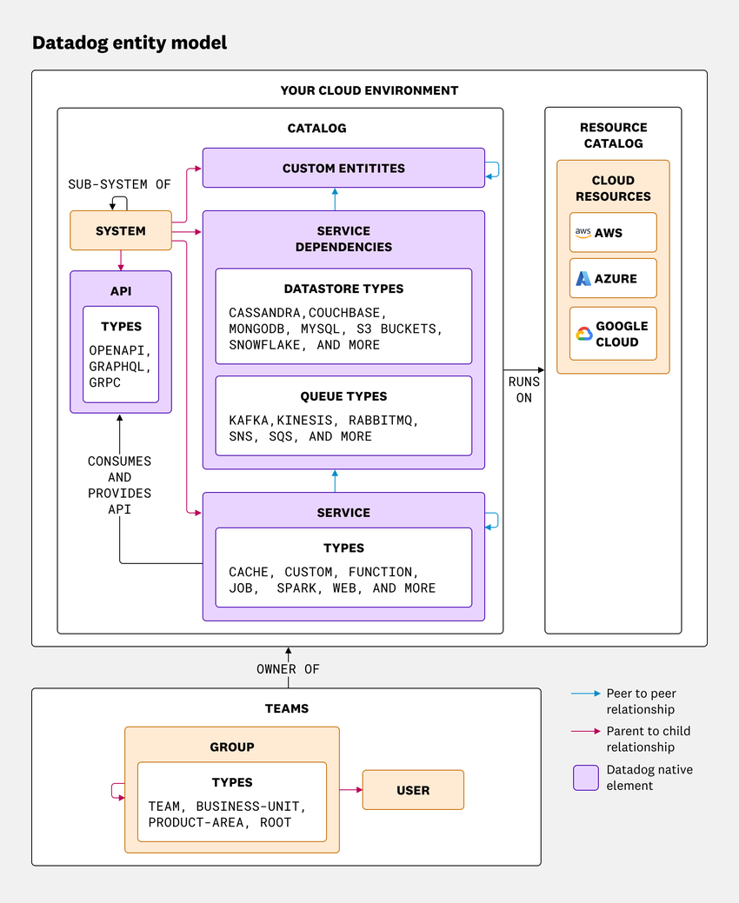
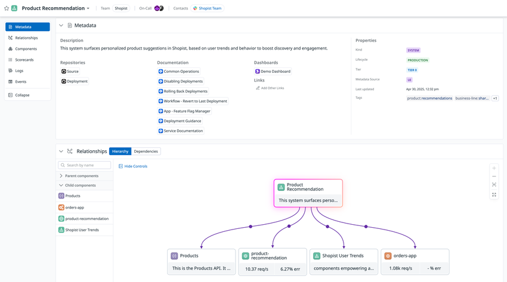
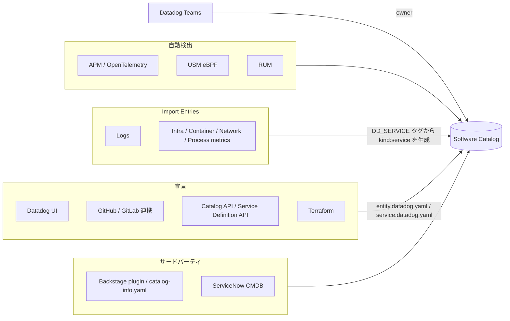
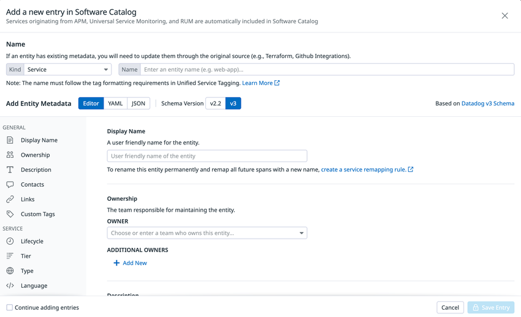
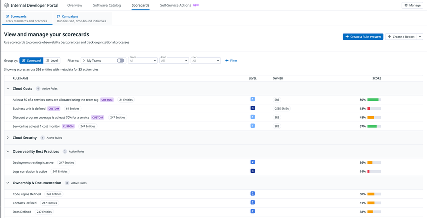
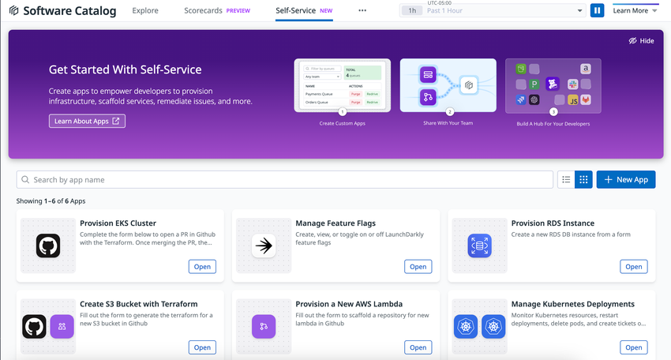

# Software Catalog（旧 Service Catalog）と Internal Developer Portal

## 概要

Software Catalog（ソフトウェアカタログ、旧称：Service Catalog）は、Datadog が APM・USM・RUM 等のテレメトリから自動検出したサービスや、ユーザーが YAML で宣言したエンティティを一元管理するインベントリである。サービスごとのオーナー（Team）、連絡先、リポジトリ、ランブック、ティア、ライフサイクル、依存関係を、パフォーマンス・信頼性・セキュリティ・コスト・デリバリーのライブデータと同じ画面に並べて表示する。

Software Catalog は、Datadog の **Internal Developer Portal（IDP、社内開発者ポータル）** の中核コンポーネントである。IDP は次の要素で構成される。

| コンポーネント | 役割 | 本ファイルでの節 |
|---|---|---|
| Catalog（Software Catalog） | エンティティ（service、system、API、datastore、queue、frontend、カスタム型）のリアルタイムなインベントリと、オーナーシップ等のメタデータ | [エンティティモデル](#エンティティモデル) ほか |
| Scorecards | エンティティがベストプラクティスを満たすかを pass / fail で評価するルール群 | [Scorecards](#scorecards) |
| Campaigns | 期限付きの改善施策を Scorecard ルールで追跡する機能 | [Campaigns](#campaigns) |
| Self-Service Actions | App Builder と Workflow Automation で作ったアプリを開発者向けのセルフサービス操作として公開する機能 | [Self-Service Actions](#self-service-actions) |
| Engineering Reports | 信頼性、DORA メトリクス、Scorecard 達成状況などの経営層向けレポート | [Developer Portal の画面群](#developer-portal-の画面群engineering-reportshomepageoverview-pages) |
| Homepage / Overview Pages | 開発者個人・チーム向けのホーム画面（PR、チケット、担当エンティティの状況） | 同上 |
| External Provider Status | Stripe や GitHub などの外部 SaaS・クラウド API の稼働状況の監視 | 同上 |

[出典](https://docs.datadoghq.com/internal_developer_portal/)

### 名称の変遷

Software Catalog の名称は次のように変わってきた。

| 時期 | 名称・出来事 | 出典 |
|---|---|---|
| 〜2025 年初頭 | **Service Catalog**。APM の一機能として提供され、定義ファイルは `service.datadog.yaml`（schema v2 系）だった | [出典](https://www.datadoghq.com/blog/service-catalog-backstage-yaml/)（2023-07-20 公開） |
| 2025-02 | **Service Catalog から Software Catalog に改称**され、Schema v3.0（`entity.datadog.yaml`）が導入された | [出典](https://www.datadoghq.com/blog/this-month-in-datadog-february-2025/)（2025-03-05 公開）、[出典](https://www.datadoghq.com/blog/service-catalog-schema-v3/)（2025-02-14 公開） |
| 2025-06（DASH 2025） | Software Catalog・Scorecards・Self-Service Actions・Engineering Reports をまとめた **Internal Developer Portal（IDP）** が発表された。IDP の Standard 機能は既存の全顧客に提供されると告知された | [出典](https://www.datadoghq.com/blog/internal-developer-portal/)（2025-06-10 公開） |
| 2026-11 時点 | 公式ドキュメントの見出しは「**Catalog**」（パンくずは `Internal Developer Portal > Catalog`）。製品ページや料金ページでは「Software Catalog」の表記も残る。API リファレンスの分類名は「Software Catalog」、RBAC 権限名は旧称のまま「Service Catalog Read / Write」 | [出典](https://docs.datadoghq.com/internal_developer_portal/catalog/)、[出典](https://docs.datadoghq.com/account_management/rbac/permissions/) |

> 本ナレッジでは製品名を「Software Catalog」に統一する。公式ドキュメントで「Catalog」と書かれている機能も Software Catalog と同じものである。権限名、API 名、UI 文言は公式表記のまま記載する。

### 関連ファイル

- APM のサービスやトレースの概念：[APM の概念とインジェスト制御](../apm/apm-concepts-and-ingestion.md)、[APM 画面と分析機能](../apm/apm-ui-and-analysis.md)
- eBPF によるサービス検出：[Universal Service Monitoring](../apm/universal-service-monitoring.md)
- `service` / `env` / `version` の統合タグ：[Tagging（タグ）](tagging.md)
- Teams、ロール、権限の全般：[組織・ユーザー・権限管理](account-and-access-management.md)
- Self-Service Actions の基盤：[App Builder](../service-management/app-builder.md)、[Workflow Automation](../service-management/workflow-automation.md)
- DORA メトリクス：[DORA Metrics・Quality Gates・Code Coverage](../software-delivery/software-delivery-insights.md)
- Terraform での管理：[Terraform と IaC](terraform-and-iac.md)、[Monitoring as Code](../../04_応用編/monitoring-as-code.md)

---

## Software Catalog で見られる情報

Software Catalog（[`/software`](https://app.datadoghq.com/software) または [`/services`](https://app.datadoghq.com/services)）には、用途別のビュー（lens）が用意されている。よく使う絞り込みは Saved Views として保存できる。

| ビュー | 表示内容 |
|---|---|
| Ownership | チームの Slack、リポジトリ、オンコール情報、Scorecards の達成レベル |
| Reliability | 最近のデプロイ、エラー率の上昇、オープン中のインシデント、アラート中のモニターがあるエンティティ |
| Performance | 環境ごとのレイテンシ、トラフィック、エラー率、Apdex |
| Security | 脆弱なライブラリとライブ攻撃の一覧 |
| Costs | コードやインフラの変更と結び付けた AWS コスト |
| Software Delivery | CI パイプラインの健全性、静的解析の違反、DORA メトリクス |
| Relationships | サービスの依存関係グラフ。サービスカードにホバーすると、そのサービスが稼働するインフラリソースが表示される |
| Infrastructure | クラウドインフラリソースの一覧。ソフトウェアエンティティと相互にリンクする |

[出典](https://docs.datadoghq.com/internal_developer_portal/catalog/)

- **Infrastructure ビュー**を使うには Resource collection を有効化する必要がある。Resource collection は Infrastructure Monitoring の顧客であれば無料で使える。[出典](https://docs.datadoghq.com/internal_developer_portal/catalog/)
- **データ保持**：Software Catalog で表示される span summary と、サービス・リソース単位の統計は最大 30 日保持される。それより長い期間の分析には Metrics Explorer でトレースメトリクスを参照する。[出典](https://docs.datadoghq.com/internal_developer_portal/catalog/)
- **Performance ビューのメトリクス源**：エンティティのパフォーマンス値は primary operation に紐付く。USM だけで検出されたサービスは USM メトリクスを、APM だけ、または APM と USM の両方で検出されたサービスは APM のトレースメトリクスを表示する。[出典](https://docs.datadoghq.com/internal_developer_portal/catalog/set_up/discover_entities/)

### サービスタイプ（従来の `type`）

Software Catalog は、受信したスパンの `span.type` 属性からサービスタイプを自動判定する。タイプは `Cache`、`Custom`、`DB`、`Serverless function`、`Web` のいずれかになる。たとえば Postgres、MySQL、Cassandra は `DB` に、Redis と Memcache は `Cache` に対応する。公式 Flask インテグレーションを使うと `Web` になり、カスタムアプリケーションは `Custom` と表示される。現在は、この従来の `type` フィルターよりもエンティティ種別（kind）や `datastore type` ファセットで絞り込む方法が推奨されている。[出典](https://docs.datadoghq.com/internal_developer_portal/catalog/)

### ダッシュボードから Catalog データを参照する

Dashboards のウィジェットでデータソースに **Developer Portal** を選ぶと、Software Catalog のエンティティ（services、queues、frontend apps、APIs、systems）を取得できる。ownership、tier、lifecycle、definition version でグループ化やフィルタリングができる。対応するウィジェットは Query Value、Top List、Table、Treemap、Pie、Bar である。用途の例は「ティア別のオーナー未設定サービス数」の可視化。[出典](https://docs.datadoghq.com/internal_developer_portal/catalog/)

### Setup Guidance タブ

Software Catalog でエンティティを開くと **Setup Guidance** タブがあり、トレース、ログ、プロファイリング、SLO、モニターなど推奨設定の有無を自動でチェックできる。このタブは各製品の課金状況ではなく、そのエンティティに関するデータが届いているかを表している。たとえばサービスから長期間インフラメトリクスが届いていない場合、ホストに Infrastructure Monitoring が入っていても `Not Detected` と表示されることがある。[出典](https://docs.datadoghq.com/internal_developer_portal/catalog/set_up/)

- Setup Guidance の SLO 数は、`service` タグが付いた SLO の数である。[出典](https://docs.datadoghq.com/internal_developer_portal/catalog/troubleshooting/)
- モニターは、`service` タグや APM の primary tag でタグ付け・スコープ・グループ化されたものがサービスに関連付けられる。ミュート中のモニターとグループは件数に含まれない。[出典](https://docs.datadoghq.com/internal_developer_portal/catalog/troubleshooting/)

---

## エンティティモデル

Software Catalog の情報は**エンティティ**単位で管理される。エンティティはマイクロサービスアーキテクチャを構成する最小単位で、Kubernetes 風の YAML（エンティティ定義、Entity Definition）で記述する。エンティティ定義は Software Catalog における正式な情報源（canonical source of truth）として扱われる。[出典](https://docs.datadoghq.com/internal_developer_portal/catalog/set_up/)



**キャプション：** Datadog エンティティモデルの概念図（公式ドキュメント「Entity Model」より）。

**画面の説明：** 図は「YOUR CLOUD ENVIRONMENT」という大枠の中に「CATALOG」と「RESOURCE CATALOG」を並べている。CATALOG の中では SYSTEM が API、SERVICE、SERVICE DEPENDENCIES、CUSTOM ENTITIES の親になる（parent to child）。SYSTEM は自分自身を「SUB-SYSTEM OF」で参照できる。API の TYPES には OPENAPI、GRAPHQL、GRPC が並ぶ。SERVICE DEPENDENCIES には DATASTORE TYPES（Cassandra、Couchbase、MongoDB、MySQL、S3 バケット、Snowflake など）と QUEUE TYPES（Kafka、Kinesis、RabbitMQ、SNS、SQS など）が含まれる。SERVICE の TYPES は cache、custom、function、job、spark、web など。SERVICE は API を「CONSUMES AND PROVIDES API」の関係で使う。CATALOG 全体は RESOURCE CATALOG（AWS、Azure、Google Cloud のクラウドリソース）の上で「RUNS ON」の関係にある。下段の TEAMS では GROUP（TEAM、BUSINESS-UNIT、PRODUCT-AREA、ROOT の各タイプ）と USER があり、TEAMS は CATALOG の「OWNER OF」になる。凡例として、青矢印が peer to peer の関係、赤矢印が parent to child の関係、紫の箱が Datadog ネイティブ要素を表す。

**出典：** https://docs.datadoghq.com/internal_developer_portal/catalog/entity_model/ （取得日 2026-11-02）

### ネイティブエンティティの種類（schema v3.0 以降）

| kind | 意味 | 主な登録・検出方法 | 補足 |
|---|---|---|---|
| `service` | APM のサービス。関連するエンドポイント、クエリ、ジョブの集まり | APM・USM が自動検出。計装されていないサービスは YAML で宣言するか、Backstage や ServiceNow から取り込む | カスタム計装で任意の `service` を作れる |
| `system` | 広い機能を協調して担うエンティティのグループ（アプリケーション、プロダクト） | YAML で宣言（`spec.components`） | Backstage の System Model と同じ意味。v2.x の `application` フィールドが独立した kind になったもの |
| `api` | 論理的にまとまったエンドポイントの集まり | YAML で宣言（OpenAPI をインライン記述、または `fileRef` で参照） | エンドポイントとサービスの対応付けは変更できないため、API kind が別のグルーピング手段になる |
| `datastore` | サービスが依存する DB、キャッシュ、データウェアハウス | APM が推論（inferred）。または YAML で手動定義 | Database Monitoring を使っているとスループット、レイテンシ、エラー率を表示する |
| `queue` | Kafka、SQS、RabbitMQ、Pub/Sub などのメッセージキューやストリーム | APM が推論。または YAML で手動定義 | Data Streams Monitoring を使っているとスループット等を表示する |
| `frontend` | ブラウザの SPA やモバイルアプリなど、フロントエンドのアプリケーション | RUM アプリケーションが自動検出（Frontend Apps）。YAML で定義することもできる | RUM アプリの名前または `rum_application:<ID>` で紐付ける |
| カスタム型（例：`library`、pipeline、ML model） | 組織固有の構成要素 | UI の **Manage Custom Entity Types**、または Catalog API の kind エンドポイントで型を作成 | Scorecards や Actions の対象を特定の型に絞り込める |

[出典](https://docs.datadoghq.com/internal_developer_portal/catalog/entity_model/native_entities/)、[出典](https://docs.datadoghq.com/internal_developer_portal/catalog/entity_model/custom_entities/)

APM と USM は `service`、`datastore`、`queue`、`external providers`、`inferred services`、`endpoints` を自動検出する。RUM は `frontend apps` を検出する。Datadog SDK は、計装済みサービスの依存先を、依存先自体が計装されていなくても DB、キュー、サードパーティ API として分類する（Inferred Services）。[出典](https://docs.datadoghq.com/internal_developer_portal/catalog/set_up/discover_entities/)

### エンティティとテレメトリの紐付け規則

エンティティ定義の `name`（v3.0）または `dd-service`（v2.x）が、テレメトリ側の主要な識別子と**完全一致**した場合に、テレメトリと自動で紐付く。[出典](https://docs.datadoghq.com/internal_developer_portal/catalog/set_up/)

| kind | 一致させる値 |
|---|---|
| `service` | Unified Service Tagging の `service` タグ（`DD_SERVICE`） |
| 推論された `datastore` | APM の peer タグ。例：`peer.db.name:web-store-mongo,peer.db.system:mongodb` |
| 推論された `queue` | APM の peer タグ。例：`peer.messaging.destination:checkout-events` |
| `frontend` | RUM アプリケーション名、または `rum_application:<アプリケーションID>` |

手動で定義した datastore や queue は、peer タグの命名に従わなくてよい。[出典](https://docs.datadoghq.com/internal_developer_portal/catalog/entity_model/native_entities/)

**datastore の peer タグ**

| Peer タグ | 元になるスパン属性 |
|---|---|
| `peer.aws.dynamodb.table` | `tablename` |
| `peer.aws.s3.bucket` | `bucketname`、`aws.s3.bucket` |
| `peer.cassandra.contact.points` | `db.cassandra.contact.points` |
| `peer.couchbase.seed.nodes` | `db.couchbase.seed.nodes` |
| `peer.db.name` | `db.name`、`mongodb.db`、`db.instance`、`cassandra.keyspace`、`db.namespace` |
| `peer.db.system` | `db.system` |

**queue の peer タグ**

| Peer タグ | 元になるスパン属性 |
|---|---|
| `peer.aws.kinesis.stream` | `streamname` |
| `peer.aws.sqs.queue` | `queuename` |
| `peer.kafka.bootstrap.servers` | `messaging.kafka.bootstrap.servers` |
| `peer.messaging.destination` | `topicname`、`messaging.destination`、`messaging.destination.name`、`messaging.rabbitmq.exchange`、`amqp.destination`、`ampqb.queue`、`amqp.exchange`、`msmq.queue.path`、`aws.queue.name` |
| `peer.messaging.system` | `messaging.system` |

[出典](https://docs.datadoghq.com/internal_developer_portal/catalog/entity_model/native_entities/)

### API 自動相関のための推奨事項

Software Catalog と APM を正しく自動相関させるため、公式ドキュメントは次を推奨している。[出典](https://docs.datadoghq.com/internal_developer_portal/catalog/set_up/discover_entities/)

- Datadog SDK と Datadog Agent を Inferred Services に対応したバージョンにする。
- 任意の service override（例：`service:my-service-http-client`）は使わず、Inferred Services を使う。override が多いと相関が不安定になり、カタログが散らかる。
- 推論された datastore や queue は、renaming rule でチームの命名規則に合わせて改名する。
- Unified Service Tagging で、APM、インフラ、カタログ定義の `service` / `env` / `version` を揃える。
- APM の「service」はトレースのグループ化とメトリクス集計の識別子であり、論理的なサービスと一致するとは限らない。組織として「サービス」の単位（Kubernetes の namespace、deployment、pod など）を決め、すべてのテレメトリに一貫して適用する。

### 関係（Relationships）

v3.0 では、APM・USM が自動検出した依存関係に加えて、YAML で関係を手動で宣言し、トポロジーを補完できる。[出典](https://docs.datadoghq.com/internal_developer_portal/catalog/entity_model/)

| YAML フィールド | 意味 | 主な kind |
|---|---|---|
| `spec.components` | system が含む構成要素（`service:xxx`、`queue:xxx`、`datastore:xxx`、`api:xxx`、`system:xxx` など） | system |
| `spec.componentOf` | 自分が属する system など | service、system、api、datastore、queue、frontend |
| `spec.dependsOn` | 依存先（`service:myapp`、`queue:myqueue`、`datastore:mydatastore`、`library:mylibrary` など） | service、datastore、queue、frontend |
| `spec.implementedBy` | API を実装するサービス | api |
| `metadata.owner` / `metadata.additionalOwners` | オーナー（Team） | すべて |

Catalog API の `GET /api/v2/catalog/relation` で関係を取得できる。エンティティ一覧 API の `filter[relation][type]` で使える関係タイプは `RelationTypeOwns`、`RelationTypeOwnedBy`、`RelationTypeDependsOn`、`RelationTypeDependencyOf`、`RelationTypePartsOf`、`RelationTypeHasPart`、`RelationTypeOtherOwns`、`RelationTypeOtherOwnedBy`、`RelationTypeImplementedBy`、`RelationTypeImplements` である。[出典](https://docs.datadoghq.com/api/latest/software-catalog/)



**キャプション：** schema v3.0 で定義した `kind:system`（Product Recommendation）の System ページ。

**画面の説明：** 上部のヘッダーにシステム名「Product Recommendation」、Team（Shopist）、On-Call、Contacts が並ぶ。左のナビゲーションには Metadata、Relationships、Components、Scorecards、Logs、Events がある。Metadata セクションには Description、Repositories（Source、Deployment）、Documentation（Common Operations、Disabling Deployments などのランブック）、Dashboards、Links が表示される。右側の Properties には Kind = SYSTEM、Lifecycle = PRODUCTION、Tier = TIER 0、Metadata Source = UI、Last updated、Tags が並ぶ。Relationships セクションには Hierarchy タブと Dependencies タブがあり、Hierarchy では親システムの下に子コンポーネント（Products API、product-recommendation、Shopist User Trends、orders-app）がツリー状に表示される。各カードにはリクエスト数やエラー率も出る。System ページは、配下コンポーネントの上流・下流の依存関係、Scorecards、ログ、イベントを集約して表示する。

**出典：** https://docs.datadoghq.com/internal_developer_portal/catalog/entity_model/native_entities/ （取得日 2026-11-02）

---

## エンティティ定義（Service Definition）スキーマ

### サポートされるスキーマバージョン

Datadog は 4 つのスキーマバージョンをサポートしている。新しいバージョンは前のバージョンの機能を含み、後方互換性がある。[出典](https://docs.datadoghq.com/internal_developer_portal/catalog/entity_model/)

| 機能 | v3.0 | v2.2 | v2.1 | v2.0 |
|---|---|---|---|---|
| 基本メタデータ（チーム、連絡先、リンク、タグ） | ○ | ○ | ○ | ○ |
| サービスのグルーピング（`application`、`tier`、`lifecycle`） | ○ | ○ | ○ | － |
| ユーザー注釈（`extensions`）、`type` / `languages` の上書き | ○ | ○ | － | － |
| CI パイプラインの関連付け | ○ | ○ | － | － |
| 拡張データモデル（system、api、datastore、queue、frontend、カスタム型） | ○ | － | － | － |
| 複数オーナー（`additionalOwners`） | ○ | － | － | － |
| 依存関係の手動宣言 | ○ | － | － | － |

- v1 は 2026-11 時点のサポート対象に含まれていない。ただし v3 移行ツールは v1 からの変換に対応している。[出典](https://docs.datadoghq.com/internal_developer_portal/catalog/entity_model/v3_migration/)
- JSON Schema は GitHub の [DataDog/schema](https://github.com/DataDog/schema/tree/main/service-catalog)（`service-catalog/v2`、`v2.1`、`v2.2`、`v3`）で公開されている。SchemaStore にも登録されているため、対応 IDE（VS Code など）では補完と検証が効く。[出典](https://docs.datadoghq.com/internal_developer_portal/catalog/entity_model/)

> **サイト差異:** Entity Model schema v3.0 は、`app.ddog-gov.com`（US1-FED）と `us2.ddog-gov.com`（US2-FED）では**サポートされていない**。これらのサイトでは v2.2 以前を使う。[出典](https://docs.datadoghq.com/internal_developer_portal/catalog/entity_model/)

### ファイル名と配置

| 項目 | 仕様 |
|---|---|
| ファイル名 | `service.datadog.yaml` または `entity.datadog.yaml`（どちらも受け付ける）。Backstage 形式は `catalog-info.yaml` |
| 1 ファイルに複数定義 | YAML ドキュメントを `---` で区切れば、複数のエンティティを 1 ファイルに書ける |
| GitHub / GitLab 連携時のスキャン範囲 | Datadog に読み取り権限があるリポジトリ全体から上記のファイル名を探す |
| エンティティ名のフィールド | v2.2 以前は `dd-service`、v3.0 以降は `metadata.name` |

[出典](https://docs.datadoghq.com/internal_developer_portal/catalog/set_up/create_entities/)

### v3.0 のトップレベル構造

v3.0 の全 kind に共通する基底スキーマ（`entity.schema.json`）の必須フィールドは `apiVersion`、`kind`、`metadata` で、`additionalProperties: false`（未定義フィールドは不可）である。[出典](https://github.com/DataDog/schema/tree/main/service-catalog/v3)

| フィールド | 必須 | 型 | 説明 |
|---|---|---|---|
| `apiVersion` | ○ | string（enum：`v3`） | スキーマバージョン。v2.x の `schema-version` に相当 |
| `kind` | ○ | string | エンティティ種別：`service`、`system`、`api`、`datastore`、`queue`、`frontend`、カスタム型 |
| `metadata` | ○ | object | 名前、オーナー、連絡先、リンク、タグなど（次の表） |
| `spec` | － | object | kind ごとの仕様（lifecycle、tier、依存関係など） |
| `integrations` | － | object | 外部ツール連携：`pagerduty`、`opsgenie`、`jiraServiceManagementOps`、`sentry`、`terraform`、`servicenow`、`argocd` |
| `datadog` | － | object | Datadog 製品との関連付け：`codeLocations`、`logs`、`events`、`pipelines` |
| `extensions` | － | object（自由形式） | 組織固有のメタデータ。スキーマ上は「Datadog の機能には影響しない自由形式フィールド」とされる |
| `inheritFrom` | － | string | メタデータを継承する元のエンティティ（`<kind>:<name>`） |

### `metadata` のフィールド（v3.0）

| フィールド | 必須 | 型・制約 | 説明 |
|---|---|---|---|
| `name` | ○ | string、1 文字以上 | kind / namespace の中で一意な名前。テレメトリとの紐付けに使われる |
| `displayName` | － | string | UI に表示する名前 |
| `description` | － | string | 短い説明 |
| `owner` | － | string | 主オーナー（通常は Team のハンドル） |
| `additionalOwners` | － | array of {`name`（必須）, `type`} | 追加オーナー。`type` には `operator`、`stakeholder`、`team` などを書く |
| `contacts` | － | array of {`name`（2 文字以上）, `type`（必須）, `contact`（必須）} | 連絡先。`type` の例は `email`、`slack`、`microsoft-teams`。`type: email` の場合、`contact` はメールアドレス形式でなければならない |
| `links` | － | array of {`name`（必須）, `type`（必須、既定 `other`）, `url`（必須、URI 形式）, `provider`} | リンク。`type` の例は `runbook`、`doc`、`repo`、`dashboard`、`other`。`provider` の例は `github`、`gitlab`、`confluence`、`gdoc`、`wiki` |
| `tags` | － | array of string | カスタムタグ（例：`business-unit:retail`） |
| `inheritFrom` | － | string | 継承元のエンティティ参照 |
| `id` | 読み取り専用 | string | Datadog が生成する UUID。ユーザーが指定しても無視される |
| `managed` | 読み取り専用 | object | Datadog が管理する属性。ユーザーが指定しても無視される |
| `namespace` | － | string | 一意識別子の一部。既定値は `default`（API リファレンスの記載） |

[出典](https://github.com/DataDog/schema/blob/main/service-catalog/v3/metadata.schema.json)、[出典](https://docs.datadoghq.com/api/latest/software-catalog/)

### `spec` のフィールド（v3.0、kind 別）

| フィールド | service | system | api | datastore | queue | frontend | 説明 |
|---|---|---|---|---|---|---|---|
| `lifecycle` | ○ | ○ | ○ | ○ | ○ | ○ | ライフサイクル。スキーマ上は 1 文字以上の自由文字列で、例として `experimental`、`production`、`deprecated` が示されている |
| `tier` | ○ | ○ | ○ | ○ | ○ | ○ | 重要度。1 文字以上の自由文字列（例：`"0"`、`"1"`、`High`、`Tier 1`） |
| `type` | ○ | ○ | ○ | ○ | ○ | ○ | 種別。service の例は `web`、`grpc`、`http`、`rest`、`graphql`。api の場合は `openapi` などのインターフェース種別。frontend の例は `browser` |
| `languages` | ○ | － | － | － | － | － | 使用言語（例：`go`、`java`、`python`、`js`、`dotnet`、`php`、`ruby`、`c++`） |
| `dependsOn` | ○ | － | － | ○ | ○ | ○ | 依存先エンティティの参照 |
| `componentOf` | ○ | ○ | ○ | ○ | ○ | ○ | 所属先エンティティの参照 |
| `dependencyOf` | － | － | － | ○ | ○ | － | 自分を依存先とするエンティティの参照（例：`service:parentapp`） |
| `components` | － | ○ | － | － | － | － | 配下のコンポーネント |
| `implementedBy` | － | － | ○ | － | － | － | API を実装するサービス |
| `interface` | － | － | ○ | － | － | － | `definition`（OpenAPI をインライン記述）または `fileRef`（GitHub 上のファイル URL）。JSON Schema 上はどちらか一方だけを指定する（`oneOf`） |

[出典](https://github.com/DataDog/schema/tree/main/service-catalog/v3)、[出典](https://docs.datadoghq.com/internal_developer_portal/catalog/entity_model/native_entities/)

- 各 kind の `spec` は `additionalProperties: false` で、表にないフィールドを書くと検証エラーになる。たとえば system に `dependsOn` は書けない。[出典](https://github.com/DataDog/schema/tree/main/service-catalog/v3)
- frontend の列は公式ドキュメントの YAML 例（`type: browser`、`dependsOn`、`componentOf` など）にもとづく。GitHub の `service-catalog/v3` ディレクトリには frontend 専用のスキーマファイルが見当たらない（2026-11-02 時点）。
- カスタム型のエンティティ（`custom.schema.json`）の `spec` で使えるのは `lifecycle`、`tier`、`type`、`dependsOn`、`dependencyOf`、`componentOf` である。カスタム型の `kind` 名は正規表現 `^[a-z][a-z0-9]*(?:-[a-z0-9]+)*$`（小文字英数字のハイフン区切り）に一致する必要がある。
- スキーマリポジトリには `repository.schema.json`（`kind: repository`）もある。公式ドキュメントのネイティブエンティティ一覧には載っていない。`application.schema.json`（`kind: application`）は「Deprecated - replaced by kind:system」と明記された旧形式である。

[出典](https://github.com/DataDog/schema/tree/main/service-catalog/v3)

### `integrations` セクション（v3.0）

v3.0 の `integrations` で指定できる外部ツールと、JSON Schema 上の必須フィールドは次のとおり。`integrations` も `additionalProperties: false` で、表にないキーは書けない。[出典](https://github.com/DataDog/schema/blob/main/service-catalog/v3/integrations.schema.json)

| キー | 必須フィールド | 形式・制約 |
|---|---|---|
| `pagerduty` | `serviceURL` | 1 文字以上の文字列（PagerDuty のサービス URL） |
| `opsgenie` | `serviceURL` | 1 文字以上の文字列。任意で `region` |
| `jiraServiceManagementOps` | `teamURL` | 1 文字以上の文字列（Jira Service Management Operations のチーム URL） |
| `sentry` | `projectSlugs` | 1 個以上の文字列の配列（Sentry のプロジェクト slug） |
| `terraform` | `workspaceIds` | 1 個以上の配列。各要素は `^ws-[a-zA-Z0-9]+$`（HCP Terraform のワークスペース ID） |
| `servicenow` | `serviceURL` | `https://<instance>.service-now.com/...sys_id=<32 桁の 16 進数>` 形式。ServiceNow の All > Service Portfolio Management > Services でサービスを開き、ブラウザーのアドレスバーの URL をコピーする。sys_id はインスタンス内でしか一意でないため、インスタンス名も含める |
| `argocd` | `applications` | 1 個以上の配列。各要素は `<namespace>/<name>` 形式（例：`argocd/e2e-app-01`） |

[出典](https://github.com/DataDog/schema/tree/main/service-catalog/v3)

公式ドキュメント（IDP Integrations）が画面での連携内容を説明しているのは PagerDuty と Opsgenie だけである。Jira Service Management Ops、Sentry、Terraform、ServiceNow、Argo CD を Software Catalog でどう表示するかは、公開情報では確認できず。[出典](https://docs.datadoghq.com/internal_developer_portal/integrations/)

> **注意（lifecycle の値）:** JSON Schema では `lifecycle` は自由文字列だが、v3 移行ツール `pup` のドキュメントには、`lifecycle` の値を `["experimental","active","deprecated","end-of-life"]` で検証したときの出力例が載っている。値の運用ルール（例：`production` と `active` のどちらを使うか）は、組織内で統一しておくことを推奨する【経験則】。[出典](https://docs.datadoghq.com/internal_developer_portal/catalog/entity_model/v3_migration/)

### `datadog` セクション（v3.0）

| キー | 説明 |
|---|---|
| `codeLocations` | コードの場所。`repositoryURL` と `paths`（リポジトリ内のパスに一致させる glob のリスト）を指定する。モノレポでサービスとコードの対応付けを正確にできる |
| `logs` | 保存済みのログクエリ（`name`、`query`）。System ページなどに結果を表示する |
| `events` | 保存済みのイベントクエリ（`name`、`query`） |
| `pipelines.fingerprints` | CI パイプラインのフィンガープリント。v2.2 の `ci-pipeline-fingerprints` に相当 |

[出典](https://docs.datadoghq.com/internal_developer_portal/catalog/entity_model/)

### v3.0 の記述例

```yaml
# entity.datadog.yaml
apiVersion: v3
kind: system
metadata:
  name: shopping-cart
  displayName: Shopping Cart
  owner: shopping-team
  additionalOwners:
    - name: sre-team
      type: operator
  links:
    - name: Runbook
      type: runbook
      url: https://runbook/shopping-cart
  contacts:
    - name: Support Slack
      type: slack
      contact: https://www.slack.com/archives/shopping-cart
integrations:
  pagerduty:
    serviceURL: https://www.pagerduty.com/service-directory/Pshopping-cart
spec:
  lifecycle: production
  tier: critical
  components:
    - service:shopping-cart-api
    - service:shopping-cart-processor
    - queue:orders-queue
    - datastore:orders-postgres
datadog:
  codeLocations:
    - repositoryURL: https://github.com/myorganization/myrepo.git
      paths:
        - path/to/service/code/**
---
apiVersion: v3
kind: service
metadata:
  name: shopping-cart-api
---
apiVersion: v3
kind: datastore
metadata:
  name: orders-postgres
  additionalOwners:
    - name: db-team
      type: operator
```

（公式ドキュメントの例をもとに要約。[出典](https://docs.datadoghq.com/internal_developer_portal/catalog/entity_model/)）

API エンティティの例（OpenAPI をファイル参照する場合）：

```yaml
apiVersion: v3
kind: api
metadata:
  name: payments
  displayName: Payments
  owner: payments-team
spec:
  type: openapi
  implementedBy:
    - service:payment
    - service:payments-go
  interface:
    fileRef: https://github.com/<org>/<repo>/blob/main/openapi.yaml
  lifecycle: production
  tier: "Tier 0"
```

[出典](https://docs.datadoghq.com/internal_developer_portal/catalog/entity_model/native_entities/)

### メタデータの継承（v3.0）

| 方式 | 条件と動作 |
|---|---|
| 明示的な継承 | `inheritFrom: <entity_kind>:<name>` を書くと、参照先エンティティのメタデータを継承する |
| 暗黙的な継承 | `kind:service`、`kind:datastore`、`kind:queue`、`kind:ui` のコンポーネントは、(1) YAML ファイル内に定義された system が 1 つだけで、(2) `inheritFrom` が書かれていない場合に、その system のメタデータをすべて継承する（公式ドキュメントの表記は `kind:ui`。ネイティブエンティティの一覧に `ui` はなく、`frontend` を指すかどうかは公開情報では確認できず） |

1 つのコンポーネントが複数の system に属する場合は、system ごとの YAML にそのコンポーネントを書く必要がある。[出典](https://docs.datadoghq.com/internal_developer_portal/catalog/entity_model/)

### v2.x の主要フィールド

| フィールド | v2.0 | v2.1 | v2.2 | 説明 |
|---|---|---|---|---|
| `schema-version` | ○（必須） | ○（必須） | ○（必須） | `v2`、`v2.1`、`v2.2` |
| `dd-service` | ○（必須） | ○（必須） | ○（必須） | サービスの一意な識別子。Datadog のサービス名と一致させる |
| `team` | ○ | ○ | ○ | オーナーのチーム。Datadog Teams に同じハンドルがあれば紐付く |
| `contacts` | ○ | ○ | ○ | 連絡先（`type`：`slack`、`email`、`microsoft-teams` など） |
| `links` | ○ | ○ | ○ | リンク（`type`：`runbook`、`doc`、`repo`、`dashboard` など） |
| `repos` / `docs` | ○ | － | － | v2.0 だけにあるリポジトリとドキュメントのリスト（v2.1 以降は `links` に統合） |
| `tags` | ○ | ○ | ○ | カスタムタグ |
| `integrations.pagerduty` | ○（URL 文字列） | ○ | ○（`service-url`） | PagerDuty のサービス URL |
| `integrations.opsgenie` | － | ○ | ○（`service-url`、`region`：`US` / `EU`） | Opsgenie の連携 |
| `application` | － | ○ | ○ | サービスのグループ（v3.0 では `kind:system` になった） |
| `tier` | － | ○ | ○ | 重要度（文字列） |
| `lifecycle` | － | ○ | ○ | `production`、`experimental`、`deprecated` など |
| `description` | － | ○ | ○ | 説明 |
| `type` | － | － | ○ | 自動検出したタイプの上書き。enum：`web`、`db`、`cache`、`function`、`browser`、`mobile`、`custom` |
| `languages` | － | － | ○ | 言語の上書き |
| `ci-pipeline-fingerprints` | － | － | ○ | CI パイプラインの関連付け |
| `extensions` | － | － | ○ | カスタム拡張 |

[出典](https://docs.datadoghq.com/internal_developer_portal/catalog/entity_model/)、[出典](https://github.com/DataDog/schema/tree/main/service-catalog/v2.2)

v2.2 の JSON Schema では、PagerDuty の `service-url` は `https://<subdomain>.pagerduty.com/service-directory/P...` 形式、Opsgenie の `service-url` は `https://<subdomain>.opsgenie.com/service/<id>` 形式の正規表現で検証される。[出典](https://github.com/DataDog/schema/blob/main/service-catalog/v2.2/schema.json)

v2.x の各バージョンで、`links[].type` と `contacts[].type` の検証の厳しさは次のように異なる。v2.2 で、この 2 つの検証が緩くなった（公式表記「Less restrictive validation logic for `contact.type` and `link.type`」）。[出典](https://docs.datadoghq.com/internal_developer_portal/catalog/entity_model/)

| フィールド | v2.0 | v2.1 | v2.2 |
|---|---|---|---|
| `links[].type` | enum：`doc`、`wiki`、`runbook`、`url`、`repo`、`dashboard`、`oncall`、`code`、`link` | enum：`doc`、`repo`、`runbook`、`dashboard`、`other` | 自由文字列（例：`runbook`、`doc`、`repo`、`dashboard`、`other`。既定値 `other`） |
| `contacts[].type` | enum：`email`、`slack`、`microsoft-teams` | enum：`email`、`slack`、`microsoft-teams` | 自由文字列（例：`email`、`slack`、`microsoft-teams`） |
| `lifecycle` の例 | （フィールドなし） | `sandbox`、`staging`、`production`、`deprecated` | 同左 |
| その他 | `team` のほかに `dd-team`（大文字と空白を含まない文字列）がある | － | `type` は enum（`web`、`db`、`cache`、`function`、`browser`、`mobile`、`custom`） |

[出典](https://github.com/DataDog/schema/tree/main/service-catalog)

v2.x で必須なのは `schema-version` と `dd-service` の 2 つだけで、他のフィールドはすべて任意である。[出典](https://github.com/DataDog/schema/blob/main/service-catalog/v2.2/schema.json)

### v2.2 から v3.0 への主な変更点

| v2.2 | v3.0 |
|---|---|
| `schema-version` | `apiVersion` |
| （なし） | `kind`（service、queue、datastore、system、api など） |
| `dd-service` | `metadata.name` |
| `team` | `metadata.owner`。複数チームの場合は `metadata.additionalOwners` も使う |
| `lifecycle`、`tier`、`languages`、`type` | `spec` 配下 |
| `links`、`contacts`、`description`、`tags` | `metadata` 配下 |
| `application` | 独立した `kind: system` になった（service のフィールドとしては廃止） |

[出典](https://docs.datadoghq.com/internal_developer_portal/catalog/entity_model/)

### v3.0 への移行ツール（`pup idp migrate-schema`）

Datadog の CLI `pup` の `pup idp migrate-schema` コマンドは、v1、v2、v2.1、v2.2 の YAML を v3 形式に変換する。このコマンドは Datadog の認証（`pup auth login`）なしで動作する。インストールは `brew tap datadog-labs/pack` → `brew install pup`。[出典](https://docs.datadoghq.com/internal_developer_portal/catalog/entity_model/v3_migration/)

| 移行元フィールド（v1〜v2.2） | v3 の移行先 |
|---|---|
| `dd-service` / `info.dd-service` | `metadata.name` |
| `display-name` / `display_name` | `metadata.displayName` |
| `description` | `metadata.description` |
| `team` / `org.team` | `metadata.owner` |
| `contacts` | `metadata.contacts` |
| `links` | `metadata.links` |
| `repos` | `metadata.links`（`type: repo`） |
| `docs` | `metadata.links`（`type: doc`） |
| `tags` | `metadata.tags` |
| `lifecycle` | `spec.lifecycle` |
| `tier` / `service-tier` | `spec.tier` |
| `type` | `spec.type` |
| `languages` | `spec.languages` |
| `depends-on` | `spec.dependsOn` |
| `application` | `spec.componentOf`。あわせて `kind: system` のコンパニオンエンティティを生成する |
| `integrations.pagerduty` | `integrations.pagerduty.serviceURL` |
| `integrations.opsgenie` | `integrations.opsgenie.serviceURL` |
| `extensions` | `extensions`（そのまま保持） |
| 未知のトップレベルフィールド | `extensions` に移動 |

- リンクタイプは正規化される：`wiki` → `doc`、`code` → `repo`、`url` と `oncall` → `other`。
- 単一ファイル（`pup idp migrate-schema service.datadog.yaml`）、ディレクトリ（`*.datadog.yaml` を再帰的に探索）、引数なし（カレントディレクトリから自動探索）の 3 通りで実行できる。
- 出力先は「同じディレクトリの `entity.datadog.yaml` に書き出して元ファイルを削除」「パスを指定」「標準出力のみ」から選ぶ。
- 変換後、公開リポジトリ `DataDog/schema` の v3 JSON Schema で検証する。検証エラーは警告扱いで、書き出しは止めない。

[出典](https://docs.datadoghq.com/internal_developer_portal/catalog/entity_model/v3_migration/)

v3.0 でも、エンティティの作成方法（GitHub、GitLab、API、Terraform、Backstage、ServiceNow、UI）は従来と同じである。ただし API エンドポイントと Terraform リソースは v3.0 用の新しいものを使う（[API・Terraform](#apiterraform自動化) を参照）。[出典](https://docs.datadoghq.com/internal_developer_portal/catalog/entity_model/)

### カスタム拡張（`extensions`）

- カスタム拡張は、すべてのスキーマバージョンで **【Limited Availability】** である。リリースノート、コンプライアンス用タグ、独自のオーナーシップモデルなど、組織固有のメタデータを持たせるのに使う。[出典](https://docs.datadoghq.com/internal_developer_portal/catalog/entity_model/)
- Datadog の機能が解釈する予約済みの拡張キーとして `datadoghq.com/cd-visibility` がある。CD Visibility で、どのコミットをデプロイに含めるかを制御する。[出典](https://docs.datadoghq.com/internal_developer_portal/catalog/entity_model/)

---

## エンティティの登録方法

Software Catalog にエンティティが載る経路は 3 つある。(1) テレメトリからの自動検出、(2) エンティティ定義による宣言、(3) サードパーティからのインポート。[出典](https://docs.datadoghq.com/internal_developer_portal/catalog/)



### 1. テレメトリからの自動検出

| データ源 | 検出されるもの | 補足 |
|---|---|---|
| APM（Datadog SDK または OpenTelemetry） | service、datastore、queue、外部プロバイダー、inferred services、エンドポイント | 非サンプリングのトレースメトリクスが、エンティティ検出と依存関係マップの元になる。Agent や SDK のバージョン、カスタム計装、service override の使い方が依存関係マップの精度に影響する |
| USM | service（ゴールデンシグナルと依存関係） | eBPF ベースで、アプリケーションコードの計装は不要 |
| RUM | Frontend Apps | Component Selector で **Frontend Apps** として表示される |

既定では、Software Catalog には APM、USM、RUM から検出したエントリーが自動で入る。[出典](https://docs.datadoghq.com/internal_developer_portal/catalog/set_up/)

自動命名されたエンティティは次の方法で整理できる。[出典](https://docs.datadoghq.com/internal_developer_portal/catalog/set_up/discover_entities/)

- renaming rule で任意の名前に変える
- 種別（database、queue、third-party）ごとに inferred エンティティを除外する
- `service:my-service-http-client` のような service override を外す

### 2. ログやインフラメトリクスからのインポート（Import Entries）

ログ、ホストメトリクス、コンテナメトリクス、ネットワークメトリクス、プロセスメトリクスのうち `DD_SERVICE` タグが付いているものから、`kind:service` のエンティティを取り込める。手順は Software Catalog の [**Import Entries** タブ](https://app.datadoghq.com/software/settings/get-started)でデータソースを選ぶだけである。[出典](https://docs.datadoghq.com/internal_developer_portal/catalog/set_up/)

- `DD_SERVICE` タグがきちんと管理されていて、無関係な値や誤った値が混ざっていない場合に限って使うよう公式に注意書きがある。
- インポートしたエントリーは **Explore** タブに表示される。オーナーや連絡先などのメタデータを追加しないと、**期限切れで消えることがある**。消えるまでの期間は公開情報では確認できず。
- **Clear Previously Imported Services** を押すと、メタデータがなく、APM・USM・RUM のテレメトリもないインポート済みサービスをまとめて削除できる。

[出典](https://docs.datadoghq.com/internal_developer_portal/catalog/set_up/discover_entities/)

### 3. Datadog UI で作成する



**キャプション：** 「Add a new entry in Software Catalog」ダイアログ（エンティティ定義エディター）。

**画面の説明：** 上部に「Services originating from APM, Universal Service Monitoring, and RUM are automatically included in Software Catalog」という説明がある。Name 欄では **Kind** ドロップダウン（例：Service）とエンティティ名を入力する。名前は Unified Service Tagging のタグ形式の要件に従う必要があり、既存のメタデータがあるエンティティは元のソース（Terraform、GitHub 連携など）で更新するよう注意書きが出る。「Add Entity Metadata」では **Editor / YAML / JSON** の表示切り替えと、**Schema Version**（v2.2 / v3）の切り替えができる。左のメニューは GENERAL（Display Name、Ownership、Description、Contacts、Links、Custom Tags）と SERVICE（Lifecycle、Tier、Type、Language）に分かれる。Ownership では OWNER（チーム）と ADDITIONAL OWNERS を設定する。Display Name の下には、エンティティ名を恒久的に変えたい場合は service remapping rule を作るよう案内がある。右下に Cancel と Save Entry、左下に「Continue adding entries」のチェックボックスがある。

**出典：** https://docs.datadoghq.com/internal_developer_portal/catalog/set_up/create_entities/ （取得日 2026-11-02）

手順は次のとおり。[出典](https://docs.datadoghq.com/internal_developer_portal/catalog/set_up/create_entities/)

1. [Catalog Setup & Config](https://app.datadoghq.com/software/settings/get-started) を開き、**Create a New Entry** をクリックする。
2. **Kind** ドロップダウンでエンティティ種別を選ぶ。種別によってフォームの項目が変わる。たとえば API では OpenAPI または gRPC 仕様のアップロード欄が、Service ではサービスタイプと lifecycle の欄が出る。
3. オーナーシップや参照リンクなどのメタデータを入力する。
4. 必要に応じて **YAML** / **JSON** に切り替え、生成されたコードと cURL コマンドを確認する。不正なデータはエディターが自動で指摘する。
5. **Save Entry** を押すか、表示された cURL コマンドを実行して保存する。

保存には **Service Catalog Write** 権限が必要。

### 4. コードで管理する（GitHub / GitLab / API / Terraform）

| 方法 | 内容 | 注意点 |
|---|---|---|
| GitHub 連携 | GitHub インテグレーションタイルの **Repo Configuration** タブで **Link GitHub Account** を実行する。読み取り権限のあるリポジトリから `service.datadog.yaml` / `entity.datadog.yaml` / `catalog-info.yaml` を探す | 連携後は、サービスの **Definition** タブに **Edit in GitHub** ボタンが出る |
| GitLab 連携 | GitLab Source Code インテグレーションで、読み取り権限のあるリポジトリに YAML を置く | － |
| Service Definition API | v2.2 以前のスキーマ用（`/api/v2/services/definitions`） | GitHub Action としてオープンソースのソリューションも提供されている |
| Catalog API（Software Catalog API） | v3.0 以降のスキーマ用（`/api/v2/catalog/entity`） | 同上 |
| Terraform | v2.x は `datadog_service_definition_yaml`、v3.0 は `datadog_software_catalog` リソース | 自動パイプラインからサービスを作成・管理するには Datadog Provider v3.16.0 以降が必要 |
| Datadog Software Metadata Provider | GitHub Actions からの自動インポート | 公式ドキュメントでは名称のみ確認できる |

[出典](https://docs.datadoghq.com/internal_developer_portal/catalog/set_up/create_entities/)、[出典](https://docs.datadoghq.com/internal_developer_portal/catalog/entity_model/)

- **二重管理の禁止**：同じエンティティをソースコード連携（GitHub / GitLab）と API の両方で更新すると、意図しない上書きが起きることがある。どちらか一方に統一する。[出典](https://docs.datadoghq.com/internal_developer_portal/catalog/set_up/create_entities/)
- **反映時間**：リポジトリの変更は数分以内に Datadog に反映される（公式表記「within minutes」）。[出典](https://docs.datadoghq.com/internal_developer_portal/catalog/set_up/)
- **取り込みエラーの確認**：GitHub 連携で取り込んだ定義の検証エラーは、Event Management で `source:software_catalog status:error` と絞り込むと確認できる。[出典](https://docs.datadoghq.com/internal_developer_portal/catalog/set_up/create_entities/)

### 5. Backstage からのインポート

| 方式 | 内容 |
|---|---|
| Datadog Backstage plugin | npm パッケージ `@datadog/backstage-plugin-datadog-entity-sync-backend`。Backstage のバックエンドサービスとして動き、Backstage のエンティティを設定したスケジュールで Datadog に同期する。Backstage の component type（services、repositories など）で同期対象を絞り込める。設定には API キー、アプリケーションキー、Datadog サイト（例：`datadoghq.com`）が必要 |
| `catalog-info.yaml` の取り込み | API や Terraform のリクエストに Backstage の YAML をそのまま渡す。または GitHub 連携で `catalog-info.yaml` をスキャンさせる |

[出典](https://docs.datadoghq.com/internal_developer_portal/catalog/set_up/import_entities/)、プラグインの紹介ブログ [出典](https://www.datadoghq.com/blog/datadog-backstage-plugin/)（2025-11-11 公開）

Backstage のフィールドと Datadog のフィールドの対応は次のとおり。

| Backstage | Datadog |
|---|---|
| `kind:component`、`kind:system` | 認識される（`kind:component` は service として扱う） |
| `metadata.name` | `dd-service` |
| `metadata.namespace` | カスタムタグ `namespace:${metadata.namespace}` |
| `spec.lifecycle` | `lifecycle` |
| `spec.owner` | `team` |
| `metadata.links` | `links` |
| アノテーション `github.com/project-slug` | `type=repo` のリンク（`https://www.github.com/${project-slug}`） |
| アノテーション `pagerduty.com/service-id` と `pagerduty.com/account` | 結合して `integration.pagerduty` |
| `metadata.description` | `description` |
| `spec.system` | `application` |
| `spec.dependsOn` | `dependsOn` |
| その他の `spec` の値 | カスタムタグ |

`catalog-info.yaml` はファイル全体で処理される。どこか 1 つのセクションでも `kind:component` または `kind:system` でないものがあると、**ファイル全体が拒否される**。`kind:system` と `dependsOn` を使うには schema v3.0 が必要。[出典](https://docs.datadoghq.com/internal_developer_portal/catalog/set_up/import_entities/)

### 6. ServiceNow CMDB からのインポート

Datadog-ServiceNow インテグレーションの **Service Ingestion** 機能で、ServiceNow CMDB の CI テーブルを定期的にクエリし、サービスを Software Catalog に取り込む。[出典](https://docs.datadoghq.com/internal_developer_portal/catalog/set_up/import_entities/)。ServiceNow 連携の全体像は [通知・コラボレーション連携](collaboration-integrations.md) を参照。

---

## オーナーシップと Datadog Teams 連携

### Software Catalog と Teams の関係

Software Catalog のエンティティに Datadog Teams をオーナーとして設定すると、次のことができる。[出典](https://docs.datadoghq.com/internal_developer_portal/catalog/set_up/ownership/)

- Datadog の各製品画面でチーム単位に絞り込む
- Scorecards と Campaigns の結果を担当チームに帰属させる
- 通知やオンコール情報を正しいチームに届ける

チームフィルターの絞り込み基準は製品によって異なる。APM Error Tracking、Logs Error Tracking、On-Call では、**Software Catalog に登録されたサービスのオーナーシップ**を基準にチームで絞り込む。Software Catalog、Monitors、Dashboards、SLO などは、各リソースに付けたチームハンドルを基準にする。[出典](https://docs.datadoghq.com/account_management/teams/)

### オーナーの設定方法

| 方法 | 手順 |
|---|---|
| Datadog UI | Software Catalog でエンティティを開き、**Edit in UI** → **Ownership** セクションで **Owner** と（任意で）**Additional owners** を設定 → **Save Entry**。チーム名で検索するか、`team:example-team` 形式のハンドルを貼り付ける |
| 設定ファイル | v3.0 は `metadata.owner` / `metadata.additionalOwners`、v2.x は `team` にチームハンドルを書く。ハンドルは既存の Datadog Team と完全一致させる |

[出典](https://docs.datadoghq.com/internal_developer_portal/catalog/set_up/ownership/)

### Team の構成要素と制約

| 項目 | 内容 |
|---|---|
| Team name | 使える文字は `a-z`、`A-Z`、`0-9`、`._-:/`。空白はアンダースコアに置き換える |
| Handle | チーム名から自動生成される一意の識別子。使える文字は `a-z`、`0-9`、`._-:/`。末尾をアンダースコアにはできない。検索では `team:<handle>` または `teams:<handle>` として使う |
| Members / Managers | 1 人以上の Datadog ユーザー。1 人のユーザーが複数のチームに所属できる |
| Description | 任意（推奨） |
| 未定義のハンドル | Datadog Team として作られていないハンドルは、タグと同じように振る舞う。Teams の機能（チームフィルターなど）を使うには Team として定義する |
| 通知チャネル | Team に Slack や Microsoft Teams のチャネルを設定すると、`@team-<handle>` 宛てのモニター通知がそのチャネルに転送される |

[出典](https://docs.datadoghq.com/account_management/teams/)

### Team のプロビジョニングと階層

- **プロビジョニングソース**：UI and API / SAML（SAML strict）/ All sources の 3 つから選ぶ。SAML strict を選ぶと既存のメンバー設定が上書きされ、メンバーが削除される。All sources は既存のメンバーを保持する。[出典](https://docs.datadoghq.com/account_management/teams/)
- **外部ソースとの同期**：GitHub Teams や ServiceNow の assignment group から Team を同期できる。SCIM がチームを管理する場合は、SCIM が名前、ハンドル、メンバーを制御する。[出典](https://docs.datadoghq.com/account_management/teams/manage/)
- **Team hierarchies（チーム階層）**：チームを入れ子（サブチーム）にでき、IDP の Teams map で可視化できる。親チームを選ぶとサブチームのデータもまとめて絞り込める（ロールアップ）。設定方法は GitHub Teams の階層同期、ServiceNow の親グループ同期、Teams API、Terraform（`datadog_team_hierarchy_links`）、Datadog UI の 5 通り。[出典](https://docs.datadoghq.com/account_management/teams/manage/)
- **チームフィルターの操作**：チームをクリックすると、そのチームと配下のサブチームがすべて選択される。Shift+クリックすると「チーム単体」または「サブチームのみ」を選べる。フィルターの固定（pin）はブラウザに保存され、Datadog アカウントには保存されない。[出典](https://docs.datadoghq.com/account_management/teams/)

> **サイト差異:** Team hierarchies は `app.ddog-gov.com`（US1-FED）と `us2.ddog-gov.com`（US2-FED）ではサポートされていない。[出典](https://docs.datadoghq.com/account_management/teams/manage/)

### オーナーシップのベストプラクティス（公式推奨）

- 個人ではなく Team に割り当てる（メンバーが異動しても紐付けが壊れない）
- 責任を持つ主オーナーを 1 チームに決め、追加オーナーは必要な場合に限る
- ハンドルは小文字のハイフン区切りに統一する（例：`payments-platform`）
- 可能であれば SAML や SCIM で Team を自動プロビジョニングする
- チームフィルターとチーム階層を活用する

[出典](https://docs.datadoghq.com/internal_developer_portal/catalog/set_up/ownership/)。組織全体の権限管理は [組織・ユーザー・権限管理](account-and-access-management.md) を参照。

---

## Scorecards

Scorecards は、Software Catalog のエンティティを、組織が定めた基準（ルール）に照らして pass / fail で自動評価する機能である。プラットフォームエンジニアリングチームが、本番準備状況やオブザーバビリティの成熟度を可視化し、改善を促すために使う。[出典](https://docs.datadoghq.com/internal_developer_portal/scorecards/)



**キャプション：** Internal Developer Portal の Scorecards 画面（View and manage your scorecards）。

**画面の説明：** 上部のタブは Overview、Software Catalog、Scorecards、Self-Service Actions で、Scorecards の下に **Scorecards**（Track standards and practices）と **Campaigns**（Run focused, time-bound initiatives）のサブタブがある。右上には **Create a Rule** と **Create a Report** のボタン。表示の切り替えは「Group by: Scorecard / Level」で、絞り込みは Filter to: My Teams のトグルと team、kind、tier のドロップダウンで行う。「Showing scores across 326 entities with metadata for 33 active rules」と対象の件数が表示される。一覧は Scorecard ごとに折りたたまれていて（Cloud Costs、Cloud Security、Observability Best Practices、Ownership & Documentation など）、各ルールについて RULE NAME（カスタムルールには CUSTOM ラベル）、対象エンティティ数、LEVEL（1〜3）、OWNER、SCORE（合格率とバー）が並ぶ。

**出典：** https://docs.datadoghq.com/internal_developer_portal/scorecards/ （取得日 2026-11-02）

> **サイト差異:** Scorecards（カスタムルールや Scorecard レポートを含む）は `app.ddog-gov.com`（US1-FED）と `us2.ddog-gov.com`（US2-FED）ではサポートされていない。[出典](https://docs.datadoghq.com/internal_developer_portal/scorecards/)

### 既定の Scorecard とルール（OOTB ルール 10 個）

Datadog は 3 つの既定 Scorecard を提供している。ルールは合計 10 個で、各ルールは有効・無効を切り替えられる。[出典](https://docs.datadoghq.com/internal_developer_portal/scorecards/scorecard_configuration/)、[出典](https://docs.datadoghq.com/getting_started/internal_developer_portal/)

| Scorecard | ルール | 判定条件・前提 |
|---|---|---|
| Production Readiness | Have any SLOs defined | SLO が定義されている |
| | Have any monitors defined | モニターが定義されている |
| | Specified on-call | オンコールが指定されている |
| | Last deployment occurred within the last 3 months | 直近 3 か月以内にデプロイがある（APM または USM で監視しているサービスが対象） |
| Observability Best Practices | Deployment tracking is active | `version` タグによるデプロイ追跡が有効（APM または USM で監視しているサービスが対象） |
| | Logs correlation is active | APM とログが相関している（APM サービスが対象。直近 1 時間のログで評価） |
| Ownership & Documentation | Team defined | Team が定義されている |
| | Contacts defined | 連絡先が定義されている |
| | Code repos defined | コードリポジトリが定義されている |
| | Docs defined | ドキュメントのリンクが定義されている |

- 既定のルールは、最初はすべて `kind:service` のエンティティだけを対象にする。対象（スコープ）はルールエディターで変更できる。
- 既定の Scorecard は、Software Catalog に登録された全エンティティを **24 時間ごと**（1 日 1 回）に評価する。既定の評価はいつでも停止できる。
- デプロイ関連のルールは、APM の Unified Service Tagging による `version` タグがあることを前提にしている。

[出典](https://docs.datadoghq.com/internal_developer_portal/scorecards/)、[出典](https://docs.datadoghq.com/internal_developer_portal/scorecards/scorecard_configuration/)

**初期設定の手順**：Software Catalog の [Scorecards ページ](https://app.datadoghq.com/software/scorecards)を開き、評価に使うルールを有効・無効にしてから **View your scores** をクリックする。[出典](https://docs.datadoghq.com/internal_developer_portal/scorecards/scorecard_configuration/)

### スコアの計算方法

| 対象 | 計算方法 |
|---|---|
| ルール単位 | そのルールに合格しているエンティティの割合 |
| Scorecard 全体 | 全ルールについての合格数の合計を総数で割った割合。「全ルールに合格したエンティティの割合」**ではない** |
| By Kind / By Team | kind ごと、またはチームごとに、各エンティティのスコアを平均した値 |
| 除外 | `skip` のルールと無効化したルールは計算に含めない。カスタムルールを特定のエンティティのスコアから外すには、Scorecards API でそのアウトカムを `skip` にする |

[出典](https://docs.datadoghq.com/internal_developer_portal/scorecards/scorecard_configuration/)

### レベル（Levels）

ルールは重要度に応じて 3 段階のレベルに分けられる。[出典](https://docs.datadoghq.com/internal_developer_portal/scorecards/scorecard_configuration/)

| レベル | 意味 | 例 |
|---|---|---|
| Level 1 - Basic rules | すべての本番エンティティに求める最低限の基準 | オンコール担当がいる、モニターがある、Team が定義されている |
| Level 2 - Intermediate rules | ほとんどのエンティティに採用すべき実践 | SLO の定義、ドキュメントのリンク |
| Level 3 - Advanced rules | 成熟したエンジニアリング実践（目標） | すべてのエンティティに当てはまるとは限らない |

- レベルが未設定のルールは、既定で **Level 3** に入る。
- エンティティは Level 0 から始まる。Level 1 のルールにすべて合格すると Level 1 に上がり、以降も同様に Level 3 まで上がる。
- API では `level` を整数 1、2、3 で指定する。[出典](https://docs.datadoghq.com/api/latest/scorecards/)

### ルールのスコープ

スコープを使うと、ルールを適用するエンティティを限定できる。条件には `kind` のほか、エンティティ定義の任意のフィールド（`team`、`tier`、カスタムタグなど）を使える。既定では、指定したすべての条件に一致したエンティティが評価対象になる（AND）。同じフィールドで複数の値を許したい場合は `OR` を使う。スコープが未設定のルールは、定義済みの全エンティティに適用される。スコープを追加すると、対象外になったエンティティの過去のアウトカムは UI に表示されなくなり、スコア計算からも外れる。スコープを外すと、それらは再び表示され、計算に含まれる。[出典](https://docs.datadoghq.com/internal_developer_portal/scorecards/scorecard_configuration/)

### カスタムルール

カスタムルールでは、評価基準、評価頻度、入力データを組織が自由に決められる。[出典](https://docs.datadoghq.com/internal_developer_portal/scorecards/custom_rules/)

| 評価方法 | 手順の概要 |
|---|---|
| UI（手動） | Scorecards ページで **Create Rule** をクリックし、ルール名、所属する Scorecard、説明、オーナーチーム、レベル、スコープ（任意）を入力する。ルールを開き、対象エンティティの **Edit Outcome** で `pass` / `fail` / `skip` と remark（任意）を設定する |
| Scorecards API | `POST /api/v2/scorecard/rules` でルールを作り、`POST /api/v2/scorecard/outcomes` で `{rule, entity}` の組ごとにアウトカム（`pass` / `fail` / `skip`）を送る |
| Workflow Automation | **Update scorecard rule outcome** アクションで結果を送る。ワークフローはゼロから作るか、Scorecards Blueprint から作るか、既存のワークフローをリンクする |

ゼロから作るワークフローの典型的な流れは次のとおり。[出典](https://docs.datadoghq.com/internal_developer_portal/scorecards/custom_rules/)

1. スケジュールトリガーを設定する。
2. **List entity definitions** アクションで Software Catalog の全エンティティを取得する。
3. For loop で 1 件ずつ処理する。
4. 評価に必要なデータを取得する（例：List monitors、GitHub の Get repository content）。
5. JavaScript の関数で pass / fail を判定する。
6. **Update scorecard rule outcome** アクションで結果を送る。
7. ワークフローを **Publish** する。未公開のワークフローは自動では実行されない。

補足：

- Scorecards ページや Scorecards Blueprint から作ったワークフローには、自動で `source: scorecards` タグが付く。
- ルールの赤いアンリンクボタンでワークフローを外しても、ワークフローは自動では非公開にならない。評価を止めるには、ワークフローも非公開にする。
- Scorecards Blueprint に含まれる **Update scorecard rule outcome** ステップは削除してはならない。

[出典](https://docs.datadoghq.com/internal_developer_portal/scorecards/custom_rules/)

### Scorecards の閲覧とレポート

- **エンティティ単位**：Software Catalog の Explore ページで **Ownership** タブの **Scorecards** 列を見ると、エンティティが到達したレベルとレベルごとの合格ルール数が分かる。サイドパネルの Scorecards タブには、各ルールの状態（`pass`、`fail`、`no data`）が表示される。[出典](https://docs.datadoghq.com/internal_developer_portal/scorecards/using_scorecards/)
- **履歴**：Scorecards UI でスコアの時系列推移を見られる。Dashboards や Notebooks にエクスポートし、`team`、`rule`、`scorecard`、`application`、`tier`、`lifecycle` で絞り込める。[出典](https://docs.datadoghq.com/internal_developer_portal/scorecards/using_scorecards/)
- **Scorecard レポート**：**Create Report** から、全エンティティまたは特定チームのエンティティを対象に、日時と頻度を指定して Slack に定期送信できる。送信先は Datadog Slack アプリがインストールされた**パブリックチャネル**に限られる。レポートは Workflow Automation のワークフローとして作られ、スコアが最も高い・低いルール、エンティティ、チームを報告する。**このワークフローの実行は課金に影響する場合がある**。編集と削除は **Manage Reports** から行う。[出典](https://docs.datadoghq.com/internal_developer_portal/scorecards/using_scorecards/)

---

## Campaigns

Campaigns は、移行やセキュリティ対応などの**期限付き**のエンジニアリング施策を、Scorecard ルールをまとめて追跡する機能である。Scorecards が長期的なベストプラクティスを定めるのに対し、Campaigns は短期の取り組み（ランタイム移行、セキュリティ修正、コスト最適化など）に使う。[出典](https://docs.datadoghq.com/internal_developer_portal/campaigns/)、[出典](https://www.datadoghq.com/blog/idp-campaigns/)（2025-11-21 公開）

| 設定項目 | 内容 |
|---|---|
| Name | 短い説明的なタイトル（例：「Migrate to GitHub Actions」） |
| Key | 一意の識別子（既定で自動生成） |
| Description | 目的の要約 |
| Owner | 推進するチーム |
| Start / End date | 期間（終了日は任意） |
| Scope | 対象エンティティ（例：`kind:service AND tier:1`） |
| Scorecard rules | 追跡する既存のルール（1 つ以上） |
| Guidance | ルールごとのドキュメントリンク、自動修正用のワークフロー、対応手順（任意） |

- Campaigns の作成には **Service Catalog Write** と **Work Management Write** の両方の権限が必要。
- Campaign の対象になったサービスでは、関連するルールと期限が、Software Catalog のエンティティの **Scorecards** タブとエンティティページに表示される。
- Campaign ページでは、全体の達成率、チームやルールごとの進捗、未達のエンティティ・チーム・ルールの絞り込み、チーム間の比較、推移を確認でき、チームへの更新連絡やフォローアップチケットの作成もできる。
- API：`/api/v2/scorecard/campaigns`（一覧、作成、取得、更新、削除）。

[出典](https://docs.datadoghq.com/internal_developer_portal/campaigns/)、[出典](https://docs.datadoghq.com/api/latest/scorecards/)

> **サイト差異:** Campaigns は `app.ddog-gov.com`（US1-FED）と `us2.ddog-gov.com`（US2-FED）ではサポートされていない。[出典](https://docs.datadoghq.com/internal_developer_portal/campaigns/)

---

## Self-Service Actions

Self-Service Actions は、プラットフォームチームが定義したテンプレート化された操作を、開発者がワンクリックで実行できるようにする機能である。Self-Service Actions の各タイルは 1 つのアプリで、アプリは [App Builder](../service-management/app-builder.md) で作り、[Action Catalog](../service-management/workflow-automation.md) と [Workflow Automation](../service-management/workflow-automation.md) で処理を実行する。[出典](https://docs.datadoghq.com/internal_developer_portal/self_service_actions/)



**キャプション：** Software Catalog の Self-Service タブ（アプリ一覧）。

**画面の説明：** 上部のタブは Explore、Scorecards、Self-Service（NEW）。紫色のバナー「Get Started With Self-Service」には、Create Custom Apps → Share With Your Team → Build A Hub For Your Developers の 3 ステップが図で示されている。下には「Search by app name」の検索欄、表示切り替え（リスト / タイル）、**New App** ボタンがある。アプリのタイルとして Provision EKS Cluster（GitHub に Terraform の PR を作成）、Manage Feature Flags（LaunchDarkly のフラグ操作）、Provision RDS Instance、Create S3 Bucket with Terraform、Provision a New AWS Lambda、Manage Kubernetes Deployments が並び、それぞれに **Open** ボタンがある。

**出典：** https://docs.datadoghq.com/internal_developer_portal/self_service_actions/ （取得日 2026-11-02）

> **サイト差異:** Self-Service Actions と Software Templates は `app.ddog-gov.com`（US1-FED）と `us2.ddog-gov.com`（US2-FED）ではサポートされていない。[出典](https://docs.datadoghq.com/internal_developer_portal/self_service_actions/)

### 用途

| 用途 | 例 |
|---|---|
| 新規サービスの雛形作成（Software Templates） | フォームで入力を集め、GitHub / GitLab のテンプレートから新しいリポジトリや PR / MR を作る |
| インフラのプロビジョニング | S3 バケット、EKS クラスター、RDS インスタンスを数項目の入力で作成する。承認はソース管理のレビューか Approval アクションで取る |
| 障害対応（リメディエーション） | クラウドや Kubernetes のデータを集約し、安全な修正操作を提供する。手動、モニター起点、外部 API 呼び出しで実行できる |
| コード変更とデプロイの管理 | デプロイやフィーチャーフラグの変更を Datadog から実行し、状態と承認を追跡する |
| 開発環境の払い出し | 一時的な環境をオンデマンドで作り、未使用のものは Workflow Automation で自動削除する |

[出典](https://docs.datadoghq.com/internal_developer_portal/self_service_actions/)

- 公式の入門ガイドでは、Self-Service Actions で使える既製のインテグレーションは「1000 以上」とされている。対象はソース管理（GitHub、GitLab）、チケット・インシデント管理（Jira、ServiceNow、PagerDuty）、チャット（Slack、Microsoft Teams）、クラウド（AWS、GCP、Azure）など。HTTP リクエストと Private Action Runner を使えば、プライベートネットワーク内のリソースにも接続できる。[出典](https://docs.datadoghq.com/getting_started/internal_developer_portal/)
- IDP 発表時のブログでは、100 を超える Blueprint から始められると説明されている。[出典](https://www.datadoghq.com/blog/internal-developer-portal/)（2025-06-10 公開）

### アプリの作成手順（ゼロから作る場合）

1. **Actions** > **App Builder** で **New App** を選び、名前と説明を入力する。
2. ドラッグ＆ドロップのエディターで、入力フォーム（`Form` コンポーネントまたは独自の UI）を作る。
3. **New Query** で **Trigger workflow** アクションを選び、ワークフローにパラメーターを渡す。既製のインテグレーションがないものは `HTTP` アクションで呼び出す。
4. フォームを送信してワークフローを起動する **Button** を作る。
5. アプリを保存して公開する。
6. **View App** でプレビューし、Workflow Automation で実行状況を確認する。
7. 公開時にアクセス権限を設定し、ダッシュボードか Self-Service Actions に追加する。

[出典](https://docs.datadoghq.com/internal_developer_portal/self_service_actions/)

### Software Templates

Software Templates は、Git リポジトリに置いた再利用可能なテンプレートに、App Builder のフォームで集めた入力を流し込み、設定を生成する仕組みである。[出典](https://docs.datadoghq.com/internal_developer_portal/self_service_actions/software_templates/)

| Blueprint の例 | 内容 |
|---|---|
| Scaffold New Service | 入力を集め、GitHub に新しいリポジトリまたは PR を作る |
| Create S3 Bucket | S3 バケット用の Terraform コードを GitHub に生成する |
| Provision EKS Cluster | Kubernetes クラスター用の Terraform コードを GitHub に生成する |
| Provision RDS Instance | AWS API で RDS インスタンスを作る |

テンプレート処理用のワークフローでは、次の流れで処理する。(1) GitHub / GitLab / HTTP アクションでテンプレートファイルを取得する。(2) **Apply template** アクションで入力パラメーターを流し込む。(3) GitHub / GitLab / HTTP アクションで生成したファイルをリポジトリにアップロードする。[出典](https://docs.datadoghq.com/internal_developer_portal/self_service_actions/software_templates/)

主なアクションは次のとおり（完全な一覧は Action Catalog を参照）。

| 分類 | アクション |
|---|---|
| Templating | Apply template |
| GitHub | Create or update file、Edit configuration file、Trigger GitHub Actions workflow、Search repositories、Create pull request |
| GitLab | Create file、Create project |
| Azure DevOps | Run pipeline |
| サービス情報の取得 | List entity definitions（v3.0 以前の全定義）、Get service dependencies（上流・下流の依存関係） |
| Approvals | Make a decision（Slack / Microsoft Teams での承認）。既存の変更管理には ServiceNow、Jira、HTTP を使う |
| HTTP | Make request |
| データ変換 | Expression、Function（JavaScript。Bits AI によるコード作成支援あり） |
| Private Actions | Private Action Runner でプライベートなリソースを操作する |

[出典](https://docs.datadoghq.com/internal_developer_portal/self_service_actions/software_templates/)

---

## Developer Portal の画面群（Engineering Reports・Homepage・Overview Pages）

### Engineering Reports

Engineering Reports は、ディレクターや経営層向けに、信頼性、エンジニアリング標準の遵守状況、DORA メトリクスなどを集計して表示するレポートである。レポートは自動で生成され、リアルタイムに更新される。[チーム階層](#team-のプロビジョニングと階層)で絞り込めるので、組織全体や特定のサブチームを集計して見られる。[出典](https://docs.datadoghq.com/internal_developer_portal/eng_reports/)、[出典](https://docs.datadoghq.com/getting_started/internal_developer_portal/)

| レポート | 内容 |
|---|---|
| Teams Performance | チーム単位の運用の健全性（インシデント対応、SLO、DORA） |
| Reliability Overview | SLO の達成状況とインシデントの傾向から見た組織の信頼性 |
| Catalog Health | エンティティ種別ごとの Software Catalog の網羅度、メタデータの充足度、オーナーシップ |
| Scorecards Performance | 組織全体の Scorecard 達成状況（チーム別、ルール別） |
| DORA Metrics | デリバリーの速度と安定性（サービス別、チーム別） |
| Custom Reports | IDP の Overview ページに追加した任意の Datadog ダッシュボード |

[出典](https://docs.datadoghq.com/internal_developer_portal/eng_reports/)。DORA メトリクスの仕様は [DORA Metrics・Quality Gates・Code Coverage](../software-delivery/software-delivery-insights.md) を参照。

各レポートの主な仕様は次のとおり。

| レポート | 集計の切り替え・フィルター | 期間・その他 |
|---|---|---|
| Reliability Overview | 集計：Service / Team。フィルター：チーム、サービス、インシデントの重大度と状態 | 直近 12 か月の推移を日次・週次・月次で表示。Service / Team は SLO の `service` / `team` タグと、インシデントの services / teams プロパティで決まる |
| Catalog Health | フィルター：オーナー、lifecycle、tier、definition version | エンティティ種別（services、queues、systems、frontend apps、APIs）ごとの件数、各フィールドが未設定のエンティティ、オーナー未設定のエンティティを表示 |
| Scorecards Performance | 集計：Service / Team（既定は Team）。フィルター：チーム、サービス、Scorecard、ルール、system、tier、lifecycle | 直近 12 か月の推移。現在は無効になっているルールも、有効だった期間の履歴が表示される |
| DORA Metrics | 集計：Service / Team / Env（既定は Service）。フィルター：サービス、チーム、リポジトリ ID、環境、その他のタグ | 月次で Datadog の改善提案を表示 |
| Custom Reports | IDP の **Overview** にダッシュボードを追加。表示内容は組織全体で共通 | 追加・削除・並べ替えには Service Catalog Write 権限が必要。ダッシュボードごとの閲覧権限はそのまま適用される |

[出典](https://docs.datadoghq.com/internal_developer_portal/eng_reports/reliability_overview/)、[出典](https://docs.datadoghq.com/internal_developer_portal/eng_reports/catalog_health/)、[出典](https://docs.datadoghq.com/internal_developer_portal/eng_reports/scorecards_performance/)、[出典](https://docs.datadoghq.com/internal_developer_portal/eng_reports/dora_metrics/)、[出典](https://docs.datadoghq.com/internal_developer_portal/eng_reports/custom_reports/)

- **定期配信**：Reliability Overview、Catalog Health、Scorecards Performance、DORA Metrics は、**Schedule Report** から PDF をメール、Slack、Microsoft Teams に定期送信できる（Dashboards の Scheduled Reports 機能を使う）。
- **ダッシュボード化**：Reliability Overview、Scorecards Performance、DORA Metrics は、右上の三点メニューの **Clone as a Dashboard** でダッシュボードとして複製し、ウィジェットや絞り込みを追加できる。

**Reliability Overview の SLO サマリースコア**：SLO Summary ウィジェットの「score」は、対象 SLO の残りエラーバジェットの平均を 0〜100 に換算した値である。[出典](https://docs.datadoghq.com/internal_developer_portal/eng_reports/reliability_overview/)

- 平均残りエラーバジェット ＝ 各 SLO の残りエラーバジェットの合計 ÷ SLO 数。-200% を下回る SLO は -200% として計算する。
- Score ＝ (max(平均残りエラーバジェット, -200) ＋ 200) ÷ 300 × 100
- 色の閾値：赤 0 ≤ Score < 66.667、黄 66.667 ≤ Score < 80、緑 80 ≤ Score ≤ 100。平均残りエラーバジェットが 0% のとき Score は 66.667 になる。
- No Data 状態の SLO は計算に含めない。

SLO そのものの仕様は [Service Level Objectives（SLO）](slo.md) を参照。

### Homepage（IDP Homepage）

[IDP Homepage](https://app.datadoghq.com/idp/home)（`/idp/home`）は、自分のチームのエンティティと日々のタスクを 1 画面に集めたホーム画面である。[出典](https://docs.datadoghq.com/internal_developer_portal/developer_homepage/)、[出典](https://www.datadoghq.com/blog/datadog-idp-homepage/)（2026-06-09 公開）

| セクション | 内容 | 前提条件 |
|---|---|---|
| Your PRs（GitHub タブ） | 自分に関係する PR をレビュー状態ごとに表示 | 管理者が GitHub 連携と webhook を設定し、各ユーザーが GitHub アカウントでサインインする。必要な GitHub 権限は Members、Metadata、Pull Requests、Contents、Statuses、Checks の Read。複数の GitHub organization を切り替えるには Integrations Read 権限が必要 |
| Your PRs（GitLab タブ） | MR をレビュー状態ごとに表示（承認状況、パイプライン状態、マージをブロックしている要因、未解決のディスカッション数） | 管理者が GitLab 連携と webhook を設定し、各ユーザーがサインインする。複数インスタンスは **Instance** セレクターで切り替える |
| Your Tickets | Jira、Linear、Datadog Work Management（Work Items）で自分に割り当てられたチケット | Jira webhook、Linear webhook の設定 |
| Services & Entities | チームの主要エンティティ（Scorecard の状態、最近のデプロイ、モニター・インシデントの状態、関連ダッシュボード、現在のオンコール） | 最近見たもの、自チームの所有、お気に入りで絞り込める |
| Apps | App Builder のアプリ、またはコードで作る Datadog Apps（React + TypeScript / JavaScript、CLI で開発）を追加できる | アプリを公開し、権限を設定しておく |

**Configure** の Homepage settings で、セクションの表示・非表示と並び順（Section layout）、インテグレーションごとの有効・無効（Integrations）を設定できる。[出典](https://docs.datadoghq.com/internal_developer_portal/developer_homepage/)

### Overview Pages（Developer overview page）

Developer overview page **【Preview】** は、IDP の **Overview** タブ → **My Workspace** にある開発者向けページである。自チームの Monitors、Incidents、SLOs、GitHub PR、チームのサービスと Scorecard の達成状況、Issues、Errors、Watchdog アラートを表示する。「My Pull Requests」ウィジェットは App Builder で作られていて、最初はデモデータを表示する。**+ Connect Data** で接続（Connection）を設定すると実データに切り替わり、この設定はチーム全体に適用される。上部のフィルター（Team、Github_Org、Github_Username）の値は保持される。**Clone as dashboard** でダッシュボードとして複製すれば、自由にカスタマイズできる。[出典](https://docs.datadoghq.com/internal_developer_portal/overview_pages/)

### External Provider Status

External Provider Status（[`/watchdog/external-provider-status`](https://app.datadoghq.com/watchdog/external-provider-status)）は、外部プロバイダー（決済、クラウド、SaaS API）の稼働状況を、ベンダーのステータスページではなく**自社アプリのテレメトリから見た影響**にもとづいて評価する機能である。リアルタイムの状態、内部サービスとの依存マッピング（APM が必要）、**90 日間**の履歴、通知（「どの劣化でも通知」または「自社サービスに影響した場合のみ通知」）を提供する。監視対象は Adyen、Anthropic、Atlassian、Auth0、Cloudflare、GitHub、GitLab、OpenAI、Okta、PagerDuty、Salesforce、Slack、Snowflake、Stripe、Twilio、Zendesk などの API と、AWS の主要サービス（CloudWatch、DynamoDB、ELB、ES、Firehose、Kinesis、KMS、Lambda、S3、SNS、SQS、STS）である。AWS の対象リージョンには `ap-northeast-1`（東京）と `ap-northeast-3`（大阪）も含まれる。[出典](https://docs.datadoghq.com/internal_developer_portal/external_provider_status/)。Watchdog 側の関連機能は [Watchdog](watchdog.md) を参照。

### Endpoint Observability（Endpoints リスト、旧 API Catalog）

Software Catalog の [Endpoints リスト](https://app.datadoghq.com/services?selectedComponent=endpoint)には、APM で監視している HTTP サービスのエンドポイントが自動で入る。Last Seen、Requests、Latency、Errors の確認、オーナー設定、アラート、API モニター・Synthetic テスト・セキュリティシグナルの網羅状況の確認ができる。OpenAPI / Swagger ファイルをアップロードすると、トラフィックがまだないエンドポイントも一覧に追加される。[出典](https://docs.datadoghq.com/internal_developer_portal/catalog/endpoints/)

- 定義とトラフィックが統合される条件：`spec.implementedBy` にスパンの `service`（service override の場合は `base_service`）が含まれていること、`@http.method` が一致すること、スパンに `@http.route` があり、パスが一致すること。パスパラメーターは 1 セグメントにだけ一致する（`/users/{user_id}` は `/users/123` に一致するが、`/users/123/orders` には一致しない）。
- パラメーターだけで構成されたパス（`/{resource}` など）は、`spec.implementedBy` でサービスを限定しないとトラフィックと統合されない。
- エンドポイントごとの **Play Request** で、テスト用の HTTP リクエストを送れる。送信元は Public Location（既定）か Synthetics の Private Location から選ぶ。

[出典](https://docs.datadoghq.com/internal_developer_portal/catalog/troubleshooting/)、[出典](https://docs.datadoghq.com/internal_developer_portal/catalog/entity_model/native_entities/)

> **サイト差異:** Endpoint Observability、Engineering Reports、Homepage、Overview Pages、External Provider Status は、いずれも `app.ddog-gov.com`（US1-FED）と `us2.ddog-gov.com`（US2-FED）ではサポートされていない。[出典](https://docs.datadoghq.com/internal_developer_portal/catalog/endpoints/)、[出典](https://docs.datadoghq.com/internal_developer_portal/eng_reports/)、[出典](https://docs.datadoghq.com/internal_developer_portal/developer_homepage/)、[出典](https://docs.datadoghq.com/internal_developer_portal/overview_pages/)、[出典](https://docs.datadoghq.com/internal_developer_portal/external_provider_status/)

---

## 外部ツール連携（IDP Integrations）

エンティティ定義の `integrations` にメタデータを書くと、Software Catalog に外部ツールの情報が表示される。Action Catalog を使えば、そのツールへの操作も Datadog から実行できる。[出典](https://docs.datadoghq.com/internal_developer_portal/integrations/)

| ツール | Software Catalog での表示・連携内容 | 設定の要点 |
|---|---|---|
| PagerDuty | オンコール担当者とアクティブなインシデントを表示・リンク | PagerDuty インテグレーションに API Access Key を設定する。Software Catalog の 1 サービスに PagerDuty サービスを 1 つ対応付けられる |
| Opsgenie | オンコール担当者を表示 | API キーに configuration access と read 権限が必要。リージョンを選択する |
| Jira Service Management Ops、Sentry、Terraform（HCP Terraform）、ServiceNow、Argo CD | v3 スキーマの `integrations` にフィールドが定義されている。画面での表示内容は公開情報では確認できず | [`integrations` セクション（v3.0）](#integrations-セクションv30) を参照 |
| GitHub / GitLab | 定義ファイルの取り込み、Homepage の PR / MR 表示、Self-Service のアクション | インテグレーションタイルで設定 |
| Slack / Microsoft Teams / Jira / Asana / LaunchDarkly / StatusPage / Freshservice / CircleCI / Jenkins / Azure DevOps | Action Catalog のアクションとして使う | － |

> **サイト差異:** IDP の PagerDuty 連携と Opsgenie 連携は、`app.ddog-gov.com`（US1-FED）と `us2.ddog-gov.com`（US2-FED）ではサポートされていない。[出典](https://docs.datadoghq.com/internal_developer_portal/integrations/)

**PagerDuty / Opsgenie の書き方はスキーマのバージョンで異なる。** IDP Integrations ページの設定例は旧形式（PagerDuty は `pagerduty: <URL>`、Opsgenie は `service-url`）で書かれている。使うスキーマに合わせて、次のように書き分ける。[出典](https://docs.datadoghq.com/internal_developer_portal/integrations/)、[出典](https://github.com/DataDog/schema/tree/main/service-catalog)

| スキーマ | PagerDuty | Opsgenie |
|---|---|---|
| v2.0 | `integrations.pagerduty: <URL 文字列>` | `integrations.opsgenie.service-url`、`region`（`US` / `EU`） |
| v2.1 / v2.2 | `integrations.pagerduty.service-url` | `integrations.opsgenie.service-url`、`region`（`US` / `EU`） |
| v3.0 | `integrations.pagerduty.serviceURL` | `integrations.opsgenie.serviceURL`、`region` |

Opsgenie 連携の設定を終えると、Software Catalog でサービスの **Ownership** タブに **On Call** の情報ボックスが表示される。PagerDuty 連携では、オンコール担当者とアクティブな PagerDuty インシデントの情報が表示され、PagerDuty へのリンクが付く。[出典](https://docs.datadoghq.com/internal_developer_portal/integrations/)

---

## API・Terraform・自動化

### Catalog API（v3.0 エンティティ用、Software Catalog API）

| 操作 | メソッドとパス |
|---|---|
| エンティティ一覧の取得 | `GET /api/v2/catalog/entity` |
| エンティティの作成・更新 | `POST /api/v2/catalog/entity` |
| エンティティの削除 | `DELETE /api/v2/catalog/entity/{entity_id}` |
| エンティティのプレビュー | `POST /api/v2/catalog/entity/preview` |
| 関係の一覧取得 | `GET /api/v2/catalog/relation` |
| kind（カスタム型）の一覧取得 | `GET /api/v2/catalog/kind` |
| kind の作成・更新 | `POST /api/v2/catalog/kind` |
| kind の削除 | `DELETE /api/v2/catalog/kind/{kind_id}` |

主なクエリパラメーター（`GET /api/v2/catalog/entity`）：`page[offset]`、`page[limit]`、`filter[id]`、`filter[ref]`、`filter[name]`、`filter[kind]`、`filter[owner]`、`filter[relation][type]`、`filter[exclude_snapshot]`、`include`（`schema`、`raw_schema`、`oncall`、`incident`、`relation`）、`includeDiscovered`（`true` にすると、定義のない APM・USM の検出サービスも含める）。[出典](https://docs.datadoghq.com/api/latest/software-catalog/)

### Service Definition API（v2.2 以前用）

| 操作 | メソッドとパス |
|---|---|
| 全定義の取得 | `GET /api/v2/services/definitions` |
| 定義の作成・更新 | `POST /api/v2/services/definitions` |
| 単一定義の取得 | `GET /api/v2/services/definitions/{service_name}` |
| 単一定義の削除 | `DELETE /api/v2/services/definitions/{service_name}` |

- `GET /api/v2/services/definitions` のクエリパラメーター：`page[size]`（1 ページの件数。**最大 100**）、`page[number]`（ページ番号）、`schema_version`（レスポンスのスキーマバージョン。`v1`、`v2`、`v2.1`、`v2.2`）。
- Service Definition API は v2.2 以前用である。v3.0 のエンティティは Catalog API（`/api/v2/catalog/entity`）を使う。

[出典](https://docs.datadoghq.com/api/latest/service-definition/)

### Scorecards API

| 操作 | メソッドとパス |
|---|---|
| ルールの作成・一覧・更新・削除 | `POST` / `GET /api/v2/scorecard/rules`、`PUT` / `DELETE /api/v2/scorecard/rules/{rule_id}` |
| アウトカムの更新（非同期のバッチ） | `POST /api/v2/scorecard/outcomes`（`results[]` に `entity_reference`、`rule_id`、`state`（`pass` / `fail` / `skip`）、`remarks`（HTML リンク可）を入れる） |
| アウトカムの一覧取得 | `GET /api/v2/scorecard/outcomes` |
| 旧バッチ API | `POST /api/v2/scorecard/outcomes/batch`（**deprecated**） |
| Scorecard の一覧取得 | `GET /api/v2/scorecard/scorecards` |
| スコアの取得 | `GET /api/v2/scorecard/scores/{aggregation}`（集計軸は `by-entity`、`by-rule`、`by-scorecard`、`by-team`、`by-kind`。`page[limit]` は最大 1,000） |
| Campaign の CRUD | `/api/v2/scorecard/campaigns`、`/api/v2/scorecard/campaigns/{campaign_id}` |

ルール作成時の主な属性：`name`、`scorecard_name`、`description`、`owner`、`enabled`、`level`（1〜3）、`scope_query`（例：`kind:service`）。`created_at`、`modified_at`、`custom` はサーバー側が管理する。[出典](https://docs.datadoghq.com/api/latest/scorecards/)

Campaign 作成時（`POST /api/v2/scorecard/campaigns`）の属性：

| 属性 | 必須 | 説明 |
|---|---|---|
| `key` | ○ | Campaign の一意なキー |
| `name` | ○ | Campaign 名 |
| `owner_id` | ○ | オーナーの UUID |
| `rule_ids` | ○ | 対象の Scorecard ルール ID の配列 |
| `start_date` | ○ | 開始日時（date-time） |
| `due_date` | － | 期限（date-time） |
| `entity_scope` | － | 対象エンティティを絞り込むクエリ |
| `description`、`guidance` | － | 説明、対応ガイダンス |
| `status` | － | `not_started`、`in_progress`、`completed` |

[出典](https://docs.datadoghq.com/api/latest/scorecards/)

### API の認可スコープと RBAC 権限

| 権限（RBAC） | OAuth スコープ | 既定で付与されるロール | 用途 |
|---|---|---|---|
| Service Catalog Read | `apm_service_catalog_read` | Datadog Read Only Role、Datadog Standard Role | Catalog 一覧、Discover UI、定義の取得、スコアの取得 |
| Service Catalog Write | `apm_service_catalog_write` | Datadog Standard Role、Datadog Admin Role | 定義の作成・更新・削除、UI でのメタデータ更新、Discover Services UI のオンボーディング完了、Scorecard ルールとアウトカムの更新 |
| API Catalog Read / Write | `apm_api_catalog_read` / `apm_api_catalog_write` | Read Only / Standard | API（エンドポイント）定義の閲覧・編集 |
| Teams Manage | `teams_manage` | Standard | Team の作成・削除・改名・ハンドル変更 |
| User Access Manage | `user_access_manage` | － | Team メンバーとマネージャーの追加・削除・昇格 |
| Work Management Write（Campaigns ドキュメント上の名称） | 公開情報では確認できず | － | Campaigns の作成（Service Catalog Write とあわせて必要）。権限一覧には「Work Management Write」という名前の権限はなく、Work Items Write（`cases_write`、既定は Datadog Standard Role）が該当すると考えられる【推定】 |

[出典](https://docs.datadoghq.com/internal_developer_portal/catalog/set_up/)、[出典](https://docs.datadoghq.com/account_management/rbac/permissions/)、[出典](https://docs.datadoghq.com/api/latest/scorecards/)、[出典](https://docs.datadoghq.com/account_management/teams/)

### Terraform リソース

| リソース | 用途 |
|---|---|
| `datadog_service_definition_yaml` | schema v2.x のサービス定義（Datadog Provider v3.16.0 以降） |
| `datadog_software_catalog` | schema v3.0 のエンティティ定義 |
| `datadog_team`、`datadog_team_hierarchy_links` | Team と Team 階層 |

[出典](https://docs.datadoghq.com/internal_developer_portal/catalog/entity_model/)、[出典](https://docs.datadoghq.com/account_management/teams/manage/)。Terraform 全般は [Terraform と IaC](terraform-and-iac.md) を参照。

---

## 制限値・クォータ・デフォルト値

| 項目 | 値 | 出典 |
|---|---|---|
| スキーマバージョン | v2.0、v2.1、v2.2、v3.0（v3.0 は US1-FED / US2-FED では非対応） | [出典](https://docs.datadoghq.com/internal_developer_portal/catalog/entity_model/) |
| 定義ファイル名 | `service.datadog.yaml`、`entity.datadog.yaml`、`catalog-info.yaml`（Backstage） | [出典](https://docs.datadoghq.com/internal_developer_portal/catalog/set_up/create_entities/) |
| 1 ファイルあたりの定義数 | `---` 区切りで複数可。上限は公開情報では確認できず | 同上 |
| `metadata.name` | 必須、1 文字以上。テレメトリの識別子と完全一致したときに相関する | [出典](https://github.com/DataDog/schema/blob/main/service-catalog/v3/metadata.schema.json) |
| `contacts[].name` | 2 文字以上 | 同上 |
| `links[].type` の既定値 | `other` | 同上 |
| `metadata.namespace` の既定値 | `default` | [出典](https://docs.datadoghq.com/api/latest/software-catalog/) |
| カスタム型の `kind` 名の形式 | `^[a-z][a-z0-9]*(?:-[a-z0-9]+)*$`（小文字で始まる英数字のハイフン区切り） | [出典](https://github.com/DataDog/schema/blob/main/service-catalog/v3/custom.schema.json) |
| v2.x の必須フィールド | `schema-version`、`dd-service` の 2 つ | [出典](https://github.com/DataDog/schema/blob/main/service-catalog/v2.2/schema.json) |
| GitHub / GitLab の変更の反映 | 数分以内（within minutes） | [出典](https://docs.datadoghq.com/internal_developer_portal/catalog/set_up/) |
| span summary とサービス・リソース統計の保持 | 最大 30 日 | [出典](https://docs.datadoghq.com/internal_developer_portal/catalog/) |
| APM サービスの一覧への表示条件 | 選択した `env`（または primary tag）で直近 1 時間にパフォーマンスデータがあること | [出典](https://docs.datadoghq.com/internal_developer_portal/catalog/troubleshooting/) |
| Import Entries で取り込んだエントリーの有効期限 | メタデータを追加しないと期限切れになることがある。期間は公開情報では確認できず | [出典](https://docs.datadoghq.com/internal_developer_portal/catalog/set_up/discover_entities/) |
| 既定の Scorecard の評価間隔 | 24 時間ごと（1 日 1 回） | [出典](https://docs.datadoghq.com/internal_developer_portal/scorecards/) |
| 既定の Scorecard のルール数 | 10 個（Production Readiness 4、Observability Best Practices 2、Ownership & Documentation 4） | [出典](https://docs.datadoghq.com/internal_developer_portal/scorecards/scorecard_configuration/) |
| 既定のルールの初期スコープ | `kind:service` | 同上 |
| 「Last deployment」ルールの判定期間 | 直近 3 か月 | 同上 |
| 「Logs correlation」ルールの評価期間 | 直近 1 時間のログ | 同上 |
| Scorecard のレベル | 1〜3。未設定のルールは Level 3。エンティティは Level 0 から始まる | 同上 |
| アウトカムの値 | `pass`、`fail`、`skip`（UI 表示では `no data` もある） | [出典](https://docs.datadoghq.com/api/latest/scorecards/) |
| スコア API の `page[limit]` | 最大 1,000 | 同上 |
| Service Definition API（一覧取得）の `page[size]` | 最大 100 | [出典](https://docs.datadoghq.com/api/latest/service-definition/) |
| Reliability Overview・Scorecards Performance の履歴表示期間 | 直近 12 か月 | [出典](https://docs.datadoghq.com/internal_developer_portal/eng_reports/reliability_overview/) |
| Reliability Overview の SLO スコアでのエラーバジェット下限 | -200%（それ未満は -200% として計算） | 同上 |
| Scorecard レポートの送信先 | Datadog Slack アプリが入った Slack のパブリックチャネル | [出典](https://docs.datadoghq.com/internal_developer_portal/scorecards/using_scorecards/) |
| Teams の数 | 1 組織あたり最大 5,000 | [出典](https://docs.datadoghq.com/account_management/teams/manage/) |
| Team 階層の深さ | 最大 10 階層 | 同上 |
| チームフィルターの各セクションの表示件数 | 最大 50 件（アルファベット順。それ以上は検索で探す） | [出典](https://docs.datadoghq.com/account_management/teams/) |
| External Provider Status の履歴 | 90 日 | [出典](https://docs.datadoghq.com/internal_developer_portal/external_provider_status/) |
| PagerDuty の対応付け | Software Catalog の 1 サービスにつき PagerDuty サービス 1 つ | [出典](https://docs.datadoghq.com/internal_developer_portal/integrations/) |
| Terraform Provider の要件 | Datadog Provider v3.16.0 以降 | [出典](https://docs.datadoghq.com/internal_developer_portal/catalog/set_up/create_entities/) |
| エンティティ総数の上限 | 公開情報では確認できず | － |
| カスタムエンティティ型の数の上限 | 公開情報では確認できず | － |
| Catalog API / Scorecards API のレート制限 | 公開情報では確認できず（API 全般のレート制限は [API とキー管理](api-and-keys.md) を参照） | － |
| Scorecard のルール数・カスタムルール数の上限 | 公開情報では確認できず | － |

---

## サイト差異のまとめ

| 機能 | US1 / US3 / US5 / EU1 / AP1 / AP2 / UK1 | US1-FED（`app.ddog-gov.com`）/ US2-FED（`us2.ddog-gov.com`） |
|---|---|---|
| Software Catalog（schema v2.x） | ○ | ○ |
| Entity Model schema v3.0 | ○ | × |
| Scorecards / カスタムルール / レポート | ○ | × |
| Campaigns | ○ | × |
| Self-Service Actions / Software Templates | ○ | × |
| Engineering Reports | ○ | × |
| Homepage / Overview Pages | ○（Overview Pages は Preview） | × |
| External Provider Status | ○ | × |
| Endpoint Observability | ○ | × |
| Team hierarchies | ○ | × |
| IDP の PagerDuty / Opsgenie 連携 | ○ | × |

[出典](https://docs.datadoghq.com/internal_developer_portal/catalog/entity_model/) ほか、各節に記載した出典。API エンドポイントは各サイトのホスト（例：AP1 は `https://api.ap1.datadoghq.com`）に読み替える。サイトの一覧は [Datadog Sites（サイト）](datadog-sites.md) を参照。

---

## 課金への影響

- **Internal Developer Portal と Software Catalog 単体の定価は、公式料金ページに掲載されていない**（2026-11-02 時点）。料金ページの APM の機能比較表では、「Software Catalog - service ownership management alongside real-time observability data」が APM、APM Pro、APM Enterprise のすべてに含まれる機能として載っている。APM の料金カードの機能一覧にも「Automatically populated Service Catalog」「Service ownership management」「Source code and Pagerduty integrations」がある（旧称のまま）。[出典](https://www.datadoghq.com/pricing/?product=apm--continuous-profiler)
- IDP の発表ブログ（2025-06-10）は「Standard IDP features are now available to all existing customers」と述べ、Standard と Premium の機能区分があることを示している。ただし、どの機能がどちらに属するか、Premium の料金はいくらかは、公開情報では確認できず。サードパーティの比較サイトには「IDP は Premium 機能として扱われ、個別見積もり」との記載がある【第三者情報】（[出典](https://www.airframe.ai/product/datadoghq-com-product-internal-developer-portal/compare)、取得日 2026-11-02、公開日不明）。[出典](https://www.datadoghq.com/blog/internal-developer-portal/)
- **Resource collection**（Software Catalog の Infrastructure ビュー）は、Infrastructure Monitoring の顧客であれば無料。[出典](https://docs.datadoghq.com/internal_developer_portal/catalog/)
- **Self-Service Actions** は App Builder と Workflow Automation の上に作られているため、それぞれの課金単位がかかる。公式料金ページの定価（2026-11-02 時点）は次のとおり。[出典](https://www.datadoghq.com/pricing/list/)
  - App Builder：公開アプリ 1 つあたり月額。年契約 $35 / 月契約 $42 / オンデマンド $51
  - Workflow Automation：ワークフロー実行 100 回あたり月額。年契約 $10 / 月契約 $12 / オンデマンド $14
- **Scorecard レポート**と、Workflow Automation で評価するカスタムルールは、ワークフローの実行として課金に影響する場合がある（公式ドキュメントに注意書きあり）。[出典](https://docs.datadoghq.com/internal_developer_portal/scorecards/using_scorecards/)
- Software Catalog に表示されるパフォーマンス、セキュリティ、コスト等のデータは、それぞれの製品（APM、USM、RUM、Code Security、Cloud Cost Management など）の課金対象である。

料金の数値の正本は [製品別料金表](../../03_導入編/pricing-by-product.md)。課金の考え方は [料金体系の全体像](../../03_導入編/pricing-overview.md) と [課金計算の仕組み](../../03_導入編/billing-mechanics.md) を参照。

---

## トラブルシューティング

| 症状 | 原因と対処 |
|---|---|
| APM で計装したサービスが一覧に出ない | 選択した `env`（または追加の primary tag）で直近 1 時間にパフォーマンスデータを送っていない。Performance タブの列にホバーすると、どの環境で動いているかが分かる |
| SLO が Setup Guidance に出ない | SLO に `service` タグがないか、値が APM・USM のサービス名と一致していない |
| 期待したテレメトリ（インフラメトリクス、ログ、Cloud Network Monitoring）が表示されない | 各テレメトリに `DD_SERVICE` タグがない。Unified Service Tagging を設定する |
| RUM のサービスにメタデータを追加できない | 公式ドキュメント上、「RUM services」へのメタデータ追加は非対応とされている。一方、v3.0 では `kind:frontend` の定義で RUM アプリにメタデータを付けられる（[ネイティブエンティティの種類](#ネイティブエンティティの種類schema-v30-以降) を参照） |
| 多数のサービスでメタデータが同じ | `---` 区切りで 1 ファイルにまとめる。v3.0 では system の暗黙的な継承や `inheritFrom` を使う |
| Setup Guidance のモニター数が合わない | ミュート中のモニターとグループは数えられない。`service` タグか primary tag でスコープ・グループ化されたモニターだけが関連付けられる |
| エンドポイントが出ない | Endpoints リストは APM のトレースが元になる。サービスを計装する |
| OpenAPI の定義とトラフィックが別々のエンドポイントとして表示される | `spec.implementedBy`、`@http.method`、`@http.route` の一致条件を確認する（[Endpoint Observability](#endpoint-observabilityendpoints-リスト旧-api-catalog) を参照） |
| 新しいモニターにデータが出ない | 登録後にエンドポイントが呼ばれていないか、Agent 側でトレースがサンプリングされている（[APM の概念とインジェスト制御](../apm/apm-concepts-and-ingestion.md) を参照） |
| GitHub から取り込んだ定義が反映されない | Event Management で `source:software_catalog status:error` を検索して検証エラーを確認する。同じエンティティを API でも更新していないか確認する |
| `catalog-info.yaml` 全体が取り込まれない | ファイル内に `kind:component` / `kind:system` 以外のセクションがある |

[出典](https://docs.datadoghq.com/internal_developer_portal/catalog/troubleshooting/)、[出典](https://docs.datadoghq.com/internal_developer_portal/catalog/set_up/create_entities/)、[出典](https://docs.datadoghq.com/internal_developer_portal/catalog/set_up/import_entities/)

---

## 導入時の設計ポイント

以下は公式ドキュメントの推奨事項と、一般に語られる実務上の知見をまとめたものである。

| 論点 | 推奨・知見 | 確度 |
|---|---|---|
| 「サービス」の単位の定義 | APM の `service` は論理的なサービスと一致するとは限らない。組織として単位を決め、全テレメトリに一貫して適用する | 公式 [出典](https://docs.datadoghq.com/internal_developer_portal/catalog/set_up/discover_entities/) |
| 定義の管理方法 | サービスのリポジトリに `entity.datadog.yaml` を置き、GitHub / GitLab 連携で取り込む方法が、レビューの流れに乗せやすい。API 経由の更新と混ぜない | 公式（混在禁止）＋【経験則】 |
| 新規導入時のスキーマ | 商用サイトでは v3.0 を使う（system、複数オーナー、依存関係の宣言）。既存の v2.x 資産は `pup idp migrate-schema` で変換する | 公式 [出典](https://docs.datadoghq.com/internal_developer_portal/catalog/entity_model/v3_migration/) |
| オーナーの整備 | Team を SAML / SCIM / GitHub Teams から同期し、Software Catalog の `owner` は Team ハンドルにする。Error Tracking や On-Call のチームフィルターがこのオーナーシップを使う | 公式 [出典](https://docs.datadoghq.com/internal_developer_portal/catalog/set_up/ownership/) |
| Scorecards の段階的な導入 | まず既定のルール（Ownership & Documentation）でメタデータの充足率を上げ、その後レベルを使って Level 1 から段階的に基準を上げる。Datadog 社内でも Scorecards で全社の基準を伝えている | 公式ブログ [出典](https://www.datadoghq.com/blog/scorecards-dogfooding/)（2024-11-05 公開）＋【経験則】 |
| カスタムルールの評価 | Workflow Automation の定期実行で評価する。実行回数が課金に影響するため、評価頻度と対象エンティティ数を見積もる | 公式（課金注意）＋【経験則】 |
| Backstage との併用 | 既存の Backstage を正とし、Backstage plugin で Datadog に同期する移行パスがある | 公式 [出典](https://www.datadoghq.com/blog/datadog-backstage-plugin/)（2025-11-11 公開） |

実践的な運用のポイントは [組織への定着](../../04_応用編/organizational-adoption.md)、[タグ戦略の実践](../../04_応用編/tagging-strategy.md)、[APM 運用の実践](../../04_応用編/apm-practices.md) も参照。

---

## 参照元

**公式ドキュメント（docs.datadoghq.com、取得日 2026-11-02）**

- Internal Developer Portal: https://docs.datadoghq.com/internal_developer_portal/
- Getting Started with Internal Developer Portal: https://docs.datadoghq.com/getting_started/internal_developer_portal/
- Catalog: https://docs.datadoghq.com/internal_developer_portal/catalog/
- Set Up Catalog: https://docs.datadoghq.com/internal_developer_portal/catalog/set_up/
- Discover Entities: https://docs.datadoghq.com/internal_developer_portal/catalog/set_up/discover_entities/
- Create Entities: https://docs.datadoghq.com/internal_developer_portal/catalog/set_up/create_entities/
- Import Entities: https://docs.datadoghq.com/internal_developer_portal/catalog/set_up/import_entities/
- Define ownership for Catalog entities: https://docs.datadoghq.com/internal_developer_portal/catalog/set_up/ownership/
- Entity Model: https://docs.datadoghq.com/internal_developer_portal/catalog/entity_model/
- Native Entities: https://docs.datadoghq.com/internal_developer_portal/catalog/entity_model/native_entities/
- Custom Entities: https://docs.datadoghq.com/internal_developer_portal/catalog/entity_model/custom_entities/
- Migrate Your Service Definitions to v3: https://docs.datadoghq.com/internal_developer_portal/catalog/entity_model/v3_migration/
- Endpoint Observability: https://docs.datadoghq.com/internal_developer_portal/catalog/endpoints/
- Troubleshooting Catalog: https://docs.datadoghq.com/internal_developer_portal/catalog/troubleshooting/
- Scorecards: https://docs.datadoghq.com/internal_developer_portal/scorecards/
- Scorecard Configuration: https://docs.datadoghq.com/internal_developer_portal/scorecards/scorecard_configuration/
- Custom rules: https://docs.datadoghq.com/internal_developer_portal/scorecards/custom_rules/
- Using Scorecards: https://docs.datadoghq.com/internal_developer_portal/scorecards/using_scorecards/
- Campaigns: https://docs.datadoghq.com/internal_developer_portal/campaigns/
- Self-Service Actions: https://docs.datadoghq.com/internal_developer_portal/self_service_actions/
- Software Templates: https://docs.datadoghq.com/internal_developer_portal/self_service_actions/software_templates/
- Engineering Reports: https://docs.datadoghq.com/internal_developer_portal/eng_reports/
- Reliability Overview: https://docs.datadoghq.com/internal_developer_portal/eng_reports/reliability_overview/
- Catalog Health: https://docs.datadoghq.com/internal_developer_portal/eng_reports/catalog_health/
- Scorecards Performance: https://docs.datadoghq.com/internal_developer_portal/eng_reports/scorecards_performance/
- DORA Metrics（Engineering Reports）: https://docs.datadoghq.com/internal_developer_portal/eng_reports/dora_metrics/
- Custom Reports: https://docs.datadoghq.com/internal_developer_portal/eng_reports/custom_reports/
- Homepage: https://docs.datadoghq.com/internal_developer_portal/developer_homepage/
- Overview Pages: https://docs.datadoghq.com/internal_developer_portal/overview_pages/
- External Provider Status: https://docs.datadoghq.com/internal_developer_portal/external_provider_status/
- IDP Integrations: https://docs.datadoghq.com/internal_developer_portal/integrations/
- Teams: https://docs.datadoghq.com/account_management/teams/
- Team Management: https://docs.datadoghq.com/account_management/teams/manage/
- Role Permissions: https://docs.datadoghq.com/account_management/rbac/permissions/
- API Reference - Software Catalog: https://docs.datadoghq.com/api/latest/software-catalog/
- API Reference - Service Definition: https://docs.datadoghq.com/api/latest/service-definition/
- API Reference - Scorecards: https://docs.datadoghq.com/api/latest/scorecards/

**公式 GitHub**

- DataDog/schema（service-catalog の JSON Schema）: https://github.com/DataDog/schema/tree/main/service-catalog
- v3 integrations スキーマ: https://github.com/DataDog/schema/blob/main/service-catalog/v3/integrations.schema.json
- v3 カスタムエンティティのスキーマ: https://github.com/DataDog/schema/blob/main/service-catalog/v3/custom.schema.json
- v2.2 スキーマ: https://github.com/DataDog/schema/blob/main/service-catalog/v2.2/schema.json
- Datadog Backstage plugin README: https://github.com/DataDog/datadog-backstage-plugins/blob/main/plugins/datadog-entity-sync-backend/README.md

**公式サイト・料金ページ（取得日 2026-11-02）**

- Pricing: https://www.datadoghq.com/pricing/
- Pricing list: https://www.datadoghq.com/pricing/list/
- Pricing（APM）: https://www.datadoghq.com/pricing/?product=apm--continuous-profiler
- Internal Developer Portal 製品ページ: https://www.datadoghq.com/product/internal-developer-portal/

**公式ブログ（公開日）**

- Introducing / Ship software quickly and confidently with Datadog IDP（2025-06-10）: https://www.datadoghq.com/blog/internal-developer-portal/
- This Month in Datadog: February 2025（2025-03-05）: https://www.datadoghq.com/blog/this-month-in-datadog-february-2025/
- Service Catalog schema v3.0（2025-02-14）: https://www.datadoghq.com/blog/service-catalog-schema-v3/
- Improve developer experience with Software Catalog（2025-02-14）: https://www.datadoghq.com/blog/software-catalog/
- Self-Service Actions in Software Catalog（2025-04-10）: https://www.datadoghq.com/blog/software-catalog-self-service-actions/
- IDP Engineering Reports（2025-06-10）: https://www.datadoghq.com/blog/idp-engineering-reports/
- Custom entities in the Datadog Catalog（2025-09-29）: https://www.datadoghq.com/blog/software-catalog-custom-entities/
- Sync your Backstage catalog with Datadog IDP（2025-11-11）: https://www.datadoghq.com/blog/datadog-backstage-plugin/
- IDP Campaigns（2025-11-21）: https://www.datadoghq.com/blog/idp-campaigns/
- IDP Homepage（2026-06-09）: https://www.datadoghq.com/blog/datadog-idp-homepage/
- Service Scorecards（2023-05-09、2 年以上前の情報のため現行仕様と異なる可能性あり）: https://www.datadoghq.com/blog/service-scorecards/
- Custom Scorecards（2023-11-08、同上）: https://www.datadoghq.com/blog/datadog-custom-scorecards/
- How we use Scorecards（2024-11-05）: https://www.datadoghq.com/blog/scorecards-dogfooding/
- Import Backstage YAML files（2023-07-20、同上）: https://www.datadoghq.com/blog/service-catalog-backstage-yaml/

**第三者情報**

- Airframe「Datadog Internal Developer Portal」比較ページ（取得日 2026-11-02、公開日不明）: https://www.airframe.ai/product/datadoghq-com-product-internal-developer-portal/compare
