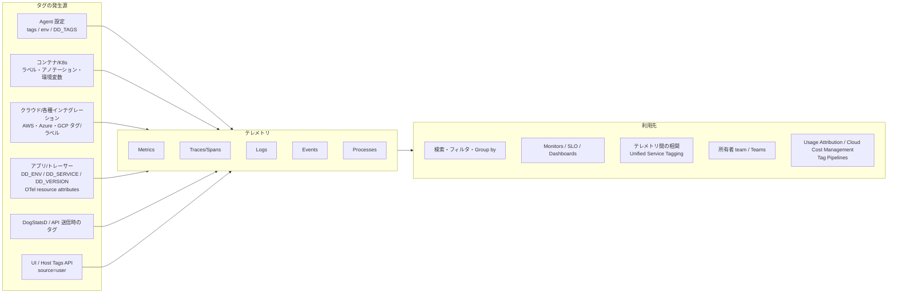
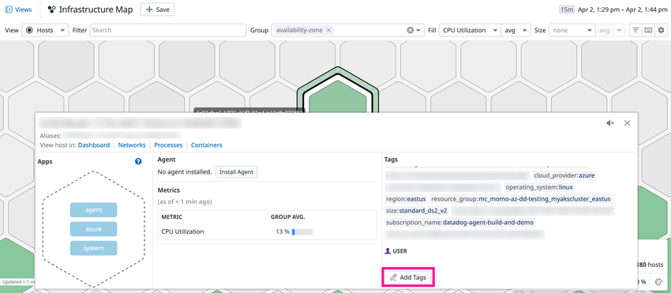
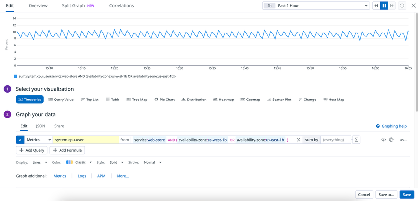
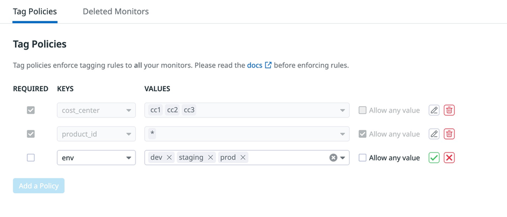
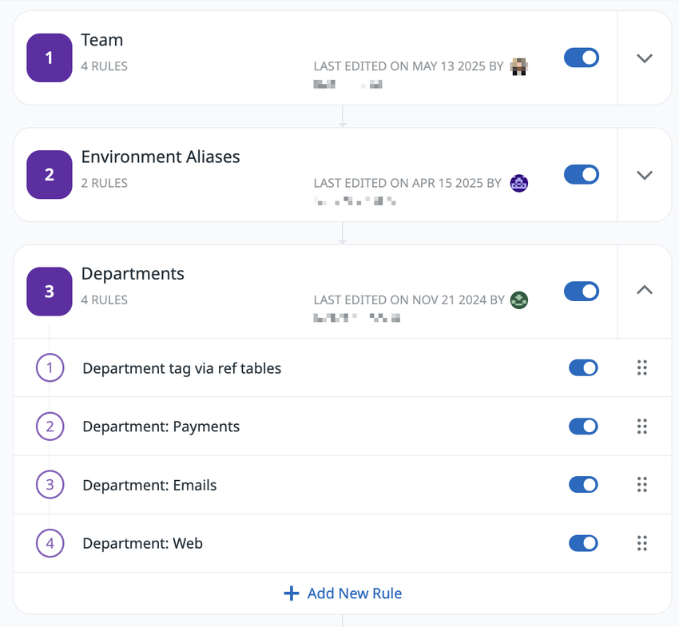
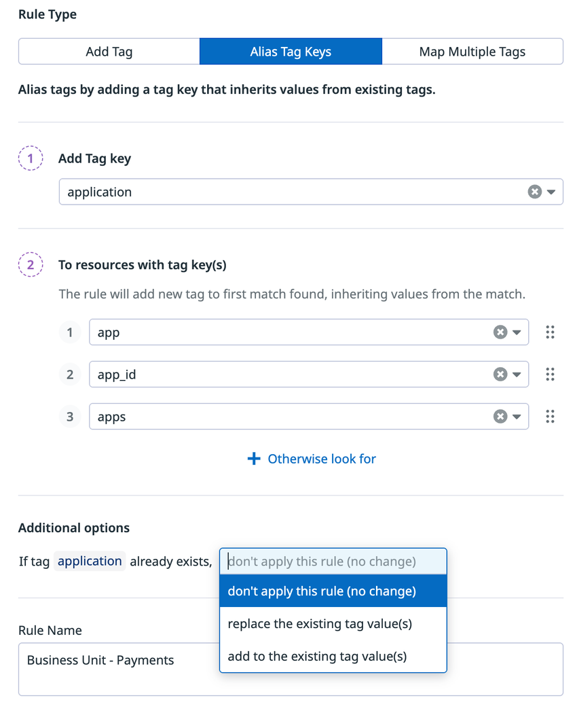

# Tagging（タグ）

## 概要

Datadog の Tag（タグ）は、メトリクス・トレース・ログ・イベント・プロセス・モニターなどあらゆるテレメトリとリソースに付与するメタデータであり、**フィルタ（絞り込み）、グルーピング（集計軸）、テレメトリ間の相関（ピボット）、所有者の明確化、コスト配賦**の基盤になる。Datadog はホストやコンテナが頻繁に入れ替わる環境を前提に、「個々のホスト単位ではなく、タグで束ねた単位（例：`service` 単位）で見る」ことを推奨している [出典](https://docs.datadoghq.com/getting_started/tagging/)。

本ファイルは Datadog のタグの**仕様（リファレンス）**を扱う。

| 本ファイルで扱う範囲 | 扱わない範囲（参照先） |
|---|---|
| タグの構文・文字制約・長さ制約・正規化 | タグ設計の方針・命名規約の実践 → [タグ戦略の実践](../../04_応用編/tagging-strategy.md) |
| 予約タグ（`host` / `device` / `source` / `service` / `env` / `version` / `team`） | Agent 全般の設定 → [Agent 設定リファレンス](agent-configuration.md) |
| 付与方法（Agent 設定ファイル、環境変数、コンテナ／Kubernetes、インテグレーション、UI、API、DogStatsD、トレーサー、サーバーレス） | Kubernetes 向け Agent の導入詳細 → [コンテナ/Kubernetes向けAgent](kubernetes-and-containers-agent.md) |
| Unified Service Tagging（`env` / `service` / `version`） | カスタムメトリクスの課金計算 → [Custom Metrics と DogStatsD](custom-metrics-and-dogstatsd.md) |
| タグ継承と優先順位（precedence）の考え方 | タグを使ったクエリ構文の詳細 → [メトリクスクエリと関数](metrics-query-and-functions.md) |
| Monitor の Tag Policies、Teams と `team` タグ | Cloud Cost Management 全体 → [Cloud Cost Management](../infrastructure/cloud-cost-management.md) |
| Cloud Cost Management の Tag Pipelines | 料金の数値 → [製品別料金表](../../03_導入編/pricing-by-product.md) |

Datadog のタグ全体像を図示すると以下のようになる。



## タグの構文と制約

### 基本形式

Datadog のタグは `<KEY>:<VALUE>` 形式（例：`env:prod`）または値のみの `<VALUE>` 形式（例：`file-server`）で記述する。Datadog は `<KEY>:<VALUE>` 形式を推奨しており、キー単位でのグルーピング（`by {env}` など）が可能になる [出典](https://docs.datadoghq.com/getting_started/tagging/)。

| 項目 | 仕様 |
|---|---|
| 形式 | `<KEY>:<VALUE>`（推奨）または `<VALUE>` |
| キーと値の分割 | **最初のコロン**より前がキー、以降が値。`env:staging:east` はキー `env`、値 `staging:east` |
| 先頭文字 | **英字（Unicode letter）で始める必要がある** |
| 使用可能な文字 | Unicode 英字、数字、アンダースコア `_`、マイナス `-`、コロン `:`、ピリオド `.`、スラッシュ `/` |
| `@` | HTTP 経由で取り込むログに限り使用可 |
| 変換される文字 | 上記以外（カンマ、絵文字、バックスラッシュ、空白など）は `_` に変換される |
| アンダースコアの扱い | 先頭・末尾の `_` は除去され、連続する `_` は 1 つにまとめられる |
| 最大長 | **200 文字**（キー・コロン・値の合計） |
| 大文字小文字 | メトリクスタグとスパンタグは**小文字に正規化**される。スパン属性・ログ属性は大文字小文字を区別し正規化されない |
| 数字始まり | Agent レベルの `env` タグなど一部の文脈では数字始まりを受け付けるが、製品間で一貫して動作する保証はなく、カーディナリティ増加の原因にもなり得る。製品が明示的にサポートしていない限り英字始まりにする |

[出典](https://docs.datadoghq.com/getting_started/tagging/)

#### 正規化の例

| 入力 | 正規化後（メトリクスタグ） | 理由 |
|---|---|---|
| `Env:Prod` | `env:prod` | メトリクスタグは小文字化 |
| `team:SRE Japan` | `team:sre_japan` | 空白は `_` に変換（YAML 設定やアノテーション経由の場合） |
| `__role__:db` | `role:db` | 先頭・末尾の `_` を除去 |
| `TestTag`（AWS タグ） | `testtag` | AWS は CamelCase をそのまま小文字化する |
| `TestTag`（Alibaba Cloud / Web インテグレーション） | `test_tag` | CamelCase を `_` 区切りに変換する |

[出典](https://docs.datadoghq.com/getting_started/tagging/)、[出典](https://docs.datadoghq.com/getting_started/tagging/assigning_tags/)

> **注意:** Datadog はクラウドプロバイダーごとに CamelCase の扱いが異なるため、タグキーに CamelCase を使わないことを推奨している [出典](https://docs.datadoghq.com/getting_started/tagging/)。

### `DD_TAGS` 環境変数での区切りの注意

Datadog Agent の `DD_TAGS` 環境変数は**空白区切り**でタグを解釈し、空白は `_` に変換されない。そのため `DD_TAGS="test:this is a test"` は `test:this`、`is`、`a`、`test` の **4 つのタグ**になる。値に空白を含めたい場合は YAML 設定ファイルまたはインテグレーションのアノテーションで指定する（その場合は `test:this_is_a_test` に変換される）[出典](https://docs.datadoghq.com/getting_started/tagging/assigning_tags/)。

> **注意:** AWS Lambda の Datadog Lambda Extension で使う `DD_TAGS` は、公式例ではカンマ区切り（`DD_TAGS: team:avengers,project:marvel`）で記述されている。Agent の `DD_TAGS`（空白区切り）と区切り文字が異なる点に注意する [出典](https://docs.datadoghq.com/serverless/aws_lambda/configuration/)。

### スパンメタデータの型制約

APM のスパンメタデータは型付きツリー構造に従う必要があり、同じノードを文字列とオブジェクトの両方にすることはできない。例えば `"key": "value"` と `"key.subkey": "value_2"` を同一スパンに同時に付けるのは無効 [出典](https://docs.datadoghq.com/getting_started/tagging/assigning_tags/)。

### 避けるべき値（無制限カーディナリティ）

Datadog は、エポックタイムスタンプ、ユーザー ID、リクエスト ID など**値の種類が無制限に増える情報をタグにしない**よう推奨している。メトリクスでは値の組み合わせごとに時系列が生まれ、カスタムメトリクス数（課金）が増加する [出典](https://docs.datadoghq.com/getting_started/tagging/)。詳細は[課金への影響](#課金への影響)を参照。

## 予約タグ（Reserved Tags）

Datadog は以下の 7 つのタグキーを予約しており、製品横断の相関や機能の自動化に使う。予約タグのキーを独自の意味で使うと、他の発生源の値と混ざって誤動作の原因になる [出典](https://docs.datadoghq.com/getting_started/tagging/)。

| タグキー | 用途（公式説明） | 主な発生源・設定方法 | 補足 |
|---|---|---|---|
| `host` | メトリクス・トレース・プロセス・ログの相関 | Agent が自動付与（Agent の `hostname` 設定で変更可） | DogStatsD で `host` タグを明示すると Agent のホスト名を上書きする（後述） |
| `device` | デバイス／ディスク単位でのメトリクス・トレース・プロセス・ログの分離 | ディスク系チェックなどインテグレーションが付与 | — |
| `source` | スパンのフィルタ、Log Management のパイプライン自動作成 | ログ収集設定の `source`、HTTP ログ取り込みの `ddsource` | `source` 値に応じて Integration Pipeline が自動適用される。詳細は [Log Pipelines と処理](../logs/log-pipelines-and-processing.md) |
| `service` | メトリクス・トレース・ログを横断してアプリケーション固有データをスコープ | `DD_SERVICE`、`tags.datadoghq.com/service` ラベル等 | Unified Service Tagging の構成要素 |
| `env` | 同上 | `DD_ENV`、Agent の `env` 設定、`tags.datadoghq.com/env` ラベル等 | Unified Service Tagging の構成要素 |
| `version` | 同上 | `DD_VERSION`、`tags.datadoghq.com/version` ラベル、自動バージョンタグ付け | Unified Service Tagging の構成要素。デプロイごとに変える |
| `team` | あらゆるリソースへの所有者（オーナーシップ）付与 | 各リソースのタグ、K8s の `team` ラベル自動収集等 | Datadog Teams のハンドルと一致すると Teams 機能と連携（後述） |

[出典](https://docs.datadoghq.com/getting_started/tagging/)

### `host` タグとホスト名

Datadog Agent は `host` タグを自動付与する。値を変更するには Agent 設定の `hostname` を指定する。ホスト名は RFC-1123 に準拠する必要があり、英字・数字・ハイフンのみ使用できる [出典](https://docs.datadoghq.com/getting_started/tagging/assigning_tags/)。

| 事象 | 挙動 |
|---|---|
| ホスト名を変更した場合 | 旧ホスト名は UI に **2 時間**残るが、新しいメトリクスは表示されない |
| 旧ホスト名のデータ | API で引き続きクエリ可能 |
| 新旧ホスト名を 1 本のグラフで見たい場合 | 2 つのメトリクス間の算術（例：`a + b`）で合成する |

[出典](https://docs.datadoghq.com/getting_started/tagging/assigning_tags/)

DogStatsD で送信するメトリクスの `host` タグについて、公式ドキュメントは次のように説明している。「`host` タグはメトリクスを集約する Agent が自動付与する。Agent のホスト名と一致しない `host` タグを付けて送信したメトリクスは、元のホストとの参照を失う。送信した `host` タグは Agent が収集・設定したホスト名を上書きする」 [出典](https://docs.datadoghq.com/metrics/custom_metrics/dogstatsd_metrics_submission/)。

APM では、データベースやキャッシュのスパンにはホスト情報が付与されない（スパンのホストはデータベース／キャッシュのホストではないため）[出典](https://docs.datadoghq.com/getting_started/tagging/unified_service_tagging/)。

### `team` タグと Datadog Teams

Datadog Teams では、Team の**ハンドル（handle）**がリソースとの紐付けキーになり、検索バーやファセットでは `team:<team-handle>` または `teams:<team-handle>` として現れる。リソースがチームに紐付くのは、**同じハンドルを持つ定義済みの Team が存在する場合のみ**であり、一致する Team がないハンドルは通常のタグとして振る舞う [出典](https://docs.datadoghq.com/account_management/teams/)。

| 項目 | 仕様 |
|---|---|
| ハンドルに使える文字 | `a-z`、`0-9`、`._-:/`（末尾に `_` は不可） |
| Team 名に使える文字 | `a-z`、`A-Z`、`0-9`、`._-:/`（空白は `_` に置換） |
| ハンドルの生成 | Team 作成時に Team 名から生成される |
| Team 紐付けをサポートするリソース | Dashboards、Incidents、Monitors、Resource Catalog、Catalog（エンティティモデル）、Service Level Objectives、Synthetic Tests / Global Variables / Private Locations |
| Team フィルタの表示件数 | 「Your teams」「All Teams」「Team tags」の各セクションで最大 50 件（アルファベット順、超過分は検索で到達） |
| Team フィルタの検索 | ハンドルと表示名に対する大文字小文字を区別しない部分一致。ダブルクォートで完全一致 |
| Team フィルタのピン留め | ピン留めした選択は**そのデバイスのブラウザに保存**され、Datadog アカウントには保存されない |
| 通知 | `@team-<handle>` 宛のモニター通知を、Team に設定した Slack / Microsoft Teams 等のチャネルへルーティング可能 |
| 権限 | Team の作成・改名・削除・ハンドル変更は Teams Manage 権限、メンバー管理は `user_access_manage` 権限 |

[出典](https://docs.datadoghq.com/account_management/teams/)

Team フィルタの対象は、多くの一覧画面（Apps、Dashboards、Incidents、Monitors、Notebooks、SLO、Synthetic Tests、Workflows、Catalog など）では**チームハンドル**基準、APM Error Tracking・Logs Error Tracking・On-Call では **Catalog で設定したサービスオーナーシップ**基準で動作する [出典](https://docs.datadoghq.com/account_management/teams/)。サービスの所有者定義は [Software Catalog（旧称：Service Catalog）](software-catalog.md) を、権限体系は [組織・ユーザー・権限管理](account-and-access-management.md) を参照。

Kubernetes 環境では、Datadog Agent の orchestrator チェックが Kubernetes リソースの `team` ラベル／アノテーションから `team` タグを自動収集する（`auto_team_tag_collection`、既定 `true`）。`kubernetes_resources_labels_as_tags` / `kubernetes_resources_annotations_as_tags` で `team` タグを明示的に設定していない場合に、ラベル（優先）またはアノテーションの値が使われる [出典](https://github.com/DataDog/datadog-agent/blob/main/pkg/config/example/datadog-agent_linux.yaml.example)。

## タグの付与方法

Datadog のタグは主に次の経路で付与される [出典](https://docs.datadoghq.com/getting_started/tagging/assigning_tags/)。

| 付与方法 | 対象 | 代表的な設定 | 主な用途 |
|---|---|---|---|
| Agent 設定ファイル | Agent が送る全テレメトリ（ホストタグ） | `datadog.yaml` の `tags` / `env` | 環境・役割などホスト共通の属性 |
| インテグレーション設定ファイル | 当該チェックのメトリクス等 | `conf.d/<check>.d/conf.yaml` の `tags` | チェック単位の属性 |
| 環境変数 | コンテナ化 Agent、アプリ（トレーサー） | `DD_TAGS`、`DD_EXTRA_TAGS`、`DD_ENV` 等 | コンテナ環境での設定 |
| コンテナラベル／K8s ラベル・アノテーション | コンテナ・Pod 単位 | `*_labels_as_tags`、`ad.datadoghq.com/tags` 等 | ワークロード単位の属性 |
| インテグレーションからの継承 | クラウドリソース等 | AWS タグ、Azure タグ、GCP ラベル、Chef 等 | クラウド側の既存タグの活用 |
| UI | ホスト、モニター、SLO、ディストリビューションメトリクス、インテグレーション | Host Map / Infrastructure List の「Add Tags」等 | 手動での補正・付与 |
| API | ホスト、イベント、メトリクス、モニター、SLO 等 | `/api/v1/tags/hosts/{host_name}` 等 | 自動化 |
| DogStatsD | カスタムメトリクス、イベント、サービスチェック | 送信時の `tags` 引数、`dogstatsd_tags` | アプリからの送信 |
| トレーサー（SDK） | スパン | 環境変数・システムプロパティ・コード | APM |

### Agent 設定ファイル（ホストタグ）

Datadog Agent v6 / v7 では `datadog.yaml`（Agent v5 は `datadog.conf`）にホストタグを設定する。ホストタグは、その Agent が送信するすべてのメトリクス・イベント・ログ・トレース・サービスチェックにアプリ上で付与される。インテグレーションのタグは Agent の `conf.d` ディレクトリ内の各 YAML に設定する。YAML のリストはブロック形式・インライン形式のどちらでもよい [出典](https://docs.datadoghq.com/getting_started/tagging/assigning_tags/)、[出典](https://github.com/DataDog/datadog-agent/blob/main/pkg/config/example/datadog-agent_linux.yaml.example)。

```yaml
# datadog.yaml（ホストタグ）
env: prod
tags:
  - team:infra
  - role:database
# インライン形式も可: tags: ["team:infra", "role:database"]

# conf.d/nginx.d/conf.yaml（インテグレーション単位のタグ）
instances:
  - nginx_status_url: http://localhost/nginx_status/
    tags:
      - service:web-frontend
```

#### タグ関連の主要 Agent パラメータ

以下は Datadog Agent（Linux 版の設定例ファイル）に記載されたタグ関連パラメータである。値の型・既定値は公式設定例ファイルの記載に従う [出典](https://github.com/DataDog/datadog-agent/blob/main/pkg/config/example/datadog-agent_linux.yaml.example)。

| パラメータ（`datadog.yaml`） | 環境変数 | 型 | 既定値 | 内容 |
|---|---|---|---|---|
| `tags` | `DD_TAGS` | 文字列リスト（環境変数は空白区切り） | `[]` | ホストタグ。Agent が送る全メトリクス・イベント・ログ・トレース・サービスチェックに付与 |
| `extra_tags` | `DD_EXTRA_TAGS` | 文字列リスト（環境変数は空白区切り） | `[]` | `tags` とマージされるホストタグ。設定ファイルの `tags` に環境変数で追加したい場合に使う |
| `env` | `DD_ENV` | 文字列 | `""` | Agent が動作する環境名。全テレメトリに `env` タグとして付与 |
| `tag_value_split_separator` | `DD_TAG_VALUE_SPLIT_SEPARATOR` | オブジェクト | `{}` | タグ値を区切り文字で分割（例：`foo:1;2;3` → `foo:1`、`foo:2`、`foo:3`）。ホストタグとコンテナインテグレーション由来のタグのみ対象。DogStatsD メトリクスのタグや他インテグレーションのタグには適用されない |
| `checks_tag_cardinality` | `DD_CHECKS_TAG_CARDINALITY` | 文字列 | `"low"` | チェックのメトリクス・イベントに付与するコンテナ系タグの粒度（`low` / `orchestrator` / `high`） |
| `dogstatsd_tag_cardinality` | `DD_DOGSTATSD_TAG_CARDINALITY` | 文字列 | `"low"` | DogStatsD メトリクス・イベントに付与するコンテナ系タグの粒度 |
| `dogstatsd_tags` | `DD_DOGSTATSD_TAGS` | 文字列リスト | `[]` | DogStatsD サーバーが受信した全メトリクス・イベント・サービスチェックに追加するタグ |
| `collect_ec2_tags` | `DD_COLLECT_EC2_TAGS` | 真偽値 | `false` | EC2 のカスタムタグをホストタグとして収集。IMDS でのタグ取得許可（`collect_ec2_tags_use_imds: true`）または `EC2:DescribeTags` 権限を持つ IAM ロールが必要 |
| `exclude_ec2_tags` | `DD_EXCLUDE_EC2_TAGS` | 文字列リスト | `[]` | ホストタグに変換しない EC2 タグ。AWS インテグレーションで収集されるタグには影響しない |
| `collect_ec2_tags_use_imds` | `DD_COLLECT_EC2_TAGS_USE_IMDS` | 真偽値 | `false` | EC2 API ではなく IMDS からタグを取得 |
| `collect_ec2_instance_info` | `DD_COLLECT_EC2_INSTANCE_INFO` | 真偽値 | `false` | `region`、`instance-type`、`aws_account`、`image`、`availability-zone` をホストタグに追加。AWS インテグレーションを有効化できない場合のみ使う |
| `collect_gce_tags` | `DD_COLLECT_GCE_TAGS` | 真偽値 | `true` | Google Compute Engine のメタデータをホストタグとして収集 |
| `exclude_gce_tags` | `DD_EXCLUDE_GCE_TAGS` | 文字列リスト | `kube-env`、`ssh-keys`、`startup-script`、`user-data` など 24 項目 | ホストタグに変換しない GCE メタデータ属性 |
| `gce_send_project_id_tag` | `DD_GCE_SEND_PROJECT_ID_TAG` | 真偽値 | `false` | `project:` に加えて `project_id:` キーでもプロジェクト ID を送信 |
| `collect_gpu_tags` | `DD_COLLECT_GPU_TAGS` | 真偽値 | `true` | GPU 関連のホストタグを収集 |
| `ad_tag_completeness_max_wait` | `DD_AD_TAG_COMPLETENESS_MAX_WAIT` | 整数（秒） | `0` | Autodiscovery がエンティティのタグが揃うまでチェックのスケジュールを待つ最大秒数。`0` は待たない |

> **注意:** `DD_EXTRA_TAGS` と `tags` はマージされる仕様である。一方、Datadog Agent では一般に環境変数が設定ファイルの同名キーを上書きするため、`DD_TAGS` を指定すると `datadog.yaml` の `tags` は使われない点に注意する【経験則】。設定値の優先順位の一般則は [Agent 設定リファレンス](agent-configuration.md) を参照。

### タグカーディナリティ（`low` / `orchestrator` / `high`）

コンテナ環境で Datadog Agent がチェックメトリクス・DogStatsD メトリクスに付与するコンテナ由来タグの粒度は、`DD_CHECKS_TAG_CARDINALITY` と `DD_DOGSTATSD_TAG_CARDINALITY` で制御する [出典](https://docs.datadoghq.com/getting_started/tagging/assigning_tags/)、[出典](https://github.com/DataDog/datadog-agent/blob/main/pkg/config/example/datadog-agent_linux.yaml.example)。

| 値 | 付与されるタグの例 | 説明 |
|---|---|---|
| `low`（既定） | `kube_namespace`、`kube_deployment`、イメージ名などクラスタ・ワークロード単位 | 低カーディナリティのオブジェクト（クラスタ、ホスト、デプロイメント、コンテナイメージ等） |
| `orchestrator` | `pod_name`（Kubernetes）、`task_arn`（ECS / Fargate） | Pod / タスク単位 |
| `high` | `container_id` など個々のコンテナ単位 | 高カーディナリティ |

- コンテナタグを DogStatsD メトリクスに付与すると、ホスト単位ではなく**コンテナ単位でメトリクスが作られ**、カスタムメトリクスの課金に影響し得る [出典](https://docs.datadoghq.com/getting_started/tagging/assigning_tags/)。
- メトリクスのタイムスタンプは最も近い秒に丸められ、同一タイムスタンプのポイントは最後のものが他を上書きする。カーディナリティを上げるとこの上書きを避けられる場合がある [出典](https://docs.datadoghq.com/getting_started/tagging/assigning_tags/)。

### コンテナ・Kubernetes 環境でのタグ抽出

Datadog はコンテナ環境では **Autodiscovery と Unified Service Tagging** による一元的な設定を推奨している。Autodiscovery を使わない場合、Agent は `host` タグを付与しインテグレーションのタグを継承するが、手動で追加するタグは Agent 設定に書く [出典](https://docs.datadoghq.com/getting_started/tagging/assigning_tags/)。

#### ラベル・アノテーション・環境変数をタグにする設定

| 設定（Operator / Helm） | 環境変数 | 対象 | 最低 Agent バージョン・備考 |
|---|---|---|---|
| `nodeLabelsAsTags` | `DD_KUBERNETES_NODE_LABELS_AS_TAGS` | Node ラベル → **ホストタグ** | ワイルドカード `"*"` は 7.24.0 以降。7.58.0 以降は `kubernetesResourcesLabelsAsTags` の利用が推奨されている（公式記載）。共通設定としての正式サポートは 7.64 以降（公式ドキュメント内で 7.58.0 と 7.64 の記載が混在） |
| `podLabelsAsTags` | `DD_KUBERNETES_POD_LABELS_AS_TAGS` | Pod ラベル | ワイルドカードは 7.24.0 以降。7.58.0 以降は `kubernetesResourcesLabelsAsTags` の利用が推奨されている（公式記載）。共通設定としての正式サポートは 7.64 以降（公式ドキュメント内で 7.58.0 と 7.64 の記載が混在） |
| `podAnnotationsAsTags` | `DD_KUBERNETES_POD_ANNOTATIONS_AS_TAGS` | Pod アノテーション | ワイルドカードは 7.24.0 以降。7.58.0 以降は `kubernetesResourcesAnnotationsAsTags` の利用が推奨されている（公式記載）。共通設定としての正式サポートは 7.64 以降（公式ドキュメント内で 7.58.0 と 7.64 の記載が混在） |
| `namespaceLabelsAsTags` | `DD_KUBERNETES_NAMESPACE_LABELS_AS_TAGS` | Namespace ラベル | 7.55.0 以降。KSM チェックを実行する Cluster Agent 側に設定。Namespace 単位の KSM メトリクスへの付与は 7.70 以降 |
| `namespaceAnnotationsAsTags` | `DD_KUBERNETES_NAMESPACE_ANNOTATIONS_AS_TAGS` | Namespace アノテーション | 7.55.0 以降、KSM への付与は 7.70 以降。Cluster Agent 側に設定 |
| — | `DD_CONTAINER_ENV_AS_TAGS` | コンテナの環境変数 | 7.32 以降。Docker / containerd 対応（`DD_DOCKER_ENV_AS_TAGS` の後継） |
| — | `DD_CONTAINER_LABELS_AS_TAGS` | コンテナラベル | 7.33 以降。containerd は 1.5.6 以降が必要（`DD_DOCKER_LABELS_AS_TAGS` の後継） |
| `kubernetesResourcesLabelsAsTags` | `DD_KUBERNETES_RESOURCES_LABELS_AS_TAGS` | 任意の K8s リソースのラベル（`deployments.apps` のように `resourceType.apiGroup` 形式で指定） | 7.64 以降で正式サポート（公式は 7.58.0 以降での利用も推奨）。ワイルドカード `"*"` は 7.73.0 以降。ワークロードのラベルは子 Pod へは伝播しないが、Namespace のタグは Pod へ伝播する。旧設定と競合した場合は本設定が優先 |
| `kubernetesResourcesAnnotationsAsTags` | `DD_KUBERNETES_RESOURCES_ANNOTATIONS_AS_TAGS` | 任意の K8s リソースのアノテーション | 7.64 以降で正式サポート（公式は 7.58.0 以降での利用も推奨）。ワイルドカードは 7.73.0 以降。`podAnnotationsAsTags` と競合した場合は本設定が優先 |

[出典](https://docs.datadoghq.com/containers/kubernetes/tag/)、[出典](https://docs.datadoghq.com/getting_started/tagging/assigning_tags/)

設定例（環境変数）[出典](https://docs.datadoghq.com/getting_started/tagging/assigning_tags/):

```bash
# Pod ラベル app → kube_app、release → helm_release
DD_KUBERNETES_POD_LABELS_AS_TAGS='{"app":"kube_app","release":"helm_release"}'
# Docker Compose のサービス名ラベルを service_name タグに
DD_CONTAINER_LABELS_AS_TAGS='{"com.docker.compose.service":"service_name"}'
# ワイルドカード: app で始まるラベル（例 application）を kube_application に
DD_KUBERNETES_POD_LABELS_AS_TAGS='{"app*":"kube_%%label%%"}'
# 全 Pod ラベルを kube_ プレフィックス付きで付与（カーディナリティに注意）
DD_KUBERNETES_POD_LABELS_AS_TAGS='{"*":"kube_%%label%%"}'
```

- タグ名の先頭に `+` を付けると、そのタグは**高カーディナリティのメトリクスにのみ**付与される（例：`<LABEL_NAME>: +<TAG_KEY>`）[出典](https://github.com/DataDog/datadog-agent/blob/main/pkg/config/example/datadog-agent_linux.yaml.example)。
- Docker Compose（Swarm）の `docker-compose.yaml` で `DD_CONTAINER_LABELS_AS_TAGS` を使う場合はアポストロフィを外す。`labels:` は `deploy:` ではなく `services:` 配下に書かないと Agent がラベルを抽出できない [出典](https://docs.datadoghq.com/getting_started/tagging/assigning_tags/)。

#### Autodiscovery のタグ用アノテーション／ラベル

| 書式 | 対象 | 最低 Agent バージョン |
|---|---|---|
| `ad.datadoghq.com/tags: '{"<KEY>": "<VALUE>", ...}'`（Pod アノテーション、JSON マップ） | Pod 内全コンテナ | v6.10 以降 |
| `ad.datadoghq.com/<CONTAINER_NAME>.tags: '{...}'` | 特定コンテナ | 公開情報では確認できず |
| `com.datadoghq.ad.tags: '["<KEY>:<VALUE>", ...]'`（Docker ラベル、リスト） | コンテナ | v7.17 以降 |
| タグアノテーション内のテンプレート変数（`%%env_<VAR>%%` を除く） | — | v7.77 以降 |

[出典](https://docs.datadoghq.com/containers/kubernetes/tag/)

#### Kubernetes の標準（Out-of-the-box）タグ

Datadog Agent は Kubernetes 環境で以下のタグを自動付与する。カーディナリティは送信メトリクス数、ひいては課金に影響する [出典](https://docs.datadoghq.com/containers/kubernetes/tag/)。

| カーディナリティ | タグ |
|---|---|
| High | `container_id`、`display_container_name` |
| Orchestrator | `pod_name`、`kube_ownerref_name`、`oshift_deployment`、`kube_job`（CronJob 配下の Pod） |
| Low（ワークロード・所有関係） | `kube_namespace`、`kube_container_name`、`kube_deployment`、`kube_replica_set`、`kube_daemon_set`、`kube_stateful_set`、`kube_replication_controller`、`kube_argo_rollout`、`kube_cronjob`、`kube_job`（Job 配下の Pod）、`kube_ownerref_kind`、`kube_service` |
| Low（Pod・イメージ情報） | `pod_phase`、`kube_qos`、`kube_priority_class`、`kube_runtime_class`、`persistentvolumeclaim`、`image_name`、`short_image`、`image_tag`、`image_id`、`gpu_vendor`、`eks_fargate_node`、`kube_autoscaler_kind` |
| Low（アプリケーションラベル） | `kube_app_name`、`kube_app_instance`、`kube_app_version`、`kube_app_component`、`kube_app_part_of`、`kube_app_managed_by`（`app.kubernetes.io/*` ラベル由来） |
| Unified Service Tagging | `env`、`service`、`version`（`tags.datadoghq.com/*` ラベルまたはコンテナ環境変数由来） |
| ホストタグ | `kube_cluster_name`、`kube_node_role`、`kube_node`、`orch_cluster_id`、`kube_distribution` |

その他の関連パラメータ [出典](https://github.com/DataDog/datadog-agent/blob/main/pkg/config/example/datadog-agent_linux.yaml.example):

| パラメータ | 既定値 | 内容 |
|---|---|---|
| `kubernetes_collect_metadata_tags`（`DD_KUBERNETES_COLLECT_METADATA_TAGS`） | `true` | `false` で Agent の Kubernetes メタデータタグ収集を無効化 |
| `kubernetes_metadata_tag_update_freq` | `60`（秒） | Service と ContainerID の内部マッピング更新間隔 |
| `kubernetes_metadata_streaming` | `true` | Cluster Agent からメタデータをストリーミング受信し、タグ反映の遅延を短縮 |
| `kubernetes_node_annotations_as_tags` | `{'cluster.k8s.io/machine': 'kube_machine'}` | Node アノテーションをホストタグに |
| `kubernetes_ad_tags_disabled` | `[]` | 唯一の有効値 `kube_service` を指定すると Ready な Pod に `kube_service` タグを付けない |
| `disable_cluster_name_tag_key` | `false` | `true` で `cluster_name` キーでのクラスタ名送信を停止（`kube_cluster_name` / `ecs_cluster_name` は送信継続） |
| `cluster_name`（`DD_CLUSTER_NAME`） | `""` | 最大 40 文字、小文字・数字・ハイフンのみ、英字始まり、英数字終わり |
| `ecs_collect_resource_tags_ec2` | `false` | EC2 起動タイプの ECS タスクのリソースタグを収集 |
| `ecs_resource_tags_replace_colon` | `false` | ECS リソースタグキー中の `:` を `_` に置換 |

Kubernetes / コンテナ向け Agent の導入方法は [コンテナ/Kubernetes向けAgent](kubernetes-and-containers-agent.md)、監視の実務は [Kubernetes 監視の実践](../../04_応用編/kubernetes-monitoring-practices.md) を参照。

#### 新規ホスト／ノードのログにホストタグが付かない問題

新しく作成されたホストやノードでは、ホストレベルタグの継承に数分かかるため、その間のログにホストタグが付かないことがある。対策として `DD_LOGS_CONFIG_EXPECTED_TAGS_DURATION`（例：`"10m"`）を設定すると、Agent は指定期間、自身が把握しているホストレベルタグを各ログに直接付けて送信し、その後は取り込み時のタグ継承に戻る。既定値と最低 Agent バージョンは公開情報では確認できず [出典](https://docs.datadoghq.com/containers/troubleshooting/log-collection/)。

### インテグレーションからの継承

AWS インスタンスのタグ、Chef レシピなど、インテグレーション側のタグは、そのホストや送信されるメトリクスに継承される [出典](https://docs.datadoghq.com/getting_started/tagging/assigning_tags/)。

| インテグレーション種別 | 仕組み | タグに関する注意 |
|---|---|---|
| クラウドインテグレーション（AWS / Azure / Google Cloud 等） | 認証ベース（API 経由で収集） | Datadog は「クラウドのメインタイル＋可能な限り Agent 導入」を推奨。Agent のみの場合、一部のインテグレーションタグは利用できない |
| Web インテグレーション | 認証ベース、API 呼び出しでメトリクス収集 | CamelCase タグは `_` 区切りに変換（`TestTag` → `test_tag`） |
| Agent ベースのインテグレーション | `conf.d` の設定 | インスタンスごとに `tags` を設定可能 |

[出典](https://docs.datadoghq.com/getting_started/tagging/assigning_tags/)

AWS インテグレーションでは、全メトリクスに `region` タグが付き、サービスごとに標準タグが付く（例：EC2 は `autoscaling_group`、`availability-zone`、`image`、`instance-id`、`instance-type`、`kernel`、`name`、`security_group_name`。RDS は `dbinstanceidentifier`、`engine` など）。AWS のリソースタグの収集には IAM ポリシーに `tag:GetResources` などの権限が必要 [出典](https://docs.datadoghq.com/integrations/amazon_web_services/)。詳細は [AWS Integration](aws-integration.md)、[Azure Integration](azure-integration.md)、[Google Cloud Integration](gcp-integration.md) を参照。

クラウドインテグレーションでは、タグで**収集対象を絞り込む**こともできる [出典](https://docs.datadoghq.com/getting_started/tagging/using_tags/)。

| インテグレーション | 設定項目 | 構文 |
|---|---|---|
| AWS | 「to hosts with tag」「to Lambdas with tag」 | カンマ区切りの `KEY:VALUE`。`!` で除外、`?` と `*` のワイルドカード可。包含条件同士は OR、除外が優先 |
| Azure | 「Optionally filter to VMs with tag」 | 同様（`!` 除外、ワイルドカード）。一致した VM のみ取り込み |
| Google Cloud | 「to hosts with tag」 | GCP ラベルに対し同様の構文 |

AWS インテグレーションでは、アカウント単位でカンマ区切りの `<KEY>:<VALUE>` タグを UI から付与でき、そのアカウントのメトリクスと、自動サブスクリプショントリガー経由で送られるログに適用される [出典](https://docs.datadoghq.com/getting_started/tagging/assigning_tags/)。

### UI での付与

| 画面 | 操作 | 注意点 |
|---|---|---|
| Host Map / Infrastructure List | ホストのオーバーレイ（詳細パネル）を開き **Add Tags** → カンマ区切りでタグ入力 → **Save Tags** | 反映に**最大 5 分**かかる。Infrastructure List では追加前にタグが表示されていることを確認 |
| Monitors | Manage Monitors で対象モニターを選択 → **Edit Tags**。作成時は手順 4「Say what's happening / Notify your Team」でタグ付与 | Tag Policies が有効な場合はポリシーに従う必要がある |
| Distribution Metrics | タグの許可リスト（allowlist）を最大 **10 個**まで指定 | 除外型（exclusionary）タグは不可。タグの組み合わせごとに時系列が作られる |
| Integrations（AWS） | アカウント単位でカンマ区切りの `<KEY>:<VALUE>` を入力 | メトリクスと自動サブスクリプション経由のログに適用 |
| Service Level Objectives | 作成時の手順 3「Add name and tags」 | — |

[出典](https://docs.datadoghq.com/getting_started/tagging/assigning_tags/)



**キャプション:** Infrastructure Map（Host Map）でホスト詳細を開き、タグを追加する画面。

**画面の説明:** 上部に「Infrastructure Map」の表示切り替え（View: Hosts）、Filter、Group（例：`availability-zone`）、Fill（例：CPU Utilization）のコントロールが並ぶ。六角形で表示されたホストをクリックすると詳細パネルが開き、左に Apps（`agent`、`azure`、`system` 等）、中央に Agent の状態とメトリクス（CPU Utilization の Group Avg.）、右の **Tags** 欄にクラウド由来のタグ（`cloud_provider:azure`、`operating_system:linux`、`region:eastus`、`resource_group:...`、`size:standard_ds2_v2`、`subscription_name:...` など）が表示される。Tags 欄の下部に **USER** セクションと **Add Tags** ボタンがあり、ここで手動タグを追加する（手動追加したタグは USER セクションに表示される。Host Tags API でも source 未指定時は `user` が既定となる）。

**出典:** https://docs.datadoghq.com/getting_started/tagging/assigning_tags/ （画像 URL: https://docs.dd-static.net/images/tagging/assigning_tags/host_add_tags.d22ada61c59de69d32754f687677fe7f.png、取得日 2026-11-02）

### API での付与

タグは以下の API で付与できる：Post a check run、Post an event、AWS Integration、Post timeseries points、Create/Edit a monitor、Add/Update host tags、Send traces、Create/Update an SLO [出典](https://docs.datadoghq.com/getting_started/tagging/assigning_tags/)。API キーの扱いとエンドポイントの全体像は [API とキー管理](api-and-keys.md) を参照。

#### Host Tags API（v1）

Datadog の Tags API はホストにタグを割り当てるエンドポイントで、付与したタグはそのホストが送る全メトリクスに適用される。ホストは名前（例：`yourhost.example.com`）で指定する。各タグには、それを付けたインフラ構成要素を示す **source**（例：`nagios`、`hudson`、`jenkins`、`users`、`feed`、`chef`、`puppet`、`git`、`bitbucket`、`fabric`、`capistrano`）が紐付く [出典](https://docs.datadoghq.com/api/latest/tags/)。

| 操作 | メソッド・パス | `source` クエリパラメータ | 挙動 |
|---|---|---|---|
| Get All Host Tags | `GET /api/v1/tags/hosts` | 絞り込み用（任意） | タグ → ホスト名リストのマッピングを返す。**組織内でタグに紐付けて返せるホスト名は合計 10,000 件まで** |
| Get Host Tags | `GET /api/v1/tags/hosts/{host_name}` | 任意 | 指定ホストのタグを返す |
| Add tags to a host | `POST /api/v1/tags/hosts/{host_name}` | 未指定時は `"user"` | 既存タグがあれば**追記**する。ボディは `{"host": "...", "tags": ["..."]}`。成功時 201 |
| Update host tags | `PUT /api/v1/tags/hosts/{host_name}` | 未指定時は `"user"` | 指定 source のタグを**すべて置き換え**る |
| Remove host tags | `DELETE /api/v1/tags/hosts/{host_name}` | 未指定時は source「User」のみ削除 | 単一ホストのタグを削除。成功時 204 |

[出典](https://docs.datadoghq.com/api/latest/tags/)

```bash
# AP1 サイトでホストに user ソースのタグを追加する例
curl -X POST "https://api.ap1.datadoghq.com/api/v1/tags/hosts/web-01" \
  -H "Content-Type: application/json" \
  -H "DD-API-KEY: ${DD_API_KEY}" \
  -H "DD-APPLICATION-KEY: ${DD_APP_KEY}" \
  -d '{"host": "web-01", "tags": ["role:frontend", "team:web"]}'
```

> **サイト差異:** Host Tags API のエンドポイントはサイトごとにホスト名が異なる（例：AP1 は `api.ap1.datadoghq.com`、US1 は `api.datadoghq.com`、EU1 は `api.datadoghq.eu`、US1-FED は `api.ddog-gov.com`）。2026-11-02 時点の API リファレンスでは、規約のサイト一覧にない `api.us2.ddog-gov.com` と `api.uk1.datadoghq.com` も掲載されている [出典](https://docs.datadoghq.com/api/latest/tags/)。サイト一覧は [Datadog Sites](datadog-sites.md) を参照。

#### Events API のタグ

Events API（v2 の Post an event）の `tags` 属性は**最大 100 タグ**。`host` 属性（最大 255 文字）を指定すると、そのホストに付いたタグもイベントに適用される [出典](https://docs.datadoghq.com/api/latest/events/)。

### DogStatsD での付与

DogStatsD では任意のメトリクス・イベント・サービスチェックにタグを付けられる（例：タイマーメトリクスに `tags=['algorithm:one']`）。タグ付けは Datadog 独自の StatsD 拡張である [出典](https://docs.datadoghq.com/getting_started/tagging/assigning_tags/)。

- `DD_ENV` / `DD_SERVICE` / `DD_VERSION` が設定されていれば、DogStatsD クライアントはこれらを自動でタグ付けする。**.NET と PHP の DogStatsD クライアントは非対応** [出典](https://docs.datadoghq.com/getting_started/tagging/unified_service_tagging/)。
- DogStatsD のタグは**追記のみ（append-only）**で、異なる `env` 値が 2 つあれば両方が付き、上書きはされない [出典](https://docs.datadoghq.com/getting_started/tagging/unified_service_tagging/)。
- `host` タグの扱いは前述の [`host` タグとホスト名](#host-タグとホスト名) を参照。

DogStatsD の詳細は [Custom Metrics と DogStatsD](custom-metrics-and-dogstatsd.md) を参照。

### トレーサー（APM SDK）での付与

トレースのタグは、各言語の Datadog トレーシングライブラリの設定方法（環境変数、システムプロパティ、コード）で設定する [出典](https://docs.datadoghq.com/getting_started/tagging/assigning_tags/)。インスツルメンテーションの詳細は [APM インスツルメンテーション](../apm/apm-instrumentation.md) を参照。

### サーバーレス（AWS Lambda）での付与

AWS Lambda では、予約タグ（`env`、`service`、`version`）とカスタムタグで metrics・traces・logs を関連付ける。導入方法ごとの設定は以下のとおり [出典](https://docs.datadoghq.com/serverless/aws_lambda/configuration/)。

| 導入方法 | 設定 |
|---|---|
| Datadog CLI | `datadog-ci lambda instrument --env dev --service web --version v1.2.3 --extra-tags "team:avengers,project:marvel"` |
| Serverless Framework プラグイン | `env`、`service`、`version`、`tags` パラメータ。`env` / `service` を省略するとアプリ定義の `stage` / `service` を自動使用（`enableTags: false` で無効化） |
| Serverless Macro / CDK Construct | `env`、`service`、`version`、`tags` パラメータ |
| 環境変数（Extension） | `DD_ENV`、`DD_SERVICE`、`DD_VERSION`、`DD_TAGS`（カンマ区切り） |
| Datadog Forwarder | Lambda 関数の AWS リソースタグとして設定し、Forwarder の `DdFetchLambdaTags` を `true`（Forwarder 3.19.0 以降は既定で `true`） |

- Lambda 関数の既存 AWS リソースタグで、数分の遅延をもってテレメトリをエンリッチできる。Datadog Lambda Extension 利用時は AWS インテグレーションの有効化が必要で、これは**カスタム**タグ向けの機能。予約タグ（`env`、`service`、`version`）は `DD_ENV` / `DD_SERVICE` / `DD_VERSION` またはサーバーレス開発ツール連携のパラメータで設定する必要がある。**コンテナイメージでデプロイした Lambda 関数では動作しない** [出典](https://docs.datadoghq.com/serverless/aws_lambda/configuration/)。

詳細は [Serverless Monitoring](../infrastructure/serverless.md) を参照。

## Unified Service Tagging（統合サービスタグ付け）

### 概要と要件

Unified Service Tagging（UST）は、3 つの予約タグ **`env`、`service`、`version`** を traces・metrics・logs に一貫して付与し、テレメトリ間の相関を実現する仕組みである。UST により、バージョン別のトレース／コンテナメトリクスの絞り込み、traces・metrics・logs 間の移動、環境別・バージョン別の表示が可能になる。`version` はデプロイごとに変更し、異なるコードバージョンは異なる値にする [出典](https://docs.datadoghq.com/getting_started/tagging/unified_service_tagging/)。

| 要件 | 値 |
|---|---|
| Datadog Agent | 6.19.x / 7.19.x 以上 |
| 自動バージョンタグ付け（APM、コンテナ環境） | Agent 7.52.0 以上 |
| OpenTelemetry の `deployment.environment.name` の解釈 | Agent 7.58.0 以上、Datadog Exporter v0.110.0 以上、または Datadog OTLP intake |

トレーシング SDK の最低バージョン [出典](https://docs.datadoghq.com/getting_started/tagging/unified_service_tagging/):

| 言語 | 最低 SDK バージョン |
|---|---|
| .NET | 1.17.0 |
| C++ | 0.1.0 |
| Go | 1.24.0 |
| Java | 0.50.0 |
| Node.js | 0.20.3 |
| PHP | 0.47.0 |
| Python | 0.38.0 |
| Ruby | 0.34.0 |

コンテナ環境で Autodiscovery のログ設定がない場合、ログの公式な `service` は**コンテナのショートイメージ名**が既定値になる。タグ設定または Docker / Kubernetes Autodiscovery のログ設定で上書きできる [出典](https://docs.datadoghq.com/getting_started/tagging/unified_service_tagging/)。

### コンテナ環境共通の前提

1. Autodiscovery を有効にし、Agent がサービスの環境変数やラベルを `env` / `service` / `version` タグにマッピングできるようにする。
2. Docker の場合、Agent に Docker ソケットへのアクセスを許可する。
3. オーケストレーター別に完全構成（full）または部分構成（partial）を行う。

[出典](https://docs.datadoghq.com/getting_started/tagging/unified_service_tagging/)

### Kubernetes

#### 完全構成

Kubernetes では、親ワークロード（Deployment 等）と Pod テンプレートの**両方**に以下のラベルを付ける。APM を使うアプリには `DD_ENV`、`DD_SERVICE`、`DD_VERSION` 環境変数も設定する（手動または Downward API の `fieldRef` で `metadata.labels['tags.datadoghq.com/...']` を参照）[出典](https://docs.datadoghq.com/getting_started/tagging/unified_service_tagging/)。

```yaml
apiVersion: apps/v1
kind: Deployment
metadata:
  labels:
    tags.datadoghq.com/env: "prod"
    tags.datadoghq.com/service: "checkout"
    tags.datadoghq.com/version: "1.4.2"
spec:
  template:
    metadata:
      labels:
        tags.datadoghq.com/env: "prod"
        tags.datadoghq.com/service: "checkout"
        tags.datadoghq.com/version: "1.4.2"
    spec:
      containers:
        - name: app
          env:
            - name: DD_ENV
              valueFrom:
                fieldRef:
                  fieldPath: metadata.labels['tags.datadoghq.com/env']
            - name: DD_SERVICE
              valueFrom:
                fieldRef:
                  fieldPath: metadata.labels['tags.datadoghq.com/service']
            - name: DD_VERSION
              valueFrom:
                fieldRef:
                  fieldPath: metadata.labels['tags.datadoghq.com/version']
```

| 項目 | 仕様 |
|---|---|
| Admission Controller | Cluster Agent の Admission Controller が Pod を変更（mutate）する構成では、ラベルに合わせて `DD_ENV` / `DD_SERVICE` / `DD_VERSION` を自動注入する |
| OpenTelemetry での代替 | `OTEL_RESOURCE_ATTRIBUTES=service.name=<SERVICE>,service.version=<VERSION>,deployment.environment.name=<ENV>`、任意で `OTEL_SERVICE_NAME`。`OTEL_SERVICE_NAME` は `OTEL_RESOURCE_ATTRIBUTES` 内の `service.name` より優先 |
| ラベルの適用範囲 | Kubernetes の CPU・メモリ・ネットワーク・ディスクメトリクス、コンテナ全般のタグ付け、ログ収集。Cluster Agent とその Kubernetes State Metrics でも使用 |

[出典](https://docs.datadoghq.com/getting_started/tagging/unified_service_tagging/)

#### 部分構成

| パターン | 設定 | 注意 |
|---|---|---|
| クラスタ全体が単一環境 | Datadog Operator：`spec.global.tags` に `"env:<ENV>"`／Helm：`datadog.tags` に `"env:<ENV>"` | ホストレベルタグになり、Kubernetes State Metrics にも付き、APM スパンの既定 `env` になる。Pod 側で異なる `env` を付けると**両方の値**が付く |
| Pod レベルのメトリクスのみ | Pod spec に `tags.datadoghq.com/*` ラベル（任意で親ワークロードにも） | `DD_*` 環境変数は APM の場合のみ必要 |
| 1 Pod に複数コンテナ | `tags.datadoghq.com/<CONTAINER_NAME>.env` / `.service` / `.version` | コンテナごとに UST を設定 |
| SDK / StatsD クライアント | Downward API でラベルから `DD_ENV` / `DD_SERVICE` / `DD_VERSION` を設定 | — |

[出典](https://docs.datadoghq.com/getting_started/tagging/unified_service_tagging/)

### Docker

| 構成 | 設定 |
|---|---|
| 完全構成 | 環境変数 `DD_ENV` / `DD_SERVICE` / `DD_VERSION` と、ラベル `com.datadoghq.tags.env` / `com.datadoghq.tags.service` / `com.datadoghq.tags.version`。`service` と `version` は Dockerfile の `ENV` / `LABEL` で、`env` はデプロイ時（`docker run -e DD_ENV=<ENV> -l com.datadoghq.tags.env=<ENV> ...`）に設定するのが一般的 |
| 部分構成 | `DD_*` 変数が不要なソフトウェア（Redis、PostgreSQL、NGINX、トレースしないアプリ等）はラベル 3 つのみ |

[出典](https://docs.datadoghq.com/getting_started/tagging/unified_service_tagging/)

### Amazon ECS

| 構成 | 設定 |
|---|---|
| 完全構成 | タスク定義で環境変数 `DD_ENV` / `DD_SERVICE` / `DD_VERSION` と、`dockerLabels` に `com.datadoghq.tags.*` を設定。自動バージョンタグ付けが効く場合 `DD_VERSION` は任意 |
| 部分構成 | `dockerLabels` のみ |
| Fargate | タグは Datadog Agent コンテナではなく**アプリケーションコンテナ**に付ける |

> **制限:** ECS Fargate で Fluent Bit / FireLens を使う場合、UST が有効なのは metrics と traces のみで、**ログ収集には効かない** [出典](https://docs.datadoghq.com/getting_started/tagging/unified_service_tagging/)。

### 自動バージョンタグ付け（APM、コンテナ環境）

Datadog Agent 7.52.0 以降、コンテナ環境の APM では `version` を手動設定していない場合に自動で付与する。優先順位は次のとおり [出典](https://docs.datadoghq.com/getting_started/tagging/unified_service_tagging/)。

| 優先度 | `version` の値 |
|---|---|
| 1 | 手動設定した `version`（設定されていれば Datadog は上書きしない） |
| 2 | `{image_tag}_{Git コミット SHA の先頭 7 桁}` |
| 3 | `{image_tag}` または 7 桁 SHA のうち取得できる方 |

非コンテナ環境や Git SHA を含めたい場合は、ビルド成果物に Git 情報を埋め込む [出典](https://docs.datadoghq.com/getting_started/tagging/unified_service_tagging/)。

### 非コンテナ環境

Datadog は、1 ホストで複数サービスが動くことを考慮し、`DD_ENV` / `DD_SERVICE` / `DD_VERSION` を**プロセス単位**で設定することを推奨している（起動コマンドで export する、Chef / Ansible 等で systemd / initd の設定に書き込む）[出典](https://docs.datadoghq.com/getting_started/tagging/unified_service_tagging/)。

| テレメトリ | 設定と挙動 |
|---|---|
| Traces | SDK に `DD_ENV` を設定すると `env` はスパンメタデータから取得される。`DD_VERSION` は SDK のサービスのスパンにのみ付き、外部サービスのスパンには付かない。`version` はトレースメトリクスにも反映。1 スパンにつき 1 サービス。ホストに別の `service` ホストタグがあると、そのホストの全トレースメトリクスにも現れる |
| Logs | SDK の自動ログインジェクションを有効にすると、SDK がログに `env` / `service` / `version` を付与 |
| RUM & Session Replay | ブラウザアプリの初期化ファイルで `service` / `env` / `version` を設定。RUM アプリケーション作成時に `env` と `service` 名を確認 |
| Synthetics | ブラウザテストとトレースを接続するには、Integration Settings ページの「APM Integration for Browser Tests」に URL を追加（`https://*.datadoghq.com` のようなワイルドカード可） |
| カスタム StatsD メトリクス | DogStatsD クライアントが `DD_*` 変数から自動付与（.NET / PHP クライアントは非対応）。タグは追記のみ |
| システムメトリクス | Agent レベルで `env` と `service` を付与（下表） |

[出典](https://docs.datadoghq.com/getting_started/tagging/unified_service_tagging/)

システムメトリクスへの UST 付与 [出典](https://docs.datadoghq.com/getting_started/tagging/unified_service_tagging/):

| ホスト上のサービス数 | 設定 |
|---|---|
| 1 サービス | `datadog.yaml` に `env: <ENV>` と `tags: - service:<SERVICE>` |
| 複数サービス | `datadog.yaml` には `env: <ENV>` のみ。プロセスごとの CPU・メモリ・ディスク I/O に `service` を付けるには、プロセスチェック（`process.d/conf.yaml`）のインスタンスごとに `service` を設定 |

- システムメトリクスには `version` を付けない（呼び出しごとに変わるものではないため）。
- 複数サービスのホストで `service` を `datadog.yaml` にグローバル設定すると、プロセスメトリクスに `service` が 2 つ付く。`service` はプロセスチェック側だけに設定する。

### OpenTelemetry との対応

OpenTelemetry のリソース属性は以下のように Datadog の UST タグにマッピングされる [出典](https://docs.datadoghq.com/getting_started/tagging/unified_service_tagging/)。

| OpenTelemetry 属性 | Datadog タグ | 備考 |
|---|---|---|
| `deployment.environment.name` | `env` | セマンティック規約 v1.27.0 で導入。Agent 7.58.0+ / Datadog Exporter v0.110.0+ / Datadog OTLP intake が必要 |
| `deployment.environment`（非推奨） | `env` | v1.27.0 で `deployment.environment.name` に置き換え |
| `service.name` | `service` | — |
| `service.version` | `version` | — |

- OpenTelemetry 構成では、Datadog 固有の変数（`DD_SERVICE`、`DD_ENV`、`DD_VERSION`）はそのままではサポートされない。
- 設定方法：環境変数 `OTEL_RESOURCE_ATTRIBUTES`、SDK で `Resource` を作成して `TracerProvider` に設定、Collector の transform processor（`context: resource` の `set(attributes[...], ...)`）。

詳細は [OpenTelemetry サポート](opentelemetry.md) を参照。

## タグ継承と優先順位

### タグ継承（Tag Inheritance）

Datadog では、メトリクス・ログ・トレース・インテグレーションのデータが、関連付けられたホストの**ホストレベルタグを継承**する。ホストレベルタグはクラウドプロバイダーまたは Datadog Agent に由来する [出典](https://docs.datadoghq.com/getting_started/tagging/)。

| 継承の例 | 説明 |
|---|---|
| Agent のホストタグ → 全テレメトリ | `datadog.yaml` の `tags` / `env` は、その Agent が送る全メトリクス・イベント・ログ・トレース・サービスチェックに付与 |
| クラウドタグ → ホスト・メトリクス | AWS / Azure / GCP のタグ・ラベルがホストとメトリクスに継承される |
| Namespace タグ → Pod | `kubernetesResourcesLabelsAsTags` で付けた Namespace のタグは Pod に伝播する（ワークロードのラベルは子 Pod に伝播しない） |
| ホスト → イベント | Events API で `host` を指定すると、そのホストのタグがイベントに付く |
| ホスト（Lambda）→ テレメトリ | Lambda の AWS リソースタグが数分の遅延で付与される |

[出典](https://docs.datadoghq.com/getting_started/tagging/)、[出典](https://docs.datadoghq.com/containers/kubernetes/tag/)、[出典](https://docs.datadoghq.com/api/latest/events/)、[出典](https://docs.datadoghq.com/serverless/aws_lambda/configuration/)

### タグの優先順位（Precedence）は強制されない

Datadog Agent はタグの優先順位を**強制しない**。Agent はすべての発生源からタグを収集し、キーごとに一意な値をすべて保持して送信する。例えば `service` を環境変数で `payments`、Agent YAML で `checkout`、トレーシングクライアントで `orders` と設定すると、同じテレメトリに `service:payments`、`service:checkout`、`service:orders` の 3 つが付き得る。目的の値で明示的にフィルタすること [出典](https://docs.datadoghq.com/getting_started/tagging/)。

この「上書きではなく追記」という性質は以下の箇所でも現れる。

| 場面 | 挙動 |
|---|---|
| Kubernetes でクラスタ全体の `env` と Pod の `env` が異なる | 両方の値が付く [出典](https://docs.datadoghq.com/getting_started/tagging/unified_service_tagging/) |
| DogStatsD で異なる `env` が 2 つ | 両方が付く（append-only）[出典](https://docs.datadoghq.com/getting_started/tagging/unified_service_tagging/) |
| 複数サービスホストで `service` をグローバル設定 | プロセスメトリクスに `service` が 2 つ付く [出典](https://docs.datadoghq.com/getting_started/tagging/unified_service_tagging/) |

Datadog は重複キーを避けるため、汎用名ではなく具体的なキー名（例：`service` ではなく `infra_service`）を使うことを推奨している [出典](https://docs.datadoghq.com/getting_started/tagging/)。

> **補足:** Cloud Cost Management のコストデータには独自のタグ優先順位があり、より具体的な発生源が上書きする（後述の [Cloud Cost Management のタグ発生源と優先順位](#cloud-cost-management-のタグ発生源と優先順位)）。これは Agent のテレメトリにおける「優先順位を強制しない」仕様とは別物である。

## タグの利用箇所

Datadog のタグは、Events、Dashboards、Infrastructure、Monitors、Metrics、Integrations、APM、RUM & Session Replay、Synthetic Monitoring & Continuous Testing、Notebooks、Logs、SLO、Developers（API）、Billing（Usage Attribution、最大 3 タグキー）、CI Visibility で絞り込み・グルーピングに使われる [出典](https://docs.datadoghq.com/getting_started/tagging/)。

| 製品・画面 | タグの使い方 |
|---|---|
| 共通ロジック | 複数タグの**包含は AND**、**除外は OR** で評価される |
| Events Explorer | `tags:(service:coffee-house)` のように `tags:` で検索。OR / AND で組み合わせ |
| Dashboards | 「from」で絞り込み、「avg by」等でグルーピング。ブール演算 `NOT`/`!`、`AND`/`,`、`OR`、`IN`、`NOT IN`。イベントオーバーレイ、テンプレート変数（`$service` 等） |
| Infrastructure | Host Map、Infrastructure List、Containers、Processes に「Filter by」「Group by」 |
| Monitors | 一覧検索は `tag:"<KEY>:<VALUE>"`、除外は `-tag:`。キーの任意値は `tag:service\:*`（クォート内ではワイルドカード不可）。**モニターのタグはメトリクスのタグとは別物**。モニター作成時は「from」「excluding」「avg by」でメトリクスタグを使い、「avg by」でマルチアラートになる |
| Metrics Explorer | タグで絞り込み、タグキーごとに別グラフ表示 |
| APM | Trace Explorer で `<KEY>:<VALUE>` 検索。Service Map から service タグで絞った各画面へ遷移 |
| Notebooks | 「from」「avg by」、編集モードで `!<KEY>:<VALUE>` 除外 |
| Logs | Search、Analytics、Patterns、Live Tail で `<KEY>:<VALUE>`。Pipeline の対象ログの判定にもタグを使用 |
| RUM & Session Replay | RUM Explorer で `<KEY>:<VALUE>` |
| Synthetics | Synthetic Tests 一覧は `tag:<KEY>:<VALUE>`。Explorer では `@ci.provider.name:github` のような `@` 属性 |
| SLO | 一覧は `<KEY>:<VALUE>`、`-` で除外。**SLO のタグはメトリクス・モニターのタグとは別物**。メトリクスベース SLO は「from」「sum by」、モニターベース SLO は「Calculate on selected groups」で**最大 20 個**のタグ値を選択 |
| CI Visibility | Test Runs / Pipeline Executions で `<KEY>:<VALUE>` または `@test.status:failed` 等 |
| DORA Metrics | 「+ Filter」で既存タグのファセットを追加 |
| Developers（API） | Downtimes、Events、Hosts、AWS / Google Cloud インテグレーション、メトリクス時系列クエリ、Monitors、Dashboards、SLO の API でタグを使用 |

[出典](https://docs.datadoghq.com/getting_started/tagging/using_tags/)



**キャプション:** Dashboard のグラフエディタで、ブール演算子を使ってタグを絞り込む例。

**画面の説明:** 上部に「Edit / Overview / Split Graph / Correlations」タブとタイムセレクタ（Past 1 Hour）、その下に時系列グラフ（凡例：`sum:system.cpu.user{service:web-store AND (availability-zone:us-west-1b OR availability-zone:us-east-1b)}`）。「1 Select your visualization」で Timeseries 等の可視化を選び、「2 Graph your data」の行で、メトリクス `system.cpu.user` の右の **from** 欄に `service:web-store AND ( availability-zone:us-west-1b OR availability-zone:us-east-1b )` と入力し、**sum by** 欄（未指定時は everything）でグルーピングを指定する。

**出典:** https://docs.datadoghq.com/getting_started/tagging/using_tags/ （画像 URL: https://docs.dd-static.net/images/tagging/using_tags/dashboard_advanced_tags_AND_OR.b6ba78085ea3488ef833fb0ea76bba45.png、取得日 2026-11-02）

クエリ構文の詳細は [メトリクスクエリと関数](metrics-query-and-functions.md)、ダッシュボードのテンプレート変数は [Dashboards](dashboards.md)、ログ検索構文は [ログ検索と分析](../logs/log-search-and-analytics.md) を参照。

## Monitor の Tag Policies（タグポリシー）

Monitor の Tag Policies は、Datadog の全モニターに対してタグとタグ値のデータ検証を行い、アラートが正しい下流システム・ワークフローに届くようにする機能である。Monitors の Settings ページの **Tag Policies** タブで設定し、各ポリシーは緑のチェックマークで保存する [出典](https://docs.datadoghq.com/monitors/settings/)。

| ポリシー種別 | 意味 | 公式例 |
|---|---|---|
| Require tags with mandatory values | タグ必須かつ値は指定リストから | `cost_center` が必須、値は `cc1` / `cc2` / `cc3` |
| Require tags only | タグ必須、値は任意 | `product_id` が必須 |
| Optional tags with mandatory values | タグは任意だが、付ける場合は値を指定リストから | `env` は任意、値は `dev` / `staging` / `prod` |

| 項目 | 仕様 |
|---|---|
| 適用範囲 | 設定後は**全モニター**に適用 |
| 新規モニター | ポリシーに準拠しないと作成できない |
| 既存の違反モニター | アラート・通知は継続するが、他の設定を変更する前にポリシーに合わせて更新する必要がある |
| 必要な権限 | `MONITOR_CONFIG_POLICY_WRITE_PERMISSION` を含むロール |
| ポリシー数・値の上限 | 公開情報では確認できず |

[出典](https://docs.datadoghq.com/monitors/settings/)



**キャプション:** Monitors の Settings ページにある Tag Policies タブ。

**画面の説明:** 上部に「Tag Policies」「Deleted Monitors」タブ。本文に「Tag policies enforce tagging rules to all your monitors.」と表示され、表は REQUIRED（チェックボックス）、KEYS、VALUES、「Allow any value」チェックボックス、編集・削除ボタンの列で構成される。例として 1 行目は REQUIRED にチェック、キー `cost_center`、値 `cc1` `cc2` `cc3`。2 行目は REQUIRED にチェック、キー `product_id`、値 `*`（Allow any value にチェック）。3 行目は REQUIRED 未チェック、キー `env`、値 `dev` `staging` `prod` を編集中で、緑のチェック（保存）と赤の × ボタンが表示される。左下に「Add a Policy」ボタン。

**出典:** https://docs.datadoghq.com/monitors/settings/ （画像 URL: https://docs.dd-static.net/images/monitors/settings/tag_policies.4f771cd5bb719d4ef2340c4b5e450a9d.png、取得日 2026-11-02）

モニター全般は [Monitors](monitors.md)、通知ルーティングは [通知と Downtime](notifications-and-downtimes.md) を参照。

## Tag Pipelines（Cloud Cost Management）

### 概要

Tag Pipelines は Datadog Cloud Cost Management（CCM）の機能で、クラウド請求データ上の**欠落・誤ったタグを補正するルール**や、ビジネスロジックに基づく**推論タグ（inferred tags）**を作成する。ルールは全プロバイダーの Cloud Cost メトリクスに適用され、コストデータ、コスト推奨（recommendations）、ダッシュボード、モニター、配賦レポートに影響する。標準化されたタグはコンテナコスト配賦、Custom Allocation Rules、コスト推奨の基盤になる [出典](https://docs.datadoghq.com/cloud_cost_management/tags/tag_pipelines/)。

> **注意:** Tag Pipelines は Cloud Cost Management のコストデータ専用であり、Agent が送るメトリクス・ログ・トレースのタグを書き換える機能ではない。ログの属性・タグ加工は [Log Pipelines と処理](../logs/log-pipelines-and-processing.md)、パイプライン上でのタグ加工は [Observability Pipelines](../logs/observability-pipelines.md) を参照。公式ドキュメントの URL は `/cloud_cost_management/tag_pipelines/` → `/cloud_cost_management/allocation/tag_pipelines/` → `/cloud_cost_management/tags/tag_pipelines/` と移動しており、旧 URL も検索結果に残っている。

### 管理方法と構造

| 項目 | 仕様 |
|---|---|
| UI の場所 | **Cloud Cost > Settings > Tag Pipelines** |
| API | Cloud Cost Management API の「Create tag pipeline ruleset」等 |
| Terraform | `datadog_tag_pipeline_ruleset` リソース |
| Ruleset | ルールをまとめるフォルダ。**+ New Ruleset** で作成し、**+ Add New Rule** でルールを追加 |
| ルール数上限 | **最大 100 ルール** |
| Ruleset 数上限 | 公開情報では確認できず |
| 実行順序 | 上から下へ**順次・決定論的**に実行。ビジネスロジックに合わせて並べる |
| 既定の正規化ルール | 新規ユーザーには推奨のタグ正規化ルールが既定で有効 |
| 必要な権限 | 公開情報では確認できず |

[出典](https://docs.datadoghq.com/cloud_cost_management/tags/tag_pipelines/)



**キャプション:** Cloud Cost Management の Tag Pipelines で Ruleset とルールを管理する画面。

**画面の説明:** 番号付きのカードが縦に並び、各カードが 1 つの Ruleset を表す（例：「1 Team（4 RULES）」「2 Environment Aliases（2 RULES）」「3 Departments（4 RULES）」）。各カードには最終編集日と編集者、有効／無効のトグル、展開ボタンがある。展開した「Departments」には実行順に番号付きのルール（「Department tag via ref tables」「Department: Payments」「Department: Emails」「Department: Web」）が並び、各ルールに有効化トグルと並べ替え用のドラッグハンドルがある。最下部に **+ Add New Rule** ボタン。Ruleset・ルールの並び順がそのまま実行順になる。

**出典:** https://docs.datadoghq.com/cloud_cost_management/tags/tag_pipelines/ （画像 URL: https://docs.dd-static.net/images/cloud_cost/pipelines-create-ruleset-1.defa35f31ca8f8712164a26fc497cb20.png、取得日 2026-11-02）

### ルールの種類

| ルール種別 | 内容 | 例 | 上限・評価 | 大文字小文字を区別しない照合 |
|---|---|---|---|---|
| Add tag | 既存タグの有無に基づき新しいキー・値を追加 | 所属サービスに基づき事業部タグを付与 | — | 「To resources with tag(s)」とコストデータのタグに適用可（`foo:bar` が `Foo:bar` に一致） |
| Alias tag keys | 表記ゆれのあるキーを標準キーへマッピング（値を継承） | `app`、`webapp`、`apps` → `application` | 1 ルールあたり**最大 25 キー**。リソースごとに**最初に一致した時点で停止** | エイリアス対象キーとコストデータのタグに適用可 |
| Map multiple tags | Reference Tables を使い複数タグを一括付与。テーブルの主キー列の値をコストタグと照合し、選択列をタグとして追加 | AWS / Azure アカウントに VP・組織・事業部情報を付与 | リソースごとに**最初に一致した時点で停止** | 主キー値と照合対象のコストタグに適用可 |

[出典](https://docs.datadoghq.com/cloud_cost_management/tags/tag_pipelines/)

Add tag / Alias tag keys の「対象タグが既に存在する場合」のオプション [出典](https://docs.datadoghq.com/cloud_cost_management/tags/tag_pipelines/):

| オプション（画面表記） | 挙動 |
|---|---|
| Don't apply the rule（don't apply this rule (no change)） | ルールをスキップし元の値を維持 |
| Append the tag（add to the existing tag value(s)） | 元の値を残したまま新しい値を追加 |
| Replace the tag（replace the existing tag value(s)） | 既存値を上書き。データを上書きするため注意 |

Map multiple tags では対象が列（column）になり、「Action when column exists」で **Don't apply the rule / Append the column / Replace the column** から選ぶ（挙動は上表と同様）。



**キャプション:** Tag Pipelines で Alias Tag Keys ルールを作成する画面。

**画面の説明:** 上部の「Rule Type」で **Add Tag / Alias Tag Keys / Map Multiple Tags** の 3 種から選択（ここでは Alias Tag Keys を選択中、説明文「Alias tags by adding a tag key that inherits values from existing tags.」）。手順 1「Add Tag key」で新しいキー `application` を指定。手順 2「To resources with tag key(s)」で照合するキーを順番付きで並べる（1 `app`、2 `app_id`、3 `apps`、「+ Otherwise look for」で追加）。説明文「The rule will add new tag to first match found, inheriting values from the match.」のとおり、最初に一致したキーの値を継承する。「Additional options」で「If tag `application` already exists,」に対し「don't apply this rule (no change)」「replace the existing tag value(s)」「add to the existing tag value(s)」をドロップダウンで選ぶ。最下部に「Rule Name」（例：Business Unit - Payments）。

**出典:** https://docs.datadoghq.com/cloud_cost_management/tags/tag_pipelines/ （画像 URL: https://docs.dd-static.net/images/cloud_cost/pipelines-alias-tag-4.aa75b77f019d981e46849cb99b9054f9.png、取得日 2026-11-02）

### Reference Tables 連携（Map multiple tags）の注意

- API ベースの Reference Tables にも対応する。古いテーブルは CCM と同期させるためにデータ更新が必要な場合がある。
- テーブル未同期でルール保存に失敗した場合は数分待って再保存する。解消しない場合はデータファイルの再アップロードか行の更新で同期をトリガーする。

[出典](https://docs.datadoghq.com/cloud_cost_management/tags/tag_pipelines/)。Reference Tables 自体は [Notebooks・DDSQL・Reference Tables](notebooks-and-data-tools.md) を参照。

### 予約タグとの関係・遡及適用・削除

| 項目 | 仕様 |
|---|---|
| 予約タグ | `env`、`host` などは予約タグで UST の一部。**`host` タグは Tag Pipelines で追加できない** |
| 遡及適用（バックフィル） | パイプライン変更は**直近 3 か月**のデータに自動適用。履歴データの更新完了まで**最大 24 時間** |
| 3 か月より前のデータ | Datadog サポートへの依頼が必要 |
| タグの削除 | タグを作ったルールを削除すると、24 時間以内に直近 3 か月のデータから削除。それ以前はサポートに依頼 |

[出典](https://docs.datadoghq.com/cloud_cost_management/tags/tag_pipelines/)

### Cloud Cost Management のタグ発生源と優先順位

Cloud Cost Management のコストデータのタグは、請求データの列（AWS CUR、Google Billing Export 等）、Datadog によるエンリッチ（ホスト Agent のタグ、Software Catalog（公式表記は Service Catalog）のタグ、インテグレーションタイルのタグ等）、Kubernetes のエンリッチ（Node・Pod・PV・PVC のユーザー定義タグ）、CCM 自身のタグ（Cloud Cost Aliases、配賦タグ、FOCUS タグ）、ユーザー定義（Tag Pipelines、Custom Allocation Rules）から構成される。Custom Allocation Rules は SaaS コストには適用されない [出典](https://docs.datadoghq.com/cloud_cost_management/tags/)。

同じキーが複数の発生源から来た場合、より具体的な発生源が優先される（高い順）[出典](https://docs.datadoghq.com/cloud_cost_management/tags/):

| 順位 | 発生源 |
|---|---|
| 1 | Custom Allocation Rules |
| 2 | FOCUS |
| 3 | Software Catalog（CCM タグページの表記は旧称の Service Catalog） |
| 4 | Amazon ECS Container |
| 5 | Amazon ECS Task |
| 6 | Kubernetes Pod |
| 7 | Kubernetes Persistent Volume |
| 8 | Kubernetes Node |
| 9 | Host Agent |

- AWS Organization タグやインテグレーションタイルのタグなど、その他の発生源は上記のいずれにも上書きされ得る。
- **請求データの列と FOCUS の列は予約されており、どの発生源からも上書きできない。**
- 同ページは「Tag Pipelines は新しいタグを追加するが既存タグを上書きしない」と記載している。一方、Tag Pipelines のページには既存タグに対する「Replace the tag」オプションがある。両記述の関係（Replace が適用される範囲）は公開情報では明確に説明されておらず、確認できず。

[出典](https://docs.datadoghq.com/cloud_cost_management/tags/)、[出典](https://docs.datadoghq.com/cloud_cost_management/tags/tag_pipelines/)

#### CCM のタグ正規化

| 項目 | CCM コストデータ | 備考 |
|---|---|---|
| キーの正規化 | 先頭の非英字を除去、小文字化、特殊文字・空白を単一の `_` に、末尾 `_` 除去と連続 `_` の集約 | — |
| 値の正規化 | 連続空白を 1 つに、英字・記号・数字・句読点等は保持、その他は `_`。人が読める形を維持（例：`Machine Learning ASIC Instances`） | 大文字小文字は保持 |
| キー・値の最大長 | 各 **5,000 文字** | 通常のタグ（200 文字）より長い |
| Cloud Cost Recommendations | 通常の Datadog メトリクス正規化（小文字化、最大 200 文字） | 例：コストデータ上 `team:Engineering-Services`、推奨上 `team:engineering-services` |
| Tag Normalization トグル（Tag Pipelines ページ） | 有効にするとユーザー定義のコストタグの**値**に Datadog の正規化を適用（キーは変更しない、`team:123` のような数値は保持）。Tag Pipelines が作ったタグは正規化しない。Azure は `consumedservice` も小文字化 | 新規ユーザーは既定で有効、直近 3 か月を自動バックフィル。最大 15 か月のバックフィルはサポートに依頼 |

[出典](https://docs.datadoghq.com/cloud_cost_management/tags/)

CCM の全体像・料金は [Cloud Cost Management](../infrastructure/cloud-cost-management.md)、コスト配賦の実務は [コスト最適化](../../04_応用編/cost-optimization.md) を参照。

## Usage Attribution とタグ

Datadog の Usage Attribution（使用量の配賦）は、タグキーごとに使用量（および直接請求顧客はコスト）を集計する機能で、**最大 3 つのタグキー**を設定できる [出典](https://docs.datadoghq.com/account_management/billing/usage_attribution/)。

| 項目 | 仕様 |
|---|---|
| 設定可能なタグキー数 | 最大 3 |
| タグ候補 | ルート組織と子組織の既存タグがドロップダウンに表示 |
| タグ変更の影響 | 新しいレポートのみに反映。過去レポートは元のタグを保持。月中に変更すると期間ごとに部分月レポートになる |
| 初回レポート | タグ設定から約 24 時間後 |
| 月次レポートの更新 | 日次で月初来データを更新。前月のコスト配賦データは当月 19 日までに提供 |
| アクセス権限 | 管理者、または Usage Read 権限を持つユーザー |
| 対象外製品の例 | 計測時にタグ付けできない使用量（例：Incident Management Users、Parallel Testing Slots、Audit Trail） |
| CI Pipeline / Test Optimization | チーム等の組織タグは CI Visibility 課金ドキュメントの「Billing enrichment」で扱う |
| API | 月次・時間別の Usage Attribution、月次の Cost Attribution を API で取得可能 |

[出典](https://docs.datadoghq.com/account_management/billing/usage_attribution/)

> **サイト差異:** US1-FED（GovCloud）の顧客は、Cost Attribution を有効化する前に免責事項（disclaimer）への同意が必要 [出典](https://docs.datadoghq.com/account_management/billing/usage_attribution/)。

詳細は [Usage・Usage Attribution・Cost Visibility](usage-and-cost-attribution.md) を参照。

## 制限値・クォータ・デフォルト値

| 対象 | 項目 | 値 | 出典 |
|---|---|---|---|
| タグ全般 | 最大長（キー＋コロン＋値） | 200 文字 | [出典](https://docs.datadoghq.com/getting_started/tagging/) |
| タグ全般 | 先頭文字 | 英字 | [出典](https://docs.datadoghq.com/getting_started/tagging/) |
| タグ全般 | メトリクスタグ・スパンタグの大文字小文字 | 小文字に正規化 | [出典](https://docs.datadoghq.com/getting_started/tagging/) |
| ログ | 1 ログあたりのタグ数 | 100 以下にすべき | [出典](https://docs.datadoghq.com/logs/log_collection/) |
| ログ | 1 タグの長さ | 256 文字以下にすべき | [出典](https://docs.datadoghq.com/logs/log_collection/) |
| ログ | 1 日あたりのユニークタグ数 | 最大 1,000 万 | [出典](https://docs.datadoghq.com/logs/log_collection/) |
| ログ | 属性数 / 属性キー長 / ネスト深さ | 2,048 未満 / 50 文字未満 / 20 階層未満 | [出典](https://docs.datadoghq.com/logs/log_collection/) |
| APM | スパンタグのキー長 | 200 文字（超過分は切り詰め） | [出典](https://docs.datadoghq.com/tracing/troubleshooting/) |
| APM | スパンタグの値の長さ | 25,000 文字（超過分は切り詰め） | [出典](https://docs.datadoghq.com/tracing/troubleshooting/) |
| APM | 1 スパンあたりのスパンタグ数 | 1,024 を超えられない | [出典](https://docs.datadoghq.com/tracing/troubleshooting/) |
| APM | `service` / operation / type の長さ | 各 100 文字（`resource` は 5,000 文字） | [出典](https://docs.datadoghq.com/tracing/troubleshooting/) |
| Events API（v2） | 1 イベントあたりのタグ数 | 最大 100 | [出典](https://docs.datadoghq.com/api/latest/events/) |
| Events API（v2） | `host` 属性の長さ | 最大 255 文字 | [出典](https://docs.datadoghq.com/api/latest/events/) |
| Host Tags API | Get All Host Tags で返るホスト名 | 組織合計 10,000 件まで | [出典](https://docs.datadoghq.com/api/latest/tags/) |
| Host Tags API | `source` の既定値 | `user`（POST / PUT）。DELETE は未指定時 User ソースのみ削除 | [出典](https://docs.datadoghq.com/api/latest/tags/) |
| UI | Host Map / Infrastructure List でのタグ追加の反映 | 最大 5 分 | [出典](https://docs.datadoghq.com/getting_started/tagging/assigning_tags/) |
| ホスト名 | 変更後に旧ホスト名が UI に残る時間 | 2 時間 | [出典](https://docs.datadoghq.com/getting_started/tagging/assigning_tags/) |
| Distribution Metrics | UI のタグ許可リスト | 最大 10 タグ | [出典](https://docs.datadoghq.com/getting_started/tagging/assigning_tags/) |
| SLO | モニターベース SLO で選択できるグループ（タグ値） | 最大 20 | [出典](https://docs.datadoghq.com/getting_started/tagging/using_tags/) |
| Teams | Team フィルタの各セクション表示件数 | 最大 50 件 | [出典](https://docs.datadoghq.com/account_management/teams/) |
| Agent | `checks_tag_cardinality` / `dogstatsd_tag_cardinality` | 既定 `low` | [出典](https://github.com/DataDog/datadog-agent/blob/main/pkg/config/example/datadog-agent_linux.yaml.example) |
| Agent | `collect_ec2_tags` / `collect_gce_tags` | 既定 `false` / `true` | [出典](https://github.com/DataDog/datadog-agent/blob/main/pkg/config/example/datadog-agent_linux.yaml.example) |
| Agent | `auto_team_tag_collection` | 既定 `true` | [出典](https://github.com/DataDog/datadog-agent/blob/main/pkg/config/example/datadog-agent_linux.yaml.example) |
| Agent | `kubernetes_metadata_tag_update_freq` | 既定 60 秒 | [出典](https://github.com/DataDog/datadog-agent/blob/main/pkg/config/example/datadog-agent_linux.yaml.example) |
| Agent | `cluster_name` | 最大 40 文字 | [出典](https://github.com/DataDog/datadog-agent/blob/main/pkg/config/example/datadog-agent_linux.yaml.example) |
| Agent | `DD_LOGS_CONFIG_EXPECTED_TAGS_DURATION` の既定値 | 公開情報では確認できず（公式例は `"10m"`） | [出典](https://docs.datadoghq.com/containers/troubleshooting/log-collection/) |
| UST | 必要 Agent バージョン | 6.19.x / 7.19.x 以上 | [出典](https://docs.datadoghq.com/getting_started/tagging/unified_service_tagging/) |
| UST | 自動バージョンタグ付け | Agent 7.52.0 以上 | [出典](https://docs.datadoghq.com/getting_started/tagging/unified_service_tagging/) |
| Usage Attribution | 設定できるタグキー数 | 最大 3 | [出典](https://docs.datadoghq.com/account_management/billing/usage_attribution/) |
| Tag Pipelines | ルール数 | 最大 100 | [出典](https://docs.datadoghq.com/cloud_cost_management/tags/tag_pipelines/) |
| Tag Pipelines | Alias tag keys の 1 ルールあたりキー数 | 最大 25 | [出典](https://docs.datadoghq.com/cloud_cost_management/tags/tag_pipelines/) |
| Tag Pipelines | 遡及適用範囲 / 完了時間 | 直近 3 か月 / 最大 24 時間 | [出典](https://docs.datadoghq.com/cloud_cost_management/tags/tag_pipelines/) |
| CCM | コストタグのキー・値の最大長 | 各 5,000 文字 | [出典](https://docs.datadoghq.com/cloud_cost_management/tags/) |
| CCM | Tag Normalization のバックフィル | 既定 3 か月、サポート依頼で最大 15 か月 | [出典](https://docs.datadoghq.com/cloud_cost_management/tags/) |
| Monitor Tag Policies | ポリシー数・値数の上限 | 公開情報では確認できず | [出典](https://docs.datadoghq.com/monitors/settings/) |
| メトリクス | 1 メトリクス／1 ホストあたりのタグ数上限 | 公開情報では確認できず | — |
| Host Tags API | レート制限 | 公開情報では確認できず（API 全般のレート制限は [API とキー管理](api-and-keys.md) を参照） | — |

## 課金への影響

Datadog のタグ付け自体に課金はないが、タグの付け方は以下の課金に直接影響する。料金の数値は [製品別料金表](../../03_導入編/pricing-by-product.md) を正本とし、本ファイルでは扱わない。

| 影響する課金 | 仕組み | 出典 |
|---|---|---|
| カスタムメトリクス | カスタムメトリクスは**メトリクス名とタグ値（`host` タグを含む）の組み合わせ**で一意に識別され、タグ値の組み合わせ（時系列）数が課金対象数になる。高カーディナリティのタグ（ユーザー ID、リクエスト ID、タイムスタンプ等）は課金を急増させる | [出典](https://docs.datadoghq.com/getting_started/tagging/)、[Custom Metrics と DogStatsD](custom-metrics-and-dogstatsd.md) |
| コンテナタグのカーディナリティ | `DD_CHECKS_TAG_CARDINALITY` / `DD_DOGSTATSD_TAG_CARDINALITY` を `orchestrator` / `high` にすると、ホスト単位ではなく Pod／コンテナ単位でメトリクスが作られ、カスタムメトリクスの課金に影響し得る | [出典](https://docs.datadoghq.com/getting_started/tagging/assigning_tags/) |
| Kubernetes のラベル・アノテーションのタグ化 | ワイルドカード（`"*"`）で全ラベルをタグ化すると、メトリクスのカーディナリティが増える【経験則】 | [出典](https://docs.datadoghq.com/containers/kubernetes/tag/) |
| Distribution Metrics | 許可リストのタグの組み合わせごとに時系列が作られる | [出典](https://docs.datadoghq.com/getting_started/tagging/assigning_tags/) |
| 配賦・チャージバック | Usage Attribution（最大 3 タグキー）と Cloud Cost Management の Tag Pipelines により、タグ単位で使用量・クラウドコストを配賦できる。Usage Attribution・CCM 自体の課金条件は各料金ファイルを参照 | [出典](https://docs.datadoghq.com/account_management/billing/usage_attribution/)、[出典](https://docs.datadoghq.com/cloud_cost_management/tags/tag_pipelines/) |

カスタムメトリクスのタグ数を取り込み後に絞る Metrics without Limits™ については [Metrics](metrics.md) と [Custom Metrics と DogStatsD](custom-metrics-and-dogstatsd.md)、課金計算の詳細は [課金計算の仕組み](../../03_導入編/billing-mechanics.md)、削減策は [コスト最適化](../../04_応用編/cost-optimization.md) を参照。

## 公式ベストプラクティス（要約）

Datadog 公式ドキュメントが示すタグ付けのベストプラクティスは以下のとおり [出典](https://docs.datadoghq.com/getting_started/tagging/)。組織での命名規約・必須タグ設計・ガバナンスの実践は [タグ戦略の実践](../../04_応用編/tagging-strategy.md)、よくある失敗は [よくある失敗とアンチパターン](../../04_応用編/common-pitfalls.md) を参照。

| # | ベストプラクティス |
|---|---|
| 1 | `<KEY>:<VALUE>` 形式を使う |
| 2 | `env` / `service` / `version` の Unified Service Tagging でテレメトリを結び付ける |
| 3 | コンテナ・VM・クラウド基盤をホスト単位ではなく `service` 単位で集約して見る |
| 4 | ホストが頻繁に入れ替わる環境ではタグでメトリクスを集約する |
| 5 | 重複キーを避けるため具体的なキー名を使う（例：`infra_service`） |
| 6 | タグキーに CamelCase を使わない |
| 7 | タイムスタンプ、ユーザー ID、リクエスト ID など無制限に増える値をタグにしない |
| 8 | Agent は優先順位を強制しないため、目的の値で明示的にフィルタする |

## 関連ファイル

- [必須概念](../../01_入門編/core-concepts.md) — タグを含む Datadog の基本概念
- [Datadog Agent](agent.md) / [Agent 設定リファレンス](agent-configuration.md)
- [コンテナ/Kubernetes向けAgent](kubernetes-and-containers-agent.md)
- [Integrations](integrations.md) / [AWS Integration](aws-integration.md) / [Azure Integration](azure-integration.md) / [Google Cloud Integration](gcp-integration.md)
- [Metrics](metrics.md) / [メトリクスクエリと関数](metrics-query-and-functions.md) / [Custom Metrics と DogStatsD](custom-metrics-and-dogstatsd.md)
- [OpenTelemetry サポート](opentelemetry.md)
- [Monitors](monitors.md) / [Service Level Objectives](slo.md) / [Dashboards](dashboards.md)
- [Software Catalog（旧称：Service Catalog）](software-catalog.md)
- [組織・ユーザー・権限管理](account-and-access-management.md)
- [Usage・Usage Attribution・Cost Visibility](usage-and-cost-attribution.md)
- [Cloud Cost Management](../infrastructure/cloud-cost-management.md)
- [タグ戦略の実践](../../04_応用編/tagging-strategy.md)

## 参照元

- Getting Started with Tags — https://docs.datadoghq.com/getting_started/tagging/ （取得日 2026-11-02）
- Assigning Tags — https://docs.datadoghq.com/getting_started/tagging/assigning_tags/ （取得日 2026-11-02）
- Unified Service Tagging — https://docs.datadoghq.com/getting_started/tagging/unified_service_tagging/ （取得日 2026-11-02）
- Using Tags — https://docs.datadoghq.com/getting_started/tagging/using_tags/ （取得日 2026-11-02）
- Kubernetes Tag Extraction — https://docs.datadoghq.com/containers/kubernetes/tag/ （取得日 2026-11-02）
- Container Log Collection Troubleshooting — https://docs.datadoghq.com/containers/troubleshooting/log-collection/ （取得日 2026-11-02）
- Tags API — https://docs.datadoghq.com/api/latest/tags/ （取得日 2026-11-02）
- Events API — https://docs.datadoghq.com/api/latest/events/ （取得日 2026-11-02）
- Monitor Settings（Tag Policies）— https://docs.datadoghq.com/monitors/settings/ （取得日 2026-11-02）
- Teams — https://docs.datadoghq.com/account_management/teams/ （取得日 2026-11-02）
- Usage Attribution — https://docs.datadoghq.com/account_management/billing/usage_attribution/ （取得日 2026-11-02）
- Cloud Cost Management Tags — https://docs.datadoghq.com/cloud_cost_management/tags/ （取得日 2026-11-02）
- Tag Pipelines — https://docs.datadoghq.com/cloud_cost_management/tags/tag_pipelines/ （取得日 2026-11-02）
- Log Collection（Custom log forwarding limits）— https://docs.datadoghq.com/logs/log_collection/ （取得日 2026-11-02）
- APM Troubleshooting（truncation）— https://docs.datadoghq.com/tracing/troubleshooting/ （取得日 2026-11-02）
- DogStatsD Metrics Submission — https://docs.datadoghq.com/metrics/custom_metrics/dogstatsd_metrics_submission/ （取得日 2026-11-02）
- AWS Lambda Configuration — https://docs.datadoghq.com/serverless/aws_lambda/configuration/ （取得日 2026-11-02）
- AWS Integration — https://docs.datadoghq.com/integrations/amazon_web_services/ （取得日 2026-11-02）
- Datadog Agent 設定例（Linux）— https://github.com/DataDog/datadog-agent/blob/main/pkg/config/example/datadog-agent_linux.yaml.example （取得日 2026-11-02）
