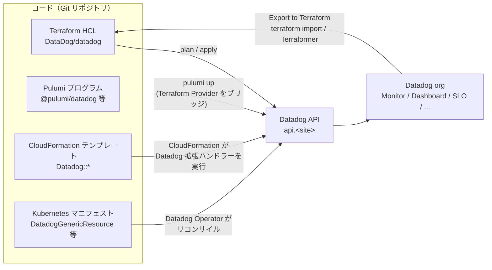
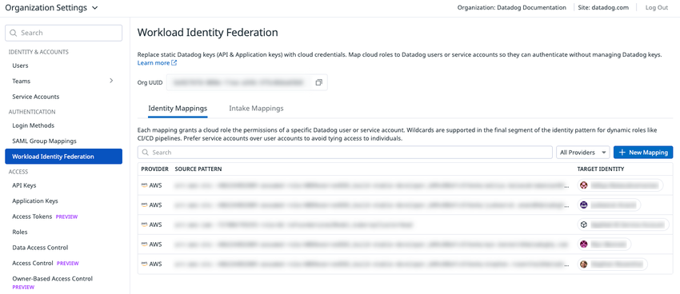
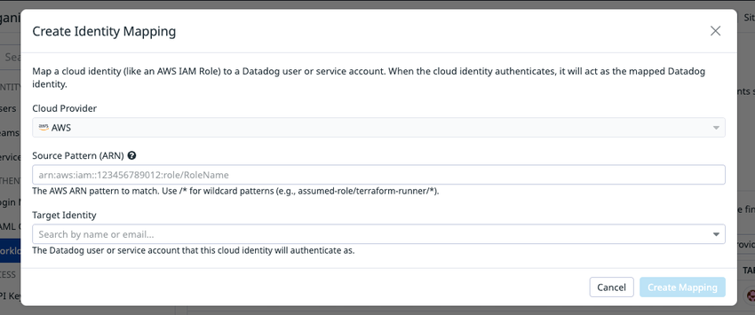
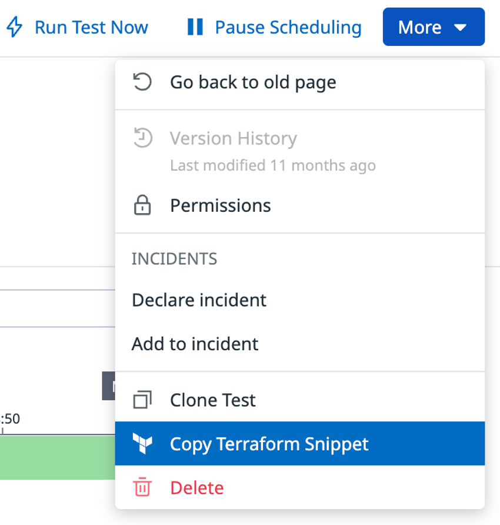
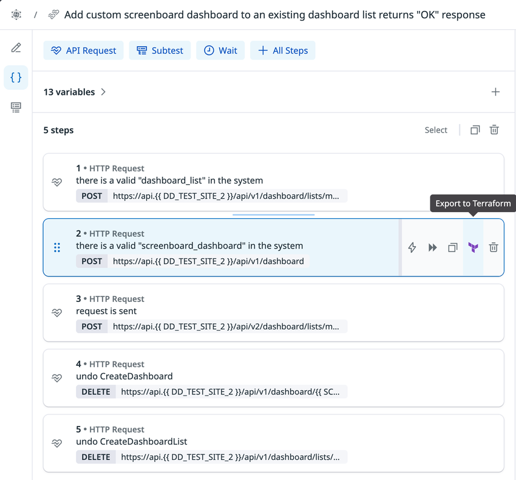
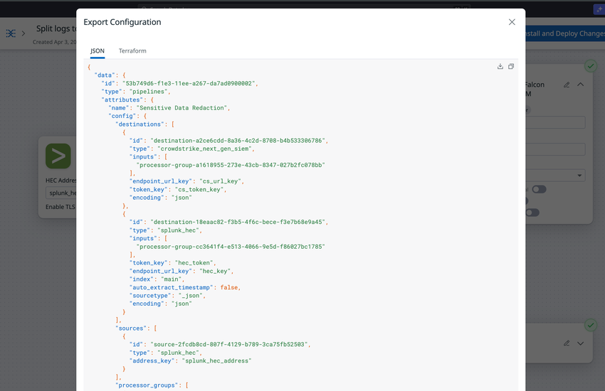

# Terraform と IaC（Infrastructure as Code）

## 概要

Datadog の設定（Monitor、Dashboard、SLO、Synthetic テスト、ログ設定、ユーザー・ロール、クラウド連携など）は、Datadog API を介して **IaC（Infrastructure as Code）** で管理できる。主な手段は次の 4 つである。

1. **Datadog Terraform Provider**（`DataDog/datadog`）… Datadog 公式。対応リソースが最も多い（2026-11-02 時点でリソース 177 種、データソース 93 種）。[出典](https://github.com/DataDog/terraform-provider-datadog/tree/master/docs)
2. **Pulumi Datadog Provider**（`@pulumi/datadog` 等）… Pulumi 社が Terraform Provider をブリッジして提供。TypeScript / Python / Go / .NET などで記述できる。[出典](https://github.com/pulumi/pulumi-datadog)
3. **Datadog-AWS CloudFormation Resources**（`Datadog::*` タイプ）… CloudFormation Public Registry のサードパーティ拡張。Monitor・Dashboard・SLO・User・Downtime Schedule・AWS 連携など 8 タイプに限定。[出典](https://docs.datadoghq.com/integrations/guide/amazon_cloudformation/)
4. **Datadog Operator の CRD**（`DatadogMonitor`、`DatadogDashboard`、`DatadogSLO`、`DatadogGenericResource`）… Kubernetes マニフェストとして Datadog リソースを管理。[出典](https://github.com/DataDog/datadog-operator/blob/main/docs/datadoggenericresource/datadog_generic_resource.md)

また、既存の UI 設定を IaC へ取り込む手段として、`terraform import`、UI の **Export to Terraform**（Monitor 一覧、Synthetic テスト、Cloud SIEM 検知ルール、Observability Pipelines）、Security Monitoring の Terraform エクスポート API、OSS の Terraformer がある。

本ファイルが扱う範囲と、別ファイルで扱う内容は次の通り。

| 内容 | 本ファイル | 参照先 |
|---|---|---|
| Terraform Provider の設定（引数・環境変数・認証・サイト別 URL・リトライ） | ○ | — |
| 主要リソースの一覧と注意点、v4 の破壊的変更 | ○ | — |
| Import / Export（既存設定のコード化） | ○ | — |
| Pulumi、CloudFormation、Datadog Operator CRD | ○ | — |
| 運用上の注意（ドリフト、State の機密情報、レート制限） | ○（仕様面） | 実践は [Monitoring as Code](../../04_応用編/09-monitoring-as-code.md) |
| Monitor の仕様（タイプ・評価設定） | 要点のみ | [Monitors（モニター）](./monitors.md) |
| Dashboard の仕様（ウィジェット・テンプレート変数） | 要点のみ | [Dashboards（ダッシュボード）](./dashboards.md) |
| SLO の仕様 | 要点のみ | [Service Level Objectives（SLO）](./slo.md) |
| API キー・アプリケーションキー・PAT/SAT・WIF の仕様 | 要点のみ | [API とキー管理](./api-and-keys.md) |
| Restriction Policy・ロール・権限 | 要点のみ | [組織・ユーザー・権限管理](./account-and-access-management.md) |
| AWS 連携の IAM ロール・サイト別アカウント ID | 要点のみ | [AWS Integration](./aws-integration.md) |
| サイト一覧とエンドポイント | 要点のみ | [Datadog Sites（サイト）](./datadog-sites.md) |
| Agent のデプロイ自体（Helm、Operator の DatadogAgent） | — | [コンテナ/Kubernetes向けAgent](./kubernetes-and-containers-agent.md)、[Agent 展開設計](../../03_導入編/10-agent-rollout-design.md) |
| 大規模・マルチ org での IaC 運用 | — | [大規模・マルチorg運用](../../04_応用編/15-large-scale-and-multi-org.md) |

---

## 1. IaC 手段の全体像

### 1.1 手段の比較

| 項目 | Terraform Provider | Pulumi | CloudFormation（Datadog::*） | Datadog Operator CRD |
|---|---|---|---|---|
| 提供元 | Datadog（公式） | Pulumi 社（Terraform Provider のブリッジ） | Datadog（AWS Public Registry に公開） | Datadog（公式） |
| 記述言語 | HCL | TypeScript/JavaScript、Python、Go、.NET 等 | YAML / JSON テンプレート | Kubernetes YAML |
| 対応リソース数 | リソース 177 / データソース 93（2026-11-02 時点） | Terraform Provider に追随（下記 6 章） | 8 タイプ（うち 2 つは Deprecated） | 専用 CRD 3 種 + 汎用 CRD（10 タイプ） |
| 最新バージョン（確認時点） | v4.28.0（CHANGELOG 上 2026-10-29） | v5.17.1（2026-10-27 リリース） | タイプ別（例：Monitor 4.12.0） | 公開情報では確認できず（本調査対象外） |
| 認証 | API/アプリケーションキー、Bearer（PAT/SAT）、AWS WIF、HCP Terraform Dynamic Credentials | API/アプリケーションキー | 拡張の Configuration に API/アプリケーションキー | Operator に API/アプリケーションキー |
| 適したケース | 標準的な選択肢。対応範囲が最大 | 汎用プログラミング言語で書きたいチーム | AWS ネイティブ運用で CloudFormation に統一したい場合 | GitOps で Kubernetes マニフェストと同居させたい場合 |

出典: [Terraform Provider docs](https://github.com/DataDog/terraform-provider-datadog/tree/master/docs)、[CHANGELOG](https://github.com/DataDog/terraform-provider-datadog/blob/master/CHANGELOG.md)、[pulumi-datadog releases](https://github.com/pulumi/pulumi-datadog/releases)、[Datadog-Amazon CloudFormation](https://docs.datadoghq.com/integrations/guide/amazon_cloudformation/)、[DatadogGenericResource](https://github.com/DataDog/datadog-operator/blob/main/docs/datadoggenericresource/datadog_generic_resource.md)

> **注記:** Terraform Provider の GitHub Release ページ上の v4.28.0 の公開日時は 2026-11-02（UTC）で、CHANGELOG 上の日付（2026-10-29）と異なる。本ファイルでは CHANGELOG の日付を記載する。[出典](https://github.com/DataDog/terraform-provider-datadog/releases)

### 1.2 構成図



---

## 2. Datadog Terraform Provider の基本

### 2.1 バージョンと要件

| 項目 | 内容 | 出典 |
|---|---|---|
| Registry 上のソース | `DataDog/datadog` | [Provider docs](https://github.com/DataDog/terraform-provider-datadog/blob/master/docs/index.md) |
| 最新版（2026-11-02 確認時点） | **v4.28.0**（CHANGELOG 上 2026-10-29） | [CHANGELOG](https://github.com/DataDog/terraform-provider-datadog/blob/master/CHANGELOG.md) |
| メジャー v4.0.0 | 2026-03-04 リリース（RC1 は 2026-02-25）。v3 系は 3.91.0（2026-03-04）が最終確認版 | 同上 |
| 必要な Terraform バージョン | **1.1.5 以降**（v4 でプラグインプロトコル v5→v6 に移行したため） | [v4 Upgrade Guide](https://github.com/DataDog/terraform-provider-datadog/blob/master/docs/guides/v4-upgrade-guide.md) |
| 実装基盤 | v4 で Terraform Plugin SDK v2 から **Terraform Plugin Framework**（プロトコル v6）へ移行。ネストした属性（nested attributes）に対応 | [公式ブログ](https://www.datadoghq.com/blog/datadog-terraform-provider-v4/)（2026-03-20 公開） |
| v3 に留まる場合 | `version = "~> 3.0"` で固定する | [v4 Upgrade Guide](https://github.com/DataDog/terraform-provider-datadog/blob/master/docs/guides/v4-upgrade-guide.md) |
| リリース頻度 | 2026 年 9〜10 月は月 3〜4 回のマイナーリリース（4.20.0〜4.28.0） | [CHANGELOG](https://github.com/DataDog/terraform-provider-datadog/blob/master/CHANGELOG.md) |

### 2.2 最小構成

Datadog Terraform Provider は、`required_providers` で `DataDog/datadog` を宣言し、`provider "datadog"` ブロックで認証情報を与えて使う。`terraform init` で Provider が取得される。[出典](https://docs.datadoghq.com/integrations/terraform/)

```hcl
terraform {
  required_providers {
    datadog = {
      source  = "DataDog/datadog"
      version = "~> 4.0"
    }
  }
  required_version = ">= 1.1.5"
}

provider "datadog" {
  api_key = var.datadog_api_key
  app_key = var.datadog_app_key
  api_url = "https://api.ap1.datadoghq.com/"   # AP1（日本）の場合。US1 以外は必須
}
```

- 公式ドキュメントは、認証情報を設定ファイルに書かずに **環境変数 `DD_API_KEY` / `DD_APP_KEY`** で渡すことを推奨している。[出典](https://docs.datadoghq.com/integrations/terraform/)
- **US1 以外のサイトでは `api_url` の指定が必須**（形式は `https://api.<YOUR_DATADOG_SITE>/`）。[出典](https://docs.datadoghq.com/integrations/terraform/)
- `api_url` は末尾を `/api/` にしてはいけない（`https://api.datadoghq.com/` は正、`https://api.datadoghq.com/api/` は誤）。[出典](https://github.com/DataDog/terraform-provider-datadog/blob/master/docs/index.md)

### 2.3 Provider 引数一覧

Datadog Terraform Provider の `provider "datadog"` ブロックの引数は、すべて Optional（任意）である（2026-11-02 時点）。

| 引数 | 型 | 説明 | 既定値 / 環境変数 |
|---|---|---|---|
| `api_key` | String（Sensitive） | Datadog API キー。`validate = true` のときは、AWS WIF・Bearer トークン・Dynamic Provider Credentials を使わない限り必須 | `DD_API_KEY`（`DATADOG_API_KEY` も可） |
| `app_key` | String（Sensitive） | Datadog アプリケーションキー。必須条件は `api_key` と同じ | `DD_APP_KEY`（`DATADOG_APP_KEY` も可） |
| `api_url` | String | API の URL。末尾 `/api/` は不可 | 既定 `https://api.datadoghq.com`。`DD_HOST`（`DATADOG_HOST` も可） |
| `bearer_token` | String（Sensitive） | `Authorization: Bearer <token>` で送る認証情報。PAT（`ddpat_*`）と SAT（`ddsat_*`）を受け付け、設定時は `DD-API-KEY` / `DD-APPLICATION-KEY` ヘッダーの代わりに使われる | `DD_BEARER_TOKEN`（`DATADOG_BEARER_TOKEN` も可） |
| `cloud_provider_type` | String | 【Preview】クラウド認証（キーレス）に使うクラウド。**`aws` のみ**対応。Provider ドキュメント上は「Preview」と記載（WIF ドキュメントとの記述の揺れは後述） | `DD_CLOUD_PROVIDER_TYPE`（`DATADOG_CLOUD_PROVIDER_TYPE` も可） |
| `cloud_provider_region` | String | クラウド認証用のリージョン（例：`us-east-1`）。AWS で省略時は AWS SDK の既定設定チェーンから読む | — |
| `org_uuid` | String | 組織 UUID。AWS WIF では必須。Dynamic Provider Credentials では任意（指定時はトークンの audience と一致必須） | `DD_ORG_UUID`（`DATADOG_ORG_UUID` も可） |
| `aws_access_key_id` | String（Sensitive） | クラウド認証用の明示的な AWS アクセスキー ID。省略時は AWS SDK 既定の認証情報チェーン | `AWS_ACCESS_KEY_ID` |
| `aws_secret_access_key` | String（Sensitive） | 同シークレット。`aws_access_key_id` とセットで指定 | `AWS_SECRET_ACCESS_KEY` |
| `aws_session_token` | String（Sensitive） | 一時認証情報のセッショントークン | `AWS_SESSION_TOKEN` |
| `workload_identity_token_tag` | String | HCP Terraform のワークロード ID トークンのタグを選択（例：`DATADOG_ORG_A` → `TFC_WORKLOAD_IDENTITY_TOKEN_DATADOG_ORG_A`）。英数字とアンダースコアのみ、`TYPE` は予約語 | 未設定時は `DATADOG` タグ → タグなしの順に自動探索 |
| `validate` | String（`true`/`false`） | Provider 初期化時に認証情報を検証するか | 既定 `true` |
| `http_client_retry_enabled` | String（`true`/`false`） | HTTP 429 と 5xx でリトライするか | 既定 `true`（`DD_HTTP_CLIENT_RETRY_ENABLED`） |
| `http_client_retry_timeout` | Number | リトライのタイムアウト（秒） | 既定 60 秒（`DD_HTTP_CLIENT_RETRY_TIMEOUT`） |
| `http_client_retry_max_retries` | Number | 最大リトライ回数 | 既定 3（`DD_HTTP_CLIENT_RETRY_MAX_RETRIES`） |
| `http_client_retry_backoff_base` | Number | バックオフの基数 | 既定 2（`DD_HTTP_CLIENT_RETRY_BACKOFF_BASE`） |
| `http_client_retry_backoff_multiplier` | Number | バックオフの乗数 | 既定 2（`DD_HTTP_CLIENT_RETRY_BACKOFF_MULTIPLIER`） |
| `http_client_retry_jitter` | Number | 各リトライに加える最大ランダム遅延（秒） | 既定 0 秒（`DD_HTTP_CLIENT_RETRY_JITTER`） |
| `default_tags` | Block（最大 1） | 全リソースに既定タグを付与（`tags` マップ）。**Experimental**：Action Connections、Logs Indexes、Logs Pipelines、Monitors、Security Monitoring Rules、SLO のみ対象 | — |
| `ignore_tag_keys` | Set of String | 指定タグキーのドリフトを無視。**Experimental**：Monitor と SLO のみ。リソース側の `ignore_tag_keys` とマージされ、`:value` 部分は無視される | — |

出典: [Provider docs（Schema）](https://github.com/DataDog/terraform-provider-datadog/blob/master/docs/index.md)、環境変数の別名（`DATADOG_*`）は [Provider ソース utils.go](https://github.com/DataDog/terraform-provider-datadog/blob/master/datadog/internal/utils/utils.go)

> **注記:** 環境変数は `DD_*` が先、`DATADOG_*` が後の順で参照される（ソースコード上の配列順）。公式ドキュメントに明記されているのは `DD_*` のみであり、`DATADOG_*` はソースコードからの確認である。[出典](https://github.com/DataDog/terraform-provider-datadog/blob/master/datadog/internal/utils/utils.go)

### 2.4 サイト別の `api_url`

`api_url` はサイトごとに異なる。値は Datadog API リファレンスのサイト別エンドポイント表に基づく。

| サイト | UI ドメイン | `api_url` |
|---|---|---|
| US1 | `app.datadoghq.com` | `https://api.datadoghq.com/`（既定値） |
| US3 | `us3.datadoghq.com` | `https://api.us3.datadoghq.com/` |
| US5 | `us5.datadoghq.com` | `https://api.us5.datadoghq.com/` |
| EU1 | `app.datadoghq.eu` | `https://api.datadoghq.eu/` |
| **AP1（日本）** | `ap1.datadoghq.com` | **`https://api.ap1.datadoghq.com/`** |
| AP2 | `ap2.datadoghq.com` | `https://api.ap2.datadoghq.com/` |
| US1-FED | `app.ddog-gov.com` | `https://api.ddog-gov.com/` |

出典: [API リファレンスのサイト別エンドポイント（Security Monitoring Terraform export）](https://docs.datadoghq.com/api/latest/security-monitoring/export-security-monitoring-resource-to-terraform/)、[Provider docs](https://github.com/DataDog/terraform-provider-datadog/blob/master/docs/index.md)

> **サイト差異:** 公式ドキュメントのサイト別エンドポイント表には、上記 7 サイトに加えて `uk1.datadoghq.com`（`https://api.uk1.datadoghq.com`）と `us2.ddog-gov.com`（`https://api.us2.ddog-gov.com`）も掲載されている。`us2.ddog-gov.com` では Terraform インテグレーション自体が既定で有効でない場合があり、例外申請は `support@ddog-gov.com` 宛て。サイト一覧の詳細は [Datadog Sites（サイト）](./datadog-sites.md) を参照。[出典](https://docs.datadoghq.com/integrations/terraform/)

### 2.5 認証方式

Datadog Terraform Provider は 4 種類の認証方式に対応する。

| 方式 | 設定 | 最低 Provider バージョン | 前提・制約 |
|---|---|---|---|
| API キー + アプリケーションキー | `api_key` / `app_key`（または `DD_API_KEY` / `DD_APP_KEY`） | 全バージョン | アプリケーションキーの権限（スコープ）が Terraform で操作できる範囲になる |
| Bearer トークン（PAT / SAT） | `bearer_token`（または `DD_BEARER_TOKEN`） | 4.11.0（2026-06-01、「native PAT (Bearer) auth support」） | PAT はユーザー、SAT はサービスアカウントに紐づく。スコープ必須 |
| AWS Workload Identity Federation（WIF） | `org_uuid` + `cloud_provider_type = "aws"` | 3.70 以降（WIF ドキュメントの要件）。環境変数 `DD_CLOUD_PROVIDER_TYPE` 対応は 4.14.0 | AWS のみ。AWS アカウントが Datadog AWS 連携済みであること。US1-FED / `us2.ddog-gov.com` では利用不可 |
| HCP Terraform Dynamic Provider Credentials | Provider ブロックに認証設定を書かず、ワークスペースに `TFC_WORKLOAD_IDENTITY_AUDIENCE_DATADOG` を設定 | **4.26.0 以降** | HCP Terraform 上での実行のみ（ローカル CLI 実行ではトークンが生成されない） |

出典: [Provider docs](https://github.com/DataDog/terraform-provider-datadog/blob/master/docs/index.md)、[CHANGELOG](https://github.com/DataDog/terraform-provider-datadog/blob/master/CHANGELOG.md)、[Workload Identity Federation](https://docs.datadoghq.com/account_management/workload_identity_federation/)、[Dynamic Provider Credentials guide](https://github.com/DataDog/terraform-provider-datadog/blob/master/docs/guides/dynamic_provider_credentials.md)

#### 認証方式の優先順位

Datadog Terraform Provider は次の順で認証方式を選ぶ。[出典](https://github.com/DataDog/terraform-provider-datadog/blob/master/docs/guides/dynamic_provider_credentials.md)

1. Provider ブロックでの明示的な認証：`cloud_provider_type` → `bearer_token` → `api_key`/`app_key` の順（Terraform 変数経由の値も「明示的」とみなす）
2. HCP Terraform のワークロード ID トークン：`workload_identity_token_tag` で指定したタグ。未指定時は `TFC_WORKLOAD_IDENTITY_TOKEN_DATADOG` → `TFC_WORKLOAD_IDENTITY_TOKEN` の順
3. 環境変数ベース：AWS WIF → 環境変数の Bearer トークン → 環境変数の API/アプリケーションキー

- 明示的な認証は、ワークロード ID トークンの探索・タグ要件・audience 検証をすべてバイパスする。
- 明示的に選んだ API/アプリケーションキーのペアが不完全な場合、欠けた側を環境変数で補えるが、ワークロード ID トークン認証へはフォールバックしない。
- ワークロード ID トークンを選んだ後の交換拒否はエラーとなり、別トークンや AWS/静的認証情報へは切り替わらない。

> **API・認証モデルの位置づけ:** Datadog 公式ブログ（2026-06-09 公開）は、CI/CD パイプライン・Terraform には **SAT（AWS 上なら WIF も選択肢）** を推奨し、アプリケーションキーはレガシー扱いになる（動作は継続）と説明している。詳細は [API とキー管理](./api-and-keys.md) を参照。[出典](https://www.datadoghq.com/blog/datadog-api-authentication/)（2026-06-09 公開）

### 2.6 AWS Workload Identity Federation（WIF）の設定

AWS Workload Identity Federation は、Terraform Provider が **AWS の認証情報（IAM ロール等）で Datadog に認証**し、静的な API/アプリケーションキーを不要にする仕組みである。AWS が唯一の対応クラウドである。[出典](https://docs.datadoghq.com/account_management/workload_identity_federation/)

**認証フロー（Terraform Provider）:**

1. Provider が現在の AWS 認証情報で署名した AWS STS `GetCallerIdentity` リクエスト（証明）を生成する
2. Datadog が AWS STS を呼んで証明を検証し、ARN・ユーザー ID・アカウント ID を得る
3. AWS の ID を、組織の設定（Identity Mapping）に従って Datadog のサービスアカウントまたはユーザーにマッピングする
4. 検証成功時、Datadog が一時的な JWT トークンを発行する
5. 以降の Datadog API 呼び出しにそのトークンを使う

**要件:**

| 要件 | 内容 |
|---|---|
| Provider バージョン | 3.70 以降 |
| AWS 連携 | 対象 AWS アカウントが Datadog の AWS Integration に追加済み（未連携だと呼び出し元を検証できずマッピングが失敗） |
| 権限 | `workload_identity_federation_config_read` と `workload_identity_federation_config_write` |
| サイト | US1、US3、US5、EU1、AP1、AP2 で利用可。`app.ddog-gov.com`、`us2.ddog-gov.com` では利用不可 |

**Identity Mapping の作成手順（UI）:**

1. **Organization Settings > Workload Identity Federation** を開き、**Identity Mappings** タブを選ぶ
2. **+ New Mapping** をクリック
3. **Cloud Provider** を選ぶ
4. **Source Pattern (ARN)** に **assumed-role ARN** を入力する（例：`arn:aws:sts::123456789012:assumed-role/terraform-runner/*`）
5. **Target Identity**（Datadog ユーザーまたはサービスアカウント）を選ぶ
6. **Create Mapping** をクリック

- Source Pattern には IAM ロール ARN（`arn:aws:iam::123456789012:role/my-role`）ではなく **assumed-role ARN**（`arn:aws:sts::123456789012:assumed-role/my-role/session-name`）が必要。ワークロード環境で `aws sts get-caller-identity` を実行し、`Arn` の値を使う。
- ワイルドカード `*` は ARN の**最後の部分のみ**に使え、その前に具体的なリソース名が必要。ARN の途中には置けない。
- マッピングは API（`POST /api/v2/cloud_auth/aws/persona_mapping`、`account_identifier` にユーザーのメール、またはサービスアカウントの UUID / メール）でも作成できる。
- 公式は、特定個人に紐づけないため **サービスアカウントへのマッピングを推奨**している。

出典: [Workload Identity Federation](https://docs.datadoghq.com/account_management/workload_identity_federation/)



*キャプション:* Organization Settings の Workload Identity Federation 画面（Identity Mappings タブ）。

*画面説明:* 左側の Organization Settings メニューの「AUTHENTICATION」グループに **Workload Identity Federation** があり、選択すると右側に説明文、**Org UUID**（コピーボタン付き）、**Identity Mappings** / **Intake Mappings** の 2 タブが表示される。Identity Mappings タブには検索欄、プロバイダー絞り込み（All Providers）、**+ New Mapping** ボタンがあり、一覧は PROVIDER（AWS）、SOURCE PATTERN（assumed-role ARN パターン）、TARGET IDENTITY（マッピング先のユーザー / サービスアカウント）の列で構成される。Org UUID は Provider の `org_uuid` に設定する値としてこの画面から取得できる。

*出典:* [Workload Identity Federation](https://docs.datadoghq.com/account_management/workload_identity_federation/)（2026-11-02 取得）



*キャプション:* Identity Mapping の作成ダイアログ。

*画面説明:* **Cloud Provider**、**Source Pattern (ARN)**、**Target Identity** の 3 項目を入力するダイアログ。Source Pattern 欄の下には、ワイルドカードパターンが使えることを示す補足テキストが表示される。

*出典:* [Workload Identity Federation](https://docs.datadoghq.com/account_management/workload_identity_federation/)（2026-11-02 取得）

**Provider 設定例:**

```hcl
provider "datadog" {
  org_uuid            = var.datadog_org_uuid
  cloud_provider_type = "aws"
  # 任意: AWS 認証情報を明示する場合
  # aws_access_key_id     = var.aws_access_key_id
  # aws_secret_access_key = var.aws_secret_access_key
  # aws_session_token     = var.aws_session_token
}
```

- AWS 認証情報は AWS SDK 既定の認証情報チェーン（環境変数、共有設定/認証情報ファイル、IAM Identity Center（SSO）、Web Identity、ECS タスクロール、EC2 インスタンスロール、assume-role プロファイル）から取得される。例：`aws sso login --profile sandbox` 後に `AWS_PROFILE=sandbox` で Terraform を実行。[出典](https://github.com/DataDog/terraform-provider-datadog/blob/master/docs/index.md)
- `org_uuid` は WIF 画面、または `/api/v2/current_user` から取得できる。[出典](https://docs.datadoghq.com/account_management/workload_identity_federation/)

> **提供状況の記述の揺れ:** WIF ドキュメントは Terraform Provider 向け WIF を「Available for all customers」と記載する一方、Provider ドキュメントの `cloud_provider_type` の説明には「This feature is in Preview」とあり、有効化にはサポートへの連絡を求めている（2026-11-02 時点）。実際の提供状況は自組織の WIF 設定画面の有無で確認すること。[出典](https://docs.datadoghq.com/account_management/workload_identity_federation/)、[出典](https://github.com/DataDog/terraform-provider-datadog/blob/master/docs/index.md)

> **既知の制限:** レガシーの `datadog_integration_pagerduty` リソースは委任認証（AWS WIF / ワークロード ID トークン）に対応しない別の API クライアントを使うため、これらの認証だけでは管理できない。[出典](https://github.com/DataDog/terraform-provider-datadog/blob/master/docs/guides/dynamic_provider_credentials.md)

### 2.7 HCP Terraform Dynamic Provider Credentials

HCP Terraform（旧称：Terraform Cloud）の Dynamic Provider Credentials は、HCP Terraform が発行する **ワークロード ID トークン（WIT）** を Datadog の Workload Identity Federation 経由で短命の Datadog アクセストークンに交換し、ワークスペースに Datadog の認証情報を保存せずに済ませる仕組みである。[出典](https://github.com/DataDog/terraform-provider-datadog/blob/master/docs/guides/dynamic_provider_credentials.md)

| 項目 | 内容 |
|---|---|
| Provider バージョン | 4.26.0 以降（CHANGELOG では 4.26.0（2026-10-16）で「HCP Terraform dynamic provider credentials support」を追加） |
| 実行環境 | HCP Terraform のみ。ローカル CLI 実行ではトークンが生成されない |
| セルフホストエージェント | タグ付きトークンはエージェント v1.12.0 以降、タグなしトークンは v1.7.0 以降 |
| HCP の発行者（Issuer） | `https://app.terraform.io`（US）、`https://app.eu.terraform.io`（EU） |
| Datadog 側設定 | 管理対象 org に Terraform 用 WIF persona mapping を登録（マッピング先はサービスアカウント推奨） |
| subject の形式 | `organization:<terraform-organization>:project:<project>:workspace:<workspace>:run_phase:(plan|apply)` |
| ワイルドカード | project、workspace、phase の各セグメント全体に `*` 可。organization は具体値必須 |
| ワークスペース環境変数 | `TFC_WORKLOAD_IDENTITY_AUDIENCE_DATADOG` = `datadog/<Datadog org UUID>` |
| 注入されるトークン | `TFC_WORKLOAD_IDENTITY_TOKEN_DATADOG`（各 run phase ごと。自分で設定しない） |
| 複数 org | `TFC_WORKLOAD_IDENTITY_AUDIENCE_DATADOG_ORG_A` 等を用意し、Provider ごとに `workload_identity_token_tag` で選択（`alias` 名ではトークンは選ばれない） |

- plan と apply で別トークンが発行されるため、Datadog にアクセスする全フェーズをマッピングに含める必要がある。
- HCP の US/EU リージョンは Datadog サイトを決めない。Provider の `api_url` で Datadog サイトを指定する。
- `org_uuid`（または `DD_ORG_UUID` / `DATADOG_ORG_UUID`）を設定した場合、トークン audience の org UUID と不一致だと `validate = false` でも交換前に失敗する。

出典: [Dynamic Provider Credentials guide](https://github.com/DataDog/terraform-provider-datadog/blob/master/docs/guides/dynamic_provider_credentials.md)、[CHANGELOG](https://github.com/DataDog/terraform-provider-datadog/blob/master/CHANGELOG.md)

### 2.8 既定タグとタグドリフトの無視

- `default_tags { tags = { ... } }` は Provider レベルで既定タグを付与する Experimental 機能。3.43.0（2024-08-14）で追加された当初は `datadog_monitor` のみが対象で、2026-11-02 時点の対象は Action Connections、Logs Indexes、Logs Pipelines、Monitors、Security Monitoring Rules、SLO。[出典](https://github.com/DataDog/terraform-provider-datadog/blob/master/CHANGELOG.md)、[出典](https://github.com/DataDog/terraform-provider-datadog/blob/master/docs/index.md)
- `ignore_tag_keys` は、UI やタグ付けサービスなど Terraform 外で管理するタグキーのドリフトを `terraform plan` で無視する Experimental 機能（Monitor と SLO が対象）。`datadog_monitor` での対応は 4.14.0（2026-07-01）。[出典](https://github.com/DataDog/terraform-provider-datadog/blob/master/docs/index.md)、[出典](https://github.com/DataDog/terraform-provider-datadog/blob/master/CHANGELOG.md)

---

## 3. 主要リソース

### 3.1 カテゴリ別リソース一覧

Datadog Terraform Provider のリソース（2026-11-02 時点で 177 種）を、主なカテゴリ別に整理する（リソース名の接頭辞 `datadog_` は省略。全量は [Terraform Registry](https://registry.terraform.io/providers/DataDog/datadog/latest/docs) を参照）。

| カテゴリ | 主なリソース（`datadog_` 省略） | 関連ファイル |
|---|---|---|
| Monitor・通知 | `monitor`、`monitor_json`、`monitor_config_policy`、`monitor_notification_rule`、`downtime_schedule`、`downtime`（Deprecated）、`webhook`、`webhook_custom_variable`、`webhook_oauth2_client_credentials` | [Monitors](./monitors.md)、[通知と Downtime](./notifications-and-downtimes.md) |
| Dashboard | `dashboard`、`dashboard_json`、`dashboard_v2`（`dashboard` のエイリアス）、`dashboard_list`、`powerpack`、`powerpack_v2`【Preview】（公式表記は BETA）、`secure_embed_dashboard` | [Dashboards](./dashboards.md) |
| SLO | `service_level_objective`、`slo_correction` | [SLO](./slo.md) |
| Synthetic | `synthetics_test`、`synthetics_global_variable`、`synthetics_private_location`、`synthetics_concurrency_cap`、`synthetics_suite` | [Synthetic Monitoring](../dem/synthetic-monitoring.md) |
| ログ | `logs_index`、`logs_index_order`、`logs_custom_pipeline`、`logs_integration_pipeline`、`logs_pipeline_order`、`logs_archive`、`logs_archive_order`、`logs_metric`、`logs_custom_destination`、`logs_restriction_query` | [Log Pipelines と処理](../logs/log-pipelines-and-processing.md)、[Indexes・保持・アーカイブ](../logs/log-indexes-retention-archives.md) |
| メトリクス・タグ | `metric_metadata`、`metric_tag_configuration`、`derived_metric`、`spans_metric`、`tag_indexing_rule`、`tag_indexing_rule_exemption`、`tag_indexing_rule_order`、`tag_pipeline_ruleset`、`tag_pipeline_rulesets`、`tag_rule` | [Metrics](./metrics.md)、[Custom Metrics と DogStatsD](./custom-metrics-and-dogstatsd.md) |
| APM・RUM | `apm_retention_filter`、`apm_retention_filter_order`、`rum_application`、`rum_metric`、`rum_retention_filter`、`rum_retention_filters_order`、`rum_retention_quota`、`rum_exclusion_filter`、`rum_operation`、`rum_operation_journey_link` | [APM の概念とインジェスト制御](../apm/apm-concepts-and-ingestion.md)、[RUM（ブラウザ）](../dem/rum-browser.md) |
| クラウド連携 | `integration_aws_account`、`integration_aws_external_id`、`integration_aws_event_bridge`、`integration_aws_account_ccm_config`、`integration_gcp_sts`、`integration_gcp`（Deprecated）、`integration_azure`、`integration_cloudflare_account`、`integration_confluent_account`、`integration_databricks_account`、`integration_fastly_account`、`integration_snowflake_account` ほか | [AWS](./aws-integration.md)、[Azure](./azure-integration.md)、[Google Cloud](./gcp-integration.md) |
| 通知先連携 | `integration_slack_channel`、`integration_pagerduty`、`integration_pagerduty_service_object`、`integration_opsgenie_service_object`、`integration_ms_teams_tenant_based_handle`、`integration_ms_teams_workflows_webhook_handle` | [通知・コラボレーション連携](./collaboration-integrations.md) |
| 組織・アクセス管理 | `user`、`user_role`、`role`、`team`、`team_membership`、`team_permission_setting`、`team_link`、`team_hierarchy_links`、`team_sync`、`service_account`、`authn_mapping`、`saml_idp_metadata`、`organization_settings`、`child_organization`、`org_connection`、`org_group`、`org_group_membership`、`org_group_policy`、`org_group_policy_override`、`restriction_policy`、`dataset`、`ip_allowlist`、`domain_allowlist` | [組織・ユーザー・権限管理](./account-and-access-management.md) |
| 認証情報 | `api_key`、`application_key`、`service_account_application_key`、`service_access_token`、`app_key_registration`、`aws_wif_identity_mapping`、`github_oidc_identity_mapping`、`github_oidc_intake_mapping` | [API とキー管理](./api-and-keys.md) |
| セキュリティ | `security_monitoring_rule`、`security_monitoring_rule_json`、`security_monitoring_default_rule`、`security_monitoring_filter`、`security_monitoring_suppression`、`security_monitoring_critical_asset`、`security_notification_rule`、`security_findings_*`（ミュート・期日・チケット作成等のルール群）、`cloud_configuration_rule`、`csm_threats_agent_rule`、`csm_threats_policy`、`appsec_waf_custom_rule`、`appsec_waf_exclusion_filter`、`sensitive_data_scanner_group`、`sensitive_data_scanner_rule`、`agentless_scanning_*_scan_options`、`compliance_*` | [Cloud SIEM](../security/cloud-siem.md)、[Cloud Security](../security/cloud-security.md)、[Sensitive Data Scanner](../security/sensitive-data-scanner.md) |
| サービス管理 | `incident_type`、`incident_notification_rule`、`incident_notification_template`、`incident_postmortem_template`、`incident_user_defined_field`、`on_call_schedule`、`on_call_escalation_policy`、`on_call_team_routing_rules`、`on_call_user_notification_channel`、`status_page`、`status_page_component`、`workflow_automation`、`action_connection`、`app_builder_app`、`datastore`、`datastore_item` | [Incident Management](../service-management/incident-management.md)、[On-Call](../service-management/on-call.md)、[Workflow Automation](../service-management/workflow-automation.md)、[App Builder](../service-management/app-builder.md) |
| カタログ・その他 | `software_catalog`、`service_definition_yaml`、`openapi_api`（Deprecated）、`reference_table`、`observability_pipeline`、`deployment_gate`、`fleet_schedule`、`governance_control` | [Software Catalog](./software-catalog.md)、[Observability Pipelines](../logs/observability-pipelines.md)、[Fleet Automation](./fleet-automation.md) |
| コスト | `cost_budget`、`cost_custom_forecast`、`custom_allocation_rule`、`custom_allocation_rules`、`aws_cur_config`、`azure_uc_config`、`gcp_uc_config` | [Cloud Cost Management](../infrastructure/cloud-cost-management.md) |

出典: [terraform-provider-datadog docs/resources](https://github.com/DataDog/terraform-provider-datadog/tree/master/docs/resources)

**データソース**（93 種）は、既存オブジェクトの ID や属性を参照するために使う。代表例：`datadog_monitor` / `datadog_monitors`、`datadog_dashboard`、`datadog_role` / `datadog_roles`、`datadog_permissions`、`datadog_user` / `datadog_users`、`datadog_team`、`datadog_service_account`、`datadog_current_user`、`datadog_synthetics_locations`、`datadog_ip_ranges`、`datadog_integration_aws_iam_permissions`、`datadog_integration_aws_namespace_rules`、`datadog_logs_indexes`、`datadog_logs_pipelines`、`datadog_service_level_objectives`、`datadog_security_monitoring_rules`、`datadog_hosts`、`datadog_metrics`。[出典](https://github.com/DataDog/terraform-provider-datadog/tree/master/docs/data-sources)

### 3.2 `datadog_monitor`

`datadog_monitor` は Monitor（モニター）を管理する Datadog Terraform Provider の中心的なリソースである。各属性の意味（評価ウィンドウ、No Data、Group Retention 等）の詳細は [Monitors（モニター）](./monitors.md) を参照。

**必須引数:**

| 引数 | 説明 |
|---|---|
| `name` | Monitor 名 |
| `type` | Monitor タイプ。**作成後は変更不可** |
| `query` | Monitor クエリ（UI 上のクエリとは構文が異なり、タイプにより異なる）。`validate = false` でない限り `terraform plan` 時に検証される |
| `message` | 通知メッセージ（`@username` 等の通知先を含む） |

**`type` の有効値（23 種、2026-11-02 時点）:** `composite`、`event alert`、`log alert`、`metric alert`、`process alert`、`query alert`、`rum alert`、`service check`、`synthetics alert`、`trace-analytics alert`、`slo alert`、`event-v2 alert`、`audit alert`、`ci-pipelines alert`、`ci-tests alert`、`error-tracking alert`、`database-monitoring alert`、`network-performance alert`、`cost alert`、`data-quality alert`、`network-path alert`、`data-jobs alert`、`llm-observability alert`

**主な任意引数と既定値:**

| 引数 | 説明 | 既定値 |
|---|---|---|
| `monitor_thresholds` | `critical`、`critical_recovery`、`warning`、`warning_recovery`、`ok` 等の閾値（最大 1 ブロック） | — |
| `monitor_threshold_windows` | `trigger_window` / `recovery_window`。Anomaly Monitor でのみ使用可能かつ必須 | — |
| `draft_status` | `draft`（通知しない下書き）/ `published` | `published` |
| `notify_no_data` | データ停止時に通知するか | `false` |
| `no_data_timeframe` | データ停止から通知までの分数（メトリクスアラームは timeframe の 2 倍以上を推奨） | 10 |
| `on_missing_data` | データ欠損時の扱い。有効値は `show_no_data`、`show_and_notify_no_data`、`resolve`、`default`。Service Check・Composite・SLO Monitor では使用不可 | — |
| `require_full_window` | 評価にウィンドウ全体のデータを要求するか（疎なメトリクスでは `false` を強く推奨。Custom Schedule 使用時は `false` 必須） | `true` |
| `include_tags` | 通知タイトルにトリガー元タグを入れるか | `true` |
| `notify_audit` | Monitor 変更時にタグ付けされたユーザーへ通知するか | `false` |
| `enable_logs_sample` | ログ Monitor でトリガー元ログのサンプルを含めるか | `false` |
| `groupby_simple_monitor` | ログ Monitor でいずれかのソースが閾値超過時に 1 件のアラートにするか | `false` |
| `evaluation_delay` | 評価の遅延（秒、metric alert のみ）。CloudWatch 等のバックフィルされるメトリクス向け | — |
| `new_group_delay` | 新規グループの評価をスキップする秒数（`new_host_delay` は Deprecated） | — |
| `group_retention_duration` | 欠損グループを状態から外すまでの時間（最小 1 時間、最大 72 時間。例：`60m`、`1h`、`2d`）。APM Trace Analytics、Audit Trail、CI、Error Tracking、Event、Logs、RUM Monitor でのみ使用可 | — |
| `timeout_h` | データ非報告で自動 Resolve するまでの時間（0〜24 時間） | — |
| `renotify_interval` / `renotify_occurrences` / `renotify_statuses` | 再通知の間隔（分）・回数・対象ステータス（`alert`、`warn`、`no data`） | — |
| `notify_by` | 通知の粒度（グルーピングタグの部分集合） | — |
| `notification_preset_name` | 通知に含める付加情報（`show_all`、`hide_query`、`hide_handles`、`hide_all` 等） | — |
| `priority` | 1（高）〜5（低） | — |
| `scheduling_options` | 評価ウィンドウ・カスタムスケジュールの設定 | — |
| `variables` | Formula & Function 形式のクエリ定義 | — |
| `assets` | Runbook 等の関連アセット | — |
| `tags` | Monitor のタグ（Manage Monitors 画面での分類用） | — |
| `ignore_tag_keys` | ドリフトを無視するタグキー（Provider レベルの値とマージ） | — |
| `force_delete` | SLO や Composite Monitor から参照されていても削除するか | — |
| `validate` | `false` で plan 時の検証 API 呼び出しを省略 | — |
| `restricted_roles` | 編集可能なロール（**Deprecated**。`datadog_restriction_policy` を推奨。4 章参照） | — |

出典: [datadog_monitor resource](https://github.com/DataDog/terraform-provider-datadog/blob/master/docs/resources/monitor.md)

**例（Live Process Monitor、公式ドキュメントの例）:**

```hcl
resource "datadog_monitor" "process_alert_example" {
  name    = "Process Alert Monitor"
  type    = "process alert"
  message = "Multiple Java processes running on example-tag"
  query   = "processes('java').over('example-tag').rollup('count').last('10m') > 1"
  monitor_thresholds {
    critical          = 1.0
    critical_recovery = 0.0
  }
  notify_no_data    = false
  renotify_interval = 60
}
```

[出典](https://docs.datadoghq.com/integrations/terraform/)

**Composite Monitor の例:** 他の `datadog_monitor` の `id`、または `datadog_synthetics_test` の計算属性 `monitor_id` をクエリに埋め込んで合成できる。

```hcl
resource "datadog_monitor" "bar" {
  name    = "Composite Monitor"
  type    = "composite"
  message = "This is a message"
  query   = "${datadog_monitor.foo.id} || ${datadog_synthetics_test.foo.monitor_id}"
}
```

[出典](https://github.com/DataDog/terraform-provider-datadog/blob/master/docs/guides/monitors.md)

### 3.3 JSON 版リソース（`datadog_monitor_json` / `datadog_dashboard_json`）

Datadog Terraform Provider には、API の JSON 定義をそのまま渡す JSON 版リソースがある。UI からコピーした JSON を流用しやすい。[出典](https://docs.datadoghq.com/getting_started/integrations/terraform/)

| リソース | 必須引数 | 任意引数 | Import ID |
|---|---|---|---|
| `datadog_monitor_json` | `monitor`（JSON 文字列） | `url` | Monitor ID（数値） |
| `datadog_dashboard_json` | `dashboard`（JSON 文字列） | `dashboard_lists`、`url` | Dashboard ID（例：`sv7-gyh-kas`） |
| `datadog_security_monitoring_rule_json` | `json`（JSON 文字列） | — | ルール ID |

出典: [monitor_json](https://github.com/DataDog/terraform-provider-datadog/blob/master/docs/resources/monitor_json.md)、[dashboard_json](https://github.com/DataDog/terraform-provider-datadog/blob/master/docs/resources/dashboard_json.md)、[security_monitoring_rule_json](https://github.com/DataDog/terraform-provider-datadog/blob/master/docs/resources/security_monitoring_rule_json.md)

| 観点 | HCL 版（`datadog_monitor` / `datadog_dashboard`） | JSON 版（`*_json`） |
|---|---|---|
| 可読性・差分レビュー | 属性単位で差分が読みやすい | JSON 文字列全体の差分になる |
| 既存設定の取り込み | 変換作業が必要 | UI の「Copy / Export dashboard JSON」の出力を流用しやすい |
| 変数・参照の埋め込み | HCL の参照・`for_each` を自然に使える | `jsonencode()` / `templatefile()` 等で組み立てる |

上記の比較は Provider ドキュメントの仕様からの整理である。既存の大規模ダッシュボードは `datadog_dashboard_json` で取り込むのが現実的とする第三者解説もある 【第三者情報】[出典](https://www.issoh.co.jp/tech/details/10105/)（2025-12-03 公開、2026-09-28 更新）

### 3.4 `datadog_dashboard` と `datadog_dashboard_v2`

- `datadog_dashboard` が推奨リソースである。必須は `title` と `layout_type`、任意で `widget`、`template_variable`、`template_variable_preset`、`tab`、`tags`、`notify_list`、`reflow_type`、`restricted_roles`、`dashboard_lists`、`validate` など。[出典](https://github.com/DataDog/terraform-provider-datadog/blob/master/docs/resources/dashboard.md)
- `datadog_dashboard_v2` は 4.5.0（2026-04-16）で新リソースとして追加され、4.27.0（2026-10-21）で `datadog_dashboard` が v2 実装を既定で使うようになった。2026-11-02 時点で `datadog_dashboard_v2` は **`datadog_dashboard` のエイリアス**（スキーマ・動作が同一）で、`datadog_dashboard` は非推奨ではない。新規構成では `datadog_dashboard` を使う。[出典](https://github.com/DataDog/terraform-provider-datadog/blob/master/docs/guides/dashboard_resource_names.md)、[出典](https://github.com/DataDog/terraform-provider-datadog/blob/master/CHANGELOG.md)
- `datadog_dashboard_v2` から `datadog_dashboard` へリネームするとリソースアドレスが変わるため、`removed` ブロックで旧アドレスを state から外し、`import` ブロックで新アドレスに取り込み、`terraform plan` で置き換え（replacement）が出ないことを確認する。[出典](https://github.com/DataDog/terraform-provider-datadog/blob/master/docs/guides/dashboard_resource_names.md)

**v2 実装への切り替えで `terraform plan` が失敗するようになった構成**（`validate = false` でもスキップされない）:

| 失敗する構成 | 対処 |
|---|---|
| 同じウィジェットリクエストで `q` と `query` / `formula` を併用 | `q` 単独、または `query` + `formula` のどちらかに統一 |
| 1 個しか許されないブロックを複数記述（hostmap の `request.fill` / `request.size`、scatterplot の `request.x` / `request.y`、toplist の `style` / `style.display`、topology map の `request.query`） | 1 個にする（従来は先頭のみ送信され、残りは恒久的な差分になっていた） |
| `group_definition` 内の `powerpack_definition` / `split_graph_definition` | API がグループ内で受け付けないため外に出す |
| （`datadog_dashboard_v2` 利用者のみ）`content` が空のウィジェット（`datadog_dashboard` と同じ挙動に統一） | 内容を設定する |

その他の挙動変更:

- **plan 時検証**：ウィジェットは `terraform plan` 中に Datadog API で検証される（`validate` 既定 `true`）。このため **plan にも API アクセスが必要**。オフライン plan では `validate = false` にする。
- **Deprecated フィールド**：`q` と `apm_query`、`log_query`、`rum_query`、`security_query`、`process_query`、toplist の `style.display.type` は警告が出る（動作は継続）。`query` + `formula` と `flat {}` / `stacked {}` を推奨。
- **ウィジェット ID**：state 上のウィジェット ID が更新時に送られるため、並び順が変わらなければリンクやタブの対応が保たれる。ID はリスト位置に従うため、並べ替え・挿入後は既存 ID が別ウィジェットに再割り当てされうる。
- `is_read_only` は Deprecated かつ機能しない（既定 `false`）。編集制限は `restricted_roles` または Restriction Policy を使う。

出典: [Dashboard resource names guide](https://github.com/DataDog/terraform-provider-datadog/blob/master/docs/guides/dashboard_resource_names.md)、[datadog_dashboard](https://github.com/DataDog/terraform-provider-datadog/blob/master/docs/resources/dashboard.md)

### 3.5 `datadog_powerpack_v2`【Preview】

- `datadog_powerpack_v2` は `datadog_powerpack` の改良版で、ウィジェット対応とシリアライズ挙動が `datadog_dashboard_v2` と同じ。Provider ドキュメント上の表記は **BETA**（Experimental、変更の可能性あり。本ナレッジでは規約に従い【Preview】として扱う）で、本番以外での検証が推奨されている。
- 両リソースは同一構成内に共存できるが、**同じ Powerpack を両方で同時に管理してはいけない**。移行は `terraform state rm datadog_powerpack.<name>`（Datadog 側の Powerpack は削除されない）→ `terraform import datadog_powerpack_v2.<name> <powerpack-id>` → `terraform plan` で差分なしを確認、の順で行う。

出典: [Powerpack v2 migration guide](https://github.com/DataDog/terraform-provider-datadog/blob/master/docs/guides/powerpack_v2_migration.md)

### 3.6 `datadog_synthetics_test`

- 必須：`name`、`type`、`status`、`locations`。テスト種別に応じて `request_definition`、`assertion`、`api_step`、`browser_step`、`mobile_step`、`options_list`、`config_variable` などを使う。
- 計算属性 `monitor_id` を持ち、Composite Monitor や SLO から参照できる。
- `force_delete_dependencies` を `true` にすると、SLO や Composite Monitor から参照されていても削除できる。
- 認証系（SIGV4 の `access_key`、OAuth の `client_secret` 等）は Sensitive 属性。

出典: [datadog_synthetics_test](https://github.com/DataDog/terraform-provider-datadog/blob/master/docs/resources/synthetics_test.md)

### 3.7 SLO（`datadog_service_level_objective` / `datadog_slo_correction`）

- `datadog_service_level_objective` の必須は `name`、`type`、`thresholds`（1 個以上）。任意で `query`（メトリクスベース）、`monitor_ids`（Monitor ベース）、`sli_specification`（Time Slice）、`groups`、`timeframe`、`target_threshold`、`warning_threshold`、`tags`、`force_delete`、`validate`、`ignore_tag_keys`。[出典](https://github.com/DataDog/terraform-provider-datadog/blob/master/docs/resources/service_level_objective.md)
- ステータス補正（Status Correction）は UI、API、または `datadog_slo_correction` で作成できる。タグベースの補正を API / Terraform で作る場合は `slo_id` の代わりに `slo_query` 属性を設定する。[出典](https://docs.datadoghq.com/service_management/service_level_objectives/)

### 3.8 ログ設定（Indexes、Pipelines、Archives、Log-based Metrics）

| リソース | 用途 | 注意点 |
|---|---|---|
| `datadog_logs_index` | Index（保持期間・日次クォータ・除外フィルター）の管理 | 必須は `name` と `filter`。**`name` は作成後変更不可**（変更すると新規 Index が作られる）。`retention_days`（Standard Tier の保持日数）、`flex_retention_days`（Standard + Flex の合計保持日数）、`daily_limit`、`daily_limit_reset`、`daily_limit_warning_threshold_percentage`、`disable_daily_limit`、`exclusion_filter`、`tags` |
| `datadog_logs_index_order` | Index の評価順 | ログは最初にフィルターが一致した Index に入るため順序が重要 |
| `datadog_logs_custom_pipeline` | カスタム Pipeline とプロセッサー | Import ID は Pipeline ID |
| `datadog_logs_integration_pipeline` | インテグレーション Pipeline | 自動インストールされる Pipeline を順序管理のためにリソース化する |
| `datadog_logs_pipeline_order` | Pipeline の処理順 | — |
| `datadog_logs_archive` / `datadog_logs_archive_order` | S3 / Azure Storage / GCS へのアーカイブと順序 | — |
| `datadog_logs_metric` | ログからのメトリクス生成 | 生成メトリクスはカスタムメトリクスとして課金対象になりうる（「課金への影響」参照） |

出典: [Manage Logs and Metrics with Terraform](https://docs.datadoghq.com/logs/guide/manage_logs_and_metrics_with_terraform/)、[datadog_logs_index](https://github.com/DataDog/terraform-provider-datadog/blob/master/docs/resources/logs_index.md)

- `disable_daily_limit` は、作成時に省略すると日次上限が有効、更新時に省略すると既存値を維持する。過去に無効化した上限は、`daily_limit` を指定しても `disable_daily_limit = false` を明示しない限り再有効化されない。[出典](https://github.com/DataDog/terraform-provider-datadog/blob/master/docs/resources/logs_index.md)
- Index・Pipeline の仕様詳細は [Indexes・保持・アーカイブ](../logs/log-indexes-retention-archives.md) と [Log Pipelines と処理](../logs/log-pipelines-and-processing.md) を参照。

### 3.9 アクセス制御（`datadog_restriction_policy` と `restricted_roles`）

- `datadog_restriction_policy` は、個別リソースに対するアクセスレベル（`viewer`、`editor` 等の `relation`）を、ロール・チーム・ユーザー・org（`principals` の `type:id` 形式：`role`、`team`、`user`、`org`）に付与する。必須は `resource_id`（`<resource_type>:<id>` 形式、例：`dashboard:abc-def-ghi`、`monitor:12345678`、`security-rule:abc-def-ghi`）。[出典](https://github.com/DataDog/terraform-provider-datadog/blob/master/docs/resources/restriction_policy.md)
- 【Preview】Dashboard への適用：Provider ドキュメントの `resource_id` 説明には「Dashboards : support is in private beta」と記載がある。また Dashboard 向け Terraform ガイドは Restriction Policies を「Preview」と記載している（2026-11-02 時点）。対応状況の詳細は [組織・ユーザー・権限管理](./account-and-access-management.md) を参照。[出典](https://github.com/DataDog/terraform-provider-datadog/blob/master/docs/resources/restriction_policy.md)、[出典](https://docs.datadoghq.com/dashboards/guide/how-to-use-terraform-to-restrict-dashboard-edit/)
- `org` principal に使う org ID は `GET /api/v2/current_user` の `data.relationships.org.data.id` で取得する。ロール ID は Roles API、Roles UI、または `datadog_role` リソースの ID から得る。[出典](https://docs.datadoghq.com/dashboards/guide/how-to-use-terraform-to-restrict-dashboard-edit/)

```hcl
resource "datadog_dashboard" "example" {
  title       = "Example dashboard"
  layout_type = "ordered"
  # restricted_roles / is_read_only は併用しない
}

resource "datadog_restriction_policy" "example" {
  resource_id = "dashboard:${datadog_dashboard.example.id}"
  bindings {
    principals = ["org:<org_id>"]
    relation   = "viewer"
  }
  bindings {
    principals = ["role:<role_id_1>", "role:<role_id_2>"]
    relation   = "editor"
  }
}
```

[出典](https://docs.datadoghq.com/dashboards/guide/how-to-use-terraform-to-restrict-dashboard-edit/)

> **注意:** `restricted_roles` と `restriction_policy` を同じリソースに併用すると競合しうる。また `restriction_policy` ブロックを削除すると権限設定も削除される。[出典](https://www.datadoghq.com/blog/datadog-terraform-provider-v4/)（2026-03-20 公開）

### 3.10 クラウド連携リソース

| リソース | 要点 | Import ID |
|---|---|---|
| `datadog_integration_aws_account` | AWS 連携の統合リソース（v2 API）。必須ブロックは `aws_account_id`、`aws_partition`、`auth_config`、`aws_regions`、`logs_config`、`metrics_config`、`resources_config`、`traces_config`。旧 4 リソースを置き換え、ログのタグフィルター、X-Ray 収集、EC2 automute、パーティション指定に対応 | AWS Account Config ID（List all AWS integrations API で AWS アカウント ID から取得） |
| `datadog_integration_aws_external_id` | External ID の発行。**作成から 48 時間以内**に AWS 連携の作成に使わないと失効する。`terraform destroy` は state から外すだけで、Datadog / AWS 側では何も無効化しない | — |
| `datadog_integration_gcp_sts` | Google Cloud 連携（サービスアカウントの権限借用方式） | 例：`9c303af3-...`（UUID） |
| `datadog_integration_gcp` | **Deprecated**（`datadog_integration_gcp_sts` を使う） | — |
| `datadog_integration_azure` | Azure 連携 | `${tenant_name}:${client_id}` |

出典: [integration_aws_account](https://github.com/DataDog/terraform-provider-datadog/blob/master/docs/resources/integration_aws_account.md)、[integration_aws_external_id](https://github.com/DataDog/terraform-provider-datadog/blob/master/docs/resources/integration_aws_external_id.md)、[integration_gcp](https://github.com/DataDog/terraform-provider-datadog/blob/master/docs/resources/integration_gcp.md)、[公式ブログ](https://www.datadoghq.com/blog/datadog-terraform-provider-v4/)（2026-03-20 公開）

- AWS 連携の IAM ロール・ポリシーを含む Terraform 一式（信頼ポリシーのサイト別 Datadog アカウント ID、`datadog_integration_aws_iam_permissions` データソースによるポリシー分割）は [AWS Integration](./aws-integration.md) の「Terraform によるセットアップ」を参照。

### 3.11 ユーザー・ロール・チーム・認証情報

| リソース | 要点 |
|---|---|
| `datadog_user` | ユーザー作成とロール割り当て。`disabled` 既定 `false`。Import ID はユーザー UUID |
| `datadog_role` | カスタムロール。`default_permissions_opt_out` を使う場合、明示的に付与していない権限は付かない点に注意（[組織・ユーザー・権限管理](./account-and-access-management.md)） |
| `datadog_authn_mapping` | SAML 属性に基づくロール自動割り当て |
| `datadog_team` / `datadog_team_membership` / `datadog_team_permission_setting` | Team とメンバー、Team 管理権限 |
| `datadog_service_account` / `datadog_service_account_application_key` | 非対話アカウントとそのアプリケーションキー（キー値は Import 不可） |
| `datadog_api_key` | API キーの作成。`key` は Sensitive。**Import 機能は Deprecated**（将来削除予定） |
| `datadog_application_key` | アプリケーションキーの作成。`key` は Sensitive。**v4.0.0 で Import 非対応**（`Error: Resource Import Not Implemented`） |
| `datadog_organization_settings` | SAML 設定（IdP エンドポイント、ログイン URL、SAML Strict Mode 等）、ウィジェット共有などの org 設定 |
| `datadog_child_organization` | 子 org の作成（作成後の管理は `datadog_organization_settings`）。Multi-organization Account 機能は既定で無効でサポートへの依頼が必要。子 org は親 org の SAML 設定を継承しない |
| `datadog_dataset` | Data Access Control の Restricted Dataset（対象：カスタムメトリクス、ログ、APM トレース、RUM セッション） |

出典: [Manage Datadog with Terraform](https://docs.datadoghq.com/account_management/guide/manage-datadog-with-terraform/)、[api_key](https://github.com/DataDog/terraform-provider-datadog/blob/master/docs/resources/api_key.md)、[application_key](https://github.com/DataDog/terraform-provider-datadog/blob/master/docs/resources/application_key.md)、[service_account_application_key](https://github.com/DataDog/terraform-provider-datadog/blob/master/docs/resources/service_account_application_key.md)、[v4 Upgrade Guide](https://github.com/DataDog/terraform-provider-datadog/blob/master/docs/guides/v4-upgrade-guide.md)

### 3.12 Deprecated・削除済みリソース

| リソース | 状態（2026-11-02 時点） | 代替 |
|---|---|---|
| `datadog_integration_aws` | **v4.0.0 で削除** | `datadog_integration_aws_account` |
| `datadog_integration_aws_tag_filter` | **v4.0.0 で削除** | `datadog_integration_aws_account`（`metrics_config.tag_filters`） |
| `datadog_integration_aws_log_collection` | **v4.0.0 で削除** | `datadog_integration_aws_account`（`logs_config`） |
| `datadog_integration_aws_lambda_arn` | **v4.0.0 で削除** | `datadog_integration_aws_account`（`logs_config.lambda_forwarder`） |
| データソース `datadog_application_key` | **v4.0.0 で削除** | シークレットマネージャーで保管、またはリソースで作成 |
| `datadog_monitor` の `locked` | **v4.0.0 で削除** | `datadog_restriction_policy` |
| `datadog_monitor` の `restricted_roles` | Deprecated（引き続き利用可） | `datadog_restriction_policy` |
| `datadog_downtime` | Deprecated | `datadog_downtime_schedule` |
| `datadog_integration_gcp` | Deprecated | `datadog_integration_gcp_sts` |
| `datadog_cloud_workload_security_agent_rule` | Deprecated | `datadog_csm_threats_agent_rule` |
| `datadog_openapi_api` | Deprecated | `datadog_software_catalog` |
| `datadog_dashboard` の `is_read_only` | Deprecated・機能しない | `restricted_roles` / Restriction Policy |
| `datadog_monitor` の `new_host_delay` | Deprecated | `new_group_delay` |

出典: [v4 Upgrade Guide](https://github.com/DataDog/terraform-provider-datadog/blob/master/docs/guides/v4-upgrade-guide.md)、[downtime](https://github.com/DataDog/terraform-provider-datadog/blob/master/docs/resources/downtime.md)、[integration_gcp](https://github.com/DataDog/terraform-provider-datadog/blob/master/docs/resources/integration_gcp.md)、[cloud_workload_security_agent_rule](https://github.com/DataDog/terraform-provider-datadog/blob/master/docs/resources/cloud_workload_security_agent_rule.md)、[openapi_api](https://github.com/DataDog/terraform-provider-datadog/blob/master/docs/resources/openapi_api.md)

> **公式ドキュメント間の不整合:** Getting Started with Terraform ページは（2026-11-04 確認時点）、AWS 連携のリソースとして v4.0.0 で削除済みの `integration_aws` へリンクしている。v4 系では `datadog_integration_aws_account` を使うこと。[出典](https://docs.datadoghq.com/getting_started/integrations/terraform/)、[出典](https://github.com/DataDog/terraform-provider-datadog/blob/master/docs/guides/v4-upgrade-guide.md)

---

## 4. v3 から v4 への移行

Datadog Terraform Provider v4.0.0（2026-03-04）はメジャーリリースで、破壊的変更を含む。[出典](https://github.com/DataDog/terraform-provider-datadog/blob/master/docs/guides/v4-upgrade-guide.md)

| 変更 | 内容 | 移行手順 |
|---|---|---|
| Terraform 1.1.5 以上が必須 | プラグインプロトコル v5 → v6 | Terraform を 1.1.5 以上に上げる。または `version = "~> 3.0"` で v3 に固定 |
| `datadog_application_key` の Import 削除 | 作成後にキー値を API から取得できず state 不整合とセキュリティ問題を招くため | 既存の `import` ブロックは v4 移行前に apply 済みにしてから削除。取り込み済みキーはそのまま動作 |
| データソース `datadog_application_key` 削除 | One-Time Read モードではキーのシークレットを作成時以外に取得できないため | `data "datadog_application_key"` ブロックを削除し、キーはシークレットマネージャーで保管 |
| `datadog_monitor` の `locked` 削除・`restricted_roles` の既定挙動変更 | Monitor 権限を `datadog_restriction_policy` へ誘導。`restricted_roles` は「sticky」（明示しない限り既存制限を維持。全解除は `restricted_roles = []` を明示） | `locked` / `restricted_roles` を外し、`datadog_restriction_policy`（`resource_id = "monitor:${datadog_monitor.foo.id}"`）を作成 |
| 旧 AWS 連携 4 リソースの削除 | `datadog_integration_aws`、`_tag_filter`、`_log_collection`、`_lambda_arn` | ① `terraform import datadog_integration_aws_account.example "<config-id>"` ② `terraform state rm` で旧リソースを state から外す |

出典: [v4 Upgrade Guide](https://github.com/DataDog/terraform-provider-datadog/blob/master/docs/guides/v4-upgrade-guide.md)、[公式ブログ](https://www.datadoghq.com/blog/datadog-terraform-provider-v4/)（2026-03-20 公開）

- `restricted_roles` の既定挙動変更により、変更を加えていなくても更新時に一度だけ `+ restricted_roles = (known after apply)` の差分が出ることがある。[出典](https://github.com/DataDog/terraform-provider-datadog/blob/master/docs/guides/v4-upgrade-guide.md)
- 旧 AWS 連携リソースの基盤である v1 API 自体は引き続き稼働している。[出典](https://www.datadoghq.com/blog/datadog-terraform-provider-v4/)（2026-03-20 公開）

---

## 5. 既存設定の取り込み（Import / Export）

### 5.1 取り込み手段の比較

| 手段 | 生成されるもの | 対象 | 提供元 | 状態（2026-11-02） |
|---|---|---|---|---|
| `terraform import` コマンド | state のみ（HCL は手書きが必要） | Import 対応リソース全般 | HashiCorp / Provider | 利用可 |
| `import` ブロック（Terraform 1.5+） | state（apply 時）。`terraform plan -generate-config-out=<file>` で HCL 生成も可能 | 同上 | HashiCorp | 利用可（HCL 生成は HashiCorp 側で Experimental 扱い） |
| UI の **Export to Terraform** | HCL スニペット | Monitor（一括）、Synthetic テスト、Cloud SIEM 検知ルール、Observability Pipelines | Datadog | 利用可 |
| Security Monitoring Terraform export API | HCL（API レスポンス） | Suppression、Critical Asset、Security Filter、Detection Rule | Datadog | 【Preview】 |
| Dashboard の JSON コピー / エクスポート | JSON（`datadog_dashboard_json` に流用） | Dashboard | Datadog | 利用可 |
| Terraformer | HCL + state | Monitor、Dashboard 等 | Google Cloud Platform OSS | **リポジトリはアーカイブ済み** |

出典: [Importing Datadog Resources into Terraform](https://docs.datadoghq.com/integrations/faq/how-to-import-datadog-resources-into-terraform/)、[Manage Monitors](https://docs.datadoghq.com/monitors/manage/)、[Export Synthetic Tests to Terraform](https://docs.datadoghq.com/synthetics/guide/export-tests-to-terraform/)、[Detection Rules](https://docs.datadoghq.com/security/detection_rules/)、[Export Pipeline Configuration](https://docs.datadoghq.com/observability_pipelines/configuration/export_pipeline_configuration/)、[Configure dashboards](https://docs.datadoghq.com/dashboards/configure/)、[Terraformer](https://github.com/GoogleCloudPlatform/terraformer)、[HashiCorp: Generating configuration](https://developer.hashicorp.com/terraform/language/import/generating-configuration)

### 5.2 `terraform import` と Import ID

`terraform import <resource_type>.<resource_name> <existing_id>` は state への取り込みのみを行い、対応する HCL リソース定義は事前に完全に書いておく必要がある。[出典](https://docs.datadoghq.com/integrations/faq/how-to-import-datadog-resources-into-terraform/)

| リソース | Import ID の形式（Provider ドキュメントの例） |
|---|---|
| `datadog_monitor` / `datadog_monitor_json` | Monitor ID（数値、例：`2081`） |
| `datadog_dashboard` / `datadog_dashboard_json` | Dashboard ID（例：`sv7-gyh-kas`） |
| `datadog_synthetics_test` | Public ID（例：`abc-123-xyz`） |
| `datadog_service_level_objective` | SLO ID（32 桁の 16 進、例：`12345678901234567890123456789012`） |
| `datadog_slo_correction` | Correction ID（UUID） |
| `datadog_downtime_schedule` | Downtime ID（UUID） |
| `datadog_logs_index` | Index 名 |
| `datadog_logs_custom_pipeline` | Pipeline ID |
| `datadog_metric_tag_configuration` | メトリクス名 |
| `datadog_security_monitoring_rule` | ルール ID（例：`m0o-hto-lkb`） |
| `datadog_user` / `datadog_service_account` | ユーザー UUID |
| `datadog_role` / `datadog_team` | ロール ID / Team ID（UUID） |
| `datadog_restriction_policy` | ポリシー ID（`<resource_type>:<id>`） |
| `datadog_integration_aws_account` | AWS Account Config ID |
| `datadog_integration_azure` | `${tenant_name}:${client_id}` |
| `datadog_integration_gcp_sts` | UUID |
| `datadog_webhook` | Webhook 名 |
| `datadog_software_catalog` | エンティティ名 |
| `datadog_service_definition_yaml` | サービス名 |
| `datadog_api_key` | キー ID（Import 機能は Deprecated） |
| `datadog_application_key` | **Import 不可**（v4.0.0 以降） |

出典: 各リソースの Import 節（[docs/resources](https://github.com/DataDog/terraform-provider-datadog/tree/master/docs/resources)）

**`import` ブロックの例（Terraform 1.5+）:**

```hcl
import {
  to = datadog_monitor.cpu_high
  id = "2081"
}
```

`terraform plan -generate-config-out=generated.tf` を併用すると HCL の雛形を生成できる（HashiCorp の機能。Terraform v1.5 で Experimental として提供。生成結果はレビューして整形が必要）。[出典](https://developer.hashicorp.com/terraform/language/import/generating-configuration)

### 5.3 UI の Export to Terraform

Datadog UI には、既存設定を Terraform の HCL として出力する機能が製品ごとに用意されている。2026-11-02 時点で公式ドキュメントに記載がある機能は次の通り。

| 製品 | 操作 | 出力 | 出典 |
|---|---|---|---|
| Monitors | **Manage Monitors** で Monitor をチェックボックスで選択 → 一括操作の **Export to Terraform** | 選択した Monitor の Terraform 定義 | [Manage Monitors](https://docs.datadoghq.com/monitors/manage/) |
| Synthetic Monitoring（API / Multistep API / Browser テスト） | テスト詳細画面右上の **More** → **Copy Terraform Snippet** | `datadog_synthetics_test` の HCL をクリップボードにコピー | [Export Synthetic Tests to Terraform](https://docs.datadoghq.com/synthetics/guide/export-tests-to-terraform/) |
| Synthetic Monitoring（Multistep API テスト） | レコーダー画面の **Export to Terraform** | 同上（ステップ単位の設定を含む） | 同上 |
| Synthetic Monitoring（Browser テスト） | レコーダーでステップにホバー → **Copy Terraform step to clipboard** アイコン | ステップ単位のスニペット | 同上 |
| Cloud SIEM 等の Detection Rules | ルールのサイドパネルで **Export** → **Export rule to Terraform**。一括は **Select Rules** → **Bulk Actions** → **Export to Terraform** | ルールの Terraform 定義（JSON 出力も可） | [Detection Rules](https://docs.datadoghq.com/security/detection_rules/) |
| Observability Pipelines | パイプライン画面（下書き・デプロイ済み・編集中のいずれも）で **Export Pipeline** → JSON / Terraform タブでコピーまたはダウンロード | `datadog_observability_pipeline` 用の構成 | [Export Pipeline Configuration](https://docs.datadoghq.com/observability_pipelines/configuration/export_pipeline_configuration/) |
| Dashboards | Configure アイコン → **Copy dashboard JSON** / **Export dashboard JSON**（Share アイコンからも可） | JSON のみ。Terraform 形式での直接エクスポートは公開情報では確認できず | [Configure dashboards](https://docs.datadoghq.com/dashboards/configure/) |

- Synthetic テストの Export to Terraform は、API テスト（HTTP、SSL、DNS、TCP、UDP、ICMP、WebSocket、gRPC）、Multistep API テスト（ステップ単位の設定を含む）、Browser テスト（レコーダーでのステップ単位エクスポートを含む）に対応する。[出典](https://docs.datadoghq.com/synthetics/guide/export-tests-to-terraform/)
- Detection Rules 画面の Export to Terraform の出力が、どの検知ルール種別（Cloud SIEM、Workload Protection 等）で利用可能かの網羅的な一覧は公開情報では確認できず。検知ルールの仕様は [Cloud SIEM](../security/cloud-siem.md) を参照。



*キャプション:* Synthetic テスト詳細画面の **More** ドロップダウンメニュー。

*画面説明:* 画面右上に **Run Test Now**、**Pause Scheduling**、**More** ボタンが並ぶ。**More** を開くと、Go back to old page、Version History（最終更新日時）、Permissions、INCIDENTS グループ（Declare incident / Add to incident）、Clone Test、**Copy Terraform Snippet**（Terraform アイコン付き、ハイライト表示）、Delete の順に項目が並ぶ。Copy Terraform Snippet を選ぶと `datadog_synthetics_test` の HCL がクリップボードにコピーされる。

*出典:* [Export Synthetic Tests to Terraform](https://docs.datadoghq.com/synthetics/guide/export-tests-to-terraform/)（2026-11-02 取得）



*キャプション:* Multistep API テストのレコーダー画面。

*画面説明:* Multistep API テストの作成・編集時のレコーダービューに **Export to Terraform** ボタンがあり、クリックするとテスト全体（ステップ単位の設定を含む）の Terraform 構成がクリップボードにコピーされる。

*出典:* [Export Synthetic Tests to Terraform](https://docs.datadoghq.com/synthetics/guide/export-tests-to-terraform/)（2026-11-02 取得）



*キャプション:* Observability Pipelines の **Export Configuration** モーダル。

*画面説明:* パイプライン画面で **Export Pipeline** をクリックすると「Export Configuration」モーダルが開き、上部に **JSON** と **Terraform** の 2 タブがある。本文にはパイプライン構成（`data.attributes.config` 配下の `destinations`、`sources`、`processor_groups` など）が表示され、右上のダウンロードアイコンとコピーアイコンで出力できる。

*出典:* [Export and Import a Pipeline Configuration](https://docs.datadoghq.com/observability_pipelines/configuration/export_pipeline_configuration/)（2026-11-02 取得）

### 5.4 Security Monitoring の Terraform export API【Preview】

| 項目 | 内容 |
|---|---|
| エンドポイント | `GET /api/v2/security_monitoring/terraform/{resource_type}/{resource_id}` |
| `resource_type` | `suppressions`、`critical_assets`、`security_filters`、`rules` のいずれか |
| 制約 | `rules` のうちパートナールールはエクスポート不可（400 エラー） |
| 必要権限 | `security_monitoring_suppressions_read`、`security_monitoring_rules_read`、`security_monitoring_filters_read`（OAuth アプリは `security_monitoring_filters_read` スコープ） |
| レスポンス | `data.attributes.output`（Terraform 構成）、`data.attributes.type_name`（例：`datadog_security_monitoring_suppression`）、`data.id`（`<type_name>|<resource_id>`）、`data.type`（常に `format_resource`） |
| 提供状況 | エンドポイントは Preview |

出典: [Export security monitoring resource to Terraform](https://docs.datadoghq.com/api/latest/security-monitoring/export-security-monitoring-resource-to-terraform/)

### 5.5 Terraformer

Terraformer は既存リソースを **HCL と state の両方**として取り込む OSS ツールで、Datadog 公式ドキュメントの Import ガイドで紹介されている。[出典](https://docs.datadoghq.com/integrations/faq/how-to-import-datadog-resources-into-terraform/)

```bash
terraformer import datadog --resources=dashboard --filter=dashboard=abc-def-ghi --no-sort \
  --api-key <YOUR_API_KEY> --app-key <YOUR_APP_KEY> --api-url <YOUR_DATADOG_SITE_URL>
```

| オプション | 説明 |
|---|---|
| `--resources` | 対象タイプ（`monitor`、`dashboard` 等。カンマ区切りで複数） |
| `--filter` | ID 指定（`--filter=monitor=1234`、同一タイプ複数は `:` 区切り、複数タイプは `,` 区切り） |
| `--no-sort` | Dashboard ではウィジェット順が意味を持つため推奨（未指定だと並び替えられうる） |
| `--api-key` / `--app-key` / `--api-url` | 認証情報とサイト URL |

- 出力は `generated` フォルダーに `dashboard.tf`、`outputs.tf`、`provider.tf`、`terraform.tfstate` として作られる。Terraformer 0.8.10 時点の生成ファイルは Terraform v0.12.29 形式で、v0.13 以降で使うには `terraform 0.13upgrade` が必要と公式ガイドは記載している。[出典](https://docs.datadoghq.com/integrations/faq/how-to-import-datadog-resources-into-terraform/)
- Terraformer の Datadog 向けドキュメントでは、タグによるフィルター（`--filter="Name=tags;Value='foo:bar'"`）も可能だが、**タグフィルターは順序依存**と記載されている。サンプルの Provider バージョンは 3.20.0、対応リソース一覧には v4 で削除済みの `datadog_integration_aws` 等が含まれる。[出典](https://github.com/GoogleCloudPlatform/terraformer/blob/master/docs/datadog.md)

> **注意:** GitHub の `GoogleCloudPlatform/terraformer` リポジトリは**アーカイブ済み**（2026-11-02 確認、最終リリース 0.8.30 は 2025-03-26）。v4 系 Provider のリソース（`datadog_integration_aws_account` 等）への対応は期待できない。新規の取り込みは UI の Export to Terraform と `import` ブロックを優先するのが妥当である【推定】。[出典](https://github.com/GoogleCloudPlatform/terraformer)

---

## 6. Pulumi

Pulumi Datadog Provider は、Pulumi で Datadog リソースを管理するためのパッケージで、Pulumi 社が **Datadog Terraform Provider をブリッジ**（`pulumi-terraform-bridge`）して生成している。Datadog 公式ドキュメントにも Pulumi インテグレーションページがある。[出典](https://docs.datadoghq.com/integrations/pulumi/)、[出典](https://github.com/pulumi/pulumi-datadog)

| 項目 | 内容 |
|---|---|
| 最新版（確認時点） | v5.17.1（2026-10-27）。v5.17.0（2026-10-22）で Terraform Provider v4.27.0 に追随 |
| メジャー v5.0.0 | 2026-04-01 リリース（Terraform Provider v4.3.0 ベース。v4 系の最終は v4.68.0（2026-02-25）） |
| パッケージ | Node.js：`@pulumi/datadog`、Python：`pulumi_datadog`、Go：`github.com/pulumi/pulumi-datadog/sdk/v5`（README の `go get` 例は 2026-11-04 確認時点でも `sdk/v4` のままだが、`sdk/go.mod` のモジュールパスは `sdk/v5`。本表は go.mod を正とする）、.NET：`Pulumi.Datadog` |
| 設定キー | `datadog:apiKey`（必須）、`datadog:appKey`（必須）、`datadog:apiUrl`（任意。末尾 `/api/` 不可） |
| 環境変数 | `DATADOG_API_KEY`、`DATADOG_APP_KEY`、`DATADOG_HOST` |
| 基本操作 | `pulumi new` でプロジェクト作成 → コードでリソース定義 → `pulumi up` で作成 |

出典: [pulumi-datadog README](https://github.com/pulumi/pulumi-datadog)、[releases](https://github.com/pulumi/pulumi-datadog/releases)、[sdk/go.mod](https://github.com/pulumi/pulumi-datadog/blob/master/sdk/go.mod)、[Datadog Pulumi integration](https://docs.datadoghq.com/integrations/pulumi/)

- 公式ドキュメントは、キーをスタック設定に保存する場合 `pulumi config set datadog:apiKey <KEY> --secret` のように **`--secret` を付けて暗号化する**よう求めている。[出典](https://docs.datadoghq.com/integrations/pulumi/)
- リソースのスキーマ・挙動は元の Terraform Provider に準じるため、3 章・4 章の注意点（v4 での削除リソース、`restricted_roles` の変更等）は Pulumi v5 系にも影響する【推定】（v5.0.0 が Terraform Provider v4 系ベースであることから）。
- Pulumi の Datadog 認証は、2026-11-02 時点の README 上は API キー + アプリケーションキーのみ記載。Bearer トークンや WIF の Pulumi 側の設定キーは公開情報では確認できず。
- Datadog の Pulumi ページには「インテグレーションが変更を行うには AWS IAM 権限の設定が必要」との注記があるが、その対象範囲の詳細は公開情報では確認できず。[出典](https://docs.datadoghq.com/integrations/pulumi/)
- Pulumi Cloud 自体の料金は Pulumi 社の料金体系に従う（本ナレッジの対象外）。

---

## 7. AWS CloudFormation（Datadog-AWS CloudFormation Resources）

### 7.1 概要と利用可能なリソースタイプ

Datadog-AWS CloudFormation Resources は、CloudFormation テンプレートから Datadog リソースを作成・更新・削除するための **CloudFormation Registry のサードパーティ拡張（リソースタイプ）**である。公式リソースは `Datadog::` で始まり「Published by Datadog」と表示される。[出典](https://docs.datadoghq.com/integrations/guide/amazon_cloudformation/)

| リソース | タイプ名 | 状態 | スキーマ上のバージョン / 最新 CHANGELOG |
|---|---|---|---|
| Dashboard | `Datadog::Dashboards::Dashboard` | 利用可 | 2.1.0（2023-04-10） |
| Datadog-AWS integration | `Datadog::Integrations::AWS` | **Deprecated** | — |
| Datadog-AWS Account integration（v2 API） | `Datadog::Integrations::AWSAccount` | 利用可 | 1.1.0（2026-10-08） |
| Monitor | `Datadog::Monitors::Monitor` | 利用可 | 4.12.0（2026-09-18） |
| Downtime | `Datadog::Monitors::Downtime` | **Deprecated** | — |
| Downtime Schedule | `Datadog::Monitors::DowntimeSchedule` | 利用可 | 1.0.0（2023-10-02） |
| User | `Datadog::IAM::User` | 利用可 | 1.3.0（2024-05-16） |
| SLO | `Datadog::SLOs::SLO` | 利用可 | 1.1.0（2023-04-10） |

出典: [Datadog-Amazon CloudFormation](https://docs.datadoghq.com/integrations/guide/amazon_cloudformation/)、[datadog-cloudformation-resources](https://github.com/DataDog/datadog-cloudformation-resources)（各ハンドラーの CHANGELOG とスキーマ）

> **注記:** Dashboard・SLO・Downtime Schedule の CloudFormation リソースは 2023 年以降更新がなく、Terraform Provider に比べて対応範囲が大きく限られる（8 タイプ対 177 リソース）。CloudFormation で管理できない設定は Terraform 等で補う必要がある【推定】。

### 7.2 主要リソースのスキーマ要点

| タイプ | 必須プロパティ | 主なプロパティ | 読み取り専用 / 主キー |
|---|---|---|---|
| `Datadog::Monitors::Monitor` | `Query`、`Type` | `Name`、`Message`、`Tags`、`Priority`、`Options`、`RestrictedRoles`、`Assets`、`CloudformationOptions`（`LowercaseQuery`：ドリフト検査時にクエリを小文字化するか） | `Id`、`Created`、`Modified`、`Deleted`、`Creator`、`State`、`OverallState` / 主キー `Id` |
| `Datadog::Dashboards::Dashboard` | `DashboardDefinition`（JSON 文字列） | — | `Id`、`Url` / 主キー `Id` |
| `Datadog::SLOs::SLO` | `Name`、`Thresholds`、`Type` | `Description`、`Groups`、`MonitorIds`、`Query`、`Tags` | `Id` ほか / 主キー `Id` |
| `Datadog::Integrations::AWSAccount` | `AuthConfig`、`AWSPartition` | `AccountID`、`AWSRegions`、`MetricsConfig`、`LogsConfig`、`TracesConfig`、`ResourcesConfig`、`AccountTags`、`ExternalIDSecretName` | `Id` / 主キー `Id` |
| `Datadog::Monitors::DowntimeSchedule` | `Scope`、`MonitorIdentifier` | `Schedule`、`Message`、`DisplayTimezone`、`MuteFirstRecoveryNotification`、`NotifyEndStates`、`NotifyEndTypes` | `Id` / 主キー `Id` |
| `Datadog::IAM::User` | `DatadogCredentials`、`Handle` | `Name`、`Email`、`AccessRole`、`Disabled`、`Verified` | `Disabled`、`Verified` / 主キー `Handle` |

出典: [datadog-cloudformation-resources](https://github.com/DataDog/datadog-cloudformation-resources)（各 `datadog-*.json` スキーマ）

- `Datadog::Monitors::Monitor` の `Type` の有効値は 20 種（`audit alert`、`composite`、`event alert`、`event-v2 alert`、`log alert`、`metric alert`、`process alert`、`query alert`、`service check`、`synthetics alert`、`trace-analytics alert`、`slo alert`、`rum alert`、`ci-pipelines alert`、`error-tracking alert`、`ci-tests alert`、`database-monitoring alert`、`network-performance alert`、`cost alert`、`data-quality alert`）。Terraform の `datadog_monitor`（23 種）にある `network-path alert`、`data-jobs alert`、`llm-observability alert` はスキーマに含まれない（2026-11-02 時点）。[出典](https://github.com/DataDog/datadog-cloudformation-resources/blob/master/datadog-monitors-monitor-handler/datadog-monitors-monitor.json)
- `Datadog::Monitors::Monitor` の `Options` には `Locked` が残っている（Terraform Provider v4 では `locked` は削除済み）。`NewHostDelay` の既定は 300 秒、`IncludeTags` の既定は `true`、`GroupRetentionDuration` は 1〜72 時間、`MinFailureDuration` は 0〜7,200 秒。[出典](https://github.com/DataDog/datadog-cloudformation-resources/blob/master/datadog-monitors-monitor-handler/datadog-monitors-monitor.json)

### 7.3 有効化と認証情報の設定

**AWS マネジメントコンソールから:**

1. CloudFormation → 左ペインの **Public extensions** → Publisher を **Third Party** で絞り込み
2. 検索バーで `Datadog` プレフィックスを検索
3. リソース名を選び **Activate**
4. **Extension details** で、Extension name、Execution role ARN、Automatic updates for minor version releases、Configuration を指定
5. Datadog リソースを含むスタックを作成

**AWS CLI から（プライベート登録）:**

1. `<RESOURCE_DIR>/resource-role.yaml` を元に実行ロールを作成
2. `aws cloudformation register-type --type RESOURCE --type-name "<DATADOG_RESOURCE_NAME>" --schema-handler-package "s3://datadog-cloudformation-resources/<RESOURCE_FOLDER>/<RESOURCE_FOLDER>-<RESOURCE_VERSION>.zip" --execution-role-arn "<ROLE_ARN>"`
3. `aws cloudformation list-type-versions` でバージョン確認
4. `aws cloudformation set-type-default-version` で既定バージョンに設定
5. `aws cloudformation set-type-configuration` で認証情報を設定

**認証情報（Type Configuration の `DatadogCredentials`）:**

| キー | 必須 | 説明 |
|---|---|---|
| `ApiKey` | ○ | Datadog API キー |
| `ApplicationKey` | ○ | Datadog アプリケーションキー |
| `ApiURL` | — | 既定 `https://api.datadoghq.com`。US1 以外では指定（EU は `https://api.datadoghq.eu`、US5 は `https://api.us5.datadoghq.com/`、AP1 は `https://api.ap1.datadoghq.com/`） |

```json
{
  "DatadogCredentials": {
    "ApiKey": "{{resolve:secretsmanager:MySecret:SecretString:SecretAPIKey}}",
    "ApplicationKey": "{{resolve:secretsmanager:MySecret:SecretString:SecretAppKey}}"
  }
}
```

- 公式は、API / アプリケーションキーを平文でなく **AWS Secrets Manager 等に保存し動的参照する**ことを強く推奨している。
- `Datadog::IAM::User` は、スキーマ上 `DatadogCredentials` をリソースプロパティとして持つ（必須）。

出典: [Datadog-Amazon CloudFormation](https://docs.datadoghq.com/integrations/guide/amazon_cloudformation/)、[datadog-cloudformation-resources](https://github.com/DataDog/datadog-cloudformation-resources)、AP1 の URL は [API サイト別エンドポイント](https://docs.datadoghq.com/api/latest/security-monitoring/export-security-monitoring-resource-to-terraform/)

### 7.4 対応 AWS リージョン

CloudFormation Public Registry で Datadog リソースが公開されているリージョンは次の 16 リージョン。それ以外のリージョンでは、提供パッケージを使ってプライベート登録する。[出典](https://docs.datadoghq.com/integrations/guide/amazon_cloudformation/)

| コード | 名称 | コード | 名称 |
|---|---|---|---|
| `us-east-1` | US East (N. Virginia) | `ca-central-1` | Canada (Central) |
| `us-east-2` | US East (Ohio) | `eu-central-1` | Europe (Frankfurt) |
| `us-west-1` | US West (N. California) | `eu-west-1` | Europe (Ireland) |
| `us-west-2` | US West (Oregon) | `eu-west-2` | Europe (London) |
| `ap-south-1` | Asia Pacific (Mumbai) | `eu-west-3` | Europe (Paris) |
| **`ap-northeast-1`** | **Asia Pacific (Tokyo)** | `eu-north-1` | Europe (Stockholm) |
| `ap-northeast-2` | Asia Pacific (Seoul) | `sa-east-1` | South America (São Paulo) |
| `ap-southeast-1` | Asia Pacific (Singapore) | `ap-southeast-2` | Asia Pacific (Sydney) |

> **補足:** ここでいう「リージョン」は CloudFormation スタックを作る **AWS リージョン**であり、Datadog サイト（AP1 等）とは別の概念。どの AWS リージョンからでも `ApiURL` で任意の Datadog サイトへリソースを作成できる（"send resources to any Datadog datacenter"）。[出典](https://docs.datadoghq.com/integrations/guide/amazon_cloudformation/)

> **関連:** AWS Integration 自体を CloudFormation（Datadog 提供の Quick Create テンプレートや StackSet）でセットアップする方法は、上記の `Datadog::*` リソースタイプとは別物である。詳細は [AWS Integration](./aws-integration.md) を参照。

---

## 8. Kubernetes：Datadog Operator の CRD

Datadog Operator は Agent のデプロイ（`DatadogAgent`）だけでなく、Datadog の Monitor・Dashboard・SLO 等を **Kubernetes カスタムリソース**として管理するコントローラーも持つ。[出典](https://github.com/DataDog/datadog-operator/blob/main/docs/datadoggenericresource/datadog_generic_resource.md)

### 8.1 CRD の種類

| CRD | 最低 Operator バージョン | 状態 | 有効化（Helm） |
|---|---|---|---|
| `DatadogMonitor` | v0.6+ | 引き続きサポート（公式は「Soft deprecation notice」として新規は DDGR の `type: monitor` を推奨）。公式記載上の対応は metric alert、query alert、service check のみ（下記注記参照） | `datadogMonitor.enabled=true` |
| `DatadogDashboard` | v1.9+ | 引き続きサポート（公式は「Soft deprecation notice」として新規は DDGR の `type: dashboard` を推奨） | `datadogDashboard.enabled=true` |
| `DatadogSLO` | v1.9+ | 引き続きサポート（公式は「Soft deprecation notice」として新規は DDGR の `type: slo` を推奨） | `datadogSLO.enabled=true` |
| `DatadogGenericResource`（DDGR） | v1.12.0+ | 推奨。`jsonSpec` に Datadog API のペイロードをそのまま書く | `datadogCRDs.crds.datadogGenericResources=true` と `datadogGenericResource.enabled=true` の**両方**が必要（既定はどちらも無効） |

> **公式ドキュメント内の不整合:** DatadogMonitor のドキュメントは「only metric alerts, query alerts, and service checks are supported」と記載する一方、同ページの `kubectl describe` 出力例には `Type: event-v2 alert` の Monitor が示されている（2026-11-04 確認時点）。他タイプを使う場合は利用中の Operator バージョンで動作を検証するか、DDGR の `type: monitor` を使うこと。[出典](https://github.com/DataDog/datadog-operator/blob/main/docs/datadog_monitor.md)

出典: [DatadogMonitor](https://github.com/DataDog/datadog-operator/blob/main/docs/datadog_monitor.md)、[DatadogDashboard](https://github.com/DataDog/datadog-operator/blob/main/docs/datadog_dashboard.md)、[DatadogSLO](https://github.com/DataDog/datadog-operator/blob/main/docs/datadog_slo.md)、[DatadogGenericResource](https://github.com/DataDog/datadog-operator/blob/main/docs/datadoggenericresource/datadog_generic_resource.md)

**DatadogGenericResource の `type` と対応 Operator バージョン:**

| `type` | Operator バージョン |
|---|---|
| `notebook`、`synthetics_api_test`、`synthetics_browser_test` | v1.12.0 |
| `monitor` | v1.13.0 |
| `downtime` | v1.22.0 |
| `dashboard` | v1.27.0 |
| `slo` | v1.28.0 |
| `monitor_notification_rule` | v1.30.0 |
| `slo_correction` | v1.31.0 |
| `software_catalog_entity` | v1.32.0 |

出典: [DatadogGenericResource](https://github.com/DataDog/datadog-operator/blob/main/docs/datadoggenericresource/datadog_generic_resource.md)

```yaml
apiVersion: datadoghq.com/v1alpha1
kind: DatadogGenericResource
metadata:
  name: ddgr-monitor-sample
spec:
  type: monitor
  jsonSpec: |-
    {
      "name": "High CPU",
      "type": "metric alert",
      "query": "avg(last_5m):avg:system.cpu.user{env:prod} by {host} > 90",
      "message": "CPU is high @slack-ops"
    }
```

（上記は DDGR の構造を示すための例。`jsonSpec` の内容は Monitors API の Create a monitor のペイロード形式に従う。）

### 8.2 同期の挙動と注意点

| 項目 | 内容 |
|---|---|
| 監視対象 namespace | 既定は Operator 自身の namespace のみ。他 namespace は `watchNamespaces` で追加（DDGR は `DD_GENERIC_RESOURCE_WATCH_NAMESPACE` で個別指定可、未設定時は `WATCH_NAMESPACE` にフォールバック） |
| 強制同期（DatadogMonitor / DatadogSLO） | 既定 **60 分**ごとに API 側の定義を CRD に合わせる（`DD_MONITOR_FORCE_SYNC_PERIOD` / `DD_SLO_FORCE_SYNC_PERIOD` で分単位に変更可）。UI で SLO を削除しても 1 時間以内に Operator が復元する |
| 再キュー間隔（DatadogMonitor） | 既定 60 秒（`--datadogMonitorRequeuePeriod` / `DD_MONITOR_REQUEUE_PERIOD`、Go の duration 形式） |
| 並列リコンサイル（DatadogMonitor） | 既定 1（`--datadogMonitorMaxConcurrentReconciles` / `DD_MONITOR_MAX_CONCURRENT_RECONCILES`）。増やすと CPU 使用量と同時 API リクエストが増える |
| 自動タグ | `DatadogMonitor` で作成した Monitor には `generated:kubernetes` タグが自動付与される |
| 削除 | `kubectl delete datadogmonitor <name>` で Datadog 側の Monitor も削除される |
| OLM デプロイ | `DD_MONITOR_CONTROLLER_ENABLED`、`DD_DASHBOARD_CONTROLLER_ENABLED`、`DD_SLO_CONTROLLER_ENABLED`、`DD_GENERIC_RESOURCE_CONTROLLER_ENABLED` を `Subscription` の環境変数で `"true"` にする |

出典: [DatadogMonitor](https://github.com/DataDog/datadog-operator/blob/main/docs/datadog_monitor.md)、[DatadogSLO](https://github.com/DataDog/datadog-operator/blob/main/docs/datadog_slo.md)、[DatadogGenericResource](https://github.com/DataDog/datadog-operator/blob/main/docs/datadoggenericresource/datadog_generic_resource.md)

- Operator 本体と Agent のデプロイは [コンテナ/Kubernetes向けAgent](./kubernetes-and-containers-agent.md) を参照。

---

## 9. IaC 関連のその他機能

| 機能 | 内容 | 出典 |
|---|---|---|
| **Terraform Statefile Integration** | S3 上の Terraform state ファイルを Datadog が読み、クラウドリソース → Terraform モジュール・リポジトリ・チームへの対応付け（cloud-to-code mapping）を作る。コスト・セキュリティ検出結果等を所有コードへ帰属させ、監視中リソースを変更する PR に IaC コンテキストを表示する。state ファイルは処理後すぐ削除され保持されない | [Terraform Statefile Integration](https://docs.datadoghq.com/integrations/statefile-ingestion/) |
| Statefile の設定 | ① タイルで **Install** ② AWS アカウントを接続（既存、または CloudFormation / Terraform / 手動 IAM で新規）③ ソースコードプロバイダー（GitHub、GitLab、Azure DevOps、Bitbucket）を接続（必須）④ state を置く S3 バケットを選択 ⑤ 読み取り権限を付与（CloudFormation のワンクリックスタック、生成される `aws_iam_role_policy`、または手動）。権限は選択バケットへの `s3:GetObject` と `s3:ListBucket` のみ | 同上 |
| Statefile 関連の権限 | `terraform_state_file_configurations_read`（Datadog Read Only Role）/ `terraform_state_file_configurations_write`（Datadog Standard Role） | [Permissions](https://docs.datadoghq.com/account_management/rbac/permissions/) |
| **dogwrap** によるイベント送信 | `pip install datadog` で入る `dogwrap` で `terraform apply` / `destroy` をラップし、実行結果を Datadog イベントとして送信（例：`dogwrap -n "terraform apply" -k $DD_API_KEY --submit_mode all --tags="source:terraform" "terraform apply -no-color"`） | [Terraform integration](https://docs.datadoghq.com/integrations/terraform/) |
| Terraform インテグレーションのデータ | Terraform インテグレーション自体はメトリクス・サービスチェック・イベントを収集しない | 同上 |
| IaC のセキュリティスキャン | Terraform 等の IaC ファイルの設定ミス検出は Code Security の領域 | [Code Security](../security/code-security.md) |
| DBM 用 Agent の Terraform プロビジョニング | Database Monitoring には Agent を Terraform で構成するガイドがある | [Database Monitoring](../infrastructure/database-monitoring.md) |

---

## 10. 運用上の注意

### 10.1 仕様に基づく注意点

| 注意点 | 内容 | 出典 |
|---|---|---|
| **AP1 等では `api_url` 必須** | 既定は US1（`https://api.datadoghq.com`）。指定漏れは US1 への接続となり、キーが別サイトのものであれば認証エラーになる【推定】 | [Terraform integration](https://docs.datadoghq.com/integrations/terraform/) |
| plan に API アクセスが必要 | `validate` 既定 `true` のため、Provider 初期化時の認証情報検証や、Monitor クエリ・Dashboard ウィジェットの plan 時検証で API を呼ぶ。オフライン plan は `validate = false` | [Provider docs](https://github.com/DataDog/terraform-provider-datadog/blob/master/docs/index.md)、[Dashboard guide](https://github.com/DataDog/terraform-provider-datadog/blob/master/docs/guides/dashboard_resource_names.md) |
| 作成後に変更できない属性 | `datadog_monitor` の `type`、`datadog_logs_index` の `name`（変更すると新規 Index 作成） | [monitor](https://github.com/DataDog/terraform-provider-datadog/blob/master/docs/resources/monitor.md)、[logs_index](https://github.com/DataDog/terraform-provider-datadog/blob/master/docs/resources/logs_index.md) |
| 参照されているリソースの削除 | SLO や Composite Monitor から参照される Monitor / Synthetic テストは、`force_delete` / `force_delete_dependencies` を設定しないと削除できない場合がある | [monitor](https://github.com/DataDog/terraform-provider-datadog/blob/master/docs/resources/monitor.md)、[synthetics_test](https://github.com/DataDog/terraform-provider-datadog/blob/master/docs/resources/synthetics_test.md) |
| 順序を持つ設定 | Logs Index、Pipeline、Archive、APM Retention Filter、RUM Retention Filter、Tag Indexing Rule などは順序用リソース（`*_order`）で管理する | [Manage Logs and Metrics with Terraform](https://docs.datadoghq.com/logs/guide/manage_logs_and_metrics_with_terraform/) |
| state のみ操作のリソース | `datadog_integration_aws_external_id` の destroy、`datadog_org_group_membership` の destroy は API を呼ばず state から外すだけ | [integration_aws_external_id](https://github.com/DataDog/terraform-provider-datadog/blob/master/docs/resources/integration_aws_external_id.md)、[org_group_membership](https://github.com/DataDog/terraform-provider-datadog/blob/master/docs/resources/org_group_membership.md) |
| State 内の機密情報 | `datadog_api_key`・`datadog_application_key`・`datadog_service_account_application_key` の `key` は Sensitive 属性で、作成時の値が state に保存される。state バックエンドの暗号化・アクセス制御が必要 | [api_key](https://github.com/DataDog/terraform-provider-datadog/blob/master/docs/resources/api_key.md)、[application_key](https://github.com/DataDog/terraform-provider-datadog/blob/master/docs/resources/application_key.md) |
| One-Time Read モード | アプリケーションキーの One-Time Read が有効な org では、既存アプリケーションキーの取り込み・参照はもともとできない | [v4 Upgrade Guide](https://github.com/DataDog/terraform-provider-datadog/blob/master/docs/guides/v4-upgrade-guide.md) |
| レート制限（HTTP 429） | 多数のリソースを一度に apply すると API のレート制限に当たりうる。Provider は既定で 429 / 5xx を最大 3 回リトライ（タイムアウト 60 秒）。レスポンスヘッダー `X-RateLimit-Limit`、`X-RateLimit-Period`、`X-RateLimit-Remaining`、`X-RateLimit-Reset`、`X-RateLimit-Name` で状況を確認できる | [Provider docs](https://github.com/DataDog/terraform-provider-datadog/blob/master/docs/index.md)、[Rate Limits](https://docs.datadoghq.com/api/latest/rate-limits/) |
| レート制限の可視化 | `datadog.apis.rate_limit.usage.*`（例：`per_org_count`、`per_org_blocked_count`、`per_org_pct`、`per_user_*`、`per_api_key_*`）メトリクスと「Datadog API Rate Limit Visibility」ダッシュボードで、`app_key_id` / `user_uuid` 別に消費状況を確認できる | [Rate Limits](https://docs.datadoghq.com/api/latest/rate-limits/) |
| 変更履歴の追跡 | Terraform 経由の変更も API 呼び出しとして Audit Trail に記録される。サービスアカウント / SAT を使うと人の操作と区別しやすい【推定】 | [Audit Trail](./audit-trail.md) |
| Operator CRD の自動復元 | DatadogMonitor / DatadogSLO は定期強制同期で UI 上の変更・削除を上書き・復元する | [DatadogSLO](https://github.com/DataDog/datadog-operator/blob/main/docs/datadog_slo.md) |

### 10.2 実務上の知見

以下は公式仕様ではなく、実務で一般に語られる知見である。体系的な実践は [Monitoring as Code](../../04_応用編/09-monitoring-as-code.md) を参照。

- **ドリフトの扱い**：UI で手動変更すると次回 `terraform plan` に差分として現れる。Terraform 管理対象には識別用タグ（例：`managed-by:terraform`）を付け、運用者が UI で調整するタグは `ignore_tag_keys` で除外する運用が紹介されている。【第三者情報】[出典](https://www.issoh.co.jp/tech/details/10105/)（2025-12-03 公開、2026-09-28 更新）
- **バージョン固定**：Provider は月に数回リリースされるため、`version = "~> 4.xx"` のように固定し `.terraform.lock.hcl` をコミットする。【第三者情報】同上
- **429 対策**：大量の Monitor を一括適用する場合は Provider のリトライ設定を引き上げるか、`terraform apply -parallelism=<n>` で並列度を下げる。【第三者情報】同上
- **既存 Monitor の見直し**：UI で過去に作られた Monitor を IaC 化する際は、クエリの単位・係数やタグ付けを見直す好機になる。Monitor の `tags` は Manage Monitors 画面での分類用で、メトリクスのタグとは別物である点に注意。【第三者情報】[出典](https://zenn.dev/port_inc/articles/terraform_datadog)（2023-07-27 公開。2 年以上前の情報であり、Provider v4 系の仕様と食い違う可能性がある）
- **認証情報をコードに書かない**：API / アプリケーションキーは環境変数・シークレットマネージャー経由で渡し、可能なら SAT や WIF に寄せる。【経験則】（公式も環境変数での受け渡しを推奨：[出典](https://docs.datadoghq.com/integrations/terraform/)）
- **UI 編集の制限**：Terraform 管理の Dashboard / Monitor は Restriction Policy で編集者をサービスアカウントや限定ロールに絞ると、ドリフトを抑止できる。【経験則】
- **リポジトリ分割**：org・サイト・チーム単位で state を分け、Provider の `alias` で複数 org を扱う構成が多い。【経験則】詳細は [大規模・マルチorg運用](../../04_応用編/15-large-scale-and-multi-org.md) を参照。

---

## 制限値・クォータ・デフォルト値

| 項目 | 値 | 出典 |
|---|---|---|
| Terraform Provider 最新版（確認時点） | v4.28.0（CHANGELOG 上 2026-10-29） | [CHANGELOG](https://github.com/DataDog/terraform-provider-datadog/blob/master/CHANGELOG.md) |
| 必要 Terraform バージョン（v4） | 1.1.5 以上 | [v4 Upgrade Guide](https://github.com/DataDog/terraform-provider-datadog/blob/master/docs/guides/v4-upgrade-guide.md) |
| Provider のリソース数 / データソース数 | 177 / 93（2026-11-02 時点の `docs/` 掲載数） | [docs/resources](https://github.com/DataDog/terraform-provider-datadog/tree/master/docs/resources)、[docs/data-sources](https://github.com/DataDog/terraform-provider-datadog/tree/master/docs/data-sources) |
| `api_url` 既定値 | `https://api.datadoghq.com`（US1） | [Provider docs](https://github.com/DataDog/terraform-provider-datadog/blob/master/docs/index.md) |
| `validate` 既定値 | `true` | 同上 |
| HTTP リトライ（429 / 5xx） | 有効（既定）、最大 3 回、タイムアウト 60 秒、バックオフ基数 2・乗数 2、ジッター 0 秒 | 同上 |
| `cloud_provider_type` の対応値 | `aws` のみ | 同上 |
| WIF の Provider 要件 | 3.70 以降 | [WIF](https://docs.datadoghq.com/account_management/workload_identity_federation/) |
| Bearer（PAT/SAT）認証の Provider 要件 | 4.11.0 以降 | [CHANGELOG](https://github.com/DataDog/terraform-provider-datadog/blob/master/CHANGELOG.md) |
| Dynamic Provider Credentials の Provider 要件 | 4.26.0 以降 | [Dynamic Provider Credentials guide](https://github.com/DataDog/terraform-provider-datadog/blob/master/docs/guides/dynamic_provider_credentials.md) |
| HCP セルフホストエージェント要件 | タグ付きトークン v1.12.0 以上、タグなし v1.7.0 以上 | 同上 |
| WIF の ARN ワイルドカード | ARN の最後の部分のみ | [WIF](https://docs.datadoghq.com/account_management/workload_identity_federation/) |
| WIF で発行される一時トークンの有効期間 | 公開情報では確認できず | — |
| `default_tags` / `ignore_tag_keys` の対象 | Experimental。前者は 6 リソース種別、後者は Monitor と SLO | [Provider docs](https://github.com/DataDog/terraform-provider-datadog/blob/master/docs/index.md) |
| `datadog_monitor` の `type` 有効値 | 23 種（作成後変更不可） | [monitor](https://github.com/DataDog/terraform-provider-datadog/blob/master/docs/resources/monitor.md) |
| `datadog_monitor` 既定値 | `draft_status = published`、`notify_no_data = false`、`no_data_timeframe = 10`（分）、`require_full_window = true`、`include_tags = true`、`notify_audit = false`、`enable_logs_sample = false`、`groupby_simple_monitor = false` | 同上 |
| `datadog_monitor` の範囲 | `timeout_h` 0〜24 時間、`group_retention_duration` 1〜72 時間、`priority` 1〜5 | 同上 |
| `datadog_dashboard` の `is_read_only` | 既定 `false`（Deprecated・機能しない） | [dashboard](https://github.com/DataDog/terraform-provider-datadog/blob/master/docs/resources/dashboard.md) |
| `datadog_integration_aws_external_id` の有効期限 | 作成から 48 時間以内に使用しないと失効 | [integration_aws_external_id](https://github.com/DataDog/terraform-provider-datadog/blob/master/docs/resources/integration_aws_external_id.md) |
| Datadog API のレート制限 | エンドポイントごとに異なり、レスポンスヘッダーで通知。サポートへの依頼で引き上げ可能。具体的なエンドポイント別上限値の網羅的な一覧は公開情報では確認できず | [Rate Limits](https://docs.datadoghq.com/api/latest/rate-limits/) |
| イベント送信のレート制限 | 1 org あたり毎分 250,000 イベント | 同上 |
| CloudFormation `Datadog::*` タイプ数 | 8（うち Deprecated 2） | [Datadog-Amazon CloudFormation](https://docs.datadoghq.com/integrations/guide/amazon_cloudformation/) |
| CloudFormation Public Registry の対応 AWS リージョン | 16（東京 `ap-northeast-1` を含む） | 同上 |
| CloudFormation Monitor の既定値 | `NewHostDelay` 300 秒、`IncludeTags` `true`、`MinFailureDuration` 0〜7,200 秒 | [Monitor schema](https://github.com/DataDog/datadog-cloudformation-resources/blob/master/datadog-monitors-monitor-handler/datadog-monitors-monitor.json) |
| Pulumi Provider 最新版（確認時点） | v5.17.1（2026-10-27） | [pulumi-datadog releases](https://github.com/pulumi/pulumi-datadog/releases) |
| Operator の強制同期間隔（DatadogMonitor / DatadogSLO） | 既定 60 分 | [DatadogMonitor](https://github.com/DataDog/datadog-operator/blob/main/docs/datadog_monitor.md) |
| Operator の再キュー間隔 / 並列数（DatadogMonitor） | 既定 60 秒 / 1 | 同上 |
| DDGR の最低 Operator バージョン | v1.12.0（タイプにより v1.32.0 まで） | [DatadogGenericResource](https://github.com/DataDog/datadog-operator/blob/main/docs/datadoggenericresource/datadog_generic_resource.md) |
| Terraformer | リポジトリはアーカイブ済み、最終リリース 0.8.30（2025-03-26） | [Terraformer](https://github.com/GoogleCloudPlatform/terraformer) |
| Terraform Statefile Integration の state 保持 | 処理後すぐ削除（保持しない） | [Statefile Integration](https://docs.datadoghq.com/integrations/statefile-ingestion/) |

---

## 課金への影響

- **Datadog Terraform Provider・Pulumi Provider・CloudFormation の `Datadog::*` 拡張・Datadog Operator の利用自体に対する Datadog の課金単位は、公開情報では確認できず**（料金ページに IaC ツール自体の料金項目は掲載されていない）。Terraform インテグレーションページも、Terraform 自体はメトリクス・イベント等を収集しないと記載している。[出典](https://docs.datadoghq.com/integrations/terraform/)
- ただし、**IaC で作成したリソースは通常どおり各製品の課金対象になる**。例：
  - `datadog_synthetics_test` … テスト実行数に応じた Synthetic Monitoring の課金
  - `datadog_logs_index`（保持期間・日次上限）、`datadog_logs_archive` … ログのインデックス化・保持の課金
  - `datadog_logs_metric`、`datadog_spans_metric`、`datadog_rum_metric`、`datadog_metric_tag_configuration` … カスタムメトリクス数・インデックス化されるタグ構成に影響
  - `datadog_apm_retention_filter`、`datadog_rum_retention_filter` … 保持されるスパン・セッション量に影響
  - `datadog_integration_aws_account` などのクラウド連携 … 監視対象ホスト・リソースに応じた課金
  - 各製品の課金単位と単価は [製品別料金表](../../03_導入編/02-pricing-by-product.md)（料金の正本）、課金計算の仕組みは [課金計算の仕組み](../../03_導入編/03-billing-mechanics.md) を参照。
- 誤った IaC 適用（例：Index の日次上限の解除、保持期間の延長、Synthetic テストの頻度増加）が一括で反映されると、コストが急増しうる。plan のレビューで課金に関わる属性の変更を確認することが望ましい【経験則】。
- **AWS 側の課金（CloudFormation）**：`Datadog::*` はサードパーティのリソースタイプのため、AWS CloudFormation の「サードパーティ拡張のハンドラー操作」として AWS から課金される。2026-11-02 時点の AWS 公式料金ページでは、ハンドラー操作 1 回あたり USD 0.0009、ハンドラー操作 1,000 回の無料枠、操作ごとに最初の 30 秒は無料で超過分は 1 秒あたり USD 0.00008 と例示されている（AWS の料金であり Datadog の料金ではない）。[出典](https://aws.amazon.com/cloudformation/pricing/)
- **Pulumi Cloud・HCP Terraform の料金**は各ベンダーの料金体系に従う（本ナレッジの対象外）。

---

## 参照元

### Datadog 公式ドキュメント

- https://docs.datadoghq.com/integrations/terraform/
- https://docs.datadoghq.com/getting_started/integrations/terraform/
- https://docs.datadoghq.com/account_management/workload_identity_federation/
- https://docs.datadoghq.com/account_management/guide/manage-datadog-with-terraform/
- https://docs.datadoghq.com/account_management/rbac/permissions/
- https://docs.datadoghq.com/logs/guide/manage_logs_and_metrics_with_terraform/
- https://docs.datadoghq.com/dashboards/guide/how-to-use-terraform-to-restrict-dashboard-edit/
- https://docs.datadoghq.com/dashboards/configure/
- https://docs.datadoghq.com/monitors/manage/
- https://docs.datadoghq.com/service_management/service_level_objectives/
- https://docs.datadoghq.com/synthetics/guide/export-tests-to-terraform/
- https://docs.datadoghq.com/security/detection_rules/
- https://docs.datadoghq.com/api/latest/security-monitoring/export-security-monitoring-resource-to-terraform/
- https://docs.datadoghq.com/observability_pipelines/configuration/export_pipeline_configuration/
- https://docs.datadoghq.com/integrations/faq/how-to-import-datadog-resources-into-terraform/
- https://docs.datadoghq.com/integrations/pulumi/
- https://docs.datadoghq.com/integrations/guide/amazon_cloudformation/
- https://docs.datadoghq.com/integrations/statefile-ingestion/
- https://docs.datadoghq.com/api/latest/rate-limits/

### Datadog 公式サイト・ブログ

- https://www.datadoghq.com/blog/datadog-terraform-provider-v4/ （2026-03-20 公開）
- https://www.datadoghq.com/blog/datadog-api-authentication/ （2026-06-09 公開）

### Datadog 公式 GitHub / Terraform Registry

- https://registry.terraform.io/providers/DataDog/datadog/latest/docs
- https://github.com/DataDog/terraform-provider-datadog
- https://github.com/DataDog/terraform-provider-datadog/blob/master/docs/index.md
- https://github.com/DataDog/terraform-provider-datadog/blob/master/CHANGELOG.md
- https://github.com/DataDog/terraform-provider-datadog/releases
- https://github.com/DataDog/terraform-provider-datadog/blob/master/docs/guides/v4-upgrade-guide.md
- https://github.com/DataDog/terraform-provider-datadog/blob/master/docs/guides/dynamic_provider_credentials.md
- https://github.com/DataDog/terraform-provider-datadog/blob/master/docs/guides/dashboard_resource_names.md
- https://github.com/DataDog/terraform-provider-datadog/blob/master/docs/guides/powerpack_v2_migration.md
- https://github.com/DataDog/terraform-provider-datadog/blob/master/docs/guides/monitors.md
- https://github.com/DataDog/terraform-provider-datadog/tree/master/docs/resources
- https://github.com/DataDog/terraform-provider-datadog/tree/master/docs/data-sources
- https://github.com/DataDog/terraform-provider-datadog/blob/master/datadog/internal/utils/utils.go
- https://github.com/DataDog/datadog-cloudformation-resources
- https://github.com/DataDog/datadog-cloudformation-resources/blob/master/datadog-monitors-monitor-handler/datadog-monitors-monitor.json
- https://github.com/DataDog/datadog-operator/blob/main/docs/datadog_monitor.md
- https://github.com/DataDog/datadog-operator/blob/main/docs/datadog_dashboard.md
- https://github.com/DataDog/datadog-operator/blob/main/docs/datadog_slo.md
- https://github.com/DataDog/datadog-operator/blob/main/docs/datadoggenericresource/datadog_generic_resource.md

### その他（ベンダー公式・第三者）

- https://github.com/pulumi/pulumi-datadog （Pulumi 社公式）
- https://github.com/pulumi/pulumi-datadog/releases
- https://github.com/pulumi/pulumi-datadog/blob/master/sdk/go.mod
- https://aws.amazon.com/cloudformation/pricing/ （AWS 公式）
- https://developer.hashicorp.com/terraform/language/import/generating-configuration （HashiCorp 公式）
- https://github.com/GoogleCloudPlatform/terraformer （アーカイブ済み）
- https://github.com/GoogleCloudPlatform/terraformer/blob/master/docs/datadog.md
- https://www.issoh.co.jp/tech/details/10105/ （第三者、2025-12-03 公開、2026-09-28 更新）
- https://zenn.dev/port_inc/articles/terraform_datadog （第三者、2023-07-27 公開）
