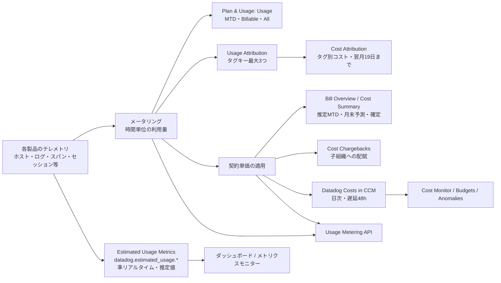
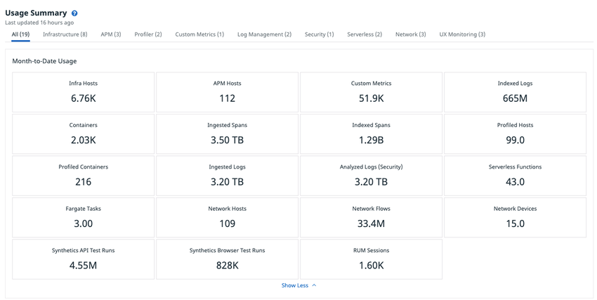
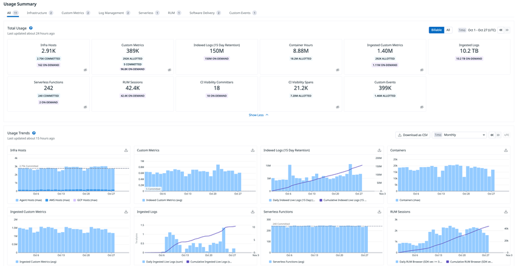
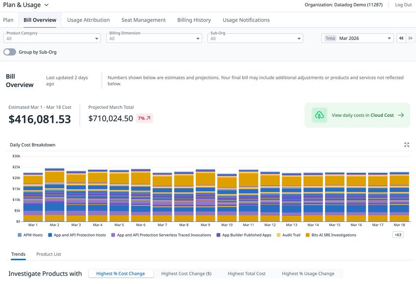
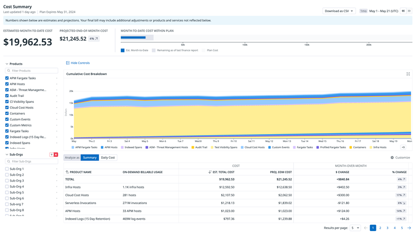
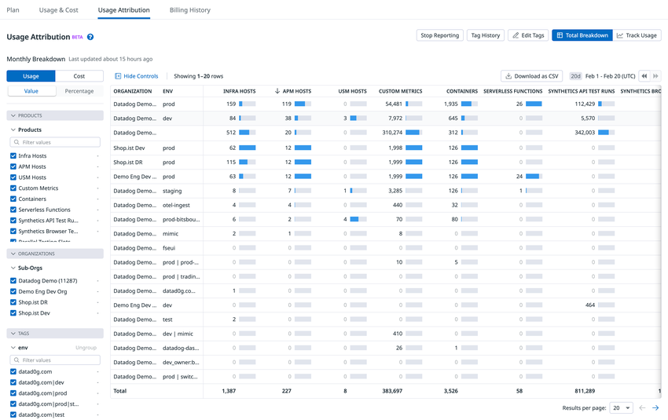
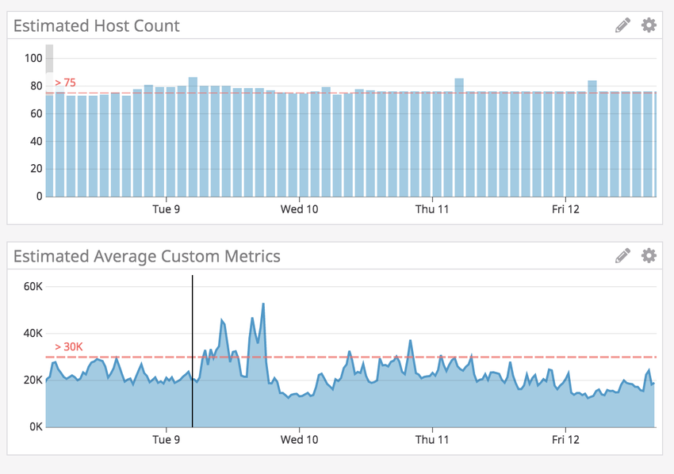

# Usage・Usage Attribution・Cost Visibility（利用量とコストの可視化）

## 概要

このファイルは、**Datadog 自身の利用量（Usage）と Datadog への支払いコスト（Cost）**を、画面・メトリクス・API の 3 つの経路でどう確認・配賦・監視するかをまとめたリファレンスである。AWS などクラウド事業者のコスト管理は [Cloud Cost Management](../infrastructure/cloud-cost-management.md) を、料金表の数値は [製品別料金表](../../03_導入編/pricing-by-product.md) を参照する。

Datadog の利用量・コスト可視化機能は、目的別に次のように分かれる。

| 機能 | 何が分かるか | 粒度・鮮度 | 主な利用者 | 主な画面・経路 |
|---|---|---|---|---|
| Usage（Usage & Cost / Usage Details） | 製品別の月初来（MTD）利用量、課金対象（Billable）とオンデマンドの内訳、上位カスタムメトリクス、インデックス別ログ量 | 時間単位で計測。更新まで最大 72 時間 | Admin、`usage_read` 保持者 | Plan & Usage > Usage |
| Bill Overview | 推定コスト（MTD）、月末予測コスト、日次コスト内訳、製品別トレンド、課金対象ホスト一覧 | 日次 | `billing_read` 保持者 | Plan & Usage > Bill Overview（2026-03 から段階展開） |
| Cost Summary / Cost Chargebacks | MTD 推定・月末予測・過去 15 か月のコスト、子組織別の配賦 | 日次更新。確定値は翌月 16 日頃 | `billing_read` + `usage_read` 保持者 | Plan & Usage > Usage（Overall / Individual Organizations） |
| Usage Attribution | 最大 3 つのタグキー別の利用量（月次・時間単位）、タグ別コスト（Cost Attribution） | 月次は日次更新。Cost Attribution は翌月 19 日まで | `usage_read`（設定は `usage_edit`） | Plan & Usage > Usage Attribution |
| Estimated Usage Metrics | 製品別の推定利用量をメトリクス `datadog.estimated_usage.*` として準リアルタイムに提供 | 準リアルタイム。請求値と平均 10〜20% の差 | メトリクス閲覧権限のあるユーザー | Metrics Explorer、ダッシュボード、モニター |
| Datadog Costs（CCM） | Datadog への支出を**日次**でコストデータとして提供。Cost Monitor、予算、異常検知に使える | 日次。遅延 48 時間、保持 15 か月 | `billing_read` + `usage_read` 保持者 | Cloud Cost > Explorer、ダッシュボードの Cloud Cost データソース |
| Usage Metering API | 上記の大半を API で取得（利用量、推定・予測・確定コスト、タグ別利用量・コスト） | 最大 72 時間の遅延。保持 15 か月 | Pro / Enterprise 顧客 | `/api/v1/usage/*`、`/api/v2/usage/*`、`/api/v2/cost_by_tag/*` |

[出典](https://docs.datadoghq.com/account_management/plan_and_usage/)、[出典](https://docs.datadoghq.com/account_management/plan_and_usage/usage_details/)、[出典](https://docs.datadoghq.com/account_management/plan_and_usage/bill_overview/)、[出典](https://docs.datadoghq.com/account_management/plan_and_usage/cost_details/)、[出典](https://docs.datadoghq.com/account_management/billing/usage_attribution/)、[出典](https://docs.datadoghq.com/account_management/billing/usage_metrics/)、[出典](https://docs.datadoghq.com/cloud_cost_management/datadog_costs/)、[出典](https://docs.datadoghq.com/api/latest/usage-metering/)

関連ファイル:

- 課金単位と計算方法の詳細: [課金計算の仕組み](../../03_導入編/billing-mechanics.md)
- 料金の数値（正本）: [製品別料金表](../../03_導入編/pricing-by-product.md)、[料金体系の全体像](../../03_導入編/pricing-overview.md)
- コスト削減の実践: [コスト最適化](../../04_応用編/cost-optimization.md)
- タグ設計: [Tagging（タグ）](tagging.md)、[タグ戦略の実践](../../04_応用編/tagging-strategy.md)
- マルチ org 運用: [組織・ユーザー・権限管理](account-and-access-management.md)、[大規模・マルチorg運用](../../04_応用編/large-scale-and-multi-org.md)
- カスタムメトリクスの利用量: [Custom Metrics と DogStatsD](custom-metrics-and-dogstatsd.md)

## 全体構成（データの流れ）

Datadog は各製品の利用量を時間単位で計測（メータリング）し、月末に製品ごとの集計方式（99 パーセンタイル、平均、合計など）で課金対象数量を決める。同じ計測データから、画面（Plan & Usage）、API（Usage Metering API）、タグ別レポート（Usage Attribution）、コスト（契約単価を適用した Cost Summary・Bill Overview・Datadog Costs）が作られる。これとは別系統で、準リアルタイムの推定値が Estimated Usage Metrics として出力される。

[出典](https://docs.datadoghq.com/account_management/billing/)、[出典](https://docs.datadoghq.com/account_management/billing/usage_metrics/)、[出典](https://docs.datadoghq.com/cloud_cost_management/datadog_costs/)

## Plan & Usage 画面の構成

Plan & Usage は、Datadog の契約・利用量・請求を確認する組織設定画面である。左ナビゲーション下部のアカウントメニュー（ユーザー名）から **Plan & Usage** を選ぶか、Personal Settings ページのヘッダーのドロップダウンから開く。[出典](https://docs.datadoghq.com/account_management/plan_and_usage/)

Plan & Usage のタブ構成は次のとおり。タブ名は時期と組織によって異なる。旧 UI では「Usage」または「Usage & Cost」タブ、新 UI（Bill Overview）では「Bill Overview」タブが中心になる。

| タブ | 内容 | 必要な権限 | 備考 |
|---|---|---|---|
| Plan | プランのアップグレード・ダウングレード、支払い方法、請求先連絡先、Subscription Details（コミット製品の数量・契約単価・オンデマンド単価） | `billing_read`（閲覧）／`billing_edit`（変更） | 標準プラン外の有料機能の追加・削除は営業担当または success@datadoghq.com に依頼する。パートナー経由の契約では Subscription Details は表示されない |
| Usage（Usage & Cost） | 製品別の MTD 利用量、利用トレンド、上位カスタムメトリクス、インデックス別ログ量、Cost Summary / Cost Chargebacks | `usage_read`（コスト表示には `billing_read` も必要） | 更新まで最大 72 時間かかることがある |
| Bill Overview | 推定コスト・予測コスト・日次コスト・製品別トレンドを 1 画面で表示 | `billing_read` | 2026 年 3 月から段階的に自動展開。旧レイアウトに戻すこともできる |
| Usage Attribution | タグ別の利用量・コスト | `usage_read`（設定変更は `usage_edit`） | Enterprise プランに含まれる高度な機能 |
| Billing History | 請求履歴。クレジットカード払いの場合は過去月の領収書 | `billing_read` | 請求の質問は営業担当または success@datadoghq.com |
| Trial Management | セルフサービスで開始できるトライアル一覧、実施中・過去のトライアルと終了日 | Admin | 利用できるトライアルがある組織にのみ表示される。営業主導のトライアルは表示されない |
| Usage Notifications | 初回利用通知の対象製品の一覧と、製品ごとの通知オン・オフ | `usage_notifications_read`／`usage_notifications_write` | 【Beta】 |

[出典](https://docs.datadoghq.com/account_management/plan_and_usage/)、[出典](https://docs.datadoghq.com/account_management/billing/)、[出典](https://docs.datadoghq.com/account_management/plan_and_usage/bill_overview/)、[出典](https://docs.datadoghq.com/account_management/plan_and_usage/usage_details/)

> **注記:** Bill Overview 版の公式スクリーンショット（2026-03 時点の画面）には、上記のほかに「Seat Management」タブも表示されている。Seat Management タブの仕様は、本ファイルで参照した公式ドキュメントからは確認できなかった。

### Billing（請求）の基本ルール

Plan & Usage の数値を読むには、Datadog の請求ルールを押さえておく必要がある。詳細は [課金計算の仕組み](../../03_導入編/billing-mechanics.md) を参照。

| 項目 | 仕様 |
|---|---|
| 請求サイクル | 毎月 1 日（UTC）に始まる。申込日に関係なく 1 日起算で、初月は日割り |
| ホスト・カスタムメトリクスの計測 | 時間単位で計測 |
| ホストの課金数量 | 月内の各時間の計測値のうち、上位 1% を除いた最大値（下位 99% の最大値、high-water mark） |
| カスタムメトリクスの課金数量 | 月内のカスタムメトリクス時間（metric hours）の平均 |
| 非報告ホスト | Infrastructure List でステータスが `INACTIVE` のホストは課金対象外。リストから外れるまで最大 2 時間 |
| Agent を入れたクラウド VM | Agent を入れた EC2 や VM は 1 インスタンスとして数える（統合経由と二重課金しない） |
| 支払い方法 | クレジットカード、または請求書払い（ACH、電信送金、小切手） |
| 請求書の送付 | 請求書払いの場合、毎月第 10 営業日頃に請求先メールアドレスへ送られる |
| 請求関連の問い合わせ先 | 異議申立て・クレジット・利用量・支払い方法の変更: success@datadoghq.com／請求書の写し・請求内訳: billing@datadoghq.com／送金: remittances@datadoghq.com／発注書（PO）の写し: purchaseorders@datadoghq.com |

[出典](https://docs.datadoghq.com/account_management/billing/)

## Usage（利用量）画面

### 画面の構成

Usage 画面は製品カテゴリ別のタブ（「All」タブと製品別タブ）で構成される。各タブには **Month-to-Date Summary（月初来サマリー）** と **Overall Usage（現在と過去の利用量）** が表示される。Custom Metrics タブには **Top Custom Metrics**、Log Management タブには **Logs Usage by Index** が追加される。管理者はアカウントメニューから `Plan & Usage` → `Usage` を開く。[出典](https://docs.datadoghq.com/account_management/plan_and_usage/usage_details/)

- **キャプション:** Plan & Usage > Usage の「All」タブに表示される Month-to-Date Usage Summary。
- **画面説明:** 上部に製品カテゴリのタブ（All、Infrastructure、APM、Log Management など）が並ぶ。その下に製品ごとのタイル（Infra Hosts、Containers、Custom Metrics、APM Hosts、Ingested Logs、Indexed Logs など）があり、各タイルに当月の利用量（例: ホスト数、イベント数、バイト数）が表示される。
- **出典:** https://docs.datadoghq.com/account_management/plan_and_usage/usage_details/ （画像取得日: 2026-11-02）

### All と Billable の違い

| ビュー | 内容 |
|---|---|
| All | 製品トライアルなど課金対象外の利用量も含む全利用量 |
| Billable | 最終的な請求に効く利用量のみ。コミット（commitments）、アロットメント（allotments、他製品に付随する無償枠）、オンデマンド（on-demand）の内訳を表示する。ほとんどのアカウントで利用できる |

「All」と「Billable」のどちらにも API エンドポイントがある（`/api/v1/usage/summary` と `/api/v1/usage/billable-summary`）。[出典](https://docs.datadoghq.com/account_management/plan_and_usage/usage_details/)、[出典](https://docs.datadoghq.com/api/latest/usage-metering/)

### 月初来（MTD）利用量の集計方法

Usage 画面に表示される MTD 利用量の集計方法は製品ごとに次のとおり（公式 Usage Details の表による）。

| 製品（表示名） | 集計方法 |
|---|---|
| Infra. Hosts | 当月の全時間における一意なインフラホスト数の 99 パーセンタイル |
| Containers | 当月の全時間における一意なコンテナ数の最大値（high watermark） |
| APM Hosts | 一意な APM ホスト数の 99 パーセンタイル |
| Profiled Hosts | 一意なプロファイル対象ホスト数の 99 パーセンタイル |
| Profiled Containers | 一意なプロファイル対象コンテナ数の平均 |
| Custom Metrics | 一意なカスタムメトリクス数の平均（時間単位） |
| Ingested Custom Metrics | 一意な ingested カスタムメトリクス数の平均 |
| Ingested Logs | 取り込みログのバイト数の合計 |
| Indexed Logs | インデックスされたログイベント数の合計 |
| Scanned Logs | Sensitive Data Scanner がスキャンしたログのバイト数の合計 |
| Ingested Spans | 取り込みスパンの合計 |
| Indexed Spans | インデックスされたスパン（Indexed Spans）の合計 |
| Analyzed Logs (Security) | 分析対象ログ（Cloud SIEM）のバイト数の合計 |
| Serverless Functions | 1 時間に 1 回以上実行された関数の数の平均 |
| Serverless Invocations | 呼び出し回数の合計 |
| Fargate Tasks | Fargate タスクの合計（※下記の注を参照） |
| Network Hosts | 一意な Network ホスト数の 99 パーセンタイル |
| Network Flows | インデックスされた Network フローの合計 |
| Network Devices | 一意な Network デバイス数の 99 パーセンタイル |
| Synthetic API Tests | Synthetic API テスト実行の合計 |
| Synthetic Browser Tests | Synthetic ブラウザテスト実行の合計 |
| RUM Sessions | RUM セッションの合計 |
| IoT Devices | 99 パーセンタイル |
| Incident Management | 一意なアクティブユーザー数 |

[出典](https://docs.datadoghq.com/account_management/plan_and_usage/usage_details/)

> **注記（ドキュメント間の差異）:** Fargate Tasks の集計方法は、Usage Details ページでは「合計（sum）」とされている。一方 Cost Details ページの課金集計の説明では「月平均（monthly average）」とされ、APM 用の Usage ページの説明でも APM Fargate Tasks は「5 分間隔の一意タスク数の平均」とされている。請求上の扱いは [課金計算の仕組み](../../03_導入編/billing-mechanics.md) と契約書で確認すること。[出典](https://docs.datadoghq.com/account_management/plan_and_usage/cost_details/)、[出典](https://docs.datadoghq.com/account_management/billing/usage_monitor_apm/)

### Usage Trends（利用量トレンド）

- アカウント全体の合計利用量をグラフで表示する。
- 合計型（sum ベース）の製品では累積（Cumulative）表示ができる。
- 時間粒度は **daily / weekly / monthly / yearly** から選ぶ。
- 製品タブでは、サブタイプ別の内訳を表示できる（例: Infrastructure タブのホスト種別）。
- **Download as CSV** で、組織別・製品別の時間単位の内訳を CSV でダウンロードできる。

[出典](https://docs.datadoghq.com/account_management/plan_and_usage/usage_details/)

### Billable on-demand pills と Committed line【Beta】

Usage 画面では、コミット内の利用量とオンデマンド（超過）利用量を視覚的に区別できる。

| 表示 | 意味 |
|---|---|
| 紫のピル（pill） | オンデマンド利用量 |
| 青のピル | コミットとアロットメントでカバーされる利用量 |
| 破線「Committed」 | 製品ごとのコミット量（アロットメントは含まない） |
| 「See included usage」トグル（目のアイコン） | 合計利用量カードでピルを表示する |

- **キャプション:** 利用量タイルのピル表示（オンデマンド／コミット内）と、Usage Trends グラフ上の Committed（コミット量）破線。
- **画面説明:** 上段の製品タイルに、コミット・アロットメントでカバーされる量（青）とオンデマンド量（紫）の小さなラベルが付く。下段の利用量トレンドグラフには、コミット量を表す水平の破線が引かれる。利用量がこの線を超えた部分がオンデマンド課金の目安になる。
- **出典:** https://docs.datadoghq.com/account_management/plan_and_usage/usage_details/ （画像取得日: 2026-11-02）

[出典](https://docs.datadoghq.com/account_management/plan_and_usage/usage_details/)

### Top Custom Metrics

Custom Metrics タブの Top Custom Metrics は、カスタムメトリクスの利用量を**メトリクス名単位**で確認する表である。

| 項目 | 仕様 |
|---|---|
| ビュー | 「Top 5000」と「All」 |
| 列 | メトリクス名、1 時間あたりの平均カスタムメトリクス数、1 時間あたりの最大カスタムメトリクス数。Top 5000 ではさらに全体に対する寄与率（%） |
| 対象期間 | 当月 MTD と、直近日（最終更新日）の利用量 |
| 検索 | メトリクス名で検索できる |
| 詳細 | 行のメーターアイコンから Metrics Summary に移動できる |
| CSV | 両ビューとも CSV でダウンロードできる。「All」の CSV は**最大 300,000 メトリクス**で、それを超える分は API で取得する |
| API | `GET /api/v1/usage/top_avg_metrics`（`month` または `day` のどちらか一方を指定。`limit` は 1〜5000、既定 500） |

[出典](https://docs.datadoghq.com/account_management/plan_and_usage/usage_details/)、[出典](https://docs.datadoghq.com/api/latest/usage-metering/)

カスタムメトリクスの課金とカーディナリティ削減の詳細は [Custom Metrics と DogStatsD](custom-metrics-and-dogstatsd.md) を参照。

### Logs Usage by Index

Log Management タブの Logs Usage by Index は、インデックスされたログの量を**インデックス名と保持期間別**に表示する表である。

| 項目 | 仕様 |
|---|---|
| 期間粒度 | hourly / daily / monthly / annual |
| 区分 | ライブ（live）ログと再水和（rehydrated）ログを分けて表示 |
| 列 | インデックス名、保持期間（日数）、インデックスされたログ件数、全体に対する寄与率（%） |
| CSV | ダウンロードできる |
| マルチ org | 親組織の Overall Usage でも、当月と前月のインデックス別ログ量を確認できる |

[出典](https://docs.datadoghq.com/account_management/plan_and_usage/usage_details/)、[出典](https://docs.datadoghq.com/account_management/multi_organization/)

インデックスと保持期間の設計は [Indexes・保持・アーカイブ](../logs/log-indexes-retention-archives.md) を参照。

### First-time usage notifications（初回利用通知）【Beta】

初回利用通知は、**現在の契約に含まれていない製品**が初めて課金対象として使われたときに送られるメールである。

| 項目 | 仕様 |
|---|---|
| 送信タイミング | その製品の初回課金対象利用から約 48 時間後（その月の初回利用が対象） |
| 設定場所 | Plan & Usage の Usage Notifications タブに対象製品が一覧表示される。製品のチェックを外すと、アカウント全体でその製品の通知が止まる |
| 受信者 | `usage_notifications_read` または `usage_notifications_write` 権限を持つユーザー |
| マルチ org | 親組織のユーザーは子組織の利用についても通知を受ける。子組織のユーザーは自組織分のみ |

[出典](https://docs.datadoghq.com/account_management/plan_and_usage/usage_details/)、[出典](https://docs.datadoghq.com/account_management/rbac/permissions/)

### トライアル利用量の表示

Trial Management タブから開始したトライアル期間中は課金されない。トライアル終了後の利用は課金される。トライアル中の利用量は Usage & Cost タブにインジケーターアイコン付きで表示され、ツールチップには「トライアルでなければ発生していた推定コスト」が示される。[出典](https://docs.datadoghq.com/account_management/plan_and_usage/)

### マルチ org での Usage 画面

親組織（parent organization）は、自組織とすべての子組織（child organization）の利用量を確認できる。子組織は自組織の利用量のみを確認できる。[出典](https://docs.datadoghq.com/account_management/plan_and_usage/)、[出典](https://docs.datadoghq.com/account_management/multi_organization/)

| タブ | 内容 |
|---|---|
| Overall | Month-to-Date Total Usage（親組織と全子組織の合計）と Overall Usage（過去 6 か月の月次合計、CSV ダウンロード可）。Overall Usage は「All」利用量で、トライアルなどの請求上の調整は反映されない |
| Individual Organizations | 子組織ごとの利用量を絶対値または割合（%）で表示する。既定は「Billable」ビューで、トライアル組織など課金対象外の子組織は除かれる。「All」に切り替えると調整前の値になる。どちらのビューも CSV でダウンロードできる。子組織名をクリックするとその組織の Usage Details を開く |

[出典](https://docs.datadoghq.com/account_management/multi_organization/)

## Bill Overview（新しいコスト・利用量画面）

### 概要と提供状況

Bill Overview は、Datadog のコスト、利用量トレンド、月末予測コストを 1 画面にまとめた新しい Plan & Usage 画面である。日次の内訳、製品別の詳細、子組織によるフィルターを備える。URL は `app.datadoghq.com/billing/bill-overview`（US1 の場合）。[出典](https://docs.datadoghq.com/account_management/plan_and_usage/bill_overview/)

| 項目 | 内容 |
|---|---|
| 提供状況 | 2026 年 3 月に始まった段階展開により自動で有効化される（それ以前は【Limited Availability】） |
| 旧レイアウトへの切り替え | ヘッダーの **Disable Preview** ボタンで旧レイアウトに戻せる。すべての組織で使え、選択はセッション中維持される。**Enable Preview** で Bill Overview に戻る |
| 表示上の注意 | 画面上の数値は推定値・予測値である。最終請求には追加の調整や、画面に表示されない製品・サービスが含まれる場合がある |

[出典](https://docs.datadoghq.com/account_management/plan_and_usage/bill_overview/)、[出典](https://docs.datadoghq.com/account_management/plan_and_usage/cost_details/)

- **キャプション:** Plan & Usage > Bill Overview のメイン画面。
- **画面説明:** 上部のタブは Plan、Bill Overview、Usage Attribution、Seat Management、Billing History、Usage Notifications。その下に Product Category、Billing Dimension、Sub-Org のフィルター、期間セレクター（例: 1mo / Mar 2026）、「Group by Sub-Org」トグルが並ぶ。中央左に「Estimated Mar 1 - Mar 18 Cost」（推定 MTD コスト）と「Projected March Total」（月末予測。前月比 % 付き）、右に「View daily costs in Cloud Cost」へのリンクがある。下段の Daily Cost Breakdown は、課金ディメンション別に色分けした日次コストの積み上げ棒グラフ。最下部に Trends / Product List タブと、並び替えボタン（Highest % Cost Change など）がある。
- **出典:** https://docs.datadoghq.com/account_management/plan_and_usage/bill_overview/ （画像取得日: 2026-11-02）

### グローバルフィルター

| フィルター | 内容 |
|---|---|
| Product Category | 製品ファミリー（Infrastructure、APM、Logs、Security、AI/ML など）で全ビューを絞り込む |
| Billing Dimension | 1 つの計測ディメンション（例: Infra Hosts、Indexed Logs、Synthetic Browser Tests）に絞り込む |
| Sub-Org | 1 つの子組織に絞り込む |
| Group by Sub-Org | コストを子組織別にグループ化するトグル |
| Time range | 請求期間（月）を選ぶ。前後の矢印で月を移動する |

[出典](https://docs.datadoghq.com/account_management/plan_and_usage/bill_overview/)

### 主な構成要素

| 構成要素 | 内容 |
|---|---|
| Cost summary | **Estimated cost to date**（当月の経過日分の推定コスト）と **Projected total**（現在の利用が続いた場合の月末合計予測。前月比 % 付き） |
| Daily Cost Breakdown | 課金ディメンション別の日次コストの積み上げ棒グラフ。展開アイコンで全画面表示 |
| Trends タブ | 調査すべき製品をカード表示する。並び替えは **Highest % Cost Change / Highest Cost Change ($) / Highest Total Cost / Highest % Usage Change** の 4 種類。各カードには期間合計コスト、月末予測コスト、前月比バッジ、前月と当月の日次コスト棒グラフが表示される。自然単位の利用量（例: スキャンした PB、カスタムメトリクス数）は Total Cost と Usage 関連の並び替えでのみ表示される。**View Details** で製品詳細ページへ移る |
| Product List タブ | 全課金ディメンションのコストと利用量を並べた表。列は Billing Dimension、Cost Total、Cost Proj. EOM、Cost Change（$ と %、前期間比）、Usage Total、Usage Change。Monthly / Daily の切り替えがある。**Download as CSV** で表全体を出力する。既定は 1 ページ 10 行。行末にマウスを置くと、そのディメンションの **Cost Monitor** を作成できる |
| 製品詳細ページ: Cost Overview | Total Cost to date、Projected Cost Change（$ と %）、Projected EOM、日次コスト棒グラフ（前月と当月）。**Show Usage Charges Only** トグルでオンデマンド課金だけを表示できる。そのディメンションで絞り込んだ Cloud Cost Management へのリンクがある |
| 製品詳細ページ: Usage Overview | 期間合計の利用量、利用量の変化、サブディメンション別の合計（例: Sensitive Data Scanner は Scanned Events、Logs、RUM Sessions、Spans に分かれる）、Usage Types の積み上げ棒グラフ、**Allotment Usage** の進捗バー（超過時は「>100%」）。そのディメンションで絞り込んだ Usage Attribution へのリンクがある |
| 製品詳細ページ: Resource Drilldown | **Infra Hosts と APM Hosts のみ**。選択月の課金対象ホストを一覧表示する。名前・種別・組織で検索でき、既定は 1 ページ 10 行。画面上の列は Resource Name、Resource Type、Usage Value、Organization の 4 列 |

[出典](https://docs.datadoghq.com/account_management/plan_and_usage/bill_overview/)

### Billable Resources CSV（課金対象リソース一覧）

製品詳細ページの **Download Billable Resources as CSV** で、Infra Hosts / APM Hosts の課金対象リソースの全件一覧を出力できる。月を確定してから「どのホストが課金されたか」を突き合わせるのに使う。

| 項目 | 仕様 |
|---|---|
| 手順 | 右上のサイドパネルで月を選び、Download Billable Resources as CSV をクリックする |
| 対象期間 | **完了した暦月のみ**（当月の途中は出力できない） |
| サイト制限 | `app.ddog-gov.com`（US1-FED）と `us2.ddog-gov.com` では使えない |
| 列 `Org Name` | 組織名 |
| 列 `Public ID` | 組織の Public ID |
| 列 `Timestamp` | 99 パーセンタイル課金の組織では、99 パーセンタイル値を計測した時刻。合計（sum）課金の組織では月初日 |
| 列 `Resource Type` | 例: `agent`、`aws`、`vsphere` |
| 列 `Resource Name` | ホスト名またはインスタンス ID |
| 列 `Usage Value` | 99 パーセンタイル課金の組織ではホストごとに 1。合計課金の組織ではホスト時間（例: 30 日フル稼働で 720） |
| 列 `Tags` | タグのキーと値の JSON オブジェクト。タグがなければ `{}` |
| 突き合わせ | `Usage Value` の合計は、画面上の Infra Hosts / APM Hosts の合計（ホスト数またはホスト時間）と一致する |

[出典](https://docs.datadoghq.com/account_management/plan_and_usage/bill_overview/)

### Bill Overview の権限

| 対象 | 必要な権限・条件 |
|---|---|
| Bill Overview（コストデータ） | `billing_read` |
| Usage タブ | `usage_read` |
| Plan Details | `billing_read` |
| Billing History | `billing_read` |
| Usage Attribution | `usage_read`、かつ Enterprise または Pro プラン |
| 子組織のコストトレンド | 親組織で `suborg_cost_trends` が有効であること |

[出典](https://docs.datadoghq.com/account_management/plan_and_usage/bill_overview/)

> **注記（ドキュメント間の差異）:** Bill Overview ページの権限表は Usage Attribution の条件を「Enterprise または Pro」としている。一方 Multi-org ページでは「Usage Attribution は Enterprise プランに含まれる高度な機能で、他のプランでは営業担当に問い合わせる」とされている。なお Estimated Usage Metrics ページには「Pro プランでも `.by_tag` メトリクスへのアクセスを CSM 経由で申請できる」とあるが、これは `.by_tag` メトリクスについての記述で、Usage Attribution 機能そのものの提供条件ではない。したがって、**Enterprise には標準で含まれ、Pro では営業・CSM への申請により利用できる場合がある**と解釈するのが整合的である【推定】（Bill Overview と Multi-org の記述を突き合わせた解釈。Pro で申請が必要かどうかを明記した公式記述はない）。[出典](https://docs.datadoghq.com/account_management/multi_organization/)、[出典](https://docs.datadoghq.com/account_management/billing/usage_metrics/)

### パートナー経由購入の場合（Partner purchased cost visibility）

Datadog をパートナー（リセラー等）経由で購入している顧客も、Bill Overview で自組織のコストを確認できる。

| 項目 | 内容 |
|---|---|
| 表示内容 | MTD 推定コスト、締め後の月の過去コスト（15 か月前、または直近の契約変更時点のうち新しいほうまで）、日次内訳、製品・課金ディメンション別、子組織フィルター |
| 計算方法 | パートナーが共有した単価を Datadog が利用量に適用する。締め後の過去コストも含め、すべて推定値。通常はパートナーの請求書と一致するが、数セント程度の差が出ることがある。大きな差異はパートナーに問い合わせる |
| 非対応機能 | Projected costs（予測コスト）、Cost by Tag、CCM 上の Datadog Costs |
| 非対応の購入形態 | ドローダウン契約のないクラウドマーケットプレイス購入（AWS、Google Cloud、Azure）、多数の顧客を 1 契約にまとめた旧来の MSP 契約、2 社のチャネルパートナーを経由した購入 |
| 非対応の組織 | GovCloud 組織 |
| コストが表示されないもの | Error Tracking と Agent Observability（旧称：LLM Observability）の現行 SKU の段階制オンデマンド料金、支出に対する割合で課金される製品（Audit Trail、Premier Support など） |

[出典](https://docs.datadoghq.com/account_management/plan_and_usage/bill_overview/partner_purchased_cost_visibility/)

## Cost Summary と Cost Chargebacks

### 概要

Cost Summary と Cost Chargebacks は、Datadog の**推定 MTD コスト、月末予測コスト、過去のコスト**を確認し、子組織や製品の単位に配賦（チャージバック）するための機能である。コストデータは過去 15 か月分を確認できる。[出典](https://docs.datadoghq.com/account_management/plan_and_usage/cost_details/)

> **注記:** Cost Details ページには「新しい Bill Overview 体験は Limited Availability で、2026 年 3 月から全組織へ自動展開する」という告知がある。Bill Overview を無効化した（Disable Preview）場合は、本節の旧レイアウトが表示される。[出典](https://docs.datadoghq.com/account_management/plan_and_usage/cost_details/)

| 項目 | 内容 |
|---|---|
| 必要な権限 | `billing_read` と `usage_read`（Datadog Admin ロールは既定で両方を持つ） |
| データ期間 | 過去 15 か月 |
| 内訳の軸 | 子組織（sub-organization）、製品 |
| 日次コストが必要な場合 | Cloud Cost Management の [Datadog Costs](#datadog-costscloud-cost-management-上の-datadog-支出) を使う |

[出典](https://docs.datadoghq.com/account_management/plan_and_usage/cost_details/)

### Cost Summary でできること

- 推定 MTD コストと月末予測コストの確認
- 過去コストの確認
- 製品または子組織によるフィルター・グループ化
- 前月比の変化（% と $）
- 当月内のコストトレンド
- 日ごとの累積コスト（Daily Cost タブ）

[出典](https://docs.datadoghq.com/account_management/plan_and_usage/cost_details/)

- **キャプション:** 親組織の Cost Summary（当月表示）。
- **画面説明:** 左上に「ESTIMATED MONTH-TO-DATE COST」（推定 MTD コスト）と「PROJECTED END-OF-MONTH COST」（月末予測。前月比 % 付き）、右に「MONTH-TO-DATE COST WITHIN PLAN」（契約内に占める MTD コストの進捗バー）がある。左ペインは Products と Sub-Orgs のファセット。中央の Cumulative Cost Breakdown は製品別の累積コスト面グラフ。下段の表（Analyze as: Summary / Daily Cost）には PRODUCT NAME、ON-DEMAND BILLABLE USAGE、EST. TOTAL COST、PROJ. EOM COST、MONTH-OVER-MONTH の $ CHANGE と % CHANGE が並ぶ。右上に Download as CSV と期間セレクターがある。
- **出典:** https://docs.datadoghq.com/account_management/plan_and_usage/cost_details/ （画像取得日: 2026-11-02）

### Projected Costs（月末予測コスト）

- **計算方法:** 前月と当月の予測利用量に契約単価を適用して算出する。
- **更新:** 毎日更新され、月内の利用状況によって変わる。
- **精度:** 予測値なので、確定した月額コストとは異なる場合がある。
- **API での提供:** `GET /api/v2/usage/projected_cost` は当月のみで、**毎月 12 日頃から**取得できる。

[出典](https://docs.datadoghq.com/account_management/plan_and_usage/cost_details/)、[出典](https://docs.datadoghq.com/api/latest/usage-metering/)

### 親組織での Cost Summary

マルチ org の親組織では、親組織と各子組織の推定・予測・過去コストを確認できる。

1. 親組織にログインし、[Plan & Usage](https://app.datadoghq.com/billing/usage) を開く。
2. **Usage** タブを選ぶ。
3. マルチ org の場合は **Overall** タブが選ばれていることを確認する。
4. 左のファセットで **Products / Sub-Orgs / Cost Breakdown** を絞り込む。**Daily Cost** タブで当月の日ごとの累積変化を見る。
5. 過去コストは月を戻すか、日付ドロップダウンで **1 / 3 / 6 / 12 か月**を選んで確認する。

[出典](https://docs.datadoghq.com/account_management/plan_and_usage/cost_details/)

### 子組織での Cost Summary【Limited Availability】

子組織（sub-organization）単位の Cost Summary は限定提供である。利用するには、営業担当または Customer Support に資格と提供可否を確認する。子組織のユーザーには自組織のコストだけが表示されるので、親組織が広い Admin 権限を渡す必要がない。

- 手順: 子組織にログイン → Plan & Usage → Usage タブ → Overall タブ
- ファセット: Products と Cost Breakdown（Sub-Orgs ファセットはない）。Daily Cost タブあり
- 過去コストの見方は親組織と同じ

[出典](https://docs.datadoghq.com/account_management/plan_and_usage/cost_details/)

### Cost Summary の CSV 出力

親組織・子組織とも **Download as CSV** で出力できる。CSV の `Cost Type` 列でレコードの種類を区別する。

| `Cost Type` | 内容 |
|---|---|
| Projected | 当月のみ |
| Estimated MTD | 1 日から当日までの推定値。前月の過去データがまだ確定していない場合は、前月分もこの種類で出る |
| Historical | 月の締め後に確定した値。**月末から約 16 日後**に利用可能 |

[出典](https://docs.datadoghq.com/account_management/plan_and_usage/cost_details/)

### Cost Chargebacks（マルチ org のコスト配賦）

Cost Chargebacks は、マルチ org アカウントで、親組織のコストを各子組織に配賦するための機能である。

**配賦の計算方法:**

1. 子組織ごとの利用比率を計算する: `子組織の利用量 ÷ 親組織全体の利用量`
2. その比率を親組織のコストに掛けて、子組織ごとのチャージバック額を求める

| 種類 | 内容 | 表示手順 | 利用可能時期 |
|---|---|---|---|
| Historical chargebacks | 確定月について、製品別・子組織別に集計した値 | 親組織 → Plan & Usage → Usage タブ → **Individual Organizations** → **Billable** と **Cost** トグルが選ばれていることを確認 → 請求が確定した前月以前を選択 | 月末から約 16 日後 |
| Estimated chargebacks | 当月（または過去データが未確定の前月）について、製品別・子組織別に集計した値 | 同上で、日付セレクターを当月または前月にする | 随時 |

出力: Historical / Estimated とも **Download as CSV** で出力できる。API では `GET /api/v2/usage/historical_cost` と `GET /api/v2/usage/estimated_cost`（`view=sub-org`）で取得できる。[出典](https://docs.datadoghq.com/account_management/plan_and_usage/cost_details/)

### 集計方式によるコスト変動の違い

コストの変動のしかたは、製品の課金集計方式で異なる。Cost Summary の Products フィルターには、各製品の課金集計方式が表示される。

| 集計方式 | 対象例（公式記載） | コストの挙動 |
|---|---|---|
| パーセンタイル（下位 99% の最大値） | Infrastructure ホスト、APM ホスト | 比較的安定する。ただし大きなスパイクや急減は影響する |
| 平均 | カスタムメトリクス、Fargate タスク | 比較的安定する |
| 合計 | インデックスログ、取り込みログ | 量の増減がそのままコストに反映される |

[出典](https://docs.datadoghq.com/account_management/plan_and_usage/cost_details/)

## Usage Attribution（タグ別利用量）

### 概要

Usage Attribution は、Datadog の利用量を**最大 3 つのタグキー**（例: `team`、`service`、`env`）で分解し、チームやプロジェクト単位の利用量・コストの配賦（ショーバック／チャージバック）に使う機能である。Administrators、または `usage_read` 権限を持つユーザーが Plan & Usage の Usage Attribution タブを開ける。[出典](https://docs.datadoghq.com/account_management/billing/usage_attribution/)

| 項目 | 仕様 |
|---|---|
| 提供プラン | Enterprise プランに含まれる高度な機能。他のプランでは営業担当または success@datadoghq.com に問い合わせる（[Bill Overview の権限](#bill-overview-の権限) の注記も参照） |
| 閲覧権限 | Admin、または `usage_read` |
| 設定権限 | `usage_edit`（Usage Attribution の設定を管理する権限） |
| タグキー数 | 最大 3 |
| 初回レポート | タグ設定から 24 時間後 |
| 非対応 | 計装時にタグを付けられない製品の利用量（例: Incident Management Users、Parallel Testing Slots、Audit Trail） |
| CI Pipeline / Test Optimization | チームなどのタグで課金を分けたい場合は、CI Visibility Billing の「Billing enrichment」を使う |

[出典](https://docs.datadoghq.com/account_management/billing/usage_attribution/)、[出典](https://docs.datadoghq.com/account_management/multi_organization/)、[出典](https://docs.datadoghq.com/account_management/rbac/permissions/)

### タグの設定（Edit Tags）

日次データを受け取り始めるには、管理者がレポート用のタグを選ぶ。Edit Tags ポップオーバーの仕様は次のとおり。

- ドロップダウンからタグキーを最大 3 つ選ぶ。ドロップダウンには、ルートアカウントと子組織にある既存のタグが表示される。
- 既存のタグを削除・編集できる。
- タグ設定から 24 時間後に最初のレポートが作られ、以後は継続的に作られる。
- タグを変更すると、新しいレポートには新しいタグが使われる。過去のレポートは古いタグのまま。
- 月次レポートには最新のタグセットが使われる。月の途中でタグを変更すると、期間ごとに部分月のレポートが作られる。

[出典](https://docs.datadoghq.com/account_management/billing/usage_attribution/)

> **ポイント:** Usage Attribution で設定したタグキーは、Estimated Usage Metrics の `.by_tag` メトリクスと、Datadog Costs（CCM）のタグにも使われる。タグキーを変えると、これら 3 つの分解軸がまとめて変わる。`.by_tag` への反映は次の 00:00 UTC から。[出典](https://docs.datadoghq.com/account_management/billing/usage_metrics/)、[出典](https://docs.datadoghq.com/cloud_cost_management/datadog_costs/)

タグキーの選び方（`team`、`service`、`env`、`cost-center` など）と、付与率を高める方法は [Tagging（タグ）](tagging.md) と [タグ戦略の実践](../../04_応用編/tagging-strategy.md) を参照。

### Monthly usage attribution（月次）

| 項目 | 仕様 |
|---|---|
| 更新 | 毎日更新される MTD 集計 |
| フィルター | ファセットで製品・タグ・組織を絞り込める |
| グループ化 | 選んだタグキーでグループ化・解除ができる |
| 表示形式 | Value（値）または Percentage（割合） |
| 列の編集 | 表に含める製品を選べる |
| マルチ org | 親アカウントで全組織の利用量を合算して表示する |
| 過去月 | 時間セレクターで過去月のレポートを開ける |
| CSV | ダウンロードできる。利用量と割合の両方を含み、配賦・チャージバックに使える。**割合は組織ごとに計算される** |
| API | `GET /api/v1/usage/monthly-attribution` |

[出典](https://docs.datadoghq.com/account_management/billing/usage_attribution/)

- **キャプション:** Plan & Usage > Usage Attribution の Monthly Breakdown（月次の内訳）。
- **画面説明:** 右上に Stop Reporting、Tag History、Edit Tags、Total Breakdown、Track Usage のボタンがある。左ペインには Usage / Cost の切り替え、Value / Percentage の切り替え、PRODUCTS（Infra Hosts、APM Hosts、Custom Metrics、Containers など）、ORGANIZATIONS（Sub-Orgs）、TAGS（例: `env` の値）のファセットが並ぶ。中央の表は ORGANIZATION と ENV（タグキー）を行に、INFRA HOSTS、APM HOSTS、USM HOSTS、CUSTOM METRICS、CONTAINERS、SERVERLESS FUNCTIONS、SYNTHETICS API TEST RUNS などの製品を列にとり、各セルに利用量とバーを表示する。最下行は Total。右上に Download as CSV と期間（例: Feb 1 - Feb 20 (UTC)）がある。
- **出典:** https://docs.datadoghq.com/account_management/billing/usage_attribution/ （画像取得日: 2026-11-02）

### Hourly usage attribution（時間単位）

時間単位のデータは API（`GET /api/v1/usage/hourly-attribution`）で取得する。公式ドキュメントでは、UI から時間単位の CSV も作れるとされている。[出典](https://docs.datadoghq.com/account_management/billing/usage_attribution/)

### Track Usage（時系列表示）

**Track Usage** をクリックすると、Usage Attribution のデータを時系列グラフで表示する。ファセットで製品・組織・タグキーを絞り込み、時間セレクターで日・週・月を切り替える。[出典](https://docs.datadoghq.com/account_management/billing/usage_attribution/)

### レポートの読み方

公式ドキュメントのサンプル（Infra 利用量を `app` と `service` で分解した例）:

| public_id | hour | app | service | total_usage |
|---|---|---|---|---|
| publicid1 | 2022-03-31 00:00:00 | `<empty>` | service1 \| service2 | 50 |
| publicid1 | 2022-03-31 09:00:00 | app1 | （値なし） | 28 |
| publicid1 | 2022-03-31 18:00:00 | app2 | service3 | 1023 |

| セルの値 | 意味 |
|---|---|
| `<empty>` | そのタグキーは付いていたが、値が空だった |
| 値なし（空欄） | そのタグキーが付いていなかった（未タグ付けの利用量） |
| `service1 \| service2`（パイプ区切り） | 同じタグキーがリソースに複数回付いていた |
| 通常の値 | そのタグの実際の値 |

複数のタグを使う場合、時間単位・月次のレポートはタグのすべての組み合わせを含む。そのため、ピボットやグループ化で一部のタグに絞ったビューを作ったり、任意の期間で集計し直したりする元データに使える。[出典](https://docs.datadoghq.com/account_management/billing/usage_attribution/)

### マルチ org での Usage Attribution

| 有効化の単位 | 挙動 |
|---|---|
| 親組織 | 全組織の利用量を合算して表示する。子組織の利用量をプロジェクトやチームに配賦するのに使える |
| 子組織 | タグはその子組織にのみ適用され、その子組織でしか見られない。親組織には集約されず、親組織からは見えない |

親組織の Usage Attribution では、月次利用量の UI 表示と .tsv（タブ区切り）ダウンロード、大半の利用タイプの日次利用量の .tsv ファイルを利用できる。[出典](https://docs.datadoghq.com/account_management/multi_organization/)

> **注記:** Usage Attribution ページは出力形式を「CSV」、Multi-org ページは「.tsv」と記載しており、ドキュメント間で表記がそろっていない。実際の形式は画面で確認すること。

### Cost Attribution（タグ別コスト）

Cost Attribution は、Usage Attribution のタグ別利用量にコストを割り当てた月末レポートである。月次のチャージバックやコスト配分に使う。画面上は Usage Attribution の Usage / Cost の切り替えで表示する（上のスクリーンショットの左上を参照）。

| 項目 | 仕様 |
|---|---|
| 対象 | **直接請求（direct billing）の顧客**。パートナー経由購入では Cost by Tag は使えない |
| 作成時期 | 各請求サイクルの終わり（月末）に作成。前月分は**当月 19 日まで**に利用可能 |
| GovCloud | 有効化の前に免責事項（disclaimer）の承認が必要。Monthly Cost Attribution API は US1-FED では使えない |
| API | `GET /api/v2/cost_by_tag/monthly_cost_attribution`（親組織のみ、`usage_read` と `billing_read` が必要） |
| フィールド | `<billing_dimension>_on_demand_cost`、`<billing_dimension>_committed_cost`、`<billing_dimension>_total_cost`、`<billing_dimension>_percentage_in_org`、`<billing_dimension>_percentage_in_account`。`*` で全フィールド |
| 課金ディメンションの一覧 | `GET /api/v2/cost_by_tag/active_billing_dimensions` で取得 |

[出典](https://docs.datadoghq.com/account_management/billing/usage_attribution/)、[出典](https://docs.datadoghq.com/api/latest/usage-metering/)、[出典](https://docs.datadoghq.com/account_management/plan_and_usage/bill_overview/partner_purchased_cost_visibility/)

## Estimated Usage Metrics（推定使用量メトリクス）

### 概要

Estimated Usage Metrics は、Datadog が準リアルタイムで計算する推定利用量を、`datadog.estimated_usage.*` という名前のメトリクスとして提供する機能である。用途は次のとおり。

- 推定利用量のグラフ化
- 任意のしきい値による推定利用量のモニター作成
- 利用量の急増・急減のアラート
- コード変更が利用量に与える影響の準リアルタイムな評価

[出典](https://docs.datadoghq.com/account_management/billing/usage_metrics/)

> **重要:** Estimated Usage Metrics は推定値であり、リアルタイム性を優先するため、課金対象の利用量と常には一致しない。**推定値と課金対象利用量の差は平均 10〜20%**で、利用量が小さいほど誤差が大きくなる。請求額の確認には Plan & Usage や Cost Summary を使う。[出典](https://docs.datadoghq.com/account_management/billing/usage_metrics/)

### クエリ時の注意

- **空間集約には `sum` を使う（`sum by`）。** 多くのメトリクスはタグや子組織ごとに複数の時系列に分かれているので、`sum` で足さないと全体の利用量にならない。
- `.by_tag` 付きのメトリクスは、Usage Attribution で設定したタグキー（例: `team`、`env`）で分解される。タグの変更は次の 00:00 UTC から反映される。Pro プランでは CSM 経由で利用を申請できる。
- 一部のメトリクスには、メトリクス名別に分解した `.by_metric` 版がある。
- マルチ org では、`from` フィールドを使って子組織の推定利用量を集約し、アカウント全体を監視できる。

[出典](https://docs.datadoghq.com/account_management/billing/usage_metrics/)

- **キャプション:** 推定使用量メトリクスを使ったダッシュボードの例（公式ドキュメントの Dashboard Example）。
- **画面説明:** `datadog.estimated_usage.*` メトリクスを時系列グラフや数値ウィジェットで並べ、ホスト数、コンテナ数、カスタムメトリクス数、ログ取り込み量などの推移を一覧するダッシュボード。標準のダッシュボードは Dashboards の preset lists で「Estimated Usage」と検索すると見つかり、複製して使える。
- **出典:** https://docs.datadoghq.com/account_management/billing/usage_metrics/ （画像取得日: 2026-11-02）

### メトリクス一覧

公式ドキュメントに記載されているメトリクスは次のとおり（2026-11-02 時点）。「時間窓」は、そのメトリクスが何を数えるかの説明に基づく。

**インフラストラクチャ・コンテナ・サーバーレス**

| 利用タイプ | メトリクス名 | 内容 |
|---|---|---|
| Infrastructure Hosts | `datadog.estimated_usage.hosts`、`datadog.estimated_usage.hosts.by_tag` | 直近 1 時間の一意なホスト数 |
| Containers | `datadog.estimated_usage.containers`、`datadog.estimated_usage.containers.by_tag` | 直近 1 時間の一意なコンテナ数 |
| Fargate Tasks | `datadog.estimated_usage.fargate_tasks`、`datadog.estimated_usage.fargate_tasks.by_tag` | 直近 5 分の一意な Fargate タスク数（ECS と EKS） |
| Serverless Lambda Functions | `datadog.estimated_usage.serverless.aws_lambda_functions`、`datadog.estimated_usage.serverless.aws_lambda_functions.by_tag` | 直近 1 時間の一意なサーバーレス関数数 |
| Serverless Invocations | `datadog.estimated_usage.serverless.invocations` | 直近 1 時間のサーバーレス呼び出し数 |
| IoT Devices | `datadog.estimated_usage.iot.devices`、`datadog.estimated_usage.iot.devices.by_tag` | 直近 1 時間の一意な IoT デバイス数 |
| Network Hosts | `datadog.estimated_usage.network.hosts`、`datadog.estimated_usage.network.hosts.by_tag` | 直近 1 時間の一意な CNM ホスト数 |
| Network Devices | `datadog.estimated_usage.network.devices`、`datadog.estimated_usage.network.devices.by_tag` | 直近 1 時間の一意な NDM デバイス数 |
| Database Hosts | `datadog.estimated_usage.dbm.hosts`、`datadog.estimated_usage.dbm.hosts.by_tag` | 直近 1 時間の一意な DBM ホスト数 |

**カスタムメトリクス**

| 利用タイプ | メトリクス名 | 内容 |
|---|---|---|
| Indexed Custom Metrics | `datadog.estimated_usage.metrics.custom`、`datadog.estimated_usage.metrics.custom.by_metric`、`datadog.estimated_usage.metrics.custom.by_tag` | 直近 1 時間の一意な indexed カスタムメトリクス数 |
| Ingested Custom Metrics | `datadog.estimated_usage.metrics.custom.ingested`、`datadog.estimated_usage.metrics.custom.ingested.by_metric`、`datadog.estimated_usage.metrics.custom.ingested.by_tag` | 直近 1 時間の一意な ingested カスタムメトリクス数 |
| Indexed Custom Metric Points【Preview】 | `datadog.estimated_usage.metrics.points.indexed`、`datadog.estimated_usage.metrics.points.indexed.by_tag`、`datadog.estimated_usage.metrics.points.indexed.hourly` | indexed カスタムメトリクスのデータポイント数（推定） |
| Ingested Custom Metric Points【Preview】 | `datadog.estimated_usage.metrics.points.ingested`、`datadog.estimated_usage.metrics.points.ingested.hourly` | ingested カスタムメトリクスのデータポイント数（推定） |
| Billable Metric Names【Preview】 | `datadog.estimated_usage.billable.metrics` | indexed ポイントが 100 を超えたメトリクス名の数（MTD、Metric Name Pricing） |
| Billable Indexed Points【Preview】 | `datadog.estimated_usage.billable.points` | メトリクス名ごとの込み枠 1,000 万ポイントを超えた indexed ポイントの合計（MTD、Metric Name Pricing） |
| Ingested-to-Indexed Points Ratio【Preview】 | `datadog.estimated_usage.metrics.points.ratio` | ingested ポイント合計と indexed ポイント合計の比（Metric Name Pricing） |

**ログ・イベント・パイプライン**

| 利用タイプ | メトリクス名 | 内容 |
|---|---|---|
| Logs Ingested Bytes | `datadog.estimated_usage.logs.ingested_bytes` | ログ取り込み量（バイト） |
| Logs Ingested Events | `datadog.estimated_usage.logs.ingested_events` | 取り込みイベント数（除外されたログも含む） |
| Logs Pipelines Bytes | `datadog.estimated_usage.logs.pipelines.ingested_bytes` | パイプラインにマッチしたログ量（バイト） |
| Logs Pipelines Events | `datadog.estimated_usage.logs.pipelines.ingested_events` | パイプラインにマッチしたイベント数（除外ログを含む） |
| Logs Drop Count | `datadog.estimated_usage.logs.drop_count` | 取り込み時にドロップされたイベント数 |
| Logs Truncated Count | `datadog.estimated_usage.logs.truncated_count` | 取り込み時に切り詰められたイベント数 |
| Logs Truncated Bytes | `datadog.estimated_usage.logs.truncated_bytes` | 切り詰められたイベントの量（バイト） |
| Error Tracking Logs Events | `datadog.estimated_usage.error_tracking.logs.events` | Error Tracking に取り込まれたエラーログ数 |
| Analyzed Logs (Security) | `datadog.estimated_usage.security_monitoring.analyzed_bytes` | Cloud SIEM のログ取り込み量（バイト） |
| Observability Pipelines Ingested Bytes | `datadog.estimated_usage.observability_pipelines.ingested_bytes` | Observability Pipelines が取り込んだデータ量 |
| Custom Events | `datadog.estimated_usage.events.custom_events` | カスタムイベント量 |
| Events Ingested | `datadog.estimated_usage.events.ingested_events` | Events に取り込まれたデータ量 |
| Sensitive Data Scanner Scanned Bytes | `datadog.estimated_usage.sds.scanned_bytes` | SDS がスキャンしたデータ量（バイト。Logs、APM、RUM、Events） |

**APM・プロファイラー**

| 利用タイプ | メトリクス名 | 内容 |
|---|---|---|
| APM Hosts | `datadog.estimated_usage.apm_hosts`、`datadog.estimated_usage.apm_hosts.by_tag` | 直近 1 時間の一意な APM ホスト数（Azure App Services を除く） |
| APM Indexed Spans | `datadog.estimated_usage.apm.indexed_spans` | タグベースのリテンションフィルターでインデックスされたスパン数 |
| APM Ingested Bytes | `datadog.estimated_usage.apm.ingested_bytes` | 取り込みスパン量（バイト） |
| APM Ingested Spans | `datadog.estimated_usage.apm.ingested_spans` | 取り込みスパン数 |
| APM OTLP Partner Ingested Bytes | `datadog.estimated_usage.apm.otlp_partner_ingested_bytes` | マネージドパートナー経由の取り込みスパン量（バイト） |
| APM Hostless Ingested Bytes | `datadog.estimated_usage.apm.hostless_ingested_bytes` | ホストレスの取り込みスパン量（バイト） |
| APM Fargate Tasks | `datadog.estimated_usage.apm.fargate_tasks`、`datadog.estimated_usage.apm.fargate_tasks.by_tag` | 直近 5 分の一意な APM Fargate タスク数 |
| Profiled Hosts | `datadog.estimated_usage.profiling.hosts`、`datadog.estimated_usage.profiling.hosts.by_tag` | 直近 1 時間の一意なプロファイリングホスト数 |
| Profiled Containers | `datadog.estimated_usage.profiling.containers`、`datadog.estimated_usage.profiling.containers.by_tag` | 直近 5 分の一意なプロファイリングコンテナ数 |
| Profiler Fargate Tasks | `datadog.estimated_usage.profiling.fargate_tasks`、`datadog.estimated_usage.profiling.fargate_tasks.by_tag` | 直近 5 分の一意なプロファイリング Fargate タスク数 |

**DEM（RUM・Synthetics）**

| 利用タイプ | メトリクス名 | 内容 |
|---|---|---|
| RUM Sessions | `datadog.estimated_usage.rum.sessions` | RUM セッション合計 |
| RUM Ingested Sessions | `datadog.estimated_usage.rum.ingested_sessions` | 取り込まれた RUM セッション数（RUM without Limits） |
| RUM Indexed Sessions | `datadog.estimated_usage.rum.indexed_sessions` | リテンションフィルターでインデックスされた RUM セッション数（RUM without Limits） |
| API Test Runs | `datadog.estimated_usage.synthetics.api_test_runs` | Synthetic API テストの利用量 |
| Browser Test Runs | `datadog.estimated_usage.synthetics.browser_test_runs` | Synthetic ブラウザテストの利用量 |
| Parallel Testing Slots | `datadog.estimated_usage.synthetics.parallel_testing_slots` | 並列テストスロットの利用量 |

**セキュリティ**

| 利用タイプ | メトリクス名 | 内容 |
|---|---|---|
| CSPM Hosts | `datadog.estimated_usage.cspm.hosts`、`datadog.estimated_usage.cspm.hosts.by_tag` | 直近 1 時間の一意な CSPM ホスト数 |
| CSPM Containers | `datadog.estimated_usage.cspm.containers`、`datadog.estimated_usage.cspm.containers.by_tag` | 直近 5 分の一意な CSPM コンテナ数 |
| CWS Hosts | `datadog.estimated_usage.cws.hosts`、`datadog.estimated_usage.cws.hosts.by_tag` | 直近 1 時間の一意な CWS ホスト数 |
| CWS Containers | `datadog.estimated_usage.cws.containers`、`datadog.estimated_usage.cws.containers.by_tag` | 直近 5 分の一意な CWS コンテナ数 |
| AAP Hosts | `datadog.estimated_usage.asm.hosts`、`datadog.estimated_usage.asm.hosts.by_tag` | 直近 1 時間の一意な App and API Protection ホスト数 |
| AAP Tasks | `datadog.estimated_usage.asm.tasks`、`datadog.estimated_usage.asm.tasks.by_tag` | 直近 5 分の一意な App and API Protection Fargate タスク数 |
| Code Security SCA Hosts | `datadog.estimated_usage.asm.vulnerability_oss_host`、`datadog.estimated_usage.asm.vulnerability_oss_host.by_tag` | 直近 1 時間の一意な SCA ホスト数 |
| Code Security SAST Committers | `datadog.estimated_usage.code_security.sast.committers` | SAST のコミッター数（暦月 MTD） |
| Code Security SCA Committers | `datadog.estimated_usage.code_security.sca.committers` | SCA のコミッター数（暦月 MTD） |
| Code Security Secret Scanning Committers | `datadog.estimated_usage.code_security.secrets.committers` | シークレットスキャンのコミッター数（暦月 MTD） |
| Code Security IaC Committers | `datadog.estimated_usage.code_security.iac.committers` | IaC スキャンのコミッター数（暦月 MTD） |

メトリクス名の `cspm`、`cws`、`asm` は旧製品名（CSPM、Cloud Workload Security、Application Security Management）に由来し、それぞれ現在の Cloud Security（旧称: CSM）、Workload Protection（旧称: CWS）、App and API Protection（旧称: ASM）に対応する。詳細は [Cloud Security](../security/cloud-security.md)、[Workload Protection](../security/workload-protection.md)、[App and API Protection](../security/app-and-api-protection.md) を参照。

**ソフトウェアデリバリー・サービス管理**

| 利用タイプ | メトリクス名 | 内容 |
|---|---|---|
| CI Visibility Pipeline Committers | `datadog.estimated_usage.ci_visibility.pipeline.committers` | パイプラインのコミッター数（暦月 MTD） |
| CI Visibility Test Committers | `datadog.estimated_usage.ci_visibility.test.committers` | テストのコミッター数（暦月 MTD） |
| Code Coverage Committers | `datadog.estimated_usage.code_coverage.committers` | Code Coverage のコミッター数（暦月 MTD） |
| Incident Management Seats | `datadog.estimated_usage.incident_management.seats` | 単体の Incident Management のユーザーシート数 |
| Incident Management Monthly Active Users | `datadog.estimated_usage.incident_management.monthly_active_users` | 一意なアクティブユーザー数（暦月 MTD。旧課金体系） |

[出典](https://docs.datadoghq.com/account_management/billing/usage_metrics/)

### よく使うタグ

公式の Estimated Usage Metrics ページには、全メトリクス共通のタグの一覧はない。製品別の公式ガイドで確認できるタグは次のとおり。

| メトリクス | タグ | 用途 | 出典 |
|---|---|---|---|
| `datadog.estimated_usage.logs.ingested_events` | `datadog_index`、`datadog_is_excluded`、`service`、`status` | インデックス別・サービス別のログ量。`datadog_is_excluded:false` で絞るとインデックスされたログだけを数えられる | [Log Management のベストプラクティス](https://docs.datadoghq.com/logs/guide/best-practices-for-log-management/) |
| `.by_tag` 系 | Usage Attribution で設定したタグキー | チーム別・環境別の推定利用量 | [Estimated Usage Metrics](https://docs.datadoghq.com/account_management/billing/usage_metrics/) |

その他のメトリクスで使えるタグは、Metrics Summary でメトリクスごとに確認する。

### 標準ダッシュボード

- 標準の Estimated Usage ダッシュボードが用意されている。Dashboards の preset lists で「Estimated Usage」と検索して開き、複製して使う。[出典](https://docs.datadoghq.com/account_management/billing/usage_metrics/)
- ログを取り込み始めると、ログ利用量のメトリクスをまとめたダッシュボード（`logs_estimated_usage`）が自動でインストールされる。[出典](https://docs.datadoghq.com/logs/guide/best-practices-for-log-management/)
- `datadog.estimated_usage.logs.ingested_bytes` は、Metrics Summary でユニットを `byte` に設定することが推奨されている。[出典](https://docs.datadoghq.com/logs/guide/best-practices-for-log-management/)

## Datadog Costs（Cloud Cost Management 上の Datadog 支出）

### 概要

Datadog Costs は、Datadog への**日次の支出**を Cloud Cost Management（CCM）のコストデータとして提供する機能である。Cloud Cost Explorer、ダッシュボード、ノートブック、Cost Monitor、レポート、予算（Budgets）、異常検知（Anomalies）で、クラウド事業者や SaaS のコストと並べて分析できる。Cost Summary と Cost Chargebacks は月単位なので、日次のコストが必要な場合は Datadog Costs を使う。[出典](https://docs.datadoghq.com/cloud_cost_management/datadog_costs/)、[出典](https://www.datadoghq.com/blog/datadog-costs/)（2025-05-22 公開）

| 項目 | 仕様 |
|---|---|
| 料金 | Datadog Costs 自体には**追加料金なし** |
| 対象顧客 | CCM 利用者・非利用者の両方。契約形態は Datadog との直接契約、または External Marketplace のドローダウン契約 |
| 子組織 | Sub Organization Cost Summary 機能の有効化が必要（営業担当または Support に依頼） |
| 必要な権限 | `billing_read`（コストデータ）と `usage_read`（利用量データ）の両方。どちらも Datadog Admin ロールに含まれる。CCM、ダッシュボード、ノートブックのすべてに適用される |
| `cloud_cost_management_read` との関係 | `cloud_cost_management_read` だけでは Datadog のコストは見えない（クラウド・SaaS 事業者のコストのみ）。Datadog Costs の閲覧に `cloud_cost_management_read` は不要 |
| 粒度 | 日次。日次のコスト計算を提供するのは CCM だけ |
| データ遅延 | 48 時間（目安） |
| 保持期間 | 過去 15 か月 |
| 前月分の確定 | 毎月 16 日頃 |
| Plan & Usage との差 | Plan & Usage のコストは月単位の累積・按分で計算されるので、CCM の日次合計と MTD 推定値が一致しないことがある |
| パートナー経由購入 | 使えない（Partner purchased cost visibility の非対応機能） |

[出典](https://docs.datadoghq.com/cloud_cost_management/datadog_costs/)、[出典](https://docs.datadoghq.com/account_management/plan_and_usage/bill_overview/partner_purchased_cost_visibility/)

### Usage Charges Only トグル

| 状態 | 表示内容 |
|---|---|
| Usage Charges Only: Enabled | 利用量に基づく推定課金のみ（前月分が確定する前の状態） |
| Usage Charges Only: Disabled | 確定後の調整レコード（adjustment）も含む。調整レコードは前月に適用され、最終金額を反映する |

[出典](https://docs.datadoghq.com/cloud_cost_management/datadog_costs/)

### タグ（ディメンション）

| タグ | 内容 | 例 |
|---|---|---|
| `organization` | 親組織または子組織の名前 | — |
| `dimension_name` | 課金される個別製品の名前 | `Indexed Logs (15 Day Retention)` |
| `dimension` | 製品名のスネークケース | `logs_indexed_15day` |
| `product_name` | 上位の製品グループ | `Logs` |
| `datadog_product` | 製品グループのスネークケース | `logs` |
| Usage Attribution のタグ | Usage Attribution で設定した最大 3 つのタグキー | `team`、`service` |
| `cost_type` | 課金の種類 | `usage`、`adjustment` |
| `pricing_category` | 課金区分 | `committed`、`on-demand` |

[出典](https://docs.datadoghq.com/cloud_cost_management/datadog_costs/)

公式ブログに掲載されている Cloud Cost Explorer の例では、`sum:datadog.cost.amortized{*} by {datadog_product,dimension}` というクエリで Datadog のコストを製品・ディメンション別に表示している。[出典](https://www.datadoghq.com/blog/datadog-costs/)（2025-05-22 公開）。Datadog Costs のメトリクス名の一覧は、公式ドキュメント（Datadog Costs ページ）では確認できない。

ブログでは、Datadog のコストメトリクスが Software Catalog、予算、Tag Pipelines でも使えると説明されている。[出典](https://www.datadoghq.com/blog/datadog-costs/)（2025-05-22 公開）

CCM 全体の仕様（Explorer、Tag Pipelines、Budgets、Forecasting など）は [Cloud Cost Management](../infrastructure/cloud-cost-management.md) を参照。

## 利用量アラート（使いすぎを防ぐ監視）

### 手段の比較

Datadog の利用量・コストを監視する手段は、次の 5 つである。

| 手段 | データ | 鮮度 | 向いている用途 | 必要なもの |
|---|---|---|---|---|
| ① Estimated Usage Metrics の Metric Monitor | `datadog.estimated_usage.*` | 準リアルタイム | 急増の即時検知、MTD の割当量超過の予兆（例: 割当量の 80%／90%） | メトリクスモニター。CCM は不要 |
| ② ログインデックスの Daily Quota と Event Monitor | Daily quota 到達イベント | 到達時 | インデックスの日次上限到達の通知 | インデックスに Daily Quota を設定 |
| ③ Cost Monitor（Datadog Costs） | Datadog Costs（日次コスト） | 遅延 48 時間 | 金額ベースの変化・しきい値・予測・予算・異常 | `billing_read`＋`usage_read`。Cost Monitor の作成には CCM のセットアップが必要と公式に記載 |
| ④ Bill Overview の Product List からの Cost Monitor 作成 | ③と同じ | ③と同じ | 課金ディメンション単位の Cost Monitor を画面からすぐ作る | ③と同じ |
| ⑤ First-time usage notifications | 契約外製品の初回利用 | 約 48 時間後 | 意図しない新製品の利用（課金）の検知 | `usage_notifications_*` 権限 |

[出典](https://docs.datadoghq.com/account_management/billing/usage_metrics/)、[出典](https://docs.datadoghq.com/logs/guide/best-practices-for-log-management/)、[出典](https://docs.datadoghq.com/monitors/types/cloud_cost/)、[出典](https://docs.datadoghq.com/account_management/plan_and_usage/bill_overview/)、[出典](https://docs.datadoghq.com/account_management/plan_and_usage/usage_details/)

> **注記:** Cloud Cost Monitor のドキュメントは「Cloud Cost モニターを設定するには Cloud Cost Management のセットアップが必要」としている。一方 Datadog Costs のドキュメントは「CCM の利用者・非利用者の両方が使える」としている。CCM 未契約の組織で Datadog Costs を対象に Cost Monitor を作れるかどうかは、公開情報では確認できなかった。[出典](https://docs.datadoghq.com/monitors/types/cloud_cost/)、[出典](https://docs.datadoghq.com/cloud_cost_management/datadog_costs/)

### ① 推定使用量メトリクスで MTD の割当量を監視する（APM の例）

公式ドキュメントの APM 取り込み量アラートの手順:

1. [Metric monitor](https://app.datadoghq.com/monitors/create/metric) を新規作成する。
2. メトリクスクエリに `datadog.estimated_usage.apm.ingested_bytes` を入力する。
3. 評価ウィンドウを **`current month (MTD)`** にする（累積時間窓）。
4. Alert threshold と、必要なら Warning threshold を、割当量の **80% や 90%** に設定する。
5. モニター名と通知先を設定する。

インデックスされたスパンは `datadog.estimated_usage.apm.indexed_spans` で同じように監視できる。参考として、公式ドキュメントでは APM ホスト 1 台あたりの割当量を**取り込みスパン 150 GB、インデックススパン 100 万件**、APM Fargate タスク 1 つあたりを**取り込みスパン 30 GB、インデックススパン 19.5 万件**としている。割当量の正本は [製品別料金表](../../03_導入編/pricing-by-product.md) を参照。[出典](https://docs.datadoghq.com/account_management/billing/apm_tracing_profiler/)、[出典](https://www.datadoghq.com/pricing/allotments/)

> **注記（ドキュメント間の差異）:** APM の利用量監視ページ（usage_monitor_apm）は APM Fargate タスク 1 つあたりの割当量を「取り込みスパン 10 GB、インデックススパン 6.5 万件」としている。APM Billing ページの計算例（20 タスクで 130 万件）もこの値に基づく。一方、APM Billing ページの料金表と料金ページの allotments は「30 GB／19.5 万件」としている。本書は正本に合わせて 30 GB／19.5 万件とする。しきい値を設定する際は契約書で確認すること。[出典](https://docs.datadoghq.com/account_management/billing/usage_monitor_apm/)、[出典](https://docs.datadoghq.com/account_management/billing/apm_tracing_profiler/)

累積時間窓の仕様:

| 時間窓 | 内容 |
|---|---|
| Current month | 月初来（MTD）。開始日と開始時刻（時・分）を設定できる。**メトリクスモニター専用** |
| リセット | 最大期間に達するとリセットされる。例: Current month は毎月 1 日の 0:00 UTC にリセット |

[出典](https://docs.datadoghq.com/monitors/configuration/)

### ② ログ量を監視する

公式の Log Management ベストプラクティスに挙げられているパターン:

| パターン | 設定 |
|---|---|
| ログ量の異常な急増 | Metric monitor で `datadog.estimated_usage.logs.ingested_events` を選び、`sum by` に `service` と `datadog_index` を追加する（どのサービス・インデックスで急増・途絶したかを通知する） |
| 月初来のインデックスログ量 | `datadog.estimated_usage.logs.ingested_events` を `datadog_is_excluded:false` で絞り（インデックスされたログのみ）、累積時間窓（Current month）で月初からの件数を監視する |
| インデックスの Daily Quota 到達 | Daily Quota に達するとイベントが生成される。Event monitor のクエリに `source:datadog datadog_index:* "daily quota reached"` を入れ、`datadog_index` でグループ化する（Multi Alert）。`datadog_index` タグは、イベントが一度生成された後でないとファセットに出ない |
| Daily Quota の手前で警告 | インデックスに Daily Quota がある場合は、直近 24 時間でクォータの **80%** に達したら通知するモニターが推奨されている |

[出典](https://docs.datadoghq.com/logs/guide/best-practices-for-log-management/)

インデックスの Daily Quota の仕様は [Indexes・保持・アーカイブ](../logs/log-indexes-retention-archives.md) を参照。

### ③ Cost Monitor（金額ベース）

Cost Monitor は CCM のコストデータ（Datadog Costs を含む）を対象にしたモニターである。作成は **Cloud Cost > Analyze > Cost Monitors** の **+ New Cost Monitor**、または **Monitors > New Monitor > Cloud Cost** から行う。Terraform でも作れる。[出典](https://docs.datadoghq.com/monitors/types/cloud_cost/)

| モニタータイプ | 用途 | 例 |
|---|---|---|
| Changes | 日・週・月単位のコスト変化を検知 | 今日のコストが前週より 5% 以上増えたら通知 |
| Anomalies | 通常と異なるコストパターンを検知。2 種類ある。**確定データ版**は確定済みの課金データを使い、最低 1 か月分のデータが必要。**リアルタイム AI 異常検知モニター**は Agent Observability の推定 AI コスト（トークン数とプロバイダー料金から算出）を対象に、直近 4 時間のローリングウィンドウで評価して 15 分以内に通知する。最低 3 日分（推奨 21 日分）のコストデータで動く | 過去 30 日のうち 3 日で大きな異常があれば通知 |
| Threshold | コストが設定値を超えたら通知 | 当日の合計コストが $10,000 を超えたら通知 |
| Forecast | 予測コストがしきい値を超えたら通知 | 当月の予測が $500 を超えたら毎日通知 |
| Budget | 実績または予測が予算の一定割合を超えたら通知 | 当月予測が $10,000 の予算の 90% を超えたら通知 |

確定済みの課金データを使うモニター（Changes、Threshold、Forecast、Budget、確定 Anomalies）は、**評価頻度 30 分、評価ウィンドウは 48 時間遅れ**で動く（課金データが使用から 48 時間後まで揃わないため）。リアルタイム AI 異常検知モニターはこの遅延を受けないが、対象は Agent Observability の推定 AI コストに限られる。Datadog Costs（Datadog 自身の利用料）に使えるとは明記されていない。[出典](https://docs.datadoghq.com/monitors/types/cloud_cost/)

Datadog Costs を対象にする場合は、`datadog_product` や `dimension`、Usage Attribution のタグ（例: `team`）でフィルター・グループ化すると、製品別・チーム別の金額アラートになる。【推定】（Datadog Costs のタグ一覧と Cost Monitor の「filter by / group by」仕様からの組み合わせ）

モニター全般の仕様は [Monitors（モニター）](monitors.md)、通知設定は [通知と Downtime](notifications-and-downtimes.md) を参照。

### 実務上の使い分け【経験則】

- **即時性が必要な暴走検知**（デバッグログの大量出力、カスタムメトリクスのタグ爆発など）は ① の推定使用量メトリクスで行う。Cost 系は 48 時間遅れるので間に合わない。
- **月次予算の管理**（チーム別の予算超過など）は ③ の Cost Monitor（Budget / Forecast）で行う。
- 推定値は請求値と平均 10〜20% ずれるので、①のしきい値には余裕をもたせる（例: 割当量の 80% で Warning）。
- 日本の技術コミュニティでも、`datadog.estimated_usage.*` でログ量・ホスト数・カスタムメトリクス数・Synthetics 実行回数を監視して高額請求を防ぐ運用が紹介されている。【第三者情報】[出典](https://speakerdeck.com/shiroigit/jddug-number-13-datadog-no-liao-jin-wojian-shi-sitemita)（JDDUG #13「Datadog「の」料金を監視してみた」、2025-11-15 公開）

コスト削減策の全体は [コスト最適化](../../04_応用編/cost-optimization.md)、アラート設計は [アラート設計とノイズ削減](../../04_応用編/alert-design-and-noise-reduction.md) を参照。

## AI Credit Limits と Usage Quotas（利用上限の設定）

利用量アラートは「通知」だが、**AI Credits については利用そのものを止める上限（ハードリミット）**を設定できる。

### AI Credit Limits

| 項目 | 仕様 |
|---|---|
| 対象製品 | AI Credits を共有する Bits Chat、Bits Investigation、Bits Code、Bits Agent Builder |
| 設定場所 | **Bits AI > AI Credits Management** |
| 権限 | `billing_edit` |
| 上限の種類 | 組織全体の上限（既定では未設定）、ユーザーごとの既定上限、ユーザー個別の上書き（override） |
| 適用ルール | 組織上限とユーザー上限の両方がある場合は、より厳しいほうが適用される。ユーザーに既定上限と上書きの両方がある場合は、高いほうが適用される（ただし組織上限の対象にはなる） |
| 変更時の挙動 | 上限を上げると、旧上限に達していたユーザーのブロックが解除される。上限を下げると、すでに新しい値を超えているユーザーはブロックされる |
| 上限到達時 | 対象ユーザーは上記 4 製品を使えなくなり、リセット日を示すバナーが表示される |
| 利用の帰属 | Bits Chat / Bits Code は操作したユーザー。Bits Investigation は手動開始なら開始したユーザー、モニター起動などの自動実行は「Autonomous Agents」。Bits Agent Builder はワークフロー作成者（サービスアカウント作成なら Autonomous Agents） |
| サイト制限 | `app.ddog-gov.com`、`us2.ddog-gov.com` では非対応 |

[出典](https://docs.datadoghq.com/account_management/billing/ai_credit_limits/)

AI 機能と AI Credits の詳細は [Bits AI と AI 機能](../ai/bits-ai.md) を参照。

### Usage Quotas API と Temporary Grant Requests API【Preview】

Usage Metering API には、利用上限（クォータ）を管理する Preview の API がある。公式 API リファレンスのコード例ではクォータ名前空間に `ai_credits` が使われている。ほかの名前空間があるかどうかは、公開情報では確認できなかった。[出典](https://docs.datadoghq.com/api/latest/usage-metering/)

| API | 内容 | 権限 |
|---|---|---|
| `GET /api/v2/usage/quotas/{quota_namespace}` | クォータ一覧。`include_descendants` で同じデータセンターの子孫組織を含められる | `billing_read` または `billing_edit` |
| `POST /api/v2/usage/quotas/{quota_namespace}` | クォータの一括作成・更新。属性は `usage_limit`（0 以上の整数）、`enforced`（上限超過をブロックするか、通知・追跡のみか）、`pending_usage_limit`（翌月 1 日 00:00 UTC から適用する予約値）、`scope`（ユーザーハンドルなど 1 件。`"*"` は既定値。省略すると組織全体） | `billing_edit` |
| `PATCH /api/v2/usage/quotas/{quota_namespace}/{id}` | クォータの更新 | `billing_edit` |
| `DELETE /api/v2/usage/quotas/{quota_namespace}/{id}` | クォータの削除 | `billing_edit` |
| `DELETE /api/v2/usage/quotas/{quota_namespace}/{id}/pending` | 予約済みの上限変更の取り消し | `billing_edit` |
| `POST /api/v2/usage/temporary-grant-requests` | 月間 AI クレジット上限の一時引き上げを申請する。`total` は「追加分」ではなく「新しい月間上限」（整数）。`justification`（4096 バイトまで）が必須。`expires_at` を省略すると次の UTC 月境界で終了。`billing_edit` 権限を持つユーザーが承認・却下する。サービスアカウントの資格情報では使えない | `assistant_access`、`bits_dev_write`、`bits_investigations_write`、`bits_security_analyst_write`、`agent_builder_run`、`billing_edit` のいずれか |
| `/api/v2/usage/admin/temporary-grant-requests/*` | 管理者による申請一覧・判定（decision）・取り消し（revoke）。人間のユーザーの認証が必要で、サービスアカウントの資格情報では使えない | `billing_edit`（一覧・参照も含む） |

組織全体のクォータで `usage_limit` を設定する場合、値は当期間の既存利用量より大きくなければならない。[出典](https://docs.datadoghq.com/api/latest/usage-metering/)

## Usage Metering API

### 共通仕様

| 項目 | 仕様 |
|---|---|
| 提供対象 | Pro と Enterprise の顧客 |
| データ遅延 | 発生から最大 72 時間 |
| 保持期間 | 15 か月 |
| 時間単位データの取得範囲 | 1 リクエストで、複数組織なら最大 24 時間分、単一組織なら最大 2 か月分 |
| ページング | Monthly/Hourly Usage Attribution と Monthly Cost Attribution は `next_record_id` でページングする。公式の疑似コードは、レート制限を避けるためにページ間で 5 秒待つ |
| 親組織限定 | 推定・予測・確定コスト、Monthly Cost Attribution、Usage Summary（利用可能フィールド一覧を含む）、Billable Summary、Billing dimension mapping は**親組織（parent-level organization）でのみ**使える |
| `estimated_*` 利用タイプ | Hourly / Monthly Usage Attribution API の `estimated_*` 利用タイプはすべて **2027-02-01 に廃止予定** |
| マルチリージョン | Usage Attribution のマルチリージョンデータは 2023-03-01 以降のみ |

[出典](https://docs.datadoghq.com/api/latest/usage-metering/)

### 主なエンドポイント（現行）

| 用途 | メソッドとパス | 必要な権限 | 主な制約 |
|---|---|---|---|
| 製品ファミリー別の時間単位利用量 | `GET /api/v2/usage/hourly_usage` | `usage_read` | `filter[timestamp][start]`（必須）、`filter[product_families]`（必須、例: `infra_hosts`、`logs`、`all`）、`filter[include_descendants]`（子組織を含める。既定 false）、`filter[include_breakdown]`（logs のみ）、`page[limit]` 1〜500（既定 500）。`audit_logs` ファミリーは廃止 |
| アカウント全体の利用量（All） | `GET /api/v1/usage/summary` | `usage_read` | 親組織のみ。`start_month` は最大 15 か月前。`include_org_details` で子組織別 |
| 課金対象利用量（Billable） | `GET /api/v1/usage/billable-summary` | `usage_read` | 親組織のみ。`month` を指定 |
| 推定コスト | `GET /api/v2/usage/estimated_cost` | `usage_read` + `billing_read` | 親組織のみ。当月と前月のみ（最大 72 時間遅延）。`view=summary`（既定）または `sub-org`。`start_month` または `start_date`（どちらも 2 か月前まで）。`cost_aggregation=cumulative` で MTD 累計 |
| 予測コスト | `GET /api/v2/usage/projected_cost` | `usage_read` + `billing_read` | 親組織のみ。当月のみ、毎月 12 日頃から |
| 確定（過去）コスト | `GET /api/v2/usage/historical_cost` | `usage_read` + `billing_read` | 親組織のみ。前月分は翌月 16 日までに利用可能。`start_month`（必須）、`view` |
| タグ別月次コスト | `GET /api/v2/cost_by_tag/monthly_cost_attribution` | `usage_read` + `billing_read` | 親組織のみ。US1-FED では使えない。翌月 19 日までに利用可能。`start_month`・`fields`（必須）、`tag_breakdown_keys`、`include_descendants`（既定 true） |
| Cost Attribution の課金ディメンション一覧 | `GET /api/v2/cost_by_tag/active_billing_dimensions` | `usage_read` | — |
| タグ別月次利用量 | `GET /api/v1/usage/monthly-attribution` | `usage_read` | 1 リクエスト 1 か月（`start_month` は最大 15 か月前）。`fields`（必須、例: `infra_host_usage,infra_host_percentage`、`*` で全部）。`include_descendants` 既定 true |
| タグ別時間単位利用量 | `GET /api/v1/usage/hourly-attribution` | `usage_read` | `start_hr`・`usage_type`（必須、例: `infra_host_usage`）、`tag_breakdown_keys`、`include_descendants` 既定 true |
| Usage Attribution の利用タイプ一覧 | `GET /api/v2/usage/usage-attribution-types` | `usage_read` | — |
| 上位カスタムメトリクス | `GET /api/v1/usage/top_avg_metrics` | `usage_read` | `month` か `day` のどちらか一方。`limit` 1〜5000（既定 500） |
| インデックス別ログ利用量 | `GET /api/v1/usage/logs_by_index` | `usage_read` | — |
| 課金ディメンションと API キーの対応 | `GET /api/v2/usage/billing_dimension_mapping` | `usage_read` | 親組織のみ。月次で更新。`filter[view]=active`（既定）／`all` |
| Usage Summary の利用可能フィールド | `GET /api/v2/usage/summary/available_fields` | `usage_read` | 親組織のみ。SDK では新しい課金ディメンションに型付きゲッターが作られないので、このエンドポイントでキーを列挙する |

[出典](https://docs.datadoghq.com/api/latest/usage-metering/)

`estimated_cost`、`projected_cost`、`historical_cost`、`hourly_usage`、`summary`、`billable-summary` には `include_connected_accounts`（Datadog パートナーネットワークで接続されたアカウントを含めるか。既定 false）パラメーターもある。[出典](https://docs.datadoghq.com/api/latest/usage-metering/)

### 廃止（Deprecated）されたエンドポイント

公式 API リファレンスでは、製品別の時間単位エンドポイント（`/api/v1/usage/hosts`、`/api/v1/usage/logs`、`/api/v1/usage/timeseries`、`/api/v1/usage/indexed-spans`、`/api/v1/usage/synthetics*`、`/api/v1/usage/fargate`、`/api/v1/usage/aws_lambda`、`/api/v1/usage/rum*`、`/api/v1/usage/network_*`、`/api/v1/usage/analyzed_logs`、`/api/v1/usage/snmp`、`/api/v1/usage/ingested-spans`、`/api/v1/usage/incident-management`、`/api/v1/usage/iot`、`/api/v1/usage/cspm`、`/api/v1/usage/cws`、`/api/v1/usage/dbm`、`/api/v1/usage/sds`、`/api/v1/usage/profiling`、`/api/v1/usage/ci-app`、`/api/v1/usage/online-archive`、`/api/v1/usage/audit_logs`、`/api/v1/usage/logs-by-retention`）、`/api/v2/usage/lambda_traced_invocations`、`/api/v2/usage/application_security`、`/api/v2/usage/observability_pipelines`、`/api/v2/usage/cost_by_org`、Daily/Monthly Custom Reports（`/api/v1/daily_custom_reports`、`/api/v1/monthly_custom_reports`）が Deprecated とされている。[出典](https://docs.datadoghq.com/api/latest/usage-metering/)

製品別の時間単位データは、現行の `GET /api/v2/usage/hourly_usage`（product family 指定）で取得するのが自然な移行先と考えられる【推定】。公式 API リファレンスに、廃止エンドポイントごとの移行先の明記は見当たらない。

API キーと Application Key、OAuth スコープの扱いは [API とキー管理](api-and-keys.md)、Terraform での管理は [Terraform と IaC](terraform-and-iac.md) を参照。

## 権限（RBAC）

利用量・コスト関連の権限は次のとおり（すべて Datadog Admin ロールに含まれる）。

| 権限 | キー | 内容 |
|---|---|---|
| Billing Read | `billing_read` | 組織のサブスクリプションと支払い方法を閲覧（編集不可）。コストデータの閲覧に必要 |
| Billing Edit | `billing_edit` | サブスクリプションと支払い方法を管理。AI Credit Limits・Usage Quotas の設定にも必要 |
| Usage Read | `usage_read` | 組織の利用量と Usage Attribution を閲覧 |
| Usage Edit | `usage_edit` | Usage Attribution の設定を管理 |
| Usage Notifications Read | `usage_notifications_read` | 通知の受信と、現在の通知設定の閲覧 |
| Usage Notifications Write | `usage_notifications_write` | 通知の受信と通知設定の変更 |
| Contract Read | `contract_read` | Plan & Usage で契約条件、コミット、ドローダウン、製品単価、請求書を閲覧 |

[出典](https://docs.datadoghq.com/account_management/rbac/permissions/)

画面・機能ごとの必要な権限の早見表:

| 画面・機能 | 必要な権限 |
|---|---|
| Usage（利用量） | `usage_read` |
| Bill Overview、Plan、Billing History | `billing_read` |
| Cost Summary、Cost Chargebacks | `billing_read` + `usage_read` |
| Usage Attribution の閲覧／設定 | `usage_read`／`usage_edit` |
| Datadog Costs（CCM、ダッシュボード、ノートブック） | `billing_read` + `usage_read`（`cloud_cost_management_read` だけでは見えない） |
| 推定・予測・確定コストの API、Monthly Cost Attribution API | `usage_read` + `billing_read`（OAuth スコープも同じ） |
| 利用量 API（hourly_usage、summary、attribution など） | `usage_read` |
| 初回利用通知の受信 | `usage_notifications_read` または `usage_notifications_write` |
| AI Credit Limits の設定 | `billing_edit` |

[出典](https://docs.datadoghq.com/account_management/plan_and_usage/bill_overview/)、[出典](https://docs.datadoghq.com/account_management/plan_and_usage/cost_details/)、[出典](https://docs.datadoghq.com/cloud_cost_management/datadog_costs/)、[出典](https://docs.datadoghq.com/api/latest/usage-metering/)

**設計のポイント:** カスタムロールを作れば、管理者権限を渡さずに「請求担当（billing administrator）」のペルソナを定義できる。たとえば FinOps 担当には `usage_read`＋`billing_read`、チーム担当者には推定使用量メトリクスのダッシュボード閲覧だけ、と分けられる。[出典](https://docs.datadoghq.com/account_management/rbac/permissions/)。ロール設計の詳細は [組織・ユーザー・権限管理](account-and-access-management.md) を参照。

## サイト差異

> **サイト差異:** Usage Metering API は各サイトの API ホスト（例: AP1 は `api.ap1.datadoghq.com`、US1 は `api.datadoghq.com`、EU1 は `api.datadoghq.eu`）で提供される。パスは全サイト共通。[出典](https://docs.datadoghq.com/api/latest/usage-metering/)

> **サイト差異:** US1-FED（`app.ddog-gov.com`）では次の制約がある。
> - Monthly Cost Attribution API（`/api/v2/cost_by_tag/monthly_cost_attribution`）は使えない。
> - GovCloud 顧客が Cost Attribution を有効化するには、事前に免責事項の承認が必要。
> - Bill Overview の Billable Resources CSV は使えない（`us2.ddog-gov.com` も同様）。
> - Partner purchased cost visibility は GovCloud 組織では使えない。
> - AI Credit Limits は使えない（`us2.ddog-gov.com` も同様）。
>
> [出典](https://docs.datadoghq.com/api/latest/usage-metering/)、[出典](https://docs.datadoghq.com/account_management/billing/usage_attribution/)、[出典](https://docs.datadoghq.com/account_management/plan_and_usage/bill_overview/)、[出典](https://docs.datadoghq.com/account_management/plan_and_usage/bill_overview/partner_purchased_cost_visibility/)、[出典](https://docs.datadoghq.com/account_management/billing/ai_credit_limits/)

> **サイト差異:** Usage Quotas API のクォータ一覧・書き込みで `include_descendants` が対象とするのは、**呼び出し元と同じデータセンター（サイト）の子孫組織だけ**である。[出典](https://docs.datadoghq.com/api/latest/usage-metering/)

> **注記:** 公式 API リファレンスのエンドポイント表には、本ナレッジのサイト一覧（US1、US3、US5、EU1、AP1、AP2、US1-FED）のほかに `uk1.datadoghq.com` と `us2.ddog-gov.com` のホストも載っている。これらのサイトの提供状況は [Datadog Sites](datadog-sites.md) を参照。

AP1（日本）固有の機能制限は、本ファイルで参照した公開情報では確認できなかった。Datadog Costs（CCM）の US1-FED での提供可否も、公開情報では確認できなかった。

## 制限値・クォータ・デフォルト値

| 項目 | 値 | 出典 |
|---|---|---|
| Usage ページの更新遅延 | 最大 72 時間（APM 向けの説明では「24 時間ごとに更新」） | [plan_and_usage](https://docs.datadoghq.com/account_management/plan_and_usage/)、[usage_monitor_apm](https://docs.datadoghq.com/account_management/billing/usage_monitor_apm/) |
| 請求サイクルの起点 | 毎月 1 日（UTC）。初月は日割り | [billing](https://docs.datadoghq.com/account_management/billing/) |
| ホスト系の課金集計 | 時間単位の計測値の上位 1% を除いた最大値（99 パーセンタイル） | [billing](https://docs.datadoghq.com/account_management/billing/) |
| 非報告ホストがリストから外れるまで | 最大 2 時間 | [billing](https://docs.datadoghq.com/account_management/billing/) |
| Top Custom Metrics の表示件数 | Top 5000 ビュー: 5,000 件。All ビューの CSV: 最大 300,000 メトリクス | [usage_details](https://docs.datadoghq.com/account_management/plan_and_usage/usage_details/) |
| `top_avg_metrics` API の `limit` | 1〜5000（既定 500） | [API](https://docs.datadoghq.com/api/latest/usage-metering/) |
| 初回利用通知の送信 | 初回課金対象利用から約 48 時間後 | [usage_details](https://docs.datadoghq.com/account_management/plan_and_usage/usage_details/) |
| マルチ org の Overall Usage の表示期間 | 過去 6 か月 | [multi_organization](https://docs.datadoghq.com/account_management/multi_organization/) |
| Cost Summary／Cost Chargebacks のデータ期間 | 過去 15 か月 | [cost_details](https://docs.datadoghq.com/account_management/plan_and_usage/cost_details/) |
| Cost Summary の過去表示の範囲選択 | 1 / 3 / 6 / 12 か月 | [cost_details](https://docs.datadoghq.com/account_management/plan_and_usage/cost_details/) |
| 確定コスト（Historical）の利用可能時期 | 月末から約 16 日後（API では翌月 16 日まで） | [cost_details](https://docs.datadoghq.com/account_management/plan_and_usage/cost_details/)、[API](https://docs.datadoghq.com/api/latest/usage-metering/) |
| 予測コスト（Projected）の利用可能時期 | 当月のみ。API では毎月 12 日頃から | [API](https://docs.datadoghq.com/api/latest/usage-metering/) |
| 推定コスト API の対象期間 | 当月と前月のみ（`start_month`／`start_date` は 2 か月前まで） | [API](https://docs.datadoghq.com/api/latest/usage-metering/) |
| Usage Attribution のタグキー数 | 最大 3 | [usage_attribution](https://docs.datadoghq.com/account_management/billing/usage_attribution/) |
| Usage Attribution の初回レポート | タグ設定から 24 時間後 | [usage_attribution](https://docs.datadoghq.com/account_management/billing/usage_attribution/) |
| Usage Attribution 月次レポートの更新 | 毎日（MTD 集計） | [usage_attribution](https://docs.datadoghq.com/account_management/billing/usage_attribution/) |
| Cost Attribution（前月分）の利用可能時期 | 当月 19 日まで | [usage_attribution](https://docs.datadoghq.com/account_management/billing/usage_attribution/) |
| Monthly Usage Attribution API の対象期間 | 1 リクエスト 1 か月、最大 15 か月前まで | [API](https://docs.datadoghq.com/api/latest/usage-metering/) |
| Usage Attribution の保持期間（UI） | 公開情報では確認できず（API は 15 か月前まで） | — |
| `.by_tag` メトリクスへのタグ変更の反映 | 次の 00:00 UTC | [usage_metrics](https://docs.datadoghq.com/account_management/billing/usage_metrics/) |
| 推定使用量メトリクスと請求値の差 | 平均 10〜20%（小さい利用量ほど誤差大） | [usage_metrics](https://docs.datadoghq.com/account_management/billing/usage_metrics/) |
| 推定使用量メトリクスの保持期間 | 公開情報では確認できず（Datadog の標準メトリクス保持 15 か月が適用されるかは明記なし） | — |
| 推定使用量メトリクスがカスタムメトリクスとして課金されるか | 公開情報では確認できず | — |
| Datadog Costs のデータ遅延／保持期間 | 48 時間／過去 15 か月 | [datadog_costs](https://docs.datadoghq.com/cloud_cost_management/datadog_costs/) |
| Datadog Costs の前月分確定 | 毎月 16 日頃 | [datadog_costs](https://docs.datadoghq.com/cloud_cost_management/datadog_costs/) |
| Cost Monitor（確定データ）の評価 | 評価頻度 30 分、評価ウィンドウ 48 時間遅れ | [cloud_cost monitor](https://docs.datadoghq.com/monitors/types/cloud_cost/) |
| Anomalies モニターの必要データ量 | 確定データ版: 最低 1 か月分。リアルタイム AI 異常検知（Agent Observability の推定 AI コスト対象）: 最低 3 日分、推奨 21 日分。4 時間のローリングウィンドウで評価し、15 分以内に通知 | [cloud_cost monitor](https://docs.datadoghq.com/monitors/types/cloud_cost/) |
| Bill Overview の Product List／Resource Drilldown のページサイズ | 既定 10 行 | [bill_overview](https://docs.datadoghq.com/account_management/plan_and_usage/bill_overview/) |
| Billable Resources CSV の対象 | 完了した暦月のみ | [bill_overview](https://docs.datadoghq.com/account_management/plan_and_usage/bill_overview/) |
| Usage Metering API のデータ遅延／保持 | 最大 72 時間／15 か月 | [API](https://docs.datadoghq.com/api/latest/usage-metering/) |
| 時間単位データの 1 リクエスト上限 | 複数組織: 24 時間分。単一組織: 2 か月分 | [API](https://docs.datadoghq.com/api/latest/usage-metering/) |
| `hourly_usage` API の `page[limit]` | 1〜500（既定 500） | [API](https://docs.datadoghq.com/api/latest/usage-metering/) |
| Usage Metering API のレート制限値 | 公開情報では確認できず（ページング時は 5 秒待つ疑似コードが示されている） | [API](https://docs.datadoghq.com/api/latest/usage-metering/) |
| Usage Attribution API の `estimated_*` 利用タイプ | 2027-02-01 廃止予定 | [API](https://docs.datadoghq.com/api/latest/usage-metering/) |
| AI Credit Limits の組織上限 | 既定では未設定 | [ai_credit_limits](https://docs.datadoghq.com/account_management/billing/ai_credit_limits/) |
| Temporary grant request の `justification` | 最大 4096 バイト（UTF-8） | [API](https://docs.datadoghq.com/api/latest/usage-metering/) |
| Temporary grant の既定の有効期限 | 次の UTC 月境界 | [API](https://docs.datadoghq.com/api/latest/usage-metering/) |

## 課金への影響

本ファイルの機能は、Datadog の利用量とコストを**見る・配賦する・監視する**ためのもので、ほとんどは追加料金の対象ではない。

| 機能 | 課金 | 出典・備考 |
|---|---|---|
| Plan & Usage（Usage、Bill Overview、Cost Summary、Cost Chargebacks） | 追加料金の記載なし（契約に付随する管理画面） | 公開情報で個別料金は確認できず |
| Usage Attribution | Enterprise プランに含まれる。他のプランは営業担当に問い合わせ | [multi_organization](https://docs.datadoghq.com/account_management/multi_organization/) |
| Estimated Usage Metrics | 個別料金の記載なし。カスタムメトリクスとして課金されるかは公開情報では確認できず | [usage_metrics](https://docs.datadoghq.com/account_management/billing/usage_metrics/) |
| Datadog Costs（CCM） | **追加料金なし** | [datadog_costs](https://docs.datadoghq.com/cloud_cost_management/datadog_costs/) |
| Cloud Cost Management 本体（クラウド事業者のコスト） | 有料製品。料金は [製品別料金表](../../03_導入編/pricing-by-product.md) を参照 | [Cloud Cost Management](../infrastructure/cloud-cost-management.md) |
| Usage Metering API | Pro と Enterprise の顧客が利用できる。API 呼び出しの課金の記載なし | [API](https://docs.datadoghq.com/api/latest/usage-metering/) |

利用量の確認で注意すべき課金の仕組み:

- **トライアル中の利用**は課金されないが、トライアル終了後の利用は課金される。Usage 画面の「All」には含まれ、「Billable」には含まれない。[出典](https://docs.datadoghq.com/account_management/plan_and_usage/)
- **契約外の製品**を使うとオンデマンドで課金される。初回利用通知（Beta）で検知できる。[出典](https://docs.datadoghq.com/account_management/plan_and_usage/usage_details/)
- **合計（sum）型の製品**（ログ、スパン、Synthetics、RUM など）は量の増減がそのままコストになるので、推定使用量メトリクスでの監視の効果が大きい。[出典](https://docs.datadoghq.com/account_management/plan_and_usage/cost_details/)

課金単位・集計方式の詳細は [課金計算の仕組み](../../03_導入編/billing-mechanics.md)、定価は [製品別料金表](../../03_導入編/pricing-by-product.md)、プランごとの差は [エディション・プラン](../../03_導入編/editions-and-plans.md)、見積りは [コスト見積り手法](../../03_導入編/cost-estimation.md) を参照。

## 運用上の注意・ベストプラクティス

- **数値の種類を区別する。** 推定使用量メトリクス（準リアルタイム・誤差 10〜20%）、Usage 画面（最大 72 時間遅れ）、Estimated MTD コスト、Projected コスト、Historical コスト（翌月 16 日頃に確定）は、それぞれ鮮度と精度が違う。請求の照合には Historical を使う。[出典](https://docs.datadoghq.com/account_management/billing/usage_metrics/)、[出典](https://docs.datadoghq.com/account_management/plan_and_usage/cost_details/)
- **Usage Attribution のタグキーは慎重に決める。** 上限は 3 つで、変更すると Usage Attribution のレポート、`.by_tag` メトリクス、Datadog Costs のタグがまとめて変わる。過去のレポートは古いタグのまま残るので、途中で変えると月をまたいだ比較がしにくくなる。【経験則】（仕様の出典は [usage_attribution](https://docs.datadoghq.com/account_management/billing/usage_attribution/)、[usage_metrics](https://docs.datadoghq.com/account_management/billing/usage_metrics/)）
- **未タグ付けの利用量を減らす。** Usage Attribution では、タグキーのないリソースの利用量は「値なし」として集計されるので、チャージバックの精度はタグ付与率で決まる。統合タグ（`env`、`service`、`version`）と `team` タグの付与を徹底する。【経験則】詳細は [タグ戦略の実践](../../04_応用編/tagging-strategy.md)
- **推定使用量メトリクスは `sum by` で集計する。** 平均や既定の集約では、子組織やタグで分かれた時系列が合算されず、過小評価になる。[出典](https://docs.datadoghq.com/account_management/billing/usage_metrics/)
- **マルチ org では親組織で見る。** コスト系 API、Usage Summary、Billable Summary は親組織でしか使えない。子組織で Usage Attribution を有効にしても親組織には集約されない。[出典](https://docs.datadoghq.com/api/latest/usage-metering/)、[出典](https://docs.datadoghq.com/account_management/multi_organization/)
- **FinOps 用の権限を分ける。** `usage_read`＋`billing_read` を持つカスタムロールを作り、Admin を渡さずにコストを見られるようにする。子組織だけ見せたい場合は、Sub-org Cost Summary（Limited Availability）を申請する。[出典](https://docs.datadoghq.com/account_management/plan_and_usage/cost_details/)
- **Zendesk の事例:** 公式ブログでは、Zendesk が Usage Attribution と推定使用量メトリクスでコスト最適化の対象を特定し、施策の効果を測った事例が紹介されている。[出典](https://www.datadoghq.com/blog/zendesk-cost-optimization/)（公開日は本ファイルでは未確認）。事例全般は [導入事例](../../04_応用編/case-studies.md) を参照。

## 参照元

公式ドキュメント（docs.datadoghq.com、取得日 2026-11-02）:

- https://docs.datadoghq.com/account_management/plan_and_usage/
- https://docs.datadoghq.com/account_management/plan_and_usage/usage_details/
- https://docs.datadoghq.com/account_management/plan_and_usage/bill_overview/
- https://docs.datadoghq.com/account_management/plan_and_usage/bill_overview/partner_purchased_cost_visibility/
- https://docs.datadoghq.com/account_management/plan_and_usage/cost_details/
- https://docs.datadoghq.com/account_management/billing/
- https://docs.datadoghq.com/account_management/billing/usage_metrics/
- https://docs.datadoghq.com/account_management/billing/usage_attribution/
- https://docs.datadoghq.com/account_management/billing/usage_monitor_apm/
- https://docs.datadoghq.com/account_management/billing/ai_credit_limits/
- https://docs.datadoghq.com/account_management/multi_organization/
- https://docs.datadoghq.com/account_management/rbac/permissions/
- https://docs.datadoghq.com/cloud_cost_management/datadog_costs/
- https://docs.datadoghq.com/monitors/types/cloud_cost/
- https://docs.datadoghq.com/monitors/configuration/
- https://docs.datadoghq.com/logs/guide/best-practices-for-log-management/
- https://docs.datadoghq.com/api/latest/usage-metering/ （各エンドポイントの個別ページを含む）

公式ブログ:

- https://www.datadoghq.com/blog/datadog-costs/ （2025-05-22 公開）
- https://www.datadoghq.com/blog/zendesk-cost-optimization/

第三者情報:

- https://speakerdeck.com/shiroigit/jddug-number-13-datadog-no-liao-jin-wojian-shi-sitemita （JDDUG #13「Datadog「の」料金を監視してみた」、2025-11-15 公開）

画像（すべて Datadog 公式ドキュメントから 2026-11-02 に取得。著作権は Datadog, Inc. に帰属）:

- `assets/images/usage-and-cost-attribution/usage-summary-all.png`（usage_details）
- `assets/images/usage-and-cost-attribution/usage-pills-committed-line.png`（usage_details）
- `assets/images/usage-and-cost-attribution/bill-overview-main.png`（bill_overview）
- `assets/images/usage-and-cost-attribution/cost-summary-parent-org.png`（cost_details）
- `assets/images/usage-and-cost-attribution/usage-attribution-monthly.png`（usage_attribution）
- `assets/images/usage-and-cost-attribution/estimated-usage-dashboard.png`（usage_metrics）
