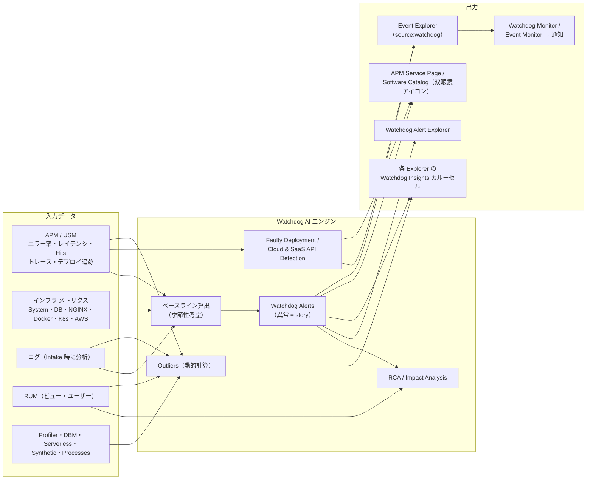
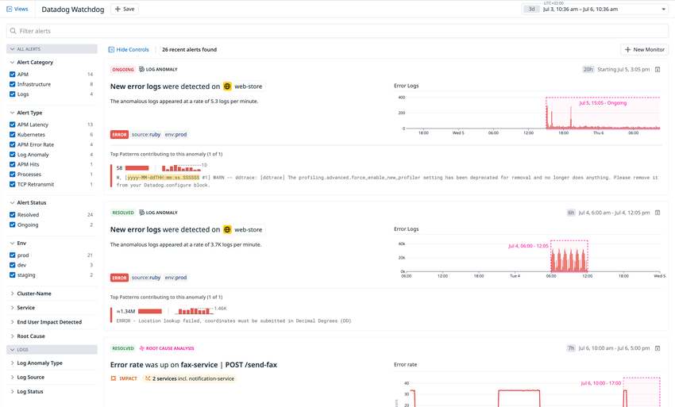
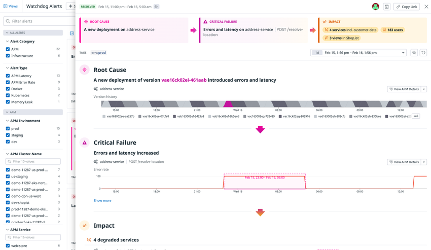
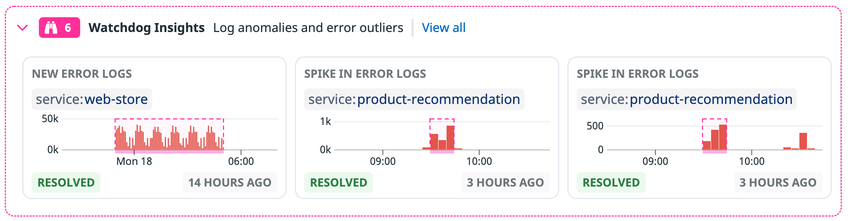
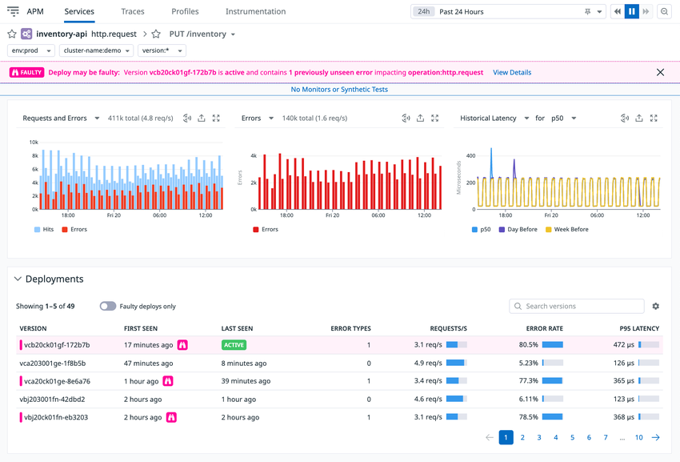
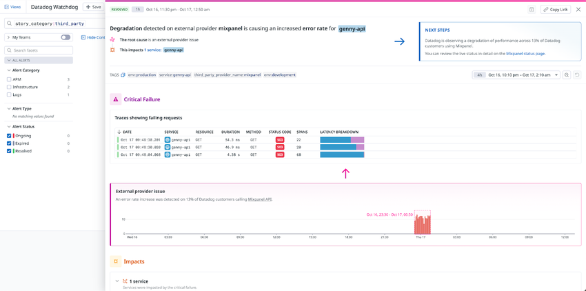
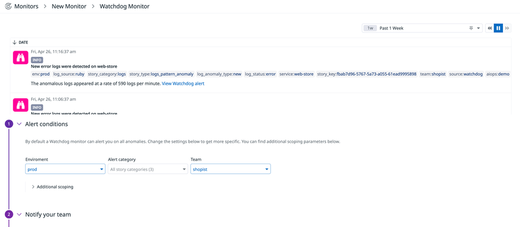

# Watchdog

## 概要

Datadog Watchdog（ウォッチドッグ）は、Datadog プラットフォーム全体の観測データ（メトリクス、APM トレース、ログ、RUM など）を横断的に分析する Datadog の AI エンジンである。Watchdog は、システム・アプリケーション・デプロイについて「期待される挙動（ベースライン）」を自動で算出し、そこから外れた挙動を異常として検知し、アラート・インサイト・根本原因分析（RCA）として提示する。公式ドキュメントでは「すべての Watchdog 機能は組み込みで、セットアップは不要」とされている。[出典](https://docs.datadoghq.com/watchdog/)

Watchdog の機能は大きく 2 系統に分かれる。[出典](https://docs.datadoghq.com/watchdog/)

| 系統 | 機能 | 概要 | 本書の節 |
|---|---|---|---|
| Proactive alerts（能動的アラート） | Watchdog Alerts | APM・USM・インフラ・ログの異常を自動検知し、Watchdog Alert Explorer に表示 | [Watchdog Alerts](#watchdog-alertsウォッチドッグアラート) |
| | Faulty Deployment Detection | 新バージョンのデプロイが新しいエラーやエラー率増加を持ち込んだかを判定 | [Faulty Deployment Detection](#automatic-faulty-deployment-detection不良デプロイの自動検知) |
| | Faulty Cloud & SaaS API Detection | 外部プロバイダ（AWS、OpenAI、Stripe 等）の API 劣化を検知 | [Faulty Cloud & SaaS API Detection](#automatic-faulty-cloud--saas-api-detection外部プロバイダ障害の自動検知) |
| Investigation assistance（調査支援） | Watchdog Insights | 各 Explorer 上部のカルーセルに、検索条件に合う異常（Anomalies）と外れ値（Outliers）を表示 | [Watchdog Insights](#watchdog-insightsウォッチドッグインサイト) |
| | Root Cause Analysis（RCA） | APM の異常について、根本原因・Critical Failure・影響範囲を因果関係として提示 | [Root Cause Analysis](#watchdog-root-cause-analysisrca根本原因分析) |
| | Impact Analysis | APM の異常がエンドユーザー（RUM のビュー・ユーザー）に与えた影響を推定 | [Impact Analysis](#watchdog-impact-analysis影響分析) |
| | Watchdog Explains | ダッシュボードの時系列グラフの異常と、寄与したタグを特定 | [Watchdog Explains](#watchdog-explains-とダッシュボード異常検知) |

Watchdog の検知結果に通知を付けるには **Watchdog Monitor**（API 上の type は `event-v2 alert`）を使う。Watchdog のアルゴリズムを自分で任意のメトリクスに適用したり感度を調整したりする場合は、Anomaly / Forecast / Outlier の各モニターを使う（[Monitors](./monitors.md) 参照）。[出典](https://docs.datadoghq.com/watchdog/alerts/)

### 本ファイルの範囲と関連ファイル

| 内容 | 参照先 |
|---|---|
| Watchdog の各機能、検知対象、条件、制限値（本ファイル） | ― |
| Anomaly / Outlier / Forecast モニターの設定詳細、モニタータイプ一覧 | [Monitors](./monitors.md) |
| `anomalies()`・`outliers()`・`forecast()` 関数の構文 | [メトリクスクエリと関数](./metrics-query-and-functions.md) |
| 通知チャネル、メッセージテンプレート、Downtime | [通知と Downtime](./notifications-and-downtimes.md) |
| Event Explorer、イベント相関 | [Event Management](./event-management.md) |
| `env`・`service`・`version` の統合サービスタグ | [Tagging](./tagging.md) |
| APM のデプロイ追跡、Service Page | [APM 画面と分析機能](../apm/apm-ui-and-analysis.md) |
| Software Catalog（旧称：Service Catalog） | [Software Catalog](./software-catalog.md) |
| Bits AI、Bits Investigation（AI による自律調査） | [Bits AI と AI 機能](../ai/bits-ai.md) |
| ダッシュボードの Graph Insights 全般 | [Dashboards](./dashboards.md) |
| 料金（定価） | [製品別料金表](../../03_導入編/pricing-by-product.md) |
| アラート設計・ノイズ削減の実践 | [アラート設計とノイズ削減](../../04_応用編/alert-design-and-noise-reduction.md) |

### 沿革

| 時期 | 出来事 | 出典 |
|---|---|---|
| 2018-07 | Watchdog を「機械学習ベースで隠れた問題・異常を自動特定する監視機能」として発表（DASH 2018 時期のプレスリリース） | [Press release](https://www.datadoghq.com/about/latest-news/press-releases/watchdog-autonomous-monitoring/) |
| 2020-03 | Watchdog Insights for APM（エラー・レイテンシの外れ値タグ）をブログで紹介 | [Blog](https://www.datadoghq.com/blog/watchdog-insights-apm/)（2020-03-31 公開） |
| 2021-01 | Watchdog RCA（自動根本原因分析）をブログで紹介 | [Blog](https://www.datadoghq.com/blog/datadog-watchdog-automated-root-cause-analysis/)（2021-01-05 公開） |
| 2021-03 | Log Management 向け Watchdog Insights をブログで紹介 | [Blog](https://www.datadoghq.com/blog/datadog-watchdog-insights-log-management/)（2021-03-02 公開） |
| 2021-12 | Watchdog Impact Analysis をブログで紹介 | [Blog](https://www.datadoghq.com/blog/watchdog-impact-analysis/)（2021-12-01 公開） |
| 2022-04 | ログ異常検知と根本原因分析を Watchdog AI エンジンの新機能として発表 | [プレスリリース（日本語）](https://www.datadoghq.com/ja/about/latest-news/press-releases/datadog-watchdog-ai-2022-04/) |
| 2024-02 | Live Processes 向け Watchdog Insights / Alerts を提供 | [Blog](https://www.datadoghq.com/blog/watchdog-live-processes/)（2024-02-26 公開） |
| 2025-01 | Watchdog Cloud & API Outage Detection（現ドキュメント名：Automatic Faulty Cloud & SaaS API Detection）を紹介 | [Blog](https://www.datadoghq.com/blog/watchdog-outage-detection/)（2025-01-17 公開） |
| 2025-12 | CNM Network Health で、Watchdog の分析を CNM テレメトリに適用したインサイトを紹介 | [Blog](https://www.datadoghq.com/blog/cnm-network-health)（2025-12-23 公開） |

> 2021 年前後のブログ記事は 2 年以上前の情報であり、画面や対象範囲が現行仕様と異なる可能性がある。本ファイルの仕様記述は 2026-11-02 時点の公式ドキュメントを正とする。

---

## 全体像

Watchdog が扱うデータと、出力先（どこに表示されるか、どう通知するか）の関係は次のとおり。



- Watchdog Alerts（Anomalies）は Watchdog が組織のデータを事前にスキャンして計算した結果である。一方、Outliers は「現在の検索クエリと時間範囲に一致するデータ」に対して動的に計算される。[出典](https://docs.datadoghq.com/watchdog/insights/)
- Faulty Deployment と外部プロバイダ劣化の検知結果は Event Explorer にイベントとして登録され、モニターで通知できる。[出典](https://docs.datadoghq.com/watchdog/faulty_deployment_detection/)、[出典](https://docs.datadoghq.com/watchdog/faulty_cloud_saas_api_detection/)
- Watchdog Alerts を通知する Watchdog Monitor の画面例では、イベントに `source:watchdog`、`story_category:logs`、`story_type:logs_pattern_anomaly`、`story_key:<UUID>` などのタグが付いている（後述の画像参照）。[出典](https://docs.datadoghq.com/monitors/types/watchdog/)

---

## Watchdog Alerts（ウォッチドッグアラート）

Watchdog Alerts は、Watchdog がシステムとアプリケーションを能動的にスキャンして見つけた異常である。各異常は Watchdog Alert Explorer に、何が起きたか、他システムへの影響の可能性、根本原因とともに表示される。[出典](https://docs.datadoghq.com/watchdog/alerts/)

### 画面：Watchdog Alert Explorer



- **キャプション:** Watchdog Alert Explorer（Datadog Watchdog 画面）のアラート一覧。
- **画面の説明:** 画面上部に「Datadog Watchdog」のタイトル、「Views」「+ Save」ボタン、右上に時間範囲セレクタ（例：3d、Jul 3 – Jul 6）がある。その下に「Filter alerts」検索ボックス。左側のファセットパネルには「ALL ALERTS」グループとして Alert Category（APM 14、Infrastructure 8、Logs 4）、Alert Type（APM Latency、Kubernetes、APM Error Rate、Log Anomaly、APM Hits、Processes、TCP Retransmit）、Alert Status（Resolved、Ongoing）、Env（prod、dev、staging）、Cluster-Name、Service、End User Impact Detected、Root Cause、「LOGS」グループとして Log Anomaly Type、Log Source、Log Status が並ぶ。中央には「26 recent alerts found」と表示され、右上に「+ New Monitor」ボタンがある。各アラートカードは、ステータス（ONGOING / RESOLVED）、種類ラベル（LOG ANOMALY、ROOT CAUSE ANALYSIS）、タイトル（例：「New error logs were detected on web-store」「Error rate was up on fax-service | POST /send-fax」）、説明（例：「The anomalous logs appeared at a rate of 5.3 logs per minute.」）、タグ（ERROR、`source:ruby`、`env:prod`）、異常期間をピンクの破線枠で示したグラフ、Log Anomaly の場合は「Top Patterns contributing to this anomaly」（寄与したログパターン）、RCA の場合は「IMPACT 2 services incl. notification-service」のような影響表示を含む。各カード右上に継続時間（例：20h）と開始時刻、アーカイブ用アイコンがある。
- **出典:** https://docs.datadoghq.com/watchdog/alerts/ （取得日：2026-11-02）

### アラートカードの構成

Watchdog Alert の概要カードは次の要素で構成される。[出典](https://docs.datadoghq.com/watchdog/alerts/)

| # | 要素 | 内容 |
|---|---|---|
| 1 | Status | `ongoing`、`resolved`、`expired` のいずれか。48 時間を超えて `ongoing` が続いた異常は `expired` になる |
| 2 | Timeline | 異常が発生している期間 |
| 3 | Message | 異常の説明 |
| 4 | Graph | 異常の可視化 |
| 5 | Tags | 異常のスコープ（タグ） |
| 6 | Impact（利用可能な場合） | 影響を受けたユーザー、ビュー、サービス（[Impact Analysis](#watchdog-impact-analysis影響分析)） |

カードをクリックすると詳細ペインが開く。詳細ペインの Overview タブには、カードの情報に加えて次の項目が表示されることがある。[出典](https://docs.datadoghq.com/watchdog/alerts/)

| 項目 | 内容 |
|---|---|
| Expected Bounds | 「Show expected bounds」チェックボックスをオンにすると、期待される挙動と異常な挙動を色分けしてグラフ表示する |
| Suggested Next Steps | 調査・トリアージの推奨手順 |
| Monitors | アラートに関連するモニター。表示される各モニターは、現在のアラートのメトリクスと関連タグをスコープに含む |

### Watchdog Alert Explorer のフィルタ

Watchdog Alert Explorer は、時間範囲、検索バー、ファセットでアラートを絞り込める。[出典](https://docs.datadoghq.com/watchdog/alerts/)

| 手段 | 仕様 |
|---|---|
| Time range（時間範囲） | 右上のセレクタで指定。**過去 6 か月以内**に発生したアラートを閲覧できる |
| Search bar | 「Filter alerts」ボックスに入力した文字列で**アラートのタイトル**を検索 |
| Facets | 左側のファセットのチェックボックスで絞り込み（下表） |

| ファセット | 説明 | 前提 |
|---|---|---|
| Alert Category | `apm`、`infrastructure`、`logs` のいずれかのアラートを表示 | ― |
| Alert Type | APM またはインフラ インテグレーションのメトリクスを使ったアラートの種類で選択 | ― |
| Alert Status | `ongoing`、`resolved`、`expired` で選択 | ― |
| APM Primary Tag | 定義済みの APM プライマリタグで絞り込み | APM のプライマリタグ設定 |
| Environment | `env` タグで絞り込み | 統合サービスタグ |
| Service | `service` タグで絞り込み | 統合サービスタグ |
| End User Impacted | Watchdog がエンドユーザーへの影響を見つけたか | **RUM が必要** |
| Root Cause | Watchdog が異常の根本原因または Critical Failure を見つけたか | **APM が必要** |
| Team | 影響サービスを所有するチーム（Software Catalog から付与） | Software Catalog でのオーナー定義 |
| Log Anomaly Type | ログ異常の種類（新しいログパターン / 既存パターンの増加） | ― |
| Log Source | 指定ソースのログを含むアラート | ― |
| Log Status | 指定ステータスのログを含むアラート | ― |

> 公式ドキュメントのファセット表は Alert Category を `apm` / `infrastructure` / `logs` の 3 種と説明しているが、外部プロバイダ劣化のアラート画面では `story_category:third_party` で絞り込まれた状態の Explorer が掲載されている（[Faulty Cloud & SaaS API Detection](#automatic-faulty-cloud--saas-api-detection外部プロバイダ障害の自動検知) の画像参照）。Watchdog Monitor の Alert Category にも「Third Party」が選択肢として存在する。[出典](https://docs.datadoghq.com/watchdog/faulty_cloud_saas_api_detection/)

### 検知対象（カバレッジ）

Watchdog Alerts の検知対象は製品領域ごとに次のとおり。[出典](https://docs.datadoghq.com/watchdog/alerts/)

| 領域 | 監視対象 | ノイズ抑制・条件 | 必要な最小履歴 |
|---|---|---|---|
| Log Management | Intake 時点でログを分析し、検出したパターンと `environment`・`service`・`source`・`status` タグで集約。warning / error ステータスのログの**新規出現**と**急増**を検知 | `severe` と判定された異常のみ Alert Explorer に表示（下記） | **24 時間** |
| APM | 全サービス・全リソースのエラー率（Error rate）、レイテンシ（Latency）、Hits（リクエストレート） | **0.5 リクエスト/秒未満**のエンドポイントは監視対象外。レイテンシやエラー率に影響しない Hits の異常は無視 | **2 週間** |
| USM（Universal Service Monitoring） | 全サービス・全リソースのエラー率、レイテンシ、Hits | 利用の少ないエンドポイント・サービスを除外（閾値は公開されていない）。レイテンシやエラー率に影響しない Hits の異常は無視 | **2 週間** |
| Infrastructure | 下表のインテグレーションのメトリクス | ― | **2 週間** |

いずれの領域も、最小履歴が揃った時点で異常検知が始まり、履歴が長くなるほど精度が上がり、**6 週間の履歴で最良の性能**になる。[出典](https://docs.datadoghq.com/watchdog/alerts/)

#### Infrastructure の対象インテグレーション

| 分類 | インテグレーション | 備考 |
|---|---|---|
| System | System | ホストのメモリ使用量（メモリリーク）、TCP 再送率 |
| データベース・キャッシュ | Redis、PostgreSQL、MySQL、SQL Server、Cassandra、Oracle Database | ― |
| Web・コンテナ | NGINX、Docker、Kubernetes | ― |
| AWS | S3、ELB / ALB / NLB、CloudFront、DynamoDB、RDS、ECS、Lambda | Amazon Web Services インテグレーション経由 |

[出典](https://docs.datadoghq.com/watchdog/alerts/)

- 上記に加え、Live Processes を利用している場合は、プロセス単位の CPU / RSS メモリの異常を Watchdog Insights と Alerts で検知する（Redis、Elasticsearch、NGINX、Kafka などの一般的な OSS のプロセスが対象。過去の自プロセス、または同じインフラグループ内の類似プロセスと比較）。Live Processes の全顧客が利用可能とされている。[出典](https://www.datadoghq.com/blog/watchdog-live-processes/)（2024-02-26 公開）
- 上記一覧に含まれないメトリクス（カスタムメトリクスなど）は Watchdog Alerts の対象外であり、Anomaly / Forecast / Outlier モニターで個別に設定する。[出典](https://docs.datadoghq.com/watchdog/alerts/)

#### ログ異常の `severe` 判定

Log Management のログ異常は、すべて Log Explorer の Watchdog Insights に表示される（ユーザーの検索コンテキストとロールの制限に一致する範囲）。そのうち Watchdog が特に `severe` と判断したものだけが Watchdog Alert Explorer に表示され、Watchdog logs monitor で通知できる。`severe` の条件は次のとおり。[出典](https://docs.datadoghq.com/watchdog/alerts/)

| 条件 | 目的 |
|---|---|
| error ログを含む | ― |
| 少なくとも 10 分間継続する | 一過性エラーの除外 |
| 有意な増加である | 小さな増加の除外 |
| `noise` スコアが低い | 特定サービスでアラートが多発するのを防ぐ |

`noise` スコアはサービス単位で計算され、①エラーパターンの数（多いほどノイジー）、②パターン同士の近さ（近いほどノイジー）で決まる。[出典](https://docs.datadoghq.com/watchdog/alerts/)

> `noise` スコアの具体的な閾値、「有意な増加」の定量的な基準は公開情報では確認できず。

#### ログ異常検知の無効化

ログ異常検知を無効にするには、Log Management の Pipelines ページ（`Logs > Pipelines`、https://app.datadoghq.com/logs/pipelines ）で **Log Anomalies** トグルをオフにする。[出典](https://docs.datadoghq.com/watchdog/alerts/)

> APM・USM・Infrastructure の Watchdog Alerts を組織全体で無効化する設定は、公開情報では確認できず。個々のアラートは後述のアーカイブで非表示にできる。

### Watchdog Alerts が表示される場所

| 場所 | 表示内容 |
|---|---|
| Watchdog Alert Explorer（`https://app.datadoghq.com/watchdog`） | すべての Watchdog Alerts の一覧 |
| APM Service Page | Service Page 上部の Watchdog Insights カルーセルにメトリクス異常の詳細 |
| Software Catalog（APM Catalog） | APM メトリクスに異常があるサービス名の横に**ピンクの双眼鏡アイコン** |
| メトリクスグラフ | Watchdog アイコン。異常期間がピンクでハイライトされる |
| 各 Explorer の Watchdog Insights パネル | 検索条件に一致するアラートを Anomalies として表示 |

双眼鏡アイコンをクリックすると、詳細を示す Watchdog Alert カードが開く。[出典](https://docs.datadoghq.com/watchdog/alerts/)

### アラートのアーカイブ

| 操作 | 方法・仕様 |
|---|---|
| アーカイブ | アラートのサイドパネルを開き、右上の**フォルダアイコン**をクリック |
| アーカイブの効果 | Explorer のほか、ホームページなど Datadog 内の他の場所からも非表示になる。関連サービス・リソースの横にピンクの双眼鏡アイコンも表示されなくなる |
| アーカイブ済みの表示 | Explorer 左上の「Show *N* archived alerts」チェックボックス（アーカイブ済みが 1 件以上ある場合のみ表示） |
| 監査情報 | 誰がいつアーカイブしたかを確認でき、フィードに復元できる |
| 注意 | アーカイブしても、同じサービス・リソースに関する**将来の問題の検知は止まらない** |

[出典](https://docs.datadoghq.com/watchdog/alerts/)

アラートの管理には `watchdog_alerts_write`（Watchdog Alerts Write：Watchdog Alerts の管理）権限が関係する。この権限のデフォルトロールは Datadog Standard Role である。アーカイブ操作にこの権限が必須かどうかは公開情報では明示されていない。[出典](https://docs.datadoghq.com/account_management/rbac/permissions/)

### カスタム異常検知との関係

Watchdog は、モニターとダッシュボードで使われているものと同じ季節性アルゴリズムを使う。他のメトリクスで異常を探したい場合や感度を調整したい場合は、次のモニターを使う。[出典](https://docs.datadoghq.com/watchdog/alerts/)

| 目的 | 使う機能 | 詳細 |
|---|---|---|
| 季節性を考慮した期待レンジからの逸脱 | Anomaly Monitor（`anomalies()`） | [Monitors](./monitors.md) |
| 将来の値の予測（ディスク枯渇など） | Forecast Monitor（`forecast()`） | [Monitors](./monitors.md) |
| グループ内で他と異なる挙動（特定ホストのみ高負荷など） | Outlier Monitor（`outliers()`） | [Monitors](./monitors.md) |

| 観点 | Watchdog Alerts | Anomaly / Forecast / Outlier Monitor |
|---|---|---|
| 設定 | 不要（自動） | 対象メトリクス・アルゴリズム・感度を利用者が設定 |
| 対象 | 公式に定められた APM / USM / インフラ / ログの指標 | 任意のメトリクス（カスタムメトリクス含む） |
| 感度調整 | 不可（公開設定項目なし） | `bounds`（deviations）、アルゴリズム、季節性、ウィンドウを調整可 |
| 通知 | Watchdog Monitor を別途作成 | モニター自体が通知 |
| 履歴要件 | ログ 24 時間、メトリクス 2 週間（最良 6 週間） | アルゴリズム・季節性による（[Monitors](./monitors.md) 参照） |

---

## Watchdog Root Cause Analysis（RCA、根本原因分析）

Watchdog Root Cause Analysis（RCA）は、インシデントのトリアージにおける初動調査を自動化し、平均復旧時間（MTTR）の短縮を支援する機能である。Watchdog は APM の異常を検出すると、そのたびに RCA を開始し、アプリケーション性能の異常と関連コンポーネントの相互依存を特定して、症状間の因果関係を導く。[出典](https://docs.datadoghq.com/watchdog/rca/)

### 前提条件

| 項目 | 内容 |
|---|---|
| 必須 | APM の利用 |
| 推奨 | 統合サービスタグ（`env`・`service`・`version`）の設定。デプロイの把握と、インフラメトリクスと APM メトリクスの紐付けに使われる |
| 推奨 | 分散トレーシングの利用（サービス間の依存構造を Watchdog が把握するため） |
| RUM 連携 | RUM を使っている場合、影響を受けたビューパスとユーザーを自動評価 |

[出典](https://docs.datadoghq.com/watchdog/rca/)、[出典](https://docs.datadoghq.com/watchdog/faq/root-cause-not-showing/)

### 分析に使うデータソース

| データソース |
|---|
| APM のエラー率、レイテンシ、Hit rate メトリクス |
| APM Deployment Tracking（デプロイ追跡） |
| APM トレース |
| Agent ベースのインフラメトリクス（CPU 使用率、メモリ使用率、ディスク使用率など） |
| AWS インスタンスのステータスチェックメトリクス |
| ログパターンの異常 |

[出典](https://docs.datadoghq.com/watchdog/rca/)

### RCA の 3 要素



- **キャプション:** Watchdog RCA の詳細パネル（Root Cause → Critical Failure → Impact）。
- **画面の説明:** Watchdog Alerts 画面の右側にスライドアウトした詳細パネル。上部にステータス「RESOLVED」と期間（Feb 15, 11:00 pm – Feb 16, 5:00 am、6h）、右上に「Copy Link」ボタン。その下に 3 つのボックスが矢印でつながって並ぶ：左「ROOT CAUSE：A new deployment on address-service」、中央「CRITICAL FAILURE：Errors and latency on address-service | POST /resolve-location」、右「IMPACT：4 services incl. customer-data、183 users、3 views in Shop.ist」。TAGS に `env:prod`。下段の「Root Cause」セクションには「A new deployment of version vae16ck02ei-461aab introduced errors and latency」と、address-service の Version history（バージョンごとに色分けされた帯）、「View APM Details」ボタン。続く「Critical Failure」セクションには「Errors and latency increased」と address-service の POST /resolve-location の Error rate グラフ（異常期間 Feb 15, 23:00 – Feb 16, 05:00 がピンク枠で強調）。最下部に「Impact：4 degraded services」。左側には Alert Category、Alert Type（APM Latency、APM Error Rate、Docker、Kubernetes、Memory Leak）、APM Environment、APM Cluster-Name、APM Service のファセットが見える。
- **出典:** https://docs.datadoghq.com/watchdog/rca/ （取得日：2026-11-02）

| 要素 | 定義 |
|---|---|
| Root Cause（根本原因） | アプリケーション性能の問題につながった**状態変化**。インフラの可用性の変化、トラフィックの急増、コードのデプロイなど |
| Critical Failure（重大な障害） | 根本原因が最初に（最も直接的に）アプリケーション性能の劣化を引き起こした箇所と内容。**必ずレイテンシまたはエラー率の増加を含む** |
| Impact（影響） | 根本原因によって間接的に影響を受けたサービス。Impact に列挙された性能劣化は、Critical Failure が解消されれば回復すると見込まれる。RUM 利用時は影響を受けたビューパスとユーザーも評価 |

Watchdog は、レイテンシ上昇や新規エラーといった**アプリケーション性能の劣化そのものを根本原因には分類しない**。そうした初期症状は Critical Failure として扱われる。[出典](https://docs.datadoghq.com/watchdog/rca/)

### Watchdog が識別できる根本原因（4 種類）

| # | 根本原因の種類 | 捕捉に使うデータ |
|---|---|---|
| 1 | バージョン変更（デプロイ） | APM Deployment Tracking（APM サービスの `version` タグ） |
| 2 | トラフィック増加 | APM でインスツルメントされたサービスの Hit rate メトリクス |
| 3 | AWS インスタンス障害 | Amazon EC2 インテグレーションのメトリクス |
| 4 | ディスク容量の枯渇 | Datadog Agent のシステムメトリクス |

[出典](https://docs.datadoghq.com/watchdog/rca/)、[出典](https://docs.datadoghq.com/watchdog/faq/root-cause-not-showing/)

### Root Cause が表示されないとき

公式 FAQ によると、Root Cause が表示されない主な理由は「実際の根本原因が上記 4 種類に該当しない」または「それを捕捉するインスツルメンテーションが設定されていない」である。Watchdog RCA は、分散トレーシング（依存構造の把握）と統合サービスタグ（デプロイの把握、インフラと APM の紐付け）を使っているときに最もよく機能する。Watchdog が見逃したと考えられる場合や追加してほしい根本原因の種類がある場合は、サポートリクエストで要望を伝えるよう案内されている。[出典](https://docs.datadoghq.com/watchdog/faq/root-cause-not-showing/)

| 症状 | 確認ポイント |
|---|---|
| デプロイが原因なのに Root Cause が出ない | `version` タグ（統合サービスタグ）が APM に付いているか。Deployment Tracking にバージョンが表示されるか |
| 下流サービスへの影響（Impact）が出ない | 分散トレーシングでサービス間の呼び出しがつながっているか |
| ユーザー影響が出ない | RUM と APM の接続（Connect RUM and Traces）ができているか |
| インフラ起因（ディスク・EC2）が出ない | Agent のシステムメトリクス、EC2 インテグレーションが収集されているか。ホストとサービスが統合サービスタグで紐付いているか |

> 上表の「確認ポイント」は、公式 FAQ の記述（4 種類の根本原因と前提条件）から整理したものである【推定】。

---

## Watchdog Impact Analysis（影響分析）

Watchdog Impact Analysis は、Watchdog が APM の異常を検出したときに、RUM SDK から送信されるレイテンシ・エラーのメトリクスを同時に分析し、その異常がユーザーが訪れた Web / モバイルのページに悪影響を与えているかを評価する機能である。[出典](https://docs.datadoghq.com/watchdog/impact_analysis/)

| 項目 | 内容 |
|---|---|
| 有効化 | **APM と RUM の全ユーザーで自動的に有効**（設定不要） |
| 起点 | Watchdog APM アラート |
| 表示場所 | Watchdog アラートの **Impacts** セクション |
| 表示内容 | 影響を受けた RUM ビューの一覧、影響を受けたユーザーの推定数、影響ユーザー一覧へのリンク |
| ユーザー一覧 | 「users」をクリックすると影響ユーザーの連絡先情報を表示（必要に応じて連絡するため） |
| ビュー | 「view paths」をクリックすると影響を受けた RUM ビューに遷移 |

[出典](https://docs.datadoghq.com/watchdog/impact_analysis/)

- ユーザーの連絡先が表示されるのは、RUM 側でユーザー情報（ユーザー ID、メールなど）を設定している場合である【推定】。RUM のユーザー属性の設定は [RUM（ブラウザ）](../dem/rum-browser.md)、[RUM（モバイル）](../dem/rum-mobile.md) を参照。
- APM と RUM の相関には RUM とトレースの接続（Connect RUM and Traces）が関連ドキュメントとして案内されている。[出典](https://docs.datadoghq.com/watchdog/impact_analysis/)
- 影響ユーザー数の推定方法（アルゴリズム）は公開情報では確認できず。

---

## Watchdog Insights（ウォッチドッグインサイト）

Watchdog Insights は、各製品の Explorer で、現在の検索クエリに関連する異常と外れ値を提示する推薦エンジンである。経験の浅いエンジニアでも最も重要なデータに注目でき、インシデント調査を加速することを目的とする。[出典](https://docs.datadoghq.com/watchdog/insights/)

### インサイトの種類

| 種類 | 内容 | 計算タイミング |
|---|---|---|
| Anomalies（異常） | Watchdog が組織のデータをスキャンして事前計算した Watchdog Alerts のうち、アクティブな検索クエリに一致するもの | 事前計算 |
| Outliers（外れ値） | あるイベント種別（例：エラー）に過剰に出現するタグ、または連続値メトリクス（例：レイテンシ）を押し上げているタグ | 現在のクエリと時間範囲に対して**動的に計算** |

[出典](https://docs.datadoghq.com/watchdog/insights/)

### 画面：Log Explorer の Watchdog Insights カルーセル



- **キャプション:** Log Explorer 上部の Watchdog Insights カルーセル。
- **画面の説明:** ピンクの点線枠で囲まれた帯に、双眼鏡アイコンと件数「6」、「Watchdog Insights」「Log anomalies and error outliers」の見出し、「View all」リンクがある。カードが 3 枚横並びで、左から「NEW ERROR LOGS / `service:web-store`」「SPIKE IN ERROR LOGS / `service:product-recommendation`」「SPIKE IN ERROR LOGS / `service:product-recommendation`」。各カードに赤い棒グラフ（異常期間をピンク破線枠で強調）と、ステータス「RESOLVED」、検知からの経過時間（14 HOURS AGO、3 HOURS AGO）が表示される。
- **出典:** https://docs.datadoghq.com/watchdog/insights/ （取得日：2026-11-02）

### Watchdog Insights カルーセルが表示されるページ

| 製品 | ページ |
|---|---|
| Log Management | Log Explorer |
| Infrastructure | Processes Explorer、Serverless Explorer、Kubernetes Explorer |
| APM | Service Page、Resource Page、Profile Explorer（Trace Explorer は Tag Analysis に統合、後述） |
| Database Monitoring | Database Explorer |
| RUM | RUM Explorer |
| Synthetic Monitoring | Synthetic Monitoring & Testing Explorer |
| Error Tracking | Error Tracking の Issue サイドパネル |

[出典](https://docs.datadoghq.com/watchdog/insights/)

### 基本操作

| 操作 | 方法・仕様 |
|---|---|
| 概要表示 | カルーセルを展開。優先度の高いインサイトが左に並ぶ。優先度は `Insight type`、`State`、`Status`、`Start time`、`Anomaly type` に基づく |
| 全件表示 | 「View all」をクリックすると右からサイドパネルが開き、インサイトが縦に一覧表示される（カードより詳細） |
| Filter on Insight | インサイトカード右上にホバーし、逆三角形アイコン（ツールチップ「Filter on Insight」）をクリックすると、インサイトに対応するエントリだけにページが絞り込まれる |
| Share an outlier | 外れ値をクリックして詳細サイドパネルを開き、上部の「Copy Link」でリンクをコピー |
| View in Analytics（RUM） | カードの外れ値の挙動を反映した Group into fields / Visualize as を自動設定し、モニターやダッシュボードにエクスポートできる |

[出典](https://docs.datadoghq.com/watchdog/insights/)、[出典](https://docs.datadoghq.com/real_user_monitoring/explorer/watchdog_insights/)

**注意点:**

- Filter on Insight を使うと表示スコープが自動的に変わる。外れ値インサイトで絞り込んだ場合、その外れ値がベースラインとして扱われるため、そのインサイト自体は表示されなくなる。[出典](https://docs.datadoghq.com/watchdog/insights/)
- 外れ値の共有リンクは、元データの保持期間とともに失効する。例えば外れ値の元になったログの保持期間が 15 日なら、リンクも 15 日で失効する。[出典](https://docs.datadoghq.com/watchdog/insights/)
- Log Explorer のインサイトは、ユーザーのロールに適用された制限（データアクセス制御）に一致する範囲で表示される。[出典](https://docs.datadoghq.com/logs/explorer/watchdog_insights/)

### 製品別の外れ値（Outlier）タイプ

#### Log Management

| タイプ | 内容 | バナーカード | フルサイドパネル |
|---|---|---|---|
| Log Anomaly Detection | Intake 時の集約に基づく warning / error ログの新規出現・急増（[Watchdog Alerts](#watchdog-alertsウォッチドッグアラート) と同じ検知） | 異常の種類、サービス、グラフ | 異常の説明と、寄与したログパターンの一覧 |
| Error Outliers | 現在のクエリに一致するエラーで統計的に過剰出現する `key:value`（ファセット化されたタグ・属性）。例：`env:staging`、`docker_image:acme:3.1`、`http.useragent_details.browser.family:curl` | フィールド名、エラー全体と全ログに対してそのフィールドが占める割合 | そのフィールドを含むエラーログの時系列、よく一緒に現れるタグ、ログパターンの一覧 |

[出典](https://docs.datadoghq.com/watchdog/insights/)、[出典](https://docs.datadoghq.com/logs/explorer/watchdog_insights/)

- Error Outliers は**ファセット化された**タグ・属性が対象である。ファセット化されていない属性は対象外と読める【推定】。ファセットについては [ログ検索と分析](../logs/log-search-and-analytics.md) を参照。
- Log Explorer のインサイトは、APM、Continuous Profiler、Log Management、`service` タグを含むインフラデータから発見される。[出典](https://docs.datadoghq.com/logs/explorer/watchdog_insights/)

#### APM

APM の外れ値は Trace Explorer、Service Page、Resource Page で利用できる。Trace Explorer では Tag Analysis に統合されている。[出典](https://docs.datadoghq.com/watchdog/insights/)

| Trace Explorer での統合 | 内容 |
|---|---|
| Analyze ボタンの強調 | 有意な外れ値を検出すると、RED メトリクスの「Analyze」ボタンが強調表示される |
| 検索サジェスト | 外れ値タグが検索バーの候補に、エラー相関・レイテンシ相関の表示付きで出る |
| ファセットの優先表示 | 外れ値タグがファセットサイドバー最上部の「OUTLIERS」セクションに表示される |

| タイプ | 内容 | バナーカード | フルサイドパネル |
|---|---|---|---|
| Error outliers | エラーで統計的に過剰出現するタグ。例：`env:staging`、`availability_zone:us-east-1a`、`cluster_name:chinook`、`version:v123456` | フィールド名、エラー全体と全トレースに対する割合 | そのフィールドを含むエラートレースの時系列、関連タグ、関連する Error Tracking Issue と失敗スパンの一覧 |
| Latency outliers | ベースラインより性能が悪い `key:value`。**スパンの duration** に対して計算 | フィールド名、そのタグを含むスパンとそれ以外のレイテンシ分布、注目パーセンタイルの値とベースラインとの差 | タグとベースラインのレイテンシ分布グラフ（X 軸は `p50`・`p75`・`p99`・`max`）、そのフィールドを含む APM イベント一覧 |

[出典](https://docs.datadoghq.com/watchdog/insights/)

#### Continuous Profiler

| タイプ | バナーカード | フルサイドパネル |
|---|---|---|
| Lock contention outlier（ロック競合） | 影響サービス名、影響スレッド数、削減可能な CPU（および推定コスト削減額） | ロック競合の解消手順 |
| Garbage collection outlier（GC） | 影響サービス名、GC に使われた CPU 時間 | CPU 時間を空けるための GC 設定の改善手順 |
| Regex compilation outlier（正規表現コンパイル） | 影響サービス名、正規表現のコンパイルに使われた CPU 時間 | 改善手順と、改善候補となる自コード内の関数の例 |

[出典](https://docs.datadoghq.com/watchdog/insights/)

#### Database Monitoring

Database Monitoring では、`CPU`、`Commits`、`IO`、`Background`、`Concurrency`、`Idle` のメトリクスについてインサイトを提示する。Insight カルーセルで外れ値のあるデータベースを絞り込むと、データベース一覧にオーバーレイが表示され、ピンクのピル（ラベル）で各インサイトの内容が示される。[出典](https://docs.datadoghq.com/watchdog/insights/)

#### RUM

| タイプ | 内容 | バナーカード | フルサイドパネル |
|---|---|---|---|
| Error outlier | エラーで統計的に過剰出現するファセット化タグ・属性。例：`env:staging`、`version:1234`、`browser.name:Chrome` | フィールド名、エラー全体と全 RUM イベントに対する割合、関連タグ | そのフィールドを含む RUM エラー総数の時系列、影響の円グラフ、RUM イベント一覧 |
| Latency outlier | ベースラインより性能が悪い `key:value`。Core Web Vitals（First Contentful Paint、First Input Delay、Cumulative Layout Shift）や Loading Time について計算 | フィールド名、そのフィールドを含む性能値とそれ以外のベースライン | 性能メトリクスの時系列（X 軸は `p50`・`p75`・`p99`・`max`）、RUM イベント一覧 |

[出典](https://docs.datadoghq.com/watchdog/insights/)、[出典](https://docs.datadoghq.com/real_user_monitoring/explorer/watchdog_insights/)

#### Synthetic Monitoring

Synthetic Monitoring の Error outliers は、Synthetic Browser Test の失敗実行における予期しない挙動・性能の逸脱を示す。失敗したテスト実行の画面で error outlier の数が表示され、外れ値をクリックしてテストステップのサイドパネルの「Errors & Warnings」タブでメッセージを確認する。[出典](https://docs.datadoghq.com/watchdog/insights/)

#### Serverless

Serverless では次のインサイトを提示する。Insights カルーセルで関数を絞り込むと、関数にオーバーレイとピンクのピルが表示される。[出典](https://docs.datadoghq.com/watchdog/insights/)

| インサイト |
|---|
| `Cold Start Ratio Up/Down` |
| `Error Invocation Ratio Up/Down` |
| `Memory Usage Up/Down` |
| `OOM Ratio Up/Down` |
| `Estimated Cost Up/Down` |
| `Init Duration Up/Down` |
| `Runtime Duration Up/Down` |

#### Processes / Kubernetes

| Explorer | カルーセルの内容 |
|---|---|
| Process Explorer | 現在の Process Explorer のコンテキストに一致するすべての Process 異常 |
| Kubernetes Explorer | 現在の Kubernetes Explorer のコンテキストに一致するすべての Kubernetes 異常 |

[出典](https://docs.datadoghq.com/watchdog/insights/)

---

## Automatic Faulty Deployment Detection（不良デプロイの自動検知）

Automatic Faulty Deployment Detection は、コードがデプロイされるたびに新バージョンと過去バージョンの性能を比較し、デプロイによって**新しい種類のエラー**や**エラー率の増加**が持ち込まれたかを判定して、不良デプロイを数分以内に発見する機能である（平均検知時間 MTTD の短縮）。[出典](https://docs.datadoghq.com/watchdog/faulty_deployment_detection/)

### 画面：APM Service Page の不良デプロイ表示



- **キャプション:** APM Service Page 上部のピンクのバナーと、下部の Deployments テーブル。
- **画面の説明:** APM > Services の `inventory-api` サービス（オペレーション `http.request`、リソース `PUT /inventory`）の画面。フィルタに `env:prod`、`cluster-name:demo`、`version:*`。上部にピンクのバナー「FAULTY  Deploy may be faulty: Version vcb20ck01gf-172b7b is active and contains 1 previously unseen error impacting operation:http.request」と「View Details」リンク。中段に「Requests and Errors」「Errors」「Historical Latency（p50、Day Before、Week Before）」のグラフ。下部の「Deployments」セクションに「Showing 1–5 of 49」「Faulty deploys only」トグル、検索ボックス、表（VERSION、FIRST SEEN、LAST SEEN、ERROR TYPES、REQUESTS/S、ERROR RATE、P95 LATENCY）。不良と判定されたバージョン（例：vcb20ck01gf-172b7b、ACTIVE、エラー率 80.5%）にはピンクの双眼鏡アイコンが付く。
- **出典:** https://docs.datadoghq.com/watchdog/faulty_deployment_detection/ （取得日：2026-11-02）

### 表示と詳細

| 項目 | 内容 |
|---|---|
| 表示場所 | APM の Service Page、および影響エンドポイントの Resource Page |
| 現在アクティブなバージョンが不良の場合 | Service Page 上部にピンクのバナー |
| 過去の不良バージョン | Service Page 下部の Deployments テーブル（デプロイ履歴）で、過去に不良と判定されたバージョンを表示 |
| 詳細パネル | バナーの「View Details」、または Deployments テーブルのバージョンをクリック |
| 詳細パネルの内容 | エラー率増加のグラフ、新たに検出されたエラーの型（例：`db.utils.OperationalError`）、影響エンドポイント（例：`/inventory`）、HTTP ステータスコード（例：`500`） |

[出典](https://docs.datadoghq.com/watchdog/faulty_deployment_detection/)

### 前提条件

| 項目 | 内容 |
|---|---|
| APM | 必要（APM Service Page に表示される機能） |
| バージョン情報 | デプロイの識別には APM の `version` タグ（統合サービスタグ）が必要と考えられる【推定】。公式ページは「新しいコードバージョンと過去バージョンを比較する」と記述 |
| 過去のデプロイ履歴 | 直近の履歴に十分な数の過去デプロイがないとベースラインを確立できず、判定されない（下記） |

### 不良デプロイの通知設定

Watchdog は不良デプロイを検出すると Event Explorer にイベントを追加する。通知の設定方法は 2 通り。[出典](https://docs.datadoghq.com/watchdog/faulty_deployment_detection/)

| 方法 | 手順 | 条件 |
|---|---|---|
| Event Monitor を手動作成 | New Monitors ページ（`Monitors > New Monitor`）で **Events** を選び、検索クエリに `tags:deployment_analysis` を含める | ― |
| Suggested Monitors | Service Page の「Suggested Monitors」ボタン → 「Enable」 | サービスにまだモニターが設定されていない場合のみボタンが表示される |

- 各デプロイは繰り返し分析されるため、同じ不良デプロイで再アラートしないよう、モニターの **recovery time を 60 分**に設定することが推奨されている。[出典](https://docs.datadoghq.com/watchdog/faulty_deployment_detection/)

### エラーがあるのに不良と判定されない理由

Watchdog は新デプロイがエラーのもっともらしい原因かを判定する。次のいずれか（または組み合わせ）の場合、不良と判定しないことがある。[出典](https://docs.datadoghq.com/watchdog/faulty_deployment_detection/)

| # | 理由 |
|---|---|
| 1 | その種類のエラーが新しくない（前のバージョンや直近のデプロイ中にも出ている） |
| 2 | その種類のエラーが少数かつ一過性で、新バージョンが稼働し続けても時間とともに消える |
| 3 | 直近の履歴に過去デプロイが十分になく、分析のベースラインを確立できない |
| 4 | 新バージョンのエラー率が前のバージョンより有意に高くない |
| 5 | そのエラーパターンが、コードに問題がない場合でもそのサービスのデプロイ時によく発生する |

> 「十分な数の過去デプロイ」の具体的な件数・期間は公開情報では確認できず。

---

## Automatic Faulty Cloud & SaaS API Detection（外部プロバイダ障害の自動検知）

Automatic Faulty Cloud & SaaS API Detection（ブログ等での名称：Watchdog Cloud & API Outage Detection）は、決済ゲートウェイやクラウドプロバイダなどのサードパーティプロバイダの問題を数分以内に検知する機能である。Watchdog は APM テレメトリを使い、外部プロバイダ（AWS、OpenAI、Slack、Stripe など）へのリクエストのエラー率上昇を継続的に監視する。[出典](https://docs.datadoghq.com/watchdog/faulty_cloud_saas_api_detection/)

> **サイト差異:** Automatic Faulty Cloud & SaaS API Detection は、公式ドキュメントで **US3、US5、EU1、AP1、AP2、US1-FED（app.ddog-gov.com）、us2.ddog-gov.com、uk1.datadoghq.com では非対応**と明記されている。すなわち 2026-11-02 時点で利用できるのは **US1** のみである。基準サイトの AP1 では利用できない。[出典](https://docs.datadoghq.com/watchdog/faulty_cloud_saas_api_detection/)

### 画面：外部プロバイダ劣化のアラート



- **キャプション:** 外部プロバイダ（Mixpanel）の劣化を検知した Watchdog アラートの詳細パネル。
- **画面の説明:** 左側の Datadog Watchdog 画面の検索バーに `story_category:third_party` が入力され、ファセットに Alert Category（APM、Infrastructure、Logs）、Alert Type、Alert Status（Ongoing、Expired、Resolved）が見える。右側の詳細パネル上部に「RESOLVED」、期間（Oct 16, 11:30 pm – Oct 17, 12:50 am）、「Copy Link」。タイトルは「Degradation detected on external provider mixpanel is causing an increased error rate for genny-api」で、「The root cause is an external provider issue」「This impacts 1 service: genny-api」と表示。右上の「NEXT STEPS」ボックスに「Datadog is observing a degradation of performance across 13% of Datadog customers using Mixpanel. You can review the live status in detail on the Mixpanel status page.」。TAGS に `env:production`、`service:genny-api`、`third_party_provider_name:mixpanel`、`env:development`。「Critical Failure」セクションに「Traces showing failing requests」（DATE、SERVICE、RESOURCE、DURATION、METHOD、STATUS CODE（502、503）、SPANS、LATENCY BREAKDOWN）、「External provider issue：An error rate increase was detected on 13% of Datadog customers calling Mixpanel API.」とエラー率グラフ、下部に「Impacts：1 service」。
- **出典:** https://docs.datadoghq.com/watchdog/faulty_cloud_saas_api_detection/ （取得日：2026-11-02）

### 機能と通知

| 項目 | 内容 |
|---|---|
| 検知の根拠 | 自組織の APM テレメトリにおける、外部プロバイダへのリクエストのエラー率上昇 |
| 提示内容 | 影響を受けた自社サービスと障害の範囲。内部起因か外部起因かの切り分け。プロバイダのステータスページとサポート窓口へのリンク |
| イベント | プロバイダ劣化の検知時に Event Explorer にイベントを作成 |
| 通知設定 | New Monitor → **Watchdog** を選択 → Alert category で **Third Party** を選択 |
| 対象プロバイダ | External Provider Status ドキュメントに記載のプロバイダ（下記） |

[出典](https://docs.datadoghq.com/watchdog/faulty_cloud_saas_api_detection/)

ブログでは、Mixpanel のインシデント時に、プロバイダのステータスページで公表された数分後に Watchdog が問題を検知した事例が紹介されている。[出典](https://www.datadoghq.com/blog/watchdog-outage-detection/)（2025-01-17 公開）

### External Provider Status ページ

External Provider Status（`https://app.datadoghq.com/watchdog/external-provider-status`）は、サードパーティサービスの稼働状況を一画面で確認するページである。ステータスページの更新に頼らず、アプリケーションのテレメトリから「サービスへの影響」を評価する。[出典](https://docs.datadoghq.com/internal_developer_portal/external_provider_status/)

> **サイト差異:** External Provider Status は US1-FED（app.ddog-gov.com）と us2.ddog-gov.com では非対応と記載されている。AP1 を含むその他のサイトについて非対応の記載はない。一方、Watchdog の Faulty Cloud & SaaS API Detection（アラート）は US1 のみの対応であり、両者の対応サイトは一致しない点に注意。[出典](https://docs.datadoghq.com/internal_developer_portal/external_provider_status/)、[出典](https://docs.datadoghq.com/watchdog/faulty_cloud_saas_api_detection/)

| 機能 | 内容 |
|---|---|
| Real-time status | 外部プロバイダの健全性を単一ビューで監視 |
| Service dependencies | 外部プロバイダと社内サービスの対応付け（**APM が必要**） |
| Historical data | **90 日間**の性能トレンドとインシデント履歴 |
| Alerting | プロバイダ劣化時の通知 |

通知ルールの設定手順は次のとおり。[出典](https://docs.datadoghq.com/internal_developer_portal/external_provider_status/)

1. 右上の `Notify Me` をクリック。
2. 通知条件を定義する：監視するプロバイダを選択し、「Alert on any degradation（すべての劣化で通知）」または「Alert only when degradation impacts your services（自社サービスに影響する場合のみ通知）」を選ぶ。
3. 通知先を設定する。
4. 通知ルールに名前を付ける。

| 権限 | 説明 | デフォルトロール |
|---|---|---|
| `external_provider_status_notifications_read` | External Provider Status の通知ルールを閲覧 | Datadog Read Only Role |
| `external_provider_status_notifications_write` | External Provider Status の通知ルールを作成・変更 | Datadog Standard Role |

[出典](https://docs.datadoghq.com/account_management/rbac/permissions/)

#### 対応プロバイダ（AWS 以外）

| プロバイダ | 監視対象 API | プロバイダ | 監視対象 API |
|---|---|---|---|
| Adyen | `*.adyenpayments.com` | Intercom | `api.intercom.io` |
| Amplitude | `api.amplitude.com` | LaunchDarkly | `app.launchdarkly.com` |
| Anthropic | `api.anthropic.com` | Mapbox | `api.mapbox.com` |
| Atlassian | `*.atlassian.net`、`*.atlassian.com` | Mixpanel | `api.mixpanel.com` |
| Auth0 | `*.auth0.com` | Okta | `*.okta.com` |
| Azure DevOps | `dev.azure.com` | OpenAI | `*.openai.com` |
| Braintree | `api.braintreegateway.com` | PagerDuty | `api.pagerduty.com` |
| Cloudflare | `*.cloudflare.com` | PayPal | `*.paypal.com` |
| Databricks | `*.cloud.databricks.com` | Salesforce | `*.salesforce.com` |
| Datadog (US1) | `api.datadoghq.com` | SendGrid | `*.sendgrid.com` |
| Facebook | `graph.facebook.com` | ServiceNow | `*.service-now.com` |
| GitHub | `api.github.com` | Slack | `*.slack.com` |
| GitLab | `*.gitlab.com` | Snowflake | `*.snowflakecomputing.com` |
| Google Gemini | `generativelanguage.googleapis.com` | Splunk | `*.splunkcloud.com` |
| Google Maps | `maps.googleapis.com` | Square | `connect.squareup.com` |
| HubSpot | `api.hubspot.com`、`api.hubapi.com` | Stripe | `api.stripe.com` |
| | | Twilio | `api.twilio.com` |
| | | X | `api.twitter.com` |
| | | Zendesk | `*.zendesk.com` |
| | | Zoom | `api.zoom.us` |

[出典](https://docs.datadoghq.com/internal_developer_portal/external_provider_status/)（36 プロバイダ、2026-11-02 時点）

#### 対応 AWS サービスとリージョン

`*.amazonaws.com` に一致するエンドポイント経由で、次の AWS サービスを監視する：CloudWatch、DynamoDB、ELB、ES、Firehose、Kinesis、KMS、Lambda、S3、SNS、SQS、STS。[出典](https://docs.datadoghq.com/internal_developer_portal/external_provider_status/)

| 地域 | リージョン |
|---|---|
| AMER | `us-east-1`、`us-east-2`、`us-west-1`、`us-west-2`、`ca-central-1`、`ca-west-1`、`us-gov-east-1`、`us-gov-west-1`、`sa-east-1` |
| EMEA | `af-south-1`、`eu-central-1`、`eu-central-2`、`eu-west-1`、`eu-west-2`、`eu-west-3`、`eu-south-1`、`eu-south-2`、`eu-north-1`、`me-south-1`、`me-central-1`、`il-central-1` |
| APAC | `ap-northeast-1`（東京）、`ap-northeast-2`、`ap-northeast-3`（大阪）、`ap-east-1`、`ap-south-1`、`ap-south-2`、`ap-southeast-1`、`ap-southeast-2`、`ap-southeast-3`、`ap-southeast-4` |

> 公式ページの表は列の配置が崩れて表示されているため、本表はリージョン名の地理的な所属に基づいて AMER / EMEA / APAC に再整理した。掲載されているリージョンの集合は公式ページと同じである。[出典](https://docs.datadoghq.com/internal_developer_portal/external_provider_status/)

---

## Watchdog Explains とダッシュボード異常検知

### Watchdog Explains

Watchdog Explains は、時系列グラフの異常を検知し、その異常に寄与したタグを特定する調査アシスタントである。[出典](https://docs.datadoghq.com/dashboards/graph_insights/watchdog_explains/)

| 項目 | 仕様 |
|---|---|
| 対象ウィジェット | **Timeseries ウィジェット**で、**Metrics データ**（`avg`・`sum`・`min`・`max` 集計）を使うもの |
| 検知方法 | 時系列の形状と値の両方を分析し、過去のパターンからの逸脱（スパイク、ディップ、緩やかなドリフト、ステップ変化、傾きの変化）を検出 |
| 季節性 | **最大 3 週間**さかのぼって比較（例：月曜 9:00 のスパイクは過去の月曜 9:00 と比較）。同様のパターンが繰り返されていれば季節性とみなし、異常としない |
| 表示 | 異常箇所をピンクの枠でハイライト |
| 調査 | 「Investigate Anomaly」で全画面の調査ビューを開き、異常の形・規模に有意に寄与したタググループを表示。タグをクリックすると、そのディメンションを除外・分離した場合のグラフの変化を確認できる |

[出典](https://docs.datadoghq.com/dashboards/graph_insights/watchdog_explains/)

### Investigate Dashboard Anomalies（ダッシュボード異常の調査）

Datadog はダッシュボードの時系列グラフ全体で異常を検知し、同時に発生した異常をまとめて「Issue」として提示し、寄与の大きいタグを特定する。単一グラフの絞り込みには Watchdog Explains を、根本原因分析には Bits Investigation を使う。[出典](https://docs.datadoghq.com/dashboards/graph_insights/investigate_anomalies/)

> **サイト差異:** Investigate Dashboard Anomalies は US1-FED（app.ddog-gov.com）と us2.ddog-gov.com では非対応。[出典](https://docs.datadoghq.com/dashboards/graph_insights/investigate_anomalies/)

| 項目 | 仕様 |
|---|---|
| 対象 | Timeseries ウィジェット、Metrics データ（`avg`・`sum`・`min`・`max`）。`cumsum`、`anomalies`、`outliers` などの関数を使うウィジェットは対象外 |
| 実行タイミング | ダッシュボードを開いたときに検知が走り、**約 20 秒以内**に Issue が表示される。異常がなければ Investigate メニュー等は表示されない |
| 対象外のダッシュボード | 公開（共有）ダッシュボード、モバイルアプリに埋め込まれたダッシュボード、TV モード、印刷モード、Auto-detect issues をオフにしたダッシュボード |
| Issue の確認 | ダッシュボード上部の「Investigate」をクリック。各 Issue は逸脱したメトリクスと検知時刻を表示し、展開すると Influential tags と影響ウィジェットを表示。複数ウィジェットで同時発生した異常は 1 つの Issue にまとめられる（例：`Anomalies co-occur on 18 widgets`） |
| 異常のレビュー | ピンクでハイライトされた箇所にホバーすると、期待範囲からの乖離を要約したチップが出る（例：`The spike is 70% higher than the expected range as inferred from the past 3 weeks of data.`）。展開すると **Influential tags** と **Next steps**、場合により **Co-occurs with**（同時に逸脱した他のメトリクス）を表示 |
| 単一グラフ分析 | グラフを全画面表示して「Findings」をクリック（Watchdog Explains）。各 Finding はタグを除外する前後のグラフを示す |
| AI 調査 | 「Investigate With AI」で Bits Investigation を新しいタブで開始。根本原因、影響評価、タイムラインを報告。既存の関連調査があれば「See *N* Related Investigations」と表示（件数はダッシュボードと時間範囲全体が対象）。この経路で開始した調査はソースが Dashboard Anomaly となり、`dashboard_id` タグが付く |

[出典](https://docs.datadoghq.com/dashboards/graph_insights/investigate_anomalies/)

### 無効化

| 範囲 | 方法 | 影響範囲 |
|---|---|---|
| ダッシュボード単位（自分のみ） | 「Investigate」をクリックし **Auto-detect issues** をオフ（Watchdog Explains のページでは、ダッシュボード上部の「Anomalies」を開き「Turn Off」と記載） | 自分の表示のみ。設定は**ブラウザに保存**され、他の閲覧者や別のブラウザ・デバイスには引き継がれない |
| ウィジェット単位（全員） | ウィジェットを編集し、「Anomaly Detection」を展開して **Hide** を選択 | ウィジェット定義の一部なので、ダッシュボードの全閲覧者に適用 |

[出典](https://docs.datadoghq.com/dashboards/graph_insights/investigate_anomalies/)、[出典](https://docs.datadoghq.com/dashboards/graph_insights/watchdog_explains/)

> Watchdog Explains のページ（「Anomalies」→「Turn Off」）と Investigate Dashboard Anomalies のページ（「Investigate」→「Auto-detect issues」）で、無効化の UI 表記が異なる。2026-11-02 時点では後者のほうが新しい構成を説明していると考えられる【推定】。

---

## Watchdog Monitor（Watchdog モニター）

Watchdog Monitor は、Watchdog Alerts（APM、Infrastructure、Logs、Third Party など）を通知するためのモニタータイプである。モニタータイプ全体の説明は [Monitors](./monitors.md) を参照。[出典](https://docs.datadoghq.com/monitors/types/watchdog/)

### 画面：Watchdog Monitor の作成



- **キャプション:** Monitors > New Monitor > Watchdog Monitor の作成画面。
- **画面の説明:** 上部のパンくずに「Monitors > New Monitor > Watchdog Monitor」、右上に時間範囲（1w、Past 1 Week）。上段に条件に一致する Watchdog イベントの一覧（DATE 列）があり、例として「Fri, Apr 26, 11:16:37 am / INFO / New error logs were detected on web-store」と、タグ `env:prod`、`log_source:ruby`、`story_category:logs`、`story_type:logs_pattern_anomaly`、`log_anomaly_type:new`、`log_status:error`、`service:web-store`、`story_key:fbab7d96-...`、`team:shopist`、`source:watchdog`、`aiops:demo`、本文「The anomalous logs appeared at a rate of 590 logs per minute.」と「View Watchdog alert」リンクが表示される。下段の「1 Alert conditions」には「By default a Watchdog monitor can alert you on all anomalies. Change the settings below to get more specific.」の説明と、Environment（prod）、Alert category（All story categories (3)）、Team（shopist）のドロップダウン、「Additional scoping」の折りたたみがある。その下に「2 Notify your team」。
- **出典:** https://docs.datadoghq.com/monitors/types/watchdog/ （取得日：2026-11-02）

### 作成手順と設定項目

作成手順：メインナビゲーションの **Monitors > New Monitor > Watchdog**（`https://app.datadoghq.com/monitors/create/watchdog`）。Watchdog Alert Explorer 右上の「New Monitor」ボタンからも作成できる。[出典](https://docs.datadoghq.com/monitors/types/watchdog/)、[出典](https://www.datadoghq.com/blog/watchdog-outage-detection/)（2025-01-17 公開）

| 区分 | 項目 | 内容 |
|---|---|---|
| 1. Predefined selectors | Environment | `env` タグから導出 |
| | Alert Category | Watchdog アラートのサブセットに限定（例：APM、Infrastructure、Logs、Third Party） |
| | Team | Software Catalog から導出 |
| 2. Additional scoping | タグフィルタ | Watchdog イベントの任意のタグで絞り込み |
| | Group By | 通知をグループ化するディメンション |
| 共通 | ワイルドカード | 使用可 |
| 共通 | プレビュー | 選択後、画面上部のグラフに選択期間内の一致する Watchdog イベントを表示 |
| 通知 | Configure notifications and automations | 通常のモニターと同じ（[通知と Downtime](./notifications-and-downtimes.md)） |

[出典](https://docs.datadoghq.com/monitors/types/watchdog/)

- デフォルト（条件未指定）の Watchdog monitor はすべての異常で通知する（画面の説明文）。[出典](https://docs.datadoghq.com/monitors/types/watchdog/)
- ログ異常は `service`・`source`・`env` タグに基づいて検出される。クエリにこれらのタグを含めると、一致するログ異常だけが対象になる。`host` などの他のタグを含めた場合、Watchdog はそれらのタグを使って関連する `service`・`source`・`env` の組み合わせだけを表示する。[出典](https://docs.datadoghq.com/monitors/types/watchdog/)

### API / Terraform での定義

Monitors API では、Watchdog モニターの type は **`event-v2 alert`** である（API クライアントのドキュメントに「watchdog: `event-v2 alert`」と記載）。[出典](https://github.com/DataDog/datadog-api-client-python/blob/master/src/datadog_api_client/v1/api/monitors_api.py)

Terraform Provider の公式ガイドに掲載されている例は次のとおり。[出典](https://registry.terraform.io/providers/DataDog/datadog/latest/docs/guides/monitors)

```hcl
resource "datadog_monitor" "watchdog_monitor" {
  name    = "Watchdog detected an anomaly: {{event.title}}"
  type    = "event-v2 alert"
  message = "Watchdog monitor created from Terraform"

  query = "events(\"source:watchdog story_category:apm env:test_env\").rollup(\"count\").by(\"story_key,service,resource_name\").last(\"30m\") > 0"

  tags = ["terraform:true"]
}
```

| クエリ要素 | 意味 |
|---|---|
| `source:watchdog` | Watchdog が生成したイベント |
| `story_category:apm` | アラートカテゴリ（UI の Alert Category に対応） |
| `.rollup("count")` | イベント件数 |
| `.by("story_key,service,resource_name")` | `story_key`（個々の Watchdog アラート＝story の識別子）などで通知をグループ化 |
| `.last("30m") > 0` | 直近 30 分に 1 件以上あれば発報 |

- `story_category` の値として、公式ドキュメントの画面・例で確認できるものは `apm`、`logs`、`third_party` である。`infrastructure` は Alert Explorer のファセット説明（`apm`・`infrastructure`・`logs`）に対応する値と考えられる【推定】。`story_category` の全値の公式一覧は公開情報では確認できず。
- Terraform・IaC 全般は [Terraform と IaC](./terraform-and-iac.md)、[Monitoring as Code](../../04_応用編/monitoring-as-code.md) を参照。
- 不良デプロイの通知は Watchdog Monitor ではなく、Event Monitor で `tags:deployment_analysis` を検索する方法が公式に案内されている（[Faulty Deployment Detection](#不良デプロイの通知設定)）。[出典](https://docs.datadoghq.com/watchdog/faulty_deployment_detection/)

---

## Bits AI との関係

Datadog の AI 調査エージェントである Bits Investigation は、調査時のデータソースの一つとして Watchdog を使う（他に Metrics、APM traces、Logs、Dashboards、Events、Change Tracking、RUM、Error Tracking、Network Path、Database Monitoring、Continuous Profiler など）。[出典](https://docs.datadoghq.com/bits_ai/bits_investigation/investigate_issues/)

| 観点 | Watchdog | Bits Investigation |
|---|---|---|
| 位置付け | 異常の自動検知と、定型的な根本原因分析（4 種類の根本原因）・外れ値提示 | 仮説を立ててテレメトリを照会・検証する反復型の AI 調査 |
| 起点 | 常時自動（設定不要） | モニターアラート（手動 / 自動）、Synthetic テスト、RUM、Error Tracking、自然言語の指示、ダッシュボード異常の「Investigate With AI」 |
| 出力 | Watchdog Alerts、Insights、RCA | 根本原因の結論（または inconclusive）、影響評価、タイムライン |

[出典](https://docs.datadoghq.com/bits_ai/bits_investigation/investigate_issues/)、[出典](https://docs.datadoghq.com/dashboards/graph_insights/investigate_anomalies/)

- 旧 Bits AI SRE のドキュメント URL（`/bits_ai/bits_ai_sre/`）は 2026-11-02 時点で Bits Investigation（`/bits_ai/bits_investigation/`）へリダイレクトされる。Bits AI の詳細は [Bits AI と AI 機能](../ai/bits-ai.md) を参照。
- Watchdog Monitor が Bits Investigation の自動調査対象モニタータイプに含まれるかは公開情報では確認できず。

---

## 権限（RBAC）

| 権限 | 説明 | デフォルトロール |
|---|---|---|
| `watchdog_alerts_write`（Watchdog Alerts Write） | Watchdog Alerts の管理 | Datadog Standard Role |
| `external_provider_status_notifications_read` | External Provider Status の通知ルールの閲覧 | Datadog Read Only Role |
| `external_provider_status_notifications_write` | External Provider Status の通知ルールの作成・変更 | Datadog Standard Role |

[出典](https://docs.datadoghq.com/account_management/rbac/permissions/)

- Watchdog Monitor の作成・編集にはモニター関連の権限（`monitors_write` など）が必要である。詳細は [Monitors](./monitors.md) と [組織・ユーザー・権限管理](./account-and-access-management.md) を参照。
- Log Explorer の Watchdog Insights は、ユーザーのロールに適用された制限に一致する範囲で表示される。[出典](https://docs.datadoghq.com/logs/explorer/watchdog_insights/)
- Watchdog Alerts の閲覧専用の権限は、公開情報の権限一覧では確認できず。

---

## サイト差異

| 機能 | 非対応サイト（公式記載） | 備考 |
|---|---|---|
| Watchdog Alerts / RCA / Impact Analysis / Insights / Faulty Deployment Detection | 公式ページにサイト制限の記載なし | ― |
| Automatic Faulty Cloud & SaaS API Detection | US3、US5、EU1、AP1、AP2、US1-FED、us2.ddog-gov.com、uk1.datadoghq.com | **US1 のみ対応**。AP1 は非対応 |
| External Provider Status | US1-FED、us2.ddog-gov.com | AP1 は非対応の記載なし |
| Investigate Dashboard Anomalies | US1-FED、us2.ddog-gov.com | ― |
| Bits Investigation | US1-FED、us2.ddog-gov.com | ― |

[出典](https://docs.datadoghq.com/watchdog/faulty_cloud_saas_api_detection/)、[出典](https://docs.datadoghq.com/internal_developer_portal/external_provider_status/)、[出典](https://docs.datadoghq.com/dashboards/graph_insights/investigate_anomalies/)、[出典](https://docs.datadoghq.com/bits_ai/bits_investigation/investigate_issues/)

> **サイト差異:** 公式ドキュメントの非対応サイト一覧には、本ナレッジのサイト表記（US1、US3、US5、EU1、AP1、AP2、US1-FED）に含まれない `us2.ddog-gov.com` と `uk1.datadoghq.com` が現れる。サイトの一覧と最新の状況は [Datadog Sites](./datadog-sites.md) を参照。

---

## 制限値・クォータ・デフォルト値

| 項目 | 値 | 出典 |
|---|---|---|
| Watchdog の初期設定 | 不要（全機能が組み込み） | [Watchdog](https://docs.datadoghq.com/watchdog/) |
| Watchdog Alert Explorer で閲覧できる期間 | 過去 **6 か月** | [Alerts](https://docs.datadoghq.com/watchdog/alerts/) |
| アラートが `expired` になる条件 | `ongoing` のまま **48 時間**超 | [Alerts](https://docs.datadoghq.com/watchdog/alerts/) |
| ログ異常の最小履歴 | **24 時間** | [Alerts](https://docs.datadoghq.com/watchdog/alerts/) |
| メトリクス異常（APM / USM / Infrastructure）の最小履歴 | **2 週間** | [Alerts](https://docs.datadoghq.com/watchdog/alerts/) |
| 最良の性能が得られる履歴 | **6 週間** | [Alerts](https://docs.datadoghq.com/watchdog/alerts/) |
| APM エンドポイントの監視下限 | **0.5 リクエスト/秒**以上 | [Alerts](https://docs.datadoghq.com/watchdog/alerts/) |
| USM の監視下限 | 「利用の少ないエンドポイント・サービスを除外」（数値は公開情報では確認できず） | [Alerts](https://docs.datadoghq.com/watchdog/alerts/) |
| Hits 異常の扱い | レイテンシ・エラー率に影響しない Hits の異常は無視（APM / USM） | [Alerts](https://docs.datadoghq.com/watchdog/alerts/) |
| ログ異常が `severe`（Alert Explorer に表示）となる最短継続時間 | **10 分** | [Alerts](https://docs.datadoghq.com/watchdog/alerts/) |
| ログ異常検知のデフォルト | 有効（Pipelines ページの Log Anomalies トグルで無効化可） | [Alerts](https://docs.datadoghq.com/watchdog/alerts/) |
| RCA が識別する根本原因の種類 | 4 種類（バージョン変更、トラフィック増加、AWS インスタンス障害、ディスク枯渇） | [RCA](https://docs.datadoghq.com/watchdog/rca/) |
| Impact Analysis のデフォルト | APM と RUM の全ユーザーで自動有効 | [Impact Analysis](https://docs.datadoghq.com/watchdog/impact_analysis/) |
| 外れ値共有リンクの有効期限 | 元データの保持期間と同じ（例：ログ保持 15 日なら 15 日） | [Insights](https://docs.datadoghq.com/watchdog/insights/) |
| Faulty Deployment 用モニターの推奨 recovery time | **60 分** | [Faulty Deployment](https://docs.datadoghq.com/watchdog/faulty_deployment_detection/) |
| Faulty Deployment のベースラインに必要な過去デプロイ数 | 公開情報では確認できず | ― |
| External Provider Status の履歴 | **90 日** | [External Provider Status](https://docs.datadoghq.com/internal_developer_portal/external_provider_status/) |
| External Provider Status の対応プロバイダ数 | 36（AWS 以外）＋ AWS 12 サービス | [External Provider Status](https://docs.datadoghq.com/internal_developer_portal/external_provider_status/) |
| Watchdog Explains / ダッシュボード異常検知の季節性比較期間 | 最大 **3 週間** | [Watchdog Explains](https://docs.datadoghq.com/dashboards/graph_insights/watchdog_explains/) |
| ダッシュボード異常の表示までの時間 | 約 **20 秒** | [Investigate Anomalies](https://docs.datadoghq.com/dashboards/graph_insights/investigate_anomalies/) |
| Watchdog Explains の対象集計 | `avg`・`sum`・`min`・`max` | [Watchdog Explains](https://docs.datadoghq.com/dashboards/graph_insights/watchdog_explains/) |
| Watchdog Monitor の API type | `event-v2 alert` | [API client](https://github.com/DataDog/datadog-api-client-python/blob/master/src/datadog_api_client/v1/api/monitors_api.py) |
| Watchdog Alerts の感度調整 | 公開設定項目なし（感度調整は Anomaly / Forecast / Outlier モニターで行う） | [Alerts](https://docs.datadoghq.com/watchdog/alerts/) |
| Watchdog のアルゴリズムの詳細 | 「モニター・ダッシュボードと同じ季節性アルゴリズム」以上の詳細は公開情報では確認できず | [Alerts](https://docs.datadoghq.com/watchdog/alerts/) |
| Watchdog Alerts の検知から表示までの遅延 | 公開情報では確認できず | ― |
| Watchdog 専用の公開 API（アラート一覧取得等） | 公開情報では確認できず。Watchdog が生成したイベントは Events（`source:watchdog`）として扱われる | [Watchdog Monitor](https://docs.datadoghq.com/monitors/types/watchdog/) |
| Watchdog イベントの保持期間 | Event Management のイベント保持に従うと考えられる【推定】（[Event Management](./event-management.md) 参照） | ― |

---

## 課金への影響

Watchdog には独立した課金単位（SKU）はなく、各製品のプラン（エディション）に機能として含まれる形で提供される。2026-11-02 時点の公式料金ページでの扱いは次のとおり。[出典](https://www.datadoghq.com/pricing/)

| 製品 | 料金ページ上の Watchdog 関連の記載 | 含まれるプラン |
|---|---|---|
| Infrastructure Monitoring | 「Watchdog: Automated insights」「Correlations」「Anomaly Detection」「Forecast Monitoring」 | **Enterprise** のみ（Free・Pro には含まれない） |
| Infrastructure Monitoring | 「Outlier Detection」 | Free・Pro・Enterprise すべて |
| Infrastructure Monitoring | Enterprise プランの説明に「Machine learning-based alerts」 | Enterprise |
| APM | 「AI-based anomaly, outlier, and root cause detection」 | APM・APM Pro・APM Enterprise すべて |
| Log Management | Standard Indexing の説明に「Detect log anomalies proactively with Watchdog Insights」、機能一覧に「Log Anomaly Detection」 | Standard Indexing |
| Log Management（Flex Logs） | FAQ に「Flex Logs does not support monitors or Watchdog Insights」 | Flex Logs では利用不可 |
| Error Tracking | 「Watchdog Insights: Anomalistic tags associated with specific issues」 | Error Tracking |
| Serverless | 「Optimize function memory use and cold starts with Watchdog Insights」 | Serverless |

[出典](https://www.datadoghq.com/pricing/)（取得日：2026-11-02）

- Watchdog の検知・インサイトは、課金対象となる元データ（APM ホスト、インデックス済みログ、RUM セッション、インフラホストなど）に対して動作するため、Watchdog の利用自体で追加のデータ量課金が発生する旨の公式記載はない。課金単位と定価は [製品別料金表](../../03_導入編/pricing-by-product.md)、計算の仕組みは [課金計算の仕組み](../../03_導入編/billing-mechanics.md)、プラン差は [エディション・プラン](../../03_導入編/editions-and-plans.md) を参照。
- 料金ページでは Infrastructure の「Watchdog: Automated insights」が Enterprise のみとされる一方、公式ドキュメントは「すべての Watchdog 機能は組み込み」とし、APM の各プランには「AI-based anomaly, outlier, and root cause detection」が含まれる。Infrastructure Pro と APM を組み合わせた場合に、インフラ系 Watchdog Alerts（System、DB、AWS など）がどこまで表示されるかは公開情報では確認できず。契約前に Datadog 営業・サポートに確認することを推奨する【経験則】。
- Flex Logs だけに保存されるログについては、Watchdog Insights を利用できない（料金ページ FAQ）。ログのティア設計は [Indexes・保持・アーカイブ](../logs/log-indexes-retention-archives.md) を参照。
- API で Anomaly モニターを作成するには Enterprise プランが必要と公式ドキュメントに記載されている（[Monitors](./monitors.md) 参照）。

---

## 運用上の注意と活用パターン

| 観点 | 内容 | 根拠 |
|---|---|---|
| 統合サービスタグ | `env`・`service`・`version` は RCA、Faulty Deployment Detection、Alert Explorer のファセット、Watchdog Monitor のスコープに直結する。未設定だと根本原因やデプロイ起因の判定が出にくい | [RCA](https://docs.datadoghq.com/watchdog/rca/)、[FAQ](https://docs.datadoghq.com/watchdog/faq/root-cause-not-showing/) |
| Software Catalog のチーム定義 | Alert Explorer の Team ファセット、Watchdog Monitor の Team セレクタは Software Catalog 由来。オーナー定義があるとチーム別の通知ルーティングがしやすい | [Alerts](https://docs.datadoghq.com/watchdog/alerts/)、[Watchdog Monitor](https://docs.datadoghq.com/monitors/types/watchdog/) |
| 導入直後 | メトリクス異常は 2 週間、ログ異常は 24 時間の履歴が貯まるまで検知されない。導入初期の PoC で「Watchdog が何も出さない」のは仕様 | [Alerts](https://docs.datadoghq.com/watchdog/alerts/) |
| 低トラフィックサービス | 0.5 req/s 未満のエンドポイントは対象外。低トラフィックの重要エンドポイントは APM モニターや Anomaly モニターで個別に監視する | [Alerts](https://docs.datadoghq.com/watchdog/alerts/) |
| 通知の段階導入 | Watchdog Monitor は条件未指定だと全異常で通知する。`env:prod` や Alert Category、Team で絞り、まずはチャットの低優先チャネルに流して質を見てからページングに使うのが一般的【経験則】 | [Watchdog Monitor](https://docs.datadoghq.com/monitors/types/watchdog/) |
| 不良デプロイの通知 | Event Monitor（`tags:deployment_analysis`）の recovery time を 60 分にして再通知を防ぐ | [Faulty Deployment](https://docs.datadoghq.com/watchdog/faulty_deployment_detection/) |
| アーカイブの意味 | アーカイブは表示上の非表示であり、検知を止めない。恒常的に不要なログ異常は Log Anomalies トグル（ログのみ）で対処 | [Alerts](https://docs.datadoghq.com/watchdog/alerts/) |
| 外部起因の切り分け | US1 では Third Party カテゴリの Watchdog Monitor で、外部 SaaS 障害を自社障害と区別して通知できる。AP1 等では External Provider Status ページと Notify Me を使う | [Faulty Cloud & SaaS API](https://docs.datadoghq.com/watchdog/faulty_cloud_saas_api_detection/)、[External Provider Status](https://docs.datadoghq.com/internal_developer_portal/external_provider_status/) |
| 日次の確認 | Cvent 社の SRE は「毎朝 Watchdog を確認することがスタック全体の理解に役立つ」と述べている | [プレスリリース](https://www.datadoghq.com/ja/about/latest-news/press-releases/datadog-watchdog-ai-2022-04/)（2022-04）【第三者情報】（顧客コメント） |

アラート設計全体の考え方は [アラート設計とノイズ削減](../../04_応用編/alert-design-and-noise-reduction.md)、よくある失敗は [よくある失敗とアンチパターン](../../04_応用編/common-pitfalls.md) を参照。

---

## 参照元

### Datadog 公式ドキュメント（取得日：2026-11-02）

- Datadog Watchdog™: https://docs.datadoghq.com/watchdog/
- Watchdog Alerts: https://docs.datadoghq.com/watchdog/alerts/
- Watchdog RCA: https://docs.datadoghq.com/watchdog/rca/
- Root Cause Not Showing（FAQ）: https://docs.datadoghq.com/watchdog/faq/root-cause-not-showing/
- Watchdog Impact Analysis: https://docs.datadoghq.com/watchdog/impact_analysis/
- Watchdog Insights: https://docs.datadoghq.com/watchdog/insights/
- Watchdog Insights for Logs: https://docs.datadoghq.com/logs/explorer/watchdog_insights/
- Watchdog Insights for RUM: https://docs.datadoghq.com/real_user_monitoring/explorer/watchdog_insights/
- Automatic Faulty Deployment Detection: https://docs.datadoghq.com/watchdog/faulty_deployment_detection/
- Automatic Faulty Cloud & SaaS API Detection: https://docs.datadoghq.com/watchdog/faulty_cloud_saas_api_detection/
- External Provider Status: https://docs.datadoghq.com/internal_developer_portal/external_provider_status/
- Watchdog Explains: https://docs.datadoghq.com/dashboards/graph_insights/watchdog_explains/
- Investigate Dashboard Anomalies: https://docs.datadoghq.com/dashboards/graph_insights/investigate_anomalies/
- Watchdog Monitor: https://docs.datadoghq.com/monitors/types/watchdog/
- Role Permissions: https://docs.datadoghq.com/account_management/rbac/permissions/
- Bits Investigation - Investigate Issues: https://docs.datadoghq.com/bits_ai/bits_investigation/investigate_issues/

### Datadog 公式サイト・ブログ・プレスリリース

- Pricing（取得日：2026-11-02）: https://www.datadoghq.com/pricing/
- Datadog Adds "Watchdog" Autonomous Monitoring（2018-07）: https://www.datadoghq.com/about/latest-news/press-releases/watchdog-autonomous-monitoring/
- Datadog、根本原因分析機能とログ異常検知機能により Watchdog AI エンジンを拡張（2022-04）: https://www.datadoghq.com/ja/about/latest-news/press-releases/datadog-watchdog-ai-2022-04/
- Automatically detect error and latency patterns with Watchdog Insights for APM（2020-03-31）: https://www.datadoghq.com/blog/watchdog-insights-apm/
- Automated root cause analysis with Watchdog RCA（2021-01-05）: https://www.datadoghq.com/blog/datadog-watchdog-automated-root-cause-analysis/
- Augmented troubleshooting with Watchdog Insights（2021-03-02）: https://www.datadoghq.com/blog/datadog-watchdog-insights-log-management/
- Understand the scope of user impact with Watchdog Impact Analysis（2021-12-01）: https://www.datadoghq.com/blog/watchdog-impact-analysis/
- Troubleshoot anomalies in workload performance with Watchdog Insights and Alerts for Live Processes（2024-02-26）: https://www.datadoghq.com/blog/watchdog-live-processes/
- Stay ahead of service disruptions with Watchdog Cloud & API Outage Detection（2025-01-17）: https://www.datadoghq.com/blog/watchdog-outage-detection/
- Anomaly detection, predictive correlations: Using AI-assisted metrics monitoring（2025-04-22）: https://www.datadoghq.com/blog/ai-powered-metrics-monitoring/
- Detect, diagnose, and resolve network issues easily with CNM Network Health（2025-12-23）: https://www.datadoghq.com/blog/cnm-network-health

### 公式 GitHub

- Terraform Provider for Datadog - Monitors guide: https://registry.terraform.io/providers/DataDog/datadog/latest/docs/guides/monitors （ソース：https://github.com/DataDog/terraform-provider-datadog/blob/master/docs/guides/monitors.md ）
- datadog-api-client-python（Monitors API の type 対応表）: https://github.com/DataDog/datadog-api-client-python/blob/master/src/datadog_api_client/v1/api/monitors_api.py
