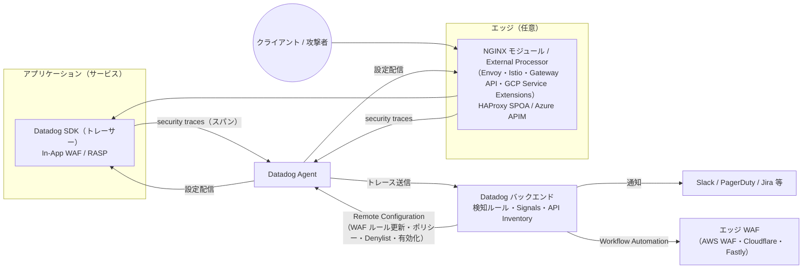
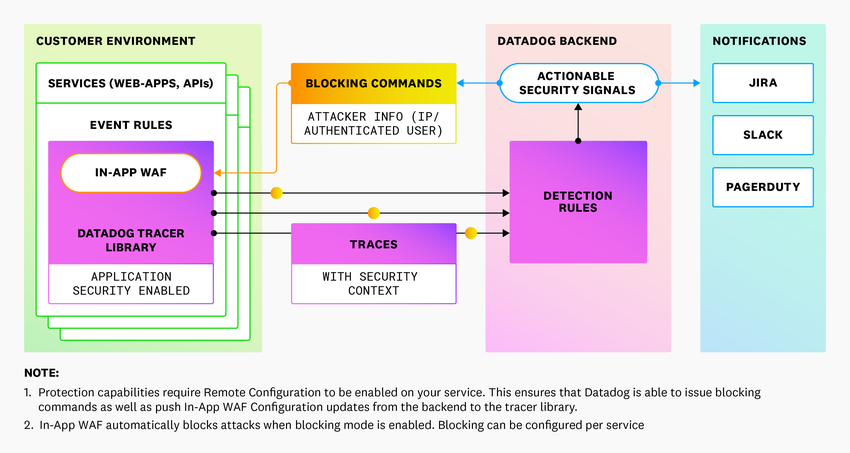
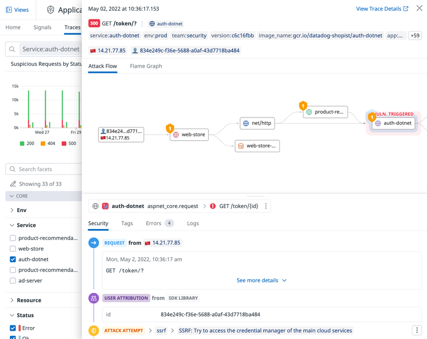
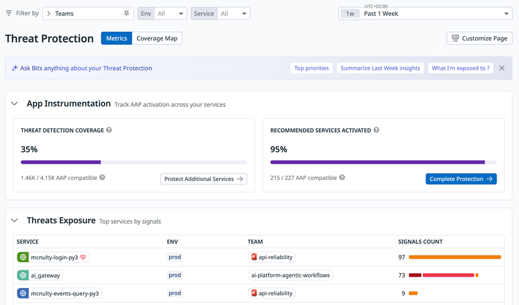
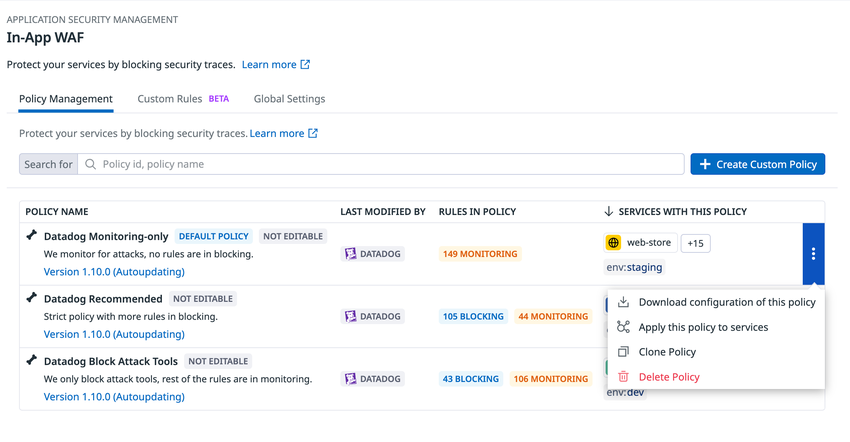
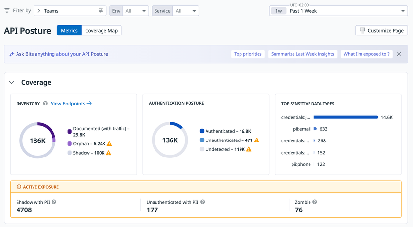

# App and API Protection（旧 ASM）

## 概要

Datadog **App and API Protection（AAP、アプリケーションと API の保護）**（旧称：**Application Security Management / ASM**。さらに前は **Application Security Monitoring** と呼ばれた）は、本番環境の Web アプリケーションと API を狙う攻撃を検知・調査・ブロックし、API の存在とリスク（API Posture）を可視化する Datadog Security の製品である。AAP は APM と同じ Datadog トレーシングライブラリ（SDK／トレーサー）に組み込まれた **In-App WAF** で HTTP リクエストを検査し、分散トレースの実行コンテキストと突き合わせて **Security Signals（セキュリティシグナル）** を生成する。[出典](https://docs.datadoghq.com/security/application_security/) [出典](https://docs.datadoghq.com/security/application_security/how-it-works/)

本ファイルは次の問いに答える。

- AAP は何を、どの仕組み（SDK・Agent・Remote Configuration）で検知・ブロックするのか
- In-App WAF のポリシー・ルール・カスタムルール・ブロック応答はどう設定するのか
- Exploit Prevention（RASP）と In-App WAF の違い、対応ライブラリのバージョン
- 攻撃者（IP・ユーザー・クラスタ）のブロック方法、Denylist／Passlist、エッジ WAF 連携
- Account Takeover（ATO、アカウント乗っ取り）対策のための計装（`users.login.success` 等）
- API Inventory・API Findings・Endpoint Scanning・OWASP API Top 10 Compliance の仕様
- 対応言語・フレームワーク・プロキシ・サーバーレスと最低バージョン
- 制限値・既定値（レート制限、Denylist 上限、保持期間）と課金単位

製品群全体（Security Signals と Findings の共通モデル、Detection Rules の共通概念、Suppressions、Notification Rules、Security Inbox）は [Datadog Security 概要](./security-platform-overview.md) を、SAST／SCA／IAST などのコード脆弱性は [Code Security](./code-security.md) を参照する。

> **改称メモ:** 公式ブログには「Application Security Management (ASM) has been renamed App and API Protection (AAP)」という編集注記がある。改称時期は 2025 年半ば（4〜7 月頃）【推定】で、公式の正確な日付は公開情報では確認できない（公式ブログの編集注記には日付がない）。【第三者情報】料金トラッカーの PricingSaaS は、Datadog 料金ページの 2025-04-01 取得版と 2025-07-13 取得版の差分として「Application Security Management」から「App and API Protection」への改称を記録している（2025 年第 2 四半期の差分ページ、2026-11-04 確認。[出典](https://pricingsaas.com/companies/datadog.application-security-management/diffs/2025Q2)）（詳細は [Datadog Security 概要](./security-platform-overview.md) の改称履歴）。料金ページの FAQ には「App and API Protection (Threat Management)」という旧来の表記も残っている。UI の一部（権限名、URL パス `/security/configuration/asm/`、API パス `/remote_config/products/asm/`）にも「ASM」「appsec」の名残がある。[出典](https://www.datadoghq.com/blog/datadog-app-and-api-protection/) [出典](https://www.datadoghq.com/pricing/?product=app-and-api-protection)

> **用語の旧称:** In-App WAF rules（旧称：event rules）、Passlist（旧称：exclusion filter／除外フィルタ）。API の名称は現在も `exclusion_filters` のままである。[出典](https://docs.datadoghq.com/security/application_security/terms/)

---

## 1. 機能の全体像

App and API Protection の機能は、公式ドキュメント上 **Threat Protection（脅威防御）** と **API Posture（API の態勢管理）** の 2 系統に分かれる。[出典](https://docs.datadoghq.com/security/application_security/threat_protection/) [出典](https://docs.datadoghq.com/security/application_security/api_posture/)

| 系統 | 機能 | 概要 | 本ファイルの節 |
|---|---|---|---|
| Threat Protection | Security Signals | 検知ルールに一致した脅威をシグナル化。トリアージ・調査・通知 | 5 |
| Threat Protection | Policies（In-App WAF） | Datadog 管理ポリシー／カスタムポリシーで攻撃リクエストを監視・ブロック | 6 |
| Threat Protection | 攻撃者のブロック | IP・認証済みユーザーの手動／自動ブロック、Denylist、Passlist | 7 |
| Threat Protection | Exploit Prevention | RASP による SQLi・SSRF・LFI・コマンドインジェクションの検知・ブロック | 8 |
| Threat Protection | WAF Integrations | AWS WAF のログ可視化と IP set によるエッジブロック | 9 |
| Threat Protection | Account Takeover Protection | クレデンシャルスタッフィング等の検知、侵害ユーザーの特定・ブロック | 10 |
| API Posture | API Inventory | エンドポイントとサービスの継続的カタログ（Shadow／Orphan API） | 11 |
| API Posture | API Findings | API の脆弱性・設定不備の Findings | 11 |
| API Posture | Sensitive Data | API が処理する PII・認証情報・決済データの分類 | 11 |
| API Posture | Endpoint Scanning | 外部からの GET プローブで公開性・認証有無を検証 | 11 |
| API Posture | Compliance | OWASP API Security Top 10（2023）に対する態勢スコア | 11 |

公式ドキュメントのトップページは、ユースケースとして「本番 API の顧客データ保護」「クレデンシャルスタッフィングと ATO の検知・ブロック」「チーム・環境横断の API 態勢コンプライアンス維持」「トレース・ログ・セキュリティデータを相関した調査」を挙げている。[出典](https://docs.datadoghq.com/security/application_security/)

> **注記（API Security のステータス表記）:** 「How App and API Protection Works」ページには「API security is in Preview」という注記が残っている一方、同じドキュメント群の API Posture 各ページ（API Inventory、API Findings、Compliance 等）には Preview 表記がない。2026-11-02 時点でどちらが最新のステータスかは公開情報では確認できず。個別機能のうち **Static Endpoint Discovery** は明示的に【Preview】である。[出典](https://docs.datadoghq.com/security/application_security/how-it-works/) [出典](https://docs.datadoghq.com/security/application_security/api_posture/api_inventory/api_endpoints/)

---

## 2. 仕組みとアーキテクチャ

### 2.1 データフロー

App and API Protection は APM と同じトレーシングライブラリを使うため、別のライブラリを配布・保守する必要がない。SDK 内の In-App WAF がリクエストを既知の攻撃パターンと照合し、攻撃の痕跡を含むトレース（**security trace**）にフラグを付けて Agent 経由で Datadog に送る。Datadog のバックエンドは検知ルールに基づいて Security Signal を生成し、PagerDuty・Jira・Slack などに通知する。[出典](https://docs.datadoghq.com/security/application_security/how-it-works/)





- **キャプション:** App and API Protection の動作概要図（公式ドキュメント「How App and API Protection Works」掲載）。
- **画面の説明:** 図はアプリケーションサービスの層で Datadog SDK が動作し、分散トレースを Datadog バックエンドに送ることを示す。バックエンドはアクション可能な Security Signals を判定し、PagerDuty、Jira、Slack などの関係ツールに通知を送る。
- **出典:** https://docs.datadoghq.com/security/application_security/how-it-works/ （取得日 2026-11-02）

### 2.2 Remote Configuration の役割

**Remote Configuration（リモート構成）** は、Agent の設定をリモートから更新できる Datadog プラットフォームの仕組みである。AAP は Remote Configuration を使って次の 3 つを行う。[出典](https://docs.datadoghq.com/security/application_security/terms/)

| 用途 | 内容 | Remote Configuration なしの場合 |
|---|---|---|
| In-App WAF ルールの更新 | Datadog が新しい脅威パターンを公開すると自動で SDK に反映される | SDK 同梱のルールのまま。カスタムルールはファイル（`DD_APPSEC_RULES`）で配布し再起動が必要 |
| 製品の有効化（1-Click Enablement） | UI からサービス単位で AAP を有効化・無効化 | 環境変数 `DD_APPSEC_ENABLED=true` 等で有効化 |
| 攻撃者のブロック | ブロック設定は Datadog に保存され、Agent が安全に取得してサービスに適用する | UI からのブロック・ポリシー変更が反映されない |

[出典](https://docs.datadoghq.com/security/application_security/how-it-works/) [出典](https://docs.datadoghq.com/security/application_security/threat_protection/policies/)

Remote Configuration の有効化方法と Agent 側の設定は [Fleet Automation と Remote Configuration](../platform/fleet-automation.md) を参照する。

### 2.3 In-App WAF とペリメーター WAF の違い

AAP の In-App WAF は、ペリメーター（境界）型 WAF の検知手法に Datadog のアプリケーションコンテキストを組み合わせたものである。公式ドキュメントが挙げる特徴は次の通り。[出典](https://docs.datadoghq.com/security/application_security/threat_protection/policies/) [出典](https://docs.datadoghq.com/security/application_security/how-it-works/)

| 観点 | AAP In-App WAF | ペリメーター WAF（一般論） |
|---|---|---|
| 適用範囲 | アプリケーションのルートを把握しているため、特定サービスに限定して適用できる | 全トラフィックに広くルールを適用 |
| ルール選択 | アプリのデータベース・フレームワーク・言語に応じて、必要なルールに絞って検査 | 広範なルールセットで検査 |
| 誤検知 | 文脈を使うため、ペリメーター WAF より誤検知率を下げられる | 文脈がない分、誤検知が増えやすい |
| 学習期間 | 不要（多くの Web フレームワークがルートの構造化マップを持つため） | 製品により学習期間を要する |
| ゼロデイ対応 | 脆弱性公開後まもなく、脆弱なアプリを狙い撃ちした保護を自動展開できる | ルール更新を全体に適用 |

### 2.4 パフォーマンス

公式ドキュメントは、AAP が Agent と APM に既に含まれるプロセスを使うため「パフォーマンスへの影響は無視できる（negligible）」としている。定量的なオーバーヘッド値（レイテンシ・CPU 増分）は公開情報では確認できず。[出典](https://docs.datadoghq.com/security/application_security/how-it-works/)

### 2.5 検知方式と脅威パターン

- Datadog は **OWASP ModSecurity Core Rule Set** を含む複数のパターンソースを使い、HTTP リクエスト内の既知の脅威・脆弱性を検知する。HTTP リクエストが OOTB（標準提供）検知ルールに一致すると Security Signal が生成される。[出典](https://docs.datadoghq.com/security/application_security/how-it-works/)
- Remote Configuration が有効で SDK が対応していれば、Datadog が更新を公開するたびに脅威パターンが自動更新される（**Automatic Threat Patterns Updates**）。[出典](https://docs.datadoghq.com/security/application_security/how-it-works/)
- 検知対象のカテゴリ例：SQL インジェクション、コードインジェクション、シェルインジェクション、NoSQL インジェクション、クロスサイトスクリプティング（XSS）、サーバーサイドリクエストフォージェリ（SSRF）。[出典](https://docs.datadoghq.com/security/application_security/how-it-works/)
- Log4j の **Log4Shell** 攻撃ペイロードを識別し、リモートから悪意あるコードを読み込もうとする脆弱なアプリを可視化する。Cloud SIEM と併用すると侵害後の活動を調査できる。[出典](https://docs.datadoghq.com/security/application_security/how-it-works/)

> **注記（ルール数の表記揺れ）:** 攻撃シグネチャ／In-App WAF ルールの数は、公式ドキュメント内でも「over 100 attack signatures」（How it works）、「130+ In-App WAF rules」（Policies）、「hundreds of out-of-the-box AAP In-App WAF rules」（In-App WAF Rules）と表記が異なる。公式画面例ではポリシーあたり 149 ルール（ルールセット Version 1.10.0）が表示されている。最新の正確なルール数は UI の In-App WAF 画面で確認すること。[出典](https://docs.datadoghq.com/security/application_security/how-it-works/) [出典](https://docs.datadoghq.com/security/application_security/threat_protection/policies/) [出典](https://docs.datadoghq.com/security/application_security/threat_protection/policies/inapp_waf_rules/)

### 2.6 Trace Qualification（攻撃の成否判定）

AAP は分散トレースの情報を使い、各トレースに含まれる攻撃の影響を判定する（**Trace Qualification**）。判定ルールはクローズドソースで、すべてのトレースに適用される。AAP Traces Explorer の **Qualification** ファセットで絞り込める。[出典](https://docs.datadoghq.com/security/application_security/how-it-works/trace_qualification/)

| 判定結果（ファセット値） | 意味 |
|---|---|
| Unknown | 判定ルールはあるが、判断に十分な情報がない |
| None successful | トレース内の攻撃は有害ではなかった（例：Java サービスへの PHP インジェクション） |
| Harmful | トレース内の少なくとも 1 つの攻撃が成功した（攻撃者がコードレベルの脆弱性を見つけた証拠がある） |
| No value | その攻撃種別に対する判定ルールがない |

> How it works ページでは同じ概念を safe／unknown／harmful の 3 区分で説明しているが、UI のファセットは上表の 4 値である。[出典](https://docs.datadoghq.com/security/application_security/how-it-works/)

### 2.7 データのサンプリングと保持

| 項目 | 仕様 | 出典 |
|---|---|---|
| security trace の収集 | SDK はセキュリティデータを含むトレースを**すべて**収集する（APM のサンプリングとは別） | [出典](https://docs.datadoghq.com/security/application_security/how-it-works/) |
| 保持フィルタ | 既定の Retention Filter が、セキュリティ関連トレースをすべて保持する | 同上 |
| security trace データの保持 | 90 日 | 同上 |
| 基盤となるトレースデータの保持 | 15 日 | 同上 |
| Security Signals の保持 | 15 か月 | [出典](https://docs.datadoghq.com/data_security/data_retention_periods/) |

APM 側の Retention Filter やインジェスト制御の詳細は [APM の概念とインジェスト制御](../apm/apm-concepts-and-ingestion.md) を参照する。

### 2.8 データプライバシー（機微情報の自動マスキング）

AAP は、リクエストが疑わしいと判断された理由を示すために security trace から情報を収集する。送信前にデータを走査し、機微と判断した値は `<redacted>` に置き換える。**機微データの走査は既定で有効**である。ただし、認証済みリクエストのユーザー ID などユーザー関連データはマスキング対象外である。[出典](https://docs.datadoghq.com/security/application_security/threat_protection/policies/library_configuration/)

既定で機微と判定されるキー・値の例：

| 分類 | 例 |
|---|---|
| パスワード系 | `pwd`、`password`、`ipassword`、`pass_phrase` |
| シークレット・キー | `secret`、`key`、`api_key`、`private_key`、`public_key` |
| トークン | `token` |
| コンシューマー資格情報 | `consumer_id`、`consumer_key`、`consumer_secret` |
| 署名 | `sign`、`signed`、`signature` |
| 認可ヘッダー | `bearer`、`authorization` |
| 鍵素材 | `BEGIN PRIVATE KEY`、`ssh-rsa` |

[出典](https://docs.datadoghq.com/security/application_security/how-it-works/)

走査パターンは RE2 構文の正規表現で変更できる。

| 環境変数 | 内容 |
|---|---|
| `DD_APPSEC_OBFUSCATION_PARAMETER_KEY_REGEXP` | 値に機微データを含みやすい**キー**のパターン。一致したキーの値と子ノードをすべてマスクする |
| `DD_APPSEC_OBFUSCATION_PARAMETER_VALUE_REGEXP` | 機微データを示す**値**のパターン。一致した値と子ノードをすべてマスクする |

Ruby（`ddtrace` 1.1.0 以降）はコードでも `c.appsec.obfuscator_key_regex` / `c.appsec.obfuscator_value_regex` を設定できる。APM 側のマスキング機構は APM Data Security のドキュメントを参照する。[出典](https://docs.datadoghq.com/security/application_security/threat_protection/policies/library_configuration/)

---

## 3. 有効化とセットアップ

### 3.1 前提と有効化の方法

| 方法 | 条件 | 手順の要点 | 出典 |
|---|---|---|---|
| 1-Click Enablement（UI から有効化） | Remote Configuration が有効な Agent と、対応バージョンの SDK で APM が稼働済み | **Security > App & API Protection** のセットアップ画面（`/security/configuration/asm/setup`）でサービスを選んで有効化。Agent・SDK の追加設定は不要 | [出典](https://docs.datadoghq.com/security/application_security/how-it-works/) |
| 環境変数／システムプロパティ | APM ライブラリ導入済み | `DD_APPSEC_ENABLED=true`（Java は `-Ddd.appsec.enabled=true`）を設定して再起動。物理／仮想ホストで APM 設定済みなら環境変数 1 つで済む | [出典](https://docs.datadoghq.com/security/application_security/setup/java/linux/) [出典](https://docs.datadoghq.com/security/application_security/) |
| Single Step Instrumentation | 対応プラットフォーム | Agent からサービス起動時に自動計装 | [出典](https://docs.datadoghq.com/security/application_security/setup/java/) |
| Agentic Onboarding | Pup CLI（Node.js 22 以降）または Datadog MCP Server | `pup setup --product app_and_api_protection` などで計装を自動化 | [出典](https://docs.datadoghq.com/security/application_security/agentic_onboarding/) |

Java（Linux）の手動有効化例：

```bash
# APM トレーシングも有効（標準構成）
export DD_APPSEC_ENABLED=true
export DD_SERVICE=<YOUR_SERVICE_NAME>
export DD_ENV=<YOUR_ENVIRONMENT>
java -javaagent:/path/to/dd-java-agent.jar -jar path/to/app.jar
```

[出典](https://docs.datadoghq.com/security/application_security/setup/java/linux/)

APM トレーサーの導入方法そのものは [APM インスツルメンテーション](../apm/apm-instrumentation.md)、Agent の導入は [Datadog Agent](../platform/agent.md) を参照する。

### 3.2 セットアップ対象の環境一覧

公式セットアップページに掲載されている環境は次の通り（2026-11-02 時点）。[出典](https://docs.datadoghq.com/security/application_security/setup/)

| 区分 | 対象 |
|---|---|
| 言語 | Python、Node.js、Java、Go、Ruby、.NET、PHP |
| プロキシ | NGINX、Envoy、HAProxy |
| ホスト | Docker、Linux、macOS、Windows |
| Kubernetes | Istio、Envoy Gateway、Gateway API、Ingress NGINX Controller、Google Kubernetes Engine（GKE） |
| AWS | AWS Lambda、AWS Fargate、AWS WAF |
| Google Cloud | Google Application Load Balancer、Google Cloud Load Balancer、Google Service Extensions、Google Cloud Run、GKE |
| Microsoft Azure | Azure App Service、Azure API Management |

### 3.3 Standalone App and API Protection（APM・インフラ監視なしでの利用）

AAP は APM の上に構築され、既定では Infrastructure Monitoring と並行して動作する。Datadog は DevSecOps の観点から APM・インフラ監視との併用を推奨するが、AAP 単独で動かす構成（**Standalone App and API Protection**）も可能である。単独構成では主に AAP として課金されるが、security trace など AAP 機能を支える一部の APM インジェストは残り、請求に現れる。[出典](https://docs.datadoghq.com/security/application_security/guide/standalone_application_security/)

| 設定箇所 | 設定 | 要件 |
|---|---|---|
| Datadog Agent | Infrastructure Monitoring を無効化：`DD_INFRASTRUCTURE_MODE=none` または `datadog.yaml` の `infrastructure_mode: none` | Agent 7.77.0 以降 |
| サービス（SDK） | `DD_APM_TRACING_ENABLED=false`（APM データを AAP に必要な最小限に抑える）と `DD_APPSEC_ENABLED=true` | 下表の SDK バージョン以降 |

| 言語 | Standalone 対応の最低 SDK バージョン |
|---|---|
| .NET | 3.12.0 |
| Go | 1.73.0 |
| Java | 1.47.0 |
| Node.js | 5.40.0 |
| PHP | 1.8.0 |
| Python | 3.2.0 |
| Ruby | 2.13.0 |

[出典](https://docs.datadoghq.com/security/application_security/guide/standalone_application_security/)

> **注記（販売条件との関係）:** 料金ページの FAQ は「App and API Protection can be sold separately, but requires Datadog Infrastructure Monitoring」と記載しており、技術ガイドの Standalone 構成（インフラ監視を無効化）と表現が一致しない。契約上の扱いは営業窓口で確認すること。[出典](https://www.datadoghq.com/pricing/?product=app-and-api-protection)

### 3.4 主要な設定（環境変数）一覧

| 環境変数 | 用途 | 既定値／備考 | 出典 |
|---|---|---|---|
| `DD_APPSEC_ENABLED` | AAP の有効化 | 未設定（Remote Configuration で有効化する場合は不要）。PHP で無効化するときは明示的に `false` | [出典](https://docs.datadoghq.com/security/application_security/troubleshooting/) |
| `DD_APM_TRACING_ENABLED` | `false` で APM トレーシングを無効化し AAP 用の最小データのみ送信 | Standalone 構成で使用 | [出典](https://docs.datadoghq.com/security/application_security/guide/standalone_application_security/) |
| `DD_API_SECURITY_ENABLED` | API Security 機能の有効化 | .NET Core／.NET Framework トレーサーでは `true` の設定が必要 | [出典](https://docs.datadoghq.com/security/application_security/api_posture/api_inventory/api_endpoints/) |
| `DD_APPSEC_RULES` | カスタム In-App WAF ルールファイル（JSON）の絶対パス | Remote Configuration を使わない場合の配布手段。変更後はサービス再起動 | [出典](https://docs.datadoghq.com/security/application_security/threat_protection/policies/inapp_waf_rules/) |
| `DD_TRACE_CLIENT_IP_HEADER` | クライアント IP を取得するヘッダーを固定 | 未設定時は `X-Forwarded-For` 等の既知ヘッダーから自動解決 | [出典](https://docs.datadoghq.com/security/application_security/threat_protection/policies/library_configuration/) |
| `DD_APPSEC_HTTP_BLOCKED_TEMPLATE_HTML` | ブロック時に返す HTML のテンプレートファイル | 既定はトレーサー同梱テンプレート | 同上 |
| `DD_APPSEC_HTTP_BLOCKED_TEMPLATE_JSON` | ブロック時に返す JSON のテンプレートファイル | 同上 | 同上 |
| `DD_APPSEC_OBFUSCATION_PARAMETER_KEY_REGEXP` | マスキング対象キーの RE2 パターン | 既定パターンあり | 同上 |
| `DD_APPSEC_OBFUSCATION_PARAMETER_VALUE_REGEXP` | マスキング対象値の RE2 パターン | 既定パターンあり | 同上 |
| `DD_APPSEC_AUTO_USER_INSTRUMENTATION_MODE` | ユーザー活動イベントの自動追跡モード：`ident`／`anon`／`disabled` | 既定 `ident`（identification） | [出典](https://docs.datadoghq.com/security/application_security/how-it-works/add-user-info/) |
| `DD_APPSEC_AUTOMATED_USER_EVENTS_TRACKING_ENABLED` | `false` で自動ユーザーイベント追跡を無効化（手動設定、再起動要） | Agent ではなくアプリ側に設定 | 同上 |
| `DD_TRACE_REQUEST_HEADER_TAGS` | 任意の HTTP リクエストヘッダーをトレースに付与（Attacker Clustering で利用） | — | [出典](https://docs.datadoghq.com/security/application_security/threat_protection/security_signals/attacker_clustering/) |
| `DD_INSTRUMENTATION_TELEMETRY_ENABLED`（Node.js は `DD_TRACE_TELEMETRY_ENABLED`） | ライブラリ情報を含むテレメトリ送信 | `true` であることを確認（トラブルシューティング項目） | [出典](https://docs.datadoghq.com/security/application_security/troubleshooting/) |

言語ごとのシステムプロパティ・設定ファイルでの書き方（例：Java の `dd.appsec.http.blocked.template.html`、PHP の `datadog.appsec.http_blocked_template_html`、Node.js の `appsec.blockedTemplateHtml`、Ruby の `c.appsec.block.templates.html`）は公式ドキュメントを参照する。[出典](https://docs.datadoghq.com/security/application_security/threat_protection/policies/library_configuration/)

### 3.5 無効化

| 有効化の方法 | 無効化の方法 |
|---|---|
| `DD_APPSEC_ENABLED=true` | 環境変数を削除してサービスを再起動。PHP は `DD_APPSEC_ENABLED=false` を明示し、`php.ini` の `datadog.appsec.enabled = On` をコメントアウトして再起動 |
| Remote Configuration（1-Click） | **Services** 画面（`/security/configuration/asm/services-config`）でサービスを選び、App & API Protection の **Deactivate** をクリック。ローカル設定で有効化した場合は Deactivate ボタンは表示されない |
| 一括無効化 | Services 画面でファセット（Monitoring Only、No data、Ready to block）を選び、対象をチェックして Bulk Actions の **Deactivate Threat detection on (n) services** |

[出典](https://docs.datadoghq.com/security/application_security/troubleshooting/)

---

## 4. 対応言語・プロキシ・サーバーレス（互換性）

### 4.1 機能別の最低バージョン（言語・プロキシ横断）

公式互換性ページの機能マトリクス（2026-11-02 時点）。数値は各ライブラリ／モジュールの最低バージョン、「—」は非対応。[出典](https://docs.datadoghq.com/security/application_security/setup/compatibility/)

| 機能 | Go | Node.js | Ruby | Java | .NET | PHP | Python |
|---|---|---|---|---|---|---|---|
| HTTP Monitoring | 2.1.0 | 5.24.0 | 1.16.0 | 1.65.0 | 2.42.0 | 1.24.0 | 1.16.0 |
| gRPC Monitoring | 1.69.0 | — | — | 1.36.0 | — | — | — |
| GraphQL Monitoring | 1.60.0 | 5.4.0 | 2.3.0 | 1.32.0 | — | — | — |
| Exploit Prevention | 2.10.0 | 5.30.0 | 2.11.0 | 1.45.0 | 3.7.0 | 1.13.0 | 2.20.0 |
| API Security | 2.4.0 | 5.87.0 | 2.29.0 | 1.54.0 | 3.44.0 | 1.17.0 | 4.6.0 |
| Account Takeover Protection | 1.69.0 | 5.39.0 | 2.16.0 | 1.39.0 | 3.4.0 | 1.13.0 | 2.11.0 |
| Runtime Activation（UI からの有効化） | 1.69.0（注1） | 3.9.0 | — | 1.13.0 | 2.15.0 | 1.13.0 | 1.6.0 |
| Runtime SCA | 1.53.0 | 4.1.0 | 1.22.0 | 1.13.0 | 2.17.0 | 1.13.0 | 1.5.0 |
| Runtime Code Analysis（IAST） | — | 5.32.0 | — | 1.47.0 | 3.2.0 | — | 3.15.0 |

注1：Go の Runtime Activation は部分対応（静的コンパイル時は `CGO_ENABLED=1` またはビルドタグ `appsec` が必要）。

| 機能 | Envoy | HAProxy | Gateway API | nginx | Azure APIM |
|---|---|---|---|---|---|
| HTTP Monitoring | dd-trace-go 2.1.0 | dd-trace-go 2.4.0 | dd-trace-go 2.1.0 | nginx-datadog 1.10.0 | dd-trace-go 2.8.0 |
| API Security | dd-trace-go 2.3.0 | dd-trace-go 2.4.0 | dd-trace-go 2.3.0 | nginx-datadog 1.10.0 | dd-trace-go 2.8.0 |
| Account Takeover Protection | dd-trace-go 1.72.0 | dd-trace-go 2.4.0 | dd-trace-go 2.1.0 | nginx-datadog 1.10.0 | dd-trace-go 2.8.0 |
| Runtime Activation | — | — | — | nginx-datadog 1.10.0 | — |
| gRPC／GraphQL／Exploit Prevention／SCA／IAST | — | — | — | — | — |

[出典](https://docs.datadoghq.com/security/application_security/setup/compatibility/)

Runtime SCA と IAST は現在 [Code Security](./code-security.md) の機能として提供されるが、同じトレーサーで動作するため AAP の互換性表にも掲載されている。

### 4.2 言語ごとの「全機能」最低バージョンと実行環境

| 言語 | 全 AAP 機能を使える最低トレーサー | 未対応の機能 | ランタイム／OS | 主な Web フレームワーク（監視・ブロック対応） |
|---|---|---|---|---|
| Java | 1.65.0 | なし | JVM 8〜17（Windows x86-64、Linux glibc/musl arm64/x86-64、macOS） | Spring WebMVC（3.1.0+）、Spring WebFlux（5.0.0+）、Tomcat（5.5+）、Jetty（7.0+）、Undertow、Netty、Vert.x、Play、Akka HTTP、Jersey、RESTEasy、Servlet（2.2+）、Grizzly、Ratpack、Open Liberty |
| Python | 4.6.0 | gRPC、GraphQL | CPython 3.9+（ddtrace 4.x、GA、Agent 7.63.0 以降）、3.8+（3.x 系。メンテナンス期間は 2026-05-31 で終了しており、基準日時点で期限切れ。公式ページの表記は「Maintenance (until May 31, 2026)」のまま） | Django、Flask、FastAPI、Tornado |
| Node.js | 5.87.0 | gRPC | Linux glibc（CentOS 7、Debian 9、RHEL 7、Ubuntu 14.04 以降）、Alpine 3.13+、macOS 10.15+、Windows 8.1／Server 2012+。Node.js は LTS 方針に追随 | Express、Fastify、Next.js（Express／Fastify は IAST・Exploit Prevention も対応） |
| Go | 2.10.0 | IAST | 最新 2 リリースを完全サポート（3 番目はメンテナンス）。トレーサー 1.53.0 以降は CGO 不要 | Gin、Echo、Chi、Gorilla Mux、Fiber、net/http |
| .NET | 3.44.0 | gRPC、GraphQL | APM の .NET トレーサー互換性に準拠 | ASP.NET、ASP.NET MVC、ASP.NET Web API 2、ASP.NET Core |
| Ruby | 2.29.0 | gRPC、Runtime Activation、IAST | MRI 2.5〜3.4、JRuby 9.2.21〜9.4（Linux x86-64/aarch64、Alpine、macOS） | Rack、Rails、Sinatra、Grape |
| PHP | 1.17.0 | gRPC、GraphQL、IAST | dd-trace-php のサポートポリシーに準拠 | Laravel、Symfony、WordPress |

[出典](https://docs.datadoghq.com/security/application_security/setup/compatibility/java/) [出典](https://docs.datadoghq.com/security/application_security/setup/compatibility/python/) [出典](https://docs.datadoghq.com/security/application_security/setup/compatibility/nodejs/) [出典](https://docs.datadoghq.com/security/application_security/setup/compatibility/go/) [出典](https://docs.datadoghq.com/security/application_security/setup/compatibility/dotnet/) [出典](https://docs.datadoghq.com/security/application_security/setup/compatibility/ruby/) [出典](https://docs.datadoghq.com/security/application_security/setup/compatibility/php/)

**デプロイ形態の対応（言語別互換性ページの記載）:**

| 言語 | Docker | Kubernetes | Amazon ECS | AWS Fargate | AWS Lambda | Azure App Service |
|---|---|---|---|---|---|---|
| Java | ○ | ○ | ○ | ○ | ○ | ○（Web アプリのみ） |
| .NET | ○ | ○ | ○ | ○ | ○ | ○（Web アプリのみ） |
| Python | ○ | ○ | ○ | ○ | ○ | 言語ページに記載なし |
| Go | ○ | ○ | ○ | ○ | ○ | 言語ページに記載なし |
| Node.js | ○ | ○ | ○ | ○ | 言語ページでは空欄 | 言語ページに記載なし |
| Ruby | ○ | ○ | ○ | ○ | 言語ページでは空欄 | 言語ページに記載なし |

> **注記:** Node.js と Ruby の言語ページでは AWS Lambda 欄が空欄だが、サーバーレス互換性ページ（4.4 節）では Node と Ruby の Lambda Threat Detection は「yes」と記載されている。サーバーレスについては 4.4 節の記載を優先して確認すること。[出典](https://docs.datadoghq.com/security/application_security/setup/compatibility/serverless/)

**言語別の補足仕様（Java の例）:** SSRF 検知は OkHttp（2.2+）、`java.net`、`java.net.http`、Apache HttpClient 4／5 等、SQLi 検知は JDBC（4.0+）・Hibernate（3.3.0+）、LFI 検知は `java.io`／`java.nio.file`、コマンドインジェクション検知は `java.lang`（Runtime／ProcessBuilder）、自動ユーザーイベント追跡は Spring Security に対応する。WebSphere・WebLogic・JBoss など Servlet 互換サーバーは Servlet 計装でカバーされる。[出典](https://docs.datadoghq.com/security/application_security/setup/compatibility/java/)

### 4.3 プロキシ・ゲートウェイ（エッジ）統合

プロキシ統合を使うと、サービスごとの計装ではなくエッジ（入口）1 か所で全インバウンドトラフィックを検査・ブロックできる。Envoy・Istio・HAProxy・Google Cloud Load Balancers（Service Extensions）の統合では、プロキシがリクエストを専用の **External Processor**（外部セキュリティプロセッサ）に転送して脅威解析を行う。Envoy／Istio は、セキュリティ判定を待たずに転送する**非同期（観測）モード**も選べる（レイテンシは増えないがブロックはできない）。[出典](https://www.datadoghq.com/blog/app-api-protection-envoy-istio-nginx-haproxy/)（2025-11-21 公開、公式ブログ）

| 統合 | ステータス | Threat Detection | Threat Protection（ブロック） | API Security | Standalone | 非同期モード | 自動ユーザーイベント追跡 | 要件・制約 |
|---|---|---|---|---|---|---|---|---|
| NGINX（nginx-datadog モジュール） | GA | 1.2.0 | 1.3.0 | 非対応（モジュール別ページ。4.1 の横断表では 1.10.0 で ✅ と記載） | 記載なし | 記載なし | 非対応 | Linux（arm64／amd64）のみ。nginx の EOL 後 1 年までサポート |
| Envoy（External Processor） | 【Preview】 | v1.71.0 | v1.71.0 | v2.2.2 | v2.2.2 | v2.1.0 | 非対応 | Envoy v1.27.0+（External Processing Filter）、観測モードは v1.30.0+。Linux のみ。JSON ボディ処理 v2.2.2+ |
| Istio（External Processor） | 記載なし | v1.71.0 | v1.71.0 | v2.2.2 | v2.2.2 | v2.1.0 | 非対応 | Istio 1.24〜1.26（Envoy release/v1.32〜v1.34 対応表あり）。Linux のみ |
| Envoy Gateway | 記載なし | v2.4.0 | v2.4.0 | v2.4.0 | v2.4.0 | 非対応 | 非対応 | 非 EOL の Envoy Gateway のみ。Linux amd64／arm64 |
| HAProxy（SPOA） | 【Preview】 | v2.4.0 | v2.4.0 | v2.4.0 | v2.4.0 | 非対応 | 非対応 | HAProxy v2.4.0+（SPOE）。非 EOL 版はすべて対応 |
| GCP Service Extensions | 【Preview】 | 1.71.0 | 1.71.0 | v2.2.2 | v2.2.2 | 記載なし | 非対応 | JSON ボディ処理 v2.2.2+ |
| Azure API Management | 【Preview】 | 2.8.0（HTTP Monitoring） | 記載なし | 2.8.0 | 記載なし | 記載なし | ATO Protection 2.8.0 | 対応ティア：Developer、Standard v2、Premium。**Consumption は非対応** |

[出典](https://docs.datadoghq.com/security/application_security/setup/compatibility/nginx/) [出典](https://docs.datadoghq.com/security/application_security/setup/compatibility/envoy/) [出典](https://docs.datadoghq.com/security/application_security/setup/compatibility/istio/) [出典](https://docs.datadoghq.com/security/application_security/setup/compatibility/envoy-gateway/) [出典](https://docs.datadoghq.com/security/application_security/setup/compatibility/haproxy/) [出典](https://docs.datadoghq.com/security/application_security/setup/compatibility/gcp-service-extensions/) [出典](https://docs.datadoghq.com/security/application_security/setup/compatibility/apim/)

> **注記（NGINX の API Security 表記）:** nginx 統合の個別互換性ページは API Security を「not supported」としているが、横断互換性表は nginx-datadog 1.10.0 で API Security を ✅ としている。2026-11-02 時点で両ページの記載が食い違っているため、導入時は最新のモジュールリリースノートで確認すること。

### 4.4 サーバーレス

| プラットフォーム | ステータス | Threat Detection 対応言語 | ブロック（Remote Configuration 経由の Threat Protection） | 制約 |
|---|---|---|---|---|
| AWS Lambda | GA | Java、.NET、Node、Python、Ruby、Go（PHP は記載なし） | **非対応**。Workflows で WAF の IP をブロックする | 入力トリガーは HTTP のみ（ALB、API Gateway v1 REST、API Gateway v2 HTTP、Function URL）。Java は `java8.al2`／`java11`／`java17` ランタイムかつメモリ 1024MB 以上 |
| Google Cloud Run | 【Preview】 | Java、.NET、Node、Python、Ruby、Go（Preview） | 非対応 | — |
| Azure App Service | GA | Java・.NET（Windows／Linux）、Node・Python・Ruby（Linux） | 非対応 | **Web アプリのみ**。Azure Functions は非対応 |

[出典](https://docs.datadoghq.com/security/application_security/setup/compatibility/serverless/)

サーバーレス監視全般は [Serverless Monitoring](../infrastructure/serverless.md) を参照する。

---

## 5. 脅威検知：Security Signals と検知ルール

### 5.1 Security Signals

AAP の Security Signal は、検知ルールに基づいて Datadog が脅威を検出したときに作成される。シグナルは本番サービスへの意味のある攻撃を示し、攻撃者と標的サービスを可視化する。Signals Explorer（`/security/appsec/signals`）で表示・検索・フィルタ・調査でき、Notification Rules でサードパーティツールに送信できる。[出典](https://docs.datadoghq.com/security/application_security/threat_protection/security_signals/)

| Signals Explorer の列 | 内容 |
|---|---|
| Severity | Info、Low、Medium、High、Critical の 5 段階。High／Critical はサービス可用性への重大な影響または侵害が進行中であることを示す |
| Title | シグナル名。新しいデータが相関されると、評価された影響に応じてタイトルが更新される場合がある |
| Service/Env | 攻撃で特定されたサービスと環境。ホバーでサービスページ、コードリポジトリ、オンコール担当を表示 |
| Entities | 攻撃者（IP アドレス）と被害者（認証済みユーザー）。IP をクリックすると Threat Intelligence や Security Activity を表示 |
| Triage State | 担当者の割り当てと状態（Open、Under Review、Archived） |
| Creation Date | シグナルの初回作成日時（既定のソート順） |

**トリアージ状態の遷移:**

| 状態 | 意味 | 遷移 |
|---|---|---|
| Open（既定） | 未解決 | Under Review／Archived へ |
| Under Review | 調査中 | Archived または Open へ |
| Archived | 原因となった検知が解決済み | 元の検知から **30 日以内**であれば Open に戻せる |

検索クエリ `@workflow.triage.state:<open|under_review|archived>` または Signal State ファセットで絞り込める。シグナルの変更には `security_monitoring_signals_write` 権限が必要。[出典](https://docs.datadoghq.com/security/application_security/threat_protection/security_signals/)

**シグナルから実行できる操作:**

| 操作 | 内容 |
|---|---|
| Declare Incident | Incident Management でインシデントを宣言、または既存インシデントに追加（SEV-1〜SEV-5） |
| Run Workflow | セキュリティトリガーを持つワークフローを手動実行 |
| Block all Attacking IPs | 攻撃元 IP を期間指定または恒久的にブロック |
| Automated Attacker Blocking | 検知ルールに基づく自動ブロックを設定（`Protect Write` 権限が必要） |
| Block with Edge WAF | エッジ WAF でブロック |
| Bulk Actions | 状態変更、担当者割り当て、Case Management のケース作成 |
| Saved views | 時間・クエリ・列・集計設定・ファセット等を保存し、チームと共有 |

[出典](https://docs.datadoghq.com/security/application_security/threat_protection/security_signals/)



- **キャプション:** AAP のトレース詳細サイドパネル（Attack Flow 表示）。
- **画面の説明:** 左側に AAP の Traces 画面（ステータス別の Suspicious Requests グラフと Env／Service／Resource／Status のファセット）があり、右側にサイドパネルが開いている。パネル上部にリクエスト（例：`500 GET /token/?`）、サービス・env・team などのタグ、攻撃元 IP とユーザー ID が表示される。**Attack Flow** タブは攻撃者から `web-store` → `net/http` → `product-re…` → `auth-dotnet` へのサービス間の流れを図示し、脆弱性が発火したサービスに「VULN. TRIGGERED」と表示する。下部の **Security** タブには REQUEST（送信元 IP、時刻、`GET /token/?`）、USER ATTRIBUTION（SDK LIBRARY から取得したユーザー ID）、ATTACK ATTEMPT（例：`ssrf` > 「SSRF: Try to access the credential manager of the main cloud services」）が時系列で並ぶ。ほかに Tags、Errors、Logs タブがある。
- **出典:** https://docs.datadoghq.com/security/application_security/ （取得日 2026-11-02）

### 5.2 OOTB 検知ルールとカスタム検知ルール

AAP には、攻撃試行、攻撃者が見つけた脆弱性、本番環境に影響するビジネスロジックの悪用を検知する OOTB 検知ルールが付属する。OOTB ルールの一覧は Security の Default Rules（カテゴリ Application Security）で確認できる。共通の Detection Rules 体系は [Datadog Security 概要](./security-platform-overview.md) を参照する。[出典](https://docs.datadoghq.com/security/application_security/threat_protection/policies/custom_rules/)

**カスタム検知ルールの作成手順:** OOTB ルールをカスタマイズするには、Detection Rules（**Security > App & API Protection > Policies > Detection Rules**）でルールを選び、下部の **Clone Rule** で複製してから編集する。[出典](https://docs.datadoghq.com/security/application_security/threat_protection/policies/custom_rules/)

| 設定項目 | 内容 |
|---|---|
| AAP クエリ | AAP Trace Explorer と同じクエリ構文。例：米国外からのログイン成功 `@appsec.security_activity:business_logic.users.login.success -@actor.ip_details.country.iso_code:US` |
| Unique count／Group by | 一定時間内のユニーク値の数を数える。Group by の値ごとにシグナルを生成（通常は user、IP、service などのエンティティ）。Group by はクエリ結合のキーにもなる |
| クエリの結合 | 複数クエリを同じ Group by 値で相関し、確度・重大度を上げる。Group by 値が存在しないとケースは成立しない |
| 「Only generate a signal if there is a match」 | 指定値に一致したときだけトリガーする |
| 「This rule will not generate a signal if there is a match」 | 抑制クエリ。例：良性の挙動をするサービスを除外 |
| Rule case（Trigger） | `a > 3` のような条件（`>`、`>=`、`&&`、`\|\|`）。上から評価し最初に一致したケースがシグナルを生成。クエリラベルは演算子の左側に置く（`3 < a` は不可） |
| Severity | `INFO`、`LOW`、`MEDIUM`、`HIGH`、`CRITICAL` |
| 通知 | **Add Recipient** で通知先を設定。Notification Rules の利用も可 |
| Time windows | `evaluation window`（スライディングウィンドウ）、`keep alive`（一致が続く間シグナルを Open に保つ）、`maximum signal duration`（初回検知からの最大期間）。`evaluation window` は他の 2 つ以下である必要がある |
| Rule name／Rule message | シグナルのタイトルと通知本文（通知変数・テンプレート変数・Markdown） |
| Tag resulting signals | 例：`security:attack`、`technique:T1110-brute-force`。`security` タグは特別で、推奨値は `attack`、`threat-intel`、`compliance`、`anomaly`、`data-leak` |

Time windows の選択肢の具体値は AAP ドキュメントには記載がない。共通の検知ルール仕様は [Cloud SIEM](./cloud-siem.md) と [Datadog Security 概要](./security-platform-overview.md) を参照する。

**ビジネスロジック悪用の検知:** パスワードリセットのブルートフォースなどを検知する OOTB ルールは、トレースにビジネスロジック情報を追加している必要がある（10 節）。最近の SDK はログイン・サインアップイベントを自動検出する。[出典](https://docs.datadoghq.com/security/application_security/threat_protection/policies/custom_rules/)

### 5.3 Threat Intelligence（脅威インテリジェンス）

AAP には Datadog 組み込みの脅威インテリジェンスデータセットがあり、セキュリティ活動に対処する際の追加の証拠として使われる。一部のビジネスロジック検知では検知閾値を下げる用途にも使われる。さらに **Bring Your Own Threat Intelligence（BYOTI）** として、Reference Tables に格納した IOC で検知とトレースを補強できる。[出典](https://docs.datadoghq.com/security/application_security/how-it-works/threat-intelligence/)

| 推奨する使い方 | 推奨しない使い方 |
|---|---|
| クレデンシャルスタッフィングなどビジネスロジック脅威の検知閾値を下げる（既定の Credential Stuffing ルール `def-000-yk4` を複製して調整） | セキュリティ活動を伴わない脅威インテリジェンス一致だけで IP をブロックする（1 つの IP の背後に多数のホストがあり得る。住宅用プロキシの検出は、同じホストが攻撃しているとは限らない） |
| セキュリティ活動の「評判」指標として使う | すべての脅威インテリジェンスカテゴリでブロックする（企業 VPN など良性トラフィックも含まれる） |

| クエリ | 意味 |
|---|---|
| `@threat_intel.results.source.name:<SOURCE_NAME>` | 特定ソースでフラグ付けされたトレース |
| `@appsec.threat_intel:true` | いずれかのソースの脅威インテリジェンスを含むトレース |

トレースでは `@appsec` 属性に `category` と `security_activity` が設定され、`@threat_intel.results` に一致したソースの詳細が入る。脅威インテリジェンスのソース（Spur、IPinfo、Datadog AAP の `scanner` カテゴリなど）とカテゴリ一覧は [Datadog Security 概要](./security-platform-overview.md) を参照する。[出典](https://docs.datadoghq.com/security/application_security/how-it-works/threat-intelligence/)

> **サイト差異:** BYOTI は一部のサイトでは提供されない。製品横断の整理では US1-FED と US2-FED が非対応とされている（[Datadog Security 概要](./security-platform-overview.md) のサイト差異表）。[出典](https://docs.datadoghq.com/security/threat_intelligence/)

### 5.4 概要ページ（Threat Protection Overview／Attack Summary）



- **キャプション:** Threat Protection の概要ページ（Metrics 表示）。
- **画面の説明:** 上部に Teams／Env／Service のフィルタと期間（例：Past 1 Week）、**Metrics**／**Coverage Map** の切り替え、右上に **Customize Page** ボタンがある。その下の **Ask Bits** パネルには「Top priorities」「Summarize Last Week insights」「What I'm exposed to?」の定型プロンプトが並ぶ。**App Instrumentation** セクションは Threat Detection Coverage（例：35%、AAP 対応サービス数に対する有効化数）と Recommended Services Activated（例：95%）を進捗バーで示し、**Protect Additional Services**／**Complete Protection** ボタンを持つ。**Threats Exposure** セクションはシグナル数の多い順にサービス・env・チーム・Signals Count を並べる。
- **出典:** https://docs.datadoghq.com/security/application_security/threat_protection/overview/ （取得日 2026-11-02）

| Threat Protection Overview のセクション | 内容 |
|---|---|
| Ask Bits | Bits AI への定型質問の入口（Bits AI が有効で権限がある場合に表示） |
| App Instrumentation | Threat detection coverage（全サービス中のリアルタイム検知中サービス数）、Recommended services activated（既知の脆弱性や不審なトラフィックから特定したリスクのあるサービスでの有効化進捗） |
| Attack Coverage | Attack Tools（スキャナー・ボット等から保護されている公開サービス数）、Exploit Prevention（RASP で保護されているサービス数）。Threat Protection の有効化やトレーサー更新が必要なサービスを強調 |
| Open Signals | 重大度別（critical／high／medium／low）の未解決シグナルと前期間比較、Open／Under Review 状態、上位ルール |
| Threats Exposure | シグナル数の多いサービスのランキング |
| Threat Trends | 上位の攻撃種別、攻撃元の上位国。Traces Explorer にピボット可能 |
| Customize Page | セクションの表示／非表示と並び順を変更（ブラウザにローカル保存） |

[出典](https://docs.datadoghq.com/security/application_security/threat_protection/overview/)

**Attack Summary**（`/security/appsec/threat`）は、Attack Surface Area（公開サービス、攻撃ツール、商用スキャナー）、Attack Traffic（SSRF・LFI・SQL・コマンドインジェクション等の分類）、Business Logic（ATO 試行などの不正・悪用）、Attack Traffic Sources（世界地図のヒートマップ）の 4 セクションを持つ。各セクションには対応する **Powerpack**（`tag:attack_summary`）があり、ダッシュボードに追加できる。[出典](https://docs.datadoghq.com/security/application_security/attack_summary/)

---

## 6. In-App WAF（ポリシーとルール）

### 6.1 ルールモードとポリシー

In-App WAF の各ルールは `monitoring`（監視）、`blocking`（ブロック）、`disabled`（無効）の 3 モードを持つ。ルールはリクエストに対する条件を定義し、パターンが一致した HTTP リクエストはライブラリがブロックする（`blocking` の場合）。各ルールのモードは**ポリシー**で決まる。[出典](https://docs.datadoghq.com/security/application_security/threat_protection/policies/)

| ポリシー | 種別 | 動作 | 編集 |
|---|---|---|---|
| Datadog Monitoring-only | Datadog 管理 | 攻撃を監視するのみ。ブロックするルールはない。Remote Configuration 有効サービスの**既定ポリシー** | 不可（読み取り専用） |
| Datadog Recommended | Datadog 管理 | より多くのルールをブロックにした厳格なポリシー | 不可 |
| Datadog Block Attack Tools | Datadog 管理 | 攻撃ツールのみブロックし、その他は監視 | 不可 |
| カスタムポリシー | ユーザー作成（管理ポリシーの複製または新規） | ルールごとにモードを設定可能 | 可 |

[出典](https://docs.datadoghq.com/security/application_security/threat_protection/policies/inapp_waf_rules/)

- ポリシーは `auto-updating`（Datadog の最新検知を自動適用）にするか、特定のルールセットバージョンに固定（pin）できる。
- 1 つのポリシーは複数サービスに適用できるが、**1 つのサービスに適用できるポリシーは 1 つだけ**である。
- 既定ポリシーを変更するには、In-App WAF でポリシーを選び **Actions > Set this policy as default** を選ぶ。
- Remote Configuration が有効なサービスでは、モード変更がほぼリアルタイムで反映される。

[出典](https://docs.datadoghq.com/security/application_security/threat_protection/policies/) [出典](https://docs.datadoghq.com/security/application_security/threat_protection/policies/inapp_waf_rules/)



- **キャプション:** In-App WAF の Policy Management 画面（公式ドキュメント掲載の画面例。画面上部の見出しは旧称「APPLICATION SECURITY MANAGEMENT」のままで、Custom Rules タブに「BETA」表示があるなど、現行 UI と異なる可能性がある）。
- **画面の説明:** タブは **Policy Management**、**Custom Rules**、**Global Settings**。検索欄と **Create Custom Policy** ボタンの下に、POLICY NAME、LAST MODIFIED BY、RULES IN POLICY、SERVICES WITH THIS POLICY の列を持つ表がある。例では Datadog Monitoring-only（DEFAULT POLICY、NOT EDITABLE、149 MONITORING）、Datadog Recommended（105 BLOCKING／44 MONITORING）、Datadog Block Attack Tools（43 BLOCKING／106 MONITORING）が表示され、いずれも「Version 1.10.0 (Autoupdating)」である。行末の︙メニューには **Download configuration of this policy**、**Apply this policy to services**、**Clone Policy**、**Delete Policy** がある。
- **出典:** https://docs.datadoghq.com/security/application_security/threat_protection/policies/inapp_waf_rules/ （取得日 2026-11-02）

### 6.2 In-App WAF の設定手順

1. Remote Configuration を有効化する（AAP 有効サービスを In-App WAF 画面に表示し、設定を SDK に安全に配信するために必須）。
2. **Security > App & API Protection > Policies > In-App WAF**（`/security/appsec/in-app-waf`）を開く。Remote Configuration 有効サービスは既定で *Datadog Monitoring-only* に割り当てられている。
3. 細かく制御したい場合は管理ポリシーを複製してカスタムポリシーを作り、サービスを割り当てる。
4. ブロックされた security trace は Trace Explorer で `Blocked:true` ファセット（または `@appsec.blocked:true`）で確認する。

[出典](https://docs.datadoghq.com/security/application_security/threat_protection/policies/)

### 6.3 In-App WAF ルールの構造

In-App WAF ルールは、category・name・tags・conditions からなる JSON オブジェクトである。security trace が検出されるとルールのタグがトレースに伝播し、検知ルールの作成に使える。SDK を更新せずにルールを追加できる。[出典](https://docs.datadoghq.com/security/application_security/threat_protection/policies/inapp_waf_rules/)

**入力（inputs）:**

| アドレス | 内容 | 例 |
|---|---|---|
| `server.request.uri.raw` | アプリが受け取った完全なリクエスト URI | `https://my.api.com/users/1234/roles?clientId=234` |
| `server.request.path_params` | パース済みパスパラメータ（キー／値） | `userId => 1234` |
| `server.request.query` | パース済みクエリパラメータ | `clientId => 234` |
| `server.request.headers.no_cookies` | Cookie を除くリクエストヘッダー | `user-agent => Zgrab` |
| `grpc.server.request.message` | パース済み gRPC メッセージ | `data.items[0] => value0` |
| `server.request.body` | パース済み HTTP ボディ | `data.items[0] => value0` |
| `server.response.status` | HTTP ステータスコード | `200` |

**演算子（operators）:**

| 演算子 | 内容 |
|---|---|
| `match_regex` | 正規表現一致 |
| `phrase_match` | 高速キーワードリスト一致 |
| `is_xss` | XSS ペイロード判定の専用演算子 |
| `is_sqli` | SQL インジェクションペイロード判定の専用演算子 |

ルールの JSON 例（URI に `%uFFxx` 形式の文字列が含まれる場合にタグ付けする）：

```json
{
  "id": "id-123",
  "name": "My In-App WAF rule",
  "tags": { "category": "attack_attempt", "crs_id": "920260", "type": "http_protocol_violation" },
  "conditions": [
    {
      "operator": "match_regex",
      "parameters": {
        "inputs": [ { "address": "server.request.uri.raw" } ],
        "options": { "case_sensitive": true, "min_length": 6 },
        "regex": "\\%u[fF]{2}[0-9a-fA-F]{2}"
      }
    }
  ],
  "transformers": []
}
```

[出典](https://docs.datadoghq.com/security/application_security/threat_protection/policies/inapp_waf_rules/)

**ファイル配布によるルール追加（Remote Configuration を使わない場合）:** ポリシーの︙メニューから **Download Configuration of this Policy** で設定ファイルを取得し、ルールの JSON を追記する。`appsec-rules.json` をアプリケーションサーバーにコピーし（例：`/home/asm/appsec-rules.json`）、`DD_APPSEC_RULES=/home/asm/appsec-rules.json` を設定してサービスを再起動する。[出典](https://docs.datadoghq.com/security/application_security/threat_protection/policies/inapp_waf_rules/)

### 6.4 カスタムルールと Suggested Rules

- **Custom Rules:** 特定の種類のリクエストを記録またはブロックするルール。例えばログイン成功・失敗の監視に使う。**Policies > In-App WAF > Custom Rules** から作成する。既定ルールは読み取り専用なので、既定ルールを元にカスタムルールを作り条件を変更する。その場合、同じリクエストを二重評価しないよう既定ルールを無効にする。[出典](https://docs.datadoghq.com/security/application_security/threat_protection/policies/inapp_waf_rules/)
- **ビジネスロジックのコード不要計装:** カスタム WAF ルールで **Business Logic** カテゴリを選び、イベント種別（例：`users.password_reset`）、サービス、エンドポイント、条件を指定すると、コードを変更せずにトレースにビジネスロジックタグを付けられる。保存したルールは Remote Configuration 有効のインスタンスに配信される。[出典](https://docs.datadoghq.com/security/application_security/how-it-works/add-user-info/)
- **Suggested Rules:** アプリケーションのトラフィックを自動分析し、ログインと API フローを監視・保護するルールを提案する。`users.login.success`／`users.login.failure` などの一般的な認証パターンに基づく。**Create Selected Suggested Rules** で一括作成するか、**View suggested rule** で編集してから保存する。ブルートフォース、クレデンシャルスタッフィング、ボットによるログイン悪用の基盤になる。[出典](https://docs.datadoghq.com/security/application_security/threat_protection/policies/inapp_waf_rules/)
- **Attacker Cluster からの自動生成:** 攻撃者クラスタの属性から In-App WAF カスタムルールをワンクリックで生成できる（7.5 節）。生成されたルールの既定は監視モードである。[出典](https://docs.datadoghq.com/security/application_security/threat_protection/security_signals/attacker_clustering/)

### 6.5 ブロック時の応答のカスタマイズ

| 項目 | 既定 | 変更方法 |
|---|---|---|
| 応答本文の形式 | `Accept` ヘッダーが HTML（`text/html` 等）なら HTML、それ以外は JSON。テンプレートはトレーサーに同梱されローカルで読み込まれる | `DD_APPSEC_HTTP_BLOCKED_TEMPLATE_HTML`／`DD_APPSEC_HTTP_BLOCKED_TEMPLATE_JSON` または言語別設定 |
| HTTP ステータス | `403 FORBIDDEN` | **Policies > In-App WAF > Custom Responses** で変更。検知を隠すために `200 OK` や `404 NOT FOUND` にできる |
| リダイレクト | なし | リダイレクト URL と種別（恒久 `301`／一時 `302`）を指定してカスタム拒否ページへ誘導 |

[出典](https://docs.datadoghq.com/security/application_security/threat_protection/policies/)

### 6.6 全サービスのブロック停止（Protection mode）

Protection mode は既定で **オン** である。In-App WAF 画面の **Allow Request Blocking** トグルをオフにすると、Security Signals 由来の攻撃者ブロックと In-App WAF 由来の security trace ブロックの両方が、**全サービスで**直ちに停止する。正規ユーザーを誤ってブロックしているときの緊急停止スイッチとして使う。[出典](https://docs.datadoghq.com/security/application_security/threat_protection/policies/)

---

## 7. 攻撃者のブロック（IP・ユーザー・クラスタ）

### 7.1 前提条件

| 条件 | 内容 |
|---|---|
| Datadog Agent | **7.41.1 以降** |
| AAP | 有効化済み |
| Remote Configuration | 有効化済み |
| SDK | 保護機能を有効にできる最低バージョン以上（4 節） |
| ユーザーのブロック | トレースに認証済みユーザー情報（`usr.id`）を追加していること |

[出典](https://docs.datadoghq.com/security/application_security/threat_protection/policies/)

ブロック設定は Datadog プラットフォームに保存され、インフラ内の Agent が自動かつ安全に取得してサービスに適用する。ブロックされたトレースには `security_response.block_ip` または `security_response.block_user` のタグが付き、Trace Explorer（`@appsec.blocked:true`）で確認できる。AAP が無効なサービスは保護されない。[出典](https://docs.datadoghq.com/security/application_security/threat_protection/policies/)

### 7.2 ブロックの方法

| 方法 | 操作場所 | 内容 |
|---|---|---|
| シグナルからの手動ブロック | Signals Explorer のシグナル詳細 | シグナルを生成したユーザー・IP を一時的または恒久的にブロック |
| 自動ブロック | **Policies > Detection Rules** | ルールに自動ブロックを設定。例：クレデンシャルスタッフィング検知時に `Critical` シグナルを生成し、攻撃元 IP を 30 分ブロック |
| Attackers Explorer | `/security/appsec/attackers` | 個別 IP の **Block**、または複数 IP を選んで **Compare and Block** |
| Users Explorer | `/security/appsec/users` | 個別ユーザーの **Block**（**Select Security Responses** で **Block with Datadog's Library**）、複数ユーザーの **Compare and Block** |
| Attacker Cluster | Attackers Explorer の Cluster ビュー／シグナルのクラスタ表 | クラスタ属性から In-App WAF カスタムルールを生成 |
| エッジ WAF | シグナルのサイドパネル | Workflow Automation のブループリントで AWS WAF、Cloudflare、Fastly に攻撃者 IP を送り、エッジでブロック |

[出典](https://docs.datadoghq.com/security/application_security/threat_protection/policies/) [出典](https://docs.datadoghq.com/security/application_security/threat_protection/security_signals/attacker-explorer/) [出典](https://docs.datadoghq.com/security/application_security/threat_protection/security_signals/users_explorer/)

Workflow Automation の詳細は [Workflow Automation](../service-management/workflow-automation.md) を参照する。

### 7.3 Denylist と Passlist

| リスト | 用途 | 管理画面 | 仕様 |
|---|---|---|---|
| **Denylist** | 一時的・恒久的にブロックされた攻撃者の IP と認証済みユーザーの一覧 | `/security/appsec/denylist` | 個別 IP と IP 範囲（CIDR）に対応。既定の上限は IP・CIDR・ユーザー合計 **2,500 件**。上限を超えて追加したエントリは UI 上は受け付けられるが、適用される Denylist 設定には含まれず**ブロックが効かない**。増枠はサポートに依頼 |
| **Passlist**（旧称：exclusion filter） | 特定の IP やパスを恒久的に許可する。社内 IP、定期的にセキュリティ監査を行う IP など。ルール単位で security trace を破棄して誤検知を抑える用途にも使う | `/security/appsec/passlist`、`/security/configuration/asm/passlist` | Passlist はインテーク（Datadog への取り込み時）に適用される。**Passlist に一致したリクエスト（トレース）は課金されない**。**Monitored** エントリは自動ブロックの対象外としつつ活動を観測できる |

[出典](https://docs.datadoghq.com/security/application_security/threat_protection/policies/) [出典](https://docs.datadoghq.com/security/application_security/terms/) [出典](https://docs.datadoghq.com/security/application_security/threat_protection/policies/library_configuration/) [出典](https://docs.datadoghq.com/security/application_security/threat_protection/account_takeover_protection/)

誤検知シグナルの Passlist への追加は、シグナルの **Add to passlist** 提案アクションの **Add Entry**（対象サービスに対するエントリを自動作成）か、Passlist 設定画面での手動作成で行う。[出典](https://docs.datadoghq.com/security/application_security/threat_protection/policies/library_configuration/)

### 7.4 Attackers Explorer と Users Explorer

**攻撃者の分類（Attackers Explorer）:**

| 分類 | 定義 | 閾値 |
|---|---|---|
| Suspicious Attackers | 直近 24 時間に、一定の上限までの攻撃トラフィックを送った IP | ユーザーは変更不可 |
| Flagged Attackers | 直近 24 時間に、Suspicious の閾値を超える攻撃トラフィックを送った IP。レビューとブロックを推奨 | ユーザーは変更不可 |

Suspicious と Flagged は排他で、1 つの IP が同時に両方になることはない。[出典](https://docs.datadoghq.com/security/application_security/threat_protection/security_signals/attacker-explorer/) [出典](https://docs.datadoghq.com/security/application_security/terms/)

| Explorer | 主な用途 |
|---|---|
| Signals Explorer | アクション可能なアラート（例：Credential Stuffing Attack、Command Injection）。ワークフロー、重大度、相関トレース、自動防御 |
| Traces Explorer | ビジネスロジックイベント（ログイン等）や攻撃ペイロードの証拠一覧。分析・検索 |
| Attackers Explorer | Flagged／Suspicious な攻撃者の一覧。View by：IP、User Agent、ASN、Cluster。一括分析・ブロック、履歴のドリルダウン |
| Users Explorer | トレースに関連付いた認証済みユーザーの一覧。リスクカテゴリ、一括分析・ブロック |

[出典](https://docs.datadoghq.com/security/application_security/threat_protection/security_signals/attacker-explorer/)

**Compare and Block の指標:** 複数 IP を選んで **Compare and Block** を開くと、Similarity Overview（ASN、User Agent、Location、Domain、Users per IP）と Activity（Signals、Traces）が表示される。これらの指標の対象期間は **直近 30 日**である。Traces では、ビジネスロジックや攻撃検知のない APM サンプリングトラフィックを Benign、ビジネスロジックを含むすべての AAP トレースを Attack として表示する。[出典](https://docs.datadoghq.com/security/application_security/threat_protection/security_signals/attacker-explorer/)

**Users Explorer のリスクカテゴリ:**

| リスクカテゴリ | 内容 |
|---|---|
| New Geolocation | 見慣れない場所からの活動 |
| Impossible Travel | 離れた 2 地点から非現実的な短時間でログイン（同一 VPN の利用者を誤検知する場合がある） |
| Compromised User | 資格情報が盗まれ悪用されている |
| Disposable Email | 一時的なメールアドレス |

ユーザーは `@usr.id`（あれば名前・メール）で識別される。リスクカテゴリに該当しないユーザーも一覧に表示される。複数ユーザーの Compare and Block では Users per ASN／User Agent／Location／Domain、Threat Intel Category／Intention、IPs per User を比較し、単独犯か組織的キャンペーンか資格情報の大規模流出かを判断する。[出典](https://docs.datadoghq.com/security/application_security/threat_protection/security_signals/users_explorer/)

**ブロック運用のベストプラクティス（公式）:** ATO 攻撃では IP のブロック期間を短くする、許可済みスキャナーは Monitored の Passlist に入れる、モバイル ISP（CGNAT で多数の端末が 1 IP を共有）のブロックは慎重に行う。[出典](https://docs.datadoghq.com/security/application_security/threat_protection/security_signals/attacker-explorer/)

### 7.5 Attacker Fingerprint と Attacker Clustering

**Attacker Fingerprint** は IP アドレス以外で攻撃者を識別する仕組みで、AAP が有効なサービスでは攻撃試行やログイン試行のトレースに自動計算・付与される。[出典](https://docs.datadoghq.com/security/application_security/threat_protection/security_signals/attacker_fingerprint/)

| フラグメント | 使用する情報 |
|---|---|
| Endpoint identifier | HTTP メソッド、リクエスト URI のハッシュ、クエリパラメータ項目のハッシュ、ボディ項目のハッシュ |
| Session identifier | ユーザー ID・Cookie 項目・Cookie 値・セッション ID のハッシュ（いずれもなければ省略） |
| Header identifier | 既知ヘッダー（Referer、Connection、Accept-Encoding 等）の有無、User-Agent のハッシュ、未知ヘッダーの数とハッシュ（XFF・Cookie・x-datadog ヘッダーを除く） |
| Network identifier | クライアント IP 判定に使った XFF ヘッダー内の IP 数、既知 XFF ヘッダーの有無 |

Traces Explorer で `@appsec.fingerprint.header.ua_hash:e462fa45` のように絞り込める。[出典](https://docs.datadoghq.com/security/application_security/threat_protection/security_signals/attacker_fingerprint/)

**Attacker Clustering** は、攻撃トラフィックの大部分に共通する属性を抽出し、その属性によるブロックを提案する機能である。攻撃者が IP をローテーションしても防御を維持できる。[出典](https://docs.datadoghq.com/security/application_security/threat_protection/security_signals/attacker_clustering/)

| 項目 | 仕様 |
|---|---|
| 対象シグナル | `category:account_takeover` または `category:fraud` タグを持つ検知ルールのシグナル。OOTB では API 悪用、クレデンシャルスタッフィング、ブルートフォースのルール。カスタムルールでもタグを付ければ対象になる |
| クラスタリング属性 | ブラウザ名・バージョン、OS 名・バージョン、User-Agent ヘッダー、HTTP リクエストヘッダー（`accept-encoding`、`content-type` 等）、Attacker Fingerprint |
| カスタムヘッダー | `@http.request.headers` 配下に必要。`DD_TRACE_REQUEST_HEADER_TAGS` で追加 |
| アルゴリズム | 攻撃トラフィック中の属性頻度を分析し、典型的なノイズを除外。攻撃者の戦術変化に追随して更新。脅威インテリジェンスとの相関が強い属性ほどクラスタ化されやすい |
| 出力 | 属性を正規表現として表示。In-App WAF でのブロックや Traces Explorer での絞り込みに使用 |
| カスタムクラスタ | 自動抽出が不適切な場合、シグナルのトレース分析パネルで属性を選んで手動作成 |
| ワンクリックでのルール化 | **Create In-App WAF rule** でクラスタ属性ごとに 1 条件（AND 結合）のカスタムルールフォームを事前入力。既存ルールがあれば **View In-App WAF rule** に変わる。生成ルールの既定は**監視モード** |
| ルール化できる属性 | `@http.useragent`、`@http.request.headers.*`、`@http.client_ip`、`@usr.id`、`@appsec.fingerprint.*`。リクエスト時に WAF が評価しない属性（例：`@http.useragent_details.*`）を含むクラスタはボタンが無効になる |

[出典](https://docs.datadoghq.com/security/application_security/threat_protection/security_signals/attacker_clustering/)

### 7.6 クライアント IP の解決

AAP は `X-Forwarded-For` などのよく知られたヘッダーから `http.client_ip` を自動解決する。独自ヘッダーを使う場合や解決アルゴリズムを使わない場合は `DD_TRACE_CLIENT_IP_HEADER` を設定する。設定すると、ライブラリは指定ヘッダーだけを確認する。ロードバランサーやプロキシの背後にあるサービスでクライアント IP が正しく取れていないと、IP ブロックや公開判定（11.2 節）が正しく機能しない。公式の ATO ガイドも、分散攻撃の緩和にはクライアント IP と XFF ヘッダーの正しい設定が重要であるとしている。[出典](https://docs.datadoghq.com/security/application_security/threat_protection/policies/library_configuration/) [出典](https://docs.datadoghq.com/security/application_security/threat_protection/account_takeover_protection/)

---

## 8. Exploit Prevention（RASP）

**Exploit Prevention** は **RASP（Runtime Application Self-Protection、実行時アプリケーション自己防御）** による防御で、チューニングや再設定なしでゼロデイ脆弱性からアプリケーションと API を守る。In-App WAF を第一防御線とし、WAF をすり抜けた攻撃を、実行された SQL クエリやアクセスされたファイルなどアプリケーションの動作を追跡してブロックする。[出典](https://docs.datadoghq.com/security/application_security/) [出典](https://docs.datadoghq.com/security/application_security/threat_protection/exploit-prevention/)

| 比較項目 | In-App WAF | Exploit Prevention |
|---|---|---|
| 検査対象 | 受信リクエストのパターン（悪意あるコンテンツ） | アプリケーションの実行時動作（SQL 実行、ファイルアクセス、外部リクエスト、プロセス起動） |
| 判定方法 | シグネチャ・正規表現・`is_sqli`／`is_xss` 演算子 | ユーザー入力が実際に処理の目的や構造を変えたかを検査 |
| 位置付け | 第一防御線 | WAF をすり抜けた攻撃を阻止 |

**動作の流れ:** SDK がリクエスト・コード実行・データフローを捕捉する。攻撃ペイロードが既知の脆弱性に結びつくコードパスを起動したかを評価し、エクスプロイトと判断すればリクエストをリアルタイムにブロックしてシグナルを生成する。検知には必ず**スタックトレース**が付き、脆弱なコードの位置がわかる。シグナルはブロックされたトレースを相関し、攻撃元 IP をまとめて表示するので、そこから全攻撃 IP をブロックできる。[出典](https://docs.datadoghq.com/security/application_security/threat_protection/exploit-prevention/)

| 対象 | 検査内容 |
|---|---|
| SSRF | ユーザーパラメータで一部または全部が制御される内部／外部リクエストの URL が、本来の目的を変えるよう操作されていないか |
| LFI（Local File Inclusion） | すべてのファイルアクセスで、パスがインジェクションされていないか、制限されたファイルにアクセスしていないか |
| SQL インジェクション | すべての SQL クエリで、ユーザーパラメータが注入され、クエリの目的・構造を変えていないか |
| コマンドインジェクション | プロセス起動の引数への注入（言語により対応） |

**エクスプロイト種別ごとの最低ライブラリバージョン:**

| 種別 | .NET | Python | Go | Java | Node.js | PHP | Ruby |
|---|---|---|---|---|---|---|---|
| SSRF | 3.3.0 | 2.15.0 | 1.70.1 | 1.42.0 | 5.20.0、4.44.0 | 1.9.0 | 2.15.0 |
| LFI | 3.5.0 | 2.15.0 | orchestrion 1.0.0 | 1.42.0 | 5.24.0、4.48.0 | 1.9.0 | 非対応 |
| SQLi | 3.4.0 | 2.16.0 | 1.70.1 | 1.42.0 | 5.25.0、4.49.0 | 1.9.0 | 2.15.0 |
| コマンドインジェクション | 3.4.0 | 2.15.0 | 非対応 | 1.45.0 | 5.25.0、4.49.0 | 非対応 | 非対応 |

[出典](https://docs.datadoghq.com/security/application_security/threat_protection/exploit-prevention/)

> 4.1 節の横断互換性表にある「Exploit Prevention」の最低バージョン（例：Java 1.45.0、Python 2.20.0）は機能全体の目安であり、本表はエクスプロイト種別ごとの値である。両者は公式の別ページの記載で、値が一致しない言語がある。

**有効化手順:** 前提は SDK 計装、AAP 有効化、Remote Configuration 有効化である。

1. In-App WAF 画面を開く。
2. Datadog 管理ポリシーを適用している場合は、ポリシー（例：**Managed - Block attack tools**）を複製し、名前と説明を付ける。
3. 作成したポリシーで **Local File Inclusion** ルールセットの **Local File Inclusion exploit** ルールをブロックにし、**Server-side Request Forgery** ルールセットの **Server-side request forgery** エクスプロイトルールもブロックにする。
4. カスタムポリシーを使っている場合は、複製せずにそのまま Exploit Prevention ルールをブロックにする。

[出典](https://docs.datadoghq.com/security/application_security/threat_protection/exploit-prevention/)

Exploit Prevention の公式ブログは 2024-11-07 公開である。[出典](https://www.datadoghq.com/blog/datadog-exploit-prevention/)

---

## 9. WAF Integrations（AWS WAF 連携）

AAP は、AWS WAF を第一防御線、アプリ内の Exploit Prevention を第二防御線とする多層防御（defense in depth）を想定している。公式ドキュメントは、悪性 IP や量的攻撃（DDoS、大規模ボットネット）はエッジで、脆弱性エクスプロイトやビジネスロジック悪用、API の微妙な異常はアプリ内で防ぐ、という使い分けを示している。[出典](https://docs.datadoghq.com/security/application_security/threat_protection/waf-integration/)

| ユースケース | 内容 |
|---|---|
| AWS WAF の可視化 | 許可・ブロックされたリクエスト数のメトリクス、個々の AWS WAF ログ、適用ルールと判定（allow／block／count）。AAP は AWS WAF のログを AAP トレースに変換し、AAP Trace Explorer でサービス名 `aws.waf` として表示する |
| AWS WAF でのブロック | AWS WAF の IP set を AAP に接続し、Datadog がブロック対象 IP を IP set に追加する。Signals／Traces Explorer からブロックできる |

**前提条件:**

| 項目 | 内容 |
|---|---|
| AWS インテグレーション | 設定済み（[AWS Integration](../platform/aws-integration.md)） |
| Resource Collection の権限 | `wafv2:GetWebACL`、`wafv2:ListResourcesForWebACL`、`wafv2:ListWebACLs`、`wafv2:GetIPSet`、`wafv2:ListIPSets` |
| AWS WAF インテグレーション | メトリクスとログの収集を有効化。**S3 バケットに送られたログのみ**収集される |
| Connection（Actions） | ブロックに使う AWS WAF をホストする各 AWS アカウントに Connection を作成。ロールに `wafv2:GetIPSet`、`wafv2:UpdateIPSet` |
| IP set | Datadog が管理する専用 IP set を作成し、web ACL からブロックモードのルールで参照する（Terraform では `lifecycle { ignore_changes = [addresses] }` で Datadog 管理のアドレスを除外） |

設定後、Denylist 画面の **Block New Attackers** で web ACL と AWS Connection を選んで IP をブロックする。ログからトレースへの変換は Settings 画面（`/security/configuration/asm/setup`）で有効化する。複数の web ACL（同一または別アカウント）を設定できる。[出典](https://docs.datadoghq.com/security/application_security/setup/aws/waf/)

---

## 10. Account Takeover（ATO）対策とユーザー追跡

### 10.1 ATO 保護の概要

AAP の ATO 保護は、攻撃者のブロックとユーザーの無効化、標的・侵害されたユーザーの特定、実在ユーザーと非実在ユーザーの区別、攻撃者のクラスタ化を提供する。想定する攻撃手法は、クレデンシャルスタッフィング（漏えいした資格情報を使った大規模自動ログイン）、クレデンシャルダンプ（流出資格情報の公開・売買）、クレデンシャルクラッキング、ブルートフォースである。[出典](https://docs.datadoghq.com/security/application_security/threat_protection/account_takeover_protection/)

効果的な ATO 検知・防御には次の 4 点が必要とされる。

1. 本番のログインエンドポイントの計装（AAP 管理ルールで検知可能にする）
2. Remote Configuration（UI からのブロックとリモート計装）
3. 通知（侵害アカウントを確実に把握する）
4. 最初の検知のレビュー（自動防御をエスカレーション要件に合わせる）

[出典](https://docs.datadoghq.com/security/application_security/threat_protection/account_takeover_protection/)

### 10.2 ユーザー活動イベント

| イベント名 | 必須メタデータ | 自動計装 | 関連する OOTB ルール |
|---|---|---|---|
| `users.login.success` | ユーザー ID（必須） | 対応 | Credential Stuffing attack、Bruteforce attack、Distributed Credential Stuffing |
| `users.login.failure` | ユーザー ID と `usr.exists`（必須） | 対応 | 同上 |
| `users.signup` | `usr.id` | 対応 | Excessive account creations from an IP |
| `users.delete` | `usr.id` | 非対応（手動） | Excessive account deletion from an IP |
| `users.password_reset` | `usr.id`、`usr.login`、`exists` | 非対応（手動） | Password reset brute force attempts |
| `activity.sensitive` | `name`、`required_role` 等 | 非対応（手動） | Rate limited activity from IP、Unauthorized activity detected |
| `payment.failure` | なし | 非対応（手動） | Excessive payment failures from IP |

[出典](https://docs.datadoghq.com/security/application_security/how-it-works/add-user-info/) [出典](https://docs.datadoghq.com/security/application_security/threat_protection/account_takeover_protection/)

**`usr.id` と `usr.login` の違い:** `usr.id` はデータベース上のアカウントの一意で不変な識別子で、存在しないアカウントへのログイン試行では得られない。ユーザーブロックは `usr.id` を対象にする。`usr.login` はユーザーがログインに使った文字列（ユーザー名、メール、電話番号など可変の識別子）で、ログインイベントに入れる。`usr.login` がない場合は `usr.id` が代わりに使われる。[出典](https://docs.datadoghq.com/security/application_security/how-it-works/add-user-info/)

**認証済みユーザー情報の付与:** ルートスパンに `usr.` プレフィックスのタグ（`usr.id` が必須。任意で `usr.name`、`usr.email`、`usr.session_id`、`usr.role`、`usr.scope`）を付けると、攻撃とビジネスロジックイベントをユーザーに関連付け、認証済み攻撃者をブロックできる。言語ごとの API（例：Python の `ddtrace.appsec.track_user_sdk` の `track_login_success`／`track_login_failure`／`track_signup`／`track_user`、Go の `appsec.TrackCustomEvent` など）は公式ドキュメントのタブを参照する。[出典](https://docs.datadoghq.com/security/application_security/how-it-works/add-user-info/)

### 10.3 自動ユーザー活動追跡のモード

AAP が有効なとき、SDK は対応する認証フレームワーク（例：Java の Spring Security）で `users.login.success`、`users.login.failure`、`users.signup` を自動検出しようとする。[出典](https://docs.datadoghq.com/security/application_security/how-it-works/add-user-info/)

| モード（短縮名） | 動作 |
|---|---|
| `identification`（`ident`）**既定** | ユーザー ID をベストエフォートで収集。ログイン失敗時はユーザーの存在有無にかかわらず収集。ユーザーオブジェクトしかない場合は `id` → `email` → `username` → `login` → `user` の優先順でフィールドを探す。見つからなければイベントを送らない |
| `anonymization`（`anon`） | `ident` と同じだが、ユーザー ID を SHA256 でハッシュし切り詰める |
| `disabled` | 自動計装でユーザー ID を収集せず、ログインイベントも送らない |
| `safe`／`extended` | **非推奨**（次のメジャーリリースまで互換維持）。`safe` は GUID 形式のユーザー ID のみ、`extended` はユーザー ID とメールを収集 |

モードは `DD_APPSEC_AUTO_USER_INSTRUMENTATION_MODE=ident|anon|disabled` で設定する。モードは自動計装にのみ影響し、SDK による手動収集は上書きされない。自動追跡の無効化は、AAP Catalog からモードを `disabled` にする方法（Remote Configuration が必要）と、アプリ側で `DD_APPSEC_AUTOMATED_USER_EVENTS_TRACKING_ENABLED=false` を設定して再起動する方法がある。[出典](https://docs.datadoghq.com/security/application_security/how-it-works/add-user-info/)

### 10.4 ATO 運用のベストプラクティス（公式ガイド）

| 項目 | 公式の推奨 |
|---|---|
| 信頼できる IP | 認証付きスキャナーや多数のユーザーを抱える社内拠点は、Passlist に **Monitored** エントリとして登録し自動ブロックから除外 |
| 顧客の認証元の把握 | モバイル ISP、企業 VPN、住宅 IP、データセンターのどこから顧客がログインするかを把握してブロック方針を決める |
| IP のブロック期間 | 分散型 ATO では攻撃者が IP を再利用することはまれなので、**15 分以下**の短いブロックを推奨 |
| データセンター／VPS | 消費者向けアプリでデータセンターからの認証が少なければ、小さなネットワーク範囲や ASN ごとのブロックを検討。ホスティング判定には IPinfo と Spur を使用（Datadog 基盤内で処理） |
| プロキシ | 住宅用プロキシ由来の良性トラフィックも多い。**脅威インテリジェンスの IOC だけを根拠に IP をブロックしない** |
| モバイル ISP | CGNAT で多数の端末が 1 IP を共有するため、ブロックは慎重に |
| 侵害ユーザー | 侵害アカウントの監視、資格情報の無効化と利用者への連絡、AAP でのユーザーブロックを計画。攻撃者だけでなく侵害ユーザーのブロックも検討 |
| 侵害ユーザー一覧の取得 | 検知ルール条件の通知設定で **Notify for every new `@usr.id` detected** を有効化。Webhook では `$SECURITY_SIGNAL_ATTRIBUTES` 変数を含めると `@usr.id` にユーザー ID が入る（Notification Rules の通知プロファイルには新規ユーザー ID のアラートは届かない） |

[出典](https://docs.datadoghq.com/security/application_security/threat_protection/account_takeover_protection/)

ATO 対策の公式ブログは 2025-04-28 公開、Attacker Clustering の公式ブログは 2025-02-26 公開である。[出典](https://www.datadoghq.com/blog/mitigate-account-takeovers/) [出典](https://www.datadoghq.com/blog/attacker-clustering/)

---

## 11. API Posture（API Security）

### 11.1 API Posture の構成

API Posture は、同じライブ API データを基に次の機能を提供する。[出典](https://docs.datadoghq.com/security/application_security/api_posture/)

| 機能 | 画面 | 内容 |
|---|---|---|
| API Inventory | `/security/appsec/inventory/apis`（API Endpoints）、`/security/appsec/inventory/services`（Services） | 発見したエンドポイントとサービスの継続更新カタログ。未文書化・未使用の API を含む |
| API Findings | `/security/appsec/inventory/finding` | エンドポイントに紐づく脆弱性・設定不備の集約 |
| Sensitive Data | API Endpoints の列・ファセット | PII・認証情報・決済データを処理するエンドポイントのタグ付け |
| Endpoint Scanning | 設定：`/security/configuration/asm/api-security-testing` | 外部からのプローブで公開性・認証を検証 |
| API Posture Overview | `/security/appsec/overview/summary` | 組織全体の態勢（発見状況、攻撃・機微データへの露出、重大度別 Findings） |
| Compliance | `/security/compliance/home?context=aap` | OWASP API Security Top 10 への対応状況スコア |



- **キャプション:** API Posture の概要ページ（Metrics 表示）。
- **画面の説明:** 上部に Teams／Env／Service フィルタ、期間、**Metrics**／**Coverage Map** 切り替え、**Customize Page** ボタンと Ask Bits パネルがある。**Coverage** セクションの **INVENTORY** ドーナツグラフはエンドポイント総数（例：136K）を Documented (with traffic)、Orphan、Shadow に分け、**View Endpoints** リンクを持つ。**AUTHENTICATION POSTURE** は Authenticated／Unauthenticated／Undetected の内訳、**TOP SENSITIVE DATA TYPES** は `credentials:…`、`pii:email`、`pii:phone` などの件数を棒グラフで示す。下部の **ACTIVE EXPOSURE** は「Shadow with PII」「Unauthenticated with PII」「Zombie」の件数を表示する。
- **出典:** https://docs.datadoghq.com/security/application_security/api_posture/overview/ （取得日 2026-11-02）

| API Posture Overview のセクション | 内容 |
|---|---|
| Coverage | エンドポイントを **Documented**（トラフィックあり・API 定義あり）、**Orphan**（定義あり・トラフィックなし）、**Shadow**（トラフィックあり・定義なし）に分類。認証状態（Authenticated／Unauthenticated／Undetected）と上位の機微データ種別 |
| Open Findings | 重大度別・ルール別の未解決 API Findings（選択期間の開始時と終了時を比較可能） |
| Threats Exposure | Critical／High の Findings が多いエンドポイントのランキング |
| Policies Coverage | API Finding ルールの有効／無効の展開状況と、OWASP API Security カテゴリ別のカバレッジ |

[出典](https://docs.datadoghq.com/security/application_security/api_posture/overview/)

### 11.2 API Endpoints（API Inventory）

API Endpoints は、AAP を有効にした Datadog SDK、Amazon API Gateway の設定、アップロードされた API 定義からセキュリティメタデータ（推定 API スキーマ、処理する機微データ（PII）の種別、認証方式）を集め、継続的に評価する。機微データと認証を検出するスキャンルールは Remote Configuration で管理・配信される。[出典](https://docs.datadoghq.com/security/application_security/api_posture/api_inventory/api_endpoints/)

**前提:** API Endpoints を表示するには AAP の Threat Detection の有効化と Remote Configuration が必要。AWS API Gateway 連携には AWS インテグレーションと Amazon API Gateway インテグレーションが必要。[出典](https://docs.datadoghq.com/security/application_security/api_posture/api_inventory/api_endpoints/)

**エンドポイントごとの表示項目:** Authentication（認証の強制有無）、Authentication Method（Basic 認証、API キー等）、Public Exposure（インターネットからのトラフィック処理有無）、Sensitive data flows、Attack Exposure、Business Logic（タグと提案）、Vulnerabilities（Code Security の IAST／SCA）、Findings、Dependencies（依存先 API・データベース）。[出典](https://docs.datadoghq.com/security/application_security/api_posture/api_inventory/api_endpoints/)

**API Inventory 用の最低トレーサーと機微データ走査範囲:**

| 技術 | 最低トレーサー | 機微データ走査 |
|---|---|---|
| Python | v2.1.6 | リクエストとレスポンス |
| Java | v1.31.0 | リクエストのみ |
| PHP | v0.98.0 | リクエストとレスポンス |
| .NET Core | v2.42.0 | リクエストとレスポンス（`DD_API_SECURITY_ENABLED=true` が必要） |
| .NET Framework | v2.47.0 | リクエストとレスポンス（同上） |
| Ruby | v1.15.0 | リクエストのみ |
| Go | v1.59.0 | リクエストのみ |
| Node.js | v3.51.0、v4.30.0、v5.6.0 | リクエストとレスポンス |

[出典](https://docs.datadoghq.com/security/application_security/api_posture/api_inventory/api_endpoints/)

> 上表は API Inventory ページの最低バージョンで、4.1 節の「API Security」行（例：Python 4.6.0、Java 1.54.0）は API Security 機能一式の最低バージョンである。両者は公式の別ページの記載で、目的（エンドポイント表示か機能全体か）が異なる。

**データソース:**

| データソース | 内容 | フィルタ |
|---|---|---|
| Amazon API Gateway | AWS インテグレーションが API Gateway の定義を読み取りエンドポイントを作成。特定 API で無効化するにはリソースに `dd_skip_endpoint:true` タグ | `datasource:aws_apigateway` |
| Catalog | Software Catalog にアップロードされた API 仕様（IDP のサービスエンティティの API コンポーネント） | Data Source ファセット |
| APM traces（Spans） | 実トラフィックとデータ露出 | Data Source ファセット |
| Static Endpoint Discovery（Source Code）【Preview】 | ソースコードから直接エンドポイントを発見。Source Code Integration（GitHub、GitLab、Azure DevOps）が必要 | `datasource:source_code` |

Static Endpoint Discovery の対応言語・フレームワークは Python（FastAPI、Flask、Tornado）、Java（Spring）、Go（Beego、Chi、Echo、Fiber、Gin、Gorilla Mux、fasthttp、go-zero）、C#（ASP.NET Core MVC）、Node.js（Express、Fastify）である。スキャンはデフォルトブランチへのプッシュ時と 8 時間ごとに実行され、後続スキャンで再発見されないエンドポイントは 12 時間後に削除される。サービスとの対応付けは Software Catalog のサービス定義（v3 スキーマ）の `codeLocations` で明示できる。[出典](https://docs.datadoghq.com/security/application_security/api_posture/api_inventory/api_endpoints/)

> **サイト差異:** Static Endpoint Discovery は一部のサイトでは利用できない旨の警告がある。ただし公式ページはサイト名をプレースホルダーで表示しており、どのサイトが対象かは公開情報では確認できず。[出典](https://docs.datadoghq.com/security/application_security/api_posture/api_inventory/api_endpoints/)

公式ブログは、エッジ統合（NGINX、Envoy、HAProxy、Google Cloud Load Balancing）からの発見や、非計装トラフィックからのルート推定もデータソースに挙げている（例：`/v2/user/12345676543/info` のような ID 部分をパラメータ化して集約）。[出典](https://www.datadoghq.com/blog/secure-api-with-datadog/)（2025-12-18 公開、公式ブログ） [出典](https://www.datadoghq.com/blog/app-api-protection-envoy-istio-nginx-haproxy/)（2025-11-21 公開、公式ブログ）

**公開判定（Publicly accessible）:** クライアント IP が `10.0.0.0/8`、`172.16.0.0/12`、`192.168.0.0/16`、`169.254.1.0/16` の範囲外であれば、エンドポイントを public とみなす。正しいクライアント IP の取得（7.6 節）が前提である。[出典](https://docs.datadoghq.com/security/application_security/api_posture/api_inventory/api_endpoints/)

**認証判定:** 次のいずれかで認証ありと判定する。`Authorization`／`Token`／`X-Api-Key` ヘッダーの存在、トレース内のユーザー ID（`@usr.id`）、401／403 ステータスの返却、ユーザーが設定した Endpoint Tagging ルール（`/security/configuration/asm/trace-tagging`）。[出典](https://docs.datadoghq.com/security/application_security/api_posture/api_inventory/api_endpoints/)

| 認証方式 | ファセット値 |
|---|---|
| JSON Web Token（JWT） | `json_web_token` |
| Bearer トークン（`Authorization` ヘッダー） | `bearer_token` |
| Basic 認証 | `basic_auth` |
| Digest 認証 | `digest_auth` |

カスタム認証検出（Endpoint Tagging Rules）の最低トレーサー：Java 1.55.0、Node.js 5.76.0、Python 3.17.0、Ruby 2.23.0、PHP 1.15.0、Go 2.4.0、.NET は「Coming Soon」。[出典](https://docs.datadoghq.com/security/application_security/api_posture/api_inventory/api_endpoints/)

**スキーマの表示と比較:** API Posture は観測したトラフィックからエンドポイントごとに OpenAPI スキーマを**推定**する。ノイズを避けるため、推定スキーマには **3 回以上観測されたフィールド**だけを含め、**7 日間**再観測されないフィールドは除外する。推定スキーマは YAML／JSON の OpenAPI ファイルとしてエクスポートできる。Software Catalog に宣言スキーマ（OpenAPI 定義）を登録していれば、宣言スキーマと推定スキーマの差分を次の重大度で表示する。[出典](https://docs.datadoghq.com/security/application_security/api_posture/api_inventory/api_endpoints/)

| 重大度 | 意味 |
|---|---|
| Breaking | 宣言された契約に依存するクライアントを壊す可能性が高い変更（必須化、型変更など） |
| Warning | レビューすべきドリフト（トラフィックで観測された未宣言フィールド、任意化など） |
| Info | 低リスクの差分（宣言済みだがトラフィックがないエンドポイントなど） |

差分の対象はパラメータ、リクエストボディ、スキーマプロパティ、値の制約（`minimum`、`maximum`、`minLength`、`maxLength`、パターン、一意性）、スキーマ合成（`oneOf`、`allOf`、discriminator）、レスポンス（ステータスコード、レスポンスヘッダー、コンテンツタイプ）である。リクエストヘッダー・Cookie パラメータ、クエリパラメータの型変更、削除されたステータスコード、`anyOf` 合成の不一致はノイズとして除外される。[出典](https://docs.datadoghq.com/security/application_security/api_posture/api_inventory/api_endpoints/)

**Services エクスプローラー:** Findings・脆弱性・ランタイムシグナルをサービス単位に集約する。Vulnerability Risk 列（SCA と IAST の集約）、機微データの露出、Coverage 列（AAP の Monitoring／Blocking モード、SCA、IAST の有効状況）、Trend 列を持つ。ファセット「App & API Protection In Monitoring Mode」「App & API Protection In Blocking Mode」「Inactive」で保護状況を確認し、準備のできたサービスを Blocking モードに移行する運用が推奨されている。[出典](https://docs.datadoghq.com/security/application_security/api_posture/api_inventory/services/)

### 11.3 API Findings

API Findings エクスプローラーは、API 定義・ゲートウェイ・ライブトラフィックで検出された API リスクを一元的にトリアージする画面である。既定ルールが一般的な脆弱性と設定不備を検出し、カスタムルールも追加できる。[出典](https://docs.datadoghq.com/security/application_security/api_posture/api_findings/)

| 列・操作 | 内容 |
|---|---|
| Severity | リスクによる順位付け |
| Endpoints | 影響を受けるエンドポイント数とサービス |
| Status and Ticketing | `Open`／`In Progress` で修正状況とワークフロー連携を追跡 |
| Validate | What Happened と Detected In で検出の正確性を確認。Next Steps で Mute、Create Ticket、Run Workflow を選択 |
| Investigate | Context タブでエンドポイントのスナップショット（メソッド、パス、認証フラグ、タグ）を確認。**See Detection Rule** でルールを編集 |
| Fix | Remediation のガイダンスに従う。**Fix with Bits** で Bits Code セッションを開き、AI 生成の修正差分のレビュー、追加質問、パッチ編集、プルリクエスト作成（**Create PR**）ができる |
| Track | Create Ticket でトラッキングシステムに連携 |

公式ブログが挙げる Findings の種類：安全でない認証・認可、機微データの露出、API 設定不備（レート制限の欠如など）、トラフィックを受け続けている非推奨・高リスクのエンドポイント。[出典](https://www.datadoghq.com/blog/secure-api-with-datadog/)（2025-12-18 公開、公式ブログ）

Findings の共通モデル（Security Inbox、Automation Pipelines、Ticketing 連携）は [Datadog Security 概要](./security-platform-overview.md) を、Bits Code は [Bits AI と AI 機能](../ai/bits-ai.md) を参照する。

### 11.4 Sensitive Data（API の機微データ検出）

AAP は API のリクエストとレスポンスで機微データの既知パターンを照合し、一致したエンドポイントにカテゴリと種別（例：`payment:card`）のタグを付ける。**照合はアプリケーション内で行われ、機微データそのものは Datadog に送られない**。既定では PII、認証情報、決済の種別を走査する。[出典](https://docs.datadoghq.com/security/application_security/api_posture/sensitive_data/)

**カスタム API データスキャナーの作成:**

1. **App and API Protection Policies > Sensitive Data Detection**（`/security/appsec/policies/scanners`）で **New Scanner** をクリック。
2. **Select your scanner tags** でカテゴリと種別を定義（`category:type` 形式。例：`health_info:patient_id`）。
3. **Define conditions on JSON keys and values** で、スキャナーを発火させる JSON のキー／値の条件を定義。
4. **Save Scanner**（既定で有効）。結果は API Endpoints の **Schema Sensitive Data** ファセットと Sensitive Data 列に表示される。

[出典](https://docs.datadoghq.com/security/application_security/api_posture/sensitive_data/)

ログ・スパン等の機微データ検出とマスキングは別製品の [Sensitive Data Scanner](./sensitive-data-scanner.md) が担う。

### 11.5 Endpoint Scanning

Endpoint Scanning は、環境の外からエンドポイントを実際にプローブして HTTP 応答を記録し、観測トラフィックからの推定ではない検証済みの公開性・認証データで API Inventory を補強する機能である。[出典](https://docs.datadoghq.com/security/application_security/api_posture/endpoint_scanning/)

| 項目 | 仕様 |
|---|---|
| 送信するリクエスト | **`GET` のみ**。`POST`、`PUT`、`PATCH`、`DELETE` は呼ばず、データを変更しない |
| 対象 | AAP が **APM トレースから発見した**エンドポイントのみ |
| 記録内容 | 認証状態、公開可視性（資格情報なしで到達可能か）、HTTP 応答ステータス、最終評価日時 |
| 既定 | **無効** |
| 有効化 | App and API Protection 設定の **API Security Testing**（`/security/configuration/asm/api-security-testing`）で **Enable Endpoint Scanning** をオン |
| 実行頻度 | バックグラウンドでバッチ実行し、**約 7 日ごと**に再テスト |

[出典](https://docs.datadoghq.com/security/application_security/api_posture/endpoint_scanning/)

スキャン元 IP アドレスの範囲は公開情報では確認できず（ファイアウォールの許可設定が必要な場合はサポートに確認する）。

### 11.6 Compliance（OWASP API Security Top 10）

API Posture Compliance は、Datadog 組み込みの API セキュリティ検知ルールをコンプライアンスフレームワークの管理策に対応付け、合格・不合格の管理策をリアルタイムの態勢スコアで示す。クラウドインフラの設定不備を評価する Cloud Security のコンプライアンスとは異なり、**API Security Findings のみ**を対象とする。[出典](https://docs.datadoghq.com/security/application_security/api_posture/compliance/)

| カテゴリ | 名称 |
|---|---|
| API1:2023 | Broken Object Level Authorization |
| API2:2023 | Broken Authentication |
| API3:2023 | Broken Object Property Level Authorization |
| API4:2023 | Unrestricted Resource Consumption |
| API5:2023 | Broken Function Level Authorization |
| API6:2023 | Unrestricted Access to Sensitive Business Flows |
| API7:2023 | Server Side Request Forgery |
| API8:2023 | Security Misconfiguration |
| API9:2023 | Improper Inventory Management |
| API10:2023 | Unsafe Consumption of APIs |

- 各 API セキュリティ検知ルールには対応する OWASP 管理策がタグ付けされ、ルールが Finding を生成すると、影響サービスの該当管理策が **failing** になる。
- 態勢スコアは「完全に合格している管理策」と「失敗 Finding が 1 件以上ある管理策」の比率で、[Cloud Security](./cloud-security.md) の posture score と同じ計算方法を使う。
- 2026-11-02 時点で対応フレームワークとして記載されているのは OWASP API Security Top 10（2023）のみである。

[出典](https://docs.datadoghq.com/security/application_security/api_posture/compliance/)

---

## 12. API・Terraform・権限

### 12.1 API エンドポイント（Application Security API）

公式 API リファレンスの「Application Security」カテゴリには次の操作がある（ベース URL はサイトごとに異なる。例：`https://api.datadoghq.com`）。[出典](https://docs.datadoghq.com/api/latest/application-security/)

| リソース | メソッドとパス |
|---|---|
| WAF カスタムルール | `GET`／`POST` `/api/v2/remote_config/products/asm/waf/custom_rules`、`GET`／`PUT`／`DELETE` `/api/v2/remote_config/products/asm/waf/custom_rules/{custom_rule_id}` |
| WAF 除外フィルタ（Passlist） | `GET`／`POST` `/api/v2/remote_config/products/asm/waf/exclusion_filters`、`GET`／`PUT`／`DELETE` `.../exclusion_filters/{exclusion_filter_id}` |
| WAF ポリシー | `GET`／`POST` `/api/v2/remote_config/products/asm/waf/policies`、`GET`／`PUT`／`DELETE` `.../policies/{policy_id}` |
| サービスの AAP 詳細 | `GET` `/api/v2/security/asm/services/{service_filter}` |

除外フィルタは、説明、有効フラグ、パスの glob、`rules_target`（`rule_id` 指定または `category`／`type` タグ指定）、`scope`（env・service）を属性に持つ。読み取りには `appsec_protect_read`、作成・更新には `appsec_protect_write` が必要とされる。[出典](https://docs.datadoghq.com/api/latest/application-security/create-a-waf-exclusion-filter/)

検知ルールとシグナルは Security Monitoring API（共通）で操作する。API とキーの全般は [API とキー管理](../platform/api-and-keys.md) を参照する。

### 12.2 Terraform

Datadog Terraform Provider には AAP 用に `datadog_appsec_waf_custom_rule`（WAF カスタムルール）と `datadog_appsec_waf_exclusion_filter`（除外フィルタ）のリソースがある。WAF ポリシー用の Terraform リソースは公開情報では確認できず。検知ルールは共通の `datadog_security_monitoring_rule` で管理する。[出典](https://github.com/DataDog/terraform-provider-datadog/blob/master/docs/resources/appsec_waf_custom_rule.md) [出典](https://github.com/DataDog/terraform-provider-datadog/blob/master/docs/resources/appsec_waf_exclusion_filter.md)

IaC 全般は [Terraform と IaC](../platform/terraform-and-iac.md) を参照する。

### 12.3 権限（RBAC）

AAP 固有の権限は、旧称「Application Security Management」の名前のまま定義されている。[出典](https://docs.datadoghq.com/account_management/rbac/permissions/)

| 権限名 | キー | 内容 | 付与される既定ロール |
|---|---|---|---|
| Application Security Management Event Rules Read | `appsec_event_rule_read` | In-App WAF ルール（旧 event rules）の閲覧 | Datadog Read Only Role |
| Application Security Management Event Rules Write | `appsec_event_rule_write` | In-App WAF ルールの編集 | Datadog Standard Role |
| Application Security Management Protect Read | `appsec_protect_read` | ブロック中の攻撃者の閲覧 | Datadog Read Only Role |
| Application Security Management Protect Write | `appsec_protect_write` | ブロック中の攻撃者の管理（自動ブロック設定にも必要） | Datadog Standard Role |
| Application Security Management 1-click Enablement Read | `appsec_activation_read` | 1-Click Enablement による有効化状態の閲覧 | Datadog Read Only Role |
| Application Security Management 1-click Enablement Write | `appsec_activation_write` | 1-Click Enablement による有効化・無効化 | Datadog Standard Role |
| Security Signals Write | `security_monitoring_signals_write` | シグナルの変更（トリアージ状態等） | 共通権限（[Datadog Security 概要](./security-platform-overview.md)） |
| Security Rules Read／Write | `security_monitoring_rules_read`／`_write` | 検知ルールの閲覧・作成・編集 | 共通権限 |

[出典](https://docs.datadoghq.com/account_management/rbac/permissions/) [出典](https://docs.datadoghq.com/security/application_security/threat_protection/security_signals/)

ロールと権限の管理全般は [組織・ユーザー・権限管理](../platform/account-and-access-management.md) を参照する。

---

## 13. トラブルシューティングの要点

| 確認項目 | 方法 |
|---|---|
| AAP が稼働しているか | メトリクス `datadog.apm.appsec_host`（タグ `host`、`service`）が存在するかを **Metrics > Summary** で確認。存在しなければ AAP 稼働サービスはない |
| テスト攻撃 | `curl` の User-Agent に `dd-test-scanner-log`（Java／.NET／PHP／Node.js／Python）または `Arachni/v1.0`（Go／Ruby）を指定し、既存・非存在ルートへ 250 回ずつ送ると **Security Scanner Detected** ルールが発火する。数分後に Trace／Signals Explorer に表示される |
| 必要なトレーサー統合が無効化されていないか | 起動ログの `disabled_integrations` を確認。Java は servlet、spring-web、tomcat、jetty 等、.NET は ASP.NET、Node.js は HTTP、Ruby は Rack（トレーサー 1.0.0 以上、トレーサーミドルウェアがセキュリティミドルウェアより前）、Python は WSGI とフレームワーク統合が必要。PHP は不要 |
| Agent 接続 | `http://localhost:8126/info` で Agent を確認。別ホストの Agent なら `DD_AGENT_HOST`（必要に応じ `DD_TRACE_AGENT_PORT`）または `DD_TRACE_AGENT_URL` |
| スパン送信 | トレーサーログの「traces received」と「No data received」を確認 |
| 言語別 | Go：起動ログの `"appsec":true`。Node.js：起動ログの `appsec_enabled`、`@datadog/native-appsec` の導入確認。Python：DEBUG ログの「Executing AppSec In-App WAF」。PHP：helper プロセスとの接続失敗（`/tmp` の権限、`datadog.appsec.helper_runtime_path`） |
| テレメトリ | `DD_INSTRUMENTATION_TELEMETRY_ENABLED=true`（Node.js は `DD_TRACE_TELEMETRY_ENABLED`） |

[出典](https://docs.datadoghq.com/security/application_security/troubleshooting/)

---

## 制限値・クォータ・デフォルト値

| 項目 | 値 | 出典 |
|---|---|---|
| AAP トレースのレート制限 | **100 トレース／秒**。超過分は報告されない。変更はサポートに依頼（制限の単位（サービスごと、ホストごと等）は公開情報では確認できず） | [出典](https://docs.datadoghq.com/security/application_security/troubleshooting/) |
| security trace データの保持 | 90 日 | [出典](https://docs.datadoghq.com/security/application_security/how-it-works/) |
| 基盤トレースデータの保持 | 15 日 | 同上 |
| AAP の Spans 保持（データ保持期間一覧） | 90 日 | [出典](https://docs.datadoghq.com/data_security/data_retention_periods/) |
| Security Signals の保持 | 15 か月 | 同上 |
| 料金ページ記載の保持 | 「15-month retention of security signals」「90 day retention of suspicious requests」 | [出典](https://www.datadoghq.com/pricing/?product=app-and-api-protection) |
| security trace の収集 | セキュリティデータを含むトレースは全件収集（既定の Retention Filter で全件保持） | [出典](https://docs.datadoghq.com/security/application_security/how-it-works/) |
| Denylist の上限 | 既定 **2,500 エントリ**（IP・CIDR・認証済みユーザーの合計）。超過分は UI で受け付けても適用されない。増枠はサポートに依頼 | [出典](https://docs.datadoghq.com/security/application_security/threat_protection/policies/) |
| 1 サービスに適用できる In-App WAF ポリシー | 1 つ（1 ポリシーは複数サービスに適用可） | [出典](https://docs.datadoghq.com/security/application_security/threat_protection/policies/inapp_waf_rules/) |
| 既定の In-App WAF ポリシー | Datadog Monitoring-only（ブロックなし） | [出典](https://docs.datadoghq.com/security/application_security/threat_protection/policies/) |
| In-App WAF ルール数 | 「130+」「hundreds」「over 100 attack signatures」と表記揺れ（画面例では 149） | 2.5 節参照 |
| ブロック時の HTTP ステータス | 既定 `403 FORBIDDEN`（`200`／`404` に変更可、`301`／`302` リダイレクト可） | [出典](https://docs.datadoghq.com/security/application_security/threat_protection/policies/) |
| Protection mode（Allow Request Blocking） | 既定オン | 同上 |
| 保護機能の最低 Agent バージョン | 7.41.1 | 同上 |
| Standalone（インフラ監視無効化）の最低 Agent | 7.77.0 | [出典](https://docs.datadoghq.com/security/application_security/guide/standalone_application_security/) |
| Suspicious／Flagged Attackers の判定期間 | 直近 24 時間（閾値はユーザー変更不可、具体値は非公開） | [出典](https://docs.datadoghq.com/security/application_security/threat_protection/security_signals/attacker-explorer/) |
| Compare and Block の指標期間 | 直近 30 日 | 同上 |
| Archived シグナルの再オープン期限 | 元の検知から 30 日以内 | [出典](https://docs.datadoghq.com/security/application_security/threat_protection/security_signals/) |
| シグナルの重大度 | Info／Low／Medium／High／Critical | 同上 |
| ATO 時の推奨 IP ブロック期間 | 15 分以下 | [出典](https://docs.datadoghq.com/security/application_security/threat_protection/account_takeover_protection/) |
| 自動ユーザー追跡モードの既定 | `identification`（`ident`） | [出典](https://docs.datadoghq.com/security/application_security/how-it-works/add-user-info/) |
| 機微データマスキング | 既定で有効（`<redacted>` に置換） | [出典](https://docs.datadoghq.com/security/application_security/threat_protection/policies/library_configuration/) |
| 公開判定から除外される IP 範囲 | `10.0.0.0/8`、`172.16.0.0/12`、`192.168.0.0/16`、`169.254.1.0/16` | [出典](https://docs.datadoghq.com/security/application_security/api_posture/api_inventory/api_endpoints/) |
| 推定スキーマへの採用条件 | 3 回以上観測されたフィールド。7 日間再観測されないフィールドは除外 | 同上 |
| Static Endpoint Discovery のスキャン | デフォルトブランチへのプッシュ時と 8 時間ごと。再発見されないエンドポイントは 12 時間後に削除 | 同上 |
| Endpoint Scanning | 既定無効、`GET` のみ、約 7 日ごとに再テスト、APM トレースから発見したエンドポイントのみ | [出典](https://docs.datadoghq.com/security/application_security/api_posture/endpoint_scanning/) |
| AWS WAF ログの収集 | S3 バケット経由のログのみ | [出典](https://docs.datadoghq.com/security/application_security/setup/aws/waf/) |
| AWS Lambda | HTTP トリガーのみ（ALB、API Gateway v1／v2、Function URL）。Remote Configuration によるブロック非対応。Java はメモリ 1024MB 以上 | [出典](https://docs.datadoghq.com/security/application_security/setup/compatibility/serverless/) |
| Azure App Service | Web アプリのみ（Azure Functions 非対応） | 同上 |
| Azure API Management | Consumption ティア非対応 | [出典](https://docs.datadoghq.com/security/application_security/setup/compatibility/apim/) |
| Pup CLI（Agentic Onboarding） | Node.js 22 以降 | [出典](https://docs.datadoghq.com/security/application_security/agentic_onboarding/) |
| 1 組織あたりの In-App WAF カスタムルール数・Passlist エントリ数の上限 | 公開情報では確認できず | — |
| AAP 有効化によるレイテンシ・CPU オーバーヘッドの定量値 | 公開情報では確認できず（公式は「negligible」と記載） | [出典](https://docs.datadoghq.com/security/application_security/how-it-works/) |

---

## サイト差異

> **サイト差異:** App and API Protection は **US2-FED（us2.ddog-gov.com）では提供されない**（AAP の全ドキュメントページに非対応の注記がある）。US1、US3、US5、EU1、AP1、AP2、UK1、US1-FED では提供される（非対応の注記は US2-FED だけを対象とする）。料金ページの FAQ は「App and API Protection is available in all EU-, JP- and US-hosted accounts」と記載しており、US-FED については明記していない。[出典](https://docs.datadoghq.com/security/application_security/) [出典](https://www.datadoghq.com/pricing/?product=app-and-api-protection)

> **サイト差異（関連機能）:** Bring Your Own Threat Intelligence は一部サイトで非対応（製品横断の整理では US1-FED と US2-FED）。Static Endpoint Discovery も一部サイトで非対応の警告があるが、対象サイトは公開情報では特定できず。Security Inbox では US2-FED で AAP の Findings が表示されない。サイト別の差異は [Datadog Security 概要](./security-platform-overview.md) と [Datadog Sites](../platform/datadog-sites.md) を参照する。

> **サイト差異（料金）:** AAP の定価は料金ページで選んだリージョンにより異なる（次節）。2026-11-02 時点で、料金一覧ページ（/pricing/list/）では US-FED リージョン選択時に AAP の行が表示されない。一方、/pricing/ の価格データには US1-FED 価格（ホスト年契約 $38.75）がある（料金ページ内の不整合。[製品別料金](../../03_導入編/02-pricing-by-product.md) のサイト差異注記も参照）。[出典](https://www.datadoghq.com/pricing/list/) [出典](https://www.datadoghq.com/pricing/?product=app-and-api-protection)

---

## 課金への影響

App and API Protection の課金単位は **AAP ホスト**（ホスト／月）が基本で、AWS Fargate とサーバーレスには別単位のアドオンがある。以下は 2026-11-02 時点の公式料金ページ・料金一覧ページの定価（「Starting at」表記）である。**料金の数値の正本は [製品別料金表](../../03_導入編/02-pricing-by-product.md)** とし、料金体系の全体像は [料金体系の全体像](../../03_導入編/01-pricing-overview.md)、計算方法は [課金計算の仕組み](../../03_導入編/03-billing-mechanics.md) を参照する。[出典](https://www.datadoghq.com/pricing/?product=app-and-api-protection) [出典](https://www.datadoghq.com/pricing/list/)

| SKU | 課金単位 | リージョン | 年契約（Billed Annually） | 月契約（Month-to-month） | オンデマンド |
|---|---|---|---|---|---|
| App and API Protection | AAP ホスト／月 | US・EU | $31 | $36 | $36 |
| 同上 | 同上 | AP1（日本） | $38.75 | $45 | $45 |
| 同上 | 同上 | AP2・UK1 | $37.20 | $43.20 | $43.20 |
| Fargate（App and API Protection） | Fargate タスク／月 | US・EU | $2 | $2.40 | $2.90 |
| 同上 | 同上 | AP1 | $2.50 | $3 | $3.625 |
| 同上 | 同上 | AP2・UK1 | $2.40 | $2.88 | $3.48 |
| Serverless App and API Protection | トレースされた呼び出し 100 万回／月 | US・EU | $10 | $12 | $15 |
| 同上 | 同上 | AP1 | $12.50 | $15 | $18.75 |
| 同上 | 同上 | AP2・UK1 | $12 | $14.40 | $18 |

注：AP1 の金額は US の 1.25 倍、AP2・UK1 は 1.2 倍で表示されている。リージョン別の値は料金一覧ページのリージョン切替データから取得した。

**課金に関する公式の記載:**

| 項目 | 内容 | 出典 |
|---|---|---|
| 課金対象ホスト | APM と同様、AAP が有効で、Datadog SaaS にスパンを送信しているホスト | [出典](https://www.datadoghq.com/pricing/?product=app-and-api-protection) |
| 有効化の範囲 | すべての APM ホストに展開する必要はなく、サービスを選んで有効化できる | 同上 |
| サーバーレスの対象 | 料金ページの記載：AWS Lambda、GCP Cloud Run、Azure App Service、Azure Container Apps、Azure Function（ドキュメント上は Azure Functions を AAP 非対応としており、記載が一致しない） | 同上 |
| 販売形態 | 単独販売可能だが Infrastructure Monitoring が必要（料金 FAQ の記載。Standalone 構成ガイドとの関係は 3.3 節） | 同上 |
| 請求プラン | 年契約、月契約、時間単位（hourly）のプランがある（FAQ の記載） | 同上 |
| Workflows | セキュリティの Findings・シグナルから起動する Workflow Automation は無料 | 同上 |
| 含まれる機能（料金ページ） | 分散トレースを活用したシグナル、オブザーバビリティデータへのピボット、ユーザー数無制限、シグナル 15 か月・疑わしいリクエスト 90 日の保持、チャット・メールのテクニカルサポート | 同上 |
| Passlist の効果 | Passlist に一致したリクエスト（トレース）は課金されない（取り込みコストの管理にも使える） | [出典](https://docs.datadoghq.com/security/application_security/threat_protection/policies/library_configuration/) [出典](https://docs.datadoghq.com/security/application_security/terms/) |
| Standalone 構成 | 主に AAP として課金されるが、AAP を支える一部の APM インジェストは残り請求に現れる | [出典](https://docs.datadoghq.com/security/application_security/guide/standalone_application_security/) |
| 無料トライアル | 製品ページで 14 日間の無料トライアルを案内 | [出典](https://www.datadoghq.com/product/app-and-api-protection/) |

**公開情報で確認できなかった事項:**

- プロキシ統合（NGINX、Envoy、Istio、HAProxy、GCP Service Extensions、Azure APIM）を使った場合の課金単位（プロキシホストを AAP ホストとして数えるか等）は公開情報では確認できず。
- API Posture（API Inventory、Endpoint Scanning、Compliance）や Exploit Prevention に別料金があるかは、料金ページに独立した SKU がなく、公開情報では確認できず（AAP ホスト料金に含まれるかは営業窓口で確認すること）。
- ボリュームディスカウントや Enterprise 契約の値引き率は非公開。

---

## 関連ファイル

| ファイル | 関係 |
|---|---|
| [Datadog Security 概要](./security-platform-overview.md) | Security Signals／Findings の共通モデル、Detection Rules、Suppressions、Notification Rules、Threat Intelligence、改称履歴 |
| [Code Security](./code-security.md) | Runtime SCA、IAST（旧 ASM の Application Vulnerability Management）、SAST |
| [Cloud SIEM](./cloud-siem.md) | Web Security の Content Pack（App & API Protection を含む）、Log4Shell 侵害後調査 |
| [Workload Protection（旧 CWS）](./workload-protection.md) | ホスト・コンテナの実行時脅威検知 |
| [Cloud Security（旧 CSM）](./cloud-security.md) | API Security の Findings、posture score の計算方法 |
| [Sensitive Data Scanner](./sensitive-data-scanner.md) | ログ・スパン等の機微データ検出・マスキング |
| [APM インスツルメンテーション](../apm/apm-instrumentation.md) | AAP が使うトレーサーの導入 |
| [APM の概念とインジェスト制御](../apm/apm-concepts-and-ingestion.md) | Retention Filter とサンプリング |
| [Fleet Automation と Remote Configuration](../platform/fleet-automation.md) | Remote Configuration の有効化 |
| [Serverless Monitoring](../infrastructure/serverless.md) | Lambda・Cloud Run・Azure の計装 |
| [Software Catalog（旧 Service Catalog）](../platform/software-catalog.md) | API 定義の登録、Endpoints |
| [Workflow Automation](../service-management/workflow-automation.md) | エッジ WAF へのブロック連携 |
| [Case Management](../service-management/case-management.md)・[Incident Management](../service-management/incident-management.md) | シグナルからのケース・インシデント作成 |
| [製品別料金表](../../03_導入編/02-pricing-by-product.md) | 料金の正本 |
| [セキュリティ運用の実践](../../04_応用編/11-security-operations-practices.md) | 運用ノウハウ |

---

## 参照元

**公式ドキュメント（docs.datadoghq.com）**

- App and API Protection: https://docs.datadoghq.com/security/application_security/
- How App and API Protection Works: https://docs.datadoghq.com/security/application_security/how-it-works/
- Terms and Concepts: https://docs.datadoghq.com/security/application_security/terms/
- Enabling App and API Protection: https://docs.datadoghq.com/security/application_security/setup/
- Compatibility Requirements: https://docs.datadoghq.com/security/application_security/setup/compatibility/
- Java Compatibility: https://docs.datadoghq.com/security/application_security/setup/compatibility/java/
- Python Compatibility: https://docs.datadoghq.com/security/application_security/setup/compatibility/python/
- Node.js Compatibility: https://docs.datadoghq.com/security/application_security/setup/compatibility/nodejs/
- Go Compatibility: https://docs.datadoghq.com/security/application_security/setup/compatibility/go/
- .NET Compatibility: https://docs.datadoghq.com/security/application_security/setup/compatibility/dotnet/
- Ruby Compatibility: https://docs.datadoghq.com/security/application_security/setup/compatibility/ruby/
- PHP Compatibility: https://docs.datadoghq.com/security/application_security/setup/compatibility/php/
- Nginx Compatibility: https://docs.datadoghq.com/security/application_security/setup/compatibility/nginx/
- Envoy Compatibility: https://docs.datadoghq.com/security/application_security/setup/compatibility/envoy/
- Istio Compatibility: https://docs.datadoghq.com/security/application_security/setup/compatibility/istio/
- Envoy Gateway Compatibility: https://docs.datadoghq.com/security/application_security/setup/compatibility/envoy-gateway/
- HAProxy Compatibility: https://docs.datadoghq.com/security/application_security/setup/compatibility/haproxy/
- GCP Service Extensions Compatibility: https://docs.datadoghq.com/security/application_security/setup/compatibility/gcp-service-extensions/
- Azure API Management Compatibility: https://docs.datadoghq.com/security/application_security/setup/compatibility/apim/
- Serverless Compatibility: https://docs.datadoghq.com/security/application_security/setup/compatibility/serverless/
- Set up AAP for Java on Linux: https://docs.datadoghq.com/security/application_security/setup/java/linux/
- Enabling AAP for Java: https://docs.datadoghq.com/security/application_security/setup/java/
- Enabling AAP for AWS WAF: https://docs.datadoghq.com/security/application_security/setup/aws/waf/
- Set Up App and API Protection Without APM or Infrastructure Monitoring: https://docs.datadoghq.com/security/application_security/guide/standalone_application_security/
- Agentic Onboarding: https://docs.datadoghq.com/security/application_security/agentic_onboarding/
- Threat Protection: https://docs.datadoghq.com/security/application_security/threat_protection/
- Threat Protection Overview: https://docs.datadoghq.com/security/application_security/threat_protection/overview/
- Policies: https://docs.datadoghq.com/security/application_security/threat_protection/policies/
- In-App WAF Rules: https://docs.datadoghq.com/security/application_security/threat_protection/policies/inapp_waf_rules/
- Custom Detection Rules: https://docs.datadoghq.com/security/application_security/threat_protection/policies/custom_rules/
- Library Configuration: https://docs.datadoghq.com/security/application_security/threat_protection/policies/library_configuration/
- Exploit Prevention: https://docs.datadoghq.com/security/application_security/threat_protection/exploit-prevention/
- WAF Integrations: https://docs.datadoghq.com/security/application_security/threat_protection/waf-integration/
- Account Takeover Protection: https://docs.datadoghq.com/security/application_security/threat_protection/account_takeover_protection/
- Investigate Security Signals: https://docs.datadoghq.com/security/application_security/threat_protection/security_signals/
- Attackers Explorer: https://docs.datadoghq.com/security/application_security/threat_protection/security_signals/attacker-explorer/
- Users Explorer: https://docs.datadoghq.com/security/application_security/threat_protection/security_signals/users_explorer/
- Attacker Clustering: https://docs.datadoghq.com/security/application_security/threat_protection/security_signals/attacker_clustering/
- Attacker Fingerprint: https://docs.datadoghq.com/security/application_security/threat_protection/security_signals/attacker_fingerprint/
- User Monitoring and Protection: https://docs.datadoghq.com/security/application_security/how-it-works/add-user-info/
- Threat Intelligence（AAP）: https://docs.datadoghq.com/security/application_security/how-it-works/threat-intelligence/
- Trace Qualification: https://docs.datadoghq.com/security/application_security/how-it-works/trace_qualification/
- Attack Summary: https://docs.datadoghq.com/security/application_security/attack_summary/
- API Posture: https://docs.datadoghq.com/security/application_security/api_posture/
- API Posture Overview: https://docs.datadoghq.com/security/application_security/api_posture/overview/
- API Inventory: https://docs.datadoghq.com/security/application_security/api_posture/api_inventory/
- API Endpoints: https://docs.datadoghq.com/security/application_security/api_posture/api_inventory/api_endpoints/
- Services: https://docs.datadoghq.com/security/application_security/api_posture/api_inventory/services/
- API Findings: https://docs.datadoghq.com/security/application_security/api_posture/api_findings/
- Compliance: https://docs.datadoghq.com/security/application_security/api_posture/compliance/
- Endpoint Scanning: https://docs.datadoghq.com/security/application_security/api_posture/endpoint_scanning/
- Sensitive Data: https://docs.datadoghq.com/security/application_security/api_posture/sensitive_data/
- Troubleshooting App and API Protection: https://docs.datadoghq.com/security/application_security/troubleshooting/
- Threat Intelligence（共通）: https://docs.datadoghq.com/security/threat_intelligence/
- API Reference - Application Security: https://docs.datadoghq.com/api/latest/application-security/
- API Reference - Create a WAF exclusion filter: https://docs.datadoghq.com/api/latest/application-security/create-a-waf-exclusion-filter/
- Datadog Role Permissions: https://docs.datadoghq.com/account_management/rbac/permissions/
- Data Retention Periods: https://docs.datadoghq.com/data_security/data_retention_periods/

**公式サイト・料金（datadoghq.com）**

- Pricing - App and API Protection（2026-11-02 取得）: https://www.datadoghq.com/pricing/?product=app-and-api-protection
- Pricing List（2026-11-02 取得、リージョン別価格を含む）: https://www.datadoghq.com/pricing/list/
- App and API Protection 製品ページ: https://www.datadoghq.com/product/app-and-api-protection/

**公式ブログ**

- Build and run secure cloud applications with Datadog App and API Protection（2022-02-03 公開、ASM→AAP の編集注記あり）: https://www.datadoghq.com/blog/datadog-app-and-api-protection/
- Block attackers in your apps with Datadog App and API Protection（2023-02-14 公開）: https://www.datadoghq.com/blog/block-attackers-app-and-api-protection-datadog/
- Protect your applications from zero-day attacks with Datadog Exploit Prevention（2024-11-07 公開）: https://www.datadoghq.com/blog/datadog-exploit-prevention/
- Detect and respond to evolving attacks with Attacker Clustering（2025-02-26 公開）: https://www.datadoghq.com/blog/attacker-clustering/
- Mitigate account takeovers with Datadog App and API Protection（2025-04-28 公開）: https://www.datadoghq.com/blog/mitigate-account-takeovers/
- Secure your APIs via Envoy, Istio, NGINX, HAProxy, and more with Datadog App and API Protection（2025-11-21 公開）: https://www.datadoghq.com/blog/app-api-protection-envoy-istio-nginx-haproxy/
- From discovery to defense: Securing APIs with Datadog App and API Protection（2025-12-18 公開）: https://www.datadoghq.com/blog/secure-api-with-datadog/
- Detect runtime threats in Python Lambda functions with Datadog AAP（2026-04-14 公開）: https://www.datadoghq.com/blog/app-api-protection-python-lambda-monitoring/

**公式 GitHub**

- Terraform Provider - datadog_appsec_waf_custom_rule: https://github.com/DataDog/terraform-provider-datadog/blob/master/docs/resources/appsec_waf_custom_rule.md
- Terraform Provider - datadog_appsec_waf_exclusion_filter: https://github.com/DataDog/terraform-provider-datadog/blob/master/docs/resources/appsec_waf_exclusion_filter.md
