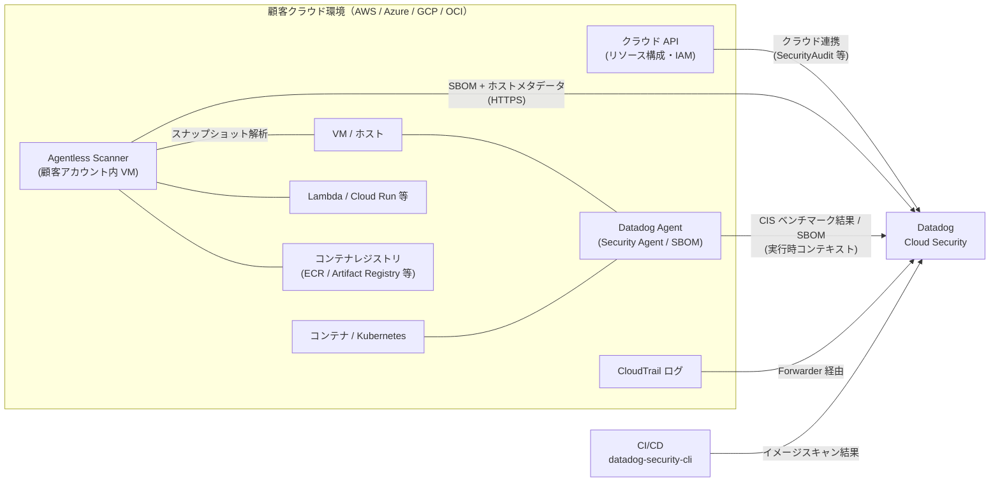
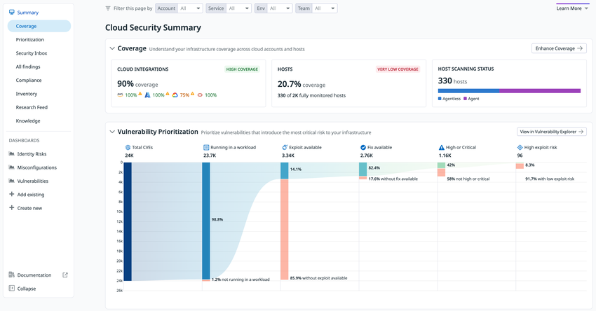
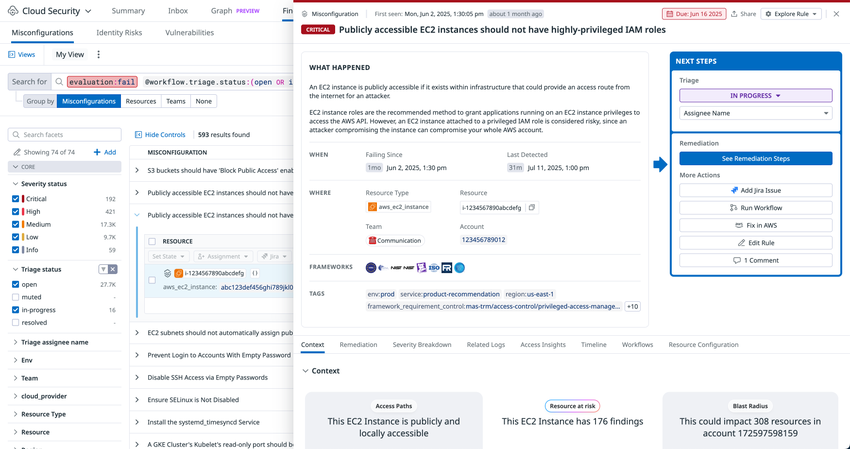
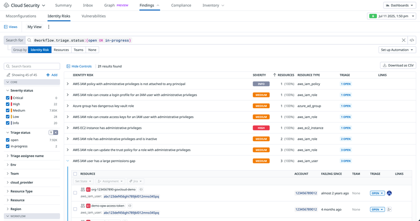
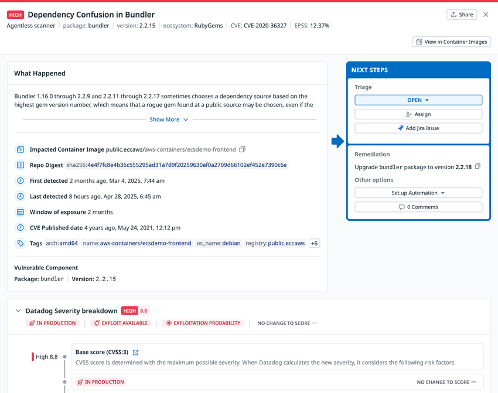
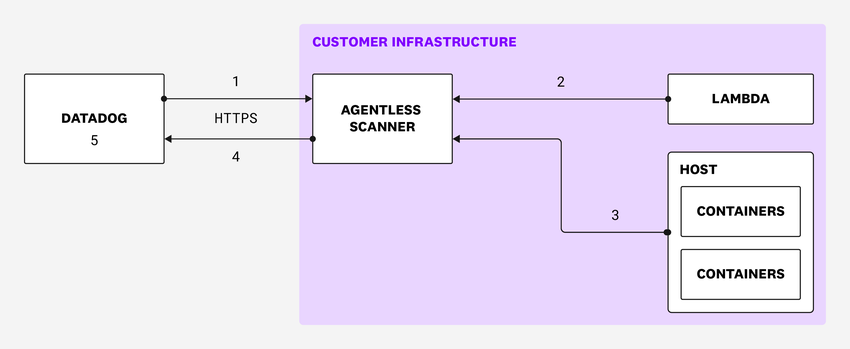

# Cloud Security（旧 CSM）

## 概要

Datadog **Cloud Security（クラウドセキュリティ、旧称：Cloud Security Management / CSM）** は、クラウド環境（AWS・Azure・Google Cloud・OCI）とホスト・コンテナ・Kubernetes を対象に、**設定不備（Misconfigurations）**、**ID・権限リスク（Identity Risks）**、**脆弱性（Vulnerabilities）** を継続的に検出し、オブザーバビリティデータと同じ文脈で優先度付け・修復するための製品である。業界用語では CNAPP（Cloud-Native Application Protection Platform）に相当し、CSPM（Cloud Security Posture Management）、KSPM（Kubernetes Security Posture Management）、CIEM（Cloud Infrastructure Entitlement Management）、脆弱性管理（VM）の機能を含む。[出典](https://docs.datadoghq.com/security/cloud_security_management/) [出典](https://www.datadoghq.com/pricing/?product=cloud-security)

本ファイルが答える主な問い:

- Cloud Security は何で構成され、旧 CSM・CSPM・CWS とどう対応するか
- データ収集方式（クラウド連携 API、Datadog Agent、Agentless Scanning、CI/CD スキャン）の違いと、それぞれで使える機能
- Misconfigurations の評価間隔、検知ルール（1,000 件超の既定ルール、Rego のカスタムルール）、対応コンプライアンスフレームワーク一覧
- Identity Risks の検出対象と AWS IAM Access Analyzer 連携
- Vulnerabilities の対応 OS・言語・レジストリ、Agentless と Agent の差、重大度スコアの計算方式
- Agentless Scanning の仕組み、スキャナ配置設計、上限値、データの扱い
- 制限値・既定値、サイト差異、課金単位（CSM Pro / CSM Enterprise）

Datadog Security 全体（Cloud SIEM・Workload Protection・Security Signals と Findings の共通モデル・Security Inbox・通知ルール・Automation Pipelines）は [Datadog Security 概要](./security-platform-overview.md) を参照する。実行時脅威検知は [Workload Protection（旧 CWS）](./workload-protection.md)、ソースコード・IaC ファイル・ライブラリの静的スキャンは [Code Security](./code-security.md)、クラウドストレージの機密データ分類は [Sensitive Data Scanner](./sensitive-data-scanner.md) を参照する。

---

## 1. 製品構成と名称

### 1.1 構成要素

Cloud Security は次の機能で構成される。2026-11-02 時点の公式ドキュメントでは、コア機能は Misconfigurations・Identity Risks・Vulnerabilities の 3 つで、ほかに共通機能・ビューが付随する。[出典](https://docs.datadoghq.com/security/cloud_security_management/)

| 区分 | 機能 | 内容 | 業界用語 |
|---|---|---|---|
| コア | **Misconfigurations（設定不備）** | クラウドリソース・ホスト・コンテナ・Kubernetes の構成を検知ルールで継続評価し、セキュリティ衛生とコンプライアンス状況を追跡、監査証跡の収集を自動化する | CSPM、KSPM |
| コア | **Identity Risks（ID リスク）** | AWS IAM・Azure・GCP の権限リスク（過剰権限、権限昇格、未使用権限、クロスアカウントアクセス等）を検出する | CIEM |
| コア | **Vulnerabilities（脆弱性）** | ホスト、ホストイメージ、コンテナイメージ、サーバーレス関数の脆弱性を検出し優先度付けする | 脆弱性管理（VM） |
| 共通 | Detection Rules / Notifications / Automation Pipelines / Security Inbox / Audit Trail / Security Research Feed | Datadog Security 共通の仕組み（詳細は [Datadog Security 概要](./security-platform-overview.md)） | ― |
| ビュー | Security Posture Score | 有効な既定コンプライアンスルールを満たす環境の割合 | ― |
| ビュー | Security Graph（Context Graph） | Attack Path（攻撃経路）の Finding に関わるリソースと関係をグラフ表示する（AWS・Azure） | ― |
| ビュー | Resource Catalog | ホスト・リソースごとの設定不備と脅威を表示する（[Software Catalog](../platform/software-catalog.md) とは別画面） | ― |
| ビュー | Cloudcraft Security Map | 設定不備・脆弱性・ID リスク・機密データのオーバーレイ付きでリソース構成図を表示する | ― |
| ビュー | Findings ページ、ホームダッシュボード、週次ダイジェストレポート | Finding の確認・修復、全体状況の把握 | ― |

> **補足:** 料金ページ上は、CSM Enterprise に Workload Protection（旧 CWS）とファイル整合性監視（FIM）が含まれる。Workload Protection の機能詳細は [Workload Protection](./workload-protection.md) を参照する。[出典](https://www.datadoghq.com/pricing/?product=cloud-security)

### 1.2 改称履歴と旧称の対応

Cloud Security は改称が多いため、旧称とドキュメント URL・料金プラン名の対応を次にまとめる。改称履歴の時系列は [Datadog Security 概要](./security-platform-overview.md) の改称履歴節を正とする。

| 現名称（2026-11-02 時点） | 旧称・別名 | 現在も旧称が残る箇所 |
|---|---|---|
| Cloud Security | Cloud Security Management（CSM） | ドキュメント URL（`/security/cloud_security_management/`）、料金プラン名（CSM Pro / CSM Enterprise）、メトリクス名（`datadog.csm.findings.count`）、アプリ URL（`/security/csm`） |
| Cloud Security Misconfigurations | CSPM、CSM Misconfigurations | ドキュメント URL（`/security/cspm/` へのリンク）、環境変数（`DD_COMPLIANCE_CONFIG_*`）、Operator キー（`features.cspm`） |
| Cloud Security Identity Risks | CIEM、CSM Identity Risks | ― |
| Cloud Security Vulnerabilities | CSM Vulnerabilities、Vulnerability Management（VM） | アプリ URL（`/security/csm/vm`）、API スコープ（`appsec_vm_read`） |
| Workload Protection | Cloud Workload Security（CWS）、CSM Threats | 環境変数（`DD_RUNTIME_SECURITY_CONFIG_ENABLED`）、料金 SKU（`CWS-HOSTS`） |

CSM（Cloud Security Management）は 2022-10 に CSPM と CWS を統合した製品として GA となり、2023-08 に CSM Pro / CSM Enterprise のパッケージが導入された。CSM から Cloud Security への改称時期は公開情報では確認できず（2025 年頃【推定】）。経緯の出典は [Datadog Security 概要](./security-platform-overview.md) を参照する。

---

## 2. アーキテクチャとデータ収集方式

### 2.1 データ収集方式の全体像

Cloud Security は 4 種類のデータ収集方式を組み合わせる。どの方式も単独で使え、併用もできる。[出典](https://docs.datadoghq.com/security/cloud_security_management/setup/)



| 方式 | 対象 | 有効になる主な機能 | 出典 |
|---|---|---|---|
| **クラウド連携（Cloud integrations）** | AWS アカウント、Azure サブスクリプション、GCP プロジェクト、OCI テナンシー | リソース構成のスキャン（Misconfigurations）、IAM ベース攻撃への対策（Identity Risks） | [出典](https://docs.datadoghq.com/security/cloud_security_management/setup/) |
| **Agentless Scanning** | AWS・Azure・GCP のホスト、実行中コンテナ、サーバーレス、レジストリ | Vulnerabilities（12 時間ごと更新）ほか。Security Inbox のインサイト（精度は Agent 併用より低い） | [出典](https://docs.datadoghq.com/security/cloud_security_management/setup/) |
| **Datadog Agent** | Agent を導入したホスト・コンテナ・Kubernetes | Misconfigurations（ホストベンチマーク）、Vulnerabilities（実行時コンテキスト付き優先度、リアルタイム更新）、より精度の高い Security Inbox インサイト | [出典](https://docs.datadoghq.com/security/cloud_security_management/setup/) |
| **CI/CD でのコンテナイメージスキャン** | CI ジョブ内のコンテナイメージ | 本番デプロイ前のイメージ脆弱性スキャン（Datadog Security CLI） | [出典](https://docs.datadoghq.com/security/cloud_security_management/setup/ci_cd/) |
| **AWS CloudTrail ログ**（追加機能） | AWS アカウント | Identity Risks で付与権限と実使用権限のギャップを可視化 | [出典](https://docs.datadoghq.com/security/cloud_security_management/setup/cloudtrail_logs/) |

公式ドキュメントは、**最初に Agentless Scanning を有効化して全体を可視化し、重要ホストに順次 Agent を導入して深い文脈を得る**進め方を推奨している。[出典](https://docs.datadoghq.com/security/cloud_security_management/agentless_scanning/)

### 2.2 Agentless・Agent の機能比較

公式セットアップページの比較表を次に示す（2026-11-02 時点の表記どおり）。[出典](https://docs.datadoghq.com/security/cloud_security_management/setup/)

| 機能 | Agentless | Agentless + Agent | Agent のみ |
|---|---|---|---|
| Cloud Security Identity Risks | ○ | ○ | 表記なし |
| Cloud Security Misconfigurations | ○ | ○ | ○ |
| Host benchmarks | ○ | ○ | 表記なし |
| Cloud Security Vulnerabilities | ○ | ○ | ○ |
| 脆弱性の優先度付け | ○ | ○（実行時コンテキスト付き） | ○（実行時コンテキスト付き） |
| 脆弱性の更新頻度 | 12 時間 | リアルタイム | リアルタイム |
| Security Inbox | ○ | ○（より精度の高いインサイト） | ○（より精度の高いインサイト） |

> **注意（公式表の解釈）:** Host benchmarks（CIS ホストベンチマーク）は Agent の `compliance_config.host_benchmarks` で有効化する機能であり（4.3 節）、Identity Risks はクラウド連携で有効化する機能である（4.2 節）。上表の「表記なし」セルは公式ドキュメントのソース上で空欄になっている箇所であり、表の列がずれて表示されている可能性がある。Host benchmarks が Agentless 単独で動作するかは公開情報では明確に確認できず、Agent 設定手順を正とすること。

### 2.3 デプロイ種別ごとの対応機能

公式の「Supported Deployment Types」ページには、デプロイ種別ごとの表と監視対象リソースごとの表の 2 つがある。デプロイ種別ごとの対応範囲は次の通り。[出典](https://docs.datadoghq.com/security/cloud_security_management/setup/supported_deployment_types/)

| デプロイ種別 | Agent 要件（7.46+） | Misconfigurations | Vulnerabilities | Identity Risks | Agentless Scanning |
|---|---|---|---|---|---|
| AWS アカウント | ○ | ○ | ○ | ○ | ― |
| Azure サブスクリプション | ○ | ○ | ○ | ○ | ― |
| GCP プロジェクト | ○ | ○ | ○ | ○ | ― |
| OCI テナンシー | ○ | ○ | ― | ― | ― |
| Terraform | ○ | ― | ― | ― | ― |
| Docker | ○ | ○ | ― | ― | ― |
| Kubernetes | ○ | ○ | ○ | ― | ― |
| Linux | ○ | ○ | ○ | ― | ― |
| Amazon ECS/EKS | ○ | ○ | ○ | ○ | ― |
| Windows | ○ | ○ | ― | ― | ― |
| AWS Fargate ECS/EKS | ○ | ECS Fargate のみ | ― | ― | ― |

監視対象リソースごとの対応範囲は次の通り。[出典](https://docs.datadoghq.com/security/cloud_security_management/setup/supported_deployment_types/)

| 監視対象リソース | Misconfigurations | Vulnerabilities | Identity Risks | Agentless scanning |
|---|---|---|---|---|
| AWS リソース / IAM | ○ | ○ | ○ | ○ |
| Azure リソース / IAM | ○ | ○ | ○ | ○ |
| GCP リソース / IAM | ○ | ○ | ○ | ○ |
| OCI リソース / IAM | ○ | ○ | ― | ― |
| Kubernetes クラスター | ○ | ― | ― | ― |
| Docker ホスト | ○ | ― | ― | ― |
| Linux ホスト | ○ | ○ | ○ | ― |
| Windows ホスト | ○ | ○ | ― | ― |
| Docker コンテナ | ○ | ― | ― | ― |
| コンテナイメージ | ○ | ○ | ― | ― |

- デプロイ種別表は Agent 要件を **7.46 以降**としている。また Windows と AWS Fargate を使うアカウントでも、EC2・RDS・S3・ELB などの共通リソースは Misconfigurations の対象になる。AWS Fargate（ECS/EKS）で Misconfigurations が使えるのは「ECS Fargate のみ」と記載されている。[出典](https://docs.datadoghq.com/security/cloud_security_management/setup/supported_deployment_types/)
- **Kubernetes の脆弱性:** 監視対象リソース表では「Kubernetes クラスター」の Vulnerabilities が空欄だが、デプロイ種別表では Kubernetes（Agent デプロイ）で Vulnerabilities に対応している。Kubernetes 上の Agent によるホスト・コンテナイメージの SBOM 収集・脆弱性スキャン（4.3 節、8 章）はこのデプロイ種別での対応であり、監視対象表の空欄は「クラスター」というリソース単位での評価を指すと読める【推定】。
- **OCI の Vulnerabilities（表間の不一致）:** デプロイ種別表では OCI テナンシーは Misconfigurations のみだが、監視対象リソース表では「OCI リソース / IAM」の Vulnerabilities が「○」になっており、公式の 2 つの表で記載が食い違っている。4.2 節の OCI 手順は Posture Management（Misconfigurations）の有効化のみで、OCI 向けの Agentless Scanning 手順も公開されていないため、OCI で Vulnerabilities を前提にする場合は事前に Datadog へ確認すること。
- 「―」は公式表が空欄であることを示す。

---

## 3. 画面構成

### 3.1 Cloud Security Summary（概要画面）



- **キャプション:** Cloud Security Summary 画面（カバレッジと脆弱性優先度ファネル）
- **画面の説明:** 左ナビゲーションに Summary 配下の **Coverage**、**Prioritization**、**Security Inbox**、**All findings**、**Compliance**、**Inventory**、**Research Feed**、**Knowledge** が並び、その下の **DASHBOARDS** に Identity Risks・Misconfigurations・Vulnerabilities の既定ダッシュボードがある。上部フィルタで Account・Service・Env・Team を絞り込める。**Coverage** カードは、クラウド連携のカバレッジ率（AWS・Azure・GCP・OCI 別）、ホストのカバレッジ率（全監視ホストのうちフルカバーのホスト数）、Host Scanning Status（Agentless と Agent の内訳）を示す。**Vulnerability Prioritization** は、Total CVEs → Running in a workload → Exploit available → Fix available → High or Critical → High exploit risk と段階的に絞り込むファネル図で、各段の件数と割合を表示する。
- **出典:** https://docs.datadoghq.com/security/cloud_security_management/ （画像取得日 2026-11-02）

### 3.2 主な画面とアプリ内パス

| 画面 | 内容 | アプリ内パス（US1 の例） |
|---|---|---|
| Cloud Security Summary | カバレッジ、優先度ファネル、ダッシュボード入口 | `/security/csm` |
| Findings > Misconfigurations | 設定不備（と Attack Paths）の Finding 一覧 | `/security/csm/misconfigurations-and-attack-paths`（旧 `/security/compliance`） |
| Findings > Identity Risks | ID リスクの Finding 一覧 | `/security/identities` |
| Findings > Vulnerabilities | 脆弱性の Finding 一覧（Vulnerability Explorer） | `/security/csm/vm` |
| Compliance | フレームワーク別レポート、カスタムフレームワーク作成 | `/security/compliance/home` |
| Misconfiguration Rules | 既定・カスタムの設定不備ルール | `/security/configuration/compliance/rules` |
| Infrastructure Packages Catalog | パッケージ単位の SBOM 検索 | `/security/catalog/libraries` |
| Crown Jewels 設定 | 重要リソースの一覧と編集 | `/security/configuration/crown-jewels` |
| Ownership 設定 | Ownership Agent の閾値・自動割当 | `/security/configuration/csm/ownership-agent` |
| Notification rules | Finding の通知ルール | `/security/configuration/notification-rules` |
| Security Inbox | 製品横断の優先度付き Finding 一覧 | `/security/issues` |

出典: 各機能ページ内のリンク [出典](https://docs.datadoghq.com/security/cloud_security_management/vulnerabilities/) [出典](https://docs.datadoghq.com/security/cloud_security_management/identity_risks/) [出典](https://docs.datadoghq.com/security/cloud_security_management/crown_jewels/) [出典](https://docs.datadoghq.com/security/cloud_security_management/review_remediate/remediate_with_ai/)。上部ナビゲーションには Summary・Inbox・Graph【Preview】・Findings・Compliance・Inventory が並ぶ（5.6 節の画像）。画面全般のナビゲーションは [画面構成とナビゲーション](../../01_入門編/06-ui-navigation.md) を参照する。

---

## 4. セットアップ

### 4.1 前提と全体手順

Cloud Security のセットアップは **Cloud Security Setup** ページ（Security > Settings 配下）から行う。公式の推奨順序は次の通り。[出典](https://docs.datadoghq.com/security/cloud_security_management/setup/)

1. Agentless Scanning を有効化する（AWS・Azure・GCP）
2. 重要ホストに Agent を展開して文脈を追加する
3. 追加機能を有効化する（CI/CD でのコンテナイメージスキャン、AWS CloudTrail ログ、クラウド連携によるリソーススキャン）

クラウド連携そのもの（ロール作成、Forwarder 等）は [AWS Integration](../platform/aws-integration.md)、[Azure Integration](../platform/azure-integration.md)、[Google Cloud Integration](../platform/gcp-integration.md) を参照する。

### 4.2 クラウド連携による Posture Management（Misconfigurations・Identity Risks）

Misconfigurations と Identity Risks は、各クラウドの Datadog インテグレーションに対して **Posture Management** を有効化することで動作する。[出典](https://docs.datadoghq.com/security/cloud_security_management/setup/cloud_integrations/)

| クラウド | 前提 | 必要な権限・API | 有効化手順の要点 |
|---|---|---|---|
| AWS | AWS インテグレーション設定済み | Datadog IAM ロールに AWS 管理ポリシー **`SecurityAudit`** をアタッチ（リソース収集の有効化） | Cloud Security Setup > Cloud Integrations > AWS > 対象アカウント > Features で各機能の Enable トグルをオン |
| Azure | Azure インテグレーション設定済み | Identity Risks を含む全ルールには Microsoft Graph API 権限（`AuditLog.Read.All`、`AdministrativeUnit.Read.All`、`Application.Read.All`、`Directory.Read.All`、`Domain.Read.All`、`Group.Read.All`、`Policy.Read.All`、`PrivilegedAssignmentSchedule.Read.AzureADGroup`、`PrivilegedEligibilitySchedule.Read.AzureADGroup`、`RoleManagement.Read.All`、`User.Read.All`）が必要 | Cloud Integrations > Azure > アカウントの **Posture Management** トグルをオン |
| Google Cloud | GCP インテグレーション設定済み。各プロジェクトで課金、Cloud Monitoring API、Compute Engine API、**Cloud Asset API** を有効化 | サービスアカウント（JSON キーをアップロード。複数プロジェクトは複数アカウント、または `project_id` を書き換えて再アップロード） | Cloud Integrations > GCP > **Posture Management** トグルをオン |
| OCI | OCI インテグレーション設定済み | 公開情報では追加権限の記載を確認できず | Cloud Integrations > OCI > テナンシーの **Posture Management** トグルをオン |

- **評価対象の絞り込み:** 各アカウント（サブスクリプション・プロジェクト）で **Evaluation Filters** を設定できる（4.7 節）。
- **無効化:** 同じトグル（AWS は Features タブの Enable）をオフにする。**無効化後も過去 15 か月分の Finding は参照可能**。[出典](https://docs.datadoghq.com/security/cloud_security_management/setup/cloud_integrations/)

> **サイト差異:** OCI の Posture Management は US1-FED（app.ddog-gov.com）および us2.ddog-gov.com では提供されない。[出典](https://docs.datadoghq.com/security/cloud_security_management/setup/cloud_integrations/)

### 4.3 Agent による有効化（Misconfigurations・Vulnerabilities）

Agent は Misconfigurations（CIS ホスト / Docker / Kubernetes ベンチマーク）と Vulnerabilities（ホスト・コンテナイメージの SBOM 収集）を担う。Agent 全般は [Datadog Agent](../platform/agent.md)、設定ファイル全般は [Agent 設定リファレンス](../platform/agent-configuration.md)、Kubernetes 版 Agent は [コンテナ/Kubernetes向けAgent](../platform/kubernetes-and-containers-agent.md) を参照する。

#### 最低バージョン

| 用途 | 最低 Agent バージョン | 出典 |
|---|---|---|
| Cloud Security（Linux / Docker）の前提 | 7.46 | [出典](https://docs.datadoghq.com/security/cloud_security_management/setup/agent/linux/) [出典](https://docs.datadoghq.com/security/cloud_security_management/setup/agent/docker/) |
| Windows の Cloud Security | 7.52（Windows Server 2016 以降） | [出典](https://docs.datadoghq.com/security/cloud_security_management/setup/agent/windows/) |
| Windows の脆弱性スキャン | 7.58 | 同上 |
| Agent によるアプリケーションライブラリの脆弱性管理 | 7.64 | [出典](https://docs.datadoghq.com/security/cloud_security_management/vulnerabilities/hosts_containers_compatibility/) |
| `analyzers: ["os", "languages"]`（アプリライブラリスキャン） | 7.70 | [出典](https://docs.datadoghq.com/security/cloud_security_management/setup/agent/kubernetes/) |
| Runtime Package Prioritization（`enrichment.usage`） | 7.79.0（Linux のみ、eBPF 依存） | [出典](https://docs.datadoghq.com/security/cloud_security_management/setup/agent/docker/) |
| Kubernetes での実行時シグナル網羅（推奨） | 7.81.0 | [出典](https://docs.datadoghq.com/security/cloud_security_management/setup/agent/kubernetes/) |

> **注意:** Kubernetes ページは前提を「最新の Agent」としている。7.64（互換性ページ）と 7.70（`languages` アナライザ）の 2 つの値は、ライブラリスキャン機能の段階的な拡張を示すと考えられる【推定】。設定キー `analyzers` を使う場合は 7.70 以降を前提とする。

#### Linux ホスト（`datadog.yaml` と `security-agent.yaml`）

`/etc/datadog-agent/datadog.yaml`:

```yaml
compliance_config:
  enabled: true            # 既定 false。Misconfigurations の CIS ベンチマーク
  host_benchmarks:
    enabled: true

# コメント上の記載: コンテナとホストの脆弱性は 1 時間ごとに評価・スキャンされる
sbom:
  enabled: true
  host:
    enabled: true          # ホストの脆弱性管理
    analyzers: ["os", "languages"]   # OS パッケージに加えアプリライブラリ（Agent 7.70+）
```

`/etc/datadog-agent/security-agent.yaml` にも同じ `compliance_config` ブロックを設定する。ファイルがない場合は `security-agent.yaml.example` をコピーし、権限を `640`、グループを `dd-agent` にする。[出典](https://docs.datadoghq.com/security/cloud_security_management/setup/agent/linux/)

#### Kubernetes（Datadog Operator）

```yaml
apiVersion: datadoghq.com/v2alpha1
kind: DatadogAgent
metadata:
  name: datadog
spec:
  features:
    cspm:
      enabled: true
      hostBenchmarks:
        enabled: true
    sbom:
      enabled: true
      containerImage:
        enabled: true
        analyzers: ["os", "languages"]
      host:
        enabled: true
        analyzers: ["os", "languages"]
      enrichment:
        usage:
          enabled: true     # Runtime Package Prioritization（7.79.0+）
```

#### Kubernetes（Helm `datadog-values.yaml`）

```yaml
datadog:
  securityAgent:
    compliance:
      enabled: true
      host_benchmarks:
        enabled: true
  sbom:
    containerImage:
      enabled: true
      analyzers: ["os", "languages"]
    host:
      enabled: true
      analyzers: ["os", "languages"]
    enrichment:
      usage:
        enabled: true
```

DaemonSet 直書きの場合は `agent`・`security-agent`・`system-probe` の全コンテナに環境変数（下表）と `HOST_ROOT=/host/root` を設定し、マウント方式のコンテナイメージスキャンのために `hostPID: true`、`SYS_ADMIN` ケーパビリティ、`appArmorProfile: Unconfined` を付与する。[出典](https://docs.datadoghq.com/security/cloud_security_management/setup/agent/kubernetes/)

#### Windows

`C:\ProgramData\Datadog\datadog.yaml` に `sbom.enabled: true` と `sbom.host.enabled: true` を設定して Agent を再起動する。制約: Windows コンテナワークロードは非対応。脆弱性は Windows のバージョンと適用済み KB から判定するため、累積 KB により適用状況を誤認する場合がある。KB 以外で適用された修正とサードパーティソフトウェアの脆弱性は追跡できない。[出典](https://docs.datadoghq.com/security/cloud_security_management/setup/agent/windows/)

#### Cloud Security 関連の Agent 環境変数

| 環境変数 | 内容 | 出典 |
|---|---|---|
| `DD_COMPLIANCE_CONFIG_ENABLED` | CSPM Agent（Security Agent 内で動作）を有効化 | [出典](https://docs.datadoghq.com/security/cloud_security_management/guide/agent_variables/) |
| `DD_COMPLIANCE_CONFIG_HOST_BENCHMARKS_ENABLED` | CSPM ホストベンチマークを有効化（`DD_COMPLIANCE_CONFIG_ENABLED` が前提） | 同上 |
| `DD_SBOM_ENABLED` | SBOM 収集サブシステムを有効化 | 同上 |
| `DD_SBOM_CONTAINER_IMAGE_ENABLED` | コンテナイメージの SBOM 収集 | 同上 |
| `DD_SBOM_HOST_ENABLED` | ホストの SBOM 収集 | 同上 |
| `DD_SBOM_CONTAINER_IMAGE_CONTAINER_EXCLUDE` / `..._INCLUDE` | SBOM 収集対象コンテナの拒否 / 許可リスト | 同上 |
| `DD_SBOM_CONTAINER_IMAGE_USE_MOUNT` | マウント方式のイメージスキャン | [出典](https://docs.datadoghq.com/security/cloud_security_management/setup/agent/kubernetes/) |
| `DD_SBOM_ENRICHMENT_USAGE_ENABLED` | Runtime Package Prioritization（7.79.0+） | 同上 |
| `DD_SBOM_CONTAINER_IMAGE_MIN_AVAILABLE_DISK` | イメージスキャンに必要な空きディスク（既定 1GB） | [出典](https://docs.datadoghq.com/security/cloud_security_management/troubleshooting/vulnerabilities/) |
| `DD_RUNTIME_SECURITY_CONFIG_ENABLED` / `DD_SYSTEM_PROBE_ENABLED` | Workload Protection（旧 CWS）用。詳細は [Workload Protection](./workload-protection.md) | [出典](https://docs.datadoghq.com/security/cloud_security_management/guide/agent_variables/) |

#### 動作確認

Cloud Security Overview（`/security/csm`）の Security Inbox と All Findings セクションに結果が表示されることを確認する。[出典](https://docs.datadoghq.com/security/cloud_security_management/setup/agent/windows/)

### 4.4 Agentless Scanning の有効化

Agentless Scanning の仕組みとスキャナ配置設計は 8 章で扱う。ここでは有効化手順の要点をまとめる。[出典](https://docs.datadoghq.com/security/cloud_security_management/setup/agentless_scanning/enable/)

**前提条件**

| 項目 | 内容 |
|---|---|
| Remote Configuration | 組織で有効化されていること（スキャン対象は Remote Configuration 経由で配信される） |
| API キー | Remote Configuration が有効な API キー |
| アプリケーションキー | API 経由で有効化する場合は Integrations Manage または Org Management 権限が必要（Cloud Shell・CloudFormation の流れでは自動生成） |
| クラウド権限 | インストール時に Datadog が付与。AWS: EBS スナップショット・ブロック読取、EC2 スナップショット・ボリューム操作、ECR pull、KMS decrypt / grant、Lambda 読取（DSPM 用に `kms:GenerateDataKey`、`s3:GetObject`、`s3:ListBucket`）。Azure: VM・VMSS・ディスク読取、ディスクアクセス、レジストリ pull。GCP: ディスク・スナップショット・イメージ権限、インスタンスへの attach / detach |
| 所要時間 | クラウドアカウントあたり約 30 分 |

**クラウド別の導入方式**

| クラウド | 方式 | 要点 |
|---|---|---|
| AWS | Quick Start | Cloud Security の全機能を有効化した CloudFormation ガイド付きフロー。Cloud Security 未設定の組織のみ |
| AWS | CloudFormation | 新規アカウントは Cloud Integrations > AWS から追加。既存アカウントは Features タブ > **Configure Agentless Scanning** |
| AWS | CloudFormation StackSet | 複数アカウント向け。中央スキャナアカウントを先に作り、Organizations / OU に委任ロールを展開。`ScannerInstanceRoleARN` はスキャナロールの正確な ARN（root ARN 不可） |
| AWS | Terraform | Datadog Agentless Scanner モジュール。リージョンごとにスキャナを配置でき、マルチリージョンで推奨 |
| Azure | Cloud Shell（推奨） | Terraform モジュールをラップしたスクリプト。スキャナ用サブスクリプションの Owner と、対象サブスクリプションに User Access Administrator 等が必要。スキャナは最大 4 ロケーションを選択 |
| Azure | ARM テンプレート | 専用リソースグループ推奨。リソースに `Datadog:true`、`DatadogAgentlessScanner:true` タグが付く |
| Azure | Terraform | Azure 用 Datadog モジュール |
| GCP | Cloud Shell（推奨） | スキャナプロジェクトの Owner と、Terraform state 用 GCS バケットの作成権限が必要 |
| GCP | Terraform | GCP 用 Datadog モジュール |

**確認・無効化・アンインストール**

- 初回スキャンは約 30 分。2 時間たっても結果がなければトラブルシューティングを参照する。
- ホスト・コンテナの結果は Vulnerabilities Explorer で `origin:"Agentless scanner"` で絞り込める。Lambda の脆弱性は Code Security（SCA）Explorer に表示される。
- 無効化: Cloud Security Setup で該当アカウントの Features タブ > 「Requires setup of the Agentless Scanners」配下のトグルをオフ。
- アンインストール: Terraform はモジュール削除、AWS CloudFormation は `DatadogIntegration-DatadogAgentlessScanning-...` スタック削除、GCP / Azure の Cloud Shell は `deploy` を `destroy` に変えて再実行（Azure はリソースグループと state ストレージアカウントが残る）、Azure ARM は専用リソースグループと 2 つのスキャナロール定義を削除。
- 更新: CloudFormation はネストスタック `DatadogIntegration-DatadogAgentlessScanning-…` をテンプレート URL（`https://datadog-cloudformation-template-quickstart.s3.amazonaws.com/aws/<VERSION>/datadog_agentless_scanning.yaml`）で置き換える。Terraform はモジュールの `source` を最新リリースに更新する。[出典](https://docs.datadoghq.com/security/cloud_security_management/setup/agentless_scanning/update/)

### 4.5 CI/CD でのコンテナイメージスキャン

Datadog Security CLI（`datadog-security-cli`）を CI ジョブで実行し、本番デプロイ前にコンテナイメージの脆弱性をスキャンする。[出典](https://docs.datadoghq.com/security/cloud_security_management/setup/ci_cd/)

| 項目 | 内容 |
|---|---|
| インストール | APT / YUM パッケージ `datadog-security-cli`、macOS は Homebrew cask |
| 必須環境変数 | `DD_API_KEY`、`DD_APP_KEY`（スコープ `appsec_vm_read` が必要）。`DD_SITE` は任意（既定 `datadoghq.com`、AP1 では `ap1.datadoghq.com` を指定） |
| 対応 CI | GitHub Actions、GitLab CI/CD、Azure DevOps、シェルを実行できる任意の CI |
| 主なコマンド | `datadog-security-cli image <image:tag>`（スキャンしてアップロード） |
| 主なオプション | `--no-persist`（アップロードせずローカルのみ）、`--fail-on <severity>`（例: `critical`、`high` でビルド失敗）、`--output json`、`--dockerfile <path>` |
| 結果の表示先 | 端末（CVE・パッケージ・修正版の表）、JSON、Datadog の Vulnerabilities ページ（数分以内） |
| Dockerfile との紐付け | OCI アノテーション `org.opencontainers.image.source`、`org.opencontainers.image.revision`、`com.datadoghq.image.source_path` が必要（ラベルでも可）。`org.opencontainers.image.base.name` / `.base.digest` で基本イメージの修正提案が改善。**CLI スキャンのみ対応**（Agent・Agentless では不可） |

> **補足:** Frontier Group のページでは「CLI vulnerabilities（CI/CD 脆弱性スキャン）」が Frontier パートナー向け提供と記載されており、CI/CD スキャンの提供ステータスはページ間で表記が揃っていない。利用前に提供状況を確認すること。[出典](https://docs.datadoghq.com/security/cloud_security_management/guide/frontier_group/)

### 4.6 AWS CloudTrail ログ（Identity Risks の強化）

AWS CloudTrail ログを Datadog に送ると、Identity Risks で付与権限と実使用権限のギャップが大きいユーザー・ロールを特定しやすくなる。手順は、AWS インテグレーションの CloudFormation で **Send Logs to Datadog** と **Detect security issues** を Yes にし、CloudTrail の S3 バケットを Datadog Forwarder Lambda のトリガー（All object create events）に設定する。[出典](https://docs.datadoghq.com/security/cloud_security_management/setup/cloudtrail_logs/) CloudTrail ログはログとして取り込まれるため、ログの取り込み・インデックス課金の対象になる点に注意する（[ログ収集](../logs/log-collection.md)、[Indexes・保持・アーカイブ](../logs/log-indexes-retention-archives.md)）。

### 4.7 Resource Evaluation Filters（評価対象の絞り込み）

Resource Evaluation Filters は、クラウドリソースのタグで Cloud Security の評価対象を限定・除外する機能である。[出典](https://docs.datadoghq.com/security/cloud_security_management/guide/resource_evaluation_filters/)

| 項目 | 仕様 |
|---|---|
| 書式 | カンマ区切りの `key:value`。許可リストは `key:value`、拒否リストは `!key:value` |
| ワイルドカード | `?`（1 文字）、`*`（複数文字） |
| 評価ロジック | 許可タグは OR（いずれか 1 つで評価対象）。拒否タグは AND で、許可タグより優先 |
| 例 | `!env:staging`、`datadog:monitored, env:prod*`、`datadog:monitored !region:us-east1` |
| 制約 | クラウド連携でスキャンするリソースにのみ適用。タグはリソースに直接付与されたもののみ（Datadog 側のユーザータグは対象外） |
| 設定場所 | AWS / Azure / GCP: Cloud Integrations > 対象 > Evaluation Filters > **Limit to Specific Resources**。OCI: Resource Evaluation Filters の「+」。コンテナ: Agent の Container Discovery Management |
| API | `GET` / `PUT /api/v2/cloud_security_management/resource_filters`（[出典](https://docs.datadoghq.com/api/latest/security-monitoring/)） |
| Agentless との関係 | Agentless Scanning はこのフィルタを尊重し、条件に合うリソースだけをスキャンする（[出典](https://docs.datadoghq.com/security/cloud_security_management/agentless_scanning/)） |
| フィルタ数の上限、課金への影響 | 公開情報では確認できず |

---

## 5. Misconfigurations（CSPM・KSPM）

### 5.1 仕組み

Cloud Security Misconfigurations は、クラウドリソースとインフラの構成を検知ルール（コンプライアンスルール）で定期評価し、ルールとリソースの組み合わせごとに **Pass / Fail** の結果（misconfiguration）を生成する。[出典](https://docs.datadoghq.com/security/cloud_security_management/misconfigurations/findings/)

| 項目 | 仕様 | 出典 |
|---|---|---|
| 評価間隔 | リソースタイプに応じて **15 分〜4 時間** | [出典](https://docs.datadoghq.com/security/cloud_security_management/misconfigurations/) |
| 新規 Finding の表示 | スキャン完了後すぐ | 同上 |
| 履歴の保持 | **15 か月**（調査・監査用） | 同上 |
| 既定ルール数 | 概要ページは「1,000 件超」、Frameworks ページは「1,300 件超」と記載（ページにより表記差あり） | [出典](https://docs.datadoghq.com/security/cloud_security_management/misconfigurations/) [出典](https://docs.datadoghq.com/security/cloud_security_management/misconfigurations/frameworks_and_benchmarks/) |
| 既定ルールの更新 | Datadog が継続的に新ルールを開発し、自動で取り込まれる | [出典](https://docs.datadoghq.com/security/cloud_security_management/misconfigurations/) |
| 通知先 | Slack、メール、PagerDuty、Webhook ほか | 同上 |

### 5.2 ルールの種類

| ルール種別 | 評価対象 | データソース |
|---|---|---|
| **Cloud configuration**（`cloud_configuration`） | クラウド環境内のリソース構成（例: CloudFront ディストリビューションが HTTPS を強制しているか） | クラウド連携 |
| **Infrastructure configuration**（`infrastructure_configuration`） | コンテナと Kubernetes クラスター（CIS Docker / Kubernetes ベンチマーク）、Linux ワークロード（Ubuntu・Red Hat・Amazon Linux・AlmaLinux 等の CIS ホストベンチマーク） | Agent（「infrastructure」ラベルのルールは Agent 導入環境に適用） |

既定ルールは Misconfiguration Rules ページの **Tag** ファセットで絞り込める: `cloud_provider:aws`、`cloud_provider:azure`、`cloud_provider:gcp`、`cloud_provider:oci`、`framework:cis-docker`、`framework:cis-kubernetes`。Linux ディストリビューションは Agent 対応ディストリビューションのサブセットのみ対応する。[出典](https://docs.datadoghq.com/security/cloud_security_management/misconfigurations/compliance_rules/)

### 5.3 既定ルールのカスタマイズ

- 既定ルールのクエリ（評価ロジック）自体は編集できない。代わりにルール詳細ページの **Exclude benign activity with suppression queries** で対象範囲を調整する。
  - 「This rule will not generate a misconfiguration if there is a match with any of the following suppression queries」: 例 `env:staging` を除外
  - 「Only generate a misconfiguration if there is a match with any of the following queries」: 例 `compliance:pci` のリソースに限定
- 変更後は **Update Rule** で適用する。
- 既定ルールの複製（Clone）と編集は Google Cloud のみ可能と記載されている。
- **ルールの廃止:** 廃止予定ルールには廃止日付きの警告が表示される（シグナルサイドパネルの Rule Details > Playbook、Misconfigurations サイドパネル、ルールエディタ）。廃止後 **15 か月**で削除され、その間はクローンで再有効化できる。削除後はクローン不可。

[出典](https://docs.datadoghq.com/security/cloud_security_management/misconfigurations/compliance_rules/)

### 5.4 カスタムルール（Rego）

Misconfigurations のカスタムルールは、ポリシー・アズ・コード言語 **Rego** で記述する。[出典](https://docs.datadoghq.com/security/cloud_security_management/misconfigurations/custom_rules/)

| 項目 | 仕様 |
|---|---|
| ルールタイプ | Cloud Configuration |
| 対象リソースタイプ | 1 つ以上指定（Cloud Resources Schema に一覧あり） |
| 判定結果 | `pass` / `fail` / `skip`。マークしないリソースは `skip` 扱い |
| テスト | リソースを選び **Test Rule** で Pass / Fail とタグを確認 |
| 重大度 | Critical / High / Medium / Low / Info |
| 説明文の書式 | レベル 2 見出し。`## Description` → What Happened、`## Remediation` → Remediation、`## Rationale` は任意。見出しは大文字小文字を区別しない。各節に本文が必要 |
| 付与できないタグ | `framework`、`control`、`requirement`（クローンしたルールには `scored` が自動付与） |
| 作成数の上限 | 公開情報では確認できず |

作成手順: Misconfigurations Rules ページ > **New Rule** > Cloud Configuration を選択 > リソースタイプ指定 > Rego 記述（テンプレートあり）> include / remove クエリで除外 > Test Rule > 重大度 > 「Say what's happening」で説明・修復手順 > タグ > **Save Rule**。Rego の書き方は公式ガイド「Writing Custom Cloud Security Misconfigurations Rules with Rego」を参照する。

### 5.5 KSPM（Kubernetes Security Posture Management）

KSPM は Misconfigurations の Kubernetes 向け機能で、**Agent とクラウド連携の両方**を導入すると最大限活用できる（セルフマネージドクラスターは Agent のみ）。既定の Kubernetes 検知ルールは 50 件超。[出典](https://docs.datadoghq.com/security/cloud_security_management/misconfigurations/kspm/)

| プラットフォーム | クラウド連携のリソース | Agent のリソース | フレームワーク |
|---|---|---|---|
| Amazon EKS | `aws_eks_cluster` | `aws_eks_worker_node` | `cis-eks` |
| Azure AKS | `azure_aks_cluster` | `azure_aks_worker_node` | `cis-aks` |
| Google GKE | `gcp_kubernetes_engine_cluster`、`gcp_kubernetes_engine_node_pool` | `gcp_gke_worker_node` | `cis-gke` |
| セルフマネージド Kubernetes | なし | `kubernetes_master_node`、`kubernetes_worker_node` | `cis-kubernetes` |

一部の CIS Kubernetes Benchmark ルールはセルフホストのクラスターにのみ適用される。[出典](https://docs.datadoghq.com/security/cloud_security_management/misconfigurations/frameworks_and_benchmarks/supported_frameworks/)

### 5.6 Misconfigurations Findings（エクスプローラー）



- **キャプション:** Cloud Security > Findings > Misconfigurations の一覧とサイドパネル
- **画面の説明:** 上部タブに Summary・Inbox・Graph（PREVIEW）・Findings・Compliance・Inventory があり、Findings 配下に Misconfigurations・Identity Risks・Vulnerabilities のタブがある。検索バーの既定クエリは `evaluation:fail @workflow.triage.status:(open OR in-progress)`。**Group by** で Misconfigurations / Resources / Teams / None を切り替える。左のファセットに Severity status（Critical・High・Medium・Low・Info の件数）、Triage status（open・muted・in-progress・resolved）、Triage assignee name、Env、Team、cloud_provider、Resource Type、Resource がある。右のサイドパネルには重大度（例: CRITICAL）とタイトル、**WHAT HAPPENED**（説明）、**WHEN**（Failing Since・Last Detected）、**WHERE**（Resource Type、Resource、Team、Account）、**FRAMEWORKS**、**TAGS**、期限（Due）が表示され、右側の **NEXT STEPS** に Triage（状態と担当者）、Remediation（See Remediation Steps）、More Actions（Add Jira Issue、Run Workflow、Fix in AWS、Edit Rule、Comment）が並ぶ。下部タブは Context・Remediation・Severity Breakdown・Related Logs・Access Insights・Timeline・Workflows・Resource Configuration で、Context には Access Paths（公開・ローカルアクセス可否）、Resource at risk（そのリソースの Finding 件数）、Blast Radius（影響しうるリソース数）が表示される。
- **出典:** https://docs.datadoghq.com/security/cloud_security_management/misconfigurations/ （画像取得日 2026-11-02）

| 操作 | 内容 | 出典 |
|---|---|---|
| 検索・グループ化 | 例: `evaluation:fail` で未解決のみ。任意のファセット・カスタムプロパティ・タグで Group by、None で個別表示 | [出典](https://docs.datadoghq.com/security/cloud_security_management/misconfigurations/findings/) |
| Views | 設定を保存して再利用（Save as new view） | 同上 |
| View All | ある misconfiguration の影響リソースを全件表示 | 同上 |
| タイムセレクター | 過去任意時点の構成状況を確認 | 同上 |
| 詳細 | リソース構成、適用ルール、タグ（所有者・場所）、業界ガイダンスに基づく修復手順 | 同上 |
| シグナル化 | 失敗した misconfiguration をシグナルとして Cloud SIEM・Workload Protection の脅威と並べてトリアージ可能 | 同上 |
| Related Logs | misconfiguration に関連するログの表示（ガイド「View a Misconfiguration's Related Logs」） | [出典](https://docs.datadoghq.com/security/cloud_security_management/guide/) |

### 5.7 公開アクセス判定（Publicly Accessible）

Datadog はグラフ処理フレームワークでクラウドリソース間の関係をたどり、インターネットから到達可能かを判定する。例えば公開 S3 バケットに保存される CloudTrail Trail は、それ自体も公開と判定される。判定結果は Severity Scoring の Accessibility（Public / Private）や Security Inbox の「Public accessibility」リスクに使われる。[出典](https://docs.datadoghq.com/security/cloud_security_management/guide/public-accessibility-logic/)

| リソース例（AWS） | 公開と判定される主な条件 |
|---|---|
| S3 バケット（`aws_s3_bucket`） | ① バケットポリシーが危険な S3 アクション（`s3:*` 等）を Resource・Principal `"*"` に無条件で許可し、バケットとアカウントの Public Access Block の `restrict_public_buckets` がどちらも `true` でない、または ② ACL が AllUsers / AuthenticatedUsers に `full_control`・`read`・`write`・`write_acp` を付与し、`ignore_public_acls` がどちらも `true` でない |
| CloudTrail Trail（`aws_cloudtrail_trail`） | `s3_bucket_name` が公開 S3 バケットを指す |
| VPC サブネット（`aws_subnet`） | IGW 経由で `0.0.0.0/0`（`::/0`）にルーティングするルートテーブルに接続し、かつ `0.0.0.0/0` の ingress・egress を持つ Network ACL に接続 |
| Redshift クラスター（`aws_redshift_cluster`） | `publicly_accessible: true`、公開 VPC 内、`0.0.0.0/0` を許可するセキュリティグループ、IGW へのルート |

Azure・Google Cloud にも同様の判定ロジックが定義されている（全リソースの一覧は公式ガイドを参照）。

### 5.8 Security Posture Score（セキュリティ態勢スコア）

Security Posture Score（別名 posture score、compliance score）は、有効な Datadog 既定の Cloud / Infrastructure コンプライアンスルールをすべて満たしている環境の割合を示す。[出典](https://docs.datadoghq.com/glossary/)

| 項目 | 仕様 |
|---|---|
| 対象 | `scored:true` タグの付いたルール・Finding のみ（5.4 節のとおりクローンしたルールにも `scored` タグが自動付与される） |
| 計算式 | 重大度別の合格率（Pass ÷（Pass + Fail））を重み付け平均する。重みは Critical 8、High 6、Medium 3、Low 2、Info 1、分母は重みの合計（20） |
| 用語集の数式上の注記 | Critical の項のみ合格率を 2 乗した表記になっている（公式用語集の数式どおり） |
| 該当重大度の Finding がない場合 | その重大度は計算から除外（例: Critical がなければ分母は 6+3+2+1） |
| 更新頻度 | 1 時間ごと |
| 改善方法 | 根本原因の修正、または対象リソースのルールをミュート（ミュートした Finding はスコア計算から除外される） |

### 5.9 修復（Remediation）

| 修復手段 | 内容 | 出典 |
|---|---|---|
| チケット作成 | Jira、ServiceNow、Linear、Datadog Case Management（詳細は [Datadog Security 概要](./security-platform-overview.md)、[Case Management](../service-management/case-management.md)） | [出典](https://docs.datadoghq.com/security/security_inbox/) |
| Workflow Automation | 人の承認あり / なしの自動修復。例: 公開 S3 バケット検出時に Slack の対話メッセージで Approve すると公開アクセスをブロック。トリガーは **Security**（`{{ Source.securityFinding.attributes.title }}` 等のソース変数） | [出典](https://docs.datadoghq.com/security/cloud_security_management/review_remediate/workflows/) |
| Fix in クラウドコンソール | サイドパネルからクラウドコンソールの該当リソースへ | [出典](https://docs.datadoghq.com/security/cloud_security_management/misconfigurations/) |
| Code Location（IaC 紐付け） | Terraform で定義されたリソースについて、リポジトリ・ファイル・行・コードオーナーを表示（サイドパネルの **Where (IAC)**） | [出典](https://docs.datadoghq.com/security/cloud_security_management/code_locations/) |
| Remediate with AI | Finding からコード修正用プロンプトを生成し、Bits Code で PR / MR を作成、Cursor で開く、またはプロンプトをコピー | [出典](https://docs.datadoghq.com/security/cloud_security_management/review_remediate/remediate_with_ai/) |
| ミュート | 誤検知・受容リスク等で除外（10 章） | [出典](https://docs.datadoghq.com/security/cloud_security_management/review_remediate/mute_issues/) |

**Code Location の要件と仕様**

- 対応 IaC 形式は **Terraform のみ**。CLI・コンソール・SDK で作成されたリソースはリンク不可。
- 前提: Misconfigurations の有効化と、IaC を含むリポジトリへの [Source Code Integration](../platform/integrations.md) 接続。
- Terraform state を Amazon S3 に保存している場合は、Agentless Scanning を有効化すると追加設定なしで state ファイルを読み取り、照合精度が上がる（必要なフィールドのみ読む）。state がない場合はリソース名と属性から推定する。
- 検索: `@code_location.filename:*`（コード位置が解決済み）、`@code_location.filename:*.tf` など。

[出典](https://docs.datadoghq.com/security/cloud_security_management/code_locations/)

**Remediate with AI の要件**: Bits Code で修正を生成するには `Bits Code Write`（`bits_dev_write`）権限と Bits Code のセットアップが必要。Bits Code の利用は **AI Credits** で課金される。プロンプトのコピーだけなら設定不要。**Create Automation** を選ぶと類似 Finding を Bits Code が自動修正する。[出典](https://docs.datadoghq.com/security/cloud_security_management/review_remediate/remediate_with_ai/) Bits AI 全般は [Bits AI と AI 機能](../ai/bits-ai.md) を参照する。

> **サイト差異:** Code Location と Remediate with AI は US1-FED（app.ddog-gov.com）と us2.ddog-gov.com では提供されない。Workflow Automation は us2.ddog-gov.com では【Preview】。[出典](https://docs.datadoghq.com/security/cloud_security_management/code_locations/) [出典](https://docs.datadoghq.com/security/cloud_security_management/review_remediate/workflows/)

---

## 6. コンプライアンスフレームワーク

### 6.1 対応フレームワーク一覧

Misconfigurations の各ルールは、1 つ以上のコンプライアンス標準・業界ベンチマークのコントロールに対応付けられる。2026-11-02 時点の対応フレームワークは次の通り（Rule Type が Infrastructure のものは Agent 導入環境に適用）。[出典](https://docs.datadoghq.com/security/cloud_security_management/misconfigurations/frameworks_and_benchmarks/supported_frameworks/)

| フレームワーク | 対応バージョン | フレームワークタグ | ルール種別 |
|---|---|---|---|
| AICPA SOC 2 | 2017 TSC w/ rev POF - 2022 | `soc-2` | Cloud |
| Australia APRA CPS 234 | 2019 | `cps234` | Cloud |
| Australia ASD Essential 8 | 2024 | `essential8` | Cloud |
| AWS Foundational Security Best Practices | v1.0.0 | `aws-fsbp` | Cloud |
| Brazil LGPD | 2018 | `lgpd` | Cloud |
| California CCPA/CPRA | Nov 2022 | `ccpa` | Cloud |
| CIS AlmaLinux 9 | v2.0.0 | `cis-almalinux9` | Infrastructure |
| CIS Amazon Linux 2023 | v1.0.0 | `cis-al2023` | Infrastructure |
| CIS Amazon Linux 2 | v3.0.0 | `cis-amzn2` | Infrastructure |
| CIS AWS Foundations Benchmark（※1） | v5.0.0、v4.0.0、v3.0.0、v1.5.0 | `cis-aws` | Cloud |
| CIS Azure Foundations Benchmark | v4.0.0、v2.0.0 | `cis-azure` | Cloud |
| CIS Docker Benchmark | v1.2 | `cis-docker` | Infrastructure |
| CIS GCP Foundations Benchmark | v3.0.0 | `cis-gcp` | Cloud |
| CIS GKE | v1.6.0 | `cis-gke` | Cloud |
| CIS Kubernetes (AKS) Benchmark（※2） | v1.4.0 | `cis-aks` | Cloud and Infrastructure |
| CIS Kubernetes (EKS) Benchmark（※2） | v1.7.0、v1.4.0 | `cis-eks` | Cloud and Infrastructure |
| CIS Kubernetes Benchmark（※2） | v1.9.0 | `cis-kubernetes` | Infrastructure |
| CIS Red Hat Linux 7 | v3.1.1 | `cis-rhel7` | Infrastructure |
| CIS Red Hat Linux 8 | v3.0.0 | `cis-rhel8` | Infrastructure |
| CIS Red Hat Linux 9 | v2.0.0 | `cis-rhel9` | Infrastructure |
| CIS Ubuntu 20.04 | v1.0.0 | `cis-ubuntu2004` | Infrastructure |
| CIS Ubuntu 22.04 | v2.0.0 | `cis-ubuntu2204` | Infrastructure |
| CIS Ubuntu 24.04 | v1.0.0 | `cis-ubuntu2404` | Infrastructure |
| CMMC | v2.0 | `cmmc-level-2` | Cloud |
| Digital Operational Resilience Act（DORA） | C(2024) 1532 | `dora` | Cloud |
| Essential Cloud Security Controls | v2 | `essential-cloud-security-controls` | Cloud |
| EU Cyber Resilience Act | 2024 | `cyber-resilience-act` | Cloud |
| FedRAMP High | v5 | `fedramp-high` | Cloud |
| FedRAMP Moderate | v5 | `fedramp-moderate` | Cloud |
| FedRAMP Low | v5 | `fedramp-low` | Cloud |
| GDPR | 2016/679 | `gdpr` | Cloud |
| HIPAA | 800-66-r2 | `hipaa` | Cloud |
| ISO/IEC 27001 | 2022、2013 | `iso-27001` | Cloud |
| NIS2 Directive (EU) | 2022/2555 | `nis2` | Cloud |
| NIST 800-171 | v3 | `nist-800-171` | Cloud |
| NIST 800-53 | v5 | `nist-800-53` | Cloud |
| NIST AI Risk Management Framework | v1.0 | `nist-ai-rmf` | Cloud |
| NIST Cybersecurity Framework | v2.0、v1.1 | `nist-csf` | Cloud |
| PCI DSS | v4.0 | `pci-dss` | Cloud |
| UK Cyber Essentials | 2024 | `cyber-essentials` | Cloud |
| Singapore MAS TRM | 2021 | `mas-trm` | Cloud |

- ※1 CIS AWS Foundations Benchmark の Monitoring セクションに合格するには、[Cloud SIEM](./cloud-siem.md) を有効化し CloudTrail ログを Datadog に転送する必要がある。
- ※2 一部の CIS Kubernetes Benchmark ルールはセルフホストの Kubernetes クラスターにのみ適用される。
- 日本固有の基準（FISC 安全対策基準、ISMAP 等）は 2026-11-02 時点の対応一覧に含まれていない。必要な場合はカスタムフレームワーク（6.3 節）で既存ルールを対応付ける。

### 6.2 コンプライアンスレポート

Compliance ページのフレームワーク別レポートは次の機能を持つ。[出典](https://docs.datadoghq.com/security/cloud_security_management/misconfigurations/frameworks_and_benchmarks/) [出典](https://docs.datadoghq.com/security/cloud_security_management/misconfigurations/)

| 項目 | 仕様 |
|---|---|
| サマリー | Posture Score、最も重大なルール失敗の上位 5 件、重大度別のルール内訳（概要ページは「重大度 High のルール失敗上位 3 件」「失敗の多いリソース」と記載） |
| 時点指定 | タイムセレクターで過去の態勢を表示 |
| ダウンロード | PDF または CSV |
| フィルタ | アカウント、チーム、サービス、環境タグ |
| グループ化 | 既定は要件（Requirement）とコントロール単位。重大度、リソースタイプ、リソースカテゴリでも可 |
| 非表示 | フレームワークを Compliance ページから隠せる（トグルで再表示） |
| ルール設定 | Compliance ページからルールのスキャン範囲と通知先を設定可能 |
| ダッシュボード化 | メトリクス `datadog.csm.findings.count` でグラフ化できる。ただし推定値のため誤差がありうる。正確な値は Compliance Framework ページを使う |
| 定期レポート配信 | 公開情報では確認できず（週次ダイジェストレポートは別機能として存在） |

### 6.3 カスタムフレームワーク

カスタムフレームワークは、自社のクラウドセキュリティ基準を定義して準拠状況を測定する機能である。Compliance ページに並び、独自のリアルタイムレポートと Posture Score を持ち、エクスプローラーとダッシュボードで検索できる。[出典](https://docs.datadoghq.com/security/cloud_security_management/misconfigurations/frameworks_and_benchmarks/custom_frameworks/)

| 入力項目 | 制約 |
|---|---|
| Framework name | 文字・数字・空白、**5 文字以上** |
| Handle | 小文字・数字・`-`・`_`・`.`。エクスプローラーやダッシュボードでの検索タグに使う |
| Version | 小文字・数字・`-`・`_`・`.` |
| Image URL | フレームワークを識別する公開アクセス可能な画像 URL |
| Requirement / Control | 小文字・数字・`-`・`_`・`.`。Requirement はコントロールファミリー、Control に複数ルールを割り当て |

- 保存には最低 1 つの Requirement・Control・ルールが必要。
- 割り当てられるのは cloud / infrastructure configuration ルール。
- 変更の反映に **最大 4 時間**かかる。
- API: `POST /api/v2/cloud_security_management/custom_frameworks`、`GET` / `PUT` / `DELETE /api/v2/cloud_security_management/custom_frameworks/{handle}/{version}`。[出典](https://docs.datadoghq.com/api/latest/security-monitoring/)
- 作成できるフレームワーク数の上限は公開情報では確認できず。

---

## 7. Identity Risks（CIEM）

### 7.1 検出対象

Cloud Security Identity Risks は、クラウドインフラを継続的にスキャンして権限（エンタイトルメント）リスクを検出する CIEM 機能である。対応クラウドは **AWS、Azure、GCP**。[出典](https://docs.datadoghq.com/security/cloud_security_management/identity_risks/)

| 検出カテゴリ | 例 |
|---|---|
| 残存する管理者権限（Lingering administrative privileges） | 使われていない管理者権限を持つ IAM ロール |
| 権限昇格（Privilege escalations） | IAM ユーザーのログインプロファイルを作成できるロール |
| 権限ギャップ（Permission gaps） | 付与されているが使われていない権限が多いユーザー |
| 大きな影響範囲（Large blast radii） | 侵害時に影響を受けるリソースが多い ID |
| クロスアカウントアクセス（Cross-account access） | 他アカウントからのアクセス経路 |

対象 ID の種類: ユーザー、ロール、グループ、ポリシー、EC2 インスタンス、Lambda 関数。



- **キャプション:** Cloud Security > Findings > Identity Risks の一覧
- **画面の説明:** 検索バーの既定クエリは `@workflow.triage.status:(open OR in-progress)`。**Group by** は Identity Risk / Resources / Teams / None。右上に **Set up Automation** と **Download as CSV** がある。一覧の列は IDENTITY RISK（例: 「AWS IAM role can create a login profile for an IAM user with administrative privileges」「AWS IAM user has a large permissions gap」「Azure group has dangerous key vault role」）、SEVERITY、RESOURCES（件数と割合）、RESOURCE TYPE（`aws_iam_role`、`aws_iam_user`、`azure_ad_group` 等）、TRIAGE、LINKS。行を展開すると影響リソース（アカウント、Failing Since、Team、Triage 状態）が表示される。左ファセットに Severity status、Triage status、Triage assignee name、Env、Team、cloud_provider、Resource Type、Resource、Region がある。
- **出典:** https://docs.datadoghq.com/security/cloud_security_management/identity_risks/ （画像取得日 2026-11-02）

### 7.2 確認と修復

| 機能 | 内容 |
|---|---|
| 一覧での確認 | 検索バーとファセットで絞り込み、Identity Risks / Resources / Teams / None でグループ化、View として保存。リスクを選ぶと影響リソースを最大 5 件表示（View All で全件） |
| Remediation タブ | 付与された権限が実際にどの程度使われているかを表示 |
| Fix in <クラウド> | クラウドコンソールで該当リソースを更新 |
| Workflow Automation | 人の承認あり / なしの自動修復ワークフロー |
| Terraform | 対応リソースについてファイル・行・コードオーナーを特定し、GitHub PR を生成 |
| Jira | **Add Jira issue** でチケットを作成・割当 |
| Suggested downsized policy | **View Suggested Policy** で縮小したポリシー案を表示し、Edit Policy でクラウドコンソールへ |

[出典](https://docs.datadoghq.com/security/cloud_security_management/identity_risks/)

### 7.3 Access Insights

Access Insights は Misconfigurations・Identity Risks・Security Inbox の各サイドパネルで使える権限可視化機能である。[出典](https://docs.datadoghq.com/security/cloud_security_management/identity_risks/)

| ビュー | 内容 |
|---|---|
| What can this resource access? | そのリソースがアクセスできるエンティティをアカウント横断で表示（アカウント、アクセス種別）。検索、種別・アカウントでのフィルタ、除外ポリシーの確認、All / Direct Access / Indirect Access タブ |
| Who can access this resource? | そのリソースにアクセスできるプリンシパルとそのリスク、経路種別（直接 / 間接）。名前・種別・公開アクセス可否・管理者権限で絞り込み |
| Actions | Resource Catalog または AWS IAM コンソールでエンティティを開く |

### 7.4 AWS IAM Access Analyzer 連携

| 項目 | 仕様 |
|---|---|
| 目的 | Access Analyzer の未使用アクセス（unused access）検出結果を使い、縮小ポリシーの推奨と権限ギャップ検出を強化する |
| 対象 | AWS のみ |
| Datadog 標準の権限ギャップ検出期間 | **90 日** |
| Access Analyzer 側の期間 | 180 日、360 日など長い期間を設定でき、その結果を Identity Risks で表示できる |
| 反映時間 | 初回有効化後、インサイトの表示まで **最大 2 時間** |
| 費用 | 初回有効化時に **AWS 側の追加費用**が発生する |

[出典](https://docs.datadoghq.com/security/cloud_security_management/identity_risks/)

---

## 8. Vulnerabilities（ホスト・コンテナ・サーバーレス）

### 8.1 スキャン方式と比較

Cloud Security Vulnerabilities は、Agentless Scanning・Datadog Agent・CI/CD コンテナイメージスキャンの 3 方式で脆弱性を検出する。どの方式も単独・併用可能で、有効化から **1 時間以内**に Findings ページに結果が表示される。[出典](https://docs.datadoghq.com/security/cloud_security_management/vulnerabilities/)

| 観点 | Agentless | Datadog Agent |
|---|---|---|
| 導入時間 | 数分 | 数時間〜数週間 |
| 優先度付け | あり | あり（実行時コンテキスト付き） |
| スキャン頻度 | 12 時間 | リアルタイム（※） |
| ホスト・ホストイメージの範囲 | OS とアプリのパッケージ（イメージに対応付け） | OS パッケージ（※） |
| コンテナイメージの範囲 | OS とアプリのパッケージ（イメージに対応付け） | OS パッケージ（※） |
| クラウド | AWS、Azure、GCP | AWS、Azure、GCP、オンプレミス等 |
| OS | Linux、Windows | Linux、Windows |
| サーバーレス | AWS Lambda、Amazon ECS Fargate、Azure Container Apps、Azure Container Instances、GCP Cloud Run（コンテナデプロイのみ） | 対象外 |
| コンテナレジストリ | 対応（8.3 節） | 対象外 |

※ ドキュメント間の差異:
- **Agent のスキャン範囲:** Vulnerabilities 概要ページの比較表は Agent を「OS パッケージ」としているが、互換性ページは Agent 7.64 以降でアプリケーションライブラリにも対応するとし、セットアップページは `analyzers: ["os", "languages"]`（Agent 7.70 以降）でアプリライブラリをスキャンできるとしている。最新の Agent では `languages` アナライザ指定でアプリライブラリも対象になると読むのが妥当【推定】。[出典](https://docs.datadoghq.com/security/cloud_security_management/vulnerabilities/hosts_containers_compatibility/) [出典](https://docs.datadoghq.com/security/cloud_security_management/setup/agent/kubernetes/)
- **Agent のスキャン頻度:** 比較表は「リアルタイム」とする一方、Linux の設定例コメントは「1 時間ごとに評価・スキャン」と記載し、Runtime Prioritization Engine ページはイメージ実行状況の更新を「1 時間ごと（Finding の再評価時）」としている。[出典](https://docs.datadoghq.com/security/cloud_security_management/setup/agent/linux/) [出典](https://docs.datadoghq.com/security/cloud_security_management/triage_and_prioritize/runtime_prioritization_engine/)



- **キャプション:** Vulnerability Explorer のサイドパネル（Agentless スキャナが検出したコンテナイメージの脆弱性）
- **画面の説明:** 上部に重大度（例: HIGH）とタイトル（例: 「Dependency Confusion in Bundler」）、検出元（Agentless scanner）、package・version・ecosystem・CVE・EPSS が表示され、右上に **View in Container Images** がある。**What Happened** には脆弱性の説明、影響コンテナイメージ（Impacted Container Image）、Repo Digest、First detected / Last detected、Window of exposure（露出期間）、CVE 公開日、タグ（`arch`、`name`、`os_name`、`registry` 等）、Vulnerable Component（パッケージとバージョン）が並ぶ。右の **NEXT STEPS** には Triage（OPEN 等の状態、Assign、Add Jira Issue）と Remediation（例: 「Upgrade bundler package to version 2.2.18」）、Other options（Set up Automation、Comments）がある。下部の **Datadog Severity breakdown** には最終スコア（例: HIGH 8.8）と適用されたリスク要因（IN PRODUCTION、EXPLOIT AVAILABLE、EXPLOITATION PROBABILITY）、Base score（CVSS）からの変化が表示される。
- **出典:** https://docs.datadoghq.com/security/cloud_security_management/vulnerabilities/ （画像取得日 2026-11-02）

### 8.2 対応 OS とパッケージ

**OS パッケージ（ホスト・コンテナ）** — Agentless・Agent とも対応（CLI は Windows 以外対応）。公式ベンダーの OS パッケージのみ対象で、サードパーティ製・自前ビルドのパッケージは非対応。[出典](https://docs.datadoghq.com/security/cloud_security_management/vulnerabilities/hosts_containers_compatibility/)

| OS | 対応バージョン | パッケージマネージャー |
|---|---|---|
| Alpine Linux | 2.2〜2.7、3.0〜3.19（edge 非対応） | apk |
| Wolfi Linux | ― | apk |
| Chainguard | ― | apk |
| Red Hat Enterprise Linux | 6、7、8、9（Agentless 互換性ページは 6、7、8） | dnf / yum / rpm |
| CentOS | 6、7、8 | dnf / yum / rpm |
| AlmaLinux | 8、9 | dnf / yum / rpm |
| Rocky Linux | 8、9 | dnf / yum / rpm |
| Oracle Linux | 5、6、7、8 | dnf / yum / rpm |
| CBL-Mariner | 1.0、2.0 | dnf / yum / rpm |
| Amazon Linux | 1、2、2023 | dnf / yum / rpm |
| openSUSE Leap | 42、15 | zypper / rpm |
| SUSE Linux Enterprise | 11、12、15 | zypper / rpm |
| Photon OS | 1.0、2.0、3.0、4.0 | tdnf / yum / rpm |
| Debian GNU/Linux | 7〜12（unstable / sid 非対応） | apt / dpkg |
| Ubuntu | Canonical がサポートする全バージョン | apt / dpkg |
| Windows | Server 2016 / 2019 / 2022、Windows 10 以降 | Windows OS（KB ベース） |

**アプリケーションライブラリ（コンテナ・Lambda）** — Agentless・Agent・CLI とも対応。

| 言語 | パッケージマネージャー | 対象ファイル |
|---|---|---|
| Ruby | bundler | `Gemfile.lock`、gemspec |
| .NET | nuget | `packages.lock.json`、`packages.config`、`.deps.json`、`*packages.props` |
| Go | mod | Go ビルドバイナリ、`go.mod` |
| Java | Gradle、Maven | `pom.xml`、`*gradle.lockfile`、JAR / WAR / PAR / EAR（`pom.properties` 付き） |
| Node.js | npm、pnpm、yarn | `package-lock.json`、`yarn.lock`、`pnpm-lock.yaml`、`package.json` |
| PHP | composer | `composer.lock` |
| Python | pip、poetry | `pipfile.lock`、`poetry.lock`、egg、wheel、conda パッケージ |

Agentless 互換性ページは言語として上記に加え Rust、Swift、Dart、Elixir、Conan、Conda も列挙している。[出典](https://docs.datadoghq.com/security/cloud_security_management/setup/agentless_scanning/compatibility/)

### 8.3 コンテナレジストリ（Agentless）

| レジストリ | スキャン範囲 |
|---|---|
| Amazon ECR（public / private） | 実行中イメージと、**直近 1,000 件の push 済みイメージ**（保存中）。これを超える場合は Datadog サポートに連絡 |
| Google Artifact Registry（旧 gcr.io ホスト名含む） | 実行中ワークロードと保存中イメージ |
| Azure Container Registry | 実行中イメージのみ（保存中は非対応） |
| Docker Hub、GitHub Container Registry、Microsoft Container Registry、registry.k8s.io | 認証付き pull のみ。スキャン対象ノードで実行中またはキャッシュされている場合にスキャン |
| セルフホストのレジストリ | 非対応 |

レジストリスキャンには CloudFormation Integrations v2.0.8 以降、または Terraform Agentless Module v0.11.7 以降が必要。[出典](https://docs.datadoghq.com/security/cloud_security_management/setup/agentless_scanning/compatibility/)

### 8.4 検出機能

| 機能 | 内容 | 出典 |
|---|---|---|
| 対象 | ホスト、ホストイメージ、コンテナイメージ（実行中・レジストリ）、サーバーレス関数 | [出典](https://docs.datadoghq.com/security/cloud_security_management/vulnerabilities/) |
| レイヤー特定 | 脆弱なコンテナイメージレイヤーを特定 | 同上 |
| 基本イメージ（Base image）の帰属 | 非フラット化・シングルステージで公開基本イメージから作ったイメージについて、基本イメージ由来の脆弱性と自前追加分を分離し、基本イメージ名と digest を表示。フィルタ例 `@vulnerability.is_inherited_from_base_image:true` | 同上 |
| Dockerfile・コミットとの紐付け | 実行中コンテナの CVE を導入した Dockerfile とコミットに紐付け（ビルド時の OCI アノテーションが必要、CLI スキャンのみ） | 同上 |
| SBOM | ホスト・ホストイメージ・コンテナイメージの全パッケージのインベントリ。エクスポート可能。**Infrastructure Packages Catalog** で影響パッケージのバージョンと使用リソースを検索 | 同上 |
| API エクスポート | 脆弱性、カバレッジ、SBOM を公開 API でエクスポート | 同上 |
| ガイド付き修復 | 修正版がある脆弱性について、影響レイヤーとイメージ固有の修正提案を表示 | 同上 |
| ライフサイクル管理 | トリアージ、ミュート、コメント、担当者割当 | 同上 |
| 自動化 | Automation Pipelines と通知ルールで、悪用可能な脆弱性のアラート、Jira チケット作成、SLA 強制 | 同上 |
| レポート | 既定ダッシュボード（クローンして編集可能） | 同上 |

コンテナイメージ一覧画面（Container Images）との連携は [コンテナ・Kubernetes 監視](../infrastructure/container-and-kubernetes-monitoring.md) を参照する。アプリケーション実行時のライブラリ脆弱性（Runtime SCA）と IAST は [Code Security](./code-security.md) の範囲である。

### 8.5 よく使う検索属性

| 目的 | クエリ例 | 出典 |
|---|---|---|
| 未解決のみ | `@status:open` | [出典](https://docs.datadoghq.com/security/cloud_security_management/vulnerabilities/) |
| Agentless 検出分 | `origin:"Agentless scanner"` | [出典](https://docs.datadoghq.com/security/cloud_security_management/setup/agentless_scanning/enable/) |
| 直近 12 時間に実行中のイメージ | `@risk.is_image_running:true`（実行中でないものを除くには `-@risk.is_image_running:false`） | [出典](https://docs.datadoghq.com/security/cloud_security_management/triage_and_prioritize/runtime_prioritization_engine/) |
| 実行時に使われたパッケージ | `@risk.is_package_running:true` | 同上 |
| root プロセスからのアクセス | `@package.is_running_as_root:true` | 同上 |
| SUID バイナリを含む | `@package.has_suid:true` | 同上 |
| 修正版あり | `@remediation.is_available:true` | 同上 |
| Crown Jewel 関連 | `@risk.is_crown_jewel:true` | [出典](https://docs.datadoghq.com/security/cloud_security_management/crown_jewels/) |
| CISA KEV 登録日 | `@vulnerability.cisa.kev_added_at` | [出典](https://docs.datadoghq.com/security/cloud_security_management/triage_and_prioritize/runtime_prioritization_engine/) |
| 基本イメージ由来 | `@vulnerability.is_inherited_from_base_image:true` | [出典](https://docs.datadoghq.com/security/cloud_security_management/vulnerabilities/) |

実行時タグは「観測した場合に付与」される。タグがないことは「未使用」を意味しないため、除外ではなく優先度付けに使う。`@risk.is_image_running` はコンテナイメージの Finding では常に `true` / `false` が付き、ホスト・ホストイメージ・サーバーレスの Finding には付かない。[出典](https://docs.datadoghq.com/security/cloud_security_management/triage_and_prioritize/runtime_prioritization_engine/)

### 8.6 トラブルシューティング（Agent によるコンテナイメージスキャン）

| 事象 | 原因・対処 |
|---|---|
| `not enough disk space to safely collect sbom` | 最大のコンテナイメージと同等以上の空きディスクが必要（既定 1GB）。すべてのイメージが 1GB 未満なら `DD_SBOM_CONTAINER_IMAGE_MIN_AVAILABLE_DISK` で下げられる |
| `unable to get uncompressed layer` | SBOM スキャンは非圧縮レイヤーが必要。EKS・minikube・kind 等はランタイムが非圧縮レイヤーを破棄する。containerd は `discard_unpacked_layers=false`、Helm は `datadog.sbom.containerImage.uncompressedLayersSupport: true`、Operator は `features.sbom.containerImage.uncompressedLayersSupport: true` |
| `image is not unpacked`（GKE） | GKE の Image streaming は非対応。Image streaming を無効化する |
| 無効化したい | Helm で `datadog.sbom.containerImage.enabled`、`datadog.sbom.host.enabled`、`containerImageCollection.enabled` を `false`（Helm 3.46.0 以降はイメージ収集が既定で有効） |

[出典](https://docs.datadoghq.com/security/cloud_security_management/troubleshooting/vulnerabilities/)

---

## 9. Agentless Scanning

### 9.1 仕組み



- **キャプション:** Agentless Scanning のデータフロー図
- **画面の説明:** 左に DATADOG、右の紫色の「CUSTOMER INFRASTRUCTURE」領域内に AGENTLESS SCANNER、LAMBDA、HOST（内部に複数の CONTAINERS）が描かれている。番号付き矢印は、①Datadog からスキャナへのスキャン指示（HTTPS）、②スキャナによる Lambda のコード取得、③スキャナによるホスト・コンテナのスナップショット解析、④スキャナから Datadog への結果（SBOM）送信（HTTPS）、⑤Datadog 側での脆弱性照合、を示す。
- **出典:** https://docs.datadoghq.com/security/cloud_security_management/agentless_scanning/ （画像取得日 2026-11-02）

Agentless Scanning は、顧客のクラウドアカウント内にスキャナ（独立した VM）を配置し、Agent を導入せずに AWS・Azure・GCP の脆弱性を可視化する。処理の流れは次の通り。[出典](https://docs.datadoghq.com/security/cloud_security_management/agentless_scanning/)

1. Datadog が **12 時間間隔**でスキャンをスケジュールし、対象リソースを **Remote Configuration** 経由でスキャナに送る（Evaluation Filters を尊重）。
2. サーバーレス関数（AWS Lambda 等）はスキャナが関数のコードを取得する。
3. VM は実行中インスタンスのボリュームのスナップショットを作成し、スキャナがパッケージとその依存関係の一覧（SBOM）を生成する。
4. SBOM とホストメタデータを Datadog に送信する。スナップショット・ディスク内容・コンテナイメージは顧客環境に残り、スナップショットは解析後に削除される。
5. Datadog が SBOM を既知の脆弱性と照合する。

**Agent との関係:** Agentless Scanning は **Datadog Agent が導入済みのリソースを除外**する（二重スキャンしない）。[出典](https://docs.datadoghq.com/security/cloud_security_management/agentless_scanning/)

### 9.2 データの扱い

| 区分 | 内容 |
|---|---|
| Datadog に送信されるもの | SBOM（CycloneDX 形式のパッケージ一覧）とホストメタデータ（ホスト名、EC2 / VM / Compute Engine のインスタンス ID） |
| 顧客アカウントに残るもの | ディスク内容、コンテナイメージ、スナップショット（解析後に削除） |
| 送信されないもの | システム・パッケージの設定、暗号鍵と証明書、ログと監査証跡、機密業務データ |
| クラウドストレージスキャン | Sensitive Data Scanner が S3 等のデータを顧客環境内で分類し、機密データ自体は Datadog に送らない |

[出典](https://docs.datadoghq.com/security/cloud_security_management/agentless_scanning/) [出典](https://docs.datadoghq.com/security/cloud_security_management/setup/agentless_scanning/deployment_methods/)

### 9.3 スキャナの特性とセキュリティ推奨

| 項目 | 内容 |
|---|---|
| 実行形態 | 顧客インフラ内の独立 VM |
| スケーリング | AWS ではワークロードに応じて自動スケールし、対象がなければゼロまで縮小 |
| ローテーション | 24 時間ごとにインスタンスを入れ替え、最新イメージで稼働 |
| クラウド API 利用 | レート制限を守り、必要に応じて指数バックオフ |
| ネットワーク | 既定では新しい VPC を作成。VPC 作成を制限する SCP がある場合は Terraform の custom VPC オプションで既存 VPC を使う |
| AWS の既定インスタンスタイプ（Terraform モジュール） | `t4g.medium`、Auto Scaling グループの既定台数 1（GitHub の Terraform モジュール既定値） |
| セキュリティ推奨 | スキャナへのアクセスを管理者に限定し最小権限化、Datadog への通信は HTTPS、無人セキュリティアップデート、24 時間ローテーション、インバウンド通信の遮断 |

[出典](https://docs.datadoghq.com/security/cloud_security_management/agentless_scanning/) [出典](https://docs.datadoghq.com/security/cloud_security_management/setup/agentless_scanning/deployment_methods/) [出典](https://github.com/DataDog/terraform-module-datadog-agentless-scanner)

### 9.4 配置設計（トポロジー）

| 判断事項 | 公式の推奨 |
|---|---|
| アカウント構成（単一） | そのアカウントに 1 台以上のスキャナを直接配置 |
| アカウント構成（複数） | **専用スキャナアカウント**に配置し、委任ロール（delegate role）で対象アカウント（スキャナアカウント自身を含む）をクロスアカウントスキャン。AWS Organizations は CloudFormation StackSet で委任ロールを全メンバーアカウントへ展開 |
| クロスアカウント権限を与えたくない場合 | 各アカウントにスキャナを配置（各スキャナがアカウント内でクロスリージョンスキャンするためコスト増） |
| リージョン（全体で約 150 ホスト未満） | 1 リージョンに 1 台が最もコスト効率が良い（クロスリージョン転送費 < 追加スキャナの固定費） |
| リージョン（あるリージョンで約 150 ホスト超） | そのリージョンに専用スキャナを配置 |
| 複数リージョンが閾値超 | 閾値を超える各リージョンに配置。閾値未満のリージョンは最寄りスキャナからクロスリージョンスキャン |
| Cloud Storage Scanning 利用時 | データストア（S3 バケット等）がある各リージョンに配置 |
| ルーティング | Datadog が適切なリージョンのスキャナへ自動ルーティング |

[出典](https://docs.datadoghq.com/security/cloud_security_management/setup/agentless_scanning/deployment_methods/)

### 9.5 対応範囲（互換性）

| 項目 | AWS | Azure | GCP |
|---|---|---|---|
| OS | Linux、Windows Server 2016 以降、Windows 10 以降 | 同左 | 同左 |
| ホストのファイルシステム | Btrfs、ext2/3/4、XFS、NTFS | 同左 | 同左 |
| コンテナランタイム | Docker、containerd（v1.5.6 以降、`discard_unpacked_layers=false` が必要）。CRI-O 非対応 | 同左 | 同左 |
| サーバーレス | Lambda、Fargate for ECS | Functions、Container Apps、Container Instances（最新スキャナが必要） | Cloud Run |
| Kubernetes | EKS on EC2、EKS on Fargate（Cluster Agent 必要） | AKS on VM、VMSS、ACI（Cluster Agent 必要） | GKE Standard、GKE Autopilot（Cluster Agent 必要） |
| ディスク暗号化 | 非暗号化、PMK、CMK | PMK のみ（CMK 非対応） | PMK のみ（CMEK・CSEK 非対応） |
| ホストイメージ | AMI（Datadog の AWS インテグレーションを使うアカウントに保存されたもの） | 非対応 | 非対応 |
| 機密データ（Sensitive Data Scanner） | S3 | 非対応 | 非対応 |
| オンデマンドスキャン | 対応（API でホスト・コンテナ・Lambda・S3 バケットを即時スキャン） | 公開情報では対応の記載なし | 公開情報では対応の記載なし |

[出典](https://docs.datadoghq.com/security/cloud_security_management/setup/agentless_scanning/compatibility/) [出典](https://docs.datadoghq.com/security/cloud_security_management/agentless_scanning/)

> **補足:** Sensitive Data Scanner for Cloud Storage は、CloudTrail 設定ページ上で【Limited Availability】（申請制）と記載されている。詳細は [Sensitive Data Scanner](./sensitive-data-scanner.md) を参照する。[出典](https://docs.datadoghq.com/security/cloud_security_management/setup/cloudtrail_logs/)

### 9.6 顧客クラウド側のコスト

Agentless Scanning のスキャナは顧客アカウント内で動くため、**コンピュート・ネットワーク（クロスリージョン転送等）・スナップショットの費用はクラウド事業者の請求に計上される**。Datadog は、150 ホスト超のリージョンへのスキャナ配置と、Terraform による「リージョンごとに 1 台」構成をコスト抑制策として挙げている。スキャナ 1 台あたりの具体的な月額費用は公開情報では確認できず。[出典](https://docs.datadoghq.com/security/cloud_security_management/agentless_scanning/) [出典](https://docs.datadoghq.com/security/cloud_security_management/setup/agentless_scanning/enable/)

> **サイト差異:** Agentless Scanning は US1-FED（app.ddog-gov.com）と us2.ddog-gov.com では提供されない。[出典](https://docs.datadoghq.com/security/cloud_security_management/agentless_scanning/)

---

## 10. 優先度付け・重大度・トリアージ

### 10.1 Severity Scoring Framework（設定不備・ID リスク）

Cloud Security Misconfigurations、Identity Risks、Security Inbox の設定不備は、**Likelihood（悪用されやすさ）× Impact（影響）** のマトリクスで重大度を決める。[出典](https://docs.datadoghq.com/security/cloud_security_management/severity_scoring/)

**Likelihood = Attack Vector × Accessibility**

| Attack Vector | 定義 | Private | Public |
|---|---|---|---|
| Required Privileges | 悪用に特定の権限・アクセスが必要 | Improbable | Possible |
| Vulnerability | 脆弱なコンポーネント（ソフトウェア脆弱性、漏えいしたパスワード・アクセスキー等）が必要 | Possible | Probable |
| No Authorization | 認可・認証なしで悪用可能 | Probable | Highly Probable |

**Impact**

| Impact | 定義 |
|---|---|
| Low | セキュリティ強化・衛生・メタデータ・ベストプラクティス関連。単独ではほぼ影響なし |
| Medium | 脆弱なコンポーネントまたは直接関連するリソースの機密性・完全性・可用性に影響 |
| High | 脆弱なコンポーネントと多数の他リソースに影響（例: `S3FullAccess` を持つ ID） |
| Critical | アカウント内の全リソースを完全に制御される（例: `AdministratorAccess` を持つ ID） |

**重大度マトリクス**

| Likelihood ＼ Impact | Low | Medium | High | Critical |
|---|---|---|---|---|
| Improbable | Low | Low | Medium | Medium |
| Possible | Low | Medium | High | High |
| Probable | Medium | High | High | Critical |
| Highly Probable | Medium | High | Critical | Critical |

例: サブスクリプションアクセスが `*` に開放された SNS トピックは No Authorization + Public（Highly Probable）× Medium で **High**。IMDSv2 を強制しない EC2 インスタンスは Vulnerability + Private（Possible）× Medium で **Medium**。

### 10.2 Datadog Severity Score（脆弱性）

| 段階 | 内容 |
|---|---|
| ① ベーススコア | **CVSS 4.0**。4.0 のスコアがなければ 3.1 → 3.0 → 2 の順にフォールバック |
| ② リスク修飾子 | 基盤インフラが稼働中か・影響範囲の広さ、環境（非本番は引き下げ）、アクティブな悪用（CISA KEV 掲載等）、悪用確率（EPSS） |
| Unknown | ベンダーアドバイザリにも NVD にも CVSS がない場合（古い CVE、Go 脆弱性 DB 等）は Unknown。Severity modifier rule で重大度を割り当て可能 |
| 修飾子の数値・計算式 | 公開情報では確認できず |

[出典](https://docs.datadoghq.com/security/cloud_security_management/severity_scoring/) [出典](https://docs.datadoghq.com/security/cloud_security_management/triage_and_prioritize/)

> **注意:** Security Inbox のページは脆弱性の重大度を「CVSS 3.1」に基づくと記載しており、Severity Scoring ページ（CVSS 4.0 優先、フォールバックあり）と表記が異なる。8.1 節の画面例でも Base score が「CVSS:3」と表示されており、CVSS 4.0 のスコアがない CVE は 3.x にフォールバックするため、両者は矛盾しないと読める【推定】。[出典](https://docs.datadoghq.com/security/security_inbox/)

### 10.3 Runtime Prioritization Engine

Runtime Prioritization Engine は、実行時の挙動・悪用可能性・露出・ビジネス文脈をオブザーバビリティとセキュリティのデータから組み合わせ、実際に悪用されうるリスクを持つ **約 5% の Finding** を特定する仕組みである。基準を満たさない Finding も表示はされるが、アクティブなトリアージキューから外れる。[出典](https://docs.datadoghq.com/security/cloud_security_management/triage_and_prioritize/runtime_prioritization_engine/)

| 評価軸 | 問い | シグナル例 |
|---|---|---|
| Reachability（到達可能性） | 脆弱なコンポーネントは実際に動いているか | 影響イメージが本番ワークロードで実行中、脆弱パッケージが実行時に使用 |
| Exposure（露出） | 攻撃者が到達できるか | 静的ネットワーク解析で公開、実行時の攻撃露出の証拠 |
| Exploitability（悪用可能性） | 攻撃者が悪用しそうか | 公開エクスプロイトあり、CISA KEV 掲載、高い EPSS |
| Business criticality（業務重要度） | 侵害時の影響は大きいか | Crown Jewel、特権で動作し機密データを処理 |
| Actionability（対処可能性） | 適切なチームが修正できるか | サービスオーナー特定済み、修正・緩和策あり |

**実行状況の判定方法**

| 項目 | Agent | Agentless |
|---|---|---|
| 必要条件 | Agent で脆弱性スキャンとコンテナ監視を有効化 | クラウドアカウントで Agentless Scanning を有効化 |
| 情報源 | Agent が監視するホスト上で実行中のコンテナ | スキャン時点でリソース上で実行中のイメージ |
| 更新頻度 | 1 時間ごと（Finding 再評価時） | 12 時間ごと（スキャンごと） |
| コンテナ単位の詳細 | サイドパネルに直近でイメージを実行したコンテナを表示 | なし |

**Runtime Package Prioritization** を有効化すると、Agent が eBPF でファイルアクセスを観測し、OS パッケージマネージャー（`apt`・`yum`・`apk`）でインストールされたパッケージについて「Package is running」「Accessed by root process」「SUID binary present」を Finding に付与する（Agent 7.79.0 以降、Linux のみ）。いったん実行が観測されたパッケージの情報はそのイメージバージョンの存続期間中保持され、イメージがデプロイされなくなると Finding はエージアウトしてクローズされる。[出典](https://docs.datadoghq.com/security/cloud_security_management/setup/agent/docker/) [出典](https://docs.datadoghq.com/security/cloud_security_management/triage_and_prioritize/runtime_prioritization_engine/)

**CISA BOD 26-04 の修復期限:** Runtime Prioritization Engine は CISA Binding Operational Directive 26-04 のリスクベースの考え方に従い、各脆弱性に修復期限区分（`three_days_and_forensic_triage`、`three_days`、`fourteen_days`、`sixty_days`、`fix_on_system_upgrade`）を付与し、算出した期限日を Finding に表示する。[出典](https://docs.datadoghq.com/security/cloud_security_management/triage_and_prioritize/runtime_prioritization_engine/)

> **サイト差異:** Runtime Prioritization Engine は US1-FED（app.ddog-gov.com）と us2.ddog-gov.com では提供されない。[出典](https://docs.datadoghq.com/security/cloud_security_management/triage_and_prioritize/)

### 10.4 Crown Jewels（重要資産）

Crown Jewels は、Datadog に送信済みのテレメトリから自動検出される最重要クラウドリソースの一覧である。[出典](https://docs.datadoghq.com/security/cloud_security_management/crown_jewels/)

| 項目 | 内容 |
|---|---|
| 対象リソース | Services（APM 計装サービス・推定サービス）、Databases（APM と Database Monitoring で観測）、Buckets（Agentless Scanning と Sensitive Data Scanner で観測した S3） |
| 検出シグナル | APM スパン内のシークレット、ログ内の機密フィールド、機密カラム名（`password`、`ssn`、`email` 等）、保存データ内の機密情報、サービス依存の fan-in（APM サービスマップ）、API トラフィック内の機密データ（App and API Protection） |
| Finding への伝播 | `@risk.is_crown_jewel:true` が関連 Finding に伝播（例: Crown Jewel サービスが使う VM の設定不備、Crown Jewel サービスが使うイメージの脆弱性） |
| 利用先 | Vulnerability Explorer、Misconfiguration Explorer、Notifications、Findings Automation |
| 編集 | Security > Settings > Cloud Security > Crown Jewels で削除・手動追加 |
| データの扱い | 既存テレメトリ上で動作し、Datadog アカウント外や第三者へデータを送らない |

### 10.5 ミュート

| 項目 | 内容 |
|---|---|
| 対象 | Misconfigurations、Identity Risks、Vulnerabilities |
| 手順 | Triage 列またはサイドパネルの Next Steps > Triage で **Muted** を選択 → 理由（例: false positive、accepted risk、fix pending）、任意の説明、期間を指定 → **Mute** |
| 一括 | 複数リソースを選択し **Set State** |
| 自動ミュート | Mute Rules で条件に合う Finding を自動ミュート |
| 解除 | 期間満了で自動解除。手動は Triage ドロップダウンで別状態を選択（即時反映） |
| スコアへの影響 | ミュートした Finding は Posture Score の計算から除外 |
| 表示 | 既定では非表示（`@workflow.triage.status:(open OR in-progress)` フィルタを外すと表示）。Vulnerabilities は **Muted** タブ |
| 監査 | サイドパネルの **Timeline** タブで理由・予定期間・実施者を確認 |
| 必要権限 | Misconfigurations / Identity Risks は `security_monitoring_findings_write`、Vulnerabilities は `appsec_vm_write`（いずれも既定 Standard Role。13 章参照） |
| 期間の選択肢 | 公開情報では確認できず（ミュート API は `PATCH /api/v2/security/findings/mute`） |

[出典](https://docs.datadoghq.com/security/cloud_security_management/review_remediate/mute_issues/) [出典](https://docs.datadoghq.com/api/latest/security-monitoring/)

### 10.6 Ownership Agent（所有者推定）

Ownership Agent は Finding のあるクラウドリソースの所有者（チーム・サービス・個人）を推定し、信頼度（high / medium / low）・説明・根拠シグナルを提示する。既定では高信頼度の推定結果が Finding の `team` タグに自動適用される（設定ページで閾値変更・無効化可能）。[出典](https://docs.datadoghq.com/security/cloud_security_management/review_remediate/ownership_agent/)

| 優先度 | シグナル | 内容 |
|---|---|---|
| 1 | Owner tags | `owner`、`dd-team`、`team` 等のリソースタグ（最も強い） |
| 2 | Ownership preferences | Reference Table で定義した組織独自のマッピング |
| 3 | Service Catalog | [Software Catalog（旧 Service Catalog）](../platform/software-catalog.md) のチーム情報 |
| 4 | Cloud audit logs | 作成したプリンシパル（CloudTrail 等。自動化・CI のプリンシパルは除外） |
| 5 | Container and host catalog | イメージラベル、ホストアノテーション |
| 6 | Naming patterns | リソース名等からの推定 |

対応リソースは AWS の主要リソース（`aws_ec2_instance`、`aws_s3_bucket`、`aws_iam_role`、`aws_lambda_function`、`aws_rds_instance` 等 23 種）、Azure の `azure_virtual_machine_instance`、GCP の `gcp_compute_instance`、3 クラウド共通の `host` / `host_image`、レジストリの `image`。

### 10.7 通知・自動化・チケット

Cloud Security の Finding は、Datadog Security 共通の Notification rules、Automation Pipelines（Mute / Due date / Inbox ルール）、Ticketing Integrations（Jira・ServiceNow・Linear・Case Management）、Assignee Management で扱う。共通仕様は [Datadog Security 概要](./security-platform-overview.md) を、ワークフローは [Workflow Automation](../service-management/workflow-automation.md) を参照する。脆弱性専用の通知ルール API は `/api/v2/security/vulnerabilities/notification_rules`（GET・POST・PATCH・DELETE）である。[出典](https://docs.datadoghq.com/api/latest/security-monitoring/)

---

## 11. Security Inbox・Security Graph との関係

### 11.1 Security Inbox

Security Inbox は Cloud Security・Code Security・App and API Protection・Workload Protection の Findings を 1 つの優先度付きリストにまとめる画面である。Cloud Security からは **Misconfiguration、Identity Risk、Attack Path、Host Vulnerability、Container Image Vulnerability** の 5 種類が流入する。[出典](https://docs.datadoghq.com/security/security_inbox/)

| 項目 | 内容 |
|---|---|
| 検出リスク | Public accessibility、Privileged access、Under attack（過去 15 日以内にセキュリティシグナル）、Exploit available、In production（`env` / `environment` タグ） |
| 並び順 | ① 重大度 → ② 検出リスク数 → ③ 影響リソース・サービス数 |
| 流入制御 | Inbox ルール（Security > Settings > Findings Automation）。上から評価し最初に一致したルールを適用。一致しない Finding は Inbox に入らない |
| 期限管理 | Due date ルール。Remediation SLA カードで Overdue / Due soon（7 日以内）/ Not due yet |

Security Inbox の操作（グループ化、エクスポート、一括操作、サイト差異）の詳細は [Datadog Security 概要](./security-platform-overview.md) を参照する。

### 11.2 Security Graph と Attack Paths

Security Graph は、Attack Path（攻撃経路）Finding のサイドパネルで **Context Graph** を表示し、露出・脆弱性・権限がどう組み合わさってリスクになっているかを示す。対応クラウドは **AWS と Azure**。例として、公開 EC2 インスタンスに High / Critical の脆弱性があり、そのインスタンスが機密データを持つ S3 バケットを読み取れる経路が挙げられている。[出典](https://docs.datadoghq.com/security/cloud_security_management/security_graph/)

開き方: Security > **Inbox** → Finding Type の `attack_path` で **Only** → Finding をクリック → **Context Graph** までスクロール → グラフ上のリソースをクリックで詳細表示。上部ナビゲーションの **Graph** は【Preview】表記（5.6 節の画像時点）。

> **サイト差異:** Security Graph は US1-FED（app.ddog-gov.com）と us2.ddog-gov.com では提供されない。Resource Catalog も同 2 サイトでは提供されない。[出典](https://docs.datadoghq.com/security/cloud_security_management/security_graph/) [出典](https://docs.datadoghq.com/security/cloud_security_management/)

### 11.3 Frontier Group（先行提供プログラム）

Frontier Group は Datadog が開発中の AI 機能を先行利用できるオプトインプログラムである。2026-11-02 時点の掲載状況は次の通り。[出典](https://docs.datadoghq.com/security/cloud_security_management/guide/frontier_group/)

| 機能 | ステータス |
|---|---|
| Ownership agent | GA |
| 1-click CSPM remediation（稼働中リソースと IaC 定義の自動修復、人の承認あり） | Frontier パートナー向け |
| Unified explorer（Misconfigurations・Identity Risks・Attack Paths の統合エクスプローラー） | Frontier パートナー向け |
| CLI vulnerabilities（CI/CD 脆弱性スキャン、エージェント向けコマンドライン連携） | Frontier パートナー向け |
| Container public accessibility | 近日提供（coming soon） |
| Critical assets | 近日提供（coming soon）。※ 同等機能の Crown Jewels ページは既に公開されている |

---

## 12. API と IaC

### 12.1 主な API エンドポイント

API の認証・レート制限の共通仕様は [API とキー管理](../platform/api-and-keys.md) を参照する。API ホストはサイトごとに異なる（AP1 は `api.ap1.datadoghq.com`）。

| 区分 | メソッド・パス | 内容 |
|---|---|---|
| Findings | `GET /api/v2/security/findings`、`POST /api/v2/security/findings/search` | セキュリティ Finding の一覧・検索 |
| Findings | `GET /api/v2/posture_management/findings`、`GET .../{finding_id}`【Preview】 | Posture Management の Finding |
| Findings | `PATCH /api/v2/security/findings/mute` | ミュート / 解除 |
| Findings | `PATCH /api/v2/security/findings/assignee`【Preview】 | 担当者割当 |
| チケット | `POST` / `PATCH /api/v2/security/findings/jira_issues`、`.../servicenow_tickets`、`.../cases` | Jira・ServiceNow・Case との連携 |
| 脆弱性 | `GET /api/v2/security/vulnerable-assets`【Preview】、`GET /api/v2/security/vulnerabilities`（非推奨・Preview） | 脆弱な資産・脆弱性一覧 |
| SBOM | `GET /api/v2/security/sboms`、`GET /api/v2/security/sboms/{asset_type}` | SBOM 取得 |
| スキャン資産 | `GET /api/v2/security/scanned-assets-metadata`【Preview】 | スキャン済み資産のメタデータ |
| 通知 | `/api/v2/security/vulnerabilities/notification_rules`（CRUD） | 脆弱性通知ルール |
| フレームワーク | `/api/v2/cloud_security_management/custom_frameworks`（CRUD） | カスタムフレームワーク |
| フィルタ | `GET` / `PUT /api/v2/cloud_security_management/resource_filters` | Resource Evaluation Filters |
| Agentless | `/api/v2/agentless_scanning/accounts/{aws,azure,gcp}`（CRUD） | クラウド別のスキャンオプション |
| Agentless | `GET` / `POST /api/v2/agentless_scanning/ondemand/aws`、`GET .../{task_id}` | AWS オンデマンドスキャン |

[出典](https://docs.datadoghq.com/api/latest/security-monitoring/) [出典](https://docs.datadoghq.com/api/latest/agentless-scanning/)

### 12.2 IaC による管理

- Agentless スキャナは CloudFormation（StackSet 含む）、Terraform モジュール（`DataDog/terraform-module-datadog-agentless-scanner`、AWS・Azure・GCP 用）、Azure ARM テンプレートで展開できる。[出典](https://docs.datadoghq.com/security/cloud_security_management/setup/agentless_scanning/enable/)
- 検知ルール・通知ルール等の Terraform リソースは [Terraform と IaC](../platform/terraform-and-iac.md) を参照する。
- 自社の IaC ファイル（Terraform・CloudFormation 等）をコミット時に静的スキャンする機能は **Code Security の IaC Security** であり、Cloud Security（稼働中リソースの評価）とは別製品・別課金である。[Code Security](./code-security.md) を参照する。

---

## 13. 権限

Cloud Security で使う主な権限・スコープは次の通り。RBAC 全般とロール設計は [組織・ユーザー・権限管理](../platform/account-and-access-management.md)、Datadog Security の権限一覧は [Datadog Security 概要](./security-platform-overview.md) を参照する。

| 権限・スコープ | 用途 | 出典 |
|---|---|---|
| `appsec_vm_read` | Datadog Security CLI（CI/CD イメージスキャン）のアプリケーションキーに必要 | [出典](https://docs.datadoghq.com/security/cloud_security_management/setup/ci_cd/) |
| `security_monitoring_findings_read`（Security Monitoring Findings Read。既定 **Standard** Role） | Misconfigurations / Identity Risks の Finding 一覧の閲覧（既定ロールは Read Only ではない点に注意） | [出典](https://docs.datadoghq.com/account_management/rbac/permissions/) |
| `security_monitoring_findings_write`（Security Monitoring Findings Write。既定 Standard Role） | Misconfigurations / Identity Risks の Finding のミュート（公式説明は「Mute CSPM Findings」） | [出典](https://docs.datadoghq.com/account_management/rbac/permissions/) |
| `appsec_vm_read`（Vulnerability Management Read。既定 Read Only Role） | インフラ・アプリケーションコード・ライブラリの脆弱性の閲覧（API や Inventory SQL 経由のアクセスは制限しない） | [出典](https://docs.datadoghq.com/account_management/rbac/permissions/) |
| `appsec_vm_write`（Vulnerability Management Write。既定 Standard Role） | 脆弱性の状態（ミュートを含む）・担当者の変更 | [出典](https://docs.datadoghq.com/account_management/rbac/permissions/) |
| `security_monitoring_findings_write` または `appsec_vm_write` | Finding の担当者割当（Assignee Management）。詳細は [Datadog Security 概要](./security-platform-overview.md) | [出典](https://docs.datadoghq.com/security/assignee_management/) |
| Integrations Manage または Org Management | API 経由で Agentless Scanning を有効化するアプリケーションキー | [出典](https://docs.datadoghq.com/security/cloud_security_management/setup/agentless_scanning/enable/) |
| `bits_dev_write`（Bits Code Write） | Remediate with AI で Bits Code に修正を生成させる | [出典](https://docs.datadoghq.com/security/cloud_security_management/review_remediate/remediate_with_ai/) |
| Security Inbox の表示範囲 | ユーザーは読み取り権限のある Finding 種別だけを見られる | [出典](https://docs.datadoghq.com/security/security_inbox/) |
| Mute Rules（自動ミュート）の作成やカスタムルール編集に必要な個別権限 | 公開情報では本ファイルの調査範囲で確認できず | ― |

---

## 14. サイト差異のまとめ

| 機能 | 提供されないサイト | 出典 |
|---|---|---|
| Agentless Scanning（脆弱性・クラウドストレージ） | US1-FED（app.ddog-gov.com）、us2.ddog-gov.com | [出典](https://docs.datadoghq.com/security/cloud_security_management/agentless_scanning/) |
| Resource Catalog | 同上 | [出典](https://docs.datadoghq.com/security/cloud_security_management/) |
| Security Graph | 同上 | [出典](https://docs.datadoghq.com/security/cloud_security_management/security_graph/) |
| Runtime Prioritization Engine | 同上 | [出典](https://docs.datadoghq.com/security/cloud_security_management/triage_and_prioritize/runtime_prioritization_engine/) |
| Code Location、Remediate with AI | 同上 | [出典](https://docs.datadoghq.com/security/cloud_security_management/code_locations/) |
| OCI の Posture Management | 同上 | [出典](https://docs.datadoghq.com/security/cloud_security_management/setup/cloud_integrations/) |
| Supported Deployment Types ページ全体の注記 | 同 2 サイトで「This product is not supported」と表示 | [出典](https://docs.datadoghq.com/security/cloud_security_management/setup/supported_deployment_types/) |
| Workflow Automation | us2.ddog-gov.com では【Preview】 | [出典](https://docs.datadoghq.com/security/cloud_security_management/review_remediate/workflows/) |
| Security Inbox の一部（Code Security・AAP の Findings、Linear 等） | US1-FED / us2.ddog-gov.com で一部制限 | [出典](https://docs.datadoghq.com/security/security_inbox/) |

> **サイト差異:** AP1（日本）を含む商用サイト（US1・US3・US5・EU1・AP1・AP2）では、上記の機能制限は公式ドキュメントに記載されていない。AP1 での料金は US サイトと異なる（「課金への影響」節）。サイト全般は [Datadog Sites](../platform/datadog-sites.md) を参照する。なお Supported Deployment Types ページは同 2 サイトで「製品非対応」と表示するが、他ページは機能単位の制限として記載しており、FedRAMP 系フレームワーク（6.1 節）が提供されていることも踏まえ、US1-FED で Cloud Security のどこまでが使えるかは契約前に Datadog に確認すること。

---

## 制限値・クォータ・デフォルト値

### スキャン・評価の間隔

| 項目 | 値 | 出典 |
|---|---|---|
| Misconfigurations の評価間隔 | 15 分〜4 時間（リソースタイプによる） | [出典](https://docs.datadoghq.com/security/cloud_security_management/misconfigurations/) |
| Agentless Scanning のスキャン間隔 | 12 時間 | [出典](https://docs.datadoghq.com/security/cloud_security_management/setup/agentless_scanning/deployment_methods/) |
| Agent による脆弱性の更新 | リアルタイム（比較表）／1 時間ごと（Linux 設定例コメント、実行状況の再評価） | [出典](https://docs.datadoghq.com/security/cloud_security_management/setup/) [出典](https://docs.datadoghq.com/security/cloud_security_management/setup/agent/linux/) |
| 脆弱性結果の初回表示 | 有効化から 1 時間以内 | [出典](https://docs.datadoghq.com/security/cloud_security_management/vulnerabilities/) |
| Agentless の初回スキャン | 約 30 分（2 時間たっても結果がなければトラブルシューティング） | [出典](https://docs.datadoghq.com/security/cloud_security_management/setup/agentless_scanning/enable/) |
| CI/CD スキャン結果の表示 | 数分以内 | [出典](https://docs.datadoghq.com/security/cloud_security_management/setup/ci_cd/) |
| Posture Score の更新 | 1 時間ごと | [出典](https://docs.datadoghq.com/glossary/) |
| カスタムフレームワーク変更の反映 | 最大 4 時間 | [出典](https://docs.datadoghq.com/security/cloud_security_management/misconfigurations/frameworks_and_benchmarks/custom_frameworks/) |
| AWS IAM Access Analyzer インサイトの反映 | 初回有効化後最大 2 時間 | [出典](https://docs.datadoghq.com/security/cloud_security_management/identity_risks/) |
| 「実行中イメージ」判定の窓 | 直近 12 時間 | [出典](https://docs.datadoghq.com/security/cloud_security_management/triage_and_prioritize/runtime_prioritization_engine/) |
| Security Inbox の Under attack 判定 | 過去 15 日以内のシグナル | [出典](https://docs.datadoghq.com/security/security_inbox/) |

### データ保持期間

| データ | 保持期間 | 出典 |
|---|---|---|
| 未解決の Findings | 検出され続ける限り保持 | [出典](https://docs.datadoghq.com/data_security/data_retention_periods/) |
| 解決済みの脆弱性 | リソースの最終スキャンから 30 日 | 同上 |
| Misconfigurations、Identity Risks、Attack Paths | 15 か月 | 同上 |
| Posture Management 無効化後の過去 Finding | 過去 15 か月分を参照可能 | [出典](https://docs.datadoghq.com/security/cloud_security_management/setup/cloud_integrations/) |
| 廃止ルールの削除 | 廃止から 15 か月後 | [出典](https://docs.datadoghq.com/security/cloud_security_management/misconfigurations/compliance_rules/) |

### 上限値・既定値

| 項目 | 値 | 出典 |
|---|---|---|
| 既定の Misconfigurations ルール数 | 1,000 件超（概要ページ）／1,300 件超（Frameworks ページ） | [出典](https://docs.datadoghq.com/security/cloud_security_management/misconfigurations/) [出典](https://docs.datadoghq.com/security/cloud_security_management/misconfigurations/frameworks_and_benchmarks/) |
| 既定の Kubernetes 検知ルール数 | 50 件超 | [出典](https://docs.datadoghq.com/security/cloud_security_management/misconfigurations/kspm/) |
| 対応コンプライアンスフレームワーク数 | 41（6.1 節の一覧） | [出典](https://docs.datadoghq.com/security/cloud_security_management/misconfigurations/frameworks_and_benchmarks/supported_frameworks/) |
| Agentless スキャナ数 | 1 アカウント・1 リージョンあたり最大 4（ハードキャップ。AWS の同時スナップショット上限 100 / アカウント / リージョンに起因）。ASG の希望台数を 4 超にしない | [出典](https://docs.datadoghq.com/security/cloud_security_management/setup/agentless_scanning/deployment_methods/) |
| スキャナ配置の閾値 | リージョンあたり約 150 ホスト | 同上 |
| Azure Cloud Shell でのスキャナロケーション | 最大 4 | [出典](https://docs.datadoghq.com/security/cloud_security_management/setup/agentless_scanning/enable/) |
| スキャナインスタンスのローテーション | 24 時間ごと | [出典](https://docs.datadoghq.com/security/cloud_security_management/agentless_scanning/) |
| AWS スキャナの既定インスタンスタイプ / 台数（Terraform モジュール） | `t4g.medium` / 1 | [出典](https://github.com/DataDog/terraform-module-datadog-agentless-scanner) |
| ECR の保存中イメージのスキャン | 直近 push の 1,000 件（超過はサポートに連絡） | [出典](https://docs.datadoghq.com/security/cloud_security_management/setup/agentless_scanning/compatibility/) |
| containerd の最低バージョン（Agentless） | v1.5.6 | 同上 |
| レジストリスキャンの最低バージョン | CloudFormation Integrations v2.0.8 / Terraform Agentless Module v0.11.7 | 同上 |
| Agent イメージスキャンの必要空きディスク | 既定 1GB（`DD_SBOM_CONTAINER_IMAGE_MIN_AVAILABLE_DISK`） | [出典](https://docs.datadoghq.com/security/cloud_security_management/troubleshooting/vulnerabilities/) |
| `compliance_config.enabled` の既定値 | `false` | [出典](https://docs.datadoghq.com/security/cloud_security_management/setup/agent/linux/) |
| Datadog 標準の権限ギャップ検出期間 | 90 日（Access Analyzer で 180 日・360 日等に拡張可） | [出典](https://docs.datadoghq.com/security/cloud_security_management/identity_risks/) |
| Identity Risks で 1 リスクあたり展開表示する影響リソース | 最大 5 件（View All で全件） | 同上 |
| Security Inbox の Group by | 最大 2 フィールド | [出典](https://docs.datadoghq.com/security/security_inbox/) |
| カスタムフレームワーク名 | 5 文字以上 | [出典](https://docs.datadoghq.com/security/cloud_security_management/misconfigurations/frameworks_and_benchmarks/custom_frameworks/) |
| `DD_SITE` の既定値（Security CLI） | `datadoghq.com` | [出典](https://docs.datadoghq.com/security/cloud_security_management/setup/ci_cd/) |
| 優先度付けで抽出される Finding の割合 | 約 5% | [出典](https://docs.datadoghq.com/security/cloud_security_management/triage_and_prioritize/runtime_prioritization_engine/) |

### 公開情報では確認できなかった値

| 項目 | 状況 |
|---|---|
| カスタムルール数・カスタムフレームワーク数・Evaluation Filters 数の上限 | 公開情報では確認できず |
| 対象アカウント数・リソース数・ホスト数の上限 | 公開情報では確認できず |
| スキャン対象ボリュームサイズ・イメージサイズの上限 | 公開情報では確認できず |
| ミュート期間の選択肢 | 公開情報では確認できず |
| Cloud Security 関連 API の個別レート制限 | 公開情報では確認できず |
| Datadog Severity Score の修飾子の数値 | 公開情報では確認できず |
| スキャナ 1 台あたりのクラウド費用 | 公開情報では確認できず |

---

## 課金への影響

Cloud Security の課金単位は **ホスト／月**（CSM Pro / CSM Enterprise）で、コンテナには枠（allotment）と超過課金がある。以下は 2026-11-02 時点の公式料金ページの定価（「Starting at」表記）。**料金の正本は [製品別料金表](../../03_導入編/02-pricing-by-product.md)** とし、料金体系の全体像は [料金体系の全体像](../../03_導入編/01-pricing-overview.md)、計算方法は [課金計算の仕組み](../../03_導入編/03-billing-mechanics.md)、エディションは [エディション・プラン](../../03_導入編/04-editions-and-plans.md) を参照する。

### プランと定価（US サイト、USD）

| 項目 | 課金単位 | 年契約 | 月契約（Month-to-month） | オンデマンド |
|---|---|---|---|---|
| CSM Pro | ホスト／月 | $10 | $12 | $12 |
| CSM Pro Containers（超過分） | コンテナ／月（前払い）・コンテナ時間 | $0.50／月 | $0.50／月 | $0.001／コンテナ時間 |
| CSM Enterprise | ホスト／月 | $25 | $30 | $30 |
| CSM Enterprise Containers（超過分） | コンテナ／月（前払い）・コンテナ時間 | $1／月 | $1／月 | $0.002／コンテナ時間 |

[出典](https://www.datadoghq.com/pricing/list/) [出典](https://www.datadoghq.com/pricing/?product=cloud-security)

> **サイト差異（料金）:** 料金ページのサイト選択を AP1 にすると定価は US の 1.25 倍で表示される（CSM Pro: 年契約 $12.50、月契約・オンデマンド $15。CSM Enterprise: 年契約 $31.25、月契約・オンデマンド $37.50。CSM Enterprise Containers: $1.25／月、オンデマンド $0.0025／コンテナ時間）。AP2 は 1.2 倍（CSM Pro 年契約 $12）。いずれも 2026-11-02 時点の料金ページ内データの値。[出典](https://www.datadoghq.com/pricing/?product=cloud-security)

### プランの内容

| 機能 | CSM Pro | CSM Enterprise |
|---|---|---|
| CSPM（Misconfigurations） | ○ | ○ |
| KSPM | ○ | ○ |
| コンプライアンスフレームワークへの対応付け | ○ | ○ |
| Vulnerability Management（コンテナ・ホスト） | ○ | ○ |
| CIEM（Identity Risks） | ○ | ○ |
| クラウドリソースのインベントリと関連リスク | ○ | ○ |
| Case management | ○ | ○ |
| ファイル整合性監視（FIM） | ― | ○ |
| Workload Protection（Linux、Windows、Kubernetes、Docker、AWS Fargate ECS/EKS） | ― | ○ |
| コンテナ枠 | 5 コンテナ／ホスト／月 | 20 コンテナ／ホスト／月 |
| Workflows | セキュリティ Finding・シグナル起点は無料 | 同左 |

[出典](https://www.datadoghq.com/pricing/?product=cloud-security)

### 課金ルール（料金ページ FAQ）

| 項目 | 内容 |
|---|---|
| 課金対象ホスト | Agent または Agentless 技術で保護する物理・仮想 OS インスタンス（サーバー、VM、Kubernetes ノード、Azure App Service Plan インスタンス）。**Agentless でスキャンしたホストも課金対象** |
| プランの混在 | 不可。組織として CSM Pro か CSM Enterprise のどちらか一方 |
| CSM Pro の前提契約 | 他の Datadog プラン不要（Infrastructure Monitoring 契約なしで購入可） |
| CSM Enterprise の前提契約 | 課金対象の CSM Enterprise ホストごとに Infrastructure Monitoring が必要。FAQ 内で「Enterprise Infrastructure Monitoring が必要」と「Infrastructure Pro または Enterprise が必要（例: CSM Enterprise 10 ホストなら Infrastructure Pro / Enterprise も 10 ホスト。コミット・非コミットとも）」の 2 通りの記載があり、表記が一致しない。契約前に営業窓口で確認すること |
| オンデマンドの請求明細 | CSM Enterprise をオンデマンド利用中は、請求書に一時的に CSM Pro と Workload Protection の明細が表示され、年末までに CSM Enterprise の明細に置き換わると記載 |
| ボリューム割引 | 月 500 ホスト以上で複数年・ボリューム割引あり（条件は非公開） |
| セットアップ | クラウドプロバイダー連携と、任意で Datadog Agent |

[出典](https://www.datadoghq.com/pricing/?product=cloud-security)

### その他の課金・費用

| 項目 | 内容 |
|---|---|
| DevSecOps バンドル | Infrastructure と CSM の組み合わせ。DevSecOps Pro（Infrastructure Pro + CSM Pro、年契約 $22／ホスト、オンデマンド $27、5 コンテナ／ホスト）、DevSecOps Enterprise（Infrastructure Enterprise + CSM Enterprise、年契約 $34／ホスト、オンデマンド $41、10 コンテナ／ホスト）。単体のインフラ・コンテナ・クラウドセキュリティ製品とは併用不可。[出典](https://www.datadoghq.com/pricing/) |
| Workload Protection 単体 | $15／ホスト／月（年契約）。CSM Enterprise には含まれる。詳細は [Workload Protection](./workload-protection.md) |
| Agentless スキャナの実行費用 | 顧客のクラウド請求（コンピュート、スナップショット、クロスリージョン転送）。Datadog の請求とは別 |
| AWS IAM Access Analyzer | 初回有効化時に AWS 側の追加費用 |
| CloudTrail ログ | ログとして取り込むため Log Management の課金対象（[Indexes・保持・アーカイブ](../logs/log-indexes-retention-archives.md)） |
| CIS AWS Monitoring セクション対応 | Cloud SIEM の契約が必要（[Cloud SIEM](./cloud-siem.md)） |
| Remediate with AI（Bits Code） | AI Credits で課金（[Bits AI と AI 機能](../ai/bits-ai.md)） |
| Sensitive Data Scanner for Cloud Storage | 別製品（[Sensitive Data Scanner](./sensitive-data-scanner.md)） |
| IaC ファイルのスキャン | Code Security の IaC Security（コミッター課金、[Code Security](./code-security.md)） |

課金対象ホスト数の確認は [Usage・Usage Attribution・Cost Visibility](../platform/usage-and-cost-attribution.md)、コスト削減の実践（Evaluation Filters による対象絞り込み等）は [コスト最適化](../../04_応用編/01-cost-optimization.md) を参照する。

---

## 関連ファイル

| ファイル | 関係 |
|---|---|
| [Datadog Security 概要](./security-platform-overview.md) | Findings・Signals の共通モデル、Security Inbox・通知・Automation Pipelines・権限・改称履歴 |
| [Workload Protection（旧 CWS）](./workload-protection.md) | CSM Enterprise に含まれる実行時脅威検知・FIM |
| [Cloud SIEM](./cloud-siem.md) | CloudTrail 等のログからの脅威検知、CIS AWS Monitoring セクション |
| [Code Security](./code-security.md) | SCA・IAST・IaC Security・Secret Scanning（Lambda の脆弱性表示先を含む） |
| [App and API Protection（旧 ASM）](./app-and-api-protection.md) | API Security の Findings、Crown Jewels のシグナル源 |
| [Sensitive Data Scanner](./sensitive-data-scanner.md) | クラウドストレージの機密データ分類 |
| [AWS Integration](../platform/aws-integration.md) / [Azure Integration](../platform/azure-integration.md) / [Google Cloud Integration](../platform/gcp-integration.md) | Posture Management の前提となるクラウド連携 |
| [Datadog Agent](../platform/agent.md) / [Agent 設定リファレンス](../platform/agent-configuration.md) / [コンテナ/Kubernetes向けAgent](../platform/kubernetes-and-containers-agent.md) | Agent ベースの Misconfigurations・Vulnerabilities |
| [Fleet Automation と Remote Configuration](../platform/fleet-automation.md) | Agentless Scanning の前提となる Remote Configuration |
| [Workflow Automation](../service-management/workflow-automation.md) / [Case Management](../service-management/case-management.md) | 修復の自動化・ケース管理 |
| [Datadog Sites](../platform/datadog-sites.md) | サイト差異 |
| [製品別料金表](../../03_導入編/02-pricing-by-product.md) | 料金の正本 |
| [セキュリティとコンプライアンス](../../03_導入編/12-security-and-compliance.md) | Datadog 自体のコンプライアンス（本製品の対象フレームワークとは別） |
| [セキュリティ運用の実践](../../04_応用編/11-security-operations-practices.md) | 運用ベストプラクティス |

---

## 参照元

（いずれも 2026-11-02 取得）

**公式ドキュメント（docs.datadoghq.com）**

- Cloud Security 概要: https://docs.datadoghq.com/security/cloud_security_management/
- Setting up Cloud Security: https://docs.datadoghq.com/security/cloud_security_management/setup/
- Supported Deployment Types: https://docs.datadoghq.com/security/cloud_security_management/setup/supported_deployment_types/
- Deploying Cloud Security using Cloud Integrations: https://docs.datadoghq.com/security/cloud_security_management/setup/cloud_integrations/
- Agent setup（Linux）: https://docs.datadoghq.com/security/cloud_security_management/setup/agent/linux/
- Agent setup（Kubernetes）: https://docs.datadoghq.com/security/cloud_security_management/setup/agent/kubernetes/
- Agent setup（Docker）: https://docs.datadoghq.com/security/cloud_security_management/setup/agent/docker/
- Agent setup（Windows）: https://docs.datadoghq.com/security/cloud_security_management/setup/agent/windows/
- Container Image Scanning in CI/CD: https://docs.datadoghq.com/security/cloud_security_management/setup/ci_cd/
- AWS CloudTrail Logs for Cloud Security: https://docs.datadoghq.com/security/cloud_security_management/setup/cloudtrail_logs/
- Agentless Scanning: https://docs.datadoghq.com/security/cloud_security_management/agentless_scanning/
- Enabling Agentless Scanning: https://docs.datadoghq.com/security/cloud_security_management/setup/agentless_scanning/enable/
- Deploying Agentless Scanning: https://docs.datadoghq.com/security/cloud_security_management/setup/agentless_scanning/deployment_methods/
- Agentless Scanning Compatibility: https://docs.datadoghq.com/security/cloud_security_management/setup/agentless_scanning/compatibility/
- Updating Agentless Scanning: https://docs.datadoghq.com/security/cloud_security_management/setup/agentless_scanning/update/
- Misconfigurations: https://docs.datadoghq.com/security/cloud_security_management/misconfigurations/
- Misconfigurations Findings: https://docs.datadoghq.com/security/cloud_security_management/misconfigurations/findings/
- Compliance Rules: https://docs.datadoghq.com/security/cloud_security_management/misconfigurations/compliance_rules/
- Custom Rules: https://docs.datadoghq.com/security/cloud_security_management/misconfigurations/custom_rules/
- KSPM: https://docs.datadoghq.com/security/cloud_security_management/misconfigurations/kspm/
- Frameworks and Benchmarks: https://docs.datadoghq.com/security/cloud_security_management/misconfigurations/frameworks_and_benchmarks/
- Supported Frameworks: https://docs.datadoghq.com/security/cloud_security_management/misconfigurations/frameworks_and_benchmarks/supported_frameworks/
- Custom Frameworks: https://docs.datadoghq.com/security/cloud_security_management/misconfigurations/frameworks_and_benchmarks/custom_frameworks/
- Identity Risks: https://docs.datadoghq.com/security/cloud_security_management/identity_risks/
- Vulnerabilities: https://docs.datadoghq.com/security/cloud_security_management/vulnerabilities/
- Hosts and Containers Compatibility: https://docs.datadoghq.com/security/cloud_security_management/vulnerabilities/hosts_containers_compatibility/
- Troubleshooting Vulnerabilities: https://docs.datadoghq.com/security/cloud_security_management/troubleshooting/vulnerabilities/
- Triage and Prioritize: https://docs.datadoghq.com/security/cloud_security_management/triage_and_prioritize/
- Runtime Prioritization Engine: https://docs.datadoghq.com/security/cloud_security_management/triage_and_prioritize/runtime_prioritization_engine/
- Severity Scoring: https://docs.datadoghq.com/security/cloud_security_management/severity_scoring/
- Crown Jewels: https://docs.datadoghq.com/security/cloud_security_management/crown_jewels/
- Security Graph: https://docs.datadoghq.com/security/cloud_security_management/security_graph/
- Code Locations: https://docs.datadoghq.com/security/cloud_security_management/code_locations/
- Mute Issues: https://docs.datadoghq.com/security/cloud_security_management/review_remediate/mute_issues/
- Workflow Automation（Cloud Security）: https://docs.datadoghq.com/security/cloud_security_management/review_remediate/workflows/
- Remediate with AI: https://docs.datadoghq.com/security/cloud_security_management/review_remediate/remediate_with_ai/
- Ownership Agent: https://docs.datadoghq.com/security/cloud_security_management/review_remediate/ownership_agent/
- Resource Evaluation Filters: https://docs.datadoghq.com/security/cloud_security_management/guide/resource_evaluation_filters/
- Cloud Security Agent Variables: https://docs.datadoghq.com/security/cloud_security_management/guide/agent_variables/
- Public Accessibility Logic: https://docs.datadoghq.com/security/cloud_security_management/guide/public-accessibility-logic/
- Cloud Security Frontier Group: https://docs.datadoghq.com/security/cloud_security_management/guide/frontier_group/
- Security Inbox: https://docs.datadoghq.com/security/security_inbox/
- Glossary（security posture score）: https://docs.datadoghq.com/glossary/
- Data Retention Periods: https://docs.datadoghq.com/data_security/data_retention_periods/
- API Reference（Security Monitoring）: https://docs.datadoghq.com/api/latest/security-monitoring/
- API Reference（Agentless Scanning）: https://docs.datadoghq.com/api/latest/agentless-scanning/

**公式サイト（料金）**

- Pricing（Cloud Security）: https://www.datadoghq.com/pricing/?product=cloud-security
- Pricing List: https://www.datadoghq.com/pricing/list/

**公式 GitHub**

- terraform-module-datadog-agentless-scanner: https://github.com/DataDog/terraform-module-datadog-agentless-scanner

**画像（Datadog 公式ドキュメントより取得、2026-11-02）**

- `../../assets/images/cloud-security/csm_overview.png` — https://docs.datadoghq.com/security/cloud_security_management/
- `../../assets/images/cloud-security/misconfigurations_explorer.png` — https://docs.datadoghq.com/security/cloud_security_management/misconfigurations/
- `../../assets/images/cloud-security/identity_risks_explorer.png` — https://docs.datadoghq.com/security/cloud_security_management/identity_risks/
- `../../assets/images/cloud-security/vulnerabilities_explorer.png` — https://docs.datadoghq.com/security/cloud_security_management/vulnerabilities/
- `../../assets/images/cloud-security/how_agentless_works.png` — https://docs.datadoghq.com/security/cloud_security_management/agentless_scanning/
