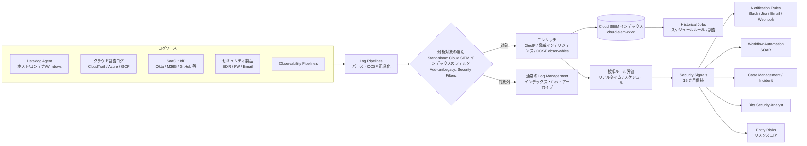
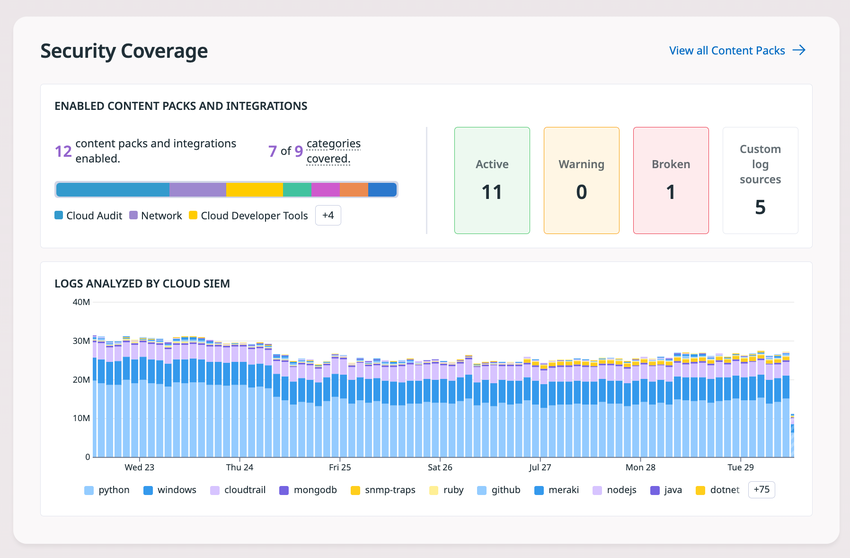
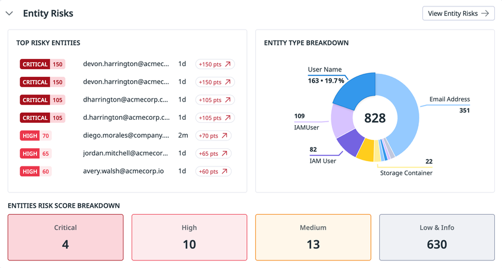
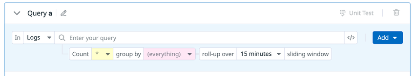
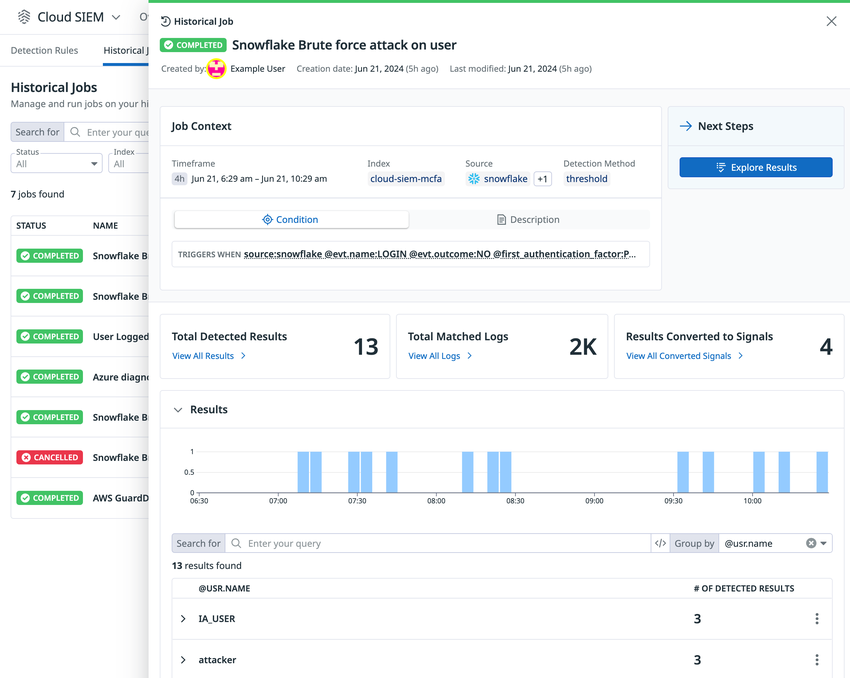
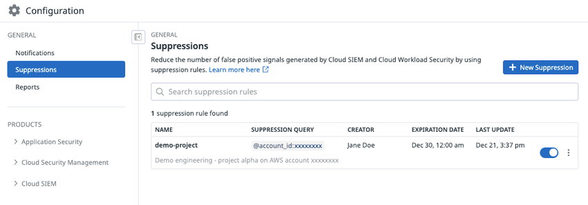

# Cloud SIEM

## 概要

Datadog Cloud SIEM（Security Information and Event Management、セキュリティ情報・イベント管理）は、クラウドとオンプレミスのテレメトリ（主にログ）を Datadog Agent と API ベースのインテグレーションで取り込み、検知ルール（Detection Rules）で継続的に分析して Security Signal（セキュリティシグナル）を生成し、調査・対応までを 1 つの基盤で行うセキュリティデータ分析・相関システムである。[出典](https://docs.datadoghq.com/security/cloud_siem/)

Cloud SIEM は Datadog Log Management を基盤としており、ログの保存先として Standard Indexing（頻繁なクエリ）、Flex Logs（長期保持と時折の緊急クエリ）、Log Archives（低頻度クエリの長期保存）を選べる。DevOps チームとセキュリティチームが同じプラットフォーム上でメトリクス・トレース・ログに横断的にピボットできることが特徴である。[出典](https://docs.datadoghq.com/security/cloud_siem/)

Cloud SIEM の主要機能は次のとおり。

| 領域 | 機能 | 本ファイルの節 |
|---|---|---|
| 取り込み | Content Packs（146 パック・10 カテゴリ）、Entity Packs、カスタムログ、OCSF 正規化、Security Filters / インデックスフィルタ | [ログソースと取り込み](#ログソースと取り込み) |
| エンリッチ | 組み込み脅威インテリジェンス、BYOTI（Bring Your Own Threat Intelligence）、Muted Indicators、GeoIP | [脅威インテリジェンス](#脅威インテリジェンスと-ioc-explorer) |
| 検知 | OOTB ルール 800 以上、カスタムルール（7 検知方式 × リアルタイム / スケジュール / Historical Job）、SQL 検知、Suppressions、Dynamic Severity、MITRE ATT&CK Map | [検知ルール](#検知ルールdetection-rules) |
| トリアージ | Signals Explorer、通知ルール、Case Management、Incident 宣言、Security operational metrics | [Security Signals](#security-signalsセキュリティシグナル) |
| 調査 | Investigator、Entity Risks（旧称：Risk Insights）、IOC Explorer、Bits Security Analyst | [Investigator](#investigator)、[Entity Risks](#entity-risks旧称risk-insights) |
| 対応 | SOAR（Workflow Automation）、ブループリント | [SOAR 連携](#soar-連携workflow-automation) |

Datadog Security 製品群全体の位置付け、Security Signals と Findings の違い、複数製品で共通の検知ルール概念については [Datadog Security 概要](./security-platform-overview.md) を参照。

> **名称について:** Cloud SIEM は以前「Security Monitoring」と呼ばれており、API のカテゴリ名（`/api/v2/security_monitoring/...`）や権限名（`security_monitoring_*`）、Terraform リソース名（`datadog_security_monitoring_rule` 等）に旧称が残っている。Entity Risks は以前「Risk Insights」と呼ばれていた（料金ページには「Risk-based insights」「Risk Insight Notifications」の表記が残る）。[出典](https://docs.datadoghq.com/security/cloud_siem/triage_and_investigate/entities_and_risk_scoring/) [出典](https://www.datadoghq.com/pricing/?product=cloud-siem)

## 製品形態（Standalone / Add-on with Flex Logs / Legacy）

Cloud SIEM は契約時期によって 3 つの製品形態があり、課金単位・保持期間・ログ分析対象の制御方法・使える機能が異なる。**2026-11-02 時点で新規組織の既定は「Standalone（12 か月）」** である。[出典](https://docs.datadoghq.com/security/cloud_siem/guide/determine-cloud-siem-product/)

| 製品形態 | 使用量の計測単位 | データ保持 | 分析対象ログの制御 | 設定方法 | Plan & Usage のタイル名 |
|---|---|---|---|---|---|
| Standalone（12 か月）※新規既定 | 分析ログの **GB** | 365 日（12 か月） | Cloud SIEM インデックスのインデックスフィルタ（Security Filters は使わない） | Log Configuration UI | Security Analyzed and Indexed Logs |
| Standalone（15 か月） | 分析ログの **百万イベント** | 450 日（15 か月） | 同上 | 同上 | Security Analyzed and Indexed Logs |
| Add-on with Flex Logs | 公開情報では明示されず（料金一覧ページの「Per 1M analyzed events」と推定【推定】） | 公開情報では明示されず | Security Filters | UI と API | Cloud SIEM - Analyzed Logs (Add-On) |
| Legacy | 公開情報では明示されず | 公開情報では明示されず | Security Filters | API のみ | SIEM - Analyzed Logs |

[出典](https://docs.datadoghq.com/security/cloud_siem/guide/determine-cloud-siem-product/) [出典](https://docs.datadoghq.com/security/cloud_siem/guide/customize-which-logs-cloud-siem-analyzes/)

- Standalone（15 か月）は、12 か月保持が導入される前に Standalone を採用した組織に適用される。ドキュメント上は 12 か月版と 15 か月版をまとめて「Standalone」と呼び、機能は同一である。[出典](https://docs.datadoghq.com/security/cloud_siem/guide/determine-cloud-siem-product/)
- Standalone では、Cloud SIEM インデックスに取り込まれたログのインジェスト料金は分析ログの料金に含まれ、別途課金されない。[出典](https://docs.datadoghq.com/security/cloud_siem/guide/determine-cloud-siem-product/)
- 2023-12-04 に「Cloud SIEM 15-Months Retention」（取り込み後 15 か月間ログを自動保存し、リハイドレーション不要で検索可能）が新オファリングとして発表され、新規顧客の既定となった。既存顧客の契約は変更されない。その後、新規既定は 12 か月版に置き換わった（切替時期は公式ドキュメントでは確認できず。料金ページの変更を追跡する第三者サイトは 2026 年第 2 四半期に 15 か月 → 12 か月・イベント単位 → GB 単位への変更を記録している【第三者情報】[出典](https://pricingsaas.com/companies/datadog.cloud-siem/diffs/2026Q2)（2026-07 頃記録））。[出典](https://www.datadoghq.com/blog/cloud-siem-changes/)

### 自組織の製品形態の判別方法

Cloud SIEM の製品形態は次の 2 つの方法で判別できる。[出典](https://docs.datadoghq.com/security/cloud_siem/guide/determine-cloud-siem-product/)

1. **Plan & Usage ページ:** Plan & Usage > Usage & Cost > Usage Summary の Security タブで、上表のタイル名を確認する。ただし、このページへのアクセス権がない場合や、マルチ org 構成で全子 org のロールアップが表示される場合（複数タイルが表示されうる）は判別に使えない。
2. **Cloud SIEM 設定ページ:** Cloud SIEM > Settings（`/security/configuration/siem/setup`）で表示されるセクションを確認する。

| 設定ページの表示 | 製品形態 |
|---|---|
| Core Configuration セクション内に **Index Configuration** | Standalone |
| Core Configuration セクション内に **Security Filters Configuration** | Add-on with Flex Logs |
| **Sources** テーブル | Legacy |

### 製品形態ごとの機能差

公式の機能比較表（2026-11-02 時点）は次のとおり。Legacy 列が空欄の機能は、ドキュメント上 Legacy での提供が明記されていない（「機能を使いたい場合はアカウントチームかサポートに相談」と案内されている）。[出典](https://docs.datadoghq.com/security/cloud_siem/guide/determine-cloud-siem-product/)

| 機能 | Standalone | Add-on with Flex Logs | Legacy |
|---|---|---|---|
| Content Packs | ○ | ○ | ○ |
| OOTB 検知ルールの編集 | ○ | ○ | ○ |
| MITRE ATT&CK Map | ○ | ○ | ○ |
| Security Filters | ―（インデックスフィルタを使う） | ○ | ○（API のみ） |
| Log index filters | ○ | ― | ― |
| MITRE ATT&CK Map compact view | ○ | ○ | 明記なし |
| Scheduled rules（スケジュールルール） | ○ | ○ | 明記なし |
| Sequence detections | ○ | ○ | 明記なし |
| Historical jobs | ○ | ○ | 明記なし |
| Risk Insights（現 Entity Risks） | ○ | ○ | 明記なし |
| Dynamic Severity | ○ | ○ | 明記なし |
| OCSF | ○ | ○ | 明記なし |
| Threat intelligence | ○ | ○ | 明記なし |
| Bits Security Analyst | ○ | ○ | ×（「non-legacy 版が前提」と明記） |

Bits Security Analyst の前提条件は [Bits Security Analyst のドキュメント](https://docs.datadoghq.com/bits_ai/bits_security_analyst/) による。

## アーキテクチャとデータフロー

Cloud SIEM のデータフローは「ログ取り込み → パイプライン処理（パース・OCSF 正規化）→ 分析対象の選別（Security Filters またはインデックスフィルタ）→ エンリッチ（GeoIP・脅威インテリジェンス・OCSF observables）→ 検知ルール評価 → Security Signal → 通知・調査・自動対応」の順に進む。Security Filters はエンリッチより**前**に評価されるため、エンリッチで付与される属性はフィルタ条件に使えない点に注意する（[制限値](#制限値クォータデフォルト値) 参照）。[出典](https://docs.datadoghq.com/security/cloud_siem/guide/customize-which-logs-cloud-siem-analyzes/)



上図は公式ドキュメントの記述（取り込み・エンリッチ・検知・トリアージ）を本ナレッジが図示したもの。Observability Pipelines 経由のルーティングは製品ページで言及されている。[出典](https://docs.datadoghq.com/security/cloud_siem/) [出典](https://www.datadoghq.com/product/cloud-siem/)

Agent によるログ収集の仕組みは [ログ収集](../logs/log-collection.md)、パイプライン処理は [Log Pipelines と処理](../logs/log-pipelines-and-processing.md)、インデックス・Flex Logs・アーカイブは [Indexes・保持・アーカイブ](../logs/log-indexes-retention-archives.md)、ルーティングは [Observability Pipelines](../logs/observability-pipelines.md) を参照。

## 画面構成（Cloud SIEM Overview ページ）

Cloud SIEM の画面は Security > Cloud SIEM 配下にあり、Overview（ホーム）、Content Packs、Signals、Detections（Detection Rules・Historical Jobs）、Investigate（Investigator・Entity Risks・IOC Explorer）、Cases、Settings で構成される。Overview ページ（`/security/siem/home`）は、セキュリティアナリスト・検知エンジニア・SOC マネージャー向けに主要な指標と導線をまとめたページで、Customize Page でモジュールの並べ替えや非表示ができる。[出典](https://docs.datadoghq.com/security/cloud_siem/)

| Overview のモジュール | 表示内容 |
|---|---|
| Security coverage | 有効な Content Packs とインテグレーション（カテゴリ別の横棒）、Content Pack とログのヘルス KPI（Active / Warning / Broken / Custom log sources）、上位ログソース別の Logs analyzed 推移 |
| Important signals and cases | ルール別にまとめ重大度順に並べた最近のオープンシグナル、最近のオープンなセキュリティケース |
| Entity Risks | リスクスコア上位のエンティティ、エンティティ種別の内訳（円グラフ）、重大度別エンティティ数 |
| Threat map | 国別の上位 IP、国別シグナル、ISP 別シグナル |
| Security overview | 重大度・ソース・解決状況別のシグナル分布（サンキー図）、Mean Time to Respond（重大度別 KPI） |
| MITRE ATT&CK coverage | ルールが 1 つ以上ある技術の数、ルール密度 KPI（High / Medium / Low / なし）、戦術別・技術別のシグナル（ルール数表示にも切替可） |
| Detection rules performance | MTTD KPI（全体と Critical / High / Medium）、シグナル活動推移、前週比で重要シグナルが増えたルール、重大度別の前週比、アーカイブ理由別件数、True Positive（Malicious / Benign）でアーカイブされたルール、False Positive 率の高いルール |

[出典](https://docs.datadoghq.com/security/cloud_siem/)



**キャプション:** Cloud SIEM Overview ページの Security Coverage モジュール。

**画面説明:** 上段の「ENABLED CONTENT PACKS AND INTEGRATIONS」に有効化済みの Content Pack・インテグレーション数（例：12）と、カバーしているカテゴリ数（例：9 カテゴリ中 7）が表示され、カテゴリ別（Cloud Audit、Network、Cloud Developer Tools など）の色分け横棒がある。右側に Active / Warning / Broken / Custom log sources の 4 つのステータスタイルが並ぶ。下段の「LOGS ANALYZED BY CLOUD SIEM」は、ソース別（python、windows、cloudtrail、github、meraki など）に色分けした分析ログ件数の積み上げ棒グラフ。右上に「View all Content Packs」リンクがある。

**出典:** https://docs.datadoghq.com/security/cloud_siem/ （画像：`docs.dd-static.net/images/security/security_monitoring/landing/01_security_coverage...png`、取得日 2026-11-02）



**キャプション:** Cloud SIEM Overview ページの Entity Risks モジュール。

**画面説明:** 左上の「TOP RISKY ENTITIES」に、重大度ピル（CRITICAL / HIGH）とリスクスコア（例：150）、エンティティ名（メールアドレス等）、期間、スコア増分（例：+150 pts）が並ぶ。右上の「ENTITY TYPE BREAKDOWN」は、エンティティ総数（例：828）を中心に Email Address、User Name、IAMUser、Storage Container などの種別内訳を示すドーナツグラフ。下段の「ENTITIES RISK SCORE BREAKDOWN」に Critical / High / Medium / Low & Info の件数タイルが並ぶ。右上に **View Entity Risks** ボタンがある。各要素をクリックすると Entity Risks ページの該当フィルタ表示に遷移する。

**出典:** https://docs.datadoghq.com/security/cloud_siem/ （画像：`docs.dd-static.net/images/security/security_monitoring/landing/03_entity_risks...png`、取得日 2026-11-02）

画面全体のナビゲーションは [画面構成とナビゲーション](../../01_入門編/ui-navigation.md) を参照。

## セットアップ手順

Cloud SIEM の初期セットアップは次の 4 フェーズで進める。Cloud SIEM の無効化はユーザー操作ではできず、Datadog サポートへの連絡が必要である。[出典](https://docs.datadoghq.com/getting_started/cloud_siem/)

### フェーズ 1: セットアップ

| 手順 | 内容 |
|---|---|
| 1. ログ取り込みの設定 | OOTB インテグレーションパイプライン（1,000 以上のインテグレーション）またはカスタムパイプラインでログを収集する。推奨ソースはクラウド監査ログ、IdP ログ、SaaS・ワークスペースログ、Amazon GuardDuty などのサードパーティセキュリティツール |
| 2. Cloud SIEM の有効化 | Cloud SIEM の intro ページ（`/security/siem/intro`）で **Enable Cloud SIEM** をクリック |
| 3. Content Packs の選択・設定 | 重要なセキュリティログソースの Content Pack を選ぶ |
| 4. 追加ログソースの設定 | 分析対象にしたいその他のログソースを設定 |
| 5. **Activate** | カスタムの Cloud SIEM インデックス `cloud-siem-xxxx` が作成される |
| 6. インデックス順序の修正 | セットアップ画面に「The Cloud SIEM index is not in the first position」の警告が出たら、Logs Configuration の **Reorder index** で `cloud-siem-xxxx` を先頭に移動する（移動先の上端の線をクリック → **Move** → 警告確認 → **Reorder**）。警告が消えない場合は数分待ってブラウザを更新する |
| 7. 統合ステータスの確認 | Warning / Error の Content Pack・ログソースを開き、修正手順に従う |

[出典](https://docs.datadoghq.com/getting_started/cloud_siem/)

> **補足:** ログは最初に一致したインデックスに格納されるため、Cloud SIEM インデックスを先頭に置かないと、他のインデックスに先に一致したログが Cloud SIEM インデックスに入らない（Log Management のインデックス評価順序の仕様による【推定】）。インデックスの評価順序は [Indexes・保持・アーカイブ](../logs/log-indexes-retention-archives.md) を参照。

### フェーズ 2〜4

| フェーズ | 主な作業 |
|---|---|
| 2. シグナルの確認 | OOTB 検知ルールは有効化直後から、処理済みのすべてのログ（分析対象）に適用される。Notification Rules（Slack、Jira、メール、Webhook 等）を設定し、週次の Threat digest（直近 7 日の重要脅威レポート）を購読する |
| 3. 調査 | Investigator、OOTB ダッシュボード / カスタムダッシュボードで調査・報告 |
| 4. カスタマイズ | Suppression ルールでノイズを削減し、ベストプラクティスに沿ってカスタム検知ルールを作成する |

[出典](https://docs.datadoghq.com/getting_started/cloud_siem/)

AWS 環境向けの具体的な設定手順（CloudTrail ログの送信等）は公式ガイド [AWS Configuration Guide for Cloud SIEM](https://docs.datadoghq.com/security/cloud_siem/guide/aws-config-guide-for-cloud-siem/) にある。AWS 連携自体は [AWS Integration](../platform/aws-integration.md) を参照。

## ログソースと取り込み

Cloud SIEM へのデータ投入方法は、優先度の高い順に (1) Content Packs、(2) Datadog インテグレーションライブラリにあるインテグレーション、(3) インテグレーションがない場合のカスタムログ、である。[出典](https://docs.datadoghq.com/security/cloud_siem/ingest_and_enrich/)

### Content Packs

Cloud SIEM の Content Packs は、主要なセキュリティインテグレーション向けに OOTB コンテンツを束ねたものである。Content Pack を有効化すると、そのログソース用の分析フィルタ（Add-on with Flex Logs では Security Filter）が自動で追加・削除されるため、分析対象の管理は Content Pack の有効 / 無効で行うのが最も簡単である。有効化後はインテグレーションのヘルス状態が表示され、問題時のトラブルシュート手順が提示される。[出典](https://docs.datadoghq.com/security/cloud_siem/ingest_and_enrich/content_packs/) [出典](https://docs.datadoghq.com/security/cloud_siem/guide/customize-which-logs-cloud-siem-analyzes/)

Content Pack に含まれうる要素（インテグレーションにより異なる）は次のとおり。[出典](https://docs.datadoghq.com/security/cloud_siem/ingest_and_enrich/content_packs/)

| 要素 | 説明 |
|---|---|
| Detection Rules | そのソース向けの OOTB 検知ルール |
| インタラクティブダッシュボード | ログとシグナルの状態を可視化 |
| Investigator | ユーザー・リソースの不審な活動をグラフで調査 |
| Workflow Automation | 調査・修復を自動化する SOAR ワークフロー |
| Configuration guides | 設定手順 |
| OCSF pipelines | ログを OCSF 共通データモデルへ正規化 |
| Third-party alerts | 当該製品のアラートを Cloud SIEM の Security Signal にマッピング |

Content Packs の種類（フィルタで切替可能）は次の 4 つ。加えて、インストール・設定不要で常時適用される脅威インテリジェンスのエンリッチメントとして **Always-On Content Packs** がある。[出典](https://docs.datadoghq.com/security/cloud_siem/ingest_and_enrich/content_packs/)

| 種類 | 内容 |
|---|---|
| Content Packs | 検知ルール・SOAR ワークフロー・カスタムツールなどを含むセキュリティ向けインテグレーション |
| Enrichment Packs | 脆弱性やサードパーティの知見など、分析に文脈を加えるコンテンツ |
| Integration Packs | Datadog のカタログから Cloud SIEM 向けに選定したコンテンツ |
| Entity Packs | 環境内のユーザーを識別するインテグレーション。リスクのあるユーザーを検出するには最低 1 つ必要 |

公式ドキュメント掲載の Content Packs は 2026-11-02 時点で **10 カテゴリ・146 パック**（本ナレッジがドキュメントの一覧を集計）。2026-03 の公式ブログでは「Content Packs の数が倍増した」と発表されている。[出典](https://docs.datadoghq.com/security/cloud_siem/ingest_and_enrich/content_packs/) [出典](https://www.datadoghq.com/blog/cloud-siem-whats-new-rsa-2026/)

| カテゴリ | 件数 | 含まれる Content Pack |
|---|---|---|
| Authentication | 25 | 1Password, Datadog Audit Trail, Auth0, BeyondTrust Identity Security Insights, BeyondTrust Password Safe, BeyondTrust Privileged Remote Access, Bitwarden, Cisco Duo, Delinea Privilege Manager, Delinea Secret Server, Doppler, Have I Been Pwned, Ivanti nZTA, JumpCloud, Keeper Security, Keycloak, LastPass, Okta, PingFederate, PingOne Advanced Identity Cloud, PingOne, Push Security, Symantec VIP, TypingDNA ActiveLock, Zscaler Internet Access |
| Cloud Audit | 9 | Claude Compliance, AWS CloudTrail, Azure Security, GCP Audit Logs, Greenhouse, Kubernetes Audit Logs, Linux Audit Logs, Oracle Cloud Infrastructure, Oracle Fusion Applications |
| Cloud Developer Tools | 11 | Atlassian Jira & Confluence Audit Records, Atlassian Organization Event Logs, Confluent Cloud Audit Logs, GitHub, GitLab Audit Events, GuardDog, HCP Terraform, IDE-SHEPHERD, JFrog Platform Cloud, Snowflake, Twilio |
| Cloud Security | 13 | AppOmni, Falco, Google Security Command Center, Microsoft Graph, Obsidian Security, Orca Security, Palo Alto Networks Cortex XSOAR, Recorded Future, Sonrai Security, Tenable.io, Wiz, Wiz Vulnerabilities, Workload Protection |
| Collaboration | 8 | Asana, Box, Google Workspace, Microsoft 365, Salesforce, Slack, Zendesk, Zoom Activity Logs |
| Email Security | 8 | Abnormal Security, Check Point Harmony Email & Collaboration, Cisco Secure Email Threat Defense, Cofense Triage, Mimecast, Proofpoint On-Demand Email Security, Proofpoint TAP, Trend Micro Email Security |
| Endpoint | 24 | Arctic Wolf Aurora Endpoint Security, Avast, Bitdefender, Check Point Harmony Endpoint, Cisco Secure Endpoint, CrowdStrike, CrowdStrike FDR, ESET Protect, Jamf Pro, Jamf Protect, Iru (Kandji), Mac Audit Logs, Microsoft Sysmon, OSSEC, SentinelOne, Sophos Central Cloud, Supply-Chain Firewall, Symantec Endpoint Protection, Tanium, Trellix Endpoint Security (ENS), Trend Micro Vision One Endpoint Security, Trend Micro Vision One XDR, Wazuh, Windows Event Logs |
| Network | 29 | Barracuda SecureEdge, Bind9, Check Point Quantum Firewall, Cisco ASA, Cisco Secure Client, Cisco Secure Firewall, Cisco Umbrella DNS, Cloudflare, Barracuda CloudGen Firewall, DNSFilter, ExtraHop, Forescout, Fortinet FortiManager, Imperva, Ivanti Connect Secure, Juniper SRX Firewall, Cisco Meraki, Microsoft DNS, OpenVPN, Palo Alto Cortex XDR, Palo Alto Networks Firewall, Palo Alto Panorama, Sonicwall Firewall, Suricata, Vectra, WatchGuard Firebox, Zeek, Zero Networks, Zscaler Private Access |
| Threat Intel | 5 | CrowdStrike Threat Intelligence, MISP Threat Intelligence, OpenCTI Threat Intelligence, Recorded Future Threat Intelligence, VirusTotal |
| Web Security | 14 | Akamai Application Security, Apache, App & API Protection, Cisco Secure Web Appliance, Contrast Security ADR, F5 Distributed Cloud Services, Fastly, Forcepoint Secure Web Gateway, Forcepoint Security Service Edge, iboss, Netskope, NGINX, Squid, ZeroFox Cloud Platform |

[出典](https://docs.datadoghq.com/security/cloud_siem/ingest_and_enrich/content_packs/)

各 Content Pack に含まれる要素はパックごとに異なる。例として、Okta と Auth0 は Detection Rules・ダッシュボード・Workflow Automation・設定ガイド・OCSF pipelines をすべて含むが、BeyondTrust Password Safe はダッシュボードと設定ガイドのみである。[出典](https://docs.datadoghq.com/security/cloud_siem/ingest_and_enrich/content_packs/)

Content Pack は API（`POST /api/v2/security_monitoring/content_packs/{content_pack_id}/activate`・`/deactivate`、状態取得は `GET /api/v2/security_monitoring/content_packs/states`）でも操作できる（Datadog API クライアントの OpenAPI 定義に掲載。安定版 / 非安定版の区別は公開情報では確認できず）。[出典](https://github.com/DataDog/datadog-api-client-go)

### Entity Packs

Entity Pack は、ユーザーディレクトリ（IdP のユーザーと属性）を Cloud SIEM に同期する Content Pack の一種である。通常の Content Pack が「何が起きたか」（ログ由来のコンテンツ）を提供するのに対し、Entity Pack は「誰に関するシグナルか」（アイデンティティ情報）を提供する。[出典](https://docs.datadoghq.com/security/cloud_siem/ingest_and_enrich/entity_packs/)

| Entity Pack | 同期対象 | 必要な認証情報 |
|---|---|---|
| Okta Identity | Okta ユーザーと属性 | Okta ドメインと API トークン |
| Google Workspace Identity | Google Workspace ユーザーと属性 | サービスアカウント JSON キーファイル、ドメイン、Workspace 管理者メールアドレス |
| Microsoft Entra ID | Microsoft Entra ID ユーザーと属性 | Azure アプリ登録（Quickstart スクリプト / Terraform で作成、または既存登録を接続） |

[出典](https://docs.datadoghq.com/security/cloud_siem/ingest_and_enrich/entity_packs/)

Entity Pack が有効になると、次の機能が使える。[出典](https://docs.datadoghq.com/security/cloud_siem/ingest_and_enrich/entity_packs/)

- **自動同期:** IdP からユーザーと属性を継続的に同期する。
- **User Inventory:** 同期ユーザーの閲覧・検索・フィルタ（表示名、Principal ID、ユーザー種別（`human` / `service_account` 等）、アカウント状態）と、ユーザーに関連するシグナル・リスク・ログの調査。
- **シグナル上の User pill:** トリアージ中のシグナルに、関与するユーザーのアイデンティティ情報が付く。
- **Entity Risks でのユーザー単位ロールアップ:** 1 人のユーザーが複数アカウントを通じて行動した場合のリスクを合算する。

Entity Pack の要点は次のとおり。

- Entity Pack の状態は **Available**（未接続）と **Active**（認証情報が検証済み）の 2 つ。Active の Entity Pack のサイドパネルには Credentials（ドメイン、検証状態、有効 / 無効、最終同期時刻・所要時間等）、Key Metrics（同期ユーザー数、認証情報別同期履歴等）、Entities（同期ユーザー一覧）が表示される。[出典](https://docs.datadoghq.com/security/cloud_siem/ingest_and_enrich/entity_packs/)
- Entity Pack は対応するログインテグレーション / Content Pack を必須としない（Okta ログを送らずに Okta ディレクトリだけ同期できる）。ただし、両方を構成するとログ由来のシグナルにアイデンティティ情報が付くため、併用が推奨される。[出典](https://docs.datadoghq.com/security/cloud_siem/ingest_and_enrich/entity_packs/)
- Entity Pack は氏名・メールアドレス等の個人データを同期するため、接続前に組織のプライバシー要件を確認するよう公式ドキュメントが注意喚起している。[出典](https://docs.datadoghq.com/security/cloud_siem/ingest_and_enrich/entity_packs/)
- **SIEM Entities Read** 権限がないユーザーには、Entity Pack が同期中でも User Inventory が空に見え、User pill も表示されない。User Inventory が空の場合は、同期のトラブルシュートより先に権限を確認する。[出典](https://docs.datadoghq.com/security/cloud_siem/ingest_and_enrich/entity_packs/)

> **サイト差異:** Entity Packs は US1-FED サイトでは提供されない。[出典](https://docs.datadoghq.com/security/cloud_siem/ingest_and_enrich/entity_packs/)

### OCSF（Open Cybersecurity Schema Framework）による正規化

Cloud SIEM は OCSF（オープンでベンダー中立なセキュリティイベントのスキーマ標準）を統合しており、対応ソースのセキュリティログは取り込み時に OOTB パイプラインで OCSF 準拠の属性に自動エンリッチされる。OCSF の値はすべて専用の `ocsf` 属性に格納され、元のログ属性や他の変換・エンリッチは保持される。[出典](https://docs.datadoghq.com/security/cloud_siem/ingest_and_enrich/open_cybersecurity_schema_framework/)

OCSF 正規化の利点として、公式ドキュメントは (1) 検知ロジックを一度書けば複数ソースに適用できる、(2) ソース固有のフォーマットを覚えずに 1 つのクエリで横断トリアージできる、(3) 異なるサービス間の相関（例：フィッシングと権限昇格）、(4) 新しいソース追加時もスキーマの期待値が一貫する、を挙げている。[出典](https://docs.datadoghq.com/security/cloud_siem/ingest_and_enrich/open_cybersecurity_schema_framework/)

OOTB の OCSF パイプラインに対応する Log Management インテグレーション（2026-11-02 時点、39 件）は次のとおり。[出典](https://docs.datadoghq.com/security/cloud_siem/ingest_and_enrich/open_cybersecurity_schema_framework/)

1Password、Apache、Auth0、AWS CloudTrail、Azure Security、Cisco Duo、Cisco Meraki、Cisco Umbrella DNS、Claude Compliance、Cloudflare、CrowdStrike、DNSFilter、Fastly、GCP Audit Logs、GitHub、Google Workspace、Iru (Kandji)、JumpCloud、Keeper Security、Kubernetes Audit Logs、LastPass、Linux Audit Logs、Microsoft 365、Microsoft Graph、Microsoft Sysmon、NGINX、Okta、Palo Alto Networks Firewall、PingOne Advanced Identity Cloud、Salesforce、SentinelOne、Slack、Snowflake、Twilio、Windows Event Logs、Wiz、Zeek、Zscaler Internet Access、Zscaler Private Access

OCSF パイプラインの確認方法と注意点は次のとおり。[出典](https://docs.datadoghq.com/security/cloud_siem/ingest_and_enrich/open_cybersecurity_schema_framework/)

- **確認場所:** Logs > Pipelines で対象パイプラインを開き、プロセッサ一覧の末尾にある読み取り専用の OCSF パイプライン（Security pipeline）を開く。目のアイコンで OCSF スキーマバージョン、Class、Profile を確認できる。
- **ログ上の確認:** Log Explorer でログを開き、サイドパネルの `ocsf` JSON 属性を見る。
- **注意:** メインのパイプラインを複製（Clone）すると、OCSF パイプラインは Security pipeline ではなく通常のログパイプラインに変換される。
- OCSF パイプライン対応前に作られたパイプラインやカスタマイズ済みパイプラインには、必要な OCSF 処理が含まれない場合がある（Entity Risks の前提条件の注記）。[出典](https://docs.datadoghq.com/security/cloud_siem/triage_and_investigate/entities_and_risk_scoring/)

任意のログを OCSF に正規化する **OCSF Processor** も提供されている（料金ページの機能一覧「OCSF Processor for transforming and enriching security logs at ingest」）。Security Pipelines の作成・編集には `security_pipelines_write` 権限（既定は Datadog Admin Role）が必要。[出典](https://www.datadoghq.com/pricing/?product=cloud-siem) [出典](https://docs.datadoghq.com/account_management/rbac/permissions/)

### 分析対象ログの制御（Security Filters / インデックスフィルタ）

Cloud SIEM が分析するログ（＝課金対象の分析ログ）は、製品形態に応じて次のいずれかで制御する。料金ページの FAQ も「Cloud SIEM は送信を選んだログのみを分析する」としている。[出典](https://docs.datadoghq.com/security/cloud_siem/guide/customize-which-logs-cloud-siem-analyzes/) [出典](https://www.datadoghq.com/pricing/?product=cloud-siem)

| 製品形態 | フィルタ手段 | 仕組み |
|---|---|---|
| Standalone | Cloud SIEM ログインデックスのインデックスフィルタ | インデックスフィルタ（通常のログ検索構文のクエリ）に一致したログだけが Cloud SIEM インデックスに入り、分析される。一致しないログはインデックスされず、分析もされない |
| Add-on with Flex Logs | Security Filters（UI と API） | オンボーディング時点では Security Filter は存在せず、Content Pack を有効化するごとにそのソース用フィルタが追加される |
| Legacy | Security Filters（API のみ） | 既定で組み込みフィルタ `all ingested logs`（クエリ `*`）が存在し、全ログが分析される。ボリューム削減のため除外フィルタの追加が推奨される。組み込みフィルタは削除できないが無効化はできる |

[出典](https://docs.datadoghq.com/security/cloud_siem/guide/customize-which-logs-cloud-siem-analyzes/)

**Security Filters の評価ロジック:** Security Filter は (1) 対象ログを選ぶクエリ、(2) 0 個以上の除外フィルタ（Exclusion filters）、(3) 状態（Active / Inactive）で構成される。Security Filters は**包含型**で、有効なフィルタのいずれか 1 つに一致し、かつそのフィルタの除外条件に一致しないログが分析される。Inactive のフィルタは無視されるが保存は維持される。Cloud SIEM はすべての取り込みログに `datadog.cloud_siem:true` または `datadog.cloud_siem:false` タグを付与するため、Log Explorer でこのタグを見ればログが分析対象になったかを確認できる。[出典](https://docs.datadoghq.com/security/cloud_siem/guide/customize-which-logs-cloud-siem-analyzes/)

**UI での設定（Add-on with Flex Logs）:** Security > Cloud SIEM > Settings の **Security Filters Configuration** を展開し、**+ New Security Filter** から Name・Query・Exclusion filters・Filter status を入力して保存する。画面下部の Preview ペインには、有効なすべてのフィルタ適用後に分析に到達するログがストリーム表示される。[出典](https://docs.datadoghq.com/security/cloud_siem/guide/customize-which-logs-cloud-siem-analyzes/)

**API での設定（Add-on with Flex Logs と Legacy）:** ベースパスは `https://api.<YOUR_DATADOG_SITE>/api/v2/security_monitoring/configuration/security_filters` で、`DD-API-KEY` と `DD-APPLICATION-KEY` ヘッダーが必要。[出典](https://docs.datadoghq.com/security/cloud_siem/guide/how-to-setup-security-filters-using-cloud-siem-api/)

| メソッド | パス | 用途 |
|---|---|---|
| GET | `/security_filters` | 全フィルタと ID の一覧 |
| POST | `/security_filters` | フィルタの作成 |
| PATCH | `/security_filters/{id}` | 除外フィルタ・クエリ・状態の更新 |
| DELETE | `/security_filters/{id}` | カスタムフィルタの削除（HTTP 204） |

`version` 属性は省略可能で、省略時は最新版が更新される。特定バージョンに対してのみ成功させたい（同時変更の上書き防止）場合に指定する。作成例のペイロードは次のとおり。[出典](https://docs.datadoghq.com/security/cloud_siem/guide/how-to-setup-security-filters-using-cloud-siem-api/)

```json
{
  "data": {
    "type": "security_filters",
    "attributes": {
      "is_enabled": true,
      "name": "cloudtrail",
      "exclusion_filters": [],
      "filtered_data_type": "logs",
      "query": "source:cloudtrail"
    }
  }
}
```

**常に分析ログとして課金されないログ:** Datadog Agent が Workload Protection 用に生成するログ（`source:runtime-security-agent`）と Cloud Security Misconfigurations 用のログ（`source:compliance-agent`）は、フィルタ設定にかかわらず分析ログとして課金されない。[出典](https://docs.datadoghq.com/security/cloud_siem/guide/customize-which-logs-cloud-siem-analyzes/)

**トラブルシュート:** (1) Log Explorer で `datadog.cloud_siem` タグを確認（`false` なら一致フィルタなし、または除外条件に一致）、(2) クエリが非対応フィールドを使っていないか確認、(3) UI の Preview ペインまたは GET で全フィルタの合成効果を確認する。[出典](https://docs.datadoghq.com/security/cloud_siem/guide/how-to-setup-security-filters-using-cloud-siem-api/)

## 脅威インテリジェンスと IOC Explorer

### 組み込み脅威インテリジェンス

Cloud SIEM は脅威インテリジェンスパートナーが提供するフィードを統合しており、取り込んだすべてのログを IOC（Indicator of Compromise、侵害指標）で自動エンリッチする。既知の IOC に一致したログには `threat_intel` 属性が付与される。Security Signals Explorer で脅威インテリジェンスに一致したものを見るクエリは `@threat_intel.indicators_matched:*` である。[出典](https://docs.datadoghq.com/security/cloud_siem/triage_and_investigate/investigate_security_signals/)

Datadog は商用・オープンソース・自社の脅威インテリジェンスを category（カテゴリ）と intention（意図）に分類しており、ソースごとに少なくとも 1 日 1 回更新される。Datadog は顧客データを脅威インテリジェンスソースへ送信しない。脅威インテリジェンスのソースとカテゴリは設定変更できない。[出典](https://docs.datadoghq.com/security/threat_intelligence/)

Cloud SIEM で利用される主なソース・カテゴリは次のとおり（Workload Protection・AAP 専用のものを除く）。[出典](https://docs.datadoghq.com/security/threat_intelligence/)

| ソース | カテゴリ | 用途 |
|---|---|---|
| Datadog Threat Research | scanners、Redis exploitation、Docker exploitation、malware、bruteforcer | ソフトウェア固有の脅威に焦点を当てたハニーポット |
| Spur | residential_proxy | クレデンシャルスタッフィング・不正に関連するプロキシ |
| Spur | malware_proxy | マルウェアの C2 に関連するプロキシ |
| Minerstat | cryptomining | 既知のマイニングプールとの通信 |
| Tor | tor | ユーザー活動のポリシー違反 |
| Threatfox | malware | 既知のマルウェアインフラと通信するホスト |

| カテゴリ（Cloud SIEM 対象） | intention | エンティティ種別 |
|---|---|---|
| residential_proxy | suspicious | IP アドレス |
| botnet_proxy | suspicious | IP アドレス |
| scanner | suspicious | IP アドレス |
| hosting_proxy | suspicious | IP アドレス |
| tor | suspicious | IP アドレス |
| corp_vpn | benign | IP アドレス |
| cryptomining | malicious | IP アドレス |

intention は `benign`（企業 VPN など情報提供）、`suspicious`（低評価）、`malicious`（悪意あり）の 3 種類。検知ルールで脅威インテリジェンスを使う場合は `@threat_intel.results.category` と `@threat_intel.results.intention` のキーを参照し、それ以外のキーは使わないよう推奨されている。[出典](https://docs.datadoghq.com/security/threat_intelligence/)

脅威インテリジェンスがエンリッチ用に保持される期間は、OEM / インテグレーション由来のフィードが 24 時間（Datadog が 1 日 1 回以上再取得）、BYOTI は利用者が設定した期間である。IP アドレスの評価は 24 時間以内に変わりうる最も揮発性の高い情報であり、IP・ドメインの評価だけに頼ったブロックは推奨されない。[出典](https://docs.datadoghq.com/security/threat_intelligence/)

2026-03 の公式ブログでは、Recorded Future などの脅威インテリジェンスプロバイダとのネイティブ連携と IOC Explorer が発表された（Threat Intel カテゴリの Content Packs：CrowdStrike Threat Intelligence、MISP、OpenCTI、Recorded Future、VirusTotal）。[出典](https://www.datadoghq.com/blog/cloud-siem-whats-new-rsa-2026/) [出典](https://docs.datadoghq.com/security/cloud_siem/ingest_and_enrich/content_packs/)

### Bring Your Own Threat Intelligence（BYOTI）

BYOTI は、利用者独自の IOC を Datadog の Reference Tables（リファレンステーブル）に格納し、Cloud SIEM のログをリアルタイムにエンリッチ・検索できるようにする機能である。一致したログにはテーブルの脅威インテリジェンスのメタデータ（`category`、`source` 等）が付与され、検索・分析・検知ルールで使える。[出典](https://docs.datadoghq.com/security/cloud_siem/ingest_and_enrich/threat_intelligence/)

| 項目 | 仕様 |
|---|---|
| 形式 | CSV |
| テーブル単位 | インジケータ種別ごとに 1 テーブル（ファイルハッシュはハッシュ種別ごとに別テーブル） |
| 対応インジケータ種別（主キー列） | IP アドレス（`ip_address`）、ドメイン、ファイルハッシュ（`sha1` / `sha256` / `ssdeep`）、AWS アカウント ID（`aws_account_id`、12 桁）、コンテナイメージ名（`container_image_name`）、コンテナレジストリのアカウント名（`container_registry_account_name`）、SSH 公開鍵（`ssh_public_key`）、User Agent（`user_agent`） |
| 必須列 | 主キー列、`category`（脅威カテゴリ）、`intention`（意図）、`source`（ソース名とリンクの JSON。例：`{"name":"internal_security_team", "url":"https://teamwiki.example.org"}`） |
| 任意列 | `additional_data` |
| クラウドストレージ連携 | クラウドストレージから作成した Reference Table は定期的に更新され、**テーブル全体が置換される**（マージではない） |
| 更新されない場合 | Reference Table の設定メニューで View Change Events を確認 |

[出典](https://docs.datadoghq.com/security/cloud_siem/ingest_and_enrich/threat_intelligence/)

Reference Tables 自体の仕様（サイズ上限等）は [Notebooks・DDSQL・Reference Tables](../platform/notebooks-and-data-tools.md) を参照。

> **サイト差異:** BYOTI は `app.ddog-gov.com`（US1-FED）と `us2.ddog-gov.com` では提供されない。[出典](https://docs.datadoghq.com/security/cloud_siem/ingest_and_enrich/threat_intelligence/)

### Muted Indicators（ミュートされたインジケータ）

組織にとって無害なインジケータ（例：自社 VPN の出口 IP）はミュートでき、ミュートすると Cloud SIEM のログエンリッチと IOC Explorer で `benign` として扱われる。Datadog は既知の無害インジケータの読み取り専用リストも管理しており、全組織でミュートされている。[出典](https://docs.datadoghq.com/security/cloud_siem/ingest_and_enrich/) [出典](https://docs.datadoghq.com/security/threat_intelligence/)

### IOC Explorer

IOC Explorer（Security > Cloud SIEM > Investigate > IOC Explorer）は、IOC を分析・並べ替え・優先順位付けするための検索・フィルタ可能な調査画面で、関連するシグナルとログへピボットできる。[出典](https://docs.datadoghq.com/security/cloud_siem/triage_and_investigate/ioc_explorer/)

| 項目 | 仕様 |
|---|---|
| 前提 | Cloud SIEM を契約していること。IOC がログ取得時点で Datadog が利用可能な脅威フィードに含まれていたこと |
| 表示期間 | **直近 30 日に固定**（オンボーディング直後はオンボーディング以降のデータ） |
| クエリ / フィルタ項目 | Severity score、シグナル名、脅威インテリジェンスソース、タグ（スコアリングエンジンの出力含む）、インジケータ、インジケータ種別、カテゴリ、AS（自律システム）種別、一致した OCSF フィールド、ミュート状態 |
| OCSF Matching トグル | **On:** マッピング済み OCSF フィールド（送信元 IP、宛先 IP、クライアント IP 等）に値がある場合のみ一致（高信頼）。**Off:** メッセージ本文など自由記述を含むイベント全体で一致（広範な脅威ハンティング） |
| サイドパネル | 付与カテゴリと出現フィード、評価とそのフィード、Severity score の内訳、関連ソース・サービス、影響しうる関連アイテム、Signals Explorer / Log Explorer へのリンク |
| ミュート | サイドパネルの **Mute This IoC**、または複数選択で一括ミュート。ミュート後も Explorer に残り、評価が組織内で benign に変わる |

[出典](https://docs.datadoghq.com/security/cloud_siem/triage_and_investigate/ioc_explorer/)

IOC の Severity score は、分類（Classification：カテゴリと意図に基づく基本スコア）を起点に、Corroboration（複数フィードでの出現）、Persistence（報告期間の長さ）、Hosting Type（IP・ドメインのホスティング基盤が攻撃に多用される種類か）、Signal Activity（シグナルでの観測有無）で増減する。[出典](https://docs.datadoghq.com/security/cloud_siem/triage_and_investigate/ioc_explorer/)

> **サイト差異:** IOC Explorer は `app.ddog-gov.com`（US1-FED）と `us2.ddog-gov.com` では提供されない。[出典](https://docs.datadoghq.com/security/cloud_siem/triage_and_investigate/ioc_explorer/)

## 検知ルール（Detection Rules）

Cloud SIEM の検知ルールは、分析対象のログ（および Audit Trail イベント、Event Management のイベント等）に条件ロジックを適用し、ルール内のケース（条件）のいずれかが一定期間内に一致すると Security Signal を生成する。[出典](https://docs.datadoghq.com/security/detection_rules/)

### OOTB（標準提供）ルール

Cloud SIEM の OOTB ルールは Datadog の Security Research チームが作成・保守しており、料金ページ・製品ページでは「800 以上（増加中）」とされている。新しい OOTB ルールはリリース時にアカウントへ自動インポートされ、既存顧客でも自動で有効化される。攻撃者の手口を検知するルールは MITRE ATT&CK にマッピングされている。ルール一覧は公式の [Default Rules](https://docs.datadoghq.com/security/default_rules/#cat-cloud-siem-log-detection) で公開されている。[出典](https://www.datadoghq.com/pricing/?product=cloud-siem) [出典](https://docs.datadoghq.com/security/detection_rules/)

OOTB ルールは、Content Packs を有効化・設定すると、ログ・Audit Trail イベント・Event Management イベントの分析を開始する。OOTB ルールに対して行える変更は次のとおり。[出典](https://docs.datadoghq.com/security/cloud_siem/detect_and_monitor/)

| 変更 | 可否 |
|---|---|
| ルール名の変更 | 可 |
| 元のクエリへのカスタムクエリ追加 | 可（元のクエリ自体は編集不可） |
| 重大度の変更 | 可 |
| プレイブック（説明文）の変更 | 可 |
| 有効 / 無効 | 可（一括操作も可） |
| 複製（Clone）して自由に編集 | 可（元ルールを無効化して複製を使う運用が案内されている） |

**ルールヘルス【Preview】:** Detection Rules エクスプローラで `healthStatus:needs_attention` で絞り込むと、注意が必要なルールを確認できる。各フィールドのステータスは Monitoring、All zero、Trailing silence、Drifting のいずれかで、Trailing silence または Drifting の場合にルールが Needs attention になる。ヘルス判定は 1 日 1 回実行されるため、ルール編集後の反映には時間がかかる。ヘルスアラートは 30 日間、またはルール更新までミュートでき、いつでも解除できる。[出典](https://docs.datadoghq.com/security/cloud_siem/detect_and_monitor/)

**Beta ルール:** Security Research チームは、大規模環境での検知性能を観察するため、新しい OOTB ルールを Beta として先行リリースし、改善または廃止を判断する。[出典](https://docs.datadoghq.com/security/detection_rules/)

**ルールの廃止（Deprecation）:** 品質維持のため定期監査が行われ、廃止ルールは改良版ルールに置き換えられる。廃止予定ルールには廃止日付きの警告が、シグナルのサイドパネル（Rule Details > Playbook）とルールエディタに表示される。廃止後もデータ保持期間中は複製して再有効化でき、削除後は複製・再有効化できない。[出典](https://docs.datadoghq.com/security/cloud_siem/detect_and_monitor/) [出典](https://docs.datadoghq.com/security/detection_rules/)

| 製品形態 | 廃止ルールを複製できる期間 |
|---|---|
| Standalone（GB 計測） | 12 か月 |
| Standalone（イベント計測） | 15 か月 |
| Add-on with Flex Logs / Legacy | 15 か月 |

> **注記（ドキュメント間の差異）:** Datadog Security 共通の Detection Rules ページは「廃止後 15 か月で削除（シグナル保持期間 15 か月のため）」と記載しており、Cloud SIEM の Detect and Monitor ページの製品形態別の記載（上表）と一致しない。本ナレッジは Cloud SIEM 固有ページの記載を上表に採用した。[出典](https://docs.datadoghq.com/security/detection_rules/) [出典](https://docs.datadoghq.com/security/cloud_siem/detect_and_monitor/)

### カスタムルールの構成要素

カスタム検知ルールは、OOTB ルールを複製して編集するか、ゼロから作成する（Create a New Detection：`/security/siem/rules/new`）。カスタムルールの作成・ユーザー定義ルールによる分析に追加費用はかからない。ルール作成前に「検知方式（Detection method）」「ルール種別（Rule type）」「クエリ言語（Query language）」の 3 つを選ぶ。[出典](https://docs.datadoghq.com/security/cloud_siem/detect_and_monitor/custom_detection_rules/create_rule/) [出典](https://www.datadoghq.com/pricing/?product=cloud-siem)

#### 検知方式（Detection method）

| 検知方式 | API 値（`detectionMethod`） | 概要 |
|---|---|---|
| Threshold | `threshold` | 特定のアクティビティが定義回数発生したら検知。シグネチャ型検知ではしきい値を 1 にする。最も一般的な出発点 |
| New Value | `new_value` | 追跡属性が学習期間中に見られなかった値を取ったら検知（例：未使用の国・IP・デバイスからのログイン） |
| Anomaly | `anomaly_detection` | 日次・週次の季節性を考慮し、ログ量の予期しない急増・上方シフトを検知（減少は検知しない） |
| Content Anomaly | 公開情報では API 値を確認できず | エンコードされたコマンド、異常に長い URL、不審な User Agent など、フィールドの「内容」が通常と異なるログを検知 |
| Impossible Travel | `impossible_travel` | 連続するログイン間の移動に必要な速度から、物理的にありえない移動（資格情報窃取）を検知 |
| Third Party | `third_party` | EDR・IdP・クラウド製品など他のセキュリティ製品の検知結果を Cloud SIEM に取り込み、ネイティブルールと同じワークフローでトリアージ |
| Sequence | `sequence_detection` | 同一アクターによる複数ステップの順序付きイベント連鎖を検知（例：未知 IP からのログイン → 特権ロール付与 → 機密リソースアクセス） |

[出典](https://docs.datadoghq.com/security/cloud_siem/detect_and_monitor/custom_detection_rules/create_rule/)

API の `detectionMethod` には上記のほかに `hardcoded`（評価器 `log4shell`）と `anomaly_threshold` が定義されている（Datadog API クライアントの OpenAPI 定義）。旧来の「Signal Correlation（シグナル相関）ルール」のドキュメント URL は現在ルール作成ページにリダイレクトされ、シグナルやルールを参照する相関は Sequence 検知のステップ（Signals / Rules を選択）で表現する（リダイレクトの観察に基づく【推定】）。[出典](https://github.com/DataDog/datadog-api-client-go) [出典](https://docs.datadoghq.com/security/cloud_siem/detect_and_monitor/custom_detection_rules/create_rule/)

#### ルール種別（Rule type）

| ルール種別 | 対象データ | 概要 |
|---|---|---|
| Real-time rule（リアルタイムルール） | 取り込み中のログ | 受信ログを継続的に分析し、パターン・異常検知時に即座にシグナルを生成 |
| Scheduled rule（スケジュールルール） | インデックス済みのログ | 定義間隔で実行し、一定期間のパターン・異常・条件を分析。[Calculated Fields](https://docs.datadoghq.com/logs/explorer/calculated_fields/) を使った詳細分析が可能 |
| Historical job（ヒストリカルジョブ） | 過去のログ | 1 回限りのクエリ実行で検知ルールをバックテスト。結果はシグナルの軽量版で、必要なものだけシグナルに変換できる |

[出典](https://docs.datadoghq.com/security/cloud_siem/detect_and_monitor/custom_detection_rules/create_rule/)

#### クエリ言語（Query language）

| クエリ言語 | 内容 |
|---|---|
| Event query | ログ検索構文（[Log Search Syntax](https://docs.datadoghq.com/logs/search_syntax/)）。検知方式・ルール種別により、ログ、Audit Trail、イベント、RUM、シグナル、ルールのデータを対象にできる |
| SQL | [DDSQL](https://docs.datadoghq.com/ddsql_reference/) で記述。Datasets と組み合わせて使う |
| Event/rule query | Sequence 検知方式専用。各ステップでイベントまたはルールを使ってクエリする |

#### 検知方式 × ルール種別 × クエリ言語の対応

| 検知方式 | Real-time rule | Scheduled rule | Historical job |
|---|---|---|---|
| Threshold | Event query | Event query、SQL | Event query、SQL |
| New Value / Anomaly / Content Anomaly / Impossible Travel / Third Party | Event query | Event query | Event query |
| Sequence | Event/rule query | **非対応** | Event/rule query |

[出典](https://docs.datadoghq.com/security/cloud_siem/detect_and_monitor/custom_detection_rules/create_rule/)

（公式ページの表は崩れて表示されているため、本表は同ページの手順記述「Real-Time Rule を選ぶと Event query が自動選択」「Threshold の Scheduled / Historical では Event query か SQL を選択」「Sequence は Real-time と Historical job で Event/rule query」に基づいて再構成した。）

### クエリの定義（Event query）

Event query のクエリ定義で設定できる項目は次のとおり。[出典](https://docs.datadoghq.com/security/cloud_siem/detect_and_monitor/custom_detection_rules/create_rule/)

| 項目 | 内容 | 主な対象 |
|---|---|---|
| データソース切替 | **Logs** の横の下矢印で **Audit Trail** または **Events**（Event Management）に切替 | 全方式（Sequence は Logs / Signals / Rules） |
| クエリ | Log Explorer 検索構文 | 全方式 |
| Count | 指定属性のユニーク値を期間内でカウント | Threshold、Anomaly |
| group by | 指定属性の値ごとにシグナルを生成。通常はユーザーや IP などのエンティティ。複数クエリの結合キーにもなる | Threshold、New Value、Anomaly、Content Anomaly 等 |
| Detect new value | 新規値を検知する属性（複数指定可。例：`device_id` と `country_name`） | New Value |
| Learning duration | 新規値の学習期間（例：7 日。学習後に新しい値が来るとシグナル生成し、その値を学習） | New Value |
| Detect anomaly / Learn for | 内容を分析するフィールドと学習日数（ルール変更で学習は 0 日目から再開） | Content Anomaly |
| User attribute / Location attribute | ユーザー ID を含む属性。位置属性は `@network.client.geoip` 固定（GeoIP パーサでエンリッチ） | Impossible Travel |
| Baseline user locations | 有効にすると最初の 24 時間はシグナルを抑制し、通常のアクセス地点を学習 | Impossible Travel |
| Trigger for each new | 指定属性の新しい値ごとに 24 時間のロールアップ期間でシグナル生成 | Third Party |
| Join with Reference Table | Reference Table との内部結合で `IN` / `NOT IN` フィルタ（例：重要資産リスト） | Threshold、New Value、Anomaly、Content Anomaly、Impossible Travel |
| Calculated fields | クエリ時にログを変換する計算フィールド（文字列操作・算術・条件式） | Scheduled rule、Historical job |
| Unit Test | Log Explorer からコピーしたサンプルログで、クエリが一致するかを事前テスト | 全方式 |

> **注意:** Anomaly 検知では、`group by` の値が初めて出現した場合（例：初めて通信してきた IP）は比較する履歴がないため、異常でもシグナルは生成されない。[出典](https://docs.datadoghq.com/security/cloud_siem/detect_and_monitor/custom_detection_rules/create_rule/)



**キャプション:** カスタム検知ルール作成画面のクエリ定義部分（Threshold、Real-time rule）。

**画面説明:** 「Query a」の見出しの下に、データソース選択（In: Logs ▼）とクエリ入力欄（Enter your query）、右側に **Add ▼** ボタン（Reference Table 結合などを追加）が並ぶ。2 行目に「Count *（カウント対象）」「group by (everything)」「roll-up over 15 minutes（ロールアップ期間）」「sliding window」の設定がある。右上に **Unit Test** とゴミ箱（クエリ削除）アイコンがある。

**出典:** https://docs.datadoghq.com/security/cloud_siem/detect_and_monitor/custom_detection_rules/create_rule/ （画像：`docs.dd-static.net/images/security/security_monitoring/detection_rules/threshold_20250310...png`、取得日 2026-11-02）

### SQL 検知と Datasets

SQL（DDSQL）でスケジュールルール・Historical Job を書く場合、スキーマ定義の代わりに **Datasets**（データセット）を参照する。Datasets はソースごとのフィールド名と型を定義した再利用可能なリソースで、Cloud SIEM > Settings > Datasets で管理する。[出典](https://docs.datadoghq.com/security/cloud_siem/detect_and_monitor/custom_detection_rules/create_rule/)

| 項目 | 仕様 |
|---|---|
| OOTB OCSF datasets | Datadog が全組織に自動提供する、OCSF 正規化済みのデータセット（AWS CloudTrail、Okta、Microsoft 365 など）。各データセットは [OCSF v1.7.0](https://schema.ocsf.io/1.7.0/) のスキーマカテゴリに対応。編集・削除不可 |
| カスタムデータセットの対象データ | Logs、Audit Trail logs、Events、Security signals、Spans、RUM events、Product Analytics events、Cloud Network data、NetFlow data、Reference tables、Infrastructure tables |
| 作成 | **Create Dataset** で名前・説明・列（パス、エイリアス、データ型）を指定 |
| 編集 | 編集のたびに旧版がバージョン履歴に保存され、版の比較とソース JSON のコピーができる |
| 削除 | 検知ルールで使用中のデータセットは削除不可（**View dependent detection rules** で依存ルールを確認） |
| 必要権限 | Security Dataset Write（`security_monitoring_datasets_write`） |
| 評価 | SQL クエリの結果に対して、ルール条件（件数しきい値、group by 属性等）を評価し、満たした場合にシグナル（Historical Job ではジョブ結果）を生成 |

[出典](https://docs.datadoghq.com/security/cloud_siem/detect_and_monitor/custom_detection_rules/create_rule/)

SQL ベース検知は 2026-03 の公式ブログで「OCSF データセットに対する SQL ベース検知」として発表された機能である。[出典](https://www.datadoghq.com/blog/cloud-siem-whats-new-rsa-2026/) DDSQL 自体は [Notebooks・DDSQL・Reference Tables](../platform/notebooks-and-data-tools.md) を参照。

### 条件（Set conditions）と重大度

ルール条件（Case）の仕様は次のとおり。[出典](https://docs.datadoghq.com/security/cloud_siem/detect_and_monitor/custom_detection_rules/create_rule/)

| 項目 | 仕様 |
|---|---|
| 重大度 | `INFO`、`LOW`、`MEDIUM`、`HIGH`、`CRITICAL` の 5 段階 |
| 条件の種類 | **Simple condition**（単純条件）と **Then condition**（クエリ A の後にクエリ B が発生したら検知）。`then` 演算子は単一のルール条件でのみ使用可 |
| 演算子 | `>`、`>=`、`<`、`&&`、`\|\|`（Content Anomaly の Historical Job では `>`、`>=`、`&&`、`\|\|`） |
| クエリラベル | ASCII 小文字（`a`、`b`…）。ラベルは演算子の前に置く（`a > 3` は可、`3 < a` は不可） |
| 評価順 | 条件は上から評価され、最初に一致した条件がシグナルを生成する（ドラッグで並べ替え可） |
| 条件名 | 鉛筆アイコンで変更可。シグナル生成時にルール名に付加される |
| 下回り検知（サイレントソース） | `a < 1` や `a <= 0` のような条件で検知可能。ただしルール有効化後に最低 1 回一致イベントが必要。group by 使用時は一致イベントのあるグループのみ評価 |
| 通知先 | **And notify** の **Add Recipient** で通知先を指定。個別ルールではなく Notification Rules での一元管理も可能 |
| Anomaly Percentile | Anomaly 方式で、現期間のログ件数が過去の全期間の何パーセンタイルを超えたらシグナルを出すか（例：99.5%） |
| Anomaly count | Content Anomaly 方式で、評価ウィンドウ内に何件の異常ログがあればシグナルを出すか（例：`a >= 3`） |

### その他のパラメータ（Other parameters）

| パラメータ | 内容 | 対象方式 |
|---|---|---|
| Rule multi-triggering（Evaluation window / Keep alive / Maximum signal duration） | **Evaluation window:** いずれかのケースが真になるかを判定するスライディングウィンドウ。**Keep alive:** シグナル生成後、この期間内にケースが 1 回でも一致すればシグナルは「open」のまま更新され、*last updated* が更新される。**Maximum signal duration:** 最初の検知（first seen）からこの時間を超えると、一致の有無にかかわらずシグナルを閉じる。Evaluation window は Keep alive と Maximum signal duration 以下である必要がある | Threshold、New Value、Anomaly、Content Anomaly、Impossible Travel、Sequence（Third Party では使わない） |
| Forget value | 学習した値を忘れるまでの日数（**1〜30 日**） | New Value |
| Enable instantaneous baseline | 最初のイベント受信時に、過去イベントからベースラインを即時構築 | New Value（API では Anomaly・Impossible Travel にもオプションあり） |
| Content anomaly detection options | Similarity threshold（既定 70%）、Minimum similar items（既定 1）、Evaluation window | Content Anomaly |
| Decrease severity for non-production environments | 環境タグが `staging`、`test`、`dev` で始まるシグナルの重大度を 1 段階下げる | Real-time rule / Scheduled rule の全方式（Historical job の画面には記載なし） |
| Enable optional group by | group by の値が欠けているログも除外せず、サンプル値を生成してグループ化 | 全方式 |
| Group signals | 選択したグループごとに 1 つのシグナルにまとめ、シグナル数を削減 | 全方式 |
| Bucket duration / Learning duration / Learning period alerts | パーセンタイル計測のバケット長、学習期間、学習期間中のアラート有無 | Anomaly（Historical Job の画面記載） |
| Custom schedule / RRULE | スケジュールルールの実行時刻・頻度。RRULE（iCalendar RFC 5545）で指定可。例：`FREQ=DAILY;INTERVAL=1;BYHOUR=6;BYMINUTE=0`（毎日 6:00） | Scheduled rule |
| Notify when job is complete | ジョブ完了時の通知先 | Historical job |

[出典](https://docs.datadoghq.com/security/cloud_siem/detect_and_monitor/custom_detection_rules/create_rule/) [出典](https://docs.datadoghq.com/security/cloud_siem/detect_and_monitor/custom_detection_rules/content_anomaly/)

API（OpenAPI 定義）上で選択可能な値は次のとおり。UI のドロップダウンもこれらの値に対応すると考えられる【推定】。[出典](https://github.com/DataDog/datadog-api-client-go)

| オプション（API 名） | 選択可能な値 |
|---|---|
| `evaluationWindow`（秒） | 0, 60, 300, 600, 900, 1800, 3600, 7200, 10800, 21600, 43200, 86400（＝0 分〜24 時間） |
| `keepAlive`（秒） | 0, 60, 300, 600, 900, 1800, 3600, 7200, 10800, 21600, 43200, 86400 |
| `maxSignalDuration`（秒） | 0, 60, 300, 600, 900, 1800, 3600, 7200, 10800, 21600, 43200, 86400 |
| `newValueOptions.forgetAfter`（日） | 1〜30 |
| `newValueOptions.learningDuration`（日） | 0〜30（既定 0。0 の場合は最初の値を学習した後、すべての新しい値でシグナル生成） |
| `newValueOptions.learningMethod` | `duration`（既定）、`threshold` |
| `newValueOptions.learningThreshold` | 0（既定）、1 |
| `anomalyDetectionOptions.bucketDuration`（秒） | 300, 600, 900, 1800, 3600, 10800（300 以上） |
| `anomalyDetectionOptions.learningDuration`（時間） | 1, 6, 12, 24, 48, 168, 336 |
| `anomalyDetectionOptions.detectionTolerance` | 1〜5（大きいほど大きな逸脱が必要） |
| `impossibleTravelOptions` の学習日数 | 1〜30 日 |
| スケジュール（`schedulingOptions`） | `rrule`（RRULE 文字列）、`start`（タイムゾーンなし ISO 8601）、`timezone`（tz database 形式） |

### プレイブック・タグ・抑制の設定

| 項目 | 内容 |
|---|---|
| Rule name | ルール一覧とシグナルのタイトルに表示される |
| Rule message | Markdown と [通知変数・テンプレート変数](https://docs.datadoghq.com/security/notifications/variables/) で通知内容を記述。トリガーしたログの値をシグナルと通知に動的に埋め込める |
| Tag resulting signals | シグナルに付けるタグ（例：`security:attack`、`technique:T1110-brute-force`）。`security` タグは分類用の特別なタグで、推奨値は `attack`、`threat-intel`、`compliance`、`anomaly`、`data-leak` |
| MITRE タグ | MITRE ATT&CK Map に表示するには `tactic:<番号>-<名前>`（例：`tactic:TA0001-Initial-Access`）と `technique:<番号>-<名前>`（例：`technique:T1566-Phishing`）の両方を正しい組み合わせで付ける。接頭辞は小文字必須、番号は大文字小文字を区別しない、ダッシュとアンダースコアは相互に置換可。MITRE ATT&CK Map ページに記載のバージョンに基づく |
| Suppression | ルール内で抑制クエリ（例：`@user.username:john.doe`）を作成するか、既存の Suppression ルールに追加。ログ除外クエリも追加可 |

[出典](https://docs.datadoghq.com/security/cloud_siem/detect_and_monitor/custom_detection_rules/create_rule/) [出典](https://docs.datadoghq.com/security/cloud_siem/detection_rules/mitre_attack_map/)

### 検知方式別の仕組み

#### Anomaly

Anomaly 検知は、受信ログを時間バケットに集計してベースラインを計算する。上限は直近履歴（最大 2 週間分）の 99.5 パーセンタイルを反映し、評価のたびに直近の評価ウィンドウで系列が上限をどれだけ超えたかを測り、ウィンドウ全体で十分に超過していればシグナルを生成する。日次・週次の季節性を自動考慮し、新規ルールや新しい group by 値には短い学習期間がある。ログ量の減少は検知しない。サービス・環境・チーム・エンドポイント等でクエリを絞ることが推奨されている。[出典](https://docs.datadoghq.com/security/cloud_siem/detect_and_monitor/custom_detection_rules/anomaly/)

#### Content Anomaly

Content Anomaly 検知は、ログを Unicode Text Segmentation（UTS #29）でトークン化し、Jaccard 類似度で比較する（MinHash と LSH で効率化）。ログは、類似度しきい値と類似アイテム数しきい値の**両方を満たさない**場合に異常と判定される。[出典](https://docs.datadoghq.com/security/cloud_siem/detect_and_monitor/custom_detection_rules/content_anomaly/)

| パラメータ | 説明 | 既定値 | 範囲 |
|---|---|---|---|
| Learning duration | 値を学習する期間（シグナルなし）。ルール変更で再開 | 7 日 | 1〜10 日 |
| Forget after | 学習した値を保持する期間 | 7 日 | 1〜10 日 |
| Similarity percentage threshold | 正常とみなす最小類似度 | 70% | 35〜100% |
| Similar items threshold | 正常とみなすために必要な類似する過去ログの件数 | 1 | 1〜20 |
| Evaluation window | 異常ログを数える期間 | ― | 0〜24 時間 |

Jaccard 類似度の例：`{auth, k8s, public, swe}` と `{auth, k8s, public, pm}` は共通 3 語 / 和集合 5 語で 0.6。[出典](https://docs.datadoghq.com/security/cloud_siem/detect_and_monitor/custom_detection_rules/content_anomaly/)

Anomaly・New Value・Content Anomaly の比較は次のとおり。[出典](https://docs.datadoghq.com/security/cloud_siem/detect_and_monitor/custom_detection_rules/content_anomaly/)

| 比較項目 | Anomaly | New Value | Content Anomaly |
|---|---|---|---|
| 新しいフィールド値の検知 | × | ○ | ○（設定可） |
| まれなフィールド値の検知 | × | × | ○ |
| 似ていない値の検知 | × | × | ○ |
| ログ急増の検知 | ○ | × | × |
| 複数クエリ | × | × | ○ |
| 複数ケース | × | × | ○ |
| しきい値 | 時間バケットごとのログ件数分布から学習（約 99 パーセンタイル） | 新しい値の初回出現で常にシグナル | ユーザー指定（1〜100） |
| Evaluation window | ○ | × | ○ |
| 保持（学習データ） | 14 日 | 30 日 | 10 日 |

#### Impossible Travel

Impossible Travel 検知は、2 つのアクセス間の距離が、その時間差で人間が移動できる距離を超える場合に検知する。[出典](https://docs.datadoghq.com/security/cloud_siem/detect_and_monitor/custom_detection_rules/impossible_travel/)

| モード | 判定 |
|---|---|
| Baseline user locations 無効（既定） | 各ログについて、既出の地点から移動不可能な地点かを判定。**移動速度が 1,000 km/h 超かつ距離が 500 km 超**の場合に移動不可能とみなす |
| Baseline user locations 有効 | ユーザーごとに 24 時間の学習期間（市・国単位の通常地点を学習、シグナルなし）。再出現しない地点は 30 日で忘却。新しい地点が通常地点なら次へ、通常地点でなく移動不可能な場合でも、過去に同じ IP 遷移パターン（A → B）があればシグナルを出さない |

#### Sequence

Sequence 検知のステップ定義は次のとおり。[出典](https://docs.datadoghq.com/security/cloud_siem/detect_and_monitor/custom_detection_rules/create_rule/)

1. ステップごとにデータ種別（Logs / Signals / Rules）を選び、条件を定義する（Logs はログ検索構文、Signals は既存ルールやシグナルフィールドのクエリ、Rules はルールを選択）。
2. ステップ間でエンティティを結び付ける `group by`（例：`@usr.email`、`@ip.address`）を設定する。ステップ間で異なる group by フィールドを使える（例：前段の `@usr.email` を後段の `@ip.address` に結び付け）。
3. しきい値条件（例：`>10`）を入力し、必要に応じて `AND` / `OR` で別クエリを接続する。
4. **roll-up over** で、そのステップのすべてのクエリが発生すべき期間を選ぶ。
5. **within** でステップ間遷移の評価ウィンドウを選ぶ。**シーケンス全体の評価時間は最大 24 時間**。
6. **Preview detection** でステップ・遷移・時間窓を可視化して確認・並べ替えする。

Sequence 検知は Scheduled rule では使えない（Real-time rule と Historical job のみ）。[出典](https://docs.datadoghq.com/security/cloud_siem/detect_and_monitor/custom_detection_rules/create_rule/)

#### Third Party

Third Party 検知は、ルートクエリごとに **Trigger for each new** で指定した属性の新しい値ごとに、24 時間のロールアップ期間でシグナルを生成する。**Add Root Query** で複数のルートクエリを追加できる。Evaluation window と Keep alive は Third Party では使われない。[出典](https://docs.datadoghq.com/security/cloud_siem/detect_and_monitor/custom_detection_rules/create_rule/) [出典](https://github.com/DataDog/datadog-api-client-go)

### Historical Jobs（ヒストリカルジョブ）

Historical Jobs は、Cloud SIEM に保存された過去ログに対して検知ルールを 1 回だけ実行し、バックテストする機能である。結果はシグナルの軽量版（job result）で、必要なものだけをシグナルに変換できる。変換時にシグナルの重大度・通知先・プレイブックを手動で設定する。[出典](https://docs.datadoghq.com/security/cloud_siem/detect_and_monitor/historical_jobs/)

| 操作 | 手順 |
|---|---|
| 既存ルールから作成 | Detection Rules 一覧で対象ルールの三点メニュー → **Run as Historical Job** → ログインデックス・期間・ルールケース・通知先を指定 → **Run Historical Job** |
| ゼロから作成 | Rule Editor（`/security/configuration/siem/rules/new-job`）で定義 |
| 結果確認 | Historical Jobs 一覧（`/security/siem/detections/historical-jobs`）でジョブを開くと、検出結果・一致ログ等のパネルが表示される |
| シグナル変換 | 結果をクリック → **Convert to Signal** → 重大度・通知先・説明を設定 → **Convert to Signals** |
| Calculated fields | **New Job** → Define Search Queries の **Add** → **Calculated Fields** で、テキスト操作・算術・条件式の計算フィールドを定義 |

[出典](https://docs.datadoghq.com/security/cloud_siem/detect_and_monitor/historical_jobs/)

Historical Job の結果は実行時点の情報で、自動更新されない。SQL で検出した結果のサイドパネルでは、データセットの最終更新時刻を確認できる。[出典](https://docs.datadoghq.com/security/cloud_siem/detect_and_monitor/custom_detection_rules/create_rule/)



**キャプション:** Historical Job の結果パネル（例：Snowflake のブルートフォース検知のバックテスト）。

**画面説明:** 左側に Historical Jobs の一覧（STATUS 列に COMPLETED / CANCELLED、NAME 列にジョブ名）があり、Status・Index でフィルタできる。右側のパネル上部にジョブ名と作成者・作成日時、「Job Context」に Timeframe（例：4h）、Index（例：`cloud-siem-xxxx`）、Source（例：snowflake）、Detection Method（例：threshold）と、Condition（トリガー条件のクエリ）/ Description タブがある。右上の Next Steps に **Explore Results** ボタン。中段に Total Detected Results（例：13）、Total Matched Logs（例：2K）、Results Converted to Signals（例：4）の 3 タイル、下段に結果の時系列棒グラフと、group by（例：`@usr.name`）ごとの検出結果数の表がある。

**出典:** https://docs.datadoghq.com/security/cloud_siem/detect_and_monitor/historical_jobs/ （画像：`docs.dd-static.net/images/security/security_monitoring/detection_rules/historical-job-result...png`、取得日 2026-11-02）

> **サイト差異:** Historical Jobs は `app.ddog-gov.com`（US1-FED）と `us2.ddog-gov.com` では提供されない。[出典](https://docs.datadoghq.com/security/cloud_siem/detect_and_monitor/historical_jobs/)

### Suppressions（抑制）

Suppressions は、シグナルを生成すべきでない条件を定義してシグナルの精度を上げる機能で、Cloud SIEM・Workload Protection・App and API Protection で共通である。[出典](https://docs.datadoghq.com/security/cloud_siem/detect_and_monitor/suppressions/)

| 項目 | 仕様 |
|---|---|
| 抑制の経路 | (1) 個別の検知ルール内の抑制クエリ、(2) 複数ルールに横断適用する Suppression ルール |
| クエリの種類 | **シグナル属性**による抑制：シグナル作成時のみ評価され、シグナル更新時には再評価されない。**ログ / イベント属性**による抑制：一致イベントを新規シグナルにも既存シグナルの更新にも含めない。確実な除外にはログ / イベント属性の抑制が推奨 |
| Suppression ルールの作成 | Suppressions ページ（`/security/configuration/suppressions`）で **+ New Suppression** → 名前・説明・有効期限（任意）・対象ルール（複数可）・抑制クエリ・ログ除外クエリ |
| 有効期限 | 任意で設定可（期限到来で無効化） |
| 旧方式 | 旧来の抑制はログ除外クエリベースだったが、現在は Suppression ルールの「Add a suppression query」ステップに統合 |
| 編集権限の制限 | 既定では全ユーザーが閲覧・編集可。三点メニュー → **Permissions** → **Restrict Access** でロール・チーム・ユーザー単位に制限（自分の所属ロールを最低 1 つ含める必要あり） |
| シグナルからの作成 | シグナルの What Happened セクションのファネルアイコンから抑制を作成・既存抑制に追加 |

[出典](https://docs.datadoghq.com/security/cloud_siem/detect_and_monitor/suppressions/) [出典](https://docs.datadoghq.com/security/cloud_siem/triage_and_investigate/investigate_security_signals/)



**キャプション:** Suppressions（抑制ルール）の一覧画面。

**画面説明:** Configuration（設定）画面の左ナビゲーション GENERAL 配下の **Suppressions** を開いた状態。上部に検索欄（Search suppression rules）、右上に **+ New Suppression** ボタンがある。一覧は NAME（名前と説明）、SUPPRESSION QUERY（例：`@account_id:xxxxxxxx`）、CREATOR、EXPIRATION DATE、LAST UPDATE の列と、有効 / 無効のトグル、三点メニューで構成される。画面の説明文には旧称の「Cloud Workload Security」が残っており、撮影時期がやや古い画面である。

**出典:** https://docs.datadoghq.com/security/cloud_siem/detect_and_monitor/suppressions/ （画像：`docs.dd-static.net/images/security/security_monitoring/suppressions/suppression_list...png`、取得日 2026-11-02）

### Dynamic Severity（動的重大度）

Dynamic Severity は、影響を受ける資産の重要度に応じてシグナルの重大度を調整する機能である（Cloud SIEM・Workload Protection・AAP 共通）。[出典](https://docs.datadoghq.com/security/cloud_siem/detect_and_monitor/dynamic_severity/)

| 項目 | 仕様 |
|---|---|
| 作成場所 | Security > Settings > Dynamic Severity → **Create Dynamic Severity Rule** |
| Define Asset | 資産を定義するクエリ |
| 調整方法 | **Increase** / **Decrease**（既定重大度から 1 段階上げ下げ）、**Maintain**（既定を維持）、特定の重大度を常に適用 |
| Details | 説明・タグ・チーム（任意） |
| Select Detection Rules | 適用対象ルールを限定。全ルールに適用するには `*` |
| 複数ルールの競合 | 複数ルールが異なる重大度を設定した場合は高い方を採用。同じ操作（例：2 つの Increase）は 1 回だけ適用 |
| シグナル上の表示 | **Adjusted Severity** ピル（元の重大度と調整後）。JSON タブの `critical_assets_data` オブジェクトに適用ルール情報（上書きされたルールは表示されない場合あり） |
| エクスポート | Terraform または JSON |
| 影響確認 | 三点メニュー → **Signals affected**（Signals Explorer が開く） |
| 編集権限の制限 | Suppressions と同じ手順で制限可 |

[出典](https://docs.datadoghq.com/security/cloud_siem/detect_and_monitor/dynamic_severity/)

### MITRE ATT&CK Map

MITRE ATT&CK Map は、OOTB ルールとカスタムルールを MITRE ATT&CK フレームワーク上にヒートマップ（ルール密度）として表示し、カバレッジのギャップを評価する機能である。対象は **MITRE ATT&CK Enterprise マトリクスのみ**。[出典](https://docs.datadoghq.com/security/cloud_siem/detection_rules/mitre_attack_map/)

| 項目 | 仕様 |
|---|---|
| 表示場所 | Detection Rules ページの Rules List 横の **MITRE ATT&CK Map** ボタン |
| 既定表示 | アクティブソース（Cloud SIEM インデックスで見つかり分析されたログのソース）に対する OOTB・カスタムルール |
| All Sources | Visualize ドロップダウンで全ソースを表示（現在検知に使われていない OOTB ルールも含む） |
| 密度ボタン | 例：**High 7+** で 7 件超のルールが有効なタイルのみ表示 |
| 表示切替 | 左下のリサイズトグルで展開表示 / 圧縮表示（compact view） |
| 技術タイル | クリックで技術の詳細と監視ルール一覧（検索、作成日・種別・名前・ソース・最高重大度で並べ替え、廃止ルール表示切替）、**Create Custom Rule** |
| カスタムルールの表示条件 | 正しいペアの `tactic:` と `technique:` タグが必要。アクティブソースに表示するには適切な `source` タグも必要 |

[出典](https://docs.datadoghq.com/security/cloud_siem/detection_rules/mitre_attack_map/)

### ルール管理（バージョン履歴・エクスポート・権限）

| 操作 | 内容 |
|---|---|
| 有効化 / 無効化 | ルール名右のトグル。**Select Rules** → **Bulk Actions** で一括 |
| 編集 | 三点メニュー → **Edit default rule**（OOTB）/ **Edit rule**（カスタム） |
| 複製 | 三点メニュー → **Clone rule**（例：Threshold ルールを複製して Anomaly に変更） |
| 削除 | 三点メニュー → **Delete rule**、一括削除可 |
| バージョン履歴 | ルールエディタの **Version History** で過去版・変更者を確認、**Open Version Comparison** で 2 版の差分（赤：変更・削除、緑：追加）を比較 |
| 編集権限の制限 | 三点メニュー → **Permissions** → **Restrict Access**（既定は全員が閲覧・編集可） |
| 生成シグナルの表示 | 三点メニュー → **View generated signals** |
| エクスポート | サイドパネルの **Export** → **Export rule to JSON** / **Export rule to Terraform**。一括エクスポートも可 |

[出典](https://docs.datadoghq.com/security/detection_rules/)

検知ルールのコード管理（Detection as Code）は Terraform の `datadog_security_monitoring_rule` 等で行える（[API・Terraform](#apiterraform) 参照）。

## Security Signals（セキュリティシグナル）

Cloud SIEM の Security Signal は、検知ルールに対してログを分析した結果、Datadog が脅威を検知したときに作成される。Signals Explorer（Security > Cloud SIEM > Signals）で、専用クエリ言語を覚えずにシグナルを表示・検索・フィルタ・相関できる。シグナルの変更（状態変更等）には `Security Signals Write` 権限が必要で、シグナル操作の履歴は Audit Trail で確認できる。[出典](https://docs.datadoghq.com/security/cloud_siem/triage_and_investigate/investigate_security_signals/)

### Signals Explorer の主な使い方

| 目的 | 方法 |
|---|---|
| 重大度・状態で絞り込み | ファセットの Severity と Signal State、または検索バーに `status:(high OR critical OR medium) @workflow.triage.state:(open OR under_review)` |
| 状態列の追加 | Options → `@workflow.triage.state` を列に追加 |
| 可視化 | Visualize by：Rules List（ルール別の量と傾向）、Timeseries、Top List、Table（タグキー別、例：`source`、`technique`）、Pie Chart |
| MITRE 別表示 | Table で Tactic、2 段目に Technique で group by |
| 保存 | Saved view |
| 脅威インテリジェンス一致 | `@threat_intel.indicators_matched:*`、`@threat_intel.results.category`（attack、corp_vpn、cryptomining、malware、residential_proxy、tor、scanner）、`@threat_intel.results.intention`（malicious、suspicious、benign、unknown） |
| IP の横断検索 | Log Explorer で `@network.ip.list:<IP address>`（タグ・属性・エラー・メッセージを含むログ全体の IP を検索） |
| Bits AI 調査済みのみ | **Bits Security Analyst** タブ |

[出典](https://docs.datadoghq.com/security/cloud_siem/triage_and_investigate/investigate_security_signals/) [出典](https://docs.datadoghq.com/bits_ai/bits_security_analyst/)

### トリアージ状態

| 状態 | 意味 |
|---|---|
| `Open`（既定） | ルールに基づき検知され、未解決 |
| `Under Review` | 調査中。ここから `Archived` または `Open` に変更可。ケースを作成すると自動的に `Under Review` になる |
| `Archived` | 検知の原因が解決済み。アーカイブ理由（例：True Positive: Malicious、True Positive: Benign、False Positive 等）と説明を記録できる。再発時は `Open` に戻せる |

**すべてのシグナルは作成から 30 日後にロックされる。** [出典](https://docs.datadoghq.com/security/cloud_siem/triage_and_investigate/investigate_security_signals/) アーカイブ理由の分類は Overview ページの Detection rules performance モジュール（True Positive（Malicious / Benign）、False Positive 率）で使われる。[出典](https://docs.datadoghq.com/security/cloud_siem/)

### シグナルのサイドパネル

| セクション / タブ | 内容 |
|---|---|
| What Happened | クエリに一致したログ、ユーザー名やネットワーク IP 等。ファネルアイコンから抑制ルールを作成 |
| Next Steps | Triage（状態変更）、**Assign Signal**（担当者割り当て）、Take Action（ケース作成、インシデント宣言、抑制編集、ワークフロー実行） |
| Logs タブ | 関連ログ、**View All Related Logs** で Log Explorer へ |
| Entities タブ | 関連エンティティ（ユーザー、IP 等）。**View IP Dashboard**（IP Investigation ダッシュボード）、**View Related Signals**、クラウドエンティティ（Assumed Role、IAM ユーザー等）のアクティビティグラフと **View in Investigator** |
| Related Signals タブ | 共通のフィールド・属性を持つ関連シグナル |
| Suppressions タブ | このルールの抑制一覧と **Edit Suppressions** |
| Workflows タブ | トリガーされたワークフローと推奨ワークフロー（[SOAR 連携](#soar-連携workflow-automation) 参照） |

[出典](https://docs.datadoghq.com/security/cloud_siem/triage_and_investigate/investigate_security_signals/)

複数シグナルの一括操作は、チェックボックスで選択して **Bulk Actions** から実行する（実行中は Signals Explorer の動的更新が止まる）。Assignee・State の一括更新は API（`/api/v2/security_monitoring/signals/bulk/assignee`、`/bulk/state`）でも可能。[出典](https://docs.datadoghq.com/security/cloud_siem/triage_and_investigate/investigate_security_signals/) [出典](https://github.com/DataDog/datadog-api-client-go)

### Case Management とインシデント連携

Cloud SIEM のシグナルは Case Management のケースに集約して、タイムライン作成・議論・分析ノートの記録ができる。ケースが重大と判断されたら **Declare Incident** でインシデントにエスカレーションできる。[出典](https://docs.datadoghq.com/security/cloud_siem/triage_and_investigate/investigate_security_signals/)

| 機能 | 仕様 |
|---|---|
| シグナルからケース作成 | Signals Explorer の List 表示の Cases 列、またはサイドパネル。Project・Title・Description・Assignee を入力。既存ケースへの追加（**Add to Existing Case**）も可 |
| ケース作成時の既定動作 | シグナルのトリアージ状態が `Under Review`、担当者が作成者になる（変更可） |
| セキュリティケース一覧 | Cloud SIEM の Cases ページ（`/security/siem/cases`） |
| 既定動作の設定 | Cloud SIEM の Security cases 設定ページ：Default SIEM Security Case Project、Security Case project scoping（**最大 20 プロジェクト**）、Case Creation Defaults（シグナル値の流用 / 空 / 固定値）、Signal Attachment Settings（添付時のシグナル状態・担当者、Allow Override、ケース更新時のシグナル状態）。変更は以後のシグナル・ケースにのみ適用（遡及なし） |
| マッピング | 「signal to case correlation scheme」（シグナル状態 → ケース状態、シグナル重大度 → ケース優先度）、「case to signal archive reason mapping」（ケース解決理由 → シグナルのアーカイブ理由）を画面で確認可能 |
| インシデント宣言 | Next Steps の **Declare Incident** でテンプレート入力、または既存インシデントにシグナルを追加 |

[出典](https://docs.datadoghq.com/security/cloud_siem/triage_and_investigate/investigate_security_signals/)

Case Management と Incident Management の詳細は [Case Management](../service-management/case-management.md)、[Incident Management](../service-management/incident-management.md) を参照。

### Notification Rules（通知ルール）

Notification Rules は、重大度・ルール種別・タグ・属性などの条件で、個々の検知ルールに通知先を設定しなくても自動で通知を送る仕組みで、Cloud SIEM・Cloud Security・AAP・Workload Protection で共通である。[出典](https://docs.datadoghq.com/security/notifications/rules/)

| 項目 | Cloud SIEM（Signal）での仕様 |
|---|---|
| 作成場所 | Notification Rules ページ（`/security/configuration/notification-rules`）→ **New Notification Rule** |
| ソース種別 | **Signal**（アクティブな脅威）を選ぶ（Finding は Cloud Security 等の設定不備用） |
| 条件 | 重大度（複数可）、タグ・属性。右側の **Preview of Matching Results** で範囲の広狭を確認 |
| Bits Security Analyst の完了通知 | タグ条件に `@workflow.bits_investigator.state:*` を追加 |
| 宛先 | Manual routing（個人・チーム、Jira 課題作成など）。Dynamic routing【Preview】は Finding の非集約通知のみで、シグナル通知では使えない |
| テスト | **Test Notifications** → 対象製品を選択 → **Run Test** |
| 管理 | カードのトグルで有効 / 無効、クリックで編集、三点メニューで Clone / Delete |
| ワークフロー連携 | 通知ルールにセキュリティトリガー付きワークフローを紐付けると、通知送信時にワークフローを起動 |

[出典](https://docs.datadoghq.com/security/notifications/rules/) [出典](https://docs.datadoghq.com/actions/workflows/trigger/)

通知チャネル（Slack、Microsoft Teams、Jira、PagerDuty、Webhook 等）の共通仕様は [Datadog Security 概要](./security-platform-overview.md) と [通知・コラボレーション連携](../platform/collaboration-integrations.md) を参照。Slack や Jira にシグナル通知を送っている場合、Bits Security Analyst はその通知に調査結論の返信を自動追加する。[出典](https://docs.datadoghq.com/bits_ai/bits_security_analyst/)

### Security operational metrics（運用メトリクス）

Cloud SIEM は SOC の対応効率を測る運用メトリクスを提供し、OOTB の Cloud SIEM ダッシュボードと週次ダイジェストレポートに表示される。メトリクスはタグでチーム・ソース・環境別に絞り込み、ダッシュボードやモニターに利用できる。[出典](https://docs.datadoghq.com/security/cloud_siem/security_operational_metrics/)

| メトリクス名 | 名称 | 計算式 | 型 |
|---|---|---|---|
| `datadog.security.siem_signal.time_to_detect` | Time to Detect（TTD） | T1 − T0（トリガーログのタイムスタンプ → シグナル生成） | DISTRIBUTION（秒） |
| `datadog.security.siem_signal.time_to_acknowledge` | Time to Acknowledge（TTA） | T2 − T1（シグナル生成 → `under_review`） | DISTRIBUTION（秒） |
| `datadog.security.siem_signal.time_to_investigate` | Time to Investigate（TTI） | T3 − T2（`under_review` → `archived`） | DISTRIBUTION（秒） |
| `datadog.security.siem_signal.time_to_resolve` | Time to Resolve（TTR） | T3 − T1（シグナル生成 → `archived`） | DISTRIBUTION（秒） |

[出典](https://docs.datadoghq.com/security/cloud_siem/security_operational_metrics/)

## Investigator

Cloud SIEM の Investigator は、影響を受けたエンティティから別のエンティティへピボットしながら、ユーザーの行動と環境への影響をグラフで可視化する調査インターフェースである。「そのユーザーは他のアカウントにアクセスしているか」「その時間帯に他に何をしたか」「そのリソースに誰が何をしたか」などの問いに答えるために使う（例：Assumed Role 経由で S3 バケットが公開設定に変更された場合に、実行者と最近の行動をたどる）。[出典](https://docs.datadoghq.com/security/cloud_siem/triage_and_investigate/investigator/)

| プロバイダ | 画面 | 関連データ |
|---|---|---|
| AWS | Security > Cloud SIEM > Investigate > AWS Investigator（`/security/siem/investigator?provider=aws`） | View related logs / View related signals |
| GCP | GCP Investigator（`provider=gcp`） | 同上 |
| Azure | Azure Investigator（`provider=azure`） | 同上 |
| Datadog | Datadog Investigator（`provider=datadog`） | View related Audit Trail / View related signals |

[出典](https://docs.datadoghq.com/security/cloud_siem/triage_and_investigate/investigator/)

操作手順は共通で、(1) **In field** ドロップダウンでエンティティ種別を選ぶ、(2) **Investigate** フィールドでエンティティを選択または入力するとアクティビティのグラフが表示される、(3) ノードをクリックして関連ログ / シグナルを表示し、**Search for** ドロップダウンでアクションを絞り込む。シグナルのサイドパネルの **Investigate user activity** から、そのユーザーに絞った Investigator を直接開ける。[出典](https://docs.datadoghq.com/security/cloud_siem/triage_and_investigate/investigator/)

製品ページは、グラフベースの調査で「15 か月以上の履歴データ」を遡れると記載しているが、新規既定の Standalone（12 か月）では保持が 12 か月であるため、遡れる範囲は製品形態に依存する【推定】。Investigator は 2023-12-04 に GA となった。[出典](https://www.datadoghq.com/product/cloud-siem/) [出典](https://www.datadoghq.com/blog/cloud-siem-changes/)

## Entity Risks（旧称：Risk Insights）

Cloud SIEM の Entity Risks（`/security/siem/entity-risks`）は、SIEM の脅威シグナル、Cloud Security の設定不備（Misconfigurations）、Identity Risks などの複数データを、1 つのセキュリティエンティティ（IAM ユーザー等）のプロファイルに集約し、リスクスコアで優先順位付けする機能である。以前は **Risk Insights** と呼ばれていた。[出典](https://docs.datadoghq.com/security/cloud_siem/triage_and_investigate/entities_and_risk_scoring/)

Entity Risks でできることは次のとおり。[出典](https://docs.datadoghq.com/security/cloud_siem/triage_and_investigate/entities_and_risk_scoring/)

- プロバイダ・種別・名前・リスクスコアの重大度・リスクスコア・設定リスクでエンティティを探索・フィルタ（リスクスコアが 0 でないエンティティのみ表示）。
- エンティティに関連するシグナル・設定不備・Identity Risks をすべて表示。
- ユーザーアイデンティティ単位でリスクをグループ化（1 人 1 行、全アカウント横断の合計リスク）。
- リスクの高いエンティティ / 人物の通知を設定。
- 一括トリアージ、グローバル抑制の作成、エンティティのケース作成などの緩和策。

### 前提条件

| 前提 | 内容 |
|---|---|
| 対応ログソース（必須、1 つ以上） | **アイデンティティ・リソースエンティティを提供:** AWS、Azure、GCP、GitHub、Microsoft 365、Okta。**メールアドレスで識別されるユーザーエンティティを提供:** 1Password、Cisco Duo、Cloudflare、CrowdStrike、Google Workspace、JumpCloud、LastPass、Salesforce、Slack、Zscaler Internet Access（ZIA） |
| OCSF パイプライン | 上記ソースのログが有効な OCSF パイプラインを通っていること（OCSF 対応前のパイプラインやカスタムパイプラインは不足しうる） |
| Entity Pack（推奨） | IdP（Okta、Google Workspace、Microsoft Entra ID）の Entity Pack。ないとエンティティは個別にのみスコアリング・通知される |
| Cloud Security（任意） | エンティティパネルで Cloud Security の知見を表示する場合 |

[出典](https://docs.datadoghq.com/security/cloud_siem/triage_and_investigate/entities_and_risk_scoring/)

### リスクスコアの計算

エンティティのリスクスコアは、**直近 14 日間**の活動に基づくリスクレベルの近似値で、関連シグナルの重大度や発生回数から計算される。シグナルのスコア寄与は 14 日間持続し、その後 0 になる。[出典](https://docs.datadoghq.com/security/cloud_siem/triage_and_investigate/entities_and_risk_scoring/)

| シグナル重大度 | 既定ポイント |
|---|---|
| `Critical` | 100 |
| `High` | 50 |
| `Medium` | 5 |
| `Low` / `Info` | 0 |

| エンティティ重大度 | リスクスコア |
|---|---|
| `Critical` | 100 以上 |
| `High` | 50 以上 100 未満 |
| `Medium` | 25 以上 50 未満 |
| `Low` | 10 以上 25 未満 |
| `Info` | 10 未満 |

[出典](https://docs.datadoghq.com/security/cloud_siem/triage_and_investigate/entities_and_risk_scoring/)

- シグナル重大度ごとの既定ポイント、および設定不備・Identity Risks のポイントは、Entity Risks 設定ページ（`/security/configuration/siem/entity-risks`）で組織単位に上書きできる。変更は既存のリスクスコアにも**即時かつ遡及的に**適用される。[出典](https://docs.datadoghq.com/security/cloud_siem/triage_and_investigate/entities_and_risk_scoring/)
- ユーザーアイデンティティ行のリスクスコアは、その人物に解決（resolve）されたエンティティのスコアの合計である。一意に解決できないエンティティは個別行のままで、同じ人物が複数行に現れることがある。[出典](https://docs.datadoghq.com/security/cloud_siem/triage_and_investigate/entities_and_risk_scoring/)

### エンティティのサイドパネルと緩和策

エンティティをクリックすると、**What Happened**（スコアに寄与したシグナル・設定不備・Identity Risks の件数と寄与、設定リスク）と **Risk Contributors**（寄与したシグナル・設定不備・Identity Risks の一覧）が表示される。スコアに寄与しないものも含めて見るには **View All Related Signals** や **View in Vulnerability Explorer** を使う。Risk Contributors で項目を選択し、トリアージ状態の設定、担当者割り当て、セキュリティケース作成、インシデント宣言、抑制作成を一括で行える。[出典](https://docs.datadoghq.com/security/cloud_siem/triage_and_investigate/entities_and_risk_scoring/)

### Entity Risk の通知

| 項目 | 仕様 |
|---|---|
| 作成場所 | Entity Risks ページの **Create Notification Rule**、または Cloud SIEM > Settings > Entity Risks > Notification rules > **New notification rule** |
| Group risk by | **Individual entity**（エンティティ個別のスコア）または **User identity**（人物単位のロールアップスコア。Entity Pack 構成・同期後に利用可）。**作成後は変更不可** |
| 対象の絞り込み | エンティティ属性（User identity の場合は IdP、ユーザー種別、部署、役職、勤務地などのユーザー属性）。未指定時は全エンティティが対象 |
| 条件 | Entity severity（演算子＋重大度）または Risk score value（しきい値） |
| 通知 | 名前、本文、宛先。再通知（Re-notification）間隔を設定可。**Test Notification** でテスト |
| User identity ルールの発火 | しきい値を超えた状態に入ったときに通知（評価のたびではない）。作成時点で既に超えていれば 1 回通知。通知のリンクは User Inventory のサイドパネル |
| 上限 | Individual entity と User identity のルールは合わせて **組織あたり 100 個** まで |

[出典](https://docs.datadoghq.com/security/cloud_siem/triage_and_investigate/entities_and_risk_scoring/)

> **サイト差異:** Entity Risk の通知ルールは `app.ddog-gov.com`（US1-FED）と `us2.ddog-gov.com` では提供されない。[出典](https://docs.datadoghq.com/security/cloud_siem/triage_and_investigate/entities_and_risk_scoring/)

### UEBA（User and Entity Behavior Analytics）【Preview】

Cloud SIEM の UEBA は、クラウドのユーザーとエンティティの通常行動のベースラインを学習し、従来の検知が見逃しうる異常を表面化する機能で、2026-03 時点で Preview（早期アクセス申込制）として発表された。料金ページの機能一覧にも「User and Entity Behavior Analytics (UEBA)」が掲載されている。UEBA の詳細仕様（対象ソース、ベースライン期間等）は公開情報では確認できず。[出典](https://www.datadoghq.com/blog/cloud-siem-whats-new-rsa-2026/) [出典](https://www.datadoghq.com/product-preview/user-entity-behavior-analytics/) [出典](https://www.datadoghq.com/pricing/?product=cloud-siem)

## Bits Security Analyst

Bits Security Analyst は、Cloud SIEM のシグナルをエンドツーエンドで自律調査する AI エージェントである。セキュリティシグナルとログをクエリし、データに基づく推論で各アラートの判定（Benign / Suspicious）を推奨する。2026-03-23 の公式ブログで GA と発表された。[出典](https://docs.datadoghq.com/bits_ai/bits_security_analyst/) [出典](https://www.datadoghq.com/blog/cloud-siem-whats-new-rsa-2026/)

| 項目 | 仕様 |
|---|---|
| 動作 | 有効な検知ルールに関連するシグナルを自律調査。Signals Explorer の Severity 列に Investigating → Benign / Suspicious が表示 |
| 調査結果パネル | 総合結論と根拠、推奨される次の手順（修復、特定属性での抑制）、調査ステップ（実行したデータクエリ、埋め込み結果、各ステップの分析） |
| パネルからの操作 | 調査結果入りのワークアイテム作成、SOAR ブループリントのワークフロー実行、インシデント宣言、ルール抑制追加、シグナルのアーカイブ、Bits AI へのフィードバック |
| 通知連携 | Slack / Jira へのシグナル通知に調査結論の返信を自動追加 |
| 前提 | **Legacy 以外**の Cloud SIEM。設定には Bits Security Analyst Config Write 権限 |
| 有効化 | Security > Settings > Bits Security Analyst > Analyst Configuration で **Enable Bits Security Analyst**。有効化すると、カスタムルールを含むルールの調査可否を判定し、**Medium より上の重大度**の対象ルールのシグナルから自律調査を開始 |
| 対象の調整 | **Rule Settings**（ルールごとの最小重大度、有効 / 無効）、**Query Filter**（シグナルクエリで対象を限定） |
| 外部認証情報 | SentinelOne、CrowdStrike など一部ソースは、Actions Catalog の接続（HTTP 接続等）を追加すると Datadog 外のデータで調査を強化 |
| ナレッジ | Knowledge Sources で **General Org Context（Bits.md）**（全調査に適用する組織レベルの指示）と **Situational Context**（タイトル、説明、状態、任意の有効期限を持つ状況別の事実）を登録 |
| 対象外ルールの確認 | Analyst Configuration で **Show currently ineligible rules**（SIEM 外のテレメトリが必要なルール等） |
| 無効化 | Analyst Configuration の最下部で Enabled をオフ。**無効化すると全設定が恒久的にリセットされる** |

[出典](https://docs.datadoghq.com/bits_ai/bits_security_analyst/)

対応ログソース（2026-11-02 時点）：1Password、Amazon GuardDuty（IAM 資格情報の異常・侵害、EC2 資格情報の持ち出し、Bedrock、EKS / ECS、Kubernetes、S3、CloudTrail / S3 の防御回避、攻撃シーケンス等の対応 finding type）、Atlassian Event Logs、Auth0、AWS CloudTrail、Azure、Claude Compliance Logs、Cloudflare、Confluence Audit Records、CrowdStrike、Email phishing、GCP、GitHub、GitLab、Google Workspace、Jira Audit Records、JumpCloud、Kubernetes、Microsoft 365、Microsoft Defender for EDR、Microsoft Entra ID、Okta、Salesforce、SentinelOne、Slack、Snowflake、Windows、Zendesk。[出典](https://docs.datadoghq.com/bits_ai/bits_security_analyst/)

- Bits Security Analyst の無料枠は、料金ページによれば「分析 1 TB あたり月 100 件の無料調査（最低月 50 件）」である（[課金への影響](#課金への影響) 参照）。無料枠超過時の料金は公開情報では確認できず。[出典](https://www.datadoghq.com/pricing/?product=cloud-siem)
- Bits Security Analyst の製品ページは、任意の SIEM に導入できるスタンドアロンエージェント版を Preview として案内している【Preview】。[出典](https://www.datadoghq.com/product/ai/bits-security-analyst/)
- 関連権限 `bits_security_analyst_write`（調査の実行）と `bits_security_analyst_config_write`（設定編集）は 2026-11-02 時点で「Preview Mode（近日強制）」と表記されている。[出典](https://docs.datadoghq.com/account_management/rbac/permissions/)

> **サイト差異:** Bits Security Analyst は `app.ddog-gov.com`（US1-FED）と `us2.ddog-gov.com` では提供されない。[出典](https://docs.datadoghq.com/bits_ai/bits_security_analyst/)

Bits AI 全般は [Bits AI と AI 機能](../ai/bits-ai.md) を参照。

## SOAR 連携（Workflow Automation）

Datadog の SOAR（Security Orchestration, Automation, and Response）は、Workflow Automation を使ってセキュリティ運用の自動化、シグナル調査、脅威の修復を行う。製品ページによると、ワークフローでは 1,000 以上のアクションを利用できる。[出典](https://docs.datadoghq.com/security/cloud_siem/respond_and_report/) [出典](https://www.datadoghq.com/product/cloud-siem/)

ワークフローの代表的な用途は次のとおり。[出典](https://docs.datadoghq.com/security/cloud_siem/respond_and_report/)

- 環境からの IP アドレスのブロック
- ユーザーアカウントの無効化
- サードパーティの脅威インテリジェンスでの IP ルックアップ
- 調査支援のための Slack メッセージ送信
- シグナルの割り当て
- ケースの自動エンリッチと重複ケースのクローズ

SOAR のブループリント（カスタマイズ可能な既製フロー）の例：IAM（不審なログインとアカウント侵害への自動対応）、EDR（エンドポイント脅威の調査・封じ込め）、Threat Intelligence Enrichment（外部データでアラートをエンリッチ）。[出典](https://docs.datadoghq.com/security/cloud_siem/respond_and_report/)

### ワークフローの起動方法

| 起動方法 | 内容 |
|---|---|
| 自動（セキュリティトリガー） | ワークフローに **Add Trigger > Security** でセキュリティトリガーを追加する（既定で Automatic triggering がオン）。Notification Rules の設定画面で通知ルールにワークフローを紐付けると、通知送信時に起動する。セキュリティトリガーのないワークフローは一覧に表示されない |
| 手動（シグナルパネル） | シグナルのサイドパネルの **Workflows** タブ、または Next Steps の **Run Workflows**。追加入力が必要なワークフローはダイアログで値を入力 |
| 推奨ワークフロー | Workflows タブの **Suggested Workflows** に、シグナルとのタグ類似度が最も高い**上位 3 件**を表示。**Search and Run Workflow** で任意のワークフローも検索・実行可 |

[出典](https://docs.datadoghq.com/actions/workflows/trigger/) [出典](https://docs.datadoghq.com/security/cloud_siem/triage_and_investigate/investigate_security_signals/)

推奨ワークフローの選定ロジックは次のとおり。[出典](https://docs.datadoghq.com/security/cloud_siem/triage_and_investigate/investigate_security_signals/)

- ブループリント由来のワークフローには、ソースに基づくタグが自動付与される（例：「Shutdown virtual machine on AWS」には `source` タグ AWS CloudTrail）。
- ブループリント由来・カスタムのどちらにも手動でタグを追加して優先度を調整できる。タグはシグナル、アラート元のログ、または検知ルールのタグと一致させる。
- 例：AWS 由来のシグナルは通常 `source:cloudtrail` を持つため、ワークフローに `source:cloudtrail` を付けると AWS 関連シグナルに推奨される。特定の検知ルールで推奨させたい場合は、そのルールのタグをワークフローに付ける。

アプリケーションキーで Workflow を実行する場合、スコープなしキーには既定で `workflows_run` スコープが含まれないため、必要最小限のスコープを付与したキーを使う。[出典](https://docs.datadoghq.com/actions/workflows/trigger/)

> **サイト差異:** Cloud SIEM の Respond (SOAR) ページは、Workflow Automation が `app.ddog-gov.com`（US1-FED）と `us2.ddog-gov.com` では利用できないと記載している。一方、Cloud Security 向けのセキュリティワークフローのページは `us2.ddog-gov.com` で Workflow Automation が Preview であると記載しており、ドキュメント間で表記が一致しない（2026-11-02 時点）。[出典](https://docs.datadoghq.com/security/cloud_siem/respond_and_report/) [出典](https://docs.datadoghq.com/security/cloud_security_management/workflows/)

Workflow Automation の機能・アクション・制限・料金の詳細は [Workflow Automation](../service-management/workflow-automation.md) を参照。

## API・Terraform

### 主な API エンドポイント

Cloud SIEM の API は「Security Monitoring」カテゴリに属し、パスは `/api/v2/security_monitoring/...` である。主なエンドポイントは次のとおり（2026-11-02 時点の Datadog API クライアントの OpenAPI 定義より。一部は非安定版（unstable）の可能性がある）。[出典](https://docs.datadoghq.com/api/latest/security-monitoring/) [出典](https://github.com/DataDog/datadog-api-client-go)

| 対象 | エンドポイント（抜粋） |
|---|---|
| 検知ルール | `GET/POST /api/v2/security_monitoring/rules`、`GET/PUT/DELETE /rules/{rule_id}`、`POST /rules/test`、`POST /rules/validation`、`POST /rules/bulk_delete`、`POST /rules/bulk_export`、`GET /rules/{rule_id}/version_history`、`POST /rules/convert`（Terraform 形式への変換） |
| シグナル | `GET /api/v2/security_monitoring/signals`、`POST /signals/search`、`GET /signals/{signal_id}`、`PATCH /signals/{signal_id}/state`、`PATCH /signals/{signal_id}/assignee`、`PATCH /signals/{signal_id}/incidents`、`/signals/bulk/state`、`/signals/bulk/assignee` |
| Security Filters | `/api/v2/security_monitoring/configuration/security_filters` |
| Suppressions | `/api/v2/security_monitoring/configuration/suppressions`、`/suppressions/rules/{rule_id}`、`/suppressions/validation` |
| Dynamic Severity（Critical Assets） | `/api/v2/security_monitoring/configuration/critical_assets` |
| 通知ルール（シグナル） | `/api/v2/security/signals/notification_rules` |
| Datasets | `/api/v2/security_monitoring/datasets`、`/datasets/{dataset_id}/version_history` |
| Content Packs | `/api/v2/security_monitoring/content_packs/{content_pack_id}/activate`・`/deactivate`、`/content_packs/states` |
| Historical Jobs | `/api/v2/siem-historical-detections/jobs`、`/jobs/{job_id}/cancel`、`/jobs/signal_convert`、`/histsignals` |
| IOC Explorer | `/api/v2/security/siem/ioc-explorer` |

API キー・アプリケーションキー・レート制限の一般仕様は [API とキー管理](../platform/api-and-keys.md) を参照。

### Terraform リソース

Datadog Terraform プロバイダには Cloud SIEM 関連の次のリソースがある（2026-11-02 時点のプロバイダリポジトリのドキュメント一覧）。[出典](https://github.com/DataDog/terraform-provider-datadog)

| リソース | 対象 |
|---|---|
| `datadog_security_monitoring_rule` | 検知ルール（カスタム） |
| `datadog_security_monitoring_rule_json` | 検知ルール（JSON 定義） |
| `datadog_security_monitoring_default_rule` | OOTB ルールの設定変更（有効 / 無効、通知等） |
| `datadog_security_monitoring_filter` | Security Filters |
| `datadog_security_monitoring_suppression` | Suppressions |
| `datadog_security_monitoring_critical_asset` | Dynamic Severity（Critical Assets） |
| `datadog_security_notification_rule` | セキュリティ通知ルール |

検知ルールは UI から **Export rule to Terraform** で HCL を出力できる。Terraform 全般は [Terraform と IaC](../platform/terraform-and-iac.md)、Monitoring as Code の実践は [Monitoring as Code](../../04_応用編/monitoring-as-code.md) を参照。[出典](https://docs.datadoghq.com/security/detection_rules/)

## 権限（RBAC）

Cloud SIEM に関係する主な権限と、その権限を既定で持つ最小のロールは次のとおり（2026-11-02 時点）。[出典](https://docs.datadoghq.com/account_management/rbac/permissions/)

| 権限（表示名） | 権限 ID | 内容 | 既定ロール |
|---|---|---|---|
| Security Rules Read | `security_monitoring_rules_read` | 検知ルールの閲覧 | Datadog Read Only Role |
| Security Rules Write | `security_monitoring_rules_write` | 検知ルールの作成・編集 | Datadog Standard Role |
| Security Signals Read | `security_monitoring_signals_read` | シグナルの閲覧 | Datadog Read Only Role |
| Security Signals Write | `security_monitoring_signals_write` | シグナルの変更（状態変更等） | Datadog Standard Role |
| Security Filters Read | `security_monitoring_filters_read` | Security Filters の閲覧 | Datadog Read Only Role |
| Security Filters Write | `security_monitoring_filters_write` | Security Filters の作成・編集・削除 | Datadog Admin Role |
| Security Notification Rules Read / Write | `security_monitoring_notification_profiles_read` / `_write` | 通知ルールの閲覧 / 作成・編集・削除 | Read Only / Standard |
| Security Suppressions Read / Write | `security_monitoring_suppressions_read` / `_write` | 抑制の閲覧 / 作成・編集 | Read Only / Standard |
| Security Pipelines Read / Write | `security_pipelines_read` / `_write` | Security Pipelines（OCSF）の閲覧 / 作成・編集・削除 | Read Only / Admin |
| Security Dataset Read / Write | `security_monitoring_datasets_read` / `_write` | 検知用 Datasets の閲覧 / 作成・編集 | Read Only / Standard |
| Bits AI Security Analyst Investigations Write【Preview】 | `bits_security_analyst_write` | Bits AI セキュリティ調査の実行 | Datadog Admin Role |
| Bits AI Security Analyst Config Write【Preview】 | `bits_security_analyst_config_write` | Bits Security Analyst の設定編集 | Datadog Admin Role |
| SIEM Entities Read | `siem_entities_read` | User Inventory、User pill、Entity Pack パネルの閲覧 | Datadog Admin Role |
| SIEM Entities Admin | `siem_entities_admin` | Entity Risks / Entity Packs の閲覧と設定変更（ディレクトリ接続、認証情報、同期） | Datadog Admin Role |
| SIEM Entities Notification | `siem_entities_notification` | Entity Risk 通知の作成・編集 | Datadog Admin Role |

Microsoft Entra ID の Entity Pack では、Azure サブスクリプションとリソース収集の設定に **Integrations Manage** 権限も必要。[出典](https://docs.datadoghq.com/security/cloud_siem/ingest_and_enrich/entity_packs/)

> **注意:** SIEM Entities Read の既定ロールは Admin のため、アナリスト（Standard ロール等）には Entity Pack 展開時に明示的に付与する必要がある。[出典](https://docs.datadoghq.com/security/cloud_siem/ingest_and_enrich/entity_packs/)

検知ルール・抑制・Dynamic Severity ルールは、個別リソース単位で編集権限を制限できる（Restrict Access）。セキュリティシグナルを Restricted Dataset（Data Access Control）の対象にする方法は [Datadog Security 概要](./security-platform-overview.md) と [組織・ユーザー・権限管理](../platform/account-and-access-management.md) を参照。

## サイト差異

Cloud SIEM の機能提供はサイトにより次の差異がある（2026-11-02 時点の各ドキュメントのサイト注記）。基準サイト AP1 では、以下の制限はいずれも該当しない（公式ドキュメントに AP1 固有の機能制限の記載は見当たらない）。

| 機能 | 提供されないサイト | 出典 |
|---|---|---|
| Historical Jobs | US1-FED（`app.ddog-gov.com`）、`us2.ddog-gov.com` | [出典](https://docs.datadoghq.com/security/cloud_siem/detect_and_monitor/historical_jobs/) |
| IOC Explorer | US1-FED、`us2.ddog-gov.com` | [出典](https://docs.datadoghq.com/security/cloud_siem/triage_and_investigate/ioc_explorer/) |
| BYOTI（Bring Your Own Threat Intelligence） | US1-FED、`us2.ddog-gov.com` | [出典](https://docs.datadoghq.com/security/cloud_siem/ingest_and_enrich/threat_intelligence/) |
| Bits Security Analyst | US1-FED、`us2.ddog-gov.com` | [出典](https://docs.datadoghq.com/bits_ai/bits_security_analyst/) |
| Entity Risk の通知ルール | US1-FED、`us2.ddog-gov.com` | [出典](https://docs.datadoghq.com/security/cloud_siem/triage_and_investigate/entities_and_risk_scoring/) |
| Entity Packs | US1-FED | [出典](https://docs.datadoghq.com/security/cloud_siem/ingest_and_enrich/entity_packs/) |
| Workflow Automation（SOAR） | US1-FED、`us2.ddog-gov.com`（Cloud SIEM ページの記載。`us2.ddog-gov.com` で Preview とする別ページあり） | [出典](https://docs.datadoghq.com/security/cloud_siem/respond_and_report/) |

> **サイト差異:** `us2.ddog-gov.com` は本ナレッジのサイト表記規約（US1、US3、US5、EU1、AP1、AP2、US1-FED）に含まれない新しい政府向けサイトとしてドキュメントに登場する。詳細は [Datadog Sites（サイト）](../platform/datadog-sites.md) を参照。

> **サイト差異（料金）:** Cloud SIEM の定価は料金ページのリージョン選択で異なる（US・EU は年契約 $5、AP1・US1-FED は $6.25、AP2・UK1 は $6）。[課金への影響](#課金への影響) を参照。[出典](https://www.datadoghq.com/pricing/?product=cloud-siem)

## 制限値・クォータ・デフォルト値

| 項目 | 値 | 出典 |
|---|---|---|
| データ（セキュリティログ）保持：Standalone 12 か月版 | 365 日 | [出典](https://docs.datadoghq.com/security/cloud_siem/guide/determine-cloud-siem-product/) |
| データ保持：Standalone 15 か月版 | 450 日 | 同上 |
| データ保持：Add-on with Flex Logs / Legacy | 公開情報では確認できず（ログ保持は Log Management の設定に依存すると考えられる【推定】） | ― |
| Security Signal の保持 | 15 か月（追加費用なし） | [出典](https://www.datadoghq.com/pricing/?product=cloud-siem) |
| シグナルのロック | 作成から 30 日後 | [出典](https://docs.datadoghq.com/security/cloud_siem/triage_and_investigate/investigate_security_signals/) |
| 重大度 | 5 段階（INFO / LOW / MEDIUM / HIGH / CRITICAL） | [出典](https://docs.datadoghq.com/security/cloud_siem/detect_and_monitor/custom_detection_rules/create_rule/) |
| Evaluation window / Keep alive / Maximum signal duration | 0 秒〜24 時間（0、1、5、10、15、30 分、1、2、3、6、12、24 時間）。Evaluation window ≦ Keep alive かつ ≦ Maximum signal duration | [出典](https://github.com/DataDog/datadog-api-client-go) [出典](https://docs.datadoghq.com/security/cloud_siem/detect_and_monitor/custom_detection_rules/create_rule/) |
| New Value の Forget value | 1〜30 日 | [出典](https://docs.datadoghq.com/security/cloud_siem/detect_and_monitor/custom_detection_rules/create_rule/) |
| New Value の学習期間 | 0〜30 日（API 既定 0） | [出典](https://github.com/DataDog/datadog-api-client-go) |
| New Value の学習データ保持 | 30 日 | [出典](https://docs.datadoghq.com/security/cloud_siem/detect_and_monitor/custom_detection_rules/content_anomaly/) |
| Anomaly のベースライン | 直近最大 2 週間の 99.5 パーセンタイル、学習データ保持 14 日 | [出典](https://docs.datadoghq.com/security/cloud_siem/detect_and_monitor/custom_detection_rules/anomaly/) |
| Anomaly のバケット長 | 300〜10800 秒（300、600、900、1800、3600、10800） | [出典](https://github.com/DataDog/datadog-api-client-go) |
| Anomaly の学習期間 | 1、6、12、24、48、168、336 時間 | 同上 |
| Content Anomaly の Learning duration / Forget after | 既定 7 日、範囲 1〜10 日 | [出典](https://docs.datadoghq.com/security/cloud_siem/detect_and_monitor/custom_detection_rules/content_anomaly/) |
| Content Anomaly の類似度しきい値 | 既定 70%、範囲 35〜100% | 同上 |
| Content Anomaly の類似アイテム数しきい値 | 既定 1、範囲 1〜20 | 同上 |
| Content Anomaly の Evaluation window | 0〜24 時間 | 同上 |
| Content Anomaly のしきい値（条件） | 1〜100（ユーザー指定）、学習データ保持 10 日 | 同上 |
| Impossible Travel の判定 | 速度 1,000 km/h 超かつ距離 500 km 超 | [出典](https://docs.datadoghq.com/security/cloud_siem/detect_and_monitor/custom_detection_rules/impossible_travel/) |
| Impossible Travel の Baseline 学習 | ユーザーごと 24 時間、未再出現の地点は 30 日で忘却 | 同上 |
| Third Party のロールアップ期間 | 24 時間 | [出典](https://docs.datadoghq.com/security/cloud_siem/detect_and_monitor/custom_detection_rules/create_rule/) |
| Sequence の総評価時間 | 最大 24 時間 | 同上 |
| スケジュールルールの RRULE 実行頻度 | 1 日以上（短い頻度は既定のスケジュールを使う）。`DTSTART`、`DTEND`、`DURATION` は非対応 | 同上 |
| 非本番環境の重大度引き下げ | 1 段階（環境タグが `staging`、`test`、`dev` で始まる場合） | 同上 |
| Reference Table によるイベントフィルタ | 100 万行を超える Reference Table は使用不可 | [出典](https://docs.datadoghq.com/security/cloud_siem/detect_and_monitor/custom_detection_rules/) |
| ルールヘルス判定の実行頻度 | 1 日 1 回、ヘルスアラートのミュートは 30 日間またはルール更新まで | [出典](https://docs.datadoghq.com/security/cloud_siem/detect_and_monitor/) |
| 廃止ルールの複製可能期間 | Standalone（GB）12 か月、Standalone（イベント）/ Add-on / Legacy 15 か月（共通ページは 15 か月と記載） | 同上 |
| Entity Risks のスコア対象期間 | 直近 14 日（シグナル寄与は 14 日で 0） | [出典](https://docs.datadoghq.com/security/cloud_siem/triage_and_investigate/entities_and_risk_scoring/) |
| Entity Risk の通知ルール数 | 組織あたり 100 個（Individual entity と User identity の合計） | 同上 |
| IOC Explorer の表示期間 | 直近 30 日固定 | [出典](https://docs.datadoghq.com/security/cloud_siem/triage_and_investigate/ioc_explorer/) |
| 脅威インテリジェンスの更新 | ソースごとに 1 日 1 回以上。OEM / インテグレーションフィードのエンリッチ保持は 24 時間 | [出典](https://docs.datadoghq.com/security/threat_intelligence/) |
| Security Case project scoping | 最大 20 プロジェクト | [出典](https://docs.datadoghq.com/security/cloud_siem/triage_and_investigate/investigate_security_signals/) |
| 推奨ワークフローの表示数 | 上位 3 件 | 同上 |
| Security Filters で使えないフィールド | `network.ip.list`、`network.ip.attributes`、`network.client.is_private_network_ip`、`network.destination.is_private_network_ip`、`ocsf.observables`、`ocsf.type_uid`（エンリッチ後にのみ存在） | [出典](https://docs.datadoghq.com/security/cloud_siem/guide/customize-which-logs-cloud-siem-analyzes/) |
| Security Filters でパイプライン設定次第のフィールド | `network.client.geoip`（サブ属性含む）、`threat_intel.results`、`threat_intel.indicators_matched`（Logs Pipeline に GeoIP / Threat Intel Enrichment プロセッサがあれば利用可） | 同上 |
| Security Filters の上限数 | 公開情報では確認できず | ― |
| 検知ルール数の上限（組織あたり） | 公開情報では確認できず | ― |
| group by 属性数・クエリ数の上限 | 公開情報では確認できず | ― |
| Security Monitoring API のレート制限 | 公開情報では確認できず（API 共通のレート制限ヘッダーに従う） | ― |
| Bits Security Analyst の無料調査枠 | 分析 1 TB あたり月 100 件（最低月 50 件） | [出典](https://www.datadoghq.com/pricing/?product=cloud-siem) |

## 課金への影響

Cloud SIEM の課金単位は **分析ログ量**（Cloud SIEM が分析したログ）である。カスタム検知ルールの作成・ユーザー定義ルールによる分析、Security Signal の 15 か月保持に追加費用はかからない。料金の数値の正本は [製品別料金表](../../03_導入編/pricing-by-product.md) とし、本節は 2026-11-02 時点の公式料金ページの値をそのまま記載する。[出典](https://www.datadoghq.com/pricing/?product=cloud-siem)

### 定価（2026-11-02 時点、USD）

料金ページ本体（`/pricing/?product=cloud-siem`）の Cloud SIEM プラン「12-months analysis & retention」は「Starting At $5 Per GB analyzed per month（年契約）」、オンデマンドは $7.50 である。料金ページのリージョン選択ごとの値（ページ内の価格データ）は次のとおり。[出典](https://www.datadoghq.com/pricing/?product=cloud-siem)

| 料金ページのリージョン | 年契約 | 月契約 | オンデマンド | 単位 |
|---|---|---|---|---|
| US | $5 | $6 | $7.50 | 分析 GB あたり / 月 |
| EU | $5 | $6 | $7.50 | 同上 |
| AP1（日本） | $6.25 | $7.50 | $9.375 | 同上 |
| AP2 | $6 | $7.20 | $9 | 同上 |
| US1-FED | $6.25 | $7.50 | $9.375 | 同上 |
| UK1 | $6 | $7.20 | $9 | 同上 |

- 料金カードの表示文言は「Cloud SIEM is billed annually or $7.50 on-demand」で、月契約の値はカード上には表示されず、ページ内の価格データにのみ含まれる（US の月契約 $6 は料金一覧ページの値とも一致）。[出典](https://www.datadoghq.com/pricing/?product=cloud-siem) [出典](https://www.datadoghq.com/pricing/list/)
- 月 12 億イベント（1.2B+ events/mo）以上で複数年・ボリューム割引があると料金ページに記載されている。具体的な割引率は非公開。[出典](https://www.datadoghq.com/pricing/?product=cloud-siem)
- 無料トライアルは製品ページで 14 日間と案内されている。[出典](https://www.datadoghq.com/product/cloud-siem/)

### 課金単位の表記の違い（GB と百万イベント）

2026-11-02 時点で、公式情報の課金単位の表記は次のように分かれている。

| 情報源 | 表記 |
|---|---|
| 料金ページ本体（`/pricing/?product=cloud-siem`） | Per GB analyzed per month（12-months analysis & retention） |
| 料金一覧ページ（`/pricing/list/`） | Per 1M analyzed events, per month（年 $5 / 月 $6 / オンデマンド $7.50） |
| 課金ドキュメント（Billing Pricing） | 「Cloud SIEM が分析した月あたりの百万イベント数に基づいて課金」 |
| 製品形態ガイド | Standalone 12 か月版は GB、Standalone 15 か月版は百万イベントで使用量を計測 |

[出典](https://www.datadoghq.com/pricing/?product=cloud-siem) [出典](https://www.datadoghq.com/pricing/list/) [出典](https://docs.datadoghq.com/account_management/billing/pricing/) [出典](https://docs.datadoghq.com/security/cloud_siem/guide/determine-cloud-siem-product/)

製品形態ガイドの記述と突き合わせると、「新規既定の Standalone 12 か月版は分析 GB 課金、既存の 15 か月版（および旧契約）は百万イベント課金」と整理できる【推定】。自組織の課金単位は Plan & Usage の Security タブのタイル（Security Analyzed and Indexed Logs 等）と契約書で確認すること。

### 課金に関する仕様

| 項目 | 内容 |
|---|---|
| 分析対象 | Cloud SIEM は送信を選んだログのみ分析する（Standalone はインデックスフィルタ、Add-on / Legacy は Security Filters で制御） |
| インジェスト | Standalone では、Cloud SIEM インデックスのログのインジェストは分析ログ料金に含まれ、別途課金されない |
| 課金対象外のログ | `source:runtime-security-agent`（Workload Protection）、`source:compliance-agent`（Cloud Security Misconfigurations）はフィルタ設定にかかわらず分析ログとして課金されない |
| カスタムルール | 追加費用なし |
| シグナル保持（15 か月） | 追加費用なし |
| Bits Security Analyst | 分析 1 TB あたり月 100 件の無料調査（最低月 50 件）。超過時の料金は公開情報では確認できず |
| Workflow Automation | セキュリティの Findings とシグナルから起動するワークフローは無料。それ以外のイベントから起動するワークフローは別途課金（2026-10 上旬に料金ページへ追記されたと第三者サイトが記録【第三者情報】[出典](https://pricingsaas.com/companies/datadog.cloud-siem/diffs/2026W41)（2026-10 記録）） |
| ユーザー数 | 無制限（料金ページ「Unlimited user accounts」） |
| Add-on with Flex Logs のログ保存 | 分析料金とは別に Log Management（Flex Logs 等）の料金がかかると考えられる【推定】。詳細は契約で確認 |

[出典](https://www.datadoghq.com/pricing/?product=cloud-siem) [出典](https://docs.datadoghq.com/security/cloud_siem/guide/determine-cloud-siem-product/) [出典](https://docs.datadoghq.com/security/cloud_siem/guide/customize-which-logs-cloud-siem-analyzes/)

料金ページの Cloud SIEM プランに含まれる主な機能（2026-11-02 時点）：800 以上の OOTB 検知ルール、Bits Security Analyst、リアルタイム分析（数秒で検知）、12 か月分のセキュリティデータでの脅威ハンティング、グラフベースのエンティティ中心の調査、OCSF データセットでの SQL 検知、MITRE ATT&CK とプレイブック付きシグナル、リスクベースのインサイトと Risk Insight Notifications、UEBA、AI による判定推奨と調査要約、埋め込みノートブック、Recorded Future などの脅威インテリジェンス連携と IoC Explorer、Case Management / Incident Management、OCSF Processor、UI / API の Security Filters、セキュリティログ 12 か月・シグナル 15 か月の保持、無制限ユーザー。[出典](https://www.datadoghq.com/pricing/?product=cloud-siem)

料金体系全体は [料金体系の全体像](../../03_導入編/pricing-overview.md)、課金計算の仕組みは [課金計算の仕組み](../../03_導入編/billing-mechanics.md)、使用量の確認は [Usage・Usage Attribution・Cost Visibility](../platform/usage-and-cost-attribution.md)、見積りは [コスト見積り手法](../../03_導入編/cost-estimation.md)、分析対象ログの絞り込みによるコスト削減は [コスト最適化](../../04_応用編/cost-optimization.md) を参照。

## 関連ファイル

| ファイル | 関係 |
|---|---|
| [Datadog Security 概要](./security-platform-overview.md) | セキュリティ製品群全体、Signals と Findings、共通の検知ルール概念・通知・Threat Intelligence |
| [Cloud Security（旧 CSM）](./cloud-security.md) | Misconfigurations・Identity Risks（Entity Risks に寄与） |
| [Workload Protection（旧 CWS）](./workload-protection.md) | ホスト・コンテナの実行時脅威検知（`runtime-security-agent` ログは SIEM の課金対象外） |
| [App and API Protection（旧 ASM）](./app-and-api-protection.md) | アプリケーション層の脅威検知（Web Security の Content Pack あり） |
| [Sensitive Data Scanner](./sensitive-data-scanner.md) | ログ中の機密データ検出・マスキング |
| [ログ収集](../logs/log-collection.md) / [Log Pipelines と処理](../logs/log-pipelines-and-processing.md) / [Indexes・保持・アーカイブ](../logs/log-indexes-retention-archives.md) / [ログ検索と分析](../logs/log-search-and-analytics.md) | Cloud SIEM の基盤である Log Management |
| [Observability Pipelines](../logs/observability-pipelines.md) | セキュリティログのルーティング・前処理 |
| [Audit Trail](../platform/audit-trail.md) | Datadog Audit Trail の Content Pack、シグナル操作履歴 |
| [Workflow Automation](../service-management/workflow-automation.md) / [Case Management](../service-management/case-management.md) / [Incident Management](../service-management/incident-management.md) | 対応・コラボレーション |
| [Bits AI と AI 機能](../ai/bits-ai.md) | Bits Security Analyst を含む AI 機能 |
| [セキュリティ運用の実践](../../04_応用編/security-operations-practices.md) | 検知ルール運用・ノイズ削減・SOC 運用の実践知見 |
| [セキュリティとコンプライアンス](../../03_導入編/security-and-compliance.md) | 導入時のセキュリティ・コンプライアンス要件 |
| [製品選定と競合比較](../../03_導入編/selection-and-competitive-comparison.md) / [他製品からの移行](../../03_導入編/migration-from-other-tools.md) | 他 SIEM との比較・移行 |

## 参照元

すべて 2026-11-02 取得。

**公式ドキュメント（docs.datadoghq.com）**

- Cloud SIEM: https://docs.datadoghq.com/security/cloud_siem/
- Getting Started with Cloud SIEM: https://docs.datadoghq.com/getting_started/cloud_siem/
- Determine the Cloud SIEM product your organization is using: https://docs.datadoghq.com/security/cloud_siem/guide/determine-cloud-siem-product/
- Customize which logs Cloud SIEM analyzes: https://docs.datadoghq.com/security/cloud_siem/guide/customize-which-logs-cloud-siem-analyzes/
- Security Filters with the Cloud SIEM API: https://docs.datadoghq.com/security/cloud_siem/guide/how-to-setup-security-filters-using-cloud-siem-api/
- AWS Configuration Guide for Cloud SIEM: https://docs.datadoghq.com/security/cloud_siem/guide/aws-config-guide-for-cloud-siem/
- Ingest and Enrich: https://docs.datadoghq.com/security/cloud_siem/ingest_and_enrich/
- Content Packs: https://docs.datadoghq.com/security/cloud_siem/ingest_and_enrich/content_packs/
- Entity Packs: https://docs.datadoghq.com/security/cloud_siem/ingest_and_enrich/entity_packs/
- OCSF Common Data Model in Datadog: https://docs.datadoghq.com/security/cloud_siem/ingest_and_enrich/open_cybersecurity_schema_framework/
- Bring Your Own Threat Intelligence: https://docs.datadoghq.com/security/cloud_siem/ingest_and_enrich/threat_intelligence/
- Threat Intelligence: https://docs.datadoghq.com/security/threat_intelligence/
- IOC Explorer: https://docs.datadoghq.com/security/cloud_siem/triage_and_investigate/ioc_explorer/
- Detect and Monitor: https://docs.datadoghq.com/security/cloud_siem/detect_and_monitor/
- Custom Detection Rules: https://docs.datadoghq.com/security/cloud_siem/detect_and_monitor/custom_detection_rules/
- Create a Custom Rule: https://docs.datadoghq.com/security/cloud_siem/detect_and_monitor/custom_detection_rules/create_rule/
- Anomaly: https://docs.datadoghq.com/security/cloud_siem/detect_and_monitor/custom_detection_rules/anomaly/
- Content Anomaly: https://docs.datadoghq.com/security/cloud_siem/detect_and_monitor/custom_detection_rules/content_anomaly/
- Impossible Travel: https://docs.datadoghq.com/security/cloud_siem/detect_and_monitor/custom_detection_rules/impossible_travel/
- Historical Jobs: https://docs.datadoghq.com/security/cloud_siem/detect_and_monitor/historical_jobs/
- Suppressions: https://docs.datadoghq.com/security/cloud_siem/detect_and_monitor/suppressions/
- Dynamic Severity: https://docs.datadoghq.com/security/cloud_siem/detect_and_monitor/dynamic_severity/
- MITRE ATT&CK Map: https://docs.datadoghq.com/security/cloud_siem/detection_rules/mitre_attack_map/
- Detection Rules: https://docs.datadoghq.com/security/detection_rules/
- Default Rules: https://docs.datadoghq.com/security/default_rules/
- Triage and Investigate: https://docs.datadoghq.com/security/cloud_siem/triage_and_investigate/
- Investigate Security Signals: https://docs.datadoghq.com/security/cloud_siem/triage_and_investigate/investigate_security_signals/
- Investigator: https://docs.datadoghq.com/security/cloud_siem/triage_and_investigate/investigator/
- Entity Risks: https://docs.datadoghq.com/security/cloud_siem/triage_and_investigate/entities_and_risk_scoring/
- Respond (SOAR) and Report: https://docs.datadoghq.com/security/cloud_siem/respond_and_report/
- Security Operational Metrics: https://docs.datadoghq.com/security/cloud_siem/security_operational_metrics/
- Notification Rules: https://docs.datadoghq.com/security/notifications/rules/
- Notification Variables: https://docs.datadoghq.com/security/notifications/variables/
- Bits Security Analyst: https://docs.datadoghq.com/bits_ai/bits_security_analyst/
- Workflow Triggers: https://docs.datadoghq.com/actions/workflows/trigger/
- Automate Security Workflows with Workflow Automation: https://docs.datadoghq.com/security/cloud_security_management/workflows/
- Datadog Role Permissions: https://docs.datadoghq.com/account_management/rbac/permissions/
- Billing – Pricing: https://docs.datadoghq.com/account_management/billing/pricing/
- Security Monitoring API: https://docs.datadoghq.com/api/latest/security-monitoring/

**公式サイト・ブログ**

- Pricing（Cloud SIEM）: https://www.datadoghq.com/pricing/?product=cloud-siem
- Pricing List: https://www.datadoghq.com/pricing/list/
- Cloud SIEM 製品ページ: https://www.datadoghq.com/product/cloud-siem/
- Bits Security Analyst 製品ページ: https://www.datadoghq.com/product/ai/bits-security-analyst/
- UEBA Product Preview: https://www.datadoghq.com/product-preview/user-entity-behavior-analytics/
- What's new in Cloud SIEM（RSA 2026、2026-03-23 公開）: https://www.datadoghq.com/blog/cloud-siem-whats-new-rsa-2026/
- Cloud SIEM 15-Months Retention / Investigator GA（2023-12-04 公開）: https://www.datadoghq.com/blog/cloud-siem-changes/

**公式 GitHub**

- Datadog API Client（OpenAPI 定義）: https://github.com/DataDog/datadog-api-client-go
- Terraform Provider for Datadog: https://github.com/DataDog/terraform-provider-datadog

**第三者情報**

- PricingSaaS「Datadog Cloud SIEM: billing switched to per-GB, retention cut to 12 months」（2026 年第 2 四半期の変更記録）: https://pricingsaas.com/companies/datadog.cloud-siem/diffs/2026Q2 【第三者情報】
- PricingSaaS「Cloud SIEM 2026 Week 41」（2026-10 の変更記録）: https://pricingsaas.com/companies/datadog.cloud-siem/diffs/2026W41 【第三者情報】
