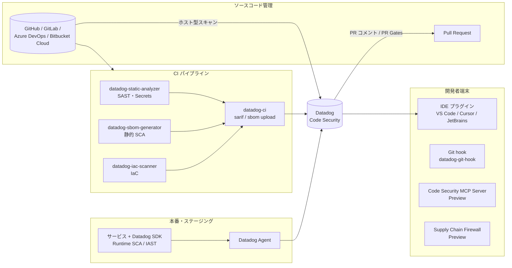
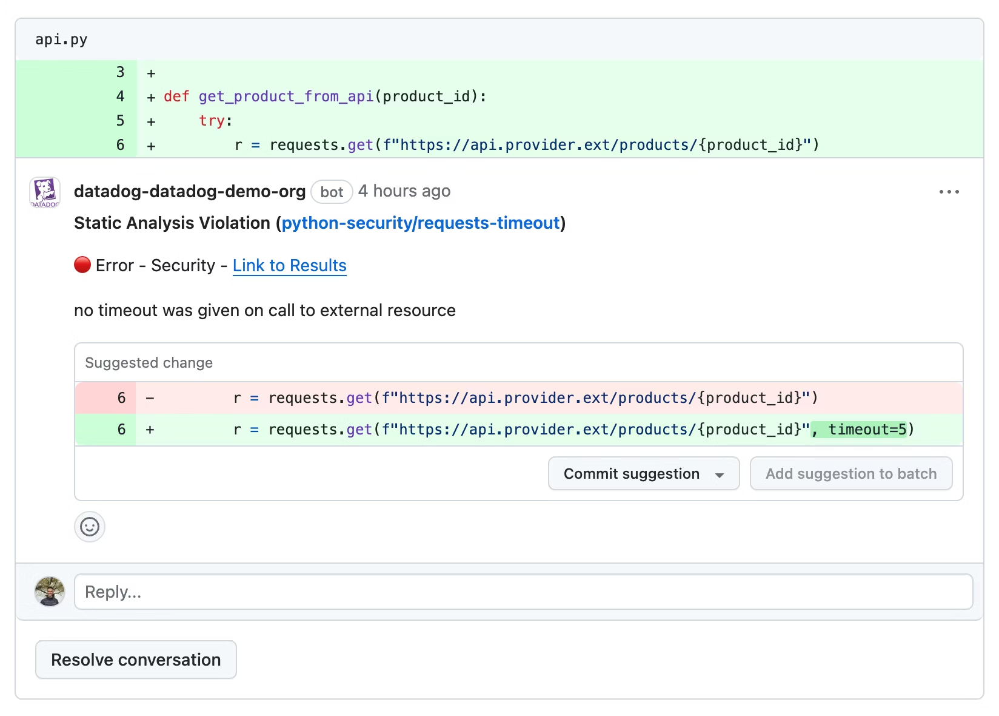
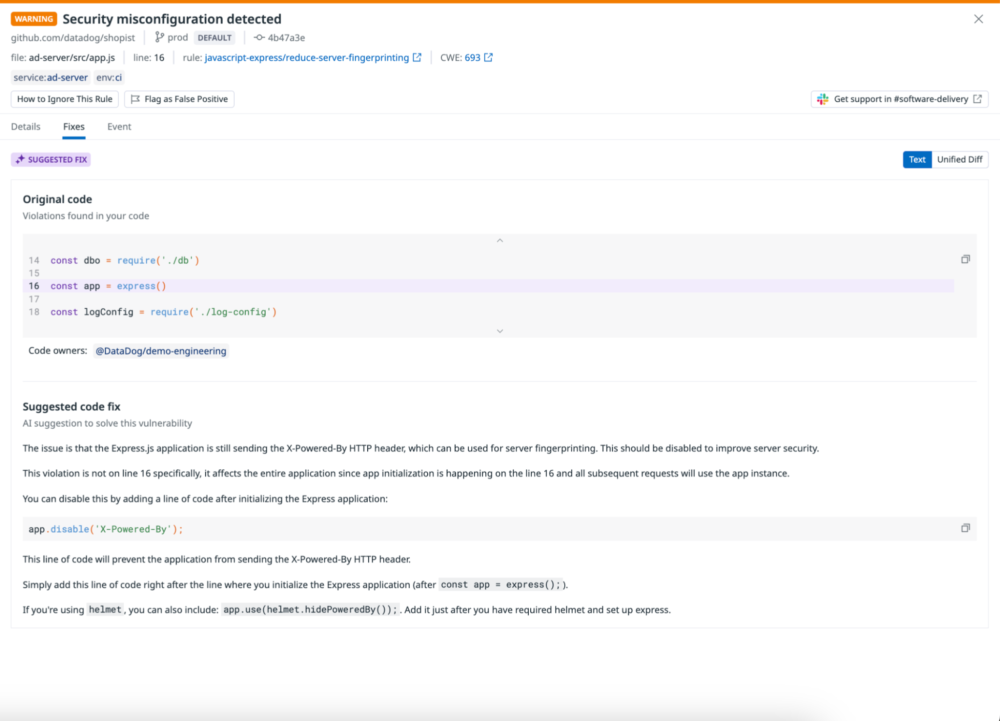
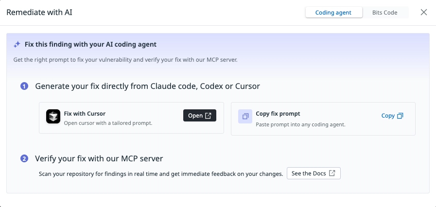
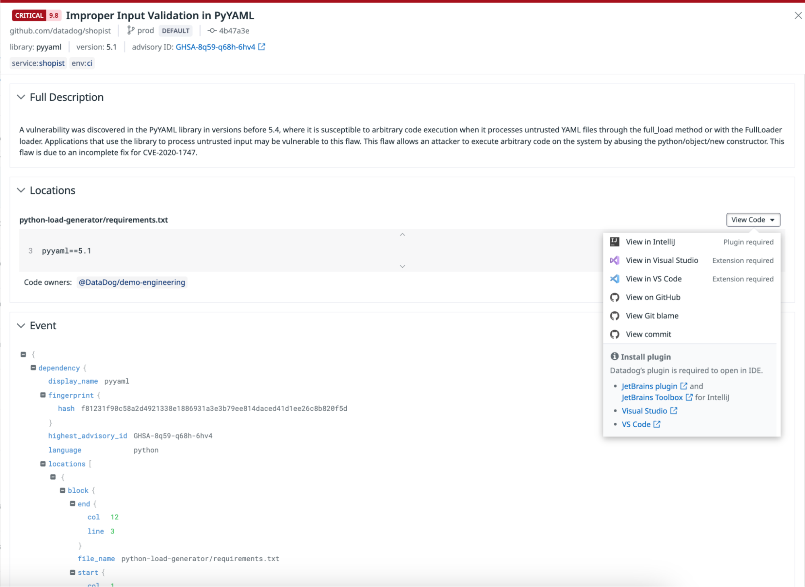
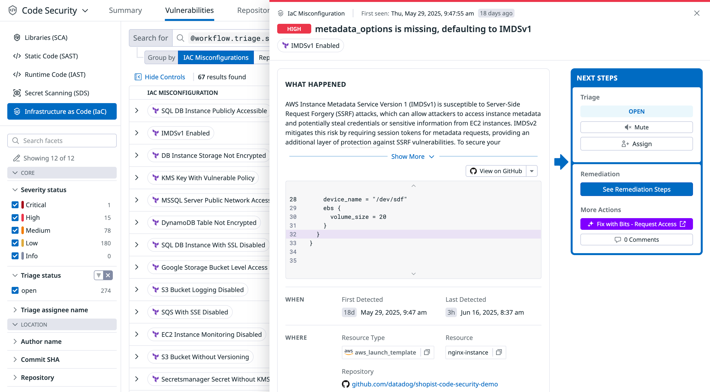

# Code Security

## 概要

Datadog **Code Security（コードセキュリティ）** は、自社開発コード（first-party code）とオープンソースライブラリの脆弱性・設定ミス・秘密情報の漏えいを、開発（IDE・PR）から本番（稼働中サービス）まで一貫して検出する製品群である。[出典](https://docs.datadoghq.com/security/code_security/)

Code Security は次の機能（capability）で構成される。

| 機能 | 英語正式名称 | 対象 | 実行場所 | 状態（2026-11-02 時点） |
|---|---|---|---|---|
| SAST（静的コード解析） | Static Code Analysis (SAST) | 自社コード（セキュリティ＋コード品質） | Datadog ホスト型スキャン / CI / IDE / Git hook | GA |
| SCA（ソフトウェア構成分析） | Software Composition Analysis (SCA) | OSS 依存ライブラリ（脆弱性・ライセンス・EOL・悪性パッケージ） | 静的：ホスト型 / CI、ランタイム：APM トレーサー | GA |
| IAST（ランタイムコード解析） | Runtime Code Analysis (IAST) | 稼働中サービスの自社コード | APM トレーサー（Datadog SDK） | GA |
| シークレットスキャン | Secret Scanning | リポジトリ内の認証情報・API キー等 | ホスト型 / CI / IDE /（Git hook は Preview） | GA（Generic Secret Scanning は【Preview】） |
| IaC セキュリティ | Infrastructure as Code (IaC) Security | Terraform / CloudFormation / Kubernetes / Dockerfile / Ansible / CI/CD 定義等 | ホスト型 / CI / IDE（VS Code・Cursor のみ） | GA |
| サプライチェーンファイアウォール | Supply Chain Firewall (SCFW) | npm / pip / poetry のインストール時チェック | 開発者端末・CI | 【Preview】 |
| MCP サーバー | Code Security MCP Server | AI コーディングアシスタントからのローカルスキャン | 開発者端末 | 【Preview】 |
| 悪性 PR 検出 | Malicious PR protection | デフォルトブランチ宛て PR の悪意あるコード変更 | Datadog ホスト型（GitHub のみ） | 【Preview】 |

[出典](https://docs.datadoghq.com/security/code_security/) [出典](https://docs.datadoghq.com/security/code_security/static_analysis/ai_enhanced_sast/)

> **名称について:** Code Security の SAST・静的 SCA は、以前は **Code Analysis**（ドキュメントパス `docs.datadoghq.com/code_analysis/`）の名称で提供されていた。また IAST・ランタイム SCA は以前 Application Security（ASM、現 App and API Protection）配下のドキュメント（`/security/application_security/code_security/` 等）に置かれていた。現在はすべて `docs.datadoghq.com/security/code_security/` 配下に統合されている。正式な改称時期は公開情報では確認できず。IAST はページにより「Runtime Code Analysis (IAST)」「Runtime Code Security (IAST)」と表記が揺れている。[出典](https://docs.datadoghq.com/security/code_security/iast/)

Code Security は Datadog Security の一製品であり、全体像は [Datadog Security 概要](./security-platform-overview.md) を参照。ランタイムの攻撃防御は [App and API Protection](./app-and-api-protection.md)、クラウド設定監査は [Cloud Security](./cloud-security.md)、ログ等の機密データ検出は [Sensitive Data Scanner](./sensitive-data-scanner.md) が担当する。

### 全体アーキテクチャ



### 画面例



- **キャプション:** GitHub Pull Request 上の Datadog コードレビューコメント
- **画面の説明:** Datadog の GitHub App がレビュアーとして PR の変更行にインラインコメントを付け、検出したルール違反・脆弱性の説明と、適用可能な場合は修正提案（committable suggestion）を表示する画面。開発者は GitHub 上で提案をそのままコミットできる。
- **出典:** https://docs.datadoghq.com/getting_started/code_security/ （取得日：2026-11-02）

---

## 対応 Datadog サイト

Code Security は **US1-FED（`app.ddog-gov.com`）および `us2.ddog-gov.com` では提供されていない**。料金ページにも「This product is currently unavailable on the US-FED site」と記載されている。[出典](https://docs.datadoghq.com/security/code_security/) [出典](https://www.datadoghq.com/pricing/)

> **サイト差異:** Code Security 本体は US1-FED 以外のサイト（US1・US3・US5・EU1・AP1・AP2）で利用できる。Preview 機能（Supply Chain Firewall、Code Security MCP Server、Generic Secret Scanning）の Preview 案内は `app.datadoghq.com`（US1）、US3、US5、EU1、AP1、AP2、`uk1` を対象サイトとして明記している。AP1（日本）は対象に含まれる。[出典](https://docs.datadoghq.com/security/code_security/dev_tool_int/mcp_server/)

> **サイト差異:** CI 用 CLI や GitHub Action の `DD_SITE` / `dd_site` のデフォルト値は `datadoghq.com`（US1）である。AP1 を利用する場合は `DD_SITE=ap1.datadoghq.com` を明示しないと、データが US1 に送信されて失敗する。サイトの詳細は [Datadog Sites](../platform/datadog-sites.md) を参照。

---

## 共通の前提：リポジトリ接続とスキャン実行場所

### ソースコード管理（SCM）連携

Code Security のホスト型スキャン、PR コメント、コードスニペット表示、PR Gates には、Datadog とソースコード管理サービスとの連携（Source Code Integration）が必要（CI 型スキャンでも推奨）。[出典](https://docs.datadoghq.com/security/code_security/software_composition_analysis/setup_static/)

| SCM | ネイティブ対応 | 接続方法（Code Security Setup 画面） | 備考 |
|---|---|---|---|
| GitHub | 対応 | 「Add GitHub Account」で GitHub App を作成・更新 | Git LFS 使用リポジトリはホスト型スキャン対象外 |
| GitLab（GitLab.com / GitLab Self-Managed） | 対応 | 「Connect GitLab Instance」 | GitLab の PR Gates は Datadog サービスアカウントを必須承認者に設定して強制 |
| Azure DevOps | 対応 | 「Connect Microsoft Entra App」 | Microsoft Entra テナント接続が必要。**Azure DevOps Server（オンプレ）は非対応** |
| Bitbucket Cloud | 対応 | 「Connect Bitbucket Account」 | ドキュメント上は **Bitbucket Cloud Premium** と明記 |
| 上記以外 | ネイティブ連携なし | — | CI 型スキャン（`datadog-ci` で結果アップロード）を使う |

[出典](https://docs.datadoghq.com/security/code_security/software_composition_analysis/setup_static/) [出典](https://docs.datadoghq.com/security/code_security/iac_security/setup/)

**GitHub App に必要な権限**

| 権限 | 設定 | 用途 |
|---|---|---|
| Repository: Contents | Read | コードスニペット表示 |
| Repository: Pull Requests | Read & Write | PR コメント、Datadog からの修正 PR 作成 |
| Repository: Checks | Read & Write | SAST 違反等での PR ブロック（PR Gates） |
| Event subscription: Pull request | 有効 | PR コメントのトリガー |

[出典](https://docs.datadoghq.com/security/code_security/software_composition_analysis/setup_static/) [出典](https://docs.datadoghq.com/security/code_security/dev_tool_int/github_pull_requests/)

GitHub 連携自体の詳細は [Integrations](../platform/integrations.md) を参照。

### スキャン実行場所の選択

Code Security Setup 画面（`Security > Code Security > Settings`、URL `app.datadoghq.com/security/configuration/code-security/setup`）の「Activate scanning for your repositories」→「Manage Repositories」で、SCM ごとに「Select where your scans should run」から **Datadog**（ホスト型）または **CI pipelines** を選ぶ。[出典](https://docs.datadoghq.com/security/code_security/software_composition_analysis/setup_static/)

| 機能 | Datadog ホスト型スキャン対応 SCM | CI 型スキャン |
|---|---|---|
| SAST | GitHub（LFS 除く）、GitLab.com、GitLab Self-Managed、Azure DevOps、Bitbucket Cloud | `datadog-static-analyzer` + `datadog-ci`（GitHub Actions / 汎用 CI） |
| 静的 SCA | GitHub、GitLab.com、GitLab Self-Managed、Azure DevOps、Bitbucket Cloud | GitHub Actions、GitLab CI/CD、Azure DevOps、汎用 CI |
| Secret Scanning | GitHub、Azure DevOps、GitLab | GitHub Actions、汎用 CI |
| IaC Security | GitHub、GitLab、Azure DevOps、Bitbucket Cloud（Premium） | 汎用 CI（`datadog-iac-scanner`）、サードパーティ SARIF |
| ランタイム SCA / IAST | — （APM トレーサーで稼働中サービスから検出） | — |

[出典](https://docs.datadoghq.com/security/code_security/static_analysis/setup/) [出典](https://docs.datadoghq.com/security/code_security/software_composition_analysis/setup_static/) [出典](https://docs.datadoghq.com/security/code_security/secret_scanning/) [出典](https://docs.datadoghq.com/security/code_security/iac_security/setup/)

**ホスト型スキャン限定の機能**（CI 型では使えない）

| 機能 | 備考 |
|---|---|
| AI-native SAST | LLM ベースの taint 解析 |
| Bits AI による偽陽性フィルタリング（SAST） | 既定ルールセットの Security カテゴリのみ |
| Secret Scanning の Git 履歴スキャン | 初回ホスト型スキャン時に全履歴・全ブランチを 1 回スキャン |
| SCA の到達可能性解析（Reachability） | ホスト型、または `datadog-sbom-generator --reachability` 利用時 |
| 悪性 PR 検出【Preview】 | GitHub のみ |

[出典](https://docs.datadoghq.com/security/code_security/static_analysis/ai_enhanced_sast/) [出典](https://docs.datadoghq.com/security/code_security/secret_scanning/) [出典](https://docs.datadoghq.com/security/code_security/software_composition_analysis/setup_static/)

### CI 型スキャンの共通要件

| 項目 | 値 |
|---|---|
| 必須環境変数 | `DD_API_KEY`、`DD_APP_KEY`（CI のシークレットとして保存） |
| アプリケーションキーのスコープ | `code_analysis_read` |
| `DD_SITE` | 任意（デフォルト `datadoghq.com`）。SAST の diff-aware スキャンでは必須 |
| CLI | `@datadog/datadog-ci`（`npm install -g @datadog/datadog-ci`） |
| Node.js | SARIF アップロード：Node.js 14 以降（`datadog-ci` 2.0 以降）。IaC 汎用 CI 手順：Node.js 20 以降 |
| トリガー | `push` イベント（GitHub Action は `pull_request` トリガー非対応） |
| 初回 | 結果表示にはデフォルトブランチを少なくとも 1 回スキャンする必要がある |

[出典](https://docs.datadoghq.com/security/code_security/static_analysis/setup/) [出典](https://docs.datadoghq.com/security/code_security/iac_security/setup/) [出典](https://docs.datadoghq.com/security/code_security/static_analysis/github_actions/)

API キー・アプリケーションキーとスコープの詳細は [API とキー管理](../platform/api-and-keys.md) を参照。

---

## Static Code Analysis（SAST、静的コード解析）

### 概要

Static Code Analysis（SAST）は、プログラムを実行せずにソースコードを解析する clear-box テストであり、セキュリティ脆弱性とコード品質問題（保守性・エラーの起きやすさ・性能・スタイル）を検出する。スキャン対象リポジトリへのコミットごとにスキャンが実行され、結果は Code Security の Repositories ページにリポジトリ単位で表示される。[出典](https://docs.datadoghq.com/security/code_security/static_analysis/)

| 結果区分 | 対象ルールカテゴリ |
|---|---|
| Code Vulnerabilities（コード脆弱性） | `SECURITY` |
| Code Quality（コード品質） | `BEST_PRACTICES`、`CODE_STYLE`、`ERROR_PRONE`、`PERFORMANCE` |

### 対応言語とルールセット

SAST 概要ページが列挙する対応言語・技術は Python、JavaScript、TypeScript、Java、C#、Go、Ruby、PHP、Docker、YAML、Kotlin、Elixir、Apex、Swift。ルール一覧ページでは Bash、Dart、Rust のルールセットも公開されている。[出典](https://docs.datadoghq.com/security/code_security/static_analysis/) [出典](https://docs.datadoghq.com/security/code_security/static_analysis/static_analysis_rules/)

| 言語 | ルールセット名 |
|---|---|
| Apex | `apex-code-style`、`apex-security` |
| Bash | `bash-code-quality`、`bash-security` |
| C# | `csharp-best-practices`、`csharp-code-style`、`csharp-inclusive`、`csharp-security` |
| Dart | `dart-code-quality`、`dart-security` |
| Elixir | `elixir-security` |
| Go | `go-best-practices`、`go-inclusive`、`go-security` |
| Java | `java-best-practices`、`java-code-style`、`java-inclusive`、`java-security` |
| JavaScript | `javascript-best-practices`、`javascript-browser-security`、`javascript-code-style`、`javascript-common-security`、`javascript-express`、`javascript-inclusive`、`javascript-node-security` |
| JavaScript（React/JSX） | `jsx-react` |
| Kotlin | `kotlin-best-practices`、`kotlin-code-style`、`kotlin-security` |
| PHP | `php-best-practices`、`php-code-style`、`php-security` |
| Python | `python-best-practices`、`python-code-style`、`python-django`、`python-flask`、`python-inclusive`、`python-pandas`、`python-security` |
| Ruby | `rails-best-practices`、`ruby-best-practices`、`ruby-code-style`、`ruby-inclusive`、`ruby-security` |
| Rust | `rust-code-quality`、`rust-security` |
| Swift | `swift-code-style`、`swift-security` |
| TypeScript | `typescript-best-practices`、`typescript-browser-security`、`typescript-code-style`、`typescript-common-security`、`typescript-express`、`typescript-inclusive`、`typescript-node-security` |
| TypeScript（React/TSX） | `tsx-react` |

- ルール数（ルールセット別・総数）は公開情報では確認できず。
- ルール一覧ページのフィルタ上の重大度は Error / Warning / Notice / Info、カテゴリは Best Practices / Error Prone / Code Style / Security / Performance。[出典](https://docs.datadoghq.com/security/code_security/static_analysis/static_analysis_rules/)
- デフォルトでは各言語の Datadog 既定ルールセット（default rulesets）が適用される。[出典](https://docs.datadoghq.com/security/code_security/static_analysis/setup/)
- SAST 概要ページは Docker・YAML を対応技術に挙げているが、ルール一覧ページに Docker / YAML 専用ルールセットは掲載されていない（Dockerfile・Kubernetes YAML 等の設定ミス検出は [IaC Security](#infrastructure-as-codeiac-security) が担う）。

### セットアップ方式

#### Datadog ホスト型スキャン

Code Security Setup 画面で SCM を接続し、スキャン実行場所に Datadog を選び、リポジトリ単位またはすべてのリポジトリで SAST を有効化する。Datadog はソースコードを保存・保持しない（検出結果のみ保持）。[出典](https://docs.datadoghq.com/security/code_security/static_analysis/setup/)

#### GitHub Actions

GitHub Action `DataDog/datadog-static-analyzer-github-action@v3` を使う。[出典](https://docs.datadoghq.com/security/code_security/static_analysis/github_actions/)

```yaml
on: [push]

jobs:
  check-quality:
    runs-on: ubuntu-latest
    name: Datadog Static Analyzer
    steps:
      - name: Checkout
        uses: actions/checkout@v6
      - name: Check code meets quality standards
        id: datadog-static-analysis
        uses: DataDog/datadog-static-analyzer-github-action@v3
        with:
          dd_app_key: ${{ secrets.DD_APP_KEY }}
          dd_api_key: ${{ secrets.DD_API_KEY }}
          dd_site: "ap1.datadoghq.com"   # AP1 の場合。デフォルトは datadoghq.com
          cpu_count: 2
          enable_performance_statistics: false
```

| 入力 | 必須 | デフォルト | 説明 |
|---|---|---|---|
| `dd_api_key` | 必須 | — | GitHub シークレットに保存 |
| `dd_app_key` | 必須 | — | `code_analysis_read` スコープが必要 |
| `dd_site` | 任意 | `datadoghq.com` | Datadog サイト |
| `cpu_count` | 任意 | `2` | アナライザーが使う CPU 数 |
| `enable_performance_statistics` | 任意 | `false` | ファイルごとの解析時間を出力 |
| `debug` | 任意 | `no` | `yes` で追加ログ |
| `subdirectory` | 任意 | — | 解析対象をパターン / glob（スペース区切りで複数）に限定。例：`"src packages"` |
| `diff_aware` | 任意 | `true` | フィーチャーブランチでは変更ファイルのみ解析。`false` で無効化 |

- トリガーは `push` のみ対応（`pull_request` 等は非対応）。
- `code-security.datadog.yaml` で `use-default-rulesets: false` とすると既定の AI-native SAST ルールセットも無効になる（`<language>-ai_sast` を明示的に列挙すれば有効）。

[出典](https://docs.datadoghq.com/security/code_security/static_analysis/github_actions/)

#### 汎用 CI（datadog-static-analyzer）

GitHub リリース（`https://github.com/DataDog/datadog-static-analyzer/releases`）から OS / アーキテクチャ別のバイナリ（Linux x86_64 / aarch64、macOS x86_64 / aarch64、Windows x86_64）を取得し、SARIF を出力して `datadog-ci` でアップロードする。[出典](https://docs.datadoghq.com/security/code_security/secret_scanning/generic_ci_providers/)

**diff-aware スキャン**（コミットで変更されたファイルのみを解析）の要件：

1. CI に `DD_APP_KEY`、`DD_SITE`、`DD_API_KEY` を設定する。
2. アナライザー実行前に `datadog-ci git-metadata upload` を実行する（解析対象ファイル数の算出に Git メタデータが必要）。
3. `--diff-aware` を付けてアナライザーを実行する。

```bash
datadog-ci git-metadata upload
datadog-static-analyzer -i /path/to/directory -g -o sarif.json -f sarif --diff-aware <...other-options...>
```

diff-aware スキャンが完了できない場合は、ディレクトリ全体のスキャンにフォールバックする。diff-aware スキャンは SAST 専用で、Secret Scanning では非対応。[出典](https://docs.datadoghq.com/security/code_security/static_analysis/setup/) [出典](https://docs.datadoghq.com/security/code_security/secret_scanning/)

#### サードパーティ SAST 結果（SARIF）のアップロード

Snyk、CodeQL、Semgrep、Gitleaks、Sysdig で動作確認済み。`datadog-ci sarif upload $OUTPUT_LOCATION` で取り込む。[出典](https://docs.datadoghq.com/security/code_security/static_analysis/setup/)

| SARIF 要件 | 内容 |
|---|---|
| スキーマ | SARIF 2.1.0 準拠 |
| ファイルパス | `artifactLocation.uri` はリポジトリルートからの相対パス |
| 一意識別 | `partialFingerprints` でリポジトリ内の検出を一意に識別 |
| カテゴリ | タグ `DATADOG_CATEGORY` に `SECURITY` / `PERFORMANCE` / `CODE_STYLE` / `BEST_PRACTICES` / `ERROR_PRONE`。**Vulnerabilities エクスプローラーに出るのは `SECURITY` のみ** |
| ツール情報 | `tool.driver` に `name` と `version` |

**SARIF レベルと重大度の対応**

| SARIF level | Datadog 上の重大度（CVSS） |
|---|---|
| Error | Critical |
| Warning | High |
| Note | Medium |
| None | Low |

[出典](https://docs.datadoghq.com/security/code_security/static_analysis/setup/)

### SAST の設定（`code-security.datadog.yaml` の `sast` キー）

SAST の設定は Datadog UI（組織 / リポジトリ単位）またはリポジトリルートの `code-security.datadog.yaml` の `sast` キーで行う（優先順位は [共通設定ファイル](#設定ファイル-code-securitydatadogyaml-と優先順位) を参照）。[出典](https://docs.datadoghq.com/security/code_security/static_analysis/configuration/)

| キー | 型 | デフォルト | 説明 |
|---|---|---|---|
| `use-default-rulesets` | Boolean | `true` | `false` で既定ルールセット（従来型・AI-native 両方）を無効化 |
| `use-rulesets` | Array | — | 有効化するルールセット名 |
| `ignore-rulesets` | Array | — | 無効化するルールセット名。`use-rulesets` / `use-default-rulesets` より優先 |
| `ruleset-configs` | Map | — | ルールセット名→設定。ルールセットが有効なら（`use-rulesets` に無くても）適用 |
| `ruleset-configs.<rs>.only-paths` / `ignore-paths` | Array | — | パス / glob |
| `ruleset-configs.<rs>.rule-configs.<rule>.only-paths` / `ignore-paths` | Array | — | ルール単位のパス限定・除外 |
| `...rule-configs.<rule>.arguments` | Map | — | ルールのパラメータ。パス別指定可 |
| `...rule-configs.<rule>.severity` | String | — | `ERROR` / `WARNING` / `NOTICE` / `NONE`。パス別指定可 |
| `...rule-configs.<rule>.category` | String | — | `BEST_PRACTICES` / `CODE_STYLE` / `ERROR_PRONE` / `PERFORMANCE` / `SECURITY`（リポジトリ全体で単一値） |
| `global-config.only-paths` | Array | なし | 解析対象を限定 |
| `global-config.ignore-paths` | Array | なし | 解析から除外 |
| `global-config.use-gitignore` | Boolean | `true` | `.gitignore` のエントリを `ignore-paths` に追加 |
| `global-config.ignore-generated-files` | Boolean | `true` | 一般的な生成ファイルを除外 |
| `global-config.max-file-size-kb` | Number | `200` | これより大きいファイルは解析しない（kB） |

- `arguments` と `severity` のパス別指定では、**最も長く一致するパスプレフィックス**が適用され、`/` キーが全体のデフォルトになる。
- `sast` キーは `schema-version: v1.0` で導入。

[出典](https://docs.datadoghq.com/security/code_security/static_analysis/configuration/)

```yaml
schema-version: v1.7
sast:
  use-default-rulesets: true
  use-rulesets:
    - python-django
  ignore-rulesets:
    - python-inclusive
  ruleset-configs:
    python-security:
      ignore-paths:
        - "tests/"
      rule-configs:
        <rule-name>:
          severity:
            /: WARNING
            src/legacy: NOTICE
  global-config:
    ignore-paths:
      - "vendor/**"
    max-file-size-kb: 200
```

（上記は公式のキー仕様に基づく構成例。`<rule-name>` は実際のルール名に置き換える。）

**インライン抑止（`no-dd-sa`）**

| 記法 | 効果 |
|---|---|
| 対象行の直前の行に `no-dd-sa` コメント | その行のすべてのルールを抑止 |
| `no-dd-sa:<rule-name>` | 指定ルールのみ抑止（AI-native ルールは `datadog/<rule-name>` 形式） |

抑止された違反は削除されず「抑止済み」として監査可能な形で残る（Repositories ページ：`is_suppressed: true`、Vulnerabilities エクスプローラー：`status: muted` かつ `workflow.mute.reason: muted_in_code`）。[出典](https://docs.datadoghq.com/security/code_security/static_analysis/configuration/)

**旧設定ファイル** `static-analysis.datadog.yml` はスキーマが非推奨（新規更新なし）。両方が存在する場合は `code-security.datadog.yaml` が優先される。[出典](https://docs.datadoghq.com/security/code_security/static_analysis/configuration/)

### カスタムルール

SAST のカスタムルールは、(1) 対象 AST ノードを選ぶ **tree-sitter クエリ**、(2) マッチごとに実行され `buildError` / `addError` 等で違反を報告する **JavaScript の `visit` 関数**、(3) **テストコード** の 3 要素で構成し、ルールセット（英数字とハイフンのみの一意名）にまとめる。[出典](https://docs.datadoghq.com/security/code_security/static_analysis/custom_rules/)

| 管理方法 | 内容 |
|---|---|
| VS Code 拡張の DDSA Rule Editor | クエリ・コードサンプル・JavaScript ロジック・AST ビューアのパネルでリアルタイムに違反を確認し、メタデータを設定して YAML をエクスポート |
| テンプレートリポジトリ `datadog-custom-rules-template` | Rules as Code。GitHub シークレットに `DD_API_KEY`・`DD_APP_KEY`・`DD_SITE` を設定し、`main` への push で `upload.py` が Datadog 上のルールセット / ルールを作成・更新・削除 |

- 報告位置の `line` / `col` は 1 始まり。0 の結果は無視される。
- カスタムルールの対応言語一覧、上限数は公開情報では確認できず。

### AI 拡張機能（AI-Enhanced Static Code Analysis）

| 機能 | 内容 | 実行条件 |
|---|---|---|
| AI-native SAST（検出） | LLM がユーザー制御データが未サニタイズのまま危険な処理に到達するかを推論し、2 つ目の LLM が候補を再評価して確定 / 棄却。両方式が対象とする脆弱性タイプでは AI-native の結果がルールベースより優先 | Datadog ホスト型のみ。SCM 連携設定で「Enable AI SAST」を全リポジトリまたは個別に有効化 |
| 偽陽性フィルタリング（検証） | Bits AI が真陽性 / 偽陽性の可能性を理由付きで判定。「Filter out false positives」で非表示化 | ホスト型のみ。既定ルールセットの Security カテゴリのみ（CI アップロード結果・カスタムルールは対象外） |
| エージェント型偽陽性フィルタリング | 関連ファイル読込・シンボル検索・ディレクトリ構造参照でファイル横断の文脈を収集 | SQL / コマンドインジェクション等のインジェクション系ルールのみ |
| カスタムコンテキスト | ルール別にフレームワーク・サニタイザ・検証パターン等の補足情報を与え、偽陽性判定に利用 | — |
| 修正（Remediation） | Bits Code（Bits AI Dev Agent）が単一修正または自動化（一括修正キャンペーン）としてパッチを生成。差分レビュー・追加質問・編集・PR 作成が可能 | 脆弱性サイドパネルの「Remediate with AI」 |
| 悪性 PR 検出【Preview】 | デフォルトブランチ宛て PR をコードインジェクション、シークレット持ち出し、悪性パッケージ、CI ワークフロー改ざん等の観点で LLM がスキャン | GitHub リポジトリのみ。Preview 申請が必要 |

- AI-native SAST の対応言語：C#、C++、Dart、Elixir、Go、Java、JavaScript、Kotlin、PHP、Python、Ruby、Rust、Swift、TypeScript。検出は SQL インジェクション、コマンドインジェクション、XSS、パストラバーサル、プロンプトインジェクション等、ドキュメント記載の CWE に限られる。
- AI-native ルールセット名は `<language>-ai_sast`（例：`python-ai_sast`）、ルール ID は `datadog/<rule-name>`。
- AI 処理におけるコードの保存・保持・処理先の詳細は当該ページでは公開情報では確認できず。

[出典](https://docs.datadoghq.com/security/code_security/static_analysis/ai_enhanced_sast/) [出典](https://docs.datadoghq.com/security/code_security/static_analysis/configuration/)

Datadog 公式ブログ（2026-08-20 公開）は、AI-native SAST が Python・Go・Java・C#・TypeScript・JavaScript で **OWASP Top 10 for LLM Applications**（プロンプトインジェクション、機密情報漏えい、過剰な権限（Excessive Agency）等）をカバーし、taint 解析・制御フロー解析・パターンマッチを使い分けると説明している。[出典](https://www.datadoghq.com/blog/ai-native-sast-detect-llm-vulnerabilities/)（2026-08-20 公開）

Bits AI 全般は [Bits AI と AI 機能](../ai/bits-ai.md) を参照。

### 修正提案（Suggested fixes）

| 種類 | 内容 | 要件 |
|---|---|---|
| Deterministic（決定的） | 単純な問題（lint 系等）にテンプレート化された修正を提示 | — |
| AI-suggested | 複雑な違反に対し AI が修正案を生成。表示形式は Text / Unified Diff | SAST 概要ページは OpenAI の GPT-4 使用と記載 |
| Open a pull request | Datadog から修正 PR を作成 | GitHub App の Pull Requests 権限 Read & Write |
| Commit to current branch | 検出されたブランチに修正をコミット | 同上 |
| Fix with Cursor | 修正用プロンプト付きで Cursor を起動。他のエージェント向けにはプロンプトをコピー可能 | Datadog の VS Code / Cursor 拡張 |

[出典](https://docs.datadoghq.com/security/code_security/static_analysis/)



- **キャプション:** SAST 違反詳細パネル（Fixes タブ）の修正提案
- **画面の説明:** 上部に重大度ラベル（例：WARNING）と違反タイトル、リポジトリ・ブランチ（DEFAULT 表示）・コミット SHA、ファイル名・行番号・ルール名（例：`javascript-express/reduce-server-fingerprinting`）・CWE 番号、`service` / `env` タグが並ぶ。「How to Ignore This Rule」「Flag as False Positive」ボタンがあり、タブは Details / Fixes / Event。Fixes タブには「SUGGESTED FIX」ラベル、Text / Unified Diff 切替、「Original code」（違反箇所のコード、Code owners 表示）と「Suggested code fix」（AI による説明と修正コード）が表示される。
- **出典:** https://docs.datadoghq.com/getting_started/code_security/ （取得日：2026-11-02）



- **キャプション:** 「Fix with Cursor」ダイアログ
- **画面の説明:** 脆弱性の修正手段として Coding agent タブから「Fix with Cursor」の Open ボタン、および他エージェント向けの「Copy fix prompt」を選択するダイアログ。Cursor 側には Datadog の VS Code / Cursor 拡張が必要。
- **出典:** https://docs.datadoghq.com/security/code_security/static_analysis/ （取得日：2026-11-02）

### 偽陽性の報告

違反ごとに理由を付けて偽陽性として報告でき、Datadog は報告内容をレビューしてルール改善に使う。[出典](https://docs.datadoghq.com/security/code_security/static_analysis/)

---

## Software Composition Analysis（SCA、ソフトウェア構成分析）

### 概要

Software Composition Analysis（SCA）は、リポジトリおよび稼働中サービスで使われている OSS ライブラリを検出し、脆弱性・ライセンスを開発から本番まで管理する。リスクベースの優先度付け、悪性ライブラリ・EOL（サポート終了）ライブラリの検出、OpenSSF 基準に基づくライブラリのリスクスコア、SBOM エクスポートを提供する。[出典](https://docs.datadoghq.com/security/code_security/software_composition_analysis/)

| 項目 | 静的 SCA（Static SCA） | ランタイム SCA（Runtime SCA） |
|---|---|---|
| 検出方法 | 依存定義ファイル（lockfile / manifest）を解析 | APM 計装（Datadog SDK）で実行時にロードされたライブラリを検出 |
| 検出スコープ | リポジトリ単位 | サービス単位 |
| スキャン契機 | 有効化済みリポジトリで、対応 manifest / lockfile を更新するコミット（デフォルト）。CI は `push` | サービス稼働中に継続的 |
| 課金単位 | committer | host |

[出典](https://docs.datadoghq.com/security/code_security/software_composition_analysis/) [出典](https://www.datadoghq.com/pricing/list/)

### 静的 SCA の対応言語・ファイル

| 言語 | パッケージマネージャー | ファイル |
|---|---|---|
| C# | .NET | `packages.lock.json`、`.csproj` |
| C++ | Conan | `conan.lock` |
| Dart | pub | `pubspec.lock` |
| Go | mod | `go.mod` |
| JVM | Gradle | `gradle.lockfile` |
| JVM | Maven | `pom.xml` |
| Node.js | Bun | `bun.lock` |
| Node.js | npm | `package-lock.json` |
| Node.js | pnpm | `pnpm-lock.yaml` |
| Node.js | yarn | `yarn.lock` |
| PHP | composer | `composer.lock` |
| Python | PDM | `pdm.lock` |
| Python | pip | `requirements.txt`、`Pipfile.lock` |
| Python | poetry | `poetry.lock` |
| Python | UV | `uv.lock` |
| Ruby | bundler | `Gemfile.lock` |
| Rust | Cargo | `cargo.lock` |
| Swift | SwiftPM | `Package.swift`、`Package.resolved` |

- C# で `packages.lock.json` と `.csproj` の両方がある場合は `packages.lock.json` が優先。
- **lockfile なしスキャン**：対応 lockfile が無い場合に限り manifest を解析する。Node.js（npm / yarn / pnpm / Bun）は `package.json` の `dependencies`・`devDependencies`・`optionalDependencies`、Python（Poetry / PDM / UV / pip）は `pyproject.toml`（PEP 621 の `dependencies`・`optional-dependencies`、PEP 735 の `dependency-groups`、Poetry の依存セクション）。バージョン範囲は、範囲を満たす最新の公開バージョン（プレリリース除外）に解決される。

[出典](https://docs.datadoghq.com/security/code_security/software_composition_analysis/setup_static/)

### 静的 SCA のセットアップ方式

| 方式 | 内容 |
|---|---|
| Datadog ホスト型 | GitHub、GitLab.com / Self-Managed、Azure DevOps、Bitbucket Cloud |
| CI パイプライン | `datadog-ci` を使用。GitHub Actions、GitLab CI/CD、Azure DevOps、汎用 CI。デフォルトブランチを最低 1 回スキャンするまで結果は表示されない |
| SBOM アップロード | Datadog SBOM ジェネレーター（`datadog-sbom-generator`）推奨。サードパーティ SBOM は **CycloneDX 1.4 / 1.5 / 1.6 の JSON**、全コンポーネントが type `library` かつ有効な `purl` を持つこと。`datadog-ci sbom upload /path/to/sbom.json`（`DD_API_KEY`・`DD_APP_KEY`・`DD_SITE` 必須）。自動スキャン有効時に手動アップロードすると同一コミットの結果を置き換える |

[出典](https://docs.datadoghq.com/security/code_security/software_composition_analysis/setup_static/)

### 静的 SCA の設定（`sca` キー）

| キー | 型 | デフォルト | 最低 `schema-version` | 説明 |
|---|---|---|---|---|
| `ignore-paths` | Array | なし | v1.1 | 静的 SCA から除外するパス / glob |
| `ignore-ecosystems` | Array | なし | v1.7 | 除外するエコシステム（例：`npm`、`Go`、`PyPI`） |
| `ignore-packages` | Array | なし | v1.7 | バージョンを問わず除外するパッケージ。`<ecosystem>:<name>` 形式（例：`npm:lodash`） |

- エコシステム名・パッケージ名は大文字小文字を区別する（例：`go:golang.org/x/text` は `Go` エコシステムに一致しない）。
- CLI フラグ `--exclude`、`--exclude-ecosystem`、`--exclude-package` は `sca` の除外設定と結合される。
- `sca` での `only-paths` やライセンスポリシー設定キーは公開情報では確認できず（ライセンス違反は PR Gates の条件として設定する）。

[出典](https://docs.datadoghq.com/security/code_security/software_composition_analysis/configuration/)

```yaml
schema-version: v1.7
sca:
  ignore-paths:
    - "examples/**"
  ignore-ecosystems:
    - PyPI
  ignore-packages:
    - "npm:lodash"
```

### ランタイム SCA のセットアップ

| 項目 | 内容 |
|---|---|
| 前提 | Datadog Agent の導入、Datadog SDK が Web トレース（`type:web`）を送信していること、SCA 対応の SDK |
| 対応言語 | Java、.NET、Go、Ruby、PHP、Node.js、Python |
| 最低トレーサーバージョン | Java：0.94.0 以上（SCA 検出機能は 1.1.4 以上）。他言語は各言語の互換性ページ参照（本ページでは公開情報では確認できず） |
| 有効化（画面） | Security Settings →「Activate runtime detection of library vulnerabilities」→ Manage Services → サービスを選択 → Bulk Actions →「Activate Runtime Software Composition Analysis (SCA)」 |
| 有効化（SDK 設定） | 環境変数 `DD_APPSEC_SCA_ENABLED=true`、Java は `-Ddd.appsec.sca.enabled=true` |
| デプロイ例 | コマンドライン、Docker CLI（`-e DD_APPSEC_SCA_ENABLED=true`）、Dockerfile（`ENV`）、Kubernetes（コンテナ spec の `env`）、Amazon ECS（タスク定義）、AWS Fargate |
| 制約 | 読み取り専用ファイルシステムは非対応。書き込み可能な `/tmp` が必要 |
| APM 契約 | APM サブスクリプションは不要。ただし一部 APM インテークが発生し請求に現れる |

[出典](https://docs.datadoghq.com/security/code_security/software_composition_analysis/setup_runtime/)

```yaml
# Kubernetes Deployment の例（コンテナ spec）
env:
  - name: DD_APPSEC_SCA_ENABLED
    value: "true"
```

トレーサーの導入は [APM インスツルメンテーション](../apm/apm-instrumentation.md)、Agent は [Datadog Agent](../platform/agent.md) を参照。

### 脆弱性データベースと Datadog Severity Score

**脆弱性情報源**：NVD、GitHub Advisory Database、osv.dev、PyPA Advisory Database、Global Security Database、Datadog GuardDog、Datadog Security Research。新規脆弱性は最大 1 時間以内（多くは数分）、悪性パッケージは 6 時間以内に反映される。公開エクスプロイト情報は CISA KEV、Exploit-DB、NVD、GitHub の参照から取得。[出典](https://docs.datadoghq.com/security/code_security/software_composition_analysis/)

**Datadog Severity Score** は基本 CVSS スコアを次の要素で補正する。

| 要素 | 影響 |
|---|---|
| Base CVSS score | スコアの起点 |
| Reachability（到達可能性） | 脆弱な関数がコードから到達可能と判明した場合に**引き上げ** |
| Production runtime context | サービスが本番で稼働していなければ**引き下げ** |
| Under attack | 攻撃活動が観測されていなければ**引き下げ** |
| Exploit availability | 公開エクスプロイトが無ければ**引き下げ** |
| EPSS（悪用確率） | 悪用確率が低ければ**引き下げ** |

[出典](https://docs.datadoghq.com/security/code_security/software_composition_analysis/)

**到達可能性解析（Reachability）の制約**：Java のみ、かつ審査済みの固定アドバイザリ一覧（約 40 の GHSA ID）に限定。Datadog SBOM Generator の `--reachability` または Datadog ホスト型スキャンが必要。それ以外の脆弱性は到達可能性評価の対象外。[出典](https://docs.datadoghq.com/security/code_security/software_composition_analysis/setup_static/)



- **キャプション:** SCA ライブラリ脆弱性の詳細パネル
- **画面の説明:** 上部に重大度（例：CRITICAL 9.8）と脆弱性タイトル（例：Improper Input Validation in PyYAML）、リポジトリ・ブランチ・コミット、`library`・`version`・`advisory ID`（GHSA リンク）、`service`/`env` タグ。「Full Description」に脆弱性の説明、「Locations」に検出ファイル（例：`requirements.txt` の該当行）と Code owners、「View Code」メニューから View in IntelliJ / Visual Studio / VS Code（プラグイン・拡張が必要）、View on GitHub、View Git blame、View commit を選べる。「Event」には検出イベントの JSON（`dependency`、`fingerprint`、`highest_advisory_id`、`language`、`locations` 等）が表示される。
- **出典:** https://docs.datadoghq.com/getting_started/code_security/ （取得日：2026-11-02）

### Library Inventory・SBOM・エクスプローラー

| 画面 / 機能 | 内容 |
|---|---|
| Library Inventory | 静的・ランタイム双方のデータを統合し、サードパーティライブラリの利用箇所、脆弱性・ライセンスリスク、バージョン、OpenSSF スコアを表示 |
| SBOM エクスポート | Library Inventory から静的・ランタイム両方のライブラリを **CycloneDX 1.6** / **SPDX 2.3** で出力 |
| Vulnerabilities Explorer | 脆弱性中心のビュー。最新アドバイザリ DB と継続的に照合するライブビュー |
| Repositories Explorer | リポジトリ中心のビュー（SAST 等全スキャン結果）。スキャン時点のスナップショットで、後から公開されたアドバイザリは遡って反映されない |
| CVE Explorer | 自環境に無関係なものも含め Datadog が追跡する全 CVE / アドバイザリを検索。重大度スコア、エクスプロイト有無、EPSS、CISA KEV 状況を表示 |
| チケット連携 | Jira、ServiceNow（静的検出結果のみ） |
| ミュート | 静的検出結果のみ。ミュートした検出は非表示・レポート除外。詳細パネルの「Unmute」で復元 |

[出典](https://docs.datadoghq.com/security/code_security/software_composition_analysis/)

---

## Supply Chain Firewall（SCFW）【Preview】

Supply Chain Firewall はパッケージのインストール時点で、Datadog Security Research の悪性 / 侵害パッケージ脅威インテリジェンスと組織独自の許可・ブロックポリシーに照らして検査し、リポジトリや CI/CD に悪性パッケージが入るのを防ぐ。既にコードベースにある依存を検査する SCA とは役割が異なる。[出典](https://docs.datadoghq.com/security/code_security/software_composition_analysis/supply_chain_firewall/)

| 判定 | 動作 |
|---|---|
| Allow | 問題なし。インストール続行 |
| Warn | 重大でない検出を報告し確認を求める |
| Block | 重大な検出（主に既知の悪性パッケージ）でインストールを停止し理由を表示 |

| パッケージマネージャー | 最低バージョン | 検査対象サブコマンド |
|---|---|---|
| npm | 7.0 | `install`（エイリアス含む） |
| pip | 22.2 | `install` |
| poetry | 1.7 | `add`、`install`、`sync`、`update` |

| 項目 | 内容 |
|---|---|
| インストール | `go install github.com/DataDog/supply-chain-firewall/scfw@latest`（Go 1.26 必要）または GitHub リリース（SHA-256 検証）。SCFW 4.0.0 以降 |
| CI | Supply Chain Firewall GitHub Action |
| 初期設定 | `scfw configure`（API キー・アプリケーションキー・サイトをシステムキーチェーンに保存）。環境変数 `DD_API_KEY`・`DD_APP_KEY`・`DD_SITE` がキーチェーンより優先 |
| エイリアス | `--alias-npm` / `--alias-pip` / `--alias-poetry` でシェル rc に管理ブロックを追加 |
| 手動検査 | `scfw run -- npm install react`。オプション `--executable`、`--error-on-block`、`--allow-on-warning`、`--block-on-warning`。環境変数 `SCFW_ON_WARNING`（`allow` / `block`）が優先 |
| 非対話環境 | プロンプト不可のため、既定で Warn 判定をブロック |
| 診断・削除 | `scfw doctor`、`scfw configure --remove` |
| 対応 OS | macOS、主要 Linux ディストリビューション（**Windows 非対応**） |
| 提供条件 | Preview 申請フォームが必要 |

- 最低バージョン未満のパッケージマネージャーでは、検査対象サブコマンドを未検査のまま実行せず拒否する。
- 「公開直後のパッケージのブロック」は Code Security 概要ページで言及されるが、SCFW ページには公開後の待機期間（cooldown）等の仕様記載がなく、公開情報では確認できず。
- SCFW の料金は公開情報では確認できず。

[出典](https://docs.datadoghq.com/security/code_security/software_composition_analysis/supply_chain_firewall/) [出典](https://docs.datadoghq.com/security/code_security/)

---

## Runtime Code Analysis（IAST、ランタイムコード解析）

### 概要と仕組み

Runtime Code Analysis（IAST）は、稼働中サービスのライブトラフィックを検査してコードレベルの脆弱性を見つける。リクエストの URL・ボディ・ヘッダー等のユーザー制御入力にタグ（taint）を付け、変換・分割・結合されても追跡し、SQL クエリ、動的コード実行、HTML レンダリング等の危険な処理に到達した箇所を報告する。汚染入力が実際に脆弱な箇所へ到達したことを確認したときだけ報告するため偽陽性が少ない。公式は OWASP Top 10 を 100% カバーするとしている。APM 計装済みサービスが前提。[出典](https://docs.datadoghq.com/security/code_security/iast/) [出典](https://docs.datadoghq.com/security/code_security/)

### 対応言語・最低バージョン

| 言語 | 最低トレーサーバージョン | ランタイム |
|---|---|---|
| Java | 1.15.0 | JVM 8〜21（22 以降は Preview） |
| .NET | 2.42.0 | .NET 5〜10、.NET Framework 4.6.1〜4.8 |
| Node.js | 4.18.0（Node.js 16+）/ 5.0.0（Node.js 18+）。全機能は 4.30.0 以上（Node.js 16+） | — |
| Python | 3.18.0 | 4.x 系は CPython 3.9 以上 |
| Go / Ruby / PHP | **非対応** | — |

- 最低 Datadog Agent バージョン：Java / .NET / Node.js / Python のセットアップ手順で **7.41.1**。Python 4.x 系の互換性表では **7.63.0**。
- Python トレーサー 3.x 系は 2026-05-31 までメンテナンス期間、4.x 系が GA。

[出典](https://docs.datadoghq.com/security/code_security/iast/setup/)

### 有効化

`DD_IAST_ENABLED=true` を設定してサービスを再起動する。

| 環境 | 設定例 |
|---|---|
| Java（コマンドライン） | `-Ddd.iast.enabled=true` |
| Python | `DD_IAST_ENABLED=true ddtrace-run python app.py` |
| Node.js | `DD_IAST_ENABLED=true node app.js` |
| .NET（Windows） | `SET DD_IAST_ENABLED=true` |
| Docker CLI | `docker run [...] -e DD_IAST_ENABLED=true [...]` |
| Dockerfile | `ENV DD_IAST_ENABLED=true` |
| Kubernetes | コンテナ spec の `env` に `DD_IAST_ENABLED: "true"` |
| Amazon ECS | タスク定義の environment に `{"name": "DD_IAST_ENABLED", "value": "true"}` |
| IIS | レジストリで Machine スコープに設定し IIS を再起動 |

**APM・インフラ監視を使わずに IAST のみ使う場合**

| 変数 | 値 | 説明 |
|---|---|---|
| `DD_APM_TRACING_ENABLED` | `false` | トレーサー側。APM トレーシングを無効化しつつ IAST を維持（Java は `-Ddd.apm.tracing.enabled=false` も可） |
| `DD_INFRASTRUCTURE_MODE` | `none` | Agent 側。インフラメトリクス収集を無効化 |

IAST はセキュリティ用のトレース / スパンを送信するため、APM を無効化しても APM インテーク費用は発生しうると公式が注意している。[出典](https://docs.datadoghq.com/security/code_security/iast/setup/)

サンプリング・性能オーバーヘッド関連の設定（`DD_IAST_REQUEST_SAMPLING` 等）とデフォルト値は、IAST セットアップページでは公開情報では確認できず。

### デプロイ環境対応

| デプロイ | Java | .NET | Node.js | Python |
|---|---|---|---|---|
| Docker | 対応 | 対応 | 対応 | 対応 |
| Kubernetes | 対応 | 対応 | 対応 | 対応 |
| Amazon ECS | 対応 | 対応 | 対応 | 対応 |
| AWS Fargate | 【Preview】（1.15.0） | 【Preview】（2.42.0） | 【Preview】（4.18.0 / 5.0.0） | 【Preview】（2.9.3） |
| AWS Lambda | 記載なし | 記載なし | 非対応 | 記載なし |
| Azure App Service | 対応（Web アプリのみ） | 対応 | 記載なし | 記載なし |
| Azure Functions | 非対応 | 非対応 | 非対応 | 非対応 |

[出典](https://docs.datadoghq.com/security/code_security/iast/setup/)

### 対応フレームワーク

| 言語 | IAST 対応フレームワーク / データストア |
|---|---|
| Java | Grizzly、Java Servlet、Jetty、Spring Boot 1.5、Spring Web MVC 4.0+、Spring WebFlux 5.0+、Tomcat、Vert.x 3.4〜3.9.x、JAX-RS クライアント、Jersey Server 1.9〜2.29。SQL インジェクション検出は JDBC |
| .NET | ASP.NET Core（minimal API 含む）、ASP.NET MVC、ASP.NET Web API 2。ネットワーク http/https。データストア OracleDB、ADO.NET、SQL Server、MySQL、SQLite |
| Node.js | Express 4+、Fastify 2+（Next.js は IAST 非対応）。ネットワーク http/https。データストア mysql、mysql2、pg、mongodb-core、sequelize |
| Python | Django 2.2、FastAPI 0.86、Flask 1.1 |

[出典](https://docs.datadoghq.com/security/code_security/iast/setup/)

### 検出する脆弱性タイプ

（〇＝対応、—＝非対応）

| 重大度 | 脆弱性 | Java | .NET | Node.js | Python |
|---|---|---|---|---|---|
| Critical | NoSQL Injection | — | 〇 | 〇 | — |
| Critical | SQL Injection | 〇 | 〇 | 〇 | 〇 |
| Critical | Server-Side Request Forgery (SSRF) | 〇 | 〇 | 〇 | 〇 |
| Critical | Code Injection | — | — | 〇 | — |
| Critical | Command Injection | 〇 | 〇 | 〇 | 〇 |
| High | LDAP Injection | 〇 | 〇 | 〇 | — |
| High | Email HTML Injection | 〇 | 〇 | 〇 | — |
| High | Hardcoded Secrets | 〇 | 〇 | 〇 | — |
| High | Hardcoded Passwords | — | — | 〇 | — |
| High | Path Traversal | 〇 | 〇 | 〇 | 〇 |
| High | Trust Boundary Violation | 〇 | 〇 | — | — |
| High | Cross-Site Scripting (XSS) | 〇 | 〇 | — | — |
| High | Untrusted Deserialization | 〇 | — | — | — |
| High | Unvalidated Redirect | 〇 | 〇 | 〇 | — |
| High | XPath Injection | 〇 | 〇 | — | — |
| High | Header Injection | 〇 | 〇 | 〇 | 〇 |
| High | Directory Listing Leak | 〇 | — | — | — |
| High | Default HTML Escape Invalid | 〇 | — | — | — |
| High | Verb Tampering | 〇 | — | — | — |
| Medium | No SameSite Cookie | 〇 | 〇 | 〇 | 〇 |
| Medium | Insecure Cookie | 〇 | 〇 | 〇 | 〇 |
| Medium | No HttpOnly Cookie | 〇 | 〇 | 〇 | 〇 |
| Medium | Weak Hashing | 〇 | 〇 | 〇 | 〇 |
| Medium | Weak Cipher | 〇 | 〇 | 〇 | 〇 |
| Medium | Stacktrace Leak | 〇 | 〇 | — | — |
| Medium | Reflection Injection | 〇 | 〇 | — | — |
| Medium | Insecure Authentication Protocol | 〇 | 〇 | — | — |
| Medium | Hardcoded Key | — | 〇 | — | — |
| Medium | Insecure JSP Layout | 〇 | — | — | — |
| Low | HSTS Header Missing | 〇 | 〇 | 〇 | — |
| Low | X-Content-Type-Options Header Missing | 〇 | 〇 | 〇 | — |
| Low | Weak Randomness | 〇 | 〇 | 〇 | 〇 |
| Low | Admin Console Active | 〇 | — | — | — |
| Low | Session Timeout | 〇 | — | — | — |
| Low | Session Rewriting | 〇 | — | — | — |

[出典](https://docs.datadoghq.com/security/code_security/iast/)

### IAST の制約

| 制約 | 内容 |
|---|---|
| 読み取り専用ファイルシステム | Java は非対応。書き込み可能な `/tmp` が必要 |
| 非対応フレームワーク | SQL インジェクション等一部タイプを見逃す可能性。Weak Cipher、Insecure Cookie 等のチェックは動作 |
| Python のコード変換系ライブラリとの競合 | IAST は実行時にコードを書き換えるため、Numba、JAX、TorchScript、TensorFlow、Bytecode、Codetransformer、PyPy と競合しうる |
| Python ネイティブコード | C/C++、CPython API、Cython 等のコンパイル済みコードを通る taint は追跡しない |

[出典](https://docs.datadoghq.com/security/code_security/iast/setup/)

IAST とランタイム SCA は App and API Protection と同じ Datadog SDK（トレーサー）上で動作する。攻撃検知・ブロックは [App and API Protection](./app-and-api-protection.md) を参照。

---

## Secret Scanning（シークレットスキャン）

### 概要

Secret Scanning はリポジトリと連携して全ブランチのコミットを継続的にスキャンし、露出した認証情報・API キー等をリポジトリ・ブランチ・ファイルパス付きで報告する。Datadog の static analyzer 上に構築され、**Sensitive Data Scanner（SDS）** の検出エンジンを使う。各スキャンは対象コミット時点の対象ファイル全体を解析する（変更行だけではない）。[出典](https://docs.datadoghq.com/security/code_security/secret_scanning/)

| 項目 | 内容 |
|---|---|
| ルール | SDS の「Secrets and credentials」カテゴリの全ルール。ルールの設定は Datadog の Sensitive Data Scanner の Code 設定ページで行う（設定ファイルにはルールキーなし） |
| ルール数 | 公開情報では確認できず |
| diff-aware | **非対応**（SAST のみ） |
| インライン除外 | `no-dd-secrets` コメントで次の行のシークレットを無視 |
| Generic Secret Scanning | 【Preview】プロバイダー固有パターンに一致しない社内トークン・パスワードを検出。申請フォームが必要 |

[出典](https://docs.datadoghq.com/security/code_security/secret_scanning/) [出典](https://docs.datadoghq.com/security/code_security/secret_scanning/configuration/)

SDS 本体（ログ等の機密データ検出）は [Sensitive Data Scanner](./sensitive-data-scanner.md) を参照。

### セットアップ

| 方式 | 内容 |
|---|---|
| ホスト型 | GitHub、Azure DevOps、GitLab。Code Security Setup 画面で有効化 |
| GitHub Actions | 専用ガイドあり |
| 汎用 CI | `datadog-static-analyzer` を `--enable-secrets true --enable-static-analysis false` で実行し SARIF を `datadog-ci sarif upload`。前提：`unzip`、Node.js 14 以上 |
| Git hook | `datadog-git-hook` の `--secrets`（【Preview】、サポート経由で申請） |
| IDE | VS Code / Cursor / JetBrains で対応 |

```bash
export DD_SITE="ap1.datadoghq.com"
export DD_API_KEY=<YOUR-API-KEY>
export DD_APP_KEY=<YOUR-APP-KEY>
npm install -g @datadog/datadog-ci
curl -L https://github.com/DataDog/datadog-static-analyzer/releases/latest/download/datadog-static-analyzer-x86_64-unknown-linux-gnu.zip > /tmp/ddog-static-analyzer.zip
unzip /tmp/ddog-static-analyzer.zip -d /tmp
mv /tmp/datadog-static-analyzer /usr/local/datadog-static-analyzer
/usr/local/datadog-static-analyzer -i . -o /tmp/report.sarif -f sarif --enable-secrets true --enable-static-analysis false
datadog-ci sarif upload /tmp/report.sarif
```

[出典](https://docs.datadoghq.com/security/code_security/secret_scanning/generic_ci_providers/)（`DD_SITE` は AP1 用に変更した例）

> **注記（ドキュメント間の差異）:** Code Security 概要ページは「pre-commit フックでシークレットを含むローカルコミットをブロック」と説明しているが、Git hook のドキュメントで手順が示されているのは **`pre-push` フック** のみで、シークレット検出（`--secrets`）は Preview である。pre-commit での正式な設定手順は公開情報では確認できず。[出典](https://docs.datadoghq.com/security/code_security/) [出典](https://docs.datadoghq.com/security/code_security/dev_tool_int/git_hooks/)

### 設定（`secrets` キー）

| キー（`secrets.global-config` 配下） | 型 | デフォルト | 最低 `schema-version` | 説明 |
|---|---|---|---|---|
| `only-paths` | Array | なし | v1.5 | 一致するファイルのみ解析 |
| `ignore-paths` | Array | なし | v1.5 | 除外するパス / glob |
| `use-gitignore` | Boolean | `true` | v1.5 | `.gitignore` を `ignore-paths` に追加 |
| `ignore-generated-files` | Boolean | `true` | v1.5 | 一般的な生成ファイルを除外 |
| `max-file-size-kb` | Number | `10240` | v1.5 | これより大きいファイルは無視（kB） |

`schema-version: v1.6` では Secret Scanning 向けに実験的な AST ベースのフィルタリングが追加されている。[出典](https://docs.datadoghq.com/security/code_security/secret_scanning/configuration/) [出典](https://docs.datadoghq.com/security/code_security/guides/configuration/)

### シークレットの有効性検証（Validation）

| 種類 | 内容 |
|---|---|
| ライブ検証（Live validation） | 一部の検出タイプについて、スキャン時にプロバイダーの API に問い合わせて認証情報がまだ有効かを確認。機密データや PII を返さないエンドポイントのみ使用。エクスプローラーに **Active / Inactive** を表示し、Validation Status でフィルタ可能 |
| 静的検証（Static validation） | チェックサム等のローカル手法で偽陽性を排除。結果はエクスプローラーに表示されない |

ライブ検証の対応例（抜粋）：AWS（`aws_access_key_id`、`aws_secret_access_key`、Bedrock API キー）、Azure（Azure OpenAI キー、Azure DevOps アクセストークン等）、Google（`google_api_key`、`gcp_service_account_api_key` 等）、GitHub（`github_access_token`、`github_personal_access_token`）、GitLab、Slack、Stripe、OpenAI、Anthropic（`claude_api_key`）、Datadog（`datadog_api_key`、`datadog_personal_access_token`）、npm、Docker、Cloudflare、Twitter/X、Hugging Face、PagerDuty、Sentry、New Relic、Terraform ほか多数。Azure ストレージ接続文字列、GCP サービスアカウントキー（JSON）、Twilio、Shopify、Salesforce、汎用パターン（`basic_auth`、`bearer_token`、`ssh_key`、`rsa_private_key`）等はライブ検証対象外。検証頻度・レート制限は公開情報では確認できず。[出典](https://docs.datadoghq.com/security/code_security/secret_scanning/secret_validation/)

### Git 履歴スキャン

| 項目 | 内容 |
|---|---|
| 実施タイミング | リポジトリの**初回ホスト型スキャン時に 1 回**、全ブランチの全 Git 履歴＋最新コミットをスキャン |
| 履歴のみの検出 | デフォルトブランチ最新コミットに存在しないシークレットは「Detected in Git History」として報告 |
| 詳細 | 混入コミットと除去コミットを表示。未マージブランチやタグに残る場合は「Not removed」 |
| CI 型 | 履歴スキャンなし（スキャン対象コミットのみ） |
| クローズ条件 | 履歴のみの検出は後続スキャンや履歴書き換えでは**クローズされない**。認証情報をローテーション / 失効させた上でミュートする |

[出典](https://docs.datadoghq.com/security/code_security/secret_scanning/)

### 運用機能

PR コメント（シークレット混入 PR へのインラインコメント、修正 PR 作成）、PR Gates（GitHub・Azure DevOps・GitLab。GitLab の PR Gates は Preview とページに記載。既定は情報表示でブロッキングに変更可）、フィルタ（重大度、ステータス open / muted / fixed、検証ステータス、チーム、リポジトリ公開範囲、Is Git History）、Jira 双方向チケット、検出からのインシデント宣言、ミュートルール（例：`repository` タグ）。[出典](https://docs.datadoghq.com/security/code_security/secret_scanning/)

---

## Infrastructure as Code（IaC）Security

### 概要

IaC Security は、デプロイ前の IaC ファイルの設定ミス（暗号化未設定、過剰に寛容なアクセス等）を検出する。設定済みリポジトリの全ブランチの全コミットをスキャンする。[Cloud Security](./cloud-security.md) と組み合わせると、IaC の検出とランタイム（クラウド上）の検出を関連付けられる。[出典](https://docs.datadoghq.com/security/code_security/iac_security/) [出典](https://docs.datadoghq.com/security/code_security/)

### 対応プラットフォームとルール

設定ファイルのプラットフォームフィルタ値は `Ansible`、`CICD`、`CloudFormation`、`Dockerfile`、`Kubernetes`、`Terraform`。ルール一覧ページには次のプラットフォームのルールが掲載されている（件数は 2026-11-02 時点のルール一覧ページの目視概数で、公式の集計値ではない）。[出典](https://docs.datadoghq.com/security/code_security/iac_security/configuration/) [出典](https://docs.datadoghq.com/security/code_security/iac_security/iac_rules/)

| プラットフォーム | 概数 |
|---|---|
| Terraform（AWS） | 約 250 |
| Terraform（Azure） | 約 90 |
| Terraform（GCP） | 約 70 |
| Terraform（Alibaba Cloud / Databricks / NIFCLOUD / Tencent Cloud / GitHub / 汎用） | 各数件〜約 35 |
| CloudFormation（AWS） | 約 200 以上 |
| Kubernetes | 100 以上 |
| Ansible（AWS / Azure / GCP / 汎用） | 合計 約 200 |
| Dockerfile | 約 55 |
| Docker Compose | 約 22 |
| CI/CD（GitHub Actions） | 約 25 |

- ルール総数は公式には「数百（hundreds of detections）」と表現されている。正確な総数は公開情報では確認できず。
- ARM / Bicep、OpenAPI のルールはルール一覧ページで確認できず。
- ルールカテゴリ：Access Control、Availability、Backup、Best Practices、Bill Of Materials、Build Process、Encryption、Insecure Configurations、Insecure Defaults、Least Privilege、Networking and Firewall、Observability、Resource Management、Secret Management、Structure and Semantics、Supply-Chain。
- カスタムルールの作成も可能（Custom Rules ページあり。詳細仕様は本ファイルでは扱わない）。

### セットアップ

| 方式 | 手順・内容 |
|---|---|
| ホスト型 | SCM 連携（GitHub / GitLab / Azure DevOps / Bitbucket Cloud Premium）を設定 → Code Security Setup 画面で「Activate scanning for your repositories」→ SCM を選択 → 実行場所に Datadog → 全体または個別リポジトリで IaC スキャンを有効化 |
| 汎用 CI | 前提：Node.js 20+ と npm、`curl`、`tar`、`/usr/local/bin` への書込権限。`datadog-iac-scanner` を GitHub リリースから取得（x86_64 / arm64 Linux、macOS、Windows） |
| サードパーティ SARIF | Checkov、Trivy、KICS 等の SARIF v2.1.0 を `datadog-ci sarif upload`（`datadog-ci` 2.0+、Node.js 14+） |

```bash
npm install -g @datadog/datadog-ci
# datadog-iac-scanner を GitHub Releases から取得して展開した後
datadog-iac-scanner scan -p . -o /tmp
datadog-ci sarif upload /tmp/datadog-iac-scanner-result.sarif
```

- 公式のサンプルスクリプトは、スキャナーの終了コードが 20 未満または 60 超の場合にジョブを失敗させる。
- `datadog-ci sarif upload` のオプション：`--tags`（key:value）、`--max-concurrency`（デフォルト 20）、`--dry-run`。
- GitHub 以外のリポジトリでは最初のスキャンをデフォルトブランチで実行する。デフォルトブランチ名が `master`・`main`・`default`・`stable`・`source`・`prod`・`develop` 以外の場合は、初回スキャンをアップロードした後 Repository Settings でデフォルトブランチを上書きする。

**サードパーティ SARIF の必須属性（Checkov は不要）**

| 属性 | 値 |
|---|---|
| `tool.driver.name` | `Datadog IaC Scanning` |
| `tool.driver.version` | フルスキャンは `"full_scan"`、PR / 増分は `"code_update"` |
| ルールプロパティタグ | `DATADOG_RULE_TYPE:IAC_SCANNING`、`DATADOG_SCANNED_FILE_COUNT: <number>` |
| 結果位置 | `artifactLocation.uri`（リポジトリルート相対）、`startLine`・`endLine`・`startColumn`・`endColumn` |
| 注意 | `suppressions` を持つ結果は**黙って破棄**される |

[出典](https://docs.datadoghq.com/security/code_security/iac_security/setup/)

### 設定（`iac` キー）

IaC Security は既定で全対応ルールを使う。`code-security.datadog.yaml` の `iac` セクションは旧設定ファイル `dd-iac-scan.config` より優先される。`use-rules` を指定すると列挙したルールのみ実行し、`ignore-rules` と `use-rules` の両方にあるルールは無視される。[出典](https://docs.datadoghq.com/security/code_security/iac_security/configuration/)

| キー | 導入 `schema-version` | 説明 |
|---|---|---|
| `iac.ignore-rules` | v1.2 | 除外するルール ID |
| `iac.use-rules` | v1.2 | 実行するルール ID（排他的） |
| `iac.global-config.only-paths` / `ignore-paths` | v1.2 | パス限定 / 除外（glob：`*`、`**`、`?`。リポジトリルート相対） |
| `iac.global-config.only-severities` / `ignore-severities` | v1.2 | 重大度で限定 / 除外 |
| `iac.global-config.only-categories` / `ignore-categories` | v1.2 | カテゴリで限定 / 除外 |
| `iac.global-config.only-platforms` / `ignore-platforms` | v1.3 | プラットフォームで限定 / 除外 |
| `iac.rule-configs.<rule_id>.only-paths` / `ignore-paths` | v1.3 | ルール単位のパス限定 / 除外 |
| `iac.rule-configs.<rule_id>.severity` | v1.3 | `critical` / `high` / `medium` / `low` / `info` |
| `iac.rule-configs.<rule_id>.arguments` | v1.4 | ルール固有の引数（例：`allow:` リスト） |

```yaml
schema-version: v1.7
iac:
  ignore-rules:
    - A
  global-config:
    ignore-paths:
      - "**/config.file"
    ignore-severities:
      - low
      - info
  rule-configs:
    terraform-aws-s3-bucket-without-encryption:
      ignore-paths:
        - "test/"
      severity: low
```

**インライン除外コメント**（ファイル形式のコメント記号を前置。例：`# dd-iac-scan disable=A,B`）

| コメント | 効果 | 配置 |
|---|---|---|
| `dd-iac-scan ignore` | ファイル全体を除外 | ファイル先頭 |
| `dd-iac-scan disable=<rule_id>` | 指定ルールをこのファイルで除外 | ファイル先頭 |
| `dd-iac-scan enable=<rule_id>` | このファイルを指定ルールのみに限定 | ファイル先頭 |
| `dd-iac-scan ignore-line` | 直後の 1 行を無視 | 任意 |
| `dd-iac-scan ignore-block` | リソースブロック全体を無視 | 任意 |

インライン除外は記述したファイル内にのみ有効。[出典](https://docs.datadoghq.com/security/code_security/iac_security/configuration/)

### 検出結果の確認と修正



- **キャプション:** IaC Misconfiguration の詳細サイドパネル
- **画面の説明:** 左ナビゲーションに Code Security の各カテゴリ（Libraries (SCA)、Static Code (SAST)、Runtime Code (IAST)、Secret Scanning (SDS)、Infrastructure as Code (IaC)）があり、上部タブは Summary / Vulnerabilities / Repositories。ファセットに Severity status（Critical / High / Medium / Low / Info）、Triage status、Triage assignee name、Author name、Commit SHA、Repository 等。右のサイドパネルには重大度（例：HIGH）とタイトル（例：metadata_options is missing, defaulting to IMDSv1）、「WHAT HAPPENED」（説明と該当コード、View on GitHub）、「WHEN」（First / Last Detected）、「WHERE」（Resource Type、Resource、Repository）、右側の「NEXT STEPS」に Triage（OPEN、Mute、Assign）、Remediation（See Remediation Steps）、More Actions（Fix with Bits、Comments）が並ぶ。
- **出典:** https://docs.datadoghq.com/security/code_security/iac_security/ （取得日：2026-11-02）

- フィルタ：重大度、ステータス（open / muted / fixed）、リソースタイプ、クラウドプロバイダー、ファイルパス、チーム、リポジトリ。コードスニペット表示には GitHub App が必要。
- 修正：PR コメントの修正提案を PR 上で直接適用、Datadog から修正 PR を作成、サイドパネルの Next Steps > Remediation > Remediate with AI > Coding agent タブから Fix with Cursor（他エージェントは Copy fix prompt）。
- PR Gates（GitHub・Azure DevOps）：重大度しきい値を超える検出で pass / fail を報告。既定は情報表示でブロッキングに変更可。
- Jira 双方向チケット、ミュートルール（`service`、`environment` 等のタグで絞り込み）。
- 除外はルール ID、ファイルパス、リソースタイプ、重大度、タグで指定可能。

[出典](https://docs.datadoghq.com/security/code_security/iac_security/)

Terraform による Datadog 自体の設定管理は [Terraform と IaC](../platform/terraform-and-iac.md) を参照（本節はユーザーの IaC コードのセキュリティ検査を扱う）。

---

## 設定ファイル `code-security.datadog.yaml` と優先順位

### 設定ソースと優先順位

| 優先度（低→高） | 設定ソース | 適用範囲 |
|---|---|---|
| 1（最低） | 組織レベル（Datadog UI） | 組織内全リポジトリ。組織全体のルールや共通除外パス |
| 2 | リポジトリレベル（Datadog UI） | 選択リポジトリのみ。組織レベルを上書き |
| 3（最高） | リポジトリルートの `code-security.datadog.yaml` | 当該リポジトリ。上記 2 つを上書き |

**マージ規則**

| 値の型 | 規則 | 例 |
|---|---|---|
| リスト | 連結して重複除去 | `ignore-paths`、`use-rulesets` |
| スカラー | 最も優先度の高いソースの値 | `max-file-size-kb`、`use-gitignore` |
| マップ | 再帰的にマージ | `rule-configs`、`arguments` |

例：組織レベル `use-rulesets: [A]`・ルール `foo` の `maxCount: 10`、リポジトリレベル `use-rulesets: [B]`・`maxCount: 22`・ルール `bar` 追加 → 結果は `use-rulesets: [A, B]`、`maxCount: 22`、`foo` は組織レベルの `ignore-paths` を保持、`bar` が追加される。[出典](https://docs.datadoghq.com/security/code_security/guides/configuration/)

### スキーマバージョン履歴

ファイルは必ず `schema-version` で始める。新規作成時は `v1.7` を使い、各フィールドの最低バージョンのうち最も高いものを満たす。

| バージョン | 追加内容 |
|---|---|
| v1.0 | SAST 設定（`sast`） |
| v1.1 | SCA のパス除外（`sca.ignore-paths`） |
| v1.2 | IaC Security 設定（`iac`） |
| v1.3 | IaC のルール単位設定（パス、重大度上書き、プラットフォームフィルタ） |
| v1.4 | IaC ルールの `arguments` |
| v1.5 | Secret Scanning のファイル設定（`secrets`） |
| v1.6 | Secret Scanning の実験的 AST ベースフィルタリング |
| v1.7 | SCA のエコシステム・パッケージ除外 |

トップレベルの任意セクションは `sast`、`sca`、`iac`、`secrets`。`sast` はホスト型スキャンの AI-native SAST ルールセットも制御する。[出典](https://docs.datadoghq.com/security/code_security/guides/configuration/)

| 旧設定ファイル | 対象 | 扱い |
|---|---|---|
| `static-analysis.datadog.yml` | SAST | 非推奨。`code-security.datadog.yaml` が優先 |
| `dd-iac-scan.config` | IaC | `code-security.datadog.yaml` の `iac` が優先 |

---

## 開発者ツール連携（IDE・Git hook・PR コメント・PR Gates・MCP）

### IDE プラグイン

| 機能 | VS Code & Cursor | JetBrains IDE（IntelliJ IDEA、GoLand、PyCharm、RubyMine、WebStorm、PhpStorm） |
|---|---|---|
| SAST | 対応 | 対応 |
| SCA | 対応 | 対応 |
| IAST | 対応 | 対応 |
| Secret Scanning | 対応 | 対応 |
| IaC Scanning | 対応 | **非対応** |

- リアルタイムにコードのセキュリティ・品質のフィードバックを表示する。インストール手順は各 IDE プラグインのページ（`/ide_plugins/vscode/`、`/ide_plugins/idea/`）。
- 最低 IDE / プラグインバージョンは公開情報では確認できず。
- Datadog 画面の「View Code」メニューには Visual Studio 拡張も表示されるが、Code Security の IDE プラグインページの対応表には Visual Studio は掲載されていない。

[出典](https://docs.datadoghq.com/security/code_security/dev_tool_int/ide_plugins/)

### Git hook（`datadog-git-hook`）

push 前（またはコミット前）に SAST 違反やシークレットを検査する。最新コミットとデフォルトブランチとの差分を確認する。[出典](https://docs.datadoghq.com/security/code_security/dev_tool_int/git_hooks/)

| オプション | 説明 |
|---|---|
| `-r <path>` | リポジトリルート |
| `--static-analysis` | SAST を有効化 |
| `--secrets` | シークレット検出を有効化【Preview】（サポートに申請） |
| `--confirmation` | 失敗時に上書き続行の確認を求める |
| `--default-branch <name>` | デフォルトブランチ名 |
| `--output <file>` | 検出結果を SARIF で出力 |

公式手順は `.git/hooks/pre-push` にシェルスクリプトを置き、`git rev-parse --show-toplevel` でリポジトリルートを取得、`/dev/tty` から入力を受け、`/usr/local/bin/datadog-static-analyzer-git-hook` を実行して成功時 0・失敗時 1 で終了する。

### PR コメント

| 項目 | 内容 |
|---|---|
| 対応 SCM | GitHub、GitLab、Azure DevOps（クラウド版）。Bitbucket は PR コメントページで公開情報では確認できず |
| GitHub 設定 | Integrations > GitHub Applications で GitHub App を作成 / 更新し、「Code Security: Pull Request Review Comments」を選択 |
| 動作 | diff-aware。PR の変更行で**新たに**発生した問題のみコメント。サマリーコメントは問題がある場合のみ表示し、解消後に更新 |
| ホスト型の場合 | SCM 設定後、スキャン種別ごとのトグルを有効化 |
| GitHub Actions の場合 | `push` で Action を起動 |
| 修正提案 | 修正があればコミット可能な suggestion。修正の無い SAST 指摘には「Fix with Cursor」リンク |
| 組織レベル設定 | Global PR Comment Configuration（少なくとも 1 つのスキャン機能が有効な全リポジトリ） |
| リポジトリレベル設定 | 組織設定を上書き。「Block all comments」で当該リポジトリのコメントを全停止 |
| スキャン種別ごと（SAST / SCA / Secrets / IaC） | コメントの有効 / 無効、最小重大度しきい値 |
| テスト除外 | テストファイル（SAST・Secrets・IaC）、テスト / 開発依存（SCA）の検出を除外 |
| Bits AI 偽陽性 | SAST・IaC で偽陽性と判定された検出を除外 |
| 公開リポジトリ | 組織レベルでスキャン種別ごとに「Include public repositories」 |

**制約**：公開リポジトリ（既定）、フォークから別リポジトリへの PR は非対応。PR コメントは PR チェックではない（チェックは PR Gates を使う）。[出典](https://docs.datadoghq.com/security/code_security/dev_tool_int/github_pull_requests/)

### PR Gates

PR Gates は、互換製品の検出結果に条件を適用し、基準を満たさない PR のマージをブロックする（Monitor に似た仕組み）。[出典](https://docs.datadoghq.com/pr_gates/)

| ルールタイプ | 条件 |
|---|---|
| Static Code Analysis (SAST) | 指定重大度以上の新規コード脆弱性 / コード品質違反 |
| Software Composition Analysis (SCA) | 指定重大度以上の新規ライブラリ脆弱性 / 禁止ライセンスの新規ライブラリ |
| Infrastructure as Code (IaC) Scanning | 指定重大度以上の新規 IaC 脆弱性 |
| Secret Scanning | 指定重大度以上の新規漏えいシークレット |
| Code Coverage | 全体カバレッジ / パッチカバレッジのしきい値 |
| New Flaky Tests | 新規 flaky テスト |

| 項目 | 内容 |
|---|---|
| 対応 SCM | GitHub、GitLab Source Code、Azure DevOps Source Code、Bitbucket Cloud Source Code |
| 強制方法 | GitHub / Azure DevOps / Bitbucket Cloud：チェックを required に設定。GitLab：Datadog サービスアカウントを MR の必須承認者に設定 |
| 判定対象 | PR 自身の変更で新たに持ち込まれた違反のみ（既存の検出ではブロックしない） |
| 状態表示 | 結果待ちは 👀、全通過で 👍、検出ありは Summary Comment に一覧 |
| 制約 | フォークからの PR 非対応、マージキュー利用の GitHub リポジトリでは required にできない |

Code Coverage・Quality Gates との関係は [DORA Metrics・Quality Gates・Code Coverage](../software-delivery/software-delivery-insights.md)、flaky テストは [Test Optimization](../software-delivery/test-optimization.md) を参照。

### Code Security MCP Server【Preview】

AI コーディングアシスタント（Claude Code、Claude Desktop、Cursor、VS Code、Codex 等）からローカルコードを Code Security でスキャンするためのローカル MCP サーバー（STDIO 通信）。単体 CLI としても動作する。[出典](https://docs.datadoghq.com/security/code_security/dev_tool_int/mcp_server/)

| ツール | 用途 | 認証 |
|---|---|---|
| `datadog_code_security_scan` | SAST・シークレット・SCA・IaC を並列実行 | 要 |
| `datadog_sast_scan` | SAST | 要 |
| `datadog_secrets_scan` | ハードコードされたシークレット検出 | 要 |
| `datadog_sca_scan` | 依存ライブラリの CVE スキャン | 要 |
| `datadog_iac_scan` | IaC スキャン | 要 |
| `datadog_generate_sbom` | SBOM 生成 | 不要 |
| `datadog_library_vulnerability_scan` | パッケージ URL によるライブラリ脆弱性照会 | 要 |

| 項目 | 内容 |
|---|---|
| 対応 OS | macOS（amd64 / arm64）、Linux（amd64 / arm64）、Windows（amd64） |
| キー | `DD_API_KEY`・`DD_APP_KEY`（SBOM 生成以外で必須）、`DD_SITE`（任意、デフォルト US1） |
| 必要バイナリ | `datadog-static-analyzer`（SAST・シークレット）、`datadog-sbom-generator`（SBOM・SCA）、`datadog-security-cli`（SCA）、`datadog-iac-scanner`（IaC） |
| インストール | `brew install datadog-labs/pack/datadog-code-security-mcp`（推奨）または GitHub リリース。確認：`datadog-code-security-mcp version --detailed` |
| クライアント設定 | コマンド `datadog-code-security-mcp`、引数 `["start"]` |
| スキル | `datadog-code-security-mcp setup` でエージェントスキル `dd-codesec-scan-and-fix`・`dd-codesec-verify-findings`・`dd-codesec-setup-toolchain` を導入（MCP サーバー登録は行わない） |
| SAST オプション | `min_sast_severity`（LOW / MEDIUM / HIGH / CRITICAL、デフォルト LOW。ソース内で抑止された検出は除外） |
| 制約 | Windows では SCA 不可（`datadog-security-cli` 非提供）、macOS amd64 では IaC 不可。Datadog 上の既存検出の照会は、リモートの Datadog MCP Server（`security` ツールセット）を使う |
| テレメトリ無効化 | `--no-telemetry`、`DD_CODE_SECURITY_TELEMETRY_DISABLED`、`DO_NOT_TRACK=1` |

---

## 脆弱性管理（検出結果の運用）

### サービス・チームへの紐付け

各検出は次の順で最初に成功した方法でサービスに紐付けられる。[出典](https://docs.datadoghq.com/security/code_security/software_composition_analysis/setup_static/) [出典](https://docs.datadoghq.com/getting_started/code_security/)

| 順位 | 方法 | 内容 |
|---|---|---|
| 1 | Software Catalog `codeLocations`（推奨） | スキーマ v3 のサービス定義でリポジトリ URL とパス glob を定義。v2.x では非対応。v3 移行後、反映に最大 24 時間 |
| 2 | Error Tracking | 直近 30 日間のデータで、検出のディレクトリとエラーを出したサービスを照合 |
| 3 | 名前ベース推論 | パスセグメントやリポジトリ名とサービス名を照合 |
| 4（チーム） | `CODEOWNERS` | GitHub チームを検出に紐付け。Git プロバイダーのチームを Datadog Teams に正しく対応付ける必要あり |

Software Catalog の詳細は [Software Catalog](../platform/software-catalog.md)、Error Tracking は [Error Tracking](../apm/error-tracking.md) を参照。

### 脆弱性のライフサイクル

| 種類 | オープン | クローズ |
|---|---|---|
| 静的 SCA | 対象スコープで脆弱なライブラリを検出 | 最新スキャン済みコミットで検出されなくなったとき |
| ランタイム SCA（長期稼働サービス） | 同上 | 1 日間再検出されず、かつ検出された全環境でサービスが稼働している場合 |
| ランタイム SCA（後からロードされたライブラリ / 短命サービス・ジョブ） | 同上 | 5 日間再検出されない場合 |
| IAST | 汚染入力が脆弱箇所に到達したことを確認 | 14 日間検出されない場合（修正が検出環境にデプロイされた場合は 24 時間後）。15 か月以内に再出現すると再オープン |
| Secret Scanning（履歴のみ） | 初回ホスト型スキャンで履歴から検出 | 自動クローズされない。ローテーション後に手動ミュート |
| SAST | — | SAST の自動クローズ条件の明示記述は公開情報では確認できず |

[出典](https://docs.datadoghq.com/security/code_security/software_composition_analysis/) [出典](https://docs.datadoghq.com/security/code_security/iast/) [出典](https://docs.datadoghq.com/security/code_security/secret_scanning/)

### チケット・通知・自動化

| 機能 | 内容 |
|---|---|
| チケット連携 | Jira（双方向同期）、Datadog Case Management。SCA の静的検出は ServiceNow にも対応 |
| 通知 | 通知ルールで Slack、Jira、メール等に新規検出を通知 |
| Automation Pipelines | Mute（既知の偽陽性・受容済みリスクを自動ミュート）、Set due date（重大度別の修正期限）、Add to Security Inbox、重大度変更、チケット作成。対象検出タイプに Runtime Code Vulnerabilities、Static Code Vulnerabilities、Library Vulnerabilities、Secrets、Infrastructure as Code を含む |
| ルール評価 | 条件内の基準は AND、基準内の複数値は OR。ルールは並び順に評価され、最初に一致したルールのアクションが実行される |
| 反映 | 新規検出には即時、既存検出の更新には最大 2 時間 |
| Code Security Summary | サービス・チーム別の脆弱性状況を表示 |

[出典](https://docs.datadoghq.com/security/code_security/) [出典](https://docs.datadoghq.com/security/automation_pipelines/) [出典](https://docs.datadoghq.com/getting_started/code_security/)

Case Management は [Case Management](../service-management/case-management.md)、インシデントは [Incident Management](../service-management/incident-management.md)、セキュリティ運用の実践は [セキュリティ運用の実践](../../04_応用編/security-operations-practices.md) を参照。

---

## 制限値・クォータ・デフォルト値

| 項目 | 値 | 出典 |
|---|---|---|
| 非対応サイト | `app.ddog-gov.com`（US1-FED）、`us2.ddog-gov.com` | [出典](https://docs.datadoghq.com/security/code_security/) |
| SAST `max-file-size-kb` デフォルト | 200 kB | [出典](https://docs.datadoghq.com/security/code_security/static_analysis/configuration/) |
| Secret Scanning `max-file-size-kb` デフォルト | 10240 kB | [出典](https://docs.datadoghq.com/security/code_security/secret_scanning/configuration/) |
| `use-gitignore` / `ignore-generated-files` デフォルト | `true` / `true`（SAST・Secrets） | 同上 |
| `use-default-rulesets` デフォルト | `true` | [出典](https://docs.datadoghq.com/security/code_security/static_analysis/configuration/) |
| IaC 既定ルール | 全対応ルールを実行 | [出典](https://docs.datadoghq.com/security/code_security/iac_security/configuration/) |
| 推奨 `schema-version` | `v1.7` | [出典](https://docs.datadoghq.com/security/code_security/guides/configuration/) |
| GitHub Action `cpu_count` デフォルト | 2 | [出典](https://docs.datadoghq.com/security/code_security/static_analysis/github_actions/) |
| GitHub Action `diff_aware` デフォルト | `true`（フィーチャーブランチのみ） | 同上 |
| CI `DD_SITE` デフォルト | `datadoghq.com` | [出典](https://docs.datadoghq.com/security/code_security/static_analysis/setup/) |
| `datadog-ci sarif upload --max-concurrency` デフォルト | 20 | [出典](https://docs.datadoghq.com/security/code_security/iac_security/setup/) |
| SARIF スキーマ | 2.1.0 | 同上 |
| サードパーティ SBOM | CycloneDX 1.4 / 1.5 / 1.6（JSON） | [出典](https://docs.datadoghq.com/security/code_security/software_composition_analysis/setup_static/) |
| SBOM エクスポート形式 | CycloneDX 1.6、SPDX 2.3 | [出典](https://docs.datadoghq.com/security/code_security/software_composition_analysis/) |
| ホスト型スキャン：ファイル名長 | 255 文字超のファイル名を含むリポジトリは非対応（CI 型を使う） | [出典](https://docs.datadoghq.com/security/code_security/software_composition_analysis/setup_static/) |
| ホスト型スキャン（GitHub） | Git LFS 使用リポジトリは非対応 | 同上 |
| ホスト型スキャン：リポジトリサイズ上限 | 公開情報では確認できず | — |
| 新規脆弱性の反映 | 最大 1 時間（多くは数分） | [出典](https://docs.datadoghq.com/security/code_security/software_composition_analysis/) |
| 悪性パッケージの反映 | 6 時間以内 | 同上 |
| SCA 到達可能性解析 | Java のみ、約 40 の GHSA に限定 | [出典](https://docs.datadoghq.com/security/code_security/software_composition_analysis/setup_static/) |
| サービス紐付け（Error Tracking） | 直近 30 日間のデータ | 同上 |
| `codeLocations` 反映 | v3 移行後最大 24 時間 | 同上 |
| ランタイム SCA クローズ | 1 日（長期稼働）/ 5 日（遅延ロード・短命） | [出典](https://docs.datadoghq.com/security/code_security/software_composition_analysis/) |
| IAST クローズ / 再オープン | 14 日（修正デプロイ時 24 時間）/ 15 か月以内の再出現で再オープン | [出典](https://docs.datadoghq.com/security/code_security/iast/) |
| Automation Pipelines の既存検出への反映 | 最大 2 時間 | [出典](https://docs.datadoghq.com/security/automation_pipelines/) |
| IAST 最低 Agent | 7.41.1（Python 4.x は 7.63.0） | [出典](https://docs.datadoghq.com/security/code_security/iast/setup/) |
| ランタイム SCA / IAST（Java）ファイルシステム | 読み取り専用 FS 非対応、書込可能な `/tmp` 必須 | [出典](https://docs.datadoghq.com/security/code_security/software_composition_analysis/setup_runtime/) |
| PR コメント | 公開リポジトリ・フォーク PR 非対応 | [出典](https://docs.datadoghq.com/security/code_security/dev_tool_int/github_pull_requests/) |
| PR Gates | フォーク PR 非対応、GitHub マージキュー併用時は required 不可 | [出典](https://docs.datadoghq.com/pr_gates/) |
| Secret Scanning diff-aware | 非対応 | [出典](https://docs.datadoghq.com/security/code_security/secret_scanning/) |
| Secret Scanning Git 履歴 | 初回ホスト型スキャン時に 1 回のみ | 同上 |
| SCFW 対応 | npm 7.0+ / pip 22.2+ / poetry 1.7+、Windows 非対応 | [出典](https://docs.datadoghq.com/security/code_security/software_composition_analysis/supply_chain_firewall/) |
| 検出結果の保持期間 | Datadog のデータ保持期間に従う（具体的日数は公開情報では確認できず）。ソースコードは保存・保持しない | [出典](https://docs.datadoghq.com/security/code_security/static_analysis/setup/) |
| リポジトリ数・ルール数・カスタムルール数・API レート制限 | 公開情報では確認できず | — |

---

## 課金への影響

Code Security の公式定価（2026-11-02 時点、USD / 月、[料金リスト](https://www.datadoghq.com/pricing/list/) 掲載値）は次のとおり。料金の正本は [製品別料金表](../../03_導入編/pricing-by-product.md)。

| 製品 | 課金単位 | 年契約 | 月契約 | オンデマンド |
|---|---|---|---|---|
| Static Code Analysis (SAST) | committer | $25 | $30 | $36 |
| Static Software Composition Analysis | committer | $25 | $30 | $36 |
| Runtime Software Composition Analysis | host | $10 | $12 | $15 |
| Runtime Code Analysis (IAST) | host | $20 | $24 | $29 |
| Infrastructure-as-Code (IaC) Security | committer | $15 | $18 | $22 |
| Secret Scanning | committer | $15 | $18 | $22 |
| Code Security Bundle | committer | $40 | $48 | $57.60 |
| Code Security Flex Bundle (Secrets) | committer | $48 | $58 | $70 |
| Code Security Advanced Bundle | committer | $55 | $66 | $80 |

[出典](https://www.datadoghq.com/pricing/list/)（取得日 2026-11-02）

| 論点 | 内容 |
|---|---|
| 課金単位の区分 | リポジトリ解析系（SAST、静的 SCA、IaC、Secret Scanning、各 Bundle）は **committer** 単位、稼働中サービス系（ランタイム SCA、IAST）は **host** 単位 |
| committer の定義 | Code Security 固有の定義は公開情報では確認できず。参考：CI Visibility / Code Coverage では「Git author email で識別するアクティブな Git コミッターで、当月に 3 回以上コミットした人」を課金対象と定義している。Code Security に同じ定義が適用されるかは未確認 |
| Bundle の内訳 | 各 Bundle（Bundle / Flex Bundle (Secrets) / Advanced Bundle）に含まれる機能の内訳は料金リストに明記がなく、公開情報では確認できず。第三者の料金追跡サイトは、2026-09 時点の単一 Bundle が 2026-10 に 3 段階へ変更されたと報告している【第三者情報】（[出典](https://www.usagepricing.com/blueprint/activity/datadog-2026-10-23-code-security-bundle-tiers)、2026-10-23 観測） |
| Code Coverage の付帯 | Code Security の課金対象 committer 1 名ごとに Code Coverage committer 1 名分が追加費用なしで付く |
| APM インテーク | ランタイム SCA・IAST は APM 契約不要だが、セキュリティ用トレース / スパン送信に伴う APM インテークが請求に現れうる（APM・インフラを無効化しても発生しうる） |
| Preview 機能 | Supply Chain Firewall、MCP Server、悪性 PR 検出の料金は公開情報では確認できず |
| サイト | US1-FED では Code Security 自体が提供されていない |

[出典](https://www.datadoghq.com/pricing/) [出典](https://docs.datadoghq.com/account_management/billing/pricing/) [出典](https://docs.datadoghq.com/security/code_security/iast/setup/) [出典](https://docs.datadoghq.com/security/code_security/software_composition_analysis/setup_runtime/)

課金計算の仕組みは [課金計算の仕組み](../../03_導入編/billing-mechanics.md)、見積りは [コスト見積り手法](../../03_導入編/cost-estimation.md)、使用量の確認は [Usage・Usage Attribution・Cost Visibility](../platform/usage-and-cost-attribution.md) を参照。

---

## 関連ファイル

- [Datadog Security 概要](./security-platform-overview.md)
- [App and API Protection（旧 ASM）](./app-and-api-protection.md)
- [Cloud Security（旧 CSM）](./cloud-security.md)
- [Sensitive Data Scanner](./sensitive-data-scanner.md)
- [APM インスツルメンテーション](../apm/apm-instrumentation.md)
- [CI Visibility](../software-delivery/ci-visibility.md)
- [DORA Metrics・Quality Gates・Code Coverage](../software-delivery/software-delivery-insights.md)
- [Software Catalog](../platform/software-catalog.md)
- [API とキー管理](../platform/api-and-keys.md)
- [製品別料金表](../../03_導入編/pricing-by-product.md)
- [セキュリティとコンプライアンス](../../03_導入編/security-and-compliance.md)
- [セキュリティ運用の実践](../../04_応用編/security-operations-practices.md)

## 参照元

- Code Security 概要：https://docs.datadoghq.com/security/code_security/
- Getting Started with Code Security：https://docs.datadoghq.com/getting_started/code_security/
- Static Code Analysis (SAST)：https://docs.datadoghq.com/security/code_security/static_analysis/
- SAST Setup：https://docs.datadoghq.com/security/code_security/static_analysis/setup/
- SAST Configuration：https://docs.datadoghq.com/security/code_security/static_analysis/configuration/
- SAST Rules：https://docs.datadoghq.com/security/code_security/static_analysis/static_analysis_rules/
- SAST GitHub Actions：https://docs.datadoghq.com/security/code_security/static_analysis/github_actions/
- SAST Custom Rules：https://docs.datadoghq.com/security/code_security/static_analysis/custom_rules/
- AI-Enhanced Static Code Analysis：https://docs.datadoghq.com/security/code_security/static_analysis/ai_enhanced_sast/
- Software Composition Analysis：https://docs.datadoghq.com/security/code_security/software_composition_analysis/
- Static SCA Setup：https://docs.datadoghq.com/security/code_security/software_composition_analysis/setup_static/
- Runtime SCA Setup：https://docs.datadoghq.com/security/code_security/software_composition_analysis/setup_runtime/
- SCA Configuration：https://docs.datadoghq.com/security/code_security/software_composition_analysis/configuration/
- Supply Chain Firewall：https://docs.datadoghq.com/security/code_security/software_composition_analysis/supply_chain_firewall/
- Runtime Code Analysis (IAST)：https://docs.datadoghq.com/security/code_security/iast/
- IAST Setup：https://docs.datadoghq.com/security/code_security/iast/setup/
- Secret Scanning：https://docs.datadoghq.com/security/code_security/secret_scanning/
- Secret Scanning（Generic CI）：https://docs.datadoghq.com/security/code_security/secret_scanning/generic_ci_providers/
- Secret Validation：https://docs.datadoghq.com/security/code_security/secret_scanning/secret_validation/
- Secret Scanning Configuration：https://docs.datadoghq.com/security/code_security/secret_scanning/configuration/
- IaC Security：https://docs.datadoghq.com/security/code_security/iac_security/
- IaC Security Setup：https://docs.datadoghq.com/security/code_security/iac_security/setup/
- IaC Security Configuration：https://docs.datadoghq.com/security/code_security/iac_security/configuration/
- IaC Security Rules：https://docs.datadoghq.com/security/code_security/iac_security/iac_rules/
- Code Security Configuration Reference：https://docs.datadoghq.com/security/code_security/guides/configuration/
- Developer Tool Integrations：https://docs.datadoghq.com/security/code_security/dev_tool_int/
- IDE Plugins：https://docs.datadoghq.com/security/code_security/dev_tool_int/ide_plugins/
- Git Hooks：https://docs.datadoghq.com/security/code_security/dev_tool_int/git_hooks/
- Pull Request Comments：https://docs.datadoghq.com/security/code_security/dev_tool_int/github_pull_requests/
- Code Security MCP Server：https://docs.datadoghq.com/security/code_security/dev_tool_int/mcp_server/
- PR Gates：https://docs.datadoghq.com/pr_gates/
- Automation Pipelines：https://docs.datadoghq.com/security/automation_pipelines/
- Billing / Pricing（CI Visibility の committer 定義）：https://docs.datadoghq.com/account_management/billing/pricing/
- 料金リスト：https://www.datadoghq.com/pricing/list/ （取得日 2026-11-02）
- 料金ページ：https://www.datadoghq.com/pricing/ （取得日 2026-11-02）
- Datadog Blog「AI-native SAST で LLM 脆弱性を検出」：https://www.datadoghq.com/blog/ai-native-sast-detect-llm-vulnerabilities/ （2026-08-20 公開）
- Datadog Blog「Code Security の AI 機能」：https://www.datadoghq.com/blog/code-security-ai-capabilities/ （2025-12-01 公開）
- UsagePricing「Datadog Code Security bundle tiers」【第三者情報】：https://www.usagepricing.com/blueprint/activity/datadog-2026-10-23-code-security-bundle-tiers （2026-10-23 観測）
