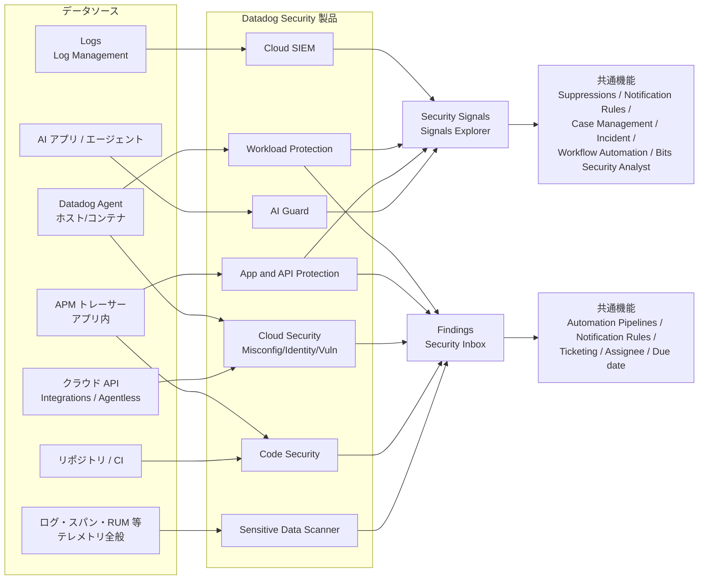
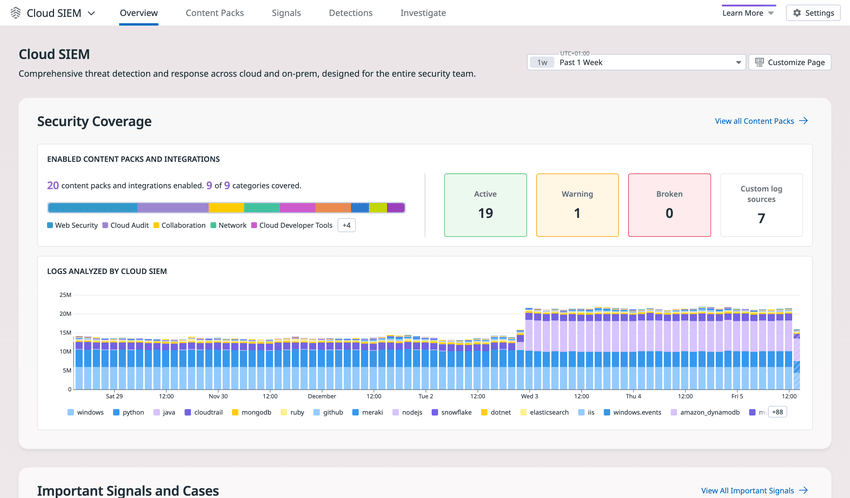
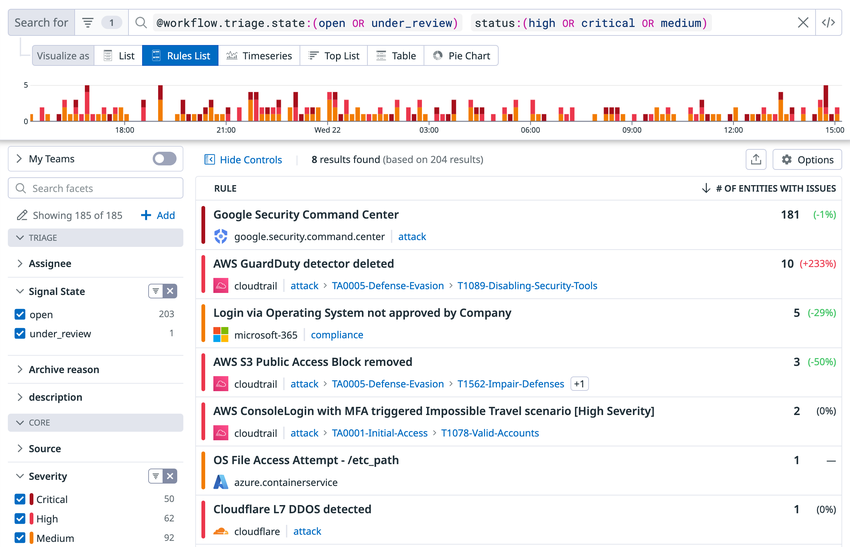
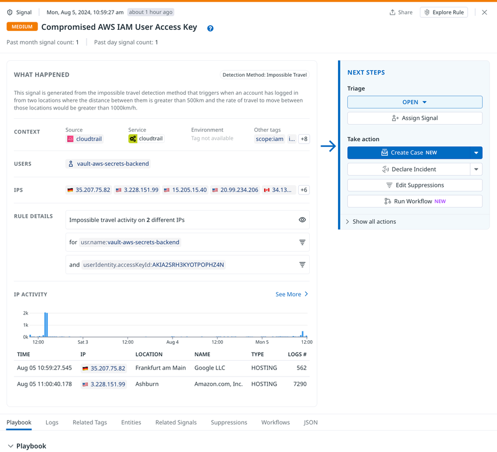
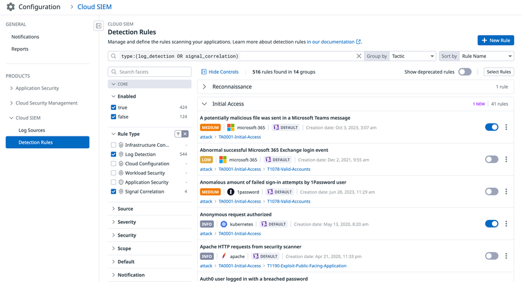
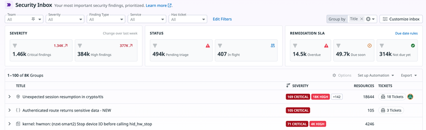

# Datadog Security 概要

## 概要

**Datadog Security** は、Datadog のオブザーバビリティ基盤（Agent、Log Management、APM、Integrations）の上に構築されたセキュリティ製品群の総称である。公式ドキュメントは Datadog Security を「アプリケーション、ホスト、コンテナ、クラウドインフラにまたがるリアルタイム脅威検知と継続的な構成監査を提供し、セキュリティと運用を統合する」ものと説明している。[出典](https://docs.datadoghq.com/security/)

2026-11-02 時点で公式ドキュメントが Datadog Security に含めている製品は次の 7 つである。[出典](https://docs.datadoghq.com/security/)

1. Cloud SIEM
2. Code Security
3. Cloud Security（旧称：Cloud Security Management / CSM）
4. App and API Protection（旧称：Application Security Management / Application Security Monitoring。いずれも ASM）
5. AI Guard
6. Workload Protection（旧称：Cloud Workload Security / CWS、CSM Threats）
7. Sensitive Data Scanner

Datadog Security の各製品は、検知結果を **Security Signal（セキュリティシグナル：進行中の脅威）** または **Finding（ファインディング：修正すべき弱点）** という共通形式で出力する。Detection Rules（検知ルール）、Suppressions（抑制）、Notification Rules（通知ルール）、Automation Pipelines（自動化パイプライン）、Security Inbox（セキュリティ受信箱）、Case Management（ケース管理）、Workflow Automation（ワークフロー自動化）、Threat Intelligence（脅威インテリジェンス）、RBAC（権限）は製品横断の共通機能として提供される。

本ファイルは製品群の全体像と共通概念を扱う。各製品の詳細仕様は以下の個別リファレンスを参照する。

| 製品 | 詳細ファイル |
|---|---|
| Cloud SIEM | [cloud-siem.md](./cloud-siem.md) |
| Cloud Security（Misconfigurations / Identity Risks / Vulnerabilities 等） | [cloud-security.md](./cloud-security.md) |
| Workload Protection | [workload-protection.md](./workload-protection.md) |
| App and API Protection | [app-and-api-protection.md](./app-and-api-protection.md) |
| Code Security | [code-security.md](./code-security.md) |
| Sensitive Data Scanner | [sensitive-data-scanner.md](./sensitive-data-scanner.md) |
| AI Guard | 専用ファイルなし。本ファイル「1.3」と [LLM Observability](../ai/llm-observability.md)、[Bits AI と AI 機能](../ai/bits-ai.md) を参照 |

運用ノウハウ（検知ルールのチューニング方針、SOC 運用設計など）は [セキュリティ運用の実践](../../04_応用編/security-operations-practices.md)、Datadog 自体のコンプライアンス（SOC 2、ISO、FedRAMP 等）は [セキュリティとコンプライアンス](../../03_導入編/security-and-compliance.md) を参照する。

---

## 1. 製品ポートフォリオの全体像

### 1.1 製品一覧と役割

Datadog Security の各製品の役割、データソース、主な出力を次の表にまとめる。「主な出力」は Signals（脅威）と Findings（弱点）のどちらを主に生成するかを示す。

| 製品（現名称） | 旧称 | 目的 | 主なデータソース / 収集手段 | 主な出力 | 出典 |
|---|---|---|---|---|---|
| **Cloud SIEM** | Security Monitoring（API 名・権限名に残る） | ログを検知ルールでリアルタイム分析し、標的型攻撃、脅威インテリジェンスに一致する IP との通信、危険な設定変更などを検知する | Log Management に取り込んだログ（クラウド監査ログ、IdP、SaaS、ネットワーク機器等）。Audit Trail・イベント・RUM 等も検知対象にできる | Signals | [出典](https://docs.datadoghq.com/security/) [出典](https://docs.datadoghq.com/security/cloud_siem/detect_and_monitor/custom_detection_rules/create_rule/) |
| **Cloud Security** | Cloud Security Management（CSM） | クラウド全体のリアルタイム脅威検知と継続的な構成監査を統合ビューで提供する。Workload Protection、Misconfigurations、Identity Risks、Vulnerabilities で構成される | クラウドプロバイダ連携（API）、Agent、Agentless Scanning | Findings（Misconfigurations / Identity Risks / Vulnerabilities / Attack Paths）。脅威検知部分は Workload Protection の Signals | [出典](https://docs.datadoghq.com/security/) |
| **Workload Protection** | Cloud Workload Security（CWS）、CSM Threats | ファイル・ネットワーク・プロセスのアクティビティを監視し、インフラへの脅威をリアルタイムに検知する。自動応答（Automated response）も持つ | Datadog Agent（カーネルレベルのイベント収集） | Signals（加えて Workload Activity の Findings） | [出典](https://docs.datadoghq.com/security/) [出典](https://docs.datadoghq.com/security/security_inbox/) |
| **App and API Protection（AAP）** | Application Security Management / Application Security Monitoring（いずれも ASM） | SSRF、SQL インジェクション、Log4Shell、反射型 XSS などアプリケーション層の攻撃を検知・防御する。API の発見と API Security の Findings も扱う | APM トレーサー（Datadog APM ライブラリ）、Datadog Agent、アプリ内検知ルール | Signals（攻撃）、Findings（API Security） | [出典](https://docs.datadoghq.com/security/) [出典](https://docs.datadoghq.com/security/security_inbox/) |
| **Code Security** | Code Analysis、ASM の Application Vulnerability Management などを統合（後述「2. 改称履歴」） | 自社コードと OSS ライブラリの脆弱性を、リポジトリと稼働中サービスの両方で検出する | リポジトリ／CI（SAST、Static SCA、Secret Scanning、IaC）、APM トレーサー（Runtime SCA、IAST） | Findings | [出典](https://docs.datadoghq.com/security/) |
| **AI Guard** | なし | AI アプリ／エージェントの入出力・ツール呼び出しをインラインで検査し、プロンプトインジェクション、ジェイルブレイク、機密データ流出をブロック・統制する | アプリに組み込む AI Guard の評価呼び出し（OpenAI、Anthropic、Bedrock、VertexAI、Azure 等の任意モデルに対応） | Signals（AI Guard Security Signals） | [出典](https://docs.datadoghq.com/security/ai_guard/) |
| **Sensitive Data Scanner（SDS）** | なし | テレメトリ（ログ、APM スパン、RUM イベント、Event Management のイベント）とクラウドストレージ内の機密データを発見・分類し、任意でマスキングする | Datadog の取り込みパイプライン、クラウドストレージスキャン | Findings（Sensitive Data） | [出典](https://docs.datadoghq.com/security/) [出典](https://docs.datadoghq.com/security/guide/findings-schema/) |

> **補足:** Datadog Security の Getting Started 画面は、アプリ内の **Security > Setup**（`/security/configuration`）にある。単一構成と複数構成の両方のセットアップ手順を案内する。[出典](https://docs.datadoghq.com/security/)

### 1.2 Cloud Security と Code Security の構成要素

Cloud Security と Code Security は複数の機能（サブ製品）の集合である。機能ごとの詳細は個別ファイルを参照する。

| 親製品 | 機能 | 概要 | 出典 |
|---|---|---|---|
| Cloud Security | Misconfigurations（旧 CSPM / CSM Misconfigurations） | クラウド構成とインフラ構成の検知ルールでクラウド環境の状態をスキャンする | [出典](https://docs.datadoghq.com/security/detection_rules/) |
| Cloud Security | Identity Risks（CIEM） | IAM に起因するリスクを検知ルールで検出する | [出典](https://docs.datadoghq.com/security/detection_rules/) |
| Cloud Security | Vulnerabilities | ホストとコンテナイメージの脆弱性を検出する（Finding type：Host Vulnerability / Container Image Vulnerability） | [出典](https://docs.datadoghq.com/security/security_inbox/) |
| Cloud Security | Attack Paths | 複数リスクの組み合わせによる攻撃経路を Finding として示し、Context Graph で関係を可視化する | [出典](https://docs.datadoghq.com/security/security_inbox/) |
| Cloud Security | Workload Protection | Agent による実行時脅威検知（独立製品としても提供） | [出典](https://docs.datadoghq.com/security/) |
| Code Security | Static Code Analysis（SAST） | 自社コードのセキュリティ・品質問題を検出する | [出典](https://docs.datadoghq.com/security/) |
| Code Security | Software Composition Analysis（SCA） | リポジトリと稼働サービス双方の OSS 依存関係の脆弱性を検出する | [出典](https://docs.datadoghq.com/security/) |
| Code Security | Runtime Code Analysis（IAST） | 稼働サービス内の自社コードの脆弱性を検出する | [出典](https://docs.datadoghq.com/security/) |
| Code Security | Secret Scanning | 漏えいしたシークレットを検出・検証する。下位機能の Generic Secret Scanning（プロバイダのパターンに一致しない内部トークン・パスワードの検出）は【Preview】 | [出典](https://docs.datadoghq.com/security/code_security/) [出典](https://docs.datadoghq.com/security/code_security/secret_scanning/) |
| Code Security | Infrastructure as Code（IaC）Security | IaC の設定不備を検出する（Finding type：Infrastructure as Code） | [出典](https://docs.datadoghq.com/security/security_inbox/) |
| Code Security | Supply Chain Firewall【Preview】 | npm、pip、poetry のパッケージマネージャのコマンドを仲介し、悪性パッケージや公開直後のパッケージをインストール前にブロックする（SCA が既存の依存関係を検査するのに対し、インストール時点で働く）。申請フォームで利用申請する | [出典](https://docs.datadoghq.com/security/code_security/) |
| Code Security | Code Security MCP Server【Preview】 | ローカルの MCP（Model Context Protocol）サーバー。SAST、シークレット検出、SCA、IaC スキャン、SBOM 生成を AI コーディングアシスタント（Cursor、Claude Desktop、VS Code 等）から実行できる | [出典](https://docs.datadoghq.com/security/code_security/) |

Code Security は IDE 連携、Pull Request コメント、CI/CD ゲートを提供し、開発者・セキュリティ管理者・SRE の DevSecOps を支援する。[出典](https://docs.datadoghq.com/security/)

### 1.3 AI Guard の位置付け

AI Guard は Datadog Security の中で最も新しい製品であり、2026-11-02 時点で公式ドキュメントには次の提供状況が記載されている。[出典](https://docs.datadoghq.com/security/ai_guard/)

| 項目 | 内容 |
|---|---|
| Custom Agent Runtime Protection | 【Limited Availability】（公式表記は Limited Access）。独自 AI エージェントを実行時攻撃から保護する。申請フォームで利用申請する |
| Coding Agent Runtime Protection | 【Preview】。開発ワークフロー内のコーディングエージェントを保護する |
| 保護機能 | Prompt Protection、Tool Protection、Sensitive Data Protection（PII・シークレット検出） |
| 対応モデル | OpenAI、Anthropic、Bedrock、VertexAI、Azure を含む任意のモデル |
| 補助機能 | Discover ページ（AI エージェントとサービスの関係・保護状況のマップ）、AI Guard Playground（コード不要で会話を評価） |
| 位置付け | 既存のプロンプトテンプレートやガードレールの上に重ね、LLM ワークフローの重要経路をインラインで保護する。公式は「agentic lethal trifecta」（特権的なシステムアクセス、信頼できないデータへの露出、外部への通信）への対策と説明している |

> **サイト差異:** AI Guard は US1-FED（`app.ddog-gov.com`）と US2-FED（`us2.ddog-gov.com`）では提供されない。[出典](https://docs.datadoghq.com/security/ai_guard/)

### 1.4 製品間の関係（データフロー）

Datadog Security の各製品は、共通基盤（Agent、Log Management、APM、Integrations）からデータを受け取り、共通の Signals / Findings 基盤へ結果を出力する。下図は公式ドキュメントの記述をもとに本ナレッジで整理した構成である。

製品間の主な相互作用は次の通り。

| 関係 | 内容 | 出典 |
|---|---|---|
| Cloud SIEM と Log Management | Cloud SIEM は Log Management を基盤とする。ログは取り込み時に脅威インテリジェンスで自動エンリッチされ、`threat_intel` 属性が付与される | [出典](https://docs.datadoghq.com/security/) [出典](https://docs.datadoghq.com/security/cloud_siem/triage_and_investigate/investigate_security_signals/) |
| AAP と APM | AAP は Datadog APM（トレーサー）と Agent、アプリ内検知ルールで脅威を検知する | [出典](https://docs.datadoghq.com/security/) |
| Workload Protection と Cloud Security | Workload Protection は Cloud Security の構成要素であり、Misconfigurations・Identity Risks・Vulnerabilities と統合ビューで扱われる | [出典](https://docs.datadoghq.com/security/) |
| Signals と Cloud Security の優先度 | Security Inbox は、過去 15 日以内にセキュリティシグナルが検出されたリソースを「Under attack」として扱い、Finding の優先度判定に用いる | [出典](https://docs.datadoghq.com/security/security_inbox/) |
| MITRE ATT&CK マップ | SIEM と Workload Protection の画面で提供され、AAP もフィルタで選択できる | [出典](https://docs.datadoghq.com/security/detection_rules/) |
| Threat Intelligence | Cloud SIEM、Workload Protection、AAP で共通のキュレーション済み IOC を使う | [出典](https://docs.datadoghq.com/security/threat_intelligence/) |
| Security Inbox | Cloud Security、Code Security、AAP、Workload Protection の Findings を 1 つの優先度付きリストにまとめる | [出典](https://docs.datadoghq.com/security/security_inbox/) |
| Data Access Control | Security Signals（Cloud SIEM と Workload Protection）、Workload Protection Agent Events、Security Findings を Restricted Dataset の対象にできる | [出典](https://docs.datadoghq.com/security/access_control/) |

### 1.5 主要画面

**キャプション:** Cloud SIEM のホーム（Overview）画面。

**画面説明:** 画面上部に製品切替（Cloud SIEM ▼）と、Overview、Content Packs、Signals、Detections、Investigate のタブが並ぶ。右上に期間選択（例：Past 1 Week）と Customize Page、Settings がある。「Security Coverage」セクションには、有効化済みの Content Pack とインテグレーションの数（例：20 個、9/9 カテゴリ）とカテゴリ別の色帯（Web Security、Cloud Audit、Collaboration、Network、Cloud Developer Tools 等）、ステータス別件数（Active / Warning / Broken / Custom log sources）が表示される。その下の「Logs Analyzed by Cloud SIEM」では、Cloud SIEM が分析したログ量がソース別（windows、python、cloudtrail、github 等）の積み上げ棒グラフで表示される。さらに下に「Important Signals and Cases」が続く。

**出典:** https://docs.datadoghq.com/security/ （画像：`docs.dd-static.net/images/security/security_monitoring/cloud_siem_overview_2025...png`、取得日 2026-11-02）

---

## 2. 改称履歴

Datadog のセキュリティ製品は名称変更が多い。現行ドキュメント・API・権限名に旧称が残っているため、検索時は旧称も併せて使う必要がある。

| 時期 | 変更内容 | 現在の名称 | 根拠・確度 |
|---|---|---|---|
| 2022-10-19 | Cloud Security Posture Management（CSPM）と Cloud Workload Security（CWS）の機能を統合した **Cloud Security Management（CSM）** の GA を発表 | Cloud Security | Datadog プレスリリース（2022-10-19）[出典](https://www.datadoghq.com/about/latest-news/press-releases/datadog-launches-cloud-security-management-to-provide-cloud-native-application-protection/) |
| 2023-08-01 | CSM のパッケージとして **CSM Pro** と **CSM Enterprise** を導入。CSPM の新規販売は 2023-10 に停止し、オンデマンド顧客は 2023-11-01 までに CSM Pro（CSPM のみ）または CSM Enterprise（CWS＋CSPM）へ自動移行すると告知 | CSM Pro / CSM Enterprise（料金ページ上の名称） | 公式ブログ（2023-08-17 公開）[出典](https://www.datadoghq.com/blog/cloud-security-management-changes/) |
| 公開情報では正確な時期を確認できず | CSM の機能名として CSPM → **CSM Misconfigurations**、CWS → **CSM Threats** の呼称が使われた | Misconfigurations、Workload Protection | API リファレンスの分類名「CSM Threats」が現存する [出典](https://docs.datadoghq.com/api/latest/csm-threats/) |
| 公開情報では正確な時期を確認できず（2025 年頃【推定】） | **Cloud Security Management（CSM）→ Cloud Security** に改称 | Cloud Security | 公式ブログの編集注記「Cloud Security Management (CSM) has been renamed Cloud Security」[出典](https://www.datadoghq.com/blog/security-context-with-datadog-cloud-security/)。時期は第三者の料金変更トラッカーが 2025 年第 2 四半期の CSM パッケージ変更を報告していることからの推定【推定】[出典](https://pricingsaas.com/companies/datadog.cloud-security-management/diffs/2025Q2) |
| 公開情報では正確な時期を確認できず | **CSM Threats（旧 Cloud Workload Security / CWS）→ Workload Protection** | Workload Protection | 現行ドキュメントは Workload Protection 名で記載する。権限名は `security_monitoring_cws_agent_rules_*`（Cloud Workload Security Agent Rules）のまま [出典](https://docs.datadoghq.com/account_management/rbac/permissions/) |
| 2025 年半ば【第三者情報】 | **Application Security Management（ASM）→ App and API Protection（AAP）** に改称 | App and API Protection | 公式ブログの編集注記「Application Security Management (ASM) has been renamed App and API Protection (AAP)」[出典](https://www.datadoghq.com/blog/datadog-app-and-api-protection/)。一方、現行の AAP ドキュメントは旧称を「Application Security Monitoring (ASM)」と記載しており、ASM の展開形には Monitoring と Management の両方が公式に使われている（両者の切替時期は公開情報では確認できず）[出典](https://docs.datadoghq.com/security/application_security/)。時期は第三者トラッカーが 2025-04-01〜2025-07-13 の変更として記録【第三者情報】[出典](https://pricingsaas.com/companies/datadog.application-security-management/diffs/2025Q2)（2025 年取得記録） |
| 2023-02 → 2025-06 | **Code Analysis**（2023-02-15 の公式ブログで紹介）と ASM の **Application Vulnerability Management**（2023-04 GA）の機能が、**Code Security** として SAST / SCA / IAST / Secret Scanning / IaC を束ねる体系に整理された | Code Security | Code Analysis ブログ（2023-02-15 公開）[出典](https://www.datadoghq.com/blog/datadog-code-analysis/)、Code Security ブログ（2025-06-10 公開）[出典](https://www.datadoghq.com/blog/application-code-vulnerability-detection/)。統合の正確な日付は公開情報では確認できず |
| 公開情報では正確な時期を確認できず | **Security Monitoring → Cloud SIEM**。API の分類名は現在も「Security Monitoring」、権限名も `security_monitoring_*` | Cloud SIEM | API リファレンス [出典](https://docs.datadoghq.com/api/latest/security-monitoring/)。第三者の検索結果では 2020 年時点の公式ブログに Cloud SIEM、2021-08 のプレスリリースに Security Monitoring の名称が見られるとされ、名称の変遷は一方向ではない可能性がある【第三者情報】 |
| 公開情報では正確な時期を確認できず | 製品群の総称が **Security Platform / Cloud Security Platform → Datadog Security** へ | Datadog Security | 現行ドキュメントのタイトルは「Datadog Security」。ドキュメント内リンクに旧パス `/security_platform/` が残る [出典](https://docs.datadoghq.com/security/cloud_siem/detect_and_monitor/custom_detection_rules/create_rule/) |

**旧称が残っている箇所（検索・設定時の注意）**

| 箇所 | 残っている旧称 | 例 |
|---|---|---|
| API エンドポイント分類 | Security Monitoring、CSM Threats、Cloud Workload Security | `/api/v2/security_monitoring/rules`、API リファレンスの「CSM Threats」 |
| RBAC 権限名 | Security Monitoring、Cloud Workload Security、Application Security Management、CSPM | `security_monitoring_rules_write`、`security_monitoring_cws_agent_rules_write`、`appsec_event_rule_write`、`security_monitoring_findings_write`（説明文は「Mute CSPM Findings」） |
| 料金ページ | CSM Pro / CSM Enterprise | Cloud Security の料金プラン名は 2026-11-02 時点でも CSM Pro / CSM Enterprise |
| 料金ページ（キー名） | CWS、APPSEC | 料金データ上のキー `CWS-HOSTS`、`APPSEC-HOSTS` |
| Terraform リソース | security_monitoring、csm_threats | `datadog_security_monitoring_rule`、`datadog_csm_threats_agent_rule` |

---

## 3. 共通データモデル：Security Signals と Findings

### 3.1 Signals と Findings の違い

Datadog Security は検知結果を 2 種類のオブジェクトで扱う。通知ルール作成画面では、Signal を「インフラに対して進行中の脅威となる不審なアクティビティ」、Finding を「インフラの潜在的なセキュリティ上の欠陥」と定義している。[出典](https://docs.datadoghq.com/security/notifications/rules/)

| 観点 | Security Signal | Finding |
|---|---|---|
| 意味 | 進行中・発生した脅威（攻撃、不審な操作） | 修正すべき弱点（脆弱性、設定不備、権限リスク、漏えいシークレット等） |
| 主な生成元 | Cloud SIEM、Workload Protection、App and API Protection、AI Guard | Cloud Security、Code Security、App and API Protection（API Security）、Workload Protection（Workload Activity）、Sensitive Data Scanner |
| 生成条件 | 検知ルールのケースのいずれかが一定期間内に一致したとき | 検知ルール（Misconfiguration ルール等）やスキャン結果で弱点が検出されたとき |
| 状態の名前 | Triage state：`open` / `under_review` / `archived` | Status：`open` / `muted` / `auto_closed` / `resolved` / `in-progress` |
| 重大度 | `info` / `low` / `medium` / `high` / `critical` | `critical` / `high` / `medium` / `low` / `info` / `none` / `unknown` |
| 主な画面 | Signals Explorer（製品別） | 各製品の Findings エクスプローラ、Security Inbox |
| 主な後続処理 | Suppressions、Dynamic Severity、Case 作成、Incident 宣言、Workflow 実行、Bits Security Analyst | Automation Pipelines（Mute、Severity 変更、Due date、Inbox、チケット作成）、Assignee、Ticketing |
| 保持期間 | 15 か月（Cloud SIEM、Workload Protection、AAP） | 未解決は検出され続ける限り保持。Misconfigurations・Identity Risks・Attack Paths は 15 か月、解決済み脆弱性は最終スキャンから 30 日 等（「制限値」節参照） |
| 出典 | [出典](https://docs.datadoghq.com/security/detection_rules/) [出典](https://docs.datadoghq.com/security/cloud_siem/triage_and_investigate/investigate_security_signals/) | [出典](https://docs.datadoghq.com/security/guide/findings-schema/) [出典](https://docs.datadoghq.com/data_security/data_retention_periods/) |

### 3.2 Security Signals

**Security Signal の生成:** Detection Rules は、取り込まれたすべてのログとクラウド構成に適用される条件ロジックであり、ルールで定義したケースの少なくとも 1 つが一定期間内に一致すると Security Signal が生成される。[出典](https://docs.datadoghq.com/security/detection_rules/)

**Signals Explorer:** Signals Explorer では、専用のクエリ言語を覚えなくても、ファセットパネルや検索バーで Security Signal を表示・検索・フィルタ・相関分析できる。フィルタした結果は Saved View（保存ビュー）として保存できる。Cloud SIEM の Signals Explorer は **Security > Cloud SIEM > Signals**（`/security/siem/signals`）、Workload Protection は `/security/workload-protection/signals`、AAP は `/security/appsec/signals` にある。[出典](https://docs.datadoghq.com/security/cloud_siem/triage_and_investigate/investigate_security_signals/) [出典](https://docs.datadoghq.com/security/workload_protection/security_signals/) [出典](https://docs.datadoghq.com/security/ticketing_integrations/)

**Signals Explorer の可視化形式（Visualize as）**

| 形式 | 用途 |
|---|---|
| List | シグナルの一覧（Cases 列でケースの作成・紐付けも可能） |
| Rules List | 検知ルールごとのシグナル量とアラート傾向 |
| Timeseries | シグナルの時系列推移 |
| Top List | 発生件数の多い順 |
| Table | 任意のタグキー（`source`、`technique` 等）で集計。Tactic と Technique の 2 段グループ化で MITRE ATT&CK 別に表示できる |
| Pie Chart | 検知ルールごとの相対量 |

[出典](https://docs.datadoghq.com/security/cloud_siem/triage_and_investigate/investigate_security_signals/)

**主要な検索クエリ例**

| 目的 | クエリ |
|---|---|
| 重大度が High / Critical / Medium かつ未対応・調査中 | `status:(high OR critical OR medium) @workflow.triage.state:(open OR under_review)` |
| トリアージ状態で絞り込み | `@workflow.triage.state:<open \| under_review \| archived>` |
| 脅威インテリジェンスに一致したもの | `@threat_intel.indicators_matched:*` |
| 脅威インテリジェンスのカテゴリ | `@threat_intel.results.category:<attack \| corp_vpn \| cryptomining \| malware \| residential_proxy \| tor \| scanner>` |
| 脅威インテリジェンスの意図 | `@threat_intel.results.intention:<malicious \| suspicious \| benign \| unknown>` |
| Bits Security Analyst の調査完了シグナル（通知ルール用タグ） | `@workflow.bits_investigator.state:*` |
| （Log Explorer）IP がログのどこかに含まれる | `@network.ip.list:<IP address>` |

[出典](https://docs.datadoghq.com/security/cloud_siem/triage_and_investigate/investigate_security_signals/) [出典](https://docs.datadoghq.com/security/workload_protection/security_signals/) [出典](https://docs.datadoghq.com/security/notifications/rules/)

> **注意:** Signals Explorer の検索では、シグナルの重大度は `status` 属性で表す（例：`status:high`）。Findings の `@status`（ワークフロー状態）とは意味が異なる。

**キャプション:** Signals Explorer を Rules List で表示した画面。

**画面説明:** 上部の検索バーに `@workflow.triage.state:(open OR under_review) status:(high OR critical OR medium)` が入力され、その下に「Visualize as」の切替（List、Rules List、Timeseries、Top List、Table、Pie Chart）がある。中央に重大度別に色分けされたシグナル件数の棒グラフ。左のファセットパネルには My Teams トグル、TRIAGE（Assignee、Signal State：open / under_review、Archive reason）、CORE（Source、Severity：Critical / High / Medium）が並ぶ。右側の表は RULE 列（ルール名、ソース、`attack`・`TA0005-Defense-Evasion`・`T1089-Disabling-Security-Tools` などのタグ）と「# OF ENTITIES WITH ISSUES」列（件数と前期比）で構成される。

**出典:** https://docs.datadoghq.com/security/cloud_siem/triage_and_investigate/investigate_security_signals/ （取得日 2026-11-02）

**トリアージ状態（Triage state）**

| 状態 | API 値 | 意味 |
|---|---|---|
| Open | `open` | ルールに基づき検知され、未解決の状態。**既定値** |
| Under Review | `under_review` | 調査中。ここから `Archived` または `Open` に変更できる。シグナルからケースを作成すると自動的にこの状態になる（既定設定） |
| Archived | `archived` | 検知の原因が解決済み。アーカイブ理由と説明を付けられる。再発時は `Open` に戻せる |

- すべてのシグナルは作成から **30 日後にロック** される。[出典](https://docs.datadoghq.com/security/cloud_siem/triage_and_investigate/investigate_security_signals/)
- シグナルの状態変更などの変更には `Security Signals Write`（`security_monitoring_signals_write`）権限が必要で、操作履歴は Audit Trail で確認できる。[出典](https://docs.datadoghq.com/security/cloud_siem/triage_and_investigate/investigate_security_signals/)
- API のアーカイブ理由（`archive_reason`）の値は `none`、`false_positive`、`testing_or_maintenance`、`remediated`、`investigated_case_opened`、`true_positive_benign`、`true_positive_malicious`、`other`。[出典](https://docs.datadoghq.com/api/latest/security-monitoring/change-the-triage-state-of-a-security-signal/)

**シグナルのサイドパネル（Cloud SIEM の例）**

| セクション / タブ | 内容 |
|---|---|
| What Happened | 一致したログとクエリ。ユーザー名や IP 等。Rule Details のファネルアイコンから Suppression を作成・追加できる |
| Next Steps > Triage | トリアージ状態の変更、Assign Signal（担当者割当） |
| Next Steps > Take Action | Create Case、Declare Incident、Edit Suppressions、Run Workflow |
| Logs | 関連ログ。View All Related Logs で Log Explorer へ |
| Entities | 関連エンティティ（ユーザー、IP）。IP Investigation ダッシュボード、関連シグナル、Investigator（クラウドエンティティの行動グラフ）へ遷移 |
| Related Signals | 共通のフィールド・属性を持つ関連シグナル |
| Suppressions | このルールに設定された抑制の一覧 |
| Workflows | 起動済み・推奨ワークフロー（タグ類似度の高い上位 3 件を推奨） |
| JSON | シグナルの JSON。Dynamic Severity の適用情報 `critical_assets_data` などを含む |

[出典](https://docs.datadoghq.com/security/cloud_siem/triage_and_investigate/investigate_security_signals/) [出典](https://docs.datadoghq.com/security/cloud_siem/detect_and_monitor/dynamic_severity/)

**キャプション:** Cloud SIEM のシグナルサイドパネル（「Compromised AWS IAM User Access Key」、重大度 MEDIUM の例）。

**画面説明:** 上部にシグナル作成日時、重大度バッジ（MEDIUM）、シグナル名、過去 1 か月・過去 1 日のシグナル件数が表示され、右上に Share と Explore Rule がある。左の「WHAT HAPPENED」には検知方式（Detection Method: Impossible Travel）とその説明、CONTEXT（Source：cloudtrail、Service、Environment、Other tags）、USERS、IPS（国旗付きの IP 一覧）、RULE DETAILS（「Impossible travel activity on 2 different IPs」と `usr.name`・`userIdentity.accessKeyId` の条件、各行にファネルアイコン）、IP ACTIVITY（時系列グラフと、時刻・IP・所在地・名前・種別・ログ件数の表）が並ぶ。右の「NEXT STEPS」には Triage（OPEN のドロップダウン、Assign Signal）と Take action（Create Case、Declare Incident、Edit Suppressions、Run Workflow、Show all actions）がある。下部タブは Playbook、Logs、Related Tags、Entities、Related Signals、Suppressions、Workflows、JSON。

**出典:** https://docs.datadoghq.com/security/cloud_siem/triage_and_investigate/investigate_security_signals/ （取得日 2026-11-02）

**一括操作（Bulk Actions）:** Signals Explorer でシグナルのチェックボックスを選択し、Bulk Actions から状態変更・担当者変更・ケース作成などをまとめて実行できる。一括操作中は Signals Explorer の自動更新が停止する。[出典](https://docs.datadoghq.com/security/cloud_siem/triage_and_investigate/investigate_security_signals/)

### 3.3 Findings（Security Findings）

**Findings の共通スキーマ:** Datadog の Security Findings は、インフラとアプリケーションで特定された脆弱性・設定不備・セキュリティリスクを表し、すべての Finding が共通スキーマを共有するため製品横断で統一的に検索・分析できる。Finding へのリンクは `/security/finding/<finding_id>` 形式で、Finding type に応じた適切なエクスプローラが開く。[出典](https://docs.datadoghq.com/security/guide/findings-schema/)

**Finding type（`@finding_type` の値）**

| `finding_type` | 内容 | 主な生成元 |
|---|---|---|
| `misconfiguration` | クラウド・インフラの設定不備 | Cloud Security |
| `identity_risk` | IAM 起因のリスク | Cloud Security |
| `attack_path` | 攻撃経路 | Cloud Security |
| `host_and_container_vulnerability` | ホスト・コンテナイメージの脆弱性 | Cloud Security |
| `workload_activity` | ワークロードのアクティビティ | Workload Protection |
| `library_vulnerability` | OSS ライブラリの脆弱性 | Code Security（SCA） |
| `static_code_vulnerability` | 静的解析で見つかったコード脆弱性 | Code Security（SAST） |
| `runtime_code_vulnerability` | 実行時解析で見つかったコード脆弱性 | Code Security（IAST） |
| `iac_misconfiguration` | IaC の設定不備 | Code Security（IaC） |
| `secret` | 漏えいシークレット | Code Security（Secret Scanning） |
| `code_quality` | コード品質の問題 | Code Security（SAST） |
| `api_security` | API の問題（予測可能な ID を使うルート等） | App and API Protection |
| `sensitive_data` | 機密データ | Sensitive Data Scanner |
| `security_testing` | セキュリティテスト | 公開情報では生成元の詳細を確認できず |

[出典](https://docs.datadoghq.com/security/guide/findings-schema/)

**Findings の主要な共通属性（Core Attributes の抜粋）**

| 属性 | 型 | 説明 |
|---|---|---|
| `@finding_id` | string | Finding の一意 ID |
| `@finding_type` | string | 上表のカテゴリ |
| `@base_severity` | string | 調整前の基本重大度 |
| `@severity` | string | Datadog の調整とユーザー定義の重大度変更を適用した最終重大度 |
| `@status` | string | `open`、`muted`、`auto_closed`、`resolved`、`in-progress` |
| `@first_seen_at` / `@last_seen_at` | integer | 初回／最終検出時刻（UTC ミリ秒） |
| `@is_in_security_inbox` | boolean | Security Inbox に表示されているか |
| `@time_to_acknowledge` | integer | 初回検出から割当またはチケット作成までの秒数 |
| `@time_to_resolution` | integer | 初回検出から解決までの秒数 |
| `@origin` | array | 検出元（agentless scan、APM、SCA、CI 等） |
| `@resource_id` / `@resource_name` / `@resource_type` | string | 影響を受けるリソース |

[出典](https://docs.datadoghq.com/security/guide/findings-schema/)

**Finding のクローズ条件:** Finding を閉じる方法は、Datadog 上で修正が確認されること（remediation）か、Mute による例外定義のみである。外部チケットや Datadog のケースを修正なしで閉じても Finding は閉じない（Datadog が検出と解決の唯一の正とされる）。[出典](https://docs.datadoghq.com/security/ticketing_integrations/)

---

## 4. Detection Rules（検知ルール）の共通概念

### 4.1 対象製品と OOTB ルール

**Detection Rules の対象製品:** 共通の Detection Rules 体系は Cloud SIEM、Cloud Security、App and API Protection、Workload Protection で利用できる。[出典](https://docs.datadoghq.com/security/detection_rules/)

**OOTB（Out-of-the-box、標準提供）ルール:** Datadog は攻撃者の手口と設定不備を検知する標準ルールを提供する。新しいルールがリリースされると、構成に応じてアカウント、AAP のライブラリ、Agent に自動的にインポートされる。料金ページによれば、Cloud SIEM の標準ルールは 800 以上で、Datadog の検知エンジニアリングチームが保守している。新規ルールは既存顧客にも自動で有効化される。[出典](https://docs.datadoghq.com/security/detection_rules/) [出典](https://www.datadoghq.com/pricing/)

| 製品 | OOTB ルールの検知手段 |
|---|---|
| Cloud SIEM | 取り込んだログをリアルタイムに分析する Log Detection |
| Cloud Security Misconfigurations | クラウド構成とインフラ構成の検知ルールでクラウド環境の状態をスキャン |
| Cloud Security Identity Risks | IAM ベースのリスクを検知 |
| Workload Protection | Datadog Agent と検知ルールでシステムアクティビティを監視・評価 |
| App and API Protection | APM、Datadog Agent、検知ルールでアプリケーション環境の脅威を検知 |

[出典](https://docs.datadoghq.com/security/detection_rules/)

標準ルールの全一覧は [OOTB Rules](https://docs.datadoghq.com/security/default_rules/) で公開されている。ルール名に **BETA** が付くものがある。

**Beta 検知ルール:** Datadog の Security Research チームは新しい OOTB ルールを継続的に追加している。大規模環境での検知性能を観測してから一般提供（GA）にするため、基準を満たさないルールは改良または廃止される。[出典](https://docs.datadoghq.com/security/detection_rules/)

### 4.2 ルール種別（Rule type）

API と Terraform では、Detection Rule の種別を `type` で指定する。ただし指定できる値の範囲は API と Terraform（`datadog_security_monitoring_rule`）で異なる。

| `type` の値 | 対象製品 | 概要 | API の作成リクエストで指定可能 | Terraform で指定可能 |
|---|---|---|---|---|
| `log_detection` | Cloud SIEM | ログ（等）に対する検知。**Terraform の既定値** | ○ | ○ |
| `signal_correlation` | Cloud SIEM | 複数シグナルを相関させるルール（集計は `event_count` 必須） | ○ | ○ |
| `workload_security` | Workload Protection | Agent のランタイムイベントに対する検知 | ○ | ○ |
| `workload_activity` | Workload Protection | 公開情報では詳細な定義を確認できず（Findings の Workload Activity に対応すると見られる【推定】） | ○ | × |
| `application_security` | App and API Protection | アプリ層の攻撃の検知 | ○ | ○ |
| `api_security` | App and API Protection | API Security の検知 | ○ | × |
| `cloud_configuration` | Cloud Security | クラウド構成（Misconfigurations） | ○ | × |
| `infrastructure_configuration` | Cloud Security | インフラ構成（Misconfigurations） | ×（作成リクエストの列挙値にはなく、ルール一覧取得のレスポンスに現れる値） | × |

> **注記:** Terraform の `type` の有効値は `application_security`、`log_detection`、`workload_security`、`signal_correlation` の 4 つだけである（既定値 `log_detection`）。Cloud Security の Misconfiguration ルールなど、それ以外の種別は Terraform のこのリソースでは作成できない。

[出典](https://docs.datadoghq.com/api/latest/security-monitoring/create-a-detection-rule/) [出典](https://docs.datadoghq.com/api/latest/security-monitoring/list-rules/) [出典](https://registry.terraform.io/providers/DataDog/datadog/latest/docs/resources/security_monitoring_rule)

### 4.3 検知方式（Detection method）

検知方式は主に Cloud SIEM のルール作成で選択する（詳細は [Cloud SIEM](./cloud-siem.md)）。API の `detectionMethod` と UI 表記の対応は次の通り。

| UI 表記 | API 値 | 概要 |
|---|---|---|
| Threshold | `threshold` | クエリに一致するアクティビティが指定回数発生したら検知。1 に設定すればシグネチャ型検知になる。**Terraform の既定値** |
| New Value | `new_value` | 追跡属性が学習期間中に見られなかった値をとったら検知（例：初めての国・IP・デバイスからのログイン） |
| Anomaly | `anomaly_detection` | 日次・週次の季節性を考慮し、ログ量の予期しない急増・上振れを検知（減少は対象外） |
| Content Anomaly | `anomaly_threshold`【推定】 | 特定フィールドの内容が通常と異なる（エンコードされたコマンド、異常に長い URL、不審な User-Agent 等）ことを検知 |
| Impossible Travel | `impossible_travel` | 連続ログイン間の移動速度から認証情報の窃取を検知 |
| Third Party | `third_party` | 外部のセキュリティ製品の検知結果を Cloud SIEM に取り込み、ネイティブルールと同じフローでトリアージ |
| Sequence | `sequence_detection` | 同一アクターによる一連のイベント（例：未知 IP からのログイン → 特権ロール付与 → 機密リソースアクセス）を順序どおりに検知。シーケンス全体の評価時間は最大 24 時間 |
| （UI に個別表示なし） | `hardcoded` | 組み込み評価器。`hardcodedEvaluatorType` の値は `log4shell` のみ |

> **注記:** Content Anomaly と `anomaly_threshold` の対応は、公式ドキュメントで明示されていないため【推定】とする。

[出典](https://docs.datadoghq.com/security/cloud_siem/detect_and_monitor/custom_detection_rules/create_rule/) [出典](https://docs.datadoghq.com/api/latest/security-monitoring/create-a-detection-rule/) [出典](https://registry.terraform.io/providers/DataDog/datadog/latest/docs/resources/security_monitoring_rule)

**ルールの実行形態（Cloud SIEM）**

| 形態 | 内容 |
|---|---|
| Real-time rule | 取り込まれるログを継続的に分析し、即時にシグナルを出す |
| Scheduled rule | インデックス済みログを定期的に分析する。Calculated Fields も使える。カスタムスケジュールまたは RRULE（iCalendar）で実行時刻を指定でき、RRULE の評価頻度は 1 日以上 |
| Historical job | 過去ログに対する 1 回限りの実行。ルールのバックテストに使い、結果をシグナルに変換できる |

クエリ言語は Event query、SQL（DDSQL。データセットや OCSF v1.7.0 準拠の OOTB データセットを参照）、Event/rule query（Sequence 用）から選ぶ。[出典](https://docs.datadoghq.com/security/cloud_siem/detect_and_monitor/custom_detection_rules/create_rule/)

### 4.4 ルールの構成要素と主なオプション値

Detection Rule は概ね「クエリ（queries）」「ケース（cases：条件と重大度）」「オプション（options）」「メッセージ（message：プレイブック）」「タグ」「通知先」で構成される。以下は API / Terraform で定義されている主なフィールドと値である。

| 項目 | API / Terraform フィールド | 取りうる値・既定値 | 説明 |
|---|---|---|---|
| 重大度 | `cases[].status` | `info`、`low`、`medium`、`high`、`critical` | ケースが一致したときのシグナル重大度 |
| 条件 | `cases[].condition` | 例：`a > 3` | クエリラベル（ASCII 小文字）と論理演算子（`>`、`>=`、`<`、`&&`、`\|\|`）で記述。ラベルは演算子の左側に置く（`3 < a` は不可）。ケースは上から評価され、最初に一致したケースがシグナルを生成する |
| Evaluation window | `options.evaluationWindow` / `evaluation_window` | `0`、`60`、`300`、`600`、`900`、`1800`、`3600`、`7200`、`10800`、`21600`、`43200`、`86400`（秒） | ケースの一致を判定するスライディングウィンドウ |
| Keep alive | `options.keepAlive` / `keep_alive` | 同上。Terraform の既定値は `3600` | シグナル生成後、この時間内にケースが再一致すればシグナルは「open」のまま更新される |
| Maximum signal duration | `options.maxSignalDuration` / `max_signal_duration` | 同上（最大 `86400` 秒＝24 時間） | 初回検知からこの時間を過ぎると、一致の有無に関係なくシグナルを閉じる |
| 制約 | ― | Evaluation window ≤ Keep alive かつ ≤ Maximum signal duration | UI の注意書きによる |
| 非本番環境の重大度引き下げ | `options.decreaseCriticalityBasedOnEnv` / `decrease_criticality_based_on_env` | 既定 `false` | `env` タグが `staging`、`test`、`dev` で始まるシグナルの重大度を 1 段階下げる（`log_detection` のみ） |
| New Value：学習期間 | `newValueOptions.learningDuration` | 0〜30 日。Terraform 既定 `1` | 0 の場合は最初の値の学習後、新しい値すべてでシグナル |
| New Value：忘却期間 | `newValueOptions.forgetAfter` | 1〜30 日 | 学習済みの値を忘れるまでの日数 |
| New Value：学習方式 | `learningMethod` / `learningThreshold` | `duration`（既定）/ `threshold`、閾値 `0`（既定）/ `1` | |
| Anomaly：バケット長 | `anomalyDetectionOptions.bucketDuration` | `300`、`600`、`900`、`1800`、`3600`、`10800`（秒、300 以上） | |
| Anomaly：学習期間 | `anomalyDetectionOptions.learningDuration` | `1`、`6`、`12`、`24`、`48`、`168`、`336`（時間） | この量の履歴が揃うまで評価しない |
| Anomaly：許容度 | `detectionTolerance` | `1`〜`5` | 値が大きいほど大きな逸脱が必要 |
| Content Anomaly | ― | Similarity threshold 既定 70%、Minimum similar items 既定 1 | UI の既定値 |
| 集計方法 | `queries[].aggregation` | `count`（既定）、`cardinality`、`sum`、`max`、`new_value`、`geo_data`、`event_count`、`none` | Signal Correlation は `event_count` 必須 |
| データソース | `queries[].data_source` | `logs`（既定）、`audit`、`app_sec_spans`、`spans`、`security_runtime`、`network`、`events`、`security_signals` | Terraform の値 |
| フィルタ | `filters[].action` | `require`、`suppress` | ルール単位のフィルタ |
| ケースのアクション | `cases[].actions[].type` | `block_ip`、`block_user`、`user_behavior`、`flag_ip` | 主に AAP の自動防御・ユーザーリスク付与 |
| シグナルタイトルへのグループ値付与 | `has_extended_title` | 既定 `false` | 通知タイトルにグループ化の値を含める |

[出典](https://docs.datadoghq.com/api/latest/security-monitoring/create-a-detection-rule/) [出典](https://registry.terraform.io/providers/DataDog/datadog/latest/docs/resources/security_monitoring_rule) [出典](https://docs.datadoghq.com/security/cloud_siem/detect_and_monitor/custom_detection_rules/create_rule/)

> **注記（値の食い違い）:** 2026-11-02 時点の API リファレンス本文では `evaluationWindow`・`keepAlive`・`maxSignalDuration` の列挙値が `21600` までしか記載されていない。一方、同ページのリクエスト例は `maxSignalDuration: 86400` を使っており、Terraform プロバイダのドキュメントには `43200`・`86400` も有効値として記載されている。UI の説明も「最大 24 時間」の例を挙げているため、本ファイルでは `86400` までを有効値として扱う。

**プレイブック（Rule message）とタグ:** ルール名はシグナルのタイトルになる。Rule message には Markdown と通知変数を使える。Tag resulting signals でシグナルにタグ（例：`security:attack`、`technique:T1110-brute-force`）を付ける。`security` タグは特別で、シグナルの分類に使われる。推奨値は `attack`、`threat-intel`、`compliance`、`anomaly`、`data-leak`。[出典](https://docs.datadoghq.com/security/cloud_siem/detect_and_monitor/custom_detection_rules/create_rule/)

### 4.5 カスタムルール

**カスタムルールの作り方:** カスタムルールは、標準ルールを複製（Clone）して編集する方法と、ゼロから作成する方法がある。Detection Rules ページ右上の **New Rule** から作成する。製品別の作成手順は次の通り。[出典](https://docs.datadoghq.com/security/detection_rules/)

| 製品 | 作成手順ドキュメント |
|---|---|
| Cloud SIEM | https://docs.datadoghq.com/security/cloud_siem/detect_and_monitor/custom_detection_rules/create_rule/ |
| AAP | https://docs.datadoghq.com/security/application_security/policies/custom_rules/ |
| Cloud Security Misconfigurations | https://docs.datadoghq.com/security/cloud_security_management/misconfigurations/custom_rules/ |
| Workload Protection | https://docs.datadoghq.com/security/workload_protection/detect_and_monitor/detection_and_finding_rules/detection_rules/ |

Cloud SIEM の料金 FAQ では、カスタム検知ルールの作成に追加費用はかからず、標準ルールとユーザー定義ルールの両方による分析が Cloud SIEM の料金に含まれると説明している。[出典](https://www.datadoghq.com/pricing/)

### 4.6 ルールの管理操作

Detection Rules の一覧は **Security Settings**（`/security/configuration/`）の製品別ページ（App and API Protection、Cloud Security、Cloud SIEM）にあり、SIEM（`/security/siem/rules`）と Workload Protection（`/security/workload-protection/detection-rules`）の画面からも管理できる。検索ボックスとファセット（`source`、`severity`、ルールタイプ等）で絞り込める。[出典](https://docs.datadoghq.com/security/detection_rules/)

| 操作 | 方法 | 補足 |
|---|---|---|
| 有効化 / 無効化 | ルール名右のトグル。Select Rules → Bulk Actions → Enable / Disable Rules で一括 | |
| 編集 | 縦三点メニュー → Edit default rule / Edit rule | OOTB ルールも直接編集可能。元を残したい場合は複製して編集し、元を無効化する |
| 複製 | 縦三点メニュー → Clone rule | 例：Threshold のログ検知ルールを複製して Anomaly に変更する |
| 削除 | 縦三点メニュー → Delete rule。一括削除も可能 | |
| バージョン履歴 | ルールを開き Edit rule → Version History | 変更者、過去バージョン、差分比較（Open Version Comparison、Unified 表示。赤＝変更・削除、緑＝追加）。API で過去バージョンへの復元も可能 |
| 編集権限の制限 | 縦三点メニュー → Permissions → Restrict Access | 既定は全ユーザーが閲覧・編集可能。制限時は組織メンバーが Viewer になり、編集可能なロール・チーム・ユーザーを指定する。保存前に自分が所属するロールを少なくとも 1 つ含める必要がある。Restore Full Access で解除 |
| 生成シグナルの表示 | 縦三点メニュー → View generated signals | Signals Explorer でそのルールのシグナルを表示 |
| エクスポート | サイドパネル → Export → JSON / Terraform。一括エクスポートも可能 | API に JSON→Terraform 変換エンドポイントもある |

[出典](https://docs.datadoghq.com/security/detection_rules/) [出典](https://docs.datadoghq.com/api/latest/security-monitoring/)

**キャプション:** Configuration > Cloud SIEM > Detection Rules の一覧画面。

**画面説明:** 左ナビに GENERAL（Notifications、Reports）と PRODUCTS（Application Security、Cloud Security Management、Cloud SIEM > Log Sources / Detection Rules）が並ぶ（画像は旧名称時代のもの）。中央上部の検索バーに `type:(log_detection OR signal_correlation)` が入り、Group by（Tactic）と Sort by（Rule Name）、右上に **+ New Rule** がある。左のファセットに Enabled（true / false）、Rule Type（Infrastructure Configuration、Log Detection、Cloud Configuration、Workload Security、Application Security、Signal Correlation）、Source、Severity、Security、Scope、Default、Notification が並ぶ。右側には「516 rules found in 14 groups」のように件数が表示され、Reconnaissance、Initial Access など MITRE ATT&CK の戦術ごとにルールがグループ化されている。各ルール行には重大度バッジ（MEDIUM、LOW、INFO）、ソース、DEFAULT 表示、作成日、`attack`・`TA0001-Initial-Access`・`T1078-Valid-Accounts` などのタグ、有効化トグル、三点メニューがある。

**出典:** https://docs.datadoghq.com/security/detection_rules/ （取得日 2026-11-02）

### 4.7 MITRE ATT&CK マップ

**MITRE ATT&CK の扱い:** Datadog の検知ルールとシグナルは MITRE ATT&CK の Tactic（戦術：攻撃の「なぜ」）と Technique（技術：攻撃の「どのように」）に対応付けられる。MITRE ATT&CK マップは SIEM と Workload Protection の Detection Rules 画面で **MITRE ATT&CK map** を選ぶと表示され、フィルタで製品（AAP を含む）を選んで、カバレッジ評価（監視が手薄な技術の特定）、ルール作成の優先順位付け、ルール管理に使う。[出典](https://docs.datadoghq.com/security/detection_rules/)

### 4.8 ルールの廃止（Deprecation）

Datadog は検知精度を保つため全ルールを定期的に監査し、廃止ルールは改良版に置き換える。[出典](https://docs.datadoghq.com/security/detection_rules/)

| 段階 | 内容 |
|---|---|
| 廃止予告 | ルールに廃止日付きの警告を表示する。表示場所はシグナルサイドパネルの Rule Details > Playbook、Misconfigurations サイドパネル（Cloud Security Misconfigurations のみ）、ルールエディタ |
| 廃止後 15 か月間 | シグナル保持期間（15 か月）に合わせてルールは残る。この期間は UI で複製して再有効化できる |
| 削除後 | 複製・再有効化はできない |

---

## 5. ノイズ制御と優先順位付け

### 5.1 Suppressions（抑制）

**Suppressions の目的:** Suppressions は「シグナルを生成すべきでない条件」を定義し、生成されるシグナルの精度と関連性を高める。対象製品は Cloud SIEM、Workload Protection、App and API Protection。[出典](https://docs.datadoghq.com/security/suppressions/)

| 種類 | 評価タイミング | 推奨度 |
|---|---|---|
| シグナル属性に対する抑制（Suppression query） | シグナル作成時のみ評価。シグナル更新時は再評価されない | ― |
| ログ・イベント属性に対する抑制（Log exclusion query） | 一致するイベントが新規シグナルにも既存シグナルの更新にも使われない | Datadog は特定アクティビティを確実に除外するためにこちらを推奨 |

**設定経路:** 抑制は、個々の検知ルールの中で設定する方法と、複数ルールにまたがる **Suppression rule** として設定する方法がある。Suppression rule は **Suppressions** ページ（`/security/configuration/suppressions`）の **+ New Suppression** から作成し、名前、説明、任意の有効期限（期限後に無効化）、対象の検知ルール（複数可）、抑制クエリ（例：`@user.username:john.doe`）、ログ除外クエリを指定する。旧来の抑制はログ除外クエリベースだったが、現在は Suppression rule の Add a suppression query ステップに統合されている。編集権限は検知ルールと同様に Restrict Access で制限できる。[出典](https://docs.datadoghq.com/security/suppressions/)

### 5.2 Dynamic Severity（動的重大度）

**Dynamic Severity の目的:** Dynamic Severity は、影響を受けるアセット（資産）のビジネス上の重要度に応じてシグナルの重大度を調整する機能である。対象製品は Cloud SIEM、Workload Protection、App and API Protection。設定場所は **Security > Settings > Dynamic Severity**。API では「Critical assets」として管理される。[出典](https://docs.datadoghq.com/security/cloud_siem/detect_and_monitor/dynamic_severity/) [出典](https://docs.datadoghq.com/api/latest/security-monitoring/)

| 項目 | 内容 |
|---|---|
| アセット定義 | Define Asset にクエリで指定 |
| 調整方法 | Increase（1 段階上げる）、Decrease（1 段階下げる）、Maintain（維持）、特定の重大度に固定 |
| 対象ルール | Select Detection Rules で指定。全ルールは `*` |
| 複数ルールの競合 | 高いほうの重大度を採用。同じ操作（例：Increase）が複数あっても適用は 1 回だけ |
| 可視化 | シグナルに Adjusted Severity ピル（元と調整後の重大度）を表示。JSON の `critical_assets_data` に適用情報 |
| エクスポート | Terraform / JSON |

### 5.3 Automation Pipelines（Findings 自動化）

**Automation Pipelines の目的:** Automation Pipelines（画面名 Findings Automation、`/security/configuration/findings-automation`）は、新たに検出された Findings に自動処理ルールを適用し、大規模なトリアージと修正を加速する。[出典](https://docs.datadoghq.com/security/automation_pipelines/)

| 項目 | 内容 |
|---|---|
| 対象 Finding | Runtime Code Vulnerabilities、Static Code Vulnerabilities、Library Vulnerabilities、Secrets、Infrastructure as Code、Container Image Vulnerabilities、Host Vulnerabilities、Misconfigurations、Attack Paths、Identity Risks、API Security、Workload Activity |
| ルール評価 | ルール内の複数条件は AND、1 条件内の複数値は OR。ルールは並び順に評価され、最初に一致したルールのアクションが実行される |
| 反映時間 | 新規 Finding には即時。既存 Finding への反映は最大 2 時間 |
| ルールの種類 | Severity Modifier Rules（重大度変更）、Mute Rules（ミュート）、Set Due Date Rules（期限設定）、Add to Security Inbox Rules（Inbox 追加）、Ticket Creation Rules（Jira / Case Management へのチケット自動作成） |
| ルール提案 | AI エージェントが Findings、既存ルール、手動トリアージ履歴を調べ、自動化すべきパターンを提案する（Review で事前入力済みの作成フォームを開く） |

> **サイト差異:** ルール提案（Rule suggestions）は US1、US3、US5、EU1、AP1、AP2、UK1 で提供される。US1-FED / US2-FED では公開情報上の記載がない。[出典](https://docs.datadoghq.com/security/automation_pipelines/)

### 5.4 重大度の算出（Findings）

**Findings の重大度の決め方:** Security Inbox は、クラウドの Misconfigurations と Identity Risks には Datadog Security Scoring Framework、脆弱性には CVSS 3.1 を用いて重大度を決める。[出典](https://docs.datadoghq.com/security/security_inbox/)

Cloud Security の Severity Scoring Framework は「Likelihood（悪用可能性）× Impact（影響）」で重大度を算出する。Likelihood は Attack Vector（Required Privileges / Vulnerability / No Authorization）と Accessibility（Private / Public）の組み合わせで決まる。[出典](https://docs.datadoghq.com/security/cloud_security_management/severity_scoring/)

| Likelihood \ Impact | Low | Medium | High | Critical |
|---|---|---|---|---|
| Improbable | Low | Low | Medium | Medium |
| Possible | Low | Medium | High | High |
| Probable | Medium | High | High | Critical |
| Highly Probable | Medium | High | Critical | Critical |

詳細は [Cloud Security](./cloud-security.md) を参照する。

---

## 6. Security Inbox

**Security Inbox の役割:** Security Inbox は、Datadog の各セキュリティ製品（脆弱性、設定不備、ID リスク、攻撃経路）の Findings を相関・文脈付けし、リスク低減効果の高い作業を 1 つの優先度付きリストにまとめる画面である。対象製品は Cloud Security、Code Security、App and API Protection、Workload Protection。Security Inbox は「次に何をすべきか」「何が期限切れか」「なぜこの Finding が Inbox にあるのか」に答える。[出典](https://docs.datadoghq.com/security/security_inbox/)

| 項目 | 内容 |
|---|---|
| Inbox への掲載 | Inbox rules（Datadog Security Research チームが用意した既定ルール＋独自ルール）が上から評価され、最初に一致したルールで掲載。どれにも一致しなければ掲載されない。**Customize inbox** または Security > Settings > Findings Automation で管理 |
| 対象 Finding type | Misconfiguration、Identity Risk、Attack Path、Host Vulnerability、Container Image Vulnerability、Workload Activity、Library Vulnerability、Static Code Vulnerability、Runtime Code Vulnerability、Infrastructure as Code、Secret、API Security |
| 表示権限 | 自分が読める Finding type のみ表示される |
| 検出リスク（Detected risks） | Public accessibility（公開到達性）、Privileged access（特権アクセス）、Under attack（過去 15 日以内にシグナル検出）、Exploit available（cisa.gov、exploit-db.com、nvd.nist.gov 等で公開エクスプロイトを確認）、In production（`env` / `environment` タグで判定） |
| 優先順位 | ①重大度 → ②検出リスクの数 → ③影響を受けるリソース・サービスの数。Finding type、リスクの種類、リソースの種類は順位に影響しない |
| Remediation SLA カード | Overdue（期限超過）、Due soon（7 日以内）、Not due yet（7 日超）。Due date rules で期限を付与 |
| その他カード | Severity（Critical / High の件数）、Status（Pending triage＝チケットも担当者もない件数、In flight＝いずれかがある件数） |
| グループ化 | 最大 2 フィールド。既定は Finding のタイトル。None で 1 行 1 Finding |
| 既定列 | finding type、title、severity、risks、resource、triage status |
| エクスポート | Export to Sheets、Open in DDSQL Editor、Download as CSV、Copy as cURL |
| 一括操作 | Ticketing（Jira、ServiceNow、Linear、Datadog security case の作成・解除）、Assignee、Muting、Severity |
| その他 | Saved views、Reporting タブ（推移ダッシュボード）、攻撃経路 Finding の Context Graph |

[出典](https://docs.datadoghq.com/security/security_inbox/)

> **サイト差異:** US1-FED（`app.ddog-gov.com`）では Code Security の Findings が Inbox に届かず、Linear チケット連携も使えない。US2-FED（`us2.ddog-gov.com`）では Code Security と App and API Protection の Findings が届かず、Linear チケット連携、Datadog Case Management、Assignee 管理も使えない。[出典](https://docs.datadoghq.com/security/security_inbox/)

**キャプション:** Security Inbox の画面。

**画面説明:** 上部にフィルタ（Team、Severity、Finding Type、Service、Has ticket、Edit Filters）と Group by（Title）、Customize inbox がある。その下に 3 枚のサマリカードが並ぶ。SEVERITY（Critical findings と High findings の件数、前週比の変化）、STATUS（Pending triage と In flight の件数）、REMEDIATION SLA（Overdue / Due soon / Not due yet の件数と Due date rules リンク）。下の表は「1–100 of 8K Groups」のようにグループ件数を示し、TITLE、SEVERITY（例：169 CRITICAL、18K HIGH）、RESOURCES、TICKETS 列があり、右上に Set up Automation と Export がある。

**出典:** https://docs.datadoghq.com/security/security_inbox/ （取得日 2026-11-02）

---

## 7. 通知（Notifications）

**通知の対象:** 通知は Cloud SIEM、Cloud Security、App and API Protection、Code Security、Workload Protection で利用でき、Finding やシグナルの検出時にチームへ知らせる。[出典](https://docs.datadoghq.com/security/notifications/)

### 7.1 通知の 2 つの設定方法

| 方法 | 内容 |
|---|---|
| 検知ルールごとの通知 | ルール作成・編集時に通知先を設定する。メッセージは Markdown と通知変数でカスタマイズでき、シグナルへのタグ付け（例：`attack:sql-injection-attempt`）も可能 |
| Notification Rules（通知ルール） | 複数の検知ルール・Finding・シグナルにまたがる通知条件をまとめて定義する（例：`CRITICAL` または `HIGH` のシグナルすべてを通知）。**Notification Rules** ページ（`/security/configuration/notification-rules`）で作成 |

[出典](https://docs.datadoghq.com/security/notifications/)

**Notification Rules の設定項目**

| 項目 | 内容 |
|---|---|
| Source type | Finding（潜在的な欠陥）または Signal（進行中の脅威） |
| 条件 | 重大度（複数選択）、検知ルールの種類、ルールタグ、シグナル属性・タグ。作成中に Preview of Matching Results で一致件数を確認できる |
| 頻度（Finding のみ） | Aggregate results over（指定期間で 1 通に集約）または Trigger immediately for each individual issue（1 件ごと。大量通知に注意） |
| 送信先 | Manual routing（受信者を指定）または Dynamic routing【Preview】 |
| テスト | Test Notifications で製品を選んで Run Test |
| 管理 | 有効化・無効化、編集、複製、削除 |

[出典](https://docs.datadoghq.com/security/notifications/rules/)

**Dynamic routing【Preview】:** Dynamic routing は Finding の `team` タグに基づき、その Team に設定された Slack または Microsoft Teams チャンネルへ通知を自動配信する。条件は「Team が Datadog Teams に存在する」「Team に Slack / Microsoft Teams の通知チャンネルが設定されている」「Finding に `team` タグがちょうど 1 つ付いている」の 3 つで、満たさない場合は Fallback Channel（必須設定、テスト通知の送信先にもなる）に送られる。Dynamic routing は非集約の Finding 通知（Trigger immediately）でのみ使え、シグナル通知には使えない。[出典](https://docs.datadoghq.com/security/notifications/rules/)

### 7.2 通知チャネル

| チャネル | 書式 | 補足 |
|---|---|---|
| Jira | `@jira-...` | |
| PagerDuty | `@pagerduty-...` | |
| Slack | `@slack-...` | |
| Webhooks | `@webhook-<WEBHOOK_NAME>` | Webhooks インテグレーションで Payload に **Security Signal** を選ぶと、SOAR などにシグナルを送れる |
| Microsoft Teams | `@teams-...` | |
| ServiceNow | `@servicenow-...` | |
| Teams（Datadog Teams） | `@team-<handle>` | Team に設定した通信チャンネルへリダイレクト |
| Cases | プロジェクトハンドル | 条件に合う新規シグナルからケースを自動作成 |
| Email | `@<メールアドレス>` | 有効な Datadog ユーザー、または Datadog ユーザー以外のアドレス。招待保留中・無効化ユーザーは通知されない。`/` を含むアドレスは非対応 |

- 括弧 `()` を含むハンドルはサポートされず、使うと解析されずアラートも作成されない。[出典](https://docs.datadoghq.com/security/notifications/)
- 通知チャネル連携の詳細は [通知・コラボレーション連携](../platform/collaboration-integrations.md) を参照する。

### 7.3 通知変数

通知変数は Cloud SIEM、Cloud Security、App and API Protection の検知ルールで使える。[出典](https://docs.datadoghq.com/security/notifications/variables/)

| 変数 | 内容 |
|---|---|
| `{{severity}}` | 一致したケースの重大度（整数 0〜4） |
| `{{timestamp}}` / `{{timestamp_epoch}}` | シグナル作成時刻（文字列 / エポックミリ秒） |
| `{{first_seen}}` / `{{first_seen_epoch}}` | 初回検知時刻 |
| `{{last_seen}}` / `{{last_seen_epoch}}` | 最終トリガー時刻 |
| `{{rule_name}}` / `{{case_name}}` | ルール名 / ケース名 |
| `{{events_matched}}` / `{{events_matched_per_query.<query>}}` | 一致イベント数（大量一致時は実際より小さく描画されることがある） |
| `{{@attribute}}` | シグナルのイベント属性（属性変数） |
| `{{eval "..."}}`、`{{local_time "last_triggered_at" "Asia/Tokyo"}}` | 数値演算、タイムゾーン変換（ISO 8601 で出力） |

> **注意:** HIPAA が有効な組織では、セキュリティ通知でテンプレート変数のみ使え、属性変数（`{{@attribute}}`）は使えない。[出典](https://docs.datadoghq.com/security/notifications/variables/)

---

## 8. 調査・対応・連携の共通機能

| 機能 | 内容 | 出典 |
|---|---|---|
| Case Management（Security Cases） | 複数シグナルの集約、タイムライン、議論、分析ノートを管理する。シグナルからケースを作成すると、既定でトリアージ状態が `Under Review`、担当者が作成者になる。Cloud SIEM の Security cases 設定（`/security/configuration/siem/case-management`）で既定プロジェクト、選択可能プロジェクト（最大 20）、ケース作成時の値、シグナル紐付け時の状態・担当者を設定できる（設定は以後のみに適用され遡及しない） | [出典](https://docs.datadoghq.com/security/cloud_siem/triage_and_investigate/investigate_security_signals/) |
| Incident Management | シグナルの Next Steps から Declare Incident、または既存インシデントにシグナルを追加。ケースから Incident へのエスカレーションも可能 | [出典](https://docs.datadoghq.com/security/cloud_siem/triage_and_investigate/investigate_security_signals/) |
| Workflow Automation | シグナルから IP ブロック、ユーザー無効化、外部 TI 照会、Slack 通知などを実行。推奨ワークフローはタグ類似度で上位 3 件を提示（`source:cloudtrail` や `ruleId:<id>` タグで関連付け）。セキュリティの Findings とシグナルから起動するワークフローは無料 | [出典](https://docs.datadoghq.com/security/cloud_siem/triage_and_investigate/investigate_security_signals/) [出典](https://www.datadoghq.com/pricing/) |
| Ticketing Integrations | Datadog Work Management 経由で Jira、ServiceNow、Linear のチケットを管理。双方向同期は SCA、SAST、IAST、Secret Scanning、IaC、Misconfigurations、Identity Risks、Host / Container Vulnerabilities、AAP、Workload Protection の Findings に対応 | [出典](https://docs.datadoghq.com/security/ticketing_integrations/) |
| Assignee Management | ケースやチケットなしで Finding に Datadog ユーザーを割り当てる。対象は Cloud Security、Code Security、AAP、Workload Protection。一括割当は 1 回最大 50 件。担当者の同期は Jira と Linear が対象（ServiceNow は非同期）。権限は `security_monitoring_findings_write` または `appsec_vm_write` | [出典](https://docs.datadoghq.com/security/assignee_management/) |
| Bits Security Analyst | Cloud SIEM のシグナルをエンドツーエンドで自律調査する AI エージェント。検知ルールが有効なら自律的に調査し、Benign / Suspicious の判定と根拠、推奨する次の手順（抑制案を含む）、調査ステップを示す。2026-03 に Cloud SIEM で GA と公式ブログが発表 | [出典](https://docs.datadoghq.com/bits_ai/bits_security_analyst/) [出典](https://www.datadoghq.com/blog/cloud-siem-whats-new-rsa-2026/)（2026-03-23 公開） |
| Security Research Feed | Datadog の Security Research / Detection Engineering チームが、新たな脆弱性・脅威（影響範囲の広さ、重大度、注目度で選定）、新しい検知コンテンツ、製品アップデートを継続配信する | [出典](https://docs.datadoghq.com/security/research_feed/) |

> **サイト差異:** Bits Security Analyst は US1-FED / US2-FED では提供されない。Ticketing Integrations と Assignee Management は US2-FED では提供されない。[出典](https://docs.datadoghq.com/bits_ai/bits_security_analyst/) [出典](https://docs.datadoghq.com/security/ticketing_integrations/) [出典](https://docs.datadoghq.com/security/assignee_management/)

Workflow Automation と Case Management、Incident Management の詳細は [Workflow Automation](../service-management/workflow-automation.md)、[Case Management](../service-management/case-management.md)、[Incident Management](../service-management/incident-management.md) を参照する。

---

## 9. Threat Intelligence（脅威インテリジェンス）

**Threat Intelligence の概要:** Datadog は商用・オープンソース・自社の脅威インテリジェンス IOC（侵害指標）をカテゴリと意図（intention）で整理し、ログとトレースのエンリッチに使う。対象製品は Cloud SIEM、Workload Protection、App and API Protection。脅威インテリジェンスはソースごとに少なくとも 1 日 1 回更新される。Datadog は顧客データを脅威インテリジェンスのソースへ送らない。[出典](https://docs.datadoghq.com/security/threat_intelligence/)

**主なソース（2026-11-02 時点）**

| ソース | カテゴリ | 主な用途 | 主な対象製品 |
|---|---|---|---|
| Datadog Threat Research | scanners、Redis exploitation、Docker exploitation、malware、bruteforcer | ソフトウェア特化のハニーポット | AAP、CWS、Cloud SIEM |
| Datadog AAP | scanner | 複数の AAP 顧客を攻撃した IP | AAP |
| Spur | residential_proxy | クレデンシャルスタッフィング・不正に関連するプロキシ | AAP、Cloud SIEM |
| Spur | malware_proxy | マルウェア C2 に関連するプロキシ | Cloud SIEM、Workload Protection |
| Abuse.ch Malware Bazaar | malware | ホスト上のマルウェア | CWS |
| Minerstat | cryptomining | 既知マイニングプールへの通信 | Workload Protection、Cloud SIEM |
| Tor | tor | ユーザー行動のポリシー違反 | AAP、Cloud SIEM、Workload Protection |
| Threatfox | malware | 既知マルウェア基盤と通信するホスト | Cloud SIEM、Workload Protection |

**カテゴリと意図**

| カテゴリ | 意図 | エンティティ |
|---|---|---|
| residential_proxy | suspicious | IP |
| botnet_proxy | suspicious | IP |
| malware | malicious | ライブラリバージョン、ファイルハッシュ |
| scanner | suspicious | IP |
| hosting_proxy | suspicious | IP |
| tor | suspicious | IP |
| disposable_email | suspicious | ドメイン |
| corp_vpn | benign | IP |
| cryptomining | malicious | IP |

[出典](https://docs.datadoghq.com/security/threat_intelligence/)

| 項目 | 内容 |
|---|---|
| エンティティ種別 | IP アドレス、ドメイン、アプリケーションパッケージのバージョン（PyPI の悪性パッケージ等）、ファイルハッシュ（SHA1、SHA256、ssdeep〔Workload Protection のみ〕） |
| エンリッチの持続時間 | OEM・インテグレーション由来のフィード：24 時間（少なくとも 1 日 1 回再取得）。Bring Your Own Threat Intelligence（BYOTI）：ユーザーが設定した期間 |
| BYOTI | Reference Tables に格納した IOC でトレースをエンリッチ・検索できる |
| 設定可否 | Datadog 提供のソースとカテゴリは設定変更できない |
| 検知ルールでの参照 | `@threat_intel.results.category` と `@threat_intel.results.intention` を使う。その他のキーは使うべきでないとされる |
| ミュート | Cloud SIEM では IOC をミュートして組織内で `benign` 扱いにできる。Datadog も既知の無害な IOC を全組織でミュートしている |
| ベストプラクティス | IP・ドメインの評判だけでトラフィックを遮断することは、例外を除き推奨されない |
| 外部連携 | Cloud SIEM は Recorded Future などの TI プロバイダとネイティブ連携し、IOC Explorer で IOC を集約する（料金ページ・2026-03 の公式ブログ） |

[出典](https://docs.datadoghq.com/security/threat_intelligence/) [出典](https://www.datadoghq.com/blog/cloud-siem-whats-new-rsa-2026/)（2026-03-23 公開）

> **サイト差異:** BYOTI は US1-FED / US2-FED ではサポートされない。[出典](https://docs.datadoghq.com/security/threat_intelligence/)

---

## 10. アクセス制御（RBAC）

**Datadog Security の権限モデル:** Datadog Security の権限は、Datadog 共通のロールベースアクセス制御（RBAC）で管理される。検知ルール、Suppressions、Dynamic Severity ルールにはリソース単位の Granular Access Control（チーム・ロール・サービスアカウント単位の編集制限）があり、セキュリティデータ自体の閲覧制限には Data Access Control を使う。[出典](https://docs.datadoghq.com/security/access_control/)

**主な権限（Cloud Security Platform カテゴリ、2026-11-02 時点）**

| 権限名 | キー | 既定ロール |
|---|---|---|
| Security Rules Read / Write | `security_monitoring_rules_read` / `_write` | Read Only / Standard |
| Security Signals Read / Write | `security_monitoring_signals_read` / `_write` | Read Only / Standard |
| Security Filters Read / Write | `security_monitoring_filters_read` / `_write` | Read Only / **Admin** |
| Security Suppressions Read / Write | `security_monitoring_suppressions_read` / `_write` | Read Only / Standard |
| Security Notification Rules Read / Write | `security_monitoring_notification_profiles_read` / `_write` | Read Only / Standard |
| Security Monitoring Findings Read / Write | `security_monitoring_findings_read` / `_write` | **Standard** / Standard |
| Security Pipelines Read / Write | `security_pipelines_read` / `_write` | Read Only / **Admin** |
| Security Dataset Read / Write | `security_monitoring_datasets_read` / `_write` | Read Only / Standard |
| Cloud Workload Security Agent Rules Read / Write | `security_monitoring_cws_agent_rules_read` / `_write` | Read Only / Standard |
| Cloud Workload Security Agent Actions | `security_monitoring_cws_agent_rules_actions` | Admin |
| ASM Event Rules Read / Write | `appsec_event_rule_read` / `_write` | Read Only / Standard |
| ASM Protect Read / Write（ブロック対象の攻撃者） | `appsec_protect_read` / `_write` | Read Only / Standard |
| ASM 1-click Enablement Read / Write | `appsec_activation_read` / `_write` | Read Only / Standard |
| Vulnerability Management Read / Write | `appsec_vm_read` / `appsec_vm_write` | Read Only / Standard |
| ASM VM Library Read | `appsec_vm_library_read` | Read Only |
| Security Comments Read / Write | `security_comments_read` / `_write` | Read Only / Standard |
| Bits AI Security Analyst Investigations Write【Preview 権限】 | `bits_security_analyst_write` | Admin |
| Bits AI Security Analyst Config Write【Preview 権限】 | `bits_security_analyst_config_write` | Admin |
| SIEM Entities Read / Admin / Notification | `siem_entities_read` / `siem_entities_admin` / `siem_entities_notification` | Admin |
| Data Scanner Read / Write / Unmask（Sensitive Data Scanner。Compliance カテゴリ） | `data_scanner_read` / `_write` / `_unmask` | Admin |

> **注意:** `security_monitoring_findings_read` の既定ロールは Read Only ではなく Standard である。`appsec_vm_read` は API や Inventory SQL 経由の脆弱性データへのアクセスを制限しない。[出典](https://docs.datadoghq.com/account_management/rbac/permissions/)

**Data Access Control（セキュリティデータの閲覧制限）:** Restricted Dataset をクエリで定義し、特定のチーム・ロールにアクセスを付与する。セキュリティ関連では次の 3 種を指定できる。どの Restricted Dataset にも含まれないデータは、Restricted（strict mode）に設定しない限り、適切な権限を持つ全ユーザーに見える。[出典](https://docs.datadoghq.com/security/access_control/)

| 対象 | 内容 |
|---|---|
| Security Signals | Cloud SIEM と Workload Protection のシグナル |
| Workload Protection Agent Events | Agent のイベント |
| Security Findings【Preview、申請制】 | Cloud Security、Code Security、Workload Protection、AAP の Findings |

**所有チームによる Findings の閲覧制限（Ownership-based access control）【Preview、申請制】:** `team` タグに基づき、ユーザーが所属チームの所有する Findings だけを見られるようにする。`team` タグのない Findings は、unrestricted access を持つチーム・ロールだけが見られる。[出典](https://docs.datadoghq.com/security/access_control/)

ロールテンプレート（Datadog Security Admin Role 等）や RBAC 全般は [組織・ユーザー・権限管理](../platform/account-and-access-management.md) を参照する。

---

## 11. API と Infrastructure as Code

**API の分類:** Datadog Security の API は主に API リファレンスの **Security Monitoring** 分類（`/api/v2/security_monitoring/...`）にまとまっている。2026-11-02 時点で、次の操作が提供されている。[出典](https://docs.datadoghq.com/api/latest/security-monitoring/)

| 領域 | 主な操作 |
|---|---|
| Detection Rules | 一覧、作成、取得、更新、削除、テスト、検証、JSON→Terraform 変換、一括エクスポート・一括削除、バージョン履歴、過去バージョンへの復元 |
| Signals | 一覧・検索、詳細取得、トリアージ状態・担当者の変更（単体・一括）、インシデントとの関連付け、調査クエリ・推奨アクション・関連エンティティの取得 |
| Suppressions | 一覧、作成、取得、更新、削除、検証、ルールへの影響確認、バージョン履歴 |
| Security Filters | 一覧、作成、更新、削除、バージョン履歴（Cloud SIEM で分析対象とするログの指定） |
| Notification Rules | シグナル用・脆弱性用の作成・取得・更新・削除、テスト |
| Findings | 一覧・検索・取得、ミュート / ミュート解除、担当者割当、ケース・Jira・ServiceNow の作成と紐付け |
| Automation Pipelines | Mute rules、Due date rules、Ticket creation rules の CRUD と並べ替え |
| Critical assets | Dynamic Severity のアセット定義の CRUD |
| Historical jobs | 実行、一覧、取得、キャンセル、結果のシグナル化 |
| その他 | Datasets、Content packs、IOC、Entity context、SBOM、Custom frameworks、Terraform エクスポート |

API 名やパスに Preview 表記の付くものがある。最新状態は API リファレンスで確認する。

**Terraform:** Datadog Terraform Provider では、`datadog_security_monitoring_rule`（検知ルール）、`datadog_security_monitoring_default_rule`（標準ルールの設定）、`datadog_security_monitoring_suppression`（抑制）、`datadog_security_monitoring_filter`（Security Filter）、`datadog_security_notification_rule`（通知ルール）、`datadog_security_monitoring_critical_asset`（Dynamic Severity のアセット）、`datadog_csm_threats_agent_rule`（Workload Protection の Agent ルール）などのリソースで Datadog Security を管理できる。UI と API からルールを Terraform 形式でエクスポートできるため、Detection as Code を実践しやすい。[出典](https://registry.terraform.io/providers/DataDog/datadog/latest/docs/resources/security_monitoring_rule) [出典](https://docs.datadoghq.com/security/detection_rules/)

> **注記:** 上記リソース名は、公式 GitHub（`DataDog/terraform-provider-datadog` の `docs/resources/`）にドキュメントが存在することを 2026-11-02 に確認した。引数はプロバイダのバージョンで変わるため、利用前に Registry で確認すること。IaC の一般論は [Terraform と IaC](../platform/terraform-and-iac.md)、運用実践は [Monitoring as Code](../../04_応用編/monitoring-as-code.md) を参照する。

---

## 12. サイト差異のまとめ

Datadog Security の機能のうち、公式ドキュメントにサイト別の提供制限が明記されているものを次にまとめる（2026-11-02 時点）。サイト全般の差異は [Datadog Sites](../platform/datadog-sites.md) を参照する。

| 機能 | 提供されないサイト | 出典 |
|---|---|---|
| AI Guard | US1-FED、US2-FED | [出典](https://docs.datadoghq.com/security/ai_guard/) |
| Bits Security Analyst | US1-FED、US2-FED | [出典](https://docs.datadoghq.com/bits_ai/bits_security_analyst/) |
| Code Security | US1-FED、US2-FED | [出典](https://docs.datadoghq.com/security/code_security/) |
| App and API Protection | US2-FED | [出典](https://docs.datadoghq.com/security/application_security/) |
| Bring Your Own Threat Intelligence | US1-FED、US2-FED | [出典](https://docs.datadoghq.com/security/threat_intelligence/) |
| Agentless Scanning（Cloud Security） | US1-FED、US2-FED | [出典](https://docs.datadoghq.com/security/cloud_security_management/) |
| Resource Catalog | US1-FED、US2-FED | [出典](https://docs.datadoghq.com/security/cloud_security_management/) |
| Ticketing Integrations、Assignee Management | US2-FED | [出典](https://docs.datadoghq.com/security/ticketing_integrations/) [出典](https://docs.datadoghq.com/security/assignee_management/) |
| Security Inbox の一部 | US1-FED：Code Security の Findings と Linear 連携なし。US2-FED：Code Security・AAP の Findings、Linear、Case Management、Assignee 管理なし | [出典](https://docs.datadoghq.com/security/security_inbox/) |
| Automation Pipelines のルール提案 | US1-FED、US2-FED では記載なし（US1/US3/US5/EU1/AP1/AP2/UK1 で提供） | [出典](https://docs.datadoghq.com/security/automation_pipelines/) |

> **サイト差異（料金）:** Datadog Security の定価は、料金ページのサイト（リージョン）選択によって異なる。AP1（日本）の定価は US サイトの 1.25 倍で表示される（例：Cloud SIEM 年契約 US $5 / AP1 $6.25）。「課金への影響」節を参照。[出典](https://www.datadoghq.com/pricing/)

---

## 制限値・クォータ・デフォルト値

Datadog Security の製品横断の制限値・既定値を次にまとめる。製品固有の値は各製品ファイルを参照する。

### データ保持期間

| 製品 | データ | 既定の保持期間 | 出典 |
|---|---|---|---|
| Cloud SIEM | Signals | 15 か月 | [出典](https://docs.datadoghq.com/data_security/data_retention_periods/) |
| Cloud SIEM | 検知ルール、通知、抑制 | アカウント存続中 | 同上 |
| Cloud SIEM | セキュリティログ | 12 か月（料金ページの記載：「Security logs retained and indexed for 12 months」） | [出典](https://www.datadoghq.com/pricing/) |
| Workload Protection | Events | 90 日 | [出典](https://docs.datadoghq.com/data_security/data_retention_periods/) |
| Workload Protection | Security signals | 15 か月 | 同上 |
| App and API Protection | Security signals | 15 か月 | 同上 |
| App and API Protection | Spans | 90 日 | 同上 |
| Cloud Security | 未解決の Findings | 検出され続ける限り保持 | 同上 |
| Cloud Security | 解決済みの脆弱性 | リソースの最終スキャンから 30 日 | 同上 |
| Cloud Security | Misconfigurations、Identity Risks、Attack Paths | 15 か月 | 同上 |
| Code Security SAST | Scans | 15 か月 | 同上 |
| Code Security IAST | 検出した脆弱性 | 15 か月 | 同上 |
| Software Composition Analysis | 検出した脆弱性 | 15 か月 | 同上 |
| Sensitive Data Scanner | サンプルログ | 7 日 | 同上 |
| Work Management | Cases | アカウント存続中 | 同上 |

### シグナル・ルールの制限値と既定値

| 項目 | 値 | 出典 |
|---|---|---|
| シグナルのロック | 作成から 30 日後にロック | [出典](https://docs.datadoghq.com/security/cloud_siem/triage_and_investigate/investigate_security_signals/) |
| シグナルの初期トリアージ状態 | `open` | 同上 |
| シグナルの重大度 | `info`、`low`、`medium`、`high`、`critical`（5 段階） | [出典](https://docs.datadoghq.com/api/latest/security-monitoring/create-a-detection-rule/) |
| Finding の重大度 | `critical`、`high`、`medium`、`low`、`info`、`none`、`unknown` | [出典](https://docs.datadoghq.com/security/guide/findings-schema/) |
| Evaluation window / Keep alive / Maximum signal duration の選択肢 | 0、60、300、600、900、1800、3600、7200、10800、21600、43200、86400 秒（API リファレンス本文は 21600 までの記載。「4.4」の注記参照） | [出典](https://registry.terraform.io/providers/DataDog/datadog/latest/docs/resources/security_monitoring_rule) |
| Keep alive の既定値（Terraform） | 3600 秒 | 同上 |
| ルール種別の既定値（Terraform） | `log_detection` | 同上 |
| 検知方式の既定値（Terraform） | `threshold` | 同上 |
| New Value の学習期間 / 忘却期間 | 0〜30 日（既定 1 日）/ 1〜30 日 | 同上 |
| Anomaly の学習期間 | 1、6、12、24、48、168、336 時間 | 同上 |
| Anomaly のバケット長 | 300〜10800 秒（6 段階） | 同上 |
| Content Anomaly の既定値 | Similarity threshold 70%、Minimum similar items 1 | [出典](https://docs.datadoghq.com/security/cloud_siem/detect_and_monitor/custom_detection_rules/create_rule/) |
| Sequence の総評価時間 | 最大 24 時間 | 同上 |
| Scheduled rule の RRULE 評価頻度 | 1 日以上（`DTSTART`、`DTEND`、`DURATION` は非対応） | 同上 |
| Impossible Travel の Baseline user locations | 有効時、最初の 24 時間はシグナルを抑制して通常の場所を学習 | 同上 |
| 非本番の重大度引き下げ | `env` が `staging`、`test`、`dev` で始まるものを 1 段階下げる。既定 `false` | 同上 |
| 廃止ルールの削除 | 廃止から 15 か月後 | [出典](https://docs.datadoghq.com/security/detection_rules/) |
| 検知ルール・抑制・Dynamic Severity の既定アクセス | 全ユーザーが閲覧・編集可能 | [出典](https://docs.datadoghq.com/security/access_control/) |
| 検知ルール数の上限 | 公開情報では確認できず | ― |
| Suppression rule 数の上限 | 公開情報では確認できず | ― |
| Notification rule 数の上限 | 公開情報では確認できず | ― |
| Security API のレート制限 | 公開情報では個別の値を確認できず（共通のレート制限は [API とキー管理](../platform/api-and-keys.md) を参照） | ― |

### Findings・Inbox・通知の制限値と既定値

| 項目 | 値 | 出典 |
|---|---|---|
| Automation Pipelines の既存 Finding への反映 | 最大 2 時間（新規は即時） | [出典](https://docs.datadoghq.com/security/automation_pipelines/) |
| Security Inbox の Under attack 判定 | 過去 15 日以内にシグナル検出 | [出典](https://docs.datadoghq.com/security/security_inbox/) |
| Security Inbox の Due soon | 期限まで 7 日以内 | 同上 |
| Security Inbox の Group by | 最大 2 フィールド。既定はタイトル | 同上 |
| Assignee の一括割当 | 1 回最大 50 件 | [出典](https://docs.datadoghq.com/security/assignee_management/) |
| Security case のプロジェクト選択肢 | 最大 20 プロジェクト | [出典](https://docs.datadoghq.com/security/cloud_siem/triage_and_investigate/investigate_security_signals/) |
| 推奨ワークフロー | 上位 3 件 | 同上 |
| 脅威インテリジェンスの更新頻度 | ソースごとに少なくとも 1 日 1 回 | [出典](https://docs.datadoghq.com/security/threat_intelligence/) |
| OEM・インテグレーション由来の TI の持続時間 | 24 時間 | 同上 |
| Dynamic routing の `team` タグ条件 | Finding に 1 つだけ | [出典](https://docs.datadoghq.com/security/notifications/rules/) |
| Bits Security Analyst の無料調査枠（Cloud SIEM） | 分析量 1 TB あたり月 100 件（最低月 50 件） | [出典](https://www.datadoghq.com/pricing/) |

---

## 課金への影響

Datadog Security は製品ごとに課金単位が異なる。以下は 2026-11-02 時点の公式料金ページの定価（「Starting at」表記の値）であり、**数値の正本は [製品別料金表](../../03_導入編/pricing-by-product.md)** とする。料金体系の全体像は [料金体系の全体像](../../03_導入編/pricing-overview.md)、計算方法は [課金計算の仕組み](../../03_導入編/billing-mechanics.md) を参照する。

| 製品 / SKU | 課金単位 | US サイト 年契約 | US サイト オンデマンド | AP1 年契約 | 出典 |
|---|---|---|---|---|---|
| Cloud SIEM | 分析イベント 100万件／月（料金一覧・公式ドキュメントの表記。/pricing/ の製品カードは Per GB analyzed。下記注記参照） | $5 | $7.50 | $6.25 | [出典](https://www.datadoghq.com/pricing/) [出典](https://docs.datadoghq.com/account_management/billing/pricing/) |
| Cloud Security：CSM Pro | ホスト／月 | $10 | $12 | $12.50 | 同上 |
| Cloud Security：CSM Enterprise | ホスト／月 | $25 | $30 | $31.25 | 同上 |
| Workload Protection | ホスト／月 | $15 | $18 | $18.75 | 同上 |
| App and API Protection | ホスト／月 | $31 | $36 | $38.75 | 同上 |
| Code Security：Runtime SCA | ホスト／月 | $10 | $15 | $12.50 | 同上 |
| Code Security：IAST | ホスト／月 | $20 | $29 | $25 | 同上 |
| Code Security：IaC Security | コミッター／月 | $15 | $22 | $18.75 | 同上 |
| Code Security：Secret Scanning | コミッター／月 | $15 | $22 | $18.75 | 同上 |
| Sensitive Data Scanner | スキャン GB／月 | $0.30 | $0.45 | $0.375 | 同上 |
| AI Guard | 入力トークン 100 万／月 | $0.80 | $1.20 | $1 | 同上 |

課金単位に関する主な注記は次の通り。

- **Cloud SIEM の課金単位の表記揺れ:** 2026-11-02 時点で、料金ページ本体（`/pricing/`）は「Per GB analyzed, per month」、料金一覧ページ（`/pricing/list/`）は「Per 1M analyzed events, per month」と表記しており、同じ $5（年契約）でも単位の記載が一致しない。公式ドキュメントの課金ページは「Datadog charges for analyzed logs based on the millions of events per month analyzed by the Datadog Cloud SIEM service」と、月間の分析イベント数（百万件単位）で課金すると明記している。本ファイルは [製品別料金表](../../03_導入編/pricing-by-product.md) と同じく「分析イベント 100万件／月」を主表記とする。[出典](https://www.datadoghq.com/pricing/) [出典](https://www.datadoghq.com/pricing/list/) [出典](https://docs.datadoghq.com/account_management/billing/pricing/)
- **Cloud SIEM の分析対象:** Cloud SIEM は送信を選んだログだけを分析する。Security Filters（UI / API）で分析対象を全体または一部に指定でき、課金量の制御に使える。カスタム検知ルールの作成と 15 か月のシグナル保持に追加費用はかからない。[出典](https://www.datadoghq.com/pricing/)
- **Cloud Security のプラン:** CSM Pro と CSM Enterprise は組織単位でどちらか一方を選び、ホストごとに混在させることはできない。CSM Enterprise の課金対象ホストには Infrastructure Monitoring Pro または Enterprise の契約が必要で、CSM Pro は単体で購入できる。料金ページでは、CSM Pro に 5 コンテナ／ホスト、CSM Enterprise に 20 コンテナ／ホストのコンテナ枠が含まれる。[出典](https://www.datadoghq.com/pricing/)
- **DevSecOps バンドル:** Infrastructure Monitoring と Cloud Security を組み合わせた DevSecOps Pro（年契約 $22／ホスト）と DevSecOps Enterprise（年契約 $34／ホスト）がある。単体のインフラ・コンテナ・クラウドセキュリティ製品とは併用できない。[出典](https://www.datadoghq.com/pricing/)
- **Workflow Automation:** セキュリティの Findings とシグナルから起動するワークフローは無料で、それ以外のイベントから起動するワークフローは別途課金される。[出典](https://www.datadoghq.com/pricing/)
- **Code Security のバンドル:** SAST、Static SCA、各種バンドル（Code Security Bundle、Flex Bundle、Advanced Bundle）はコミッター単位で課金される。詳細は [Code Security](./code-security.md) と [製品別料金表](../../03_導入編/pricing-by-product.md) を参照する。
- **Agent Observability の SDS:** Agent Observability（LLM Observability 系）には Sensitive Data Scanner が追加費用なしで組み込まれ、LLM スパン 1 万件ごとに 1 GB の SDS 処理枠が付く。[出典](https://www.datadoghq.com/pricing/)
- 値引き、ボリューム割引、エンタープライズ契約条件は非公開である。料金ページには、Cloud SIEM は月 12 億イベント以上、Cloud Security は月 500 ホスト以上で複数年・ボリューム割引があると記載されている。

---

## 関連ファイル

| ファイル | 関係 |
|---|---|
| [Cloud SIEM](./cloud-siem.md) | ログベースの脅威検知、Content Packs、Security Filters、検知方式の詳細 |
| [Cloud Security（旧 CSM）](./cloud-security.md) | Misconfigurations、Identity Risks、Vulnerabilities、Agentless Scanning、コンプライアンスフレームワーク |
| [Workload Protection（旧 CWS）](./workload-protection.md) | Agent ルール、ランタイム検知、自動応答 |
| [App and API Protection（旧 ASM）](./app-and-api-protection.md) | アプリ層攻撃検知、In-App WAF、API Security |
| [Code Security](./code-security.md) | SAST、SCA、IAST、Secret Scanning、IaC |
| [Sensitive Data Scanner](./sensitive-data-scanner.md) | 機密データの検出とマスキング |
| [製品ポートフォリオ全体像](../../01_入門編/product-map.md) | Datadog 製品全体の中での位置付け |
| [Log Management 関連：ログ収集](../logs/log-collection.md) | Cloud SIEM のデータソース |
| [Audit Trail](../platform/audit-trail.md) | Datadog 自体の操作監査。シグナル操作の履歴確認 |
| [組織・ユーザー・権限管理](../platform/account-and-access-management.md) | RBAC、ロールテンプレート、Data Access Control |
| [Datadog Sites](../platform/datadog-sites.md) | サイト別の提供差異 |
| [Workflow Automation](../service-management/workflow-automation.md) / [Case Management](../service-management/case-management.md) / [Incident Management](../service-management/incident-management.md) | 対応・連携 |
| [Bits AI と AI 機能](../ai/bits-ai.md) | Bits Security Analyst を含む AI 機能 |
| [セキュリティ運用の実践](../../04_応用編/security-operations-practices.md) | 運用ノウハウ |
| [セキュリティとコンプライアンス](../../03_導入編/security-and-compliance.md) | Datadog 自体のコンプライアンス |
| [製品別料金表](../../03_導入編/pricing-by-product.md) | 料金の正本 |

---

## 参照元

**公式ドキュメント（docs.datadoghq.com、取得日 2026-11-02）**

- Datadog Security: https://docs.datadoghq.com/security/
- Detection Rules: https://docs.datadoghq.com/security/detection_rules/
- OOTB Rules: https://docs.datadoghq.com/security/default_rules/
- Create a Custom Rule（Cloud SIEM）: https://docs.datadoghq.com/security/cloud_siem/detect_and_monitor/custom_detection_rules/create_rule/
- Investigate Security Signals（Cloud SIEM）: https://docs.datadoghq.com/security/cloud_siem/triage_and_investigate/investigate_security_signals/
- Workload Protection Signals: https://docs.datadoghq.com/security/workload_protection/security_signals/
- Dynamic Severity: https://docs.datadoghq.com/security/cloud_siem/detect_and_monitor/dynamic_severity/
- Suppressions: https://docs.datadoghq.com/security/suppressions/
- Notifications: https://docs.datadoghq.com/security/notifications/
- Notification Rules: https://docs.datadoghq.com/security/notifications/rules/
- Notification Variables: https://docs.datadoghq.com/security/notifications/variables/
- Security Inbox: https://docs.datadoghq.com/security/security_inbox/
- Findings Automation Pipelines: https://docs.datadoghq.com/security/automation_pipelines/
- Threat Intelligence: https://docs.datadoghq.com/security/threat_intelligence/
- Access Control: https://docs.datadoghq.com/security/access_control/
- Assignee Management: https://docs.datadoghq.com/security/assignee_management/
- Ticketing Integrations: https://docs.datadoghq.com/security/ticketing_integrations/
- Security Research Feed: https://docs.datadoghq.com/security/research_feed/
- AI Guard: https://docs.datadoghq.com/security/ai_guard/
- Security Findings Schema Reference: https://docs.datadoghq.com/security/guide/findings-schema/
- Severity Scoring（Cloud Security）: https://docs.datadoghq.com/security/cloud_security_management/severity_scoring/
- Cloud Security: https://docs.datadoghq.com/security/cloud_security_management/
- App and API Protection: https://docs.datadoghq.com/security/application_security/
- Code Security: https://docs.datadoghq.com/security/code_security/
- Bits Security Analyst: https://docs.datadoghq.com/bits_ai/bits_security_analyst/
- Datadog Role Permissions: https://docs.datadoghq.com/account_management/rbac/permissions/
- Data Retention Periods: https://docs.datadoghq.com/data_security/data_retention_periods/
- API Reference：Security Monitoring: https://docs.datadoghq.com/api/latest/security-monitoring/
- API Reference：Create a detection rule: https://docs.datadoghq.com/api/latest/security-monitoring/create-a-detection-rule/
- API Reference：Change the triage state of a security signal: https://docs.datadoghq.com/api/latest/security-monitoring/change-the-triage-state-of-a-security-signal/
- API Reference：List rules: https://docs.datadoghq.com/api/latest/security-monitoring/list-rules/
- Billing：Pricing（Cloud SIEM の課金単位）: https://docs.datadoghq.com/account_management/billing/pricing/
- Secret Scanning: https://docs.datadoghq.com/security/code_security/secret_scanning/
- App and API Protection: https://docs.datadoghq.com/security/application_security/
- API Reference：CSM Threats: https://docs.datadoghq.com/api/latest/csm-threats/

**公式 GitHub / Terraform Registry（取得日 2026-11-02）**

- datadog_security_monitoring_rule: https://registry.terraform.io/providers/DataDog/datadog/latest/docs/resources/security_monitoring_rule （ソース：https://github.com/DataDog/terraform-provider-datadog/blob/master/docs/resources/security_monitoring_rule.md ）

**公式サイト・料金（取得日 2026-11-02）**

- Pricing: https://www.datadoghq.com/pricing/
- Pricing List: https://www.datadoghq.com/pricing/list/

**公式ブログ・プレスリリース**

- Datadog launches Cloud Security Management（2022-10-19）: https://www.datadoghq.com/about/latest-news/press-releases/datadog-launches-cloud-security-management-to-provide-cloud-native-application-protection/
- Changes to Datadog Cloud Security Management（2023-08-17 公開）: https://www.datadoghq.com/blog/cloud-security-management-changes/
- Build and run secure cloud applications with Datadog App and API Protection（2022-02-03 公開、ASM→AAP の編集注記あり）: https://www.datadoghq.com/blog/datadog-app-and-api-protection/
- Add security context to observability data with Datadog Cloud Security（2022-10-19 公開、CSM→Cloud Security の編集注記あり）: https://www.datadoghq.com/blog/security-context-with-datadog-cloud-security/
- Ship high-quality, secure code faster with Datadog Code Analysis（2023-02-15 公開）: https://www.datadoghq.com/blog/datadog-code-analysis/
- Protect the life cycle of your application code and libraries with Datadog Code Security（2025-06-10 公開）: https://www.datadoghq.com/blog/application-code-vulnerability-detection/
- What's new in Cloud SIEM（2026-03-23 公開）: https://www.datadoghq.com/blog/cloud-siem-whats-new-rsa-2026/

**第三者情報**

- PricingSaaS：Datadog Application Security Management の変更記録（2025 年第 2 四半期）: https://pricingsaas.com/companies/datadog.application-security-management/diffs/2025Q2
- PricingSaaS：Datadog Cloud Security Management の変更記録（2025 年第 2 四半期）: https://pricingsaas.com/companies/datadog.cloud-security-management/diffs/2025Q2
