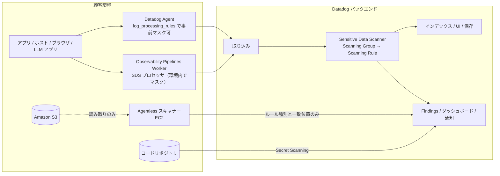
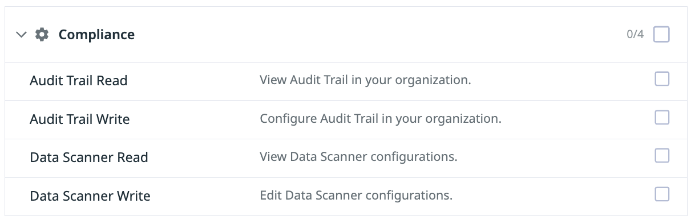
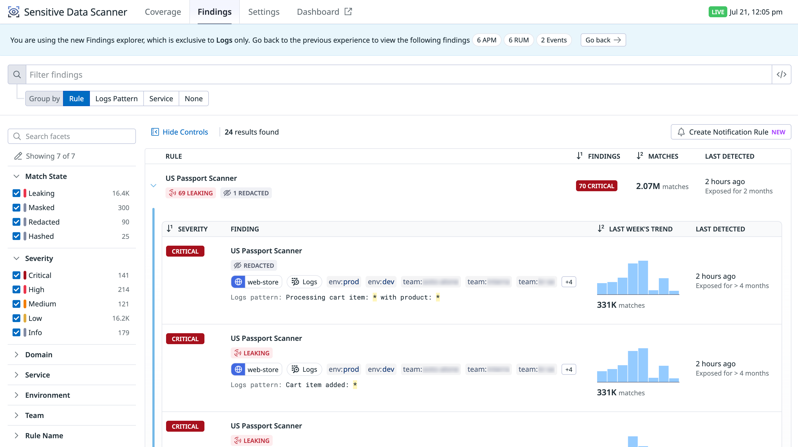
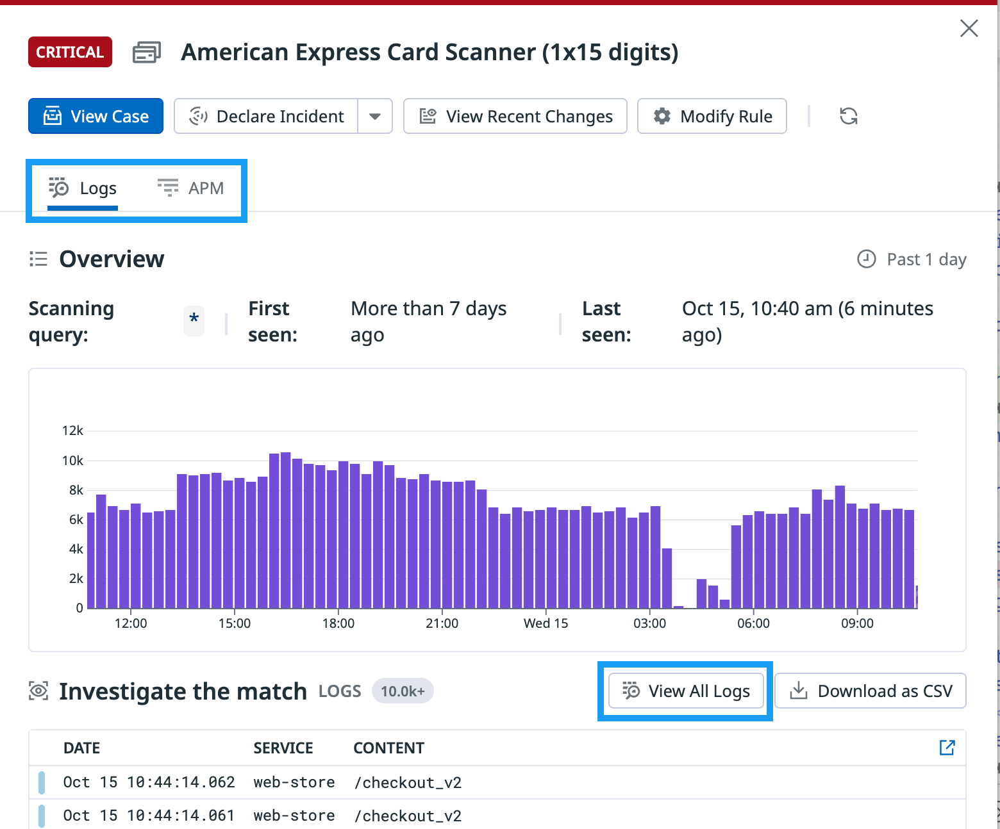
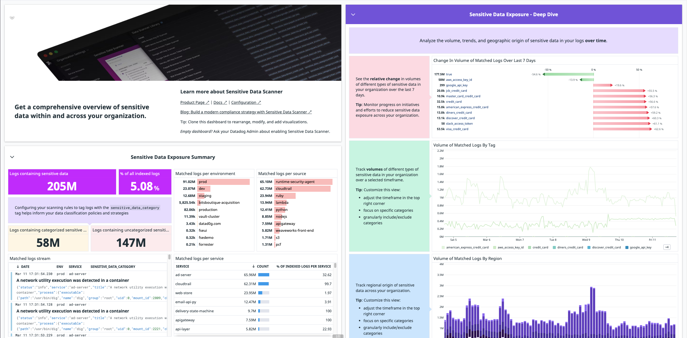
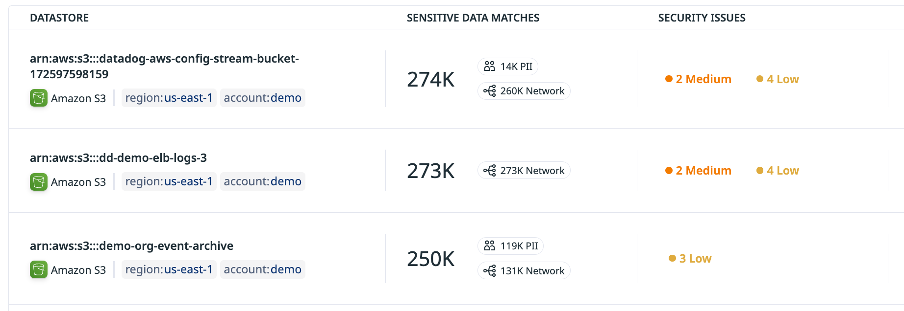

# Sensitive Data Scanner

## 概要

Datadog Sensitive Data Scanner（センシティブデータスキャナー、以下 SDS）は、クレジットカード番号、API キー、IP アドレス、個人識別情報（PII）などの機微データを**検出（discover）・分類（classify）し、必要に応じてマスキング（redact）する**製品である。公式ドキュメントは、Datadog のツールとポリシーが PCI DSS v4.0 に準拠していると記載している。[出典](https://docs.datadoghq.com/security/sensitive_data_scanner/)

Sensitive Data Scanner がスキャンできるデータは次の 4 系統に分かれ、系統ごとに設定モデルとマスキング可否が異なる。[出典](https://docs.datadoghq.com/security/sensitive_data_scanner/)

| 系統 | 対象 | スキャン場所 | マスキング（難読化） | 設定モデル |
|---|---|---|---|---|
| テレメトリデータ | Logs、APM スパン、RUM イベント、Event Management のイベント（Events） | Datadog バックエンド（取り込み時、インデックス前） | 可（Redact / Partially redact / Hash / Mask） | 利用者が Scanning Group と Scanning Rule を作成 |
| Agent Observability（旧称：LLM Observability） | LLM アプリのトレース（プロンプト、補完、ワークフローのメタデータ） | Datadog バックエンド | 可（Redact / Partially redact / Hash のみ） | 自動作成される管理 Scanning Group 1 つ |
| Cloud Storage | Amazon S3 バケット内のテキストファイル（CSV、JSON など） | 顧客 AWS 環境内の Agentless スキャナー | **不可**（検出のみ） | Scanning Group は読み取り専用、全ライブラリルールを適用 |
| コードリポジトリ | ソースコード内のシークレット（Secret Scanning） | CI/CD パイプライン、または Datadog のホステッドスキャン | **不可**（検出のみ） | Code Security 側で設定 |

> **補足:** 機微データを Datadog に一切送りたくない場合は、顧客環境内で動作する Observability Pipelines の Sensitive Data Scanner プロセッサを使う（本ファイル「11. マスキング手段の比較」参照）。[出典](https://docs.datadoghq.com/security/sensitive_data_scanner/)

製品の位置づけについて、Datadog の料金ページは Sensitive Data Scanner を Logs 区分に掲載しているが、本ナレッジでは Security 領域に置いている（[製品ポートフォリオ全体像](../../01_入門編/product-map.md)）。

### 関連ファイル

| 内容 | ファイル |
|---|---|
| Datadog Security 製品群の全体像 | [Datadog Security 概要](./security-platform-overview.md) |
| ログの収集と Agent 側のマスキング（`log_processing_rules`） | [ログ収集](../logs/log-collection.md) |
| Log Pipelines（Remapper による tag→属性変換） | [Log Pipelines と処理](../logs/log-pipelines-and-processing.md) |
| ログのアーカイブ・Rehydration・保持 | [Indexes・保持・アーカイブ](../logs/log-indexes-retention-archives.md) |
| 顧客環境内での機微データ除去（OP の SDS プロセッサ） | [Observability Pipelines](../logs/observability-pipelines.md) |
| APM のスパン属性 | [APM の概念とインジェスト制御](../apm/apm-concepts-and-ingestion.md) |
| RUM イベント | [RUM（ブラウザ）](../dem/rum-browser.md)、[RUM（モバイル）](../dem/rum-mobile.md) |
| Event Management のイベント | [Event Management](../platform/event-management.md) |
| Live Debugger / Exception Replay のマスキング（`source:dd_debugger`） | [Dynamic Instrumentation と Live Debugger](../apm/dynamic-instrumentation.md) |
| Agent Observability（LLM トレース） | [LLM Observability](../ai/llm-observability.md) |
| Agentless Scanning、Cloud Security の誤設定 | [Cloud Security（旧 CSM）](./cloud-security.md) |
| Secret Scanning（コード内シークレット） | [Code Security](./code-security.md) |
| ロールと権限、ログの RBAC | [組織・ユーザー・権限管理](../platform/account-and-access-management.md) |
| Remote Configuration | [Fleet Automation と Remote Configuration](../platform/fleet-automation.md) |
| Audit Trail（設定変更・アクセス履歴） | [Audit Trail](../platform/audit-trail.md) |
| Case Management・Incident 連携 | [Case Management](../service-management/case-management.md)、[Incident Management](../service-management/incident-management.md) |
| Terraform による管理 | [Terraform と IaC](../platform/terraform-and-iac.md) |
| 料金の正本 | [製品別料金表](../../03_導入編/pricing-by-product.md) |
| コンプライアンス要件の整理 | [セキュリティとコンプライアンス](../../03_導入編/security-and-compliance.md) |

---

## 1. 全体アーキテクチャとデータフロー

Sensitive Data Scanner のテレメトリスキャンは、Datadog バックエンドで**取り込み時（ingestion time）の処理中**に実行される。ログの場合、スキャンは**インデックス前、かつ他のルーティング判断より前**に行われるため、マスキングされた値は Datadog UI に表示される前・インデックスされる前に置換される。一方でデータ自体はマスキング前に顧客環境を出て Datadog に送信される。[出典](https://docs.datadoghq.com/security/sensitive_data_scanner/setup/telemetry_data/)



図の要点:

- Agent・OP を経由したテレメトリは Datadog で SDS を通ってからインデックス・表示される。[出典](https://docs.datadoghq.com/security/sensitive_data_scanner/setup/telemetry_data/)
- Cloud Storage では、S3 のデータは顧客環境内でのみ読み取られ、Datadog へ送られるのは**一致したルールの種別と一致位置**だけである。[出典](https://docs.datadoghq.com/security/sensitive_data_scanner/setup/cloud_storage/)
- Agent 側のマスキング（`log_processing_rules`）は SDS とは独立しており、SDS は Agent 上で定義したルールには影響しない。[出典](https://docs.datadoghq.com/security/sensitive_data_scanner/setup/telemetry_data/)

---

## 2. 対応データソースとアクションの対応表

Sensitive Data Scanner で一致したデータに適用できるアクション（Action on Match）は、データソースによって異なる。公式概要ページの表は次のとおり。[出典](https://docs.datadoghq.com/security/sensitive_data_scanner/)

| アクション | Logs | APM | RUM | Events | Agent Observability | Cloud Storage | コードリポジトリ |
|---|---|---|---|---|---|---|---|
| Redact（置換） | Yes | Yes | Yes | Yes | Yes | No（検出のみ） | No（検出のみ） |
| Partially redact（部分置換） | Yes | Yes | Yes | Yes | Yes | No | No |
| Hash（ハッシュ化） | Yes | Yes | Yes | Yes | Yes | No | No |
| Mask（マスク、権限者は解除可） | Yes | Yes（※） | Yes（※） | No | No | No | No |

> **注意（公式ドキュメント内の記述不一致）:** Mask アクションの対象範囲について、概要ページとテレメトリ設定ページの冒頭・Mask action 節は「logs, APM spans, and RUM events」で利用可能（Unmask も indexed logs・APM spans・RUM events で可能）と記載する。一方、同じ設定ページのルール追加手順と Troubleshooting ページは「Mask（available for logs only）」「The Mask action is not available for APM, RUM, or Event Management data」と記載しており、2026-11-02 時点で公式ドキュメント内の記述が一致していない。APM・RUM で Mask を前提とする設計は、実環境の UI で選択可能かを確認すること。[出典](https://docs.datadoghq.com/security/sensitive_data_scanner/setup/telemetry_data/) / [出典](https://docs.datadoghq.com/security/sensitive_data_scanner/troubleshooting/)

### 2.1 テレメトリの各データソースでスキャンされる範囲

| データソース | スキャン・マスキング対象 | 備考 |
|---|---|---|
| Logs | 構造化・非構造化ログの全内容（ログ `message` と属性値） | タグは直接スキャンされない（後述） |
| APM | スパンの**属性値のみ** | 予約済み属性（`trace_id`、`service` 等）は除外 |
| RUM | イベントの**属性値のみ** | 予約済み属性（`session.id`、`view.id` 等）は除外 |
| Events（Event Management） | イベントの**属性値のみ** | Mask 不可 |

[出典](https://docs.datadoghq.com/security/sensitive_data_scanner/setup/telemetry_data/)

共通の仕様:

- **数値型はスキャンされない。** integer、float、double の値はスキャン対象外で、文字列として格納された数値はスキャンされる。数値をスキャンしたい場合は文字列として送る。[出典](https://docs.datadoghq.com/security/sensitive_data_scanner/troubleshooting/)
- **タグは直接スキャンできない。** タグ内の機微データをマスキングするには、Log Pipeline の Remapper でタグを属性へリマップし（`Preserve source attribute` をオフ）、その属性を Specific Attributes でスキャンする（「6.6 タグ内の機微データ」参照）。[出典](https://docs.datadoghq.com/security/sensitive_data_scanner/setup/telemetry_data/)
- **ルールは作成・更新後に取り込まれたデータにのみ適用される。** 過去データの遡及スキャンはできない。[出典](https://docs.datadoghq.com/security/sensitive_data_scanner/setup/telemetry_data/)

---

## 3. 権限（RBAC）

Sensitive Data Scanner の権限は、Datadog の RBAC の **Compliance** カテゴリに含まれる。既定では Datadog Admin ロールのユーザーがスキャンルールの閲覧・設定を行える。その他のユーザーにはカスタムロールで以下を付与する。[出典](https://docs.datadoghq.com/security/sensitive_data_scanner/setup/telemetry_data/)

| 権限（UI 表示名） | 権限名 | 内容 |
|---|---|---|
| Data Scanner Read | `data_scanner_read` | Data Scanner の設定を閲覧。Logs Findings の例示ログ（Example Logs）の閲覧にも必要 |
| Data Scanner Write | `data_scanner_write` | Data Scanner の設定を編集。API の Scanning Group / Rule 作成でも要求される |
| Data Scanner Unmask | `data_scanner_unmask` | Mask アクションでマスクされた値を UI 上で解除（Unmask）して閲覧 |

[出典](https://docs.datadoghq.com/security/sensitive_data_scanner/setup/telemetry_data/) / [出典](https://docs.datadoghq.com/security/sensitive_data_scanner/guide/investigate_sensitive_data_findings/) / [出典](https://docs.datadoghq.com/api/latest/sensitive-data-scanner/create-scanning-rule/)



- **キャプション:** ロール編集画面の権限一覧のうち「Compliance」セクション。
- **画面の説明:** 折りたたみ見出し「Compliance」（右側に選択数「0/4」と一括チェックボックス）の下に 4 行の権限が並ぶ。上から「Audit Trail Read（View Audit Trail in your organization.）」「Audit Trail Write（Configure Audit Trail in your organization.）」「Data Scanner Read（View Data Scanner configurations.）」「Data Scanner Write（Edit Data Scanner configurations.）」で、各行右端にチェックボックスがある。Sensitive Data Scanner の設定権限はこの Data Scanner Read / Write である。
- **出典:** https://docs.datadoghq.com/security/sensitive_data_scanner/setup/telemetry_data/ （取得日 2026-11-02）

ロール・権限の付与方法の詳細は [組織・ユーザー・権限管理](../platform/account-and-access-management.md) を参照。

---

## 4. Scanning Group（スキャングループ）

Sensitive Data Scanner の Scanning Group は「**どのデータをスキャンするか**」を定義する単位である。Scanning Group は、クエリフィルター、対象製品（Logs / APM / RUM / Events）の有効化ボタン、製品ごとのサンプリング率（任意）で構成される。[出典](https://docs.datadoghq.com/security/sensitive_data_scanner/setup/telemetry_data/)

### 4.1 Scanning Group の設定項目

| 項目 | 内容 | 既定値・制約 |
|---|---|---|
| Query filter（クエリフィルター） | スキャン対象を絞り込む検索クエリ。Log Search Syntax に従う | 画面上部の APM Spans / Logs ボタンで対象データをプレビュー可能 |
| Name / Description | グループの名前と説明 | — |
| 対象製品 | logs、APM spans、RUM events、Datadog events をボタンで個別に有効化 | API の製品値は `logs`、`rum`、`events`、`apm` |
| Sampling（サンプリング率） | 製品ごとに 10〜99% を設定可能（任意） | 未設定時は全量スキャン。**サンプリング有効時は難読化アクションを選択できない** |
| 有効/無効トグル | グループごとのスキャン有効化 | **新規作成直後は無効（disabled）**。右側トグルで有効化が必要 |
| 順序 | グループの並び順（API の Reorder Groups で変更） | 公開情報では評価順の意味は確認できず |

[出典](https://docs.datadoghq.com/security/sensitive_data_scanner/setup/telemetry_data/) / [出典](https://docs.datadoghq.com/api/latest/sensitive-data-scanner/create-scanning-group/)

### 4.2 Scanning Group の作成手順

1. Sensitive Data Scanner の設定ページ（`https://app.datadoghq.com/organization-settings/sensitive-data-scanner/configuration`）を開く。
2. **Add scanning group** をクリック（または右上 **Add** ドロップダウン → **Add Scanning Group**）。
3. スキャン対象データのクエリフィルターを入力し、上部の **APM Spans** / **Logs** でプレビューを確認する。
4. グループの名前と説明を入力する。
5. 対象製品（logs、APM spans、RUM events、Datadog events）のボタンを有効化する。
6. 任意で製品ごとに 10〜99% のサンプリング率を設定する。
7. **Create** をクリックする。作成直後は無効なので、トグルをオンにしてスキャンを開始する。

[出典](https://docs.datadoghq.com/security/sensitive_data_scanner/setup/telemetry_data/)

### 4.3 Guided setup（ガイド付きセットアップ）

組織に Scanning Group が 1 つもない場合（初回設定時を含む）、設定ページでアプリ内ガイド付きセットアップが表示される。スキャン対象データの選択、Scanning Group の作成、Scanning Rule の追加を画面の指示に沿って行え、公式はこれを推奨する開始方法としている。[出典](https://docs.datadoghq.com/security/sensitive_data_scanner/setup/telemetry_data/)

### 4.4 サンプリングの位置づけ

Sensitive Data Scanner のサンプリングは、導入初期にスキャン量（＝コスト）を抑えて「どこに機微データがあるか」を把握するための機能である。料金ページでは、サンプリングによる検出のみの利用を **Partial data coverage（部分カバレッジ）**、全量スキャンと難読化を **Full data coverage（完全カバレッジ）** と呼び、まず部分カバレッジで環境を評価し、難読化が必要になった段階で完全カバレッジに移行することを推奨している。[出典](https://www.datadoghq.com/pricing/?product=sensitive-data-scanner)

| 観点 | サンプリング有効（10〜99%） | サンプリングなし（全量） |
|---|---|---|
| 検出・分類・タグ付け | 可（サンプルされた分のみ） | 可 |
| Redact / Partially redact / Hash / Mask | **選択不可** | 可 |
| 用途 | 漏えい箇所の把握（Detect） | 取り込み時の確実な難読化（Detect and Obfuscate） |

[出典](https://docs.datadoghq.com/security/sensitive_data_scanner/troubleshooting/) / [出典](https://www.datadoghq.com/pricing/?product=sensitive-data-scanner)

### 4.5 Sensitive Data Scanner の無効化

Sensitive Data Scanner を全体として停止するには、すべての Scanning Group のトグルをオフにする（組織単位の一括停止スイッチは公式手順に記載がない）。[出典](https://docs.datadoghq.com/security/sensitive_data_scanner/setup/telemetry_data/)

---

## 5. Scanning Rule（スキャンルール）

Sensitive Data Scanner の Scanning Rule は「Scanning Group が定義したデータの中で**どの機微情報に一致させるか**」と「一致時に何をするか」を定義する。ルールには、Datadog 定義済みの**ライブラリルール（Library Rules）**と、利用者が正規表現で作成する**カスタムルール（Custom Rules）**の 2 種類がある。公式は可能な限りライブラリルールの使用を推奨している。[出典](https://docs.datadoghq.com/security/sensitive_data_scanner/scanning_rules/) / [出典](https://docs.datadoghq.com/security/sensitive_data_scanner/setup/telemetry_data/)

### 5.1 Scanning Rule の設定項目一覧

| 項目 | 内容 | ライブラリ | カスタム |
|---|---|---|---|
| Scanning Group | 所属グループ（グループ外から作成した場合に選択） | ○ | ○ |
| Name / Description | ルール名と説明（任意） | ライブラリ名 | ○ |
| Priority | 業務要件に応じた優先度（重大度） | ○ | ○ |
| ライブラリルール選択 | Add Library Rules で複数選択可 | ○ | — |
| Regex pattern | 一致させる正規表現（PCRE2 のサブセット） | — | ○ |
| Keywords（キーワード辞書） | 一致前後の文脈で絞り込む語句。ライブラリルールは推奨キーワードが既定で入る | ○ | ○ |
| Suppressions（抑制） | リスク受容済みの値を無視（Match exactly / Start with / End with） | ○ | ○ |
| テスト | 「Type or paste event data to test the rule」にサンプルを貼って検証 | ○ | ○ |
| Action on Match：範囲 | Entire Event（特定属性の除外可）または Specific Attributes | ○ | ○ |
| Action on Match：動作 | Redact / Partially redact / Hash / Mask（または検出のみ） | ○ | ○ |
| Tags | 一致したイベントに付与するタグ。`sensitive_data`、`sensitive_data_category` を推奨 | ○ | ○ |
| 有効/無効 | ルール単位の有効化 | ○ | ○ |

[出典](https://docs.datadoghq.com/security/sensitive_data_scanner/setup/telemetry_data/)

### 5.2 Scanning Rule の追加手順

1. 設定ページで対象 Scanning Group をクリックし、**Add Scanning Rule**（または **Add** → **Add Scanning Rule**）を選ぶ。
2. ライブラリルールかカスタムルールかを選ぶ。
3. **Priority** ドロップダウンで優先度を選ぶ。
4. ライブラリルールの場合は **Add Library Rules** で使用するルールを選択する。カスタムルールの場合は名前・説明・正規表現を入力する。
5. キーワード（Check surrounding match context for keywords to reduce noise）と抑制（Suppress specific match types to ignore risk-accepted data）を必要に応じて設定する。
6. テスト欄にイベントデータを貼り付けて一致を確認する。
7. **Action on Match** で Entire Event / Specific Attributes を選び、**Define actions on match** でアクションを選ぶ。
8. 任意でタグを追加する。
9. **Add Rules**（カスタムは **Add Rule**）をクリックする。Scanning Group のトグルが有効になっていることを確認する。

既存ルールの編集は、ルールにカーソルを合わせて鉛筆アイコン → 変更 → **Update**。[出典](https://docs.datadoghq.com/security/sensitive_data_scanner/setup/telemetry_data/)

### 5.3 Priority（優先度・重大度）

Sensitive Data Scanner の Priority は、ルールが検出した問題の重大度を表す。

| 表現 | 値 | 出典 |
|---|---|---|
| API の `priority` | 整数 1（high）〜 5（low） | [API](https://docs.datadoghq.com/api/latest/sensitive-data-scanner/create-scanning-rule/) |
| Findings 画面の Severity ファセット | Critical / High / Medium / Low / Info の 5 段階 | [Findings 画面画像](https://docs.datadoghq.com/security/sensitive_data_scanner/guide/investigate_sensitive_data_findings/) |

> API の 1〜5 と UI の Critical〜Info が 1 対 1 で対応する（1=Critical … 5=Info）と考えられるが、対応関係を明記した公式記述は確認できず【推定】。

### 5.4 ライブラリルール（Scanning Rule Library）

Sensitive Data Scanner の Scanning Rule Library は、メールアドレス、クレジットカード番号、API キー、認可トークン、ネットワーク・デバイス情報などを検出する定義済みルール集である。設定ページ右上の **Scanning Rules Library** から閲覧し、ルールを選択して **Add Rules to Scanning Group** でグループへ追加できる。[出典](https://docs.datadoghq.com/security/sensitive_data_scanner/scanning_rules/library_rules/)

#### カテゴリ別のルール数

公式 Library Rules ページの一覧表（2026-11-02 取得）を集計した結果は次のとおり（集計は本ナレッジ作成時の機械的カウントで、Datadog は随時ルールを追加する）。

| カテゴリ（Category） | ルール数 | 代表例 |
|---|---|---|
| Secrets and credentials（シークレット・認証情報） | 407 | AWS Access Key ID Scanner、Azure Storage Account Key Scanner、Datadog API Key Scanner、Bearer Token Scanner、Github Access Token Scanner、Google API Key Scanner、Stripe Secret API Key Scanner、RSA Private Key Scanner、SSH Key Scanner、Generic JSON Web Token Scanner、1Password 系トークン、AWS Bedrock Long-Term API Key Scanner |
| Personal Identifiable Information (PII)（個人識別情報） | 67 | Standard Email Address Scanner、Phone Number Scanner、Human Name Scanner、Passport Scanner、US Social Security Number Scanner、US Passport Scanner、UK National Insurance Number Scanner、India Unique Identification (Aadhaar) Number Scanner、South Korea Resident Registration Number Scanner、China Resident Identity Card Number Scanner、Singapore NRIC Scanner、EU 各国の個人番号・税番号 |
| Payment Card and Banking Information（決済カード・銀行情報） | 28 | Visa / MasterCard / American Express / JCB / Discover / Diners / Maestro の各桁区切りパターン、ABA Routing Transit Number Scanner、Standard IBAN Code Scanner、Bitcoin / ERC-20 / Monero ウォレットアドレス |
| Network and device information（ネットワーク・デバイス情報） | 4 | IPv4 Address Scanner、IPv6 Address Scanner、Standard MAC Address Scanner、HTTP(S) URL Scanner |
| 合計 | 約 506 | — |

[出典](https://docs.datadoghq.com/security/sensitive_data_scanner/scanning_rules/library_rules/)

ライブラリルールの補足事項:

- **クレジットカードは桁区切りごとに別ルール。** 例：American Express は 1x15、4+4+4+3、4+6+5、8+7 の 4 ルール、JCB は 1x16、2x8、4x4 の 3 ルール。区切り方の異なる書式を網羅するには複数ルールを追加する。[出典](https://docs.datadoghq.com/security/sensitive_data_scanner/scanning_rules/library_rules/)
- **利用可能データソース。** 公式は「大半のライブラリルールは Logs、APM、RUM、Agent Observability、Observability Pipelines、Secret Scanning、Cloud Storage の全データソースで利用可能」とし、表の Available For 列で個別に示す。2026-11-02 時点の一覧では **Human Name Scanner と Phone Number Scanner の Available For は「Logs」** となっている。[出典](https://docs.datadoghq.com/security/sensitive_data_scanner/scanning_rules/library_rules/)
- **推奨キーワード（Recommended Keywords）。** 各ルールには推奨キーワードがあり、ライブラリルール作成時に既定で使われる（例：ABA Routing Transit Number Scanner は `aba, bank number, routing number, rtn`、AWS Access Key ID Scanner は `access key, aws access, x-amz-credential`）。推奨キーワードが「All」と表示されるルールもある。[出典](https://docs.datadoghq.com/security/sensitive_data_scanner/scanning_rules/library_rules/)
- **Rule ID による参照。** 各ライブラリルールには Rule ID（standard pattern ID、例：AWS Access Key ID Scanner は `OfGqX8R9TRqAcorxenl2fQ`）があり、Datadog がルール名を変更しても ID は変わらない。Terraform や API ではルール名ではなく ID で参照することが推奨される（「12. API と Terraform」参照）。[出典](https://docs.datadoghq.com/security/sensitive_data_scanner/scanning_rules/library_rules/)
- **日本固有の識別子。** 2026-11-02 時点のライブラリ一覧には、マイナンバー（個人番号）、日本の運転免許証番号、日本の旅券番号、日本の電話番号に特化したルールは見当たらない（汎用の Passport Scanner、Phone Number Scanner は存在）。日本固有の形式を確実に検出する必要がある場合はカスタムルールで補う【推定】。[出典](https://docs.datadoghq.com/security/sensitive_data_scanner/scanning_rules/library_rules/)
- **チェックサム検証。** 公式ドキュメントにチェックサム（Luhn 等）による二次検証の記載は見当たらない。Datadog が GitHub/crates.io で公開する SDS のスキャンエンジン（Rust crate `dd-sensitive-data-scanner`）には Luhn チェックサム等の secondary validator が実装されているが、どのライブラリルールに適用されているかは公開情報では確認できず【第三者情報：ソースコード】。[出典](https://docs.rs/crate/dd-sensitive-data-scanner/latest/source/src/secondary_validation/luhn_checksum.rs)

#### Human Name Scanner（ML ベースの人名検出）

Human Name Scanner は、名・姓・フルネームを検出する**機械学習（ML）ベースの組み込みルール**である。高速な候補フィルターの後に Datadog がホストする ML 分類器で文脈判定し、機微なログデータをサードパーティの ML プロバイダーには送らないと Datadog は説明している。アクションは Redact、Partially Redact、Hash、Mask を選べる。商用サイトでは GA、US1-FED では【Preview】（参加申請が必要）。会社名など人名に似た誤検知には抑制（Suppressions）で対処し、まず検出のみで範囲を絞って開始することが推奨されている。[出典](https://www.datadoghq.com/blog/human-name-detection/)（2026-02-02 公開）

### 5.5 カスタムルール（正規表現）

Sensitive Data Scanner のカスタムルールは、正規表現で業務固有の機微データ（社員番号、会員 ID 等）を定義する。正規表現の構文は **PCRE2 のサブセット**であり、汎用的すぎるパターンは誤検知を増やすため、できるだけ厳密に書くことが推奨される。[出典](https://docs.datadoghq.com/security/sensitive_data_scanner/scanning_rules/custom_rules/) / [出典](https://docs.datadoghq.com/security/sensitive_data_scanner/setup/telemetry_data/)

#### サポートされる構文カテゴリ

| カテゴリ | 内容・注意点 |
|---|---|
| Alternation | `a|b` |
| Assertions | `\b`、`\B`、`^`、`$`、`\A`、`\z`、`\Z` |
| ASCII classes / Character classes / Character escapes | `[:alpha:]` 形式、`\d`、`\w`、`\s` 等 |
| Custom character classes | `[...]`。内部の `.` はリテラル、内部の `[\b]` はバックスペース |
| Groups | キャプチャグループは非キャプチャグループと同様に扱われ、グループ名は無視される |
| Quantifiers | `{n}` に lazy 修飾子を付けても無視。`{,m}` は無効でリテラル扱い。波括弧内に空白を入れるとリテラル扱い |
| Quoting | `\Q...\E` の間はリテラル |
| Flags | `i`（大文字小文字無視）、`m`（複数行）、`s`（単一行）、`x`（拡張）。`(?imsx)`、`(?imsx:...)`、`(?-imsx)` |
| Unicode properties | Unicode プロパティによる文字クラス |

[出典](https://docs.datadoghq.com/security/sensitive_data_scanner/scanning_rules/custom_rules/)

#### サポートされないパターン

| 非サポート |
|---|
| 後方参照とキャプチャ部分式（先読み・後読み＝lookarounds） |
| 任意のゼロ幅アサーション |
| サブルーチン参照と再帰パターン |
| 条件付きパターン |
| バックトラック制御動詞 |
| `\C`（単一バイト。UTF-8 を壊すため） |
| `\R`（改行マッチ） |
| `\K`（マッチ開始位置のリセット） |
| コールアウトと埋め込みコード |
| アトミックグループと独占的量指定子 |

[出典](https://docs.datadoghq.com/security/sensitive_data_scanner/setup/telemetry_data/)

> **実務上の注意:** 先読み・後読みが使えないため、「`ID:` の後ろの 8 桁だけ」のような文脈指定は、正規表現ではなく**キーワード辞書**（5.6）や**対象属性の指定**（5.8）で表現する【経験則】。

### 5.6 キーワード辞書（Keywords）

Sensitive Data Scanner のキーワード辞書は、正規表現に一致した値の**手前の文脈**に指定語句がある場合だけ一致として扱うことで誤検知を減らす機能である。[出典](https://docs.datadoghq.com/security/sensitive_data_scanner/setup/telemetry_data/)

| 仕様 | 内容 |
|---|---|
| 既定の近接距離 | 一致値の**前 30 文字以内**にキーワードが必要（文字数は変更可能） |
| ライブラリルールの既定 | 推奨キーワード（Recommended Keywords）が既定で入る。ルールごとに追加・削除可能 |
| キーワード数上限 | UI ドキュメント：1 ルールあたり **20 個まで**。API リファレンス：`keywords` は最大 30 個（記述不一致、後述） |
| 大文字小文字 | 区別しない（`secret` は `Secret`、`SECRET` に一致） |
| 区切り文字 | 空白、`_`、`-`、`.`、`/` は相互に置換可能（`secret access key` は `secret_access_key`、`secret.access.key`、`AWS_SECRET_ACCESS_KEY` 等に一致） |
| 属性名との照合 | 構造化イベントでは、キーワードはイベントパスの**属性名**とも照合される。属性名では区切り文字に加え**キャメルケースの大文字境界**も単語境界とみなす（`creditCardNumber` → `credit`/`card`/`number`）。属性名照合には文字数制限は適用されない |
| 周辺テキストとの照合 | 一致値の手前の文字列（属性値内のテキストを含む）では、キャメルケースは分割**されない**（`anotherBank` は `bank` に一致しない） |
| API の `character_count` | 必須。最長キーワード長より大きい値である必要。上限値は記載なし |
| API の `use_recommended_keywords` | `true` の場合、ルールは standard pattern（ライブラリルール）に紐づく必要がある |

[出典](https://docs.datadoghq.com/security/sensitive_data_scanner/setup/telemetry_data/) / [出典](https://docs.datadoghq.com/api/latest/sensitive-data-scanner/create-scanning-rule/)

> **注意（上限値の記述不一致）:** キーワード数の上限は、テレメトリ設定ページでは「20 keywords」、API リファレンスの `included_keyword_configuration.keywords` では「up to 30 keywords」と記載されている（2026-11-02 時点）。UI で設定する前提では 20 を上限として設計するのが安全【推定】。

### 5.7 Suppressions（抑制）

Sensitive Data Scanner の Suppressions は、運用上安全と判断した一致（社内メールドメイン、プライベート IP レンジ等）を無視する機能で、ルール単位（Scanning Group 内のルールごと）に定義する。[出典](https://docs.datadoghq.com/security/sensitive_data_scanner/setup/telemetry_data/)

| 条件 | 用途例 | API フィールド |
|---|---|---|
| Match exactly（完全一致） | `info@company.org` のような特定値 | `exact_match` |
| Start with（前方一致） | `10.0.0`（`10.0.0.X` の IP 全体） | `starts_with` |
| End with（後方一致） | `@company.org`（ドメイン） | `ends_with` |
| 推奨抑制の使用 | ライブラリルールの推奨抑制を使う | `use_recommended_suppressions`（`true` の場合 standard pattern 必須） |

抑制された一致の扱い:

- Redact・Mask・Hash されない（＝値はそのまま残る）。
- Findings ページ、ダッシュボード、アラートその他のレポートから除外される。API リファレンスでは「メトリクスにもカウントされない」と記載。

[出典](https://docs.datadoghq.com/security/sensitive_data_scanner/setup/telemetry_data/) / [出典](https://docs.datadoghq.com/api/latest/sensitive-data-scanner/create-scanning-rule/)

### 5.8 スキャン範囲：Entire Event と Specific Attributes

Sensitive Data Scanner の Action on Match では、ルールを適用する範囲を選ぶ。[出典](https://docs.datadoghq.com/security/sensitive_data_scanner/setup/telemetry_data/)

| 選択肢 | 動作 | 例 | API |
|---|---|---|---|
| Entire Event | イベント全体をスキャン。特定属性を除外可能 | 住所 PII を探すが `ip_address` 属性は除外 | `namespaces` 空、`excluded_namespaces` に除外属性 |
| Specific Attributes | 指定属性のみをスキャン | 住所を `street`、`city` 属性だけで探す | `namespaces` に対象属性（`excluded_namespaces` は `namespaces` のサブパスである必要） |

- 属性パスには**`@` を付けない**（`@function.request.body.password` ではなく `function.request.body.password`）。検索クエリで使う `@` 接頭辞はこの欄ではサポートされない。[出典](https://docs.datadoghq.com/security/sensitive_data_scanner/troubleshooting/)

### 5.9 Excluded namespaces（予約済み属性の除外）

Sensitive Data Scanner は、Datadog の機能に必要な予約済みキーワード（namespace）を保護する。スキャン対象ログ内にこれらの語が現れた場合、**その語の後ろ 30 文字はスキャンされず、マスキングもされない**（例：`date` の後ろは通常タイムスタンプで、誤ってマスキングすると処理・検索に支障が出るため）。[出典](https://docs.datadoghq.com/security/sensitive_data_scanner/setup/telemetry_data/)

| データ種別 | 主な予約済み namespace（公式一覧の抜粋） | 件数 |
|---|---|---|
| Logs | `host`、`hostname`、`syslog.hostname`、`service`、`status`、`env`、`dd.trace_id`、`trace_id`、`dd.span_id`、`span_id`、`@timestamp`、`timestamp`、`date`、`published_date`、`syslog.timestamp`、`error.fingerprint`、`x-datadog-trace-id`、`x-datadog-parent-id`、`contextMap.dd.trace_id` 等 | 24 |
| Spans（APM） | `metrics._dd.`、`metrics.dd.`、`meta._dd.`、`meta.dd.`、`meta_struct.appsec.`、`meta_struct.ai_guard`、`meta.otel.trace_id`、`meta.otlp.`、`trace_id`、`span_id`、`parent_id`、`start`、`end`、`duration`、`resource`、`error`、`status`、`host`、`env`、`service`、`operation_name`、`name`、`version`、`meta.error.fingerprint` 等（接頭辞指定を多数含む） | 約 50 |
| RUM | `application.id`、`session.id`、`session.initial_view.id`、`session.last_view.id`、`view.id`、`action.id`、`resource.id`、`geo`、`error.fingerprint`、`error.binary_images.uuid`、`issue`、`_dd.trace_id`、`_dd.span_id` 等 | 16 |

全リストは公式ページの Logs / Spans / RUM タブを参照。[出典](https://docs.datadoghq.com/security/sensitive_data_scanner/setup/telemetry_data/)

---

## 6. マスキング動作（Action on Match）

### 6.1 アクションの種類と挙動

| アクション | 挙動 | 可逆性 | API `text_replacement.type` |
|---|---|---|---|
| （検出のみ） | 値は変更せず、タグ付けと Findings 計上のみ | — | `none` |
| Redact | 一致した値全体を、指定した置換テキスト（例：`[sensitive_data]`）で置換 | **不可逆** | `replacement_string`（`replacement_string` 必須） |
| Partially redact | 一致値の指定文字数を置換。置換する文字数と、先頭側・末尾側のどちらを置換するかを指定 | **不可逆** | `partial_replacement_from_beginning` / `partial_replacement_from_end`（`number_of_chars` は 1 以上必須） |
| Hash | 一致値の UTF-8 バイト列を **FarmHash の 64 ビットフィンガープリント**で置換（一意な識別子） | **不可逆** | `hash` |
| Mask | 値を難読化。`data_scanner_unmask` 権限保持者は Datadog UI で解除して閲覧可能 | 権限者のみ UI で可逆 | `replacement_string` + `should_save_match: true`（API 上の表現） |

[出典](https://docs.datadoghq.com/security/sensitive_data_scanner/setup/telemetry_data/) / [出典](https://docs.datadoghq.com/api/latest/sensitive-data-scanner/create-scanning-rule/)

- 公式は「Redaction, partial redaction, and hashing are all irreversible actions（不可逆）」と明記している。元の値は Datadog に保存されない。[出典](https://docs.datadoghq.com/security/sensitive_data_scanner/setup/telemetry_data/)
- Hash は決定的（同じ入力は同じ値）であるため、マスキング後も同一ユーザー・同一カードの出現を相関分析できる（Human Name Scanner の公式ブログでも「deterministic tokens for correlation」と説明）。[出典](https://www.datadoghq.com/blog/human-name-detection/)

### 6.2 Mask アクションの詳細

| 項目 | 仕様 |
|---|---|
| Unmask できる場所 | インデックス済みログ、APM スパン、RUM イベント（Datadog UI 内） |
| Unmask の操作 | Findings ページでルール → Finding をクリックし、値の横の目のアイコンをクリック。Log Explorer、Trace Explorer、RUM Explorer でも閲覧可能 |
| API・Terraform・アーカイブ | 常に難読化されたまま。Unmask 不可 |
| Rehydrate したログ | Unmask 不可 |
| 必要権限 | `data_scanner_unmask`（Data Scanner Unmask） |
| 推奨しない用途 | 認証情報（credentials）。漏えいした認証情報をすべてローテーションする対応計画がない限り、Mask ではなく不可逆アクションを推奨 |

[出典](https://docs.datadoghq.com/security/sensitive_data_scanner/setup/telemetry_data/)

> Mask の対象データソース（Logs のみか、APM・RUM を含むか）は公式ドキュメント内で記述が一致していない。本ファイル「2. 対応データソースとアクションの対応表」の注意を参照。

### 6.3 サンプリングとの排他

Scanning Group でサンプリングが有効な場合、そのグループのルールでは Redact、Partially redact、Hash、Mask を選択できない。難読化が必要な場合はサンプリングを無効化し、クエリフィルターに一致する全データをスキャンする。[出典](https://docs.datadoghq.com/security/sensitive_data_scanner/troubleshooting/)

### 6.4 タグ付けと検索・RBAC

- Scanning Rule で付与するタグは、公式推奨の `sensitive_data`（ルール単位の識別。例：`sensitive_data:aws_access_key`、`sensitive_data:email_address`）と `sensitive_data_category`（カテゴリ単位。例：`sensitive_data_category:credentials`）を使う。検索、ダッシュボード、モニターで利用できる。[出典](https://docs.datadoghq.com/security/sensitive_data_scanner/guide/create-alerts-for-sensitive-data/)
- **ログのアクセス制御:** SDS が付与したタグをクエリ条件とする Logs RBAC（Restriction Query）を構成すると、機微データを含むログを保持期間が切れるまで特定の個人・チームだけが参照できるように制限できる。[出典](https://docs.datadoghq.com/security/sensitive_data_scanner/setup/telemetry_data/)（Logs RBAC の詳細は [組織・ユーザー・権限管理](../platform/account-and-access-management.md)）

### 6.5 Log Rehydration（アーカイブからの再取り込み）との関係

| 項目 | 挙動 |
|---|---|
| 再スキャン | Rehydrate したログは SDS で**再スキャンされない**。アーカイブに書かれた状態のまま復元 |
| タグ | アーカイブに Datadog タグを含める設定であれば、初回取り込み時に SDS が付与したタグで `sensitive_data:<rule_tag_name>` のように絞り込み可能 |
| ハイライト | 一致位置のメタデータはアーカイブに保存されないため、UI での一致箇所ハイライトは表示されない |
| マスク済み値 | アーカイブ時点でのアクション（mask / redact / partially redact / hash）の結果のまま（難読化されたまま） |
| 遡及スキャン | 不可 |

[出典](https://docs.datadoghq.com/security/sensitive_data_scanner/setup/telemetry_data/)（アーカイブの詳細は [Indexes・保持・アーカイブ](../logs/log-indexes-retention-archives.md)）

### 6.6 タグ内の機微データ

Sensitive Data Scanner はタグを直接スキャンできないため、タグ値をマスキングするには次の 2 段階を行う。[出典](https://docs.datadoghq.com/security/sensitive_data_scanner/setup/telemetry_data/)

1. **タグを属性へリマップ:** Log Pipelines → Add Processor → **Remapper** を選択 → 名前入力 → **Tag key(s)** を選びタグキーを入力 → リマップ先の属性名を入力 → **Preserve source attribute を無効化** → Create。
2. **属性をスキャン:** Scanning Group → Add Scanning Rule → ライブラリルールを選択 → **Specific Attributes** を選び、手順 1 の属性名（`@` なし）を入力 → アクションとタグを設定 → Add Rules。

Remapper の詳細は [Log Pipelines と処理](../logs/log-pipelines-and-processing.md) を参照。

---

## 7. Findings・アラート・ダッシュボード

### 7.1 Findings ページ

Sensitive Data Scanner の Findings ページ（`https://app.datadoghq.com/sensitive-data-scanner/telemetry`）は、選択期間内に検出された機微データの Finding を一覧する。ログの Finding が 1 件以上ある場合、既定で新しい **Logs Findings explorer** が開く。Logs Findings explorer はログ専用で、APM・RUM・Events の Finding はバナーの **Go back** で従来画面に戻って確認する。[出典](https://docs.datadoghq.com/security/sensitive_data_scanner/guide/investigate_sensitive_data_findings/)



- **キャプション:** Sensitive Data Scanner の Findings タブ（Logs Findings explorer）。Group by を Rule にした表示。
- **画面の説明:** 最上部に「Sensitive Data Scanner」と、タブ「Coverage / Findings / Settings / Dashboard」が並ぶ。その下の青いバナーに「新しい Findings explorer は Logs 専用で、APM・RUM・Events の Finding は従来画面で見る」旨と件数（例：6 APM、6 RUM、2 Events）、**Go back** ボタンがある。検索欄「Filter findings」の下に Group by の切り替え（Rule / Logs Pattern / Service / None）。左ペインのファセットは Match State（Leaking・Masked・Redacted・Hashed）、Severity（Critical・High・Medium・Low・Info）、Domain、Service、Environment、Team、Rule Name。右上に「Create Notification Rule」ボタン。中央の表は RULE、FINDINGS（例：70 CRITICAL）、MATCHES（例：2.07M matches）、LAST DETECTED（例：2 hours ago / Exposed for 2 months）の列で、ルール（例：US Passport Scanner。69 LEAKING、1 REDACTED）を展開すると、Finding ごとに SEVERITY、FINDING（サービス名、Logs、`env` タグ、`team` タグ、Logs pattern）、LAST WEEK'S TREND（棒グラフとマッチ数）、LAST DETECTED が並ぶ。
- **出典:** https://docs.datadoghq.com/security/sensitive_data_scanner/guide/investigate_sensitive_data_findings/ （取得日 2026-11-02）

#### Logs Findings explorer の機能

| 機能 | 内容 |
|---|---|
| Group by | Rule、Logs Pattern、Service（画面上は None も選択可） |
| Match State ファセット | Leaking（未マスクで漏えい中）、Masked、Redacted、Hashed。Leaking で絞ると現在進行中の露出を把握できる |
| 詳細パネル：ヘッダー | First Detected、Last Detected |
| 詳細パネル：Summary | Match State、Service、Environment、Total matches |
| Logs Pattern | 検出されたログ行のフォーマット |
| Example Logs | 代表ログを最大 5 件。**Show log** で本文・フィールド・属性を表示。既定で **7 日間保存**され、Data Scanner Read 権限で閲覧可（期間変更はサポートへ問い合わせ） |
| Matches Trend | 過去 1 週間のマッチ量 |
| Related Access and Configuration Events | アクセスイベントや Scanning Group / Rule の変更がマッチ量の変化と一致するかを確認 |
| Apply Targeted Obfuscation | この Finding の今後のマッチを難読化、またはサービス全体へ拡張 |
| Tune Detection Logic | ルールのキーワード編集、誤検知・リスク受容データの抑制追加 |
| Generate Code Fix | Bits Code セッションを開始し、漏えいしているログ出力箇所の特定と修正案を生成（対象リポジトリが Bits Code にオンボード済みであること） |

[出典](https://docs.datadoghq.com/security/sensitive_data_scanner/guide/investigate_sensitive_data_findings/)（Bits Code は [Bits AI と AI 機能](../ai/bits-ai.md) を参照）

#### APM・RUM・Events の Finding（従来画面）

| 機能 | 内容 |
|---|---|
| フィルター | priority status、case status、domain |
| View Recent Changes | Audit Trail を開き、最近の設定変更を確認 |
| View All Logs / APM Spans / RUM Events / Events | 該当クエリで各 Explorer を開く |
| Modify Rule | 検出したスキャンルールを編集 |
| Create Case | Case Management のケースを作成（Findings ページに関連ケースを表示） |
| Declare Incident | 既存インシデントへ追加、または新規インシデントを宣言 |
| View in Audit Trail（Users who accessed these events） | Datadog 内で誰がそのデータにアクセスしたかを確認 |
| Blast Radius | 影響を受けた上位 10 のサービス・ホスト・環境。サービスは Software Catalog、ホストは Infrastructure List へリンク |

[出典](https://docs.datadoghq.com/security/sensitive_data_scanner/guide/investigate_sensitive_data_findings/)



- **キャプション:** Finding をクリックすると開く詳細サイドパネル（従来画面）。
- **画面の説明:** 上部に重大度ラベル「CRITICAL」とルール名「American Express Card Scanner (1x15 digits)」。その下にボタン「View Case」「Declare Incident（ドロップダウン付き）」「View Recent Changes」「Modify Rule」と更新アイコン。データソースのタブ「Logs / APM」。「Overview」節に Scanning query（`*`）、First seen（More than 7 days ago）、Last seen（日時）と、時系列のマッチ件数棒グラフ（Past 1 day）。下部の「Investigate the match（LOGS 10.0k+）」には「View All Logs」「Download as CSV」ボタンと、DATE・SERVICE・CONTENT 列のログ一覧（例：`web-store`、`/checkout_v2`）が表示される。
- **出典:** https://docs.datadoghq.com/security/sensitive_data_scanner/guide/investigate_sensitive_data_findings/ （取得日 2026-11-02）

### 7.2 アラート（通知）

Sensitive Data Scanner のアラートは、データ種別によって仕組みが異なる。[出典](https://docs.datadoghq.com/security/sensitive_data_scanner/guide/create-alerts-for-sensitive-data/)

| データ種別 | 仕組み | 手順の要点 |
|---|---|---|
| Logs | **Security Notification Rule**（セキュリティ通知ルール） | Logs Findings explorer でスコープ（重大度、`service`、`env`、`team`、カテゴリ、ルール）を絞り、**Create Notification Rule** → プレフィルタを確認（Preview of Matching Findings）→ 期間集約か Finding ごとかを選択 → Destination（チーム、ユーザー、Case、Jira、PagerDuty、Slack、Microsoft Teams、Webhook 等）→ Save |
| APM | APM Monitor（Trace Analytics） | Monitors > New Monitor > APM > **Trace Analytics**。クエリに `sensitive_data:*` / `sensitive_data_category:*` を追加。`service`、`resource`、`env` でグループ化 |
| RUM | RUM Monitor | Monitors > New Monitor > RUM。クエリに `sensitive_data:*`。`application.name`、`view.name`、`geo.country` でグループ化 |

- Logs の通知には、ルール、重大度、サービス、環境、チーム、Finding へのリンクが含まれるが、**ログのサンプルは含まれない**。[出典](https://docs.datadoghq.com/security/sensitive_data_scanner/guide/create-alerts-for-sensitive-data/)
- クエリ例：`sensitive_data_category:credentials env:prod`、`(sensitive_data:aws_access_key OR sensitive_data:api_key) service:checkout-service`、`sensitive_data:email_address application.name:checkout-app`。[出典](https://docs.datadoghq.com/security/sensitive_data_scanner/guide/create-alerts-for-sensitive-data/)
- Events（Event Management）のアラート方法は公式ガイドに記載がなく、公開情報では確認できず。

モニターの詳細は [Monitors](../platform/monitors.md)、通知先は [通知・コラボレーション連携](../platform/collaboration-integrations.md) を参照。

### 7.3 標準ダッシュボード「Sensitive Data Scanner Overview」

Sensitive Data Scanner を有効化すると、Finding を要約する標準ダッシュボード「Sensitive Data Scanner Overview」が自動でインストールされる。Dashboards > Dashboards List で検索して開く。[出典](https://docs.datadoghq.com/security/sensitive_data_scanner/)



- **キャプション:** 標準ダッシュボード「Sensitive Data Scanner Overview」。
- **画面の説明:** 左上は紹介パネル（Product Page / Docs / Configuration へのリンク、「ダッシュボードが空なら Datadog 管理者に SDS の有効化を依頼」との注記）。左下「Sensitive Data Exposure Summary」には、Logs containing sensitive data（件数）、% of all indexed logs（比率）、`sensitive_data_category` タグでの分類を推奨する説明、カテゴリ付き／カテゴリなしの機微ログ件数、Matched logs per environment、Matched logs per source、Matched logs stream（DATE・ENV・SERVICE・SENSITIVE_DATA_CATEGORY 列）、Matched logs per service（COUNT と「% OF INDEXED LOGS PER SERVICE」）が並ぶ。右側「Sensitive Data Exposure - Deep Dive」には、Change In Volume of Matched Logs Over Last 7 Days（タグ別の増減率。例：`aws_access_key_id`、`credit_card` など）、Volume of Matched Logs By Tag（時系列）、Volume of Matched Logs By Region（棒グラフ）があり、各ウィジェットの左に使い方のヒント（期間の調整、カテゴリの絞り込み等）が書かれている。
- **出典:** https://docs.datadoghq.com/security/sensitive_data_scanner/ （取得日 2026-11-02）

### 7.4 スキャン量（使用量）の監視

Sensitive Data Scanner のスキャン量は推定使用量メトリクス `datadog.estimated_usage.sds.scanned_bytes` で確認できる。Logs、APM、RUM、Events のスキャンバイト数を表す。[出典](https://docs.datadoghq.com/security/sensitive_data_scanner/guide/monitor-sds-usage/)

| タグ | 意味 |
|---|---|
| `product` | データの製品（Logs、APM、RUM、Events） |
| `service` | データのサービス。サービスタグなしは `service:unknown`、一部の Events / Logs は `service:undefined`（いずれもサービスなしの意味） |
| `scanning_group_id` | スキャンした Scanning Group。`scanning_group_id:global` は複数グループが同じイベントをスキャンした場合の二重計上防止用の値で、クエリから**除外**する（課金には影響しない） |

推奨クエリ（Metrics Explorer、ダッシュボード、メトリクスモニター共通）:

```
sum:datadog.estimated_usage.sds.scanned_bytes{!scanning_group_id:global} by {product,service}.as_count()
```

- メトリクスモニターでは評価ウィンドウ（例：直近 1 時間）の集計を `sum` にする（モニター既定は平均、`as_count()` で総バイト数を得るには `sum` が必要）。しきい値は同じウィンドウ幅で 1〜2 週間のベースラインを見て設定することが推奨される。[出典](https://docs.datadoghq.com/security/sensitive_data_scanner/guide/monitor-sds-usage/)

使用量メトリクス全般は [Usage・Usage Attribution・Cost Visibility](../platform/usage-and-cost-attribution.md) を参照。

---

## 8. Agent Observability（LLM トレース）のスキャン

Sensitive Data Scanner は Agent Observability（旧称：LLM Observability）のトレース（LLM アプリの入力・出力を含む）をスキャンし、プロンプト、補完、LLM ワークフローのメタデータに含まれる PII、API キー、機密情報の露出を防ぐ。公式ドキュメントの製品名表記は「Agent Observability」で、ドキュメント URL は `llm_observability` のままである。改称時期は第三者の料金追跡サイトで 2026 年 6 月とされる【第三者情報】（[出典](https://pricingsaas.com/companies/datadog/diffs/2026W25)、2026-06 公開）。[出典](https://docs.datadoghq.com/security/sensitive_data_scanner/)

| 項目 | Agent Observability のスキャン | テレメトリのスキャン |
|---|---|---|
| Scanning Group | **管理グループ 1 つ**。Agent Observability Settings ページ（`/sensitive-data-scanner/configuration/llm-spans`）を初めて開いたときに自動作成。追加作成・削除は不可 | 利用者が作成（既定上限 20） |
| ルール | 既存ルールの変更・無効化、カスタムルール追加が可能 | ライブラリ / カスタム |
| アクション | Redact、Partially redact、Hash | Redact、Partially redact、Hash、Mask |
| 課金 | Agent Observability に組み込み、追加費用なし。**LLM スパン 1 万件ごとに 1 GB の SDS 処理枠** | スキャン GB 課金 |

[出典](https://docs.datadoghq.com/security/sensitive_data_scanner/) / [出典](https://www.datadoghq.com/pricing/?product=sensitive-data-scanner)

- 処理枠（1 GB / 1 万 LLM スパン）を超えた場合の課金方法は公開情報では確認できず。
- LLM Observability 本体は [LLM Observability](../ai/llm-observability.md) を参照。

---

## 9. Cloud Storage スキャン（Amazon S3）

Sensitive Data Scanner の Cloud Storage スキャンは、顧客の AWS 環境に **Agentless スキャナー**（顧客が管理し環境内で動作する EC2 インスタンス）をデプロイし、Amazon S3 バケット内の機微データをカタログ化・分類する機能である。**S3 のデータはマスキング（redact）しない**（検出のみ）。[出典](https://docs.datadoghq.com/security/sensitive_data_scanner/) / [出典](https://docs.datadoghq.com/security/sensitive_data_scanner/setup/cloud_storage/)

### 9.1 仕組み

| 項目 | 内容 |
|---|---|
| 対応ストレージ | Amazon S3（公式ドキュメントに他のクラウドストレージ・データベースの記載なし） |
| スキャナー | Agentless スキャナー（EC2）。Remote Configuration で S3 バケット一覧と依存関係を取得 |
| 対象ファイル | CSV、JSON などのテキストファイル（多数の種類）を時間をかけてスキャン |
| ルール | **SDS ライブラリルール全体**を適用。Scanning Group は読み取り専用で編集不可。カスタムルールは使用不可 |
| Datadog へ送られる情報 | 一致したルールの種別と一致位置のみ。データストアとファイルは環境内で読み取られるだけで、機微データ自体は Datadog に送られない |
| 結果表示 | Findings ページ（Datastores with Sensitive Data タブ）。Cloud Security が検出した当該データストアのセキュリティ問題（誤設定）も併せて表示 |

[出典](https://docs.datadoghq.com/security/sensitive_data_scanner/setup/cloud_storage/) / [出典](https://docs.datadoghq.com/security/sensitive_data_scanner/scanning_rules/)



- **キャプション:** Cloud Storage スキャンで機微データが見つかったデータストアの一覧。
- **画面の説明:** 表の列は DATASTORE、SENSITIVE DATA MATCHES、SECURITY ISSUES。DATASTORE 列には S3 バケットの ARN（例：`arn:aws:s3:::dd-demo-elb-logs-3`）と「Amazon S3」アイコン、`region:us-east-1`、`account:demo` タグ。SENSITIVE DATA MATCHES 列には総マッチ数（例：274K）と、カテゴリ別内訳バッジ（例：14K PII、260K Network）。SECURITY ISSUES 列には Cloud Security の重大度別件数（例：2 Medium、4 Low）が表示される。
- **出典:** https://docs.datadoghq.com/security/sensitive_data_scanner/ （取得日 2026-11-02）

データストアを選ぶとファイル一覧が表示され、ファイルをクリックすると AWS で開く。サイドパネルにはチーム・サービスオーナー、Security タブには Misconfigurations（Cloud Security で開く）と Next Steps（Triage status［既定 `OPEN`］、Assign Signal、See remediation、More Actions［Jira issue 追加、ワークフロー実行、コメント］）、その他のタブに重大度内訳、関連ログ、タイムラインがある。[出典](https://docs.datadoghq.com/security/sensitive_data_scanner/guide/investigate_sensitive_data_findings/)

### 9.2 前提条件

| 前提 | 内容 |
|---|---|
| Remote Configuration（組織） | 組織で有効であること（多くの組織で既定で有効）。有効化は `org_management` 権限を持つ管理者のみ |
| Remote Configuration（API キー） | スキャナーをデプロイする AWS アカウントで使う API キーが Remote Configuration 有効であること。個別キーの有効化は `api_keys_write` 権限が必要 |
| S3 スキャンに必要な権限 | `s3:GetObject`、`s3:ListBucket`、`kms:Decrypt`、`kms:GenerateDataKey` |
| AWS インテグレーション | CloudFormation は Datadog AWS インテグレーションロールに AWS 管理ポリシー SecurityAudit を追加する |

[出典](https://docs.datadoghq.com/security/sensitive_data_scanner/setup/cloud_storage/)（Remote Configuration は [Fleet Automation と Remote Configuration](../platform/fleet-automation.md)、AWS 連携は [AWS Integration](../platform/aws-integration.md)）

### 9.3 デプロイ方式

| 方式 | 構成 | 手順の要点 |
|---|---|---|
| CloudFormation（自動） | **アカウントごとにスキャナー 1 台**で、そのアカウントの全リージョンをスキャン。デプロイ先リージョンを選択 | 設定ページ（`/organization-settings/sensitive-data-scanner/configuration/data-security`）の Storage タブ → Add AWS accounts → Automatically using CloudFormation → リージョン選択 → Remote Configuration 有効な API キーを選択（未有効なら選択時に自動有効化）→ AWS ログ送信の可否、Cloud Security 利用の可否 → Enable Sensitive Data Scanner（既定で選択）→ Launch CloudFormation Template |
| CloudFormation（既存アカウント） | Agentless Scanning 有効済みならトグル追加のみ | 鉛筆アイコン → Enable Sensitive Data Scanning をオン → Save（未有効ならプラスアイコンから CloudFormation で追加） |
| Terraform（手動） | Terraform Module Datadog Agentless Scanner（`github.com/DataDog/terraform-module-datadog-agentless-scanner`） | 推奨構成は ①スキャナー専用 AWS アカウントを作り、スキャン対象リソースのある各リージョンにスキャナーを配置、または ②スキャン対象リソースのある各リージョンにスキャナーを配置 |

[出典](https://docs.datadoghq.com/security/sensitive_data_scanner/setup/cloud_storage/)

### 9.4 スキャナーのセキュリティ対策

- スキャナーは顧客インフラ内で動作し、Datadog との通信は HTTPS 等で暗号化される。
- 最小権限の原則で権限を限定。
- 無人セキュリティアップデート（unattended security updates）が有効。
- スキャナーインスタンスは **24 時間ごとに自動ローテーション**され、最新の Ubuntu イメージに更新される。
- セキュリティグループでインバウンド通信をすべて拒否。
- スキャナーは機微データにアクセスし得るため、スキャナーインスタンスへのアクセスは管理者のみに限定することを推奨。

[出典](https://docs.datadoghq.com/security/sensitive_data_scanner/setup/cloud_storage/)

### 9.5 無効化とアンインストール

- **無効化:** 設定ページで対象アカウントの鉛筆アイコン → Enable Sensitive Data Scanning をオフ。
- **アンインストール:** AWS コンソールで Agentless Scanning 用に作成された CloudFormation スタックを削除。

[出典](https://docs.datadoghq.com/security/sensitive_data_scanner/setup/cloud_storage/)

### 9.6 Cloud Storage スキャンで公開されていない事項

スキャン頻度、1 ファイルのサイズ上限、スキャン対象ファイル数・サンプリング方式、対応ファイル形式の完全な一覧、対応 AWS リージョンの一覧は、公開情報では確認できず。スキャナー実行にかかる AWS 側コスト（EC2 等）は別途発生し、見積もりは Datadog の Customer Success Manager に問い合わせるよう案内されている。[出典](https://docs.datadoghq.com/security/sensitive_data_scanner/setup/cloud_storage/)

Agentless Scanning 全般は [Cloud Security（旧 CSM）](./cloud-security.md) を参照。

---

## 10. コードリポジトリ（Secret Scanning）

Datadog Secret Scanning は Sensitive Data Scanner を基盤とし、SDS ライブラリの **Secrets and credentials カテゴリの全ルール**でソースコード内の露出したシークレットを検出する。CI/CD パイプライン内、または Datadog のホステッドスキャン（GitHub、Azure DevOps、GitLab 対応）で動作し、結果は Code Security の画面に表示される。コードに対する難読化アクションは適用できない。[出典](https://docs.datadoghq.com/security/sensitive_data_scanner/)

設定・課金の詳細は [Code Security](./code-security.md) を参照。

---

## 11. マスキング手段の比較（Agent・Observability Pipelines・SDS）

Datadog で機微データをマスキングする手段は、処理場所によって 3 つに分かれる。

| 手段 | 処理場所 | データが顧客環境を出る前に除去 | 対象 | ルール | 課金 |
|---|---|---|---|---|---|
| Agent の `log_processing_rules`（`mask_sequences` 等） | ホスト上の Agent | ○ | Agent が収集するログ | 正規表現を Agent 設定に記述 | 追加費用なし（Agent 設定） |
| Observability Pipelines の Sensitive Data Scanner プロセッサ | 顧客環境の OP Worker | ○ | OP を通るログ | SDS ライブラリルール（Rule Library）＋カスタム正規表現 | OP の通常料金に含まれ、スキャン量の上限なし |
| Sensitive Data Scanner（SaaS） | Datadog バックエンド（取り込み時） | ×（Datadog 到達後、インデックス前に処理） | Logs、APM、RUM、Events、Agent Observability（＋S3・コードは検出のみ） | ライブラリ＋カスタム、Findings・ダッシュボード・RBAC 連携 | スキャン GB 課金（別製品） |

[出典](https://docs.datadoghq.com/security/sensitive_data_scanner/) / [出典](https://www.datadoghq.com/pricing/?product=observability-pipelines)

- 料金ページは「Sensitive Data Scanner は Datadog SaaS 上でも、Observability Pipelines とのオンプレミス統合でも利用できる。OP では検出・マスキングが環境内で行われ、Datadog、Splunk など任意の宛先へルーティング前に処理される。このオンプレミス統合は OP の通常料金に含まれスキャン量の上限はなく、SaaS の SDS は別製品・別課金」と説明している。[出典](https://www.datadoghq.com/pricing/?product=observability-pipelines)
- Agent の設定方法は [ログ収集](../logs/log-collection.md)、OP の SDS プロセッサの設定項目は [Observability Pipelines](../logs/observability-pipelines.md) を参照。
- Live Debugger / Exception Replay のスナップショットには、ルールのフィルターを `source:dd_debugger` にした SDS ルールが適用できる（[Dynamic Instrumentation と Live Debugger](../apm/dynamic-instrumentation.md)）。

> **使い分けの目安【経験則】:** 「機微データを Datadog に一切送らない」ことが法令・契約上の要件なら、Agent または OP で送信前に除去し、SaaS の SDS は取りこぼしの検出・可視化（Findings、Leaking の監視）と二次的なマスキングに使う多層構成が一般的である。

---

## 12. API と Terraform

### 12.1 API エンドポイント（v2）

| 操作 | メソッド | パス | 必要権限 |
|---|---|---|---|
| List Scanning Groups（設定一覧の取得） | GET | `/api/v2/sensitive-data-scanner/config` | 公開情報では確認できず（`data_scanner_read` と推定【推定】） |
| Reorder Groups（グループの並べ替え） | PATCH | `/api/v2/sensitive-data-scanner/config` | 同上（`data_scanner_write` と推定【推定】） |
| List standard patterns（ライブラリルール一覧と ID） | GET | `/api/v2/sensitive-data-scanner/config/standard-patterns` | 同上 |
| Create Scanning Group | POST | `/api/v2/sensitive-data-scanner/config/groups` | `data_scanner_write` |
| Update Scanning Group | PATCH | `/api/v2/sensitive-data-scanner/config/groups/{group_id}` | 公開情報では確認できず |
| Delete Scanning Group | DELETE | `/api/v2/sensitive-data-scanner/config/groups/{group_id}` | 公開情報では確認できず |
| Create Scanning Rule | POST | `/api/v2/sensitive-data-scanner/config/rules` | `data_scanner_write` |
| Update Scanning Rule | PATCH | `/api/v2/sensitive-data-scanner/config/rules/{rule_id}` | 公開情報では確認できず |
| Delete Scanning Rule | DELETE | `/api/v2/sensitive-data-scanner/config/rules/{rule_id}` | 公開情報では確認できず |

ホストはサイトごとに異なる（例：AP1 は `api.ap1.datadoghq.com`）。[出典](https://docs.datadoghq.com/api/latest/sensitive-data-scanner/)（サイト別エンドポイントは [Datadog Sites](../platform/datadog-sites.md)）

### 12.2 主なリクエストフィールド

**Scanning Group（`data.type: sensitive_data_scanner_group`）**

| フィールド | 型 | 内容 |
|---|---|---|
| `name` / `description` | string | 名前・説明 |
| `is_enabled` | boolean | 有効化 |
| `filter.query` | string | 対象イベントのフィルタークエリ |
| `product_list` | string 配列 | 対象製品（例：`"logs"`） |
| `samplings[].product` | enum | `logs`、`rum`、`events`、`apm` |
| `samplings[].rate` | double | スキャン率（%） |
| `relationships.rules` | — | 作成時は null か空配列（グループ作成と同時にルールは作れない） |

[出典](https://docs.datadoghq.com/api/latest/sensitive-data-scanner/create-scanning-group/)

**Scanning Rule（`data.type: sensitive_data_scanner_rule`）**

| フィールド | 型 | 内容 |
|---|---|---|
| `name` / `description` | string | 名前・説明 |
| `pattern` | string | 正規表現。standard pattern を使う場合は省略（両方は指定しない） |
| `namespaces` | string 配列 | スキャン対象属性。空なら `excluded_namespaces` 以外の全属性 |
| `excluded_namespaces` | string 配列 | 除外属性（`namespaces` 指定時はそのサブパス） |
| `tags` | string 配列 | 付与タグ |
| `is_enabled` | boolean | 有効化 |
| `priority` | int64 | 1（high）〜 5（low） |
| `text_replacement.type` | enum | `none`、`hash`、`replacement_string`、`partial_replacement_from_beginning`、`partial_replacement_from_end` |
| `text_replacement.replacement_string` | string | `replacement_string` 時に必須 |
| `text_replacement.number_of_chars` | int64 | 部分置換時に必須（> 0） |
| `text_replacement.should_save_match` | boolean | `replacement_string` 時のみ有効。Data Scanner Unmask 権限者がログで Unmask 可能になる |
| `included_keyword_configuration` | object | `keywords`（最大 30）、`character_count`（最長キーワードより大きい値）、`use_recommended_keywords` |
| `suppressions` | object | `starts_with`、`ends_with`、`exact_match`、`use_recommended_suppressions` |
| `relationships.group` | — | 所属グループ（必須） |
| `relationships.standard_pattern` | — | ライブラリルールの ID（任意） |
| `meta.version` | int64 | 設定バージョン（任意） |

[出典](https://docs.datadoghq.com/api/latest/sensitive-data-scanner/create-scanning-rule/)

### 12.3 Terraform

| リソース / データソース | 用途 |
|---|---|
| `datadog_sensitive_data_scanner_group` | Scanning Group の管理 |
| `datadog_sensitive_data_scanner_rule` | Scanning Rule の管理 |
| `datadog_sensitive_data_scanner_standard_pattern`（データソース） | ライブラリルールの参照。`filter`（名前）ではなく `standard_pattern_id` で指定することが推奨（**Datadog Terraform provider v4.5.0 以降**） |

[出典](https://docs.datadoghq.com/security/sensitive_data_scanner/setup/telemetry_data/) / [出典](https://docs.datadoghq.com/security/sensitive_data_scanner/scanning_rules/library_rules/)

Terraform 全般は [Terraform と IaC](../platform/terraform-and-iac.md)、Monitoring as Code の実践は [Monitoring as Code](../../04_応用編/monitoring-as-code.md) を参照。

---

## 13. サイト差異

> **サイト差異:** 料金ページの FAQ は「Sensitive Data Scanner は EU、AP、US でホストされるすべてのアカウントで利用可能」と記載している。基準サイト AP1 を含む商用サイトでテレメトリスキャンが利用可能である。[出典](https://www.datadoghq.com/pricing/?product=sensitive-data-scanner)

> **サイト差異:** Cloud Storage スキャン（S3）は **`app.ddog-gov.com`（US1-FED）および `us2.ddog-gov.com` では利用不可**。[出典](https://docs.datadoghq.com/security/sensitive_data_scanner/setup/cloud_storage/)

> **サイト差異:** Human Name Scanner は商用サイトで GA、US1-FED では【Preview】。[出典](https://www.datadoghq.com/blog/human-name-detection/)（2026-02-02 公開）

US1-FED におけるテレメトリスキャン（Logs・APM・RUM・Events）の提供範囲の詳細は公開情報では確認できず。AP1 固有の機能差異は公開情報では確認できず。サイト一覧は [Datadog Sites](../platform/datadog-sites.md) を参照。

---

## 制限値・クォータ・デフォルト値

| 項目 | 値 | 出典 |
|---|---|---|
| Scanning Group 数（テレメトリ） | 組織あたり既定 **20**（サポートへの依頼で引き上げ可） | [Telemetry setup](https://docs.datadoghq.com/security/sensitive_data_scanner/setup/telemetry_data/) |
| Scanning Rule 数（テレメトリ） | 組織あたり **750**（全 Scanning Group の合計） | [Telemetry setup](https://docs.datadoghq.com/security/sensitive_data_scanner/setup/telemetry_data/) |
| 1 ルールあたりのキーワード数 | UI ドキュメント：**20**／API リファレンス：30（記述不一致） | [Telemetry setup](https://docs.datadoghq.com/security/sensitive_data_scanner/setup/telemetry_data/) / [API](https://docs.datadoghq.com/api/latest/sensitive-data-scanner/create-scanning-rule/) |
| キーワード近接距離 | 既定で一致値の**前 30 文字以内**（変更可、上限値は確認できず） | [Telemetry setup](https://docs.datadoghq.com/security/sensitive_data_scanner/setup/telemetry_data/) |
| 予約済み namespace 後の非スキャン範囲 | 予約語の後ろ **30 文字** | [Telemetry setup](https://docs.datadoghq.com/security/sensitive_data_scanner/setup/telemetry_data/) |
| サンプリング率 | 製品ごとに **10〜99%**（未設定時は全量） | [Telemetry setup](https://docs.datadoghq.com/security/sensitive_data_scanner/setup/telemetry_data/) |
| 新規 Scanning Group の状態 | 既定で**無効** | [Telemetry setup](https://docs.datadoghq.com/security/sensitive_data_scanner/setup/telemetry_data/) |
| Priority | 1（high）〜 5（low）／UI は Critical〜Info の 5 段階 | [API](https://docs.datadoghq.com/api/latest/sensitive-data-scanner/create-scanning-rule/) |
| Partially redact の文字数 | 1 以上（上限は確認できず） | [API](https://docs.datadoghq.com/api/latest/sensitive-data-scanner/create-scanning-rule/) |
| Hash 方式 | UTF-8 バイト列の FarmHash 64 ビットフィンガープリント | [Telemetry setup](https://docs.datadoghq.com/security/sensitive_data_scanner/setup/telemetry_data/) |
| Logs Findings の Example Logs | 1 Finding あたり最大 **5** 件、既定 **7 日間**保存 | [Investigate findings](https://docs.datadoghq.com/security/sensitive_data_scanner/guide/investigate_sensitive_data_findings/) |
| Matches Trend の期間 | 過去 1 週間 | [Investigate findings](https://docs.datadoghq.com/security/sensitive_data_scanner/guide/investigate_sensitive_data_findings/) |
| Blast Radius | 上位 **10** のサービス・ホスト・環境 | [Investigate findings](https://docs.datadoghq.com/security/sensitive_data_scanner/guide/investigate_sensitive_data_findings/) |
| ライブラリルール数 | 約 506（2026-11-02 時点の一覧集計） | [Library rules](https://docs.datadoghq.com/security/sensitive_data_scanner/scanning_rules/library_rules/) |
| スキャン対象外の型 | integer、float、double（文字列化された数値は対象） | [Troubleshooting](https://docs.datadoghq.com/security/sensitive_data_scanner/troubleshooting/) |
| 適用タイミング | ルールの追加・更新後に取り込まれたデータのみ（遡及なし、Rehydrate 時も再スキャンなし） | [Telemetry setup](https://docs.datadoghq.com/security/sensitive_data_scanner/setup/telemetry_data/) |
| Agent Observability の Scanning Group | 管理グループ **1** つ（追加・削除不可） | [SDS 概要](https://docs.datadoghq.com/security/sensitive_data_scanner/) |
| Agent Observability の SDS 処理枠 | LLM スパン 1 万件ごとに **1 GB** | [料金ページ](https://www.datadoghq.com/pricing/?product=sensitive-data-scanner) |
| Cloud Storage スキャナーのローテーション | **24 時間**ごと | [Cloud storage setup](https://docs.datadoghq.com/security/sensitive_data_scanner/setup/cloud_storage/) |
| Cloud Storage スキャナーの配置（CloudFormation） | アカウントあたり 1 台（全リージョンをスキャン） | [Cloud storage setup](https://docs.datadoghq.com/security/sensitive_data_scanner/setup/cloud_storage/) |
| 1 イベントあたりの最大スキャンサイズ・切り詰め | 公開情報では確認できず | — |
| スキャンによる取り込み遅延 | 公開情報では確認できず | — |
| 正規表現の長さ・複雑さの上限 | 公開情報では確認できず | — |
| API のレート制限（SDS 固有） | 公開情報では確認できず | — |
| Cloud Storage のスキャン頻度・ファイルサイズ上限・対象ファイル数 | 公開情報では確認できず | — |

---

## 課金への影響

Sensitive Data Scanner（SaaS）の課金単位は**スキャンしたデータ量（GB）/ 月**である。料金ページには 2 つのプランが表示される（2026-11-02 時点の公式掲載価格、USD）。料金数値の正本は [製品別料金表](../../03_導入編/pricing-by-product.md)。

| プラン | 課金単位 | 年契約（Billed annually） | 月契約（Month-to-month） | オンデマンド | 内容 |
|---|---|---|---|---|---|
| Detect | 取り込み GB あたり（10% サンプリング時）/ 月 | $0.03 | 公式ページの表示では確認できず | $0.045 | 定義済み・カスタムの検出ルール。サンプリング利用のため難読化不可 |
| Detect and Obfuscate | スキャン GB あたり / 月 | $0.30 | $0.36 | $0.45 | 検出に加え、hash・redact・mask による自動難読化 |

[出典](https://www.datadoghq.com/pricing/?product=sensitive-data-scanner) / [出典](https://www.datadoghq.com/pricing/list/)

- 料金一覧ページ（`/pricing/list/`）に掲載されているのは「Sensitive Data Scanner：Per scanned GB, per month　$0.30 / $0.36 / $0.45」の 1 行のみである。[出典](https://www.datadoghq.com/pricing/list/)
- Detect プランの「取り込み GB あたり $0.03（10% サンプリング時）」は、スキャン GB 単価 $0.30 × 10% に相当し、実質的にスキャン量に比例した課金と解釈できる【推定】。
- 使用量は `datadog.estimated_usage.sds.scanned_bytes` で確認できる（`scanning_group_id:global` は二重計上防止用で課金に影響しない）。複数の Scanning Group が同じイベントをスキャンした場合の課金上の扱い（1 回分か複数回分か）は、公開情報では明記されていない。[出典](https://docs.datadoghq.com/security/sensitive_data_scanner/guide/monitor-sds-usage/)
- **Observability Pipelines の SDS プロセッサ**は OP の通常料金に含まれ、スキャン量の上限はない（SaaS の SDS とは別課金）。[出典](https://www.datadoghq.com/pricing/?product=observability-pipelines)
- **Agent Observability** では SDS が追加費用なしで組み込まれ、LLM スパン 1 万件ごとに 1 GB の SDS 処理枠が付く。[出典](https://www.datadoghq.com/pricing/?product=sensitive-data-scanner)
- **Cloud Storage スキャン**の Datadog 側の課金単位は料金ページで個別に示されておらず、公開情報では確認できず。スキャナー（EC2 等）の AWS 側コストは別途発生する。[出典](https://docs.datadoghq.com/security/sensitive_data_scanner/setup/cloud_storage/)
- コスト削減の手段は、Scanning Group のクエリフィルターで対象を絞る、サンプリング（検出のみの用途）を使う、OP で環境内処理に寄せる、の 3 つが公式ドキュメント・料金ページから読み取れる。

課金計算の仕組みは [課金計算の仕組み](../../03_導入編/billing-mechanics.md)、最適化は [コスト最適化](../../04_応用編/cost-optimization.md) を参照。

---

## 運用上の注意とベストプラクティス

| 観点 | 内容 | 確度 |
|---|---|---|
| 段階導入 | まずサンプリング（Partial data coverage）で漏えい箇所を把握し、難読化が必要な範囲だけ全量スキャン（Full data coverage）に移行 | 公式（料金ページ FAQ） |
| ライブラリ優先 | 可能な限りライブラリルールを使い、Rule ID で参照（ルール名変更に強い） | 公式 |
| 誤検知対策 | 正規表現は厳密に書き、キーワード辞書・対象属性指定・抑制で絞る。Human Name Scanner は検出のみで開始 | 公式 |
| 認証情報は Mask しない | 認証情報はローテーション計画がない限り不可逆アクション（Redact / Hash）を使い、漏えい検知時はキーを無効化・再発行する | 公式（Mask 非推奨の記述）＋【経験則】 |
| 有効化忘れ | 新規 Scanning Group は既定で無効。作成後にトグルを確認 | 公式 |
| 数値型 | 数値型フィールドはスキャンされない。カード番号等を数値型で送っていないか確認 | 公式 |
| タグ | タグは直接スキャン不可。Remapper で属性化してスキャン | 公式 |
| アーカイブ | アーカイブには SDS 処理後の値が書かれる。Rehydrate 時の再スキャンはないため、ルール追加前のアーカイブには未マスクの値が残り得る | 公式の仕様からの帰結【推定】 |
| 監査 | Audit Trail で SDS 設定変更とマスク値へのアクセスを追跡し、Findings の「Related Access and Configuration Events」と併用 | 公式 |
| 分類設計 | 重大度・機微度で分類し、`sensitive_data_category` タグを付け、保持期間・RBAC と組み合わせる | 公式ブログ（2022-04-22 公開。2 年以上前の情報のため現行 UI と差異があり得る） |
| スキャン量の監視 | `datadog.estimated_usage.sds.scanned_bytes` にメトリクスモニターを設定し、急増を検知 | 公式 |

[出典](https://docs.datadoghq.com/security/sensitive_data_scanner/setup/telemetry_data/) / [出典](https://www.datadoghq.com/blog/sensitive-data-management-best-practices/)（2022-04-22 公開）

セキュリティ運用全般の実践は [セキュリティ運用の実践](../../04_応用編/security-operations-practices.md)、ログ管理の実践は [ログ管理の実践](../../04_応用編/log-management-practices.md) を参照。

---

## 参照元

公式ドキュメント（2026-11-02 取得）

- Sensitive Data Scanner 概要: https://docs.datadoghq.com/security/sensitive_data_scanner/
- Set Up Sensitive Data Scanner for Telemetry Data: https://docs.datadoghq.com/security/sensitive_data_scanner/setup/telemetry_data/
- Set Up Sensitive Data Scanner for Cloud Storage: https://docs.datadoghq.com/security/sensitive_data_scanner/setup/cloud_storage/
- Sensitive Data Scanning Rules: https://docs.datadoghq.com/security/sensitive_data_scanner/scanning_rules/
- Library Rules: https://docs.datadoghq.com/security/sensitive_data_scanner/scanning_rules/library_rules/
- Custom Rules（正規表現構文）: https://docs.datadoghq.com/security/sensitive_data_scanner/scanning_rules/custom_rules/
- Investigate Sensitive Data Findings: https://docs.datadoghq.com/security/sensitive_data_scanner/guide/investigate_sensitive_data_findings/
- Create Alerts for Sensitive Data: https://docs.datadoghq.com/security/sensitive_data_scanner/guide/create-alerts-for-sensitive-data/
- Monitor Sensitive Data Scanner Usage: https://docs.datadoghq.com/security/sensitive_data_scanner/guide/monitor-sds-usage/
- Troubleshooting: https://docs.datadoghq.com/security/sensitive_data_scanner/troubleshooting/
- API（Sensitive Data Scanner）: https://docs.datadoghq.com/api/latest/sensitive-data-scanner/
- API Create Scanning Group: https://docs.datadoghq.com/api/latest/sensitive-data-scanner/create-scanning-group/
- API Create Scanning Rule: https://docs.datadoghq.com/api/latest/sensitive-data-scanner/create-scanning-rule/
- Observability Pipelines Sensitive Data Scanner Processor: https://docs.datadoghq.com/observability_pipelines/processors/sensitive_data_scanner/
- Terraform `sensitive_data_scanner_group`: https://registry.terraform.io/providers/DataDog/datadog/latest/docs/resources/sensitive_data_scanner_group
- Terraform `sensitive_data_scanner_rule`: https://registry.terraform.io/providers/DataDog/datadog/latest/docs/resources/sensitive_data_scanner_rule

公式サイト・ブログ

- 料金（Sensitive Data Scanner）: https://www.datadoghq.com/pricing/?product=sensitive-data-scanner （2026-11-02 取得）
- 料金一覧: https://www.datadoghq.com/pricing/list/ （2026-11-02 取得）
- 料金（Observability Pipelines）: https://www.datadoghq.com/pricing/?product=observability-pipelines （2026-11-02 取得）
- Detect human names in logs with ML in Sensitive Data Scanner: https://www.datadoghq.com/blog/human-name-detection/ （2026-02-02 公開）
- Best practices for sensitive data management: https://www.datadoghq.com/blog/sensitive-data-management-best-practices/ （2022-04-22 公開）

公式 GitHub・第三者情報

- Rust crate `dd-sensitive-data-scanner`（Luhn checksum 実装）: https://docs.rs/crate/dd-sensitive-data-scanner/latest/source/src/secondary_validation/luhn_checksum.rs 【第三者情報：ソースコード】
- Terraform Module Datadog Agentless Scanner: https://github.com/DataDog/terraform-module-datadog-agentless-scanner
- LLM Observability から Agent Observability への改称（料金追跡サイト）: https://pricingsaas.com/companies/datadog/diffs/2026W25 【第三者情報】（2026-06 公開）

画像（いずれも Datadog, Inc. の公式ドキュメントから 2026-11-02 取得、`docs.dd-static.net` 配信）

- `assets/images/sensitive-data-scanner/read-write-permissions.png`
- `assets/images/sensitive-data-scanner/findings-explorer.png`
- `assets/images/sensitive-data-scanner/findings-panel.png`
- `assets/images/sensitive-data-scanner/overview-dashboard.png`
- `assets/images/sensitive-data-scanner/cloud-storage-issues.png`
