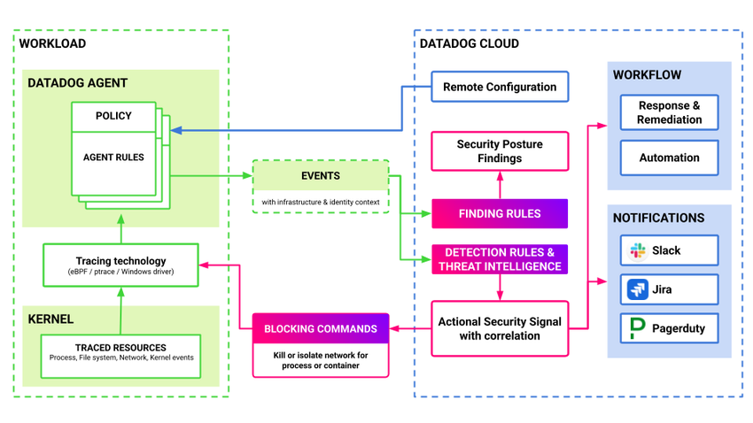
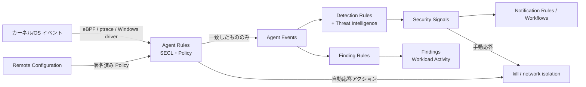
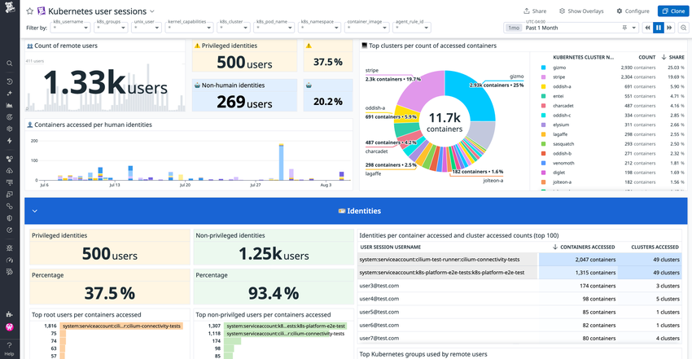
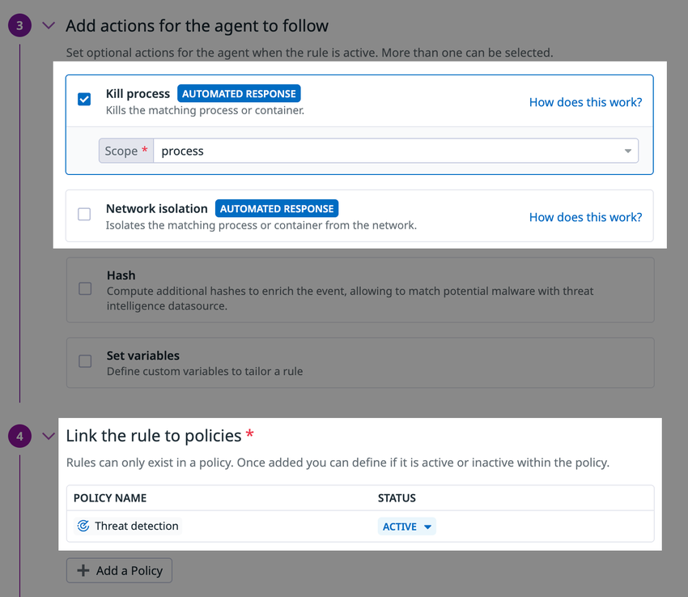
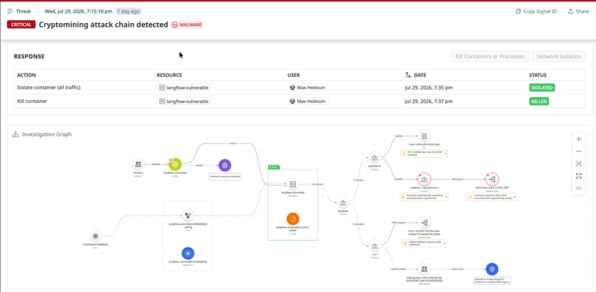
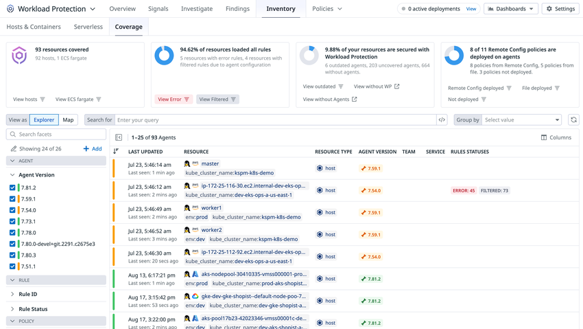

# Workload Protection（旧 CWS）

## 概要

Datadog Workload Protection（ワークロード保護。旧称：Cloud Workload Security / CWS、CSM Threats）は、ホスト・コンテナ・AWS Fargate 上のワークロードで発生する**ファイル・ネットワーク・プロセス（およびカーネル）のアクティビティ**を Datadog Agent でリアルタイムに監視し、脅威を検知して **Security Signals（セキュリティシグナル）** と **Findings（検出結果）** を生成するランタイムセキュリティ製品である。[出典](https://docs.datadoghq.com/security/workload_protection/)

Workload Protection の要点は次のとおり。

| 観点 | 内容 | 出典 |
|---|---|---|
| 収集方式 | Linux は **eBPF**、AWS Fargate は **ptrace**（`cws-instrumentation` トレーサー）、Windows は **Windows ドライバ** | [出典](https://docs.datadoghq.com/security/workload_protection/setup/) |
| 評価の分担 | Agent 上の軽量な **Agent Rules** でセキュリティに無関係なアクティビティを除外し、残りを Datadog バックエンドの **Detection Rules / Finding Rules** で評価する | [出典](https://docs.datadoghq.com/security/workload_protection/) |
| 標準コンテンツ | 350 超の Agent Rules と 200 超の Detection Rules。MITRE ATT&CK の大半の戦術・技術をカバー | [出典](https://docs.datadoghq.com/security/workload_protection/) |
| イベント種別 | Linux と Windows で合計 40 種類超（プロセス、ファイルシステム、カーネル、ネットワーク） | [出典](https://docs.datadoghq.com/security/workload_protection/) |
| 出力 | Signals（脅威検知）、Findings（ランタイムの姿勢＝posture の問題）、Agent Events（生イベント） | [出典](https://docs.datadoghq.com/security/workload_protection/) |
| 応答 | Agent によるプロセス／コンテナの強制終了（kill）と eBPF ベースのネットワーク隔離。ルールに付ける**自動応答**と、シグナルから実行する**手動応答** | [出典](https://docs.datadoghq.com/security/workload_protection/respond_and_report/) |
| 用途 | 実行時脅威検知のほか、コンプライアンス検証（PCI、FedRAMP、SOC 2 等）、ランタイムの姿勢管理、リモートユーザーセッション等のインフラ挙動把握 | [出典](https://docs.datadoghq.com/security/workload_protection/) |
| 料金 | ホスト課金（年契約 $15／ホスト／月）。CSM Enterprise には含まれる（「課金への影響」節） | [出典](https://www.datadoghq.com/pricing/?product=workload-protection) |

本ファイルは次の問いに答える。

- Workload Protection はどのような仕組み（eBPF・Agent Rules・バックエンドルール）で脅威を検知するか
- Agent Rules（SECL）、Policies、Detection Rules、Finding Rules、Content Packs はどう関係し、どう作成・配布するか
- 自動応答（旧 Active Protection）・手動応答で何ができ、何が必要か
- どの OS・カーネル・クラウド環境に対応し、Agent をどう設定するか
- 制限値・保持期間・課金単位は何か

Datadog Security 全体（Signals と Findings の共通モデル、Suppressions、Notification Rules、Security Inbox、Threat Intelligence の共通仕様、改称履歴）は [Datadog Security 概要](./security-platform-overview.md)、構成監査・脆弱性管理は [Cloud Security（旧 CSM）](./cloud-security.md)、ログベースの脅威検知は [Cloud SIEM](./cloud-siem.md) を参照する。Agent 自体の構成要素は [Datadog Agent](../platform/agent.md)、Remote Configuration は [Fleet Automation と Remote Configuration](../platform/fleet-automation.md) を参照する。

---

## 名称と位置づけ

### 改称履歴

Workload Protection は、Cloud Workload Security（CWS）として提供され、2022-10 に CSPM と統合された Cloud Security Management（CSM）の一部となり、CSM の機能名として **CSM Threats** と呼ばれた時期を経て、現在は **Workload Protection** の名称で提供されている。CSM Threats から Workload Protection への改称時期は公開情報では確認できず。経緯の詳細と出典は [Datadog Security 概要](./security-platform-overview.md) の改称履歴を参照する。

旧称は現在も以下に残っており、検索・設定時に注意が必要である。

| 箇所 | 残っている旧称 | 具体例 | 出典 |
|---|---|---|---|
| Agent 設定キー・環境変数 | runtime security / CWS | `runtime_security_config`、`DD_RUNTIME_SECURITY_CONFIG_ENABLED`、Helm の `datadog.securityAgent.runtime`、Operator の `features.cws` | [出典](https://docs.datadoghq.com/security/workload_protection/setup/agent/kubernetes/) |
| Fargate 用イメージ | CWS | `public.ecr.aws/datadog/cws-instrumentation` | [出典](https://docs.datadoghq.com/security/workload_protection/setup/fargate/) |
| RBAC 権限名 | Cloud Workload Security | `security_monitoring_cws_agent_rules_read` / `_write` / `_actions` | [出典](https://docs.datadoghq.com/account_management/rbac/permissions/) |
| API リファレンス | CSM Threats / Cloud Workload Security | API カテゴリ名「CSM Threats」、パス `/api/v2/remote_config/products/cws/...`、US1-FED 用 `/api/v2/security_monitoring/cloud_workload_security/...` | [出典](https://docs.datadoghq.com/api/latest/csm-threats/) |
| Terraform | CSM Threats / Cloud Workload Security | `datadog_csm_threats_agent_rule`、`datadog_csm_threats_policy`、非推奨の `datadog_cloud_workload_security_agent_rule` | [出典](https://registry.terraform.io/providers/DataDog/datadog/latest/docs/resources/csm_threats_agent_rule) |
| 料金データ上のキー | CWS | `CWS-HOSTS`、`CWS-CONT`、`FARGATE-CWS` | [出典](https://www.datadoghq.com/pricing/?product=workload-protection) |
| ログソース | runtime-security-agent | `source:runtime-security-agent` | [出典](https://docs.datadoghq.com/security/cloud_siem/guide/customize-which-logs-cloud-siem-analyzes/) |

### Datadog Security 内での位置づけ

| 関係製品 | 関係 | 参照 |
|---|---|---|
| Cloud Security（旧 CSM） | Workload Protection は Cloud Security の構成要素であり、CSM Enterprise に含まれる。Misconfigurations・Vulnerabilities と同じ Agent（`compliance_config`、`sbom`）で併せて有効化する設定例が公式手順に含まれる | [Cloud Security](./cloud-security.md) |
| Cloud SIEM | Workload Protection のシグナルは Cloud SIEM と同じ Signals Explorer・Suppressions・Notification Rules を使う。Workload Protection 用ログ（`source:runtime-security-agent`）は Cloud SIEM の分析ログとして課金されない | [Cloud SIEM](./cloud-siem.md) |
| Security Inbox | Workload Protection の Findings（Workload Activity）が流入する | [Datadog Security 概要](./security-platform-overview.md) |
| Workflow Automation | シグナルからワークフローを起動できる。セキュリティ Finding・シグナル起点の Workflows は無料 | [Workflow Automation](../service-management/workflow-automation.md) |
| Cloud Network Monitoring | Windows でネットワークイベントを扱うには NPM（現 Cloud Network Monitoring）の有効化が必要 | [Cloud Network Monitoring](../infrastructure/cloud-network-monitoring.md) |

---

## アーキテクチャと評価パイプライン

Workload Protection のアーキテクチャは、ワークロード側の Datadog Agent と Datadog クラウド側のルール評価に分かれる。



- **キャプション:** Workload Protection の検知アーキテクチャ図（公式ドキュメント掲載）。
- **画面の説明:** 左側の「WORKLOAD」枠に、下から KERNEL（TRACED RESOURCES：Process、File system、Network、Kernel events）→ Tracing technology（eBPF / ptrace / Windows driver）→ DATADOG AGENT（POLICY と AGENT RULES）が積み重なる。Agent から「EVENTS（with infrastructure & identity context）」が右側の「DATADOG CLOUD」枠に送られ、FINDING RULES（→ Security Posture Findings）と DETECTION RULES & THREAT INTELLIGENCE（→ Actional Security Signal with correlation）で評価される。シグナルから右側の WORKFLOW（Response & Remediation、Automation）と NOTIFICATIONS（Slack、Jira、Pagerduty）へ連携し、さらに BLOCKING COMMANDS（Kill or isolate network for process or container）が Agent の Tracing technology に戻る。Remote Configuration から Agent の Policy へ配布される矢印もある。
- **出典:** https://docs.datadoghq.com/security/workload_protection/ （取得日 2026-11-02）

### 評価の流れ

Workload Protection のアクティビティ評価は次の順に進む。[出典](https://docs.datadoghq.com/security/workload_protection/)

1. Agent Rules がホスト上のアクティビティを評価する。
2. 一致したアクティビティが **Agent Event** として Datadog に送られる。
3. Datadog が Agent Event を Detection Rules と Finding Rules で評価する。
4. Detection Rules に一致すると **Signal** が作られる。脅威インテリジェンスの指標（IOC）に一致した場合はその情報も表示される。
5. Finding Rules に一致すると **Finding** が作られる。
6. 重大度・ルール種別・タグ・属性に基づいて Notification Rules が通知する。



### カーネル内フィルタリング（eBPF 実装の特徴）

Datadog のエンジニアリングブログ（2026-01-07 公開）によると、Workload Protection の eBPF 実装は次の特徴を持つ。[出典](https://www.datadoghq.com/blog/engineering/ebpf-workload-protection-lessons/)

| 項目 | 内容 |
|---|---|
| フック | syscall の kprobe（32bit 互換 syscall も対象）、`raw_tracepoints/sys_enter`・`sys_exit`、情報付加用の kretprobe / fexit、BPF LSM、TC classifier（SCHED_CLS） |
| カーネル内フィルタ | 有効なルールセットからカーネル内フィルタを計算し、取得イベントの**最大 95%** をユーザー空間に渡る前に破棄する |
| 構造体アクセス | CO-RE を優先し、不可の場合は実行時のオフセット推定、最終手段としてハードコードしたオフセットを使う |
| 既知の衝突事例 | 2022 年に Cilium と TC ハンドルで衝突し、既定の TC 優先度を引き上げた（「トラブルシューティング」節参照） |

---

## 対応環境

### Agent の種類

| 環境 | 収集方式 | 特徴 | 出典 |
|---|---|---|---|
| Linux（ホスト・コンテナ） | eBPF Agent | 性能・機能サポートが最も広い | [出典](https://docs.datadoghq.com/security/workload_protection/setup/) |
| AWS Fargate（ECS / EKS） | Agent をサイドカーとして実行し、`cws-instrumentation` トレーサー（ptrace）でワークロードを計装。Agent は eBPF-less モード | Fargate はホストカーネルにアクセスできず eBPF を使えないため。File Integrity Monitoring とプロセス実行監視を含む主要機能に対応 | [出典](https://docs.datadoghq.com/security/workload_protection/setup/fargate/) |
| Windows | Windows ドライバ | Windows のコンテナ化ワークロードは非対応 | [出典](https://docs.datadoghq.com/security/workload_protection/setup/agent/windows/) |

### Linux ディストリビューション

| ディストリビューション | 対応バージョン |
|---|---|
| Ubuntu LTS | 18.04、20.04、22.04、24.04 以降 |
| Debian | 10 以降 |
| Amazon Linux 2 | カーネル 4.14 以降 |
| Amazon Linux 2023 | 全バージョン |
| SUSE Linux Enterprise Server | 12、15 |
| Red Hat Enterprise Linux | 7、8、9 |
| Oracle Linux | 7、8、9 |
| CentOS | 7 |
| Google Container-Optimized OS | 93 以降（GKE の既定） |

[出典](https://docs.datadoghq.com/security/workload_protection/setup/agent/)

### カーネル要件

| 項目 | 内容 |
|---|---|
| 最小カーネル | **4.14.0** |
| 古いカーネル | eBPF 機能がバックポートされたカーネルは**機能縮退モード**で動作する。例：CentOS / RHEL 7（カーネル 3.10）はネットワーク監視が無効 |
| カスタムカーネル | 必要なフックポイントが変更されている可能性があり、サポートは保証されない |
| Kubernetes ネットワークプラグイン | Cilium・Calico 等のカスタムネットワークプラグインで互換性問題が起こり得る（「トラブルシューティング」節） |
| eBPF Agent の CPU アーキテクチャ | 公開情報では対応アーキテクチャの一覧を確認できず（eBPF-less Agent は下記節を参照） |

[出典](https://docs.datadoghq.com/security/workload_protection/setup/agent/)

### クラウド環境

| 環境 | 対応 |
|---|---|
| Amazon EC2、EKS、ECS | 対応 |
| AWS Fargate（ECS / EKS） | `cws-instrumentation` で対応 |
| Azure VM | 対応 |
| Google Compute Engine、GKE | 対応 |

対応可否は主に基盤のディストリビューションとカーネルに依存する。[出典](https://docs.datadoghq.com/security/workload_protection/setup/)

### Windows 要件

| 項目 | 内容 | 出典 |
|---|---|---|
| Agent | 7.52 以降 | [出典](https://docs.datadoghq.com/security/workload_protection/setup/agent/windows/) |
| OS | Setup 概要ページは「**Windows Server 2019 以降**」、Windows 個別ページは「Windows Server 2016 以降」と記載しており、**公式ドキュメント内で記載が一致しない**。導入前にサポート窓口で確認すること | [出典](https://docs.datadoghq.com/security/workload_protection/setup/) [出典](https://docs.datadoghq.com/security/workload_protection/setup/agent/windows/) |
| ネットワークイベント | NPM（Cloud Network Monitoring）の有効化が必要 | 同上 |
| コンテナ | Windows のコンテナ化ワークロードは非対応 | 同上 |
| 標準ルールセット | 9 個の既定ルール（certutil によるファイル転送・デコード、comsvcs.dll によるプロセスメモリダンプ、Procdump によるメモリダンプ、スケジュールタスク作成、bitsadmin によるダウンロード・実行、WMI によるリモート実行、crackmapexec 実行 など） | 同上 |

### eBPF を使えない Linux ホスト（eBPF-less Agent）

eBPF を使えない Linux 環境向けに、ptrace ベースの eBPF-less Agent が用意されている。現行の英語版ガイド（`guide/ebpf-free-agent`）は Fargate 向けの内容のみを掲載しており、ホスト向けの詳細は他言語版の旧ページの記載に基づく。[出典](https://docs.datadoghq.com/security/workload_protection/guide/ebpf-free-agent/)

| 項目 | 内容 | 確度 |
|---|---|---|
| ステータス | 【Preview】（スペイン語版ページ「Threat Detection for Linux Without eBPF Support is in Preview」、担当者経由で申込み） | 旧ページ記載。現行英語版では確認できず |
| 対象カーネル | eBPF が使えない Linux カーネル 3.4〜4.14 | 同上 |
| 有効化 | Docker：`DD_RUNTIME_SECURITY_CONFIG_EBPFLESS_ENABLED=true`。Linux ホスト：`runtime_security_config.ebpfless.enabled: true` | Fargate 手順で `DD_RUNTIME_SECURITY_CONFIG_EBPFLESS_ENABLED` は現行確認済み |
| トレースモード | wrap モード（アプリを起動時から追跡）、attach モード（実行中のアプリにアタッチ。オーバーヘッドと制約が大きく、seccomp プロファイルを適用できない） | 旧ページ記載 |
| 使えない機能 | Security profiles（異常検知・自動抑制・マルウェア検知）とネットワーク検知 | 旧ページ記載 |
| 対応アーキテクチャ | amd64、arm64 | 旧ページ記載 |

[出典](https://docs.datadoghq.com/es/security/cloud_security_management/guide/ebpf-free-agent)

> **サイト差異:** Response（自動応答・手動応答）のドキュメントには「app.ddog-gov.com、us2.ddog-gov.com ではこの製品はサポートされない」という注記がある。注記の対象範囲（Workload Protection 全体か応答機能のみか）はページ上で明示されていない。一方、API リファレンスには US1-FED 向けの Agent Rules API（Remote Configuration を使わないパス）が別途用意されている。US1-FED での提供範囲は契約前に確認すること。[出典](https://docs.datadoghq.com/security/workload_protection/respond_and_report/) [出典](https://docs.datadoghq.com/api/latest/csm-threats/)

---

## セットアップ

### 前提条件

| 項目 | 内容 | 出典 |
|---|---|---|
| 推奨構成 | Infrastructure Monitoring が有効な組織で使うことを推奨 | [出典](https://docs.datadoghq.com/security/workload_protection/setup/) |
| 有効化の権限 | 製品の有効化には **Org Management** 権限が必要 | 同上 |
| 有効化の流れ | ① Datadog で製品を有効化（`/security/workload-protection/onboarding`）→ ② 保護対象ワークロードに Agent を展開 | 同上 |
| Agent バージョン | Linux（パッケージ）・Docker・ECS on EC2：**7.46 以降**。Windows：**7.52 以降**。Kubernetes 手順は「最新版を使用」とのみ記載 | [出典](https://docs.datadoghq.com/security/workload_protection/setup/agent/linux/) [出典](https://docs.datadoghq.com/security/workload_protection/setup/agent/docker/) |
| Coverage 上の「古い Agent」判定 | **7.65.0 未満**は Coverage 画面で outdated と表示される | [出典](https://docs.datadoghq.com/security/workload_protection/inventory/review_improve_coverage) |
| Remote Configuration | Policy の配布・手動応答に使う。Agent 側でも有効化する | [出典](https://docs.datadoghq.com/security/workload_protection/detect_and_monitor/agent_rules/policy_management/) |
| 課金 | Workload Protection によるイベント収集は課金に影響する（各手順ページに記載） | [出典](https://docs.datadoghq.com/security/workload_protection/setup/agent/linux/) |
| 検証環境 | 安全に試せる Playground（github.com/DataDog/datadog-security-playground）が公開されている | [出典](https://docs.datadoghq.com/security/workload_protection/setup/) |

### Agent のコンポーネント

Workload Protection は Datadog Agent の `system-probe`（カーネルイベント収集・ルール評価）と `security-agent` を使う。Agent **7.77 以降は `security-agent` 側の CWS ランタイムは事実上非推奨・未使用**であり、`security-agent.yaml` の `runtime_security_config` 節は無視してよいと設定リファレンスに記載されている。7.77 未満では `system-probe.yaml` と `security-agent.yaml` の両方で有効化が必要である。[出典](https://docs.datadoghq.com/security/workload_protection/workload_protection_agent_config)

### Linux（パッケージインストール）

インストールスクリプトで Misconfigurations と Threat Detection（Workload Protection）を有効化する例：

```shell
DD_COMPLIANCE_CONFIG_ENABLED=true DD_RUNTIME_SECURITY_CONFIG_ENABLED=true DD_API_KEY=<DATADOG_API_KEY> DD_SITE="datadoghq.com" bash -c "$(curl -L https://install.datadoghq.com/scripts/install_script_agent7.sh)"
```

`DD_SITE` は利用サイトに合わせる（AP1 は `ap1.datadoghq.com`。[Datadog Sites](../platform/datadog-sites.md) 参照）。既存 Agent に追加する場合は設定ファイルを作成して権限を設定する。

```shell
sudo cp /etc/datadog-agent/system-probe.yaml.example /etc/datadog-agent/system-probe.yaml
sudo cp /etc/datadog-agent/security-agent.yaml.example /etc/datadog-agent/security-agent.yaml
sudo chmod 640 /etc/datadog-agent/system-probe.yaml /etc/datadog-agent/security-agent.yaml
sudo chgrp dd-agent /etc/datadog-agent/system-probe.yaml /etc/datadog-agent/security-agent.yaml
```

| ファイル | 設定 | 既定値 | 用途 |
|---|---|---|---|
| `/etc/datadog-agent/datadog.yaml` | `remote_configuration.enabled: true` | `false`（ファイル内コメント上の既定） | Remote Configuration |
| 同上 | `runtime_security_config.enabled: true` | `false` | Threat Detection |
| 同上 | `compliance_config.enabled` | `false` | Misconfigurations（Cloud Security） |
| 同上 | `compliance_config.host_benchmarks.enabled` | 公開情報では明記なし | ホストベンチマーク（Misconfigurations） |
| 同上 | `sbom.enabled`、`sbom.container_image.enabled`、`sbom.host.enabled` | ― | Vulnerabilities（Cloud Security）。脆弱性は 1 時間ごとに評価 |
| `/etc/datadog-agent/security-agent.yaml` | `runtime_security_config.enabled: true` | `false` | Threat Detection（7.77 未満で必要） |
| `/etc/datadog-agent/system-probe.yaml` | `runtime_security_config.enabled: true` | `false` | Threat Detection |
| 同上 | `runtime_security_config.remote_configuration.enabled: true` | `false` | ルールの Remote Configuration 配信 |

インストールスクリプトを使った場合でも、`compliance_config.host_benchmarks` と `sbom`（`container_image`、`host`）は `datadog.yaml` で手動有効化が必要である。[出典](https://docs.datadoghq.com/security/workload_protection/setup/agent/linux/)

### Kubernetes

Kubernetes では Datadog Operator、Helm、DaemonSet の 3 方式がある。Kubernetes ユーザー ID（`kubectl exec` 実行者）でイベントを補強するには、Cluster Agent の Admission Controller で `cwsInstrumentation` を有効化する（任意）。[出典](https://docs.datadoghq.com/security/workload_protection/setup/agent/kubernetes/)

**Datadog Operator（`datadog-agent.yaml` の `spec`）**

```yaml
apiVersion: datadoghq.com/v2alpha1
kind: DatadogAgent
metadata:
  name: datadog
spec:
  features:
    # (任意) Kubernetes ユーザー ID でイベントを補強
    admissionController:
      enabled: true
      cwsInstrumentation:
        enabled: true
    remoteConfiguration:
      enabled: true
    # Threat Detection（Workload Protection）
    cws:
      enabled: true
    # Misconfigurations（Cloud Security）
    cspm:
      enabled: true
      hostBenchmarks:
        enabled: true
    # SBOM / Vulnerabilities（Cloud Security）
    sbom:
      enabled: true
      containerImage:
        enabled: true
        # GKE / EKS の場合はコメント解除
        # uncompressedLayersSupport: true
      host:
        enabled: true
```

**Helm（`datadog-values.yaml`）**

```yaml
clusterAgent:
  admissionController:
    enabled: true
    cwsInstrumentation:
      enabled: true

datadog:
  remoteConfiguration:
    enabled: true
  securityAgent:
    runtime:
      enabled: true        # Threat Detection
    compliance:
      enabled: true        # Misconfigurations
      host_benchmarks:
        enabled: true
  sbom:
    containerImage:
      enabled: true
      # uncompressedLayersSupport: true   # GKE / EKS
    host:
      enabled: true
```

**DaemonSet（環境変数）**

| コンテナ | 環境変数 | 値 |
|---|---|---|
| `agent` | `DD_REMOTE_CONFIGURATION_ENABLED` | `"true"` |
| `system-probe` | `DD_RUNTIME_SECURITY_CONFIG_ENABLED` | `"true"` |
| `system-probe` | `DD_RUNTIME_SECURITY_CONFIG_REMOTE_CONFIGURATION_ENABLED` | `"true"` |
| `system-probe` | `DD_COMPLIANCE_CONFIG_ENABLED`、`DD_COMPLIANCE_CONFIG_HOST_BENCHMARKS_ENABLED` | `"true"`（Misconfigurations） |
| `system-probe` | `DD_SBOM_CONTAINER_IMAGE_USE_MOUNT` | `"true"` |
| `cluster-agent` | `DD_ADMISSION_CONTROLLER_ENABLED` | `"true"`（任意） |
| `cluster-agent` | `DD_RUNTIME_ADMISSION_CONTROLLER_CWS_INSTRUMENTATION_ENABLED` | `"true"`（任意） |

公式手順は `security-agent` コンテナにも同様の環境変数を設定するよう記載している（Agent 7.77 未満では必要）。

| 注意点 | 内容 |
|---|---|
| イメージ収集の既定 | Datadog Operator 1.3.0 以降、Helm チャート 3.46.0 以降はイメージ収集が既定で有効 |
| GKE イメージストリーミング | SBOM 収集は GKE のイメージストリーミングと非互換。先に無効化する |
| RBAC エラー | Operator を `clusterRole.allowCreatePodsExec=true` でインストールする |
| EKS on Fargate | 別手順（Fargate 節） |

[出典](https://docs.datadoghq.com/security/workload_protection/setup/agent/kubernetes/)

Agent の Kubernetes 展開の一般論は [コンテナ/Kubernetes向けAgent](../platform/kubernetes-and-containers-agent.md) を参照する。

### Docker

Docker では Agent コンテナ（`registry.datadoghq.com/agent:7`）を次の権限で起動する（Agent 7.46 以降）。[出典](https://docs.datadoghq.com/security/workload_protection/setup/agent/docker/)

| 区分 | 設定 |
|---|---|
| 名前空間 | `--cgroupns host`、`--pid host` |
| セキュリティオプション | `--security-opt apparmor:unconfined` |
| 追加ケーパビリティ | `SYS_ADMIN`、`SYS_RESOURCE`、`SYS_PTRACE`、`NET_ADMIN`、`NET_BROADCAST`、`NET_RAW`、`IPC_LOCK`、`CHOWN` |
| 読み取り専用マウント | Docker ソケット、`/proc`（→ `/host/proc`）、cgroup FS（→ `/host/sys/fs/cgroup`）、`/etc/passwd`、`/etc/group`、ホストのルート FS（→ `/host/root`） |
| 読み書きマウント | `/sys/kernel/debug`、`/etc/os-release` |
| 環境変数 | `DD_RUNTIME_SECURITY_CONFIG_ENABLED=true`、`DD_RUNTIME_SECURITY_CONFIG_REMOTE_CONFIGURATION_ENABLED=true`、`DD_COMPLIANCE_CONFIG_ENABLED=true`、`DD_COMPLIANCE_CONFIG_HOST_BENCHMARKS_ENABLED=true`、`HOST_ROOT=/host/root`、`DD_API_KEY` |

### Amazon ECS（EC2 起動タイプ）

ECS on EC2 では、タスク定義の `datadog-agent` コンテナに Docker と同等のマウント（Docker ソケット、`/proc/`、`/sys/fs/cgroup/`、`/etc/passwd`、`/etc/os-release`、`/sys/kernel/debug`（読み書き）、ホストルート）と、`linuxParameters` で同じ 8 個のケーパビリティを付与し、`DD_RUNTIME_SECURITY_CONFIG_ENABLED`、`DD_RUNTIME_SECURITY_CONFIG_REMOTE_CONFIGURATION_ENABLED`、`DD_SYSTEM_PROBE_ENABLED` 等を `"true"` にする（Agent 7.46 以降）。SBOM 抽出に失敗する場合は `datadog-agent` コンテナのメモリを 256 MiB に増やす。[出典](https://docs.datadoghq.com/security/workload_protection/setup/agent/ecs_ec2/)

### AWS Fargate（ECS / EKS）

AWS Fargate ではホストカーネルにアクセスできないため、`cws-instrumentation` イメージが ptrace でワークロードを追跡し、Agent は eBPF-less モードで動作する。[出典](https://docs.datadoghq.com/security/workload_protection/setup/fargate/)

| 項目 | 内容 |
|---|---|
| イメージ | `public.ecr.aws/datadog/cws-instrumentation:latest`（init）、`public.ecr.aws/datadog/agent:latest`（Agent） |
| init コンテナのコマンド | `/cws-instrumentation setup --cws-volume-mount /cws-instrumentation-volume` |
| アプリのエントリポイント | `/cws-instrumentation-volume/cws-instrumentation trace -- <ENTRYPOINT>`（元のエントリポイントは `docker inspect <IMAGE> -f '{{json .Config.Entrypoint}}'` で確認） |
| 必須ケーパビリティ | アプリコンテナに `SYS_PTRACE` |
| ECS タスク定義 | `pidMode: task`、`networkMode: awsvpc`、`requiresCompatibilities: ["FARGATE"]`、共有ボリューム `cws-instrumentation-volume`。アプリは Agent が `HEALTHY`、init が `SUCCESS` になってから起動（`dependsOn`） |
| Agent 環境変数 | `ECS_FARGATE=true`（EKS は `DD_EKS_FARGATE`）、`DD_RUNTIME_SECURITY_CONFIG_ENABLED=true`、`DD_RUNTIME_SECURITY_CONFIG_EBPFLESS_ENABLED=true` |
| EKS Fargate | Agent RBAC を設定し、監視対象の**各 Pod にサイドカーとして Agent を配置**（Agent は同一 Pod 内のコンテナとしか通信できない）。`shareProcessNamespace: true` と `datadog-agent` サービスアカウントを使う |
| タスク定義の作成方法 | Datadog ECS task patcher、手書き JSON、AWS CLI（`aws ecs register-task-definition`） |
| 脆弱性管理 | ECS Fargate の Vulnerability Management は Agentless scanner の展開が必要（Cloud Security） |
| 最低バージョン | 公開情報では確認できず（手順は `latest` タグを使用） |

### Windows

Windows では `C:\ProgramData\Datadog\` の `system-probe.yaml` と `security-agent.yaml` の両方で設定し、Agent を再起動する。[出典](https://docs.datadoghq.com/security/workload_protection/setup/agent/windows/)

| 設定 | 用途 |
|---|---|
| `runtime_security_config.enabled: true` | Workload Protection（プロセス・ネットワーク脅威検知） |
| `runtime_security_config.fim_enabled: true` | File Integrity Monitoring（FIM）とレジストリ監視 |

### 動作確認

| 確認方法 | 内容 | 出典 |
|---|---|---|
| ルールセットのロード | Agent Events Explorer で「All events」を選び `@agent.rule_id:ruleset_loaded` を検索（Security events のみの表示では出ない） | [出典](https://docs.datadoghq.com/security/workload_protection/setup/fargate/) |
| セルフテスト | `sudo /opt/datadog-agent/embedded/bin/system-probe runtime self-test`（Docker：`docker exec -it datadog-agent system-probe runtime self-test`、Kubernetes：`kubectl exec -it <POD_NAME> -c system-probe -- system-probe runtime self-test`）。成功時は `Runtime self test: OK` | [出典](https://docs.datadoghq.com/security/workload_protection/troubleshooting/threats/) |
| Coverage 画面 | Agent がルールセットをロードしたリソースが表示される（「Coverage」節） | [出典](https://docs.datadoghq.com/security/workload_protection/inventory/) |

---

## Agent 設定リファレンス

### `system-probe`（`runtime_security_config` 配下）

各キーには `DD_RUNTIME_SECURITY_CONFIG_` ＋キーパスを大文字・アンダースコア区切りにした環境変数が対応する（例：`hash_resolver.cache_size` → `DD_RUNTIME_SECURITY_CONFIG_HASH_RESOLVER_CACHE_SIZE`）。[出典](https://docs.datadoghq.com/security/workload_protection/workload_protection_agent_config)

| キー | 既定値 | 説明 |
|---|---|---|
| `enabled` | `false` | Workload Protection を有効化 |
| `enforcement.exclude_binaries` | `[]` | 応答（kill 等）の対象から除外するバイナリ |
| `enforcement.rule_source_allowed` | `["file", "remote-config"]` | 応答を発動できるルールの供給元 |
| `hash_resolver.enabled` | `true` | ハッシュリゾルバの有効化 |
| `hash_resolver.cache_size` | `500` | キャッシュするハッシュ数 |
| `hash_resolver.event_types` | `["exec", "open"]` | ハッシュ計算対象にできるイベント種別 |
| `hash_resolver.hash_algorithms` | `["sha1", "sha256", "ssdeep"]` | 計算するハッシュ（`md5` も指定可） |
| `hash_resolver.max_file_size` | `5242880`（5 MiB、5,242,880 バイト） | ハッシュ計算する最大ファイルサイズ |
| `hash_resolver.max_hash_rate` | `500` | ハッシュ計算のレート上限 |
| `user_sessions.ssh.enabled` | `true` | SSH ユーザーセッション機能 |
| `syscalls.capture_all_errors.enabled` | `false` | 全 syscall エラーを取得（上級設定。変更すると Workload Protection やホストに影響し得る） |

### その他の設定キー（他ページに記載）

| キー / 環境変数 | 既定値 | 説明 | 出典 |
|---|---|---|---|
| `runtime_security_config.enforcement`（`enabled`） | 有効 | 自動応答・手動応答に必要。kill / `network_filter` アクションは enforcement 無効時にポリシーロードで失敗する | [出典](https://docs.datadoghq.com/security/workload_protection/respond_and_report/) |
| `event_monitoring_config.network` | 有効 | ネットワーク隔離に必要なネットワークプローブ | 同上 |
| `runtime_security_config.network.enabled` / `DD_RUNTIME_SECURITY_CONFIG_NETWORK_ENABLED` / Helm `datadog.securityAgent.runtime.network.enabled` | 公開情報では既定値の明記なし | ネットワーク検知の有効／無効 | [出典](https://docs.datadoghq.com/security/workload_protection/troubleshooting/threats/) |
| `runtime_security_config.network.classifier_priority` | 公開情報では確認できず | TC classifier の優先度（他ベンダーとの衝突回避） | 同上 |
| `runtime_security_config.fim_enabled` | 公開情報では確認できず | FIM（Windows で明示的に有効化） | [出典](https://docs.datadoghq.com/security/workload_protection/setup/agent/windows/) |
| `runtime_security_config.ebpfless.enabled` / `DD_RUNTIME_SECURITY_CONFIG_EBPFLESS_ENABLED` | ― | eBPF-less モード | [出典](https://docs.datadoghq.com/security/workload_protection/setup/fargate/) |
| `runtime_security_config.remote_configuration.enabled` / `DD_RUNTIME_SECURITY_CONFIG_REMOTE_CONFIGURATION_ENABLED` | `false` | Remote Configuration による Policy 受信 | [出典](https://docs.datadoghq.com/security/workload_protection/setup/agent/linux/) |
| Helm `datadog.securityAgent.runtime.policies.configMap` | ― | 手動配布する Policy ファイルの ConfigMap | [出典](https://docs.datadoghq.com/security/workload_protection/detect_and_monitor/agent_rules/policy_management/) |

Agent 設定全般は [Agent 設定リファレンス](../platform/agent-configuration.md) を参照する。

---

## Agent Rules と SECL

### Agent Rules の役割

Workload Protection の Agent Rules は、Agent がどのランタイムアクティビティを収集して Agent Event として Datadog に送るかを決めるルールである。Agent Rules は **SECL（Datadog Security Language）** で記述し、良性・低リスクのアクティビティを Agent 側で除外してノイズ・データ量・性能影響を抑える。Agent Rules は、文脈テレメトリの収集、高確度アクティビティの検知、Agent アクションの実行に使える。[出典](https://docs.datadoghq.com/security/workload_protection/detect_and_monitor/agent_rules/)

| 種類 | 内容 |
|---|---|
| OOTB（既定）ルール | Datadog が管理し、新種マルウェアや攻撃手法に応じて追加される。環境・ワークロード単位で選択的に配布でき、複製して式・フィルタ・アクションを変更できる。アプリでは `defaultRule:true` で絞り込める |
| カスタムルール | Assisted rule creator（ウィザード）または手動で、Agent Rule と Detection Rule を併せて作成する |

### SECL の構文

```
<event-type>.<event-attribute> <operator> <value> [<operator> <event-type>.<event-attribute>] ...
```

例：`open.file.path == "/etc/shadow" && process.file.path not in ["/usr/sbin/vipw"]` [出典](https://docs.datadoghq.com/security/workload_protection/detect_and_monitor/agent_rules/secl_guide/)

**演算子**

| 演算子 | 意味 | 最低 Agent |
|---|---|---|
| `==`、`!=` | 等しい／等しくない | 7.27 |
| `>`、`>=`、`<`、`<=` | 比較 | 7.27 |
| `!` / `not` | 否定 | 7.27 |
| `^` | ビット否定 | 7.27 |
| `&`、`\|` | ビット AND / OR | 7.27 |
| `&&` / `and`、`\|\|` / `or` | 論理 AND / OR | 7.27 |
| `in [...]`、`not in [...]` | リスト包含 | 7.27 |
| `=~`、`!~` | 文字列パターン一致／不一致 | 7.27 |
| `in CIDR`、`not in CIDR`、`allin CIDR` | IP 範囲 | 7.37 |
| `in [CIDR1, ...]`、`not in [...]`、`allin [...]` | IP 範囲リスト | 7.37 |

**パターンと正規表現**

| 形式 | 例 | 対象フィールド | 最低 Agent |
|---|---|---|---|
| `~"pattern"` | `~"httpd.*"` | すべて | 7.27 |
| `r"regexp"` | `r"rc[0-9]+"` | `.path` 以外すべて | 7.27 |

- `.path` フィールドのパターンは glob として扱われ、`*` は同階層のファイル・フォルダに一致する。パス末尾の `**` は配下の全ファイル・サブフォルダに一致する（7.34 以降）。
- 期間は数値＋単位（`s`、`m`、`h`）で書く（例：`process.created_at > 5s`）。
- 作成上の推奨：OS を必ず指定する（`filters` に `os == "linux"` 等）。`open.file.path == "/etc/passwd"` や `exec.comm != ""` のような広すぎる条件は避ける。`container.id != ""` は他の具体的条件と組み合わせる。`==` と `in [...]` を優先し、次に glob、正規表現は最後の手段とする。

[出典](https://docs.datadoghq.com/security/workload_protection/detect_and_monitor/agent_rules/secl_guide/)

### Linux のイベント種別（トリガー）

| トリガー | 種別 | 内容 | 最低 Agent |
|---|---|---|---|
| `accept` | Network | ソケット accept | 7.63 |
| `bind` | Network | bind 呼び出し | 7.37 |
| `bpf` | Kernel | BPF コマンド実行 | 7.33 |
| `capabilities` | Process | 【Experimental】プロセスがケーパビリティを使用 | 7.70 |
| `capset` | Process | ケーパビリティセットの変更 | 7.27 |
| `cgroup_write` | Kernel | プロセスを別 cgroup へ移動 | 7.68 |
| `chdir` | File | 【Experimental】作業ディレクトリ変更 | 7.52 |
| `chmod` | File | パーミッション変更 | 7.27 |
| `chown` | File | 所有者変更 | 7.27 |
| `connect` | Network | connect 呼び出し | 7.60 |
| `dns` | Network | DNS リクエスト送信 | 7.36 |
| `exec` | Process | プログラム実行（fork では発火しない） | 7.27 |
| `exit` | Process | プロセス終了 | 7.38 |
| `imds` | Network | インスタンスメタデータサービス（IMDS）イベント | 7.55 |
| `link` | File | ハードリンク作成 | 7.27 |
| `load_module` | Kernel | カーネルモジュールのロード | 7.35 |
| `mkdir` | File | ディレクトリ作成 | 7.27 |
| `mmap` | Kernel | mmap 呼び出し | 7.35 |
| `mount` | File | 【Experimental】ファイルシステムのマウント | 7.42 |
| `mprotect` | Kernel | mprotect 呼び出し | 7.35 |
| `network_flow_monitor` | Network | ネットワークフローモニターイベント | 7.63 |
| `open` | File | ファイルオープン | 7.27 |
| `packet` | Network | 生パケットの取得 | 7.60 |
| `prctl` | Process | prctl 呼び出し | 7.71 |
| `ptrace` | Kernel | ptrace 呼び出し | 7.35 |
| `removexattr` | File | 拡張属性の削除 | 7.27 |
| `rename` | File | ファイル・ディレクトリ名変更 | 7.27 |
| `rmdir` | File | ディレクトリ削除 | 7.27 |
| `selinux` | Kernel | SELinux 操作 | 7.30 |
| `setgid` | Process | 実効 GID 変更 | 7.27 |
| `setrlimit` | Process | setrlimit 呼び出し | 7.68 |
| `setsockopt` | Network | setsockopt 呼び出し | 7.68 |
| `setuid` | Process | 実効 UID 変更 | 7.27 |
| `setxattr` | File | 拡張属性の設定 | 7.27 |
| `signal` | Process | シグナル送信 | 7.35 |
| `socket` | Network | ソケット作成 | 7.81 |
| `splice` | File | splice 呼び出し | 7.36 |
| `sysctl` | Kernel | sysctl パラメータの読み取り・変更 | 7.65 |
| `unlink` | File | ファイル削除 | 7.27 |
| `unload_module` | Kernel | カーネルモジュールのアンロード | 7.35 |
| `unshare` | Kernel | 新しい名前空間の作成 | 7.84 |
| `utimes` | File | アクセス・更新時刻の変更 | 7.27 |

FIM 用の `fim.write.file.*` フィールドは、`open`、`chmod`、`chown`、`link`、`rename`、`unlink`、`utimes` の各トリガーにまたがってファイル書き込み系イベントに一致する。[出典](https://docs.datadoghq.com/security/workload_protection/linux_expressions/)

### Windows のイベント種別

| イベント | 種別 | 内容 | 最低 Agent |
|---|---|---|---|
| `change_permission` | Registry | 権限変更 | 7.55 |
| `create` | File | ファイル作成 | 7.52 |
| `create_key` | Registry | レジストリキー作成 | 7.52 |
| `delete` | File | ファイル削除 | 7.54 |
| `delete_key` | Registry | レジストリキー削除 | 7.52 |
| `exec` | Process | プロセス実行または fork | 7.27 |
| `exit` | Process | プロセス終了 | 7.38 |
| `open_key` | Registry | レジストリキーのオープン | 7.52 |
| `rename` | File | ファイル名変更 | 7.54 |
| `set_key_value` | Registry | レジストリ値の設定 | 7.52 |
| `write` | File | ファイル書き込み | 7.54 |

[出典](https://docs.datadoghq.com/security/workload_protection/windows_expressions/)

### アクションと変数

Agent Rules には、ルール一致時に Agent が実行するアクションを複数指定でき、リスト順に実行される。各アクションには任意で SECL の `filter` を付けられる。[出典](https://docs.datadoghq.com/security/workload_protection/detect_and_monitor/agent_rules/variables_and_actions/)

| アクション | 用途 | 対応 OS | enforcement 必須 |
|---|---|---|---|
| `set` | 変数に状態を保存（他ルールから参照） | Linux、Windows | 不要 |
| `kill` | プロセス／コンテナ／cgroup の強制終了 | Linux、Windows | 必要 |
| `hash` | ファイルハッシュの計算 | Linux | 不要 |
| `log` | Agent ログへの出力 | Linux、Windows | 不要 |
| `coredump` | Agent 内部状態の取得 | Linux | 不要 |
| `network_filter` | BPF フィルタに一致する通信を drop / allow | Linux | 必要 |

**`set`（変数）のパラメータ**

| フィールド | 既定値 | 説明 |
|---|---|---|
| `name` | 必須 | 変数名。式中で `${name}` または `${scope.name}` として参照 |
| `value` / `field` / `expression` | ― | 固定値（文字列・整数・真偽・配列）／イベントのフィールド値／SECL 式の結果。`expression` で型推論できない場合は `default_value` を指定 |
| `scope` | なし（グローバル。ポリシー内で共有） | `process`（既定はトリガーしたプロセスの PID。`scope_field` で別キー可）、`container`、`cgroup` |
| `ttl` | 無期限 | `10s`、`5m` 等 |
| `append` | `false` | リストに追加 |
| `size` | `append: true` 時 `100` | リストの最大長 |
| `inherited` | `false` | 子プロセスへ継承（`process` スコープのみ） |
| `private` | `false` | セキュリティイベントに変数を含めない |

変数を使うと、状態機械（ステートマシン）による段階的な侵害指標（IOC）検知を Agent 内で実装できる。例：`/tmp/` 配下の実行で `tmp_exec` を 10 分間 `true` にし、その後の `/etc/shadow` オープンと組み合わせて検知する。

```yaml
rules:
  - id: flag_tmp_exec
    expression: exec.file.path startswith "/tmp/"
    actions:
      - set:
          name: tmp_exec
          value: true
          ttl: 10m
  - id: follow_up_access
    expression: open.file.path == "/etc/shadow" && ${tmp_exec}
```

**`kill` のパラメータ**

| フィールド | 必須 | 既定値 | 説明 |
|---|---|---|---|
| `signal` | 必須 | なし | 例：`SIGKILL`、`SIGTERM` |
| `scope` | 任意 | `process` | `process`、`container`、`cgroup` |
| `disable_container_disarmer` | 任意 | `false` | コンテナ単位の安全装置（disarmer）を無効化 |
| `disable_executable_disarmer` | 任意 | `false` | 実行ファイル単位の安全装置を無効化 |

disarmer は、一定期間内に同一対象への kill が多発した場合に以降の kill を抑止する安全装置である。`runtime_security_config.enforcement.exclude_binaries` に列挙したバイナリは kill の対象外になる。kill の結果は Agent Event の `agent.rule_actions` に記録され、`agent.rule_actions.status`（シグナルの Response 表に出る応答ステータスとは別の値の組）は `performed`、`partially_performed`、`error`、`kill_queued`、`kill_aborted`、`rule_disarmed`、`rule_dismantled` のいずれか。実行回数はメトリクス `datadog.runtime_security_config.rules.action_performed`（`action_name:kill`）で数える。

**`hash` のパラメータ**

| フィールド | 既定値 | 説明 |
|---|---|---|
| `field` | `exec` ルールは `exec.file`、`open` ルールは `open.file` | 他のイベント種別では必須 |
| `max_file_size` | `5242880`（5 MiB、5,242,880 バイト） | 超えるファイルはスキップ |

結果は `exec.file.hashes` 等の `*.hashes` フィールドに入る。アルゴリズムは `hash_resolver.hash_algorithms` に従う（MD5、SHA1、SHA256、SSDEEP）。

**`network_filter` のパラメータ**

| フィールド | 必須 | 既定値 | 説明 |
|---|---|---|---|
| `filter` | 必須 | なし | BPF 式（例：`port 53`） |
| `policy` | 任意 | `allow` | `drop` で遮断 |
| `scope` | 任意 | `process` | `process` または `cgroup` |

`network_filter` は enforcement 有効化、`raw_packet` イベント種別の有効化、Linux が条件である。drop したパケットは `rawpacket_action` イベント（レート制限あり）として報告され、件数はメトリクス `datadog.runtime_security_config.network.raw_packet.dropped` で追跡できる。

**`log` / `coredump`**：`log` は `level`（`debug`、`info`、`warning`、`error`）が必須で、`message` の既定は `Rule <rule_id> triggered`。`coredump` は Linux のみで、`process`、`mount`、`dentry` のいずれかを `true` にする（既定で gzip 圧縮、`no_compression: true` で無効）。

[出典](https://docs.datadoghq.com/security/workload_protection/detect_and_monitor/agent_rules/variables_and_actions/)

---

## Policies（ポリシー）

### Policies の仕様

Workload Protection の Policy は、まとめて配布される Agent Rules の集合であり、タグでインフラの範囲を指定する。[出典](https://docs.datadoghq.com/security/workload_protection/detect_and_monitor/agent_rules/policy_management/)

| 項目 | 内容 |
|---|---|
| Datadog 管理ポリシー | Datadog が更新すると自動配布される。Agent **7.71.0 以降**は現行バージョンに固定（pin）できる |
| カスタムポリシー | カスタム Agent Rules はカスタムルールのみを含むカスタムポリシーに入れる（既定ポリシーと分離） |
| 新規作成時の状態 | 無効・未配布。ルール追加 → タグ追加 → 有効化の順に進める |
| タグによる対象指定 | 環境・クラスタ・ホスト等に限定でき、UI が一致する Agent 数を表示する。Terraform の `host_tags_lists` は内側の配列が AND、外側が OR |
| 競合時の挙動 | 同一ホスト上の 2 つのポリシーが同じルールを異なるステータスで含む場合、ルールは**有効（Active）**になる |
| ルールの無効化 | 既定ルールはポリシー内でステータスを Inactive にする。Rules configuration からルールを削除すると、含むすべてのポリシーから削除される |

### 配布方法

| 方法 | 内容 |
|---|---|
| Remote Configuration：Deploy instantly | 対象範囲の全ホストに即時配布。Remote Configuration は署名・認証済みのポリシーのみを配布する |
| Remote Configuration：Managed deployment | 段階的ロールアウト。**最大 10 ステージ**（ホスト割合またはホストタグ）、アラート時にロールアウトを一時停止するモニターの紐付け、ステージ間の待機時間、配布時間帯（deployment window）を設定できる。進捗は Deployments ページで追跡 |
| 手動配布（ホスト） | UI からポリシーファイルをダウンロード（または `.policy` ファイルを手書き）し、`/etc/datadog-agent/runtime-security.d` に `default.policy` として配置（`root` の読み書き権限）。`system-probe runtime policy reload` または Agent 再起動で反映 |
| 手動配布（Helm） | ファイルから ConfigMap を作成し、`datadog.securityAgent.runtime.policies.configMap` で参照 |
| Terraform | `datadog_csm_threats_policy`、`datadog_csm_threats_agent_rule` で管理（「API と Terraform」節） |

[出典](https://docs.datadoghq.com/security/workload_protection/detect_and_monitor/agent_rules/policy_management/)

### Content Packs

Workload Protection の Content Packs は、特定のソフトウェアスタック・脅威ベクトル・新たな脆弱性向けに Datadog が作成した任意の Agent Rules・Detection Rules・Finding Rules・設定ガイダンスのバンドルである。[出典](https://docs.datadoghq.com/security/workload_protection/detect_and_monitor/content_packs)

| 操作 | 手順 |
|---|---|
| 有効化 | Content Packs ページでパックを選び、Agent Rules・Detection Rules・展開要件を確認して **Enable**。関連ポリシーとルールが組織に追加される |
| 配布 | 有効化だけでは検知は始まらない。Policies でパックのポリシーを開き、配布範囲にタグを追加してポリシーを有効化する |
| 無効化 | Content Packs ページで **Deactivate**。関連ポリシーがポリシーページから削除される |
| 提供パック一覧 | ドキュメントには一覧がなく、アプリの Content Packs ページで確認する |

---

## Detection Rules と Finding Rules

### Detection Rules（検知ルール）

Workload Protection の Detection Rules は、Agent Events をバックエンドで評価し、脅威を検知すると Security Signal を生成するルールである。Agent Rule は `@agent.rule_id` で参照する。[出典](https://docs.datadoghq.com/security/workload_protection/detect_and_monitor/detection_and_finding_rules/detection_rules/)

| 検知方式 | 内容 |
|---|---|
| Threshold | 時間窓内の一致イベント数がしきい値を超えたとき |
| New value | 追跡属性に未観測の値が現れたとき |
| Anomaly | イベント量や挙動が基準から逸脱したとき |
| Content anomaly | 一致イベントの内容が履歴と比べて統計的に異常なとき |

**カスタムルールの作成手順（ルールエディタ）**

1. **Define the real-time rule:** 検知方式を選ぶ。
2. **Define the search query:** `@process.executable.path`、`@file.path`、`@agent.rule_id` 等で Agent Events を絞り込む。Threshold ではルックバック期間も設定し、Agent Events Explorer でクエリを試す。
3. **Define rule conditions:** ケースを 1 つ以上作り、ケースごとに重大度（Critical、High、Medium 等）と上限を設定する。通知先を追加するか Notification Rules を使う。
4. **Describe the playbook:** ルール名（シグナルのタイトルになる）、通知変数と Markdown によるメッセージ、シグナルに付与するタグを設定する。
5. **Create a suppression:** 想定内の活動を除外する抑制クエリを追加し、過去の一致件数でアラート量を見積もる。

Assisted rule creator を使うと、Agent Rule の式とバックエンドのロジックをウィザードで同時に作成できる。手動では Agent Configuration でポリシーを開き、Agent Rule を先に作ってから、それを参照する Detection Rule を追加する。Detection Rules の共通仕様（オプション値、ルール管理、廃止ポリシー）は [Datadog Security 概要](./security-platform-overview.md) を参照する。

### Finding Rules（検出結果ルール）

Workload Protection の Finding Rules は、Agent Events を分析してランタイムの**セキュリティ姿勢（posture）**を評価し、一致した**リソース（ホストまたはコンテナ）**に Finding を生成するルールである。Finding は「セキュリティポリシーに継続的に違反しているリソース」を表す。[出典](https://docs.datadoghq.com/security/workload_protection/detect_and_monitor/detection_and_finding_rules/finding_rules/)

| 観点 | Detection Rules | Finding Rules |
|---|---|---|
| 対象 | 疑わしい時点のイベント（実際の脅威） | 継続的な危険な慣行・設定 |
| 出力 | Signal | Finding |
| リソース種別の指定 | なし | ホストまたはコンテナ。ホストのルールはクエリ先頭に `-@container.id:*`、コンテナのルールは `@container.id:*` が自動付与される |
| 作成手順 | 同じ作成プロセス | 同左（Finding Rules ページの New Rule） |

- Finding Rules の例：コンテナ内でのパッケージマネージャ使用、IMDS アクセスパターン、不要な特権設定。公式ブログ（2026-02-04 公開）では、本番コンテナでのコンパイラ（Make、GCC、G++、Clang）使用、古い Linux cgroup、本番イメージでのパッケージマネージャ操作、長期稼働 Pod 内の対話型リモートシェル、レガシーなメタデータサービス利用が挙げられている。[出典](https://www.datadoghq.com/blog/workload-protection-findings/)
- ルールのメッセージに `## Remediation` 見出しを含めないと、Finding のサイドパネルに修正手順が表示されない。
- 想定内の構成によるノイズは、Findings automation（ミュート）でルールを無効化せずに抑止できる。
- Workload Protection Findings は、公式ブログ（2026-02-04 公開）時点で【Preview】と記載されている。現行ドキュメントにはステータスの記載がない。Finding は一定の静穏期間を経て修正が確認されると解消（クリア）される。[出典](https://www.datadoghq.com/blog/workload-protection-findings/)

### Threat Intelligence（脅威インテリジェンス）

Workload Protection は Agent Events を Datadog がキュレーションした脅威インテリジェンスで補強する。脅威インテリジェンスのソースとカテゴリは設定変更できない。[出典](https://docs.datadoghq.com/security/workload_protection/detect_and_monitor/threat_intelligence/)

| 項目 | 内容 |
|---|---|
| IOC の種類 | IP アドレス、ドメイン、ファイルハッシュ（SHA1、SHA256、ssdeep。ssdeep はファジーマッチで類似ファイルも検出） |
| カテゴリ | `malware`、`exploitation`、`cryptomining`、`supply_chain_attack_infrastructure`、`custom` |
| ルールでの利用 | `@threat_intel.results.category`、`@threat_intel.results.intention` をクエリや条件に使える |
| 表示 | Agent Events Explorer とシグナルでファセット・フィルタとして表示。一致するとシグナルが生成され、一致エンティティとソース・カテゴリ・意図が示される |

共通の Threat Intelligence 仕様は [Datadog Security 概要](./security-platform-overview.md) を参照する。

---

## 調査（Investigate and Triage）

### Agent Events Explorer

Workload Protection の Agent Events Explorer は、シグナルとは別に Agent Events を調査する画面で、Events Explorer と同じ操作体系を使う。イベントを選ぶと Overview、Remote Access、JSON のタブを持つサイドパネルが開く。[出典](https://docs.datadoghq.com/security/workload_protection/investigate_and_triage/agent_events/)

| 項目 | 内容 |
|---|---|
| What | 検知したアクティビティの説明 |
| Where | クラウドプロバイダ、アカウント、リージョン、ホスト、Kubernetes クラスタ、Namespace、Pod、コンテナ、イメージ |
| Agent rule | ルール名、イベント名、配布ポリシー、ポリシーバージョン、ルール式 |
| Event Tree | プロセスのパス（実行ファイルと引数）、PID、ユーザー。「Show infrastructure entries」でホスト・Pod・コンテナの表示を切替 |
| Remote Access（SSH） | セッション ID、クライアント IP、クライアントポート、認証方式、認証キー |
| Remote Access（`kubectl exec`） | ユーザー名、グループ、セッション ID、UID |
| 保持期間 | **90 日**（Workload Protection Events） [出典](https://docs.datadoghq.com/data_security/data_retention_periods/) |



- **キャプション:** Workload Protection のデータを使った「Kubernetes user sessions」ダッシュボードの例。
- **画面の説明:** 上部にフィルタ（`k8s_username`、`k8s_groups`、`unix_user`、`kernel_capabilities`、`k8s_cluster`、`k8s_pod_name`、`k8s_namespace`、`container_image`、`agent_rule_id`）が並ぶ。左上にリモートユーザー数（例：1.33k users）、特権 ID 数と割合、非人間 ID 数と割合、人間 ID ごとのアクセスされたコンテナ数の時系列、右上にクラスタ別アクセスコンテナ数の円グラフと表。下部の「Identities」セクションに特権／非特権 ID 数、ユーザー別アクセスコンテナ数・クラスタ数の表が表示される。
- **出典:** https://docs.datadoghq.com/security/workload_protection/ （取得日 2026-11-02）

### Security Signals

Workload Protection の Security Signals は、Detection Rules が脅威を識別したときに生成される。[出典](https://docs.datadoghq.com/security/workload_protection/investigate_and_triage/security_signals/)

| 項目 | 内容 |
|---|---|
| Signals Explorer | 重大度、トリアージ状態、検知ルール、ホスト、コンテナ等で検索・絞り込み |
| トリアージ状態 | `@workflow.triage.state:` に `open`、`under_review`、`archived` |
| サイドパネル | Investigation graph、Timeline、Context、Signal JSON で調査し、トリアージ・エスカレーション・自動化・応答を実行 |
| 通知 | Notification Rules でサードパーティツールへ送信 |
| 保持期間 | **15 か月** [出典](https://docs.datadoghq.com/data_security/data_retention_periods/) |

### 相関・可視化機能

公式ブログ（2025-11-05 公開）で次の機能が発表されている。[出典](https://www.datadoghq.com/blog/workload-protection-investigation/)

| 機能 | 内容 | ステータス |
|---|---|---|
| Execution Context | プロセス系譜や攻撃チェーンを共有するランタイムイベントを相関キー（UUID または属性の組）でグループ化。組込みのコンテキストレイヤー 5 種（generic cgroup、generic auid、service、interactive shell、Kubernetes user session）。**Agent 7.68 以降** | ブログ時点で提供中 |
| Investigation Graph | プロセス・リソース・イベントの関係図。プロセスツリーの統合・重複排除、AWS CloudTrail / Kubernetes 監査ログ、他製品の設定不備・脆弱性へのリンク | ブログ時点で【Preview】 |
| Threat Timeline | 相関した脅威の全イベント・トリアージ状態・推奨アクションを時系列表示 | ブログ時点で【Preview】 |

現行ドキュメントはシグナルのサイドパネルに Investigation graph と Timeline を記載しているが、GA かどうかは公開情報では確認できず。

### Security Findings

Workload Protection の Findings Explorer は、影響リソース、生成ルール、初回報告日時、ステータス、担当チーム／サービスを一覧表示する。`@workflow.triage.status:(open OR in-progress)` で絞り込み、ルール名・リソース名でグループ化、保存ビューを使える。サイドパネルの What Happened と Trigger Event タブで状況を確認し、ステータス更新、期間指定のミュート、チケット追加ができる。OOTB ルールには Datadog セキュリティチームが書いた修正手順が付く。Findings 履歴の保持期間は公開情報では確認できず。[出典](https://docs.datadoghq.com/security/workload_protection/investigate_and_triage/security_findings)

---

## 応答（Automated response / Manual response、旧 Active Protection）

### Active Protection からの経緯

Workload Protection の応答機能は、当初 **Active Protection** の名称でクリプトマイニングの脅威を事前に遮断・終了する機能として提供された。公式ブログ（2024-03-19 公開。2 年以上前の情報のため現行仕様と食い違う可能性がある）は、OOTB のクリプトマイニング検知 Agent Rules に悪性プロセスを自動 kill するアクションが含まれると説明していた。また旧ドキュメント（スペイン語版 CSM ガイド）は Active Protection を【Preview】とし、Datadog サポートによる有効化が必要と記載していた。[出典](https://www.datadoghq.com/blog/datadog-workload-protection-cryptomining/) [出典](https://docs.datadoghq.com/es/security/cloud_security_management/guide/active-protection/)

現行ドキュメントでは、Active Protection ガイドの URL（`/security/workload_protection/guide/active-protection`）は **Automated response（自動応答）** の内容を表示しており、次の点が旧記述と異なる。[出典](https://docs.datadoghq.com/security/workload_protection/guide/active-protection) [出典](https://docs.datadoghq.com/security/workload_protection/respond_and_report/)

| 観点 | 旧（Active Protection、2024 年頃） | 現行（Automated response） |
|---|---|---|
| 対象 | クリプトマイニング検知ルール | 自動応答アクションを持つ Agent Rule 全般 |
| 応答手段 | プロセス kill | プロセス／コンテナの kill とネットワーク隔離 |
| OOTB ルールの既定 | クリプトマイニング OOTB ルールに kill アクションが付属（ブログ記載） | **OOTB ルールは自動応答なしの Active**。自動応答は手動で追加する |
| 有効化 | Datadog サポートに依頼（Preview） | Setup ページに「自動応答には Datadog Support によるアクセス付与が必要」と記載あり。Response ページには Preview 表記なし |

現行仕様を正とし、自動応答を使う場合は Datadog サポートへアクセス付与の要否を確認すること。

### 保護状態（Protection states）

| 状態 | 内容 |
|---|---|
| Inactive | Agent はルールを監視せず、検知も送らない |
| Active（有効ルールの既定） | Agent がルールを監視し、検知を Signals に送る |
| Active with automated response | 加えて、一致したプロセスを終了または隔離する |

自動応答は**遡及しない**（有効化後に検知された脅威のみが対象）。[出典](https://docs.datadoghq.com/security/workload_protection/respond_and_report/)

### 応答アクション

| アクション | 内容 |
|---|---|
| Kill | 悪性プロセス、またはスコープに応じて侵害コンテナ（cgroup）内の全プロセスを終了 |
| Network isolation | eBPF ベースのフィルタで通信を遮断（例：特定ポートへの egress を drop）。隔離は取り消し可能 |

シグナルの Response 表に表示される応答ステータスは次の5値で、公式ページでは Kill と Network isolation で共通の1つの表に載っている。`performed`、`error`、`not_triggered` は両アクションに該当すると明記されている。`partially_performed` と `removed` は、どのアクションに該当するかが表からは読み取りにくい（`removed` は説明上、ネットワーク隔離を取り消したときに使われる）。[出典](https://docs.datadoghq.com/security/workload_protection/respond_and_report/)

| ステータス（シグナルの Response 表） | 意味 |
|---|---|
| `performed` | アクションを実行した |
| `partially_performed` | 一部のみ実行した（例：対象プロセスの一部だけを終了） |
| `removed` | 実行済みのアクションを取り消した（ネットワーク隔離の解除時に使われる） |
| `error` | 実行に失敗した（例：プロセスが実行中のまま） |
| `not_triggered` | 対象が見つからず実行されなかった（例：先に終了していた） |

この5値は、Agent Event に記録される `agent.rule_actions.status`（[アクションと変数](#アクションと変数) の kill の項を参照）とは別物である。

公式ブログ（2026-09-04 公開）によると、隔離は eBPF フィルタでカーネル内の ingress / egress 通信に適用され、単一プロセスまたはコンテナを対象にでき、すべての応答アクションは記録・タイムスタンプ付きで監査できる。自動応答は「曖昧さがなく、決して正当でない」アクティビティに限って使うことが推奨されている。[出典](https://www.datadoghq.com/blog/stop-runtime-threats-with-workload-protection-response-actions/)

### 自動応答の有効化手順

1. Agent Configuration でルールを開く（Agent のアクション欄に自動応答アクションがないルールは自動応答に非対応）。
2. **Edit** をクリックする。
3. **Add actions for the agent to follow** で自動応答（Kill process / Network isolation）を選ぶ。
4. **Link the rule to policies** で、少なくとも 1 つのポリシーでルールが Active であることを確認する。
5. **Update Agent Rule** をクリックする。

シグナルの Next Steps の「Proactively block threats」セクションで自動応答の適用有無を確認できる。[出典](https://docs.datadoghq.com/security/workload_protection/respond_and_report/)



- **キャプション:** Agent Rule 編集画面の「3 Add actions for the agent to follow」と「4 Link the rule to policies」。
- **画面の説明:** ステップ 3 に「Kill process（AUTOMATED RESPONSE バッジ。Kills the matching process or container）」があり、チェックすると Scope（例：process）を選ぶ。その下に「Network isolation（AUTOMATED RESPONSE。Isolates the matching process or container from the network）」、「Hash（Compute additional hashes to enrich the event…）」、「Set variables」のチェックボックスが並ぶ。ステップ 4 では POLICY NAME（例：Threat detection）と STATUS（ACTIVE のドロップダウン）の表と「Add a Policy」ボタンがあり、「ルールはポリシー内にのみ存在でき、ポリシー内で active / inactive を定義できる」と説明されている。
- **出典:** https://docs.datadoghq.com/security/workload_protection/respond_and_report/ （取得日 2026-11-02）

### 手動応答

手動応答は、シグナル生成後にシグナルのサイドパネルから実行する。Isolate container と Kill container（画面上は「Kill Containers or Processes」「Network Isolation」ボタン）が使え、自動・手動の応答はシグナルの Response 表に記録される。[出典](https://docs.datadoghq.com/security/workload_protection/respond_and_report/)

| 要件 | 内容 |
|---|---|
| Agent | 応答を実行するホストで **Datadog Agent 7.78 以降** |
| Remote Configuration | 有効（応答ポリシーを Agent に届けるため） |
| enforcement | `system-probe` で有効 |
| 権限 | `security_monitoring_cws_agent_rules_actions` |



- **キャプション:** 重大度 CRITICAL の「Cryptomining attack chain detected」シグナル画面の Response セクション。
- **画面の説明:** 上部の RESPONSE 表に ACTION（Isolate container (all traffic)、Kill container）、RESOURCE（コンテナ名）、USER（実行者）、DATE、STATUS（ISOLATED、KILLED の緑バッジ）が表示され、右上に「Kill Containers or Processes」「Network Isolation」ボタンがある。下部の Investigation Graph に攻撃者 → 脆弱なサービス → コンテナ → プロセス（マイナー実行、DNS 解決、認証情報収集、`authorized_keys` 改変、クラウド API 呼び出し）への関係が図示される。
- **出典:** https://docs.datadoghq.com/security/workload_protection/respond_and_report/ （取得日 2026-11-02）

### 応答の権限（RBAC）

| 権限 | 表示名 | 内容 | 既定ロール |
|---|---|---|---|
| `security_monitoring_cws_agent_rules_read` | Cloud Workload Security Agent Rules Read | CWS Agent Rules の読み取り | Datadog Read Only Role |
| `security_monitoring_cws_agent_rules_write` | Cloud Workload Security Agent Rules Write | CWS Agent Rules の作成・編集・削除 | Datadog Standard Role |
| `security_monitoring_cws_agent_rules_actions` | Cloud Workload Security Agent Actions | Agent Rules のアクション管理（自動応答の設定・手動応答の実行） | Datadog Admin Role |

Datadog Standard ロールは、保護設定を変えない範囲でカスタムルールを作成・更新できるが、自動応答アクション付きの無効ルールを有効化することや手動応答はできない。Admin が `security_monitoring_cws_agent_rules_actions` を持つ専用ロールを作り、必要なユーザーにのみ付与することが推奨されている。[出典](https://docs.datadoghq.com/account_management/rbac/permissions/) [出典](https://docs.datadoghq.com/security/workload_protection/respond_and_report/)

ロール設計全般は [組織・ユーザー・権限管理](../platform/account-and-access-management.md) を参照する。

### Datadog 側の応答

シグナルからの Workflow Automation 起動、既存の対応パイプラインとの連携、Case Management でのケース化が可能である。[出典](https://docs.datadoghq.com/security/workload_protection/) 詳細は [Workflow Automation](../service-management/workflow-automation.md)、[Case Management](../service-management/case-management.md) を参照する。

---

## Coverage（カバレッジ）

Workload Protection の Coverage 画面は、ホスト、ECS Fargate、EKS Fargate のワークロードについて、ポリシーと Agent Rules が正常にロードされたかをリアルタイムに示す。リソースは Agent がルールセットをロードした時点で表示され、オフラインのリソースは **15 分以内**に除外される。[出典](https://docs.datadoghq.com/security/workload_protection/inventory/)



- **キャプション:** Workload Protection > Inventory > Coverage タブ（Explorer ビュー）。
- **画面の説明:** 上部ナビゲーションに Overview、Signals、Investigate、Findings、Inventory、Policies があり、Inventory 配下に Hosts & Containers、Serverless、Coverage のタブがある。上段のウィジェットに「93 resources covered（92 hosts, 1 ECS fargate）」、「94.62% of resources loaded all rules（View Error / View Filtered）」、「9.88% of your resources are secured with Workload Protection（View outdated、View without WP、View without Agents）」、「8 of 11 Remote Config policies are deployed on agents」が表示される。中段で View as（Explorer / Map）、検索、Group by を選び、左にファセット（AGENT：Agent Version、RULE：Rule ID・Rule Status、POLICY）、右に LAST UPDATED、RESOURCE、RESOURCE TYPE、AGENT VERSION、TEAM、SERVICE、RULES STATUSES（例：ERROR: 45、FILTERED: 73）の表が並ぶ。
- **出典:** https://docs.datadoghq.com/security/workload_protection/inventory/ （取得日 2026-11-02）

| 項目 | 内容 |
|---|---|
| ビュー | Explorer（ファセット付き表：Agent、Rule、Policy、Infrastructure、Container）、Map（リソースを六角形で表示し重大度で色分け） |
| グループ化 | Cloud Provider、OS、Agent Version、Severity、Kubernetes Cluster |
| リソースの重大度 | Pass（全ルールがロード済みまたは想定どおり Filtered）／Error（ルールのエラーまたは不完全なデータ） |
| ポリシー状態 | Loaded／Error |
| ルール状態 | Loaded／Filtered（意図的に未適用）／Error |
| Verdict | `syntax_error`（式が不正）、`unknown`（ロード不可）、`filtered_agent_version`（Agent が古い）、`filtered_event_type_disabled`（イベント種別が無効）、`filtered_rule_filter`（ルールフィルタで除外） |
| ウィジェットのリンク | View without WP（Agent はあるが Workload Protection 未有効 → Fleet Automation へ）、View without Agents（Agent なし → Infrastructure Catalog へ）、View outdated（**Agent 7.65.0 未満**）、View incomplete |

推奨レビュー順は、①全体のベースライン確認 → ②未保護・部分保護ワークロードの特定と優先順位付け → ③ポリシー・ルール配布の検証と古い Agent の確認 → ④MITRE ATT&CK へのマッピングとルール追加 → ⑤再評価 → ⑥最終状態の記録である。[出典](https://docs.datadoghq.com/security/workload_protection/inventory/review_improve_coverage)

Agent の一括更新・設定変更は [Fleet Automation と Remote Configuration](../platform/fleet-automation.md) を参照する。

---

## チューニング

Workload Protection のシグナルのノイズ削減は、Suppressions（抑制）を中心に行う。公式チューニングガイドの要点は次のとおり。[出典](https://docs.datadoghq.com/security/workload_protection/guide/tuning-rules/)

| 推奨事項 | 内容 |
|---|---|
| パターンを先に把握 | 活動種別ごとにシグナルの共通特性を特定してから抑制する |
| 属性を組み合わせる | 親プロセス＋対象プロセス属性、ワークロードタグ＋プロセス／ファイル属性を組み合わせる。属性が少ないほど検知の取りこぼしが広がる |
| プロセス系譜の確認 | 親・祖先プロセスを見て正当性を確認する |
| ワークロードタグ単独を避ける | `host`、`kube_container_name`、`kube_service` だけの抑制は範囲が広すぎる |
| 一時的な値を避ける | `/tmp` 等の一時パスを含む引数は値が変わると抑制が効かなくなる |
| エフェメラルなインスタンス | 単一コンテナに紐付く抑制は同種の他コンテナに効かない。ワークロード単位のロジックで書く |

| 活動種別 | よく使うキー |
|---|---|
| Process | `@process.args`、`@process.executable.name`、`@process.group`、`@process.envs`、`@process.parent.*`、`@process.executable.user`、`@process.ancestors.*` |
| File | ワークロードタグ（`kube_container_name`、`kube_service`、`host`、`env`）、プロセス属性、`@file.path`、`@file.inode`、`@file.mode` |
| DNS / Network | プロセス属性、`@dns.question.name`、`@network.ip/port`、`@network.destination.ip/port` |
| Kernel | プロセス属性、`@file.path`、`@file.inode`、`@file.mode`、`@process.executable.uid` |

Agent 側では、Agent Rule の式を狭める（OS 指定・具体的な条件）ことでイベント量自体を減らせる。Suppressions の共通仕様は [Cloud SIEM](./cloud-siem.md) と [Datadog Security 概要](./security-platform-overview.md)、運用の実践は [セキュリティ運用の実践](../../04_応用編/security-operations-practices.md) を参照する。

---

## トラブルシューティング

| 事象・操作 | 対応 | 出典 |
|---|---|---|
| サポートへの情報送付 | `sudo /opt/datadog-agent/embedded/bin/security-agent flare <CASE_ID>`（Docker：`docker exec -it datadog-agent security-agent flare <CASE_ID>`、Kubernetes：`kubectl exec -it <POD_NAME> -c security-agent -- security-agent flare <CASE_ID>`）。アップロード前に確認が求められる | [出典](https://docs.datadoghq.com/security/workload_protection/troubleshooting/threats/) |
| 検知の動作確認 | `system-probe runtime self-test`（「動作確認」節） | 同上 |
| カスタム Kubernetes ネットワークプラグインとの衝突 | ネットワーク検知は Linux の traffic control（`clsact` ingress qdisc）を使う。ベンダーが eBPF TC classifier を使い、パケット許可後に `TC_ACT_UNSPEC` を返さない場合、ベンダーの優先度が 1 ならコンテナ内のネットワーク検知は動作しない、2〜10 なら `runtime_security_config.network.classifier_priority` をベンダーより小さい値に設定、11 以上なら対応不要 | 同上 |
| 既知の競合 | Cilium 1.9 以下と Agent 7.36〜7.39.1（7.39.2 は対象外）の組み合わせで、新規 Pod 起動時に Pod の通信が断たれることがある | 同上 |
| ネットワーク検知の無効化 | ホスト：`system-probe.yaml` の `runtime_security_config.network.enabled: false`。Helm：`datadog.securityAgent.runtime.network.enabled: false`。コンテナ：`DD_RUNTIME_SECURITY_CONFIG_NETWORK_ENABLED=false` | 同上 |
| `kubectl exec` や Pod の admission が阻害される | Mutating Webhook による計装を無効化。Operator：`spec.features.admissionController.cwsInstrumentation.enabled: false`。Helm：`clusterAgent.admissionController.cwsInstrumentation.enabled: false`。DaemonSet：`cluster-agent` に `DD_RUNTIME_ADMISSION_CONTROLLER_CWS_INSTRUMENTATION_ENABLED="false"` | 同上 |
| Workload Protection の無効化 | Helm：`securityAgent.runtime.enabled: false`。DaemonSet / Docker：System Probe と Security Agent の両方で `DD_RUNTIME_SECURITY_CONFIG_ENABLED=false`。ホスト：`system-probe.yaml` と `security-agent.yaml` の両方で `runtime_security_config.enabled: false` にして再起動 | 同上 |
| ルールがロードされない | Coverage 画面で Verdict とエラーメッセージを確認し、修正して再配布 | [出典](https://docs.datadoghq.com/security/workload_protection/inventory/review_improve_coverage) |

---

## API と Terraform

### API（CSM Threats）

Workload Protection の Agent Rules と Policies は API v2 の「CSM Threats」カテゴリで操作できる。US1-FED では別パスのエンドポイントを使う。[出典](https://docs.datadoghq.com/api/latest/csm-threats/)

| 操作 | 標準パス | US1-FED 用パス |
|---|---|---|
| Agent Rules 一覧 | `GET /api/v2/remote_config/products/cws/agent_rules` | `GET /api/v2/security_monitoring/cloud_workload_security/agent_rules` |
| Agent Rule 取得 | `GET /api/v2/remote_config/products/cws/agent_rules/{agent_rule_id}` | `GET /api/v2/security_monitoring/cloud_workload_security/agent_rules/{agent_rule_id}` |
| Agent Rule 作成 | `POST /api/v2/remote_config/products/cws/agent_rules` | `POST /api/v2/security_monitoring/cloud_workload_security/agent_rules` |
| Agent Rule 更新 | `PATCH /api/v2/remote_config/products/cws/agent_rules/{agent_rule_id}` | `PATCH /api/v2/security_monitoring/cloud_workload_security/agent_rules/{agent_rule_id}` |
| Agent Rule 削除 | `DELETE /api/v2/remote_config/products/cws/agent_rules/{agent_rule_id}` | `DELETE /api/v2/security_monitoring/cloud_workload_security/agent_rules/{agent_rule_id}` |
| Policies 一覧 | `GET /api/v2/remote_config/products/cws/policy` | ― |
| Policy 取得／作成／更新／削除 | `GET` / `POST` / `PATCH` / `DELETE /api/v2/remote_config/products/cws/policy[/{policy_id}]` | ― |
| Policy ダウンロード | `GET /api/v2/remote_config/products/cws/policy/download` | `GET /api/v2/security/cloud_workload/policy/download` |

API のレート制限・必要スコープは CSM Threats ページには記載がなく、公開情報では確認できず。API 共通事項は [API とキー管理](../platform/api-and-keys.md) を参照する。

### Terraform

| リソース | 内容 | 主な引数 |
|---|---|---|
| `datadog_csm_threats_policy` | Workload Protection（CSM Threats）ポリシー | `name`（必須）、`description`、`enabled`（既定 `false`）、`host_tags_lists`（内側 AND・外側 OR）、`tags`（非推奨） |
| `datadog_csm_threats_agent_rule` | Workload Protection Agent Rule | `name`・`expression`（必須）、`description`、`enabled`（`policy_id` と併用）、`policy_id`、`product_tags`、`actions`（`set`、`hash` 等） |
| `datadog_cloud_workload_security_agent_rule` | 旧 CWS Agent Rule。**非推奨**（`datadog_csm_threats_agent_rule` へ移行） | `name`、`expression`、`description`、`enabled`（既定 `true`） |

```hcl
resource "datadog_csm_threats_policy" "prod" {
  name            = "prod-custom"
  enabled         = true
  host_tags_lists = [["env:prod", "team:backend"]]
}

resource "datadog_csm_threats_agent_rule" "shadow_access" {
  name       = "shadow_access"
  enabled    = true
  expression = "open.file.path == \"/etc/shadow\" && process.file.path not in [\"/usr/sbin/vipw\"]"
  policy_id  = datadog_csm_threats_policy.prod.id
}
```

[出典](https://registry.terraform.io/providers/DataDog/datadog/latest/docs/resources/csm_threats_policy) [出典](https://registry.terraform.io/providers/DataDog/datadog/latest/docs/resources/csm_threats_agent_rule) [出典](https://registry.terraform.io/providers/DataDog/datadog/latest/docs/resources/cloud_workload_security_agent_rule)

IaC 全般は [Terraform と IaC](../platform/terraform-and-iac.md) を参照する。

---

## 制限値・クォータ・デフォルト値

| 項目 | 値 | 出典 |
|---|---|---|
| Agent Events の保持期間 | 90 日 | [出典](https://docs.datadoghq.com/data_security/data_retention_periods/) |
| Security Signals の保持期間 | 15 か月 | 同上 |
| Findings 履歴の保持期間 | 公開情報では確認できず | [出典](https://docs.datadoghq.com/security/workload_protection/investigate_and_triage/security_findings) |
| 最小 Linux カーネル | 4.14.0（それ未満のバックポートカーネルは機能縮退） | [出典](https://docs.datadoghq.com/security/workload_protection/setup/agent/) |
| 最低 Agent（Linux / Docker / ECS on EC2） | 7.46 | [出典](https://docs.datadoghq.com/security/workload_protection/setup/agent/linux/) |
| 最低 Agent（Windows） | 7.52 | [出典](https://docs.datadoghq.com/security/workload_protection/setup/agent/windows/) |
| Coverage で outdated とされる Agent | 7.65.0 未満 | [出典](https://docs.datadoghq.com/security/workload_protection/inventory/review_improve_coverage) |
| 手動応答に必要な Agent | 7.78 以降 | [出典](https://docs.datadoghq.com/security/workload_protection/respond_and_report/) |
| Datadog 管理ポリシーのバージョン固定 | Agent 7.71.0 以降 | [出典](https://docs.datadoghq.com/security/workload_protection/detect_and_monitor/agent_rules/policy_management/) |
| `security-agent` の CWS ランタイム | 7.77 以降は事実上非推奨・未使用 | [出典](https://docs.datadoghq.com/security/workload_protection/workload_protection_agent_config) |
| Execution Context | Agent 7.68 以降 | [出典](https://www.datadoghq.com/blog/workload-protection-investigation/) |
| Managed deployment のステージ数 | 最大 10 | [出典](https://docs.datadoghq.com/security/workload_protection/detect_and_monitor/agent_rules/policy_management/) |
| Coverage からのオフラインリソース除外 | 15 分以内 | [出典](https://docs.datadoghq.com/security/workload_protection/inventory/) |
| OOTB コンテンツ量 | Agent Rules 350 超、Detection Rules 200 超、イベント種別 40 超（Linux＋Windows） | [出典](https://docs.datadoghq.com/security/workload_protection/) |
| `runtime_security_config.enabled` | 既定 `false` | [出典](https://docs.datadoghq.com/security/workload_protection/workload_protection_agent_config) |
| enforcement | 既定で有効。除外バイナリ既定 `[]`、許可ルール供給元既定 `["file", "remote-config"]` | 同上 |
| ハッシュリゾルバ | 既定有効。キャッシュ 500 件、対象 `exec`・`open`、アルゴリズム SHA1・SHA256・ssdeep、最大ファイル 5 MiB（5,242,880 バイト）、レート 500 | 同上 |
| `hash` アクションの `max_file_size` 既定 | 5,242,880 バイト | [出典](https://docs.datadoghq.com/security/workload_protection/detect_and_monitor/agent_rules/variables_and_actions/) |
| 変数リスト（`append: true`）の既定 `size` | 100 | 同上 |
| 変数の `ttl` 既定 | 無期限 | 同上 |
| `kill` の既定スコープ | `process` | 同上 |
| `network_filter` の既定 `policy` / `scope` | `allow` / `process` | 同上 |
| `rawpacket_action` イベント | レート制限あり（値は公開情報では確認できず） | 同上 |
| kill の disarmer のしきい値（回数・期間） | 公開情報では確認できず | 同上 |
| SSH ユーザーセッション機能 | 既定有効（`user_sessions.ssh.enabled: true`） | [出典](https://docs.datadoghq.com/security/workload_protection/workload_protection_agent_config) |
| ネットワーク隔離用プローブ（`event_monitoring_config.network`） | 既定有効 | [出典](https://docs.datadoghq.com/security/workload_protection/respond_and_report/) |
| Agent Rules・Policies・カスタムルールの作成数上限 | 公開情報では確認できず | ― |
| SECL 式の長さ上限 | 公開情報では確認できず | ― |
| API のレート制限 | 公開情報では確認できず | ― |
| Agent の CPU・メモリ上限値 | 公開情報では確認できず（エンジニアリングブログは上限を強制していると記載するが値はなし） | [出典](https://www.datadoghq.com/blog/engineering/ebpf-workload-protection-lessons/) |
| Fargate 用 `cws-instrumentation` の最低バージョン | 公開情報では確認できず | [出典](https://docs.datadoghq.com/security/workload_protection/setup/fargate/) |

---

## 課金への影響

Workload Protection の課金単位は**ホスト**（保護対象の物理・仮想 OS インスタンス）で、ホストあたりのコンテナ枠を超えたコンテナと AWS Fargate タスクが別単位で課金される。料金の正本は [製品別料金表](../../03_導入編/pricing-by-product.md)、課金計算の仕組みは [課金計算の仕組み](../../03_導入編/billing-mechanics.md) を参照する。

### 定価（2026-11-02 時点、US1 等の表示）

| 品目 | 単位 | 年契約 | 月契約 | オンデマンド |
|---|---|---|---|---|
| Workload Protection | ホスト／月 | $15 | $18 | $18 |
| Workload Protection Containers（追加コンテナ） | コンテナ／月（事前購入） | $1 | $1 | ― |
| 同上 | コンテナ時間（オンデマンド超過） | ― | ― | $0.002 |
| Workload Protection for AWS Fargate | Fargate タスク／月 | $2.60 | $3.10 | $3.70 |

[出典](https://www.datadoghq.com/pricing/list/) [出典](https://www.datadoghq.com/pricing/?product=workload-protection)

> **サイト差異（料金）:** 料金ページ内データでは、AP1 と US1-FED の定価は US の 1.25 倍（ホスト：年契約 $18.75、月契約・オンデマンド $22.50／コンテナ：$1.25／月、オンデマンド $0.0025／コンテナ時間／Fargate：年契約 $3.25、月契約 $3.875、オンデマンド $4.625）、AP2 は 1.2 倍（ホスト：年契約 $18、月契約・オンデマンド $21.60／コンテナ：$1.20／月、$0.0024／コンテナ時間／Fargate：$3.12、$3.72、$4.44）。EU は US と同額。いずれも 2026-11-02 時点の料金ページ内データの値。[出典](https://www.datadoghq.com/pricing/?product=workload-protection)

### 課金ルール

| 項目 | 内容 | 出典 |
|---|---|---|
| 課金対象ホスト | Datadog で監視する物理・仮想 OS インスタンス（サーバー、VM、Kubernetes のノード、Azure App Service Plan インスタンス） | [出典](https://www.datadoghq.com/pricing/?product=workload-protection) |
| コンテナ枠 | ホストライセンスあたり **4 コンテナ**。超過分は $0.002／コンテナ時間、または事前購入 $1／コンテナ／月（既存顧客は最新の契約の枠を参照） | 同上 |
| 他製品との関係 | Infrastructure Monitoring に追加して購入できる。**CSM Enterprise を購入している場合は含まれる**（CSM Enterprise の課金は [Cloud Security](./cloud-security.md)） | 同上 |
| CSM Enterprise のオンデマンド請求 | CSM Enterprise をオンデマンド利用中は、請求書に一時的に CSM Pro と Workload Protection の明細が表示され、年末までに CSM Enterprise の明細に置き換わる | 同上 |
| DevSecOps Enterprise バンドル | Infrastructure Enterprise＋CSM Enterprise（Workload Protection を含む）。年契約 $34／ホスト／月、オンデマンド $41、10 コンテナ／ホスト | 同上 |
| Workflows | セキュリティ Finding・シグナル起点のワークフローは無料 | 同上 |
| Cloud SIEM との関係 | Workload Protection 用ログ（`source:runtime-security-agent`）は Cloud SIEM の分析ログとして課金されない | [出典](https://docs.datadoghq.com/security/cloud_siem/guide/customize-which-logs-cloud-siem-analyzes/) |
| イベント量による従量課金 | 料金ページに Workload Protection のイベント量単位の課金項目は掲載されていない。ただし各セットアップ手順には「イベント収集は課金に影響する」と記載されている（ホスト・コンテナ課金を指すと読める）。イベント量自体の課金有無は公開情報では明確に確認できず | [出典](https://docs.datadoghq.com/security/workload_protection/setup/agent/linux/) |
| 値引き | ボリューム・複数年割引の条件は非公開【推定】 | ― |

コスト見積りは [コスト見積り手法](../../03_導入編/cost-estimation.md)、使用量の確認は [Usage・Usage Attribution・Cost Visibility](../platform/usage-and-cost-attribution.md)、最適化は [コスト最適化](../../04_応用編/cost-optimization.md) を参照する。

---

## 関連ファイル

| ファイル | 関係 |
|---|---|
| [Datadog Security 概要](./security-platform-overview.md) | Signals・Findings の共通モデル、改称履歴、Notification Rules、Security Inbox、保持期間 |
| [Cloud Security（旧 CSM）](./cloud-security.md) | CSM Pro / Enterprise、Misconfigurations・Vulnerabilities（同じ Agent で有効化） |
| [Cloud SIEM](./cloud-siem.md) | Suppressions・Dynamic Severity 等の共通機能、ログベースの検知 |
| [App and API Protection（旧 ASM）](./app-and-api-protection.md) | アプリケーション層の脅威検知（Workload Protection はホスト・コンテナ層） |
| [Datadog Agent](../platform/agent.md) | `system-probe`・`security-agent` を含む Agent の構成 |
| [Agent 設定リファレンス](../platform/agent-configuration.md) | `datadog.yaml` 等の設定全般 |
| [コンテナ/Kubernetes向けAgent](../platform/kubernetes-and-containers-agent.md) | Operator・Helm・Admission Controller |
| [Fleet Automation と Remote Configuration](../platform/fleet-automation.md) | Policy 配布の基盤、Agent の一括更新 |
| [Terraform と IaC](../platform/terraform-and-iac.md) | Terraform による Policy・Agent Rule 管理 |
| [Datadog Sites（サイト）](../platform/datadog-sites.md) | サイト別の提供範囲 |
| [製品別料金表](../../03_導入編/pricing-by-product.md) | 料金の正本 |
| [セキュリティとコンプライアンス](../../03_導入編/security-and-compliance.md) | 導入時のセキュリティ要件 |
| [セキュリティ運用の実践](../../04_応用編/security-operations-practices.md) | 検知ルール運用・チューニングの実践 |

---

## 参照元

公式ドキュメント（取得日 2026-11-02）

- https://docs.datadoghq.com/security/workload_protection/
- https://docs.datadoghq.com/security/workload_protection/setup/
- https://docs.datadoghq.com/security/workload_protection/setup/agent/
- https://docs.datadoghq.com/security/workload_protection/setup/agent/linux/
- https://docs.datadoghq.com/security/workload_protection/setup/agent/kubernetes/
- https://docs.datadoghq.com/security/workload_protection/setup/agent/docker/
- https://docs.datadoghq.com/security/workload_protection/setup/agent/ecs_ec2/
- https://docs.datadoghq.com/security/workload_protection/setup/agent/windows/
- https://docs.datadoghq.com/security/workload_protection/setup/fargate/
- https://docs.datadoghq.com/security/workload_protection/setup/advanced_configuration/
- https://docs.datadoghq.com/security/workload_protection/workload_protection_agent_config
- https://docs.datadoghq.com/security/workload_protection/guide/ebpf-free-agent/
- https://docs.datadoghq.com/es/security/cloud_security_management/guide/ebpf-free-agent （旧ページ、スペイン語版）
- https://docs.datadoghq.com/security/workload_protection/detect_and_monitor/agent_rules/
- https://docs.datadoghq.com/security/workload_protection/detect_and_monitor/agent_rules/secl_guide/
- https://docs.datadoghq.com/security/workload_protection/detect_and_monitor/agent_rules/policy_management/
- https://docs.datadoghq.com/security/workload_protection/detect_and_monitor/agent_rules/variables_and_actions/
- https://docs.datadoghq.com/security/workload_protection/linux_expressions/
- https://docs.datadoghq.com/security/workload_protection/windows_expressions/
- https://docs.datadoghq.com/security/workload_protection/detect_and_monitor/detection_and_finding_rules/detection_rules/
- https://docs.datadoghq.com/security/workload_protection/detect_and_monitor/detection_and_finding_rules/finding_rules/
- https://docs.datadoghq.com/security/workload_protection/detect_and_monitor/content_packs
- https://docs.datadoghq.com/security/workload_protection/detect_and_monitor/threat_intelligence/
- https://docs.datadoghq.com/security/workload_protection/investigate_and_triage/agent_events/
- https://docs.datadoghq.com/security/workload_protection/investigate_and_triage/security_signals/
- https://docs.datadoghq.com/security/workload_protection/investigate_and_triage/security_findings
- https://docs.datadoghq.com/security/workload_protection/respond_and_report/
- https://docs.datadoghq.com/security/workload_protection/guide/active-protection
- https://docs.datadoghq.com/es/security/cloud_security_management/guide/active-protection/ （旧ページ、スペイン語版）
- https://docs.datadoghq.com/security/workload_protection/inventory/
- https://docs.datadoghq.com/security/workload_protection/inventory/review_improve_coverage
- https://docs.datadoghq.com/security/workload_protection/guide/tuning-rules/
- https://docs.datadoghq.com/security/workload_protection/troubleshooting/threats/
- https://docs.datadoghq.com/security/cloud_siem/guide/customize-which-logs-cloud-siem-analyzes/
- https://docs.datadoghq.com/api/latest/csm-threats/
- https://docs.datadoghq.com/account_management/rbac/permissions/
- https://docs.datadoghq.com/data_security/data_retention_periods/

Terraform Registry（Datadog provider）

- https://registry.terraform.io/providers/DataDog/datadog/latest/docs/resources/csm_threats_agent_rule
- https://registry.terraform.io/providers/DataDog/datadog/latest/docs/resources/csm_threats_policy
- https://registry.terraform.io/providers/DataDog/datadog/latest/docs/resources/cloud_workload_security_agent_rule

料金（取得日 2026-11-02）

- https://www.datadoghq.com/pricing/?product=workload-protection
- https://www.datadoghq.com/pricing/list/

公式ブログ

- https://www.datadoghq.com/blog/datadog-workload-protection-cryptomining/ （2024-03-19 公開。基準日から 2 年以上前の情報で、現行の自動応答仕様と異なる点あり）
- https://www.datadoghq.com/blog/workload-protection-investigation/ （2025-11-05 公開）
- https://www.datadoghq.com/blog/engineering/ebpf-workload-protection-lessons/ （2026-01-07 公開）
- https://www.datadoghq.com/blog/workload-protection-findings/ （2026-02-04 公開）
- https://www.datadoghq.com/blog/stop-runtime-threats-with-workload-protection-response-actions/ （2026-09-04 公開）

公式 GitHub

- https://github.com/DataDog/datadog-security-playground
