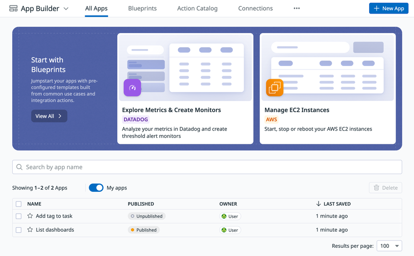
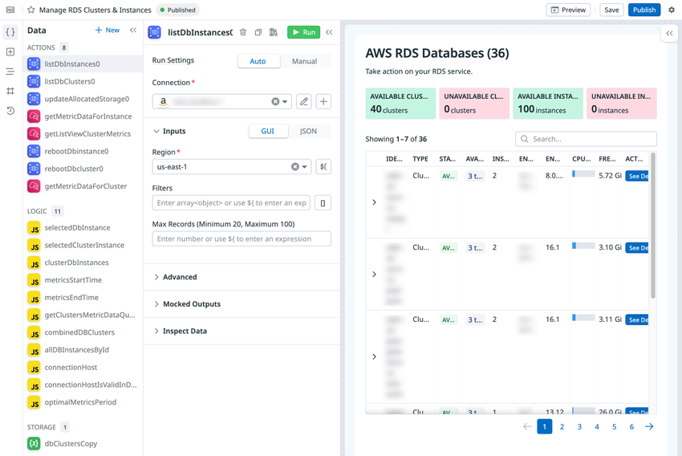
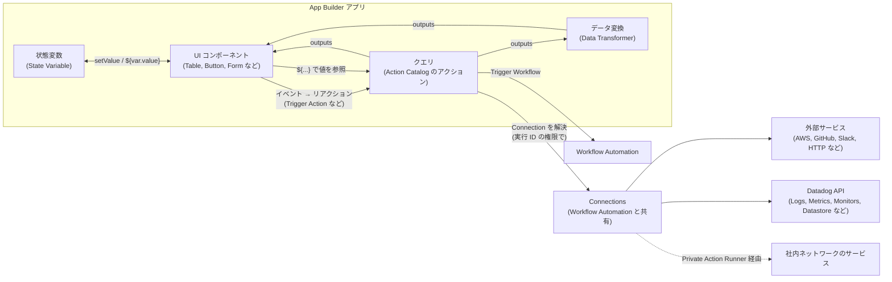
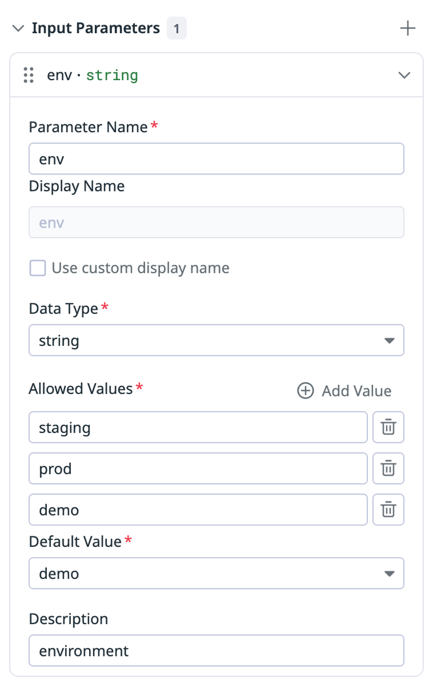
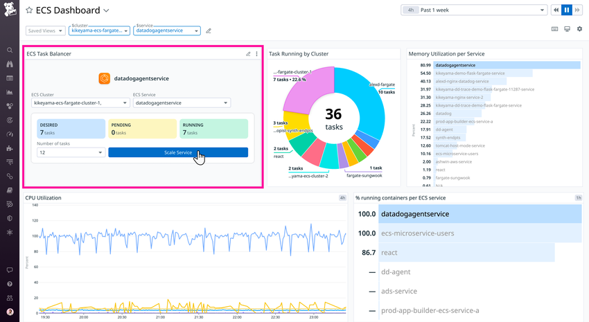
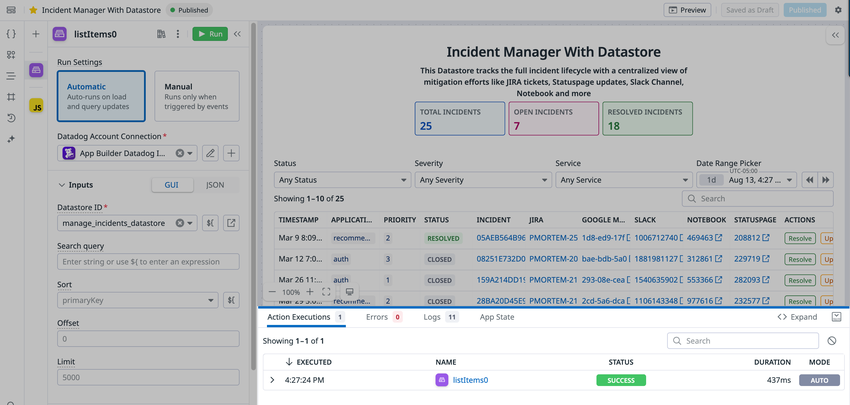

# App Builder

## 概要

Datadog App Builder（アプリビルダー）は、Datadog の中で社内向けの運用ツール（internal tools）を作るローコード開発基盤である。ドラッグ＆ドロップの画面エディタ、組み込みの JavaScript、AWS や GitHub などとの連携アクションを使い、障害対応やトラブルシュートの画面からそのまま操作（再起動、スケール、チケット起票など）を実行できるアプリを作る。[出典](https://docs.datadoghq.com/actions/app_builder/)

App Builder の要点は次のとおり。

| 項目 | 内容 | 出典 |
|---|---|---|
| 位置づけ | Datadog の「Actions」製品群の1つ。Workflow Automation、Connections、Action Catalog、Datastores、Forms、Private Actions と同じ基盤を共有する | [Actions](https://docs.datadoghq.com/actions/) |
| 開発方式 | ローコード（GUI エディタ + JavaScript 式）。コードで作る版として **Datadog Apps** `【Preview】` がある | [App Builder](https://docs.datadoghq.com/actions/app_builder/)、[Datadog Apps](https://docs.datadoghq.com/actions/datadog_apps/) |
| データ取得・操作 | Action Catalog のアクション（クエリ）を使う。連携がない対象には HTTP リクエストや JavaScript 関数のアクションを使う | [App Builder](https://docs.datadoghq.com/actions/app_builder/) |
| 認証情報 | Connections（接続）を使う。Connections と Action Catalog は Workflow Automation と共有 | [Access and Auth](https://docs.datadoghq.com/actions/app_builder/access_and_auth/) |
| 利用場所 | App Builder のアプリ一覧から開く、ダッシュボードやノートブックに埋め込む、IDP の Self-Service Actions に掲載する | [Embedded Apps](https://docs.datadoghq.com/actions/app_builder/embedded_apps/) |
| AI 支援 | Bits AI にプロンプトを入力して、アプリの UI・アクション・ロジックを生成・修正できる | [Build Apps](https://docs.datadoghq.com/actions/app_builder/build/) |
| 課金単位 | 公開済み（published）アプリ 1 つあたり月額。未公開アプリは無料 | [Pricing](https://www.datadoghq.com/pricing/?product=app-builder) |
| 提供開始 | 2023-11 に公式ブログで発表、2024-06-17 に一般提供（GA）をプレスリリースで発表 | [ブログ](https://www.datadoghq.com/blog/datadog-app-builder-low-code-internal-tools/)、[プレスリリース](https://www.datadoghq.com/about/latest-news/press-releases/datadog-launches-new-app-builder-for-devsecops-teams/) |

公式ドキュメントに載っている App Builder の利用例は次のとおり。[出典](https://docs.datadoghq.com/actions/app_builder/)

- インシデントの説明とリポジトリの最近のコミットから、リグレッションの原因候補を探す
- インシデント中に PagerDuty のサービス状態を監視する
- ダッシュボードから EC2 インスタンスを管理する
- S3 バケットの中身を閲覧する
- PagerDuty を使ってチームごとの当番者を表示する
- リポジトリのプルリクエストの進み具合を要約する

関連する製品との分担は次のとおり。

| やりたいこと | 使う製品 | 参照先 |
|---|---|---|
| 人が画面で操作するツールを作る | App Builder（本ファイル） | — |
| 複数ステップの処理をトリガー（モニター、スケジュール等）で自動実行する | Workflow Automation | [Workflow Automation](./workflow-automation.md) |
| 開発者向けのセルフサービス操作を一覧で提供する | Internal Developer Portal の Self-Service Actions | [Software Catalog](../platform/software-catalog.md) |
| アラートやインシデントの対応手順を管理する | Incident Management、Case Management | [Incident Management](./incident-management.md)、[Case Management](./case-management.md) |
| ダッシュボードにアプリを置く | Dashboards の App ウィジェット | [Dashboards](../platform/dashboards.md) |

> **補足:** Action Catalog、Connections（Connection Groups を含む）、Private Action Runner の仕様は [Workflow Automation](./workflow-automation.md) を正とする。本ファイルでは App Builder から使うときの要点だけを書く。

## 画面構成

App Builder の画面は、Datadog のメニュー **Actions** > **App Builder**（URL は `https://app.datadoghq.com/app-builder/`、サイトによりホスト名が異なる）から開く。[出典](https://docs.datadoghq.com/actions/app_builder/access_and_auth/)



- **キャプション:** App Builder のアプリ一覧画面（All Apps タブ、「My apps」トグルで自分のアプリだけを表示）
- **画面説明:** 上部に「App Builder」の見出しと、**All Apps**、**Blueprints**、**Action Catalog**、**Connections** のタブ、右上に **+ New App** ボタンがある。その下に「Start with Blueprints」の帯があり、「Explore Metrics & Create Monitors（DATADOG）」「Manage EC2 Instances（AWS）」などのブループリントのカードが並ぶ。さらに下にアプリ名の検索欄、**My apps** トグル、アプリの一覧表（列：NAME、PUBLISHED（Published / Unpublished）、OWNER、LAST SAVED）がある。各行の星アイコンでお気に入り登録ができる。右下に「Results per page」（例：100）がある。
- **出典:** https://docs.datadoghq.com/actions/app_builder/build/ （画像取得日 2026-11-03）

App Builder のアプリ一覧では、各アプリについて作成者、タグ、最終更新日、公開状態が表示される。アプリにマウスを重ねると、編集・削除・表示・複製のアイコンが出る。[出典](https://docs.datadoghq.com/actions/app_builder/build/)



- **キャプション:** App Builder のアプリ編集画面（「Manage RDS Clusters & Instances」アプリ）
- **画面説明:** 左端に縦のアイコンバー（Data `{ }`、Components 追加、App Properties、Version history など）がある。その右の **Data** パネルには **ACTIONS**（`listDbInstances0`、`rebootDbInstance0` などのクエリ）、**LOGIC**（JS アイコンのデータ変換。`selectedDbInstance` など）、**STORAGE**（状態変数。`dbClustersCopy`）が並び、右上に **+ New** がある。中央は選択したクエリの設定パネルで、**Run Settings**（Auto / Manual）、**Connection**（AWS 接続を選ぶ）、**Inputs**（GUI / JSON 切り替え、Region、Filters、Max Records）、折りたたみの **Advanced**、**Mocked Outputs**、**Inspect Data** がある。右側はアプリのキャンバスで、「AWS RDS Databases (36)」の見出し、件数を示すコールアウト（AVAILABLE CLUSTERS など）、ページ送り付きの表が表示されている。上部にはアプリ名、「Published」の状態表示、右上に **Preview**、**Save**、**Publish**、設定（歯車）アイコンがある。
- **出典:** https://docs.datadoghq.com/actions/app_builder/ （画像取得日 2026-11-03）

App Builder のエディタは、左側にクエリ一覧とクエリ編集、右側にアプリのキャンバスと UI コンポーネントを置く構成である。[出典](https://docs.datadoghq.com/actions/app_builder/build/)

## アーキテクチャとデータの流れ

App Builder のアプリは、UI コンポーネント、クエリ（アクション）、データ変換、状態変数の4種類の部品で構成される。クエリは Connections の認証情報を使って Datadog API や外部サービスを呼び、その出力を JavaScript 式でコンポーネントに渡す。



App Builder の API 定義でも、アプリは `components`（ルートは `grid` コンポーネント）と `queries`（型は `action`、`stateVariable`、`dataTransform`）で表される。[出典](https://docs.datadoghq.com/api/latest/app-builder/)

## 主要な用語

| 用語 | 説明 | 出典 |
|---|---|---|
| App（アプリ） | App Builder で作る 1 つの画面アプリ。下書き（未公開）と公開済み（published）の状態がある | [Build](https://docs.datadoghq.com/actions/app_builder/build/) |
| Blueprint（ブループリント） | よくある用途のテンプレート。デモデータ入りで提供される | [Build](https://docs.datadoghq.com/actions/app_builder/build/) |
| Component（コンポーネント） | Button、Table、Form などの UI 部品 | [Components](https://docs.datadoghq.com/actions/app_builder/components/) |
| Query（クエリ） | Datadog API や連携先からデータを取得・操作するアクション | [Queries](https://docs.datadoghq.com/actions/app_builder/queries/) |
| Action Catalog | 連携ごとのアクションの一覧。Workflow Automation と共有 | [App Builder](https://docs.datadoghq.com/actions/app_builder/) |
| Connection（接続） | アクションが外部サービスに認証するための資格情報 | [Connections](https://docs.datadoghq.com/actions/connections/) |
| Data Transformer（データ変換） | 複数のクエリの出力を組み合わせて加工する JavaScript | [Queries](https://docs.datadoghq.com/actions/app_builder/queries/) |
| State Variable（状態変数） | アプリ内でコンポーネントをまたいで値を保持・操作する変数 | [Variables](https://docs.datadoghq.com/actions/app_builder/variables/) |
| Event / Reaction | コンポーネントのイベント（click など）と、それに対する反応（クエリ実行、モーダル表示など） | [Events](https://docs.datadoghq.com/actions/app_builder/events/) |
| State Function | `setValue` など、コンポーネントの状態を変える関数 | [Events](https://docs.datadoghq.com/actions/app_builder/events/) |
| Input Parameter（入力パラメーター） | 埋め込み先ごとに値を変えられるアプリの引数 | [Input Parameters](https://docs.datadoghq.com/actions/app_builder/embedded_apps/input_parameters/) |
| Reusable Module | コンポーネントとクエリのまとまりを部品として保存したもの | [Reusable Modules](https://docs.datadoghq.com/actions/app_builder/components/reusable_modules/) |
| Saved Action | パラメーター設定済みのアクションを保存して再利用するもの | [Saved Actions](https://docs.datadoghq.com/actions/app_builder/saved_actions/) |
| Datastore | App Builder と Workflow Automation から使える構造化データの保存先 | [Datastores](https://docs.datadoghq.com/actions/datastores/) |
| Datadog Apps | React と TypeScript / JavaScript でアプリをコードとして作る仕組み `【Preview】` | [Datadog Apps](https://docs.datadoghq.com/actions/datadog_apps/) |

## アプリの作成方法

App Builder で **New App** を押すと、次の6つの始め方を選べる。[出典](https://docs.datadoghq.com/actions/app_builder/build/)

| 始め方 | 内容 | 向いている場面 |
|---|---|---|
| Build with AI（Bits AI） | プロンプトを入力すると、Bits AI が UI・アクション・ロジックを生成する。既存のデータと権限に合わせて作られ、チャットで修正できる | 作りたいものが文章で説明できるとき |
| Blueprint | テンプレートから作る。デモデータ入り | よくある用途（EC2 管理など）から始めるとき |
| Layout | 最小構成の雛形（Table Manager、Form、Custom Chart）から作る | 最速で最小のアプリを作るとき |
| Action | 連携とアクションを選ぶと、アクションとクエリが実データで事前設定される | 使う連携とアクションが決まっているとき |
| Start From Scratch | 空のキャンバスから作る | 自由に作るとき |
| App Playground | 対話型のガイド付きデモ | 操作を覚えるとき |

### Build with AI（Bits AI で生成）

Bits AI でアプリを作る手順は次のとおり。[出典](https://docs.datadoghq.com/actions/app_builder/build/)

1. 提案されたプロンプトを選ぶか、自分でプロンプトを書く。詳しく書くほど結果がよくなる。例：「AWS Lambda 関数を、名前で絞り込めて件数制限のある表で一覧表示する」「GitHub のプルリクエストを表で表示する」。
2. Enter を押す。生成中に次のことを聞かれる場合がある。
   - 実データに接続するか、データなしでレイアウトだけ作るか
   - 確認の質問（回答を入力して Enter）
   - 追加したアクションのモック出力を使うか。使うと Bits AI が出力の形を推定してコンポーネントにつなぐ。使わない場合は後で手動で出力をつなぐ
3. **Edit with AI** で続けて修正するか、手動で編集する。

既存のアプリを Bits AI で直すときは、アプリ一覧で編集アイコンを押し、Bits AI アイコンを押して、使う連携とアクションを含む詳しいプロンプトを入力する。[出典](https://docs.datadoghq.com/actions/app_builder/build/)

公式ブログ（2025-11-24 公開）によると、会話型 AI 生成では、例えば「動いている SQS キューをすべて表示し、メッセージをパージできるアプリを作って」というプロンプトから、Amazon SQS のメトリクスにつながった表が生成される。ブループリントの修正（グラフの追加など）を文章で指示でき、変更前後の差分を確認してから適用できる。[出典](https://www.datadoghq.com/blog/generate-apps-with-ai/)（2025-11-24 公開）

### Blueprint（ブループリント）

App Builder のブループリントは、よくある用途向けのテンプレートで、デモデータが入っている。[出典](https://docs.datadoghq.com/actions/app_builder/build/)

| 種類 | 例 | 特徴 |
|---|---|---|
| Starter apps | Manage Datastore、Export Synthetics | カスタマイズして使う前提の雛形 |
| How to blueprints | How to: Custom Code、How to: Input Parameters | 使い方の説明（チュートリアル）が組み込まれている |

手順：**Blueprints** タブ → ブループリントを選ぶ → **Open in Editor** → カスタマイズ。インテグレーションのページで連携を選び、**Monitoring Resources** からもブループリントを開ける。[出典](https://docs.datadoghq.com/actions/app_builder/build/)

ブループリントの数は公式ドキュメントに記載がない。クラスメソッドの検証記事（2025-07-04 公開）では「48種類」と書かれている【第三者情報】。[出典](https://dev.classmethod.jp/articles/datadog-app-builder-manage-ec2/)（2025-07-04 公開。現在の数とは異なる可能性がある）

### Layout（レイアウト）

| レイアウト | 内容 |
|---|---|
| Table Manager | クエリの結果を一覧表示し、絞り込み・並べ替えをする |
| Form | 入力を集めてアクション（作成、更新、依頼など）を実行する |
| Custom Chart | クエリの結果をあらかじめ用意された棒グラフで表示する |

手順：オンボーディング画面で **Layouts** → レイアウトを選ぶ → **Use Layout**。[出典](https://docs.datadoghq.com/actions/app_builder/build/)

### Action（アクションから作成）

手順：オンボーディング画面で **Action** → 連携を選ぶ → **Continue** → アクションを選ぶ → **Create**。選べるアクションの数に上限はない。Datadog Datastore のように、使う連携とアクションが決まっているときに向く。[出典](https://docs.datadoghq.com/actions/app_builder/build/)

### App Playground

App Playground は対話型のガイド付きデモで、次の内容を学べる。キャンバス上の「Fetching Data」などの要素を押すと説明が出る。[出典](https://docs.datadoghq.com/actions/app_builder/build/)

- データの取得
- クエリの結果を表に表示する
- ボタンでクエリを実行する
- クエリの読み込み中状態をコンポーネントに反映する
- データをグラフで表示する

### Datadog が用意したアプリ（Created by Datadog）

Datadog が作った既製アプリは、インテグレーションのダッシュボードに入っており、作る必要はなく接続を設定するだけで使える。例えば EC2 インテグレーションのダッシュボードには、EC2 インスタンス管理アプリがデモデータ付きで入っている。自分のデータを使うには **+ Connect Data** で接続を作成または選択し、後から変えるときは **Change Connection** を使う。[出典](https://docs.datadoghq.com/actions/app_builder/)

ダッシュボードのウィジェット追加画面の **Apps** タブにある **Created by Datadog** には、AWS や Azure のリソース管理、PagerDuty や LaunchDarkly の設定管理などの既製アプリがあり、ドラッグするだけで置ける。[出典](https://docs.datadoghq.com/actions/app_builder/embedded_apps/)

## アプリの編集・保存・公開

App Builder でアプリを編集する手順は次のとおり。[出典](https://docs.datadoghq.com/actions/app_builder/build/)

1. App Builder でアプリにマウスを重ね、編集アイコンを押す。
2. 必要に応じて編集する。
   - **App properties:** アプリ名を押すと、名前、説明、タグ、外観を編集できる
   - **Input parameters:** [入力パラメーター](#入力パラメーター)を参照
   - **Components:** Add Component アイコンで Components タブを開き、コンポーネントを押すかキャンバスへドラッグする
3. **View**（画面によっては **Preview**）で利用者から見た表示を確認する。表示モードでクエリをテストし、**Edit** で編集に戻る。
4. **Save** で保存する。
5. 準備ができたら **Publish** で公開する。公開すると、アプリをダッシュボードで使えるようになる。

App Builder のアプリの状態と公開の扱いは次のとおり。

| 項目 | 内容 | 出典 |
|---|---|---|
| 保存しただけのアプリ | 保存しても「unpublished（未公開）」のまま | [Pricing FAQ](https://www.datadoghq.com/pricing/?product=app-builder) |
| 公開（Publish） | チームへの配布やダッシュボード等への埋め込みには公開が必要 | [Pricing FAQ](https://www.datadoghq.com/pricing/?product=app-builder) |
| 公開版の固定 | 公開済みアプリは特定のバージョンに固定される。アプリを編集しても、再公開するまで公開版は変わらない。API の `updated_since_deployment` で公開後に変更があったかが分かる | [List Apps API](https://docs.datadoghq.com/api/latest/app-builder/list-apps/) |
| 埋め込み時の版 | 埋め込まれたアプリは最新の公開版を表示する | [Embed Apps](https://docs.datadoghq.com/actions/datadog_apps/embed_apps/) |
| 非公開化（Unpublish） | いつでも非公開に戻せる。非公開にすると課金対象でなくなる | [Pricing FAQ](https://www.datadoghq.com/pricing/?product=app-builder) |
| 公開の承認 | API でアプリの保護レベルを `approval_required` にすると、以後の公開は承認ワークフローを通す必要がある。承認権限のあるユーザーが承認すると自動で公開される | [Protection Level API](https://docs.datadoghq.com/api/latest/app-builder/update-app-protection-level/)、[Publish Request API](https://docs.datadoghq.com/api/latest/app-builder/create-publish-request/) |

> **補足:** 公開の承認（`approval_required`）の UI 上の操作手順と、承認できるユーザーの条件（必要な権限）は、公開情報では確認できず。

### キャンバスとコンポーネントの操作

- コンポーネントはドラッグして配置を変える。
- 各コンポーネントに設定項目がある。例：Text Input は既定値、プレースホルダー、ラベル。Button はラベルと押下イベント。
- **Appearance** 節で見た目と動作（ボタンの無効化、表示・非表示など）を設定する。
- コンポーネントを選んで「…」から削除・複製する。
- JavaScript 式はどこでも使え、独自の動作を作れる。

[出典](https://docs.datadoghq.com/actions/app_builder/build/)

### タグ付けとお気に入り

| 操作 | 手順 | 出典 |
|---|---|---|
| タグ付け | **App Properties** タブ → Tags で既存タグを選ぶか、新しい値を入力して **Add option: [入力値]** → 保存。タグはアプリ一覧の列に表示され、一覧でタグを押すとクリップボードにコピーされる | [Build](https://docs.datadoghq.com/actions/app_builder/build/) |
| お気に入り | アプリ名の横の星アイコンを押す。ページを再読み込みすると、星を付けたアプリが一覧の上に表示される | [Build](https://docs.datadoghq.com/actions/app_builder/build/) |

### バージョン履歴

App Builder は保存したすべてのバージョンを記録する。アプリの左メニューのバージョン履歴アイコンを押すと、過去に保存・公開したバージョンが、保存・公開したユーザーのアイコンとともに一覧表示される。[出典](https://docs.datadoghq.com/actions/app_builder/build/)

| 操作 | 内容 |
|---|---|
| View | バージョンを押すと内容を表示する |
| Restore | バージョンを選び、右上の **Restore Version** で現在のアプリを上書きする |
| Clone | バージョンを選び、右上の **Clone Version** でそのバージョンから新しいアプリを作る |

API では、バージョン一覧の取得（`GET /api/v2/app-builder/apps/{app_id}/versions`）、バージョンへの名前付け（`PATCH .../version-name`）、リバート（`POST .../revert`）ができる。[出典](https://docs.datadoghq.com/api/latest/app-builder/)

### JSON での編集とコピー

| 操作 | 手順 | 出典 |
|---|---|---|
| JSON で編集 | 設定（歯車）アイコン → **Switch to JSON**。戻すときは設定メニューの **Switch to GUI** | [Build](https://docs.datadoghq.com/actions/app_builder/build/) |
| コピー・バックアップ | JSON 表示で JSON 全体をコピーし、テキストエディタに保存する。開発途中の状態を保存しておくとよい | [Build](https://docs.datadoghq.com/actions/app_builder/build/) |
| 別の組織へコピー | コピー先の組織でアプリを作り、**Settings > Switch to JSON** で JSON を保存したものに置き換える | [Build](https://docs.datadoghq.com/actions/app_builder/build/) |
| Terraform 用に書き出す | App Builder の画面の export ボタンで、Terraform で使う JSON を書き出せる | [Terraform](https://registry.terraform.io/providers/DataDog/datadog/latest/docs/resources/app_builder_app) |

> **注意:** 別の組織へ JSON でコピーしても、Connection（接続）は組織ごとに別物である。コピー先では接続を選び直す必要がある【推定】（Connection ID が組織固有であることからの推定。Terraform リソースが接続 ID の上書き用の引数 `action_query_names_to_connection_ids` を持つことも根拠）。

## コンポーネント

App Builder のコンポーネントの一覧と主な設定項目は次のとおり。多くのコンポーネントに **Is Visible**（表示・非表示）と **Inspect data**（プロパティと値を JSON で表示）がある。「文字列または式」は、文字列か `${...}` の JavaScript 式を入れられることを表す。[出典](https://docs.datadoghq.com/actions/app_builder/components/)

価格ページでは「20+ UI components」と説明されている。[出典](https://www.datadoghq.com/pricing/?product=app-builder)

### コンポーネント一覧

| コンポーネント | 主な設定項目 | イベント | State Function |
|---|---|---|---|
| Button | Label、Intent（default / danger / success / warning）、Is Primary、Is Borderless、Is Loading、Is Disabled、Is Visible | click | — |
| Callout value | Label、Value、Unit、Style（default、success、warning、danger、blue、purple、pink、orange、yellow、red、green、gray と各 vivid 色）、Size（sm / md / lg / xl）、Is Loading、Is Disabled、Is Visible | — | — |
| Checkbox | Label、Options（`{label, value}` の配列を返す式。最低 1 つ）、Is Multiline（折り返し）、Is Disabled、Is Visible | change | — |
| Container | Is Visible | — | — |
| Custom chart | Vega Specification（Vega-Lite または Vega の JSON）、Is Loading、Is Visible | — | — |
| Date picker | Label、Tooltip（Markdown 可）、Default Value（UNIX ミリ秒の整数）、Allow Future Dates、Is Visible | change | `setValue` |
| Date range picker | Default timeframe（past 5 minutes / 30 minutes / 1 hour / 4 hours / 1 day）、Is Visible | change | 公式表に記載なし（埋め込み例では `setValue` を使用） |
| Divider | Is Visible | — | — |
| File input | Accepted File Types（`.csv`、`.json`）、Is Visible | change | — |
| Image | Source（URL またはファイル。JPG / PNG / GIF、アップロードは最大 4 MB）、Fit（fill / contain / cover / none）、Padding、Vertical / Horizontal Alignment、Border、Transparent Background、Is Loading、Is Visible | — | — |
| Integration logo | Integration Id（例：`datadog`、`amazon-s3`、`postgres`、`okta`）、Horizontal / Vertical Alignment、Is Visible、Is Loading | — | — |
| Form | Title、Default value（例：`{"org":"frontend"}` で `org` 欄を埋める）、Fields（`textInput`、`select`、`textArea`、`text`）、Is Visible、Is Disabled | submit、change、validate | `setValue` |
| JSON input | Label、Default value、Is Read Only、Is Visible | change | — |
| Modal | Title、Size（sm / md / lg）、Is Visible | toggleOpen、close、open | `setIsOpen` |
| Number input | Label、Placeholder text、Default value、Min、Max、Is Disabled、Is Visible | change | `setValue` |
| Radio | Label、Options（`{label, value}` の配列）、Default value、Is Disabled、Is Visible | change | `setValue` |
| React renderer | React Component Definition、Component Input Props、Initial Component State、Is Visible | 独自（`props.customFunctionName` で定義） | 公式表に記載なし |
| Search | Default value、Placeholder text、Size（sm / md / lg）、Is Loading、Is Visible | change、submit | `setValue` |
| Select | Label、Placeholder text、Options（`{label, value}` の配列）、Default value、Is Multiselect、Is Disabled、Is Visible | change | `setValue` |
| Side panel | Title、Width（整数 + `%`）、Hide Close Button | toggle open、close、open | `setIsOpen` |
| Tab | Tabs（+ で追加）、Style（Default / purple / pink / orange / red / green）、Alignment（Horizontal / vertical）、Impact（High / low）、Hide Tabs、Hide Body、Is Visible | change | `setTabIndex` |
| Table | Title（Markdown 可）、Data source、Columns、Pagination、Sorting、Row actions、Appearance | pageChange、tableRowClick | `setSelectedRow`、`setPageIndex` |
| Text | Content、Content type（plain text / Markdown）、Text alignment、Vertical alignment、Is Visible | — | — |
| Text area | Label、Default value、Placeholder text、Is Disabled、Is Visible | change、submit | `setValue` |
| Text input | Label、Default value、Placeholder text、Is Disabled、Is Visible | change、submit | `setValue` |

[出典](https://docs.datadoghq.com/actions/app_builder/components/)

> **補足:** Events ページの State Function 表では、`setValue` の対象は Form、Number Input、Radio Button、Search、Select、Text Area、Text Input と書かれており、Date picker は含まれていない。一方、Components ページでは Date picker に `setValue` があると書かれている。また Side panel の `setIsOpen` は Events ページの表に含まれていない。コンポーネントごとの正確な対応は Components ページを優先して確認すること。[出典](https://docs.datadoghq.com/actions/app_builder/events/)

### Form コンポーネントの Fields

| 項目 | 内容 |
|---|---|
| Field name | 一意の識別子。式から参照する |
| Label | 文字列または式 |
| Content | `text` 型のフィールド用 |
| Options | `select` 型用。`const`（値）と任意の `title`（表示名）を持つオブジェクトの配列。GUI（既定）または raw JSON で設定 |
| Placeholder text | `textInput` と `textArea` 用 |
| Is Disabled / Is Visible / Is Required | オン・オフ |

[出典](https://docs.datadoghq.com/actions/app_builder/components/)

> **補足:** ここでいう Form は App Builder の UI コンポーネントである。独立した製品の [Forms](#forms) とは別物。

### Table コンポーネント

Table は App Builder で最もよく使うコンポーネントで、設定項目が多い。[出典](https://docs.datadoghq.com/actions/app_builder/components/)

| 設定 | 内容 |
|---|---|
| Data source | query、demo data、components |
| Columns | Label、Data path（入れ子の値への JSON パス）、Formatting（string、link、status pill、date / time、markdown、tags、percent bar、number、score bar、avatar）、Sortable、Filterable、Copyable。Formatting により追加の項目がある |
| Pagination | Has summary、Page size、Total count、Type（client side / server side） |
| Sorting | Column、Direction（ascending / descending） |
| Row actions | Actions 列を追加する。複数可。Label、Primary、Borderless、Disabled、Level（default / danger / success / warning）、Reactions（download file、open modal、close modal、open side panel、close side panel、open URL、set component state、set state variable value、toast notification、trigger action、custom） |
| Appearance | Scrollable（both / vertical）、Is Loading、Has text wrapping、Has subrows（データに `subRows` プロパティが必要）、Is searchable、Show sort options、Show column options、Has date range filter、Is Visible |

Table の絞り込み方法は次の2通りがある。[出典](https://docs.datadoghq.com/actions/app_builder/components/tables/)

| 方式 | 方法 | 例 |
|---|---|---|
| クライアント側 | 列フィルター、日付範囲フィルター、検索バー、Text Input や Select と連動する JavaScript の `filter()` 式、Post-query transformation。加工前の結果は `rawOutputs` に残る | — |
| サーバー側 | クエリ自体（多くはリクエスト URL）に、入力コンポーネントの値を参照するテンプレート式を入れる。Run Settings が Auto なら入力値が変わると再実行され、表が更新される | GitHub PR pipeline ブループリントの `listOpenedPulls` クエリ。`organizationInput.value` と `userNameInput.value` で組織と作成者を絞る |

Table の読み込み中表示は、Table の `isLoading` にクエリの `isLoading` を割り当てて実現する。[出典](https://docs.datadoghq.com/actions/app_builder/components/tables/)

### Custom chart（Vega-Lite）

Custom chart は [Vega-Lite](https://vega.github.io/vega-lite/examples/) の仕様でクエリのデータを可視化する。手順は次のとおり。[出典](https://docs.datadoghq.com/actions/app_builder/components/custom_charts/)

1. グラフにしたいデータを返すクエリを作る（または選ぶ）。
2. Custom Chart コンポーネントを追加し、**Show Chart Examples** から形（例：Simple Histogram）を選ぶ。
3. 例の値をクエリのデータに置き換える。

公式の例（Datadog Search logs アクションで取得したログのサービス別ヒストグラム）は次のとおり。仕様全体を `${{ ... }}` で囲むと、クエリの参照が評価される。

```json
${{
    "$schema": "https://vega.github.io/schema/vega-lite/v5.json",
    "data": { "values": searchLogs0.outputs.logs },
    "mark": { "type": "bar", "tooltip": true },
    "encoding": {
        "x": { "field": "content.service" },
        "y": { "aggregate": "count" }
    }
}}
```

### React renderer

React renderer は、React で完全に独自の UI コンポーネントを作るためのコンポーネントである。必要な設定は次の3つ。[出典](https://docs.datadoghq.com/actions/app_builder/components/react_renderer/)

| 設定 | 内容 | 例 |
|---|---|---|
| Component definition | React コンポーネントのコード。最後にコンポーネントを `return` する | `const App = (props) => {...}; return App;` |
| Input props | コンポーネントに渡すデータ。`props` で参照 | `${{ queryData: query0.outputs, name: global?.user?.name, state: self.state }}` |
| Initial component state | 共有状態の初期値。`props.state` で参照 | `${{ count: 0, items: [], isLoading: false, selectedId: null }}` |

コンポーネント内では `React.useState` などの React API を使える。共有状態は `props.setComponentState` で更新し、コンポーネントの外でも保持される。[出典](https://docs.datadoghq.com/actions/app_builder/components/react_renderer/)

> **補足:** React renderer で使える外部ライブラリ、制限事項、セキュリティ上の制約は、公開情報では確認できず。

### Reusable Modules（再利用モジュール）

Reusable Modules は、コンポーネントとクエリのまとまりをテンプレートとして保存し、別のアプリでも使えるようにする機能である。モジュールは依存するクエリ（入れ子の依存を含む）を自動で含む。既定のモジュールは読み取り専用で、変えるときは複製してから編集する。[出典](https://docs.datadoghq.com/actions/app_builder/components/reusable_modules/)

| 操作 | 手順 |
|---|---|
| 作成（コンポーネントパネルから） | 展開アイコンでコンポーネントパネルを開く → コンポーネントを選ぶ → メニューアイコン → **Create Module** |
| 作成（キャンバスから） | キャンバスでコンポーネントを選ぶ → インスタンス名タブの **Create Module** アイコン |
| 作成（複数選択） | Shift を押しながら複数のコンポーネントを選ぶ → 右のサイドパネルで **Create Module** |
| 設定 | 名前と説明を入力し、自動で含まれたコンポーネントとクエリを確認して **Save Module** |
| アプリに追加 | **Add Component** アイコン → **Modules** 節でモジュールを押すかドラッグ |
| 削除 | **Add Component** アイコン → **Modules** 節でモジュールの編集アイコン → **Delete Module** |

## クエリ

App Builder のクエリは、Datadog API や対応する連携先からデータを取得・操作するアクションである。他のクエリや UI コンポーネントから入力を受け取り、出力を返す。Data タブで「+」→ **Actions** を選び、Action Catalog からアクションを検索して追加する。Bits AI でクエリを追加・設定・実行することもできる。クエリは Connections で認証する。[出典](https://docs.datadoghq.com/actions/app_builder/queries/)

Action Catalog のアクション数は、出典によって数値が異なる。公式ドキュメント（Workflow Automation）では「2,000 以上（over 2000+ actions）」、価格ページでは「1,750+」、App Builder 概要ページでは「hundreds of actions」と書かれている（いずれも 2026-11-02 取得）。2024-06 の GA 時のプレスリリースでは「550+」だった。Action Catalog の詳細は [Workflow Automation](./workflow-automation.md) を参照。[出典](https://docs.datadoghq.com/actions/workflows/)、[出典](https://www.datadoghq.com/pricing/?product=app-builder)、[出典](https://docs.datadoghq.com/actions/app_builder/)、[プレスリリース](https://www.datadoghq.com/about/latest-news/press-releases/datadog-launches-new-app-builder-for-devsecops-teams/)

### Run Settings（実行設定）

| 設定 | 動作 |
|---|---|
| Auto | アプリの読み込み時と、クエリの引数が変わったときに実行する |
| Manual | ボタンのクリックなど、アプリの他の部分から呼ばれたときだけ実行する |

[出典](https://docs.datadoghq.com/actions/app_builder/queries/)

### Advanced（詳細オプション）

| オプション | 内容 | 既定値 |
|---|---|---|
| Debounce | クエリの実行頻度を抑える。間隔内に複数の要求が来た場合、最後の1つだけを実行する | 0 ms |
| Conditions | 実行前に `true` になる必要がある JavaScript 式。例：`${select0.value && select0.value.length > 0}` | 未設定 |
| Post-query transformation | 生の出力を `outputs` で加工する。副作用のない純粋関数にすること | 未設定 |
| Post-query hooks | 実行後にリアクション（UI 状態の設定、モーダルの開閉、別クエリの実行、独自 JavaScript）を起動する。State Function も使える | 未設定 |
| Show Toast on Errors | エラー時に短い通知を表示する | 公開情報では確認できず |
| Requires Confirmation | 実行前に利用者へ確認を求める | 公開情報では確認できず |
| Polling interval | N ミリ秒ごとにクエリを再実行する。**誰かがアプリを開いている間だけ**動き、バックグラウンドでは動かない | 未設定 |

[出典](https://docs.datadoghq.com/actions/app_builder/queries/)

> **注意:** Polling interval はバックグラウンド処理の代わりにならない。定期実行が必要な処理は [Workflow Automation](./workflow-automation.md) のスケジュールトリガーを使う。

### Mocked outputs（モック出力）

Mocked outputs は、開発・テスト中に実際の呼び出しをせずに済ませる機能である。有効にすると **Run** ボタンが **Run (Mocked)** に変わる。[出典](https://docs.datadoghq.com/actions/app_builder/queries/)

| 作り方 | 手順 |
|---|---|
| 前回の実行から作る | クエリを一度実行 → Mocked outputs 節 → **Generate** タブ → **Generate from outputs**。これで Use Mocked Outputs が有効になる |
| 手動（GUI タブ） | 必須項目を入力し、任意項目を（+）で追加 |
| 手動（JSON タブ） | 期待する出力形式の JSON を貼る。形式が分からない場合はクエリを一度実行して `outputs` を確認する |

### クエリの実行順序

App Builder のクエリは次の順で処理される。[出典](https://docs.datadoghq.com/actions/app_builder/queries/)

1. Condition を評価する。満たさなければ止まる。
2. Inputs を評価する。
3. Debounce を適用する（設定時）。
4. クエリを実行する。
5. 生の応答を `query.rawOutputs` に格納する。
6. Post-query transformation を実行し、`query.outputs` を設定する。
7. 依存する式を再計算する。
8. Events のリアクションを UI で定義した順に実行する。各実行の前に最新の状態を取り直す。
9. Polling interval が設定されていれば、次の実行を予約する。

### Workflow を呼び出す

App Builder のアプリから Workflow Automation のワークフローを呼び出し、その結果をアプリに表示できる。公式の例では、ボタンでワークフローを起動し、ワークフローが Slack で投票を出し、回答に応じて2つの HTTP GET のどちらかを呼ぶ。結果は `${triggerWorkflow0?.outputs?.workflowOutputs?.output}` で表示し、ボタンの Is Loading に `${triggerWorkflow0.isLoading}` を割り当てる。[出典](https://docs.datadoghq.com/actions/app_builder/queries/)

アプリから起動したワークフローの実行は Workflow Automation の実行として数えられる【推定】（Workflow Automation の課金単位が「ワークフロー実行 100 回」であることからの推定。公式に明記した記述は確認できず）。

## データ変換・状態変数・JavaScript 式

### Data Transformer（データ変換）

Data Transformer は、複数のクエリのデータを組み合わせて加工する部品である。Transformers パネル（Σ アイコン）で **+ Create Transformer** を押して作る。公式の例 `numberTransformer` は、`mathFact1.outputs.body` と `mathFact2.outputs.body` から最初の数値をそれぞれ取り出して合計を返す。結果は `${numberTransformer.outputs}` で表示する。[出典](https://docs.datadoghq.com/actions/app_builder/queries/)

API 上は、Data Transformer は `dataTransform` 型のクエリで、入力が変わったときにデータを加工する独自 JavaScript として定義される。[出典](https://docs.datadoghq.com/api/latest/app-builder/create-app/)

### State Variables（状態変数）

State Variables は、アプリの中でロジックをまとめ、コンポーネントをまたいでデータを保持・操作するための変数である。[出典](https://docs.datadoghq.com/actions/app_builder/variables/)

| 作り方 | 手順 |
|---|---|
| Bits AI | Build with AI アイコンを押し、変数の内容をプロンプトで説明する |
| 手動 | Data タブ（`{ }` アイコン）→「+」→ **Variable** → 名前を変える（任意）→ 初期値を設定 |

公式の例では、`callout_value`（初期値 `Pass`）と `callout_color`（初期値 `green`）を作り、Callout value の Value に `${callout_value.value}`、Style に `${callout_color.value}` を割り当てる。ボタンの `click` の独自コールバックで両方の変数の `setValue` を呼び、緑の Pass と赤の Fail を切り替える。[出典](https://docs.datadoghq.com/actions/app_builder/variables/)

API 上は、状態変数は `stateVariable` 型のクエリで、`defaultValue` を持つ。[出典](https://docs.datadoghq.com/api/latest/app-builder/create-app/)

### JavaScript Expressions（JavaScript 式）

App Builder の JavaScript 式の仕様は次のとおり。[出典](https://docs.datadoghq.com/actions/app_builder/expressions/)

| 項目 | 内容 |
|---|---|
| 言語 | 標準の（vanilla）JavaScript |
| 書き方 | 多くの欄では `${}` で囲む。Post-query transformation などコードエディタの欄では素の JavaScript を書く |
| 補完 | `${` と入力すると、使える式とコンポーネントの候補が出る |
| 型 | 式の結果はプロパティが期待する型に合わせる。例：Is Visible は Boolean |
| 実行環境 | サンドボックスで実行され、DOM やブラウザ API にはアクセスできない |
| アプリ状態 | 式からアプリの状態は読み取り専用 |

よく使う式の例は次のとおり。[出典](https://docs.datadoghq.com/actions/app_builder/expressions/)

| 用途 | 式 |
|---|---|
| 文字列の組み立て | `${textInput0.value} ${textInput1.value}!` |
| 条件付き表示（Is Visible） | `${textInput0.value && textInput1.value}` |
| 他の部品の表示状態で無効化 | `${!text0.isVisible}` |
| 利用者のチームで制御 | `${global.user.teams[0].name == 'Product Management'}` |
| クエリ実行中は無効化 | `${listInstances.isLoading}` |

参照できるプロパティは次の場所で確認できる。[出典](https://docs.datadoghq.com/actions/app_builder/expressions/)

- **App State:** App Properties パネルを下にスクロールした App State
- **Inspect Data:** コンポーネントやクエリを選び、Inspect Data までスクロール
- **Admin Console:** 設定（歯車）→ **Admin Console** → **Data**

### `global` オブジェクトで参照できる主な値

公式ドキュメントの例に出てくる `global` の値は次のとおり。`global` の全プロパティの一覧は、公開情報では確認できず。

| 式 | 内容 | 出典 |
|---|---|---|
| `global.user.name` | 利用者の名前 | [React renderer](https://docs.datadoghq.com/actions/app_builder/components/react_renderer/) |
| `global.user.teams` | 利用者の所属チーム（`name` を持つ配列） | [Expressions](https://docs.datadoghq.com/actions/app_builder/expressions/)、[Events](https://docs.datadoghq.com/actions/app_builder/events/) |
| `global.dashboard.templateVariables` | 埋め込み先ダッシュボードのテンプレート変数（`name`、`availableValues`、`value`、`values`） | [Embedded Apps](https://docs.datadoghq.com/actions/app_builder/embedded_apps/) |
| `global.dashboard.timeframe` | 埋め込み先ダッシュボードの期間（`start`、`end`） | [Embedded Apps](https://docs.datadoghq.com/actions/app_builder/embedded_apps/) |

## イベントとリアクション

App Builder の UI コンポーネントは、イベントに対してリアクションを起こす。使えるイベントはコンポーネントによって異なる（例：Button は click、Table は pageChange と tableRowClick）。アクションの実行完了もイベントになる。[出典](https://docs.datadoghq.com/actions/app_builder/events/)

API で定義されているイベント名は `pageChange`、`tableRowClick`、`_tableRowButtonClick`、`change`、`submit`、`click`、`toggleOpen`、`close`、`open`、`executionFinished` である。[出典](https://docs.datadoghq.com/api/latest/app-builder/create-app/)

### リアクションの一覧

イベントを起こせるコンポーネントは、次のリアクションをすべて使える。[出典](https://docs.datadoghq.com/actions/app_builder/events/)

| リアクション | 内容 | API の `type` |
|---|---|---|
| Close Modal | モーダルを閉じる | `closeModal` |
| Custom | 独自の JavaScript を実行する | `custom` |
| Download File | ファイルをダウンロードさせる | `downloadFile` |
| Open Modal | モーダルを開く | `openModal` |
| Open Side Panel | サイドパネルを開く | 公開情報では確認できず |
| Close Side Panel | サイドパネルを閉じる | 公開情報では確認できず |
| Open URL | URL を開く | `openUrl` |
| Set Component State | コンポーネントの状態を変える（State Function を使う） | `setComponentState` |
| Set State Variable Value | 状態変数の値を変える | `setStateVariableValue` |
| Toast Notification | 短い通知を表示する | 公開情報では確認できず |
| Trigger Action | クエリ（アクション）を実行する | `triggerQuery` |

API の `type` 列は Create App API の列挙値による。[出典](https://docs.datadoghq.com/api/latest/app-builder/create-app/)

公式の例では、GitHub PR summarizer ブループリントの Summarize ボタンが click イベントで Trigger Query リアクションを使い、`summarizePulls` クエリを実行する。[出典](https://docs.datadoghq.com/actions/app_builder/events/)

### Custom リアクション

Custom リアクションは、アプリのデータに応じてアクションを出し分けるなど、組み込みのリアクションでは足りない場合に使う。公式の例は、利用者のチームに応じて別のリクエストを実行する。[出典](https://docs.datadoghq.com/actions/app_builder/events/)

```javascript
${() => {
    const teams = global?.user?.teams ?? []
    if (teams.some(t => t?.name === "team1")) {
        makeRequest0?.fetch()
    } else if (teams.some(t => t?.name === "team2")) {
        makeRequest1?.fetch()
    } else {
        makeRequest2?.fetch()
    }
}}
```

### State Functions

State Function はアプリの状態を変える関数で、Set Component State リアクションと Post-query hooks で使える。[出典](https://docs.datadoghq.com/actions/app_builder/events/)

| 関数 | 内容 | 対象コンポーネント |
|---|---|---|
| `setIsOpen` | Boolean でモーダルを開閉する | Modal |
| `setPageIndex` | 表の `pageIndex` を指定ページにする（サーバー側ページングのときだけ） | Table |
| `setSelectedRow` | 表の `selectedRow` を指定行にする | Table |
| `setTabIndex` | タブの `selectedTabIndex` を指定する | Tab |
| `setValue` | 要素の値を設定する | Form、Number Input、Radio Button、Search、Select、Text Area、Text Input |

コンポーネントごとの対応は [コンポーネント一覧](#コンポーネント一覧) も参照（Components ページでは Date picker の `setValue`、Side panel の `setIsOpen` も記載されている）。

## 入力パラメーター

App Builder の Input Parameters（入力パラメーター）は、同じアプリを複数のダッシュボードやノートブックに、それぞれ別の設定で埋め込むための機能である。典型例は、1 つのアプリを dev、staging、production で使い回すこと。クローンできるブループリント「How to: Input Parameters」がある。[出典](https://docs.datadoghq.com/actions/app_builder/embedded_apps/input_parameters/)



- **キャプション:** App Builder の App Properties にある Input Parameters の設定例（`env` パラメーター）
- **画面説明:** 「Input Parameters 1」の見出しと右上の「+」（追加）がある。`env · string` のパラメーターを開くと、**Parameter Name**（必須。`env`）、**Display Name**（既定は Parameter Name と同じ。「Use custom display name」のチェックで独自の表示名を設定）、**Data Type**（必須。`string`）、**Allowed Values**（必須。**Add Value** で追加。例では `staging`、`prod`、`demo`、各行にゴミ箱アイコン）、**Default Value**（必須。プルダウンで `demo`）、**Description**（`environment`）の欄が並ぶ。
- **出典:** https://docs.datadoghq.com/actions/app_builder/embedded_apps/input_parameters/ （画像取得日 2026-11-03）

| 設定項目 | 内容 |
|---|---|
| Parameter Name | パラメーター名（必須） |
| Display Name | 表示名（任意） |
| Data Type | データ型（必須）。画面例では `string`。選べる型の一覧は公開情報では確認できず |
| Allowed Values | 許可する値（画面例では必須） |
| Default Value | 既定値（画面例では必須） |
| Description | 説明（任意） |

[出典](https://docs.datadoghq.com/actions/app_builder/embedded_apps/input_parameters/)

| 操作 | 手順 |
|---|---|
| パラメーターを作る | アプリを選んで Edit → App Properties アイコン → 「+」→ パラメーターを押して設定 → Save |
| ダッシュボードで値を設定 | パラメーターのあるアプリを選ぶ → **Add to a dashboard** → ダッシュボードを選び **Save and Open** → アプリにマウスを重ねて Edit → **Input Parameters** 節でパラメーターを選ぶ → Save |
| 同じアプリを別設定で再利用 | 埋め込んだアプリを選び Options → **Clone**（またはコピー＆ペースト）→ 別のパラメーター値を設定 |

[出典](https://docs.datadoghq.com/actions/app_builder/embedded_apps/input_parameters/)

> **制限:** 入力パラメーターのあるアプリはダッシュボードとノートブックで最もよく機能する。Self-Service Actions にも追加できるが、設定した入力パラメーターを選ぶことはできない。[出典](https://docs.datadoghq.com/actions/app_builder/embedded_apps/input_parameters/)

> **補足:** アプリの中で入力パラメーターの値を参照する式の書き方は、公開情報では確認できず（「How to: Input Parameters」ブループリントで確認できる）。

## ダッシュボード等への埋め込み

App Builder のアプリは、App Builder のアプリ一覧から開くほか、ダッシュボードに埋め込める。公式ブログ（2023-11）では、専用の URL で共有することもできると説明されている。[出典](https://docs.datadoghq.com/actions/app_builder/)、[ブログ](https://www.datadoghq.com/blog/datadog-app-builder-low-code-internal-tools/)



- **キャプション:** ECS ダッシュボードに埋め込んだ「ECS Task Balancer」アプリ
- **画面説明:** 「ECS Dashboard」の左上に、ピンク枠で囲まれた App ウィジェット「ECS Task Balancer」がある。ウィジェット内には ECS Cluster と ECS Service の選択欄、DESIRED（7 tasks）、PENDING（0 tasks）、RUNNING（7 tasks）の3つの値、「Number of tasks」の選択欄（12）、**Scale Service** ボタンがある。ダッシュボード上部のテンプレート変数 `$cluster`、`$service` の値が、アプリの選択欄に反映されている。右側と下側には通常のウィジェット（Task Running by Cluster のドーナツグラフ、Memory Utilization per Service、CPU Utilization など）が並ぶ。
- **出典:** https://docs.datadoghq.com/actions/app_builder/ （画像取得日 2026-11-03）

### ダッシュボードに追加する

1. ダッシュボードを開く。
2. **Add Widgets** でウィジェットトレイを開く。
3. **Apps** タブを選び、**App** ウィジェットをダッシュボードへドラッグする。
4. App Editor で公開済みのアプリを選び、タイトルを付ける。

[出典](https://docs.datadoghq.com/actions/app_builder/embedded_apps/)

ダッシュボードの App ウィジェットの詳細（ウィジェットの一般仕様）は [Dashboards](../platform/dashboards.md) を参照。

### テンプレート変数と連動する

App Builder のアプリは、クエリやアプリの要素がテンプレート式に対応している箇所で、ダッシュボードのテンプレート変数とつなげられる。テンプレート変数が変わると、つないだ要素も自動で更新される。例えば `instance_id` を選ぶと、その値がアプリのフィルターに入り、そのインスタンスを操作できる。[出典](https://docs.datadoghq.com/actions/app_builder/embedded_apps/)

| 用途 | 式 |
|---|---|
| テンプレート変数名の一覧（Select の Options 用） | `${global?.dashboard?.templateVariables?.map(tvar => tvar.name )}` |
| ある変数の選べる値 | `${global?.dashboard?.templateVariables?.find(v => v.name === '<TEMPLATE_VARIABLE_NAME>')?.availableValues}` |
| 選べる値を Select の選択肢にする | `${global?.dashboard?.templateVariables?.find(v => v.name === '<TEMPLATE_VARIABLE_NAME>')?.availableValues.map(availableValue => {return {label: availableValue, value:availableValue}})}` |
| 選択中の値（単一選択の変数） | `${global?.dashboard?.templateVariables?.find(v => v.name === '<TEMPLATE_VARIABLE_NAME>')?.value}` |
| 選択中の値（複数選択の変数） | `${global?.dashboard?.templateVariables?.find(v => v.name === '<TEMPLATE_VARIABLE_NAME>')?.values}` |

[出典](https://docs.datadoghq.com/actions/app_builder/embedded_apps/)

### ダッシュボードの期間と連動する

| 用途 | 式 |
|---|---|
| 開始時刻（数値） | `${global?.dashboard?.timeframe?.start}` |
| 開始時刻（日時文字列） | `${new Date(global?.dashboard?.timeframe?.start).toLocaleString()}` |
| 終了時刻（数値） | `${global?.dashboard?.timeframe?.end}` |
| 終了時刻（日時文字列） | `${new Date(global?.dashboard?.timeframe?.end).toLocaleString()}` |

ボタンで Date range picker をダッシュボードの期間に合わせる設定は、Event: `click`、Reaction: **Set Component State**、Component: `dateRangePicker0`、State Function: `setValue`、Value: `${global?.dashboard?.timeframe}` とし、保存して公開する。[出典](https://docs.datadoghq.com/actions/app_builder/embedded_apps/)

### Self-Service Actions（Software Catalog）に追加する

App Builder のアプリを Internal Developer Portal の Self-Service Actions に載せるには、アプリを公開し、権限を設定してから **Add to Self-Service Actions** を押す。開発者は Catalog からアプリを見て使えるようになる。[出典](https://docs.datadoghq.com/actions/app_builder/embedded_apps/)

API では `PATCH /api/v2/app-builder/apps/{app_id}/self-service` でセルフサービスの状態を変えられ、`GET /api/v2/app-builder/apps` の `filter[self_service]` で絞り込める。[出典](https://docs.datadoghq.com/api/latest/app-builder/)

Self-Service Actions と Software Templates の仕組みは [Software Catalog](../platform/software-catalog.md) を参照。

## Saved Actions（保存したアクション）

Saved Actions は、アクションとそのパラメーターのコピーを保存して、App Builder で再利用する機能である。保存したアクションは新しいステップとして追加するか、既存のステップのパラメーターを埋めるのに使う。アクションを保存するにはアプリの Editor 権限が必要。[出典](https://docs.datadoghq.com/actions/app_builder/saved_actions/)

| 操作 | 手順 |
|---|---|
| 保存 | **Actions > App Builder** でアプリの編集アイコン → Actions メニュー → **Save Action** → 名前と説明を入力 →（任意）組織の他のユーザーにも使わせるトグルをオン → **Save Action Configuration** |
| 使う | アプリの編集画面 → Actions メニュー → **Use Saved Actions** → アクションを選ぶ（設定済みのステップとして追加される） |
| 管理 | **Action Catalog** → **Saved Actions** → アクションにマウスを重ねて **Manage Saved Actions** → 編集・複製・削除 |

自分が作った Saved Action だけを編集・削除できる。他人の Saved Action を変えたいときは複製して編集する。[出典](https://docs.datadoghq.com/actions/app_builder/saved_actions/)

## Debug Console（デバッグコンソール）

App Builder の Debug Console は、ログ、アクションの実行、エラーをリアルタイムに表示する。アプリ一覧でアプリの編集アイコンを押し、右下の展開アイコンで開く。[出典](https://docs.datadoghq.com/actions/app_builder/build/)



- **キャプション:** アプリ編集画面で展開した Debug Console（「Incident Manager With Datastore」アプリ）
- **画面説明:** 左側は `listItems0` クエリ（Datastore の List Items アクション）の設定で、Run Settings に **Automatic**（読み込み時とクエリ更新時に自動実行）と **Manual**（イベントで呼ばれたときだけ実行）の2つのカード、Datadog Account Connection、Inputs（Datastore ID、Search query、Sort（`primaryKey`）、Offset（0）、Limit（5000））が並ぶ。右上はアプリのキャンバス（TOTAL INCIDENTS 25、OPEN 7、RESOLVED 18 と、インシデントの表）。下部の Debug Console には **Action Executions**、**Errors**、**Logs**、**App State** のタブと右端の **Expand** があり、Action Executions タブに EXECUTED（実行時刻）、NAME（`listItems0`）、STATUS（SUCCESS）、DURATION（437ms）、MODE（AUTO）の列が表示されている。
- **出典:** https://docs.datadoghq.com/actions/app_builder/build/ （画像取得日 2026-11-03）

| タブ | 内容 |
|---|---|
| Action Executions | アクションの成功・失敗と、その入出力 |
| Errors | エラー、警告、情報メッセージ |
| Logs | アクション、変換、変数、コンポーネントの設定エラー |
| App State | アプリ状態の変化（リアルタイム） |

[出典](https://docs.datadoghq.com/actions/app_builder/build/)

## アクセス制御と認証

### アプリを実行する ID

App Builder のアプリは、誰の権限で外部操作を実行するかが重要である。[出典](https://docs.datadoghq.com/actions/app_builder/access_and_auth/)

| 状態 | 実行に使う ID |
|---|---|
| 公開済みアプリ | アプリの作成者（author）の Datadog ID、または関連付けたサービスアカウント。作成者は All Apps の一覧と App Properties に表示される |
| 編集モード | 編集中のユーザー |

既定では、公開済みアプリの閲覧者は、アプリが使う接続（Connection）へのアクセス権を持たなくてよい。アクションは作成者の ID を使う。これは、任意の閲覧者の ID で機密性の高い操作が実行されるのを防ぐためである。[出典](https://docs.datadoghq.com/actions/app_builder/access_and_auth/)

> **注意:** 公開済みアプリでは、閲覧者が自分では持たない権限（作成者やサービスアカウントの権限）で操作できてしまう。後述のアプリ単位の権限で「誰が実行できるか」を必ず絞ること。

### サービスアカウントで実行する

App Builder のアプリに関連付けたサービスアカウントは、次の用途に使われる。[出典](https://docs.datadoghq.com/actions/app_builder/access_and_auth/)

- 実行時にアプリのクエリが使う接続を解決する
- アプリの実行 ID になる
- アプリの監査証跡（Audit Trail）の ID になる

| 項目 | 内容 |
|---|---|
| 作成できるユーザー | Datadog Admin ロール、または Service Account Write 権限を持つカスタムロールのユーザー。サービスアカウントは作成者のロールと権限を引き継ぐ |
| 設定手順 | 歯車（Settings）→ **Manage app identity** → **Run as Service Account** → サービスアカウントのロールを選ぶか既存のサービスアカウントを選ぶ → **Save** |
| 必要な権限 | サービスアカウントのユーザーに `connections_resolve` 権限が必要。Datadog Admin と Datadog Standard ロールに含まれる |
| 詳細の確認 | Settings → **Manage app identity** → **Run As** の横のサービスアカウントを押す |
| 解除 | Settings → **Manage app identity** → **Remove service account** |

[出典](https://docs.datadoghq.com/actions/app_builder/access_and_auth/)

サービスアカウントの一般仕様は [組織・ユーザー・権限管理](../platform/account-and-access-management.md) を参照。

### アクションの認証情報

App Builder のアクションは外部システムに接続するため、認証が必要な場合がある。認証が必要なすべてのアクションが Datadog アカウントの ID を確認できたときだけ、アプリは正常に動く。アクションは次のどちらかで認証する。[出典](https://docs.datadoghq.com/actions/app_builder/access_and_auth/)

- インテグレーションタイルで設定した資格情報と権限
- 接続（Connection）の資格情報

### 組織全体の RBAC 権限

App Builder に関係するロール権限は次のとおり。「表示名」は UI 上の名前、「権限名」は API 等で使う名前である。

| 表示名 | 権限名 | 内容 | 既定で含むロール |
|---|---|---|---|
| Apps View | `apps_run` | App Builder のアプリを表示・実行する | Datadog Standard、Admin |
| Apps Write | `apps_write` | アプリを作成・編集・公開・削除する | Datadog Standard、Admin |
| Connections Read | `connections_read` | 接続を一覧・表示する（シークレットは表示できない） | Read Only、Standard、Admin |
| Connections Write | `connections_write` | 接続を作成・削除する | Standard、Admin |
| Connections Resolve | `connections_resolve` | 接続を解決する | Standard、Admin |
| Connection Groups Read | `connection_groups_read` | 接続グループを読み、使う | Read Only、Standard、Admin |
| Connection Groups Write | `connection_groups_write` | 接続グループを作成・更新・削除する | Standard、Admin |
| Forms Read | `apps_form_read` | フォームを表示・回答する | Read Only、Standard、Admin |
| Forms Manage | `apps_form_manage` | フォームを作成・更新・管理する | Standard、Admin |

上表の権限名・内容・既定ロールは RBAC 権限ページによる。[出典](https://docs.datadoghq.com/account_management/rbac/permissions/)

> **補足:** Access and Auth ページには Apps View、Apps Write、Connections Read の3つだけが載っており、Apps Write の説明は「Create and edit new and existing apps」（作成・編集）で、公開・削除は書かれていない。RBAC 権限ページでは `apps_write` は「Create, edit, publish, and delete Apps in App Builder」とされている。[出典](https://docs.datadoghq.com/actions/app_builder/access_and_auth/)

> **補足:** RBAC 権限ページでは既定ロールが1つだけ書かれている（例：`apps_run` は Standard）。Datadog の既定ロールは Read Only ⊂ Standard ⊂ Admin の包含関係なので、上表では上位ロールも併記した。詳細は [組織・ユーザー・権限管理](../platform/account-and-access-management.md) を参照。

### アプリ単位の権限

App Builder のアプリの既定のアクセス範囲は次のとおり。[出典](https://docs.datadoghq.com/actions/app_builder/access_and_auth/)

| 状態 | 既定のアクセス |
|---|---|
| 下書き（Draft、未公開） | 作成者だけがアクセスできる |
| 公開済み（Published） | 作成者は Editor のまま。作成者の組織の他のユーザーは Viewer |

アクセス制御で、下書きや公開済みのアプリのアクセス範囲を広げられる。アプリ単位のロールは次のとおり。[出典](https://docs.datadoghq.com/actions/app_builder/access_and_auth/)

| ロール | できること |
|---|---|
| Viewer | アプリを実行・表示する |
| Contributor | アプリを編集・実行・表示する |
| Editor | アプリを編集・実行・表示・公開・削除する |

アプリへのアクセスを制限する手順は次のとおり。[出典](https://docs.datadoghq.com/actions/app_builder/access_and_auth/)

1. アプリを詳細編集画面で開く。
2. 歯車（Settings）アイコン → **Permissions**。
3. **Restrict Access** を選ぶ。
4. プルダウンからロールを選び **Add**。ロールがダイアログの下に追加される。
5. ロール名の横のプルダウンで権限を選ぶ。
6. ロールを外すときはゴミ箱アイコンを押す。
7. **Save**。

Granular Access の対応表では、Apps はチーム単位、ロール単位、ユーザー / サービスアカウント単位のアクセス制御に対応している。[出典](https://docs.datadoghq.com/account_management/rbac/granular_access/)

### API や Terraform で権限を絞るときの注意

ユーザーやサービスアカウントは、自分自身のアクセスレベルを下げることはできない。自分を締め出す事故を防ぐため、Granular Access がこれを強制する。呼び出し元から Editor 権限を移す手順は次のとおり。[出典](https://docs.datadoghq.com/actions/app_builder/access_and_auth/)

1. 呼び出し元を `editor` のまま残し、新しい主体（principal）を `editor` として追加する。
2. **別の** API キーまたは管理者アカウントで、元のユーザー / サービスアカウントの割り当てを削除する。

Restriction Policy API でのリソース種別は `app-builder-app` である。リレーションの一覧は [組織・ユーザー・権限管理](../platform/account-and-access-management.md) を参照。UI の Contributor ロールが API のどのリレーションに当たるかは、公開情報では確認できず。

### 接続（Connection）の権限

| ロール | できること |
|---|---|
| Viewer | 接続を表示する |
| Resolver | 接続を解決・表示する。解決（Resolve）には、ステップに割り当てた接続オブジェクトの取得と、そのシークレットの取り出しが含まれる |
| Editor | 接続を編集・解決・表示する |

既定では接続の作成者だけが Editor 権限を持つ。作成者は他のユーザー、ロール、チームにアクセスを付与できる。[出典](https://docs.datadoghq.com/actions/app_builder/access_and_auth/)

接続の権限を設定する手順：[App Builder](https://app.datadoghq.com/app-builder/) → **Connections** タブ → 接続にマウスを重ねる → 南京錠（Permissions）アイコン → **Restrict Access** → ロールを選んで **Add** → 権限を選ぶ → **Save**。[出典](https://docs.datadoghq.com/actions/app_builder/access_and_auth/)

## Connections（接続）

App Builder は Workflow Automation と Connections を共有する。Connections の詳しい仕様（種類、HTTP 接続、GitHub App、Connection Groups、Private Action Runner）は [Workflow Automation](./workflow-automation.md) を正とし、ここでは App Builder で使うときの要点を書く。[出典](https://docs.datadoghq.com/actions/connections/)

| 項目 | 内容 |
|---|---|
| インテグレーションタイルの資格情報 | GitHub、Jira、Microsoft Teams、Opsgenie、PagerDuty、Slack、Statuspage のタイルで設定した資格情報は、対応するアクションに自動で使われる |
| 接続の資格情報 | 汎用アクション、自前の GitHub App としての操作、タイルに認証がない連携のアクションに使う。Workflow Automation と App Builder の中だけで使える |
| 作成場所 | Workflow Automation または App Builder の **Connections** タブ。またはアプリのアクションの Connection プルダウンの「+」から |
| Connection Groups | 同じ連携の接続をまとめ、Identifier tags（最大 3 つ）の値（例：`prod`、`staging`、または式）で実行時に接続を選ぶ。Connection プルダウンの Groups から選ぶ |
| 403 エラー | グループ内の接続の Resolver 権限がないと `403 Forbidden` で失敗する |

[出典](https://docs.datadoghq.com/actions/connections/)

公式ドキュメントは、接続ごとに必要最小限の権限を付け、用途ごとに接続を分ける（例：S3 書き込み用と EC2 停止用で別の接続、それぞれ限定した IAM ロール）ことを推奨している。[出典](https://docs.datadoghq.com/actions/connections/)

## Datastores（データストア）

Actions Datastore は、App Builder と Workflow Automation で使える、拡張性のある構造化データの保存先である。外部のデータベースを用意せずにデータを永続化できる。アプリ、ワークフロー、Datadog の UI から CRUD（作成・読み取り・更新・削除）操作ができる。[出典](https://docs.datadoghq.com/actions/datastores/)

### Datastore の作成

1. [Datastores](https://app.datadoghq.com/actions/datastores) ページで **+ New Datastore**。
2. **Name** を入力する。
3. **Primary Key** を入力するか、**Autogenerate a Primary Key** をオンにする。
4. （任意）**Description** を入力する。
5. （任意）JSON または CSV ファイルで初期データを入れる（ドラッグ＆ドロップ、**browse files**、CSV の貼り付け）。
6. **Create**。確認画面で、このデータストアからワークフローやアプリを作るか、データストアを表示するかを選べる。

アプリやワークフローのデータストアアクションで **Datastore ID** ボタン → **New Datastore** からも作れる。[出典](https://docs.datadoghq.com/actions/datastores/create/)

| 項目 | 仕様 |
|---|---|
| 主キー（自分で指定） | データの列名である必要があり、その列の値は一意でなければならない |
| 主キー（自動生成） | 新しい項目に自分のキーを指定できない。既存項目はキーを指定して更新できる |
| 主キーの変更 | 行を作った後は変更できない。変えるには行を削除して追加し直すか、ファイルから再アップロードする |
| ファイルでの追加 | **Add Data** → **Overwrite**（既存行をファイルの内容で置き換え）または **Append**（ファイルの行を追加。重複は不可） |
| エクスポート | JSON または CSV |
| Table Options | 権限の編集、UUID のコピー、複製、削除 |

[出典](https://docs.datadoghq.com/actions/datastores/create/)

### App Builder から使う

1. Data タブ（`{ }` アイコン）→「+」→ **Action** → Datastore のアクションを追加する。
2. 既存の接続を選ぶか、新しく作る。
3. **Datastore ID** プルダウンで既存のデータストアか **New Datastore** を選ぶ。

データストアの画面で **Create > App from Datastore** を選ぶと、データストア ID が設定済みのアプリが作られる。1 つのアクションで複数のデータストアを切り替える場合は、Select の `value` に各データストアの UUID を入れ、List Items アクションで `${select0?.value}` を参照する。UUID は **Table Options > Copy datastore UUID** で取得する。[出典](https://docs.datadoghq.com/actions/datastores/use/)

Datastore のアクションの一覧（List Items 以外）は Action Catalog で確認する。Terraform では、UI でデータストアを作り、Terraform でデータストアを更新するワークフローを定義して実行する方法が示されている。[出典](https://docs.datadoghq.com/actions/datastores/use/)

### Datastore の権限

| 表示名 | 権限名（RBAC 権限ページ） | 内容 | 既定ロール |
|---|---|---|---|
| Actions Datastore Read | `apps_datastore_read` | データを読む | Read Only 以上 |
| Actions Datastore Write | `apps_datastore_write` | レコードを追加・編集・削除する | Standard 以上 |
| Actions Datastore Manage | `apps_datastore_manage` | データストア自体を作成・更新・削除する。Datastores の UI を使うのにも必要 | Standard 以上 |

[出典](https://docs.datadoghq.com/account_management/rbac/permissions/)、[出典](https://docs.datadoghq.com/actions/datastores/auth/)

> **補足:** Datastores の Access and Authentication ページでは権限名が `actions_datastore_read` / `actions_datastore_write` / `actions_datastore_manage` と書かれ、「すべて Datadog Standard ロールに含まれる」とされている。RBAC 権限一覧ページの表記（`apps_datastore_*`、Read は Read Only）と異なる。API やTerraform で権限名を指定するときは RBAC 権限一覧ページ（またはロール API の権限一覧）で実際の名前を確認すること。

データストア単位のアクセスレベルは次のとおり。データストアを作るときに組織のアクセスレベルを Contributor、Viewer、None から選び、既定は Contributor である。[出典](https://docs.datadoghq.com/actions/datastores/auth/)

| レベル | できること |
|---|---|
| Manager | データの読み書きと、データストアのスキーマ編集 |
| Contributor | データの読み書き |
| Viewer | データの読み取りのみ |
| None | アクセスなし |

データストアの権限は、Datastores ページでデータストアにマウスを重ね、南京錠（Permissions）アイコンから変更する。自分のアクセスを引き上げる（**Elevate Access**）には `user_access_manage` 権限が必要。[出典](https://docs.datadoghq.com/actions/datastores/auth/)

## Forms

Datadog Forms は、入力を集め、回答を分析し、自動化を起動するための製品で、Actions 製品群に含まれる。App Builder の Form コンポーネントとは別物である。用途の例は、テンプレートからのサービス雛形作成、IDP でのエンジニア向けアンケート、回答からのサービス依頼や Work Item の作成。[出典](https://docs.datadoghq.com/actions/forms/)

| 項目 | 内容 |
|---|---|
| 作り方 | Bits Chat でプロンプトから生成、ブループリント（Developer Experience Survey、IDP Feedback、Bug Report、On-Call Escalation、Post-Incident Review など）、PDF / JSON からインポート、白紙から、Datadog MCP Server（`forms` ツールセット）から |
| 公開 | **Publish** / **Publish Changes** で回答者に公開する |
| 開始ページ・終了ページ | 開始ページは任意（既定はなし）。終了ページは提出後に表示され、タイトルとメッセージを変えられる |
| 設定（歯車） | Accepting Responses（受付のオン・オフと終了日。公開済みフォームのみ）、Anonymous Responses（オンで回答者のメールを保存しない）、Manage Permissions、Clone / Import / Export（JSON） |
| 社内共有 | ユーザーやチームを受信者に追加して通知（チームは Slack チャンネルかメール、個人はメール）。ダッシュボードへの追加、**Add to IDP Self-Service Actions** で Self-Service Actions に掲載 |
| 社外共有 | 特定のメールアドレス、会社のメールドメイン全体、リンクを知っている全員に共有できる。リンク共有でも回答者はまずメールアドレスを確認する。共有方法ごとに有効期限を設定できる。Share メニューから一時停止・削除。共有リンクで項目を事前入力できる |
| 回答時の自動化 | 提出時に自動実行するアクションやワークフローのブループリントを追加する。フォームから起動する自動化は Workflow Automation に表示される |
| 権限 | 既定では作成者だけがアクセスできる。**Form Access**（フォームの表示・編集）と **Response Access**（回答の閲覧。最初の提出後に使える）で制御する |
| ダッシュボード | フォームエディタの Share メニュー、またはダッシュボードの Form ウィジェットで追加する |

[出典](https://docs.datadoghq.com/actions/forms/)

> **補足:** Forms の料金、制限値、提供ステータス（Preview かどうか）は、公開情報では確認できず。Forms に関する RBAC 権限は `apps_form_read`、`apps_form_manage`（[アクセス制御と認証](#組織全体の-rbac-権限) を参照）。

## Datadog Apps（アプリをコードで作る）

Datadog Apps `【Preview】` は、React と TypeScript（または JavaScript）を使い、ローカル環境の通常の開発フローでアプリをコードとして作る仕組みである。App Builder のアプリと同じ権限モデルを使い、ダッシュボードや Internal Developer Portal に埋め込める。利用にはフォームからのアクセス申請が必要。[出典](https://docs.datadoghq.com/actions/datadog_apps/)

### App Builder との比較

| 観点 | App Builder | Datadog Apps `【Preview】` |
|---|---|---|
| 開発方法 | ブラウザの GUI エディタ（ドラッグ＆ドロップ + JavaScript 式） | ローカルで React + TypeScript / JavaScript |
| 向いている場面 | 素早く作る、コードに詳しくない人も作る | 複数エンジニアでの共同開発、コードレビュー、ソース管理、CI/CD、AI コーディング支援（Cursor、GitHub Copilot、Claude など）、独自のバックエンドコード、複雑な UI とロジック |
| 外部連携 | Action Catalog のアクション、HTTP、JavaScript | `@datadog/action-catalog` の型付きクライアント、バックエンド関数 |
| UI 編集 | GUI | コード（GUI でのドラッグ＆ドロップ編集、UI 管理の変数・イベント・式は使えない） |
| 権限モデル | App Builder の権限 | App Builder と同じ |
| 埋め込み先 | ダッシュボード、ノートブック、Self-Service Actions（Self-Service Actions では入力パラメーターを選べない） | ダッシュボード、ノートブック、IDP ホーム、Catalog のサイドパネル |
| 提供状況 | GA | Preview（申請制） |

[出典](https://docs.datadoghq.com/actions/datadog_apps/)、[出典](https://docs.datadoghq.com/actions/datadog_apps/embed_apps/)

### 開発環境と構成

| 項目 | 内容 |
|---|---|
| 必要環境 | Node.js 20.12.0 以降（雛形作成でエラーが出る場合は Node.js v22 を推奨） |
| 任意 | **Actions API Access** を有効にした API キーとアプリケーションキー（API キーによるビルドテレメトリ、Error Tracking のソースマップアップロード、CI/CD のアップロードに必要） |
| 雛形作成 | `npm create @datadog/apps@latest` |
| npm スクリプト | `dev`、`build`、`upload` |
| 主なパッケージ | `@datadog/action-catalog`（Action Catalog の型付きクライアント）、`@datadog/apps-backend`（呼び出したユーザーの情報取得などのバックエンド用ユーティリティ）、`@datadog/druids`（Datadog の React UI コンポーネント。React 18 / 19）、`@datadog/apps-frontend`（`DatadogAppProvider`）、`@datadog/vite-plugin`（`vite.config.ts` に設定済み） |
| AI エージェント向けスキル | `datadog-app`（`npx skills add datadog-labs/agent-skills --skill datadog-app --full-depth -y`） |
| GitHub Action | `DataDog/apps-github-action` |
| 主なファイル | `src/App.tsx`（ルートの React コンポーネント）、`src/**/*.backend.ts`（Datadog の接続を使えるサーバー側のバックエンド関数）、`vite.config.ts`、`package.json` |

[出典](https://docs.datadoghq.com/actions/datadog_apps/)

### ローカル開発・ビルド・アップロード

| 操作 | 内容 |
|---|---|
| ローカル実行 | `npm run dev` → 表示されたローカル URL（例：`http://localhost:5173/`）を開く |
| 認証 | 既定は OAuth（必要に応じてブラウザで認可し、トークンは OS の資格情報ストアにキャッシュ）。`DD_API_KEY` と `DD_APP_KEY` の両方を設定するとキーを使う |
| バックエンド関数 | `*.backend.ts` / `*.backend.js` はサーバー側で動き、フロントエンドからは通常の ES モジュールのように呼ぶ |
| ビルドのみ | `npm run build`（アップロードしない。開発時の既定として推奨） |
| アップロード | `npm run upload`（`DD_APPS_UPLOAD_ASSETS=1` で `vite build` を実行）。成功するとアプリの URL が表示される |
| 環境変数 | `DD_API_KEY`、`DD_APP_KEY`、`DD_APPS_AUTH_METHOD`（`oauth` / `apiKey`）、`DD_APPS_VERSION_NAME`（アプリごとに一意）、`DD_APPS_UPLOAD_ASSETS` |
| CI/CD | `DataDog/apps-github-action` で `main` への push ごとにアップロード（例：`.github/workflows/cd.yml`）。CI/CD では API キーとアプリケーションキーの認証が必要（GitHub secrets に保存） |
| 公開・管理 | アップロードしたアプリは App 一覧に表示され、公開、名前と説明の編集、権限管理、埋め込みができる |

[出典](https://docs.datadoghq.com/actions/datadog_apps/)

> **サイト差異:** Datadog Apps で US1 以外のサイトを使う場合は、`vite.config.ts` の `auth.site` を設定する。ドキュメントで挙げられているサイトは us3、us5、`app.datadoghq.eu`、ap1、ap2、uk1。US1-FED（GovCloud）で使えるかは公開情報では確認できず。[出典](https://docs.datadoghq.com/actions/datadog_apps/)

### Datadog Apps の埋め込みとホスト情報

Datadog Apps のアプリは、ダッシュボード、ノートブック、IDP ホーム、Catalog のサイドパネルに埋め込める。埋め込みは Datadog の UI からだけ行え、AI エージェントからはできない。埋め込まれたアプリは最新の公開版を表示する。[出典](https://docs.datadoghq.com/actions/datadog_apps/embed_apps/)

| 埋め込み先 | 方法 | `useDatadogAppInput` のスキーマと値 |
|---|---|---|
| ダッシュボード | **Add Widgets** → **Apps** タブ → **Apps** ウィジェット（**My Apps Only** で自分のアプリに絞れる） | `datadogDashboard`：期間（開始、終了、live フラグ）、テンプレート変数 |
| ノートブック | **Apps** セルを追加（ノートブックの期間を使う） | `datadogNotebook`：期間、テンプレート変数とその選べる値 |
| IDP ホーム | — | `datadogIdp`：アプリの `position` と、位置を動かす `move` 関数 |
| Catalog のサイドパネル | サービスのサイドパネルの **+ Add App** タブ | `datadogServicePanel`：表示中の `service` 名と `close` 関数 |
| 共通 | — | `datadogTheme`：`light` / `dark` |

`useDatadogAppInput` は `status`（`pending`、`ready`、`unavailable`、`failed`）を返し、`ready` のときだけ `fields` に値が入る。埋め込み先がその入力を提供しない場合（例：ノートブックで `datadogDashboard` を読む）は `unavailable` になるので、代わりの表示を用意する。`DatadogAppProvider` は URL のクエリ文字列とフラグメントを共有リンクに保持するため、選択中のサービスやフィルターを URL に入れておくと、リンクの受け手に同じ状態を見せられる。ディープリンクは URL の状態だけを保持し、React コンポーネントの状態や local storage は保持しない。`disabledModules={['datadog.deep-links']}` で無効にできる。[出典](https://docs.datadoghq.com/actions/datadog_apps/embed_apps/)、[出典](https://docs.datadoghq.com/actions/datadog_apps/)

## API と Terraform

### App Builder API

App Builder API のベースパスは `/api/v2/app-builder/` で、ホストはサイトにより異なる（例：US1 は `api.datadoghq.com`、AP1 は `api.ap1.datadoghq.com`）。[出典](https://docs.datadoghq.com/api/latest/app-builder/)

| メソッド | パス | 内容 |
|---|---|---|
| GET | `/apps` | アプリ一覧 |
| POST | `/apps` | アプリ作成 |
| DELETE | `/apps` | 複数アプリの削除 |
| GET | `/apps/{app_id}` | アプリ取得 |
| PATCH | `/apps/{app_id}` | アプリ更新 |
| DELETE | `/apps/{app_id}` | アプリ削除 |
| POST | `/apps/{app_id}/deployment` | 公開 |
| DELETE | `/apps/{app_id}/deployment` | 非公開化 |
| PATCH | `/apps/{app_id}/favorite` | お気に入り状態の更新 |
| PATCH | `/apps/{app_id}/protection-level` | 公開の保護レベルの更新（`direct_publish` / `approval_required`） |
| PATCH | `/apps/{app_id}/self-service` | セルフサービス状態の更新 |
| PATCH | `/apps/{app_id}/tags` | タグの更新 |
| GET | `/apps/{app_id}/versions` | バージョン一覧 |
| PATCH | `/apps/{app_id}/version-name` | バージョンへの名前付け |
| POST | `/apps/{app_id}/publish-request` | 公開リクエストの作成（`approval_required` のアプリ用。`title` 必須、`description` 任意） |
| POST | `/apps/{app_id}/revert` | リバート |
| GET | `/tags` | タグ一覧 |
| GET | `/blueprints` | ブループリント一覧 |
| GET | `/blueprint/{blueprint_id}` | ブループリント取得 |
| GET | `/blueprints/slugs/{slugs}` | slug でブループリント取得 |
| GET | `/blueprints/integration-id/{integration_id}` | インテグレーション ID でブループリント取得 |

[出典](https://docs.datadoghq.com/api/latest/app-builder/)

App Builder API の主な仕様は次のとおり。

| 項目 | 内容 | 出典 |
|---|---|---|
| 必要な権限（一覧） | `apps_run` | [List Apps](https://docs.datadoghq.com/api/latest/app-builder/list-apps/) |
| 必要な権限（作成） | `apps_write`、`connections_resolve`、`workflows_run` | [Create App](https://docs.datadoghq.com/api/latest/app-builder/create-app/) |
| 必要な権限（保護レベル・公開リクエスト） | `apps_write` | [Protection Level](https://docs.datadoghq.com/api/latest/app-builder/update-app-protection-level/) |
| キー | 登録済みのアプリケーションキー、または UI で **Actions API access** を有効にしたアプリケーションキー。コード例では Personal Access Token / Service Access Token を Bearer トークンとして送っている | [List Apps](https://docs.datadoghq.com/api/latest/app-builder/list-apps/) |
| 一覧の絞り込み | `limit`、`page`、`filter[user_name]`、`filter[user_uuid]`、`filter[name]`、`filter[query]`、`filter[deployed]`、`filter[tags]`、`filter[favorite]`、`filter[self_service]`、`sort` | [List Apps](https://docs.datadoghq.com/api/latest/app-builder/list-apps/) |
| 一覧の応答 | `meta.page.totalCount`（組織のアプリ総数）、`totalFilteredCount`（条件に合う数）。未公開アプリの `app_version_id` は nil UUID（`00000000-0000-0000-0000-000000000000`） | [List Apps](https://docs.datadoghq.com/api/latest/app-builder/list-apps/) |
| バージョン番号 | `meta.version` は 1 から始まり、更新ごとに増える | [List Apps](https://docs.datadoghq.com/api/latest/app-builder/list-apps/) |
| レート制限超過 | HTTP 429 | [List Apps](https://docs.datadoghq.com/api/latest/app-builder/list-apps/) |

Actions API access（アプリケーションキーの設定で、既定は無効）の詳細は [API とキー管理](../platform/api-and-keys.md) を参照。

### Terraform

Terraform の Datadog プロバイダーでは、`datadog_app_builder_app` リソースで App Builder のアプリを JSON 定義から作成・管理できる。App Builder の UI の export ボタンで Terraform 用の JSON を書き出せる。このリソースには登録済みのアプリケーションキー（`datadog_app_key_registration`）が必要。[出典](https://registry.terraform.io/providers/DataDog/datadog/latest/docs/resources/app_builder_app)

| 引数 | 必須 | 内容 |
|---|---|---|
| `app_json` | 必須 | アプリの JSON 表現 |
| `action_query_names_to_connection_ids` | 任意 | アクションクエリ名 → 接続 ID の対応で、JSON 内の接続 ID を上書きする |
| `name` | 任意 | JSON 内のアプリ名を上書きする |
| `description` | 任意 | JSON 内の説明を上書きする |
| `published` | 任意 | 公開・非公開。既定は `false`。公開する場合、正しい利用者がアクセスできるよう Restriction Policy も設定する |
| `root_instance_name` | 任意 | ルートコンポーネント名（他のすべてのコンポーネントを含む `grid` コンポーネント） |

[出典](https://registry.terraform.io/providers/DataDog/datadog/latest/docs/resources/app_builder_app)

- JSON をファイルから読み込む場合は JavaScript の `${}` をそのまま書ける。インラインで書く場合は `$${}` でエスケープする。
- インポート：`terraform import datadog_app_builder_app.my_app <app_id>`

Terraform 全般は [Terraform と IaC](../platform/terraform-and-iac.md) を参照。

## 監査と利用状況の把握

### Audit Trail

App Builder の操作は Audit Trail に記録される。記録対象は、アプリのアクセス・作成・変更・公開・削除・リバート・非公開化、クエリの開始と実行、埋め込みアプリの配置の作成・変更・削除などである。検索例：`@evt.name:"App Builder" @asset.type:app`。イベントの一覧は [Audit Trail](../platform/audit-trail.md) を参照。[出典](https://docs.datadoghq.com/account_management/audit_trail/events/)

価格ページでも「audit logging and usage tracking」で全アプリを可視化できると説明されている。[出典](https://www.datadoghq.com/pricing/?product=app-builder)

> **実務上の注意:** App Builder から AWS を操作した場合、AWS CloudTrail には Datadog の AWS 接続用 IAM ロールの AssumeRole（セッション名 `DatadogAWSIntegration`）として記録され、誰が操作したかは分からない。操作者を特定するには Datadog の Audit Trail を使う（検索例：`@evt.name:"App Builder" startInstance`）【第三者情報】。[出典](https://dev.classmethod.jp/articles/datadog-app-builder-manage-ec2/)（2025-07-04 公開）

### App Builder Overview ダッシュボード

App Builder Overview ダッシュボードは、組織の Datadog アプリの全体像を表示する。[Dashboard list](https://app.datadoghq.com/dashboard/lists) で「App Builder Overview」を検索して開く。[出典](https://docs.datadoghq.com/actions/app_builder/)

## サイト差異

> **サイト差異:** App Builder の公式ドキュメント（概要、Build、Access and Auth など）には、サイトごとの提供有無の記載はない。公式料金ページで US1-FED を選んだときの表示製品にも App Builder が含まれている（[Datadog Sites](../platform/datadog-sites.md) を参照）。[出典](https://www.datadoghq.com/pricing/)

> **サイト差異:** Datadog for Government（`app.ddog-gov.com`、`us2.ddog-gov.com`）では、アクション、ワークフロー、アプリが使う接続によって、顧客データが Datadog for Government のリージョン外のサードパーティサービスに送られる場合がある。責任分担は Trust Center の customer responsibility matrix を参照。[出典](https://docs.datadoghq.com/actions/connections/)

> **サイト差異:** App Builder API のホストはサイトごとに異なる（US1：`api.datadoghq.com`、US3：`api.us3.datadoghq.com`、US5：`api.us5.datadoghq.com`、EU1：`api.datadoghq.eu`、AP1：`api.ap1.datadoghq.com`、AP2：`api.ap2.datadoghq.com`、US1-FED：`api.ddog-gov.com`）。API ドキュメントでは 9 つのサイトのホストが示されている（UK1 と 2 つの GovCloud サイトを含む）。[出典](https://docs.datadoghq.com/api/latest/app-builder/update-app-protection-level/)

> **サイト差異:** Datadog Apps `【Preview】` で US1 以外を使う場合は `vite.config.ts` の `auth.site` の設定が必要（us3、us5、eu、ap1、ap2、uk1）。[出典](https://docs.datadoghq.com/actions/datadog_apps/)

> **サイト差異:** 価格はサイトによって異なる。AP1 の価格は年契約 $43.75 / 月契約 $52.50 / オンデマンド $63.75（公開済みアプリ 1 つ / 月、2026-11-02 時点）で、US/EU1 の $35 / $42 / $51 とは異なる。詳細は [課金への影響](#課金への影響) を参照。正本は [製品別料金表](../../03_導入編/02-pricing-by-product.md)。[出典](https://www.datadoghq.com/pricing/list/)

AP1（日本）での App Builder の機能差異は、公開情報では確認できず。サイトの一般的な情報は [Datadog Sites](../platform/datadog-sites.md) を参照。

## 制限値・クォータ・デフォルト値

App Builder 固有の制限値は公式ドキュメントにほとんど書かれていない。分かっている値と、未確認の項目は次のとおり。

### App Builder

| 項目 | 値 | 出典 |
|---|---|---|
| 1 組織あたりのアプリ数上限 | 公開情報では確認できず | — |
| 1 アプリあたりのコンポーネント数・クエリ数の上限 | 公開情報では確認できず | — |
| アクションから作成するときに選べるアクション数 | 上限なし | [Build](https://docs.datadoghq.com/actions/app_builder/build/) |
| クエリの Debounce の既定値 | 0 ms | [Queries](https://docs.datadoghq.com/actions/app_builder/queries/) |
| クエリの Polling interval | 任意のミリ秒。アプリを開いている間だけ動く。最小値・最大値は公開情報では確認できず | [Queries](https://docs.datadoghq.com/actions/app_builder/queries/) |
| クエリ（アクション）の入出力サイズ | App Builder としては公開情報では確認できず。Workflow Automation のアクションは入力・出力とも最大 15 MB、ユーザー JavaScript は最大 10 KB（同じアクション基盤だが App Builder に当てはまるかは未確認） | [Workflow limits](https://docs.datadoghq.com/actions/workflows/limits/) |
| クエリのタイムアウト | 公開情報では確認できず | — |
| App Builder API のレート制限値 | 公開情報では確認できず（超過時は HTTP 429） | [List Apps](https://docs.datadoghq.com/api/latest/app-builder/list-apps/) |
| Image コンポーネントのアップロード | JPG / PNG / GIF、最大 4 MB | [Components](https://docs.datadoghq.com/actions/app_builder/components/) |
| File input の受け付け形式 | `.csv`、`.json` | [Components](https://docs.datadoghq.com/actions/app_builder/components/) |
| Checkbox の Options | 最低 1 つ | [Components](https://docs.datadoghq.com/actions/app_builder/components/) |
| Date range picker の既定期間の選択肢 | past 5 minutes / 30 minutes / 1 hour / 4 hours / 1 day | [Components](https://docs.datadoghq.com/actions/app_builder/components/) |
| JavaScript 式の実行環境 | サンドボックス。DOM・ブラウザ API なし。アプリ状態は読み取り専用 | [Expressions](https://docs.datadoghq.com/actions/app_builder/expressions/) |
| 新規アプリの状態 | 未公開（保存しても未公開のまま） | [Pricing FAQ](https://www.datadoghq.com/pricing/?product=app-builder) |
| 下書きアプリの既定アクセス | 作成者のみ | [Access and Auth](https://docs.datadoghq.com/actions/app_builder/access_and_auth/) |
| 公開済みアプリの既定アクセス | 作成者：Editor、組織の他のユーザー：Viewer | [Access and Auth](https://docs.datadoghq.com/actions/app_builder/access_and_auth/) |
| 公開済みアプリの既定の実行 ID | 作成者（サービスアカウントに変更可） | [Access and Auth](https://docs.datadoghq.com/actions/app_builder/access_and_auth/) |
| 接続の既定アクセス | 作成者のみ Editor | [Access and Auth](https://docs.datadoghq.com/actions/app_builder/access_and_auth/) |
| 公開の保護レベルの値 | `direct_publish` / `approval_required`（既定値は公開情報では確認できず） | [Protection Level API](https://docs.datadoghq.com/api/latest/app-builder/update-app-protection-level/) |
| Terraform の `published` の既定 | `false` | [Terraform](https://registry.terraform.io/providers/DataDog/datadog/latest/docs/resources/app_builder_app) |
| バージョン履歴の保持数・保持期間 | 公開情報では確認できず（保存したすべてのバージョンを記録すると説明） | [Build](https://docs.datadoghq.com/actions/app_builder/build/) |

### Connections・Datastores

| 項目 | 値 | 出典 |
|---|---|---|
| Connection Group の Identifier tags | 最大 3 つ。形式は `tag:value`（コロンは1つだけ）、英字で始まる、`default` は予約語 | [Connections](https://docs.datadoghq.com/actions/connections/) |
| Datastore の行数 | 1 データストアあたり最大 100,000 行 | [Datastores create](https://docs.datadoghq.com/actions/datastores/create/) |
| Datastore の 1 行のサイズ | 最大 100 KB | [Datastores create](https://docs.datadoghq.com/actions/datastores/create/) |
| Datastore の主キー | `string` 型の列が必須で、各行を一意に識別する。作成後は変更不可 | [Datastores create](https://docs.datadoghq.com/actions/datastores/create/) |
| Datastore の上限を超える用途 | サポートに相談 | [Datastores create](https://docs.datadoghq.com/actions/datastores/create/) |
| 1 組織あたりのデータストア数 | 公開情報では確認できず | — |
| Datastore の組織アクセスの既定 | Contributor | [Datastores auth](https://docs.datadoghq.com/actions/datastores/auth/) |
| Datastore の初期データ | JSON または CSV（ヘッダー行に主キーの列が必要） | [Datastores create](https://docs.datadoghq.com/actions/datastores/create/) |

### Datadog Apps `【Preview】`

| 項目 | 値 | 出典 |
|---|---|---|
| Node.js | 20.12.0 以降（推奨 v22） | [Datadog Apps](https://docs.datadoghq.com/actions/datadog_apps/) |
| React（`@datadog/druids`） | 18 または 19 | [Datadog Apps](https://docs.datadoghq.com/actions/datadog_apps/) |
| `DD_APPS_VERSION_NAME` | アプリごとに一意 | [Datadog Apps](https://docs.datadoghq.com/actions/datadog_apps/) |
| 数値の上限（アプリ数、サイズ等） | 公開情報では確認できず | — |

## 課金への影響

App Builder の課金単位は **公開済み（published）アプリ 1 つあたりの月額** である。公式料金ページの定価（2026-11-02 時点）は次のとおり。[出典](https://www.datadoghq.com/pricing/list/)、[出典](https://www.datadoghq.com/pricing/?product=app-builder)

| 製品 | 課金単位 | サイト | 年契約 | 月契約 | オンデマンド |
|---|---|---|---|---|---|
| App Builder | 公開済みアプリ 1 つ / 月 | US/EU1 | $35 | $42 | $51 |
| App Builder | 公開済みアプリ 1 つ / 月 | AP1（日本） | $43.75 | $52.50 | $63.75 |

> **サイト差異:** 価格はサイトによって異なる。AP1 の価格は US/EU1 と同じではない（上表、2026-11-02 時点）。その他のサイトの価格と、料金の正本は [製品別料金表](../../03_導入編/02-pricing-by-product.md) を参照。[出典](https://www.datadoghq.com/pricing/list/)

価格ページの FAQ に書かれている課金の扱いは次のとおり。[出典](https://www.datadoghq.com/pricing/?product=app-builder)

| 質問 | 回答（要約） |
|---|---|
| 契約前に試せるか | App Builder はアカウントですでに使え、無料で使い始められる。アプリを公開すると有料になる |
| 公開済みアプリとは | 新しく作ったアプリは保存しても「unpublished」。チームに配布したり、ダッシュボードなどに埋め込んだりするには公開が必要で、「published」になると有料になる |
| 非公開にできるか | いつでも非公開にでき、非公開にすると課金されなくなる |
| 他の製品の購入は必要か | 不要。App Builder 単体で使える |
| 既存の Infrastructure Monitoring 契約に追加できるか | できる。別の SKU として契約に追加される。詳細は Customer Success Manager に問い合わせ |
| 割引 | 複数年・ボリュームの割引あり（Contact Us） |

App Builder を使うときに、別の製品の課金が発生しうるものは次のとおり。

| 関連する課金 | 内容 | 参照先 |
|---|---|---|
| Workflow Automation | アプリからワークフローを起動すると、ワークフローの実行として数えられる【推定】。課金単位はワークフロー実行 100 回 / 月 | [Workflow Automation](./workflow-automation.md) |
| Datadog のデータ取得 | ログ検索などのアクションは既存のデータを読むもので、App Builder のクエリそのものに追加の従量課金があるという記述は公開情報では確認できず | — |
| Datadog Apps `【Preview】` | 料金は公開情報では確認できず | — |
| Datastores、Forms | 料金は公開情報では確認できず（料金ページに項目なし） | [Pricing list](https://www.datadoghq.com/pricing/list/) |

> **補足:** 「公開済みアプリ」の月内の数え方（月内の最大数か、日割りか、時間平均か）は、公開情報では確認できず。Datadog の一般的な請求は暦月（UTC の毎月1日開始）単位である。課金計算の一般論は [課金計算の仕組み](../../03_導入編/03-billing-mechanics.md) を参照。

料金の数値の正本は [製品別料金表](../../03_導入編/02-pricing-by-product.md)。料金体系の全体は [料金体系の全体像](../../03_導入編/01-pricing-overview.md) を参照。

## 設計・運用上の注意

App Builder を業務で使うときに押さえるべき点は次のとおり。公式ドキュメントに根拠があるものは出典を付け、実務上の知見にはラベルを付けた。

| 観点 | 注意点 | 根拠 |
|---|---|---|
| 実行 ID と権限 | 公開済みアプリは作成者（またはサービスアカウント）の権限で動く。閲覧者は接続へのアクセス権がなくても操作できるため、アプリ単位の権限（Viewer / Contributor / Editor）で実行できる人を絞る | [Access and Auth](https://docs.datadoghq.com/actions/app_builder/access_and_auth/) |
| 作成者の退職・異動 | 作成者の ID で動くため、本番運用するアプリはサービスアカウントで実行するよう設定しておくと、作成者のアカウント停止の影響を受けにくい【推定】 | 実行 ID の仕様からの推定 |
| 接続の権限 | 接続ごとに最小権限の IAM ロール等を使い、用途ごとに接続を分ける | [Connections](https://docs.datadoghq.com/actions/connections/) |
| 危険な操作 | 再起動・削除などのクエリには **Requires Confirmation** を設定し、ボタンの Intent を danger にする【経験則】 | 機能は [Queries](https://docs.datadoghq.com/actions/app_builder/queries/)、[Components](https://docs.datadoghq.com/actions/app_builder/components/) |
| 公開の統制 | 本番向けアプリは API で保護レベルを `approval_required` にし、公開に承認を必要とする | [Protection Level API](https://docs.datadoghq.com/api/latest/app-builder/update-app-protection-level/) |
| 公開版の固定 | 編集しても再公開するまで利用者に反映されない。変更後の公開忘れに注意する | [List Apps API](https://docs.datadoghq.com/api/latest/app-builder/list-apps/) |
| コスト | 試作・個人用のアプリは公開しない。使われなくなったアプリは非公開にする | [Pricing FAQ](https://www.datadoghq.com/pricing/?product=app-builder) |
| ポーリング | Polling interval はアプリを開いている間だけ動く。定期処理は Workflow Automation で行う | [Queries](https://docs.datadoghq.com/actions/app_builder/queries/) |
| 開発中の外部呼び出し | Mocked outputs を使い、開発中に本番の API を呼ばないようにする | [Queries](https://docs.datadoghq.com/actions/app_builder/queries/) |
| ブループリントの既定値 | ブループリントの AWS アクションは既定のリージョンがバージニア北部（`us-east-1`）になっていることがあり、東京（`ap-northeast-1`）等で使う場合は各アクションのリージョンを変える【第三者情報】 | [クラスメソッド](https://dev.classmethod.jp/articles/datadog-app-builder-manage-ec2/)（2025-07-04 公開） |
| 変更管理 | JSON の書き出しや Terraform（`datadog_app_builder_app`）でアプリ定義をコード管理する。コード中心で開発したい場合は Datadog Apps `【Preview】` を検討する | [Build](https://docs.datadoghq.com/actions/app_builder/build/)、[Terraform](https://registry.terraform.io/providers/DataDog/datadog/latest/docs/resources/app_builder_app) |
| 監査 | 外部サービス側のログには個人が残らないことがあるため、操作者の追跡には Datadog の Audit Trail を使う【第三者情報】 | [クラスメソッド](https://dev.classmethod.jp/articles/datadog-app-builder-manage-ec2/)（2025-07-04 公開） |
| ランブック | サービスごとのランブックアプリを作り、Software Catalog のサービスからリンクすると、インシデント時に見つけやすい（公式ブログの Checkout Service Runbook の例） | [公式ブログ](https://www.datadoghq.com/blog/app-builder-remediation/)（2024-06-17 公開） |

## よくある質問

**Q1. App Builder と Workflow Automation の違いは。**
A. App Builder は人が画面で操作するアプリ（UI）を作る。Workflow Automation はトリガー（モニター、スケジュール、手動など）で複数ステップの処理を自動実行する。両者は Action Catalog と Connections を共有し、App Builder のアプリからワークフローを呼び出せる。[出典](https://docs.datadoghq.com/actions/app_builder/)、[出典](https://docs.datadoghq.com/actions/app_builder/queries/)

**Q2. App Builder と Datadog Apps の違いは。**
A. App Builder はブラウザの GUI でローコードに作る。Datadog Apps `【Preview】` は React と TypeScript / JavaScript でローカル開発し、ソース管理と CI/CD を使う。両者は同じ権限モデルを使う。[出典](https://docs.datadoghq.com/actions/datadog_apps/)

**Q3. アプリを作るだけで料金はかかるか。**
A. かからない。保存しても未公開のままで、公開したアプリだけが課金対象（公開済みアプリ 1 つあたり月額、US/EU1 の年契約 $35、AP1 の年契約 $43.75、2026-11-02 時点）。[出典](https://www.datadoghq.com/pricing/?product=app-builder)

**Q4. アプリの利用者は、アプリが使う AWS 接続の権限を持っている必要があるか。**
A. 既定では不要。公開済みアプリは作成者（またはサービスアカウント）の ID で動く。そのため、アプリ単位の権限で実行できる人を制限する必要がある。[出典](https://docs.datadoghq.com/actions/app_builder/access_and_auth/)

**Q5. ダッシュボードのテンプレート変数をアプリで使えるか。**
A. 使える。`global?.dashboard?.templateVariables` で変数名・選べる値・選択中の値を参照し、`global?.dashboard?.timeframe` で期間を参照する。[出典](https://docs.datadoghq.com/actions/app_builder/embedded_apps/)

**Q6. 同じアプリを本番用と検証用のダッシュボードで別の設定で使いたい。**
A. 入力パラメーター（例：`env`）を作り、ダッシュボードに埋め込むときにパラメーター値を選ぶ。ただし Self-Service Actions では入力パラメーターを選べない。[出典](https://docs.datadoghq.com/actions/app_builder/embedded_apps/input_parameters/)

**Q7. アプリを別の Datadog 組織へ移したい。**
A. 元のアプリの JSON（**Settings > Switch to JSON**）をコピーし、移行先で新しいアプリを作って JSON を置き換える。Terraform の `datadog_app_builder_app` で管理する方法もある。接続は移行先で選び直す必要がある【推定】。[出典](https://docs.datadoghq.com/actions/app_builder/build/)

**Q8. アプリで扱うデータを保存したい。**
A. Actions Datastore を使う。1 データストアあたり最大 100,000 行、1 行最大 100 KB。[出典](https://docs.datadoghq.com/actions/datastores/create/)

**Q9. 社内ネットワークのサービスを操作したい。**
A. Private Action Runner（Docker ベースのランナー）を使って、プライベートネットワークのサービスにアクションを実行する。詳細は [Workflow Automation](./workflow-automation.md) を参照。[出典](https://docs.datadoghq.com/actions/)

**Q10. アプリが動かないときの調べ方は。**
A. 編集画面の Debug Console で、Action Executions（入出力）、Errors、Logs（設定エラー）、App State を確認する。接続グループ内の接続の Resolver 権限がない場合は `403 Forbidden` になる。[出典](https://docs.datadoghq.com/actions/app_builder/build/)、[出典](https://docs.datadoghq.com/actions/connections/)

## 関連ファイル

- [Workflow Automation](./workflow-automation.md)（Action Catalog、Connections、Private Actions の正本）
- [Incident Management](./incident-management.md)
- [On-Call](./on-call.md)
- [Case Management](./case-management.md)
- [Dashboards](../platform/dashboards.md)
- [Notebooks・DDSQL・Reference Tables](../platform/notebooks-and-data-tools.md)
- [Software Catalog（旧 Service Catalog）](../platform/software-catalog.md)（Self-Service Actions）
- [組織・ユーザー・権限管理](../platform/account-and-access-management.md)
- [API とキー管理](../platform/api-and-keys.md)
- [Terraform と IaC](../platform/terraform-and-iac.md)
- [Audit Trail](../platform/audit-trail.md)
- [Datadog Sites（サイト）](../platform/datadog-sites.md)
- [AWS Integration](../platform/aws-integration.md)
- [Bits AI と AI 機能](../ai/bits-ai.md)
- [製品別料金表](../../03_導入編/02-pricing-by-product.md)
- [製品ポートフォリオ全体像](../../01_入門編/04-product-map.md)

## 参照元

公式ドキュメント（2026-11-02〜03 取得）

- App Builder: https://docs.datadoghq.com/actions/app_builder/
- Build Apps: https://docs.datadoghq.com/actions/app_builder/build/
- Components: https://docs.datadoghq.com/actions/app_builder/components/
- Tables: https://docs.datadoghq.com/actions/app_builder/components/tables/
- Custom Charts: https://docs.datadoghq.com/actions/app_builder/components/custom_charts/
- React Renderer: https://docs.datadoghq.com/actions/app_builder/components/react_renderer/
- Reusable Modules: https://docs.datadoghq.com/actions/app_builder/components/reusable_modules/
- Queries: https://docs.datadoghq.com/actions/app_builder/queries/
- State Variables: https://docs.datadoghq.com/actions/app_builder/variables/
- JavaScript Expressions: https://docs.datadoghq.com/actions/app_builder/expressions/
- Events: https://docs.datadoghq.com/actions/app_builder/events/
- Save and Reuse Actions: https://docs.datadoghq.com/actions/app_builder/saved_actions/
- Embed App Builder Apps: https://docs.datadoghq.com/actions/app_builder/embedded_apps/
- Input Parameters: https://docs.datadoghq.com/actions/app_builder/embedded_apps/input_parameters/
- Access and Authentication: https://docs.datadoghq.com/actions/app_builder/access_and_auth/
- Datadog Apps: https://docs.datadoghq.com/actions/datadog_apps/
- Embed Datadog Apps: https://docs.datadoghq.com/actions/datadog_apps/embed_apps/
- Actions: https://docs.datadoghq.com/actions/
- Connections: https://docs.datadoghq.com/actions/connections/
- Datastores: https://docs.datadoghq.com/actions/datastores/
- Create and Manage Datastores: https://docs.datadoghq.com/actions/datastores/create/
- Datastores Access and Authentication: https://docs.datadoghq.com/actions/datastores/auth/
- Use Datastores with Apps and Workflows: https://docs.datadoghq.com/actions/datastores/use/
- Forms: https://docs.datadoghq.com/actions/forms/
- Workflow Automation: https://docs.datadoghq.com/actions/workflows/
- Workflow Automation Limits: https://docs.datadoghq.com/actions/workflows/limits/
- RBAC Permissions: https://docs.datadoghq.com/account_management/rbac/permissions/
- Granular Access: https://docs.datadoghq.com/account_management/rbac/granular_access/
- Audit Trail Events: https://docs.datadoghq.com/account_management/audit_trail/events/
- App Builder API: https://docs.datadoghq.com/api/latest/app-builder/
- List Apps API: https://docs.datadoghq.com/api/latest/app-builder/list-apps/
- Create App API: https://docs.datadoghq.com/api/latest/app-builder/create-app/
- Update App Protection Level API: https://docs.datadoghq.com/api/latest/app-builder/update-app-protection-level/
- Create Publish Request API: https://docs.datadoghq.com/api/latest/app-builder/create-publish-request/

公式サイト・ブログ・料金

- Pricing（App Builder、FAQ を含む）: https://www.datadoghq.com/pricing/?product=app-builder （2026-11-02 取得）
- Pricing list: https://www.datadoghq.com/pricing/list/ （2026-11-02 取得）
- Press release「Datadog Launches New App Builder for DevSecOps Teams」: https://www.datadoghq.com/about/latest-news/press-releases/datadog-launches-new-app-builder-for-devsecops-teams/ （2024-06-17 公開）
- Blog「Build custom monitoring and remediation tools with the Datadog App Builder」: https://www.datadoghq.com/blog/datadog-app-builder-low-code-internal-tools/ （2023-11-27 公開、2024-06-17 更新）
- Blog「Remediate apps built using Datadog App Builder」: https://www.datadoghq.com/blog/app-builder-remediation/ （2024-06-17 公開）
- Blog「Build custom apps in seconds with conversational AI in App Builder」: https://www.datadoghq.com/blog/generate-apps-with-ai/ （2025-11-24 公開）

公式 GitHub・Terraform

- Terraform `datadog_app_builder_app`: https://registry.terraform.io/providers/DataDog/datadog/latest/docs/resources/app_builder_app （ソース: https://github.com/DataDog/terraform-provider-datadog/blob/master/docs/resources/app_builder_app.md、2026-11-03 取得）

第三者情報

- クラスメソッド「Datadog App Builderを使ってDatadogコンソールからEC2を操作してみた」: https://dev.classmethod.jp/articles/datadog-app-builder-manage-ec2/ （2025-07-04 公開）
