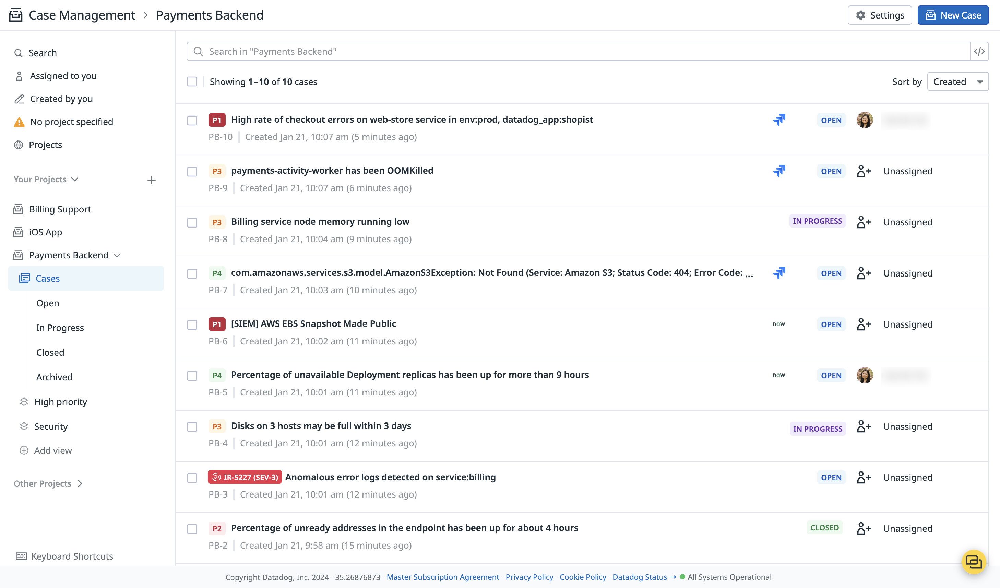
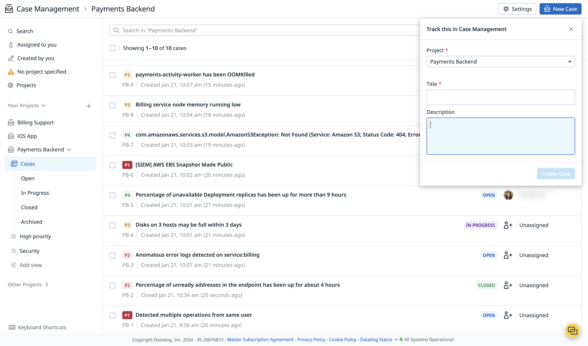
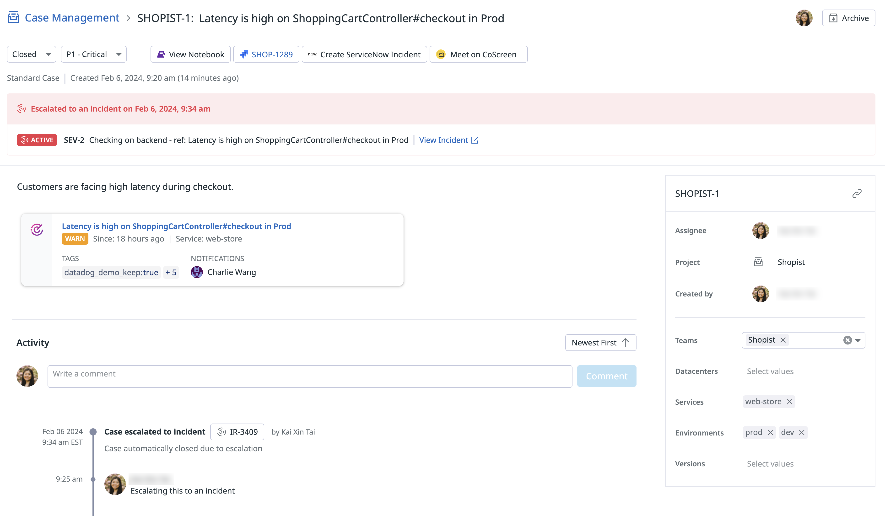
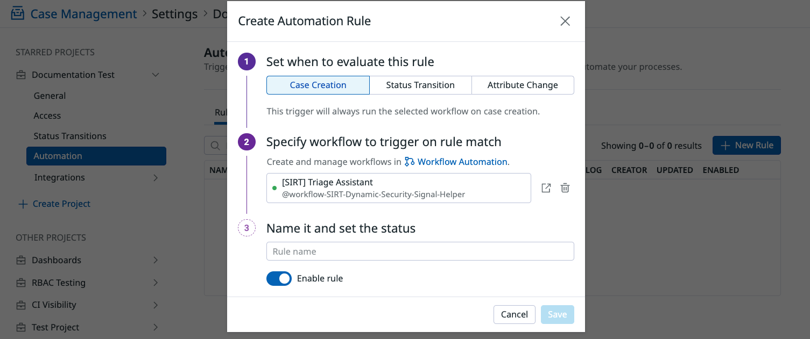
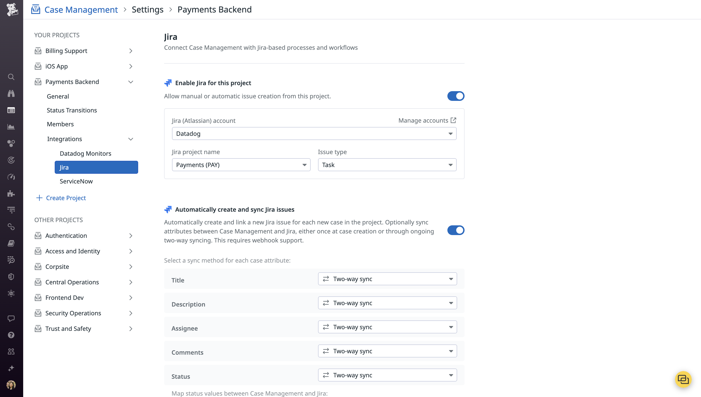

# Case Management（現名称：Work Management）

## 概要

Datadog **Work Management（ワークマネジメント、旧称：Case Management／ケース管理）** は、Datadog や外部ツールが検知した問題・依頼・作業を **Work Item（作業項目、旧称：Case／ケース）** として一元的にトリアージ、追跡、解決するためのチケット管理機能である。Work Item には担当者（Assignee）を割り当てて所有者を明確にし、グラフ・ログ等のテレメトリをアクティビティタイムラインに貼り付けてチームで調査できる。Jira、ServiceNow、Linear、PagerDuty、Slack、Microsoft Teams と連携できる。[出典](https://docs.datadoghq.com/incident_response/work_management/)

> **名称の変遷:** Case Management は 2023-04-18 公開の公式ブログで GA（一般提供）が告知された（[出典](https://www.datadoghq.com/blog/track-issues-datadog-case-management/)（2023-04-18 公開、2024-02-12 更新））。その後 **Work Management** に改称され、「Case」は「Work Item」と呼ばれるようになった。改称を告知する公式ブログは 2026-08-18 公開（[出典](https://www.datadoghq.com/blog/work-management/)）。既存の Case は自動的に Work Item となり、移行作業は不要で、連携もそのまま動作すると公式製品ページは説明している。[出典](https://www.datadoghq.com/product/case-management/)
>
> **`case` 表記が残る箇所:** API エンドポイント（`/api/v2/cases`）、RBAC 権限名（`cases_read` 等）、Monitor の通知ハンドル（`@case-<project_handle>`）、MCP Server のツール名（`search_datadog_cases` 等）、Workflow Automation のステップ名（Case Management）、Jira インテグレーションタイルのタブ名（Case Management）などは旧称の `case` のまま残っている。[出典](https://docs.datadoghq.com/incident_response/work_management/)
>
> **ドキュメントの所在:** 以前は `docs.datadoghq.com/service_management/case_management/` 配下（Service Management カテゴリ）にあったが、2026-11-02 時点では `docs.datadoghq.com/incident_response/work_management/` 配下（Incident Response カテゴリ）にある。他ドキュメントには旧 URL へのリンクが残っている。旧 URL（例：[docs.datadoghq.com/service_management/case_management/settings](https://docs.datadoghq.com/service_management/case_management/settings)）は 2026-11-04 時点でも Incident Response > Work Management 配下の同ページ内容を表示する（現行 URL：[docs.datadoghq.com/incident_response/work_management/settings/](https://docs.datadoghq.com/incident_response/work_management/settings/)）。

本ファイルでは、ファイル名・タイトルに旧称「Case Management」を残しつつ、本文は現名称の **Work Management / Work Item** を主に用いる。Datadog の UI 画面のスクリーンショット（公式ドキュメント掲載）は改称前の「Case Management」表記のものである点に注意。

### Service Management 領域における位置付け

| 製品 | 役割 | 本ナレッジの該当ファイル |
|---|---|---|
| Work Management（旧称：Case Management） | 問題・依頼・作業のチケット化と追跡（本ファイル） | 本ファイル |
| Incident Management | 重大障害の宣言・対応・ポストモーテム | [Incident Management](./incident-management.md) |
| On-Call | オンコールスケジュール・ページング | [On-Call](./on-call.md) |
| Workflow Automation | Automation Rules から起動するワークフロー | [Workflow Automation](./workflow-automation.md) |
| App Builder / Forms | 申請フォームからの Work Item 起票 | [App Builder](./app-builder.md) |
| Event Management | イベント相関から Work Item を自動生成 | [Event Management](../platform/event-management.md) |

### 全体像

```mermaid
flowchart LR
  subgraph Sources[Work Item の発生源]
    M[Monitors<br/>@case-handle]
    S[Security Signals<br/>Cloud SIEM / SDS]
    ET[Error Tracking]
    EM[Event Management<br/>Correlation]
    WF[Workflow Automation]
    F[Forms]
    U[UI / Slack / API / MCP]
  end
  Sources --> P[Project<br/>例: NOC-123]
  P --> WI[Work Item<br/>Status / Priority / Assignee / Attributes]
  WI --> AR[Automation Rules<br/>→ Workflow / Agent]
  WI --> N[通知: Views / Notification Rules<br/>Email・Slack・Teams・PagerDuty・Webhook]
  WI --> OC[On-Call Page]
  WI --> INC[Incident へエスカレーション]
  WI <--> EXT[Jira / ServiceNow / Linear<br/>同期]
```

## 主要画面

### Work Item 一覧（プロジェクト画面）



- **キャプション:** プロジェクト「Payments Backend」の Work Item（画面上は旧表記の Case）一覧（改称前 UI）。
- **画面の説明:** 左ナビゲーションに **Search**、**Assigned to you**、**Created by you**、**No project specified**、**Projects**、**Your Projects**（Billing Support、iOS App、Payments Backend など）と、プロジェクト配下のデフォルトビュー（**Open**、**In Progress**、**Closed**、**Archived**）、カスタムビュー（High priority、Security）、**Add view** が並ぶ。右側のメイン領域には、プロジェクト内検索バー（`Search in "Payments Backend"`）、件数表示、**Sort by**（Created）と、各 Work Item の行（優先度バッジ P1〜P4、タイトル、ID（例：`PB-10`）、作成日時、Jira／ServiceNow 連携アイコン、ステータスバッジ（OPEN／IN PROGRESS／CLOSED）、担当者）が表示される。インシデントにエスカレーションされた Work Item にはインシデント ID（例：`IR-5227 (SEV-3)`）が表示される。右上に **Settings** と **New Case**（現 UI では New Work Item）ボタンがある。
- **出典:** https://datadog-docs.imgix.net/images/incident_response/work_management/case_management_overview_cropped.png （[Work Management ドキュメント](https://docs.datadoghq.com/incident_response/work_management/) 関連の公式ドキュメント画像。DataDog/documentation リポジトリ収録で、2026-11-02 時点の現行ページ本文への埋め込みは確認できず、取得日 2026-11-02）

### Work Item の手動作成パネル



- **キャプション:** 一覧画面右上の新規作成ボタンから開く作成パネル「Track this in Case Management」（改称前 UI）。
- **画面の説明:** 右側にスライドインするパネルに **Project**（必須、ドロップダウン）、**Title**（必須）、**Description**（任意）の入力欄と **Create Case** ボタンがある。現行ドキュメントの手順では、これに加えて **Work Type**（作業タイプ）を選択する。
- **出典:** https://datadog-docs.imgix.net/images/incident_response/work_management/create/manual_case_creation_cropped.png （[Create a Work Item](https://docs.datadoghq.com/incident_response/work_management/create_work_item/) 関連の公式ドキュメント画像。DataDog/documentation リポジトリ収録で、2026-11-02 時点の現行ページ本文への埋め込みは確認できず、取得日 2026-11-02）

### Work Item 詳細画面



- **キャプション:** Work Item（旧表記 Case）`SHOPIST-1` の詳細画面（改称前 UI）。
- **画面の説明:** 上部にステータス（Closed）・優先度（P1 - Critical）のドロップダウンと、**View Notebook**、紐付いた Jira 課題（`SHOP-1289`）、**Create ServiceNow Incident**、**Meet on CoScreen** などのアクションボタンが並ぶ。その下に Work Type（Standard Case）と作成日時、インシデントにエスカレーションされた旨の赤いバナー（ACTIVE、SEV-2、**View Incident** リンク）がある。本文エリアには説明文と、起点となった Monitor アラートのカード（WARN、サービス、タグ、通知先）、**Activity**（コメント入力欄と時系列のアクティビティ：「Case escalated to incident」「Case automatically closed due to escalation」など）が表示される。右サイドパネルには Work Item キー、**Assignee**、**Project**、**Created by**、予約属性の **Teams**、**Datacenters**、**Services**、**Environments**、**Versions** が表示される。
- **出典:** https://datadog-docs.imgix.net/images/incident_response/work_management/view_and_manage/case_details_overview.png （[View and Manage Work Items](https://docs.datadoghq.com/incident_response/work_management/view_and_manage/) 関連の公式ドキュメント画像。DataDog/documentation リポジトリ収録で、2026-11-02 時点の現行ページ本文への埋め込みは確認できず、取得日 2026-11-02）

## Work Item（作業項目）

### Work Type（作業タイプ）

Work Management の Work Item は **Work Type（作業タイプ）** を持つ。Datadog 組み込みの Work Type は 5 種類で、加えてユーザー定義の Custom Type を作成できる。[出典](https://docs.datadoghq.com/incident_response/work_management/create_work_item/)

| Work Type | 説明 | 手動作成で選択可能 |
|---|---|---|
| Standard | 運用タスクや調査など汎用の作業項目 | 可 |
| Change Request | 変更管理における計画済み・承認済みの変更を追跡 | 可 |
| Event Management | Event Management の相関イベントを格納 | 可 |
| Security | セキュリティチーム・セキュリティ製品による調査やアラート | 可 |
| Error Tracking | Error Tracking と連携してアプリの問題を追跡・修正 | 不可（自動作成のみ） |
| Custom Type | ユーザー定義の Work Type（[カスタマイズ](#カスタマイズcustom-work-typesattributesstatuses)参照） | 可（プロジェクトで有効化した場合、作成時の選択肢に表示される） |

- 手動作成で選べるのは Standard、Security、Change Request、Event Management であり、その他の組み込みタイプは自動作成でのみ利用される。[出典](https://docs.datadoghq.com/incident_response/work_management/create_work_item/)
- Custom Type はプロジェクトで有効化すると、手動作成・API 作成・Workflows による自動作成で利用できる。[出典](https://docs.datadoghq.com/incident_response/work_management/customization/)
- **Security タイプ**は Standard の全機能に加え、クローズ時に **Closing reason（クローズ理由）が必須**となる。選択肢は testing（テスト）、false positive（誤検知）、one-time exception（一時的な例外）。Security Signal や Sensitive Data Scanner から作成された Work Item は自動的に Security タイプになる。[出典](https://docs.datadoghq.com/incident_response/work_management/create_work_item/)

### ステータス（Status）

| 項目 | 内容 |
|---|---|
| コアステータス（ステータスグループ） | **Open**、**In Progress**、**Closed** |
| 作成時のデフォルト | Open |
| Archived（アーカイブ） | ステータスとは別の状態。アーカイブすると検索結果から除外される |
| カスタムステータス | 各ステータスグループ（Open／In Progress／Closed）の下に追加可能（[カスタマイズ](#カスタムステータス)参照） |
| API 上の表現 | `status_name`（ステータス名）と `status_group`（`SG_OPEN`／`SG_IN_PROGRESS`／`SG_CLOSED`）。旧フィールド `status`（`OPEN`／`IN_PROGRESS`／`CLOSED`）は非推奨 |

[出典](https://docs.datadoghq.com/incident_response/work_management/view_and_manage/)、[API 出典](https://docs.datadoghq.com/api/latest/case-management/create-a-case/)

### 優先度（Priority）

| 値 | 意味 |
|---|---|
| （未設定） | 作成時のデフォルト。API では `NOT_DEFINED` |
| P1 - Critical | 重大 |
| P2 - High | 高 |
| P3 - Medium | 中 |
| P4 - Low | 低 |
| P5 - Info | 情報 |

[出典](https://docs.datadoghq.com/incident_response/work_management/view_and_manage/)

### 担当者（Assignee）

- Work Item は作成時はデフォルトで未割り当て（Unassigned）。キーボードショートカット `A` で任意のユーザーに、`I` で自分に割り当てられる。[出典](https://docs.datadoghq.com/incident_response/work_management/view_and_manage/)
- 人に加えて、Bits Agent Builder で作成した AI エージェントを **Agent Assignee** フィールドで割り当てられる【Preview】（[AI 機能](#ai-機能mcp-server・custom-agents)参照）。
- Incident Management のフォローアップを Work Management にエクスポートした場合、Work Item の Assignee は 1 人のみのため、フォローアップの最初の Assignee のみ反映される。詳細は [Incident Management](./incident-management.md) を参照。

### 属性（Attributes）

Work Management のすべての Work Type（組み込み・カスタムとも）は、削除・変更できない **5 つの予約属性** を持つ。[出典](https://docs.datadoghq.com/incident_response/work_management/customization/)

| 予約属性 | 用途 |
|---|---|
| Teams | 担当チーム（On-Call の動的チーム選択でも使用） |
| Services | 関連サービス |
| Environments | 環境（`prod` など） |
| Datacenters | データセンター |
| Versions | バージョン |

このほか、Work Type ごとにカスタム属性（Custom Attributes）を追加できる（[カスタム属性](#カスタム属性)参照）。Event Management 由来の Work Item は、相関したイベントのタグを属性として継承する。[出典](https://docs.datadoghq.com/events/correlation/triage_and_notify/)

### Work Item ID とプロジェクトキー

- Work Item の ID は **プロジェクトキーを接頭辞とする連番**（例：`NOC-123`）。[出典](https://docs.datadoghq.com/incident_response/work_management/projects/)
- Work Item を別プロジェクトへ移動すると **新しい ID が採番され、旧 URL はリダイレクトされない**。[出典](https://docs.datadoghq.com/incident_response/work_management/view_and_manage/)

## Work Item の作成

### 手動作成（UI）

1. Work Management ページを開く。
2. プロジェクトを選択する（Work Item は 1 つのプロジェクトにのみ属する）。
3. **New Work Item** をクリックする。
4. タイトルを入力する。
5. Work Type を選択する。
6. 任意で説明（Description）を入力する。
7. **Create Work Item** をクリックする。

[出典](https://docs.datadoghq.com/incident_response/work_management/create_work_item/)

### 他製品からの手動作成

| 起点製品 | 操作 |
|---|---|
| Monitors | Monitor ステータスページで、任意で時間範囲と Monitor グループを絞り、**More Actions** の **Create a work item** を選択。または Slack の Monitor 通知の **Create work item** ボタン |
| Security Signals | シグナル一覧の **Cases** 列にある **Create Case** アイコンをクリックし、**Create Case** ウィンドウを入力 |
| Error Tracking | Issue を開き **Actions** → **Add a work item** |
| Watchdog | アラートを開き **Actions** → **Create a work item** |
| Event Management（個別イベント） | イベントを開き **Actions** → **Create a work item** |
| Cloud Cost Management | コスト推奨事項（Recommendation）を開き **Create a work item** |
| Sensitive Data Scanner | Issue の横の **Create case** |
| Slack | Monitor 通知の下の **Create Work Item** |
| Incident Management | 公開情報の Work Management ドキュメントでは記載なし（Incident 側からはフォローアップのエクスポートとして連携。[Incident Management](./incident-management.md) 参照） |

[出典](https://docs.datadoghq.com/incident_response/work_management/create_work_item/)

このほか、公式製品ページ・ブログでは **Bits Chat**、**MCP Server の work items ツールセット**、**Forms** からの作成も挙げられている。[出典](https://www.datadoghq.com/blog/work-management/)、[出典](https://www.datadoghq.com/product/case-management/)

### 自動作成

| 起点製品 | 設定方法・挙動 |
|---|---|
| Monitors | Project Settings の **Integrations** > **Datadog Monitors** でトグルを有効化して `@case-<project_handle>` を取得し、Monitor の通知メッセージに `@case-<project_handle>` を含める。Monitor の**ステータス遷移ごと**に Work Item が作成されるため、作成をトリガー時だけに限定するには `{{#is_alert}}@case-<handle>{{/is_alert}}` のように条件変数で囲む。**Auto-close work items when the monitor group resolves** を有効にすると Monitor グループ回復時に Work Item を自動クローズできる |
| Event Management（Correlation） | Datadog および外部イベントを集約した相関（Correlation）が Work Item を自動作成する |
| Workflow Automation | ワークフローに **Case Management** ステップを追加し **Create Case** を選択。Monitor や Security Signal をトリガーとするワークフローの場合は、トリガーとワークフローハンドルを該当リソースに追加する |
| Error Tracking | Issue にコメントした時、または Issue を割り当てた時に Work Item が作成される |
| Cloud SIEM | 公式ブログによれば、High／Critical 重大度のシグナルはセキュリティ用 Work Item（Security Case）を自動作成し、Workflow Automation を起動できる（[出典](https://www.datadoghq.com/blog/work-management/)（2026-08-18 公開）） |
| Forms | フォームの送信ごとに Work Item を作成。送信値が Work Item に入り、フォームの緊急度（urgency）設定が優先度に対応する（[出典](https://www.datadoghq.com/blog/forms-case-management-requests/)（2026-06-09 公開））。Forms のブループリントに「Work Management Service Request」がある（[出典](https://docs.datadoghq.com/actions/forms/)） |

[出典](https://docs.datadoghq.com/incident_response/work_management/create_work_item/)

> **注意:** Monitor ハンドルは `@case-<project_handle>` という旧称ベースの表記のまま。Datadog はプロジェクト名からハンドルを提案し、ユーザーは受け入れるか変更できる。[出典](https://docs.datadoghq.com/incident_response/work_management/settings/)

> **注意:** Monitors など Work Management と統合された他製品は、プロジェクトのアクセス設定（Granular Access Control）にかかわらず Work Item を自動作成できる。[出典](https://docs.datadoghq.com/incident_response/work_management/settings/)

### Event Management 由来の Work Item の特性

Event Management の相関（Correlation）で作成された Work Item は、通常の Work Item と挙動が異なる。[出典](https://docs.datadoghq.com/events/correlation/triage_and_notify/)

| 項目 | 挙動 |
|---|---|
| Priority | 相関したアラートの最も高い優先度 |
| Attribute | 相関イベントのタグ。ユーザーによる更新はエンジンに上書きされない |
| Status | **システムが自動管理し、ユーザーの更新はシステムに上書きされる**。配下のアラートがすべて回復すると自動解決し、最大生存時間ウィンドウ内にアラートが再トリガーされると自動で再オープン |
| Deletion | 無関係なアラートをチェックボックスで削除でき、削除したアラートは再相関されない |
| Enriched Alerts | Datadog がインフラ構成から関連すると判断したインテリジェントアラートが自動付与される場合がある。属性・優先度・ステータスには影響しない |

- 検索では `creation_source:Event Management`（相関パターン由来）と `creation_source:Event`（個別イベント由来）で区別できる。[出典](https://docs.datadoghq.com/incident_response/work_management/view_and_manage/)
- **Maintenance Windows（メンテナンスウィンドウ）:** Event Management の設定で、条件（タグ・属性）と開始・終了時刻を指定すると、ウィンドウ内で条件に一致した Work Item が**自動的にアーカイブ**され通知が抑止される。作成には `cases_shared_settings_write` 権限が必要。ServiceNow の変更要求（Change Request）からメンテナンスウィンドウを作成・更新・削除する同期機能もある。[出典](https://docs.datadoghq.com/events/correlation/maintenance_windows/)
- Event Management の詳細は [Event Management](../platform/event-management.md) を参照。

### API による作成

`POST /api/v2/cases` で Work Item を作成する（OAuth アプリは `cases_write` スコープが必要）。主なリクエスト属性は以下。[出典](https://docs.datadoghq.com/api/latest/case-management/create-a-case/)

| フィールド | 必須 | 内容 |
|---|---|---|
| `data.type` | 必須 | `case` 固定 |
| `data.attributes.title` | 必須 | タイトル |
| `data.attributes.type_id` | 必須 | Work Type の UUID |
| `data.attributes.description` | 任意 | 説明 |
| `data.attributes.priority` | 任意 | `NOT_DEFINED`、`P1`〜`P5` |
| `data.attributes.status_name` | 任意 | Work Type に存在するステータス名 |
| `data.attributes.custom_attributes` | 任意 | カスタム属性（`type`：`URL`／`TEXT`／`NUMBER`／`SELECT`、`is_multi`、`value`） |
| `data.relationships.project` | 必須 | プロジェクト（`type: project`、`id`） |
| `data.relationships.assignee` | 任意 | 担当ユーザー（`type: user`、`id`） |

```json
{
  "data": {
    "type": "case",
    "attributes": {
      "title": "Security breach investigation",
      "type_id": "00000000-0000-0000-0000-000000000001",
      "priority": "P2"
    },
    "relationships": {
      "project": { "data": { "type": "project", "id": "<PROJECT_ID>" } }
    }
  }
}
```

（上記は公式 API リファレンスの例を簡略化したもの）

## プロジェクト（Projects）

Work Management の **Project（プロジェクト）** は Work Item の入れ物で、チーム・サービス・取り組み単位で編成する。あるプロジェクトの Work Item は他のプロジェクトの Work Item から分離される。[出典](https://docs.datadoghq.com/incident_response/work_management/projects/)

### プロジェクトの作成

1. Projects ビューで **New Project** をクリック、または左ナビゲーションの **Your Projects** の横の **+** をクリック。
2. プロジェクト名と **Key（キー）** を入力する。キーは **1〜10 文字**で、Work Item ID の接頭辞になる（例：`NOC-123`）。`CASE` は予約値のため使用できない（[出典](https://docs.datadoghq.com/api/latest/case-management/create-a-project/)）。
3. **Create Project** をクリック。

- **プロジェクトキーは作成後に変更できない。** [出典](https://docs.datadoghq.com/incident_response/work_management/projects/)
- 通知を受けるには、プロジェクトに **Join This Project** で参加しておく（通知用ビュー作成手順の一部）。[出典](https://docs.datadoghq.com/incident_response/work_management/notifications_integrations/)

### プロジェクトの削除

- プロジェクトの Settings ページから削除する。
- **プロジェクトを削除すると、配下の Work Item もすべて削除され、復元できない。** 削除前に Work Item を別プロジェクトへ移動することが推奨されている。
- 削除すると、そのプロジェクトに紐付いた Event Correlation パターンが無効化され、Workflows による Work Item 作成や Monitor の `@case` メンションなど、プロジェクトに依存する自動化が動作しなくなる。

[出典](https://docs.datadoghq.com/incident_response/work_management/projects/)

### Project Settings の構成

Project Settings（`https://app.datadoghq.com/work/settings`）では、プロジェクトごとに以下を設定する。[出典](https://docs.datadoghq.com/incident_response/work_management/settings/)

| 設定区分 | 主な設定内容 | 本ファイルの該当節 |
|---|---|---|
| General | Work Types の有効化など | [カスタマイズ](#カスタマイズcustom-work-typesattributesstatuses) |
| Access（Granular Access Control） | Manager／Contributor／Viewer／No Access | [権限とアクセス制御](#権限とアクセス制御) |
| Status Transitions | 非アクティブ時の自動クローズ | [ステータス遷移](#ステータス遷移非アクティブ時の自動クローズ) |
| Automation | Automation Rules | [Automation Rules](#automation-rules自動化ルール) |
| Notifications | Notification Rules | [通知](#通知) |
| Integrations | Datadog Monitors、Datadog On-Call、Datadog Incidents、Slack、Jira、ServiceNow、Linear | [連携](#連携integrations) |

また、組織全体の共有設定 **Settings > Shared Settings > Work Types** で Work Type・カスタム属性・カスタムステータスを管理する。[出典](https://docs.datadoghq.com/incident_response/work_management/customization/)

### ステータス遷移（非アクティブ時の自動クローズ）

- 非アクティブな Work Item を **7、14、30、90、180 日** のいずれかの期間経過後に自動クローズできる（Project Settings の Status Transitions）。
- 「非アクティブ」とは、属性の更新やコメント記入など **人間による操作がないこと**。
- Datadog は **1 日 1 回** 対象の Work Item をチェックしてクローズする。

[出典](https://docs.datadoghq.com/incident_response/work_management/settings/)

## Work Item の閲覧・管理

### 検索

| 検索方法 | 例・説明 |
|---|---|
| 属性のキー・値ペア | `creation_source:Event Management`、`priority:P1` |
| タイトル | 語をダブルクォートで囲む |
| ブール演算子（大文字小文字を区別） | `AND`、`OR`、除外は `-`。例：`priority:(P2 OR P3)` |
| 検索範囲 | デフォルトはプロジェクト内。左上の検索バーは全プロジェクト横断 |

[出典](https://docs.datadoghq.com/incident_response/work_management/view_and_manage/)

### Views（ビュー）

- **View** は保存済みのクエリフィルタ。各プロジェクトには既定で Open、In Progress、Closed、Archived のビューと、「自分に割り当て」「自分が作成」のビューがある。
- 作成手順：**Add View** → 名前 → クエリ入力 → 任意で通知先（Slack、Microsoft Teams、PagerDuty、Webhooks、Email）→ **Save view**。
- 表示形式は **List view**（詳細テーブル）と **Board view**（ドラッグ＆ドロップ可能なカンバン）。

[出典](https://docs.datadoghq.com/incident_response/work_management/view_and_manage/)、[出典](https://docs.datadoghq.com/incident_response/work_management/notifications_integrations/)

公式製品ページでは、組織内で共有できる保存済みフィルタや、期限超過（overdue）・ブロック中（blocked）・承認待ちの組み込みビューも紹介されている。[出典](https://www.datadoghq.com/product/case-management/)

### 一括操作（Bulk actions）

- チェックボックスで複数選択し、ドロップダウンからステータス、割り当て、アーカイブを一括変更できる。[出典](https://docs.datadoghq.com/incident_response/work_management/view_and_manage/)
- API の一括更新（`POST /api/v2/cases/bulk`）で指定できる操作種別は `priority`、`status`、`assign`、`unassign`、`archive`、`unarchive`、`jira`、`servicenow`、`linear`、`update_project`。[出典](https://docs.datadoghq.com/api/latest/case-management/bulk-update-cases/)

### キーボードショートカット

| 操作 | ショートカット |
|---|---|
| 上へ移動 | `↑` または `K` |
| 下へ移動 | `↓` または `J` |
| Work Item を選択 | `X` |
| 選択した Work Item を開く | `Enter` または `O` |
| Work Item を作成 | `C` |
| ステータス設定 | `S` |
| ユーザーに割り当て | `A` |
| 自分に割り当て | `I` |
| 優先度設定 | `P` |
| プロジェクトへ移動 | `V` |
| アーカイブ／解除 | `E` |
| コメント | `M`（送信は `Cmd + Enter`） |
| Jira 課題を作成 | `Shift + J` |
| ServiceNow インシデントを作成 | `Shift + N` |

[出典](https://docs.datadoghq.com/incident_response/work_management/view_and_manage/)

### Work Item 詳細とアクション

- **Activity timeline（アクティビティタイムライン）** には、ステータス、担当者、優先度、シグナル、コメントの更新が記録される。コメントでメンションされたユーザーにはメールが送られる。
- Work Item から実行できるアクション：
  - 調査用 **Notebook** の作成
  - **Incident の宣言**（Declare incident）
  - **Jira 課題の作成**、**ServiceNow インシデントの作成**
  - ステータスを Closed にしてクローズ
  - チームメンバーへの **承認依頼**（[承認](#承認approvals)参照）
  - **On-Call へのページ**（**Page** ボタン）
- **PDF エクスポート:** 詳細ページの **More Options** → **Export to PDF** → 印刷ダイアログで **Save as PDF**。

[出典](https://docs.datadoghq.com/incident_response/work_management/view_and_manage/)、[出典](https://docs.datadoghq.com/incident_response/work_management/notifications_integrations/)

### 分析（Work Management Analytics）

- Work Management Analytics は、Dashboards と Notebooks で、timeseries、top list、query value、table、tree map、pie chart、change、list の各ウィジェットからクエリできる。[出典](https://docs.datadoghq.com/incident_response/work_management/view_and_manage/)
- 公式ブログでは、未割り当て件数、**MTTA（平均割り当て時間）**、**MTTC（平均クローズ時間）** の分析が紹介されている。[出典](https://www.datadoghq.com/blog/work-management/)（2026-08-18 公開）
- ダッシュボード設計は [Dashboards](../platform/dashboards.md) を参照。

## カスタマイズ（Custom Work Types・Attributes・Statuses）

カスタマイズの操作には **Work Management Shared Settings Write（`cases_shared_settings_write`）** 権限が必要（出典ドキュメント上の表記は旧表示名の Case Shared Settings Write）。[出典](https://docs.datadoghq.com/incident_response/work_management/customization/)

### カスタム Work Type

1. **Settings > Shared Settings > Work Types** を開く。
2. **+ Create Work Type** をクリック。
3. **Name** と任意の **Description** を入力して保存。
4. 作成した Work Type は **プロジェクトごとに明示的に有効化** する必要がある：Settings で対象プロジェクトを展開 → **General** → **Work Types** セクションの **From your organization** ドロップダウンで選択。

有効化した Work Type は、手動作成、API 作成、Workflows による自動作成で利用できる。カスタム Work Type により、データ収集の範囲限定、対象を絞った自動化、細かい分析が可能になる。[出典](https://docs.datadoghq.com/incident_response/work_management/customization/)

### カスタム属性

1. **Settings > Shared Settings > Work Types** で対象の Work Type をクリック。
2. **+ Add Attribute** をクリック。
3. 以下を入力する。

| 項目 | 内容 |
|---|---|
| Display Name | 表示名（例：Region） |
| Key | プログラムからのアクセス・レポート用キー |
| Description | 任意の説明 |
| Data Type | **Text**、**URL**、**Number**（UI ドキュメント記載） |
| 複数値 | 複数値を許可するかを選択 |

[出典](https://docs.datadoghq.com/incident_response/work_management/customization/)

> **注意（ドキュメント間の差異）:** Customization ドキュメントの Data Type は Text／URL／Number の 3 種だが、API リファレンスのカスタム属性の `type` には `URL`、`TEXT`、`NUMBER` に加えて `SELECT` が定義されている（2026-11-02 時点）。UI で SELECT 型を作成できるかは公開情報では確認できず。[API 出典](https://docs.datadoghq.com/api/latest/case-management/create-a-case/)

### カスタムステータス

- デフォルトでは Open、In Progress、Closed を遷移する。レビューや引き継ぎなどの工程を表すステータスを追加できる。
- 追加は **Settings > Shared Settings > Work Types** → Work Type 選択 → **Statuses** セクションで、3 つのステータスグループ（Open／In Progress／Closed）のいずれかの下に追加する。
- 各ステータスグループには **少なくとも 1 つ** のステータスが必要。
- ステータスを削除する前に、そのステータスを使用中の Work Item を同じグループ内の別ステータスへ移行する必要がある。
- 各グループに **default status（既定ステータス）** を設定でき、自動化で正確なステータス名が指定されない場合に使われる。
- カスタムステータスは組み込みステータスとまったく同じように動作する。

[出典](https://docs.datadoghq.com/incident_response/work_management/customization/)

> **注意:** Jira、ServiceNow、Linear との同期は、**コアステータス「Open」「In Progress」「Closed」を使用する Work Item のみ** が対象。カスタムステータスを使う Work Item は同期されない。[出典](https://docs.datadoghq.com/incident_response/work_management/notifications_integrations/)

## 権限とアクセス制御

### RBAC 権限

| 権限名 | キー | 説明 | 既定で付与されるロール |
|---|---|---|---|
| Work Items Read | `cases_read` | Work Item の閲覧 | Datadog Read Only Role |
| Work Items Write | `cases_write` | Work Item の作成・更新 | Datadog Standard Role |
| Work Management Shared Settings Write | `cases_shared_settings_write` | Work Management の共有設定（Work Type、属性、ステータス、Maintenance Windows 等）の構成 | Datadog Standard Role |

[出典](https://docs.datadoghq.com/account_management/rbac/permissions/)

- API の OAuth スコープは、読み取り系が `cases_read`、書き込み系が `cases_write`。[出典](https://docs.datadoghq.com/api/latest/case-management/)
- Jira 連携の設定画面で Jira プロジェクトがドロップダウンに表示されない場合は `manage_integrations` 権限を確認する。[出典](https://docs.datadoghq.com/incident_response/work_management/troubleshooting/)
- ロール・権限の全体像は [組織・ユーザー・権限管理](../platform/account-and-access-management.md) を参照。

### プロジェクト単位の Granular Access Control

Work Management のプロジェクトと Work Item へのアクセスは **デフォルトでは制限なし**。Granular Access Control により、ユーザー、チーム、ロール、組織全体の単位でプロジェクトごとの権限を設定できる。[出典](https://docs.datadoghq.com/incident_response/work_management/settings/)

| レベル | Work Item 作成・編集 | コメント | View・設定・権限の変更 | プロジェクト削除 | 閲覧 |
|---|---|---|---|---|---|
| Manager | 可 | 可 | 可 | 可 | 可 |
| Contributor | 可 | 可 | 不可 | 不可 | 可 |
| Viewer | 不可 | 不可 | 不可 | 不可 | 可（Watch も可） |
| No Access | 不可 | 不可 | 不可 | 不可 | 不可 |

> **注意:** Monitors など他の Datadog 製品は、プロジェクトのアクセス設定にかかわらず Work Item を自動作成できる。[出典](https://docs.datadoghq.com/incident_response/work_management/settings/)

### 承認関連の権限

| 操作 | 必要な権限 |
|---|---|
| Work Item に承認を依頼する | Work Items Write（`cases_write`） |
| 承認者として追加される | Work Items Read（`cases_read`） |
| 承認または却下する | Work Items Read（`cases_read`） |

[出典](https://docs.datadoghq.com/incident_response/work_management/approvals/)（出典ドキュメント上の表記は旧表示名の Cases Write／Cases Read。[RBAC 権限](#rbac-権限)の Work Items Write／Read と同一の権限）

## 承認（Approvals）

Work Item の **Approvals（承認）** は、Work Item に対するアクション前に 1 人以上のメンバーの承認を得る機能で、変更管理ワークフローを支援する。すべての組み込み・カスタム Work Type で利用でき、承認の操作はすべてアクティビティタイムラインに記録される。[出典](https://docs.datadoghq.com/incident_response/work_management/approvals/)

### 承認依頼の手順

1. Work Item を開き、右側の **More Options** アイコンをクリック。
2. **Request approval** を選択。
3. **Add reviewer** ドロップダウンで 1 人以上のユーザーを選ぶ。
4. 任意で **Describe your request** にメッセージを入力。
5. **Request** をクリック。

- 送信後、詳細パネルに **Reviewers** セクションが表示され、各レビュアーの状態（**Requested**／**Approved**／**Declined**）が表示される。レビュアーは **Reviewers** 横の編集アイコンで変更できる。
- **レビュアーが応答した後は依頼内容を編集できない。**
- 通知：承認者には依頼時にメールが届き、依頼者には承認・却下のたびに通知が届く。
- Automation Rules のトリガーとして、**Approvals received**（最初／各／すべての承認）と **Declines received**（最初／各却下）を使える。例：全承認がそろったらステータスを更新するワークフローを起動。

[出典](https://docs.datadoghq.com/incident_response/work_management/approvals/)

公式ブログでは、AI エージェントが動作する前に承認を必須にする運用も紹介されている。[出典](https://www.datadoghq.com/blog/work-management/)（2026-08-18 公開）

## Automation Rules（自動化ルール）

Work Management の **Automation Rules（自動化ルール）** は、条件を満たしたときに Workflow Automation のワークフロー（または AI エージェントの割り当て）を自動実行する機能。[出典](https://docs.datadoghq.com/incident_response/work_management/automation_rules/)



- **キャプション:** Project Settings の **Automation** から開く「Create Automation Rule」ダイアログ（改称前 UI）。
- **画面の説明:** ①「Set when to evaluate this rule」でトリガー（**Case Creation**／**Status Transition**／**Attribute Change**）をタブで選ぶ（画像は承認トリガー追加前の UI）。②「Specify workflow to trigger on rule match」で Workflow Automation のワークフロー（例：`[SIRT] Triage Assistant`、ハンドル `@workflow-...`）を指定する。③「Name it and set the status」でルール名を入力し **Enable rule** トグルで有効・無効を設定し、**Save** で保存する。背景の左ナビゲーションにはプロジェクト配下の General、Access、Status Transitions、Automation、Integrations が見える。
- **出典:** https://datadog-docs.imgix.net/images/incident_response/work_management/automation_rules/create_case_automation_rule.png （[Work item automation rules](https://docs.datadoghq.com/incident_response/work_management/automation_rules/) 関連の公式ドキュメント画像。DataDog/documentation リポジトリ収録で、2026-11-02 時点の現行ページ本文への埋め込みは確認できず、取得日 2026-11-02）

### 設定手順

1. **Work Management > Settings** を開く。
2. 対象プロジェクトを選択。
3. **Automation** を選択。
4. **New Rule** をクリック。
5. トリガーを定義し、ワークフローを選択し、ルール名と有効／無効を設定する。

### トリガーとアクション

| 区分 | 選択肢 |
|---|---|
| トリガー | Work Item 作成時／ステータス変更時／属性の追加・削除時／承認・却下の受領時 |
| アクション | Workflow Automation のワークフロー実行（例：担当者割り当て、コメント追加、解決済み Work Item のクローズ）、または **Assign Agent**（Bits Agent Builder のカスタムエージェントを割り当て、【Preview】） |

[出典](https://docs.datadoghq.com/incident_response/work_management/automation_rules/)、[出典](https://docs.datadoghq.com/incident_response/work_management/ai/custom_agents/)

- Automation Rules は API（`/api/v2/cases/projects/{project_id}/rules`、enable／disable エンドポイントあり）でも管理できる。[出典](https://docs.datadoghq.com/api/latest/case-management/)
- Workflow Automation の Action Catalog には Work Management 用アクション（Add comment、Archive／Unarchive work item、Assign／Unassign work item、Create work item、Create／Delete project、Get work item、Get work item timeline、Get project(s)、Request review、Search work items、Update attributes、Update due date、Update priority、Update status など）がある。[出典](https://docs.datadoghq.com/actions/actions_catalog/)（一覧は 2026-11-02 時点の取得範囲。全件網羅は未確認）
- ワークフローの詳細は [Workflow Automation](./workflow-automation.md) を参照。

## 通知

### View ベースの通知（新規 Work Item の通知）

新しい Work Item の作成時に通知を受けるには、フィルタクエリを設定した View を作成し、通知先を指定する。

1. 通知対象のプロジェクトを開く（未参加なら **Join This Project**）。
2. **Add view** → **Name** 入力 → 検索ボックスにフィルタクエリを入力。
3. recipients フィールドで通知方法を選択し **Save**。

| 通知先 | 設定内容 |
|---|---|
| Email | 1 つ以上のメールアドレスを選択 |
| Slack | Slack ワークスペースとチャンネルを選択 |
| Microsoft Teams | 接続済みテナントがあればテナント・チーム・チャンネル、なければコネクタを選択 |
| PagerDuty | サービスを選択 |
| Webhooks | Webhook 名を選択 |

[出典](https://docs.datadoghq.com/incident_response/work_management/notifications_integrations/)

### Notification Rules（通知ルール）

Project Settings の **Notifications** → **+ Create Rule** で、主要な更新の通知ルールを作成できる。

| 設定項目 | 内容 |
|---|---|
| クエリ | 対象 Work Item を絞るフィルタ（例：`priority:P1 OR priority:P2`）。空欄で全 Work Item |
| 通知条件（複数選択可） | Work Item 作成／ステータス遷移／優先度変更／担当者変更／新しいアラート相関（Event Management の Work Item） |
| 通知先 | Email、Slack、Microsoft Teams、PagerDuty、Webhook |

[出典](https://docs.datadoghq.com/incident_response/work_management/notifications_integrations/)

Notification Rules は API（`/api/v2/cases/projects/{project_id}/notification_rules`）でも管理できる。[出典](https://docs.datadoghq.com/api/latest/case-management/)

> **注意（Event Management）:** 相関によって通知をグループ化しても、配下の個々の Monitor 通知はミュートされない。重複通知をなくすには配下の Monitor の通知設定を見直す必要がある。[出典](https://docs.datadoghq.com/events/correlation/triage_and_notify/)

## 連携（Integrations）

### Datadog 製品内の連携

| 連携先 | 設定場所 | 内容 |
|---|---|---|
| Datadog Monitors | Integrations > **Datadog Monitors** | `@case-<project_handle>` を取得し Monitor 通知で自動作成 |
| Datadog On-Call（手動） | Work Item 詳細の **Page** ボタン | Work Item からオンコール担当をページ |
| Datadog On-Call（自動） | Integrations > **Datadog On-Call** > **Automatically page work items to On-Call** | Paging Rule のクエリに Work Item が（ライフサイクル中いつでも）一致すると自動ページ。ページ先は **Specific Team**（固定チーム）または **Dynamic Team Selection**（Work Item の `Team` 属性のチーム）。**New Paging Rule** で複数ルール可。ページ時にオンコール担当者へ自動割り当てするオプションあり |
| Datadog Incidents | Integrations > **Datadog Incidents** > **Auto-escalate work items to Incidents** | 指定クエリに（ライフサイクル中いつでも）一致した Work Item を自動的にインシデントとして宣言。手動では Work Item 詳細から Declare incident |
| Slack | Integrations > **Slack** > **Slack thread mirroring** | Slack 通知スレッドの返信を Work Item のタイムラインに自動ミラー（後述） |
| Notebooks | Work Item 詳細のアクション | 調査用 Notebook を作成 |

[出典](https://docs.datadoghq.com/incident_response/work_management/notifications_integrations/)、[出典](https://docs.datadoghq.com/incident_response/work_management/settings/)

On-Call と Incident Management の詳細は [On-Call](./on-call.md)、[Incident Management](./incident-management.md) を参照。

### Slack スレッドミラーリング

| 項目 | 内容 |
|---|---|
| 前提 | Datadog の Slack インテグレーション（Datadog for Slack）が構成済み |
| 既定 | **全プロジェクトで既定で有効**。無効化は Project Settings > Integrations > Slack で **Slack thread mirroring** をオフ |
| 対象 | Work Management が送った Slack 通知／`@case-` ハンドルを使う Monitor の Slack 通知／Slack インテグレーションで Slack から直接作成した Work Item のスレッド |
| ミラー内容 | テキスト返信のみ（**添付ファイルは非対応**）。各メッセージに Slack ユーザー名とソース（Slack）が表示される |
| 方向 | **一方向**（Slack → Work Item）。Work Item から Slack へは流れない |
| 複数スレッド | 複数の Slack スレッドを 1 つの Work Item にミラー可能 |

[出典](https://docs.datadoghq.com/incident_response/work_management/notifications_integrations/)

Slack・Microsoft Teams の基本設定は [通知・コラボレーション連携](../platform/collaboration-integrations.md) を参照。

### 外部チケットシステム連携の共通ルール

| ルール | 内容 |
|---|---|
| 作成モード | **手動**（ユーザーが特定の Work Item で作成）と **自動**（新規 Work Item ごとにチケットを作成） |
| 同期対象ステータス | コアステータス「Open」「In Progress」「Closed」を使う Work Item のみ |
| 同時同期数 | **1 つの Work Item は、プロジェクトごとに 1 つの外部リソースとのみ同期** できる。Jira の同期を有効にするには ServiceNow の自動作成・同期を無効にする必要があり、その逆も同様 |
| 遡及同期 | 双方向連携を有効にした後に作成された Work Item のみ同期。それ以前の Work Item は遡って同期されない（Jira のトラブルシューティングに記載） |

[出典](https://docs.datadoghq.com/incident_response/work_management/notifications_integrations/)、[出典](https://docs.datadoghq.com/incident_response/work_management/troubleshooting/)

### Jira 連携



- **キャプション:** Project Settings > Integrations > **Jira** の設定画面（改称前 UI）。
- **画面の説明:** 左にプロジェクト一覧（YOUR PROJECTS／OTHER PROJECTS）と、選択中プロジェクト配下のメニュー（General、Status Transitions、Members、Integrations > Datadog Monitors／Jira／ServiceNow）がある。右側の **Enable Jira for this project** トグルで手動・自動の課題作成を許可し、**Jira (Atlassian) account**、**Jira project name**（例：Payments (PAY)）、**Issue type**（例：Task）を選ぶ。**Automatically create and sync Jira issues** トグルで自動作成と同期を有効化し、「Select a sync method for each case attribute」の下で **Title**、**Description**、**Assignee**、**Comments**、**Status** ごとに同期方式（例：Two-way sync）を選ぶ。下部にステータス値のマッピング（Map status values between Case Management and Jira）が続く。
- **出典:** https://datadog-docs.imgix.net/images/incident_response/work_management/settings/settings_jira.png （[Settings](https://docs.datadoghq.com/incident_response/work_management/settings/) 関連の公式ドキュメント画像。DataDog/documentation リポジトリ収録で、2026-11-02 時点の現行ページ本文への埋め込みは確認できず、取得日 2026-11-02）

#### 設定手順

1. Datadog の Jira インテグレーションを構成する（[Jira インテグレーション](https://docs.datadoghq.com/integrations/jira/)）。
2. Work Management の Project Settings で **Jira** を有効化（手動の課題作成が可能になる）。
3. Jira アカウント、課題を作成する Jira プロジェクト、課題タイプ（story、epic、bug、task など）を選択。
4. 任意で、プロジェクト内の各 Work Item について Jira 課題を **自動作成** する設定を有効化。
5. 属性ごとの同期方式を選択（下表）。
6. ステータスと優先度について、Jira 側の対応値をマッピング。
7. 保存。

| 同期対象属性 | 選択肢 |
|---|---|
| タイトル、説明、担当者、コメント、ステータス、優先度 | **Once to Jira at work item creation**（作成時に一度だけ Work Management → Jira。以後の変更はどちらにも反映されない）／**Two-way sync (bi-directional)**（双方向）／**Don't sync**（同期しない） |

[出典](https://docs.datadoghq.com/incident_response/work_management/notifications_integrations/)

#### Jira Webhook（双方向同期に必須）

双方向同期には Jira 側の Webhook 設定が必要。

1. Jira で歯車アイコン → **System** → *Advanced* の **Webhooks** → **Create a Webhook**。
2. 名前に `Datadog Webhook` を入力し、ステータスは **Enabled**。
3. Datadog の Jira インテグレーションタイルの **Case Management** タブで Webhook URL をコピーし、Jira の *URL* に貼り付け。
4. issue 関連イベントを有効化（JQL で対象プロジェクトを絞れる）し、project 関連の `deleted` イベントを有効化。その他は未チェック。
5. **Create**。

[出典](https://docs.datadoghq.com/integrations/jira/)

- Jira インスタンスが IP アドレスでフィルタしている場合は、Datadog の **Webhooks** IP プレフィックスを許可する必要がある（[Datadog IP Ranges](https://docs.datadoghq.com/api/latest/ip-ranges/)）。[出典](https://docs.datadoghq.com/integrations/jira/)
- Datadog は連携専用の（個人ではない）Jira アカウントの利用を強く推奨している。[出典](https://docs.datadoghq.com/integrations/jira/)

#### Jira 連携の制約

| 制約 | 内容 |
|---|---|
| 対応エディション | 課題作成は Jira Cloud と Jira Data Center で可能。**フィールド同期は Jira Cloud のみ**（Notifications and Integrations ドキュメント） |
| 非対応 | **カスタムフィールドを持つ課題タイプ、プライベート Jira プロジェクト、オンプレミス Jira インスタンスは非対応**（Troubleshooting ドキュメント） |
| プロジェクト移動 | Jira と同期中の Work Item を別プロジェクトへ移動すると同期が止まり、移動先では Jira 課題が紐付かない |
| Jira ワークフロー | Jira ワークフローで許可されないステータス変更を行うと、ステータスマッピングとの同期がずれる |
| コメント | コメントの更新・削除は相手側に反映されない |
| 遡及 | 双方向連携の有効化前に存在した Work Item は同期されない |
| Reporter | Work Item 作成者が Jira アカウントを持たない場合や、Jira ユーザーがメール表示を隠している場合、Jira 課題の Reporter は Jira 連携を設定した Datadog ユーザーになる。Jira 側で Reporter を変更しても Work Management の「created by」には反映されない |
| Data Center 9 以降 | Datadog は Assignee／Reporter フィールド用のユーザー一覧を取得できない（Jira インテグレーションの制限事項） |

[出典](https://docs.datadoghq.com/incident_response/work_management/troubleshooting/)、[出典](https://docs.datadoghq.com/incident_response/work_management/notifications_integrations/)、[出典](https://docs.datadoghq.com/integrations/jira/)

> **注意（ドキュメント間の記述差）:** Notifications and Integrations ドキュメントは「課題作成は Jira Cloud と Data Center で可能」とする一方、Troubleshooting ドキュメントは「オンプレミス Jira インスタンスは非対応」とする（2026-11-02 時点）。Data Center 環境で利用する場合は、手動の課題作成に限られる可能性が高い【推定】。導入前に Datadog サポートへの確認を推奨する。

### ServiceNow 連携

#### 前提

| 項目 | 内容 |
|---|---|
| ServiceNow 側アプリ | ServiceNow Store の **ITOM/ITSM Integration for Datadog** の最新版を推奨（または Update Set を手動アップロード。ドキュメント記載の最新は `Datadog-Snow_Update_Set_v2.9.3.xml`） |
| Datadog 側 | ServiceNow タイルにインスタンスを登録 → **Configure** タブ → **ITOM/ITSM** タブ → **Work Management** タブで、**Case Table** に **Datadog Cases ITSM** を選択 |
| 送信先テーブル | Work Item は ServiceNow の **Datadog Cases ITSM** テーブル（中間テーブル）に送られ、Update Set の変換により Incident テーブルのレコードになる。**このテーブルへのカスタムペイロードは非対応** |
| ITOM | **Work Management では ITOM は非対応**。双方向同期は ServiceNow ITSM のみ |
| ServiceNow 側ユーザー権限 | 設定するユーザーには `x_datad_datadog.user` と `admin` ロールが必要 |

[出典](https://docs.datadoghq.com/integrations/guide/servicenow-itom-itsm-setup/)

#### プロジェクトでの設定手順

1. ServiceNow インテグレーションを ITOM/ITSM 手順に従って構成。
2. Work Management の Project Settings で ServiceNow を有効化（手動のインシデント作成が可能になる）。
3. ServiceNow インスタンスと **Assignment group** を選択。
4. 任意で、各 Work Item について ServiceNow インシデントを **自動作成** する設定を有効化。
5. ステータスとコメントについて同期方式を選択（下表）。
6. Work Management のステータス値を ServiceNow の State 値にマッピング。
7. 保存。

| 同期対象属性 | 選択肢 |
|---|---|
| ステータス、コメント | **Once to ServiceNow at work item creation**（作成時に一度だけ）／**All updates to ServiceNow**（Work Management → ServiceNow の一方向で継続同期）／**Two-way sync (bi-directional)**（双方向）／**Don't sync** |

[出典](https://docs.datadoghq.com/incident_response/work_management/notifications_integrations/)

#### ServiceNow → Datadog の双方向同期

- ServiceNow 側で State、Impact、Urgency を Work Management と双方向同期できる。
- ServiceNow で Application Scope を **ITOM/ITSM Integration for Datadog** にし、**Configuration** で Datadog Data Center、Datadog API キー、**サービスアカウントのアプリケーションキー**（個人キーは非推奨）を設定し **Enabled** にする。
- **ServiceNow から Datadog へ同期されるのは、ITIL ロールを持ち、かつ Datadog の ServiceNow タイルに設定した連携ユーザーではないユーザーによる変更のみ。**
- Work Management から ServiceNow への更新は見えるが逆方向が見えない場合、ServiceNow ITOM を使っている可能性がある（双方向は ITSM のみ対応）。
- ITOM/ITSM 連携 2.7.0 以降では、Event Management の相関アラート情報を transform script（onBefore）で ServiceNow インシデントに反映できる（`x_datad_datadog_case_incident_table`、`em_correlated_alert_id` 等を使用）。

[出典](https://docs.datadoghq.com/integrations/guide/servicenow-itom-itsm-setup/)

> **サイト差異:** ServiceNow ITOM/ITSM セットアップガイドは、**`us2.ddog-gov.com` サイトでは Work Management との連携は非対応** と記載している（2026-11-02 時点）。

### Linear 連携

1. Linear インテグレーションを構成。
2. Project Settings で **Linear** を有効化（手動の課題作成）。
3. Linear のワークスペースとチームを選択。
4. 任意で各 Work Item について Linear 課題を自動作成。
5. タイトル、説明、担当者、コメント、ステータス、優先度について **Once to Linear at work item creation**／**Two-way sync (bi-directional)**／**Don't sync** を選択。
6. ステータスを Linear 側の State にマッピングして保存。

- 双方向同期には Linear 側の Webhook 設定が必要。コアステータスを使う Work Item のみ同期対象。

[出典](https://docs.datadoghq.com/incident_response/work_management/notifications_integrations/)

> **注意:** 「1 つの Work Item はプロジェクトごとに 1 つの外部リソースとのみ同期」という注記は、ドキュメント上は Jira と ServiceNow のセクションに明記されている。Linear との組み合わせ時の排他条件の明示は公開情報では確認できず。

### Jira / ServiceNow / Linear の比較

| 項目 | Jira | ServiceNow | Linear |
|---|---|---|---|
| 手動作成 | 可（`Shift + J`） | 可（`Shift + N`、ServiceNow インシデント） | 可 |
| 自動作成 | 可 | 可 | 可 |
| 同期可能属性 | タイトル、説明、担当者、コメント、ステータス、優先度 | ステータス、コメント | タイトル、説明、担当者、コメント、ステータス、優先度 |
| 同期方式 | 作成時一回／双方向／なし | 作成時一回／Datadog→ServiceNow 継続／双方向／なし | 作成時一回／双方向／なし |
| 双方向の前提 | Jira Webhook、Jira Cloud | ServiceNow ITSM（ITOM 不可）、ServiceNow 側 Configuration | Linear Webhook |
| ステータスマッピング | ステータス・優先度 | ステータス→State | ステータス→State |

[出典](https://docs.datadoghq.com/incident_response/work_management/notifications_integrations/)

その他、公式製品ページでは GitHub のプルリクエストをインラインでプレビューし、状態を Work Item と同期できるとされている。[出典](https://www.datadoghq.com/product/case-management/)

## AI 機能（MCP Server・Custom Agents）

### MCP Server の `cases` ツールセット

Datadog MCP Server は Work Management 用の `cases` ツールセットを提供し、MCP 対応の AI エージェントから Work Item の検索・取得・作成・更新ができる。`cases` ツールセットは **既定では無効** で、`toolsets` パラメータに `cases` を追加（例：`?toolsets=core,cases`）するか `toolsets=all` を使う。Preview のツールは `toolsets=all` に含まれず、`cases` の明示指定が必要。[出典](https://docs.datadoghq.com/bits_ai/mcp_server/tools/)

表の Cases Read／Cases Write は出典ドキュメント上の旧表示名で、それぞれ [RBAC 権限](#rbac-権限)の Work Items Read（`cases_read`）／Work Items Write（`cases_write`）と同じ権限を指す。

| ツール | 必要権限 | 状態 |
|---|---|---|
| `search_datadog_cases` | Cases Read | GA 表記なし（Preview 表記なし） |
| `get_datadog_case` | Cases Read | 同上 |
| `create_datadog_case` | Cases Write + Cases Read | 同上 |
| `update_datadog_case` | Cases Write + Cases Read | 同上 |
| `add_comment_to_datadog_case` | Cases Write | 同上 |
| `link_datadog_cases` / `get_datadog_case_links` / `unlink_datadog_cases` | Cases Write／Read | 同上 |
| `list_datadog_case_projects` | Cases Read | 同上 |
| `search_datadog_users` | User Access Read | 同上 |
| `attach_file_to_datadog_case` | Cases Write + Cases Read | 【Preview】（最大 10 MiB のファイル） |
| `get_datadog_case_attachment` | Cases Read | 【Preview】 |
| `link_jira_issue_to_datadog_case` | Cases Write | 【Preview】 |
| `get_datadog_case_project` / `create_datadog_case_project` | Cases Read／Write | 【Preview】 |

[出典](https://docs.datadoghq.com/bits_ai/mcp_server/tools/)

### Custom Agents【Preview】

- Bits Agent Builder で作成したカスタムエージェントに Work Item を割り当て、トリアージから解決までを自動化できる。Work Management とカスタムエージェントの連携は **Preview**（申込制）。
- 割り当て方法：Work Item の **Agent Assignee** フィールドで手動選択、または Automation Rules の **Assign Agent** で自動割り当て。
- **エージェントは、エージェントを Work Item に割り当てたユーザーの権限で実行される。**
- 例として挙げられるエージェント：Issue triager、Security signal aggregator、Feature implementer（仕様からドラフト PR）、IT access request automator、Support first responder。

[出典](https://docs.datadoghq.com/incident_response/work_management/ai/custom_agents/)、[出典](https://docs.datadoghq.com/incident_response/work_management/ai/)

> **サイト差異:** AI Tools for Work Management は `app.ddog-gov.com`、`us2.ddog-gov.com`（Government サイト）では非対応。Custom Agents の Preview 申込案内は US1、US3、US5、EU1、AP1、AP2、UK1 向けに表示されている。[出典](https://docs.datadoghq.com/incident_response/work_management/ai/)

Bits AI 全般は [Bits AI と AI 機能](../ai/bits-ai.md) を参照。

## API

Work Management API は v2（`/api/v2/cases...`）。パス、リソースタイプ、権限は `case` 表記のまま。主なエンドポイントは以下（US1 は `https://api.datadoghq.com`、AP1 は `https://api.ap1.datadoghq.com`）。[出典](https://docs.datadoghq.com/api/latest/case-management/)

| 区分 | メソッドとパス |
|---|---|
| Work Item 作成／検索 | `POST /api/v2/cases`／`GET /api/v2/cases` |
| 詳細取得 | `GET /api/v2/cases/{case_id}` |
| タイトル・説明・ステータス・優先度 | `POST /api/v2/cases/{case_id}/title`、`/description`、`/status`、`/priority` |
| 割り当て | `POST /api/v2/cases/{case_id}/assign`、`/unassign` |
| アーカイブ | `POST /api/v2/cases/{case_id}/archive`、`/unarchive` |
| 属性 | `POST /api/v2/cases/{case_id}/attributes`、`POST`/`DELETE /api/v2/cases/{case_id}/custom_attributes/{key}` |
| 期限・解決理由 | `POST /api/v2/cases/{case_id}/due_date`、`/resolved_reason` |
| コメント | `POST /api/v2/cases/{case_id}/comment`、`PUT`/`DELETE .../comment/{cell_id}` |
| 集計・件数・一括 | `POST /api/v2/cases/aggregate`、`GET /api/v2/cases/count`、`POST /api/v2/cases/bulk` |
| タイムライン | `GET /api/v2/cases/{case_id}/timelines` |
| Watcher | `GET /api/v2/cases/{case_id}/watchers`、`POST`/`DELETE .../watchers/{user_uuid}` |
| Work Item 間リンク | `GET`/`POST /api/v2/cases/link`、`DELETE /api/v2/cases/link/{link_id}` |
| Insights | `PUT`/`DELETE /api/v2/cases/{case_id}/insights` |
| プロジェクト | `POST`/`GET /api/v2/cases/projects`、`GET`/`PATCH`/`DELETE /api/v2/cases/projects/{project_id}`、お気に入り `.../favorites` |
| プロジェクト移動 | `PATCH /api/v2/cases/{case_id}/relationships/project` |
| Incident 連携 | `POST /api/v2/cases/{case_id}/relationships/incidents` |
| Jira | `POST`（作成）/`PATCH`（既存課題をリンク）/`DELETE`（リンク解除） `/api/v2/cases/{case_id}/relationships/jira_issues` |
| ServiceNow | `POST /api/v2/cases/{case_id}/relationships/servicenow_tickets` |
| Notebook | `POST /api/v2/cases/{case_id}/relationships/notebook` |
| Views | `GET`/`POST /api/v2/cases/views`、`GET`/`PUT`/`DELETE /api/v2/cases/views/{view_id}` |
| Automation Rules | `/api/v2/cases/projects/{project_id}/rules`（CRUD、`/enable`、`/disable`） |
| Notification Rules | `/api/v2/cases/projects/{project_id}/notification_rules`（CRUD） |
| Maintenance Windows | `/api/v2/maintenance_windows`（CRUD、Event Management の Work Item 用） |

- 検索 API（`GET /api/v2/cases`）のクエリパラメータ：`page[size]`（**最大 100**）、`page[number]`、`sort[field]`（`created_at`／`priority`／`status`）、`sort[asc]`、`filter`（検索クエリ）。[出典](https://docs.datadoghq.com/api/latest/case-management/search-cases/)
- API キー管理は [API とキー管理](../platform/api-and-keys.md) を参照。
- **Terraform:** Terraform Provider for Datadog のドキュメント（GitHub `DataDog/terraform-provider-datadog` の `docs/resources`）には、2026-11-02 時点で Work Management／Case Management のプロジェクトや Work Item を管理するリソースは確認できなかった。IaC 全般は [Terraform と IaC](../platform/terraform-and-iac.md) を参照。

## 制限値・クォータ・デフォルト値

| 項目 | 値 | 出典 |
|---|---|---|
| Work Item の保持期間 | **アカウント存続期間中保持**（Cases: Retained for the duration of the account） | [Data Retention Periods](https://docs.datadoghq.com/data_security/data_retention_periods/) |
| プロジェクトキー長 | 1〜10 文字 | [Projects](https://docs.datadoghq.com/incident_response/work_management/projects/) |
| プロジェクトキーの予約値 | `CASE` は使用不可 | [Create a project（API）](https://docs.datadoghq.com/api/latest/case-management/create-a-project/) |
| プロジェクトキーの変更 | 作成後は変更不可 | [Projects](https://docs.datadoghq.com/incident_response/work_management/projects/) |
| Work Item が属するプロジェクト数 | 1 つのみ | [Create a Work Item](https://docs.datadoghq.com/incident_response/work_management/create_work_item/) |
| プロジェクト移動時の ID | 新しい ID が採番され、旧 URL はリダイレクトされない | [View and Manage](https://docs.datadoghq.com/incident_response/work_management/view_and_manage/) |
| 削除した Work Item・プロジェクト | 復元不可 | [Projects](https://docs.datadoghq.com/incident_response/work_management/projects/) |
| 作成時のステータス | Open | [View and Manage](https://docs.datadoghq.com/incident_response/work_management/view_and_manage/) |
| 作成時の優先度 | 未設定（`NOT_DEFINED`） | 同上 |
| 作成時の担当者 | 未割り当て | 同上 |
| 優先度の段階 | P1〜P5 の 5 段階 | 同上 |
| 組み込み Work Type 数 | 5（Standard、Change Request、Event Management、Security、Error Tracking） | [Customization](https://docs.datadoghq.com/incident_response/work_management/customization/) |
| 予約属性 | 5（Teams、Services、Environments、Datacenters、Versions）、削除・変更不可 | 同上 |
| カスタム属性のデータ型 | Text、URL、Number（API では SELECT も定義） | 同上、[API](https://docs.datadoghq.com/api/latest/case-management/create-a-case/) |
| ステータスグループ | 3（Open、In Progress、Closed）、各グループに最低 1 ステータス | [Customization](https://docs.datadoghq.com/incident_response/work_management/customization/) |
| 非アクティブ自動クローズ期間 | 7／14／30／90／180 日から選択（既定は無効と推定されるが明示は公開情報では確認できず） | [Settings](https://docs.datadoghq.com/incident_response/work_management/settings/) |
| 自動クローズの判定頻度 | 1 日 1 回 | 同上 |
| プロジェクトのアクセス既定 | 制限なし | 同上 |
| Slack スレッドミラーリング既定 | 有効（全プロジェクト） | [Notifications and Integrations](https://docs.datadoghq.com/incident_response/work_management/notifications_integrations/) |
| Slack ミラー対象 | テキスト返信のみ（添付不可） | 同上 |
| 外部リソース同期数 | 1 Work Item につき（プロジェクトごとに）1 つ | 同上 |
| 外部同期の対象ステータス | コアステータス（Open／In Progress／Closed）のみ | 同上 |
| 検索 API のページサイズ | 最大 100 | [Search work items](https://docs.datadoghq.com/api/latest/case-management/search-cases/) |
| MCP 添付ファイルサイズ | 最大 10 MiB（`attach_file_to_datadog_case`、Preview） | [MCP Server tools](https://docs.datadoghq.com/bits_ai/mcp_server/tools/) |
| 承認依頼の編集 | レビュアー応答後は編集不可 | [Approvals](https://docs.datadoghq.com/incident_response/work_management/approvals/) |
| プロジェクト数・Work Item 数の上限 | 公開情報では確認できず | — |
| ビュー数・Automation Rules 数・Notification Rules 数の上限 | 公開情報では確認できず | — |
| Work Item API のレート制限 | 公開情報では確認できず（API 共通のレート制限は [API とキー管理](../platform/api-and-keys.md) 参照） | — |
| 説明・コメントの文字数上限 | 公開情報では確認できず | — |

## サイト差異まとめ

> **サイト差異:** Work Management API は US1、US3、US5、EU1、AP1、AP2、UK1、および Government サイト（`app.ddog-gov.com`、`us2.ddog-gov.com`）のエンドポイントがドキュメントに掲載されている。[出典](https://docs.datadoghq.com/api/latest/case-management/)

| 機能 | 非対応・制限のあるサイト | 出典 |
|---|---|---|
| AI Tools for Work Management（MCP 連携・Custom Agents） | `app.ddog-gov.com`、`us2.ddog-gov.com` で非対応 | [AI Tools](https://docs.datadoghq.com/incident_response/work_management/ai/) |
| Custom Agents の Preview | US1、US3、US5、EU1、AP1、AP2、UK1 で申込可 | 同上 |
| Event Management 相関（Triage and Notify）・Maintenance Windows | `app.ddog-gov.com`、`us2.ddog-gov.com` で非対応 | [Triage and Notify](https://docs.datadoghq.com/events/correlation/triage_and_notify/)、[Maintenance Windows](https://docs.datadoghq.com/events/correlation/maintenance_windows/) |
| ServiceNow と Work Management の連携 | `us2.ddog-gov.com` で非対応 | [ServiceNow ITOM/ITSM](https://docs.datadoghq.com/integrations/guide/servicenow-itom-itsm-setup/) |
| 基準サイト AP1 | 上記以外の差異は公開情報では確認できず | — |

サイト全般は [Datadog Sites](../platform/datadog-sites.md) を参照。

## 課金への影響

Work Management（旧称：Case Management）**自体は追加料金なし**で Datadog プラットフォームに含まれる。

- 公式製品ページ：「Work Management is included with the Datadog platform at no additional charge」（取得日 2026-11-02）。[出典](https://www.datadoghq.com/product/case-management/)
- Case Management GA 時の公式ブログ：「available to Datadog customers at no additional charge」。[出典](https://www.datadoghq.com/blog/track-issues-datadog-case-management/)（2023-04-18 公開）
- 公式料金一覧ページ（`/pricing/list/`）にも Work Management／Case Management の課金行はない（取得日 2026-11-02）。[出典](https://www.datadoghq.com/pricing/list/)

ただし、Work Management と組み合わせる**周辺機能は別途課金**される。公式料金一覧ページ（取得日 2026-11-02、US サイト表示）の定価は以下。数値の正本は [製品別料金表](../../03_導入編/pricing-by-product.md)。

| 組み合わせる機能 | 課金単位 | 年契約（Billed Annually） | 月契約（Billed Month-to-month） | オンデマンド | Work Management との関係 |
|---|---|---|---|---|---|
| Workflow Automation | 100 Workflow 実行あたり／月 | $10 | $12 | $14 | Automation Rules・Workflow からの作成／更新はワークフロー実行として計上されると考えるのが安全【推定】（Automation Rules 起動分を課金対象外とする記述は公開情報では確認できず）。なお、セキュリティ Finding・Signal を起点とする Workflow 実行は無料（詳細は [製品別料金表](../../03_導入編/pricing-by-product.md)） |
| Event Management | 相関パターンで評価されたイベントあたり／月 | $0.10 | $0.12 | $0.14 | 相関による Work Item 自動作成の前提。**Datadog 生成イベント（Monitor アラート、Error Tracking、Incidents 等）は無料**で、課金対象はカスタムソリューションや他ツールから取り込んだサードパーティイベントのみ（取得日 2026-11-02、[出典](https://www.datadoghq.com/pricing/?product=event-management)） |
| On-Call | シートあたり／月 | $20 | $24 | $29 | Work Item からのページング |
| Incident Management | シートあたり／月 | $30 | $36 | $43.20 | Work Item からのインシデント宣言・自動エスカレーション |
| Incident Response | シートあたり／月 | $40 | $48 | $58 | 同上 |

- 料金はサイトにより異なる可能性がある（料金ページはサイト選択式）。Government サイトの料金は公開情報では確認できず。
- Error Tracking、Cloud SIEM、Sensitive Data Scanner など Work Item の発生源となる製品もそれぞれの課金体系に従う。
- 料金体系全体は [料金体系の全体像](../../03_導入編/pricing-overview.md)、[課金計算の仕組み](../../03_導入編/billing-mechanics.md) を参照。

## 運用上の注意（ドキュメント記載事項）

| 注意点 | 内容・対策 |
|---|---|
| Monitor からの Work Item 乱立 | `@case-` ハンドルはステータス遷移ごとに作成するため、`{{#is_alert}}` で囲み、**Auto-close work items when the monitor group resolves** を有効化する |
| プロジェクト削除の影響 | 配下 Work Item の消失、相関パターンの無効化、Workflows・`@case` メンションの停止。削除前に Work Item を移動する |
| プロジェクト移動 | ID が変わり旧 URL はリダイレクトされない。Jira 同期は停止する |
| 外部同期とカスタムステータス | カスタムステータスを使う Work Item は Jira／ServiceNow／Linear と同期されない |
| 外部同期の排他 | Jira と ServiceNow の自動作成・同期は同一プロジェクトで同時に使えない |
| ServiceNow 連携ユーザー | 連携ユーザー自身による ServiceNow 側の変更は Datadog に戻らない（ITIL ロールの別ユーザーの変更のみ同期） |
| アプリケーションキー | ServiceNow 側の Configuration には個人キーではなくサービスアカウントのアプリケーションキーを使う |
| Event Management Work Item のステータス | システム管理のため手動変更は上書きされる |
| Granular Access Control | Monitors 等による自動作成はアクセス設定に関係なく行われる |
| Custom Agents の権限 | エージェントは割り当てたユーザーの権限で動作するため、割り当て者の権限範囲に注意 |

アラート設計全般は [アラート設計とノイズ削減](../../04_応用編/alert-design-and-noise-reduction.md)、運用設計は [運用設計](../../03_導入編/operations-design.md) を参照。

## 関連ファイル

- [Incident Management](./incident-management.md)
- [On-Call](./on-call.md)
- [Workflow Automation](./workflow-automation.md)
- [App Builder](./app-builder.md)
- [Event Management](../platform/event-management.md)
- [Monitors](../platform/monitors.md)
- [通知と Downtime](../platform/notifications-and-downtimes.md)
- [通知・コラボレーション連携](../platform/collaboration-integrations.md)
- [Error Tracking](../apm/error-tracking.md)
- [Cloud SIEM](../security/cloud-siem.md)
- [Sensitive Data Scanner](../security/sensitive-data-scanner.md)
- [Cloud Cost Management](../infrastructure/cloud-cost-management.md)
- [Watchdog](../platform/watchdog.md)
- [Bits AI と AI 機能](../ai/bits-ai.md)
- [組織・ユーザー・権限管理](../platform/account-and-access-management.md)
- [製品別料金表](../../03_導入編/pricing-by-product.md)

## 参照元

公式ドキュメント（取得日 2026-11-02）

- https://docs.datadoghq.com/incident_response/work_management/
- https://docs.datadoghq.com/incident_response/work_management/create_work_item/
- https://docs.datadoghq.com/incident_response/work_management/projects/
- https://docs.datadoghq.com/incident_response/work_management/view_and_manage/
- https://docs.datadoghq.com/incident_response/work_management/settings/
- https://docs.datadoghq.com/incident_response/work_management/customization/
- https://docs.datadoghq.com/incident_response/work_management/approvals/
- https://docs.datadoghq.com/incident_response/work_management/automation_rules/
- https://docs.datadoghq.com/incident_response/work_management/notifications_integrations/
- https://docs.datadoghq.com/incident_response/work_management/troubleshooting/
- https://docs.datadoghq.com/incident_response/work_management/ai/
- https://docs.datadoghq.com/incident_response/work_management/ai/custom_agents/
- https://docs.datadoghq.com/api/latest/case-management/
- https://docs.datadoghq.com/api/latest/case-management/create-a-case/
- https://docs.datadoghq.com/api/latest/case-management/create-a-project/ （取得日 2026-11-04）
- https://docs.datadoghq.com/api/latest/case-management/search-cases/
- https://docs.datadoghq.com/api/latest/case-management/bulk-update-cases/
- https://docs.datadoghq.com/account_management/rbac/permissions/
- https://docs.datadoghq.com/data_security/data_retention_periods/
- https://docs.datadoghq.com/integrations/jira/
- https://docs.datadoghq.com/integrations/servicenow/
- https://docs.datadoghq.com/integrations/guide/servicenow-itom-itsm-setup/
- https://docs.datadoghq.com/events/correlation/triage_and_notify/
- https://docs.datadoghq.com/events/correlation/maintenance_windows/
- https://docs.datadoghq.com/actions/forms/
- https://docs.datadoghq.com/actions/actions_catalog/
- https://docs.datadoghq.com/bits_ai/mcp_server/tools/
- https://docs.datadoghq.com/service_management/case_management/settings （旧 URL、取得日 2026-11-04）

公式サイト・ブログ

- https://www.datadoghq.com/product/case-management/ （Work Management 製品ページ、取得日 2026-11-02）
- https://www.datadoghq.com/pricing/list/ （料金一覧、取得日 2026-11-02）
- https://www.datadoghq.com/pricing/?product=event-management （Event Management 料金、取得日 2026-11-02）
- https://www.datadoghq.com/blog/work-management/ （2026-08-18 公開）
- https://www.datadoghq.com/blog/track-issues-datadog-case-management/ （2023-04-18 公開、2024-02-12 更新）
- https://www.datadoghq.com/blog/forms-case-management-requests/ （2026-06-09 公開）

画像（取得日 2026-11-02、出典：Datadog 公式ドキュメント、著作権は Datadog, Inc. に帰属）

- https://datadog-docs.imgix.net/images/incident_response/work_management/case_management_overview_cropped.png
- https://datadog-docs.imgix.net/images/incident_response/work_management/create/manual_case_creation_cropped.png
- https://datadog-docs.imgix.net/images/incident_response/work_management/view_and_manage/case_details_overview.png
- https://datadog-docs.imgix.net/images/incident_response/work_management/settings/settings_jira.png
- https://datadog-docs.imgix.net/images/incident_response/work_management/automation_rules/create_case_automation_rule.png
