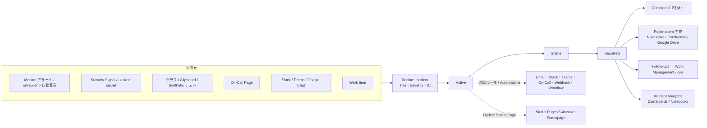
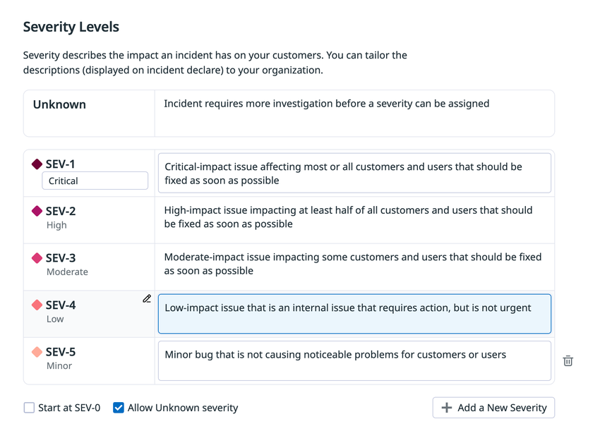
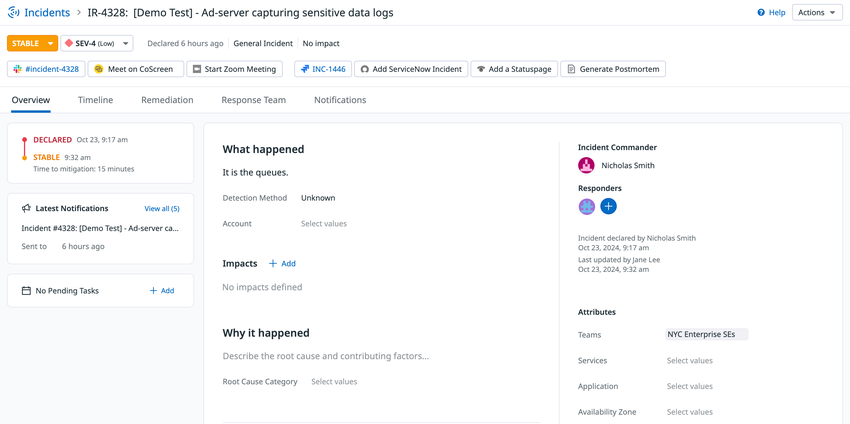
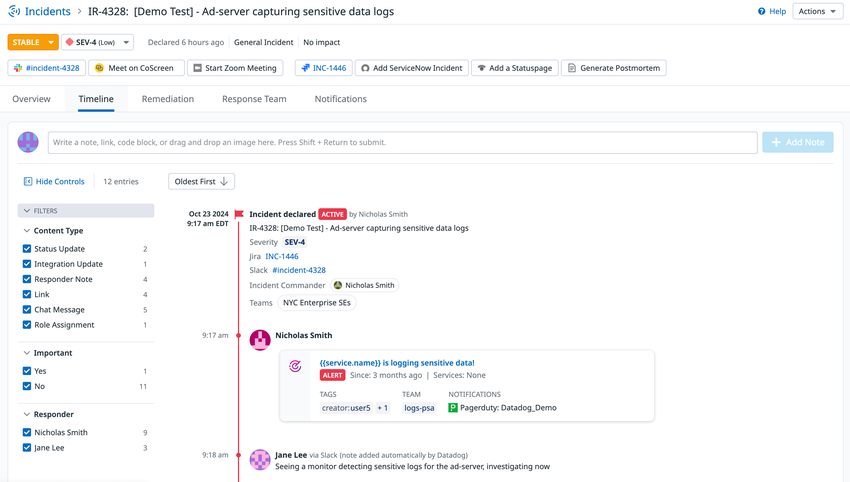
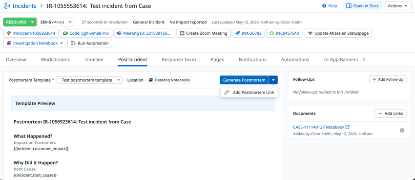
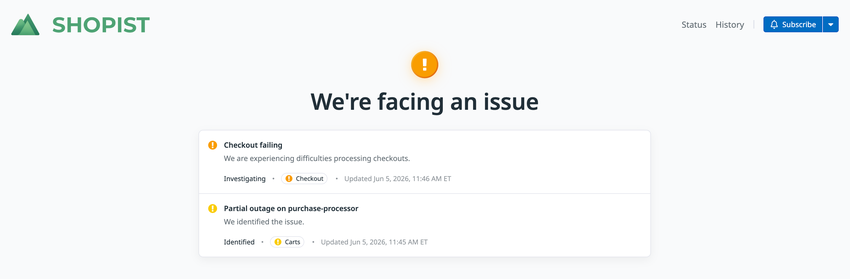

# Incident Management（インシデント管理）

## 概要

Datadog Incident Management（インシデント管理）は、サービス障害やセキュリティ脅威を「インシデント」として宣言し、対応・調整・記録・事後分析までを Datadog 上で一貫して行う製品である。インシデントはメトリクス、トレース、ログと同じプラットフォーム上に存在し、Monitor（モニター）のアラート、Security Signal、イベント、Work Item（旧 Case）などから宣言できる。インストールは不要で、Datadog の Web UI・モバイルアプリ・Slack・Microsoft Teams・Google Chat から利用する。[出典](https://docs.datadoghq.com/incident_response/incident_management/)

Incident Management は **Incident Response（インシデントレスポンス）スイート**の一部であり、同スイートには次の製品が含まれる。[出典](https://docs.datadoghq.com/incident_response/)

| 製品 | 役割 | 本ナレッジでの記載先 |
|---|---|---|
| Incident Management | インシデントの宣言・調整・記録・ポストモーテム・分析 | 本ファイル |
| On-Call | オンコールスケジュール、エスカレーション、Page（呼び出し） | [On-Call](./on-call.md) |
| Status Pages | 社外・社内向けのステータスページ公開 | 本ファイル（「Status Pages」節） |
| Work Management（旧称：Case Management） | 作業項目（Work Item）の管理、Jira/ServiceNow 双方向同期 | [Case Management](./case-management.md) |

> **名称と所在の変遷:** Incident Management は 2020-08-11 にベータとして発表された（[プレスリリース](https://www.datadoghq.com/about/latest-news/press-releases/incident-management/)）。ドキュメントは以前 `docs.datadoghq.com/service_management/incident_management/` 配下（Service Management カテゴリ）にあったが、2026-11-02 時点では `docs.datadoghq.com/incident_response/incident_management/` 配下（Incident Response カテゴリ）に移っている。旧 URL のリンクも一部ドキュメント内に残っている。Case Management は Work Management に改称されており、RBAC 権限名は `cases_read` / `cases_write` のまま残っている。[出典](https://docs.datadoghq.com/account_management/rbac/permissions/)

本ファイルの対象範囲は次のとおり。

- インシデントの宣言（作成）経路と宣言モーダル
- インシデントの属性（Severity、Status、Property Fields、Impact、Responder Roles、Incident Types）
- Incident Details（インシデント詳細）画面、Timeline（タイムライン）、通知、Page
- Incident Settings（設定）：Information、Property Fields、Responder Roles、Notification Rules、Templates、Transition Forms、Automations、Integrations、Follow-ups
- ポストモーテム、フォローアップ、Incident AI
- Slack / Microsoft Teams / Google Chat / Zoom / Jira / ServiceNow / Atlassian Statuspage 連携
- Status Pages
- Incident Analytics（分析）、RBAC 権限、API・Terraform、制限値、課金

関連ファイル：オンコールの詳細は [On-Call](./on-call.md)、Workflow の詳細は [Workflow Automation](./workflow-automation.md)、AI 機能全般は [Bits AI と AI 機能](../ai/bits-ai.md)、チャットツール連携の一般設定は [通知・コラボレーション連携](../platform/collaboration-integrations.md)、モニターからの通知は [通知と Downtime](../platform/notifications-and-downtimes.md) を参照。

## 全体像（ライフサイクル）

Incident Management のライフサイクルは「宣言 → 調査・対応（Active）→ 安定化（Stable）→ 解決（Resolved）→（任意）完了（Completed）→ ポストモーテムとフォローアップ」の流れで進む。

## インシデントの宣言（作成）

### 宣言すべき状況

Datadog の公式ドキュメントは、次のいずれかに当てはまる場合にインシデントを宣言するよう案内している。[出典](https://docs.datadoghq.com/incident_response/incident_management/investigate/declare/)

- 問題が顧客に影響している、または影響する可能性がある
- 問題（社内の問題を含む）に緊急対応が必要である
- 宣言すべきか迷うとき（関係者に知らせ、必要に応じて Severity を上げる）

### 宣言経路一覧

Incident Management のインシデントは、次の経路から宣言できる。[出典](https://docs.datadoghq.com/incident_response/incident_management/investigate/declare/)

| 宣言元 | 操作 | 備考 |
|---|---|---|
| Incidents ページ | **Declare Incident** をクリック | 折りたたみ式サイドパネルに、組織の Severity / Status の Helper Text が表示される |
| Monitor（手動） | モニターの **Declare incident** アクション | モニターが Signal として追加される。既存インシデントへのモニター追加も可 |
| Monitor（自動） | **Configure notifications and automations** に `@incident-` ハンドルを追加 | モニターが `warn` / `alert` / `no data` に遷移した時にインシデントを自動作成。`@incident-` ハンドルは管理者が作成（Incident Settings の Monitor Automations） |
| Cloud SIEM / Workload Protection の Security Signal | サイドパネルの **Declare incident** または **Escalate Investigation** | |
| App and API Protection（旧称：ASM）の Signal | **Show all actions** → **Declare Incident** | |
| Leaked secret（Secret Scanning） | 検出サイドパネルの **Declare incident** | 検出メタデータが事前入力される |
| Work Item（Work Management） | Work Item 詳細ページの **Declare incident** | エスカレーション用途 |
| グラフ | グラフのエクスポートボタン → **Declare incident** | グラフが Signal として追加される |
| Synthetic テスト | Actions ドロップダウンの **Declare incident** | テストの要約がタイムラインに追加される |
| Datadog Clipboard | `Cmd/Ctrl + Shift + K` で開き **Declare Incident** | 複数のモニターやグラフをまとめて持ち込める |
| On-Call ページ | On-Call の Page 一覧で Page を選び **Declare Incident** | 該当 On-Call Team がインシデントに紐づく |
| Slack | 任意のチャンネルで `/datadog incident` | Slack 連携が必要。インシデントチャンネルを作成。メッセージの **More actions** → **Declare incident** でも宣言可 |
| Google Chat | 任意のスペースで `/dd_incident` | Google Chat 連携が必要 |
| Microsoft Teams | 非インシデントチャンネルの **Datadog** タブから宣言 | Teams 連携が必要 |
| Handoff Notification カード | カードから直接宣言 | Page を受けた時やアクティブなインシデントに追加された時に表示され、閉じるかインシデントの Status が変わるまで残る |
| モバイルアプリ | Datadog Mobile App（iOS / Android） | インシデント一覧の閲覧・作成・管理が可能 [出典](https://docs.datadoghq.com/incident_response/incident_management/) |
| API | `POST /api/v2/incidents` | 【Preview】扱いのエンドポイント（「API と Terraform」節参照） |

Slack から宣言した場合の Incident Commander（IC）の既定値は次のとおり。[出典](https://docs.datadoghq.com/incident_response/incident_management/investigate/declare/)

| 条件 | Incident Commander の初期値 |
|---|---|
| 宣言者が Slack を Datadog アカウントに接続済み（`/datadog connect`） | 宣言者本人 |
| 宣言者が未接続 | 汎用ユーザー `Slack app user`（後から Datadog 上で変更可） |

Slack からの宣言は、既定では Datadog 組織に接続済みの Slack ユーザーのみ可能である。未接続ユーザーにも宣言を許可するには、Incident Settings の **Allow Slack users to declare incidents without a connected Datadog account** を有効にする。[出典](https://docs.datadoghq.com/incident_response/incident_management/setup_and_configuration/integrations/slack/)

### 宣言モーダルの項目

Incident Management の宣言モーダル（Incident Creation Modal）の標準項目は次のとおり。[出典](https://docs.datadoghq.com/incident_response/incident_management/investigate/declare/)

| 項目 | 必須 | 説明 |
|---|---|---|
| Title | 必須 | インシデントの説明的なタイトル |
| Severity Level | 必須 | 既定は SEV-1（最も重大）〜 SEV-5（最も軽微）。数と説明はカスタマイズ可 |
| Incident Commander | 任意 | 対応を指揮する人 |
| 追加の Property Fields | 設定次第 | Incident Settings で宣言時に表示・必須化できる（「Required at declaration」） |

- モニターから作成されたインシデントは、モニターのタグから Property Field の値を継承する。通知ルールで自動通知したい場合は、条件に一致するようモニターにタグを付ける。[出典](https://docs.datadoghq.com/incident_response/incident_management/investigate/declare/)
- 宣言時の必須項目（Required at declaration）は、Workflow Automation や API からの作成には適用されない。[出典](https://docs.datadoghq.com/incident_response/incident_management/setup_and_configuration/property_fields/)
- 宣言モーダルに表示する Helper Text は Markdown（インデント付きリスト、書式、ハイパーリンク）に対応する。[出典](https://docs.datadoghq.com/incident_response/incident_management/setup_and_configuration/information/)

## インシデントの属性

### Severity（重大度）

Incident Management の Severity は Incident Settings の **Information** ページで設定する。[出典](https://docs.datadoghq.com/incident_response/incident_management/setup_and_configuration/information/)

| 項目 | 既定値・仕様 |
|---|---|
| 既定の最上位 | SEV-1（**Start at SEV-0** を有効にすると SEV-0 を最上位にできる） |
| 既定のサブラベル | SEV-1: Critical / SEV-2: High / SEV-3: Moderate / SEV-4: Low / SEV-5: Minor |
| Severity 数 | 最小 1、最大 10 |
| Unknown Severity | 有効化可能（**Allow Unknown severity**）。「重大度判定前に追加調査が必要」の意 |
| カスタマイズ | サブラベル名と説明を編集可。リスト末尾で追加・削除 |
| 削除時の挙動 | 通知ルールが参照している Severity を削除すると確認が求められ、続行すると該当ルールが無効化される |
| 分析への影響 | Severity の削除や開始値（SEV-0/1）の変更は、既存の Incident Management Analytics クエリを更新しない |

既定の Severity 説明文（設定画面のスクリーンショットに表示される文言）は次のとおり。

| Severity | サブラベル | 既定の説明（要旨） |
|---|---|---|
| SEV-1 | Critical | ほぼ全て、または全ての顧客・ユーザーに影響する重大な問題。至急修正 |
| SEV-2 | High | 少なくとも半数の顧客・ユーザーに影響する問題。至急修正 |
| SEV-3 | Moderate | 一部の顧客・ユーザーに影響する問題。至急修正 |
| SEV-4 | Low | 対応は必要だが緊急ではない社内の問題 |
| SEV-5 | Minor | 顧客・ユーザーに目立った問題を起こしていない軽微なバグ |
| Unknown | — | Severity を決める前に追加調査が必要 |

[出典](https://docs.datadoghq.com/incident_response/incident_management/setup_and_configuration/information/)（ページ本文は説明文がカスタマイズ可能であることのみを記載し、既定の説明文は列挙していない。上表は同ページ掲載のスクリーンショットから採録）

*キャプション：Incident Settings > Information の Severity Levels 設定画面。*
画面説明：上部に「Severity describes the impact an incident has on your customers」という説明があり、最上段に **Unknown**（説明：Incident requires more investigation before a severity can be assigned）、その下に SEV-1（Critical）〜 SEV-5（Minor）の行が並ぶ。各行の左にサブラベル（編集可）、右に宣言時に表示される説明文の入力欄がある。最下部に **Start at SEV-0** と **Allow Unknown severity** のチェックボックス、**+ Add a New Severity** ボタン、行末に削除（ゴミ箱）アイコンがある。
出典：https://docs.datadoghq.com/incident_response/incident_management/setup_and_configuration/information/ （2026-11-02 取得）

### Status（ステータス）

Incident Management の Status は次の 4 種類で、既定で有効なのは Active・Stable・Resolved の 3 つである。[出典](https://docs.datadoghq.com/incident_response/incident_management/investigate/describe/)

| Status | 意味 | 既定 |
|---|---|---|
| Active | 他者に影響を与えているインシデント | 有効 |
| Stable | 他者への影響は止まったが、調査が完了していない | 有効 |
| Resolved | 他者への影響がなく、調査も完了している | 有効 |
| Completed | すべての是正作業が完了している | 任意（既定は無効） |

- 各 Status の説明文は Incident Settings で編集できる。[出典](https://docs.datadoghq.com/incident_response/incident_management/setup_and_configuration/information/)
- Completed を削除しても、Completed 状態の既存インシデントや Completed を参照する分析クエリは更新されない。Completed を参照する通知ルールは無効化される。[出典](https://docs.datadoghq.com/incident_response/incident_management/setup_and_configuration/information/)
- 検索・テンプレート変数上の状態値は `active` / `stable` / `resolved` などの小文字表記になる（例：`state:active`、`{{incident.state}}`）。[出典](https://docs.datadoghq.com/incident_response/incident_management/setup_and_configuration/templates/)

### Incident Types（インシデントタイプ）

Incident Types は、インシデントの種類（例：Security Incident、Customer Impacting）ごとに異なる設定を適用する仕組みである。Incidents Settings ページで **Add Incident Type** をクリックし、名前と任意の説明を入力して作成する。Property Fields、Responder Roles、通知ルール、テンプレート、Transition Forms、Automations、Integrations の設定、Information ページのトグル（Private Incidents、削除、テストインシデント等）は Incident Type 単位で設定する。[出典](https://docs.datadoghq.com/incident_response/incident_management/setup_and_configuration/) [出典](https://docs.datadoghq.com/incident_response/incident_management/guides/manage_with_terraform/)

組織全体の Global Settings には次がある。[出典](https://docs.datadoghq.com/incident_response/incident_management/setup_and_configuration/)

| Global Setting | 内容 | 既定 |
|---|---|---|
| Analytics Dashboard | Incidents ホームの **Analytics** ボタンで開くダッシュボード | テンプレート「Incident Management Overview」ダッシュボード |
| Monitor Automations | モニター通知メッセージで使う `@incident-` ハンドルを作成し、モニター発火時にインシデントを自動作成 | — |

### Property Fields（プロパティフィールド）

Incident Management の Property Fields は、インシデントの構造化データ（根本原因、影響範囲など）を記録する項目である。既定フィールドは 5 つで、いずれも削除できない。[出典](https://docs.datadoghq.com/incident_response/incident_management/setup_and_configuration/property_fields/)

| 既定フィールド | 内容 |
|---|---|
| Detection Method | インシデントがどのように宣言されたかの文脈 |
| Summary | 何が起きたかの詳細 |
| Root Cause | 推定される根本原因や調査対象 |
| Services | APM 設定済みなら APM のサービス名を利用 |
| Teams | 組織で定義された Teams から選択 |

カスタムフィールドの型は次の 7 種類。[出典](https://docs.datadoghq.com/incident_response/incident_management/setup_and_configuration/property_fields/)

| 型 | 入力形式 | 値の数 | 検索ファセット | Analytics の Measure |
|---|---|---|---|---|
| Single Select | 事前定義値のドロップダウン | 1 | 可 | — |
| Multi Select | 事前定義値のドロップダウン | 複数 | 可 | — |
| Text Array | 自由入力 | 複数 | 可 | — |
| Text Area | 自由入力テキストボックス | 1 | 公開情報では確認できず（ファセット対象の列挙に含まれない） | — |
| Metric Tag | 指定したメトリクスタグの取り込み済み値のドロップダウン | 複数 | 公開情報では確認できず（ファセット対象の列挙に含まれない） | — |
| Number | 整数または小数 | 1 | 可 | 可（Dashboards / Notebooks でグラフ化） |
| Datetime | 日時（UTC で保存、ユーザーのローカルタイムゾーンで表示） | 1 | 可 | — |

その他の仕様：

- フィールドは Overview タブの 3 つのセクション **What Happened** / **Why It Happened** / **Attributes** のいずれかに配置する。並べ替えや移動が可能。[出典](https://docs.datadoghq.com/incident_response/incident_management/investigate/)
- **Required at declaration**：宣言時に値を必須にする（Workflow・API からの作成には非適用）。
- **Prompt user**：宣言時、または Transition Forms による Status 変更時に入力を促す。
- フィールド名は snake_case の識別子で、検索クエリ、Workflow、API で使われる。
- Overview タブでは Datadog のメトリクスタグの `<KEY>:<VALUE>` からフィールドを追加することもできる。[出典](https://docs.datadoghq.com/incident_response/incident_management/investigate/)

### Impact（顧客影響）

Incident Management の Impact は、顧客影響の開始・終了時刻と影響範囲を記録するセクションで、Incident Analytics の Customer Impact Duration、Time to Detect、Time to Repair の計算に使われる。[出典](https://docs.datadoghq.com/incident_response/incident_management/investigate/) [出典](https://docs.datadoghq.com/incident_response/incident_management/analytics_and_reporting/)

登録手順（Overview タブ > **Impacts**）：

1. **Add** をクリック
2. 影響の開始日時を指定
3. 影響の終了日時を指定（継続中なら空欄）
4. `Scope of impact` に顧客への影響内容を記述
5. **Save**

1 件のインシデントに複数の Impact を登録でき、テンプレート変数 `{{incident.customer_impact_start}}` は最も早い開始、`{{incident.customer_impact_end}}` は最も遅い終了を返す。[出典](https://docs.datadoghq.com/incident_response/incident_management/setup_and_configuration/variables/)

### Responder Roles（対応者ロール）と Response Team

Incident Management の Responder Roles は、インシデント対応中の役割分担（例：Incident Commander、Communications Lead）を定義する。**RBAC（ロールベースアクセス制御）とは無関係**で、Responder Role を割り当てても権限は変わらない。[出典](https://docs.datadoghq.com/incident_response/incident_management/setup_and_configuration/responder_roles/) [出典](https://docs.datadoghq.com/incident_response/incident_management/investigate/response_team/)

| ロール | 種別 | 仕様 |
|---|---|---|
| Incident Commander | 既定・1 人ロール | 対応チームを指揮。削除不可、名前変更不可、1 人ロールであることの変更不可。説明文のみ編集可 |
| Responder | 既定（フォールバック） | 他のロールを持たない対応者全員に付く。Incident Settings には表示されない |
| Postmortem Owner | システムロール | ポストモーテムの責任者。Incident Commander・Responder と並んで Response Team に表示される [出典](https://docs.datadoghq.com/incident_response/incident_management/post_incident/postmortems/) |
| カスタムロール | One person role / Multi person role | 1 人ロールはインシデントごとに 1 人のみ、複数人ロールは人数無制限 |

カスタムロールの作成手順：**Incident Settings > Responder Roles** → **+ Add Responder Role** → 名前入力 → **One person role** / **Multi person role** を選択 → 説明（割り当て時に UI に表示）→ **Save**。

Response Team（対応チーム）の仕様：[出典](https://docs.datadoghq.com/incident_response/incident_management/investigate/response_team/)

- Responder を追加すると、メールで通知され、Private インシデントなら閲覧可能になり、Slack チャンネルが紐づいていればそのチャンネルに自動追加される。
- 次の場合は自動的に Responder として追加される：インシデントを更新する操作（タイムラインへの書き込みを含む）を行った場合、通知ルールまたは手動通知でインシデントについて通知された場合。
- **Response Team** タブには、各対応者の追加時刻と、最後にインシデントに影響する操作をした時刻が記録される。
- ロール未割り当てかつ未操作の Responder のみ削除できる。
- Slack ではインシデントチャンネルで `/dd incident responders` または action tray の **Manage Responders** で管理でき、ロール割り当て時は Slack で通知される。

## Incident Details（インシデント詳細）画面

Incident Management の各インシデントは Incident Details ページを持ち、上部のグローバルヘッダーとタブで構成される。[出典](https://docs.datadoghq.com/incident_response/incident_management/investigate/)

*キャプション：Incident Details ページの Overview タブ（例：IR-4328「[Demo Test] Ad-server capturing sensitive data logs」）。*
画面説明：最上部にパンくず「Incidents > IR-4328: …」と右上の **Help**・**Actions** メニュー。その下に Status セレクタ（例：STABLE）、Severity セレクタ（例：SEV-4 (Low)）、宣言からの経過時間、Incident Type（General Incident）、影響有無（No impact）が並ぶ。次の行に連携リンクのボタン群（Slack チャンネル `#incident-4328`、Meet on CoScreen、Start Zoom Meeting、Jira 課題 `INC-1446`、Add ServiceNow Incident、Add a Statuspage、Generate Postmortem）。タブは Overview / Timeline / Remediation / Response Team / Notifications。左カラムに簡易タイムライン（DECLARED → STABLE、Time to mitigation）、Latest Notifications、Pending Tasks。中央に **What happened**（Detection Method 等）、**Impacts**（+ Add）、**Why it happened**（Root Cause Category 等）。右カラムに Incident Commander、Responders、宣言者・最終更新者、**Attributes**（Teams、Services、Application、Availability Zone など）が表示される。
出典：https://docs.datadoghq.com/incident_response/incident_management/investigate/ （2026-11-02 取得）

> **注記:** 上記スクリーンショットは 2024 年 10 月時点のデモ画面であり、タブ構成は更新されている。2026 年 5 月時点の画面（ポストモーテム節のスクリーンショット）では、タブが Overview / Workstreams / Timeline / Post-Incident / Response Team / Pages / Notifications / Automations / In-App Banners となっている。旧「Remediation」タブ相当のフォローアップ管理は Post-Incident タブで行う（ドキュメントの記述も両方の表記が混在）。[出典](https://docs.datadoghq.com/incident_response/incident_management/post_incident/postmortems/)

### グローバルヘッダー

- Status / Severity セレクタ、各 Incident Integration（Slack、Teams、Zoom、Jira、ServiceNow、Statuspage 等）へのリンクが置かれる。
- インシデントが Resolved になると、ポストモーテム生成ボタンが表示される。

### Overview タブの要約モジュール

| モジュール | 内容 |
|---|---|
| Condensed Timeline | Status 変更と影響開始・終了のタイムスタンプ |
| Latest Notifications | 直近の通知（Notifications タブへのリンク付き） |
| Pending Tasks | 直近の未完了タスク |
| Responders | 現在の Incident Commander と他の対応者のアバター |
| Recent Timeline Entries | タイムラインの直近 5 件 |

[出典](https://docs.datadoghq.com/incident_response/incident_management/investigate/)

### Incidents 一覧ページと検索

Incidents ページ（`/incidents`）は進行中インシデントのフィードを表示し、左側のファセット（Status、Severity、Time To Repair (hours)、設定済みプロパティ等）での絞り込み、検索結果のエクスポート、Saved Views（保存ビュー）に対応する。検索は Logs や Event Management と同じイベントベースの検索構文で、`key:value` と `AND` / `OR` / `-` を組み合わせる。[出典](https://docs.datadoghq.com/incident_response/incident_management/)

| クエリ例 | 意味 |
|---|---|
| `severity:SEV-1` | SEV-1 のインシデント |
| `severity:(SEV-1 OR SEV-2) state:active` | Active な SEV-1 / SEV-2 |
| `services:checkout AND -state:resolved` | checkout サービスに影響する未解決インシデント |
| `teams:platform` | platform チームのインシデント |
| `services:web*` | `web` で始まるサービスに影響するインシデント |
| `Root\ Cause\ Category:Bug` | 特定の根本原因属性（スペースはエスケープ） |
| `responder:john.smith@datadoghq.com` | 特定ユーザーが Responder のインシデント |

Private インシデントは **Visibility** ファセットで絞り込める。[出典](https://docs.datadoghq.com/incident_response/incident_management/setup_and_configuration/information/)

## Timeline（タイムライン）

Incident Management の Timeline は、インシデント中の作業記録の一次情報源である。操作が行われるたびにセル（cell）が時系列で追加され、変更内容・実行者・時刻が記録される。既定の並び順は `oldest first`（古い順）で、上部のボタンで `newest first` に切り替えられる。[出典](https://docs.datadoghq.com/incident_response/incident_management/investigate/timeline/)

### コンテンツタイプ

| Content type | 内容 |
|---|---|
| Responder note | 対応者が手書きしたノート。サブタイプ：*Graph*（Datadog グラフを含む）、*Link*（ハイパーリンク）、*Code*（Markdown コードブロック） |
| Incident update | プロパティ（Status、Severity を含む）や Impact の変更 |
| Integration update | 連携機能経由の変更 |
| Task | Post-Incident セクションのタスク変更 |
| Notification sent | 対応者が手動通知を送った記録 |
| Meeting Chat | ビデオ会議のチャットメッセージ |
| Meeting Summary | AI が生成した会議要約（会議中・会議後） |

Automations の実行もタイムラインに記録される（オートメーション名、実行時刻、実行詳細へのリンク、成功/失敗）。タイムラインはオートメーション実行のみ表示、または除外するフィルタができる。[出典](https://docs.datadoghq.com/incident_response/incident_management/setup_and_configuration/automations/)

### Responder note・グラフ・画像

- Responder note は Incident Details のタブ下のテキストボックス、または Slack から追加できる。作成時にタイムスタンプを過去時刻に変更でき、時系列の正しい位置に差し込める。自分が書いたノートは内容・タイムスタンプの編集、削除が可能。各セルへのリンクをコピーして共有できる。
- **グラフセル**：Organization Settings で共有 URL（public sharing）が有効ならグラフ定義は共有 URL で保存される。追加後 **24 時間**はダッシュボードと同様にホバー等のインタラクティブ表示、24 時間経過後は**静的画像**に置き換わる（保持期間が短いデータのグラフでも後から参照できるようにするため）。
- **画像**：テキストボックスに画像ファイルをドロップすると Datadog がホストする画像セルとして追加される。既存セルには鉛筆アイコン → 画像アイコンから、ドロップ、**Choose File**、または公開 URL の貼り付けで追加できる。

[出典](https://docs.datadoghq.com/incident_response/incident_management/investigate/timeline/)

*キャプション：Incident Details の Timeline タブ。*
画面説明：上部に「Write a note, link, code block, or drag and drop an image here」と表示された入力欄と **Add Note** ボタン。左側に **Hide Controls** と FILTERS パネルがあり、**Content Type**（Status Update、Integration Update、Responder Note、Link、Chat Message、Role Assignment と件数）、**Important**（Yes/No）、**Responder**（対応者名ごと）のチェックボックスで絞り込める。中央に **Oldest First** の並び順ボタンとエントリ数（例：12 entries）、縦の時系列線に沿って「Incident declared ACTIVE by …」（Severity、Jira、Slack、Incident Commander、Teams）、モニターアラートのカード（ALERT、タグ、チーム、PagerDuty への通知）、「via Slack (note added automatically by Datadog)」と表示された Slack 由来ノートが並ぶ。
出典：https://docs.datadoghq.com/incident_response/incident_management/investigate/timeline/ （2026-11-02 取得）

## 通知（Notifications）と Page

Incident Management の通知は、インシデントの **Notifications** タブ（関係者向け連絡）と **Pages** タブ（On-Call の呼び出し）の 2 つで扱う。[出典](https://docs.datadoghq.com/incident_response/incident_management/investigate/notification/)

### 手動通知の作成

1. インシデントの **Notifications** タブを開く
2. **+ New Notification** をクリック
3. 宛先を入力（メール、Slack チャンネル、PagerDuty ハンドル、Webhook など Datadog がサポートする任意の通知ハンドル）
4. Message Template を選択
5. タイトルと本文を Markdown とテンプレート変数（`{{` で補完）で編集
6. `{{incident.created}}` 変数でタイムゾーンを指定可能
7. 送信、または下書き保存

Notifications タブは **Drafts** と **Sent** に分かれ、宛先、本文と再通知メッセージ、最終更新時刻、作成者を表示する。Sent では手動か通知ルールによる自動送信かと、該当ルールが表示される。

### インシデントからの Page

**Pages** タブ → **Page** → チーム／ユーザーを選択 →（任意）Page を Acknowledge した人に自動でインシデントロールを割り当て → **Page**。Pages タブには手動・通知ルール経由を問わず送信した Page の履歴が表示される。On-Call の詳細は [On-Call](./on-call.md) を参照。

## Incident Settings（設定）リファレンス

Incident Settings は `https://app.datadoghq.com/incidents/settings`（サイトごとのドメイン）で開き、組織全体の Incident Management をカスタマイズする。設定ページの構成は次のとおり。[出典](https://docs.datadoghq.com/incident_response/incident_management/setup_and_configuration/)

| 設定ページ | 主な内容 | 単位 |
|---|---|---|
| Information | Severity、Status、Helper Text、Private Incidents、削除、Timestamp Override、Test Incidents | Incident Type |
| Property Fields | 既定・カスタムフィールド | Incident Type |
| Responder Roles | カスタムロール | Incident Type |
| Notification Rules | 自動通知ルール | Incident Type |
| Templates | メッセージテンプレート、ポストモーテムテンプレート | Incident Type |
| Transition Forms | Status 変更時の入力フォーム | Incident Type |
| Automations | Workflow Automation ベースの自動化 | Incident Type |
| Integrations | Slack、Teams、Google Chat、Zoom、Jira、ServiceNow、Status Pages、Statuspage 等 | Incident Type（Slack の Bits AI 有効化のようにワークスペース全体に効くものもある） |
| Follow-Ups | エクスポートテンプレート（Work Management / Jira） | 公開情報では確認できず |
| Global Settings | Analytics Dashboard、Monitor Automations（`@incident-` ハンドル） | 組織 |

### Information ページのトグル一覧

| 設定 | 既定 | 有効時の動作 |
|---|---|---|
| Private Incidents | 無効 | Visibility を Organization（`Incidents Read` 権限者が閲覧可）と Private（Responder と `Private Incidents Global Access` 権限者のみ閲覧可）から選べる。Slack では Private 化すると既存チャンネルをアーカイブし、プライベートチャンネルを作成して既存 Responder を追加する（`/datadog incident private`） |
| Incident Deletion | 無効 | `Incidents Write` 権限者がその Type のインシデントを削除可能。削除されたインシデントは分析から除外され、誰もアクセスできず、**復元不可** |
| Override Status Timestamps | 無効 | `Incidents Write` 権限者が `declared` / `detected` / `resolved` のタイムスタンプを上書き可能 |
| Test Incidents | 無効 | `Incidents Write` 権限者がテストインシデントを宣言可能 |
| Completed status | 無効 | 4 つ目の Status を追加 |
| Start at SEV-0 | 無効 | 最上位 Severity を SEV-0 にする |
| Unknown severity | 公開情報では既定値を確認できず（設定画面例では有効） | Unknown Severity を許可 |

[出典](https://docs.datadoghq.com/incident_response/incident_management/setup_and_configuration/information/)

Terraform の `datadog_incident_type` リソースの `configuration` ブロックには、`private_incidents`、`private_incidents_by_default`、`allow_workflows`、`allow_incident_deletion`、`editable_timestamps`、`test_incidents`、`create_message`、`slug_source` といったキーがある（公式ガイドの例より）。[出典](https://docs.datadoghq.com/incident_response/incident_management/guides/manage_with_terraform/)

### Test Incidents（テストインシデント）

Test Incidents は訓練、オートメーションのテスト、連携の検証に使うインシデントで、**紫色のバナー**で表示される。[出典](https://docs.datadoghq.com/incident_response/incident_management/guides/test_incidents/)

| 動作 | 既定 | 宣言時に変更可 |
|---|---|---|
| 検索結果への表示 | 表示されない | 可 |
| Analytics への算入 | 算入されない | 可（"Include in analytics"） |
| Integrations の実行 | 実行されない | 可（"Execute integrations"） |
| Notification Rules の実行 | 実行されない | 可 |
| Automations の実行 | 実行されない（Information ページの記述） | 可 |

- 有効化は管理権限を持つユーザーが **Incidents > Settings > Information > Test incidents** で行う。以後は `Incidents Write` 権限者が宣言できる。
- 宣言方法：Incidents ページの **Declare Incident** 横のドロップダウン → **Declare Test Incident**、または Slack で `/datadog incident test`。

### Notification Rules（通知ルール）

Incident Management の Notification Rules は、条件に一致したインシデントについて関係者に自動通知するルールで、Webhook や Datadog Workflow の起動にも使える。作成・変更には `Incident Notification Settings Write` 権限が必要。**Incident Settings > Notification Rules** で検索、削除、コピー、有効/無効切替、作成ができる。[出典](https://docs.datadoghq.com/incident_response/incident_management/setup_and_configuration/notification_rules/)

| 項目 | 仕様 |
|---|---|
| トリガー | **Declared**（宣言時に条件一致で通知。条件なしなら全宣言で通知）／ **Declared or attributes are updated**（宣言時または更新で条件一致したとき通知。さらに「Renotify on updates to…」に指定したフィールドが変化した場合、条件一致中なら再通知） |
| 条件ロジック | フィールド間は AND、同一フィールド内の複数値は OR（例：`severity:SEV-1` または `SEV-2`、かつ `team:shopping`） |
| マッチ条件の例 | Severity、影響サービス、Status、根本原因カテゴリ、Visibility（Private 条件）など |
| テンプレート | Message Template を指定可能 |

通知先（ハンドル）：

| 通知先 | ハンドル・指定方法 | 注意点 |
|---|---|---|
| メール | `@<email>` | Datadog ユーザーは Responder に自動追加され、Private インシデントへのアクセス権も付与される |
| モバイル端末 | UI で「(Mobile Push Notification)」を選択 | Datadog モバイルアプリで通知が有効である必要 |
| Slack チャンネル | `@slack-<channel>` | `@incident-slack-channel` でインシデント専用チャンネルを指定可 |
| On-Call チーム | `@oncall-<team>` | Datadog On-Call のチームを Page |
| Microsoft Teams | `@teams-<channel>` | インシデント専用に自動作成されたチャンネルは指定できない（Slack の `@incident-slack-channel` 相当のハンドルはない） |
| Webhook | `@webhook-<name>` | Webhook のペイロード種別が **incident** である必要 |
| Workflow | `@workflows-<workflow_name>` | **incident** トリガーで公開（publish）された Workflow である必要 |
| PagerDuty / Opsgenie | 各ハンドル | PagerDuty・Opsgenie 連携で On-Call エンジニアへ通知 [出典](https://docs.datadoghq.com/incident_response/incident_management/setup_and_configuration/integrations/) |

Slack / Teams の「Send all incident updates to a global channel」は、内部的には**組み込みの非表示通知ルール**である。メッセージやトリガーを変えたい場合は、この設定を無効にして独自の通知ルールを定義する。[出典](https://docs.datadoghq.com/incident_response/incident_management/setup_and_configuration/integrations/slack/)

### Templates（メッセージ／ポストモーテム）

Incident Management の Templates には、通知用の **Message Templates** とポストモーテム用の **Postmortem Templates** がある。[出典](https://docs.datadoghq.com/incident_response/incident_management/setup_and_configuration/templates/)

Message Template の作成手順：**+ New Message Template** → 名前 → カテゴリ（新規または既存、**必須**）→ 件名（メール用）→ 本文 → **Save**。Markdown（書式、表、インデント付きリスト、ハイパーリンク）と、件名・本文の両方でテンプレート変数が使える。

Postmortem Template の作成手順：**Incident Management Settings > Postmortem Templates** → **+ New Postmortem Template** → 名前 → 保存先 → 本文（右側に利用可能な変数が表示）→（任意）既定テンプレートに設定 → **Save**。

| 保存先 | 要件 |
|---|---|
| Datadog Notebooks | 追加設定不要 |
| Confluence | Confluence 連携の設定が必要 |
| Google Drive | Google Drive 連携の設定が必要 |

### テンプレート変数

Incident Management のテンプレート変数は、通知、ポストモーテム、Jira テンプレート、チャンネル名テンプレートで使える。Jira テンプレートでは接頭辞なしで表示される（`{{incident.title}}` → `{{ title }}`）。[出典](https://docs.datadoghq.com/incident_response/incident_management/setup_and_configuration/variables/)

主な変数（通知・ポストモーテム・Jira 共通）：

| 分類 | 変数 |
|---|---|
| 基本 | `{{incident.id}}`、`{{incident.title}}`、`{{incident.severity}}`、`{{incident.severity_number}}`、`{{incident.status}}`、`{{incident.<property_field_name>}}` |
| 時刻 | `{{incident.created}}`、`{{incident.detected}}`、`{{incident.resolved}}` |
| 所要時間 | `{{incident.time_to_detect}}`、`{{incident.time_to_internal_response}}`、`{{incident.time_to_repair}}`、`{{incident.time_to_resolve}}`、`{{incident.time_from_detect_to_resolve}}` |
| 平均所要時間 | `{{incident.mean_time_to_<metric>_<window>}}`（`<metric>` = `detect` / `internal_response` / `repair` / `resolve`、`<window>` = `30_days` / `90_days` / `12_months`（365 日））、`{{incident.mean_time_from_detect_to_resolve_<window>}}`。同じ Incident Type の他インシデントの平均 |
| 顧客影響 | `{{incident.customer_impacted}}`（True/False）、`{{incident.customer_impact}}`、`{{incident.scope_of_impact}}`、`{{incident.customer_impact_start}}`、`{{incident.customer_impact_end}}`、`{{incident.customer_impact_duration}}` |
| 人 | `{{incident.commander}}`（名前→メール→ハンドルの順でフォールバック）、`_name` / `_handle` / `_email`、`{{incident.created_by_name}}` 等、`{{incident.responders_summary}}`（多い場合は省略）、`{{incident.responders_full_list}}` |
| Slack | `{{incident.slack_channel_name}}`、`_url`、`_link`、`_id` |
| Microsoft Teams | `{{incident.ms_teams_channel_name}}`、`_url`、`_link`、`_id`、`{{incident.ms_teams_meeting_link}}`、`{{incident.ms_teams_meeting_id}}` |
| Zoom | `{{incident.zoom_id}}`、`{{incident.zoom_join_url}}`、`{{incident.zoom_password}}`、`{{incident.zoom_link}}` |

- 所要時間の個別値は、計算できない場合やゼロ・負の場合 `N/A` になる。平均値は対象となる正の値のインシデントがない場合 `N/A`。[出典](https://docs.datadoghq.com/incident_response/incident_management/setup_and_configuration/templates/)
- ポストモーテム専用：`{{incident.card}}`（自動更新されるインシデントカード。Datadog Notebooks のみ。ポストモーテムの Status・Owner を含む）、`{{incident.timeline}}`（タイムラインの全イベントをコピー）、`{{incident.follow-ups}}`（フォローアップ一覧。Notebooks のみ。ノートブック上で期日設定・担当割当・新規作成が可能で、インシデント側に反映）。
- チャンネル名テンプレート専用（`incident.` 接頭辞なし）：`{{public_id}}`、`{{title}}`、`{{created}}`（`MM_DD_YYYY`）、`{{yyyy}}`、`{{mm}}`、`{{dd}}`、`{{severity}}`、`{{severity_number}}`、`{{random_adjective}}`、`{{random_noun}}`、`{{slug}}`（slug source が `servicenow` なら ServiceNow のレコード番号）。日付系はチャンネル名テンプレートに設定したタイムゾーンで評価される。Slack / Teams / Google Chat の命名制約のため、生成名は小文字化され、非対応文字は置換される。

AI 変数（組織で AI 機能が有効である必要。US1-FED では非対応）：[出典](https://docs.datadoghq.com/incident_response/incident_management/setup_and_configuration/variables/)

| 用途 | 変数 |
|---|---|
| 通知テンプレート | `{{incident.ai_issue}}`、`{{incident.ai_impact}}`、`{{incident.ai_remediation}}`、`{{incident.ai_contributing_factors}}` |
| ポストモーテムテンプレート | `{{incident.ai_summary}}`、`{{incident.ai_system_overview}}`、`{{incident.ai_key_timeline}}`、`{{incident.ai_customer_impact}}`、`{{incident.ai_lessons_learned}}`、`{{incident.ai_action_items}}` |

ポストモーテムの AI 変数の制約：AI 変数の前にはセクション見出しが必要、タイムラインに**最低 10 件のメッセージ**が必要、生成に最大約 1 分かかる、生成値は保存前に承認・編集・却下できる。**Generate postmortem** の Workflow アクションで生成した場合は AI 変数が空になり、Post-Incident タブから生成した場合のみ埋まる。[出典](https://docs.datadoghq.com/incident_response/incident_management/setup_and_configuration/templates/) [出典](https://docs.datadoghq.com/incident_response/incident_management/post_incident/postmortems/)

### Transition Forms（ステータス遷移フォーム）

Transition Forms は、Status 変更時に指定フィールドの入力を対応者に求めるフォームである（例：Resolved にする前に Team と Postmortem Owner を必須入力）。Datadog、Slack、Microsoft Teams での Status 変更時に表示される。[出典](https://docs.datadoghq.com/incident_response/incident_management/setup_and_configuration/transition_forms/)

- 前提：`Incident Settings Write` 権限。
- 設定手順：**Incidents > Settings** → **Incident Types** で対象 Type を展開 → **Transition Forms** タブ → 対象 Status を選択 → Property Fields と Responder Roles を追加し、それぞれ必須／任意を指定 → **Save**。
- 必須項目は**人による Status 変更にのみ適用**され、API や Incident Automations による自動変更はブロックされない。

### Automations（インシデントオートメーション）

Incident Management の Automations は Datadog Workflow Automation で動く自動化で、Severity 変更や Status 遷移などのイベントでアクションを起動する。**Incident Management の課金に含まれ追加費用なし**。Incident Type ごとに **Incidents > Settings** → Type 選択 → **Automations** タブで管理する。[出典](https://docs.datadoghq.com/incident_response/incident_management/setup_and_configuration/automations/)

| 項目 | 仕様 |
|---|---|
| 必要権限 | `Workflows Write` に加え、`Incident Settings Write` **または** `Incident Notification Settings Write` |
| 有効/無効の切替 | `Incident Settings Write` または `Incident Notification Settings Write` を持つユーザーなら、オートメーション自体の編集権がなくても切替可能 |
| 作成方法 | Blueprint から開始、またはアクション（インシデント専用アクション、Action Catalog）から作成。高度な処理は Workflow エディタで編集 |
| トリガー | **When the incident is declared**（宣言時に 1 回）／ **When the incident is declared or updated**（宣言時または条件一致に至る変更時）／ **On a schedule**（インシデントごとに定期実行。例：条件一致の Active インシデントごとに 10 分おき） |
| 条件 | 同一行内の複数値は OR、行間は AND（例：(SEV-1 OR SEV-2) AND summary が空） |
| コンテキスト変数 | `incident.id`、`incident.attributes`、`incident.fieldDiffs`（更新トリガー時の変更フィールド一覧）。`{{ incident.id }}` のように参照 |
| テスト | テストインシデントを宣言する、または Workflow エディタの **Run** → **Test from incident** で既存インシデントのデータを使って模擬実行（実際のトリガーはしない） |
| 実行履歴 | インシデントタイムライン、Workflow エディタの **Execution**（入力値、`incident` コンテキスト、`fieldDiffs`、ステップごとの結果、エラー） |
| 編集権 | 既定では作成者のみ編集可。**Edit Access** でユーザー／サービスアカウントを追加（付与された人は作成者またはサービスアカウントとして API を使えることになる） |
| サービスアカウント | **Run as Service Account** で設定（`Service Account Write` 権限が必要）。作成者退職時も継続稼働 |
| Private インシデント | `Private Incidents Global Access` 権限を持つユーザーまたはサービスアカウントで実行する必要。実行履歴は既定で組織内の誰でも見えるため、閲覧者を制限することが推奨される |

Automations と Notification Rules の違い：

| 観点 | Automations | Notification Rules |
|---|---|---|
| 目的 | 複雑なワークフローと連携の実行 | 関係者への通知 |
| トリガー | 宣言、更新、スケジュール | 宣言、更新 |
| アクション | Action Catalog 全体 | 通知チャネルに限定 |
| 複雑さ | ロジックを含む複数ステップ | ルールあたり 1 通知 |
| コスト | Incident Management に含まれる | Incident Management に含まれる |

公式 Blueprint の例：「SEV-1/2 でチームが追加されたらメンバーを Slack チャンネルに招待」、「30 分ごとに SEV-1/2 の Active/Stable インシデントを確認し、30 分以上更新がなければ IC に Slack でリマインド」。Workflow Automation 自体の仕様は [Workflow Automation](./workflow-automation.md) を参照。

> **サイト差異:** US1-FED のうち `us2.ddog-gov.com` では Workflow Automation が【Preview】である。[出典](https://docs.datadoghq.com/incident_response/incident_management/setup_and_configuration/automations/)

## ポストモーテムとフォローアップ（Post Incident）

### Postmortems（ポストモーテム）

Incident Management のポストモーテムは、インシデントの経緯・原因・再発防止策を記録する構造化文書で、テンプレートに基づきインシデントデータを自動投入して生成する。生成先は Datadog Notebooks、Confluence、Google Drive。Notebooks に生成した場合は **Post-Incident** タブに埋め込まれ、Datadog から離れずに閲覧・編集・ステータス管理ができる。[出典](https://docs.datadoghq.com/incident_response/incident_management/post_incident/postmortems/)

| 項目 | 仕様 |
|---|---|
| 生成権限 | `Incidents Write`（RBAC には `Incident Postmortems Write` 権限も存在：ポストモーテムの作成・変更・削除） |
| 閲覧権限（Notebooks） | `Notebooks Read` |
| 生成タイミング | インシデントが Resolved になった後、Post-Incident タブでテンプレートを選び **Generate Postmortem** |
| Workflow から生成 | **Generate postmortem** アクション（インシデントとテンプレートを指定）。AI 変数は空になる |
| 既存ドキュメントの添付 | **Attach existing post-mortem**（任意 URL：Notebook、Confluence、Google Doc 等） |
| 削除 | Post-Incident タブでリンクを削除。元ドキュメントは削除されない |
| 編集（Notebooks） | 同時編集（カーソル表示）、インラインコメント |
| タイムスタンプ変換 | Postmortem 型ノートブックで kebab メニュー → **Convert timestamps**。プレーンテキストの時刻（例 `Jul 23, 4:30 pm UTC`）を閲覧者のタイムゾーンで表示される date chip に変換。オフセットがない時刻は変換実行者のタイムゾーンで解釈、年がなければ推定。リンク内の日時は変換されない |

> **注意（Private インシデント）:** Datadog Notebooks に生成したポストモーテムは、Private インシデントへのアクセス権の有無にかかわらず `Notebooks Read` 権限を持つ全ユーザーが閲覧できる。機微情報を含むインシデントでは生成先・記載内容に注意する。[出典](https://docs.datadoghq.com/incident_response/incident_management/post_incident/postmortems/)

ポストモーテムの Status と Owner：

| フィールド | 説明 | 既定値 |
|---|---|---|
| Status | 完成状態：**Draft**（作成中）／**In Review**（レビュー待ち）／**Completed**（完了） | Draft |
| Owner | ポストモーテムの責任者。組織内の任意ユーザーに再割当て可。Response Team にシステムロールとして表示 | 生成したユーザー |

標準テンプレートとして AI 変数入りの **General incident with AI content** が用意されている。[出典](https://docs.datadoghq.com/incident_response/incident_management/setup_and_configuration/templates/)

*キャプション：Incident Details の Post-Incident タブ（Resolved のインシデント）。*
画面説明：ヘッダーに RESOLVED の Status、SEV-5 (Minor)、解決までの時間、Incident Type、連携ボタン群（Slack チャンネル、Google Meet、Teams Meeting ID、Create Zoom Meeting、Jira、ServiceNow、Update Atlassian Statuspage、Investigation Notebook、Run Automation）。タブは Overview / Workstreams / Timeline / Post-Incident / Response Team / Pages / Notifications / Automations / In-App Banners。左側で **Postmortem Template**（必須）と **Location**（Datadog Notebooks）を選び、**Generate Postmortem** ボタン（ドロップダウンに **Add Postmortem Link**）がある。その下に **Template Preview**（What Happened? / Why Did it Happen? の見出しと `{{incident.customer_impact}}`、`{{incident.root_cause}}` などの変数）。右側に **Follow-Ups**（+ Add Follow-Up）と **Documents**（+ Add Links、添付済みの Notebook リンク）パネル。
出典：https://docs.datadoghq.com/incident_response/incident_management/post_incident/postmortems/ （2026-11-02 取得）

### Follow-ups（フォローアップ）

Incident Management の Follow-ups は、インシデント中に見つかったが即時対応の範囲外の作業（監視不足、技術的負債、手順書の不備、根本原因の恒久対策など）を記録するタスクである。インシデント中（解決前を含む）いつでも作成できる。[出典](https://docs.datadoghq.com/incident_response/incident_management/post_incident/follow-ups/)

| 項目 | 仕様 |
|---|---|
| 作成場所 | Post-Incident タブ、Slack の `/datadog followup`（一覧は `/datadog followup list`）、Slack の 🔜 絵文字アクション（[出典](https://docs.datadoghq.com/incident_response/incident_management/setup_and_configuration/integrations/slack/)）、ポストモーテム Notebook の `{{incident.follow-ups}}` リスト |
| Status | **Open** / **Done** の 2 値 |
| AI 提案 | 解決後、Incident AI がインシデントチャンネルから言及されたフォローアップを抽出し、ワンクリックで作成を提案（`app.ddog-gov.com` では非対応） |
| エクスポート先 | Work Management（Datadog 内の Work Item、**双方向**同期）／ Jira（**一方向**同期） |
| エクスポート方式 | 手動（Post-Incident タブから個別）／自動（作成時にテンプレートで全件エクスポート） |
| エクスポートテンプレート変数 | `{{ title }}`（インシデントタイトル）、`{{ severity }}`、`{{ follow_up_description }}`、`{{ follow_up_due_date }}` など |
| Work Management 同期 | Status と Assignee を双方向同期。Work Item の Assignee は 1 人のみのため、フォローアップの最初の Assignee のみ反映 |
| Jira 同期 | フォローアップの Open/Close に応じて Jira 側 Status を一方向同期。双方向が必要なら、Jira と双方向同期する Work Management プロジェクトへエクスポートする |

設定場所：**Incident Management settings > Follow-Ups** でエクスポートテンプレートを定義する。Work Management の詳細は [Case Management](./case-management.md) を参照。

## Incident AI

Incident AI は、Slack と Datadog 上で調査を支援する AI 機能群である。有効化には Datadog と Slack を接続し、インシデント Slack チャンネルで Bits AI を有効化（Integrations 設定の **Activate Bits AI in incident Slack channels**）する。[出典](https://docs.datadoghq.com/incident_response/incident_management/investigate/incident_ai/)

| 機能 | 内容 |
|---|---|
| Proactive incident summaries | インシデントチャンネル参加時に、寄与要因・影響・問題・是正を含む要約を本人のみに表示。`/dd incident summary` で随時取得。Resolved 時には最終要約をチャンネル全員に投稿 |
| Meeting summaries | Zoom / Google Meet / Microsoft Teams の会議を Datadog Transcriber が文字起こしし、会議中は定期的にライブ要約、終了時に最終要約をタイムライン（Meeting Summary）とチャット（会議カードのスレッドとチャンネル）へ投稿 |
| Related incident detection | **20 分以内**に宣言されたインシデント同士を関連として自動フラグ |
| Chat with Incident AI | `@Datadog` への自然言語指示で宣言、Severity・Status 変更、要約、履歴検索、関連インシデント検索など |
| Bits Investigation の起動 | Slack の **Investigate with Bits AI**、`/dd incident investigate`、`@Datadog investigate <補足>`、または Web UI の Overview の「Investigation」セクションから起動。タイムライン、紐づくテレメトリ（トレース・メトリクス・ログ）を取り込み、スレッドで進捗を投稿し、最終的な根本原因要約と推奨対応をチャンネルに表示。Bits Investigation は Responder Roles 欄に対応者として表示される |
| AI 変数・AI ポストモーテム | 前述の AI 変数を参照 |
| AI 提案フォローアップ | 前述 |

Meeting summaries の仕様：

- 組織で AI 機能が有効である必要がある。会議プラットフォームの連携設定で **Generate AI meeting summaries** を有効化する。
- 会議音声は Datadog のサブプロセッサーが録音・文字起こしし、**7 日間の保持期間後に自動削除**される。
- Transcriber の参加には 10〜30 秒程度かかり、ロビー／待機室がある場合は参加者が許可する必要がある。
- 既定で **Private インシデントの会議は要約されない**。条件を追加して他のインシデントも除外できる。
- 要約は承認・編集・却下できる。編集後は承認不可（編集版が優先）、却下は取り消し不可で全員から非表示になる。
- Transcriber の再招待には、インシデント編集権限と（シート課金の組織では）Incident Management または Incident Response シートが必要。

Bits AI の機能全般と AI クレジットは [Bits AI と AI 機能](../ai/bits-ai.md) を参照。

> **サイト差異:** Incident AI は US1-FED（`app.ddog-gov.com`、`us2.ddog-gov.com`）では非対応。Meeting summaries と AI 変数も同サイトで非対応。[出典](https://docs.datadoghq.com/incident_response/incident_management/investigate/incident_ai/)

## Slack 連携

Incident Management の Slack 連携では、Slack からの宣言、インシデントごとの専用チャンネル自動作成、Slack 内での対応操作ができる。前提として Slack Integration タイルから必要な OAuth スコープで Datadog Slack アプリをインストールし、**Incidents > Settings > Integrations** で Incident Management 用の Slack 機能を有効化する。Slack 連携の一般設定は [通知・コラボレーション連携](../platform/collaboration-integrations.md) を参照。[出典](https://docs.datadoghq.com/incident_response/incident_management/setup_and_configuration/integrations/slack/)

### Slack 設定項目一覧

| 設定 | 内容 |
|---|---|
| Create Slack channels for incidents | 条件に一致したインシデントごとに専用チャンネルを自動作成。チャンネル名はチャンネル名テンプレートで定義 |
| Mirror all Slack channel messages to the incident timeline | インシデントチャンネルの全メッセージをタイムラインに同期（メッセージ作成者が Datadog に接続していなくても同期）。有効時は Pin To Timeline は使えない |
| Push incident timeline messages to Slack | Datadog 側のタイムライン更新を Slack チャンネルに送る |
| Add important links to channel bookmarks | インシデント関連リンクをチャンネルのブックマークに追加 |
| Add team members automatically | Datadog Team をインシデントに追加するとメンバーをチャンネルに追加 |
| Send incident updates to the Slack channel | チャンネルトピックを Status、Severity、IC で更新 |
| Send a Slack notification when a meeting starts | 会議開始時に参加者と参加リンクを通知 |
| Activate Bits AI in incident Slack channels | インシデント文脈を使う AI 機能を有効化（選択した Slack ワークスペースの全 Incident Type に適用） |
| Automatically archive Slack channels after resolution | 解決後にチャンネルを自動アーカイブ |
| Customize incident Slack actions | Status ごとに action tray のボタンをカスタマイズ |
| Send all incident updates to a global channel | 選択したチャンネルに新規宣言と Status・Severity・IC の変更を通知（内部的には非表示の通知ルール） |
| Allow Slack users to declare incidents without a connected Datadog account | 未接続の Slack ユーザーにも宣言を許可 |
| Emoji quick actions | 絵文字リアクションで操作（下表） |

### 絵文字クイックアクション

| 既定の絵文字 | アクション | 内容 | 既定 |
|---|---|---|---|
| 🆘 | Page | メッセージについて On-Call を Page するフォーム | 有効 |
| 🔔 | Notify | 関係者に通知するフォーム | 有効 |
| 🔜 | Follow-up | メッセージからフォローアップ案を作成 | 有効 |
| ‼️ | Mark Important | メッセージを重要としてマーク | 有効 |
| 📌 | Pin To Timeline | メッセージをタイムラインに追加 | **無効** |

- Datadog は処理中に 👀、完了時に ✅ でリアクションする（👀 と ✅ は予約済みで割当不可）。各絵文字は 1 アクションにのみ割当可能。ワークスペースのカスタム絵文字も使えるが、Slack アプリに絵文字読み取り権限が必要（なければ **Reinstall the Slack app**）。
- リアクションしたユーザーは Datadog 組織に接続済みである必要がある（メッセージ作成者は不要）。

### Slack コマンド

`/datadog`（または `/dd`）でコマンドモーダル、`/dd help` で一覧、`/dd shortcuts` で action tray を表示する。`incident` は `inc` と省略できる。[出典](https://docs.datadoghq.com/incident_response/incident_management/setup_and_configuration/integrations/slack/)

| コマンド | 実行場所 | 内容 |
|---|---|---|
| `/datadog incident` | 任意 | インシデントを宣言 |
| `/datadog incident test` | 任意 | テストインシデントを宣言（Type で有効時） |
| `/datadog incident list` | 任意 | 未解決（Active と Stable）インシデントの一覧 |
| `/datadog shortcuts` | インシデントチャンネル | action tray を開く |
| `/datadog help` | インシデントチャンネル | コマンド一覧を本人のみに表示 |
| `/datadog incident update` | インシデントチャンネル | Status、Severity などの属性を更新 |
| `/datadog incident notify` | インシデントチャンネル | `@` ハンドルに通知 |
| `/datadog incident private` / `public` | インシデントチャンネル | Private 化（有効時）／公開化 |
| `/datadog incident responders` | インシデントチャンネル | 対応者追加とロール割当 |
| `/datadog followup` / `followup list` | インシデントチャンネル | フォローアップ作成／一覧・管理 |
| `/datadog incident summary` | インシデントチャンネル | AI 要約を本人のみに表示（US1-FED では一覧に含まれない） |
| `/dd incident investigate` | インシデントチャンネル | Bits Investigation を起動 [出典](https://docs.datadoghq.com/incident_response/incident_management/investigate/incident_ai/) |

### Action tray（アクショントレイ）の既定ボタン

Datadog は Status 変更時にインシデントチャンネルへ action tray を投稿する。Incident Type ごとに **Integrations > Slack Settings > Incident Slack Actions** で表示ボタンと順序を変更できる。

| ボタン | Active | Stable | Resolved |
|---|---|---|---|
| ⚙️ Edit Incident | ○ | ○ | |
| 🧑‍🚒 Edit Responders | ○ | | |
| 🔍 View All Actions | ○ | ○ | ○ |
| 🏠 View Web App | ○ | ○ | ○ |
| ☎️ Page On-Call | ○ | | |
| 🔔 Notify | ○ | ○ | |
| ▶️ Create/Join Zoom | ○ | | |
| ▶️ Create/Join Google Meet | ○ | | |
| ▶️ Run Workflow | ○ | | |
| 🟨 Set to Stable | ○ | | |
| ✅ Resolve Incident | ○ | | |
| ✨ Investigate with Bits AI | ○ | | |
| 📋 Create Follow-Up | ○ | ○ | |
| 📋 List Follow-Ups | ○ | | |
| 📝 Create/View Postmortem | ○ | | |

> **注記:** 上表の既定列は公式ドキュメントの表をそのまま転記したもの。公式表では Stable / Resolved 列が空欄の行が多く、「Create/View Postmortem」が Active 列のみ「yes」となっている。表の列ずれの可能性もあるため、実際の既定配置は管理画面で確認すること。[出典](https://docs.datadoghq.com/incident_response/incident_management/setup_and_configuration/integrations/slack/)

### Slack 操作とシート課金

Slack でのメッセージ投稿（タイムラインに同期されるメッセージを含む）にはシートは不要である。Datadog アプリ経由の操作（アクションボタン、@Datadog とのやり取り、絵文字アクション、Pin To Timeline を含む）はシートが必要になる。[出典](https://docs.datadoghq.com/account_management/billing/incident_response/) [出典](https://docs.datadoghq.com/incident_response/incident_management/setup_and_configuration/integrations/slack/)

## Microsoft Teams 連携

Incident Management の Microsoft Teams 連携では、宣言・管理、インシデントチャンネルの自動作成、メッセージのタイムライン同期、会議作成ができる。前提として Microsoft Teams Integration（Datadog App、推奨）をインストールし、Teams アカウントを Datadog アカウントに接続する。その後 **Incidents > Settings > Integrations** で設定する。[出典](https://docs.datadoghq.com/incident_response/incident_management/setup_and_configuration/integrations/microsoft_teams/)

| 設定 | 内容 |
|---|---|
| Automatically create a Microsoft Teams channel for every incident | Tenant を選択し、チャンネル作成先の Team を指定。全件または条件一致で作成。チャンネル名テンプレートを定義可 |
| Automatically push Microsoft Teams channel messages to the incident timeline | チャンネルの全メッセージをタイムラインに同期（作成者にシート不要。利用量ベース課金の組織では月間アクティブユーザーに数えない） |
| 自動アーカイブ | 解決後にインシデントチャンネルを自動アーカイブ |
| Send all incident updates to a global channel | Team とチャンネルを選び、新規宣言と状態・Severity・IC の変更を通知 |
| Enable meeting creation | ワンクリックで Teams 会議作成（インシデントヘッダーの **Start Teams Meeting**）。**委任されたアクセス許可（Delegated permissions）** が必要 |
| Automatically create Microsoft Teams meetings | 条件に一致したら会議を自動作成。条件が空欄なら、Teams 会議のないインシデントへの任意の変更で会議を作成 |
| Sync meeting chat to incident timeline | 会議チャットをタイムラインに同期（作成者にシート不要） |
| Generate AI meeting summaries | AI 会議要約。既定で Private インシデントは要約しない。参加者が Datadog Transcriber をロビーから入室させる必要あり |

その他の仕様：

- インシデントチャンネルの **Datadog** タブでそのインシデントの情報表示・編集ができる。非インシデントチャンネルの Datadog タブでは新規宣言のみできる。
- メッセージの「More actions」メニューから個別メッセージをタイムラインに送れる。
- 通知ルールで使える `@teams-<channel>` は固定のチャンネルを指す。**インシデント専用チャンネルを指すハンドルはない**ため、インシデントチャンネル内の連絡は Datadog タブと `@Datadog` コマンド、またはタイムライン同期で行う。
- `@Datadog` コマンドの一覧は Microsoft Teams Integration のドキュメントを参照。

> **サイト差異:** Teams の Meeting summaries は US1-FED では非対応。[出典](https://docs.datadoghq.com/incident_response/incident_management/setup_and_configuration/integrations/microsoft_teams/)

## その他の連携

Incident Management と連携する主な製品・サービスは次のとおり。連携先アプリの Integration を Integrations ライブラリでインストールし、**Incidents > Settings > Integrations** で Incident Management 用に設定する。[出典](https://docs.datadoghq.com/incident_response/incident_management/setup_and_configuration/integrations/) [出典](https://docs.datadoghq.com/incident_response/incident_management/)

| 連携先 | 主な機能 | 前提・注意 |
|---|---|---|
| Google Chat | `/dd_incident` で宣言、インシデントごとのスペース自動作成（**Automatically create Google Chat spaces for incidents**、Organization・Target Audience・チャンネル名テンプレートを指定） | Google Workspace 管理者が委任ユーザー権限と Target Audience を設定。ユーザーは `/dd_account` で接続。接続ユーザーのみ宣言可。US1-FED では非対応 |
| Google Meet | 会議作成、AI 会議要約 | Google Meet 連携の設定 |
| Zoom | **Automatically create a meeting in Zoom for every incident** を有効化すると **Add Video Call** が **Start Zoom Call** に置き換わり、ワンクリックで会議作成・紐付け。AI 会議要約 | Datadog for Zoom アプリ（ユーザーレベルスコープ `meeting:write`） |
| Jira | 自動で親 Work Item（課題）を作成（**Automatically create a parent work item**：アカウント・プロジェクト・Work Item Type・任意の条件。条件空欄なら全新規インシデント）。フィールドごとに One-way / Two-way 同期。コメント同期、Status・Severity と Jira Status・Priority のマッピング | 双方向同期には Jira Webhook の設定が必要。動的変数は string 型フィールドのみ、双方向同期は string・number・date/datetime 型。手動リンクした追加 Work Item は同期されない。設定変更は以後のインシデントにのみ適用 |
| ServiceNow | ServiceNow インシデントの自動作成（条件空欄なら全件）と双方向同期 | ServiceNow ストアの **ITOM/ITSM Integration for Datadog**（推奨）または Update Set（v2.9.3）、サービスアカウントのアプリケーションキー（個人キーは非推奨）、ServiceNow 側で Datadog Data Center・API キー・アプリケーションキーを設定 |
| Datadog Status Pages | インシデントから Status Page の Notice を公開・更新（「Status Pages」節参照） | Status Page が 1 つ以上必要 |
| Atlassian Statuspage | インシデントヘッダーの **Add a Statuspage incident** で Statuspage インシデントを作成・更新・解決 | 有効化に `Incident Settings Write`、追加に `Incidents Write` と `Integrations Read` |
| PagerDuty / Opsgenie | On-Call エンジニアへの通知、インシデント解決時の Page 自動解決 | 各 Integration |
| Webhooks | Webhook による通知（例：Twilio で SMS 送信） | ペイロード種別 **incident** |
| Confluence / Google Drive | ポストモーテムの生成先 | 各 Integration |
| Datadog On-Call | Page からのインシデント宣言、インシデントからの Page（手動・通知ルール） | [On-Call](./on-call.md) |
| Datadog Notebooks | ポストモーテムの作成・レビュー | [Notebooks・DDSQL・Reference Tables](../platform/notebooks-and-data-tools.md) |
| Datadog Workflow Automation | Automations、`@workflows-` 通知 | [Workflow Automation](./workflow-automation.md) |
| Datadog Mobile App | 一覧表示、作成、管理 | iOS / Android |

ServiceNow 連携の既定フィールドマッピング：[出典](https://docs.datadoghq.com/incident_response/incident_management/setup_and_configuration/integrations/servicenow/)

| Incident Management | ServiceNow Cases テーブル | ServiceNow Incident | 同期方向 |
|---|---|---|---|
| Title | Title (String) | Short Description | Datadog → ServiceNow |
| What Happened | Description (String) | Description | Datadog → ServiceNow |
| State | State (String) | State | 双方向 |
| DD Incident URL | Incident URL (String) | Work Notes | Datadog → ServiceNow |
| Severity | Incident Urgency (int) | Urgency | 双方向 |
| Severity | Incident Impact (int) | Impact | 双方向 |

Severity と ServiceNow Priority の既定マッピング：

| Datadog Severity | Urgency | Impact | Priority |
|---|---|---|---|
| SEV-1 | 1 | 1 | 1 - Critical |
| SEV-2 | 1 / 2 | 2 / 1 | 2 - High |
| SEV-3 | 1 / 2 / 3 | 3 / 2 / 1 | 3 - Moderate |
| SEV-4 | 2 / 3 | 3 / 2 | 4 - Low |
| SEV-5 (Minor) | 3 | 3 | 5 - Planning |
| Unknown | 3 | 3 | 5 - Planning |

状態マッピング（公式表の表記のまま）：Active → In Progress、Warn → In Progress、OK → Resolved、Completed（任意）→ Resolved。`Start at SEV-0` を有効にすると Datadog 側の Severity が 1 つずつずれる（Urgency・Impact・Priority 側は同じ）。高度なマッピングは ServiceNow の Transform Map でカスタマイズする。ServiceNow 連携の詳細は [On-Call](./on-call.md)（On-Call 側の ServiceNow 連携）と [Integrations](../platform/integrations.md) も参照。

> **注記:** 公式の状態マッピング表は見出しが「Datadog Monitor State」となっており、Warn・OK というモニター状態の語が含まれる。Incident の Status（Active / Stable / Resolved）との対応関係（特に Stable）は公開情報では確認できず。

## Status Pages（ステータスページ）

### 概要

Datadog Status Pages は Incident Response スイートの一部で、**サービスの可用性**、**インシデント**、**計画メンテナンス**を、顧客や社内関係者に共有可能な Web ページで伝える製品である。Status Pages は 2025-10-06 の公式ブログで一般提供（GA）が発表された（[出典](https://www.datadoghq.com/blog/status-pages/)（2025-10-06 公開））。[出典](https://docs.datadoghq.com/incident_response/status_pages/)

> **サイト差異:** Status Pages および Incident Management との Status Pages 連携は US1-FED（`app.ddog-gov.com`、`us2.ddog-gov.com`）では非対応。[出典](https://docs.datadoghq.com/incident_response/status_pages/)

*キャプション：公開された Status Page の例（架空企業 Shopist）。*
画面説明：左上にロゴ（SHOPIST）、右上に **Status**・**History** のリンクと **Subscribe** ボタン（ドロップダウン付き）。中央にオレンジの警告アイコンと「We're facing an issue」の見出し。その下に有効な Notice のカードが 2 件並び、1 件目は「Checkout failing」（本文、Status: Investigating、影響コンポーネント: Checkout、更新日時）、2 件目は「Partial outage on purchase-processor」（Status: Identified、影響コンポーネント: Carts、更新日時）。
出典：https://docs.datadoghq.com/incident_response/status_pages/ （2026-11-02 取得）

### 作成と公開

**Status Pages** → **Create Status Page** のオンボーディングで次を設定する。保存しただけでは公開されず、**Launch Status Page** で公開する。[出典](https://docs.datadoghq.com/incident_response/status_pages/)

| 項目 | 内容 |
|---|---|
| Status Page Type | **Public**（リンクを知っていれば誰でも閲覧）／ **Internal**（Datadog 組織の認証済みユーザーのみ） |
| Page name | ページヘッダーに表示（ロゴ未設定時） |
| Domain Prefix | サブドメイン接頭辞（例：`shopist` → `shopist.statuspage.datadoghq.com`）。**グローバルで一意**、英小文字・数字・ハイフン。後から変えるとリンクに影響し得る |
| Subscriptions（任意） | メール・Slack での更新通知。ページごとに独立して ON/OFF。メールはダブルオプトイン |
| Company logo / Favicon / Email Header Image / Slack App Icon（任意） | ページと通知のブランディング |
| Components（任意） | 個別サービスの状態表示 |

### Components（コンポーネント）

Components は Status Page の構成要素で、1 つのサービスや機能（例：API Gateway、Web Dashboard、Database Cluster、US Region Services）を表す。個別またはグループで作成し、表示形式を **Bars and Uptime Percentage** / **Bars Only** / **Component Name Only** から選ぶ。[出典](https://docs.datadoghq.com/incident_response/status_pages/)

複数の Notice が同じコンポーネントに影響する場合、影響が最大のものが優先される：Major Outage > Partial Outage > Degraded Performance > Maintenance > Operational。

| コンポーネント状態 | Uptime バー | Uptime 率 |
|---|---|---|
| Major Outage | 表示 | ダウンタイムとして算入 |
| Partial Outage | 表示 | ダウンタイムとして算入 |
| Degraded Performance | 表示 | 影響なし |
| Maintenance | 表示 | 影響なし |
| Operational | 正常として表示 | 影響なし |

Partial Outage と Major Outage は同じ重みで、いずれかの状態の全期間がダウンタイムとして算入される。

### Notice（通知）

Notice は Status Page に公開するメッセージで、**Degradation**（計画外の影響）と **Maintenance window**（計画停止）の 2 種類がある。[出典](https://docs.datadoghq.com/incident_response/status_pages/)

| 種別 | 主な入力項目 | Status 値 | 補足 |
|---|---|---|---|
| Degradation | Notice title、Status、Message、Components impacted、Impact（コンポーネントごと：Operational / Degraded Performance / Partial Outage / Major Outage）、Notify subscribers | Investigating / Identified / Monitoring / Resolved | 公開後は Active Notices に表示され、Uptime バーを更新。更新を重ねて Resolved で終了 |
| Scheduled Maintenance | Notice title、Maintenance window（開始・終了）、Messages（進行に応じ自動公開）、Components impacted、Notify subscribers | Scheduled / In Progress / Completed | 開始時にコンポーネントを自動で Maintenance に、終了時に Operational に戻す（手動上書きがない場合）。開始前ならキャンセル可（取り消し不可）、進行中はキャンセル不可 |
| Backfilled Degradation | Notice title、開始と終了の 2 件の更新（各：開始時刻、Status = Investigating または Resolved、説明、影響コンポーネント） | — | 事後に過去の障害を記録し、Uptime 履歴に反映 |
| Backfilled Maintenance | Notice title、開始と終了の 2 件の更新（Status = In Progress または Completed） | — | 事後記録 |

- 公開済み更新の編集：Degradation は **Notice Status** と **Message** のみ、Maintenance は **Message** のみ編集可。コンポーネント変更や解決は新しい更新を追加して行う。
- 更新の削除：タイムライン上で「ページ管理者が削除した」旨の注記に置き換わり、取り消し不可。

### Notice テンプレート

Status Page の **Settings > Templates** で、Degradation Templates / Maintenance Templates を作成できる。項目は Template name（公開ページには非表示）、Notice Title、Status ごとの Messages、Components（Degradation では初期状態も指定可）。メッセージでは `{{date}}`（適用時に日時入力を促す）と `{{components_impacted}}`（選択コンポーネントを自動挿入）が使える。適用後もフィールドは編集でき、**Reset Values** でテンプレート内容に戻せる。[出典](https://docs.datadoghq.com/incident_response/status_pages/)

### 購読（Subscriptions）

| 方式 | 仕様 |
|---|---|
| メール | **ダブルオプトイン**（確認メールのリンクで有効化）。ページ全体または特定コンポーネントを選択、タイムゾーン指定可。通知メール内のリンクから設定変更。Internal ページでは同じ Datadog 組織へのログインが必要 |
| メール設定 | **Notify subscribers**（購読者へのメール送信。無効でも Slack 等には送られる）、**Show subscribe option to visitors**（公開ページに Subscribe を表示。Notify subscribers が前提）、Email Header Image |
| 購読者の追加・インポート | **Add Subscriber**、または `.txt`（1 行 1 アドレス）で **1 回あたり最大 1,000 件**インポート。未公開ページでは pending として保存し、公開時に確認メールを送信。非公開化しても既存購読者は維持 |
| 送信元ドメイン | 既定は Datadog のアドレス。Organization Settings で SMTP サーバーを追加・検証（`org_management` 権限）し、ページで選択（`status_pages_settings_write` 権限）。SMTP 失敗時は **Datadog Default**（`no-reply@dtdg.co`）から送信 |
| Slack | **Datadog Status Pages** Slack アプリで購読（**Settings > Slack > Slack subscriptions** で有効化、Slack App Icon 設定可）。訪問者は **Subscribe** → Slack タブ → 任意でコンポーネント選択 → **Subscribe via Slack** → アプリを承認しチャンネル選択。プライベートチャンネルは Bot の招待が必要。**DM は非対応**。Internal ページは同組織へのログインが必要。購読者は **Manage Preferences** から変更・解除、ページ所有者はワークスペース単位で削除可能 |

### カスタムドメイン

Status Page の URL を `status.acme.com` のような独自ドメインにマッピングできる。**Settings > General > Custom Domain** でドメインを入力し、DNS（CNAME または A レコード）を追加すると、Datadog が DNS 設定を検出して SSL 証明書を自動発行する。DNS 伝播には数分かかる場合があり、いつでも既定ドメインに戻せる。カスタムドメインの利用には Incident Management または Incident Response のコミット済みシートが必要（「課金への影響」節）。[出典](https://docs.datadoghq.com/incident_response/status_pages/)

### Status Pages の権限

| 権限 | 内容 | 既定ロール |
|---|---|---|
| `status_pages_settings_read`（Status Pages Settings Read） | Status Page 一覧、設定、Notice、公開済み Internal ページの閲覧 | Datadog Read Only Role |
| `status_pages_settings_write`（Status Pages Settings Write） | Status Page の作成と設定 | Datadog Admin Role |
| `status_pages_incident_write`（Status Pages Notice Write） | Notice の公開・更新 | Datadog Admin Role |
| `status_pages_public_page_publish`（Status Pages Public Page Publish） | Public ページの公開・非公開化 | なし |
| `status_pages_internal_page_publish`（Status Pages Internal Page Publish） | Internal ページの公開・非公開化 | Status Pages ドキュメントでは「None」、RBAC 権限一覧では「Datadog Admin Role」と記載が食い違う（2026-11-02 時点） |

[出典](https://docs.datadoghq.com/incident_response/status_pages/) [出典](https://docs.datadoghq.com/account_management/rbac/permissions/)

### Incident Management からの Notice 公開

1. 前提：Status Page が 1 つ以上あり、`Incident Settings Write` 権限で **Integration Settings** の **Enable Status Pages notice creation** を有効化。
2. Notice の追加には `Incidents Write` と `Status Pages Notice Write` の両権限が必要。
3. インシデント上部の **Update Status Page** → Status Page、Notice title、Notice status（必須）、影響コンポーネントを入力。
4. 以後、インシデント解決までヘッダーのボタンから Notice を更新、またはリンク解除できる。

[出典](https://docs.datadoghq.com/incident_response/incident_management/setup_and_configuration/integrations/status_pages/)

Status Pages は Terraform（`datadog_status_page` リソース）でも管理できる。[出典](https://docs.datadoghq.com/incident_response/status_pages/)

## Incident Analytics（分析とレポート）

Incident Management Analytics は、過去のインシデントの集計統計を Dashboards と Notebooks のグラフウィジェットでクエリできるデータソース（`Incidents`）である。既製リソースとして **Incident Management Overview** ダッシュボードテンプレートと **Incident Report** Notebook テンプレートがある。[出典](https://docs.datadoghq.com/incident_response/incident_management/analytics_and_reporting/)

### タイムスタンプ

| 属性 | 意味 |
|---|---|
| `declared` | 宣言時刻 |
| `detected` | 宣言元の Datadog リソースが作成された時刻（例：モニターが 14:00 に発報、14:30 に宣言なら 14:00）。他リソースから宣言していなければ `declared` と同じ |
| `resolved` | 直近で Resolved になった時刻 |

### Measures（指標）

| Measure | 定義 |
|---|---|
| Customer Impact Duration | Impact に基づく顧客影響時間 |
| Status Active Duration | タイムライン上で Active だった時間 |
| Status Stable Duration | タイムライン上で Stable だった時間 |
| Time to Detect | 最も早い顧客影響の開始 → 検知（`detected`） |
| Time to Repair | 検知 → 最後の顧客影響の終了 |
| Time to Resolve | 宣言 → 解決 |
| Time to Internal Response | 検知 → 宣言 |
| Time from Detect to Resolve | 検知 → 解決（検知〜宣言の時間も含む） |
| カスタム | Number 型 Property Field を追加すると新しい Measure になる |
| 既定の統計 | インシデント件数（Count） |

### Timestamp overrides（タイムスタンプ上書き）

宣言忘れや解決忘れで分析が歪むのを防ぐため、Information ページで有効化すると、`Incidents Write` 権限者が `declared` / `detected` / `resolved` を上書きできる。上書きは Time to Detect、Time to Internal Response、Time to Repair、Time to Resolve、Time from Detect to Resolve、検索、分析、Timestamps セクションの表示、テンプレートの所要時間変数に影響する。タイムラインに自動記録された履歴は変わらず、Status Active Duration / Status Stable Duration（タイムライン上の状態区間の累計）には適用されない。[出典](https://docs.datadoghq.com/incident_response/incident_management/analytics_and_reporting/)

### グラフ作成例

例：SEV-1/SEV-2 の週次の顧客影響時間をサービス別に表示する設定。

| 設定 | 値 |
|---|---|
| Widget | Timeseries（Line） |
| Data source | `Incidents` |
| Measure | `Customer Impact Duration` |
| Aggregation | `avg` |
| Rollup | `1w` |
| Filter | `severity:("SEV-1" OR "SEV-2")` |
| Group by | `Services`（上位 5） |

ダッシュボードの一般仕様は [Dashboards](../platform/dashboards.md) を参照。

## 権限（RBAC）

Incident Management 関連の RBAC 権限は次のとおり（「Work and Incident Management」カテゴリ）。[出典](https://docs.datadoghq.com/account_management/rbac/permissions/)

| 権限名 | キー | 内容 | 既定ロール |
|---|---|---|---|
| Incidents Read | `incident_read` | インシデントの閲覧 | Datadog Read Only Role |
| Incidents Write | `incident_write` | インシデントの作成・閲覧・管理 | Datadog Standard Role |
| Incident Settings Read | `incident_settings_read` | Incident Settings の閲覧 | Datadog Standard Role |
| Incident Settings Write | `incident_settings_write` | Incident Settings の設定 | Datadog Standard Role |
| Private Incidents Global Access | `incidents_private_global_access` | Responder でなくても全 Private インシデントにアクセス | なし |
| Incident Notification Settings Read | `incident_notification_settings_read` | 通知設定の閲覧 | Datadog Standard Role |
| Incident Notification Settings Write | `incident_notification_settings_write` | 通知設定の構成 | Datadog Standard Role |
| Incident Postmortems Write | `incident_postmortems_write` | ポストモーテムの作成・変更・削除 | Datadog Standard Role |
| Incident Documents Write | `incident_documents_write` | インシデントに添付するドキュメントリンクの作成・変更・削除 | Datadog Standard Role |

機能別の必要権限まとめ：

| 操作 | 必要な権限 |
|---|---|
| インシデントの削除（有効時）、Timestamp Override、テストインシデント宣言 | `incident_write` |
| 通知ルールの作成・変更 | `incident_notification_settings_write` |
| Transition Forms の設定 | `incident_settings_write` |
| Automations の作成・管理 | `Workflows Write` ＋（`incident_settings_write` または `incident_notification_settings_write`） |
| ポストモーテム生成 | `incident_write`（Notebooks 閲覧には `Notebooks Read`） |
| Status Pages 連携の有効化 | `incident_settings_write` |
| インシデントから Status Pages Notice 公開 | `incident_write` ＋ `status_pages_incident_write` |
| Atlassian Statuspage 連携の有効化／インシデント追加 | `incident_settings_write`／`incident_write` ＋ `Integrations Read` |
| シートの手動割当 | Billing Admin または `billing_edit` |
| シートの請求（claim） | `billing_read`、`on_call_read`、`incident_read` のいずれか |

ロール・権限の管理全般は [組織・ユーザー・権限管理](../platform/account-and-access-management.md) を参照。RBAC の権限とシート（ライセンス）は別物で、権限があってもシートを要する操作ではシートの請求が求められる。

## API と Terraform

### Incidents API

Incident Management の API は `/api/v2/incidents` 配下にあり、2026-11-02 時点ではインシデント本体の作成・取得・更新・削除・検索、Incident Types、通知テンプレート、通知ルール、添付、ポストモーテムテンプレート、User-defined Fields／Roles、Todo、Integration Metadata、Responder、Timestamp Override、インポート、On-Call Page 作成などの大半のエンドポイントが **【Preview】** 表記である（Impact の一覧・作成・削除は Preview 表記なし）。SDK では unstable operation の有効化（例：Python の `configuration.unstable_operations["create_incident"] = True`）が必要。[出典](https://docs.datadoghq.com/api/latest/incidents/)

| 主なエンドポイント | メソッド |
|---|---|
| インシデント作成 | `POST /api/v2/incidents` |
| インシデント一覧 | `GET /api/v2/incidents` |
| インシデント検索 | `GET /api/v2/incidents/search` |
| インシデント取得・更新・削除 | `GET` / `PATCH` / `DELETE /api/v2/incidents/{incident_id}` |
| インシデントのインポート（他ツールからの移行等） | `POST /api/v2/incidents/import` |

上表のパスは各エンドポイントの公式ページで確認済み（2026-11-02）。公式のリクエスト例には Personal Access Token / Service Access Token（`DD_BEARER_TOKEN`）を使う形が掲載されている。パラメータの詳細は各エンドポイントの公式ページを参照。

API エンドポイントのホストは Datadog サイトごとに異なる（例：AP1 は `https://api.ap1.datadoghq.com`、US1 は `https://api.datadoghq.com`、EU1 は `https://api.datadoghq.eu`、US1-FED は `https://api.ddog-gov.com`）。サイトの詳細は [Datadog Sites](../platform/datadog-sites.md)、API キーの扱いは [API とキー管理](../platform/api-and-keys.md) を参照。

### Terraform

Incident Management の設定は Datadog Terraform Provider で管理でき、既存設定の import や data source 参照もできる。[出典](https://docs.datadoghq.com/incident_response/incident_management/guides/manage_with_terraform/)

| リソース | 管理対象 |
|---|---|
| `datadog_incident_type` | Incident Type と Information ページのトグル（`configuration` ブロック）。他リソースの基点 |
| `datadog_incident_user_defined_field` | Property Fields。Severity と Status の設定にも使用 |
| `datadog_incident_user_defined_role` | カスタム Responder Roles |
| `datadog_incident_notification_rule` | 通知ルール（例：`trigger = "incident_created_trigger"`、`visibility`、`handles`、`conditions`） |
| `datadog_incident_postmortem_template` | ポストモーテムテンプレート |
| `datadog_incident_notification_template` | 通知テンプレート |
| `datadog_status_page` | Status Pages [出典](https://docs.datadoghq.com/incident_response/status_pages/) |

Terraform の一般的な運用は [Terraform と IaC](../platform/terraform-and-iac.md) と [Monitoring as Code](../../04_応用編/monitoring-as-code.md) を参照。

## 制限値・クォータ・デフォルト値

Incident Management と Status Pages の制限値・既定値は次のとおり（2026-11-02 時点）。

| 項目 | 値 | 出典 |
|---|---|---|
| Severity の数 | 最小 1、最大 10 | [Information](https://docs.datadoghq.com/incident_response/incident_management/setup_and_configuration/information/) |
| 既定の Severity | SEV-1〜SEV-5（Critical / High / Moderate / Low / Minor） | 同上 |
| 既定の Status | Active / Stable / Resolved（Completed は任意） | [Describe](https://docs.datadoghq.com/incident_response/incident_management/investigate/describe/) |
| 宣言時の既定必須項目 | Title、Severity | [Declare](https://docs.datadoghq.com/incident_response/incident_management/investigate/declare/) |
| 既定 Property Fields | 5 個（削除不可） | [Property Fields](https://docs.datadoghq.com/incident_response/incident_management/setup_and_configuration/property_fields/) |
| カスタム Property Fields の上限数 | 公開情報では確認できず | — |
| カスタム Responder Roles の上限数 | 公開情報では確認できず | — |
| Multi person role の人数 | 無制限 | [Responder Roles](https://docs.datadoghq.com/incident_response/incident_management/setup_and_configuration/responder_roles/) |
| Private Incidents / 削除 / Timestamp Override / Test Incidents | いずれも既定で無効 | [Information](https://docs.datadoghq.com/incident_response/incident_management/setup_and_configuration/information/) |
| タイムラインの既定並び順 | `oldest first` | [Timeline](https://docs.datadoghq.com/incident_response/incident_management/investigate/timeline/) |
| タイムラインのグラフセルのインタラクティブ期間 | 追加後 24 時間（以後は静的画像） | 同上 |
| Overview の Recent Timeline Entries | 直近 5 件 | [Investigate](https://docs.datadoghq.com/incident_response/incident_management/investigate/) |
| Related incident detection の時間窓 | 20 分以内の宣言 | [Incident AI](https://docs.datadoghq.com/incident_response/incident_management/investigate/incident_ai/) |
| AI 会議要約の音声データ保持 | 7 日（以後自動削除） | 同上 |
| Transcriber の参加所要 | 10〜30 秒程度 | 同上 |
| ポストモーテム AI 変数の生成条件 | タイムラインに 10 件以上のメッセージ、生成に最大約 1 分 | [Templates](https://docs.datadoghq.com/incident_response/incident_management/setup_and_configuration/templates/) |
| ポストモーテムの既定 Status / Owner | Draft / 生成したユーザー | [Postmortems](https://docs.datadoghq.com/incident_response/incident_management/post_incident/postmortems/) |
| 平均所要時間変数のウィンドウ | 30 日、90 日、12 か月（365 日） | [Variables](https://docs.datadoghq.com/incident_response/incident_management/setup_and_configuration/variables/) |
| Slack 絵文字アクションの既定 | Pin To Timeline 以外は有効 | [Slack](https://docs.datadoghq.com/incident_response/incident_management/setup_and_configuration/integrations/slack/) |
| Slack 宣言の既定 | Datadog 接続済み Slack ユーザーのみ | 同上 |
| Automations の Edit Access 既定 | 作成者のみ | [Automations](https://docs.datadoghq.com/incident_response/incident_management/setup_and_configuration/automations/) |
| Status Page あたりのアクティブ（未解決）Degradation | 最大 100 | [Status Pages](https://docs.datadoghq.com/incident_response/status_pages/) |
| Status Page あたりの予定・進行中 Maintenance window | 最大 100 | 同上 |
| 購読者インポート | 1 回あたり最大 1,000 件（`.txt`、1 行 1 アドレス） | 同上 |
| Backfilled Notice の更新数 | ちょうど 2 件（開始と終了） | 同上 |
| Status Page の Domain Prefix | グローバル一意、英小文字・数字・ハイフン | 同上 |
| コミット済みシートがない場合の Status Pages | 1 ページまで、カスタムドメイン不可 | [Billing](https://docs.datadoghq.com/account_management/billing/incident_response/) |
| インシデント数・ポストモーテム数の上限 | なし（料金ページで「no limit」） | [Pricing](https://www.datadoghq.com/pricing/?product=incident-response#products) |
| インシデントデータの保持期間 | 公開情報では確認できず | — |
| Incidents API のレート制限 | 公開情報では確認できず（API 共通のレート制限ヘッダーに従う） | — |
| 1 インシデントあたりの Responder 数・タイムラインエントリ数の上限 | 公開情報では確認できず | — |
| 画像アップロードのサイズ上限 | 公開情報では確認できず | — |

## サイト差異

| 機能 | US1 / US3 / US5 / EU1 / AP1 / AP2 | US1-FED（`app.ddog-gov.com` / `us2.ddog-gov.com`） |
|---|---|---|
| Incident Management 本体 | 提供 | 提供（FedRAMP High 環境でのインシデント対応について公式ブログあり） |
| Status Pages（Status Pages 連携を含む） | 提供 | **非対応** |
| Incident AI（要約、会議要約、AI 変数） | 提供 | **非対応** |
| AI 提案フォローアップ | 提供 | `app.ddog-gov.com` で非対応（`us2.ddog-gov.com` は公開情報では確認できず） |
| Google Chat 連携 | 提供 | **非対応** |
| Slack の `/datadog incident summary` | 提供 | コマンド一覧に含まれない |
| Workflow Automation（Automations の基盤） | 提供 | `us2.ddog-gov.com` で【Preview】 |
| シートの手動割当（Seat Management） | 提供 | **非対応** |

[出典](https://docs.datadoghq.com/incident_response/status_pages/) [出典](https://docs.datadoghq.com/incident_response/incident_management/investigate/incident_ai/) [出典](https://docs.datadoghq.com/account_management/billing/incident_response/) [出典](https://docs.datadoghq.com/incident_response/incident_management/setup_and_configuration/integrations/slack/) [出典](https://docs.datadoghq.com/incident_response/)

> **サイト差異:** AP1 を含む商用サイトでは上記**機能**に差はない（公開情報上）。ただし**価格**は AP1 と US/EU1 で異なる（「課金への影響 > 定価」節を参照）。Status Page の既定ドメイン（`<prefix>.statuspage.datadoghq.com`）がサイトによって変わるかは公開情報では確認できず。公式ドキュメントの API エンドポイント表には `uk1.datadoghq.com` も掲載されている。

## 課金への影響

Incident Management は**シート（seat）課金**の SKU である。Incident Management と On-Call を個別 SKU で契約するか、両者を 1 つのシートにまとめた **Incident Response バンドル**で契約するかを選べる。料金の数値の正本は [製品別料金表](../../03_導入編/pricing-by-product.md)、課金計算の一般論は [課金計算の仕組み](../../03_導入編/billing-mechanics.md) を参照。[出典](https://docs.datadoghq.com/account_management/billing/incident_response/)

### 定価（2026-11-02 時点、USD、1 シートあたり月額）

| SKU | US/EU1 年契約（Billed Annually） | US/EU1 月契約（Month-to-month） | US/EU1 オンデマンド | AP1 年契約 | AP1 月契約 | AP1 オンデマンド | 含まれる主な機能 |
|---|---|---|---|---|---|---|---|
| Incident Management | $30 | $36 | $43.20 | $37.50 | $45 | $54 | 自動タイムライン、ロールとタスク、ワンクリック AI ポストモーテム、Incident Analytics、会議・チケット連携、**無制限の Status Pages（カスタムドメイン含む）**、無制限のインシデントオートメーション |
| On-Call | $20 | $24 | $29 | $25 | $30 | $36.25 | 無制限のスケジュール・エスカレーション・ルーティング、SMS / 音声 / モバイルプッシュ / メールの Page、API と Webhook、On-Call Analytics、チャット連携 |
| Incident Response（バンドル） | $40 | $48 | $58 | $50 | $60 | $72.50 | On-Call と Incident Management の全機能を 1 つのシートプールで提供 |

[出典](https://www.datadoghq.com/pricing/list/) [出典](https://www.datadoghq.com/pricing/?product=incident-response#products)

> **サイト差異:** AP1 の定価は US/EU1 と異なる（上表の AP1 列）。AP1 列の数値は料金の正本である [製品別料金表](../../03_導入編/pricing-by-product.md) §13 に従う（Pricing Comparison の既定表示は US サイトの価格）。実際の契約単価は見積・契約条件により異なる場合がある。

### シートが必要な操作・不要な操作（Incident Management）

| シートが必要 | シート不要 |
|---|---|
| インシデントの変更（例：Severity 更新） | インシデントの作成（宣言） |
| インシデントの削除 | インシデントの閲覧 |
| タイムラインへのコメント・グラフ・リンク追加 | インシデントチャンネルへの参加 |
| インシデント内でユーザーにタスクを割り当てる（割り当てられる側は不要） | Slack でのコメント投稿（タイムラインに同期されるメッセージを含む） |
| ユーザー定義ロールへの Responder 割当（割り当てられる側にもシートが必要） | Teams チャンネル・会議チャットのメッセージ同期の作成者 |
| Slack の Datadog アプリ経由の操作（アクションボタン、@Datadog、絵文字アクション、Pin To Timeline） | — |
| AI 会議 Transcriber の再招待 | — |

UI 上でも Slack・Teams 経由でも、上記の操作にはシートが必要になる。On-Call シートが必要な操作（スケジュール参加、エスカレーションポリシーへの登録、Page 受信のための通知設定）は [On-Call](./on-call.md) を参照。[出典](https://docs.datadoghq.com/account_management/billing/incident_response/)

### シートの請求・割当・請求額の計算

| 項目 | 仕様 |
|---|---|
| シートの請求（claim） | シートが必要な操作を行うと請求を促される。請求には `billing_read`、`on_call_read`、`incident_read` のいずれかの権限が必要。一度請求すれば Billing Admin が解除するまで継続 |
| 事前割当 | Billing Admin または `billing_edit` 権限者が **Plan & Usage → Seat Management** で割当（US1-FED では非対応） |
| 割当解除 | Seat Management で解除。解除後もインシデントの作成・閲覧・チャンネル参加は可能。On-Call の通知設定を削除してもシートは解除されない |
| 請求額の基準 | 請求期間中の**同時割当シート数の最大値**。コミット数を超えた分はオンデマンド単価 |
| 超過時の請求 | コミット済みシートが埋まっていても新規請求は成功し、超過分はオンデマンドとして課金 |
| 月途中の解除 | その月は課金対象のまま、翌月の請求から外れる。このため同じ請求期間内にシートを別の人へ付け替えると、解除したシートもその期間は課金されるため、**その期間は 2 シート分**の請求になる（[製品別料金表](../../03_導入編/pricing-by-product.md) §13 の「シートの計数」と同じ扱い。公式ドキュメントには付け替えの明示的な記載はなく、「月途中に解除したシートはその月は課金対象」という記載からの帰結） |
| コミット数の削減 | 更新（renewal）時に反映 |
| 両製品が必要なユーザー | Incident Response シート 1 つで足りる（2 シートは不要） |
| 複数 org | シートはメールアドレスで重複排除され、二重課金されない |
| SMS・音声 | Page の SMS・音声通話費用はシート料金に含まれる |
| 上限 | スケジュール、エスカレーションポリシー、インシデント、ポストモーテムの数に上限なし |
| 計算例 | コミット 182 シート、月間ピーク 190 シート → 182 シートがコミット単価、8 シートがオンデマンド単価 |

[出典](https://docs.datadoghq.com/account_management/billing/incident_response/) [出典](https://www.datadoghq.com/pricing/?product=incident-response#products)

### Status Pages の利用条件

| 契約状態 | Status Pages の利用範囲 |
|---|---|
| Incident Management または Incident Response のコミット済みシートが 1 つ以上ある | 無制限のページ、カスタムドメイン可 |
| コミット済みシートがない有償顧客 | Status Page 1 つまで、カスタムドメイン不可 |
| トライアル中 | フルアクセスを希望する場合は営業担当または CSM に連絡 |

[出典](https://docs.datadoghq.com/account_management/billing/incident_response/)

### その他の課金上の注意

- Incident Automations（Workflow Automation で動作）は Incident Management の課金に含まれ、追加費用はない。[出典](https://docs.datadoghq.com/incident_response/incident_management/setup_and_configuration/automations/)
- 一部の公式ドキュメント（Slack・Microsoft Teams 連携ページ）には「usage-based Incident Management billing（利用量ベース課金）」の組織向けの記述があり、その場合は月間アクティブユーザーが課金対象となる旨が書かれている（例：Slack でタイムライン同期されるメッセージを書いただけでは課金ユーザーにならないが、Pin した場合は課金ユーザーになる）。利用量ベース課金の単価・適用条件は公開情報では確認できず（旧来の契約形態と推定される）【推定】。[出典](https://docs.datadoghq.com/incident_response/incident_management/setup_and_configuration/integrations/slack/)
- Bits Investigation は料金ページで AI Credits の消費対象として記載されている（目安：1 回あたり約 4 クレジット）。インシデントから起動した場合にも同様に AI Credits を消費するかは公開情報で明示されていない。AI Credits の詳細は [Bits AI と AI 機能](../ai/bits-ai.md) と [製品別料金表](../../03_導入編/pricing-by-product.md) を参照。[出典](https://www.datadoghq.com/pricing/?product=incident-response#products)
- 料金体系の全体像は [料金体系の全体像](../../03_導入編/pricing-overview.md)、エディションとの関係は [エディション・プラン](../../03_導入編/editions-and-plans.md) を参照。

## 運用上の参考（Datadog 社内の運用例）

Datadog 自身のインシデント運用は公式ブログ「How We Manage Incidents at Datadog」（2023-11-06 公開）で公開されている。2 年以上前の情報であり、現行の製品仕様とは食い違う可能性がある。実践的な設計指針は [運用設計](../../03_導入編/operations-design.md) と [アラート設計とノイズ削減](../../04_応用編/alert-design-and-noise-reduction.md) を参照。[出典](https://www.datadoghq.com/blog/how-datadog-manages-incidents/)（2023-11-06 公開）

| 観点 | Datadog 社内の運用例 |
|---|---|
| 宣言の閾値 | 低い閾値で頻繁に宣言する |
| Severity | SEV-1（重大・広範囲の顧客影響）〜 SEV-5（軽微）の 5 段階。迷ったら該当し得る最も高い Severity を選び、重大な顧客影響中は IC が少なくとも 1 時間ごとに再評価 |
| ロール | Incident Commander（優先順位付け、対応者招集、技術的議論の裁定、疲労・シフト管理）に加え、Workstream Lead、Communications Lead、Executive Lead、Customer Liaison |
| 状態の定義 | 顧客影響が封じ込められたら Stable、再発しにくいと言える程度に根本原因が理解されたら Resolved |
| ポストモーテム | 高 Severity のインシデントすべてで、詳細でブレームレスなポストモーテムを作成 |
| 教育 | オンコール前のインシデント研修、6 か月ごとの再研修 |
| 指標 | 再発の少なさや検知の速さを重視し、MTTR は成功指標として重視しない |

## 参照元

- Incident Management 概要：https://docs.datadoghq.com/incident_response/incident_management/
- Incident Response 概要：https://docs.datadoghq.com/incident_response/
- Declare an Incident：https://docs.datadoghq.com/incident_response/incident_management/investigate/declare/
- Describe an Incident：https://docs.datadoghq.com/incident_response/incident_management/investigate/describe/
- Incident Investigation（Incident Details）：https://docs.datadoghq.com/incident_response/incident_management/investigate/
- Timeline：https://docs.datadoghq.com/incident_response/incident_management/investigate/timeline/
- Incident Response Team：https://docs.datadoghq.com/incident_response/incident_management/investigate/response_team/
- Incident Notification：https://docs.datadoghq.com/incident_response/incident_management/investigate/notification/
- Incident AI：https://docs.datadoghq.com/incident_response/incident_management/investigate/incident_ai/
- Setup and Configuration（Incident Settings）：https://docs.datadoghq.com/incident_response/incident_management/setup_and_configuration/
- Information：https://docs.datadoghq.com/incident_response/incident_management/setup_and_configuration/information/
- Property Fields：https://docs.datadoghq.com/incident_response/incident_management/setup_and_configuration/property_fields/
- Responder Roles：https://docs.datadoghq.com/incident_response/incident_management/setup_and_configuration/responder_roles/
- Notification Rules：https://docs.datadoghq.com/incident_response/incident_management/setup_and_configuration/notification_rules/
- Templates：https://docs.datadoghq.com/incident_response/incident_management/setup_and_configuration/templates/
- Transition Forms：https://docs.datadoghq.com/incident_response/incident_management/setup_and_configuration/transition_forms/
- Automations：https://docs.datadoghq.com/incident_response/incident_management/setup_and_configuration/automations/
- Incident Variables Reference：https://docs.datadoghq.com/incident_response/incident_management/setup_and_configuration/variables/
- Incident Integrations：https://docs.datadoghq.com/incident_response/incident_management/setup_and_configuration/integrations/
- Slack：https://docs.datadoghq.com/incident_response/incident_management/setup_and_configuration/integrations/slack/
- Microsoft Teams：https://docs.datadoghq.com/incident_response/incident_management/setup_and_configuration/integrations/microsoft_teams/
- Google Chat：https://docs.datadoghq.com/incident_response/incident_management/setup_and_configuration/integrations/google_chat/
- Jira：https://docs.datadoghq.com/incident_response/incident_management/setup_and_configuration/integrations/jira/
- ServiceNow：https://docs.datadoghq.com/incident_response/incident_management/setup_and_configuration/integrations/servicenow/
- Datadog Status Pages 連携：https://docs.datadoghq.com/incident_response/incident_management/setup_and_configuration/integrations/status_pages/
- Atlassian Statuspage 連携：https://docs.datadoghq.com/incident_response/incident_management/setup_and_configuration/integrations/statuspage/
- Zoom：https://docs.datadoghq.com/incident_response/incident_management/setup_and_configuration/integrations/zoom_integration/
- Post Incident：https://docs.datadoghq.com/incident_response/incident_management/post_incident/
- Incident Postmortems：https://docs.datadoghq.com/incident_response/incident_management/post_incident/postmortems/
- Incident Follow-ups：https://docs.datadoghq.com/incident_response/incident_management/post_incident/follow-ups/
- Analytics and Reporting：https://docs.datadoghq.com/incident_response/incident_management/analytics_and_reporting/
- Using Test Incidents：https://docs.datadoghq.com/incident_response/incident_management/guides/test_incidents/
- Manage Incident Management with Terraform：https://docs.datadoghq.com/incident_response/incident_management/guides/manage_with_terraform/
- Status Pages：https://docs.datadoghq.com/incident_response/status_pages/
- Incident Response Billing：https://docs.datadoghq.com/account_management/billing/incident_response/
- Datadog Role Permissions：https://docs.datadoghq.com/account_management/rbac/permissions/
- Incidents API：https://docs.datadoghq.com/api/latest/incidents/
- 料金一覧（2026-11-02 取得）：https://www.datadoghq.com/pricing/list/
- Incident Response 料金（2026-11-02 取得）：https://www.datadoghq.com/pricing/?product=incident-response#products
- プレスリリース「Datadog Launches Incident Management」（2020-08-11 公開）：https://www.datadoghq.com/about/latest-news/press-releases/incident-management/
- 公式ブログ「Keep stakeholders informed with Datadog Status Pages」（2025-10-06 公開）：https://www.datadoghq.com/blog/status-pages/
- 公式ブログ「How We Manage Incidents at Datadog」（2023-11-06 公開）：https://www.datadoghq.com/blog/how-datadog-manages-incidents/
