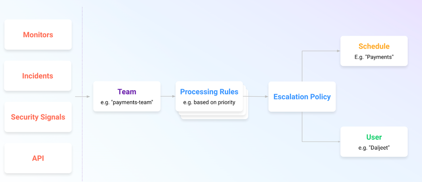
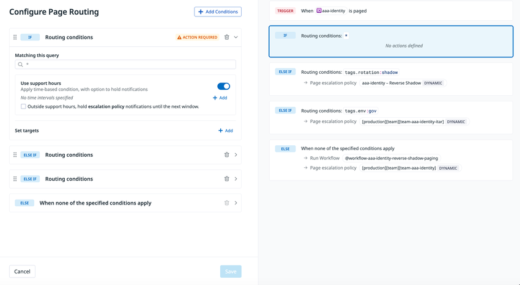
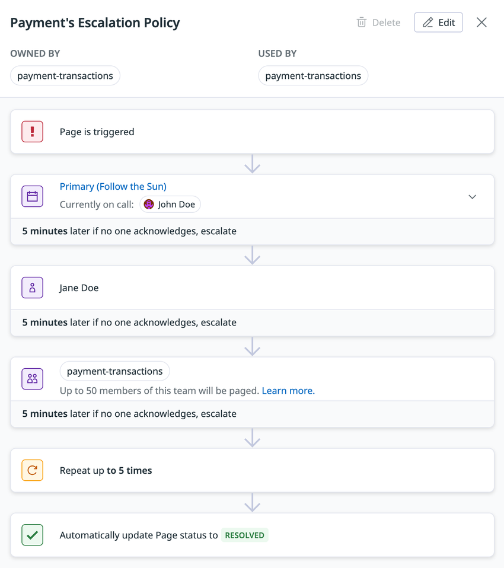
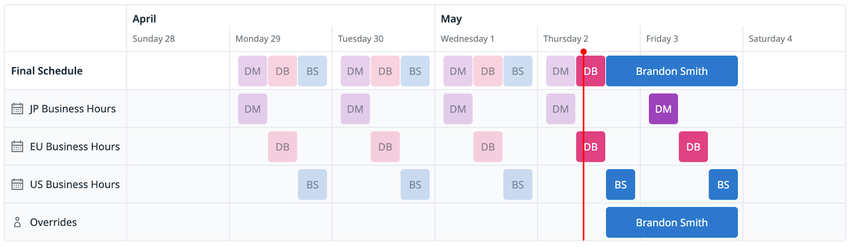
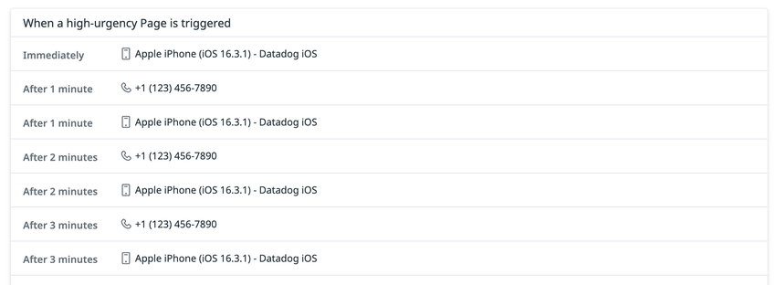
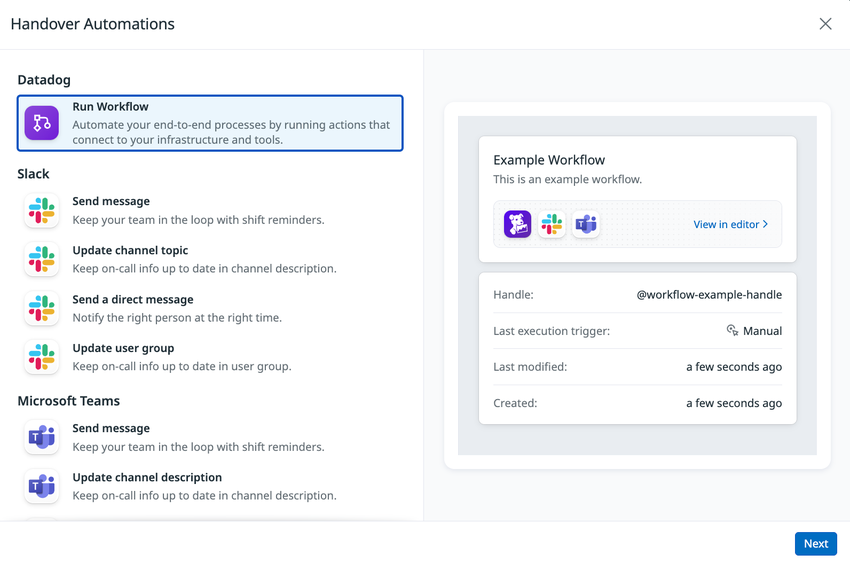

# On-Call（オンコール）

## 概要

Datadog On-Call は、モニタリング・ページング（呼び出し）・インシデント対応を Datadog 上で一体化するオンコール管理製品である。Monitor（モニター）、Incident（インシデント）、Security Signal（セキュリティシグナル）、Event Management、API、メール、電話などから発生した **Page（ページ）** を **Team（チーム）** に送り、Team の **Routing Rules（ルーティングルール）** で緊急度と送り先を決め、**Escalation Policy（エスカレーションポリシー）** に従って **Schedule（スケジュール）** 上の当番者・個人・Team 全員を、プッシュ通知・電話・SMS・メールで呼び出す。[出典](https://docs.datadoghq.com/incident_response/on-call/)

- 製品の位置づけ：Datadog の **Incident Response** 製品群の一部で、[Incident Management](./incident-management.md) と組み合わせて使う（単独でも利用可能）。[出典](https://www.datadoghq.com/pricing/?product=incident-response#products)
- 提供開始：2024-06-26 公開の公式ブログで発表され（DASH 2024 時期）、2025-01-30 公開の「This Month in Datadog - January 2025」で一般提供（GA）が告知された。[出典](https://www.datadoghq.com/blog/datadog-on-call/) [出典](https://www.datadoghq.com/blog/this-month-in-datadog-january-2025/)
- ドキュメントの URL：公式ドキュメントのパスは `docs.datadoghq.com/service_management/on-call/` から `docs.datadoghq.com/incident_response/on-call/` に移動している（旧 URL は新 URL に転送される）。本ファイルでは新 URL を出典とする。
- 課金：**シート（seat）課金**。スケジュール参加者・エスカレーションポリシー登録者・Page 受信の通知設定をしたユーザーが課金対象（「課金への影響」節）。
- 本ファイルの扱う範囲：Team の On-Call 化、Page の発生・応答、Routing Rules、Escalation Policy、Schedule、通知設定（電話・SMS・プッシュ）、Handover（引き継ぎ）、外部連携、移行、API/Terraform、権限、制限値、課金。インシデント宣言後の運用（Severity、タイムライン、ポストモーテム、Status Pages）は [Incident Management](./incident-management.md) を参照。

関連ファイル：モニター通知の書き方は [通知と Downtime](../platform/notifications-and-downtimes.md)、モニター自体は [Monitors](../platform/monitors.md)、Slack/Teams アプリ設定の一般論は [通知・コラボレーション連携](../platform/collaboration-integrations.md)、Workflow は [Workflow Automation](./workflow-automation.md)、AI 機能は [Bits AI と AI 機能](../ai/bits-ai.md)、アラート設計の実践は [アラート設計とノイズ削減](../../04_応用編/alert-design-and-noise-reduction.md)、他製品からの移行計画は [他製品からの移行](../../03_導入編/migration-from-other-tools.md) を参照。

---

## 全体像とデータフロー

Datadog On-Call では、Page はまず Team 宛てに送られ、Team ごとの Routing Rules で評価され、エスカレーションポリシー経由でスケジュールまたはユーザーに届く。[出典](https://docs.datadoghq.com/incident_response/on-call/)

```mermaid
flowchart LR
  subgraph Sources[Page の発生源]
    M[Monitor<br/>@oncall-team]
    I[Incident]
    S[Security Signal /<br/>Detection Rule]
    E[Event Management]
    API[API / Events API<br/>Webhook]
    MAIL[メール<br/>専用アドレス]
    CALL[電話<br/>Live Call Routing]
    MAN[手動<br/>UI / Slack / Teams]
    EXT[外部ツール<br/>Integration]
  end
  Sources --> T[On-Call Team]
  T --> R{Routing Rules<br/>上から順に評価}
  R -->|Page escalation policy<br/>urgency: high/low/dynamic| EP[Escalation Policy]
  R -->|Send Slack / Teams message| CH[チャンネル通知]
  R -->|Run Workflow| WF[Workflow Automation]
  R -->|ServiceNow Sync 【Preview】| SN[ServiceNow Incident]
  EP -->|Step 1..10| SCH[Schedule の当番者]
  EP --> U[User]
  EP --> TM[Team 全員]
  SCH & U & TM --> NP[各自の Notification Preferences<br/>Push / 電話 / SMS / Email]
  NP --> ACK[Acknowledge / Resolve /<br/>Reassign / Snooze /<br/>Declare Incident]
```



- **キャプション**：Datadog On-Call の概念図（Page の流れ）。
- **画面の説明**：左側に Page の発生源として「Monitors」「Incidents」「Security Signals」「API」の 4 つが縦に並び、右へ矢印で「Team（例："payments-team"）」→「Processing Rules（例：優先度に基づく）」→「Escalation Policy」と進み、Escalation Policy から「Schedule（例："Payments"）」と「User（例："Daljeet"）」に分岐する。図中の「Processing Rules」は、現行ドキュメントでは Routing Rules（ルーティングルール）と呼ばれている機能に相当する。
- **出典**：https://docs.datadoghq.com/incident_response/on-call/ （取得日：2026-11-02）

### 主要概念

| 概念 | 説明 | 所有単位 |
|---|---|---|
| Page（ページ） | 対応者の注意を要するアラート。Monitor・Incident・Security Signal などから発生する。ステータスは `Triggered` → `Acknowledged` → `Resolved` | Team 宛て |
| Team（チーム） | On-Call の中心となる組織単位。Page は Team に送られ、Team のスケジュール・エスカレーションポリシーでメンバーに届く。Datadog Teams と共通 | — |
| Routing Rules（ルーティングルール） | Team 単位のルール。Page の緊急度（urgency）の設定、メタデータに応じたエスカレーションポリシーの振り分け、サポート時間（support hours）による通知の保留を行う | Team |
| Escalation Policy（エスカレーションポリシー） | Page が Team 内・Team 間でどうエスカレーションするかを定義 | Team（複数可） |
| Schedule（スケジュール） | Team メンバーがいつオンコールかを、タイムゾーンとシフトを考慮して定義 | Team（複数可） |
| Notification Preferences（通知設定） | 各ユーザーが緊急度ごとに、どの連絡手段でいつ通知を受けるかを定義 | ユーザー |

[出典](https://docs.datadoghq.com/incident_response/on-call/)

---

## 画面とナビゲーション

Datadog On-Call の主要画面は **On-Call** メニュー配下にある。

| 画面 | パス（UI） | URL | 主な操作 |
|---|---|---|---|
| Teams | On-Call > Teams | `https://app.datadoghq.com/on-call/teams` | Team の On-Call 化（Set Up Team / Add Team to On-Call）、手動 Page、Page Routing の編集、Custom Triggering Sources、Handover Automation |
| Pages | On-Call > Pages | `https://app.datadoghq.com/on-call/pages` | Page の一覧（Active / Triggered / Acknowledged / Resolved / All のサブタブ）、応答、一括編集 |
| Escalation Policies | On-Call > Escalation Policies | `https://app.datadoghq.com/on-call/escalation-policies` | 作成・編集 |
| Schedules | On-Call > Schedules | `https://app.datadoghq.com/on-call/schedules` | 作成・編集、Override、Export My Shifts |
| Analytics | On-Call > Analytics | `https://app.datadoghq.com/on-call/analytics` | Page 量、MTTA/MTTR 傾向などの分析 |
| Settings | On-Call > Settings | `https://app.datadoghq.com/on-call/settings` | Cross-Org Paging、Integrations（ServiceNow 等）、管理者向け Notification Preferences |
| My On-Call Profile | 個人設定 > On-Call | `https://app.datadoghq.com/personal-settings/profile?tab=on-call-notifications` | 連絡手段の登録・テスト、緊急度別通知設定、シフトリマインダー |
| Manual Page | — | `https://app.datadoghq.com/on-call/manual-page` | テスト Page・手動 Page の送信 |

URL は US1 の例。他サイトではホスト名が変わる（[Datadog Sites](../platform/datadog-sites.md)）。[出典](https://docs.datadoghq.com/incident_response/on-call/pages/) [出典](https://docs.datadoghq.com/incident_response/on-call/guides/migrating-from-your-current-providers/) [出典](https://docs.datadoghq.com/incident_response/on-call/guides/migrate-your-opsgenie-resources-to-on-call/)

---

## Team の On-Call 化（オンボーディング）

Datadog On-Call を使い始めるには、まず Team を On-Call に登録（onboard）し、続いて全メンバーが通知設定を行う。公式は、発見しやすさの観点から **可能な限り既存の Datadog Team を使う**ことを推奨している。On-Call に登録した Team は Datadog の Teams 一覧にも表示される。[出典](https://docs.datadoghq.com/incident_response/on-call/teams/)

### 手順

1. **On-Call > Teams** で **Set Up Team**（または **Add Team to On-Call**）を選ぶ。
2. 以下のいずれかを選ぶ。
   - **New Team**：新規作成。
   - **Existing Team**：既存の Datadog Team をドロップダウンから選択。
   - **Import team from PagerDuty** / **Import team from OpsGenie**：移行ツール（「移行」節）。
3. **デフォルトのエスカレーションポリシー**を追加する。Datadog は *Interrupt Handler*、*Primary*、*Secondary* の 3 スケジュールを提案する。次のステップで定義するか、他 Team が所有する既存スケジュールを通知先にできる。
4. **スケジュール**を定義する（Schedule Time Zone と Schedule Rotations）。
5. 次の作業：Monitor・Incident などから Page を送る設定、メンバー各自の通知設定。

[出典](https://docs.datadoghq.com/incident_response/on-call/teams/)

### New Team の設定項目

| 項目 | 説明 |
|---|---|
| Team Name | Team 名。組織内で広く使われている場合を除き、略語は避けることが推奨 |
| Handle | Datadog 全体で Team を Page するためのハンドル。いつでも変更可能。Page 時は `@oncall-<handle>` の形で使う |
| Members | メンバー。オンコール業務をしないメンバーも含めてよい |
| Description | Team の責務の説明 |

[出典](https://docs.datadoghq.com/incident_response/on-call/teams/)

### Team のオフボーディング

On-Call が不要になった Team は、On-Call 上の Team ページ最下部の **Danger Zone** でオフボーディングできる。Team 自体は Datadog に残り、スケジュール・エスカレーションポリシーも保持されるが、On-Call 上で Page 可能な対象ではなくなる。[出典](https://docs.datadoghq.com/incident_response/on-call/guides/offboarding-teams-and-users/)

> **注意（削除不可）**：インシデント履歴を保持するため、Datadog On-Call は **Page・エスカレーションポリシー・スケジュールなどのリソース削除をサポートしない**。本番環境に影響を与えずに試すには、トライアル org をサンドボックスとして作ることが公式に推奨されている。[出典](https://docs.datadoghq.com/incident_response/on-call/)
> なお API リファレンスには「Delete On-Call schedule」「Delete On-Call escalation policy」エンドポイント、`on_call_write` 権限の説明には「delete」が記載されており、UI 上の削除可否と API 上の削除操作の関係は公開情報では明確に確認できず。【第三者情報】国内の技術ブログでも「Pages・エスカレーションポリシー・スケジュールは削除できないため、検証用 Team は本番と区別できる接頭辞を付けて作る」ことが推奨されている。[出典](https://www.issoh.co.jp/tech/details/16598/)（2026-08-16 公開、2026-09-27 更新）

---

## Page（ページ）

### Page のライフサイクル

| ステータス | 意味 | エスカレーション |
|---|---|---|
| `Triggered` | 送信済みだが、誰も所有権を取っていない | エスカレーションポリシーに従い、時間経過で追加の対応者に通知 |
| `Acknowledged` | 対応者が Page を引き受けた | エスカレーション通知が停止 |
| `Resolved` | 問題が解決し Page がクローズ | — |

スヌーズ中の Page は `Triggered` のままである。[出典](https://docs.datadoghq.com/incident_response/on-call/pages/)

### Page の発生手段（トリガー）

Page は Team に送られ、Team のエスカレーションポリシーとスケジュールでルーティングされる。Team が On-Call にオンボード済みであることが前提。[出典](https://docs.datadoghq.com/incident_response/on-call/pages/)

| 発生手段 | 方法 | 緊急度 | 備考 |
|---|---|---|---|
| Monitor | 通知メッセージで `@oncall-<team-handle>` をメンション（例：Team `@checkout-operations` は `@oncall-checkout-operations`） | Routing Rules による（dynamic なら WARN→low、ALERT→high） | @ハンドルが使える場所ならどこでも可：Monitor、Incident Management、Security の Detection Rule、Event Management |
| Incident | アクティブなインシデントから Page を送信 | — | 詳細は [Incident Management](./incident-management.md) |
| メール | Team ページの **Custom Triggering Sources** → メールトリガー欄で **Generate** を押して Team 専用アドレスを生成 | — | 社内の分かりやすい配布リスト（例：`page-network@company.com`）に埋め込む使い方もある |
| 電話 | [Live Call Routing](#live-call-routing電話による-page) の専用番号に電話 | — | Datadog サポートによるプロビジョニングが必要 |
| 手動（Datadog UI） | **On-Call > Teams** で Team の **Page** → **Page title** と **Description** を入力 → **Page** | 常に `high` | オンコール当番でない Team・個人にも送れる |
| 手動（Slack） | Datadog Slack アプリをインストールし `/datadog page` または `/dd page` → Team を選択 | 常に `high` | — |
| 手動（Microsoft Teams） | Datadog Teams アプリをインストールし、チャンネルまたはチャットで `@Datadog page` → Team を選択 | 常に `high` | — |
| API | `POST /api/v2/on-call/pages`（「API」節） | `low` / `high` を指定 | 対象は `team_id` / `team_handle` / `user_id` |
| 外部ツール | ネイティブ Integration または Events API による汎用 Webhook（「外部ツール連携」節） | — | — |
| 他 org | [Cross-org Paging](#cross-org-paging別-org-データセンターへの-page)【Preview】 | — | 自動ワークフローのみ |

[出典](https://docs.datadoghq.com/incident_response/on-call/pages/) [出典](https://docs.datadoghq.com/incident_response/on-call/integrations/)

#### Monitor からの Page の自動解決

Monitor が回復（recover）したとき、その Monitor が発生させた Page は、**回復通知にも On-Call Team のメンションが含まれている場合に限り**自動で `Resolved` になる。メンションがアラートテンプレート内（例：`{{#is_alert}} ... {{/is_alert}}`）にしかない場合、Page は自動解決しない。[出典](https://docs.datadoghq.com/incident_response/on-call/pages/)

```text
{{#is_alert}}CPU 高負荷 {{/is_alert}}
{{#is_recovery}}回復しました{{/is_recovery}}
@oncall-payments   ← 条件ブロックの外に置くと、アラート時・回復時の両方で送られ自動解決される
```

条件変数の書き方は [通知と Downtime](../platform/notifications-and-downtimes.md) を参照。

#### Monitor の再通知（renotification）と Page の関係

Monitor が On-Call Team に再通知（renotify）するよう設定されている場合、既存 Page の状態により挙動が異なる。[出典](https://docs.datadoghq.com/incident_response/on-call/pages/)

| 既存 Page の状態 | 再通知時の挙動 |
|---|---|
| `Resolved` | 新しい Page が作成され、Team のエスカレーションポリシーで処理される |
| `Acknowledged` | Page が再トリガーされ、Acknowledge された時点で進行中だったステップからエスカレーションが再開する |
| `Triggered` | エスカレーションポリシーの全ステップが実行済みなら Page を再トリガーして最後のステップを再実行。未実行のステップが残っていれば何もしない |

### Page への応答

**On-Call > Pages** で、アクティブ・過去の Page を一覧できる。Page をクリックするとサイドパネルが開き **Next Steps** から操作できる。チェックボックスで複数の Page を一括編集できる。[出典](https://docs.datadoghq.com/incident_response/on-call/pages/)

| 操作 | 効果 | 条件・補足 |
|---|---|---|
| Acknowledge | 対応中であることを示し、次の段への通知を止める。ステータスは `Acknowledged` | Acknowledge しなければエスカレーションが続く |
| Snooze | 所有権を取らずにエスカレーションを一時停止する。プリセットは「10 分・30 分・1 時間・4 時間・12 時間」または **At a specific time**（任意の日時） | **現在通知されている対応者のみ**実行可能。期間中ステータスは `Triggered` のまま。期限までに Acknowledge / Resolve されなければ、現在のエスカレーションレベルに再通知。モバイルアプリからも可能 |
| Reassign | 別のユーザーまたは Team に Page を移す（任意でコメント）。新しい受け手に即時通知され、Page の履歴は保持される | `Triggered` または `Acknowledged` の Page のみ |
| Resolve | Page をクローズし `Resolved` にする | Monitor 起点の Page は回復時の自動解決もある |
| Escalate | 【推定】名称から、Page を次のエスカレーションステップへ進める操作と考えられる | Next Steps に表示されるが、挙動の説明は公式ドキュメントにない（公開情報では確認できず）。API に `escalate` エンドポイントがある |
| Declare Incident | Page の内容（タイトル・サマリー）を事前入力した Incident Management のインシデントを作成（インシデントタイプ、Severity、Incident Commander、Team を確認・調整して確定） | 部門横断の調整、関係者連絡、正式な追跡が必要な場合 |
| Comment（Timeline） | Page のタイムライン（トリガー、通知先、エスカレーション経過の記録）にコメントを追加 | 調査済み事項、引き継ぎ時の文脈、外部要因の記録に使う |

[出典](https://docs.datadoghq.com/incident_response/on-call/pages/)

Slack / Microsoft Teams に送られた Page 通知では、メッセージ内のボタンで Acknowledge・Escalate・Resolve でき、Acknowledge・Resolve すると元のメッセージがその場で更新される（追加メッセージは投稿されない）。[出典](https://docs.datadoghq.com/incident_response/on-call/routing_rules/)

---

## Routing Rules（ルーティングルール）

Datadog On-Call の Routing Rules は、Team に届いた Page をメタデータ（タグ、優先度、モニターの状態、時間帯）に応じて振り分ける Team 単位のルールである。すべての Page を 1 つのエスカレーションポリシーに流す代わりに、Page ごとに緊急度と送り先を変えられる。[出典](https://docs.datadoghq.com/incident_response/on-call/routing_rules/)



- **キャプション**：Team の **Configure Page Routing** 画面。
- **画面の説明**：左ペインに IF / ELSE IF / ELSE のルールカードが縦に並ぶ。IF カードを開くと「Matching this query」（クエリ入力欄、例：`*`）、「Use support hours」トグル（時間帯条件と通知保留オプション、**+ Add** で時間帯を追加、「Outside support hours, hold escalation policy notifications until the next window」チェックボックス）、「Set targets」（**+ Add** でターゲット追加）がある。左上に **+ Add Conditions**、左下に **Cancel** / **Save**。右ペインはプレビューで、「TRIGGER: When aaa-identity is paged」の下に、`tags.rotation:shadow` → Page escalation policy（DYNAMIC）、`tags.env:gov` → Page escalation policy（DYNAMIC）、ELSE → Run Workflow と Page escalation policy（DYNAMIC）のように評価順が表示される。
- **出典**：https://docs.datadoghq.com/incident_response/on-call/routing_rules/ （取得日：2026-11-02）

### 評価順序とフォールバック

- ルールは**上から順に評価**され、最初に一致したルールが適用される（IF / ELSE IF / ELSE 構造）。
- **最後のルールはフォールバック**とし、一致しなかったすべての Page をエスカレーションポリシーに送る必要がある。

[出典](https://docs.datadoghq.com/incident_response/on-call/routing_rules/)

### 作成手順

1. **On-Call > Teams** で Team を選ぶ。
2. **Page Routing** セクションで **Edit** を押し、**Configure Page Routing** を開く。
3. **Add Conditions** で一致条件（クエリ）を定義する。
4. （任意）サポート時間（support hours）を設定する。
5. **Set targets** で **Add** を押し、ターゲットの種類を選ぶ。
6. （任意）Acknowledgment timeout を有効化する（エスカレーションポリシーのターゲットのみ）。
7. 必要に応じてルールを追加し **Save**。

[出典](https://docs.datadoghq.com/incident_response/on-call/routing_rules/)

### 条件（クエリ）構文

条件は Datadog のクエリ構文（Trace Explorer と同じ構文）で書き、複数の if/else 条件を組める。**大文字小文字を区別する**（`tags.env:Prod` は `tags.env:prod` に一致しない）。[出典](https://docs.datadoghq.com/incident_response/on-call/routing_rules/)

| 属性 | 説明 | 例 |
|---|---|---|
| `tags` | 受信したアラートのタグ | `tags.env:prod` |
| `groups` | モニターのグループ名 | `groups.service:checkout-service` |
| `priority` | モニターの優先度（1〜5） | `priority:(1 OR 2)` |
| `alert_status` | アラート状態（`error`、`warn`、`success`） | `alert_status:(error OR warn)` |

タグ設計は [Tagging](../platform/tagging.md)、モニターの優先度・グループは [Monitors](../platform/monitors.md) を参照。

### ターゲット（アクション）

| ターゲット | 設定内容 | API の action type |
|---|---|---|
| Page escalation policy | エスカレーションポリシーと緊急度（`DYNAMIC` / `HIGH` / `LOW`）を選ぶ。サポート時間・Acknowledgment timeout を設定可能 | `escalation_policy` |
| Send Slack message | Slack ワークスペースとチャンネル | `send_slack_message` |
| Send Microsoft Teams message | Teams のテナント・チーム・チャンネル | `send_teams_message` |
| Run Workflow | 既存の Workflow（[Workflow Automation](./workflow-automation.md)） | `workflow`（Workflow の handle を指定） |
| Sync with a ServiceNow Incident【Preview】 | ServiceNow 接続を選ぶ。Page ごとに ServiceNow インシデントを作成して同期 | — |
| 別 Team へ再ルーティング | Page を別 Team に渡し、その Team の Routing Rules で再評価させる（API で確認できる機能。UI 上の表記は公開情報では確認できず） | `reroute_to_team` |

[出典](https://docs.datadoghq.com/incident_response/on-call/routing_rules/) [出典](https://docs.datadoghq.com/api/latest/on-call/set-on-call-team-routing-rules/)

API 仕様上の組み合わせ制約：`escalation_policy` アクションはルール項目ごとに 1 回のみで、ルール最上位の `policy_id` と排他。`reroute_to_team` もルールごとに 1 回のみで、`send_slack_message` / `send_teams_message` とだけ組み合わせられ、`escalation_policy`・`workflow` やルールの `policy_id` とは併用できない。[出典](https://docs.datadoghq.com/api/latest/on-call/set-on-call-team-routing-rules/)

### 緊急度（urgency）

エスカレーションポリシーのターゲットに緊急度を設定する。緊急度は、各対応者の通知設定（高緊急度用・低緊急度用）のどちらを使うかを決める。[出典](https://docs.datadoghq.com/incident_response/on-call/routing_rules/)

| 値 | 挙動 |
|---|---|
| `DYNAMIC` | モニターのアラート状態から決まる。`warn` → `LOW`、`error`（ALERT）→ `HIGH` |
| `HIGH` | 常に高緊急度 |
| `LOW` | 常に低緊急度 |

手動 Page（UI・Slack・Microsoft Teams）は常に `high`。[出典](https://docs.datadoghq.com/incident_response/on-call/pages/)

### サポート時間（Support hours）

サポート時間は、エスカレーションポリシーが対応者に通知してよい時間帯を定義する。各時間帯（interval）はタイムゾーン・曜日・開始/終了時刻を持ち、複数設定できる。[出典](https://docs.datadoghq.com/incident_response/on-call/routing_rules/)

| Page の到着時刻 | 「Outside support hours, hold escalation policy notifications until the next window」 | 挙動 |
|---|---|---|
| サポート時間内 | — | エスカレーションポリシーを即時実行 |
| サポート時間外 | 有効 | Page は即時作成されるが、通知は次の時間帯開始まで保留。保留はタイムラインに記録される |
| サポート時間外 | 無効 | このルールはスキップされ（Page は作成されない）、次に一致するルールが評価される |

例（保留トグル有効）：

| パターン | 設定 | 結果 |
|---|---|---|
| 営業時間 | 1 区間、月〜金 9:00〜17:00、`America/New_York` | 時間外の Page は次の月曜 9:00 まで保留（公式の例） |
| 分割シフト | 2 区間、月〜金 9:00〜12:00 と 14:00〜18:00 | 12:00〜14:00 の Page は午後の開始まで保留 |

API 上はアクションレベルの `support_hours`（時間外は保留して次の時間帯で実行）と、ルールレベルの `time_restriction`（時間外はルールに一致せず後続ルールへ）が別フィールドで、互いに排他である。[出典](https://docs.datadoghq.com/api/latest/on-call/set-on-call-team-routing-rules/)

### Acknowledgment timeout（Acknowledge 後の再トリガー）

エスカレーションポリシーのターゲットでのみ設定できる。Page が Acknowledge されたまま指定時間内に解決されないと、Datadog は Page を `Triggered` に戻し、現在の当番者に再通知する（API フィールド `ack_timeout_minutes`）。[出典](https://docs.datadoghq.com/incident_response/on-call/routing_rules/)

### ルーティング設計例（公式）

| 目的 | 設定 |
|---|---|
| 優先度で分ける | Priority 1 → Primary のエスカレーションポリシー、Priority 2〜4 → Slack / Teams |
| 時間帯で分ける | 営業時間はエスカレーションポリシー。時間外は重大アラートのみポリシー、それ以外は Slack / Teams |
| 通知を遅延させる | サポート時間を付けて次の時間帯まで保留 |
| 動的緊急度 | `warn` → `LOW`、`error` → `HIGH` |

公式のベストプラクティス：即時対応が必要な重大アラートはエスカレーションポリシーへ、低重大度の周知は Slack / Teams へ。サポート時間は非重大アラートに付けて時間外通知を減らし、即時対応が必要な重大アラートには付けない。[出典](https://docs.datadoghq.com/incident_response/on-call/routing_rules/)

---

## Escalation Policy（エスカレーションポリシー）

Datadog On-Call のエスカレーションポリシーは、Page が設定時間内に Acknowledge されない場合に、定義済みのステップに沿って通知先を広げていく仕組みである。Team をオンボードすると、Datadog がデフォルトのエスカレーションポリシーを作成する。[出典](https://docs.datadoghq.com/incident_response/on-call/escalation_policies/)



- **キャプション**：エスカレーションポリシーの詳細画面（例：Payment's Escalation Policy）。
- **画面の説明**：上部にポリシー名、右上に **Delete**（グレーアウト）と **Edit**。「OWNED BY」「USED BY」に Team（payment-transactions）。本体は縦のフローで、「Page is triggered」→ ステップ 1「Primary (Follow the Sun)」スケジュール（Currently on call: John Doe）、「5 minutes later if no one acknowledges, escalate」→ ステップ 2「Jane Doe」（ユーザー）、5 分後エスカレーション → ステップ 3「payment-transactions」（Team。「Up to 50 members of this team will be paged.」と表示）、5 分後エスカレーション →「Repeat up to 5 times」→「Automatically update Page status to RESOLVED」。
- **出典**：https://docs.datadoghq.com/incident_response/on-call/escalation_policies/ （取得日：2026-11-02）

### 作成手順と設定項目

1. **On-Call > Escalation Policies** → **+ New Escalation Policy**。
2. 以下を設定して保存。

| 項目 | 説明 | API フィールド |
|---|---|---|
| Name | ポリシー名（例：*Payment's Escalation Policy*） | `name` |
| Teams | ポリシーを所有する Team | `relationships.teams` |
| ステップ：通知先（Notify） | ユーザー、Team、スケジュールの当番者 | `steps[].targets[]`（`type`: `users` / `schedules` / `teams`） |
| ステップ：通知方式 | `Notify All`（デフォルト）または `Round Robin` | `steps[].assignment`（`default` / `round-robin`） |
| ステップ：Acknowledge 猶予 | 次のステップへエスカレーションするまでの時間（UI は分、最小 1 分） | `steps[].escalate_after_seconds`（秒） |
| 繰り返し回数 | 誰も Acknowledge しない場合に全ステップを繰り返す回数 | `retries` |
| 終了時の自動解決 | 全ステップと繰り返しの実行後に Page を自動で `Resolved` にするか | `resolve_page_on_policy_end` |

[出典](https://docs.datadoghq.com/incident_response/on-call/escalation_policies/) [出典](https://docs.datadoghq.com/api/latest/on-call/create-on-call-escalation-policy/)

API ではスケジュールのターゲットに `config.schedule.position`（`previous` / `current` / `next`）を指定できる。UI での表現や用途の説明は公開情報では確認できず。[出典](https://docs.datadoghq.com/api/latest/on-call/create-on-call-escalation-policy/)

### 通知方式

| 方式 | 挙動 | 例 |
|---|---|---|
| Notify All（デフォルト） | ステップの全ターゲットに同時通知 | 個人 1 名 + 3 名の Team + スケジュール 1 つ → 5 名に通知（個人、Team の 3 名、スケジュールの当番者） |
| Round Robin | 複数ターゲット（ユーザー・スケジュール・Team）に順番に Page を割り振り、負荷を平準化 | 50 名のサポート Team を 10 名ずつ 5 つのスケジュールに分け、Page A→グループ 1、B→2、…、E→5、F→1 と順に割り当てる |

Round Robin の注意点：Page が時間内に Acknowledge されないと、ラウンドロビンの次のターゲットではなく**ポリシーの次のステップ**にエスカレーションする。次のターゲットへ回したい場合は、ラウンドロビンのステップを 1 つだけにし、ターゲット数以上の繰り返し回数を設定する。[出典](https://docs.datadoghq.com/incident_response/on-call/escalation_policies/)

### 通知先の種類

| 通知先 | 挙動 | 主な用途 |
|---|---|---|
| Schedule | Page 発生時点のスケジュール当番者に通知。当番者がいなければ、そのステップは遅延なくスキップされ、UI にスキップが表示される | タイムゾーンをまたいだ 24 時間体制、階層サポート、ローテーション |
| User | 特定ユーザーに通知 | 高重大度時のシニアエンジニア、顧客影響時の PM・ディレクター、バックアップ対応者 |
| Team | Team 全員に通知 | 複数システムにまたがる障害、インフラ系の DevOps Team、重大障害時のエンジニア/セキュリティ Team 全員 |

[出典](https://docs.datadoghq.com/incident_response/on-call/escalation_policies/)

> Team を通知先にした場合、画面上には「Up to 50 members of this team will be paged.」と表示される（上記スクリーンショット）。Team 通知先の最大人数が 50 名であることを本文で明記した公式記述は公開情報では確認できず。

---

## Schedule（スケジュール）

Datadog On-Call のスケジュールは、Team メンバーが Page に対応する時間帯を定義する。スケジュールは**レイヤー（layer）**で構成され、各レイヤーが週の一部や特定の責務をカバーする。全レイヤーを合成したものが **Final Schedule** で、**下のレイヤーほど優先される**。[出典](https://docs.datadoghq.com/incident_response/on-call/schedules/)



- **キャプション**：Follow-the-Sun 型スケジュールの例（4 月 28 日〜5 月 4 日の週）。
- **画面の説明**：横軸が日付（Sunday 28 〜 Saturday 4）、縦に「Final Schedule」「JP Business Hours」「EU Business Hours」「US Business Hours」「Overrides」の行が並ぶ。JP 行に DM、EU 行に DB、US 行に BS の平日シフトが UTC の 1 日の中で順に並び、Final Schedule 行にそれらが合成表示される。Overrides 行には Thursday 2 の途中から Friday 3 にかけて「Brandon Smith」のオーバーライドがあり、Final Schedule でも同区間が Brandon Smith に置き換わっている。赤い縦線は現在時刻。
- **出典**：https://docs.datadoghq.com/incident_response/on-call/schedules/ （取得日：2026-11-02）

### 作成手順と設定項目

1. **On-Call > Schedules** → **+ New Schedule**。
2. **Name**、**Schedule Time Zone**、所有する **Teams** を設定。
3. レイヤーを追加して **Create**。

| レベル | 項目 | 説明 | API フィールド |
|---|---|---|---|
| スケジュール | Name | スケジュール名 | `name` |
| スケジュール | Schedule Time Zone | スケジュールのタイムゾーン。ハンドオフ時刻などの設定はこのタイムゾーンに従う | `time_zone` |
| スケジュール | Teams | 所有 Team | `relationships.teams` |
| スケジュール | （API のみ確認）同時オンコール最大人数 | 同時にオンコールになれるユーザー数。1〜レイヤー数、かつ 10 以下 | `max_responders` |
| レイヤー | Starts | レイヤーが有効になる日時。この日時より前のシフトは表示されない | `effective_date` |
| レイヤー | Shift length | 各シフトの長さ（＝繰り返し周期）。*One Day*（24 時間）、*One Week*（168 時間）、*Custom* | `interval`（`days` + `seconds`） |
| レイヤー | Handoff Time | 次の人にシフトが交代する日時 | `rotation_start` |
| レイヤー | End time | この日時以降、このレイヤーではシフトを組まない | `end_date` |
| レイヤー | Conditions | シフトに適用する時間条件（例：月〜金 9:00〜17:00） | `restrictions[]`（`start_day`/`start_time`/`end_day`/`end_time`） |
| レイヤー | Members | 当番メンバー。**追加した順**にシフトを担当 | `members[].user.id` |
| レイヤー | （API）レイヤー名・タイムゾーン | レイヤーごとの名前、個別タイムゾーン | `name`、`time_zone` |

[出典](https://docs.datadoghq.com/incident_response/on-call/schedules/) [出典](https://docs.datadoghq.com/api/latest/on-call/create-on-call-schedule/)

API 仕様上のシフト周期（`interval`）は「少なくとも 1 時間」、`seconds` は追加秒数（最大 30 日分）と記載されている。[出典](https://docs.datadoghq.com/api/latest/on-call/create-on-call-schedule/)

### エスカレーションポリシーからの参照

スケジュールの当番者に Page を送るには、エスカレーションポリシーのステップの **Notify** ドロップダウンでスケジュールを選ぶ。Page 発生時点の当番者に通知される。[出典](https://docs.datadoghq.com/incident_response/on-call/schedules/)

### Override（オーバーライド）

Override はスケジュール上のシフトを一時的に変更する機能で、一時的なシフト調整や休日に対応する。[出典](https://docs.datadoghq.com/incident_response/on-call/schedules/)

| 方法 | 手順 |
|---|---|
| UI | シフトを選んで **Override** を押し、シフトの全部または一部を置き換える |
| Slack / Microsoft Teams | `/dd override` を入力し、対象期間を選び説明を追加 → チャンネルに依頼が投稿される → 他のメンバーが **Take it** を押すと、その人が代わりにシフトに入る（依頼メッセージには依頼者、スケジュール名、開始/終了日時、期間、メモが表示される） |
| API | `POST /api/v2/on-call/schedules/{schedule_id}/overrides` ほか（「API」節） |

Override の編集には `on_call_respond` 権限（または細粒度アクセス制御の **Overrider** 以上）が必要（「権限」節）。

### スケジュールのエクスポート（カレンダー連携）

| 機能 | 内容 |
|---|---|
| Export My Shifts | **On-Call > Schedules** で **Export My Shifts** → 自分のシフトのみの個人用 `.webcal` リンクを生成 → **Copy Link** |
| Export Schedule | スケジュールを開いて **Export Schedule** → 全参加者・全シフトを含む `.webcal` リンクを生成 |
| 対応カレンダー | Google Calendar、Outlook、Apple Calendar（各製品の「URL でカレンダーを購読」機能を使う） |
| 自動更新 | シフト変更はカレンダーに自動反映 |
| リンクの失効 | 新しいリンクを生成すると以前のリンクは無効になる |
| トラブルシュート | Google Calendar の「could not fetch URL」や Outlook の「Couldn't import calendar」が出る場合、`webcal://` を `http://` または `https://` に置き換える |

[出典](https://docs.datadoghq.com/incident_response/on-call/schedules/)

### 退職者の扱い

- 退職者はスケジュールから**自動では外れない**。手動で削除し、シフトを再割り当てする必要がある。
- Datadog アカウントが無効化されたユーザーには、シフトに割り当てられたままでも On-Call 通知（SMS、メール、プッシュ）は送られない。→ 当番が空振りになるため、無効化前の差し替えが必要。

[出典](https://docs.datadoghq.com/incident_response/on-call/schedules/)

---

## 通知設定（Notification Preferences）と連絡手段

Datadog On-Call で Page を受け取るには、各ユーザーが **My On-Call Profile** で連絡手段と通知設定を構成する必要がある。[出典](https://docs.datadoghq.com/incident_response/on-call/notification_preferences/)

### 連絡手段（Contact methods）

| 手段 | 登録方法 | 制約・補足 |
|---|---|---|
| プッシュ通知（Datadog モバイルアプリ） | アプリをインストールすると端末が自動で一覧に表示される | アプリ側で通知許可が必要。Critical Alerts 設定で消音・おやすみモードを貫通可能（後述） |
| メール | 手動で追加 | HTML またはテキスト形式 |
| SMS | 電話番号を手動で追加し、SMS 受信に同意すると番号の横に緑のバッジが付く | **固定電話、VoIP、仮想番号は非対応**。対応国のみ |
| 電話（音声通話） | 電話番号を手動で追加 | 対応国のみ。音声ガイダンスは英語【第三者情報】 |

- 各手段は、項目にマウスオーバーすると表示される **Test Call** / **Test SMS** などでテストすることが推奨されている。
- 高緊急度の Page を受けた際に通知設定が 1 つもない場合、Datadog は**メール通知にフォールバック**する。

[出典](https://docs.datadoghq.com/incident_response/on-call/notification_preferences/)

> 【第三者情報】国内の導入事例では、電話の音声案内が英語で Acknowledge のキー（1）が分かりにくいため、全エンジニアで受電・Acknowledge の練習を行ってから本番運用を開始し、新入社員のオンボーディングにも組み込んでいる。[出典](https://zenn.dev/hacobu/articles/904b2d5707da7c)（2025-04-02 公開、2025-05-05 更新） [出典](https://speakerdeck.com/sheepland/datadog-on-cal-now-in-production)（2025-05-28 公開）

### 緊急度別の通知ルール

通知設定は緊急度（high / low）ごとに、「どの連絡手段に」「Page 発生から何分後に」通知するかを複数行で定義する。Page が Acknowledge されるか、エスカレーションポリシーで次の対応者へ移るまで、設定した通知を順に実行する。緊急度は Routing Rules で決まる。[出典](https://docs.datadoghq.com/incident_response/on-call/notification_preferences/)

| 緊急度 | 想定する Page | 公式の設定例 | 公式のベストプラクティス |
|---|---|---|---|
| High urgency | P1 モニターアラート、SEV-1 のセキュリティ脅威、SEV-1 インシデントなど | プッシュ → 1 分後に電話 → 2 分後も未 Acknowledge ならプッシュ再送 | 即時のプッシュと電話を主手段に、フォローアップ間隔は短く、エスカレーションポリシーを慎重に設計 |
| Low urgency | ブロッキングでない問題、情報的なシグナル | 即時メールのみで以降はエスカレーションしない | 業務への割り込みを最小限に |

API 上は通知ルールが `category`（`high_urgency` / `low_urgency`）、`delay_minutes`（0 = 即時）、通知チャネル（電話の場合 `method`: `sms` / `voice`）を持つ。[出典](https://docs.datadoghq.com/api/latest/on-call/create-an-on-call-notification-rule-for-a-user/)



- **キャプション**：My On-Call Profile の高緊急度通知設定（When a high-urgency Page is triggered）。
- **画面の説明**：表形式で、左列にタイミング、右列に連絡手段が並ぶ。「Immediately：Apple iPhone（Datadog iOS アプリのプッシュ）」「After 1 minute：電話番号 +1 (123) 456-7890」「After 1 minute：iPhone」「After 2 minutes：電話番号」「After 2 minutes：iPhone」「After 3 minutes：電話番号」「After 3 minutes：iPhone」と、プッシュと電話を 1 分刻みで交互に繰り返す構成。
- **出典**：https://docs.datadoghq.com/incident_response/on-call/notification_preferences/ （取得日：2026-11-02）

### 個人の Quiet hours

2026-10-08 公開の公式ブログでは、Datadog On-Call が「個人の quiet hours（休暇やタイムゾーンに合わせ、ローテーション自体を組み直さずに個人単位で通知を止める時間帯）」をサポートすると紹介されている。設定画面・設定項目・挙動の詳細は、2026-11-02 時点の公式ドキュメントでは確認できず。[出典](https://www.datadoghq.com/blog/fedramp-high-incident-response/)

### その他の通知（シフトリマインダー）

**Other Notifications** で **Shift reminder** を有効にすると、オンコールシフト開始前に通知を受けられる（公式の例：シフト開始 10 分前に電話番号へ通知）。カレンダーアプリ側のリマインダーと併用もできる。[出典](https://docs.datadoghq.com/incident_response/on-call/notification_preferences/) [出典](https://docs.datadoghq.com/incident_response/on-call/schedules/)

### 電話・SMS の対応国

SMS と電話通知の対応は、各国の規制・制限により国ごとに異なる。電話番号追加時の **Prefix** メニューに国が表示されなければ、その国では電話・SMS は利用できない。表にない国はサポートへ申請できる。公式は、通信事業者の制限や規制で SMS/電話の信頼性が左右されるため、**モバイルアプリのプッシュ通知を主手段にする**ことを推奨している。[出典](https://docs.datadoghq.com/incident_response/on-call/notification_preferences/supported_countries/)

| 区分 | 国・地域（国番号） |
|---|---|
| アジア太平洋 | **日本（+81）**、オーストラリア（+61）、ニュージーランド（+64）、韓国（+82）、台湾（+886）、香港（+852）、シンガポール（+65）、フィリピン（+63）、タイ（+66）、ベトナム（+84）、インドネシア（+62）、インド（+91）、ネパール（+977）、スリランカ（+94）、中国（+86）※、マレーシア（+60）※※、パキスタン（+92）※※、カザフスタン（+7）、クリスマス島（+61）、ココス諸島（+61）、グアム（+1） |
| 北米・中南米 | 米国（+1）、カナダ（+1）、プエルトリコ（+1）、米領ヴァージン諸島（+1）、メキシコ（+52）、ブラジル（+55）、アルゼンチン（+54）、チリ（+56）※、コロンビア（+57）、コスタリカ（+506）、ペルー（+51）、ウルグアイ（+598）※ |
| 欧州 | 英国（+44）、アイルランド（+353）、フランス（+33）、ドイツ（+49）、イタリア（+39）、スペイン（+34）、ポルトガル（+351）、オランダ（+31）、ベルギー（+32）、ルクセンブルク（+352）、スイス（+41）、オーストリア（+43）、リヒテンシュタイン（+423）、デンマーク（+45）、スウェーデン（+46）、ノルウェー（+47）、フィンランド（+358）、オーランド諸島（+358）、アイスランド（+354）、フェロー諸島（+298）、スヴァールバル・ヤンマイエン（+47）、ポーランド（+48）、チェコ（+420）、スロバキア（+421）※※、ハンガリー（+36）、ルーマニア（+40）、ブルガリア（+359）、ギリシャ（+30）、キプロス（+357）、マルタ（+356）、クロアチア（+385）、スロベニア（+386）、セルビア（+381）、ボスニア・ヘルツェゴビナ（+387）、モンテネグロ（+382）、北マケドニア（+389）、アルバニア（+355）、コソボ（+383）、モルドバ（+373）、ウクライナ（+380）、エストニア（+372）、ラトビア（+371）、リトアニア（+370）、アンドラ（+376）、モナコ（+377）、サンマリノ（+378）、ジブラルタル（+350）、ガーンジー（+44）、ジャージー（+44）、トルコ（+90）、ジョージア（+995）、アルメニア（+374）、アゼルバイジャン（+994）※※ |
| 中東・アフリカ | イスラエル（+972）、パレスチナ（+970）、ヨルダン（+962）、レバノン（+961）、サウジアラビア（+966）、アラブ首長国連邦（+971）、カタール（+974）、バーレーン（+973）、エジプト（+20）※※、モロッコ（+212）、チュニジア（+216）※※、ケニア（+254）、ナイジェリア（+234）※・※※、南アフリカ（+27） |

- ※ **部分対応**：通知の受信・応答が制限される場合がある（通信事業者の制限や政府規制による）。
- ※※ **申請により利用可**：対応しているが既定では無効。Datadog サポートに申請する。
- トライアル中は表中のすべての国が利用できるわけではない。トライアルで未提供の国をテストしたい場合はサポートに連絡する。

[出典](https://docs.datadoghq.com/incident_response/on-call/notification_preferences/supported_countries/)

### モバイル端末の設定（おやすみモード・消音の貫通）

Datadog モバイルアプリ（iOS / Android）は、初回ログイン時のオンボーディングで通知権限を設定するが、既定ではアプリから通知を送れない状態のため、許可が必要である。[出典](https://docs.datadoghq.com/incident_response/on-call/guides/configure-mobile-device-for-on-call/)

| 設定 | iOS | Android |
|---|---|---|
| プッシュ通知の許可 | アプリの Settings > Notifications で Allow Notifications を有効化し、iOS 設定でも通知を許可（Sound・Badges も推奨） | アプリの Settings > Notifications で Allow notifications を有効化（Sound and vibration、Show content on Lock screen も推奨） |
| Critical push（消音・おやすみモードの貫通） | アプリの Settings > On-Call で **Critical Alerts** を有効化し、iOS 設定でも Critical Alerts を許可。Notification Preferences で High / Low Urgency 用に端末を選択し、**Test push notifications** でテスト | アプリの Settings > On-Call で **Bypass Do Not Disturb**（Override Do Not Disturb を許可）、**Override system volume**（Mode access を許可）。Samsung 端末は 設定 > 通知 > おやすみモード > アプリ通知 で Datadog を許可 |
| カスタムサウンド | アプリにプリロードされたカスタム音に変更可能。高緊急度は音・音量のカスタマイズが強く推奨されている | 同左 |
| 電話・SMS の着信識別 | アプリの Settings > Notifications > On-Call で **Automatic Contact Card Sync** を有効化 → 連絡先「Datadog On-Call」が作られ、Datadog の最新発信番号で定期更新される → 集中モード > おやすみモード > 連絡先で許可。消音モードを貫通するには連絡先の着信音で **緊急バイパス（Emergency Bypass）** を有効化 | アプリの Settings > On-Call > Phone & SMS で **Automatic Contact Card Sync** を有効化 → 「Datadog On-Call」連絡先をお気に入りに → 音とバイブ > おやすみモードで例外に追加 |

- Datadog は信頼性のため**ローテーションする複数の発信番号**を使う。手動登録用に vCard（`https://datadog-on-call.s3.amazonaws.com/datadog-on-call.vcf`）も公開されているが、内容は予告なく変わる。
- Android の **仕事用プロファイル（Work Profile）** 内のアプリは、システム音量やおやすみモードを貫通できない。個人用プロファイルへのインストールが推奨されている（組織ポリシーに従う）。
- モバイルでは On-Call のみ使い、機微なテレメトリへのアクセスを制限したい場合はサポートに相談する。
- On-Call 用のホーム画面ウィジェット（シフト、Page の一覧。Organization・期間・Team・並び順でフィルタ）と、iOS のロック画面ウィジェット（On-Call ステータス）がある。

[出典](https://docs.datadoghq.com/incident_response/on-call/guides/configure-mobile-device-for-on-call/)

> 【第三者情報】日本では Datadog からの着信が米国の番号から来るため「アメリカ」からの着信と表示されて見落とすことがあり、モバイルアプリの連絡先同期で「Datadog On-Call」と表示されるようにして対策した事例がある。[出典](https://zenn.dev/hacobu/articles/904b2d5707da7c)（2025-04-02 公開）

### 管理者による通知設定の管理

`on_call_admin` 権限を持つ管理者は **On-Call > Settings > Notification Preferences**（`https://app.datadoghq.com/on-call/settings/notifications-preferences-admin`）で、ユーザーが所属するスケジュール・エスカレーションポリシーの確認と、ユーザーの通知設定の削除ができる。本人は **On-Call > Settings > My On-Call Profile** で削除できる。[出典](https://docs.datadoghq.com/incident_response/on-call/guides/offboarding-teams-and-users/) [出典](https://docs.datadoghq.com/account_management/billing/incident_response/)

---

## Handover（シフト引き継ぎ）

Datadog On-Call の「引き継ぎ」に関わる機能は、(1) シフト交代時に動く **Handover Automation**、(2) Page 単位の担当替えである **Reassign**、(3) Override による当番の交代、(4) AI による引き継ぎ要約（Handover Automation の AI シフトサマリー、プレビュー中の On-Call Recall）に分かれる。

### Handover Automation

Handover Automation は、オンコール当番が交代する（shift change）たびに実行されるチーム単位の自動化である。誰がオンコールかを他システムに知らせる、チャットチャンネルを更新する、下流のワークフローを起動する、といった独自スクリプトを置き換える。1 つ以上のスケジュールにスコープして設定する。[出典](https://docs.datadoghq.com/incident_response/on-call/automations/)



- **キャプション**：Handover Automations のアクション選択モーダル。
- **画面の説明**：左側にアクションの一覧がグループ別に並ぶ。「Datadog」に Run Workflow（選択中）、「Slack」に Send message / Update channel topic / Send a direct message / Update user group、「Microsoft Teams」に Send message / Update channel description（以下スクロール）。右側は選択した Workflow のプレビュー（Handle `@workflow-example-handle`、Last execution trigger、Last modified、Created、View in editor リンク）。右下に **Next**。
- **出典**：https://docs.datadoghq.com/incident_response/on-call/automations/ （取得日：2026-11-02）

#### 前提条件

| 対象 | 条件 |
|---|---|
| 全般 | 自動化の作成・編集・削除には On-Call Team の **Write** 権限 |
| Slack アクション | Datadog Slack アプリがワークスペースにインストール済み |
| Slack: Update user group | Slack アプリに `usergroups:read` と `usergroups:write` スコープが必要（不足時は UI に警告とリンクが表示） |
| Microsoft Teams アクション | Datadog Teams アプリがテナントに構成済み |
| Datadog: Run Workflow | 既存の Workflow が必要 |

#### 設定手順

1. **On-Call > Teams** で Team を開く。
2. **Handover Automation** セクションで **Add an Automation**（既存があれば **Add**）。
3. アクションの種類を選び **Next**。
4. Team が所有するスケジュールを 1 つ以上選び、アクション固有の項目を入力。
5. **Add Automation** で保存（編集は鉛筆アイコン → **Update Automation**、削除は鉛筆アイコン → モーダル下部の **Delete**）。

#### アクション一覧

| 提供元 | アクション | 内容 |
|---|---|---|
| Datadog | Run workflow | シフト交代時に Workflow Automation を起動。Workflow には引き継ぎコンテキスト（スケジュール情報、前任・後任の対応者、タイムスタンプ）が渡る。例：スケーリング権限のための IAM ロール付与、シフトデータを人事・給与システムへ送信 |
| Slack | Send message | 選択したスケジュールごとに「誰から誰へ引き継いだか」の引き継ぎサマリーを投稿。**AI 生成のシフトサマリー**を任意で付加可能 |
| Slack | Update channel topic | チャンネルトピックをテンプレートで更新。`{{1}}`、`{{2}}` … はスケジュール順の対応者（例：`On-call: {{1}} (backup: {{2}})`）。保存前にトピックの文字数上限で検証される |
| Slack | Send a direct message | シフト開始時に後任の対応者へ DM |
| Slack | Update user group | Slack ユーザーグループのメンバーを、選択したスケジュールの現在の対応者に同期 |
| Microsoft Teams | Send message | スケジュールごとの引き継ぎサマリーをチャンネルに投稿（AI シフトサマリーを任意で付加） |
| Microsoft Teams | Update channel description | Slack と同じ番号変数テンプレートでチャンネル説明を更新 |
| Microsoft Teams | Send a direct message | シフト開始時に後任の対応者へ DM |

- 実行タイミング：スケジュールの `shift_change` イベントでのみ発火する。
- 一覧にないアクションは、アカウント担当者または support@datadoghq.com に相談する。
- トラブルシュート：Slack で @メンションされない場合は `/dd page` など Datadog の Slack コマンドを一度実行して Slack と Datadog のアカウントを連携する。発火しない場合は、スコープしたスケジュール、実際にシフト交代が起きたか、Slack/Teams 連携の設定を確認する。
- Handover Automation が Preview か GA かは公式ページに明記がない（公開情報では確認できず）。Run Workflow の具体的なペイロードのフィールド名も公開情報では確認できず。

[出典](https://docs.datadoghq.com/incident_response/on-call/automations/)

### On-Call Recall【Preview】

On-Call Recall は Product Preview Program で提供される機能で、利用には Datadog On-Call と Slack の利用が条件である。[出典](https://www.datadoghq.com/product-preview/on-call-recall)

| 機能 | 内容 |
|---|---|
| シフトの自動記録 | シフト中の各 Page で起きたことを記録し、次の担当者が文脈を引き継げるようにする |
| シフト終了時の引き継ぎサマリー | Page ごとの内訳と推奨判定（Actionable / Noise / Repeat / Unknown / Escalated）を含む |
| ワンクリック修正 | 判定をワンクリックで修正でき、修正は分類の改善に使われる |
| アラート分析 | フォローアップのないまま繰り返し Page するモニターの特定、週ごとのオンコール負荷の追跡、ノイズアラート調整の根拠収集 |

### その他の引き継ぎ手段

| 手段 | 用途 | 参照 |
|---|---|---|
| Reassign | 個別の Page を別ユーザー/Team に移す（コメント付き、履歴保持） | 「Page への応答」節 |
| Override / `/dd override` | シフトそのものを他メンバーと交代 | 「Override」節 |
| Timeline コメント | 調査済み事項など、引き継ぎ時の文脈を Page に残す | 「Page への応答」節 |
| Shift reminder | シフト開始前に本人へ通知 | 「その他の通知」節 |

AI 機能全般（Bits AI SRE など）は [Bits AI と AI 機能](../ai/bits-ai.md) を参照。

---

## Live Call Routing（電話による Page）

Live Call Routing は、専用電話番号への着信を On-Call Team につなぐ機能である。Datadog がプロビジョニングするため、利用には Datadog サポート（support@datadoghq.com）にユースケースと希望の国番号（例：フランスなら `+33`）を伝えて有効化を依頼する。[出典](https://docs.datadoghq.com/incident_response/on-call/pages/live_call_routing/)

### ルートの設定項目

| 項目 | 説明 |
|---|---|
| Name | ルート名（例：「Production Incidents」「Security Escalations」） |
| Phone Number | Datadog がプロビジョニングした専用番号。プロビジョニング後はルート専用で変更・ローテーションされない |
| Region Code | 番号の地域（例：`US`） |
| Active Status | 着信を受け付けるか |
| Routing Type | Direct call routing または Voicemail routing |
| Keypad options | 1〜9 のキーごとに On-Call Team を割り当てるメニュー（最大 9 個）。キー 1 に最重要 Team を割り当てることが推奨 |

### ルーティング種類

| 種類 | 挙動 | オプション |
|---|---|---|
| Direct call routing | Team のエスカレーションポリシーに沿って、最初に応答できた対応者と発信者をつなぐ。対応者は `1` で Acknowledge、`2` でエスカレーション、`3` で Resolve | **Keep the page open after the call ends**（既定では通話終了で Page が解決されるが、開いたままにしてエスカレーションを継続）、**Record conversation**（通話録音） |
| Voicemail routing | 発信者に留守番電話を残してもらい、その音声メッセージを Team への Page に変換 | 非技術者や外部ベンダーからの報告向け |

Direct call routing のエスカレーション挙動：

- 各ステップの対応者に電話し、誰も出なければ**ステップ間の待ち時間を待たずに**即座に次のステップへ進む。
- 同じレベルに複数の対応者がいれば同時に発信し、最初に出た人につなぐ。
- 対応者が着信拒否 → 直ちに次の対応者へ。電話番号未登録の対応者はスキップ。
- エスカレーションレベルが 1 つしかなく対応者に届かない、または有効な電話番号を持つ対応者がいない場合、発信者に「対応可能な人がいない」と案内して通話終了。

### 番号の種類と地域

| 地域 | 番号種別 | 制約 |
|---|---|---|
| 多くの地域 | ローカル番号 | — |
| 米国 | ローカル番号 | 市外局番の指定を依頼可能 |
| インド | フリーダイヤルのみ | インド国内からのみ、ローカルの `000 800…` プレフィックスで発信可能（国際形式では不可） |
| アラブ首長国連邦 | フリーダイヤルのみ | UAE 国内からのみ発信可能 |

日本の番号提供可否は公開情報では確認できず（サポートに国番号を伝えて依頼する方式）。一部の VoIP システムは DTMF（トーン）入力を既定で無効にしているため、キーパッドが効かない場合は確認する。Live Call Routing の追加料金の有無は公開情報では確認できず。[出典](https://docs.datadoghq.com/incident_response/on-call/pages/live_call_routing/)

---

## Cross-org Paging（別 org・データセンターへの Page）

Cross-org Paging は、別の Datadog org や別データセンター（サイト）にある On-Call Team に、アラートから自動で Page を送る機能で、**Public Preview** である。On-Call Team を 1 つの中央 org に集約し、各 org の Team 構成を複製せずに済み、規制・地域境界をまたいで（例：US1 や AP1 の Team へ）Page できる。[出典](https://docs.datadoghq.com/incident_response/on-call/pages/cross_org_paging/)

### 設定手順

1. 宛先 org（On-Call Team を管理する org）でサービスアカウントを作成し、次の権限を含むロールを割り当てる：`on_call_read`、`on_call_page`、`on_call_respond`、`user_access_read`。
2. 宛先 org で API キーを作成。
3. 宛先 org で、許可する送信元 org ごとに**スコープ制限なし（unscoped）**のアプリケーションキーを作成。
4. 送信元 org の **On-Call > Settings > Cross-Org Paging** で **Add Connection** → Connection Name、Datacenter（宛先 org のデータセンター）、API Key、Application Key を入力。
5. 資格情報が保存され、宛先 org の Team ハンドルが取得される（最大 5 分）。完了すると送信元 org のオートコンプリート（モニター等）に宛先の Team ハンドルが表示され、`@oncall-core-infra` のように通常のハンドルと同様に使える。

### 制約

| 項目 | 内容 |
|---|---|
| 対象 | モニターアラートやインシデント通知ルールなど**自動ワークフローのみ**。UI・API からの手動 Page は自 org・自データセンター内に限られる |
| リンク | 通知内のリンク（モニター・インシデント URL）は送信元 org を指し、宛先 org の UI では正しく開けない場合がある |
| ハンドル同期 | 定期同期のため、宛先 org の Team 変更の反映に時間がかかる |
| Terraform 作成のロール | `user_access_read` が含まれない場合がある（UI 作成ロールには自動付与されるが UI から手動追加できない）。権限エラー時は `user_access_read` を含む別ロールをサービスアカウントに追加 |

[出典](https://docs.datadoghq.com/incident_response/on-call/pages/cross_org_paging/)

複数 org 運用の全体設計は [大規模・マルチorg運用](../../04_応用編/large-scale-and-multi-org.md) を参照。

---

## 外部ツール連携

### ネイティブ Integration と汎用 Webhook

Datadog On-Call は、Datadog のモニター以外に、サードパーティの監視・アラート・インシデント管理ツールから直接 Page を受けられる。ネイティブ Integration は各 Integration タイルにセットアップ手順（Page 送信の設定と On-Call Team へのマッピング）がある。料金ページでは「30+ native integrations to trigger On-Call pages」とされている。一部の Integration は Preview（申請制）。ネイティブ Integration の具体的な一覧は公式ページ上でタイル表示のため、本ファイルでは列挙しない（公式ページで確認）。[出典](https://docs.datadoghq.com/incident_response/on-call/integrations/) [出典](https://www.datadoghq.com/pricing/?product=incident-response#products)

ネイティブ Integration がないツールは、[Events API](https://docs.datadoghq.com/api/latest/events/post-an-event/)（`POST /api/v2/events`）で HTTP から Page を発生させられる。

| パラメータ | 値 |
|---|---|
| `aggregation_key` | アラートを一意に識別するユーザー定義 ID。**重複排除**に使われ、既に `Triggered` の Page と一致すれば新しい Page は作られない。回復イベントを開いている Page に紐づけるのにも使う |
| `category` | `alert` にすると Page を発生させる |
| `text`（例のリクエストボディでは `message`） | アラート本文。`@oncall-<TEAM_HANDLE>` を含めて送り先 Team を指定 |
| `title` | Page のタイトルとして表示される短い要約 |

```json
{
  "data": {
    "attributes": {
      "aggregation_key": "alert_unique_identifier",
      "attributes": { "priority": "1", "status": "error" },
      "category": "alert",
      "message": "@oncall-database Something is broken!",
      "title": "High memory usage"
    },
    "type": "event"
  }
}
```

[出典](https://docs.datadoghq.com/incident_response/on-call/integrations/)

### ServiceNow 連携【Preview】

Datadog On-Call の ServiceNow 連携は Preview で、2 つのフローがある。[出典](https://docs.datadoghq.com/incident_response/on-call/integrations/servicenow/)

| フロー | 内容 | 設定 |
|---|---|---|
| Page → ServiceNow | Routing Rule が Page を作ると ServiceNow インシデントを作成し同期。Page の status → インシデントの **State**、urgency → **Impact** と **Urgency**、コメント → **Work Notes** をマッピング | **On-Call > Settings > Integrations** → ServiceNow → **Add Connection**（ServiceNow インスタンス、任意の Assignment group、自動作成トグル、同期方法とマッピング）→ Routing Rule のターゲットに **Sync with a ServiceNow Incident** |
| ServiceNow → Page | ServiceNow のビジネスルールが一致すると Page を発生 | ITOM/ITSM Integration に含まれる `PublishOnCallPage` スクリプトをビジネスルール（Advanced）から呼ぶ（例：`new PublishOnCallPage("team_handle", "database", "high").execute(current);`） |

前提：`on_call_admin` 権限、ServiceNow タイルの設定と **ITOM/ITSM Integration for Datadog v2.9.3 以降**のインストール、双方向同期の設定。接続は複数作成可能（例：Assignment group ごと）。[出典](https://docs.datadoghq.com/incident_response/on-call/integrations/servicenow/)

### チャットツール

| ツール | On-Call での用途 |
|---|---|
| Slack | `/dd page`・`/datadog page` で手動 Page、`/dd override` でオーバーライド依頼、Routing Rule の Slack 通知（ボタンで Ack/Escalate/Resolve）、Handover Automation |
| Microsoft Teams | `@Datadog page` で手動 Page、`/dd override`、Routing Rule の Teams 通知、Handover Automation |
| Google Chat | 料金ページで Incident Response のチャット連携として記載。On-Call 固有の機能範囲は公開情報では確認できず |

[出典](https://docs.datadoghq.com/incident_response/on-call/pages/) [出典](https://docs.datadoghq.com/incident_response/on-call/schedules/) [出典](https://www.datadoghq.com/pricing/?product=incident-response#products)

アプリのインストール手順は [通知・コラボレーション連携](../platform/collaboration-integrations.md) を参照。

---

## 他のオンコール製品からの移行

### 移行の進め方（公式ガイド）

公式の移行ガイドは段階的アプローチを推奨している。[出典](https://docs.datadoghq.com/incident_response/on-call/guides/migrating-from-your-current-providers/)

| フェーズ | 内容 |
|---|---|
| Discovery | 現在 Page しているツール（監視、チケット、独自ツール）と連携方式（ネイティブ、Webhook、メール、スクリプト）、スケジュール・エスカレーション・オーバーライド・対応者グループを棚卸し。使っていない設定は持ち込まない |
| Configuration | Team を基盤に On-Call を構成。PagerDuty / OpsGenie 移行ツールでスケジュールとポリシーを選択的に取り込み |
| Validation and testing | 重要モニターのテストアラート、未 Acknowledge 時のエスカレーション、全通知チャネル、オーバーライドと引き継ぎ、Slack/Teams 表示、休日・週末を含むカバレッジの確認 |
| Cutover | **デュアルルーティング**（旧製品と Datadog On-Call の両方に送る）期間を設けて比較。モニターの一括編集（bulk editor）で On-Call ハンドルを追加 |
| Cleanup | 低重大度の経路から旧製品を退役、旧設定のアーカイブ。移行後 30〜60 日以内に振り返り |

移行計画全般は [他製品からの移行](../../03_導入編/migration-from-other-tools.md) を参照。

### PagerDuty からの移行ツール

| 項目 | 内容 |
|---|---|
| 前提 | Datadog の PagerDuty Integration を設定、スケジュール・エスカレーションポリシー・Team を読める PagerDuty API キー、`on_call_write` と `teams_manage` 権限 |
| 手順 | **On-Call > Teams** → **Add Team to On-Call** → **Import team from PagerDuty** → Team を選択 → 既存 Datadog Team にマッピングまたは新規作成 → 未マッピングユーザー（メールで照合）を招待またはスキップ → **Import team** |
| Routing Rules テンプレート | All alerts to escalation policy / Business hours / Alert priority / Start from scratch |
| 取り込み | Routing Rules 編集時に既存の PagerDuty エスカレーションポリシーとスケジュールをインポート可能 |

[出典](https://docs.datadoghq.com/incident_response/on-call/guides/migrate-your-pagerduty-resources-to-on-call/)

### OpsGenie からの移行ツール

OpsGenie 移行ツールは**一括移行ツールではなく**、Team・ポリシー・スケジュール・ユーザーを個別に選んでマッピングする 6 ステップのウィザードである。前提は OpsGenie Integration の設定（有効なアカウント接続）と `on_call_write`・`teams_manage` 権限。[出典](https://docs.datadoghq.com/incident_response/on-call/guides/migrate-your-opsgenie-resources-to-on-call/)

| OpsGenie | Datadog On-Call | 変換内容 |
|---|---|---|
| Teams | Teams | 名前で照合、または手動マッピング |
| Users | Users | メールアドレスで自動照合（手動で上書き可） |
| Escalation Policies | Escalation Policies | ルールをステップに変換、遅延は OpsGenie の間隔から秒に変換 |
| Schedules | Schedules | ローテーションを**逆順**のレイヤーに変換。時間制限とタイムゾーンは保持 |
| Rotation participants（user 型） | レイヤーメンバー | user 型のみ移行 |
| Time restrictions | レイヤーの制限 | `time-of-day`・`weekday-and-time-of-day` の両方を移行 |
| Repeat count | Policy retries | そのまま |
| Close alert after all | Resolve Page on policy end | そのまま |

ウィザード：(1) **Import team from OpsGenie** で Team 選択（複数リージョンがあればリージョン選択）→ (2) Team マッピング → (3) エスカレーションポリシー選択 → (4) ユーザーマッピング（全員をマッピング・招待・除外しないと保存不可）→ (5) 参照スケジュールの自動移行を確認 → (6) ステップ遅延・通知先・リトライ・自動解決を確認して **Save**。

既知の制約：エスカレーション条件は `if-not-acked` のみ対応（`if-not-closed` は移行されない）。Team 型・escalation 型のローテーション参加者は移行されない。保存できない場合はステップ遅延が最小 1 分以上か確認する。[出典](https://docs.datadoghq.com/incident_response/on-call/guides/migrate-your-opsgenie-resources-to-on-call/)

---

## On-Call Analytics

On-Call Analytics（`https://app.datadoghq.com/on-call/analytics`）は、受信した Page 数、アラートへの応答時間、インシデントの継続時間などを確認できる標準の分析機能である。公式の移行ガイドでは、対応者ごとのアラート量、MTTA/MTTR の傾向、通知疲れ、繰り返し発生するエスカレーションの監視に使うよう推奨されている。料金ページでは On-Call の標準機能（Out-of-the-box on-call analytics）として記載されている。具体的な指標の一覧・保持期間は公開情報では確認できず。[出典](https://www.datadoghq.com/blog/datadog-on-call/) [出典](https://docs.datadoghq.com/incident_response/on-call/guides/migrating-from-your-current-providers/) [出典](https://www.datadoghq.com/pricing/?product=incident-response#products)

---

## 権限とアクセス制御

### RBAC 権限

| 権限 | 内容 | 既定で含むロール |
|---|---|---|
| On-Call Read（`on_call_read`） | On-Call の Team、スケジュール、エスカレーションポリシー、オーバーライドの閲覧 | Datadog Read Only Role |
| On-Call Write（`on_call_write`） | On-Call の Team、スケジュール、エスカレーションポリシーの作成・更新・削除 | Datadog Standard Role |
| On-Call Page（`on_call_page`） | On-Call の Team・ユーザーへの Page | Datadog Standard Role |
| On-Call Responder（`on_call_respond`） | Page の Acknowledge・Resolve、オーバーライドの編集、自分の On-Call プロフィール設定 | Datadog Standard Role |
| On-Call Admin（`on_call_admin`） | 機微・高度な On-Call 設定の管理（例：ServiceNow 接続、他ユーザーの通知設定削除） | Datadog Admin Role |

[出典](https://docs.datadoghq.com/account_management/rbac/permissions/#on-call) [出典](https://docs.datadoghq.com/incident_response/on-call/integrations/servicenow/) [出典](https://docs.datadoghq.com/incident_response/on-call/guides/offboarding-teams-and-users/)

移行ツールには `on_call_write` に加えて `teams_manage` が必要。シートの請求（claim）には `billing_read`、`on_call_read`、`incident_read` のいずれかが必要。[出典](https://docs.datadoghq.com/incident_response/on-call/guides/migrate-your-pagerduty-resources-to-on-call/) [出典](https://docs.datadoghq.com/account_management/billing/incident_response/)

> 【第三者情報】Standard ロールのユーザーは自分が所属する Team のメンバーのみ変更でき、Admin は任意の Team を変更できる、という運用上の観察が国内事例で報告されている。[出典](https://speakerdeck.com/sheepland/datadog-on-cal-now-in-production)（2025-05-28 公開）

### 細粒度アクセス制御（Granular access control）

スケジュール、エスカレーションポリシー、Team の Routing Rules は、**既定ではアクセス制限なし**である。リソースごとにロール・Team・ユーザー単位で制限できる。[出典](https://docs.datadoghq.com/incident_response/on-call/)

| リソース | Viewer | Overrider | Editor |
|---|---|---|---|
| Schedules | 閲覧 | 閲覧とシフトのオーバーライド | 閲覧・編集・シフトのオーバーライド |
| Escalation policies | 閲覧 | — | 閲覧・編集 |
| Team routing rules | 閲覧 | — | 閲覧・編集 |

手順：対象リソースを開く → **Manage** → **Permissions** → **Restrict Access** → ロール・Team・ユーザーを選び **Add** → 各対象に **Viewer** / **Overrider**（スケジュールのみ）/ **Editor** を設定 → **Save**。**保存前に自分が所属するロールを少なくとも 1 つ含めないと、自分の編集権限を失う**。[出典](https://docs.datadoghq.com/incident_response/on-call/)

RBAC 全般は [組織・ユーザー・権限管理](../platform/account-and-access-management.md) を参照。

---

## API と Terraform

### API エンドポイント（v2）

On-Call の設定系 API は通常の API ホスト（例：AP1 は `https://api.ap1.datadoghq.com`）、Page 操作系 API は**サイトごとの専用ホスト**を使う。[出典](https://docs.datadoghq.com/api/latest/on-call/) [出典](https://docs.datadoghq.com/api/latest/on-call-paging/)

| 分類 | メソッドとパス | 内容 |
|---|---|---|
| Page | `POST /api/v2/on-call/pages`（専用ホスト） | Page 作成。`title`（必須）、`urgency`（必須：`low`/`high`）、`target`（必須：`type` = `team_id`/`team_handle`/`user_id`、`identifier`）、`description`、`tags` |
| Page | `POST /api/v2/on-call/pages/{page_id}/acknowledge`・`/escalate`・`/resolve`・`/reroute`（専用ホスト） | Page の Acknowledge・エスカレーション・解決・再ルーティング |
| Page | `GET /api/v2/on-call/pages`、`GET /api/v2/on-call/pages/{page_id}` | Page の一覧・取得 |
| Schedule | `GET/POST /api/v2/on-call/schedules`、`GET/PUT/DELETE /api/v2/on-call/schedules/{schedule_id}` | スケジュールの一覧・作成・取得・更新・削除 |
| Override | `GET/POST /api/v2/on-call/schedules/{schedule_id}/overrides`、`DELETE …/overrides/{override_id}` | オーバーライドの一覧・作成・削除 |
| 当番者 | `GET /api/v2/on-call/schedules/{schedule_id}/responders`、`GET /api/v2/on-call/teams/{team_id}/on-call` | スケジュールの当番者、Team の当番者。`GET /api/v2/on-call/schedules/{schedule_id}/on-call`（Get scheduled on-call user）は **deprecated** |
| Escalation Policy | `GET/POST /api/v2/on-call/escalation-policies`、`GET/PUT/DELETE …/{policy_id}` | ポリシーの一覧・作成・取得・更新・削除 |
| Routing Rules | `GET/PUT /api/v2/on-call/teams/{team_id}/routing-rules` | Team の Routing Rules の取得・設定（取得は `on_call_read`、設定は `on_call_write`） |
| 通知チャネル | `GET/POST /api/v2/on-call/users/{user_id}/notification-channels`、`GET/DELETE …/{channel_id}` | ユーザーの連絡手段（`phone`：E.164 形式番号、`email`：アドレスと形式） |
| 通知ルール | `GET/POST /api/v2/on-call/users/{user_id}/notification-rules`、`GET/PUT/DELETE …/{rule_id}` | 緊急度別の通知ルール（`category`、`delay_minutes`、`method`: `sms`/`voice`） |

[出典](https://docs.datadoghq.com/api/latest/on-call/) [出典](https://docs.datadoghq.com/api/latest/on-call-paging/) [出典](https://docs.datadoghq.com/api/latest/on-call/create-on-call-page/)

Page 操作 API の専用ホスト：

| サイト | ホスト |
|---|---|
| US1（`app.datadoghq.com`） | `navy.oncall.datadoghq.com` |
| US3（`us3.datadoghq.com`） | `teal.oncall.datadoghq.com` |
| US5（`us5.datadoghq.com`） | `coral.oncall.datadoghq.com` |
| EU1（`app.datadoghq.eu`） | `beige.oncall.datadoghq.eu` |
| **AP1（`ap1.datadoghq.com`）** | **`saffron.oncall.datadoghq.com`** |
| AP2（`ap2.datadoghq.com`） | `lava.oncall.datadoghq.com` |
| UK1（`uk1.datadoghq.com`） | `scarlet.oncall.datadoghq.com` |
| US1-FED（`app.ddog-gov.com`） | `navy.oncall.datadoghq.com`（API リファレンスの表記のまま） |

[出典](https://docs.datadoghq.com/api/latest/on-call-paging/)

```bash
# AP1 で Team ハンドル宛てに高緊急度の Page を作成する例
curl -X POST "https://saffron.oncall.datadoghq.com/api/v2/on-call/pages" \
  -H "Content-Type: application/json" \
  -H "DD-API-KEY: ${DD_API_KEY}" \
  -H "DD-APPLICATION-KEY: ${DD_APP_KEY}" \
  -d '{"data":{"type":"pages","attributes":{"title":"Service: checkout is down","urgency":"high","target":{"type":"team_handle","identifier":"checkout-operations"},"tags":["env:prod"]}}}'
```

API キー・アプリケーションキーは [API とキー管理](../platform/api-and-keys.md) を参照。

### Terraform リソース

Datadog Terraform Provider には以下の On-Call リソースがある。[出典](https://registry.terraform.io/providers/DataDog/datadog/latest/docs) [出典](https://github.com/DataDog/terraform-provider-datadog/tree/master/docs/resources)

| リソース | 対象 |
|---|---|
| `datadog_on_call_schedule` | スケジュール（`layer` ブロック：`effective_date`、`rotation_start`、`end_date`、`interval { days, seconds }`、`users`、`restriction`、レイヤー個別 `time_zone`） |
| `datadog_on_call_escalation_policy` | エスカレーションポリシー（`step { assignment, escalate_after_seconds, target { team / user / schedule } }`、`retries`、`resolve_page_on_policy_end`） |
| `datadog_on_call_team_routing_rules` | Team の Routing Rules（`rule { query, action { escalation_policy / send_slack_message / … }, time_restrictions }`） |
| `datadog_on_call_user_notification_channel` | ユーザーの連絡手段 |
| `datadog_on_call_user_notification_rule` | ユーザーの通知ルール |

```hcl
resource "datadog_on_call_escalation_policy" "payments" {
  name                       = "Payments Escalation"
  resolve_page_on_policy_end = true
  retries                    = 2
  step {
    assignment             = "default"
    escalate_after_seconds = 300
    target { schedule = datadog_on_call_schedule.primary.id }
  }
  step {
    escalate_after_seconds = 300
    target { team = "<TEAM_ID>" }
  }
}
```

（公式 Provider ドキュメントの例を基に簡略化。属性の詳細は Terraform Registry を参照。）IaC 全般は [Terraform と IaC](../platform/terraform-and-iac.md)、運用の実践は [Monitoring as Code](../../04_応用編/monitoring-as-code.md) を参照。

---

## サイト差異

> **サイト差異:** Datadog On-Call（Page、Routing Rules、スケジュール、Handover Automation、Live Call Routing、Cross-org Paging、Integrations、API を含む）は **`us2.ddog-gov.com` では非対応**。US1-FED の `app.ddog-gov.com` は API リファレンスに Page 操作のホストが掲載されており、2026-10-08 公開の公式ブログで、FedRAMP High 認証が Incident Response（ページングを含む）に拡大され US1-FED で利用できると紹介されている。[出典](https://docs.datadoghq.com/incident_response/on-call/) [出典](https://docs.datadoghq.com/api/latest/on-call-paging/) [出典](https://www.datadoghq.com/blog/fedramp-high-incident-response/)

> **サイト差異:** Page 操作 API（作成・Acknowledge・Escalate・Resolve・Reroute）は、通常の `api.<site>` ではなくサイト別の `*.oncall.datadoghq.com`（EU1 は `beige.oncall.datadoghq.eu`）を使う。AP1 は `saffron.oncall.datadoghq.com`。[出典](https://docs.datadoghq.com/api/latest/on-call-paging/)

> **サイト差異:** シートの手動割当（Seat Management の Assign Seats）は `app.ddog-gov.com` と `us2.ddog-gov.com` では非対応。[出典](https://docs.datadoghq.com/account_management/billing/incident_response/)

> **サイト差異:** 公式料金ページの定価はリージョン選択により異なる（「課金への影響」節）。AP1 の定価は US1/EU1 より高い。[出典](https://www.datadoghq.com/pricing/list/)

> **サイト差異:** ServiceNow 連携の Preview 告知は US1・US3・US5・EU1・AP1・AP2・UK1・`app.ddog-gov.com` 向けに表示されている。[出典](https://docs.datadoghq.com/incident_response/on-call/integrations/servicenow/)

電話・SMS の可否は Datadog サイトではなく**電話番号の国**で決まる（「電話・SMS の対応国」節）。サイトの選び方は [Datadog Sites](../platform/datadog-sites.md) を参照。

---

## 制限値・クォータ・デフォルト値

| 項目 | 値 | 出典 |
|---|---|---|
| エスカレーションポリシーの最大ステップ数 | 10 | [Escalation Policies](https://docs.datadoghq.com/incident_response/on-call/escalation_policies/) |
| 1 ステップあたりの最大通知先数（個人・Team・スケジュールの合計） | 10 | [Escalation Policies](https://docs.datadoghq.com/incident_response/on-call/escalation_policies/) |
| 次のステップへエスカレーションするまでの最小時間 | 1 分 | [Escalation Policies](https://docs.datadoghq.com/incident_response/on-call/escalation_policies/) |
| Team を通知先にした場合の通知人数 | 画面表示上「Up to 50 members」（本文での明記なし） | [Escalation Policies（画像）](https://docs.datadoghq.com/incident_response/on-call/escalation_policies/) |
| 通知方式のデフォルト | `Notify All` | [Escalation Policies](https://docs.datadoghq.com/incident_response/on-call/escalation_policies/) |
| Acknowledge 猶予・繰り返し回数・自動解決のデフォルト値 | 公開情報では確認できず | — |
| スケジュールのシフト長の選択肢 | One Day（24 時間）/ One Week（168 時間）/ Custom | [Schedules](https://docs.datadoghq.com/incident_response/on-call/schedules/) |
| シフト周期（API `interval`）の最小値 | 1 時間以上（`seconds` は最大 30 日分） | [Create schedule API](https://docs.datadoghq.com/api/latest/on-call/create-on-call-schedule/) |
| 同時オンコール最大人数（API `max_responders`） | 1〜レイヤー数、かつ 10 以下 | [Create schedule API](https://docs.datadoghq.com/api/latest/on-call/create-on-call-schedule/) |
| スケジュールあたりの最大レイヤー数・メンバー数 | 公開情報では確認できず | — |
| スケジュール・エスカレーションポリシー数の上限 | 上限なし（シート保持者は無制限に作成可能） | [料金ページ FAQ](https://www.datadoghq.com/pricing/?product=incident-response#products) |
| Routing Rules の最大ルール数・サポート時間の最大区間数 | 公開情報では確認できず | — |
| Routing Rules 条件の大文字小文字 | 区別する | [Routing Rules](https://docs.datadoghq.com/incident_response/on-call/routing_rules/) |
| `priority` 条件の値域 | 1〜5 | [Routing Rules](https://docs.datadoghq.com/incident_response/on-call/routing_rules/) |
| 細粒度アクセス制御のデフォルト | 制限なし（全員アクセス可） | [On-Call](https://docs.datadoghq.com/incident_response/on-call/) |
| 手動 Page（UI/Slack/Teams）の緊急度 | 常に `high` | [Pages](https://docs.datadoghq.com/incident_response/on-call/pages/) |
| Snooze のプリセット | 10 分 / 30 分 / 1 時間 / 4 時間 / 12 時間 / 任意日時 | [Pages](https://docs.datadoghq.com/incident_response/on-call/pages/) |
| 通知設定未構成時の高緊急度 Page | メールにフォールバック | [Notification Preferences](https://docs.datadoghq.com/incident_response/on-call/notification_preferences/) |
| SMS 非対応の番号種別 | 固定電話、VoIP、仮想番号 | [Notification Preferences](https://docs.datadoghq.com/incident_response/on-call/notification_preferences/) |
| Live Call Routing のキーパッド選択肢 | 最大 9（キー 1〜9） | [Live Call Routing](https://docs.datadoghq.com/incident_response/on-call/pages/live_call_routing/) |
| Live Call Routing の Direct call 時の Page | 既定では通話終了で解決（オプションで継続） | [Live Call Routing](https://docs.datadoghq.com/incident_response/on-call/pages/live_call_routing/) |
| Cross-org Paging の接続作成後のハンドル取得 | 最大 5 分 | [Cross-org Paging](https://docs.datadoghq.com/incident_response/on-call/pages/cross_org_paging/) |
| Page・エスカレーションポリシー・スケジュールの削除 | 非対応（履歴保持のため） | [On-Call](https://docs.datadoghq.com/incident_response/on-call/) |
| Page の保持期間 | 公開情報では確認できず | — |
| API のレート制限 | 429（Too many requests）が返ることは記載あり。具体値は公開情報では確認できず | [Create Page API](https://docs.datadoghq.com/api/latest/on-call/create-on-call-page/) |
| Slack チャンネルトピック/Teams チャンネル説明の文字数 | 各ツールの上限で UI が検証（具体値の記載なし） | [Handover Automation](https://docs.datadoghq.com/incident_response/on-call/automations/) |
| Events API 経由の重複排除 | `aggregation_key` が `Triggered` の Page と一致すれば新規 Page を作らない | [On-Call Integrations](https://docs.datadoghq.com/incident_response/on-call/integrations/) |

---

## 課金への影響

Datadog On-Call は**シート（seat）課金**である。On-Call と Incident Management を別々の SKU で契約するか、両方を 1 シートでカバーする **Incident Response バンドル**で契約するかを選べる。料金の数値の正本は [製品別料金表](../../03_導入編/pricing-by-product.md)、課金計算の一般論は [課金計算の仕組み](../../03_導入編/billing-mechanics.md)、Incident Management 側のシート条件は [Incident Management](./incident-management.md) を参照。[出典](https://docs.datadoghq.com/account_management/billing/incident_response/)

### 定価（2026-11-02 時点、USD、1 シートあたり月額）

公式料金ページの既定表示（US）での定価：

| SKU | 年契約（Billed Annually） | 月契約（Month-to-month） | オンデマンド | 含まれる主な機能（料金ページ記載） |
|---|---|---|---|---|
| On-Call | $20 | $24 | $29 | 無制限のスケジュール・エスカレーション・ルーティングルール、SMS / 音声通話 / モバイルプッシュ / メールによる Page、API と Webhook、標準のオンコール分析、チャット連携（Slack・Microsoft Teams・Google Chat） |
| Incident Management | $30 | $36 | $43.20 | （[Incident Management](./incident-management.md) 参照） |
| Incident Response（バンドル） | $40 | $48 | $58 | On-Call と Incident Management の全機能 |

[出典](https://www.datadoghq.com/pricing/list/) [出典](https://www.datadoghq.com/pricing/?product=incident-response#products)

> **サイト差異:** 公式料金一覧（https://www.datadoghq.com/pricing/list/）はリージョン選択で価格が変わる。2026-11-02 時点のページデータでは以下のとおり（USD、1 シート月額、年契約 / 月契約 / オンデマンド）。
>
> | リージョン | On-Call | Incident Management | Incident Response |
> |---|---|---|---|
> | US・EU | $20 / $24 / $29 | $30 / $36 / $43.20 | $40 / $48 / $58 |
> | **AP1**・US-FED | **$25 / $30 / $36.25** | $37.50 / $45 / $54 | $50 / $60 / $72.50 |
> | AP2・UK1 | $24 / $28.80 / $34.80 | $36 / $43.20 / $51.84 | $48 / $57.60 / $69.60 |
>
> 【第三者情報】国内事例でも「1 ユーザーあたり約 $25」と報告されており、AP1 の年契約単価と整合する。[出典](https://zenn.dev/hacobu/articles/904b2d5707da7c)（2025-04-02 公開）

### On-Call シートが必要なユーザー

| シートが必要 | シート不要 |
|---|---|
| オンコールスケジュールに参加している | 既存の Page・エスカレーションポリシー・Team・スケジュールの閲覧 |
| エスカレーションポリシーに含まれている（直接、または Team メンバーとして） | 他の Team を Page すること（料金ページ FAQ） |
| Page を受け取るための通知設定（Notification Preferences）を構成している | 連絡手段（例：プッシュ通知端末）を登録しただけの状態 |

- **通知設定を構成しただけでシートを占有する**。スケジュール・Team・ポリシー未設定でも On-Call シートが使用中になるのは想定どおりの挙動。
- 連絡手段のみの定義は課金対象外（通知設定が Page 可能＝課金対象にする）。

[出典](https://docs.datadoghq.com/account_management/billing/incident_response/) [出典](https://docs.datadoghq.com/incident_response/on-call/guides/offboarding-teams-and-users/) [出典](https://www.datadoghq.com/pricing/?product=incident-response#products)

### シートの請求・割当・請求額

| 項目 | 仕様 |
|---|---|
| シートの請求（claim） | シートが必要な操作（例：スケジュールへの参加）をすると請求を促される。`billing_read`・`on_call_read`・`incident_read` のいずれかが必要。一度請求すれば Billing Admin が解除するまで継続 |
| 事前割当 | Billing Admin または `billing_edit` 権限者が **Plan & Usage → Seat Management** の On-Call（または Incident Response）タブで **Assign Seats** |
| Seat Management の表示 | 使用中シート数とコミット数（例：130 of 180 seats in use）、ユーザー一覧（Name、Email、Upgraded date）。名前・メール・Team で検索可 |
| 割当解除 | Seat Management で **Unassign Seats**。**通知設定を削除してもシートは解除されない** |
| 請求額の基準 | 請求期間中の**同時割当シート数の最大値（ハイウォーターマーク）** |
| 超過 | コミット済みシートが埋まっていても新規請求は成功し、超過分はオンデマンド単価 |
| 月途中の解除 | その月は課金対象、翌月の請求から外れる。同じ期間内に 2 人の間でシートを付け替えると、その期間は 2 シート分 |
| コミット数の削減 | 契約変更扱いで更新（renewal）時に反映。コミット数未満まで解除してもコミット額は減らない |
| ローテーションが頻繁な場合 | 同時当番数ではなく、請求期間中にシートを持つ全員の数でコミット数を見積もることが推奨されている |
| 両製品が必要なユーザー | Incident Response をコミットしていれば、1 つの Incident Response シートで足りる |
| 複数 org | ユーザーのメールアドレスで重複排除され二重課金されない |
| 電話・SMS 費用 | シート料金に含まれる |
| 計算例 | コミット 182 シート、月間ピーク 190 シート → 182 シートがコミット単価、8 シートがオンデマンド単価 |

[出典](https://docs.datadoghq.com/account_management/billing/incident_response/) [出典](https://www.datadoghq.com/pricing/?product=incident-response#products)

### 不要な課金を避けるオフボーディング手順

1. Seat Management または各 Team の On-Call 設定・ユーザープロフィールで、スケジュール割当・エスカレーションポリシー所属・通知設定を持つユーザーを特定する。
2. 代替要員を確保してからスケジュールを更新し、カバレッジの穴がないか確認する。
3. エスカレーションポリシーから個人を外し、可能なら個人ではなく Team を通知先にする。変更後はテストする。
4. 本人（My On-Call Profile）または `on_call_admin` を持つ管理者（Settings > Notification Preferences）が通知設定を削除する。
5. **Seat Management でシートを明示的に解除する**（これをしないと課金が続く）。

[出典](https://docs.datadoghq.com/incident_response/on-call/guides/offboarding-teams-and-users/) [出典](https://docs.datadoghq.com/account_management/billing/incident_response/)

コスト見積りの方法は [コスト見積り手法](../../03_導入編/cost-estimation.md) を参照。

---

## 運用上の注意点（まとめ）

| 注意点 | 内容 | 根拠 |
|---|---|---|
| 回復通知にもメンション | `@oncall-<team>` を `{{#is_alert}}` 内だけに書くと Page が自動解決しない | 公式 |
| リソースは削除できない | 検証はトライアル org で行うか、命名で本番と区別する | 公式 / 【第三者情報】 |
| 退職者の手動除外 | スケジュールから自動では外れない。無効化アカウントには通知が飛ばない | 公式 |
| 最後のルールはフォールバック | 一致しない Page を必ずエスカレーションポリシーへ | 公式 |
| サポート時間の保留トグル | 無効だと時間外は Page 自体が作られず次のルールへ進む | 公式 |
| Round Robin の未応答 | 次のターゲットではなく次のステップへ進む | 公式 |
| スケジュールの空き | 当番不在のステップはスキップされる。休日・週末を含むカバレッジを確認 | 公式 |
| 電話・SMS の到達性 | 国により部分対応・申請制。プッシュ（Critical Alerts）を主手段に、連絡先カード同期で着信識別 | 公式 / 【第三者情報】 |
| シート解除 | 通知設定の削除ではシートは外れない。Seat Management で解除 | 公式 |
| 訓練 | 音声案内は英語のため受電・Acknowledge の訓練を行う | 【第三者情報】 |

アラートの設計方針・ノイズ削減は [アラート設計とノイズ削減](../../04_応用編/alert-design-and-noise-reduction.md)、オンコール体制を含む運用設計は [運用設計](../../03_導入編/operations-design.md)、よくある失敗は [よくある失敗とアンチパターン](../../04_応用編/common-pitfalls.md) を参照。

---

## 参照元

公式ドキュメント（取得日：2026-11-02）

- https://docs.datadoghq.com/incident_response/on-call/
- https://docs.datadoghq.com/incident_response/on-call/teams/
- https://docs.datadoghq.com/incident_response/on-call/pages/
- https://docs.datadoghq.com/incident_response/on-call/routing_rules/
- https://docs.datadoghq.com/incident_response/on-call/escalation_policies/
- https://docs.datadoghq.com/incident_response/on-call/schedules/
- https://docs.datadoghq.com/incident_response/on-call/notification_preferences/
- https://docs.datadoghq.com/incident_response/on-call/notification_preferences/supported_countries/
- https://docs.datadoghq.com/incident_response/on-call/automations/
- https://docs.datadoghq.com/incident_response/on-call/integrations/
- https://docs.datadoghq.com/incident_response/on-call/integrations/servicenow/
- https://docs.datadoghq.com/incident_response/on-call/pages/cross_org_paging/
- https://docs.datadoghq.com/incident_response/on-call/pages/live_call_routing/
- https://docs.datadoghq.com/incident_response/on-call/guides/configure-mobile-device-for-on-call/
- https://docs.datadoghq.com/incident_response/on-call/guides/migrating-from-your-current-providers/
- https://docs.datadoghq.com/incident_response/on-call/guides/migrate-your-pagerduty-resources-to-on-call/
- https://docs.datadoghq.com/incident_response/on-call/guides/migrate-your-opsgenie-resources-to-on-call/
- https://docs.datadoghq.com/incident_response/on-call/guides/offboarding-teams-and-users/
- https://docs.datadoghq.com/account_management/billing/incident_response/
- https://docs.datadoghq.com/account_management/rbac/permissions/#on-call
- https://docs.datadoghq.com/api/latest/on-call/
- https://docs.datadoghq.com/api/latest/on-call-paging/
- https://docs.datadoghq.com/api/latest/on-call/create-on-call-page/
- https://docs.datadoghq.com/api/latest/on-call/create-on-call-schedule/
- https://docs.datadoghq.com/api/latest/on-call/create-on-call-escalation-policy/
- https://docs.datadoghq.com/api/latest/on-call/set-on-call-team-routing-rules/
- https://docs.datadoghq.com/api/latest/on-call/create-an-on-call-notification-rule-for-a-user/
- https://docs.datadoghq.com/api/latest/on-call/create-an-on-call-notification-channel-for-a-user/
- https://docs.datadoghq.com/api/latest/events/post-an-event/

公式 GitHub / Terraform

- https://registry.terraform.io/providers/DataDog/datadog/latest/docs
- https://github.com/DataDog/terraform-provider-datadog/tree/master/docs/resources

公式サイト・ブログ（取得日：2026-11-02）

- https://www.datadoghq.com/pricing/?product=incident-response#products
- https://www.datadoghq.com/pricing/list/
- https://www.datadoghq.com/blog/datadog-on-call/ （2024-06-26 公開）
- https://www.datadoghq.com/blog/this-month-in-datadog-january-2025/ （2025-01-30 公開）
- https://www.datadoghq.com/blog/on-call-paging/ （2025-03-26 公開）
- https://www.datadoghq.com/blog/fedramp-high-incident-response/ （2026-10-08 公開）
- https://www.datadoghq.com/product-preview/on-call-recall

第三者情報

- https://zenn.dev/hacobu/articles/904b2d5707da7c （Hacobu Tech Blog、2025-04-02 公開、2025-05-05 更新）
- https://speakerdeck.com/sheepland/datadog-on-cal-now-in-production （2025-05-28 公開）
- https://www.issoh.co.jp/tech/details/16598/ （2026-08-16 公開、2026-09-27 更新）

画像（すべて https://docs.dd-static.net/images/incident_response/on-call/ 配下から 2026-11-02 に取得、著作権は Datadog, Inc. に帰属）

- `assets/images/on-call/oncall-overview.png`
- `assets/images/on-call/configure-page-routing.png`
- `assets/images/on-call/escalation-policy.png`
- `assets/images/on-call/schedule-layers.png`
- `assets/images/on-call/high-urgency-notification-preferences.png`
- `assets/images/on-call/handover-automation.png`
