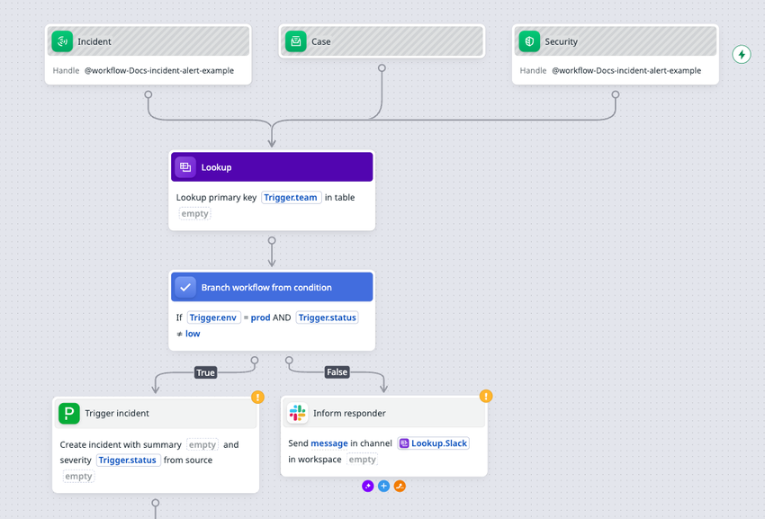
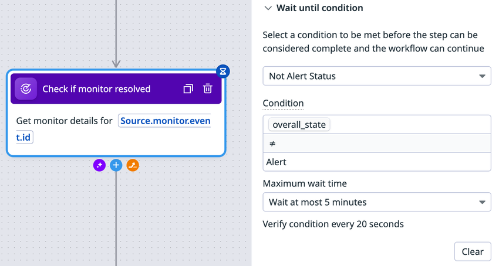
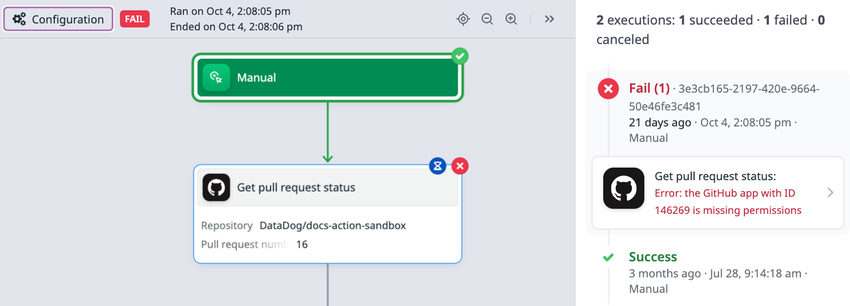
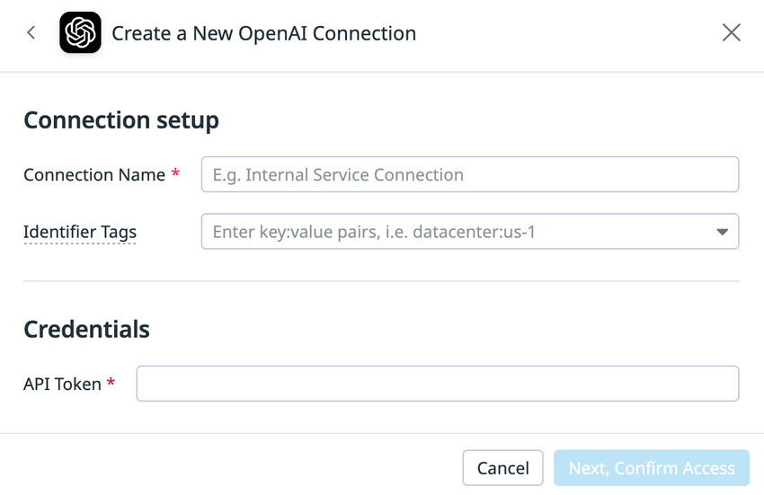
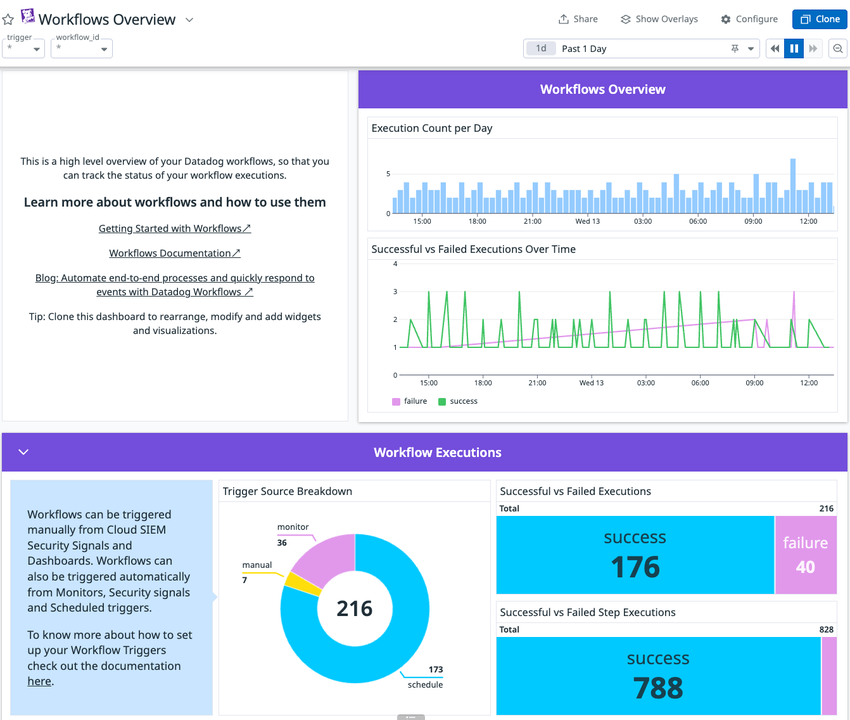

# Workflow Automation（ワークフロー自動化）

## 概要

Datadog Workflow Automation（ワークフロー自動化。旧来の画面・資料では「Datadog Workflows」とも呼ばれる）は、Datadog 上のアラート・セキュリティシグナル・インシデント・ダッシュボード操作・スケジュール・外部 Webhook などを起点（Trigger）として、クラウド・SaaS・Datadog 自身・社内システムに対する操作（Action）を連鎖的に実行するローコードの自動化基盤である。分岐・ループ・待機・JavaScript/Python によるデータ変換を組み合わせて、修復（Remediation）、チケット起票、通知、承認フロー、セキュリティ対応（SOAR 的用途）などのエンドツーエンドの処理を構築できる。[出典](https://docs.datadoghq.com/actions/workflows/)

Workflow Automation の主な構成要素は次のとおり。

| 構成要素 | 内容 | 本ファイルの節 |
|---|---|---|
| Trigger（トリガー） | ワークフローを開始する契機。手動、Dashboard、Monitor、Incident、Security、Catalog、GitHub、Slack、API、Schedule、親ワークフロー など。1つのワークフローに複数設定可 | [トリガー](#トリガー) |
| Action（アクション）/ Step（ステップ） | ワークフロー内の個々の処理。Action Catalog の 2,000 以上のアクションから選択 | [アクションカタログ](#アクションカタログaction-catalog) |
| Logic / Data transformation | If / Switch / For / While / Sleep / Set variable / Function / Expression / Python など | [ロジックアクション](#ロジック制御アクションworkflow-logic) |
| Connection（接続） | 外部サービスの認証情報を保持するオブジェクト。Connection Group でまとめて切替可能 | [接続](#接続connections) |
| Private Action Runner | 社内ネットワーク内のサービスをインターネットに公開せずに操作するための実行エージェント | [Private Action Runner](#private-action-runnerプライベートアクション) |
| Blueprints（ブループリント） | 事前構成済みのワークフローテンプレート | [Blueprints](#blueprintsブループリント) |
| 実行 ID（Run as） | Owner / Initiator / Service Account のいずれかの権限で実行 | [権限と実行 ID](#権限アクセス制御と実行-id) |

Workflow Automation は 2023 年 6 月（DASH 2023 時期）に一般提供（GA）が発表された。[出典](https://www.datadoghq.com/about/latest-news/press-releases/datadog-launches-workflow-automation-for-faster-remediation-of-application-issues/)（2023-06 公開）

> **ドキュメント構成の変更:** Workflow Automation の公式ドキュメントは、以前は `docs.datadoghq.com/workflows/` → `docs.datadoghq.com/service_management/workflows/` に置かれていたが、2026-11-02 時点では「Actions」配下（`docs.datadoghq.com/actions/workflows/`）に再編されている。Actions 配下には App Builder、Connections、Datastores、Forms、Private Actions、Bits Agent Builder が同居する。[出典](https://docs.datadoghq.com/actions/llms.txt)

関連ファイル:

- 同じ Actions 基盤上で UI を作る機能は [App Builder](./app-builder.md) を参照。
- インシデント内の自動化（Incident Automations）は [Incident Management](./incident-management.md)、ケースの自動化ルールは [Case Management](./case-management.md)、オンコール呼び出しは [On-Call](./on-call.md) を参照。
- モニターの通知設定は [Monitors](../platform/monitors.md)、[通知と Downtime](../platform/notifications-and-downtimes.md) を参照。
- Bits AI によるワークフロー生成・修正は [Bits AI と AI 機能](../ai/bits-ai.md) を参照。

### アーキテクチャ概観

```mermaid
flowchart LR
  subgraph Triggers[トリガー]
    M[Monitor<br/>@workflow-xxx]
    S[Security Signal /<br/>Notification Rule]
    I[Incident]
    D[Dashboard<br/>Run Workflow widget]
    SC[Schedule]
    API[API / GitHub Webhook / Slack]
    P[親ワークフロー<br/>Trigger Workflow]
  end
  subgraph DD[Datadog SaaS]
    WE[Workflow Engine<br/>ステップ実行・リトライ・分岐]
    CN[Connections<br/>認証情報]
    AZ[Private Actions<br/>認可レイヤー<br/>Execution Policies / Connections]
  end
  subgraph Ext[外部]
    SaaS[SaaS / Cloud API<br/>AWS, Azure, GCP, Slack, Jira, GitHub ...]
  end
  subgraph Priv[顧客ネットワーク]
    PAR[Private Action Runner<br/>Agent 組込み or Standalone]
    Int[社内サービス<br/>Kubernetes, DB, Jenkins, GitLab, HTTP]
  end
  Triggers --> WE
  WE --> CN --> SaaS
  WE --> AZ
  PAR -- アウトバウンドでタスクをポーリング --> AZ
  PAR --> Int
```

- Datadog 上の Workflow Engine がステップを順に実行し、SaaS/クラウドへのアクションは Datadog から直接（Connection の認証情報を使って）呼び出される。
- 社内ネットワークのサービスへのアクションは、Private Action Runner が Datadog に**アウトバウンド接続**してタスクをポーリングし、ローカルで実行して結果を返す。インバウンドのポート開放は不要。[出典](https://docs.datadoghq.com/actions/private_actions/)

## 画面とナビゲーション

Workflow Automation の画面は、Datadog の **Actions > Workflow Automation**（URL: `https://app.datadoghq.com/workflow`）にある。

| 画面 | 場所 / URL | 主な内容 |
|---|---|---|
| ワークフロー一覧 | `/workflow` | オーナー、トリガー種別、最終更新日・最終実行日、公開状態を一覧。ホバーで削除・複製（Clone）・権限編集。`My workflows` トグルで自分の作成分に絞り込み |
| Blueprints タブ | `/workflow/blueprints` | 名前・カテゴリ・インテグレーションで検索してテンプレートから作成 |
| Connections | 一覧画面右上の **Connections** | 接続の作成・編集・権限設定・削除、Groups タブで Connection Group |
| Action Catalog | `/actions/action-catalog/` | 利用可能なアクションの一覧、Saved Actions、Private Action Runners の管理 |
| ワークフローエディタ（キャンバス） | 各ワークフロー | 左上で **Configuration** / **Run History** を切替。右上の歯車（Settings）から Edit permissions、View audit events、Discard draft、Edit JSON Spec |
| Workflows Overview ダッシュボード | Dashboard List で `Workflows Overview` を検索 | 実行数・成功/失敗・トリガー別内訳の標準ダッシュボード |

[出典](https://docs.datadoghq.com/actions/workflows/build/)、[出典](https://docs.datadoghq.com/actions/workflows/track/)



*図1: 複数トリガーを持つワークフローのエディタ画面（キャンバス）*
画面の説明: キャンバス上部に 3 つのトリガーノード（Incident、Case、Security）が並び、Incident と Security にはそれぞれ Handle `@workflow-Docs-incident-alert-example` が表示されている。3 つのトリガーは 1 本に合流し、「Lookup」ステップ（`Trigger.team` を主キーとしてテーブルを参照）→「Branch workflow from condition」ステップ（`Trigger.env = prod AND Trigger.status ≠ low`）へ進む。True 側は PagerDuty の「Trigger incident」、False 側は Slack の「Inform responder」（`Lookup.Slack` チャンネルへメッセージ送信）に分岐する。未設定項目のあるステップには右上にオレンジの「!」マークが付く。各ステップ下部の「+」アイコンで次のステップを追加する。
出典: https://docs.datadoghq.com/actions/workflows/trigger/ （取得日: 2026-11-02）

## ワークフローの作成方法

Workflow Automation では、ワークフローを次の 4 通りで作成・編集できる。[出典](https://docs.datadoghq.com/actions/workflows/build/)

| 方法 | 手順の要点 | 備考 |
|---|---|---|
| Blueprint から作成 | **Blueprints** タブ → テンプレート選択 → **Create From Blueprint** → 名前・説明・タグ・サービス・チームを設定 → Save → 「!」付きステップの空欄を Configure タブで埋める → Run でテスト → Publish | 詳細は [Blueprints](#blueprintsブループリント) |
| AI（Bits Chat）で作成・編集 | **New workflow** → 「Build a workflow with AI」にプロンプト入力 → 追加質問に回答 → 確認するとエディタで開く。既存ワークフローは左ツールバーの AI アイコンから変更指示 | Bits Chat は `Cmd`/`Ctrl` + `I` または右上の **Ask Bits** でどこからでも起動可 |
| ワークフロービルダーで手動作成 | **New workflow** → 構成パネルで Name、タグ、サービス、チーム、入出力パラメータ → **Add Trigger** → **Add Step** でアクション検索 or インテグレーションから選択 → 各ステップを設定 → Publish | ステップはドラッグで並べ替え可 |
| JSON で編集 | ワークフローページの **Edit JSON Spec** | JSON の整形（Format）とエクスポート（ダウンロード）が可能。UI からの JSON インポート手順は公開情報では確認できず（API / Terraform での作成は可能。後述） |

構成パネルで設定するワークフロー属性:

| 項目 | 必須 | 説明 |
|---|---|---|
| Name | 必須 | ワークフロー名 |
| Description | 任意 | 説明 |
| Tags | 任意 | Datadog タグ（`team:xxx` 等）。タグ戦略は [Tagging](../platform/tagging.md) |
| Services | 任意 | 関連サービス（Software Catalog のサービス） |
| Teams | 任意 | 関連チーム。存在しなければ入力して作成可 |
| Input Parameters / Output Parameters | 任意 | 後述の [変数とパラメータ](#変数とパラメータ) |

キャンバス操作:

- `?`（Shift + `/`）または **Keyboard** ボタンでショートカット一覧を表示。
- Zoom in / Zoom out / Reset viewport、**Auto layout**（自動整列）、**Add annotation**（注釈。書式バーまたは Markdown で記述）。

[出典](https://docs.datadoghq.com/actions/workflows/build/)

### 公開（Publish）とドラフト

Workflow Automation の公開・ドラフトの挙動は次のとおり。[出典](https://docs.datadoghq.com/actions/workflows/build/)

| 項目 | 挙動 |
|---|---|
| 自動トリガーの有効化 | Schedule や Monitor 等で自動起動されるワークフローは **Publish するまで自動実行されない** |
| 課金 | **公開済み（Published）ワークフローの実行**が課金対象（[課金への影響](#課金への影響)） |
| 公開済みワークフローの編集 | 編集するとドラフトが作成され、公開中のバージョンには影響しない。**ドラフトはワークフローごとに 1 つ**で、全 Editor が共同編集する。**Publish Changes** で公開版を置換 |
| ドラフトの実行 | ドラフトは通常のワークフローと同様に全ステップを実行する（外部への副作用も発生する）。実行はエディタからのみ。**公開済みワークフローのドラフト実行は課金されない** |
| ドラフト破棄 | 歯車アイコン → **Discard draft** |
| ドラフトを経由しない変更 | ワークフローのプロパティ（名前、タグ、通知）の変更はドラフトを経由せず**即時に公開版へ反映** |
| バージョン履歴 | 変更履歴は Audit Trail で確認できる（[監視・監査](#実行の監視追跡監査)）。UI 上での任意バージョンへのロールバック機能は公開情報では確認できず |

### ワークフロー通知（成功/失敗時）

Workflow Automation は、ワークフローの成功時・失敗時に通知を送れる。対応先は **Slack、Microsoft Teams、PagerDuty、Email** の 4 種。[出典](https://docs.datadoghq.com/actions/workflows/build/)

| 設定場所 | 保存タイミング |
|---|---|
| エディタ上部のワークフロー名をクリック → タイトルポップオーバーの Notifications 節 | 即時保存 |
| 歯車アイコン → **Edit permissions** → モーダル下部の Notifications 節 | **Save** 押下時 |

On success / On failure それぞれ「+」から通知先インテグレーションを選び、必須項目を入力して Save する。

### エラーハンドリング（リトライとエラーパス）

Workflow Automation のステップ単位のエラーハンドリング設定は次のとおり。[出典](https://docs.datadoghq.com/actions/workflows/build/)

| 機能 | 設定 | 挙動 |
|---|---|---|
| Retries | ステップの **Retries** セクションで `Interval` と `Max retries` | 失敗したステップを指定間隔・回数だけ再試行 |
| Error path | ステップにホバー → **Error path** アイコンをキャンバスにドラッグ → 後続ステップを追加 | リトライを使い切った後にエラーパスへ遷移。エラーパスはメインパスに合流させることも可能 |
| エラーパスなし | — | リトライを使い切るとワークフローは終了（失敗） |

リトライ回数・間隔の上限値・デフォルト値は公開情報では確認できず。

### Wait until condition（完了条件待ち）

Workflow Automation の一部のアクションには、ステップを完了とみなす前に条件成立を待つ **Wait until condition** を設定できる。[出典](https://docs.datadoghq.com/actions/workflows/build/)

- ドロップダウンからアクション固有の事前定義条件を選ぶか、**Configure custom wait condition** で独自条件を作る。
- 条件式の変数は String / Number / Boolean / ステップ出力変数。カスタム条件で使えるのは**そのステップ自身の出力変数のみ**。
- **最大待機時間**を指定し、時間内に条件が成立しなければステップは失敗する。



*図2: Wait until condition の設定画面*
画面の説明: 左のキャンバスに「Check if monitor resolved」ステップ（`Source.monitor.event.id` のモニター詳細を取得）があり、右の設定パネルの **Wait until condition** 節で事前定義条件「Not Alert Status」が選択されている。Condition 欄は `overall_state ≠ Alert`、**Maximum wait time** は「Wait at most 5 minutes」、その下に「Verify condition every 20 seconds」（20 秒ごとに条件を確認）と表示されている。
出典: https://docs.datadoghq.com/actions/workflows/build/ （取得日: 2026-11-02）

## トリガー

Workflow Automation のワークフローは手動または自動で起動でき、**1 つのワークフローに複数のトリガー**を設定できる。ユーザーを伴わないトリガー（Schedule、Webhook 等）では、実行 ID に Owner または Service Account が必要。[出典](https://docs.datadoghq.com/actions/workflows/trigger/)

### トリガー一覧

| トリガー | 起動方法 | 公開（Publish）要否 | 主な要件・備考 |
|---|---|---|---|
| Manual（手動） | ワークフローページの **Run** → トリガー変数を入力 → **Save & Run** | 不要（エディタから実行） | ワークフローへのアクセス権 |
| Dashboard | ダッシュボードの **Run Workflow** ウィジェット | **必要**（公開済みかつ Dashboard トリガーを持つワークフローのみ選択肢に表示） | テンプレート変数を入力パラメータにマッピング可 |
| Monitor | モニター通知メッセージ内の `@workflow-<name>` メンション | **必要** | Automatic triggering はデフォルト ON。閾値到達のたびに実行 |
| Incident | インシデントの宣言・更新・定期スケジュール、またはインシデント内からの手動実行 | **必要** | 手動用ハンドルはモニターやインシデント通知ルールで使用可 |
| Security | Security Signal / Security Finding（自動）、Notification Rule、シグナル等のサイドパネルから手動 | 自動・通知ルールは**必要** | Security トリガーがないとシグナル・通知ルールに追加不可 |
| Catalog | Software Catalog のエンティティのサイドパネル **Run Workflow** | **必要** | Catalog トリガー付きのみ表示 |
| GitHub | GitHub Webhook | **必要** | Webhook 作成権限。Secret は **16 文字以上** |
| Slack | `/datadog workflow`（`/dd workflow`）、絵文字リアクション、メッセージ一致 | **必要** | Datadog Slack App のインストール。絵文字は `emoji:read` スコープ |
| API | `POST /api/v2/workflows/{workflow_id}/instances` | **必要** | API キー + `workflows_run` スコープ付き Application キー |
| Schedule | 指定時刻・頻度 | **必要** | 作成時に Service Account を作成 |
| 親ワークフロー（Trigger Workflow アクション） | 別ワークフローのステップから子として起動 | 公開要否は公開情報では明記なし | 子の実行は**別の 1 実行として課金** |
| Datastore Automation Rules | Actions Datastore のレコード追加・変更・削除 | — | Datastore 側で設定（後述） |
| Case Management / Work Management の自動化ルール | ケース（ワークアイテム）作成、ステータス変更、属性変更、承認/却下 | — | 詳細は [Case Management](./case-management.md) |
| Forms | フォーム送信時 | — | Forms の **Automation** から作成。作成された自動化は Workflow Automation の一覧に表示 |

[出典（トリガー）](https://docs.datadoghq.com/actions/workflows/trigger/)、[出典（Datastore）](https://docs.datadoghq.com/actions/datastores/trigger/)、[出典（Forms）](https://docs.datadoghq.com/actions/forms/)、[出典（Work item automation rules）](https://docs.datadoghq.com/incident_response/case_management/automation_rules/)

### Dashboard トリガー

Workflow Automation の Dashboard トリガーは、ダッシュボードの **Run Workflow** ウィジェットから実行する。[出典](https://docs.datadoghq.com/actions/workflows/trigger/)

1. ダッシュボードで **Add Widget** → `workflows` で検索 → **Run Workflow** ウィジェットを追加。
2. **Select the workflow** でワークフローを選ぶ（公開済みかつ Dashboard トリガーを持つもののみ）。
3. ダッシュボードのテンプレート変数をワークフローの入力パラメータにマッピング。
4. タイトルを入力して Save。
5. 実行時はウィジェットの **Run Workflow** → Execution parameters（マッピング済みは自動入力）を確認・入力 → **Run**。

ダッシュボードの詳細は [Dashboards](../platform/dashboards.md) を参照。

### Monitor トリガー

Workflow Automation の Monitor トリガーは、モニターの通知に `@workflow-` ハンドルを含めることで起動する。[出典](https://docs.datadoghq.com/actions/workflows/trigger/)、[出典](https://docs.datadoghq.com/getting_started/workflow_automation/)

ワークフロー側の設定:

1. **Add Trigger** → **Monitor** を追加し、最初のステップに接続。
2. **Mention handle**（例: `Create-Jira-Ticket` → 通知では `@workflow-Create-Jira-Ticket`）を確認。
3. **Automatic triggering** はデフォルトで有効。自動実行させない場合はオフにする。
4. Save → **Publish**。

モニター側の設定:

1. Monitors ページでモニターを作成/編集 → **Configure notifications & automations** → **+ Add Workflow** → メンション名で検索（Monitor トリガーを持つワークフローのみ表示）。
2. 通知メッセージに `@workflow-name` が挿入される。入力パラメータがある場合は `@workflow-name(param="")` 形式。
3. **Configure Inputs** から値を入力（メッセージテンプレート変数を使用可）。例: `@workflow-Create-Jira-Ticket(hostname={{host.name}})`。
4. **Test Notifications** で確認し、モニターを保存。

挙動: モニターが閾値に到達するたびにワークフローが 1 回実行される。モニターの評価ごと・グループごとの起動粒度（マルチアラートで複数グループが同時に発火した場合の実行回数）の詳細は公開情報では確認できず【推定】（通知が送られる単位で起動されると考えられる）。

### Incident トリガー

Workflow Automation の Incident トリガーは、インシデントの **宣言（declared）**、**更新（updated）**、**定期スケジュール（recurring schedule）** などのイベントで自動起動するか、インシデント内から手動起動する。手動トリガーではハンドルが作成され、モニターや[インシデント通知ルール](https://docs.datadoghq.com/incident_response/incident_management/setup_and_configuration/notification_rules/)で使用できる。[出典](https://docs.datadoghq.com/actions/workflows/trigger/)

> **重要（課金）:** Incident Management 内で完結する自動化は、**Incident Automations** を使えばインシデントのコンテキストが組み込まれ、**追加課金なし**で実行できると公式に記載されている。Workflow の Incident トリガーは、インシデントイベントが複数トリガーの 1 つである場合や、Incident Management の外でワークフローを管理する場合に使う。[出典](https://docs.datadoghq.com/actions/workflows/trigger/)。Incident Automations の詳細は [Incident Management](./incident-management.md) を参照。

### Security トリガー

Workflow Automation の Security トリガーは、Cloud SIEM などの Security Signal、Security Finding（Misconfiguration、Identity Risk 等）を起点にする。[出典](https://docs.datadoghq.com/actions/workflows/trigger/)

| 方式 | 設定 |
|---|---|
| 自動（Automatic） | 任意の Security Signal / Security Finding でトリガー |
| Notification Rule | ワークフローに Security トリガーを追加 → メンション（例: `@workflow-my-workflow`）を確認 → Publish → **Configuration > Notification rules** の **Recipient** にメンションを追加 → 保存。ルール発火ごとに実行 |
| 手動 | Cloud SIEM の Security Signal、Misconfiguration、Identity Risk のサイドパネルで **Next Steps** の **Run Workflow** → ワークフロー選択 → 入力（オブジェクトの JSON から値を貼り付け可）→ **Run**。実行状況はサイドパネルの Workflows 節に表示 |

セキュリティ用途の詳細は [Cloud SIEM](../security/cloud-siem.md)、[セキュリティ運用の実践](../../04_応用編/security-operations-practices.md) を参照。

### Catalog トリガー

Workflow Automation の Catalog トリガーは、Software Catalog のエンティティから実行する。Catalog トリガーを追加・Publish した後、Catalog ページでエンティティを選び、サイドパネルの **Run Workflow** → ワークフロー選択 → 入力 → **Run**。[出典](https://docs.datadoghq.com/actions/workflows/trigger/)。Software Catalog は [Software Catalog](../platform/software-catalog.md) を参照。

### GitHub トリガー

Workflow Automation の GitHub トリガーは GitHub Webhook で起動する。GitHub アカウントに Webhook 作成権限が必要。[出典](https://docs.datadoghq.com/actions/workflows/trigger/)

1. ワークフローに GitHub トリガーを追加。
2. GitHub の **Settings > Webhooks > Add webhook**。
3. **Payload URL** にワークフローの Configure タブに表示される URL を貼り付け。
4. **Content type** を `application/json` に設定。
5. **16 文字以上**の Secret を作成し、GitHub とワークフローの Secret 欄の両方に設定。
6. トリガー対象イベントを選択して Webhook を追加。
7. 必要に応じて **Rate Limit** ステップを追加（イベント過多対策）。
8. Save → **Publish**（公開前は GitHub から起動不可）。

### Slack トリガー

Workflow Automation の Slack トリガーには 3 方式がある。いずれも Slack ワークスペースへの Datadog App インストールが前提。[出典](https://docs.datadoghq.com/actions/workflows/trigger/)

| 方式 | 設定・挙動 |
|---|---|
| 手動 | Datadog App が参加するチャンネルで `/datadog workflow`（または `/dd workflow`）を実行しワークフローを選択 |
| 絵文字リアクション | Configure でワークスペースを選択 → 必要なら **Enable Permission** で `emoji:read` スコープ付きで App を再インストール → 1 つ以上の絵文字を選択 |
| メッセージ | **Message triggers** でワークスペースと 1 つ以上のチャンネル（Datadog App がメンバーであること）を選択し、一致方式を選ぶ |

メッセージトリガーの一致方式:

| 一致方式 | 挙動 |
|---|---|
| Any message | すべてのメッセージ |
| Contains text | 部分一致（大文字小文字を区別しない） |
| Matches regular expression | 正規表現（大文字小文字を区別、アンカーなしなら任意位置で一致）。`(?i)` で大文字小文字無視 |

- スレッド返信（all / only / exclude）とアプリ投稿（all / only / exclude）でフィルタ可能。
- 複数ルールに一致してもワークフローは **1 回だけ**実行。
- **Datadog Slack App 自身の投稿ではトリガーされない**（ループ防止）。

メッセージ変数（`Source.slack_message`）: `text`、`user_id`、`channel_id`、`team_id`、`message_ts`、`thread_ts`（スレッド返信時）、`app_id`（アプリ投稿時）、`bot_id`（Bot 投稿時）。

Slack 連携の設定は [通知・コラボレーション連携](../platform/collaboration-integrations.md) を参照。

### API トリガー

Workflow Automation の API トリガーは REST API で起動する。[出典](https://docs.datadoghq.com/actions/workflows/trigger/)

- 必要なもの: API キーと、**`workflows_run` スコープ**を持つ Application キー。スコープなし（unscoped）の Application キーにはデフォルトでこのスコープが含まれない。
- さらに、Application キーで Actions 系 API（Workflow Automation、App Builder、Actions Connections）を使うには、Application キーで **Actions API access** を有効化する必要がある（デフォルト無効。**Organization Settings > Application Keys** または API で有効化）。[出典](https://docs.datadoghq.com/account_management/api-app-keys/)
- エンドポイント: `POST https://api.<site>/api/v2/workflows/<WORKFLOW_ID>/instances`（US1 は `api.datadoghq.com`、AP1 は `api.ap1.datadoghq.com`）。
- 入力パラメータは `meta.payload` に入れる。

```json
{ "meta": { "payload": { "example_input1": "value" } } }
```

- リクエストボディは `Source.api.requestBody` で参照。JSON の場合は `${JSON.parse(Source.api.requestBody).my_field}` のように解析する。
- **Add Trigger > API** で表示されるサンプル cURL をコピーでき、Save → **Publish** 後に POST が有効になる。

API キー・Application キーの管理は [API とキー管理](../platform/api-and-keys.md) を参照。

### Schedule トリガー

Workflow Automation の Schedule トリガーは、キャンバスの **Add an Automated Trigger > Schedule** で設定する。[出典](https://docs.datadoghq.com/actions/workflows/trigger/)

1. **Create** をクリックして Service Account を作成（スケジュール実行はユーザーを伴わないため）。
2. 時刻と頻度を入力。
3. 任意で **Memo** に説明を入力。
4. Save → **Publish**（公開しないと実行されない）。

スケジュールの最小間隔・cron 式の可否は公開情報では確認できず。

### 子ワークフロー（Trigger Workflow アクション）

Workflow Automation では、**Trigger Workflow** アクションで別のワークフローを子として起動し、共通処理を再利用できる。[出典](https://docs.datadoghq.com/actions/workflows/trigger/)

- 子ワークフローの入力パラメータは、Trigger Workflow アクションの必須フィールドとして表示される。
- 子ワークフローで **Output parameters** を定義すると、親で `Steps.<子ステップ名>.workflowOutputs.<パラメータ名>`（例: `Steps.Example_workflow.workflowOutputs.exampleList`）として参照できる。
- **課金上、子ワークフローの起動は新しい 1 ワークフロー実行としてカウントされる。**

### Datastore Automation Rules

Actions Datastore（App Builder / Workflow Automation 用の構造化データストア）では、**Automation Rules** により、レコードの**追加・値の変更・削除**時にワークフローを自動起動できる。[出典](https://docs.datadoghq.com/actions/datastores/trigger/)

- 設定: Datastores ページ → データストア選択 → **Automation Rules** → **+ New Automation Rule** → イベント種別・起動するワークフロー・ルール名 → Save。
- 監査: **Audit Logs** で、1 回のルール実行につき「ルール一致」「ワークフロー実行開始」「ワークフロー実行結果」の 3 件のログが記録される。

### 実行履歴（Run History）

Workflow Automation でトリガーした後は、エディタが **Run History** 表示になる。左上で **Configuration** と **Run History** を切り替える。実行一覧に成功/失敗が表示され、失敗した実行は失敗ステップへリンクする。ステップをクリックすると入力・出力・実行コンテキスト・エラーメッセージを確認できる。[出典](https://docs.datadoghq.com/actions/workflows/test_and_debug/)



*図3: Run History の失敗ステップ表示*
画面の説明: 左上に **Configuration** ボタンと赤い **FAIL** バッジ、実行開始・終了時刻（Ran on / Ended on）が表示される。キャンバスでは「Manual」トリガー（緑・成功）から「Get pull request status」ステップ（GitHub。Repository と Pull request number を表示）へ進み、そのステップ右上に赤い × が付いている。右パネルには「2 executions: 1 succeeded · 1 failed · 0 canceled」と実行一覧があり、失敗した実行に「Get pull request status: Error: the GitHub app with ID ... is missing permissions」とエラー内容が表示されている。
出典: https://docs.datadoghq.com/actions/workflows/test_and_debug/ （取得日: 2026-11-02）

## テストとデバッグ

Workflow Automation のテスト・デバッグ機能は次のとおり。[出典](https://docs.datadoghq.com/actions/workflows/test_and_debug/)

| 機能 | 手順 | 注意点 |
|---|---|---|
| Monitor トリガーのテスト | Monitor トリガーを選択 → **Test from Monitor** → 必要なら Workflow Inputs にテスト値 → モニターとモニター状態を選択 → **Run From Monitor** | モニター通知欄に貼るスニペットが生成される |
| ステップ単体テスト | ステップの Inputs 節で **Test** → 必要なら構成を調整（前ステップ出力は固定値で代替）→ **Test** → **Use in configuration** で採用 | **実際の外部操作が行われる**（例: Jira チケット作成、Slack 投稿）。分岐・ロジック系アクションはテスト不可 |
| JavaScript / Expression のテスト | 出力変数参照をコメントアウトしてテストデータに置き換える | — |
| Fix with AI | Run History で失敗ステップの **Outputs** タブ → **Fix with AI** | Bits Chat が入力・出力・コンテキスト・エラーから原因を診断し修正案を提示。変更前に確認を求める。設定ミスは修正案、外部要因（認証切れ、レート制限、障害）は原因説明と次の手順を提示。子ワークフローへの追跡も可 |
| ループのデバッグ | 実行後の Debug 表示で各ステップの All / Failed / Successful イテレーションを確認。While loop はインデックスごとの条件評価を確認可 | [出典](https://docs.datadoghq.com/actions/workflows/actions/flow_control/) |

「失敗したステップからの再実行（re-run from failed step）」機能の有無は公開情報では確認できず。

## アクションカタログ（Action Catalog）

Workflow Automation の Action Catalog は、クラウドプロバイダー、SaaS ツール、Datadog 自身に対して実行できるアクションの一覧で、Workflow Automation と App Builder で共通に使われる。公式ドキュメントでは「**2,000 以上のアクション**」と記載されている。[出典](https://docs.datadoghq.com/actions/workflows/)、[出典](https://docs.datadoghq.com/actions/actions_catalog/)

> **注意（件数表記の揺れ）:** 製品ページ等では「1,000+ actions」、古い第三者記事では「400+」「300+」などの記載もある。2026-11-02 時点の公式ドキュメントの表記は「2000+」。

### アクションの主なカテゴリ

Action Catalog ページに掲載されている主なインテグレーション（2026-11-02 時点の公式ページから抜粋。網羅ではない）。[出典](https://docs.datadoghq.com/actions/actions_catalog/)

| 分類 | 主なインテグレーション / サービス |
|---|---|
| AWS | API Gateway、Application Auto Scaling、Athena、Auto Scaling、Batch、Bedrock / Bedrock Runtime、Certificate Manager、CloudControl、CloudFront、CloudTrail、CloudWatch、CodeDeploy、CodePipeline、DMS、DynamoDB、EBS、EC2、ECR、ECS、EKS、Elastic Beanstalk、ElastiCache、ELB、EventBridge、Global Accelerator、Glue、GuardDuty、IAM、IAM Identity Center、Kinesis、KMS、Lambda、Organizations、Outposts、RDS、Resource Tagging、Route 53、S3、SES、SNS、SQS、Step Functions、STS、Systems Manager、WAF Classic、WAFV2 |
| Azure | AKS、App Services、Blob、Cosmos DB、DevOps Pipelines、Functions、Managed Disk、Network、Queue Storage、Resources、Subscriptions、Service Bus、SQL、VM、VM Scale Sets |
| AI / LLM | Anthropic、Cohere、OpenAI（接続作成例で使用）、Datadog AI、Datadog Bits Investigation |
| SaaS・開発ツール | Asana、CircleCI、Cloudflare（Workers 含む）、ClickUp、ConfigCat、CrowdStrike、Fastly、GitHub、GitLab、Jira、Jenkins、PagerDuty、Opsgenie、ServiceNow、Slack、Microsoft Teams、Statuspage、Google Workspace（Gmail、Calendar、Drive、Docs、Sheets、Forms、Chat）、Email ほか |
| Datadog 自身 | Monitors、Downtime、Dashboards、Notebooks、Incidents、On-Call、Events、Metrics、Logs（Archives、Custom Destinations、Indexes、Metrics、Pipelines）、Hosts、Tags、Synthetics、SLO、Security Monitoring、Cloud Security、Sensitive Data Scanner、Software Catalog、Service Catalog、Teams、Users、Roles、Service Accounts、Key Management、Reference Tables、DDSQL、Status Pages、Feature Flags、Error Tracking、CI Visibility、Test Optimization、DORA Metrics、CCM、Restriction Policies、Work Management、Actions Datastore、Workflow Automation Execute ほか |
| データ変換 | Data Transformation（Expression、JavaScript（Function）、Convert XML to JSON）、Python |
| 汎用 | HTTP（Make request）、Trigger Workflow、ロジック制御（If / Switch / Loop / Sleep 等） |

> **サイト差異:** Action Catalog のアクションはサイトごとに提供範囲が異なる。多くはコマーシャルサイト（US1、US3、US5、EU1、AP1、AP2、UK1）で利用可能。Datadog 自身のアクションの多くは政府向けサイト（US1-FED = `app.ddog-gov.com`、US2-FED = `us2.ddog-gov.com`）でも提供されるが、CI Visibility、Work Management など一部は政府向けサイトに掲載がない。**AWS、Azure、および大半のサードパーティ SaaS アクションはコマーシャルサイトのみの掲載**。[出典](https://docs.datadoghq.com/actions/actions_catalog/)

### 汎用アクションの分類

Workflow Automation 固有の汎用アクションは次の 4 分類。[出典](https://docs.datadoghq.com/actions/workflows/actions/)

| 分類 | 内容 |
|---|---|
| Logic and flow control | Sleep、条件分岐、反復などの実行パス制御 |
| Data transformation | JavaScript / Python 等による前ステップ出力の変換 |
| HTTP requests | 任意エンドポイントへのカスタム HTTP リクエスト |
| Saved Actions | アクションとパラメータを保存して再利用 |

### ロジック制御アクション（Workflow Logic）

Workflow Automation のロジック制御アクションは次のとおり。[出典](https://docs.datadoghq.com/actions/workflows/actions/flow_control/)

| アクション | 用途 | 主な設定 | 上限・注意 |
|---|---|---|---|
| If condition（Branch workflow from condition） | 1 つ以上のステートメントで True / False に分岐 | 条件ステートメント（AND 等で結合） | — |
| Switch statement | 1 ステップで多分岐 | Switch 式と複数の Case 値。どれにも一致しなければ default 分岐 | 上限は公開情報では確認できず |
| Sleep | 指定時間停止 | Duration ドロップダウンの既定値、または変数による秒数指定 | 最大スリープ時間は公開情報では確認できず（ワークフロー全体の実行時間上限 7 日には従う） |
| For loop | 入力リストの各要素に対してループ内アクションを実行 | Input list（固定リストまたは変数）、ループ枠内のアクション。`{{Current.Value}}`、`{{Current.Index}}` | **入力リストは最大 2,000 要素**。If + Break で早期終了。ループ内でエラーパス・変数更新可 |
| While loop | 条件が真の間反復（回数不定のポーリング、ページネーション、成功までの再試行） | 各反復前に評価する条件。`{{Current.Index}}` | **最大 2,000 回**。If + Break で早期終了 |
| Break | ループの早期終了 | If と組み合わせて使用 | — |
| Set variable | 可変のカスタム変数の宣言・更新 | 変数名、値（Create object / Create array 可） | 後述 |
| Trigger Workflow | 子ワークフロー起動 | 子の入力パラメータ | 子は別実行として課金 |
| Rate Limit | 実行頻度の制限 | 公開情報では詳細設定確認できず | GitHub トリガーの推奨ステップとして記載 |

並列実行（同一ステップの並列分岐を明示的に同時実行する設定）の有無は公開情報では確認できず。

### データ変換（JavaScript / Python）

Workflow Automation のデータ変換手段は次のとおり。[出典（JavaScript）](https://docs.datadoghq.com/actions/workflows/expressions/javascript/)、[出典（Python）](https://docs.datadoghq.com/actions/workflows/expressions/python/)

| 手段 | 記法・仕様 | 用途 / 制約 |
|---|---|---|
| インライン式 | ステップの入力欄で `${ ... }`。例: `${ parseInt(Trigger.stringId) }`、`${ Math.floor(now() / 1000) - 60 }`、`${ Steps.Describe_auto_scaling_group.autoScalingGroup.DesiredCapacity + 1 }` | 基本はこれを推奨。**Lodash** が利用可能で `_` 接頭辞は省略可（`${ _.toNumber("1") }` = `${ toNumber("1") }`） |
| Function アクション（JavaScript） | 複数式・変数代入を含む変換。前ステップ参照は `$.Steps.<step_name>.<variable>`、Lodash は `_` | 例: `_.includes($.Steps.Array_function.data, "Bits")`。Bits AI で **Write with Bits AI** からスクリプト生成可（Replace / Insert / Copy） |
| Expression アクション | 1 行の式のみ。例: `[1, 2, 3].filter(x => x < 3)` | 変数代入不可。変数はコピーとして渡され、ステップ内での変更は外部に影響しない |
| Python アクション | **Python 3.12.8**。`main` 関数（キーワード専用引数 `ctx: Context`、`execution_context` から import）を定義。データは `ctx["Steps"]["Step_name"]["variable"]` で参照 | 実行環境・ネットワークアクセスは制限付き。標準ライブラリ + `python-dateutil` 2.9.0、`python-hcl2` 7.3.1、`PyYAML` 6.0.3、`rsa` 4.9.1。Bits AI の **Write Code with AI** で生成可 |
| Convert XML to JSON | Data Transformation 系アクション | — |

- ユーザー記述の JavaScript は **1 アクションあたり 10 KB まで**（[制限値](#制限値クォータデフォルト値)）。
- JavaScript のバージョン、Python のタイムアウト・メモリ上限は公開情報では確認できず。

### HTTP アクション（Make request）

Workflow Automation の HTTP アクション（**Make request** ステップ）は任意の HTTP エンドポイントを呼び出す汎用アクション。[出典](https://docs.datadoghq.com/actions/connections/http/)

| 項目 | 内容 |
|---|---|
| 必須 | URL、Method |
| 任意 | 認証（Connection）、URL パラメータ、ヘッダー、Content type、Body、Cookie |
| オプション | 期限切れ証明書の許可、リダイレクト追従 |
| Error on Status | エラーとして扱うステータスコードをカンマ区切りで指定 |
| Response Parsing | ヘッダーから推定されるパース方法を上書き |
| Response Encoding | サーバーが誤ったエンコーディングを返す場合に上書き |
| 条件待ち（Workflow のみ） | 条件が満たされるまで一定間隔で再試行して待機 |
| 送信元 IP | 接続先で許可リストが必要な場合、IP Ranges API の `webhooks` オブジェクトのアドレスを使用 |

HTTP 接続の認証方式は [接続の種類](#接続の種類) を参照。HTTP アクションのタイムアウト・ペイロード上限は個別には公開情報では確認できず（アクション入出力 15 MB の共通上限は適用される）。

### Saved Actions（保存済みアクション）

Workflow Automation の Saved Actions は、アクションとそのパラメータを保存して再利用する機能。[出典](https://docs.datadoghq.com/actions/workflows/saved_actions/)

| 操作 | 手順 |
|---|---|
| 保存 | キャンバスでアクションを選択 → **Save Action** → 名前・説明 → 共有するなら **Usable by others in the organization** をオン → **Save Action Configuration** |
| 新規ステップとして使用 | 「+」→ **Saved Actions** → 検索・選択 |
| 既存ステップに適用 | ステップ選択 → Saved Actions アイコン → **Configure using a saved action** → **Use Saved Action** |
| 編集・プレビュー・削除 | **Action Catalog** → **Saved Actions** → **Preview/Edit saved configurations** |
| 所有権 | 編集・削除できるのは**作成者のみ**。他者のものは **Clone** で複製して変更 |

保存数の上限は公開情報では確認できず。

## 変数とパラメータ

Workflow Automation では、ステップ間のデータ受け渡しに 4 種類のデータを使う。コンテキスト変数は `{{ ... }}`（Handlebars 記法、ネストは `{{ a.b }}`）で参照し、各ステップの **Context Variables** タブに利用可能な変数が表示される。[出典](https://docs.datadoghq.com/actions/workflows/variables/)

| 種類 | 参照方法 | 可変性 | 内容 |
|---|---|---|---|
| ワークフロー変数 | `{{ WorkflowName }}`、`{{ WorkflowId }}`、`{{ InstanceId }}` | — | ワークフロー名・ID・実行インスタンス ID |
| ステップ出力 | `{{ Steps.<step_name>.<variable> }}`（例: `{{ Steps.Get_pull_request_status.state }}`） | — | 前ステップの出力 |
| トリガー変数 / 入力パラメータ | `{{ Trigger.<parameter> }}`（例: `{{ Trigger.user }}`） | **不変** | 実行時に渡されるキー/値 |
| Source オブジェクト | `{{ Source.monitor.id }}`、`{{ Source.securitySignal.id }}`、`{{ Source.url }}`、`Source.slack_message.*`、`Source.api.requestBody` | — | トリガー元イベントのプロパティ。トリガー種別で利用可否が異なる |
| カスタム変数 | `{{ Variables.<name> }}` | **可変** | Set variable アクションで宣言・更新 |
| 子ワークフロー出力 | `Steps.<子>.workflowOutputs.<param>` | — | 子の Output parameters |

入力パラメータ（Input Parameters）:

- キャンバスをクリック → **Input Parameters** の「+」→ 名前、データ型、説明。表示名は自動生成（**Use custom display name** で変更可）。
- **デフォルト値を設定すると実行時に省略可能**になる。
- 手動トリガー（Dashboard 等）とメンショントリガー（Monitor、Security Notification Rule）で使用。
- ステップに `{{ Trigger.<name> }}` と書くと「暗黙のパラメータ」となり、次回保存時に明示的なパラメータへの変換ダイアログが出る。

出力パラメータ（Output Parameters）:

- 名前、値、データ型を定義し、他ワークフロー（親）や App Builder アプリに結果を返す。デフォルト値は任意。

カスタム変数（Set variable）:

- 変数名は**英字で始まり、英数字とアンダースコアのみ**。
- 値の更新には別の Set variable ステップで再代入する。
- For / While ループ内で設定した変数はループ後も参照可能。未定義エラーを避けるため、**ループ前に初期化**（例: 空配列）しておく。
- 例: `${Variables.intList.filter(number => number % 2 === 0)}` のようにインライン式と組み合わせ可能。

## 接続（Connections）

Workflow Automation の Connections（接続）は、アクションが外部サービスを操作するための認証情報を保持するオブジェクトで、**Workflow Automation と App Builder でのみ利用**される。[出典](https://docs.datadoghq.com/actions/connections/)

### 認証情報の供給元

| 供給元 | 対象 | 説明 |
|---|---|---|
| インテグレーションタイルの認証情報 | GitHub、Jira、Microsoft Teams、Opsgenie、PagerDuty、Slack、Statuspage | タイルで設定した認証情報が対応アクションに自動的に伝播する |
| Integration Connections | **ServiceNow**、**AWS** | 既存インテグレーションのインスタンス/アカウントの認証情報をアクションに使う。インテグレーション側で **Executor** 権限の付与が必要 |
| Connection（接続） | 汎用アクション（HTTP 等）、GitHub App 認証、タイルで認証を提供しないインテグレーション | Connections 画面またはアクションの Connection ドロップダウンの「+」から作成 |

[出典](https://docs.datadoghq.com/actions/connections/)、[出典](https://docs.datadoghq.com/actions/connections/integration/)

**AWS Integration Connections の制約:**

- Datadog AWS インテグレーションを**ロール委任（role delegation）**で構成している場合のみ利用可能。
- 実行できるのは **読み取り専用**アクション（AWS 管理ポリシー `ViewOnlyAccess` の範囲。例: `ListECSClusters`、`DescribeInstances`、`GetBucketPolicy`、`GetFunctionConfiguration`、`ListSecrets`）。`Put*`、`Delete*`、`Update*` などの変更系は実行時に失敗する。
- インテグレーションの IAM ロールに必要な権限（例: `ecs:ListClusters`）があること。
- 実行するユーザー/チーム/組織に AWS インテグレーションアカウントの **Executor** 権限が明示的に付与されていること。
- 変更系操作は、専用 IAM ロールに紐づく AWS 用 Connection を別途作成する。

[出典](https://docs.datadoghq.com/actions/connections/integration/)。AWS インテグレーション自体は [AWS Integration](../platform/aws-integration.md) を参照。

### 接続の種類

Workflow Automation で作成できる主な接続タイプと入力項目は次のとおり。[出典（HTTP）](https://docs.datadoghq.com/actions/connections/http/)、[出典（Connections）](https://docs.datadoghq.com/actions/connections/)

| 接続タイプ | 入力項目 | 備考 |
|---|---|---|
| AWS | Connection name、Account ID、AWS Role Name | IAM ロールの引き受け（AssumeRole）による認証 |
| Azure | Tenant ID、Client ID、Client Secret、任意で OAuth 2.0 カスタムスコープ（`{identifierURI}/.default`） | — |
| HTTP Token Auth | トークン（複数可） | 自動付与されない。ヘッダー・URL パラメータ・Body で `{{ tokenName }}` として参照 |
| HTTP Basic Auth | ユーザー名、パスワード | `Authorization` ヘッダーは自動設定 |
| HTTP 2 Step Auth | 事前リクエスト（トークン取得）の設定、シークレット（token / basic）、レスポンス内トークンパス（例: `body.token`、大文字小文字区別）、リフレッシュ間隔（秒。`0` で無効） | JWT や OAuth 風フローに使用。専用の「OAuth」タイプは HTTP にはない |
| HTTP mTLS Auth | 秘密鍵と証明書（PEM 形式） | プライベートアクション（PAR 経由）では mTLS は非対応 |
| GitHub App | 自社 GitHub App のインストールとして認証 | Datadog GitHub インテグレーションの代わりに使用 |
| Google Workspace | OAuth 2.0 | Gmail、Calendar、Drive、Docs、Sheets、Forms、Chat |
| 各 SaaS（例: OpenAI） | Connection Name、API Token など | インテグレーションごとに異なる |
| Private Action Runner 経由 | ランナー選択 + ランナー上の認証情報ファイルのパス | 後述 |



*図4: 接続の新規作成ダイアログ（OpenAI の例）*
画面の説明: タイトルは「Create a New OpenAI Connection」。**Connection setup** 節に必須の **Connection Name**（プレースホルダ「E.g. Internal Service Connection」）と **Identifier Tags**（「Enter key:value pairs, i.e. datacenter:us-1」）、**Credentials** 節に必須の **API Token** 入力欄がある。右下に **Cancel** と **Next, Confirm Access** ボタン（次の画面でアクセス権を確認）が並ぶ。
出典: https://docs.datadoghq.com/actions/connections/ （取得日: 2026-11-02）

### 接続の作成手順

1. Workflow Automation または App Builder の **Connections** タブを開く。
2. **New Connection** → インテグレーションのアイコンを選択 → 項目を入力。
3. Connection Group で使う予定があれば **Identifier Tags** を付与。
4. **Create**。

アクションの **Connection** ドロップダウンの「+」からも作成できる。[出典](https://docs.datadoghq.com/actions/connections/)

### Identifier Tags と Connection Groups

Workflow Automation の Connection Groups は、同一インテグレーションの複数接続（例: 本番/ステージングの AWS アカウント）をまとめ、実行時に識別子で切り替える仕組み。[出典](https://docs.datadoghq.com/actions/connections/)

Identifier Tags の規則:

| 規則 | 内容 |
|---|---|
| 形式 | `tag:value`（コロンはちょうど 1 つ） |
| 先頭文字 | 英字 |
| 使用可能文字 | 英数字、アンダースコア、ハイフン（マイナス）、スラッシュ |
| 予約語 | `default` はキー・値ともに使用不可（例: `aws:default` は無効） |

Connection Groups の仕様:

| 項目 | 内容 |
|---|---|
| 構成 | 同一インテグレーションの接続のみ |
| メンバー判定 | Identifier Tags。各接続のタグ値の組み合わせはグループ内で一意（重複不可） |
| Identifier Tags 数 | **グループあたり最大 3 個** |
| 作成 | **Groups** → **+ New Group** → インテグレーション選択 → 名前 → Identifier Tags（最大 3）→ メンバー選択 → アクセスレベル。追加する各接続の **Resolver** 権限が必要 |
| 使用 | アクションの Connection 欄でグループを選び、Identifier の値（例: `prod`、`staging`）を指定（変数も可） |
| 更新 | 名前・Identifier Tags（空にはできない）・メンバー（空でも可）を変更可 |
| 削除 | 使用中のワークフロー/アプリに影響 |
| 権限不足時 | グループ内接続の Resolver 権限がないとワークフロー/アプリは `403 Forbidden` で失敗 |
| RBAC | `connection_groups_read`、`connection_groups_write` |

> **サイト差異:** 政府向けサイト（`app.ddog-gov.com` = US1-FED、`us2.ddog-gov.com` = US2-FED）では、Actions、Workflows、Apps が Connections を通じて **Datadog for Government リージョン外のサードパーティサービスへ顧客データを送信する可能性がある**と公式に警告されている。[出典](https://docs.datadoghq.com/actions/connections/)

## Private Action Runner（プライベートアクション）

Workflow Automation の Private Actions は、Kubernetes クラスター、社内ホスト、データベース、社内 API など**プライベートネットワーク内のサービスを、インターネットに公開せずに**操作する仕組み。Private Actions は Workflow Automation、App Builder、Datadog MCP Server、Bits AI investigations から利用される。[出典](https://docs.datadoghq.com/actions/private_actions/)

### 構成要素

| 構成要素 | 役割 |
|---|---|
| Private Action Runner（PAR） | 顧客ネットワーク内で稼働。Datadog へアウトバウンド接続してタスクをポーリングし、対象サービスに対して実行して結果を返す |
| 認可レイヤー（Datadog 側） | どのユーザー・製品がどのランナーでどのアクションを実行できるかを定義し、タスクがランナーに届く前に許可/拒否を判定。拒否時はタスクは送出されない |
| アクション許可リスト（ランナー側） | ランナーが実行できるアクションを設定ファイル（`actions_allowlist`）でさらに制限 |
| ランナー ID と署名 | 登録時にランナーごとの秘密鍵（Datadog は保持しない）を発行。Datadog はすべてのタスクに署名し、ランナーは実行前に署名を検証 |

[出典](https://docs.datadoghq.com/actions/private_actions/)、[出典](https://docs.datadoghq.com/actions/private_actions/enroll_runner/)

### デプロイ形態

| 形態 | 実行形態 | デプロイ方法 | 状態・備考 |
|---|---|---|---|
| Agent 組み込み（ホスト） | Agent と並ぶ別プロセス | ホストインストール | Linux / Windows。**新規のコマーシャル環境で推奨** |
| Agent 組み込み（Kubernetes ノード Agent） | ノード Agent 内のコンテナ（ホスト版と同じバイナリ） | Helm、Datadog Operator | **Linux のみ** |
| Agent 組み込み（Kubernetes Cluster Agent） | Cluster Agent 内のインプロセス | Helm、Datadog Operator | **クラスターあたり 1 ランナー**、**リーダー選出（leader election）必須** |
| Standalone（スタンドアロン） | 専用コンテナ（`gcr.io/datadoghq/private-action-runner`、例: `v1.22.1`） | Docker、Docker Compose、Kubernetes（Helm） | **メンテナンスモード**（セキュリティ・安定性修正のみ、新機能なし）。Agent に未搭載のインテグレーション用。**US1-FED / US2-FED ではこちらがサポート形態** |

[出典](https://docs.datadoghq.com/actions/private_actions/set_up_agent_based/)、[出典](https://docs.datadoghq.com/actions/private_actions/set_up_standalone/)

> **サイト差異:** Agent 組み込み型 PAR と Execution Policies は `app.ddog-gov.com`（US1-FED）と `us2.ddog-gov.com`（US2-FED）では**非対応**。政府向けサイトではスタンドアロンランナー + Connections を使う。[出典](https://docs.datadoghq.com/actions/private_actions/authorize_private_actions/)

### Agent 組み込み型の前提条件

| 項目 | 要件 |
|---|---|
| ホスト | Linux または Windows で **Datadog Agent 7.81.0 以降** |
| Kubernetes | **Datadog Operator v1.28.0 以降**、または **Datadog Helm chart 3.231.6 以降** |
| Remote Configuration | 組織で有効化されていること（[Fleet Automation と Remote Configuration](../platform/fleet-automation.md)） |
| ネットワーク | Datadog への HTTPS 接続（アウトバウンド）。具体的なエンドポイント一覧は該当ページに記載なし（[ネットワーク・接続要件](../../03_導入編/network-and-connectivity.md)） |

[出典](https://docs.datadoghq.com/actions/private_actions/set_up_agent_based/)

### 設定キー（Agent 組み込み型）

Private Action Runner の設定は、Agent 設定の `private_action_runner` セクションで行う。インストール方法によって名前が異なる。[出典](https://docs.datadoghq.com/actions/private_actions/reference/)

| 設定 | ホスト（環境変数） | Helm（`privateActionRunner.*`） | Operator（`private_action_runner.*`） | `datadog.yaml` |
|---|---|---|---|---|
| 有効化 | `DD_PRIVATE_ACTION_RUNNER_ENABLED` | `enabled` | `enabled` | `private_action_runner.enabled` |
| 自己登録 | `DD_PRIVATE_ACTION_RUNNER_SELF_ENROLL` | `selfEnroll` | `self_enroll` | `private_action_runner.self_enroll` |
| API キーのみで登録（ownerless） | — | `apiKeyOnlyEnrollment` | `api_key_only_enrollment` | — |
| アクション許可リスト | `DD_PRIVATE_ACTION_RUNNER_ACTIONS_ALLOWLIST`（カンマ区切り） | `actionsAllowlist`（リスト） | `actions_allowlist`（リスト） | `private_action_runner.actions_allowlist`（YAML リスト） |

- Helm では `datadog.privateActionRunner.*`（ノード Agent）と `clusterAgent.privateActionRunner.*`（Cluster Agent）があり、`datadog.remoteConfiguration.enabled`、`clusterAgent.enabled` も設定する。
- Operator では `DatadogAgent` リソースのアノテーション `agent.datadoghq.com/private-action-runner-enabled`、`agent.datadoghq.com/private-action-runner-configdata`（Cluster Agent は `cluster-agent.datadoghq.com/...`）を使い、認証情報は `spec.global.credentials.apiSecret` の Kubernetes Secret から読む。
- Windows は `C:\ProgramData\Datadog\datadog.yaml` に `app_key` などを記述。
- **許可リストのデフォルト**: 未設定の場合、Remote Action の読み取り専用アクション（Cluster Agent では Kubernetes の読み取り専用アクションも）が既定で許可される。
- 許可リストの書式: アクション名またはバンドルのワイルドカード（例: `com.datadoghq.kubernetes.*`、`com.datadoghq.remoteaction.*`、`com.datadoghq.script.*`）。
- 許可リストの変更はホストでは再起動、Kubernetes ではマニフェスト/チャートの再適用が必要。

[出典](https://docs.datadoghq.com/actions/private_actions/set_up_agent_based/)。Agent の設定全般は [Agent 設定リファレンス](../platform/agent-configuration.md)、[コンテナ/Kubernetes向けAgent](../platform/kubernetes-and-containers-agent.md) を参照。

### 登録（Enrollment）と所有権（Ownership）

Private Action Runner は起動時に組織へ登録（Enrollment）され、そのとき使った認証情報で**所有権と認可モデルが決まり、以後変更できない**（変更するには再登録）。[出典](https://docs.datadoghq.com/actions/private_actions/enroll_runner/)

| 登録に使う認証情報 | 所有権 | 認可モデル | 対象 |
|---|---|---|---|
| **Private Action Runner capability** を有効にした API キー | Ownerless（所有者なし） | **Execution Policies** | Agent 組み込み型のみ |
| API キー + Application キー（`on_prem_runner_write` スコープ） | Owned（登録ユーザーが所有者） | **Connections** | Agent 組み込み型・スタンドアロン両方（GA の経路）。スタンドアロンは常に Owned |

- API キーの Private Action Runner capability は **Organization Settings > API Keys** で有効化（`api_keys_read`、`api_keys_write` 権限が必要）。
- Owned 登録時は、許可リスト内のインテグレーション用の Connection が自動作成される。
- 既定は `self_enroll: true`（起動時に自動登録）。
- **ID の保存**: Cluster Agent ランナーは Kubernetes Secret（Helm / Operator の既定名 `datadog-private-action-runner-identity`）に保存しレプリカ間で共有。ノード Agent ランナーはファイルに保存するため、**永続ボリュームがないとアップグレードで ID が消え再登録が必要**。
- **自動削除**: ヘルスチェックが **35 日間**ない Ownerless のノード Agent ランナーは Datadog が自動削除する（Owned と Cluster Agent ランナーは対象外）。削除されたランナーは再起動時にエラーとなり、再インストールで再登録する。
- **資格情報のローテーション**（再デプロイ不要）:
  - Linux ホスト: `/opt/datadog-packages/datadog-agent/stable/embedded/bin/privateactionrunner rotate-identity`
  - コンテナ（ノード Agent 含む）: `/opt/datadog-agent/embedded/bin/privateactionrunner rotate-identity`
  - Cluster Agent: `/opt/datadog-agent/bin/datadog-cluster-agent rotate-par-identity`

Owned ランナーの権限レベル（RBAC）:

| レベル | できること |
|---|---|
| Viewer | ランナーと接続済み Connection の閲覧 |
| Contributor | 閲覧 + 新しい Connection をランナーに接続 |
| Editor | 閲覧 + Connection 接続 + ランナー編集（デフォルトでは作成者のみ） |

### 認可モデルの比較（Execution Policies と Connections）

| 観点 | Execution Policies | Connections |
|---|---|---|
| 対応ランナー | Agent 組み込み型（Ownerless）のみ | スタンドアロン、Agent 組み込み型（Owned） |
| アクセス付与 | Agent タグで複数ランナー群をターゲット。1 ポリシーでフリート全体を管理 | 認証情報を保持し、**1 つのランナー**と対にする |
| 認証情報 | 保持しない。**認証情報が必要なアクション（HTTP、GitLab、MongoDB 等）は Execution Policies では利用不可**（Connections を使う） | Connection が参照する認証情報ファイルはランナー側（ホスト/コンテナ）にローカル保存 |
| 粒度 | アクション/アクション群の許可・拒否、インテグレーション固有スコープ（例: Kubernetes の対象 namespace） | ランナー単位 |
| 政府向けサイト | 非対応 | 対応（US1-FED / US2-FED のサポートモデル） |

[出典](https://docs.datadoghq.com/actions/private_actions/authorize_private_actions/)

### Execution Policies

Execution Policies は、Ownerless の Agent 組み込みランナーに対し、どの Agent に対してどのアクションを誰が実行できるかを定める許可/拒否ルール。[出典](https://docs.datadoghq.com/actions/private_actions/execution_policies/)

| 要素 | 内容 |
|---|---|
| Effect | Allow または Deny |
| Actions | インテグレーション内の特定アクション、バンドル全体、「All actions」、「All read-only」 |
| Scopes | インテグレーション固有の制限（例: Kubernetes の namespace） |
| Targets | Agent タグのセレクタ。**同一ターゲット内のタグは AND**。単独の `*` は PAR 有効な全 Agent。部分ワイルドカード（`env:*`）や `*` と他タグの併用は不可。ターゲットなしのポリシーは有効だが何にも一致しない（「targets nothing」表示） |
| Access | Viewer（閲覧のみ・ポリシー非適用）、Resolver（閲覧・ポリシー適用）、Editor（閲覧・編集・ポリシー適用）。作成者は Editor。Access 未設定のポリシーは組織全員に適用 |
| 評価 | 対象 Agent とタグを特定 → 一致するポリシーを抽出 → アクションと要求ユーザーを照合 → **許可が 1 つ以上あり、拒否が 1 つもない場合のみ実行**。**デフォルト拒否、Deny が Allow に優先** |
| デフォルトポリシー | 登録直後から Kubernetes と Remote Action の読み取り専用操作が動くよう、全ランナー（`*`）を対象に組織全員へ読み取り専用を許可するポリシーが自動作成される。書き込み系は独自ポリシーが必要 |
| 対応インテグレーション | Kubernetes、Remote Action（rshell バンドル、Network Path 含む）、Script |
| 権限 | 作成・更新・削除は `execution_groups_write`（既定で Datadog Admin ロール）。閲覧は `execution_groups_read` |
| ワークフローでの指定 | Private Action ステップで **Connection** の代わりに **Target** を選び、ホスト名（ホスト上のランナー）または Orch Cluster ID（Cluster Agent）で Agent を指定（認証情報なしの仮想接続） |

### PAR で実行できるインテグレーション

Private Action Runner Reference のマトリクス（2026-11-02 時点）。[出典](https://docs.datadoghq.com/actions/private_actions/reference/)

| インテグレーション | Agent 組み込み型 | Execution Policies で認可可能 | 主なアクション例 |
|---|---|---|---|
| Kubernetes | ○（Cluster Agent ランナーのアクション一覧に掲載） | ○ | API Extensions（CRD）、Apps（Deployment / DaemonSet / StatefulSet / ReplicaSet の作成・取得・パッチ・`restartDeployment`・`rollbackDeployment`・`scaleDeployment`・`scaleDeploymentVertically` 等）、Batch（Job / CronJob）、Core、Custom Resources、Discovery |
| Remote Action | ○ | ○ | `com.datadoghq.remoteaction.rshell.runCommand`（制限付きシェル rshell でコマンド実行）、`com.datadoghq.remoteaction.networks.runNetworkPath` |
| Script | ○ | ○ | `runPredefinedScript`（Linux）、`runPredefinedPowershellScript`（Windows）。ランナーの `script-config.yaml` で**事前定義したスクリプトのみ**実行可 |
| HTTP | ○ | 認証情報が必要なため Connections を使用 | `com.datadoghq.http.request` |
| GitLab（セルフマネージド） | ○ | 同上 | Branches、Commits、Deployments、Issues、Jobs、Merge Requests、Pipelines、Projects、Repository Files、Users など多数 |
| Jenkins | ○ | 同上 | `buildJenkinsJob`、`deleteJenkinsJob`、`getJobStatus` |
| MongoDB | マトリクスに掲載 | 同上 | アクション一覧はページ上で確認できず |
| PostgreSQL | マトリクスに掲載 | 同上 | `cancelQuery`、`explain`（スタンドアロンランナーの一覧に掲載） |
| Temporal | ○ | 同上 | `getWorkflowResult`、`listWorkflows`、`runWorkflow` |

> **注意:** 同ページの「ランナー種別ごとのアクション一覧」とマトリクスは完全には一致していない（例: スタンドアロンランナーの一覧に Kubernetes・Script が載っていない一方、マトリクスでは対応と記載。PostgreSQL はスタンドアロン一覧のみに掲載）。導入時は実環境の Action Catalog で確認すること。また Execution Policies の比較表では「認証情報が必要なアクション（HTTP、GitLab、MongoDB 等）は Execution Policies 非対応」と記載されているため、本表では認証情報を要するインテグレーションを「Connections を使用」とした。

### 認証情報ファイル（Connections 利用時）

PAR で認証情報が必要なアクション（HTTP、Jenkins、PostgreSQL、MongoDB、Temporal、GitLab 等）は、ランナー側の JSON ファイルに認証情報を置き、Connection からそのパスを参照する（認証情報そのものは Datadog に送られない）。[出典](https://docs.datadoghq.com/actions/connections/private_action_credentials/)

- 保存場所: ランナー構成ディレクトリの `config/credentials/`（コンテナ内では `/etc/dd-action-runner/config/credentials/`）。Connection には**コンテナ上のパス**（例: `/etc/dd-action-runner/config/credentials/jenkins_token.json`）を指定。

| インテグレーション | 認証方式 | 主なキー |
|---|---|---|
| HTTP | Basic / Token / No auth | Basic 例: `{"auth_type": "Basic Auth", "credentials": [{"username": "...", "password": "..."}]}` |
| GitLab | Token | `baseURL`、`gitlabApiToken` |
| Jenkins | Token | `domain`、`username`、`token` |
| MongoDB | SRV / Standard | SRV: `username`、`password`、`srvHost`、`database`（任意）。Standard: `username`、`password`、`host`、`port`、`database`・`authSource`・`authMechanism`（任意） |
| PostgreSQL | — | `host`、`port`、`user`、`password`、`database`、`sslmode`（`require` / `disable`）、`applicationName`・`searchPath`（任意） |
| Temporal | mTLS / TLS / No auth | `serverAddress`（ポート省略時 7233）、`serverNameOverride`、`serverRootCACertificate`、`clientCertPairCrt`、`clientCertPairKey`（mTLS）、No auth は `address` |

HTTP を PAR 経由で使う場合は、HTTP 接続の Type を **Private Action Runner** にしてランナーと社内ベース URL を指定する（認証は none / basic / token。mTLS は非対応）。[出典](https://docs.datadoghq.com/actions/connections/http/)

### スタンドアロンランナーの導入と運用

| 項目 | 内容 |
|---|---|
| 作成 | **Action Catalog > Private Action Runners** → **New Private Action Runner** → 名前・許可アクションを選択 → 表示される Docker run / Docker Compose / Helm 手順でデプロイ |
| 構成ファイル | `config/config.yaml`（`actionsAllowlist` を記述。変更後はコンテナ/Deployment を再起動） |
| プログラム的セットアップ | `DD_API_KEY`、`DD_APP_KEY`、`--with-api-key` フラグ（名前に反して Application キーも必要。Application キー所有者がランナーの Editor になる）。Helm は `--enroll -f helm-values` で `values.yaml` を生成し `helm upgrade --install` |
| カスタム CA | `SSL_CERT_DIR=/etc/dd-action-runner/config/ca-certificates` と `ca.crt` のマウント。Helm は ConfigMap と `runner.customCaCert.configMapName` |
| アップグレード | Docker: 新イメージで起動し直す（設定は `config.yaml` にあるため環境変数不要）。Compose: イメージタグ更新 → `docker compose up -d`。Helm（推奨）: `helm repo update` → `helm upgrade`（ランナーのみなら `common.image.tag`） |
| 無視してよいログ | `DATADOG TRACER DIAGNOSTIC - Agent Error: connect ECONNREFUSED` |

[出典](https://docs.datadoghq.com/actions/private_actions/set_up_standalone/)

スタンドアロンランナーの CPU/メモリ要件、Windows コンテナ対応は公開情報では確認できず。

## Blueprints（ブループリント）

Workflow Automation の Blueprints は、すぐに使える事前構成済みのワークフローテンプレートで、公式ドキュメントでは「**数十（Dozens）**」のブループリントがインシデント管理、DevOps、変更管理、セキュリティ、修復（Remediation）の各領域を対象にしていると記載されている。製品ページでは「40 以上（40+）」の表現も使われる。[出典](https://docs.datadoghq.com/actions/workflows/)、[出典](https://www.datadoghq.com/dg/workflow-automation/)

| 項目 | 内容 |
|---|---|
| 場所 | **Workflow Automation > Blueprints** タブ（`/workflow/blueprints`） |
| 検索 | 名前、カテゴリ、インテグレーションで絞り込み |
| 作成 | ブループリントを開く → **Create From Blueprint** → 名前・説明・タグ・サービス・チーム → Save |
| 未設定項目 | 要更新ステップには「!」マーク。Configure タブで空欄を埋める（接続、プロジェクト、チャンネル等） |
| 他機能からの利用 | Forms の **Automation** からアクションやブループリントを選んでフォーム送信時のワークフローを作成可能 |
| カスタムブループリント | 組織独自のブループリント登録機能の有無は公式ドキュメントでは確認できず（再利用は Saved Actions や子ワークフロー、Clone で代替） |

公式ドキュメントに例示されているユースケース（ブループリント名そのものではない）:

- 重要メトリクスのモニターがアラートになったら AWS Auto Scaling Group をスケール。
- Security Signal で検出された悪意ある IP の調査用 Notebook を自動作成し、ボタン 1 つで Cloudflare でブロック。
- ダッシュボードからアプリケーションを安定版にロールバック。
- GitHub 上の機能フラグ設定ファイルを更新し、プルリクエストとマージを自動化。

[出典](https://docs.datadoghq.com/actions/workflows/)

個々のブループリント名の一覧は公式ドキュメントには掲載されておらず、公開情報では確認できず（製品 UI の Blueprints タブで確認する）。

## 権限・アクセス制御と実行 ID

### 実行 ID（Run as）

Workflow Automation の各実行は 1 つの Datadog ID で動作し、その ID によって「解決できる Connection（PAR 経由含む）」「読み書きできる Datadog リソース」「Audit Trail や連携製品での実行者の記録」が決まる。[出典](https://docs.datadoghq.com/actions/workflows/access_and_auth/)

| Run as | 挙動 | 要件 |
|---|---|---|
| **Owner**（新規ワークフローの既定） | オーナーの ID で実行。編集者はオーナーと同じリソースにアクセスできる点に注意 | オーナーに `connections_resolve` と各接続の Resolver 権限。トリガーしたユーザーが接続にアクセスできなくても実行可 |
| **Initiator** | トリガーしたユーザーの ID で実行（例: ワークフローが宣言するインシデントの作成者はトリガーユーザー） | エンドユーザーがいるトリガーのみ対応。各トリガーユーザーに `connections_resolve` と Resolver 権限 |
| **Service Account** | ワークフローに紐づくサービスアカウントで実行。ユーザーと独立した権限設計が可能 | `workflows_run` と `connections_resolve` を含むロール + 各接続の Resolver 権限 |

設定: エディタの歯車（Settings）→ **Edit permissions** → **Run as** → Save。Owner / Initiator を選べるのはワークフローのオーナーのみ。Service Account を選ぶには Datadog Admin ロールまたは Service Account Write 権限が必要。作成時に付与できるロールは自分のロールの部分集合（User Access Manage 権限があれば組織内の任意ロール）。Schedule トリガーなどユーザーを伴わないトリガーでは Owner または Service Account が必要。

サービスアカウントの詳細は [組織・ユーザー・権限管理](../platform/account-and-access-management.md) を参照。

### リソース単位のアクセス制御

| 対象 | ロール | 既定 |
|---|---|---|
| ワークフロー | Viewer（閲覧）、Runner（実行・閲覧）、Editor（編集・実行・閲覧） | 作成者のみ Editor、組織の他メンバーは Viewer |
| 接続 | Viewer（閲覧）、Resolver（解決・閲覧）、Editor（編集・解決・閲覧） | 作成者のみ Editor |

制限手順（ワークフロー一覧/接続一覧で鍵アイコン → **Restrict Access** → ロールを追加して権限選択 → Save。エディタからは歯車 → Edit permissions → Who has access で **Custom**）。[出典](https://docs.datadoghq.com/actions/workflows/access_and_auth/)

### RBAC 権限一覧（App Builder & Workflow Automation）

Datadog のロール権限のうち、Workflow Automation・Connections・Private Action Runner 関連のもの（既定ロール列は、その権限を含む最も低い管理ロール）。[出典](https://docs.datadoghq.com/account_management/rbac/permissions/)

| 権限名 | 識別子 | 説明 | 既定ロール |
|---|---|---|---|
| Workflows Read | `workflows_read` | ワークフロー閲覧 | Read Only |
| Workflows Write | `workflows_write` | ワークフローの作成・編集・削除 | Standard |
| Workflows Run | `workflows_run` | ワークフロー実行 | Standard |
| Connections Read | `connections_read` | 接続の一覧・閲覧（保存済みシークレットは表示不可） | Read Only |
| Connections Write | `connections_write` | 接続の作成・削除 | Standard |
| Connections Resolve | `connections_resolve` | 接続の解決（ステップに割り当てた接続とシークレットの取得） | Standard |
| Connection Groups Read | `connection_groups_read` | 接続グループの閲覧・使用 | Read Only |
| Connection Groups Write | `connection_groups_write` | 接続グループの作成・更新・削除 | Standard |
| Private Action Runner Read | `on_prem_runner_read` | PAR の閲覧・検索 | Read Only |
| Private Action Runner Contribute | `on_prem_runner_use` | PAR を接続に紐付け | Standard |
| Private Action Runner Write | `on_prem_runner_write` | PAR の作成・編集 | **Admin** |
| Execution Groups Read | `execution_groups_read` | Execution Policies（実行グループ）の閲覧・検索 | Read Only |
| Execution Groups Write | `execution_groups_write` | Execution Policies の作成・更新・削除 | **Admin** |
| Actions Datastore Read / Write / Manage | `apps_datastore_read` / `apps_datastore_write` / `apps_datastore_manage` | Datastore データの読み取り / レコード編集 / Datastore 自体の管理 | Read Only / Standard / Standard |
| Forms Read / Manage | `apps_form_read` / `apps_form_manage` | フォームの閲覧・回答 / 作成・管理 | Read Only / Standard |
| Actions Interface Run | `actions_interface_run` | Bits AI Action Interface でのアクション実行 | Standard |
| Apps View / Apps Write | `apps_run` / `apps_write` | App Builder アプリの閲覧・実行 / 作成・編集・公開・削除（[App Builder](./app-builder.md)） | Standard / Standard |

> **注意:** Execution Policies ページでは作成・更新・削除に必要な権限を `ExecutionGroupWrite` と表記しているが、権限一覧上の識別子は `execution_groups_write`（表示名 Execution Groups Write）である。

## API・IaC・MCP

### Workflow Automation API

Workflow Automation API（v2）のエンドポイントは次のとおり。Application キーで利用するには **Actions API access** の有効化が必要。[出典](https://docs.datadoghq.com/api/latest/workflow-automation/)、[出典](https://docs.datadoghq.com/account_management/api-app-keys/)

| メソッド | パス | 内容 |
|---|---|---|
| GET | `/api/v2/workflows` | ワークフロー一覧 |
| POST | `/api/v2/workflows` | ワークフロー作成 |
| GET | `/api/v2/workflows/{workflow_id}` | ワークフロー取得 |
| PATCH | `/api/v2/workflows/{workflow_id}` | ワークフロー更新 |
| DELETE | `/api/v2/workflows/{workflow_id}` | ワークフロー削除 |
| GET | `/api/v2/workflows/{workflow_id}/instances` | 実行インスタンス一覧 |
| POST | `/api/v2/workflows/{workflow_id}/instances` | ワークフロー実行 |
| GET | `/api/v2/workflows/{workflow_id}/instances/{instance_id}` | 実行インスタンス取得 |
| PUT | `/api/v2/workflows/{workflow_id}/instances/{instance_id}/cancel` | 実行インスタンスのキャンセル |

接続の作成・管理は Action Connection API（`/api/latest/action-connection`）で行う。Terraform による管理は [Terraform と IaC](../platform/terraform-and-iac.md)、[Monitoring as Code](../../04_応用編/monitoring-as-code.md) を参照（Workflow 用 Terraform リソースの詳細は本ファイルでは扱わない）。

### Datadog MCP Server の workflows ツールセット

Datadog MCP Server の `workflows` ツールセットを使うと、Claude Code、Cursor、OpenAI Codex などの AI クライアントから自然言語でワークフローの作成・更新・検証・実行・デバッグができる。[出典](https://docs.datadoghq.com/actions/workflows/mcp_tools/)

- 外部 MCP クライアントでは**既定で無効**。接続 URL の `toolsets` に `workflows` を追加する（US1 の例: `https://mcp.datadoghq.com/v1/mcp?toolsets=core,workflows`）。
- Application キーで認証する場合は Actions API access の有効化が必要。
- 権限はユーザーの既存権限に従う（Workflows Read: 検索・取得・検証・実行確認、Workflows Write: 作成・更新・公開・非公開化・削除、Workflows Run: 実行・キャンセル）。

| 分類 | ツール |
|---|---|
| 検索 | `list_datadog_workflows`、`get_datadog_workflow` |
| スキーマ・アクション探索 | `get_datadog_workflow_spec_schema`、`search_datadog_workflow_actions`、`get_datadog_workflow_action` |
| 作成・管理 | `create_datadog_workflow`、`update_datadog_workflow`、`publish_datadog_workflow`、`unpublish_datadog_workflow`、`delete_datadog_workflow`、`validate_datadog_workflow` |
| 実行 | `execute_datadog_workflow`、`get_datadog_workflow_instance`、`list_datadog_workflow_instances`、`cancel_datadog_workflow_instance`、`get_datadog_workflow_step_data` |

Bits AI・MCP Server 全般は [Bits AI と AI 機能](../ai/bits-ai.md) を参照。

## 実行の監視・追跡・監査

Workflow Automation の実行状況は次の手段で追跡できる。[出典](https://docs.datadoghq.com/actions/workflows/track/)

| 手段 | 内容 |
|---|---|
| Workflows Overview ダッシュボード | Dashboard List で `Workflows Overview` を検索。標準（OOTB）ダッシュボード |
| Audit Trail | ワークフローの歯車 → **View audit events**。Core filters の Action で **Modified** の **Only** を選ぶと編集履歴のみ表示、User ID 列で編集者を確認（[Audit Trail](../platform/audit-trail.md)） |
| Event Management | `source:workflow_automation` でワークフローの開始・完了イベントを表示。`workflow.workflow_id` ファセットで絞り込み、Status（`info` / `warn` / `error`）でフィルタ（[Event Management](../platform/event-management.md)） |
| メトリクス | 下表。メトリクスモニターでアラート化できる |
| ワークフロー通知 | 成功/失敗時の Slack / Teams / PagerDuty / Email 通知（前述） |
| Usage Attribution | Products で **Workflow Executions** を選び **Only** で実行数の帰属を確認。**Enterprise プランが必要**（他プランは担当者または `success@datadoghq.com` に問い合わせ） |

| メトリクス | 内容 |
|---|---|
| `datadog.workflows.count` | 削除されていないワークフロー数 |
| `datadog.workflows.executions.started` | 開始したワークフローインスタンス数 |
| `datadog.workflows.executions.completed` | 完了したワークフローインスタンス数 |
| `datadog.workflows.steps.executions.started` | 開始したステップ数 |
| `datadog.workflows.steps.executions.completed` | 完了したステップ数 |

公式の監視例: Metric monitor で `datadog.workflows.executions.started` を `workflow_id:<WORKFLOW-ID>` で絞り、`sum` を `last 1 day` で評価し、Alert 閾値 200・Warning 閾値 150 を設定する（実行数の急増＝コスト増の検知に有効）。



*図5: Workflows Overview ダッシュボード*
画面の説明: 上部にテンプレート変数 `trigger` と `workflow_id`、時間範囲（例: Past 1 Day）、右上に **Clone** ボタン。上段右の「Workflows Overview」グループに「Execution Count per Day」（日次実行数の棒グラフ）と「Successful vs Failed Executions Over Time」（success / failure の折れ線）がある。下段「Workflow Executions」グループには、トリガー種別の説明テキスト、「Trigger Source Breakdown」ドーナツグラフ（例: 合計 216 件のうち schedule 173、monitor 36、manual 7）、「Successful vs Failed Executions」（success 176 / failure 40）、「Successful vs Failed Step Executions」（ステップ単位の成功/失敗）のトップリストが並ぶ。ダッシュボードは Clone して編集する。
出典: https://docs.datadoghq.com/actions/workflows/ （取得日: 2026-11-02）

## 制限値・クォータ・デフォルト値

### 公式 Limits ページの値

Workflow Automation の制限値（Rate Limits for Workflow Automation）。[出典](https://docs.datadoghq.com/actions/workflows/limits/)

| 区分 | 対象 / スコープ | 有償（Paid） | トライアル（Trial） |
|---|---|---|---|
| ワークフロー作成 | 組織あたり | **500 / 分** | **20 / 分** |
| ワークフロー実行 | 組織あたり | **200 / 分** | **50 / 20 分** |
| ワークフロー実行 | ソースあたり（例: 1 つのモニター） | **50 / 分** | **20 / 分** |
| キューに入る実行リクエスト | 組織あたり | **最大 500** | **最大 100** |

| 区分 | スコープ | 上限 |
|---|---|---|
| ステップ数 | ワークフローあたり | **150** |
| 実行時間（Runtime） | ワークフローあたり | **7 日** |
| ステップ開始レート | ワークフローあたり | **60 / 分** |
| ステップ出力の合計 | ワークフローあたり | **150 MB** |
| ワークフロー出力 | ワークフローあたり | **5 MB** |
| アクション入力 | アクションあたり | **15 MB** |
| アクション出力 | アクションあたり | **15 MB** |
| ユーザー記述 JavaScript | アクションあたり | **10 KB** |
| Send email アクション | 組織あたり | **10,000 通 / 日** |
| For loop の反復 | For loop アクションあたり | **2,000 回** |
| While loop の反復 | While loop アクションあたり | **2,000 回**（[出典](https://docs.datadoghq.com/actions/workflows/actions/flow_control/)） |

> **注意（公式情報間の不一致）:** 料金ページ（`/pricing/?product=workflow-automation`）の注記には「最大実行時間 24 時間、ワークフローあたり最大 100 ステップ」と記載されており、ドキュメントの Limits ページ（7 日 / 150 ステップ）と食い違っている（2026-11-02 時点）。仕様としてはドキュメントの Limits ページを正とし、契約上の扱いは営業窓口に確認すること。[出典](https://www.datadoghq.com/pricing/?product=workflow-automation#products)

### その他の既定値・仕様上の値

| 項目 | 値 | 出典 |
|---|---|---|
| Run as の既定 | Owner | [access_and_auth](https://docs.datadoghq.com/actions/workflows/access_and_auth/) |
| ワークフローのアクセス既定 | 作成者のみ Editor、他は Viewer | 同上 |
| 接続のアクセス既定 | 作成者のみ Editor | 同上 |
| Monitor / Security トリガーの Automatic triggering | 既定で有効 | [trigger](https://docs.datadoghq.com/actions/workflows/trigger/) |
| GitHub Webhook Secret | 16 文字以上 | 同上 |
| ドラフト数 | ワークフローあたり 1 | [build](https://docs.datadoghq.com/actions/workflows/build/) |
| Connection Group の Identifier Tags | 最大 3 個 | [connections](https://docs.datadoghq.com/actions/connections/) |
| Identifier Tags の予約語 | `default` | 同上 |
| Application キーの Actions API access | 既定で無効 | [api-app-keys](https://docs.datadoghq.com/account_management/api-app-keys/) |
| MCP Server の `workflows` ツールセット | 外部クライアントでは既定で無効 | [mcp_tools](https://docs.datadoghq.com/actions/workflows/mcp_tools/) |
| PAR の `self_enroll` | 既定で有効（`true`） | [enroll_runner](https://docs.datadoghq.com/actions/private_actions/enroll_runner/) |
| PAR 許可リスト未設定時 | Remote Action の読み取り専用（Cluster Agent では Kubernetes 読み取り専用も） | [set_up_agent_based](https://docs.datadoghq.com/actions/private_actions/set_up_agent_based/) |
| Ownerless ノード Agent ランナーの自動削除 | ヘルスチェック途絶 35 日 | 同上 |
| PAR（Agent 組み込み）最小バージョン | Agent 7.81.0 / Operator v1.28.0 / Helm chart 3.231.6 | 同上 |
| Python ランタイム | Python 3.12.8 | [python](https://docs.datadoghq.com/actions/workflows/expressions/python/) |
| Temporal 接続の既定ポート | 7233 | [private_action_credentials](https://docs.datadoghq.com/actions/connections/private_action_credentials/) |
| HTTP 2 Step Auth のリフレッシュ間隔 `0` | リフレッシュ無効 | [http](https://docs.datadoghq.com/actions/connections/http/) |

### 公開情報では確認できなかった項目

| 項目 | 状況 |
|---|---|
| 組織あたりのワークフロー総数上限 | 公開情報では確認できず |
| 実行履歴（Run History）の保持期間 | 公開情報では確認できず |
| ステップの Retries の最大回数・最大間隔・既定値 | 公開情報では確認できず |
| Sleep の最大時間、Wait until condition の最大待機時間の上限 | 公開情報では確認できず（ワークフロー実行時間 7 日の上限は適用） |
| HTTP アクション・各アクションのタイムアウト | 公開情報では確認できず |
| Python / JavaScript の実行タイムアウト・メモリ上限 | 公開情報では確認できず |
| Schedule トリガーの最小間隔 | 公開情報では確認できず |
| Saved Actions、Connections、Connection Groups、PAR の作成数上限 | 公開情報では確認できず |
| Execution Policies の数の上限 | 公開情報では確認できず |
| スタンドアロン PAR の CPU / メモリ要件 | 公開情報では確認できず |

## 課金への影響

Workflow Automation の課金単位は **ワークフロー実行数（Workflow Executions）** で、**100 実行ごと・月単位**で課金される。**実行（execution）とはワークフローのステップ列の開始**を指し、トリガーされるたびに 1 実行とカウントされる（ステップ数やアクション数では課金されない）。[出典](https://www.datadoghq.com/pricing/?product=workflow-automation#products)

| 製品 | 課金単位 | 年契約（Billed annually） | 月契約（Month-to-month） | オンデマンド（On-demand） |
|---|---|---|---|---|
| Workflow Automation | 100 Workflow Executions / 月 | **$10** | **$12** | **$14** |

（2026-11-02 時点、公式料金ページの定価、USD。[出典](https://www.datadoghq.com/pricing/list/)）

課金に関する公式記載の要点:

| 項目 | 内容 |
|---|---|
| 課金対象 | **公開済み（Published）ワークフローの実行**。公開しないと自動トリガーは動作しない |
| ドラフト | 公開済みワークフローのドラフトをエディタから実行しても**課金されない** |
| 子ワークフロー | Trigger Workflow による子ワークフローの起動は**新たな 1 実行**としてカウント |
| Incident Automations | Incident Management 内の Incident Automations は**追加課金なし**（Workflow の Incident トリガーとは別機能） |
| 既存 Infrastructure 顧客 | ホスト単位の課金を変えずに Workflow Automation を追加でき、実行分のみ支払う |
| 割引 | 複数年・ボリューム割引は営業窓口（Contact Us）経由。その他の課金プランは CSM 経由でカスタマイズ可 |
| 使用量の帰属 | Usage Attribution の **Workflow Executions**（Enterprise プラン） |

- 未公開（一度も Publish していない）ワークフローをエディタから手動実行した場合の課金扱いは、公式には「公開済みワークフローが実行ごとに課金される」との記載のみで明示されていない。【推定】課金対象外と考えられるが、公開情報では確認できず。
- ステップ単体テスト（Test）の課金扱いは公開情報では確認できず。
- 外部アクションの実行先（AWS API 呼び出し、SaaS 側の API 利用料等）の費用は各サービス側で別途発生する。
- PAR そのものの料金行は公式料金表に掲載されていない（PAR 単体の課金は公開情報では確認できず）。Agent 組み込み型 PAR は Datadog Agent の一部として動作する。
- Monitor トリガーのワークフローは、フラッピングするモニターやグループ数の多いマルチアラートで実行数が膨らみやすい。【経験則】`datadog.workflows.executions.started` のモニター化と、ワークフロー先頭での Rate Limit / 条件分岐による早期終了でコストを制御する。

料金の正本・他製品との組み合わせは [製品別料金表](../../03_導入編/pricing-by-product.md)、課金の仕組みは [課金計算の仕組み](../../03_導入編/billing-mechanics.md)、App Builder の料金（公開アプリ単位）は [App Builder](./app-builder.md) を参照。

## サイト（リージョン）ごとの差異

| 項目 | コマーシャルサイト（US1 / US3 / US5 / EU1 / AP1 / AP2 / UK1） | US1-FED（`app.ddog-gov.com`） | US2-FED（`us2.ddog-gov.com`） |
|---|---|---|---|
| Workflow Automation 本体 | 提供 | 提供（ドキュメント上 Preview 表記なし） | **【Preview】** |
| AWS / Azure / 大半のサードパーティアクション | 提供 | Action Catalog 上の掲載なし | 同左 |
| Agent 組み込み型 PAR | 提供（推奨） | 非対応 | 非対応 |
| Execution Policies | 提供 | 非対応 | 非対応 |
| スタンドアロン PAR + Connections | 提供（メンテナンスモード） | サポート形態 | サポート形態 |
| Connections のデータ送信 | — | リージョン外のサードパーティへ顧客データが送信され得る旨の警告 | 同左 |

> **サイト差異:** 基準サイト AP1 では、Workflow Automation、Agent 組み込み型 PAR、Execution Policies を含む上記コマーシャルサイトの機能が利用できる。API エンドポイントは `https://api.ap1.datadoghq.com/api/v2/workflows/...`。サイト一覧は [Datadog Sites](../platform/datadog-sites.md) を参照。

[出典](https://docs.datadoghq.com/actions/workflows/)、[出典](https://docs.datadoghq.com/actions/actions_catalog/)、[出典](https://docs.datadoghq.com/actions/private_actions/authorize_private_actions/)、[出典](https://docs.datadoghq.com/actions/connections/)

## 代表的なユースケースと構成パターン

Workflow Automation の代表的な構成パターンを、公式ドキュメント・公式ブログの例に基づいて整理する。

| ユースケース | トリガー | 主なステップ | 出典 |
|---|---|---|---|
| アラートからのチケット起票と通知 | Monitor（`@workflow-Create-Jira-Ticket(hostname={{host.name}})`） | Jira「Create issue」→ Slack「Send message」（`{{ Steps.Create_issue.issueKey }}` 等を埋め込み） | [Getting Started](https://docs.datadoghq.com/getting_started/workflow_automation/) |
| 自動スケール | Monitor | AWS Auto Scaling の Describe → `DesiredCapacity + 1` で更新 | [JavaScript expressions](https://docs.datadoghq.com/actions/workflows/expressions/javascript/) |
| アラート解消待ち | Monitor | 修復アクション → モニター状態取得 + Wait until condition（`overall_state ≠ Alert`、最大 5 分） | [Build](https://docs.datadoghq.com/actions/workflows/build/) |
| セキュリティ対応（SOAR 的用途） | Security / Notification Rule | 調査 Notebook 作成 → IP を Cloudflare でブロック、ID 保護・脅威封じ込め | [Workflows](https://docs.datadoghq.com/actions/workflows/)、[SOAR ブログ](https://www.datadoghq.com/blog/soar/) |
| ダッシュボードからのロールバック | Dashboard（Run Workflow widget） | デプロイのロールバック（例: Kubernetes `rollbackDeployment` を PAR 経由） | [Workflows](https://docs.datadoghq.com/actions/workflows/)、[PAR Reference](https://docs.datadoghq.com/actions/private_actions/reference/) |
| 社内 K8s の再起動 | Monitor / 手動 | PAR（Cluster Agent）+ Execution Policies で `restartDeployment` を特定 namespace に限定許可 | [Execution Policies](https://docs.datadoghq.com/actions/private_actions/execution_policies/) |
| AI 調査の自動起動 | Monitor | Bits Investigation 実行 → 結果を Slack に投稿 | [MCP Tools](https://docs.datadoghq.com/actions/workflows/mcp_tools/) |
| 定期メンテナンス | Schedule（Service Account） | 定期レポート、不要リソース確認 | [Trigger](https://docs.datadoghq.com/actions/workflows/trigger/) |

アラート設計との組み合わせは [アラート設計とノイズ削減](../../04_応用編/alert-design-and-noise-reduction.md)、運用設計上の位置づけは [運用設計](../../03_導入編/operations-design.md) を参照。

### 設計上の注意点

- **【経験則】** 書き込み系（再起動、スケール、削除）のアクションは、Run as を Service Account にして最小権限のロール・接続 Resolver 権限のみを付与し、ワークフローの Editor を限定する。Owner 実行では編集者がオーナー権限を間接的に使える点に注意（公式にも「編集者はオーナーと同じリソースにアクセスできる」と記載）。
- **【経験則】** ドラフトやステップの Test でも外部への実操作が発生するため、本番環境の接続を使うワークフローは Connection Group（`env:prod` / `env:staging`）で切り替えてステージングで検証する。
- **【経験則】** Monitor トリガーはソースあたり 50 実行/分、組織あたり 200 実行/分の制限があるため、大量のグループを持つマルチアラートモニターから直接起動する設計は避け、集約・重複排除（Rate Limit、Datastore での状態管理）を入れる。
- **【経験則】** PAR の許可リストは最小限にし、Execution Policies は Deny 優先・デフォルト拒否の性質を活かして、読み取り専用を既定・書き込みは namespace 等のスコープ付きで個別許可する。

## 参照元

公式ドキュメント（docs.datadoghq.com、取得日 2026-11-02）:

- https://docs.datadoghq.com/actions/workflows/
- https://docs.datadoghq.com/actions/workflows/build/
- https://docs.datadoghq.com/actions/workflows/trigger/
- https://docs.datadoghq.com/actions/workflows/access_and_auth/
- https://docs.datadoghq.com/actions/workflows/actions/
- https://docs.datadoghq.com/actions/workflows/actions/flow_control/
- https://docs.datadoghq.com/actions/workflows/expressions/
- https://docs.datadoghq.com/actions/workflows/expressions/javascript/
- https://docs.datadoghq.com/actions/workflows/expressions/python/
- https://docs.datadoghq.com/actions/workflows/variables/
- https://docs.datadoghq.com/actions/workflows/saved_actions/
- https://docs.datadoghq.com/actions/workflows/test_and_debug/
- https://docs.datadoghq.com/actions/workflows/track/
- https://docs.datadoghq.com/actions/workflows/limits/
- https://docs.datadoghq.com/actions/workflows/mcp_tools/
- https://docs.datadoghq.com/actions/actions_catalog/
- https://docs.datadoghq.com/actions/connections/
- https://docs.datadoghq.com/actions/connections/http/
- https://docs.datadoghq.com/actions/connections/integration/
- https://docs.datadoghq.com/actions/connections/private_action_credentials/
- https://docs.datadoghq.com/actions/private_actions/
- https://docs.datadoghq.com/actions/private_actions/set_up_agent_based/
- https://docs.datadoghq.com/actions/private_actions/set_up_standalone/
- https://docs.datadoghq.com/actions/private_actions/enroll_runner/
- https://docs.datadoghq.com/actions/private_actions/authorize_private_actions/
- https://docs.datadoghq.com/actions/private_actions/execution_policies/
- https://docs.datadoghq.com/actions/private_actions/reference/
- https://docs.datadoghq.com/actions/datastores/
- https://docs.datadoghq.com/actions/datastores/trigger/
- https://docs.datadoghq.com/actions/forms/
- https://docs.datadoghq.com/incident_response/case_management/automation_rules/
- https://docs.datadoghq.com/getting_started/workflow_automation/
- https://docs.datadoghq.com/account_management/rbac/permissions/
- https://docs.datadoghq.com/account_management/api-app-keys/
- https://docs.datadoghq.com/api/latest/workflow-automation/
- https://docs.datadoghq.com/actions/llms.txt

公式サイト・料金・ブログ:

- https://www.datadoghq.com/pricing/?product=workflow-automation#products （料金。2026-11-02 取得）
- https://www.datadoghq.com/pricing/list/ （料金一覧。2026-11-02 取得）
- https://www.datadoghq.com/dg/workflow-automation/ （製品ページ）
- https://www.datadoghq.com/about/latest-news/press-releases/datadog-launches-workflow-automation-for-faster-remediation-of-application-issues/ （GA 発表、2023-06 公開）
- https://www.datadoghq.com/blog/automate-end-to-end-processes-with-datadog-workflows/
- https://www.datadoghq.com/blog/soar/
- https://www.datadoghq.com/blog/datadog-automation-rules/

画像（いずれも Datadog, Inc. 公式ドキュメントから取得、社内参照目的に限る。取得日 2026-11-02）:

- https://docs.dd-static.net/images/actions/workflows/trigger/multiple-triggers.64057d8e9ca812aa62ceaa73e2944608.png
- https://docs.dd-static.net/images/actions/workflows/build/wait-until-condition2.4705bc5848a705218dec4de9dad540db.png
- https://docs.dd-static.net/images/actions/workflows/test_and_debug/failed-step4.4346dbef64ba529999f0921da4ecc68d.png
- https://docs.dd-static.net/images/actions/connections/new-connection-2.6163cdeab0f54d3d983bb6caa2e08f5c.png
- https://docs.dd-static.net/images/actions/workflows/workflows-dashboard.e556f0639a5fe440cf008dd9c3f2d176.png
