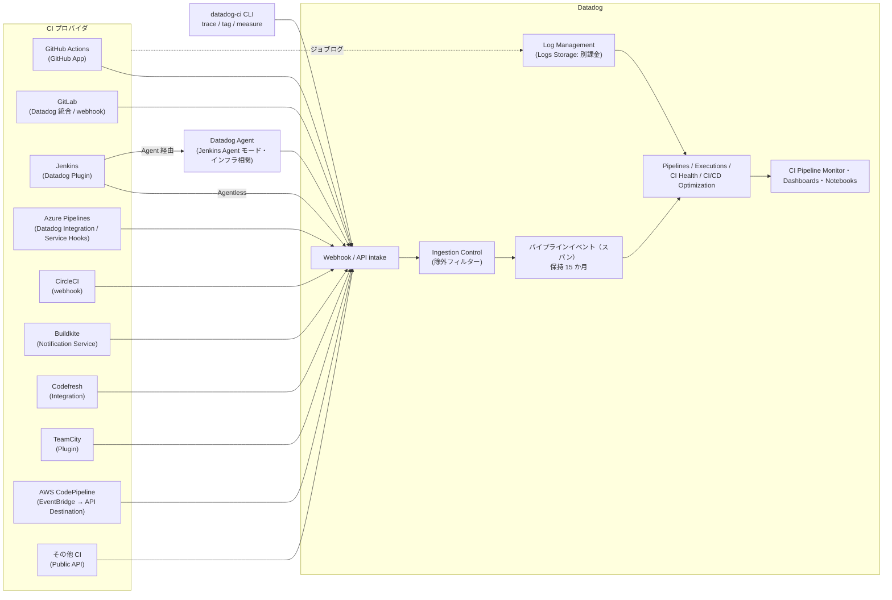
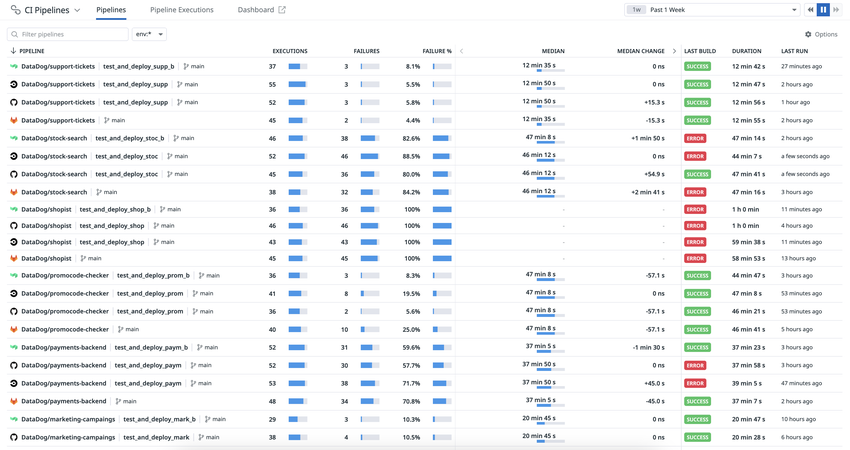
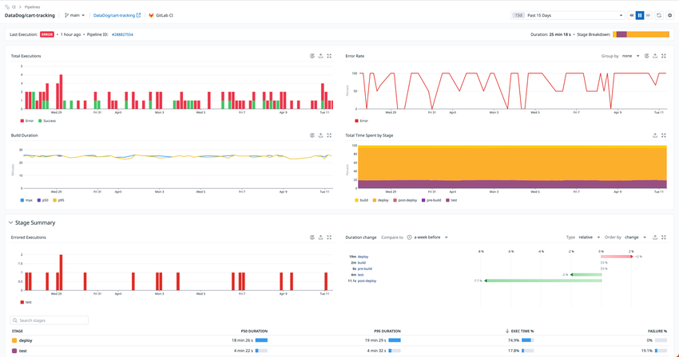
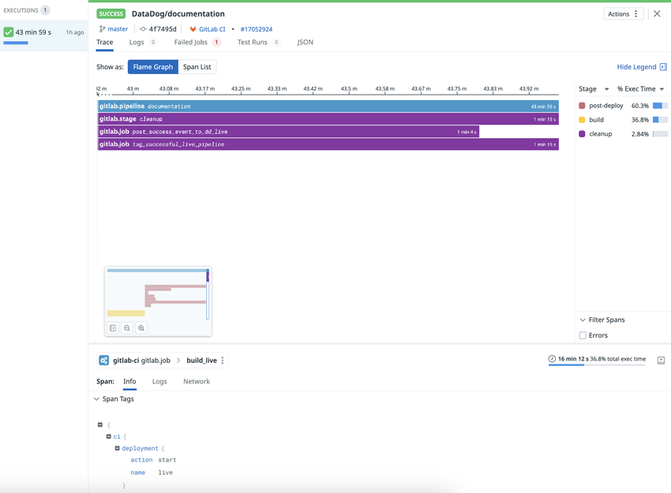
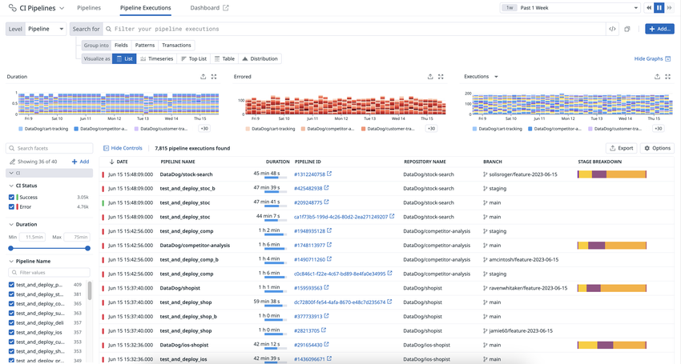
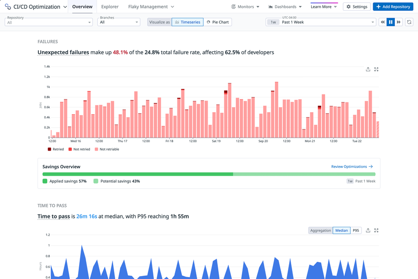

# CI Visibility（CI Pipeline Visibility）

## 概要

Datadog **CI Visibility（CI 可視化）** は、CI パイプラインの実行結果・所要時間・信頼性を CI プロバイダ横断で収集し、**パイプライン実行を APM の分散トレースと同じ「トレース／スパン」として可視化**する製品である。製品名は料金ページ・ドキュメントで **CI Pipeline Visibility**（または単に **Pipeline Visibility**）とも表記される。[出典](https://docs.datadoghq.com/continuous_integration/) [出典](https://docs.datadoghq.com/getting_started/ci_visibility/)

CI Visibility が答える主な問い：

- どのパイプライン／ステージ／ジョブが遅い・失敗しやすいか（デフォルトブランチの健全性）
- 失敗の根本原因はコードか、CI 基盤（ランナー・ネットワーク・依存関係）か（Logs Analysis）
- パイプライン全体を短縮するにはどのジョブを速くすべきか（Critical Path）
- キュー待ち時間・承認待ち時間はどれくらいか（ランナー容量不足 or ジョブ回帰の切り分け）

本ファイルが扱う範囲と、関連ファイルへの切り分け：

| 範囲 | 本ファイル | 詳細の参照先 |
|---|---|---|
| パイプライン（Pipeline / Stage / Job / Step / Command）の可視化 | ○ | — |
| テスト単位の可視化・Flaky Test 管理・Test Impact Analysis | 概要のみ | [Test Optimization（旧 Test Visibility）](./test-optimization.md) |
| DORA Metrics・PR Gates（旧 Quality Gates）・Code Coverage | 言及のみ | [DORA Metrics・Quality Gates・Code Coverage](./software-delivery-insights.md) |
| CD（デプロイ）の可視化（CD Visibility） | 言及のみ | 公開情報は [CD Visibility ドキュメント](https://docs.datadoghq.com/continuous_delivery/) |
| モニター共通仕様 | CI Pipeline モニター固有部分のみ | [Monitors](../platform/monitors.md) |
| 料金の正本 | 課金単位の要約のみ | [製品別料金表](../../03_導入編/pricing-by-product.md) |

### 名称と提供形態の変遷

| 名称 | 状態（2026-11-02 時点） | 備考 |
|---|---|---|
| CI Visibility | 現行（ドキュメント上の製品名） | かつては「パイプライン」と「テスト」の両方を包含する総称だった |
| CI Pipeline Visibility / Pipeline Visibility | 現行（料金上の SKU 名） | 料金ページ・Usage では「Pipeline Visibility」「CI Visibility Pipeline Committers」 |
| Test Visibility → **Test Optimization** | 改称済み | テスト部分は Test Optimization（旧称：Test Visibility）として別 SKU。詳細は [test-optimization.md](./test-optimization.md) |
| Intelligent Test Runner → **Test Impact Analysis** | 改称済み | Test Optimization の一機能 |
| **CI/CD Optimization** | 新 UI | CI Visibility と Test Optimization を1つの画面体系に統合した新しい UI。「Try It Now」で有効化、「Switch Back」で旧 UI に戻せる [出典](https://docs.datadoghq.com/continuous_integration/cicd_optimization/) |

> CI/CD Optimization は「新しい画面体験（UI）」であり、独立した課金 SKU として料金ページに掲載されているわけではない（2026-11-02 時点の料金ページで CI/CD Optimization という SKU は確認できず）。2026-10-06 公開の公式ブログで、CI/CD Optimization としてパイプラインとテストの最適化機能（Flaky Management、Test Impact Analysis、Test Parallelization 等）が紹介されている。[出典](https://www.datadoghq.com/blog/ci-cd-optimization/)（2026-10-06 公開）

### 全体アーキテクチャ（データフロー）



### 画面例



- **キャプション**：CI Visibility の **CI Pipeline List（Pipelines 一覧）** 画面。
- **画面説明**：画面上部に「CI Pipelines」の見出しと「Pipelines」「Pipeline Executions」「Dashboard」タブ、右上にタイムレンジ（例：Past 1 Week）がある。左上の検索ボックス（Filter pipelines）と `env:*` フィルタの下に、パイプラインごとの行が並ぶ。列は **PIPELINE**（リポジトリ名 / パイプライン名 / ブランチ `main`）、**EXECUTIONS**（実行回数）、**FAILURES**（失敗回数）、**FAILURE %**、**MEDIAN**（所要時間中央値）、**MEDIAN CHANGE**（中央値の変化）、**LAST BUILD**（SUCCESS / ERROR バッジ）、**DURATION**、**LAST RUN**。行頭のアイコンで CI プロバイダ（GitHub / GitLab 等）が識別できる。デフォルトブランチ（または Git 情報なし）のパイプラインのみが表示される。
- **出典**：https://docs.datadoghq.com/continuous_integration/search/ （画像取得日 2026-11-02）

## 対応 Datadog サイト

CI Visibility は **US1-FED（`app.ddog-gov.com`）と `us2.ddog-gov.com`（GovCloud 系）では非対応** である。料金ページでも「US-FED サイトでは現在利用不可」と表示されている。[出典](https://docs.datadoghq.com/continuous_integration/pipelines/) [出典](https://www.datadoghq.com/pricing/?product=ci-cd-monitoring)

| サイト | CI Visibility | パイプライン API エンドポイント（Send pipeline event） | CI ジョブログ API |
|---|---|---|---|
| US1 | ○ | `POST https://api.datadoghq.com/api/v2/ci/pipeline` | `https://http-intake.logs.datadoghq.com/api/v2/cilogs` |
| US3 | ○ | `POST https://api.us3.datadoghq.com/api/v2/ci/pipeline` | `https://http-intake.logs.us3.datadoghq.com/api/v2/cilogs` |
| US5 | ○ | `POST https://api.us5.datadoghq.com/api/v2/ci/pipeline` | `https://http-intake.logs.us5.datadoghq.com/api/v2/cilogs` |
| EU1 | ○ | `POST https://api.datadoghq.eu/api/v2/ci/pipeline` | `https://http-intake.logs.datadoghq.eu/api/v2/cilogs` |
| AP1（日本） | ○ | `POST https://api.ap1.datadoghq.com/api/v2/ci/pipeline` | `https://http-intake.logs.ap1.datadoghq.com/api/v2/cilogs` |
| AP2 | ○ | `POST https://api.ap2.datadoghq.com/api/v2/ci/pipeline` | `https://http-intake.logs.ap2.datadoghq.com/api/v2/cilogs` |
| US1-FED（`app.ddog-gov.com`） | **×** | API 一覧には掲載あり（製品自体は非対応） | 非対応（"Not supported in the GOV region"） |

[出典](https://docs.datadoghq.com/api/latest/ci-visibility-pipelines/) [出典](https://docs.datadoghq.com/api/latest/ci-visibility-logs/send-ci-job-logs/)

> **サイト差異:** 2026-11-02 時点の公式ドキュメント（API リファレンス、custom commands ページ、Jenkins トラブルシューティング表）には、本ナレッジ規約のサイト一覧にない **UK1（`uk1.datadoghq.com`）** と **`us2.ddog-gov.com`（GOV2）** も記載されている。UK1 については、Send pipeline event API のエンドポイント一覧に `api.uk1.datadoghq.com` が掲載され、CI/CD Optimization（新 UI）の提供サイト一覧にも `uk1` が含まれる。ただし CI Visibility 自体が UK1 に対応すると明言した記述は公開情報では確認できず、UK1 対応は【推定】である（[出典](https://docs.datadoghq.com/api/latest/ci-visibility-pipelines/) [出典](https://docs.datadoghq.com/continuous_integration/)）。`us2.ddog-gov.com` は US1-FED と同様に非対応である。サイト全般は [Datadog Sites](../platform/datadog-sites.md) を参照。

> **サイト差異:** CI/CD Optimization（新 UI）は `app.datadoghq.com`、`us3`、`us5`、`app.datadoghq.eu`、`ap1`、`ap2`、`uk1` で提供されている旨がドキュメントに記載されている。[出典](https://docs.datadoghq.com/continuous_integration/)

> **サイト差異:** 多くのプロバイダ設定（CircleCI・GitLab 旧版の webhook、AWS CodePipeline の API Destination）では、受信 URL が `https://webhook-intake.<DD_SITE>/api/v2/webhook` の形式でサイトごとに異なる。AP1 の場合 `<DD_SITE>` は `ap1.datadoghq.com` となる。【推定】（ドキュメント上はサイト選択に応じて動的に表示される箇所で、AP1 の具体値はページ本文から直接は確認できず）

## 用語とデータモデル

### パイプラインのトレースモデル（4 レベル＋Command）

CI Visibility は**パイプライン実行を APM の分散トレースと同様にモデル化**し、パイプラインの各部分をスパンとして表す。[出典](https://docs.datadoghq.com/continuous_integration/guides/pipeline_data_model/)

| レベル | `ci_level` | 説明 |
|---|---|---|
| Pipeline（必須） | `pipeline` | 最上位のルートスパン。パイプライン全体の開始〜終了。プロバイダによって `build` / `workflow` と呼ばれる |
| Stage | `stage` | ジョブをユーザー定義名でグルーピングしたもの。存在しないプロバイダもある |
| Job | `job` | コマンドが実行される最小作業単位。1ジョブは単一ノードで実行される前提 |
| Step | `step` | 一部プロバイダでジョブ内のシェルスクリプトやアクションを表す |
| Command | （Explorer の Command レベル） | `datadog-ci trace` で手動計装したカスタムコマンドのスパン |

- Stage / Job / Step は**親 Pipeline と完全に同じパイプライン名**を持つ必要がある。不一致の場合、Pipeline Details のジョブ集計表などからステージ・ジョブ情報が欠落する。[出典](https://docs.datadoghq.com/continuous_integration/troubleshooting/)
- 各レベル内で一意 ID が必要（Pipeline と Job が同じ ID を持つのは可、2つの Pipeline が同じ ID は不可）。同 ID・異なるタイムスタンプで送るとフレームグラフに別実行のタグが表示されるなど UI が乱れる。同 ID・同タイムスタンプなら最後に受信した値のみ保存される。[出典](https://docs.datadoghq.com/continuous_integration/guides/pipeline_data_model/)

### パイプライン実行タイプ

| 実行タイプ | CI Visibility での扱い | 関連フィールド（Public API） |
|---|---|---|
| 通常実行（Normal run） | 各コンポーネント完了時にペイロードを送信。パイプラインは終了後に送信する | — |
| フルリトライ（Full retries） | 別の pipeline unique ID を持つ別実行として扱う。開始・終了時刻はそのリトライのみを含む | `previous_attempt` |
| 部分リトライ（Partial retries） | 新しい pipeline unique ID の別パイプライン。前回実行済みのジョブは送らない。実行時間集計から除外される | `previous_attempt`、`partial_retry: true` |
| ブロック（Blocked） | 手動介入待ちで止まった時点で `status: blocked` を送信。再開後は別 ID で送る | `status: blocked`、`is_resumed: true` |
| 下流（Downstream） | 親パイプラインの子として扱う | `parent_pipeline` |
| 手動実行（Manual） | 手動トリガーを識別 | `is_manual: true` |
| 実行中（Running） | `status: running` で途中送信し、同じ `unique_id` で最終イベントを送る | `status: running` |

[出典](https://docs.datadoghq.com/continuous_integration/guides/pipeline_data_model/) [出典](https://docs.datadoghq.com/continuous_integration/pipelines/custom/)

部分リトライの例（公式例）：パイプライン `P` にジョブ `J1`→`J2`→`J3`。初回は `J1`・`J2` 実行で `J2` 失敗 → `J1_1`、`J2_1`（pipeline `P_1`）、`P_1` の 3 ペイロード。`J2` からの部分リトライでは `J2_2`、`J3_1`（pipeline `P_2`）、`P_2` の 3 ペイロードを追加送信する。

### Git 情報の重要性

- パイプライン実行に**Git 情報（最低限：リポジトリ URL、コミット SHA、作成者メール）**を付けることが強く推奨される。Git 情報がない実行は **Recent Code Changes** ページに表示されない。[出典](https://docs.datadoghq.com/continuous_integration/guides/pipeline_data_model/)
- **Pipelines 一覧（CI Pipeline List）は「デフォルトブランチの実行」と「Git 情報のない実行」のみ表示**する。フィーチャーブランチだけで動くパイプラインが一覧に出ないのは仕様である。[出典](https://docs.datadoghq.com/continuous_integration/troubleshooting/)
- Git 作成者メール（author email）は**課金上のコミッター識別子**でもある（[課金への影響](#課金への影響)参照）。

### Datadog 用語とプロバイダ用語の対応表

| Datadog | GitHub Actions | GitLab | Jenkins | Azure Pipelines | CircleCI | Buildkite | TeamCity | AWS CodePipeline |
|---|---|---|---|---|---|---|---|---|
| Pipeline | Workflow | Pipeline | Pipeline | Pipeline | Workflow | Build（パイプラインの実行） | Build Chain | Pipeline |
| Stage | — | Stage | Stage | Stage | — | — | — | Stage |
| Job | Job | Job | **Step** | Job | Job | Job（ステップの実行） | Build | **Action** |
| Step | Step | （Script は Datadog 側で取得不可） | — | Step（Datadog Integration 方式のみ） | （Step は Datadog 側で取得不可） | ジョブ内の Log group（ジョブログ必須） | （Step は取得不可） | — |

[出典](https://docs.datadoghq.com/continuous_integration/pipelines/github/) [出典](https://docs.datadoghq.com/continuous_integration/pipelines/gitlab/) [出典](https://docs.datadoghq.com/continuous_integration/pipelines/jenkins/) [出典](https://docs.datadoghq.com/continuous_integration/pipelines/azure/) [出典](https://docs.datadoghq.com/continuous_integration/pipelines/circleci/) [出典](https://docs.datadoghq.com/continuous_integration/pipelines/buildkite/) [出典](https://docs.datadoghq.com/continuous_integration/pipelines/teamcity/) [出典](https://docs.datadoghq.com/continuous_integration/pipelines/awscodepipeline/)

> Codefresh の用語対応表は公開情報では確認できず。

## 対応 CI プロバイダ

### 対応プロバイダとバージョン要件

| プロバイダ | 連携方式 | 対応バージョン | Datadog Agent |
|---|---|---|---|
| GitHub Actions | Datadog GitHub App（`Actions: Read Only`）＋ Datadog 側でアカウント／リポジトリ単位に有効化 | GitHub.com（SaaS）、GitHub Enterprise Server（GHES）**3.5.0 以降** | 不要（インフラ相関時のみランナーに必要） |
| GitLab | GitLab の Datadog インテグレーション（Settings > Integrations > Datadog） | GitLab.com、セルフホスト **14.1 以上**（13.7.0 以上は feature flag `datadog_ci_integration` で可）、13.7 未満は webhook（非推奨） | 不要（インフラ相関時のみ） |
| Jenkins | Datadog Jenkins Plugin（**v3.1.0 以上**必須）。Agent 経由（推奨）または Agentless（API キー） | Jenkins **2.346.1 以上** | Agent モード時は必要。インフラ相関には必須 |
| Azure Pipelines | ①Datadog Integration（推奨、Microsoft Entra テナント連携）②Service Hook Subscriptions（Marketplace 拡張「Datadog CI Visibility」） | Azure DevOps Services。**Azure DevOps Server は公式サポート外** | 不要 |
| CircleCI | Webhook（Project Settings > Webhooks、Workflow Completed / Job Completed） | 公開情報では確認できず（SaaS 前提） | 不要 |
| Buildkite | Notification Service「Datadog Pipeline Visibility」 | 公開情報では確認できず | 不要（インフラ相関時は Buildkite agent ホストに必要） |
| Codefresh | Codefresh の Datadog インテグレーション（Account Settings > Configuration > Integrations） | 公開情報では確認できず | 不要 |
| TeamCity | Datadog CI Integration プラグイン（JetBrains Marketplace、Apache 2.0 OSS） | TeamCity **2021.2 以降** | 不要 |
| AWS CodePipeline | EventBridge ルール ＋ API Destination（Datadog webhook intake） | — | 不要 |
| その他（Custom） | Public API（`POST /api/v2/ci/pipeline`） | — | 不要 |

[出典](https://docs.datadoghq.com/continuous_integration/pipelines/)（各プロバイダページ）

料金ページの FAQ では対応プロバイダとして GitLab、GitHub Actions、Jenkins、CircleCI、Buildkite、Codefresh、TeamCity、Azure DevOps、AWS CodePipeline が挙げられている。[出典](https://www.datadoghq.com/pricing/?product=ci-cd-monitoring)

### 機能対応表（プロバイダ別）

以下は公式「Supported features」表と各プロバイダのセットアップページの Compatibility 表を突き合わせて整理したものである。○＝対応、—＝公開情報で対応を確認できず。

> 注意：公式 Supported features 表は機械可読版（`.md`）では空欄セルの位置情報が失われており、各行の「対応数」と各プロバイダページの記載から列を再構成した。各プロバイダページで直接確認できない箇所は【推定】を付けた。最終確認は公式の [Supported features](https://docs.datadoghq.com/continuous_integration/pipelines/#supported-features) を参照のこと。

#### パイプラインの可視化と実行

| 機能 | 説明 | AWS CodePipeline | Azure | Buildkite | CircleCI | Codefresh | GitHub Actions | GitLab | Jenkins | TeamCity | Other（API） |
|---|---|---|---|---|---|---|---|---|---|---|---|
| Logs Storage | CI プロバイダのパイプライン／ジョブログを保存し、実行ビューの Logs タブに表示 | ○（CodeBuild アクションのみ） | ○ | ○ | ○ | — | ○ | ○ | ○ | ○ | ○ |
| Infrastructure correlation | Agent・ランナーのホスト情報をジョブと相関 | — | — | ○ | — | — | ○ | ○ | ○ | — | — |
| Running pipelines | 実行中パイプラインの識別 | ○（完了まで Git 情報なし） | — | — | — | — | ○ | ○ | ○（Plugin 8.0.0 以上） | — | ○ |
| Running jobs | 実行中ジョブの識別 | — | — | — | — | — | ○ | ○ | — | — | ○ |
| Partial retries | 一部ジョブのみ再実行した部分リトライの識別 | ○ | — | ○ | ○ | ○ | ○ | ○ | — | ○ | ○ |
| Step granularity | ステップ単位のスパン | — | ○（Datadog Integration 方式のみ） | ○（【Preview】【推定】、Log group から生成） | — | ○【推定】 | ○ | — | ○（ジョブスパンとして表示）【推定】 | — | ○ |

> **Manual steps**（手動承認フェーズを持つジョブの識別）：プロバイダ別の対応可否を列単位で確定できないため表から外した。公式表では 8 プロバイダが対応している。個別ページで対応を確認できたのは Buildkite、Codefresh、GitLab、Jenkins、Other（API）の 5 つ。

[出典](https://docs.datadoghq.com/continuous_integration/pipelines/) [出典](https://docs.datadoghq.com/continuous_integration/search/)

#### 自動分析とアクション

| 機能 | 説明 | AWS CodePipeline | Azure | Buildkite | CircleCI | Codefresh | GitHub Actions | GitLab | Jenkins | TeamCity | Other（API） |
|---|---|---|---|---|---|---|---|---|---|---|---|
| Logs Analysis | 失敗ジョブの関連ログを LLM で分析し根本原因を分類 | — | ○ | ○ | ○ | — | ○ | ○ | — | ○ | ○ |
| Critical path | パイプラインのクリティカルパス上のジョブを識別 | ○ | ○ | ○ | ○ | ○ | ○ | ○ | ○ | ○ | ○ |
| Automatic job retries | AI 分類で一過性と判定された失敗ジョブを自動再実行 | — | — | — | — | — | ○ | ○ | — | — | — |

[出典](https://docs.datadoghq.com/continuous_integration/guides/use_ci_jobs_failure_analysis/) [出典](https://docs.datadoghq.com/continuous_integration/pipelines/automatic_retries/)

#### 所要時間の内訳

| 機能 | 説明 | AWS CodePipeline | Azure | Buildkite | CircleCI | Codefresh | GitHub Actions | GitLab | Jenkins | TeamCity | Other（API） |
|---|---|---|---|---|---|---|---|---|---|---|---|
| Execution time | パイプラインがジョブを実行していた時間 | ○ | ○ | ○ | ○ | ○ | ○ | ○ | ○ | ○ | ○ |
| Approval wait time | 手動承認待ちの時間 | ○ | ○【推定】 | — | — | — | ○ | ○ | — | — | — |

> **Queue time**（実行前にキューで待っていた時間）：プロバイダ別の対応可否を列単位で確定できないため表から外した。公式表では 7 プロバイダが対応している。個別ページで対応を確認できたのは Buildkite、GitHub Actions、GitLab、Jenkins、TeamCity、Other（API）の 6 つ。

#### カスタマイズと拡張

| 機能 | 説明 | AWS CodePipeline | Azure | Buildkite | CircleCI | Codefresh | GitHub Actions | GitLab | Jenkins | TeamCity | Other（API） |
|---|---|---|---|---|---|---|---|---|---|---|---|
| Custom commands | `datadog-ci trace` でコマンド単位のスパンを追加 | ○（datadog-ci 2.40 以上） | ○（2.40 以上） | ○（2.40 以上） | ○ | — | ○（GitHub.com、2.40 以上） | ○（2.40 以上） | ○（Plugin 3.2.0 以上） | — | — |
| Runtime tags（実行時タグ／メジャー） | `datadog-ci tag` / `measure` で実行時に追加 | — | ○ | ○ | ○ | — | ○ | ○ | ○（`datadog` ステップ） | — | ○ |
| Parameters | パイプライン起動時のユーザー定義パラメータを `@ci.parameters` で検索可能にする | — | — | — | — | ○ | — | ○ | ○ | — | ○ |
| Pipeline failure reasons | エラーメッセージから失敗理由を識別 | — | — | — | — | ○ | — | ○（GitLab 15.2.0 以上） | ○ | ○ | ○ |

> **Static tags**（事前定義タグ。実行間で変わらない静的タグを CI 側で設定する機能）：プロバイダ別の対応可否を列単位で確定できないため表から外した。公式表では 4 プロバイダが対応している。個別ページで対応を確認できたのは CircleCI（Receiver URL の `tags`）、GitLab（Tags 欄）、Jenkins（Global Tags 等）の 3 つ。

> **公式ドキュメント内の不整合**：公式 Supported features 表では Custom commands の対応に Codefresh が含まれ Jenkins が含まれない形で表示されるが、Custom Commands ページでは Jenkins（Plugin 3.2.0 以上）を対応とし Codefresh を挙げていない。同様に Logs Analysis は Supported features 表と Logs Analysis ガイドで対応プロバイダの記載が一部異なる（本表はガイド側・各プロバイダページ側を採用）。[出典](https://docs.datadoghq.com/continuous_integration/pipelines/custom_commands/) [出典](https://docs.datadoghq.com/continuous_integration/guides/use_ci_jobs_failure_analysis/)

## プロバイダ別セットアップ

### GitHub Actions

GitHub Actions 向け CI Visibility は、**プライベートな Datadog GitHub App** を使ってワークフロー情報を収集する。[出典](https://docs.datadoghq.com/continuous_integration/pipelines/github/)

| 手順 | 内容 |
|---|---|
| 1. GitHub App 作成 | [GitHub インテグレーションタイル](https://app.datadoghq.com/integrations/github/) → **+ Create GitHub App** → 個人／組織アカウント選択 → 有効化する Datadog 機能を選択 → **Edit Permissions** で `Actions: Read Only` を付与 → **Create App in GitHub** → アプリ名（例：`Datadog CI Visibility`）→ **Install GitHub App** |
| 2. CI Visibility 有効化 | **Software Delivery > CI/CD Optimization > Add a Pipeline Provider**（旧 UI では **Software Delivery > CI Visibility > Add a Pipeline Provider**）で **GitHub** を選択 → **Enable Account** → アカウント全体を **Enable CI Visibility** トグル、またはリポジトリ単位で有効化 |
| 3. 反映 | 有効化後、パイプラインは即時に表示され始める |
| 無効化 | **CI/CD Optimization > Settings > GitHub Actions** でアカウントを選び、トグルをオフ（またはリポジトリ単位で無効化） |

GitHub Actions 固有の仕様：

- **Running pipelines**：キュー待ち・待機中のワークフローも Datadog 上は "Running" と表示される。
- **Logs Analysis**：デフォルト有効。[CI/CD Repository settings](https://app.datadoghq.com/ci/settings/ci-cd/repositories) で組織／リポジトリ単位に設定。PR コメントへの付与も可能。**自動ジョブリトライの前提条件**。
- **Logs Storage**：CI/CD Repository settings で有効化。**CI Visibility とは別課金**（Log Management）。ログは `datadog.product:cipipeline` と `source:github` タグで識別。**1 GiB を超えるログファイルは切り詰め**。
- **インフラ相関**：ジョブ実行ホストで Datadog Agent が稼働している必要がある。Actions Runner Controller（ARC）なら追加設定不要だが、Agent の最小収集間隔より短いジョブはメトリクスが表示されないことがあり、`min_collection_interval` を 15 秒未満にして調整する。ARC 以外では **GitHub ランナー名をマシンのホスト名と一致させる**。
- **Reusable Workflow の追跡**：CI Visibility は再利用ワークフローのメタデータ（バージョン・ref・元リポジトリ）を自動抽出しない。再利用ワークフロー内で `datadog-ci tag --level job` により `job.workflow_ref` 等をタグ付けする方法が公式ガイドで示されている（`job.workflow_*` コンテキストはランナー v2.334.0 以降が必要）。[出典](https://docs.datadoghq.com/continuous_integration/guides/track_reusable_workflows/)

### GitLab

GitLab 向け CI Visibility は、GitLab に組み込まれた **Datadog インテグレーション**（プロジェクト／グループの Settings > Integrations > Datadog）で設定する。[出典](https://docs.datadoghq.com/continuous_integration/pipelines/gitlab/)

| 設定項目 | 説明 | デフォルト |
|---|---|---|
| Active | インテグレーションを有効化 | — |
| Datadog site | 送信先サイト | `datadoghq.com` |
| API URL（任意） | 送信先 API URL の上書き（高度なシナリオのみ） | 空（上書きなし） |
| API key | Datadog API キー | — |
| Enable CI Visibility | パイプライントレース・クリティカルパス計算・性能監視を有効化。セルフホストでは **GitLab 17.7 以降**で表示され、それ以前は不要 | — |
| Service（任意） | 各スパンに付与するサービス名。GitLab インスタンスの区別に使う | `gitlab-ci` |
| Env（任意） | 各スパンに付与する `env` タグ | `none` |
| Tags（任意） | 全スパンに付与するカスタムタグ（1行1つ `key:value`）。GitLab.com とセルフホスト **14.8 以上**のみ | 空 |

| GitLab バージョン | 設定方法 |
|---|---|
| GitLab.com | プロジェクトまたはグループで設定。**Test settings** ボタン（プロジェクト設定時のみ）で疎通確認 |
| セルフホスト 14.1 以上 | 同上（プロジェクト／グループ） |
| セルフホスト 13.7.0〜14.0 | feature flag `datadog_ci_integration` を Rails Runner で有効化（Omnibus：`sudo gitlab-rails runner "Feature.enable(:datadog_ci_integration)"`）。**14.1 未満はグループ／インスタンスレベル設定不可**（バグのため）でプロジェクト単位のみ |
| 13.7 未満 | webhook（`https://webhook-intake.<DD_SITE>/api/v2/webhook/?dd-api-key=<API_KEY>`、Job events と Pipeline events）。開発対象外で非推奨 |

GitLab 固有の仕様：

- **パイプライン名**：デフォルトは GitLab プロジェクトのパス。`trigger` で起動した子パイプラインも同名になるため、`workflow:name` で命名できる（`workflow:name` は GitLab 15.11 以降、変数展開は 16.3 以降、Datadog 上での名前表示は webhook ペイロードに含まれた **16.1 以降**）。
- **エラーメッセージ**：GitLab 15.2.0 以上で、GitLab の失敗理由が `error.provider_message` / `error.provider_domain` タグに格納される（例：`runner_system_failure` → domain `provider`、`config_error` → domain `user`。未掲載タイプは `Job failed` / `unknown`）。
- **ジョブログ転送**（Logs Analysis／Logs Storage の前提）：GitLab.com、セルフホスト **15.3 以上**（ジョブログをオブジェクトストレージに保存している場合のみ）、セルフホスト **14.8 以上**（feature flag `datadog_integration_logs_collection`）。セルフホストでは Datadog が**事前署名 URL でオブジェクトストレージから直接ダウンロード**するため、ストレージにネットワーク制限がないことが条件。Datadog インテグレーションの **Enable job logs collection** をチェック。1 GiB 超のログは切り詰め。タグは `datadog.product:cipipeline`、`source:gitlab`。
- **インフラ相関**（セルフホストランナー）：

| Executor | 方式 |
|---|---|
| 非オートスケール（Shell / Docker 等） | ランナーに `host:<hostname>` タグを付与（GitLab 15.8 以上は UI、未満は `config.toml` または UI） |
| Docker Autoscaler / Instance | ログベース相関。ジョブログをインデックスし、`Instance <hostname> connected` メッセージを含める。Agent は**ジョブを実行する VM** に必要。AWS ではホスト名が `i-xxxxx` 形式（IMDSv1 互換）であること [出典](https://docs.datadoghq.com/continuous_integration/guides/infrastructure_metrics_with_gitlab/) |
| Kubernetes | Kubernetes 上の GitLab 基盤を Datadog Agent で監視。`min_collection_interval` に関する注意は GitHub と同様 |
| その他 | 非対応 |

- **GitLab ユーザー定義変数**は `@ci.parameters` に入るが、GitLab が常に送信するわけではなく、下流パイプライン等一部のケースのみ。[出典](https://docs.datadoghq.com/continuous_integration/troubleshooting/)

### Jenkins

Jenkins 向け CI Visibility は **Datadog Jenkins Plugin（v3.1.0 以上）が必須**で、Agent 経由（推奨）と Agentless（API キー直接送信）の2モードがある。[出典](https://docs.datadoghq.com/continuous_integration/pipelines/jenkins/)

| 項目 | Agent モード（推奨） | Agentless モード |
|---|---|---|
| 送信経路 | Jenkins → Datadog Agent → Datadog | Jenkins → Datadog（API キー） |
| UI 設定 | Manage Jenkins > Configure System > Datadog Plugin で **Use the Datadog Agent to report to Datadog** | **Use Datadog site and API key to report to Datadog** |
| 環境変数 `DATADOG_JENKINS_PLUGIN_REPORT_WITH` | `DSD` | `HTTP` |
| 主要ポート（デフォルト） | DogStatsD `8125/udp`、APM トレース `8126/tcp`、ログ `10518/tcp` | — |
| インフラ相関 | 可能（Agent 必須） | 不可（Agent がないため） |

主要な設定キー：

| 設定 | JCasC（`datadogGlobalConfiguration`） | 環境変数 | 説明 |
|---|---|---|---|
| CI Visibility 有効化 | `enableCiVisibility: true` | `DATADOG_JENKINS_PLUGIN_ENABLE_CI_VISIBILITY=true` | 必須 |
| CI Instance 名 | `ciInstanceName` | `DATADOG_JENKINS_PLUGIN_CI_VISIBILITY_CI_INSTANCE_NAME` | 任意（例 `jenkins`） |
| Agent ホスト | `agentHost` | `DATADOG_JENKINS_PLUGIN_TARGET_HOST` | Agent モード |
| トレースポート | `agentTraceCollectionPort: 8126` | `DATADOG_JENKINS_PLUGIN_TARGET_TRACE_COLLECTION_PORT` | デフォルト `8126` |
| ログポート | `agentLogCollectionPort: 10518` | `DATADOG_JENKINS_PLUGIN_TARGET_LOG_COLLECTION_PORT` | Agent 側でカスタム TCP ログ収集を有効化しておく |
| サイト | `datadogIntakeSite.site` | `DATADOG_JENKINS_PLUGIN_DATADOG_SITE` | Agentless |
| API キー | `datadogCredentialsApiKey.credentialsId` | `DATADOG_JENKINS_PLUGIN_TARGET_API_KEY` | Agentless |
| Logs Storage | `collectBuildLogs: true` | `DATADOG_JENKINS_PLUGIN_COLLECT_BUILD_LOGS=true` | 任意・別課金。タグ `source:jenkins` |
| UI ホスト名 | `datadogAppHostname` | `DATADOG_JENKINS_PLUGIN_DATADOG_APP_HOSTNAME` | 例 `app.datadoghq.com`（AP1 なら `ap1.datadoghq.com`） |
| 除外ジョブ | （UI Advanced） | `DATADOG_JENKINS_PLUGIN_EXCLUDED` | カンマ区切り。**正規表現可・グロブ不可**（`prefix-.*`） |
| 対象ジョブ | （UI Advanced） | `DATADOG_JENKINS_PLUGIN_INCLUDED` | 空なら除外以外すべて |
| グローバルタグ | （UI Advanced） | `DATADOG_JENKINS_PLUGIN_GLOBAL_TAGS` | 全メトリクス・トレース・イベントに付与 |
| グローバルジョブタグ | （UI Advanced） | `DATADOG_JENKINS_PLUGIN_GLOBAL_JOB_TAGS` | 正規表現でジョブを選びタグ付与 |

Jenkins 固有の仕様：

- 設定方法は **UI / Configuration-as-Code（JCasC）/ Groovy（Script Console）/ 環境変数** の4通り。
- Agent がコンテナで動く場合は `DD_DOGSTATSD_NON_LOCAL_TRAFFIC=true` を設定。Kubernetes では Admission Controller による `DD_AGENT_HOST` 自動設定が推奨。**UNIX ドメインソケット経由の CI Visibility トレース送信は非対応**。
- **インフラ相関**（Plugin **v5.0.0 以上**）：各ワーカーに Agent を入れ、`DD_CI_HOSTNAME` に Agent が報告するホスト名と同じ値を設定。コントローラーは追加設定不要。
- **Git 情報**：最低限リポジトリ URL・ブランチ・コミット SHA・作成者メール。自動検出できない場合は `checkout(...).each {k,v -> env.setProperty(k,v)}` で伝搬、または `DD_GIT_REPOSITORY_URL`、`DD_GIT_BRANCH`、`DD_GIT_COMMIT_SHA`、`DD_GIT_COMMIT_AUTHOR_EMAIL` 等を手動設定（手動設定が他プラグインより優先）。複数リポジトリをチェックアウトする場合は後のものが優先。
- **デフォルトブランチ**：自動取得できない場合 `DD_GIT_DEFAULT_BRANCH`（例 `main`）を設定（`git.default_branch` 属性）。
- **カスタムタグ**：パイプラインの `options { datadog(tags: ["team:backend"]) }`（宣言的）または `datadog(tags: [...]) { ... }`（スクリプト）。
- **Test Optimization 連携**：Jenkins UI（Plugin v5.6.0 以上）、`datadog(testOptimization: [...])` ステップ（v5.6.2 以上、言語 `JAVA`/`JAVASCRIPT`/`PYTHON`/`DOTNET`/`RUBY`）、手動 SDK 設定の3通り。詳細は [Test Optimization](./test-optimization.md)。
- **トラブルシューティング**：Manage Jenkins > Troubleshooting > Datadog で診断フレア生成。ロガー `org.datadog.jenkins.plugins.datadog.*` を `ALL` に。ログに `Send pipeline traces` が出れば送信中。Agentless でプロキシ配下の場合、No Proxy Hosts に Datadog ホスト（AP1 は `ap1.datadoghq.com`）を追加。

### Azure Pipelines

| 方式 | 手順 | 特徴 |
|---|---|---|
| **Datadog Integration（推奨）** | Azure DevOps 組織を **Microsoft Entra テナント**に紐付け（Azure ソースコード連携）→ **Software Delivery → CI Visibility → Add a Pipeline Provider → Azure Pipelines** → 組織の **Configure** → 組織全体または プロジェクト単位で **Enable CI Visibility** | 組織単位で有効化すると今後のプロジェクトも自動有効化。**Step の収集はこの方式のみ** |
| Service Hook Subscriptions | Marketplace の **Datadog CI Visibility** 拡張をインストール → 各プロジェクトの Project settings > Service hooks で 6 種のイベント（Run state changed / Run stage state changed / Run job state changed / Run stage approval completed / Run stage waiting for approval / Build completed）を購読 → Datadog サイトと API キーを入力 | 一括設定スクリプト `service_hooks.py`（Python 3 ＋ `requests`）あり |

- 両方式を同一プロジェクトで併用すると**追加費用はないがデータが重複**するため、Service Hook から移行する場合は旧方式を無効化する。
- Step は Azure DevOps API（レート制限あり）で**ベストエフォート**取得。大量実行の組織では一部実行のステップが欠落し、**バックフィルされない**（パイプライン・ステージ・ジョブには影響なし）。
- Logs Analysis 用ジョブログは Azure インテグレーションタイルの Azure DevOps 連携で受信。Logs Storage のタグは `datadog.product:cipipeline`、`source:azurepipelines`。

[出典](https://docs.datadoghq.com/continuous_integration/pipelines/azure/)

### CircleCI

- 各プロジェクトの **Project Settings > Webhooks** で Webhook を追加：Receiver URL `https://webhook-intake.<DD_SITE>/api/v2/webhook/?dd-api-key=<API_KEY>`、Certificate verifications 有効、イベント **Workflow Completed** と **Job Completed**。
- 一括設定スクリプト `service_hooks.py`（Datadog API キー＋CircleCI personal API token、対象プロジェクトを Follow しておく）。
- **事前定義タグ**：Receiver URL に URL エンコードした `tags` クエリ（`key:value` をカンマ区切り）を追加。`team:<handle>` で Datadog Teams と連携。
- Logs Analysis 用ログは CircleCI インテグレーションで受信。Logs Storage タグ `datadog.product:cipipeline`、`source:circleci`。

[出典](https://docs.datadoghq.com/continuous_integration/pipelines/circleci/)

### Buildkite

- Buildkite の **Settings > Notification Services** で **Datadog Pipeline Visibility** を追加（Description、API key、Datadog site、対象 Pipelines、Branch filtering）。
- **ジョブログ**：Buildkite Agent から **OpenTelemetry ログとして Datadog OTLP Logs エンドポイントへエクスポート**する方式が現行。旧来の Buildkite インテグレーション（API 経由でログ取得）はレガシーで、Buildkite の API レート制限を大きく消費しうる。
- **Step**：ジョブの Log group から生成（ジョブログ必須＋ Logs Analysis または Logs Storage の有効化が必要）。
- **カスタムタグ**：`buildkite-agent meta-data set "dd_tags.<key>" "<value>"`（文字列）、`dd_measures.<key>`（数値）。
- **インフラ相関**：Buildkite agent のホストに Datadog Agent をインストール。
- 部分／下流パイプライン用ファセット：`@ci.pipeline.downstream`（true/false）、`@ci.is_manual`（true/false）、`@ci.partial_pipeline`（`retry`/`paused`/`resumed`）。GitLab でも同じ。

[出典](https://docs.datadoghq.com/continuous_integration/pipelines/buildkite/)

### Codefresh

- Codefresh の **Account Settings > Configuration > Integrations** で Datadog 行の **Configure** → **Add Integration** → Datadog site と Token（Datadog API キー）を入力して保存。
- Compatibility：Partial retries、Manual steps、Parameters（Codefresh 変数）、Pipeline failure reasons。

[出典](https://docs.datadoghq.com/continuous_integration/pipelines/codefresh/)

### TeamCity

- TeamCity サーバーの Administration > Plugins > Browse Plugin Repository から **Datadog CI Integration** プラグインを導入（Enable uploaded plugins または再起動で有効化）。
- **ビルドチェーンの最後に Composite build が必要**。末尾が Composite build でないビルドチェーンは無視される。Composite build には VCS Root と VCS Trigger を設定する。
- 必須プロジェクトパラメータ：`datadog.ci.api.key`（Plugin 0.0.5 以降は Password 型可）、`datadog.ci.site`、`datadog.ci.enabled`（`true`）。Root Project に置くと全サブプロジェクトに伝搬。
- ジョブログ転送は Plugin **0.1.0 以上**。無効化は `datadog.ci.logs.disabled=true`。ログは最後の Composite build 完了後に送信。タグ `datadog.product:cipipeline`、`source:teamcity`。
- **課金上の注意**：Git 作成者メールは TeamCity の VCS username style から取得する。**UserId / Author Name スタイルでは `<username>@Teamcity` というメールが自動生成**され、課金上のコミッター数に影響しうる。Author Name and Email または Author Email スタイルが推奨。
- TeamCity プラグインは Test Optimization のテスト実行とジョブを相関しない（ジョブ側は Test Runs: 0 と表示されうる）。

[出典](https://docs.datadoghq.com/continuous_integration/pipelines/teamcity/)

### AWS CodePipeline

AWS CodePipeline 向け CI Visibility は、**EventBridge の API Destination と Rule** の2リソースで構成する。[出典](https://docs.datadoghq.com/continuous_integration/pipelines/awscodepipeline/)

| リソース | 設定値 |
|---|---|
| API Destination | エンドポイント `https://webhook-intake.<DD_SITE>/api/v2/webhook`、HTTP メソッド `POST`、Connection の Authorization type = API key（名前 `DD-API-KEY`、値 = Datadog API キー） |
| EventBridge Rule | イベントパターン：`"source": ["aws.codepipeline"]`、`"detail-type": ["CodePipeline Pipeline Execution State Change", "CodePipeline Action Execution State Change", "CodePipeline Stage Execution State Change"]`。ターゲット = 上記 API Destination。**ヘッダーパラメータ `DD-CI-PROVIDER-AWSCODEPIPELINE: true`** を追加 |
| 対象パイプラインの限定（任意） | イベントパターンに `"detail": {"pipeline": ["first-pipeline", "second-pipeline"]}` |
| テスト／カスタムコマンドとの相関 | CodeBuild アクションの環境変数 `DD_PIPELINE_EXECUTION_ID` = `#{codepipeline.PipelineExecutionId}`（Plaintext） |
| Logs Storage | CodeBuild アクションのみ相関可能。AWS ログ転送（Lambda Forwarder）で CloudWatch Logs を送信。カスタムロググループ名の場合は AWS インテグレーションの Cloud Resource Collection を有効化。タグ `source:codebuild`、`sourcecategory:aws` |

AWS 連携全般は [AWS Integration](../platform/aws-integration.md) を参照。

### その他の CI（Public API）

非対応 CI は `POST /api/v2/ci/pipeline` でパイプラインイベントを送信できる（ヘッダー `DD-API-KEY`、`Content-Type: application/json`、`type: cipipeline_resource_request`）。[出典](https://docs.datadoghq.com/continuous_integration/pipelines/custom/) [出典](https://docs.datadoghq.com/api/latest/ci-visibility-pipelines/)

Pipeline レベルの主要フィールド：

| フィールド | 必須 | 説明 |
|---|---|---|
| `provider_name` | — | CI プロバイダ名。省略時 `custom` |
| `env` | — | Datadog 環境 |
| `resource.level` | ○ | `pipeline` / `stage` / `job` / `step` |
| `resource.unique_id` | ○ | パイプライン実行の UUID。リトライ・部分リトライを含めて一意 |
| `resource.name` | ○ | パイプライン名（同じパイプラインの実行は同名にする） |
| `resource.git.repository_url` / `sha` / `author_email` | ○（git オブジェクトを送る場合） | Git 情報。`branch` と `tag` はどちらか一方 |
| `resource.status` | ○ | 完了時：`success` / `error` / `canceled` / `skipped` / `blocked`。実行中：`running` |
| `resource.start` / `end` | ○（running 時は end 不要） | RFC3339。`start` はキュー時間を含めない |
| `resource.partial_retry` | ○ | 部分リトライか |
| `resource.url` | ○ | CI プロバイダ UI の URL |
| `resource.queue_time` | — | キュー時間（ミリ秒） |
| `resource.tags` / `metrics` | — | `key:value` 形式のタグ／数値メトリクス（メジャー） |
| `resource.parameters` | — | パイプラインのパラメータ／環境変数マップ |
| `resource.node`（hostname / labels / name / workspace） | — | 実行ホスト情報 |
| `resource.parent_pipeline` / `previous_attempt` | — | 下流パイプライン／リトライの関連付け |
| `resource.is_manual` / `is_resumed` | — | 手動実行／ブロック後再開 |
| `resource.error`（domain: `provider`/`user`/`unknown`、message、type、stack） | — | エラー情報 |

- Stage / Job / Step イベントには `pipeline_unique_id` と `pipeline_name`（親と同一）が必須。Job / Step の `status` は `success` / `error` / `canceled` / `skipped`（Step は `success` / `error`）。
- **実行中パイプライン**：`status: running` で初回送信 → 任意回数の更新（同一 `unique_id`）→ 最終イベント。UI に最新値が反映されない場合があるため、既存フィールドの変更でなく**フィールドの追加**で更新することが推奨される。
- **ジョブログ（Logs Analysis / Logs Storage）**：`POST https://http-intake.logs.<DD_SITE>/api/v2/cilogs`。各ログ行に `message`、`pipeline_unique_id`、`job_id` が必須。完了ジョブイベント送信後、**20 秒新しい行がないとジョブログはクローズ**され、それ以降の行は表示されない可能性がある。[出典](https://docs.datadoghq.com/api/latest/ci-visibility-logs/send-ci-job-logs/)

## パイプラインのトレースの拡張

### Custom Commands（`datadog-ci trace`）

Custom Commands は、CI パイプライン内の個々のコマンドをスパンとしてトレースし、ジョブのセットアップ／後片付け（Docker イメージ取得や Kubernetes ノード待ち等）を除いたコマンド自体の所要時間を測る機能である。スパンはパイプラインのトレースに組み込まれる。[出典](https://docs.datadoghq.com/continuous_integration/pipelines/custom_commands/)

```shell
npm install -g @datadog/datadog-ci
DATADOG_API_KEY=<key> DATADOG_SITE=ap1.datadoghq.com datadog-ci trace --name "Greet" -- echo "Hello World"
# コマンドブロック（開始・終了時刻または所要時間を指定）
DATADOG_API_KEY=<key> DATADOG_SITE=ap1.datadoghq.com datadog-ci trace span --name "Build Step" --duration 10000
```

| オプション | 対象 | 説明 | デフォルト |
|---|---|---|---|
| `--name` | trace / trace span | 表示名 | trace：`<command>` と同じ |
| `--tags` | 両方 | `key:value`（複数指定可）。環境変数 `DD_TAGS`（カンマ区切り）とマージされ、同一キーは `DD_TAGS` が優先 | なし |
| `--measures` | 両方 | 数値の `key:value`（datadog-ci **2.35.0 以上**） | なし |
| `--no-fail` | trace | 非対応 CI で実行しても失敗させない（コマンドは実行、送信なし） | `false` |
| `--dry-run` | 両方 | 送信せずに他のチェックのみ実施 | `false` |
| `--start-time` / `--end-time` | trace span | UNIX エポックからのミリ秒 | — |
| `--duration` | trace span | ミリ秒。終了時刻はコマンド実行時点 | — |
| `DATADOG_API_KEY` | 環境変数 | 必須 | — |
| `DATADOG_SITE` | 環境変数 | 送信先サイト | `datadoghq.com` |

- 対応：GitHub.com・GitLab（SaaS／セルフホスト 14.1 以上）・Azure DevOps・AWS CodePipeline・Buildkite は datadog-ci **2.40 以上**、Jenkins は Plugin **3.2.0 以上**、CircleCI。CLI のインストール要件は datadog-ci **0.17.0 以上**と記載。
- ペイロード上限は**約 4MB**（巨大タグが主因。`--dry-run` で内容確認）。
- datadog-ci **2.29.0〜4.1.0** で GitHub のジョブ名がワークフロー定義のジョブ ID と異なる場合（`name` 指定・matrix）、`DD_GITHUB_JOB_NAME` の設定が必要（4.1.1 以降は不要）。

### Custom Tags and Measures（`datadog-ci tag` / `measure`）

Custom Tags and Measures は、パイプライン・ジョブ・ステージ・ステップのスパンにユーザー定義の文字列タグ（→ファセット）や数値（→メジャー）を付与する機能である。[出典](https://docs.datadoghq.com/continuous_integration/pipelines/custom_tags_and_measures/)

```shell
DATADOG_SITE=ap1.datadoghq.com datadog-ci tag --level pipeline --tags team:backend --tags service:processor
DATADOG_SITE=ap1.datadoghq.com datadog-ci measure --level job --measures "binary.size:2327"
```

- `--level` は `pipeline` / `job` / `stage` / `step`。datadog-ci **1.15.0 以上**、`DATADOG_API_KEY` と `DATADOG_SITE` が必要。
- 対応：Buildkite、CircleCI、GitLab（SaaS／14.1 以上）、GitHub（SaaS／GHES 3.5.0 以上）、Jenkins（`datadog` ステップで設定）、Azure DevOps Pipelines。
- ファセット化：Pipeline Executions 画面でタグ名横の歯車 → **Create Facet**／**Create Measure**。
- `team:<Datadog Teams のハンドル>` を付けると Pipelines 一覧を Teams でフィルタできる。

## 画面と分析機能

### 画面構成

| 画面 | パス（旧 UI） | 役割 |
|---|---|---|
| CI Pipeline List（Pipelines） | Software Delivery > CI Visibility > CI Pipeline List（`/ci/pipelines`） | デフォルトブランチの集計（実行頻度・失敗率・所要時間中央値と変化・最新結果） |
| Pipeline Details | 一覧からパイプラインをクリック | 実行数／失敗数の推移、所要時間パーセンタイル、エラー率、ステージ別時間内訳、Stage / Job サマリー表 |
| Pipeline Executions（Explorer） | Software Delivery > CI Visibility > Executions（`/ci/pipeline-executions`） | Pipeline / Stage / Job / Step / Command レベルで全実行を検索・集計・可視化 |
| Pipeline Execution（トレース） | 実行をクリック | フレームグラフ／スパンリスト、Logs・Failed Jobs・Test Runs・JSON タブ、Critical path 表示 |
| CI Health | `/ci/pipelines/health/` | CI 全体の健全性。失敗実行のエラードメイン別内訳 |
| Recent Code Changes | `/ci/commits` | コミット単位のビュー（Git 情報のある実行のみ） |
| Settings | CI/CD Optimization > Settings（Ingestion / Repositories / GitHub Actions / Billing & Committers 等） | インジェスト制御、Logs Analysis／Logs Storage／PR コメント／自動リトライの設定、課金エンリッチ |
| CI/CD Optimization（新 UI） | Software Delivery > CI/CD Optimization | Overview・統合 Explorer（パイプライン／テスト切替）・Flaky Management・連続セットアップフロー |

[出典](https://docs.datadoghq.com/continuous_integration/search/) [出典](https://docs.datadoghq.com/continuous_integration/explorer/) [出典](https://docs.datadoghq.com/continuous_integration/cicd_optimization/)



- **キャプション**：単一パイプラインの **Pipeline Details** 画面（GitLab CI のパイプライン例）。
- **画面説明**：上部にリポジトリ名、ブランチ選択（`main`）、CI プロバイダ（GitLab CI）、タイムレンジ（Past 15 Days）。その下に「Last Execution: ERROR」「Pipeline ID」と、右側に Duration と Stage Breakdown バー。中段は4つのグラフ：**Total Executions**（Error/Success 別の棒グラフ）、**Error Rate**（折れ線）、**Build Duration**（max / p50 / p95）、**Total Time Spent by Stage**（build / deploy / post-deploy / pre-build / test の積み上げ）。下段の **Stage Summary** には Errored Executions、前週比の Duration change（ステージ別の増減）、ステージ表（P50 DURATION、P95 DURATION、EXEC TIME %、FAILURE %）が並ぶ。
- **出典**：https://docs.datadoghq.com/continuous_integration/search/ （画像取得日 2026-11-02）



- **キャプション**：**Pipeline Execution** のトレース表示（フレームグラフ）。
- **画面説明**：左に同一コミットの実行（リトライ）一覧「EXECUTIONS」。右側上部にステータス（SUCCESS）、リポジトリ名、ブランチ、コミット SHA、CI プロバイダと実行番号、タブ **Trace / Logs / Failed Jobs / Test Runs / JSON**。Trace タブは **Flame Graph / Span List** 切替で、`gitlab.pipeline` → `gitlab.stage` → `gitlab.job` のスパンが時間軸上に階層表示される。右側の凡例にステージ別の **% Exec Time**、Filter Spans（Errors）。下部のスパン詳細パネルには Info / Logs / Network タブと Span Tags（`ci.deployment.action` など）が表示される。
- **出典**：https://docs.datadoghq.com/continuous_integration/guides/pipeline_data_model/ （画像取得日 2026-11-02）



- **キャプション**：**Pipeline Executions（CI Visibility Explorer）** 画面。
- **画面説明**：上部で **Level**（Pipeline / Stage / Job / Step / Command）を選び、検索バーでクエリを入力。「Group into」（Fields / Patterns / Transactions）と「Visualize as」（List / Timeseries / Top List / Table / Distribution）を切り替えられる。中段に **Duration**、**Errored**、**Executions** の3つのトレンドグラフ。左にファセットパネル（CI Status、Duration スライダー、Pipeline Name 等）。右下の一覧は DATE、PIPELINE NAME、DURATION、PIPELINE ID、REPOSITORY NAME、BRANCH、STAGE BREAKDOWN の列を持ち、右上に **Export** と **Options** ボタンがある。
- **出典**：https://docs.datadoghq.com/continuous_integration/explorer/ （画像取得日 2026-11-02）



- **キャプション**：新 UI **CI/CD Optimization** の **Overview** 画面。
- **画面説明**：上部ナビに「CI/CD Optimization」「Overview」「Explorer」「Flaky Management」、右側に Monitors・Dashboards・Settings・**Add Repository**。Repository / Branches フィルタと Visualize as（Timeseries / Pie Chart）。**FAILURES** セクションでは「Unexpected failures make up 48.1% of the 24.8% total failure rate」のような要約文と、Retried / Not retried / Not retriable で色分けされたジョブ失敗数の棒グラフ。**Savings Overview** で適用済み／潜在的な節約の割合、**TIME TO PASS** セクションで中央値と P95 の推移が表示される。
- **出典**：https://docs.datadoghq.com/continuous_integration/cicd_optimization/ （画像取得日 2026-11-02）

### Explorer の主要ファセット

CI Visibility Explorer は、ファセットを作成しなくても属性（`@` 付き）・タグで検索できる。主なファセット／属性：[出典](https://docs.datadoghq.com/continuous_integration/explorer/) [出典](https://docs.datadoghq.com/continuous_integration/explorer/facets/)

| 区分 | ファセット（属性例） |
|---|---|
| CI 実行 | CI Status（`Success` / `Failure` / `Canceled`）、CI Provider、CI Instance、Pipeline Name（`@ci.pipeline.name`）、Pipeline ID、Pipeline Number（部分リトライで増加）、Pipeline URL、Stage Name、Job Name、Job URL、Step Name、Command Name、Command、`ci_level` |
| 時間 | Duration（`@duration`、秒単位表示・ナノ秒値）、Queue Time、Run time、Wait time（手動承認待ち） |
| 実行種別 | Partial Pipeline（`@ci.partial_pipeline`）、Partial Retry、Manually Triggered（`@ci.is_manual`）、Downstream Pipeline（`@ci.pipeline.downstream`）、Upstream Pipeline ID、Parameters（`@ci.parameters`） |
| デプロイ | Deployment / Deployment Action（GitLab environment）、Is Deployment、Contains Deployment |
| 分析 | On Critical Path（`@ci.on_critical_path`）、`@ci.critical_path.exclusive_time`、Error Domain、`@error.message` / `@error.domain` / `@error.subdomain` |
| ノード／K8s | Node Name、Node Labels、Kubernetes Namespace / Pod Name / Container Name / Deployment / StatefulSet、Image Name / Tag、Container ID |
| Git | Repository URL / ID（`@git.repository.id`）、Repository Name（`@git.repository.name`）、Commit SHA、Branch、Tag、Author Email（`@git.commit.author.email`）、Committer Email、Author / Committer Date、Is Default Branch |

検索構文の要点：`AND`（既定）/ `OR` / `-`（除外）、属性検索は `@` 付きで大文字小文字を区別、`*` ワイルドカードはダブルクォート外のみ有効、`?` で1文字（特殊文字・空白）一致、数値比較（`@duration:>=7days`）は**メジャー化が必要**。[出典](https://docs.datadoghq.com/continuous_integration/explorer/search_syntax/)

### Saved Views とエクスポート

- **Saved Views**：クエリ・列ソート・ライブタイムレンジ・可視化・ファセット部分集合を保存。既定ビュー以外は組織全体で共有され誰でも編集可（Read-only ユーザーは更新・改名・削除不可）。既定ビュー（Default view）はユーザーごと。[出典](https://docs.datadoghq.com/continuous_integration/explorer/saved_views/)
- **Export**：Saved view の共有、**CI Pipeline モニター**への書き出し、既存 Notebook への書き出し、**CSV ダウンロード**、Datadog Sheets、DDSQL Editor への書き出し。可視化タイプにより不可のもの（例：Distribution は CSV 不可）がある。API では Search Pipeline Events エンドポイントで検索可能。[出典](https://docs.datadoghq.com/continuous_integration/explorer/export/)

### Critical Path（クリティカルパス）

CI パイプラインのクリティカルパスは、パイプライン実行全体の所要時間を決める最長のジョブ列である。パイプラインを短縮するにはクリティカルパス上のジョブの **exclusive time（排他時間：並行実行中の他ジョブと重なっていない時間）** を短縮する必要がある。例：`job1`（100ms）が `job2`（80ms）と並行し `job1` がクリティカルパス上なら、`job1` の exclusive time は 20ms で、`job1` を 20ms 以上短縮してもパイプラインは最大 20ms しか短縮されない。[出典](https://docs.datadoghq.com/continuous_integration/guides/identify_highest_impact_jobs_with_critical_path/)

- 実行ビューで **Critical path** チェックボックスをオンにするとトレース上で強調表示。
- ファセット `@ci.on_critical_path`、`@ci.critical_path.exclusive_time`（**`ci_level:job` のクエリでのみ利用可**）。
- ダッシュボードテンプレート「CI Visibility - Critical Path」（JSON をコピーして新規ダッシュボードに貼付）：Total / Avg Exclusive Time On Critical Path、Rate On Critical Path。

### Logs Analysis（CI ジョブ失敗分析）

Logs Analysis は、失敗した CI ジョブの関連ログを LLM で分析し、拡張エラーメッセージと **domain / subdomain** 分類を生成する機能である。[出典](https://docs.datadoghq.com/continuous_integration/guides/use_ci_jobs_failure_analysis/)

| 項目 | 仕様 |
|---|---|
| 関連ログの定義 | 同ジョブの**過去の成功実行のログに現れなかった行**（失敗ジョブのみ計算）。Log Explorer で `@relevant:true` |
| LLM への入力 | 関連ログの**最後の 100 行**（関連ログがなければ最後の 100 行）。各行は事前に機微情報をマスク |
| Domain | `code`（開発者のコード起因）、`platform`（CI プロバイダ・基盤・外部依存起因）、`unknown` |
| Subdomain（code） | `build`、`test`、`quality`、`security` |
| Subdomain（platform） | `assembly`、`deployment`、`infrastructure`、`network`、`credentials`、`dependencies`、`git`、`checks`、`setup`、`script` |
| デフォルト | 有効（ジョブログの受信設定が必要なプロバイダあり） |
| 設定場所 | CI/CD Optimization > Settings > Repositories（組織／リポジトリ単位） |
| PR コメント | Source Code Integration でリポジトリ接続後、Settings > Repositories の General で **PR Comments** をオン |
| 活用 | CI Health の失敗内訳、`@error.message` / `@error.domain` / `@error.subdomain` ファセット（`ci_level:job` のみ）、ダッシュボードテンプレート「CI Visibility - CI Jobs Failure Analysis」 |

### Automatic Job Retries（自動ジョブリトライ）

Automatic Job Retries は、Logs Analysis と同じ AI エラー分類器で**一過性（ネットワークタイムアウト、基盤障害、Flaky テスト等）と判定された失敗ジョブ**を CI プロバイダの API 経由で自動再実行する機能である。コード欠陥は再実行しない。[出典](https://docs.datadoghq.com/continuous_integration/pipelines/automatic_retries/)

| 項目 | GitHub Actions | GitLab |
|---|---|---|
| 前提 | CI Visibility 有効、GitHub App に **`Actions: Write`**、Source Code Integration、Logs Analysis 有効 | CI Visibility 有効、Source Code Integration、Logs Analysis 有効 |
| 再実行タイミング | **ワークフロー完了後**（GitHub API の制約） | ジョブ失敗後すぐ |
| 再実行範囲 | **失敗ジョブ全部**（非リトライ対象も含めて1回の "rerun failed jobs" API 呼び出し）→ GitHub Actions の計算資源使用量が増えうる | 対象ジョブのみ（追加 CI コストは再実行ジョブ分のみ） |
| 保護ブランチ | 既定権限では不可。org 全体の Maintainer 相当権限が必要 | SaaS／セルフホストとも可 |

- 有効化：**CI/CD Optimization > Settings > Repositories** の **Mitigation > Auto Job Retries**（Organization タブ＝全リポジトリ既定、Repository-specific タブ＝個別／Bulk Apply Settings）。Datadog 権限 **CI Provider Settings Write** が必要。
- リトライ回数上限は **Datadog が設定**（ユーザー設定不可、具体値は公開情報では確認できず）。カウントは**ジョブ×コミット単位**で、新しいコミットでリセット。
- 既に手動またはプロバイダ標準のリトライが行われたジョブは対象外。

## メトリクスとモニター

### パイプラインデータの指標

CI Visibility は、パイプライン・ステージ・ジョブのイベント（スパン）から次の指標を提供する。ダッシュボード／Notebook のウィジェットで CI Pipeline データソースを選んで利用でき、すぐ使える **CI Visibility - Pipelines Dashboard**（OOTB ダッシュボード）もある。[出典](https://docs.datadoghq.com/getting_started/ci_visibility/) [出典](https://docs.datadoghq.com/continuous_integration/search/)

| 指標 | 意味 | 主な表示場所 |
|---|---|---|
| Build frequency（Executions） | 実行回数 | Pipelines 一覧、Details |
| Failure rate（Failure %） / Error Rate | 失敗率 | Pipelines 一覧、Details |
| Median duration と変化（絶対値・相対値） | 所要時間中央値と回帰 | Pipelines 一覧 |
| Duration percentiles（p50 / p95 / max） | 所要時間分布 | Details |
| Total time spent by stage / Exec Time % | ステージ別時間内訳 | Details、トレース |
| Queue time / Wait time / Run time | キュー待ち・承認待ち・実行時間 | Explorer ファセット |
| Critical path exclusive time | 短縮余地 | Explorer、テンプレート |

- パイプラインイベントから**カスタムメトリクスを生成する機能（span-based metrics 相当）**は、公開情報では確認できず。集計はイベント（スパン）に対するクエリとして行う。
- **使用量メトリクス**：`datadog.estimated_usage.ci_visibility.pipeline.committers`（当月累計の Pipeline コミッター数）。Test Optimization 側は `datadog.estimated_usage.ci_visibility.test.committers`。[出典](https://docs.datadoghq.com/account_management/billing/usage_metrics/) 使用量の見方は [Usage・Usage Attribution](../platform/usage-and-cost-attribution.md) を参照。

### CI Pipeline モニター

CI Pipeline モニターは、CI Visibility のパイプラインイベントに対してアラートを設定するモニタータイプである（作成：**Monitors > New Monitor > CI/CD & Tests**、または Explorer の Export から）。モニター全般は [Monitors](../platform/monitors.md) を参照。[出典](https://docs.datadoghq.com/monitors/types/ci/)

| 設定 | 選択肢・仕様 |
|---|---|
| 前提製品 | CI Pipeline → CI Visibility、CI Test → Test Optimization、CD Deployments → CD Visibility |
| イベントレベル | Pipeline / Stage / Job / Command / All |
| 評価対象 | イベント数（count）、Dimension（ファセットの Unique value count）、Measure（`min` / `avg` / `sum` / `median` / `pc75` / `pc90` / `pc95` / `pc98` / `pc99` / `max`） |
| Group by | 最大4ファセット（1ファセット＝上位1,000値、2＝各30値・最大900グループ、3＝各10値・最大1,000、4＝各5値・最大625） |
| Formulas | 最大2クエリで式を構成（例：失敗率＝`ci.status=error` 件数／全件数、`ci.pipeline.name` でグループ） |
| 評価期間 | 5分 / 15分 / 1時間 / custom（1分〜2日） |
| 閾値 | Alert / Warning、above / above or equal / below / below or equal |
| 通知サンプル | 最大10サンプルまたは10値（Slack、Jira、webhook、Microsoft Teams、PagerDuty、メール）。Recovery 通知には表示されない |
| 共通テンプレート | Long Running Pipeline、Failed Job 等 |

- **No data 時の挙動**：count ベースのモニターは評価期間中データがないと自動回復して通知が飛ぶ。Datadog は**率（formula）ベース**を推奨（分母 0 で評価不能となり前回状態を維持）。
- 例（公式 Getting Started）：`@ci.pipeline.name:test_and_deploy_cart` の `Duration (@duration)` 平均を直近1日で評価し、閾値 `> 300000000000`（ナノ秒＝5分）でアラート。[出典](https://docs.datadoghq.com/getting_started/ci_visibility/)

## インジェスト制御（Exclusion Filters）

Ingestion Control の除外フィルターは、CI Visibility で処理するイベントを条件で除外し、予算を制御する仕組みである。**デフォルトでは全データを取り込む**。[出典](https://docs.datadoghq.com/continuous_integration/guides/ingestion_control/)

| 項目 | 仕様 |
|---|---|
| 対象 | Pipeline Visibility |
| 設定場所 | **CI/CD Optimization > Settings > Ingestion** → **Add an Exclusion Filter** |
| 権限 | `ci_ingestion_control_write`（CI Visibility Ingestion Control Write、既定は Datadog Admin Role） |
| 定義 | フィルター名＋クエリ（タグ・属性）。作成時にプレビューで一致データを確認 |
| 適用範囲 | 組織レベル。一致したスパンは**取り込みも処理もされない** |
| 既定状態 | 新規作成フィルターは**有効（オン）** |
| 反映時間 | 多くの場合 **1 秒未満（p95）**、最大で数分かかることがある |
| 監査 | 変更者は [Audit Trail](../platform/audit-trail.md) で確認可能 |

代表的な除外クエリ：

| 目的 | クエリ例 |
|---|---|
| 特定コミッターを除外 | `@git.commit.author.email:bot@example.com` |
| 社外ドメインのコミッターを除外 | `-@git.commit.author.email:*@example.com`（指定ドメイン以外を除外）【推定】（公式は画面例のみ） |
| 特定リポジトリを除外 | `@git.repository.name:<repo>` または `@git.repository.id:<id>` |
| 特定パイプラインを除外 | `@ci.pipeline.name:test_and_deploy_shop` |

> 除外フィルターは**特定の人物のコミットを課金対象から外す**公式手段として課金ドキュメントで案内されている。[出典](https://docs.datadoghq.com/account_management/billing/ci_visibility/)

## 権限（RBAC）

| 権限名 | キー | 内容 | 既定ロール |
|---|---|---|---|
| CI Visibility Read | `ci_visibility_read` | CI Visibility の閲覧。**Restricted permission** のため既定で全ロールに付与される。外すには UI でロールから削除するか、ロール作成・更新 API で `default_permissions_opt_out: true` を指定する | Datadog Read Only Role |
| CI Visibility Tests Write | `ci_visibility_write` | Flaky テストの編集、Test Service の削除 | Datadog Standard Role |
| CI Provider Settings Write | `ci_provider_settings_write` | CI プロバイダ設定の編集、GitHub アカウント／リポジトリの CI Visibility・ジョブログ収集の管理（自動リトライ有効化にも必要） | Datadog Admin Role |
| CI Visibility Settings Write | `ci_visibility_settings_write` | リポジトリのデフォルトブランチ設定、GitHub コメント有効化、Test Service 削除 | Datadog Standard Role |
| CI Visibility Ingestion Control Write | `ci_ingestion_control_write` | 除外フィルターの編集 | Datadog Admin Role |
| CI Visibility Pipelines Write | `ci_visibility_pipelines_write` | API でパイプラインスパンを作成 | Datadog Standard Role |

[出典](https://docs.datadoghq.com/account_management/rbac/permissions/) ロール設計全般は [組織・ユーザー・権限管理](../platform/account-and-access-management.md)、API キーは [API とキー管理](../platform/api-and-keys.md) を参照。

## 制限値・クォータ・デフォルト値

| 項目 | 値 | 出典 |
|---|---|---|
| パイプラインスパン（Pipelines, stages, jobs, setups, commands）の保持期間 | **15 か月**（変更不可） | [出典](https://docs.datadoghq.com/data_security/data_retention_periods/) [出典](https://www.datadoghq.com/pricing/?product=ci-cd-monitoring) |
| CD Visibility（Deployments）の保持期間（参考） | 30 日 | [出典](https://docs.datadoghq.com/data_security/data_retention_periods/) |
| 含まれるスパン数 | コミッターあたり月 **400,000 スパン**（時間換算 547.95）を全 Pipeline Visibility コミッター分合算 | [出典](https://www.datadoghq.com/pricing/?product=ci-cd-monitoring) |
| `Running` 状態を保持できる最大期間 | **3 日**（3日を超えて実行中の実行は表示されない。3日後に完了すれば最終状態で表示） | [出典](https://docs.datadoghq.com/continuous_integration/troubleshooting/) |
| 完了ジョブの処理期限 | パイプライン受信の**3 日以上前に完了したジョブ**は処理されない | 同上 |
| API：過去タイムスタンプの許容 | パイプラインイベントは**最大 18 時間前**まで（pipeline の `end` は現在から 18 時間より古くできない） | [出典](https://docs.datadoghq.com/api/latest/ci-visibility-pipelines/) |
| API：開始〜終了の最大長 | **1 年** | 同上 |
| API：1 リクエストのイベント数 | 配列で**最大 1,000** | 同上 |
| CI ジョブログ API：1 リクエスト | 最大 **1,000 ログオブジェクト**、非圧縮ボディ **5.1 MiB** | [出典](https://docs.datadoghq.com/api/latest/ci-visibility-logs/send-ci-job-logs/) |
| CI ジョブログ API：ジョブあたり | 追加属性 **128**、タグ **256**、ログレコード **2,000,000** または本文 **1 GiB** | 同上 |
| CI ジョブログ API：クローズ | 完了ジョブイベント送信後 **20 秒**新規行なしでクローズ | 同上 |
| CI ジョブログ API：再試行対象 | 408 / 429 / 500 / 503 応答 | 同上 |
| GitHub / GitLab のジョブログファイル | **1 GiB 超は切り詰め** | [出典](https://docs.datadoghq.com/continuous_integration/pipelines/github/) |
| カスタムタグ数 | パイプラインまたはジョブあたり**最大 100** | [出典](https://docs.datadoghq.com/continuous_integration/pipelines/custom_tags_and_measures/) |
| カスタムメジャー数 | パイプラインまたはジョブあたり**最大 100** | 同上 |
| タグ／メジャーの長さ | キー＋値で**最大 300 文字** | 同上 |
| Custom Commands のペイロード | 約 **4MB** | [出典](https://docs.datadoghq.com/continuous_integration/pipelines/custom_commands/) |
| CI/CD & Test モニター数 | アカウントあたり既定 **1,000**（サポートに依頼で引き上げ可） | [出典](https://docs.datadoghq.com/monitors/types/ci/) |
| モニターの Formula | 最大 **2 クエリ** | 同上 |
| モニターの評価期間（custom） | **1 分〜2 日** | 同上 |
| 除外フィルターの反映 | 多くは **<1 秒（p95）**、最大数分 | [出典](https://docs.datadoghq.com/continuous_integration/guides/ingestion_control/) |
| 除外フィルターの既定 | 未設定（全取り込み）。作成時は有効 | 同上 |
| Logs Analysis の入力 | 最後の **100 行**（関連ログ優先） | [出典](https://docs.datadoghq.com/continuous_integration/guides/use_ci_jobs_failure_analysis/) |
| Logs Analysis の既定 | **有効** | 同上 |
| 自動ジョブリトライの最大回数 | Datadog 側で設定（具体値は公開情報では確認できず） | [出典](https://docs.datadoghq.com/continuous_integration/pipelines/automatic_retries/) |
| GitLab インテグレーションの既定 Service / Env | `gitlab-ci` / `none` | [出典](https://docs.datadoghq.com/continuous_integration/pipelines/gitlab/) |
| Jenkins Plugin の既定ポート | DogStatsD `8125/udp`、トレース `8126/tcp`、ログ `10518/tcp` | [出典](https://docs.datadoghq.com/continuous_integration/pipelines/jenkins/) |
| `datadog-ci trace` の既定サイト | `datadoghq.com`（US1）。AP1 では `DATADOG_SITE=ap1.datadoghq.com` が必須 | [出典](https://docs.datadoghq.com/continuous_integration/pipelines/custom_commands/) |
| Agent の最小収集間隔（インフラ相関） | 既定 15 秒。短いジョブは相関メトリクスが出ないことがあり、15 秒未満に設定して調整 | [出典](https://docs.datadoghq.com/continuous_integration/pipelines/github/) |
| 課金コミッターの閾値 | 月 **3 コミット以上** | [出典](https://docs.datadoghq.com/account_management/billing/ci_visibility/) |
| API レート制限（Send pipeline event） | 429 応答が定義されているが、具体的な上限値は公開情報では確認できず | [出典](https://docs.datadoghq.com/api/latest/ci-visibility-pipelines/) |

## 課金への影響

CI Visibility（Pipeline Visibility）は **アクティブな Git コミッター数** で課金される。料金の数値の正本は [製品別料金表](../../03_導入編/pricing-by-product.md)、課金計算の仕組みは [課金計算の仕組み](../../03_導入編/billing-mechanics.md) を参照。

### 定価（2026-11-02 時点、USD、公式料金ページ掲載値）

| SKU | 課金単位 | 年契約（Billed annually） | 月契約（Month-to-month） | オンデマンド |
|---|---|---|---|---|
| Pipeline Visibility（CI Pipeline Visibility） | アクティブ Git コミッター（月3コミット以上）／月 | **$8** | **$9.60** | **$12** |
| 超過スパン（Pipeline Visibility 追加スパン） | 100 万スパン／月 | $2.50 | $3 | $3.75 |
| Test Optimization（参考・別 SKU） | 同上 | $20 | $24 | $29 |
| Code Coverage（参考・別 SKU） | 同上 | $8 | $9.60 | $12 |

> 表の単価は US/EU1 のもの。超過スパンの値は料金ページの価格データ（`PIP-SPA-VIS`）による。料金ページ FAQ の文言は「Additional pipeline spans can be purchased at $3 per million spans per month」で、これは月契約の単価と一致する。

> **サイト差異:** AP1 の単価は CI Pipeline Visibility が 年 $10／月 $12／オンデマンド $15、追加スパンが $3.125／$3.75／$4.6875、Test Optimization が $25／$30／$36.25、Code Coverage が $10／$12／$15（2026-11-02 時点）。詳細は [製品別料金表 §12](../../03_導入編/pricing-by-product.md) を参照。

[出典](https://www.datadoghq.com/pricing/list/) [出典](https://www.datadoghq.com/pricing/?product=ci-cd-monitoring)

### 課金ルール

| 項目 | 仕様 |
|---|---|
| コミッターの定義 | Git 作成者メール（Git author email）で識別されるアクティブな Git コントリビューター。**その月に 3 回以上コミット**したら課金対象 |
| Git に紐付かないパイプライン | パイプラインを起動したユーザーのユーザー名が課金対象コミッターとなる |
| ボット・GitHub UI 操作 | **検証済み（verified）ボット**のコミットと GitHub UI 上の操作によるコミットは自動的に課金対象外（未検証ボットは対象） |
| 特定人物の除外 | [除外フィルター](#インジェスト制御exclusion-filters)で可能 |
| 複数メールの重複排除 | GitHub ホストのリポジトリのみ、Datadog GitHub App（`Contents: Read`）があれば Git 作成者メールを GitHub ユーザーにマッピングして1人として数える。**GitLab、Azure DevOps、Bitbucket のリポジトリは重複排除されない** |
| スパン | パイプライン・ステージ・ジョブがそれぞれ 1 スパン。コミッターあたり月 400,000 スパンを合算で付与、超過は 100 万スパン／月あたり 年契約 $2.50／月契約 $3／オンデマンド $3.75（US/EU1。AP1 の単価は上記サイト差異を参照） |
| 製品の組み合わせ | Pipeline Visibility と Test Optimization は別々にコミッター課金。例：10 人チームで 8 人を Pipeline Visibility、5 人を Test Optimization とする混在購入が可能 |
| Logs Storage | ジョブログは **Log Management として別課金**（保持・除外・インデックスは Log Management で設定） |
| Billing enrichment | **CI/CD Optimization > Billing & Committers** で Reference Table をメールアドレスで結合し、`vp_name` 等のタグを課金メトリクスに付与して組織構造別に内訳化 |

[出典](https://docs.datadoghq.com/account_management/billing/ci_visibility/) [出典](https://www.datadoghq.com/pricing/?product=ci-cd-monitoring)

> コスト上の注意：TeamCity で UserId / Author Name の username style を使うと `<username>@Teamcity` 形式のメールが生成され、コミッターの数え方に影響しうる。GitHub 以外で開発者が複数メールを使うと別人として数えられる。GitHub Actions の自動ジョブリトライは失敗ジョブ全体を再実行するため、Datadog 料金ではなく GitHub Actions の計算資源コストが増えうる。Logs Storage を有効化するとログのインジェスト／インデックス費用が別途発生する。ログ費用の詳細は [Indexes・保持・アーカイブ](../logs/log-indexes-retention-archives.md) を参照。

## トラブルシューティング早見表

| 症状 | 原因・対処 |
|---|---|
| Jenkins を設定したがデータが出ない | パイプラインが1回以上**完了**しているか（完了後に送信）、Agent ホストへの接続（プラグイン UI の接続確認ボタン）、Jenkins ログ（`org.datadog.level = ALL`）を確認 |
| "Pipeline not found" | Running 非対応プロバイダで実行中の不完全データをクリックした。完了後に再試行 |
| Pipelines 一覧にパイプラインが出ない | 一覧は**デフォルトブランチまたは Git 情報なし**の実行のみ表示 |
| Stage / Job がサマリー表に出ない | Stage / Job のパイプライン名が親と**完全一致**していない |
| GitLab で `@ci.parameters` が欠落 | GitLab が常に送信しない（下流パイプライン等のみ） |
| Running のままの実行 | プロバイダの webhook 配信は保証されない。3 日を超えると表示されなくなる |
| 手動ジョブが Running に出ない | Pending / Queued / Manual のジョブはランナーが拾うまで表示されない |
| GitHub のカスタムコマンド／タグが出ない | datadog-ci 2.29.0〜4.1.0 で `DD_GITHUB_JOB_NAME` 未設定（4.1.1 以降へ更新） |
| インフラメトリクスが相関しない | GitHub：ランナー名＝ホスト名、Jenkins：`DD_CI_HOSTNAME`、GitLab：`host:<hostname>` タグ／ログベース相関、短時間ジョブは `min_collection_interval` |
| Azure の Step が一部欠落 | Azure DevOps API のレート制限によるベストエフォート取得。バックフィルなし |

[出典](https://docs.datadoghq.com/continuous_integration/troubleshooting/) [出典](https://docs.datadoghq.com/continuous_integration/pipelines/jenkins/)

## 関連ファイル

- [Test Optimization（旧 Test Visibility）](./test-optimization.md) — テスト単位の可視化、Flaky Test 管理、Test Impact Analysis
- [DORA Metrics・Quality Gates・Code Coverage](./software-delivery-insights.md) — デリバリー性能指標、PR Gates、カバレッジ
- [Monitors](../platform/monitors.md) / [通知と Downtime](../platform/notifications-and-downtimes.md)
- [Dashboards](../platform/dashboards.md) / [Notebooks・DDSQL・Reference Tables](../platform/notebooks-and-data-tools.md)
- [Software Catalog（旧 Service Catalog）](../platform/software-catalog.md)
- [Log Management：ログ収集](../logs/log-collection.md) / [Indexes・保持・アーカイブ](../logs/log-indexes-retention-archives.md)
- [Datadog Agent](../platform/agent.md) / [コンテナ/Kubernetes向けAgent](../platform/kubernetes-and-containers-agent.md)
- [Terraform と IaC](../platform/terraform-and-iac.md)
- [製品別料金表（料金の正本）](../../03_導入編/pricing-by-product.md) / [コスト最適化](../../04_応用編/cost-optimization.md)

## 参照元

- https://docs.datadoghq.com/continuous_integration/ （取得日 2026-11-02）
- https://docs.datadoghq.com/continuous_integration/pipelines/
- https://docs.datadoghq.com/continuous_integration/cicd_optimization/
- https://docs.datadoghq.com/continuous_integration/explorer/
- https://docs.datadoghq.com/continuous_integration/explorer/facets/
- https://docs.datadoghq.com/continuous_integration/explorer/search_syntax/
- https://docs.datadoghq.com/continuous_integration/explorer/saved_views/
- https://docs.datadoghq.com/continuous_integration/explorer/export/
- https://docs.datadoghq.com/continuous_integration/search/
- https://docs.datadoghq.com/continuous_integration/troubleshooting/
- https://docs.datadoghq.com/continuous_integration/pipelines/awscodepipeline/
- https://docs.datadoghq.com/continuous_integration/pipelines/azure/
- https://docs.datadoghq.com/continuous_integration/pipelines/buildkite/
- https://docs.datadoghq.com/continuous_integration/pipelines/circleci/
- https://docs.datadoghq.com/continuous_integration/pipelines/codefresh/
- https://docs.datadoghq.com/continuous_integration/pipelines/github/
- https://docs.datadoghq.com/continuous_integration/pipelines/gitlab/
- https://docs.datadoghq.com/continuous_integration/pipelines/jenkins/
- https://docs.datadoghq.com/continuous_integration/pipelines/teamcity/
- https://docs.datadoghq.com/continuous_integration/pipelines/custom/
- https://docs.datadoghq.com/continuous_integration/pipelines/custom_commands/
- https://docs.datadoghq.com/continuous_integration/pipelines/custom_tags_and_measures/
- https://docs.datadoghq.com/continuous_integration/pipelines/automatic_retries/
- https://docs.datadoghq.com/continuous_integration/guides/pipeline_data_model/
- https://docs.datadoghq.com/continuous_integration/guides/ingestion_control/
- https://docs.datadoghq.com/continuous_integration/guides/identify_highest_impact_jobs_with_critical_path/
- https://docs.datadoghq.com/continuous_integration/guides/use_ci_jobs_failure_analysis/
- https://docs.datadoghq.com/continuous_integration/guides/infrastructure_metrics_with_gitlab/
- https://docs.datadoghq.com/continuous_integration/guides/track_reusable_workflows/
- https://docs.datadoghq.com/getting_started/ci_visibility/
- https://docs.datadoghq.com/monitors/types/ci/
- https://docs.datadoghq.com/account_management/billing/ci_visibility/
- https://docs.datadoghq.com/account_management/billing/usage_metrics/
- https://docs.datadoghq.com/account_management/rbac/permissions/
- https://docs.datadoghq.com/data_security/data_retention_periods/
- https://docs.datadoghq.com/api/latest/ci-visibility-pipelines/
- https://docs.datadoghq.com/api/latest/ci-visibility-logs/send-ci-job-logs/
- https://www.datadoghq.com/pricing/?product=ci-cd-monitoring （料金：2026-11-02 時点）
- https://www.datadoghq.com/pricing/list/ （料金：2026-11-02 時点）
- https://www.datadoghq.com/blog/ci-cd-optimization/ （2026-10-06 公開）
