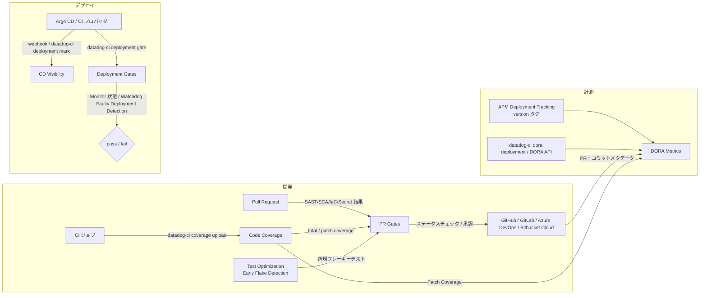
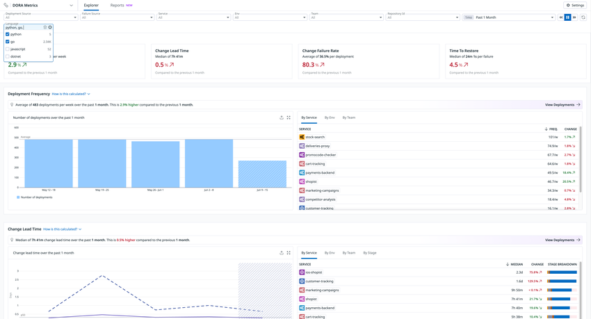
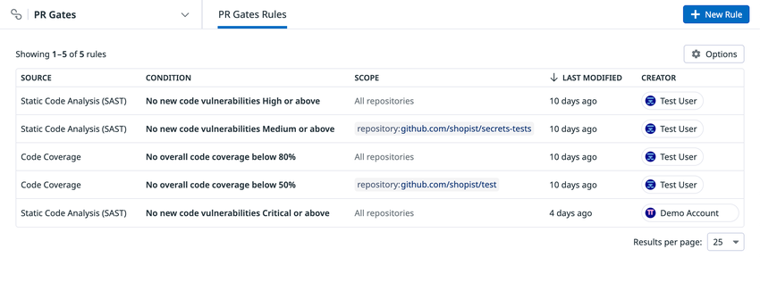
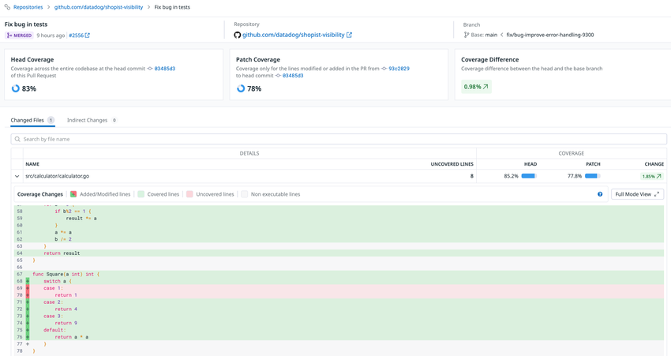
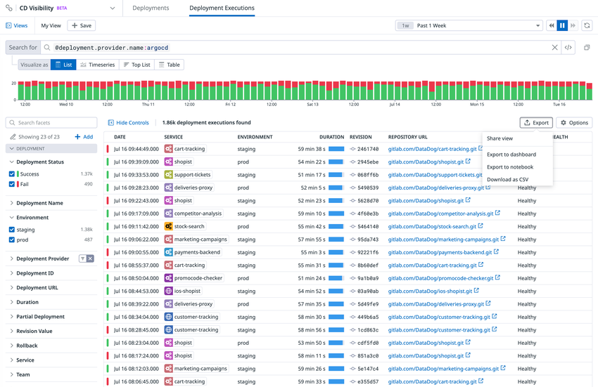
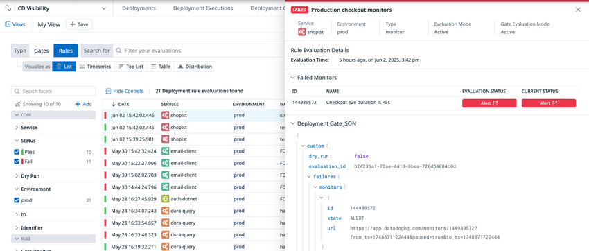

# DORA Metrics・Quality Gates・Code Coverage

## 概要

本ファイルは、Datadog の **Software Delivery** 製品群のうち、「デリバリーの成果を測る・品質を関門で止める」ための以下5機能のリファレンスである。CI パイプラインそのものの可視化は [CI Visibility](./ci-visibility.md)、テストの可視化・フレーキーテスト管理は [Test Optimization（旧 Test Visibility）](./test-optimization.md) を参照。

| 機能 | 一言でいうと | 主な画面パス | 提供状況（2026-11-02 時点） |
|---|---|---|---|
| **DORA Metrics**（Delivery Performance の一部） | デプロイ頻度・変更リードタイム・変更失敗率・失敗デプロイ復旧時間の4指標を自動算出 | Software Delivery > Delivery Performance > DORA Metrics（`/ci/dora`） | GA（公式ドキュメントに Preview 表記なし） |
| **PR Gates**（旧称：Quality Gates） | SAST/SCA/カバレッジ/IaC/シークレット/新規フレーキーテストのルールで PR のマージをブロック | Software Delivery > PR Gates > PR Gate Rules（`/ci/pr-gates`） | GA（Preview 表記なし）。旧 Quality Gates は 2026 年に PR Gates へ置換 |
| **Code Coverage** | カバレッジレポートをアップロードし、PR 単位の total / patch カバレッジを可視化・ゲート化 | Software Delivery > Code Coverage | GA（有償 SKU あり）。carryforward 機能のみ【Preview】 |
| **CD Visibility**（Continuous Delivery Visibility） | Argo CD や CI プロバイダー上のデプロイ実行を可視化 | Software Delivery > CD Visibility（Deployments / Deployment Executions） | 【Preview】（登録済み組織のみ） |
| **Deployment Gates** | モニター状態や APM Faulty Deployment Detection でデプロイ続行可否を判定 | Software Delivery > Deployment Gates（Configuration / Evaluations） | 評価用 CLI は beta コマンド、API は【Preview】 |

> **サイト差異:** 上記5機能はいずれも **`US1-FED`（app.ddog-gov.com）および us2.ddog-gov.com では非対応**。`US1`／`US3`／`US5`／`EU1`／`AP1`／`AP2`（および uk1.datadoghq.com）では利用可能（CD Visibility はこれらのサイトでも Preview 登録組織限定）。[出典](https://docs.datadoghq.com/dora_metrics/) [出典](https://docs.datadoghq.com/continuous_delivery/)

### 機能間の関係



- **PR Gates** は Monitor と同様に「互換製品の結果を消費し条件を適用する」仕組みで、ゲート自体は検査を行わない。検査は Code Security（[Code Security](../security/code-security.md)）、Code Coverage、Test Optimization 側で実行されている必要がある。[出典](https://docs.datadoghq.com/quality_gates/)
- **DORA Metrics** の PR フィールドには、Code Coverage の `Patch Coverage`、CI Visibility の `Time CI Failing`、Test Optimization の `Test Session Duration` など他製品データが連結される。[出典](https://docs.datadoghq.com/delivery_performance/dora_metrics/data_collected/)
- **Deployment Gates** の APM ルールは Watchdog の Faulty Deployment Detection 分析を用いる（[Watchdog](../platform/watchdog.md)、[APM 画面と分析機能](../apm/apm-ui-and-analysis.md)）。

---

## DORA Metrics（Delivery Performance）

### DORA Metrics の位置づけと名称

- **Delivery Performance** は「ソフトウェアデリバリー性能と AI コーディングアシスタントの影響を計測するツール群」で、サブ製品として **DORA Metrics** と **AI Impact** を含む。[出典](https://docs.datadoghq.com/delivery_performance/)
- API リファレンスでは「Delivery Performance (formerly DORA Metrics)」と表記されるが、API パスの `/dora/` 接頭辞は変更されていない。UI・ドキュメントでは引き続き「DORA Metrics」の名称が使われる。[出典](https://docs.datadoghq.com/api/latest/dora-metrics/)
- AI Impact はAI コーディングアシスタントの利用状況（`POST /api/v2/ai_impact/user_activity`）とデリバリー指標の関係を分析する機能。本ファイルでは名称の紹介にとどめる（詳細は [Bits AI と AI 機能](../ai/bits-ai.md) も参照）。

### DORA Metrics の4指標

| 指標（英語） | 日本語 | 定義（公式） | 計算方法 |
|---|---|---|---|
| Deployment Frequency | デプロイ頻度 | 本番環境へ成功裏にリリースする頻度 | 指定期間内の成功したデプロイイベント数 |
| Change Lead Time | 変更リードタイム | コミットが本番に到達するまでの時間 | コミットごとに「デプロイ完了時刻 − コミット作成時刻」。デプロイ間では**中央値（median）**で集計 |
| Change Failure Rate | 変更失敗率 | 即時対応が必要となった失敗デプロイの割合 | 変更失敗数 ÷ 総デプロイ数 |
| Failed Deployment Recovery Time | 失敗デプロイ復旧時間（旧来の Time to Restore に相当） | 即時対応が必要な失敗デプロイから復旧するまでの時間 | 失敗デプロイの `finished_at` から是正デプロイ（rollback / rollforward）の `finished_at` までの秒数。集計は中央値 |

[出典](https://docs.datadoghq.com/dora_metrics/) [出典](https://docs.datadoghq.com/delivery_performance/dora_metrics/calculation/) [出典](https://docs.datadoghq.com/delivery_performance/dora_metrics/change_failure_detection/)



- **キャプション:** DORA Metrics の Explorer 画面（カスタムタグ Language でフィルタした例）
- **画面説明:** 左上に「DORA Metrics」、タブは **Explorer** と **Reports**。上部のフィルタバーに **Deployment Source**、**Failure Source**、**Service**、**Env**、**Team**、**Repository Id**、右側に期間（例: Past 1 Month）と **Settings** ボタン。その下に4指標のサマリーカード（Deployment Frequency（週あたり平均）、Change Lead Time（中央値）、Change Failure Rate（デプロイあたり平均）、Time To Restore（失敗あたり中央値））が並び、各カードに前期間比の増減率が表示される。中段の **Deployment Frequency** セクションは週別デプロイ数の棒グラフと、右側に By Service / By Env / By Team のタブ付きランキング表（FREQ.、CHANGE 列）。下段の **Change Lead Time** セクションは折れ線グラフと By Service / By Env / By Team / By Stage のタブ、STAGE BREAKDOWN 列（ステージ別の内訳バー）。各セクション右上に **View Deployments** リンク。
- **出典:** https://docs.datadoghq.com/dora_metrics/ （2026-11-02 取得）

### DORA Metrics の画面と操作

| 項目 | 内容 |
|---|---|
| アクセス | Software Delivery > Delivery Performance > DORA Metrics（`https://app.datadoghq.com/ci/dora`、サイトに応じてホスト読み替え） |
| 集計軸 | team、service、repository、environment、期間、カスタムタグ |
| ドリルダウン | **View Deployments**（新規タブでデプロイイベント一覧）、**View Change Failures**（変更失敗としてマークされたデプロイ一覧をサイドパネル表示） |
| エクスポート | 各可視化の Export アイコンからダッシュボード／ノートブックへ追加 |
| ダッシュボード利用 | カスタムタグは属性扱いのため、ダッシュボードやグラフでフィルタ／グループ化する際は **`@` 接頭辞**が必要（例: `@language`） |
| ステータス手動修正 | View Deployments でデプロイを開き **Deployment status** ドロップダウンで failed / stable を切替 |

[出典](https://docs.datadoghq.com/dora_metrics/) [出典](https://docs.datadoghq.com/delivery_performance/dora_metrics/change_failure_detection/)

### DORA Metrics のデプロイデータソース

DORA Metrics はデプロイイベントを起点に全指標を算出する。DORA の **Settings** でデプロイのイベントソースを選択する。[出典](https://docs.datadoghq.com/delivery_performance/dora_metrics/setup/)

| ソース | 前提条件 | デプロイの識別 | 補足 |
|---|---|---|---|
| **APM Deployment Tracking** | サービスが Software Catalog にメタデータ付きで登録されていること、Unified Service Tagging（`env`/`service`/`version`）が設定されていること | `version` タグの変化 | Catalog の言語・タグがイベントに付与される。**Deploy Time（デプロイ所要時間）は APM ソースでは算出不可** |
| **API / CLI**（`datadog-ci dora deployment` または DORA Metrics API） | Settings で datadog-ci CLI/API をソースとして有効化 | 送信したイベント | 必須属性は `started_at`、`finished_at`、`service` |

- APM Deployment Tracking の詳細は [APM 画面と分析機能](../apm/apm-ui-and-analysis.md)、Unified Service Tagging は [Tagging](../platform/tagging.md)、Catalog は [Software Catalog（旧 Service Catalog）](../platform/software-catalog.md) を参照。
- 製品ページでは CD Visibility や Incident ツールもデータソースとして挙げられているが [出典](https://www.datadoghq.com/product/platform/dora-metrics/)、現行の Setup ドキュメントで「Deployments ソース」として明記されているのは上記2種のみ。CD Visibility のデプロイを DORA のデプロイソースとして直接選択できるかは公開情報では確認できず。

#### DORA デプロイイベントの属性（API / CLI）

| 属性（API: `data.attributes.*`） | 必須 | 型 | 説明・制約 |
|---|---|---|---|
| `service` | 必須 | string | サービス名 |
| `started_at` | 必須 | int64 | Unix タイムスタンプ（ナノ秒・ミリ秒・秒のいずれか） |
| `finished_at` | 必須 | int64 | 同上。CLI では省略時に現在時刻 |
| `git.repository_url` | 任意（`git` を送る場合は必須） | string | Change Lead Time 算出に必要 |
| `git.commit_sha` | 任意（`git` を送る場合は必須） | string | Change Lead Time 算出に必要 |
| `env` | 任意 | string | 環境でのフィルタに使用 |
| `team` | 任意 | string | 省略時は Catalog のサービス所有チームを自動設定。指定すると上書き |
| `version` | 任意 | string | APM Deployment Tracking と相関させるバージョン |
| `id` | 任意 | string | 16〜128 文字、英数字（およびハイフン・アンダースコア・ピリオド・コロン）。省略時は UUID を自動生成して返却 |
| `custom_tags` | 任意 | [string] | `key:value` 形式、**1イベント最大 100 個** |

[出典](https://docs.datadoghq.com/api/latest/delivery-performance/send-a-deployment-event.md) [出典](https://docs.datadoghq.com/delivery_performance/dora_metrics/setup/)

#### `datadog-ci dora deployment` の主なオプション

| オプション | 説明 | デフォルト・注意 |
|---|---|---|
| `--service` | サービス名 | 必須 |
| `--env` | 環境 | 任意 |
| `--started-at` | 開始時刻 | 必須 |
| `--finished-at` | 終了時刻 | 省略時は現在時刻 |
| `--version` | バージョン | 任意 |
| `--custom-tags` | `key:value`。繰り返し指定可 | 任意 |
| `--git-repository-url`／`--git-commit-sha` | Git 情報 | CI ジョブがデプロイ対象リビジョンで動いていれば CI コンテキストから推定され省略可 |
| `--skip-git` | リポジトリ URL とコミット SHA を送らない | **指定すると Change Lead Time が算出不可** |

環境変数は `DD_API_KEY`（必須）と `DD_SITE`。API の場合は `POST https://api.<DD_SITE>/api/v2/dora/deployment` に `DD-API-KEY` ヘッダー付きで送信する。[出典](https://docs.datadoghq.com/delivery_performance/dora_metrics/setup/)

```bash
# 例: デプロイ完了後に CI から送信
export DD_SITE=ap1.datadoghq.com
export DD_API_KEY=<API_KEY>
datadog-ci dora deployment --service shopist --env prod \
  --started-at 1730505600 --version v1.2.3 \
  --custom-tags department:engineering --custom-tags app_type:backend
```

### Change Lead Time の要件

Change Lead Time（CLT）を算出するには、**デプロイに Git 情報が付与されている**ことと、**リポジトリメタデータが Datadog に同期されている**ことの両方が必要。[出典](https://docs.datadoghq.com/delivery_performance/dora_metrics/setup/)

| ソース | デプロイへの Git 情報付与方法 | CLT の起点・終点 |
|---|---|---|
| APM Deployment Tracking | APM の Git タグ付け、または Source Code Integration を有効化 | コミット作成 → そのコミットが新バージョンに初めて現れた時点。Deploy Time は算出不可 |
| API / CLI | ペイロードに `repository_url` と `commit_sha` を含める | コミット作成 → デプロイ完了 |

#### リポジトリメタデータ同期（Git プロバイダー別）

| プロバイダー | 要件 | 制限・注意 |
|---|---|---|
| GitHub | GitHub インテグレーションをインストール。GitHub App に Contents と Pull Requests の Read 権限、Push / PullRequest / PullRequestReview イベントの購読 | `pull_request` トリガーのワークフローは非対応（代替手段＝`datadog-ci git-metadata upload` を使用） |
| GitLab | GitLab Source Code インテグレーション。サービスアカウントの PAT に最低 `read_api` スコープ | グループ/サブグループの場合はエンティティ定義（schema v3）で `datadog.codeLocations` を宣言 |
| Azure DevOps | Azure DevOps Source Code インテグレーション＋ Microsoft Entra アプリ接続。組織追加後に `azdevops-sci-hooks` リポジトリのセットアップスクリプトを実行 | スクリプト未実行だと PR 作成前のコミットが PR に紐づかない。**2026-03-10 より前にインストールした場合はスクリプト再実行が必要** |
| Bitbucket | **Bitbucket Cloud Premium のみ**。Workspace access token に Account(Read)、Repositories(Read)、Pull requests(Read)、Webhooks(Read and write) | Bitbucket Data Center / Server は非対応 |
| その他 | CI で新規コミットごとに `datadog-ci git-metadata upload` を実行（デプロイイベント送信**前**に実行） | `--no-gitsync` を付けるとコミット情報が送信されず CLT が算出されない |

ソースコード連携の詳細は [Integrations](../platform/integrations.md) を参照。

#### 1リポジトリ複数サービス（モノレポ）の指定

| 方法 | 内容 | 優先度 |
|---|---|---|
| `datadog.codeLocations`（推奨、エンティティ schema v3） | サービスをリポジトリと glob パスに対応付ける。リポジトリ全体は `**` のみを指定 | 両方ある場合はこちらのみ使用 |
| リポジトリリンク | link type `repo`、provider `github`/`gitlab`/`azure`/`bitbucket`、name が「Source」またはサービス名。URL から単一パスパターンを導出 | — |

schema v1、v2、v2.1、v2.2 は code locations 利用のため v3 への移行が必要。[出典](https://docs.datadoghq.com/delivery_performance/dora_metrics/setup/)

### Change Lead Time の計算詳細

- デプロイごとに、**今回デプロイのコミット SHA と前回デプロイの SHA の間で `git log`** を実行してデプロイされたコミットを特定し、**マージコミットを除外**したうえで各コミットの CLT を算出・集計する。[出典](https://docs.datadoghq.com/delivery_performance/dora_metrics/calculation/)
- Datadog は Git のコミットオブジェクトとツリーオブジェクトのみを保持し、**ファイル内容は保存しない**。
- 例: 19:00 のデプロイに C3（16:00）と C2（15:00）が含まれる場合、CLT はそれぞれ 3 時間・4 時間で、デプロイ単位では平均 3.5 時間・最大 4 時間・最小 3 時間。公式はデプロイ単位平均よりコミット単位の粒度のほうが正確としている（1コミットのデプロイと10コミットのデプロイが同じ重みになるため）。

#### CLT のステージ分解（コミット単位）

| ステージ | 区間 | 条件 |
|---|---|---|
| Time to PR Ready | コミット作成 → PR が Ready for review | その時点より前に作られたコミットのみ |
| Review Time | Ready for review → 最後の承認 | 承認前に作られたコミットのみ |
| Merge Time | 最後の承認 → マージ | — |
| Time to Deploy | マージ → デプロイ開始（PR なしの場合はコミット作成 → デプロイ開始） | — |
| Deploy Time | デプロイ開始 → デプロイ終了 | デプロイ所要時間データがない場合（APM ソース等）は算出不可 |

- ステージ分解には GitHub、GitLab、Azure DevOps のいずれかがリポジトリメタデータソースである必要がある。
- コミットが PR に紐づくのは、その PR のマージがコミットのターゲットブランチへの初到達である場合。PR なしコミットは Time to Deploy と Deploy Time のみ。
- **Squash マージ**: GitHub / GitLab / Azure DevOps は元のコミットを使用。その他プロバイダーはターゲットブランチに追加された新コミットを使用。
- **Rebase**: 元のコミットのタイムスタンプを使うが、表示 SHA はリベース後の新コミット。

[出典](https://docs.datadoghq.com/delivery_performance/dora_metrics/calculation/)

### 変更失敗の検出（Change Failure Detection）

現行仕様では、**Change Failure Rate と Failed Deployment Recovery Time はデプロイ上で検出された「変更失敗」から計算され、インシデントイベントからは計算されない**。[出典](https://docs.datadoghq.com/api/latest/delivery-performance/send-an-incident-event.md) [出典](https://docs.datadoghq.com/delivery_performance/dora_metrics/change_failure_detection/)

| 検出方式 | 判定ロジック | 必要データ | 設定 |
|---|---|---|---|
| **Rollback** | 以前デプロイ済みのバージョンが再デプロイされ、かつ直前デプロイと異なる場合。ロールバック先の「次のデプロイ」を変更失敗とする（例: V1→V2→V3→V1 なら V2 が失敗、最後の V1 がロールバック）。同一バージョンの連続再デプロイ（V1→V1）はロールバックではない | Git メタデータがあればコミット SHA、なければ `version` タグで照合 | 設定不要（自動） |
| **Rollforward** | 修正コードを新規デプロイして失敗を是正（revert PR 含む） | PR メタデータ（タイトル・ラベル・ブランチ名）または version タグ | DORA Settings のカスタムルール |

#### Rollforward のカスタムルール

| ルール種別 | 仕組み | 変数・例 | 失敗の紐づけ先 |
|---|---|---|---|
| **Linked rules** | 変数付き正規表現で今回デプロイから値を抽出し、同じ値を持つ過去デプロイを探す | 変数 `$pr_title`、`$pr_number`、`$version`。例: `Revert "$pr_title"` | 一致した過去デプロイを変更失敗、今回を rollforward |
| **Static rules** | 変数なし正規表現 | PR title `.*rollforward.*`、PR label `.*hotfix.*`、PR branch name `recovery/.*`、Commit message `^Revert ".*"$`、Version tag `.*_hotfix` | **直前のデプロイ**を変更失敗、今回を rollforward |

- Linked rules は、元 PR がどの過去デプロイにも含まれない場合、または元 PR と revert が同一デプロイに含まれる場合は分類されない。
- **デフォルトで有効なルール**: ①Revert PR（revert 形式の PR タイトルを rollforward とし、元変更を含むデプロイを変更失敗に紐づけ）、②Hotfix 指標（PR ラベル・タイトル・ブランチ名に "hotfix" を含むものを rollforward とし、直前デプロイを変更失敗）。いずれも DORA Settings で変更可能で、公式は自社の命名規約に合わせて調整すべき出発点と位置づけている。
- Static rules の場合の復旧時間は、マッチしたデプロイと直前デプロイの間で計算される。[出典](https://docs.datadoghq.com/delivery_performance/dora_metrics/calculation/)

#### 変更失敗ステータスの手動更新

| 方法 | 手順・パラメータ |
|---|---|
| API | `PATCH /api/v2/dora/deployments/{deployment_id}`（ID 指定）または `PATCH /api/v2/dora/deployments`（バージョン指定）。`change_failure`（boolean）、`remediation`（任意。`id` と `type`（例 `rollback`）。**復旧時間の算出には必須**） |
| UI | Software Delivery > DORA Metrics > View Deployments でデプロイを開き、Deployment status ドロップダウンで failed / stable を選択 |

用途は、検出漏れ・誤分類の修正、レポート用の即時補正。[出典](https://docs.datadoghq.com/delivery_performance/dora_metrics/change_failure_detection/) [出典](https://docs.datadoghq.com/api/latest/dora-metrics/)

#### インシデントイベント（参考情報として送信）

`POST /api/v2/dora/failure`（Send an incident event）でインシデントを送信でき、失敗デプロイと実際のインシデント（重大度・頻度）を並べて見るために使われる。旧エンドポイント `POST /api/v2/dora/incident`（legacy）は **deprecated**。[出典](https://docs.datadoghq.com/api/latest/delivery-performance/send-an-incident-event.md)

| 属性 | 必須 | 説明 |
|---|---|---|
| `started_at` | 必須 | インシデント開始の Unix タイムスタンプ（ns/ms/s） |
| `finished_at` | 任意 | 終了タイムスタンプ |
| `services` | `team` 未指定時は必須 | 影響サービス |
| `team` | `services` 未指定時は必須 | 影響サービスの所有チーム |
| `env`、`name`、`severity`、`version` | 任意 | 環境、名称、重大度、相関バージョン |
| `git.commit_sha`／`git.repository_url` | `git` を送る場合は必須 | Git 情報 |
| `id` | 任意 | 16〜128 文字 |
| `custom_tags` | 任意 | `key:value`、最大 100 個 |

> 注意: 現行の API リファレンスは、Change Failure Rate と Failed Deployment Recovery Time を「インシデントイベントではなくデプロイ上で検出された変更失敗から計算する」と明記している。一方、`/api/v2/dora/incident`（legacy、deprecated）が残っていることや、2024 年の公式ブログが「インシデントの開始・終了の定義を揃える」ことを推奨している点から、過去はインシデント起点の算出だったと考えられる【推定】。古い記事や画面例（"Failure Source" フィルタ、"Time To Restore" 表記）を参照する際は現行仕様との差に注意すること。Incident Management との連携の現行の扱いは公開情報では確認できず（[Incident Management](../service-management/incident-management.md) も参照）。

### DORA Metrics の収集データ

| イベント | 内容 | 用途 |
|---|---|---|
| Deployment | `env`・`service`・`version` で識別。failed マーク可能 | デプロイ頻度、変更失敗率、復旧時間 |
| Pull Request | デプロイに含まれる PR。作成者・レビュアー・ラベル・各段階の所要時間 | コードレビュー分析、PR サイクルタイム |
| Commit | デプロイ内の各コミット（PR の下にネスト） | 変更リードタイム |

**デフォルトタグ:** `service`、`team`、`env`、`version`、`source`、`repository_id`
**カスタムタグ:** デプロイイベントのみ付与可能。①Catalog（`language` タグおよびサービス定義のカスタムタグ）、②DORA Metrics API（最大 100 個）。

#### Deployment フィールド

| フィールド | 説明 |
|---|---|
| `Duration` | デプロイ所要時間 |
| `Avg Change Lead Time`／`Avg Time to PR Ready`／`Avg Review Time`／`Avg Merge Time`／`Avg Time to Deploy` | デプロイ内コミットの平均値 |
| `Number of Commits` | コミット数 |
| `Deployment Type` | `standard`／`rollback`／`rollforward` |
| `Change Failure` | boolean |
| `Recovery Time` | 失敗デプロイの `finished_at` から是正デプロイの `finished_at` までの秒数（変更失敗のみ） |
| `Remediation Type` | `rollback`／`rollforward`（変更失敗のみ） |

#### Pull Request フィールド

| フィールド | 説明・要件 |
|---|---|
| `PR Cycle Time` | 最初のコミット → マージ |
| `Time to PR Ready` | 最初のコミットまたは PR 作成（早い方）→ Ready for review |
| `Review Time`／`Merge Time`／`Time to Deploy`／`Deploy Time` | 各段階の時間 |
| `Number of Commits`／`Number of Reviewers` | 件数 |
| `Number of Files Changed`／`Number of Lines Added`／`Number of Lines Deleted`／`Total Number of Lines Changed` | **GitHub のみ** |
| `Time to First Human Review`／`Number of Comments`／`Number of Human Comments` | **GitHub のみ** |
| `Fully Automated` | 人手を介さず作成・マージされた場合 true |
| `Creator Bot Type`／`Creator Bot Name` | ボット作成 PR の識別 |
| `Time CI Failing`／`Time to Pass`／`Time to Pass After Approval` | **CI Visibility が必要** |
| `Test Session Duration`／`Test Session Duration After Approval` | **Test Optimization が必要** |
| `Patch Coverage` | 新規・変更行のテストカバー率。**Code Coverage が必要** |

#### Commit フィールド

`Change Lead Time`、`Time to PR Ready`、`Review Time`、`Merge Time`、`Time to Deploy`、`Deploy Time`、`Has Failed Jobs`（リトライで成功した失敗も含む。CI Visibility 必要）、`Has Failed Tests`（非フレーキー失敗。Test Optimization 必要）、`Has New Flaky Tests`（Test Optimization 必要）。

[出典](https://docs.datadoghq.com/delivery_performance/dora_metrics/data_collected/)

#### 自動化ボットの識別

Delivery Performance の General settings でリポジトリ内の自動化ボットを識別でき、この設定は DORA Metrics と AI Impact の両方に影響する。[出典](https://docs.datadoghq.com/delivery_performance/dora_metrics/setup/)

### DORA Metrics API エンドポイント一覧

| メソッド | パス | 名称 |
|---|---|---|
| POST | `/api/v2/dora/deployment` | Send a deployment event |
| POST | `/api/v2/dora/failure` | Send an incident event |
| POST | `/api/v2/dora/deployments` | Get a list of deployment events |
| POST | `/api/v2/dora/failures` | Get a list of incident events |
| GET | `/api/v2/dora/deployments/{deployment_id}` | Get a deployment event |
| GET | `/api/v2/dora/failures/{failure_id}` | Get an incident event |
| DELETE | `/api/v2/dora/deployment/{deployment_id}` | Delete a deployment event |
| DELETE | `/api/v2/dora/failure/{failure_id}` | Delete an incident event |
| PATCH | `/api/v2/dora/deployments/{deployment_id}` | Mark a deployment as failed by ID |
| PATCH | `/api/v2/dora/deployments` | Mark a deployment as failed by version |
| POST | `/api/v2/ai_impact/user_activity` | Send AI tool user activity |
| POST | `/api/v2/dora/incident` | Send an incident event (legacy) — **deprecated** |

レスポンスコード（送信系）: `200` OK、`202` OK（インシデント対応中のため遅延処理）、`400` Bad Request、`403` Not Authorized、`429` Too many requests。ホストはサイトごと（例: AP1 は `api.ap1.datadoghq.com`、[Datadog Sites](../platform/datadog-sites.md) 参照）。[出典](https://docs.datadoghq.com/api/latest/dora-metrics/)

---

## PR Gates（旧称：Quality Gates）

### PR Gates の概要と名称変更

- **PR Gates** は、ルールを設定して基準を満たさないコードを含む Pull Request のマージをブロックする機能。Monitor と同様に互換製品の検出結果を消費し、条件を適用する。[出典](https://docs.datadoghq.com/quality_gates/)
- **PR のコード変更で新たに持ち込まれた違反のみ**でブロックし、ブランチ作成前から存在していた既存の検出結果ではブロックしない。
- ドキュメント URL は旧来の `/quality_gates/` のまま（`/pr_gates/` でも参照可能）で、ページタイトルは「PR Gates」。権限 ID も `quality_gate_rules_*` と旧名称のまま。
- **旧 Quality Gates（`datadog-ci gate evaluate` で CI から評価する方式）は deprecated** で、「2026 年に新しい PR Gates へ置き換えられる」とされ、移行フォームが案内されている。[出典](https://cdn.jsdelivr.net/npm/@datadog/datadog-ci-plugin-gate@5.21.2/README.md)（datadog-ci 公式 npm パッケージの README、2026-11-02 取得）



- **キャプション:** PR Gates Rules 一覧画面
- **画面説明:** 左上のプロダクト切替に「PR Gates」、タブは **PR Gates Rules**、右上に青い **+ New Rule** ボタン。一覧表の列は **SOURCE**（例: Static Code Analysis (SAST)、Code Coverage）、**CONDITION**（例: "No new code vulnerabilities High or above"、"No overall code coverage below 80%"）、**SCOPE**（"All repositories" または `repository:github.com/...` のリポジトリ指定）、**LAST MODIFIED**、**CREATOR**。右上に **Options**、右下に Results per page。
- **出典:** https://docs.datadoghq.com/quality_gates/ （2026-11-02 取得）

### PR Gates のルール種別と条件

| ソース製品 | 条件タイプ | ブロック条件 |
|---|---|---|
| Static Code Analysis (SAST) | コード脆弱性、コード品質違反 | 変更行が指定重大度以上の新規脆弱性／品質違反を1件以上追加 |
| Software Composition Analysis (SCA) | ライブラリ脆弱性、ライブラリライセンス違反 | 指定重大度以上の新規ライブラリ脆弱性、または禁止ライセンスのライブラリを1件以上追加 |
| Code Coverage | 全体カバレッジ、パッチカバレッジ | リポジトリ全体カバレッジが指定％未満、またはパッチカバレッジが閾値未満 |
| Infrastructure as Code Scanning | IaC 脆弱性 | 指定重大度以上の新規 IaC 脆弱性を1件以上 |
| Secret Scanning | 漏えいシークレット | 指定重大度以上の新規シークレットを1件以上 |
| New Flaky Tests | 新規フレーキーテスト | PR が新規フレーキーテストを1件以上持ち込む（Early Flake Detection と併用） |

[出典](https://docs.datadoghq.com/quality_gates/)

- 各ソース製品が対象リポジトリで稼働している必要がある。SAST/SCA/IaC/Secret は [Code Security](../security/code-security.md)、New Flaky Tests は [Test Optimization](./test-optimization.md) を参照。
- 重大度の選択肢としてドキュメント例に現れるのは `Critical`（ほか画面例で High、Medium）。全選択肢の一覧は公開情報では確認できず。

### PR Gates ルールの作成手順

1. **Software Delivery > PR Gates > PR Gate Rules** で **New Rule** をクリック。
2. ルール種別（上表の6種）を選択。
3. **スコープ**を設定: **All repositories**（そのルール種別が設定された全リポジトリ）または **Selected repositories**（`IN` で列挙リポジトリのみ、`NOT IN` で列挙以外）。ブランチ単位のスコープは公開情報では確認できず。
4. **条件**を設定（種別ごとに選択肢あり、デフォルトのままでも可）。例: SAST ルールで「Critical 以上の脆弱性が1件以上新規に入ったら失敗」。
5. **Preview checks** で SCM プロバイダーを選び、PR に付くステータスチェックをプレビュー。
6. **ブロッキング**の有無を決めて **Create Rule**。新ルールは非ブロッキングで検証してからブロッキング化するのが推奨。

[出典](https://docs.datadoghq.com/quality_gates/setup/)

### PR Gates の強制（マージブロック）方法

| SCM | 必要なインテグレーション | ブロック方法 |
|---|---|---|
| GitHub | GitHub インテグレーション | PR Gates チェックをブランチ保護で required に設定 |
| GitLab | GitLab Source Code インテグレーション | インテグレーション導入時に作成される Datadog サービスアカウントを**必須承認者**に設定（全条件パス時にサービスアカウントが MR を承認） |
| Azure DevOps | Azure DevOps Source Code インテグレーション | ブランチポリシーでチェックを required に設定 |
| Bitbucket Cloud | Bitbucket Cloud Source Code インテグレーション | チェックを required に設定。**ブロッキングチェックには Bitbucket Cloud Premium が必要** |

[出典](https://docs.datadoghq.com/quality_gates/setup/)

### PR Gates の動作仕様

| 項目 | 仕様 |
|---|---|
| チェックの単位 | 評価したルール種別ごとに PR チェックを作成。失敗理由と Datadog 上の該当イベントへのリンクを含む |
| 絵文字リアクション | 結果待ち中は PR 説明に 👀、全て良好なら 👍 に変更。1件以上の検出があれば 👀 を外し、Summary Comment に検出内容を列挙 |
| 再実行 | PR UI でチェックを再実行しても **PR Gates ルールは再評価されない** |
| 既存 PR | ルール作成後に新しいコミットが push されない限り、既存 PR を遡及ブロックしない |
| 変更外の違反 | 変更行以外にある違反では新規 PR をブロックしない |
| テスト方法 | 意図的に条件違反する新規ブランチと PR を作成して確認するのが推奨 |
| ルール管理 | 一覧でルールにホバーし Edit / Delete（Clone も可能） |

[出典](https://docs.datadoghq.com/quality_gates/) [出典](https://docs.datadoghq.com/quality_gates/setup/)

### 旧 Quality Gates（`datadog-ci gate evaluate`）

旧 Quality Gates は CI パイプライン内で `datadog-ci gate evaluate` を実行してルールを評価し、終了ステータスでパイプラインを止める方式だった。deprecated のため新規採用は推奨されないが、既存環境の把握用に仕様を残す。[出典](https://cdn.jsdelivr.net/npm/@datadog/datadog-ci-plugin-gate@5.21.2/README.md)

| オプション | デフォルト | 説明 |
|---|---|---|
| `--scope` | なし | `key:value` で評価対象ルールを絞り込み |
| `--tags` | なし | 全結果に付与するグローバルタグ（`DD_TAGS` が優先） |
| `--dry-run` | `false` | 最終評価以外の処理を実行 |
| `--fail-if-unavailable` | `false` | Datadog に到達できない場合に失敗 |
| `--fail-on-empty` | `false` | 一致ルールがない場合に失敗 |
| `--timeout` | `600`（秒） | コマンドタイムアウト |
| `--no-wait` | `false` | テスト等のイベントを照会可能にするための **30 秒待機**をスキップ |

環境変数: `DD_API_KEY`（必須）、`DD_APP_KEY`（必須）、`DD_TAGS`、`DD_SITE`。メタデータ取得に `git` を使用。旧 Quality Gates の評価結果閲覧権限として `quality_gates_evaluations_read`（Quality Gates Evaluations）が残っている。旧ルール種別の完全な一覧は公開情報（現行ドキュメント）では確認できず。

---

## Code Coverage

### Code Coverage の概要

- **Code Coverage** は、カバレッジレポートを Datadog にアップロードし、PR 単位で集約したカバレッジを可視化し、設定した閾値でマージをブロックする製品。[出典](https://docs.datadoghq.com/code_coverage/)
- Test Optimization にも旧来のカバレッジ機能（`@test.code_coverage.lines_pct`）があるが、こちらはレガシー扱いで、新規には本製品が推奨される（[Test Optimization](./test-optimization.md) 参照）。
- アップロードされるのはカバレッジレポートとメタデータで、**ソースコードはアップロードされない**。[出典](https://docs.datadoghq.com/code_coverage/data_collected/)



- **キャプション:** Code Coverage の Pull Request 詳細画面
- **画面説明:** 上部パンくずは Repositories > リポジトリ名 > PR タイトル。PR 状態（MERGED）と PR 番号、Repository、Branch（Base: main ← フィーチャーブランチ）。3枚のカード: **Head Coverage**（PR の head コミット時点のコードベース全体カバレッジ、例 83%）、**Patch Coverage**（PR で追加・変更された行のみのカバレッジ、例 78%）、**Coverage Difference**（head とベースブランチの差、例 0.98%）。下部に **Changed Files** / **Indirect Changes** タブ、ファイル検索、ファイルごとの UNCOVERED LINES、HEAD / PATCH / CHANGE 列。ファイルを展開すると **Coverage Changes** 表示で、Added/Modified lines、Covered lines（緑）、Uncovered lines（赤）、Non executable lines が色分けされ、右上に **Full Mode View**。
- **出典:** https://docs.datadoghq.com/code_coverage/ （2026-11-02 取得）

### Code Coverage のセットアップ手順

1. ソースコードプロバイダーを連携する。
2. データアクセス権限を設定する。
3. （任意）PR Gates を設定する。
4. CI パイプラインを更新してレポートをアップロードする。

[出典](https://docs.datadoghq.com/code_coverage/setup/)

#### 対応ソースコードプロバイダー

| プロバイダー | 連携方法 | 要件 |
|---|---|---|
| GitHub | GitHub インテグレーション（GitHub App） | App 権限: Contents(Read)、Pull Requests(Write)、Checks(Write)。Webhook: Pull request、Pull request review、Pull request review comment、Push。Datadog 管理の Marketplace App とデフォルト設定のカスタム App はこれらを含む |
| GitLab | GitLab Source Code インテグレーション | — |
| Azure DevOps | Azure DevOps Source Code インテグレーション | — |
| Bitbucket | Bitbucket Cloud のみ | **Bitbucket Cloud Premium ワークスペースが必要**。Server / Data Center 非対応 |

#### データアクセス権限

- カスタムロールでは **Code Coverage Read**（`code_coverage_read`）を有効化する。
- リポジトリ単位で制限する場合は **Data Access Control** で Software Delivery とリポジトリをスコープにした Restricted Dataset を作り、ロール／チームに付与する（ソースパスやテスト名の露出を制限）。詳細は [組織・ユーザー・権限管理](../platform/account-and-access-management.md)。

### 対応カバレッジレポート形式

| # | 形式 | `--format` 指定例 |
|---|---|---|
| 1 | LCOV | `lcov` |
| 2 | Go Coverprofile | 公開情報では確認できず（自動検出を推奨） |
| 3 | Cobertura XML | `cobertura` |
| 4 | Jacoco XML | 公開情報では確認できず |
| 5 | Clover XML | `clover` |
| 6 | OpenCover XML | 公開情報では確認できず |
| 7 | Simplecov JSON | 公開情報では確認できず |

形式は通常自動検出される。「Format could not be detected」となる場合は `--format` を明示する。[出典](https://docs.datadoghq.com/code_coverage/setup/)

### レポートのアップロード方法

#### 方法1: `datadog-ci coverage upload`

- インストール: スタンドアロンバイナリ（linux-x64、linux-arm64、darwin-x64、darwin-arm64、win-x64）、npm（`npm install -g @datadog/datadog-ci`）、Docker イメージ `datadog/ci`。
- 認証: `DD_API_KEY`（必須）、`DD_SITE`。
- 位置引数にレポートファイルまたはディレクトリを1つ以上指定（ディレクトリは再帰探索されるため通常 `.` で十分）。
- **同一コミットの複数レポートはバックエンドで集約**されるため、事前マージは不要。

| オプション | 説明 | デフォルト |
|---|---|---|
| `--format=<format>` | レポート形式を明示 | 自動検出 |
| `--flags <name>` | レポートにフラグを付与（繰り返し可）。datadog-ci v5.6.0 以降 | なし |
| `--base-path=<path>` | レポート内パスが別ディレクトリ基準の場合に、リポジトリルートからの相対ベースパスを指定 | — |
| `--skip-git-metadata-upload=1` | Git メタデータのアップロードを省略（ソースコードプロバイダー連携済みの場合） | アップロードする |
| `--upload-git-diff=0` | Git diff サマリーの送信をオプトアウト | 送信する |
| `--disable-file-fixes` | file fixes（非実行行ビットマップ）の生成を無効化 | 有効 |
| `--file-fixes-search-path <dir>` | file fixes のソース探索ルートを変更（モノレポ向け） | リポジトリルート |

file fixes は Go、Kotlin、C/C++、Swift、Objective-C、PHP について、コメント・空行・閉じ括弧などの非実行行を特定しカバレッジ計算から除外する。[出典](https://docs.datadoghq.com/code_coverage/setup/) [出典](https://docs.datadoghq.com/code_coverage/flags/)

```yaml
# GitHub Actions 例（専用アクション）
- uses: DataDog/coverage-upload-github-action@v1
  with:
    api_key: ${{ secrets.DD_API_KEY }}
    site: ap1.datadoghq.com
```

```bash
# GitLab / Azure Pipelines 等
datadog-ci coverage upload .
datadog-ci coverage upload --format=clover coverage/clover.xml
datadog-ci coverage upload --flags unit-tests --flags jvm-21 coverage-unit.xml
```

#### 方法2: Test Optimization ライブラリによる自動アップロード

Test Optimization を導入済みなら、CI/CD Optimization 設定で **Code Coverage** を ON にすると、テスト実行後にライブラリが自動アップロードする（組織・リポジトリ・テストサービス単位で設定可）。

| ライブラリ | 最低バージョン | カバレッジソース | `DD_CODE_COVERAGE_FLAGS` 対応 |
|---|---|---|---|
| Ruby `datadog-ci` | 1.27.0 | SimpleCov | 非対応 |
| JavaScript `dd-trace` 5.x | 5.85.0 | Jest、Vitest、NYC | 5.116.0 以降 |
| JavaScript `dd-trace` 6.x | 6.0.0 | Jest、Vitest、NYC | 6.5.0 以降 |
| Python `ddtrace` | 4.4.0 | pytest 標準プラグイン（`coverage.py`） | 非対応 |
| Java `dd-java-agent` | 1.53.0 | JaCoCo | 非対応 |

`DD_CODE_COVERAGE_FLAGS` はカンマ区切り（前後空白はトリム、空要素は無視）。非対応言語でフラグが必要な場合は `datadog-ci coverage upload --flags` で手動アップロードする。[出典](https://docs.datadoghq.com/code_coverage/setup/) [出典](https://docs.datadoghq.com/code_coverage/flags/)

### カバレッジの計算方法

| 項目 | 仕様 |
|---|---|
| 集約単位 | 同一リポジトリ・同一コミット SHA の全レポートを1つのデータセットにマージ |
| 再計算 | **インクリメンタル**。レポート到着ごとに再計算されるため、全 CI ジョブ完了前の値は暫定 |
| 行ステータス | Covered（実行され、分岐があれば全分岐実行）／Partially covered（実行されたが一部分岐未実行）／Uncovered（未実行） |
| 部分カバー行 | **カバー扱いにならない**（total・patch いずれにも寄与しない）。レポートに分岐情報がなければ実行行は Covered |
| 非実行行 | コメント・空行・閉じ括弧などは除外 |
| 複数レポートに同一ファイル | いずれかのレポートで Covered ならその行は Covered（並列分割しても下がらない） |
| フラグ付きレポート | フラグごとのデータセットにマージ。フラグなしビューは全レポートを合算 |
| total coverage | head コミット時点のコードベース全体 |
| patch coverage | PR で追加・変更された行のみ |
| 端数処理 | 公開情報では確認できず |

外部ツール（ReportGenerator 等）でマージしたレポートに重複ファイルエントリがあると値がずれることがある。[出典](https://docs.datadoghq.com/code_coverage/coverage_calculation/) [出典](https://docs.datadoghq.com/code_coverage/setup/)

### `code-coverage.datadog.yml` 設定リファレンス

リポジトリルートに `code-coverage.datadog.yml`（または `.yaml`）を置く。`schema-version: v1` が必須。[出典](https://docs.datadoghq.com/code_coverage/configuration/)

| キー | 型 | デフォルト | 説明 |
|---|---|---|---|
| `schema-version` | string | 必須 | `v1` 固定 |
| `services[].id` | string | 必須 | サービス識別子（モノレポのサービス分割用） |
| `services[].paths` | [string] | 必須 | サービスに属するパスパターン |
| `ignore` | [string] | なし | 除外パスパターン。`!` 接頭辞で再包含（否定パターンが優先） |
| `gates[].type` | string | 必須 | `total_coverage_percentage` または `patch_coverage_percentage` |
| `gates[].config.threshold` | number | 必須 | 最低カバレッジ％（0〜100） |
| `gates[].config.services` | [string] | なし | サービス名パターン（`*` ワイルドカード、`!` 除外）。指定時はサービスごとに個別評価 |
| `gates[].config.codeowners` | [string] | なし | コードオーナーパターン |
| `gates[].config.flags` | [string] | なし | フラグ名パターン |
| `comments.enabled` | boolean | `true` | PR へのカバレッジサマリーコメント（ゲートチェックには影響しない） |
| `comments.file_breakdown` | boolean | `false` | ファイル別 total/patch 表をコメントに追加 |
| `annotations.enabled` | boolean | `false` | PR diff の未カバー行にインライン注釈 |
| `carryforward` | boolean | `false` | 全フラグに carryforward を適用【Preview】 |
| `flags.<name>.carryforward` | boolean | 上位値を継承 | フラグ単位で上書き |

**パターン構文（自動判定）:**

| 種類 | 判定条件 | 挙動 |
|---|---|---|
| 正規表現 | `+ { } \| ( ) ^ $ \` を含む | パス全体にアンカー。区切りは `/` |
| glob | `* ? [ ]` を含む | `**` は再帰。`folder/*` は直下のみ、`folder/**/*` は全子孫 |
| プレフィックス | 特殊文字なし | そのパス配下すべて |

**UI ルールとの関係:** ゲートは UI（PR Gates の Code Coverage ルール）と YAML の両方で定義でき、PR オープン／更新時に両方が評価される。同じスコープに両方ある場合は**全閾値を満たす必要がある**。

```yaml
schema-version: v1
services:
  - id: web
    paths: [apps/web/**, libs/ui/**]
ignore:
  - "**/*_test.go"
  - "vendor/"
  - "generated/"
  - "!generated/core/"
gates:
  - type: total_coverage_percentage
    config:
      threshold: 80
      services: ["*", "!web"]
  - type: patch_coverage_percentage
    config:
      threshold: 90
      flags: ["unit-*"]
comments:
  enabled: true
  file_breakdown: true
annotations:
  enabled: true
carryforward: false
flags:
  integration-tests:
    carryforward: true
```

#### インライン注釈の仕様

- PR で追加された実行行のみが対象。部分カバー行は未カバー扱い。連続する未カバー行は1つの注釈に集約。
- **1 PR あたり最大 30 注釈**。超過時はサマリーコメントで総数とレポートへのリンクを表示（コメント無効時も総数のみのサマリーは投稿される）。
- 行がカバーされると注釈は解決される。
- **Bitbucket では非対応**。

[出典](https://docs.datadoghq.com/code_coverage/configuration/)

### フラグ（Flags）

| 項目 | 仕様 |
|---|---|
| 目的 | 同じファイルを異なるテスト実行（unit / integration、ランタイム版など）がカバーする場合に**レポート単位**で分類・フィルタ |
| 付与方法 | `--flags`（datadog-ci v5.6.0 以降、繰り返し可）または `DD_CODE_COVERAGE_FLAGS`（対応ライブラリのみ） |
| 上限数 | **1レポート最大 32 フラグ**（先頭 32 個を保持、残りは無視） |
| 名前長 | **最大 1,000 文字**（超過は無視） |
| 使用可能文字 | 英数字、ハイフン、アンダースコア、ピリオド、コロン |
| ゲートとの関係 | フラグ指定ゲートは各フラグを**個別に**閾値評価（フラグ間で合算しない）。フラグ指定なしならリポジトリ全体 |

[出典](https://docs.datadoghq.com/code_coverage/flags/)

### Carryforward【Preview】

- 一部 CI ジョブが実行されなかったコミットで、**祖先コミットの同フラグ最新レポートを再利用**し、全ジョブ実行時相当の total coverage を維持する機能。フラグ単位で動作するため、全レポートに `--flags` が必要。
- 新しいコミットで同フラグの実レポートが届くと自動的に置き換えられる。
- 推奨: 1 CI ジョブ = 1 レポート = 安定したフラグ名。夜間ジョブやフレーキーなスイートは `carryforward: false` で除外。Preview 期間中は非ブロッキングの PR Gate で影響を確認してからブロッキング化。
- 祖先コミットを遡る上限（lookback）は公開情報では確認できず。

[出典](https://docs.datadoghq.com/code_coverage/carryforward/)

### モノレポ対応（サービス・コードオーナー別カバレッジ）

| 分割軸 | 設定方法 | 備考 |
|---|---|---|
| サービス（推奨） | Software Catalog のサービス定義の `codeLocations`（`repositoryURL` と `paths`） | Catalog が YAML の `services` より優先。Catalog 変更の反映は**最大 10 分**、反映後にアップロードされたレポートから適用 |
| サービス（代替） | `code-coverage.datadog.yml` の `services` | Catalog 連携が使えない場合 |
| コードオーナー | `CODEOWNERS` ファイルから自動（`.github/CODEOWNERS`、`docs/CODEOWNERS`、ルートの `CODEOWNERS`） | ソースコードプロバイダー連携が必要。チーム名はプロバイダーの形式に従う |

**上限:** 1 レポートあたりサービスとコードオーナーの**合計 200 個**まで、組織全体で**サービス 2,000 個**まで。超過分はカバレッジが計算されない。[出典](https://docs.datadoghq.com/code_coverage/monorepo_support/)

### Code Coverage の収集データ

| データ | 内容 | オプトアウト |
|---|---|---|
| カバレッジレポート | ファイルパス、行番号、カバレッジ率 | — |
| Git メタデータ | リポジトリ URL、ブランチ、コミット SHA、タイムスタンプ、作成者、変更ファイルパス | `--skip-git-metadata-upload=1` |
| Git diff サマリー | 変更ファイルパス、追加・削除行数 | `--upload-git-diff=0` |
| CI メタデータ | CI プロバイダー、ジョブ ID、パイプライン ID | — |
| File fixes | ソースパス → 非実行行ビットマップ | `--disable-file-fixes` |
| ソースコード | **アップロードされない** | — |

GitHub / GitLab / Azure DevOps の Webhook は PR/MR メタデータ（タイトル、説明、作成者、ラベル、コミット SHA）のみでソース内容を含まない。リポジトリ同期時も既定ではコミット・ツリーオブジェクトのみ保存。[出典](https://docs.datadoghq.com/code_coverage/data_collected/)

### Code Coverage のダッシュボード利用

Code Coverage イベントはダッシュボードのデータソースとして利用できる。1回のアップロードで、リポジトリイベント（`@service`/`@codeowner`/`@report.flag` なし）、サービス別、コードオーナー別、フラグ別のイベントが生成される。[出典](https://docs.datadoghq.com/code_coverage/dashboards/)

| 用途 | クエリ例 |
|---|---|
| デフォルトブランチの全体カバレッジ | `@git.repository.id:<REPOSITORY_ID> @git.default_branch:true -@split:true -@report.flag:*` |
| サービス別 | `@git.repository.id:<REPOSITORY_ID> @service:*` |
| コードオーナー別 | `@git.repository.id:<REPOSITORY_ID> @codeowner:*` |
| フラグ別 | `@git.repository.id:<REPOSITORY_ID> @report.flag:*` |

内訳クエリはブランチで絞らないとフィーチャーブランチ・PR を含むため、`@git.default_branch:true` または `@git.branch:<BRANCH_NAME>` を付ける。主なファセット: `@git.repository.id`、`@git.default_branch`、`@git.branch`、`@git.commit.sha`、`@service`、`@codeowner`、`@report.flag`。

### Code Coverage のトラブルシューティング

| 症状 | 対処 |
|---|---|
| ファイルが検出されない | `--format` を指定し、ファイルパスを位置引数で渡す |
| "Format could not be detected" | `--format` を明示 |
| "Could not sync git metadata" | ソースコードプロバイダー連携済みなら `--skip-git-metadata-upload=1` |
| PR ビューに変更ファイルが出ない | レポートに含まれているか、収集対象か確認。Changed files 表は既定で実行可能ファイルのみ（**Non-executable files** / **All** で切替。テストソースは非実行扱い） |
| パスが不正 | `--base-path` にリポジトリルート相対パスを指定 |
| レポート値と差がある | Datadog はコミット単位でマージ・重複排除する。外部マージツールの重複エントリを避ける |

[出典](https://docs.datadoghq.com/code_coverage/setup/)

---

## CD Visibility（Continuous Delivery Visibility）

### CD Visibility の概要

- **CD Visibility** はデプロイのオブザーバビリティを提供し、CD 環境をまたいで全デプロイイベントを追跡、デプロイされる変更とサービスへの影響を可視化する。**【Preview】（登録済み組織のみアクセス可）**。[出典](https://docs.datadoghq.com/continuous_delivery/)
- 画面は **Deployments**（デプロイ単位の集約ビュー）と **Deployment Executions**（個々の実行のエクスプローラー）。検索クエリはダッシュボード／ノートブックのウィジェットで使用でき、Export で保存ビュー化できる。[出典](https://docs.datadoghq.com/continuous_delivery/deployments/)



- **キャプション:** CD Visibility の Deployment Executions エクスプローラー（Argo CD のデプロイで絞り込み、Export メニューを開いた状態）
- **画面説明:** 上部に CD Visibility の **Deployments** / **Deployment Executions** タブ。検索バーに `@deployment.provider.name:argocd`、Visualize as は List / Timeseries / Top List / Table。上部に成功（緑）・失敗（赤）の時系列棒グラフ。左ファセットに Deployment Status（Success / Fail）、Deployment Name、Environment、Deployment Provider、Deployment ID、Deployment URL、Duration、Partial Deployment、Revision Value、Rollback、Service、Team など。一覧は DATE、SERVICE、ENVIRONMENT、DURATION、REVISION、REPOSITORY URL、HEALTH 列。右上 **Export** メニューに Share view、Export to dashboard、Export to notebook、Download as CSV。
- **出典:** https://docs.datadoghq.com/continuous_delivery/deployments/ （2026-11-02 取得。画面内の製品ラベルは撮影時点の BETA 表記）

### CD Visibility の対応プロバイダー

| プロバイダー | 連携方式 |
|---|---|
| Argo CD | Argo CD Notifications の Webhook |
| CI プロバイダー経由（GitLab、Jenkins、CircleCI、GitHub Actions、Buildkite、Azure DevOps 拡張 等） | CI ジョブ内で `datadog-ci deployment mark` を実行 |
| 未対応プロバイダー | 公式フォームでリクエスト |

[出典](https://docs.datadoghq.com/continuous_delivery/) [出典](https://docs.datadoghq.com/continuous_delivery/deployments/)

### Argo CD 連携の設定

1. API キーを `argocd-notifications-secret` に `dd-api-key` キーで追加。
2. `argocd-notifications-cm` ConfigMap（または Helm `values.yaml` の `notifications`）に webhook サービス・テンプレート・トリガーを追加。
3. Webhook URL: `https://webhook-intake.<YOUR_DATADOG_SITE>/api/v2/webhook`、ヘッダー `DD-CD-PROVIDER-ARGOCD: "true"`、`DD-API-KEY: $dd-api-key`、`Content-Type: application/json`。
4. トリガー: operation phase が Succeeded / Failed / Error かつ health が Healthy / Degraded、または phase が Running かつ health が Healthy / Degraded。
5. Application にアノテーション `notifications.argoproj.io/subscribe.cd-visibility-trigger.cd-visibility-webhook: ""` を付与。
6. （任意）リポジトリメタデータを別途同期済み、またはソースにコミット SHA がない（Helm リポジトリ等）場合は `commit_metadata` フィールドを削除。

[出典](https://docs.datadoghq.com/continuous_delivery/deployments/argocd/)

| Argo CD Application のアノテーション | 説明 | デフォルト |
|---|---|---|
| `dd_env` | 環境名 | `none` |
| `dd_service` | サービス名（Catalog 登録済みならチームも付与） | — |
| `dd_customtags` | カンマ区切り `key:value` | — |
| `dd_multiservice` | `true` で同期で変更された Kubernetes リソースからサービスを推定 | — |
| `dd_k8s_cluster` | 対象クラスター名（Kubernetes Explorer 上の名前と一致させる）。マルチサービス推定とイメージ相関に必須 | — |

- **イメージ相関**: イメージビルド時に `datadog-ci deployment correlate-image --image ... --repository-url ... --commit-sha ...` を実行すると、デプロイの Git メタデータが設定リポジトリではなくアプリケーションリポジトリから取得され、Pipeline タブが表示される。**Argo CD v3.1.0 以降**が必要で、Kubernetes Deployment リソースのイメージのみ対象。
- **マルチサービス推定**: リソースに `tags.datadoghq.com/service` ラベル（必須）、`team` ラベル（任意）。対象 Kind は Deployment、Rollout、ReplicaSet、StatefulSet、Service、DaemonSet、Pod、Job、CronJob。
- **制約**: Server-Side Apply 使用時は自動サービス検出非対応／記録される所要時間は Argo CD sync のみ（起動・ヘルスまで含めるには PostSync フックの Job を追加）／リソースが Degraded になれば Argo CD 上で成功でも Datadog では失敗または degraded と判定／デプロイは完了後にのみ表示。
- Kubernetes 側の Agent 構成は [コンテナ/Kubernetes向けAgent](../platform/kubernetes-and-containers-agent.md) を参照。

### CI プロバイダー経由のデプロイ記録（`datadog-ci deployment mark`）

前提: CI Visibility の Pipeline Visibility で当該 CI を監視していること、CI プロバイダーが「Custom tags and measures at runtime」に対応していること、デプロイが CI ジョブ内で実行されること、datadog-ci **2.26.0 以降**。[出典](https://docs.datadoghq.com/continuous_delivery/deployments/ciproviders/)

| オプション | 説明 | 備考 |
|---|---|---|
| `--env` | デプロイ先環境（例 `prod`） | — |
| `--service` | サービス名 | datadog-ci 2.31.1 以降 |
| `--revision` | リビジョン／バージョン（例 `1.0.0`） | ロールバック検出に使用 |
| `--is-rollback` | ロールバックとしてマーク | — |
| `--tags` | `key:value`（繰り返し可） | — |
| `--no-fail` | 送信エラー時もコマンドを失敗させない | デフォルト `false` |

環境変数: `DD_API_KEY`（必須）、`DD_BETA_COMMANDS_ENABLED=1`（必須）、`DD_SITE`（任意）。GitHub Actions では datadog-ci 4.1.1 以降なら追加設定不要（2.29.0〜4.1.0 でジョブ名とジョブ ID が異なる場合は `DD_GITHUB_JOB_NAME` を設定）。CI Visibility 側の設定は [CI Visibility](./ci-visibility.md) を参照。

### CD Visibility の機能

| 機能 | 仕様 | 要件 |
|---|---|---|
| ロールバック自動検出 | 同一サービス・環境で、直前と異なり、かつ過去にデプロイ済みのバージョンを再デプロイした場合にロールバック判定（同一バージョン再デプロイは対象外）。`@deployment.is_rollback` でフィルタ | `@deployment.service`、`@deployment.env`、`@deployment.version`。CI 系は `--revision`、Argo CD はイメージ相関（v3.1.0 以降）でバージョンを取得 |
| デプロイ間のコード変更検出 | 今回と前回のデプロイコミット SHA 間で `git log`（マージコミット除外）。Deployment Executions の **Code Changes** タブ、Recent Code Changes の Deployments 列で表示 | `@deployment.service`（Catalog でファイルパス指定）、`@deployment.env`、`@deployment.git.repository_url`、`@deployment.git.commit.sha` |

- コード変更検出のパスパターンは Catalog のサービス定義で指定する。`extensions[datadoghq.com/cd-visibility]` の `source_patterns` で細かく指定でき、`dora-metrics` 拡張と両方ある場合は `cd-visibility` が優先。リポジトリ全体は `"**"`（YAML では引用符必須）。2つ以上のサービスをデプロイするリポジトリではパターン設定が必須。
- コード変更検出の数値上限（最大コミット数等）は公開情報では確認できず。

[出典](https://docs.datadoghq.com/continuous_delivery/features/rollbacks_detection/) [出典](https://docs.datadoghq.com/continuous_delivery/features/code_changes_detection/)

---

## Deployment Gates

### Deployment Gates の概要

- **Deployment Gates** は、本番ロールアウト中に Monitor と APM の異常を評価し、性能劣化を検出したらリリースを自動停止することで、デプロイ起因のインシデントの発生確率と影響を下げる機能。問題調査の入口としても使える。[出典](https://docs.datadoghq.com/deployment_gates/)
- **Gate（ゲート）**: サービスと環境（任意で identifier）に対して定義され、1つ以上の **Rule（ルール）** を評価してデプロイ続行可否を決める。**全ルールがパスした場合のみゲートがパス**。
- 評価は**非同期**。API は即座に evaluation ID を返し、結果は後で `pass` / `fail` に確定する。[出典](https://docs.datadoghq.com/deployment_gates/setup/)

### Deployment Gates の評価モード

| モード | ルールの置き場所 | 事前設定 | 向いている用途 |
|---|---|---|---|
| **Just-In-Time（JIT）**（デフォルト） | デプロイ設定・CI ステップ内にインライン（評価リクエストで送信） | Datadog 側の事前作成不要 | Rules as Code、デプロイごとの柔軟性。迷ったらこちらから開始が推奨 |
| **Preconfigured** | Datadog に永続化（UI / API / Terraform） | ゲートとルールを事前作成し、service・env・identifier で参照 | 共有ルール、中央管理、CI 外での編集 |

ゲートごとに異なるモードを使える。[出典](https://docs.datadoghq.com/deployment_gates/setup/)

### Deployment Gates のルール種別

| 項目 | Monitor ルール | APM Faulty Deployment Detection ルール |
|---|---|---|
| `type` | `monitor` | `faulty_deployment_detection` |
| 評価内容 | 選択した Monitor グループの状態 | Watchdog 分析でデプロイ版と同一サービスの過去バージョンを比較し、新規エラー種別・エラー率の有意な増加を検出 |
| 対象選択 | `query`（Search Monitor 構文）または `monitor_ids`（排他） | `allowed_resources` または `excluded_resources`（任意・排他。低トラフィックのエンドポイント除外等） |
| `duration`（秒） | デフォルト `0`（即時評価）、**最大 `7200`**（2 時間） | 最適な確度のため**デプロイ開始から 900 秒（15 分）以上を推奨**、**最大 `7200`** |
| 失敗条件 | 評価期間中のいずれかの時点で、①一致する Monitor グループがない、②明示した Monitor ID が存在しない／組織で利用不可、③**一致 Monitor が 300 個超**、④一致グループが `ALERT` または `NO_DATA` | 新規エラー種別または有意なエラー率増加を検出 |
| 事前準備 | 対象 Monitor の作成 | APM 計装済みサービスで自動実行（事前設定不要）。`version` 値が必須 |
| その他 | Muted な Monitor は常に除外。除外の結果グループがなくなれば「一致グループなし」扱い（=失敗） | 追加プライマリタグ値ごと＋集約で評価（`primary_tag` で1つに限定可）。リソース単位で検出。`database` / `inferred service` 種別のサービスは非対応。Preconfigured では Operation Name が APM のプライマリオペレーションから自動入力 |

`query` で使えるタグフィルタ: 静的 Monitor タグ（`service:transaction-backend`）、Monitor クエリ内タグ（`scope:"..."`）、グルーピングタグ（`group:"..."`）。例: `env:prod service:transaction-backend`、`tag:"use_deployment_gates" team:payment`、`tag:"use_deployment_gates" AND (NOT group:("team:frontend"))`。`monitor_ids` は `id`（10 進数）と `groups`（完全一致のグループ名配列、空なら全グループ）のオブジェクト配列。

[出典](https://docs.datadoghq.com/deployment_gates/setup/jit/) [出典](https://docs.datadoghq.com/deployment_gates/setup/preconfigured/)

Monitor の作り方は [Monitors](../platform/monitors.md)、Faulty Deployment Detection は [Watchdog](../platform/watchdog.md) を参照。

### JIT ゲートの設定構造

| キー（API: snake_case / CLI・Argo・GitHub Action の設定ファイル: camelCase） | 必須 | 説明 |
|---|---|---|
| `rules` | 必須 | 1つ以上のルール。全ルールのパスでゲートがパス |
| `dry_run`（`dryRun`） | 任意 | `true` なら API は常に `pass` を返し、実際の結果は UI に表示 |
| `rules[].type` | 必須 | `monitor`／`faulty_deployment_detection` |
| `rules[].name` | 必須 | Deployment Gates Evaluations ページに表示される名前 |
| `rules[].options` | 必須 | 種別固有オプション（`query`／`monitor_ids`／`duration`／`allowed_resources`／`excluded_resources`） |
| `rules[].dry_run` | 任意 | ゲートレベルの値をルール単位で上書き |

```json
{
  "dryRun": false,
  "rules": [
    {
      "type": "monitor",
      "name": "Production monitors",
      "options": { "query": "env:prod service:transaction-backend", "duration": 600 }
    },
    {
      "type": "faulty_deployment_detection",
      "name": "APM faulty deployment",
      "options": { "duration": 900, "excluded_resources": ["GET /health"] }
    }
  ]
}
```

上記は datadog-ci `--config`／GitHub Action 用の設定ファイル例。公式例では camelCase になるのはトップレベルの `dryRun` で、ルール `options` 内のキー（`query`、`duration`、`excluded_resources`）は snake_case のまま。直接 API では `data.attributes.configuration` の下に `dry_run`・`rules` を置く。[出典](https://docs.datadoghq.com/deployment_gates/setup/jit/)

### Preconfigured ゲートの作成（UI）

1. **Software Delivery > Deployment Gates > Configuration** で **Create Gate**。
2. **Service**（例 `transaction-backend`）、**Environment**（例 `dev`）、**Identifier**（任意、デフォルト `default`。同一サービス・環境で複数ゲートを区別：デプロイ戦略、フェーズ、カナリア段階など）、**Evaluation Mode**（Dry Run / Active）を設定。
3. ルールを1つ以上追加（name、type、種別別設定、評価モード）。Dry Run のルールはゲート全体の結果から除外される。

Terraform では Datadog プロバイダーの `deployment_gate` リソースを利用できる（[Terraform と IaC](../platform/terraform-and-iac.md)）。[出典](https://docs.datadoghq.com/deployment_gates/setup/preconfigured/)

### Deployment Gates の評価方法

| 方法 | 実行内容 | 要件・デフォルト |
|---|---|---|
| **datadog-ci CLI** | `datadog-ci deployment gate --service <svc> --env <env> [--identifier <id>] --version <ver> [--config <file>]` | datadog-ci **v3.17.0 以降**（`--config` は **v5.19.0 以降**）。`DD_API_KEY`、`DD_APP_KEY`、`DD_BETA_COMMANDS_ENABLED=1`（beta コマンド）。評価完了までブロック、タイムアウト設定可、自動リトライ内蔵、`--fail-on-error` で Datadog 側の予期せぬエラー時の挙動を制御 |
| **Argo Rollouts** | AnalysisTemplate / ClusterAnalysisTemplate の Job で上記 CLI を実行 | 例: イメージ `datadog/ci`（`--config` 利用時は v5.19.0 以上）、`ttlSecondsAfterFinished: 300`、`backoffLimit: 0`（ゲート失敗時に再試行しない）、`restartPolicy: Never`。Rollout のラベル `tags.datadoghq.com/service`／`env`／`version` を引数に渡す。`clusterScope: true` はクラスタテンプレートのときのみ |
| **GitHub Actions** | `DataDog/deployment-gate-github-action`（`config` 入力は **v2.1.0 以降**） | 入力: `service`、`env`、`identifier`、`version`、`config`、`fail-on-error`、タイムアウト。`DD_API_KEY`／`DD_APP_KEY` |
| **汎用シェルスクリプト**（公式サンプル） | curl + jq で開始・ポーリング | `MAX_RETRIES=3`、`DELAY_SECONDS=5`、`POLL_INTERVAL_SECONDS=15`、`MAX_POLL_TIME_SECONDS=10800`（3 時間）。開始時 5xx はリトライし、使い切ったら**成功扱い**（デプロイを止めない設計）、4xx は失敗。ポーリング中 404 と 5xx はリトライ |
| **直接 API** | 下記 | 推奨ポーリング間隔 10〜20 秒 |

CLI と GitHub Action のタイムアウト既定値、リトライ回数は公開情報では確認できず。[出典](https://docs.datadoghq.com/deployment_gates/setup/jit/) [出典](https://docs.datadoghq.com/deployment_gates/setup/preconfigured/)

#### 評価 API

| 操作 | リクエスト | レスポンス |
|---|---|---|
| 評価開始 | `POST https://api.<DD_SITE>/api/v2/deployments/gates/evaluation`。ヘッダー `DD-API-KEY`、`DD-APPLICATION-KEY`、`Content-Type: application/json`。本文 `data.type: deployment_gates_evaluation_request`、`attributes`: `service`、`env`、`identifier`（任意、既定 `default`）、`version`（APM ルールに必須）、`primary_tag`（任意）、JIT では `configuration` | `202` と `data.attributes.evaluation_id`。Preconfigured でゲートが見つからない／ルールなしは `404` |
| 結果取得 | `GET https://api.<DD_SITE>/api/v2/deployments/gates/evaluation/<evaluation_id>` | 直後は `404` があり得る（数秒後に再試行）。`200` で `gate_status`（`in_progress`／`pass`／`fail`）、`dry_run`、`evaluation_url`、`gate_id`、`rules[]`（`name`、`status`、`reason`、`dry_run`）。`dry_run: true` なら `gate_status` は常に `pass` |

#### Deployment Gates 管理 API【Preview】

| メソッド | パス | 名称 |
|---|---|---|
| POST / GET | `/api/v2/deployment_gates` | ゲート作成／一覧 |
| GET / PUT / DELETE | `/api/v2/deployment_gates/{id}` | ゲート取得／更新／削除 |
| POST / GET | `/api/v2/deployment_gates/{gate_id}/rules` | ルール作成／一覧 |
| GET / PUT / DELETE | `/api/v2/deployment_gates/{gate_id}/rules/{id}` | ルール取得／更新／削除 |
| POST | `/api/v2/deployments/gates/evaluation` | 評価開始 |
| GET | `/api/v2/deployments/gates/evaluation/{id}` | 評価結果取得 |
| GET | `/api/v2/deployment_gates/evaluations` | ゲート評価一覧 |
| GET | `/api/v2/deployment_gates/evaluations/rules` | ルール評価一覧 |

API リファレンス上、全エンドポイントが Preview 表記。[出典](https://docs.datadoghq.com/api/latest/deployment-gates/)

### 導入時の推奨手順（Dry Run）

1. ゲート（または一部ルール）を `dry_run: true` にする。
2. デプロイプロセスに評価を組み込む（Dry Run はデプロイに影響しない）。
3. 一定期間（例: 1〜2 週間）後、Deployment Gates Evaluations ページで「いつ・なぜ失敗したはずか」を確認。
4. 想定どおりなら `dry_run: false`（Active）にし、結果に応じて昇格／ロールバックさせる。

[出典](https://docs.datadoghq.com/deployment_gates/setup/jit/)

### Deployment Gates Evaluations（エクスプローラー）



- **キャプション:** Deployment Gates のルール評価エクスプローラーと評価詳細パネル
- **画面説明:** 左側は評価一覧。Type 切替（**Gates** / **Rules**）、検索バー「Filter your evaluations」、Visualize as（List / Timeseries / Top List / Table / Distribution）。左ファセットに Service、Status（Pass / Fail）、Dry Run、Environment、ID、Identifier、Rule 等。一覧は DATE、SERVICE、ENVIRONMENT 列で、行頭の色で pass（緑）/fail（赤）を示す。右側の詳細パネルは「FAILED Production checkout monitors」のようにルール名と結果を表示し、Service、Environment、Type（monitor）、Evaluation Mode、Gate Evaluation Mode、**Rule Evaluation Details**（評価時刻）、**Failed Monitors** 表（ID、NAME、EVALUATION STATUS、CURRENT STATUS）、**Deployment Gate JSON**（`dry_run`、`evaluation_id`、`failures.monitors[]` の `id`・`state`・`url`）を含む。
- **出典:** https://docs.datadoghq.com/deployment_gates/explore/ （2026-11-02 取得）

アクセスは **Software Delivery > Deployment Gates > Evaluations**（`/ci/deployment-gates/evaluations`）。最近完了した評価と失敗理由の確認、頻繁に失敗するルール／ゲートの特定、失敗パターン分析、評価傾向の時系列追跡ができる。[出典](https://docs.datadoghq.com/deployment_gates/explore/)

---

## 権限（RBAC）

| 製品 | 権限名 | ID | 既定で付与されるロール |
|---|---|---|---|
| DORA Metrics | DORA Metrics Read | `dora_metrics_read` | Datadog Read Only Role |
| DORA Metrics | DORA Metrics Write | `dora_metrics_write` | Datadog Standard Role |
| DORA Metrics | DORA Settings Write | `dora_settings_write` | Datadog Standard Role |
| PR Gates | PR Gate Rules Read | `quality_gate_rules_read` | Datadog Read Only Role |
| PR Gates | PR Gate Rules Write | `quality_gate_rules_write` | Datadog Admin Role |
| 旧 Quality Gates | Quality Gates Evaluations | `quality_gates_evaluations_read` | Datadog Read Only Role |
| Code Coverage | Code Coverage read | `code_coverage_read` | Datadog Read Only Role |
| CD Visibility | CD Visibility Read | `cd_visibility_read` | Datadog Read Only Role（Restricted Permission として全ロールに既定付与、UI で削除可） |
| Deployment Gates | Deployment Gates Read | `deployment_gates_read` | Datadog Read Only Role |
| Deployment Gates | Deployment Gates Write | `deployment_gates_write` | Datadog Standard Role |
| Deployment Gates | Deployment Gates Evaluate | `deployment_gates_evaluate` | Datadog Standard Role |

- 上位ロール（Standard、Admin）は下位ロールの権限を包含する。ロール設計は [組織・ユーザー・権限管理](../platform/account-and-access-management.md) を参照。
- CLI/API 利用時のキー: DORA デプロイ送信・Code Coverage アップロード・`deployment mark` は **API キーのみ**、Deployment Gates 評価と旧 `gate evaluate` は **API キー＋アプリケーションキー**が必要（[API とキー管理](../platform/api-and-keys.md)）。アプリケーションキーのスコープ要件は公開情報では確認できず。

[出典](https://docs.datadoghq.com/account_management/rbac/permissions/)

---

## 制限値・クォータ・デフォルト値

### DORA Metrics

| 項目 | 値 |
|---|---|
| DORA Metrics イベントの保持期間 | **2 年** |
| デプロイイベントのカスタムタグ（API） | **最大 100 個／イベント** |
| インシデントイベントのカスタムタグ | 最大 100 個／イベント |
| デプロイ `id` の長さ | 16〜128 文字 |
| 1 デプロイあたりのコミット数（CLT 計算） | **最大 5,000 コミット** |
| CLT 算出不可の条件 | サービスの初回 Git 情報付きデプロイ／前回デプロイが **60 日超**前 |
| 同一サービスのデプロイ間隔 | **同じ秒に同一サービスの2デプロイは不可** |
| 集計方法 | CLT・復旧時間は中央値 |
| データソース切替時 | 選択した時点から集計開始（A→B→A と切り替えると A の履歴は最初に選択した日以降のみ） |
| `--finished-at` 省略時 | 現在時刻 |
| ロールバック検出 | デフォルト有効（設定不要） |
| Rollforward デフォルトルール | Revert PR、Hotfix 指標（有効） |
| API レート制限 | 公開情報では数値を確認できず（超過時 `429`） |

### PR Gates

| 項目 | 値 |
|---|---|
| ルール数上限 | 公開情報では確認できず |
| スコープ | All repositories／Selected repositories（`IN` / `NOT IN`） |
| 非対応ケース | フォークリポジトリからメインリポジトリへの PR、GitHub の**マージキュー使用リポジトリでは required 設定不可** |
| Bitbucket ブロッキング | Bitbucket Cloud Premium 必須 |
| 既存 PR の遡及 | なし（新コミット push 時に評価） |
| 旧 `gate evaluate` タイムアウト | 600 秒（デフォルト）、評価前待機 30 秒 |

### Code Coverage

| 項目 | 値 |
|---|---|
| 対応レポート形式 | 7 種（LCOV、Go Coverprofile、Cobertura XML、Jacoco XML、Clover XML、OpenCover XML、Simplecov JSON） |
| フラグ数 | 最大 32／レポート |
| フラグ名長 | 最大 1,000 文字 |
| インライン注釈 | 最大 30／PR |
| サービス＋コードオーナー | 合計 200／レポート |
| 組織全体のサービス数 | 2,000 |
| Catalog 変更の反映 | 最大 10 分 |
| ゲート閾値 | 0〜100（％） |
| `comments.enabled`／`comments.file_breakdown`／`annotations.enabled`／`carryforward` 既定値 | `true`／`false`／`false`／`false` |
| レポートファイルサイズ上限 | 公開情報では確認できず |
| データ保持期間 | 公開情報では確認できず |
| carryforward の遡及範囲 | 公開情報では確認できず |

### CD Visibility

| 項目 | 値 |
|---|---|
| 提供状況 | Preview（登録組織のみ） |
| datadog-ci 最低版 | 2.26.0（`--service` は 2.31.1） |
| Argo CD イメージ相関・ロールバック検出 | Argo CD v3.1.0 以降 |
| `dd_env` 既定値 | `none` |
| `--no-fail` 既定値 | `false` |
| 保持期間・レート制限 | 公開情報では確認できず |

### Deployment Gates

| 項目 | 値 |
|---|---|
| Monitor ルール `duration` | 既定 0 秒、最大 7,200 秒 |
| Monitor ルールの一致上限 | 300 Monitor（超過で失敗） |
| Faulty Deployment Detection `duration` | 推奨 900 秒以上、最大 7,200 秒 |
| identifier 既定値 | `default` |
| 推奨ポーリング間隔 | 10〜20 秒 |
| 公式サンプルスクリプト | リトライ 3 回、遅延 5 秒、ポーリング 15 秒、最大ポーリング 10,800 秒 |
| CLI 最低版 | v3.17.0（`--config` は v5.19.0） |
| GitHub Action 最低版（`config` 入力） | v2.1.0 |
| CLI / Action のタイムアウト既定値 | 公開情報では確認できず |
| ゲート数・ルール数上限、評価結果保持期間 | 公開情報では確認できず |

[出典](https://docs.datadoghq.com/delivery_performance/dora_metrics/data_collected/) [出典](https://docs.datadoghq.com/delivery_performance/dora_metrics/calculation/) [出典](https://docs.datadoghq.com/delivery_performance/dora_metrics/setup/) [出典](https://docs.datadoghq.com/code_coverage/flags/) [出典](https://docs.datadoghq.com/code_coverage/monorepo_support/) [出典](https://docs.datadoghq.com/deployment_gates/setup/jit/)

---

## 課金への影響

料金は 2026-11-02 時点の公式料金ページの定価（USD）。正本は [製品別料金表](../../03_導入編/pricing-by-product.md)、課金計算の詳細は [課金計算の仕組み](../../03_導入編/billing-mechanics.md) を参照。

| 機能 | 課金単位 | 年契約 | 月契約 | オンデマンド |
|---|---|---|---|---|
| **Code Coverage** | アクティブ Git コミッター／月 | $8 | $9.60 | $12 |
| 参考: Pipeline Visibility（CI Visibility） | 同上 | $8 | $9.60 | $12 |
| 参考: Test Optimization | 同上 | $20 | $24 | $29 |
| DORA Metrics | 公式料金ページに独立 SKU の掲載なし | — | — | — |
| PR Gates | 公式料金ページに独立 SKU の掲載なし（ソース製品側の課金に依存） | — | — | — |
| CD Visibility | 公式料金ページに独立 SKU の掲載なし（Preview） | — | — | — |
| Deployment Gates | 公式料金ページに独立 SKU の掲載なし | — | — | — |

[出典](https://www.datadoghq.com/pricing/list/) [出典](https://www.datadoghq.com/pricing/?product=software-delivery)

- **コミッターの定義**: Git の author email で識別されるアクティブ Git コミッターで、**月に 3 回以上コミット**した人が課金対象。課金はその課金期間中のアクティブコミッター数の最大値に基づく。検証済みボットと GitHub UI 上で直接行った操作のコミットは課金対象外。Git 情報のないパイプラインでは実行者のユーザー名が課金コミッターになる（CI Visibility）。GitHub のみ、GitHub App（`Contents: Read`）で複数メールを1ユーザーに名寄せできる。[出典](https://docs.datadoghq.com/account_management/billing/ci_visibility/)
- **Code Coverage のバンドル**: Test Optimization または Code Security の課金コミッター1人につき、Code Coverage のコミッター1人分が**追加費用なし**で含まれる。Multi-Year / Volume 割引あり。**US1-FED では提供なし**。[出典](https://www.datadoghq.com/pricing/?product=software-delivery)
- **PR Gates** は SAST・SCA・IaC・Secret Scanning（Code Security、各コミッター課金）や Code Coverage、Test Optimization の結果を消費するため、ゲートを使う前提としてそれぞれのソース製品の課金が発生する（Code Security の料金は [Code Security](../security/code-security.md) と料金正本を参照）。
- **DORA Metrics・Deployment Gates・CD Visibility** の課金有無・課金単位は公式料金ページでは確認できず。【第三者情報】一部の第三者記事で DORA Metrics を「$20／コミッター／月」とする記載があるが [出典](https://oneuptime.com/blog/post/2026-03-18-the-real-cost-of-datadog/markdown)（2026-03 公開）、公式料金ページでは確認できないため、契約時は営業へ確認すること。
- **Deployment Gates の APM ルール**は APM 計装済みサービスが前提のため、APM の課金（ホスト課金等）が別途必要（[APM の概念とインジェスト制御](../apm/apm-concepts-and-ingestion.md)）。

---

## 関連ファイル

- [CI Visibility](./ci-visibility.md) — Pipeline Visibility、`datadog-ci` の基本、コミッター課金
- [Test Optimization（旧 Test Visibility）](./test-optimization.md) — Early Flake Detection、Test Impact Analysis、レガシーのコードカバレッジ
- [Code Security](../security/code-security.md) — PR Gates のソース（SAST、SCA、IaC、Secret Scanning）
- [Software Catalog（旧 Service Catalog）](../platform/software-catalog.md) — `codeLocations`、チーム情報
- [Monitors](../platform/monitors.md)／[Watchdog](../platform/watchdog.md) — Deployment Gates のルール根拠
- [APM 画面と分析機能](../apm/apm-ui-and-analysis.md) — Deployment Tracking、Faulty Deployment Detection
- [Incident Management](../service-management/incident-management.md)
- [Terraform と IaC](../platform/terraform-and-iac.md)
- [製品別料金表](../../03_導入編/pricing-by-product.md)

## 参照元

公式ドキュメント（2026-11-02 取得）

- DORA Metrics: https://docs.datadoghq.com/dora_metrics/
- Delivery Performance: https://docs.datadoghq.com/delivery_performance/
- DORA Metrics Setup: https://docs.datadoghq.com/delivery_performance/dora_metrics/setup/
- DORA Metrics Calculation: https://docs.datadoghq.com/delivery_performance/dora_metrics/calculation/
- DORA Metrics Data Collected: https://docs.datadoghq.com/delivery_performance/dora_metrics/data_collected/
- Change Failure Detection: https://docs.datadoghq.com/delivery_performance/dora_metrics/change_failure_detection/
- DORA Metrics API: https://docs.datadoghq.com/api/latest/dora-metrics/
- Send a deployment event: https://docs.datadoghq.com/api/latest/delivery-performance/send-a-deployment-event.md
- Send an incident event: https://docs.datadoghq.com/api/latest/delivery-performance/send-an-incident-event.md
- PR Gates: https://docs.datadoghq.com/quality_gates/
- Set up PR Gate Rules: https://docs.datadoghq.com/quality_gates/setup/
- PR Gates Guides: https://docs.datadoghq.com/quality_gates/guide/
- Code Coverage: https://docs.datadoghq.com/code_coverage/
- Code Coverage Setup: https://docs.datadoghq.com/code_coverage/setup/
- Code Coverage Configuration: https://docs.datadoghq.com/code_coverage/configuration/
- Coverage Calculation: https://docs.datadoghq.com/code_coverage/coverage_calculation/
- Flags: https://docs.datadoghq.com/code_coverage/flags/
- Carryforward: https://docs.datadoghq.com/code_coverage/carryforward/
- Monorepo Support: https://docs.datadoghq.com/code_coverage/monorepo_support/
- Code Coverage Data Collected: https://docs.datadoghq.com/code_coverage/data_collected/
- Code Coverage Dashboards: https://docs.datadoghq.com/code_coverage/dashboards/
- CD Visibility: https://docs.datadoghq.com/continuous_delivery/
- Deployment Visibility: https://docs.datadoghq.com/continuous_delivery/deployments/
- Argo CD: https://docs.datadoghq.com/continuous_delivery/deployments/argocd/
- CI Providers: https://docs.datadoghq.com/continuous_delivery/deployments/ciproviders/
- Rollback Detection: https://docs.datadoghq.com/continuous_delivery/features/rollbacks_detection/
- Code Changes Detection: https://docs.datadoghq.com/continuous_delivery/features/code_changes_detection/
- Deployment Gates: https://docs.datadoghq.com/deployment_gates/
- Set up Deployment Gates: https://docs.datadoghq.com/deployment_gates/setup/
- JIT Deployment Gates: https://docs.datadoghq.com/deployment_gates/setup/jit/
- Preconfigured Deployment Gates: https://docs.datadoghq.com/deployment_gates/setup/preconfigured/
- Deployment Gates Explorer: https://docs.datadoghq.com/deployment_gates/explore/
- Deployment Gates API: https://docs.datadoghq.com/api/latest/deployment-gates/
- RBAC Permissions: https://docs.datadoghq.com/account_management/rbac/permissions/
- CI Visibility Billing: https://docs.datadoghq.com/account_management/billing/ci_visibility/

公式サイト・ブログ・公式パッケージ

- Pricing list（2026-11-02 取得）: https://www.datadoghq.com/pricing/list/
- Pricing（Software Delivery、2026-11-02 取得）: https://www.datadoghq.com/pricing/?product=software-delivery
- DORA Metrics 製品ページ: https://www.datadoghq.com/product/platform/dora-metrics/
- How to use DORA metrics to improve software delivery（Datadog Blog、2024-05-21 公開。DORA の Failure 定義などは現行仕様と異なる可能性あり）: https://www.datadoghq.com/blog/dora-metrics-software-delivery/
- datadog-ci gate plugin README（v5.21.2、旧 Quality Gates の deprecated 告知）: https://cdn.jsdelivr.net/npm/@datadog/datadog-ci-plugin-gate@5.21.2/README.md

第三者情報

- OneUptime「The Real Cost of Datadog」（2026-03-18 公開）: https://oneuptime.com/blog/post/2026-03-18-the-real-cost-of-datadog/markdown
