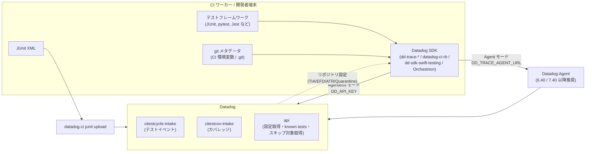
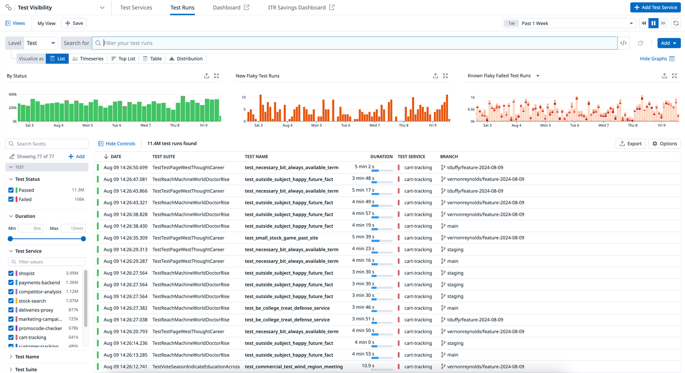
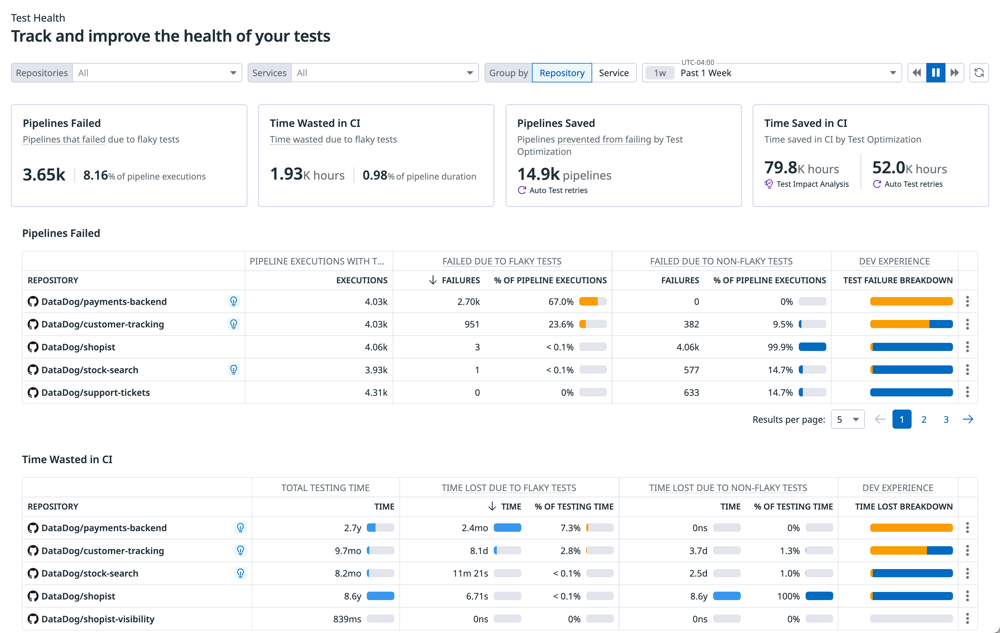
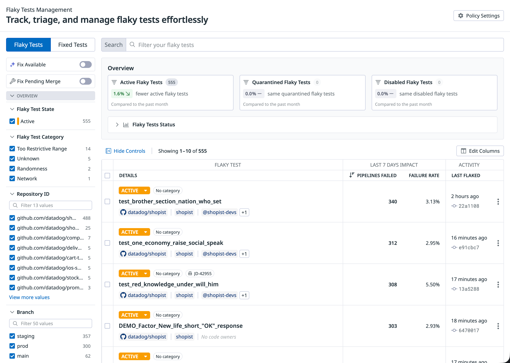
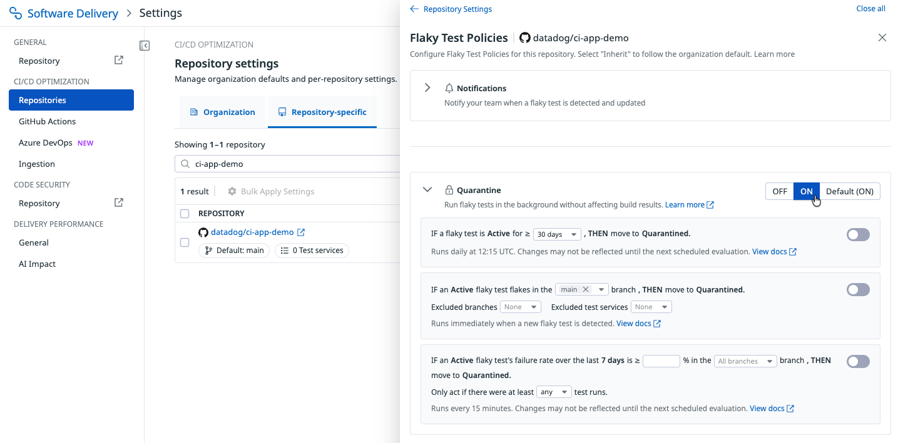
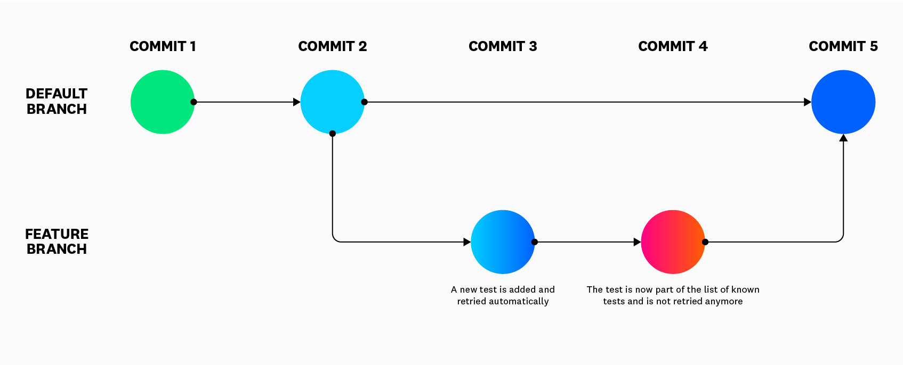
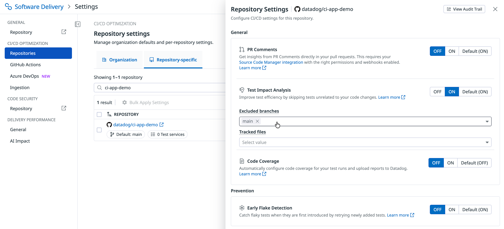

# Test Optimization（旧 Test Visibility）

## 概要

**Test Optimization（テスト最適化。旧称：Test Visibility / CI Test Visibility）** は、CI やローカルで実行されるソフトウェアテストを Datadog のトレーサー（SDK）で自動計装し、テスト単位の結果・所要時間・エラー・フレーキー性（不安定さ）を可視化・管理する Datadog の Software Delivery 製品である。パイプライン（ジョブ・ステージ）を観測する [CI Visibility（CI Pipeline Visibility）](ci-visibility.md) が「パイプライン中心」であるのに対し、Test Optimization は「自分が責任を持つコード（テスト）中心」の視点を提供する。[出典](https://docs.datadoghq.com/tests/)

Test Optimization の主要機能は次のとおり。

| 機能 | 概要 | 有効化方法 |
|---|---|---|
| テスト可視化（Test Runs / Explorer） | Session・Module・Suite・Test の4階層でテスト実行を記録・検索・集計 | 言語ごとのセットアップのみ |
| Test Health | フレーキーテストによる失敗パイプライン数・損失時間、機能による節約時間を集計 | 自動 |
| Flaky Test Management（Flaky Tests Management） | フレーキーテストの状態管理（Active / Quarantined / Disabled / Fixed）、自動ポリシー、修正確認（Attempt to Fix）、通知、AI 分類 | 一覧は自動。Quarantine/Disable は対応 SDK が必要 |
| Early Flake Detection（EFD） | 新規追加テストを最大10回再実行してフレーキー性を早期検出 | 設定画面でオプトイン |
| Auto Test Retries（ATR） | 失敗テストを自動再試行（デフォルト最大5回） | 設定画面でオプトイン |
| Failed Test Replay | 再試行時に失敗箇所のローカル変数を取得 | 設定画面でオプトイン（Java / JavaScript / .NET） |
| Test Impact Analysis（TIA。旧称 Intelligent Test Runner / ITR） | コードカバレッジと変更ファイルから、変更に無関係なテストをスキップ | 設定画面でオプトイン |
| コードカバレッジ（合計カバレッジ） | セッション／モジュール単位の行カバレッジ率を報告（**レガシー機能**。新規は独立製品 Code Coverage を推奨） | カバレッジツール併用 |
| CI Test Monitor | テスト失敗・新規フレーキー・性能劣化をアラート | Monitors から作成 |
| 開発者ワークフロー連携 | GitHub PR コメント、GitHub / Jira Issue 作成、IDE で開く | 設定画面・連携設定 |

[出典](https://docs.datadoghq.com/tests/) [出典](https://docs.datadoghq.com/tests/code_coverage/)

### 名称の変遷

| 現名称 | 旧称 | 備考 |
|---|---|---|
| Test Optimization | Test Visibility（CI Test Visibility）。CI Visibility の一部として提供されていた | 公式ドキュメント・製品ページは「Test Optimization」に統一済み。公式の改称アナウンス日は公開情報では確認できず。一部の旧ドキュメント（Getting Started の旧 URL `getting_started/test_visibility` 等）や製品ページ URL（`/product/test-visibility-intelligent-test-runner`）に旧称が残る |
| Test Impact Analysis | Intelligent Test Runner（ITR） | 公式ドキュメントに「formerly Intelligent Test Runner」と明記。タグ名・コミットメッセージ指示子（`ITR:NoSkip`）・マーカー名（`datadog_itr_unskippable`）・権限名（`intelligent_test_runner_activation_write`）に旧称の `itr` が残る |
| CI/CD Optimization | — | CI Visibility と Test Optimization を1つの UI に統合した新しい体験（後述） |
| Flaky Tests Management | Flaky Test Management（表記ゆれ） | ドキュメント内で両表記が混在 |

[出典](https://docs.datadoghq.com/tests/test_impact_analysis/) [出典](https://www.datadoghq.com/product/test-optimization/) 【第三者情報】CI Visibility → Test Visibility → Test Optimization という名称変遷を説明する第三者記事もある [出典](https://testdino.com/blog/currents-vs-datadog)（公開日は公開情報では確認できず）

### CI/CD Optimization（統合 UI）

**CI/CD Optimization** は、CI Visibility と Test Optimization の画面を1つに統合した UI である。CI Visibility または Test Optimization の任意のページ上部の **Try It Now** で切り替え、**Switch Back** で旧画面に戻せる。主な構成は次のとおり。[出典](https://docs.datadoghq.com/continuous_integration/cicd_optimization/)

| 画面 | 内容 |
|---|---|
| CI/CD Overview | CI の信頼性・性能メトリクス、トレンドウィジェット、改善提案、モニター状態のサマリー |
| Unified Explorer | パイプライン（Pipeline / Stage / Job / Step / Command）とテスト（Session / Module / Suite / Test）を切り替えて検索 |
| Flaky Management | トレンドチャート・優先順位付けの提案・セットアップ検証を含む Overview と、Flaky Management Explorer |
| 連続セットアップフロー | CI プロバイダー接続後、そのままテストスイートのセットアップに進める |

設定画面は **Software Delivery > Settings > CI/CD Optimization > Repositories**（URL: `https://app.datadoghq.com/ci/settings/ci-cd/repositories`）で、TIA・EFD・ATR・Failed Test Replay・PR Comments・コードカバレッジ・Flaky Test Policies をここで設定する。[出典](https://docs.datadoghq.com/tests/flaky_tests/auto_test_retries/)

### 関連ファイル

- パイプライン可視化: [CI Visibility](ci-visibility.md)
- PR Gates（旧 Quality Gates）、DORA Metrics、Code Coverage 製品: [DORA Metrics・Quality Gates・Code Coverage](software-delivery-insights.md)
- テストからの分散トレース（APM）: [APM インスツルメンテーション](../apm/apm-instrumentation.md)
- ブラウザテストと RUM の相関: [RUM（ブラウザ）](../dem/rum-browser.md)、Swift UI テスト: [RUM（モバイル）](../dem/rum-mobile.md)
- モニター全般: [Monitors](../platform/monitors.md)
- コードオーナー・リポジトリ連携: [Software Catalog](../platform/software-catalog.md)、[Integrations](../platform/integrations.md)
- 料金の正本: [製品別料金表](../../03_導入編/pricing-by-product.md)

## アーキテクチャとデータフロー

Test Optimization は、各言語のテスト用 SDK（APM トレーサーと同系統のライブラリ）がテストフレームワークにフックしてテストイベントを生成し、Datadog Agent 経由（Agent モード）または直接（Agentless モード）で Datadog に送信する。JUnit XML ファイルを `datadog-ci` CLI でアップロードする方式もある。[出典](https://docs.datadoghq.com/tests/setup/java/) [出典](https://docs.datadoghq.com/tests/setup/junit_xml/)

- SDK はテストセッション開始前に Datadog の API からリポジトリ／テストサービス単位の設定（TIA・EFD・ATR の有効／無効、既知テスト一覧、Quarantine/Disable 対象など）を取得する。EFD の「known tests」一覧もセッション開始前に取得される。[出典](https://docs.datadoghq.com/tests/flaky_tests/early_flake_detection/)
- 収集データ：テスト名と所要時間、CI プロバイダーの環境変数、git のコミット履歴（ハッシュ・メッセージ・作成者・変更ファイル名。**ファイルの中身は含まない**）、CODEOWNERS 情報。[出典](https://docs.datadoghq.com/tests/)
- Agent モードはテスト結果をホストメトリクス・ログと相関できるため、オンプレミス CI で推奨される。Agentless モードではログ・インフラメトリクスとの相関は行われない。[出典](https://docs.datadoghq.com/tests/setup/dotnet/)

### Agent モードと Agentless モード

| 項目 | Agent モード | Agentless モード |
|---|---|---|
| 想定環境 | オンプレミス CI、自前ワーカー | クラウド CI（ワーカーに Agent を入れられない環境） |
| 必須設定 | 各ワーカーに Datadog Agent をインストール。コンテナ実行時は `DD_TRACE_AGENT_URL` をビルドコンテナから到達可能な値に設定 | `DD_CIVISIBILITY_AGENTLESS_ENABLED=true` と `DD_API_KEY`。US1 以外は `DD_SITE` |
| Agent バージョン | TIA / EFD 利用時は Agent v6.40 / v7.40 以降 | 不要 |
| ログ・ホストメトリクス相関 | 可 | 不可 |
| 注意 | `localhost` はコンテナ内ではコンテナ自身を指す | `DD_API_KEY` を設定しただけでは Agentless にならない |

[出典](https://docs.datadoghq.com/tests/setup/java/) [出典](https://docs.datadoghq.com/tests/setup/go/) [出典](https://docs.datadoghq.com/tests/test_impact_analysis/)

### CI プロバイダーの自動計装

GitHub Actions、Jenkins、GitLab、CircleCI には専用の自動計装手段（GitHub Action、Jenkins プラグイン、GitLab 用スクリプト、CircleCI Orb）があり、これらがテストプロセスを構成する場合は言語別の手動ステップを省略できる。ただし自動計装は CI エグゼキューター上で動作するため、**別コンテナ内で実行されるテストには自動適用されない**（Tests in Containers ガイドの追加手順が必要）。JavaScript の Cypress は自動計装の対象外。[出典](https://docs.datadoghq.com/tests/setup/java/) [出典](https://docs.datadoghq.com/tests/setup/javascript/)

## 対応言語とフレームワーク

Test Optimization は .NET、Java（JVM 系）、JavaScript/TypeScript、Python、Ruby、Swift、Go をネイティブにサポートし、その他の言語は JUnit XML アップロードで取り込める。Bazel 向けには Go・Java・Python 用の公式ルールがある。[出典](https://docs.datadoghq.com/tests/)

### 言語別の互換性一覧

| 言語 | SDK / 実行方法 | テストフレームワーク（最低バージョン） | ランタイム・ビルドツール |
|---|---|---|---|
| Java / JVM | `dd-java-agent.jar` を `-javaagent` で付与（`MAVEN_OPTS` / `GRADLE_OPTS` / `SBT_OPTS` / `JAVA_TOOL_OPTIONS`） | JUnit 4 4.10、JUnit 5 5.3、TestNG 6.4、Spock 2.0、Cucumber 5.4.0、Karate 1.0.0、ScalaTest 3.0.8、Scala MUnit 0.7.28、Scala Weaver 0.8.4（SBT のみ） | Gradle 2.0+、Maven 3.2.1+、Bazel 1.2.0+（Bazel ルール使用）、Ant・SBT は制限付き。JVM バージョンはページに記載なし |
| JavaScript / TypeScript | `dd-trace`（`NODE_OPTIONS="-r dd-trace/ci/init"`） | 下表参照 | dd-trace v6 は Node.js 22 以上、v5 は Node.js 18.19+ / 20.6+ |
| Python | `ddtrace`（`pytest --ddtrace`、`ddtrace-run python -m unittest`） | pytest 3.0.0+、pytest-benchmark 3.1.0+、unittest | Python 2.7+、3.6+（機能により 3.7+） |
| .NET | `dd-trace` .NET グローバルツール（`dd-trace ci run -- dotnet test`） | xUnit 2.2、NUnit 3.0、MsTestV2 14、BenchmarkDotNet 0.13.2 | `dotnet test`、`VSTest.Console.exe`。ランタイム要件は .NET トレーサー互換性ページ参照 |
| Ruby | `datadog-ci` gem（`~> 1.0`）。`RUBYOPT="-rbundler/setup -rdatadog/ci/auto_instrument"` または `bundle exec ddcirb exec` | RSpec 3.0.0+、Minitest 5.0.0+、Cucumber 3.0+。ランナー: Knapsack Pro 7.2.0+、parallel_tests 4.0.0+、ci-queue 0.53.0+ | Ruby 2.7+ |
| Go | Orchestrion（`orchestrion go test ./...` または `go test -toolexec 'orchestrion toolexec'`） | 標準 `testing` パッケージのみ | Go の最新2リリース。Go modules 必須 |
| Swift / Objective-C | `dd-sdk-swift-testing`（SPM / CocoaPods `DatadogSDKTesting` / XCFramework） | XCTest（フル）、Swift Testing（SDK 2.7.0 は観測のみ、2.7.1 でフル対応） | Swift 6.2+、Objective-C 2.0+、Xcode 26.0+、iOS/iPadOS 15.0+、macOS 11.0+、tvOS 15.0+、macCatalyst 13.0+ |
| その他（PHP 等） | `datadog-ci junit upload`（datadog-ci 2.17.0+） | JUnit XML を出力できる任意のフレームワーク | — |
| Bazel | `DataDog/rules_test_optimization`（モジュール `datadog-rules-test-optimization` 1.2.0） | Java（`dd_topt_java_test`）、Python（`dd_topt_py_test`）、Go（`dd_topt_go_test`） | TIA・自動カバレッジ構成は非対応 |

[出典](https://docs.datadoghq.com/tests/setup/java/) [出典](https://docs.datadoghq.com/tests/setup/javascript/) [出典](https://docs.datadoghq.com/tests/setup/python/) [出典](https://docs.datadoghq.com/tests/setup/dotnet/) [出典](https://docs.datadoghq.com/tests/setup/ruby/) [出典](https://docs.datadoghq.com/tests/setup/go/) [出典](https://docs.datadoghq.com/tests/setup/swift/) [出典](https://docs.datadoghq.com/tests/setup/junit_xml/) [出典](https://docs.datadoghq.com/tests/setup/bazel/)

> 注: 上表の最低バージョンは 2026-11-02 時点の公式ドキュメント記載値。Swift の Xcode 26.0+ / Swift 6.2+ のように、要件は SDK の更新に伴い引き上げられることがあるため、導入時は各言語ページを再確認すること。

### JavaScript フレームワーク別の対応バージョン

| フレームワーク | dd-trace v6（Node.js 22+） | dd-trace v5 | 計装方法 |
|---|---|---|---|
| Jest | 28.0.0+ | 24.8.0+ | `NODE_OPTIONS="-r dd-trace/ci/init"`。`jest-circus` ランナー、`jsdom` / `node` 環境のみ |
| Mocha | 8.0.0+ | 5.2.0+ | 同上。Mocha 9.0.0+（ESM）は `--import dd-trace/register.js` を追加 |
| Cucumber | 7.0.0+ | 7.0.0+ | `NODE_OPTIONS="-r dd-trace/ci/init"` |
| Cypress | 12.0.0+ | 6.7.0+ | `cypress.config.js` の `setupNodeEvents` に `dd-trace/ci/cypress/plugin`、support ファイルに `dd-trace/ci/cypress/support`。`cypress open`（対話モード）は非対応 |
| Playwright | 1.38.0+ | 1.18.0+ | `NODE_OPTIONS="-r dd-trace/ci/init"`（EFD は 1.38.0+ が必要） |
| Vitest | 1.6.0+ | 1.6.0+（dd-trace 5.18.0 以降） | `NODE_OPTIONS="--import dd-trace/register.js -r dd-trace/ci/init"` |
| WebdriverIO | 9.0.0+ | 9.0.0+（Mocha/Jasmine アダプターは 5.121.0 以降） | Vitest と同じ |

[出典](https://docs.datadoghq.com/tests/setup/javascript/)

JavaScript の注意点：`NODE_OPTIONS` をパイプライン全体やジョブ全体に設定すると、`dd-trace` インストール前の `npm install` などが失敗するため、テスト実行コマンドにだけ付与する。Yarn 2+ の PnP では `NODE_OPTIONS="-r $(pwd)/.pnp.cjs -r dd-trace/ci/init"` とする。Jest の `--forceExit`、Mocha の `--exit` はデータ欠損の原因になりうる。[出典](https://docs.datadoghq.com/tests/setup/javascript/)

### 機能対応マトリクス（Test Optimization 基本機能）

| 機能 | .NET | Java | JavaScript | Python | Ruby | Swift | Go | JUnit XML |
|---|---|---|---|---|---|---|---|---|
| マイクロ秒精度の開始時刻・所要時間 | ○ | ○ | ○ | ○ | ○ | ○ | ○ | － |
| 結合テストの分散トレース（計装済みサービス呼び出し） | ○ | ○ | ○ | ○ | ○ | ○ | ○ | － |
| Agent 経由の送信 | ○ | ○ | ○ | ○ | ○ | ○ | ○ | － |
| Agentless 送信 | ○ | ○ | ○ | ○ | ○ | ○ | ○ | ○ |
| Session / Module / Suite / Test 階層 | ○ | ○ | ○ | ○ | ○ | ○ | ○ | ○ |
| Manual Testing API | ○ | ○ | ○ | ○ | ○ | － | － | － |
| テストごとの Codeowner | ○ | ○ | ○ | ○ | ○ | ○ | ○ | 部分的 |
| ソースの開始・終了行 | ○ | ○ | 開始行のみ | ○ | ○ | ○ | ○ | 開始行のみ |
| CI・git メタデータ収集 | ○ | ○ | ○ | ○ | ○ | ○ | ○ | ○ |
| TIA 用 git メタデータアップロード | ○ | ○ | ○ | ○ | ○ | ○ | ○ | ○ |
| Test Impact Analysis（オプトイン） | ○ | ○ | ○ | ○ | ○ | ○ | ○ | － |
| 合計コードカバレッジ | ○ | ○ | ○ | ○ | ○ | ○ | ○ | 手動 |
| ベンチマークテスト | ○ | ○ | ○ | ○ | － | － | － | － |
| パラメータ化テストの検出 | ○ | ○ | ○ | ○ | ○ | ○ | － | － |
| Early Flake Detection（オプトイン） | ○ | ○ | ○ | ○ | ○ | ○ | ○ | － |
| Auto Test Retries（オプトイン） | ○ | ○ | ○ | ○ | ○ | ○ | ○ | － |
| Failed Test Replay（オプトイン） | ○ | ○ | ○ | － | － | － | － | － |
| Selenium の RUM 連携 | ○ | ○ | ○ | ○ | ○ | － | － | － |

[出典](https://docs.datadoghq.com/tests/)（Supported features 表。「－」は公式表で空欄）

> 注: 公式の Supported features 表は Markdown ソース上で見出し行が1列ずれており、レンダリング結果では列見出しと値がずれて見える。本表は、空欄が行末側に省略されている前提で値を .NET → Java → JavaScript → Python → Ruby → Swift → Go → JUnit XML の順に割り当てたもの（Failed Test Replay が Java / JavaScript / .NET のみ、Manual API が Go と JUnit XML で非対応という他ページの記述と整合する）。ベンチマーク・パラメータ化テスト・ソース行の言語別可否は、この解釈に依存するため導入時に公式表で再確認すること。

### オプトイン機能の言語別最低バージョン

| 言語 | Early Flake Detection | Auto Test Retries | Quarantine & Disable | Attempt to Fix | Test Impact Analysis | Failed Test Replay |
|---|---|---|---|---|---|---|
| .NET | `dd-trace-dotnet` 2.51.0+ | 3.4.0+ | 3.13.0+ | 3.23.0+ | `dd-trace` 2.22.0+ | ○ |
| Java | `dd-trace-java` 1.34.0+（Scala Weaver 除く） | 1.34.0+（Scala Weaver 除く） | 1.47.0+ | 1.52.0+ | `dd-java-agent` 1.27.0+ | ○ |
| JavaScript | `dd-trace-js` 5.23.0+（Playwright は 1.38.0+） | 5.19.0+ | 5.44.0+ | 5.59.0+ | Jest/Mocha/Cucumber/Cypress: 4.17.0+ または 3.38.0+、Vitest: 6.21.0+ または 5.132.0+ | ○ |
| Python | `dd-trace-py` 3.0.0+（pytest 7.2.0+） | 3.0.0+（pytest 7.2.0+）。Dynamic ATR は 4.15.0+ | 3.3.0+ | 3.8.0+ | pytest: `ddtrace` 2.1.0+（pytest 7.2.0+、coverage 5.5+）、unittest: 2.2.0+ | × |
| Ruby | `datadog-ci-rb` 1.5.0+ | 1.4.0+ | 1.13.0+ | 1.17.0+ | `datadog-ci` 1.0+ | × |
| Go | Orchestrion 0.9.4+ ＋ `dd-trace-go` 1.69.1+ | 同左 | 1.73.0+（Orchestrion 1.3.0+） | 2.2.2+（Orchestrion 1.6.0+） | Orchestrion 0.9.4+ ＋ `dd-trace-go` 1.70.0+ | × |
| Swift | `dd-sdk-swift-testing` 2.5.2+ | 2.5.2+ | 2.6.1+ | 2.6.1+ | 2.2.0+ | × |
| JUnit XML | × | × | ×（ネイティブ計装が必須） | × | × | × |

[出典](https://docs.datadoghq.com/tests/flaky_tests/early_flake_detection/) [出典](https://docs.datadoghq.com/tests/flaky_tests/auto_test_retries/) [出典](https://docs.datadoghq.com/tests/flaky_management/) [出典](https://docs.datadoghq.com/tests/test_impact_analysis/setup/java/) [出典](https://docs.datadoghq.com/tests/test_impact_analysis/setup/javascript/) [出典](https://docs.datadoghq.com/tests/test_impact_analysis/setup/python/) [出典](https://docs.datadoghq.com/tests/test_impact_analysis/setup/dotnet/) [出典](https://docs.datadoghq.com/tests/test_impact_analysis/setup/ruby/) [出典](https://docs.datadoghq.com/tests/test_impact_analysis/setup/go/) [出典](https://docs.datadoghq.com/tests/test_impact_analysis/setup/swift/)

> 補足: Flaky Test Management の一覧表示（フレーキーテストの検出・表示）自体は既存のテストデータから行われるが、Quarantine / Disable / Attempt to Fix を CI 上で実際に効かせるには上表のネイティブ SDK が必要で、JUnit XML アップロードでは機能しない。[出典](https://docs.datadoghq.com/tests/flaky_management/) [出典](https://www.datadoghq.com/product-preview/flaky-test-management/)

## セットアップと設定項目

### 共通の環境変数

| 環境変数 | デフォルト | 説明 |
|---|---|---|
| `DD_CIVISIBILITY_ENABLED` | `false` | Test Optimization を有効化（Java・Ruby・Go で必須） |
| `DD_CIVISIBILITY_AGENTLESS_ENABLED` | `false` | Agentless モードを有効化 |
| `DD_API_KEY` | （空） | Agentless 送信用 API キー。これだけでは Agentless にならない |
| `DD_SITE` | `datadoghq.com` | 送信先サイト（US1 以外は必須。AP1 は `ap1.datadoghq.com`） |
| `DD_TRACE_AGENT_URL` | `http://localhost:8126`（JavaScript・Ruby は `http://127.0.0.1:8126`） | Agent の URL。`DD_AGENT_HOST` / `DD_TRACE_AGENT_PORT` より優先 |
| `DD_SERVICE` | 言語により異なる（Java: `unnamed-java-app`、Python・Ruby・Go・Swift: リポジトリ名、JavaScript: Nx パッケージ名 → `package.json` 名 → `node`） | テスト対象のサービス／ライブラリ名（テストサービス） |
| `DD_ENV` | Java・Ruby・Go: 空、Python・.NET: `none`、Swift: CI 上は `ci`、それ以外 `none` | 環境名（例 `ci`、`local`） |
| `DD_TEST_SESSION_NAME` | CI ジョブ名＋テストコマンド（なければテストコマンド） | テストセッションのグループ名（例 `unit-tests`）。セッション指紋の安定化に重要 |
| `DD_TAGS` | — | カスタムタグ。`test.configuration.*` プレフィックスでカスタム構成を定義 |
| `DD_GIT_*` | 自動検出 | git メタデータの手動指定（自動検出より優先） |

[出典](https://docs.datadoghq.com/tests/setup/java/) [出典](https://docs.datadoghq.com/tests/setup/javascript/) [出典](https://docs.datadoghq.com/tests/setup/python/) [出典](https://docs.datadoghq.com/tests/setup/ruby/) [出典](https://docs.datadoghq.com/tests/setup/go/) [出典](https://docs.datadoghq.com/tests/setup/swift/)

環境変数はテストプロセス起動前に設定し、並列ランナーでは親プロセスに設定してワーカーに継承させる。[出典](https://docs.datadoghq.com/tests/setup/python/)

### git メタデータの手動指定（`DD_GIT_*`）

SDK は git 情報を ①CI プロバイダーの環境変数 → ②ローカル `.git`（`$PATH` に `git` が必要）の順に取得し、③`DD_GIT_*` 変数が設定されていればすべてに優先する。git 情報（`git.repository_url`、`git.commit.sha`、`git.branch`）が欠けると Test Runs には表示されるが Test Health 等には表示されない。[出典](https://docs.datadoghq.com/tests/troubleshooting/)

| 変数 | 必須 | 形式 |
|---|---|---|
| `DD_GIT_REPOSITORY_URL` | 必須 | HTTP または SSH の URL |
| `DD_GIT_COMMIT_SHA` | 必須 | 40文字の SHA1 |
| `DD_GIT_COMMIT_AUTHOR_EMAIL` | 必須 | — |
| `DD_GIT_COMMIT_AUTHOR_NAME` / `DD_GIT_COMMIT_AUTHOR_DATE` | 任意 | 日付は ISO 8601 |
| `DD_GIT_COMMIT_COMMITTER_EMAIL` / `_NAME` / `_DATE` | 任意 | 日付は ISO 8601 |
| `DD_GIT_COMMIT_MESSAGE` | 任意 | — |
| `DD_GIT_BRANCH` | 任意 | タグ利用時は空にする |
| `DD_GIT_TAG` | 任意 | ブランチ利用時は空にする |

[出典](https://docs.datadoghq.com/tests/troubleshooting/)

CI 変数（`GITHUB_SHA`、`CI_COMMIT_SHA` 等）はジョブ開始時に確定するため、GitHub の `pull_request` ワークフローで head コミットをチェックアウトする場合、`actions/checkout` で別 ref を指定する場合、GitLab で `GIT_CHECKOUT: "false"` として手動チェックアウトする場合などは、報告コミットがずれることがある。対策は `DD_GIT_*` の明示指定。[出典](https://docs.datadoghq.com/tests/troubleshooting/)

### 言語別のセットアップ要点

| 言語 | 実行例 | 言語固有の設定・注意 |
|---|---|---|
| Java | `wget -O $DD_TRACER_FOLDER/dd-java-agent.jar 'https://dtdg.co/latest-java-tracer'` の後、`MAVEN_OPTS=-javaagent:$DD_TRACER_FOLDER/dd-java-agent.jar` 等 | `DD_CIVISIBILITY_COMPILER_PLUGIN_AUTO_CONFIGURATION_ENABLED=false` でコンパイラプラグイン無効化。マルチモジュールはモジュールごとに別トレース。Android はエミュレーター／実機テスト非対応（Robolectric 経由のみ） |
| JavaScript | `NODE_OPTIONS="-r dd-trace/ci/init" DD_ENV=ci DD_SERVICE=my-app yarn test` | 失敗時スクリーンショット・動画アップロード（`DD_TEST_FAILURE_SCREENSHOTS_ENABLED`、`DD_TEST_FAILURE_VIDEOS_ENABLED`。dd-trace 5.132.0+ / 6.21.0+）。Cypress リトライ系機能は `testIsolation` 有効が前提 |
| Python | `DD_ENV=ci DD_SERVICE=my-app pytest --ddtrace`（`--ddtrace-patch-all` で他 APM 統合も有効） | `pytest-xdist` は `ddtrace>=3.12.6` が必要。`pytest-forked` は非対応。`pytest-randomly` は Module/Suite イベントが複数になりうる |
| .NET | `dotnet tool update -g dd-trace` → `dd-trace ci run --dd-service=my-app -- dotnet test` | 内蔵カバレッジ `DD_CIVISIBILITY_CODE_COVERAGE_ENABLED`、外部 Coverlet レポート `DD_CIVISIBILITY_EXTERNAL_CODE_COVERAGE_PATH`。`Microsoft.CodeCoverage` 17.2.0+ の動的計装は競合するため `.runsettings` で静的計装に切替 |
| Ruby | `bundle exec ddcirb exec bundle exec rake test` | カスタムタグ `Datadog::CI.active_test&.set_tag(...)`。Manual API は RSpec/Minitest/Cucumber と併用不可 |
| Go | `go install github.com/DataDog/orchestrion@latest` → `orchestrion pin`（任意）→ `orchestrion go test -race ./...` | Bazel 利用時は Bazel ルールを使う |
| Swift | テストターゲットに `DatadogSDKTesting` をリンクし、`DD_TEST_RUNNER=$(DD_TEST_RUNNER)`、`DD_API_KEY`、`SRCROOT=$(SRCROOT)` を設定 | `Info.plist` でも設定可（環境変数が優先）。stdout/stderr 取得は課金増の可能性。クラッシュハンドラー無効化時はクラッシュテストが失敗として報告されない |

[出典](https://docs.datadoghq.com/tests/setup/java/) [出典](https://docs.datadoghq.com/tests/setup/javascript/) [出典](https://docs.datadoghq.com/tests/setup/python/) [出典](https://docs.datadoghq.com/tests/setup/dotnet/) [出典](https://docs.datadoghq.com/tests/setup/ruby/) [出典](https://docs.datadoghq.com/tests/setup/go/) [出典](https://docs.datadoghq.com/tests/setup/swift/)

### JUnit XML アップロード（`datadog-ci junit upload`）

`datadog-ci junit upload --service <service_name> <path> [<path> ...]` で JUnit XML（ファイルまたはディレクトリ。ディレクトリは `.xml` を走査）をアップロードする。`datadog-ci` 2.17.0 以上が必要。Datadog は精度と分散トレースの観点から**ネイティブ計装を JUnit XML より推奨**している。[出典](https://docs.datadoghq.com/tests/setup/junit_xml/)

| オプション | 既定値 | 説明 |
|---|---|---|
| `--service` | （必須） | テストサービス名。環境変数 `DD_SERVICE` |
| `--env` | — | 環境名。`DD_ENV` |
| `--tags` | — | 全テストに付与する `key:value`。`DD_TAGS` とマージされ、キー衝突時は `DD_TAGS` が優先 |
| `--measures` | — | 全テストに付与する数値 `key:number`。`DD_MEASURES` が優先 |
| `--report-tags` / `--report-measures` | — | セッションレベルのタグ／数値（`DD_TAGS` 等とはマージされない） |
| `--xpath-tag` | — | `key=expression` でテストごとにタグ付け（最優先） |
| `--logs` | `false` | `<system-out>`・`<system-err>`・`<failure>` をログとして送信（**Log Management として別課金**）。`DD_CIVISIBILITY_LOGS_ENABLED` |
| `--max-concurrency` | `20` | 同時アップロード数 |
| `--dry-run` | `false` | アップロードせずに検証のみ |
| `--skip-git-metadata-upload` | `false` | git メタデータのアップロードを省略 |
| `--git-repository-url` | ローカル git から取得 | リポジトリ URL |
| `--verbose` | `false` | 詳細出力 |

| 環境変数 | 説明 |
|---|---|
| `DATADOG_API_KEY` | （必須）API キー |
| `DATADOG_SITE` | 送信先サイト。既定 `datadoghq.com` |

[出典](https://docs.datadoghq.com/tests/setup/junit_xml/)

JUnit XML の注意：テスト失敗時もアップロードが走るよう CI を構成する（GitHub Actions は `if: always()`、GitLab は `after_script`、Jenkins は `post`、CircleCI は `when: always`）。CODEOWNERS 連携は GitHub のみ対応で、`<testcase>` / `<testsuite>` に `file` 属性が必要（ない場合は `test.source.file` タグを付与）。[出典](https://docs.datadoghq.com/tests/setup/junit_xml/) アップロード時点で **71時間より古いタイムスタンプのレポートと、名前のない testsuite は破棄**される。[出典](https://docs.datadoghq.com/tests/troubleshooting/)

### テスト構成（Test configurations）とテストの同一性

Test Optimization は、同じテストでも構成（OS・ランタイム・デバイス等）が異なる実行を**別テスト**として扱い、ある構成でだけ失敗した場合にその組み合わせだけを失敗とする。自動収集される構成タグは次のとおり。[出典](https://docs.datadoghq.com/tests/)

| タグ | 内容 |
|---|---|
| `os.platform`、`os.family`、`os.version`、`os.architecture` | OS の名前・ファミリー・バージョン・アーキテクチャ |
| `runtime.name`、`runtime.version`、`runtime.vendor`、`runtime.architecture` | 言語ランタイム |
| `device.model`、`device.name` | デバイス（主にモバイル） |
| `ui.appearance`、`ui.orientation`、`ui.localization` | UI 属性（主に Swift の UI テスト） |
| `test.configuration.<任意>` | `DD_TAGS` で指定するカスタム構成。ネスト（`test.configuration.cpu.memory`）は非対応。フィルタにはファセット作成が必要 |

[出典](https://docs.datadoghq.com/tests/) [出典](https://docs.datadoghq.com/tests/search/)

一意のテストは「Suite・名前・パラメータ・構成」で決まる。日付や乱数など**非決定的なパラメータ**を使うと実行のたびに別テストとなり、実行履歴・フレーキー判定・TIA のスキップがすべて機能しなくなる。また、テストコマンドに一時ディレクトリ等の可変値が含まれるとセッション指紋が不安定になり、セッション履歴や TIA の節約時間が表示されないため、`DD_TEST_SESSION_NAME` を固定値にする。[出典](https://docs.datadoghq.com/tests/troubleshooting/)

## 画面と分析機能

主な画面と URL（US1 の例。AP1 では `ap1.datadoghq.com`）は次のとおり。

| 画面 | パス | 用途 |
|---|---|---|
| Test Health | `/ci/test/health` | フレーキーテストの影響と節約効果のダッシュボード |
| Test Runs（Explorer） | `/ci/test-runs` | テスト実行の検索・集計・可視化、モニターへのエクスポート |
| Flaky Tests Management | Test Optimization 配下（CI/CD Optimization では Flaky Management。正確なメニュー名は UI 版により異なり、公開情報では確定できず） | フレーキーテスト一覧・状態管理 |
| Repositories / Branches / Commits | Test Optimization 配下 | リポジトリ・ブランチ・コミット単位の結果（失敗テスト、新規フレーキーテスト、構成タグ） |
| 設定 | `/ci/settings/ci-cd/repositories` | TIA・EFD・ATR・Failed Test Replay・PR Comments・Flaky Test Policies |
| TIA ダッシュボード | 標準ダッシュボード | TIA の節約時間・採用状況（リポジトリ別・コミッター別・サービス別） |

[出典](https://docs.datadoghq.com/tests/) [出典](https://docs.datadoghq.com/tests/test_impact_analysis/)

### Test Optimization Explorer（Test Runs）

Test Optimization Explorer は **Software Delivery > Test Optimization > Test Runs** にあり、テスト実行を4階層で検索・分析する。[出典](https://docs.datadoghq.com/tests/explorer/)

| 階層 | 定義 |
|---|---|
| Session | 最上位。1つのテストコマンド（`yarn test`、`mvn test`、`dotnet test` 等）に対応。JUnit アップロードではレポートファイル1つにつき1セッション |
| Module | 言語により定義が異なる（.NET は同じ単体テストプロジェクト、Swift はバンドル単位） |
| Suite | 同じコード単位を検証するテストのグループ（例：1テストファイル） |
| Test | 個々のテストケース |

- **キャプション:** Test Optimization Explorer（Test Runs）画面。
- **画面説明:** 公式ドキュメントのスクリーンショットは旧名称時代のもので、左上の製品名が「Test Visibility」、上部タブが Test Services / Test Runs / Dashboard / ITR Savings Dashboard、右上に **Add Test Service** ボタンが表示されている（現行 UI では名称・タブ構成が異なる可能性がある）。検索バーの左に **Level**（Session / Module / Suite / Test の切替）、その下に **Visualize as**（List / Timeseries / Top List / Table / Distribution）。上段に「By Status」「New Flaky Test Runs」「Known Flaky Failed Test Runs」の3つの時系列グラフ。左にファセットパネル（Test Status、Duration、Test Service、Test Name、Test Suite など）、中央に DATE / TEST SUITE / TEST NAME / DURATION / TEST SERVICE / BRANCH の列を持つテスト実行リスト。右上の **Export** から CI Test Monitor 等へ出力、**Views** / **Save** で保存ビューを管理する。
- **出典:** https://docs.datadoghq.com/tests/explorer/ （取得日: 2026-11-02）

主な標準ファセットは次のとおり。[出典](https://docs.datadoghq.com/tests/explorer/)

| 分類 | ファセット |
|---|---|
| ステータス・時間 | Test Status、Duration、Is New（`@test.is_new`）、Is Retry（`@test.is_retry`） |
| 識別 | Test Service、Test Name、Test Full Name、Test Suite、Test Module、Test Bundle、Test Fingerprint、Test Fingerprint (FQN)（`@test.fingerprint_fqn`）、Test Command、Test Framework、Test Type、Test Traits、Language、Has Parameters、Test Code Owners |
| フレーキー | Flaky（`@test.is_flaky`）、Known Flaky（`@test.is_known_flaky`）、New Flaky（`@test.is_new_flaky`）、Early Flake Detection Enabled（`@test.early_flake.enabled`）、Early Flake Detection Abort Reason |
| 性能劣化 | Performance Regression、Baseline Mean、Baseline Standard Deviation、Absolute Change、Relative Change、Standard Deviation Change |
| Test Impact Analysis | Code Coverage Enabled（`@test.code_coverage.enabled`）、Skipped by ITR、Test Skipping Enabled、Test Skipping Type、Test Skipped、Time Saved |
| その他 | RUM Active |

性能劣化（Performance Regression）の判定ロジック（ベースラインの取り方・閾値）は公開情報では確認できず。ファセット名からデフォルトブランチ等のベースライン平均・標準偏差との比較で判定していると読み取れるが、具体的な閾値は未確認。

同一コミットでの同じテストの再実行結果は次のルールで集約される：失敗／スキップの後に1回でも成功すれば **Passed**、失敗の後が失敗またはスキップなら **Failed**、スキップのみなら **Skipped**。[出典](https://docs.datadoghq.com/tests/troubleshooting/)

### Test Health

Test Health は、テストのフレーキー性が CI に与えている影響と、Test Optimization の機能による緩和効果をまとめたダッシュボードである。CI Visibility も有効な場合は CI Visibility のデータと相関し、所要時間にはテストセッションではなくジョブの所要時間を用い、失敗はジョブ単位で数える。[出典](https://docs.datadoghq.com/tests/test_health/)

- **キャプション:** Test Health ダッシュボード。
- **画面説明:** 見出し「Track and improve the health of your tests」。上部に Repositories / Services フィルタ、**Group by**（Repository / Service）、時間範囲（例 Past 1 Week）。その下に4つのサマリータイル（Pipelines Failed：フレーキーテスト起因の失敗パイプライン数と全実行に対する割合、Time Wasted in CI：損失時間とパイプライン時間に対する割合、Pipelines Saved：Auto Test Retries により救われたパイプライン数、Time Saved in CI：Test Impact Analysis と Auto Test Retries それぞれの節約時間）。下段の「Pipelines Failed」表はリポジトリ別に EXECUTIONS、FAILED DUE TO FLAKY TESTS（件数・割合）、FAILED DUE TO NON-FLAKY TESTS、DEV EXPERIENCE（Test Failure Breakdown バー）を表示し、「Time Wasted in CI」表は TOTAL TESTING TIME、TIME LOST DUE TO FLAKY / NON-FLAKY TESTS、TIME LOST BREAKDOWN を表示する。リポジトリ名横の電球アイコンから Recommendations サイドパネルを開き、Auto Test Retries や Test Impact Analysis を直接有効化できる。
- **出典:** https://docs.datadoghq.com/tests/test_health/ （取得日: 2026-11-02）

| 指標 | 定義 |
|---|---|
| Pipelines Failed | フレーキーテストが原因で失敗したパイプライン数。「Failures Due to Flaky Tests」は `@test.is_known_flaky` または `@test.is_new_flaky` のテストのみが原因で失敗した実行 |
| Time Wasted in CI | フレーキーテストのみが原因で失敗したテストセッションの合計時間（Total Testing Time はテストセッション所要時間の合計） |
| Pipelines Saved | Auto Test Retries で失敗を回避したパイプライン（`@test.is_retry:true` かつ `@test.is_new:false` を含む成功セッション） |
| Time Saved in CI | TIA（`@test_session.itr.time_saved`）と ATR による節約時間の合計。合計テスト時間を上回ることもある |

[出典](https://docs.datadoghq.com/tests/test_health/)

Recommendations は、リポジトリの言語・フレームワークが対応している機能（ATR、TIA）だけを提示する。[出典](https://docs.datadoghq.com/tests/test_health/)

### ブランチ・コミット単位のフレーキーテスト表示

フレーキーテストとは、同一コミットに対する複数回の実行で成功と失敗の両方が出るテストを指す。ブランチ／コミット画面のフレーキーテスト関連の仕様は次のとおり。[出典](https://docs.datadoghq.com/tests/flaky_tests/)

| タグ | 意味 |
|---|---|
| `@test.is_flaky` | 同一コミットで成功・失敗の両方が出た（初回のみ付与） |
| `@test.is_new_flaky` | 現ブランチまたはデフォルトブランチで初めてフレーキーと判定された |
| `@test.is_known_flaky` | 失敗したが、既に現ブランチまたはデフォルトブランチでフレーキーと判明しているテスト（失敗がコミット起因でない可能性） |

- デフォルトブランチには、デフォルトブランチ上でフレーキーなテストに加え、マージされたフィーチャーブランチでフレーキーだったテストも含まれる。マージ検出は直近 **5,000 コミット**の git 履歴を対象とし、squash・reset・force-push ではフィーチャーブランチのフレーキーテストが見えなくなることがある。
- 30日間失敗していないテストは一覧から自動削除される。手動でゴミ箱アイコンから削除でき、再びフレークすれば再表示される。
- New Flaky の表は、選択期間中に flaked したコミット数の多い上位 **1,000 件**に制限される。
- 誤検出の新規フレーキーテストは、特定コミットについて無視（ignore）できる。

[出典](https://docs.datadoghq.com/tests/flaky_tests/)

> 補足: 上記はブランチ／コミット画面での表示仕様（従来の「Working with Flaky Tests」）である。状態管理・ポリシー・通知は次節の Flaky Tests Management で行う。

## Flaky Test Management（Flaky Tests Management）

Flaky Tests Management は、検出されたフレーキーテストを一元的に追跡・トリアージし、状態（ステート）に応じて CI での扱いを変える機能である。[出典](https://docs.datadoghq.com/tests/flaky_management/)

- **キャプション:** Flaky Tests Management 画面（「Track, triage, and manage flaky tests effortlessly」）。
- **画面説明:** 右上に **Policy Settings** ボタン。上部に **Flaky Tests / Fixed Tests** のタブと検索バー。左パネルに「Fix Available」「Fix Pending Merge」トグル、Flaky Test State（Active 等）、Flaky Test Category（Too Restrictive Range、Unknown、Randomness、Network 等）、Repository ID、Branch のフィルタ。中央上部の Overview に Active / Quarantined / Disabled の各件数と前月比、「Flaky Tests Status」グラフ。下部の表は FLAKY TEST（状態ドロップダウン、カテゴリ、テスト名、リポジトリ、サービス、コードオーナー、Jira キー等）、LAST 7 DAYS IMPACT（PIPELINES FAILED、FAILURE RATE）、ACTIVITY（LAST FLAKED と最終コミット SHA）の列で構成される。
- **出典:** https://docs.datadoghq.com/tests/flaky_management/ （取得日: 2026-11-02）

### 状態（ステート）

| 状態 | CI での挙動 | 付与タグ |
|---|---|---|
| Active | フレーキーと判明しているが通常どおり CI で実行・判定される | — |
| Quarantined | バックグラウンドで実行されるが、失敗しても CI ステータスに影響せずパイプラインを壊さない | `@test.test_management.is_quarantined:true` |
| Disabled | CI で完全にスキップされる（実行されないためフレーキー性のシグナルも得られない）。自動で Fixed には移行しない | `@test.test_management.is_disabled:true` |
| Fixed | 安定して成功しフレーキーでなくなった。修正のデフォルトブランチへのマージ後に自動適用されうる | — |
| Fix in progress（表示上の指標） | Attempt to Fix 成功後、修正がデフォルトブランチに届くまで表示 | — |

[出典](https://docs.datadoghq.com/tests/flaky_management/)

各テストは安定 ID（リポジトリ ID と完全修飾名のハッシュ）を持ち、Explorer では `@test.fingerprint_fqn`、API では `id`、Search flaky tests エンドポイントでは `fingerprint_fqn` フィルタとして現れる。[出典](https://docs.datadoghq.com/tests/flaky_management/)

### AI によるフレーキーカテゴリ分類

`@error.message` と `@error.stack` の両方を持つ失敗実行が1件以上あるテストは、AI により次の14カテゴリのいずれかに分類される（新規検出から分類まで数分かかることがある）。[出典](https://docs.datadoghq.com/tests/flaky_management/)

| # | カテゴリ | # | カテゴリ |
|---|---|---|---|
| 1 | Concurrency | 8 | Resource Leak |
| 2 | Randomness | 9 | Asynchronous Wait |
| 3 | Floating Point | 10 | IO |
| 4 | Unordered Collection | 11 | Network |
| 5 | Too Restrictive Range | 12 | Time |
| 6 | Timeout | 13 | Environment Dependency |
| 7 | Order Dependency | 14 | Unknown |

### 操作（Actions）

| 操作 | 内容 |
|---|---|
| 状態変更 | 状態ドロップダウンで Active / Quarantined / Disabled / Fixed を切替 |
| View Last Failed Test Run | 直近の失敗実行をサイドパネルで表示 |
| View related test executions | Explorer で関連実行を表示 |
| Create Work Item | Work Management で修正作業を追跡（Jira 連携は Work Management 経由） |
| Link commit to Flaky Test fix | Attempt to Fix 用のテストキー（例 `DD_ABC123`）を発行 |
| Generate fix | Bits Code による修正案生成（要セットアップ） |
| Policy Settings | Flaky Test Policies（組織既定またはリポジトリ別）を開く |

[出典](https://docs.datadoghq.com/tests/flaky_management/)

### 自動ポリシー（Flaky Test Policies）

Flaky Test Policies は **Software Delivery > Settings > CI/CD Optimization > Repositories** で組織既定またはリポジトリ単位に設定する。リポジトリ側は「Inherit（組織既定に従う）」も選べる。[出典](https://docs.datadoghq.com/tests/flaky_management/)

- **キャプション:** Repository settings 上の Flaky Test Policies サイドパネル（リポジトリ別設定）。
- **画面説明:** 左ナビに Software Delivery > Settings の GENERAL（Repository）、CI/CD OPTIMIZATION（Repositories、GitHub Actions、Azure DevOps、Ingestion）、CODE SECURITY、DELIVERY PERFORMANCE（General、AI Impact）。中央に Organization / Repository-specific タブとリポジトリ一覧（デフォルトブランチ、テストサービス数）。右パネル「Flaky Test Policies」に Notifications と Quarantine の各セクションがあり、Quarantine は OFF / ON / Default の3択。ルール例「IF a flaky test is Active for ≥ 30 days, THEN move to Quarantined（毎日 12:15 UTC 実行）」「IF an Active flaky test flakes in the main branch, THEN move to Quarantined（Excluded branches / Excluded test services を指定可。新規検出時に即時実行）」「IF an Active flaky test's failure rate over the last 7 days is ≥ X % in the All branches branch, THEN move to Quarantined（最低実行回数を指定可。15分ごと実行）」が表示される。
- **出典:** https://docs.datadoghq.com/tests/flaky_management/ （取得日: 2026-11-02）

| ポリシー | 条件 | 評価タイミング |
|---|---|---|
| Quarantine（時間） | Active のまま指定日数経過 | 毎日 12:15 UTC |
| Quarantine（ブランチ） | Active なテストが指定ブランチでフレーク | 新規フレーキー検出時に即時 |
| Quarantine（失敗率） | Active なテストの直近7日失敗率が閾値以上 | 15分ごと |
| Disable（状態と時間） | 指定状態のまま指定日数経過 | 毎日 12:30 UTC |
| Disable（ブランチ） | Active または Quarantined のテストが指定ブランチでフレーク | 公開情報では確認できず |
| Disable（失敗率） | Active または Quarantined のテストの直近7日失敗率が閾値以上 | 15分ごと |
| Attempt to Fix | 修正コミット上での再試行回数 | 既定 **20 回** |
| Fixed（自動・変更不可） | 30日間フレークなし → Fixed。Disabled は対象外。7日間失敗率100%の **Broken test** も対象外（`broken_test:true` で絞込） | — |

[出典](https://docs.datadoghq.com/tests/flaky_management/)

### Attempt to Fix（修正確認フロー）

1. フレーキーテストの **Link commit to Flaky Test fix** でキーをコピーする。
2. 修正コミットのタイトルまたはメッセージにキーを含める（直前の数コミットも走査されるため、最新コミットでなくてもよい）。
3. 対象テストが既定 20 回（設定値）再試行される。再試行には `@test.test_management.is_attempt_to_fix:true` が付き、Disabled のテストも実行される。
4. 全再試行が成功すると、最後の再試行に `@test.test_management.attempt_to_fix_passed:true` が付き、修正は「in progress」としてブランチに紐づき、**14日間の猶予期間（grace period）**が始まる。猶予期間中、Active / Quarantined は Quarantined として扱われ、Disabled は Disabled のまま。
5. 1回でも失敗すると `attempt_to_fix_passed:false` となり、状態は変わらない。

[出典](https://docs.datadoghq.com/tests/flaky_management/)

| 制約 | 内容 |
|---|---|
| SCM 連携 | 修正のマージ追跡には GitHub・GitLab・Azure DevOps の Source Code Integration が必要。非対応 SCM ではデプロイ後に手動で Fixed にする |
| ブランチ | 実行後にブランチを改名・削除するとマージ検出できない |
| 監視期間 | 3か月より古い修正は監視されなくなる（フローを再実行） |
| デフォルトブランチへの直接 push | 即座に Fixed になる |
| キーの走査範囲 | キーがトリガーコミット＋直近10コミットより古いと検出されない。squash でキーが消える場合も同様 |
| Cypress | `testIsolation` が有効である必要（`false` の場合は再試行されない） |

[出典](https://docs.datadoghq.com/tests/flaky_management/)

### Bits Code による AI 修正

Bits Code（Bits AI の開発支援機能）を Test Optimization 向けに有効化すると、条件を満たすフレーキーテストに **Generate fix** が表示され、失敗パターンの診断、コード変更の生成、GitHub PR の作成ができる。対象条件は、失敗率 5% 以上、浪費時間 2時間以上、失敗パイプライン 2件以上、デフォルトブランチでのフレーク、`@error.message` と `@test.source.file` を持つ失敗実行が1件以上、のすべて。[出典](https://docs.datadoghq.com/tests/flaky_management/) Bits AI 全般は [Bits AI と AI 機能](../ai/bits-ai.md) を参照。

### メトリクスとコードオーナー

| 項目 | 内容 |
|---|---|
| メトリクス | `test_optimization.test_management.flaky_tests` |
| タグ | `repository_id`、`test_service`、`branch`（直近30日にデフォルトブランチでフレークした場合のみ）、`flaky_status`、`test_codeowners`、`flaky_category` |
| デフォルトブランチ集計メトリクス | 30分ごとに生成される「Total Flaky Tests」（CI Visibility - Tests ダッシュボードにも表示） |
| コードオーナー | テスト実行で報告された `CODEOWNERS` から割り当て。デフォルトブランチで実行されるたびに更新。デフォルトブランチ未実行のテストはフレーク実行時の値を保持 |

[出典](https://docs.datadoghq.com/tests/flaky_management/) [出典](https://docs.datadoghq.com/tests/flaky_tests/)

### 通知

| 項目 | 内容 |
|---|---|
| チャネル | メール、Slack（Datadog Slack 連携）。`@slack-ACCOUNT-CHANNEL` 形式を推奨（`@slack-CHANNEL` は最初に設定されたアカウントに送られる） |
| 通知種別 | New flaky test detected、Test quarantined（ポリシー）、Test disabled（ポリシー）、Fix successful、Fix failed、Manual state change、Weekly digest summary（公式表記: Beta） |
| Weekly digest | 毎週月曜、リポジトリ・コードオーナー別。コードオーナー指定のあるルールのみ。ルールごとに無効化可 |
| ルーティング | コードオーナー単位。複数オーナー指定時は全オーナーに所有されるテストのみ一致。オーナー未指定ならリポジトリ内のすべての変更が通知される |
| ノイズ低減 | 短時間の変更はまとめて通知 |
| 設定場所 | Flaky Test Policies サイドパネル（リポジトリ単位） |

[出典](https://docs.datadoghq.com/tests/flaky_management/)

## Early Flake Detection（EFD）

Early Flake Detection は、**新規に追加されたテスト**をデフォルトブランチに入る前に複数回実行し、フレーキー性を早期に検出する機能である。公式ドキュメントは、この手法でフレーキーテストの最大75%を特定できるとする研究を引用している。[出典](https://docs.datadoghq.com/tests/flaky_tests/early_flake_detection/)

- **キャプション:** Early Flake Detection がコミット内の新規テストを判定して再試行する流れの説明図。
- **画面説明:** 上段にデフォルトブランチ（COMMIT 1 → COMMIT 2 → COMMIT 5）、下段に COMMIT 2 から分岐したフィーチャーブランチ（COMMIT 3 → COMMIT 4 → COMMIT 5 へマージ）を描いた図。COMMIT 3 に「A new test is added and retried automatically（新しいテストが追加され自動で再試行される）」、COMMIT 4 に「The test is now part of the list of known tests and is not retried anymore（そのテストは known tests 一覧に入り、以降は再試行されない）」と注記されている。
- **出典:** https://docs.datadoghq.com/tests/flaky_tests/early_flake_detection/ （取得日: 2026-11-02）

| 項目 | 仕様 |
|---|---|
| 新規テストの判定 | テストサービスごとの known tests 一覧（バックエンドが保持）にないテスト。SDK がセッション開始前に取得 |
| 再判定 | 14日を超えて実行されていないテストは新規として再判定されうる |
| 再試行回数 | 新規テストあたり最大 10 回 |
| 対象外 | 5分を超えるテスト、既に実行済みのテスト |
| フレーキー判定 | 再試行のいずれかが失敗すればフレーキーとしてタグ付け |
| known tests の上限 | テストサービスの known tests が **100,000 件超**の場合、ページネーション対応 SDK が必要（非対応だと新規判定ができず EFD はそのセッションで動作しない） |
| 設定 | Software Delivery > Settings > CI/CD Optimization > Repositories の **Prevention > Early Flake Detection**。組織既定／リポジトリ／テストサービス単位 |
| ファセット | `@test.early_flake.enabled`（セッション）、`@test.is_new`、`@test.is_retry` |
| PR Gates 連携 | 新規フレーキーテストがある場合にマージをブロック可能（[PR Gates](software-delivery-insights.md)） |
| Agent 要件 | Agent 経由の場合 v6.40 / v7.40 以降 |

[出典](https://docs.datadoghq.com/tests/flaky_tests/early_flake_detection/)

known tests ページネーション対応バージョン：`dd-trace-js` 5.94.0、`dd-trace-java` 1.60.0、`dd-trace-dotnet` 3.42.0、`ddtrace`（Python）4.6.0、`datadog-ci`（Ruby）1.27.0、`dd-trace-go/v2` 2.8.0、`dd-sdk-swift-testing` 2.6.7。[出典](https://docs.datadoghq.com/tests/flaky_tests/early_flake_detection/)

EFD のトラブルシューティング：新規テストが再試行されない場合は「既に実行済み」「5分超」「100,000件超でページネーション非対応」を確認する。既存テストが再試行された場合は「14日以上非アクティブ」または「known tests 一覧を完全に取得できなかった」可能性がある（後者はパイプライン遅延を抑えるセーフガードがあるが、発生時はサポートに連絡）。[出典](https://docs.datadoghq.com/tests/flaky_tests/early_flake_detection/)

## Auto Test Retries（ATR）

Auto Test Retries は、失敗したテストを成功するか上限に達するまで自動的に再試行し、すべて失敗した場合のみビルドを失敗させる機能である。既定では失敗テストあたり最大 **5 回**再試行する。CI/CD Optimization 設定画面の Auto Test Retries トグルで、組織／リポジトリ／テストサービス単位に有効化する。[出典](https://docs.datadoghq.com/tests/flaky_tests/auto_test_retries/)

| 環境変数 | 対象言語 | 既定値 | 説明 |
|---|---|---|---|
| `DD_CIVISIBILITY_FLAKY_RETRY_ENABLED` | JavaScript、Ruby、.NET、Go、Python、Swift | `true` | `0` / `false` でリモート設定が有効でも無効化 |
| `DD_CIVISIBILITY_FLAKY_RETRY_COUNT` | 全言語 | `5`（Java は既定値の記載なし） | テストあたりの最大再試行回数 |
| `DD_CIVISIBILITY_TOTAL_FLAKY_RETRY_COUNT` | Ruby、.NET、Go、Python、Swift | `1000` | セッションあたりの再試行対象となる失敗テストの総数上限（Java・JavaScript のページには記載なし） |
| `DD_CIVISIBILITY_FLAKY_RETRY_ONLY_KNOWN_FLAKES` | Java | — | `true` でフレーキーと判明しているテストのみ再試行 |
| `DD_CIVISIBILITY_DYNAMIC_ATR_ENABLED` | Python（`dd-trace-py` 4.15.0+） | `false` | 初回試行の所要時間に応じた再試行回数（Dynamic ATR）。有効時は `DD_CIVISIBILITY_FLAKY_RETRY_COUNT` を無視 |
| `DD_CIVISIBILITY_DYNAMIC_ATR_BUCKETS` | Python | `10,5,3,2,1` | 速い順に5つの整数（各1〜20）。不正値は警告の上で既定値 |

[出典](https://docs.datadoghq.com/tests/flaky_tests/auto_test_retries/)

Dynamic ATR（Python）の既定バケット：初回 5秒以下 → 10回、5〜10秒 → 5回、10〜30秒 → 3回、30秒〜5分 → 2回、5分超 → 1回。失敗テストには所要時間に関わらず最低1回の再試行が与えられ、`DD_CIVISIBILITY_TOTAL_FLAKY_RETRY_COUNT` も引き続き適用される。[出典](https://docs.datadoghq.com/tests/flaky_tests/auto_test_retries/)

ATR の注意：Python では pytest の setup・teardown・fixture で失敗したテストは再試行されない。JavaScript の `jest-image-snapshot` は `toMatchImageSnapshot` に `customSnapshotIdentifier` を渡さない限り再試行と互換性がない。再試行実行には `@test.is_retry:true` が付き、EFD による再試行は `@test.is_new:true` も付く。1秒未満で再試行されるとフレーキータグが欠落・順序が乱れることがある（既知の制限）。[出典](https://docs.datadoghq.com/tests/flaky_tests/auto_test_retries/) [出典](https://docs.datadoghq.com/tests/troubleshooting/)

### Failed Test Replay

Failed Test Replay は、ATR の再試行時に、テストエラーのスタックトレース最上位フレームのローカル変数を取得して表示する機能である（Java、JavaScript、.NET のみ）。ATR の有効化が前提で、設定画面の **Mitigation > Failed Test Replay** で有効化する。ログの除外フィルタを使っている場合は、`source:dd_debugger` を対象とした**サンプリングなし**のログインデックスを作成し、他のインデックスより優先される順序に置く（最初に一致したインデックスが適用されるため）。[出典](https://docs.datadoghq.com/tests/flaky_tests/auto_test_retries/) ログインデックスの仕様は [Indexes・保持・アーカイブ](../logs/log-indexes-retention-archives.md) を参照。

## Test Impact Analysis（TIA。旧称 Intelligent Test Runner）

Test Impact Analysis は、各テストがカバーするコード（ファイル単位のカバレッジ）とコミットの変更ファイルを突き合わせ、変更の影響を受けないテストをスキップしてテスト時間と CI コストを削減する機能である。無関係なフレーキーテストの実行も減るため、パイプラインの不安定さも低減する。[出典](https://docs.datadoghq.com/tests/test_impact_analysis/)

### 前提条件

| 項目 | 内容 |
|---|---|
| Test Optimization | 対象言語で設定済みであること |
| Agent | Agent 経由の場合 v6.40 / v7.40 以降 |
| git | テスト実行ホストで `git` が利用可能 |
| 権限 | `Test Optimization Settings Write`（`test_optimization_settings_write`）。言語別セットアップページには旧権限名 `intelligent_test_runner_activation_write`（Intelligent Test Runner Activation）の記載が残る |
| サイト | US1-FED（`app.ddog-gov.com`）および `us2.ddog-gov.com` は非対応 |

[出典](https://docs.datadoghq.com/tests/test_impact_analysis/) [出典](https://docs.datadoghq.com/tests/test_impact_analysis/setup/python/)

### 設定項目

TIA の設定は **Software Delivery > Settings > CI/CD Optimization > Repositories** で、**組織既定 → リポジトリ → テストサービス**の3階層で行い、下位が上位を上書きする。リポジトリ・テストサービス階層では各項目を **Inherit** または **Custom** にできる。[出典](https://docs.datadoghq.com/tests/test_impact_analysis/)

- **キャプション:** Repository Settings サイドパネル（Test Impact Analysis の除外ブランチ・追跡ファイル設定）。
- **画面説明:** Software Delivery > Settings > CI/CD OPTIMIZATION > Repositories で対象リポジトリを開いた右パネル。右上に **View Audit Trail**。General セクションに **PR Comments**（Source Code Manager 連携が必要）、**Test Impact Analysis**（OFF / ON / Default の3択、その下に **Excluded branches**（例 `main`）と **Tracked files** の入力欄）、**Code Coverage**（自動でカバレッジを構成しレポートをアップロード）。Prevention セクションに **Early Flake Detection** トグルがある。各トグルの「Default (ON/OFF)」は組織既定の継承を示す。
- **出典:** https://docs.datadoghq.com/tests/test_impact_analysis/ （取得日: 2026-11-02）

| 設定 | 内容 |
|---|---|
| Enable | リポジトリ／テストサービス単位で TIA を有効化 |
| Excluded branches | TIA を適用しない（全テストを実行する）ブランチ。**デフォルトブランチは自動除外**。ワイルドカード `*` 可（例 `release_*`）。除外ブランチではテストごとのカバレッジを収集するため実行時間が増える（新情報が得られる場合のみ収集）。`@test.code_coverage.enabled` で確認 |
| Tracked files | 変更されると全テストを実行する非コードファイル（Dockerfile、`pom.xml`、`requirements.txt`、`package.json`、Makefile 等）。リポジトリルート相対、`*` と `**` 可（例 `**/*.mdx`） |
| Code coverage backfilling | スキップしたテストの分を合計カバレッジに補完。Java・.NET・Go は自動、JavaScript は組織設定でカバレッジアップロードを有効化。Ruby・Python・Swift は非対応。ベストエフォートで、大規模スイートでは実際より若干低く出ることがある |

[出典](https://docs.datadoghq.com/tests/test_impact_analysis/)

### 全テストを強制実行する方法

| 方法 | 内容 |
|---|---|
| Unskippable マーカー | ソース上でテスト／スイートをスキップ不可に指定（下表） |
| コミットメッセージ | `ITR:NoSkip`（大文字小文字無視）をメッセージ内に含める |
| GitHub PR ラベル | `ITR:NoSkip` ラベル。GitHub 連携タイルで `Software Delivery: Collect Pull Request Information` の有効化が必要。`pull_request` イベントで起動した GitHub Actions には効かない |
| Excluded branches / Tracked files | 上記設定 |
| ローカル無効化 | `DD_CIVISIBILITY_ITR_ENABLED=false`（Python・Ruby 等。既定 `true`）、Swift は `DD_TEST_IMPACT_ANALYSIS_ENABLED=false` |

[出典](https://docs.datadoghq.com/tests/test_impact_analysis/) [出典](https://docs.datadoghq.com/tests/test_impact_analysis/setup/python/) [出典](https://docs.datadoghq.com/tests/test_impact_analysis/setup/swift/)

### 言語別の Unskippable 指定とスキップ粒度

| 言語 / フレームワーク | Unskippable 指定 | スキップ粒度 |
|---|---|---|
| Java JUnit 5 | `@Tags({@Tag("datadog_itr_unskippable")})`（メソッド／クラス） | テスト単位（クラス指定でスイート全体） |
| Java JUnit 4 | `@Category(datadog_itr_unskippable.class)`（マーカーインターフェースを定義） | 同上 |
| Java TestNG | `@Test(groups = "datadog_itr_unskippable")` | 同上 |
| Java Spock（2.2+） | `@Tag("datadog_itr_unskippable")` | 同上 |
| Java Cucumber | `@datadog_itr_unskippable`（Scenario／Feature） | 同上 |
| Java ScalaTest | `Tag("datadog_itr_unskippable")` を `taggedAs` | テスト単位 |
| JavaScript Jest/Mocha/Cypress/Vitest | ファイル先頭の docblock `/** @datadog {"unskippable": true} */` | **スイート（ファイル）単位**。個別テスト指定不可 |
| JavaScript Cucumber | Feature に `@datadog:unskippable` | スイート単位 |
| Python pytest | `@pytest.mark.skipif(False, reason="datadog_itr_unskippable")`、モジュール全体は `pytestmark = ...` | テスト単位 |
| Python unittest | `@unittest.skipIf(False, reason="datadog_itr_unskippable")` | テスト単位 |
| .NET xUnit | `[Trait("datadog_itr_unskippable", null)]`（メソッド／クラス） | テスト単位 |
| .NET NUnit | `[Property("datadog_itr_unskippable", "")]`（値は非 null） | テスト単位 |
| .NET MsTestV2 | `[TestProperty("datadog_itr_unskippable", null)]`（メソッドのみ） | テスト単位 |
| Ruby RSpec | `datadog_itr_unskippable: true`（`describe` / `context` / `it`） | 既定はテスト単位 |
| Ruby Cucumber | `@datadog_itr_unskippable`（Feature／Scenario） | 同上 |
| Ruby Minitest | クラス本体で `datadog_itr_unskippable`（メソッド名を引数に指定可） | 同上 |
| Go | テスト関数上に `//dd:test.unskippable`、ファイル先頭に `//dd:suite.unskippable` | テスト単位 |
| Swift XCTest | `ExtendableTaggedType` 準拠し `tagger.set(type: .tiaSkippable, to: false)` 等 | 公開情報では明記なし |
| Swift Testing | `@Suite(.tags(.dd.tia.unskippable))`、`@Test(.tags(.dd.tia.unskippable))` | 同上 |

[出典](https://docs.datadoghq.com/tests/test_impact_analysis/setup/java/) [出典](https://docs.datadoghq.com/tests/test_impact_analysis/setup/javascript/) [出典](https://docs.datadoghq.com/tests/test_impact_analysis/setup/python/) [出典](https://docs.datadoghq.com/tests/test_impact_analysis/setup/dotnet/) [出典](https://docs.datadoghq.com/tests/test_impact_analysis/setup/ruby/) [出典](https://docs.datadoghq.com/tests/test_impact_analysis/setup/go/) [出典](https://docs.datadoghq.com/tests/test_impact_analysis/setup/swift/)

### 言語別の TIA 固有の注意

| 言語 | 注意点 |
|---|---|
| Python | `coverage` パッケージが必要。`pytest-cov` と非互換、`coverage run` のデータは不完全。`pytest-xdist` 等では競合状態で例外の可能性 |
| JavaScript | Jest はキャッシュにより実行されるスイートが遅くなることがある（全体は短縮）。Cypress はアプリ側のカバレッジ計装（`window.__coverage__`）が必須。Vitest は browser / watch / typecheck モードと no-worker-init モード非対応 |
| Ruby | Ruby 以外のファイル（fixture、YAML、i18n）は追跡されない。子プロセス／fork のコードは追跡されない。カスタム影響ファイル（`datadog-ci` 1.36.0+） |
| Go | `orchestrion go test ./... -cover -covermode=count -coverpkg ./...`。`-covermode=set` は非対応（TIA 無効化）。`-coverpkg` 誤設定で精度低下 |
| Swift | コードカバレッジの有効化が必須。Swift Testing は直列実行のみ（`--no-parallel`） |
| 共通 | 外部 API・テキストファイル・シェルコマンド・グローバル状態に依存するテストは Unskippable 推奨 |

[出典](https://docs.datadoghq.com/tests/test_impact_analysis/setup/python/) [出典](https://docs.datadoghq.com/tests/test_impact_analysis/setup/javascript/) [出典](https://docs.datadoghq.com/tests/test_impact_analysis/setup/ruby/) [出典](https://docs.datadoghq.com/tests/test_impact_analysis/setup/go/) [出典](https://docs.datadoghq.com/tests/test_impact_analysis/setup/swift/)

### TIA の制限と安全側設計

TIA は既定構成では、ライブラリ依存関係、コンパイラオプション、外部サービス、データ駆動テストのデータファイルの変更を自動検出できない。以下のスケール上の制限はいずれも「テストを多めに実行する」方向に倒れる設計で、実行すべきテストをスキップする方向には働かない。[出典](https://docs.datadoghq.com/tests/test_impact_analysis/)

| 項目 | 値 |
|---|---|
| 分析対象コミット | 変更の分析は最大で直近 **100 コミット** |
| 変更ファイル数上限 | **5,000 ファイル**超を変更するコミットは分析せず全テスト実行 |
| テストのカバー範囲上限 | **16,000 ファイル**超をカバーするテスト／スイートはスキップしない |
| 偽陽性率 | Bloom filter により約 **0.04%**（スキップ可能なテストがまれに実行される） |

TIA でスキップが発生すると、テストセッション／コミット画面に紫色で節約時間が表示され、Test Runs の所要時間バーも紫になる。標準の TIA ダッシュボードで組織全体の節約・採用状況（リポジトリ別・コミッター別・サービス別）を確認できる。[出典](https://docs.datadoghq.com/tests/test_impact_analysis/)

## コードカバレッジ（レガシー機能）

Test Optimization のコードカバレッジ機能は、テストセッション／モジュールの合計行カバレッジ率を `@test.code_coverage.lines_pct` として報告するもので、公式に **レガシー**とされ、新規には独立製品の **Code Coverage** の利用が推奨される（Code Coverage は [DORA Metrics・Quality Gates・Code Coverage](software-delivery-insights.md) を参照）。TIA はテストごとのカバレッジを使うが合計カバレッジ値は提供しない。[出典](https://docs.datadoghq.com/tests/code_coverage/)

| 言語 | 最低バージョン | 備考 |
|---|---|---|
| JavaScript/TypeScript | `dd-trace` 4.45.0+ / 5.21.0+ | Jest 24.8.0+（jest-circus）、Mocha 5.2.0+、Cucumber-js 7.0.0+、Vitest 2.0.0+。`nyc` / `--coverage` の結果を報告 |
| .NET | `dd-trace` 2.31.0+ | — |
| Java | `dd-trace-java` 1.24.2+ | JaCoCo を利用 |
| Python | `ddtrace` 2.5.0+ | Python 3.7+、coverage.py 4.4.2+、pytest-cov 2.7.0+ |
| Ruby | `datadog-ci-rb` 1.7.0+ | SimpleCov 0.18.0+ |
| Go | — | `go test -cover` |
| Swift | `dd-sdk-swift-testing` 2.5.3+ | Xcode 14.3+ |
| JUnit XML | `datadog-ci` 2.17.2+ | 手動 |

[出典](https://docs.datadoghq.com/tests/code_coverage/)

## アラートと開発者ワークフロー連携

### CI Test Monitor

CI Test Monitor は、Test Optimization のテストイベントに対するモニターで、**Monitors > New Monitor > CI/CD & Tests > Tests** から作成する。Explorer の検索を **Export** してモニター化することもできる。[出典](https://docs.datadoghq.com/monitors/types/ci/)

| 項目 | 仕様 |
|---|---|
| テンプレート | New Flaky Test、Test Failures、Test Performance |
| クエリ | Explorer と同じ構文（例 `@test.status:fail @git.branch:main @test.service:myapp`） |
| 監視値 | Event count、Dimension（ファセットのユニーク数）、Measure（min / avg / sum / median / pc75〜pc99 / max） |
| Group by | 最大4ファセット。1ファセット: 上位1000値、2: 各30（最大900グループ）、3: 各10（最大1000）、4: 各5（最大625） |
| 数式 | 1モニターあたり最大2クエリ（例：失敗率 = `@test.status:fail` 件数 / 全件数、`@test.full_name` でグループ化） |
| 評価ウィンドウ | 5分、15分、1時間、またはカスタム 1分〜2日 |
| 新規フレーキーアラート | `is_new_flaky` は初回の該当実行のみに付与。`@test.full_name` でグループ化して重複アラートを防ぐ |
| 性能劣化 | `duration` メジャーで任意ブランチの劣化を検出 |
| 通知 | コードオーナー別ルーティング（`is_match` で `citest.attributes.test.codeowners` を判定）。最大10件のサンプルを含められる |
| 上限 | CI/CD & Test モニターはアカウント（組織）あたり既定 **1,000** 件（サポートに依頼して引き上げ可） |

[出典](https://docs.datadoghq.com/monitors/types/ci/) モニター全般は [Monitors](../platform/monitors.md)、通知は [通知と Downtime](../platform/notifications-and-downtimes.md) を参照。

### 開発者ワークフロー連携

| 連携 | 内容 | 要件 |
|---|---|---|
| GitHub PR テストサマリー（PR Comments） | PR コメントにテスト実行概要、フレーキー情報、失敗テストのエラーメッセージを投稿 | GitHub 連携（GitHub App に Pull requests の read/write 権限）。設定画面の PR Comments を組織／リポジトリ単位で有効化。github.com のみ。テストが1件以上実行された PR のみ |
| GitHub Issue 作成 | テスト文脈と Datadog へのリンクを含む Issue を事前入力で作成。Markdown コピーも可 | Datadog GitHub 連携は不要 |
| Jira Issue（Work Management） | Commit Overview、Flaky Tests、Test Runs サイドパネルの「Create work item」から作成。Jira のステータス変更が同期 | Work Management での Jira 連携設定 |
| IDE で開く | テスト実行の Error Message 下の **View Code** から VS Code・IntelliJ・GitHub で該当行を開く（Java は IntelliJ、JavaScript/Python は VS Code が優先表示） | IDE プラグイン |
| Source Code Integration | **View on GitHub** で失敗・フレーキーテストのソースを開く | GitHub 連携 |
| ブラウザテストと RUM | Cypress 等のブラウザテストを RUM セッションと相関（`DD_CIVISIBILITY_RUM_FLUSH_WAIT_MILLIS` 既定 500ms） | RUM 導入済みアプリ |
| Swift UI テストと RUM | UI テスト結果を RUM セッションに自動リンク | iOS RUM 1.10 以上 |

[出典](https://docs.datadoghq.com/tests/developer_workflows/) [出典](https://docs.datadoghq.com/tests/troubleshooting/) [出典](https://docs.datadoghq.com/tests/setup/swift/)

## 権限（RBAC）

Test Optimization 関連の権限は次のとおり（2026-11-02 時点の権限一覧）。CI Visibility Read は「制限付き権限（restricted permission）」で、既定で全ロールに付与されるが UI から外せる。[出典](https://docs.datadoghq.com/account_management/rbac/permissions/)

| 権限名 | スラッグ | 説明 | 既定ロール |
|---|---|---|---|
| Test Optimization Read | `test_optimization_read` | Test Optimization の閲覧 | Datadog Read Only Role |
| Test Optimization Write | `test_optimization_write` | フレーキーテストの管理 | Datadog Standard Role |
| Test Optimization Settings Write | `test_optimization_settings_write` | Test Optimization 設定の作成・削除・更新 | Datadog Standard Role |
| CI Visibility Read | `ci_visibility_read` | CI Visibility の閲覧 | Datadog Read Only Role |
| CI Visibility Tests Write | `ci_visibility_write` | フレーキーテストの編集、テストサービスの削除 | Datadog Standard Role |
| CI Visibility Settings Write | `ci_visibility_settings_write` | デフォルトブランチ設定、GitHub コメント有効化、テストサービス削除 | Datadog Standard Role |
| CI Provider Settings Write | `ci_provider_settings_write` | CI プロバイダー設定、GitHub アカウント・リポジトリ管理 | Datadog Admin Role |
| CI Visibility Ingestion Control Write | `ci_ingestion_control_write` | CI Ingestion Control の除外フィルタ編集 | Datadog Admin Role |
| PR Gate Rules Read / Write | `quality_gate_rules_read` / `quality_gate_rules_write` | PR Gate ルールの閲覧／編集 | Read Only / Admin |
| Code Coverage read | `code_coverage_read` | Code Coverage データの閲覧 | Datadog Read Only Role |

[出典](https://docs.datadoghq.com/account_management/rbac/permissions/)

- デフォルトブランチの変更はリポジトリ設定画面で行い、管理者アクセスが必要とされる。[出典](https://docs.datadoghq.com/tests/troubleshooting/)
- リポジトリ単位のデータを特定チーム・ロールに限定するには Data Access Control の **Restricted Dataset** を使う。[出典](https://docs.datadoghq.com/tests/setup/)
- 設定変更は Repository Settings の **View Audit Trail** から [Audit Trail](../platform/audit-trail.md) で追跡できる（画面上の表示に基づく）。
- ロール全般は [組織・ユーザー・権限管理](../platform/account-and-access-management.md) を参照。

## ネットワーク要件

Agentless モードでテストホストから到達が必要な Datadog のエンドポイントは次のとおり（`<site>` はサイトのドメイン。AP1 は `ap1.datadoghq.com`）。Agent モードでは Agent のホスト・ポートへの到達が必要。[出典](https://docs.datadoghq.com/tests/network/)

| エンドポイント | 用途 |
|---|---|
| `api.<site>` | Datadog API（設定取得、known tests、スキップ対象、git メタデータ等） |
| `citestcycle-intake.<site>` | テストサイクルデータ（テストイベント） |
| `citestcov-intake.<site>` | コードカバレッジデータ（TIA 用カバレッジ） |
| `http-intake.logs.<site>` | ログ（ログ送信を使う場合） |
| `instrumentation-telemetry-intake.<site>` | 計装テレメトリ |
| `webhook-intake.<site>` | Webhook |

一部ドメインは静的 IP への CNAME で、IP レンジは `ip-ranges.<site>` で公開されている。使用されるサブセットは変わるため、公式はすべてのレンジの許可を推奨する。[出典](https://docs.datadoghq.com/tests/network/) 詳細は [ネットワーク・接続要件](../../03_導入編/network-and-connectivity.md) を参照。

## サイト差異

> **サイト差異:** Test Optimization（TIA・EFD・ATR・Flaky Tests Management・CI Test Monitor・CI/CD Optimization を含む）は **`app.ddog-gov.com`（US1-FED）および `us2.ddog-gov.com` では非対応**。料金ページでも Test Optimization は US-FED サイトで利用不可と表記されている。US1・US3・US5・EU1・AP1・AP2 では利用可能で、機能差は公開情報では確認できず。なお価格は AP1 で US/EU1 と異なる（[課金への影響](#課金への影響)を参照）。[出典](https://docs.datadoghq.com/tests/) [出典](https://www.datadoghq.com/pricing/)

> **サイト差異:** Agentless 送信時は `DD_SITE` を必ずサイトに合わせる（既定は US1 の `datadoghq.com`）。AP1 の場合は `DD_SITE=ap1.datadoghq.com`、JUnit XML アップロードでは `DATADOG_SITE=ap1.datadoghq.com`。サイト一覧は [Datadog Sites](../platform/datadog-sites.md) を参照。

## 制限値・クォータ・デフォルト値

| 項目 | 値 | 出典 |
|---|---|---|
| テストデータの保持期間 | **3か月**（変更不可） | [保持期間](https://docs.datadoghq.com/data_security/data_retention_periods/)、[料金](https://www.datadoghq.com/pricing/) |
| 参考: CI Pipeline Visibility の保持期間 | 15か月 | [保持期間](https://docs.datadoghq.com/data_security/data_retention_periods/) |
| コミッターあたりの含有テストスパン | 1,000,000 スパン／コミッター／月（1,370／コミッター／時） | [料金](https://www.datadoghq.com/pricing/) |
| Agent 最低バージョン（TIA・EFD を Agent 経由で使う場合） | v6.40 / v7.40 | [TIA](https://docs.datadoghq.com/tests/test_impact_analysis/) |
| EFD 最大再試行回数 | 新規テストあたり 10 回 | [EFD](https://docs.datadoghq.com/tests/flaky_tests/early_flake_detection/) |
| EFD 対象外の所要時間 | 5分超 | 同上 |
| EFD 新規再判定 | 14日超非アクティブ | 同上 |
| EFD known tests ページネーション要件 | 100,000 件超 | 同上 |
| ATR 既定再試行回数 | テストあたり 5 回 | [ATR](https://docs.datadoghq.com/tests/flaky_tests/auto_test_retries/) |
| ATR セッション上限 | 1,000（`DD_CIVISIBILITY_TOTAL_FLAKY_RETRY_COUNT`、記載言語のみ） | 同上 |
| Dynamic ATR バケット値の範囲 | 各 1〜20 | 同上 |
| Attempt to Fix 既定再試行回数 | 20 回 | [Flaky Management](https://docs.datadoghq.com/tests/flaky_management/) |
| Attempt to Fix 後の猶予期間 | 14日 | 同上 |
| 修正の監視期限 | 3か月 | 同上 |
| Attempt to Fix キーの走査範囲 | トリガーコミット＋直近10コミット | 同上 |
| 自動 Fixed | 30日間フレークなし | 同上 |
| Broken test 判定 | 7日間の失敗率 100% | 同上 |
| Quarantine 時間ポリシー評価 | 毎日 12:15 UTC | 同上 |
| Disable 時間ポリシー評価 | 毎日 12:30 UTC | 同上 |
| 失敗率ポリシー評価 | 15分ごと（直近7日の失敗率） | 同上 |
| Bits Code 修正の対象条件 | 失敗率 5%以上、浪費時間 2時間以上、失敗パイプライン 2件以上 | 同上 |
| ブランチ一覧のフレーキーテスト自動削除 | 30日間失敗なし | [Flaky Tests](https://docs.datadoghq.com/tests/flaky_tests/) |
| マージ検出の git 履歴範囲 | 直近 5,000 コミット | 同上 |
| New Flaky 表の表示上限 | 1,000 件 | 同上 |
| Total Flaky Tests メトリクス生成間隔 | 30分 | 同上 |
| TIA 分析対象コミット | 直近 100 コミット | [TIA](https://docs.datadoghq.com/tests/test_impact_analysis/) |
| TIA 変更ファイル数上限 | 5,000 ファイル（超過で全テスト実行） | 同上 |
| TIA カバー範囲上限 | 16,000 ファイル（超過テストはスキップしない） | 同上 |
| TIA Bloom filter 偽陽性率 | 約 0.04% | 同上 |
| JUnit XML レポートサイズ | 250 MiB 超は完全に処理されない可能性 | [JUnit XML](https://docs.datadoghq.com/tests/setup/junit_xml/) |
| JUnit XML タイムスタンプ | アップロード時点で 71時間超前のものは破棄 | [Troubleshooting](https://docs.datadoghq.com/tests/troubleshooting/) |
| `datadog-ci junit upload` 同時アップロード数 | 既定 20 | [JUnit XML](https://docs.datadoghq.com/tests/setup/junit_xml/) |
| RUM フラッシュ待機 | 既定 500 ms（`DD_CIVISIBILITY_RUM_FLUSH_WAIT_MILLIS`） | [Troubleshooting](https://docs.datadoghq.com/tests/troubleshooting/) |
| CI/CD & Test モニター数 | アカウント（組織）あたり既定 1,000 | [CI Monitor](https://docs.datadoghq.com/monitors/types/ci/) |
| モニターの Group by | 最大4ファセット（最大グループ数 625〜1,000） | 同上 |
| モニター評価ウィンドウ | 1分〜2日 | 同上 |
| `DD_GIT_COMMIT_SHA` | 40文字 SHA1 | [Troubleshooting](https://docs.datadoghq.com/tests/troubleshooting/) |
| 1セッションあたりのテスト数上限 | 公開情報では確認できず | — |
| テストあたりのタグ数・サイズ上限 | 公開情報では確認できず | — |
| 取り込みから表示までの遅延 | 公開情報では確認できず | — |
| 性能劣化（Performance Regression）の判定閾値 | 公開情報では確認できず | — |

## 課金への影響

Test Optimization は **アクティブな Git コミッター数**（月3回以上コミットした Git 作成者メールアドレス）単位で月額課金される。公式料金ページ掲載の定価（2026-11-02 取得）は次のとおり。数値の正本は [製品別料金表](../../03_導入編/pricing-by-product.md)。[出典](https://www.datadoghq.com/pricing/list/)

| 製品 | 課金単位 | US/EU1 年契約（Billed Annually） | US/EU1 月契約（Month-to-month） | US/EU1 オンデマンド | AP1 年契約 | AP1 月契約 | AP1 オンデマンド |
|---|---|---|---|---|---|---|---|
| Test Optimization | アクティブ Git コミッター（月3コミット以上）／月 | $20 | $24 | $29 | $25 | $30 | $36.25 |
| Test Optimization 追加スパン | 100万スパン／月 | $2.50 | $3 | $3.75 | $3.125 | $3.75 | $4.6875 |
| 参考: Pipeline Visibility | アクティブ Git コミッター／月 | $8 | $9.60 | $12 | $10 | $12 | $15 |
| 参考: Code Coverage | アクティブ Git コミッター／月 | $8 | $9.60 | $12 | $10 | $12 | $15 |

[出典](https://www.datadoghq.com/pricing/list/) [出典](https://www.datadoghq.com/pricing/?product=ci-visibility)

> **サイト差異:** 基準サイト AP1 では価格が US/EU1 と異なる（上表の AP1 列）。数値の正本は [製品別料金表](../../03_導入編/pricing-by-product.md) §12。

| 課金上の要点 | 内容 |
|---|---|
| コミッターの定義 | Git 作成者メールアドレスで識別されるアクティブ Git コントリビューター。月3コミット以上で課金対象 |
| リポジトリに紐づかない実行 | パイプラインが Git リポジトリに紐づかない場合、実行をトリガーしたユーザーが課金対象（料金ページ記載） |
| 含有テストスパン | **テストの個々の実行1回 = 1 スパン**。コミッターあたり月 1,000,000 スパン（1,370 スパン／時）が含まれる |
| 超過 | 追加スパン：100万スパン／月あたり 年契約 $2.50／月契約 $3／オンデマンド $3.75（US/EU1、2026-11-02 時点。AP1 は $3.125／$3.75／$4.6875。料金ページ FAQ の表記は $3） |
| 保持期間 | 3か月（変更不可） |
| TIA | 追加料金の記載なし（Test Optimization に含まれる機能として掲載） |
| Code Coverage との関係 | Test Optimization の課金コミッター1人につき Code Coverage のコミッター1人分が追加費用なしで含まれる |
| Pipeline Visibility との併用 | 両方購入可能で、製品ごとにコミッターを数える（料金ページ FAQ の例示） |
| ボット除外 | 検証済みボットのコミットおよび GitHub UI 上で直接行った操作は課金されない |
| メール重複 | 同一開発者が複数メールを使うと別コミッターになりうる。GitHub は GitHub App（`Contents: Read`）で1ユーザーに名寄せ可能。GitLab・Azure DevOps・Bitbucket は名寄せされない |
| 除外フィルタ | Ingestion Control の除外フィルタは **Pipeline Visibility のみ**に適用される（テストスパンには適用されない旨がガイドに記載） |
| 請求の内訳付け | CI/CD Optimization > Billing & Committers で、コミッターメールをキーに Reference Table を結合し `vp_name` 等で内訳化できる |

[出典](https://www.datadoghq.com/pricing/) [出典](https://docs.datadoghq.com/account_management/billing/ci_visibility/) [出典](https://docs.datadoghq.com/continuous_integration/guides/ingestion_control/)

付随して別製品の課金が発生しうる項目：

| 項目 | 発生する課金 |
|---|---|
| `datadog-ci junit upload --logs` | 送信したログは Log Management として別課金 |
| Swift SDK の stdout/stderr 取得 | 課金増の可能性（公式記載） |
| Failed Test Replay 用ログインデックス（`source:dd_debugger`） | ログのインデックス化費用が発生しうる【推定】 |
| ブラウザテストの RUM 相関 | RUM セッションの課金は RUM 側 |
| Agent モードのワーカーホスト | ワーカーホストを Infrastructure Monitoring で監視すれば Infrastructure 課金の対象となりうる【推定】 |

[出典](https://docs.datadoghq.com/tests/setup/junit_xml/) [出典](https://docs.datadoghq.com/tests/setup/swift/)

料金ページ自体に「Pipeline Visibility と Test Optimization を両方購入する場合の例示人数」が FAQ 間で一致しない箇所があるため、併用時のコミッター算定は営業見積りで確認すること。課金計算の詳細は [課金計算の仕組み](../../03_導入編/billing-mechanics.md)、見積り手法は [コスト見積り手法](../../03_導入編/cost-estimation.md)、使用量の確認は [Usage・Usage Attribution・Cost Visibility](../platform/usage-and-cost-attribution.md) を参照。

## トラブルシューティング

| 症状 | 主な原因 | 対処 |
|---|---|---|
| 計装したがデータが出ない | 非対応フレームワーク、Agent/Datadog への到達不可 | 対応表を確認、SDK のデバッグモードで接続確認、ネットワーク要件を確認 |
| Test Runs には出るが Test Health 等に出ない | git メタデータ（`git.repository_url`、`git.commit.sha`、`git.branch`）欠落 | CI 変数・`.git`・`git` コマンドの有無を確認、`DD_GIT_*` を設定 |
| Total test time が空 | Suite レベル可視化が無効 | 言語対応を確認し SDK を更新 |
| Total test time が想定外 | 合計はセッション指紋ごとの最大セッション時間の和 | 仕様として理解 |
| git 情報が実際と異なる | CI 変数がジョブ開始時に固定 | `DD_GIT_*` を明示 |
| テスト件数が少ない | パラメータ・構成を取得できず同一テスト扱い | ネイティブ SDK を使うか、JUnit アップロード時に構成タグを付与 |
| デフォルトブランチが誤っている | 自動判定の誤り | Repository Settings で変更（管理者） |
| テスト履歴が欠ける・フレーキー判定されない・TIA でスキップされない | 非決定的パラメータ | パラメータを固定 |
| セッション履歴が1件しかない・TIA 節約時間が出ない | セッション指紋の不安定化（可変のコマンド引数） | `DD_TEST_SESSION_NAME` を固定 |
| RUM とテストが紐づかない | RUM のサンプリング、フラッシュ遅れ | サンプリング確認、`DD_CIVISIBILITY_RUM_FLUSH_WAIT_MILLIS` を増加 |
| Vitest のオーバーヘッドが大きい | `isolate: true` によるファイルごとのセットアップ | `isolate: false` / `--no-isolate`、または `DD_EXPERIMENTAL_TEST_OPT_VITEST_NO_WORKER_INIT=true`（Vitest 3.2.6+、dd-trace 5.111.0+ / 6.0.0+。カスタムタグ・カスタムスパン・ログ相関・Failed Test Replay は非対応になる。TIA も非対応（[TIA JavaScript セットアップ](https://docs.datadoghq.com/tests/test_impact_analysis/setup/javascript/)）） |
| コードオーナーが古い | デフォルトブランチで未実行、CODEOWNERS の場所 | デフォルトブランチで実行、Test Code Owners ファセットを確認 |
| Disabled テストが Fixed にならない | Disabled は自動移行対象外 | Attempt to Fix を実行、または Active / Quarantined に戻す |
| Attempt to Fix が発動しない | キーが古い、squash でキー消失、キー形式誤り | UI のキーをそのまま使い、直近コミットに含める |
| Java で SDK 付与後にテストが壊れる | JVM 内部やサードパーティクラス状態を検査するテスト | 特定インテグレーションまたは全インテグレーション（`DD_TRACE_ENABLED=false`）を無効化 |

[出典](https://docs.datadoghq.com/tests/troubleshooting/) [出典](https://docs.datadoghq.com/tests/flaky_management/) [出典](https://docs.datadoghq.com/tests/setup/java/)

## 参照元

公式ドキュメント（取得日: 2026-11-02）

- Test Optimization in Datadog: https://docs.datadoghq.com/tests/
- Configure Test Optimization（セットアップ）: https://docs.datadoghq.com/tests/setup/
- Java: https://docs.datadoghq.com/tests/setup/java/
- JavaScript/TypeScript: https://docs.datadoghq.com/tests/setup/javascript/
- Python: https://docs.datadoghq.com/tests/setup/python/
- .NET: https://docs.datadoghq.com/tests/setup/dotnet/
- Ruby: https://docs.datadoghq.com/tests/setup/ruby/
- Go: https://docs.datadoghq.com/tests/setup/go/
- Swift: https://docs.datadoghq.com/tests/setup/swift/
- JUnit XML: https://docs.datadoghq.com/tests/setup/junit_xml/
- Bazel: https://docs.datadoghq.com/tests/setup/bazel/
- Test Optimization Explorer: https://docs.datadoghq.com/tests/explorer/
- Test Health: https://docs.datadoghq.com/tests/test_health/
- Search and Manage（テスト構成）: https://docs.datadoghq.com/tests/search/
- Flaky Tests Management: https://docs.datadoghq.com/tests/flaky_management/
- Working with Flaky Tests: https://docs.datadoghq.com/tests/flaky_tests/
- Early Flake Detection: https://docs.datadoghq.com/tests/flaky_tests/early_flake_detection/
- Auto Test Retries / Failed Test Replay: https://docs.datadoghq.com/tests/flaky_tests/auto_test_retries/
- Test Impact Analysis: https://docs.datadoghq.com/tests/test_impact_analysis/
- TIA Java: https://docs.datadoghq.com/tests/test_impact_analysis/setup/java/
- TIA JavaScript: https://docs.datadoghq.com/tests/test_impact_analysis/setup/javascript/
- TIA Python: https://docs.datadoghq.com/tests/test_impact_analysis/setup/python/
- TIA .NET: https://docs.datadoghq.com/tests/test_impact_analysis/setup/dotnet/
- TIA Ruby: https://docs.datadoghq.com/tests/test_impact_analysis/setup/ruby/
- TIA Go: https://docs.datadoghq.com/tests/test_impact_analysis/setup/go/
- TIA Swift: https://docs.datadoghq.com/tests/test_impact_analysis/setup/swift/
- Code Coverage（Test Optimization・レガシー）: https://docs.datadoghq.com/tests/code_coverage/
- Developer Workflows: https://docs.datadoghq.com/tests/developer_workflows/
- Troubleshooting: https://docs.datadoghq.com/tests/troubleshooting/
- Network: https://docs.datadoghq.com/tests/network/
- CI/CD Optimization: https://docs.datadoghq.com/continuous_integration/cicd_optimization/
- CI Monitor: https://docs.datadoghq.com/monitors/types/ci/
- CI Visibility / Test Optimization Billing: https://docs.datadoghq.com/account_management/billing/ci_visibility/
- Ingestion Controls: https://docs.datadoghq.com/continuous_integration/guides/ingestion_control/
- Role Permissions: https://docs.datadoghq.com/account_management/rbac/permissions/
- Data Retention Periods: https://docs.datadoghq.com/data_security/data_retention_periods/

公式サイト（取得日: 2026-11-02）

- Pricing: https://www.datadoghq.com/pricing/
- Pricing list: https://www.datadoghq.com/pricing/list/
- Test Optimization 製品ページ: https://www.datadoghq.com/product/test-optimization/
- Flaky Test Management 製品プレビュー: https://www.datadoghq.com/product-preview/flaky-test-management/
- ブログ（ITR 発表）: https://www.datadoghq.com/blog/streamline-ci-testing-with-datadog-intelligent-test-runner/

第三者情報

- 【第三者情報】Currents vs Datadog Test Optimization（名称変遷の記述）: https://testdino.com/blog/currents-vs-datadog （公開日は公開情報では確認できず）

画像（取得日: 2026-11-02、著作権は Datadog, Inc. に帰属。社内参照目的に限る）

- `assets/images/test-optimization/test-runs-explorer.png` ← https://docs.datadoghq.com/tests/explorer/
- `assets/images/test-optimization/test-health.png` ← https://docs.datadoghq.com/tests/test_health/
- `assets/images/test-optimization/flaky-management.png` ← https://docs.datadoghq.com/tests/flaky_management/
- `assets/images/test-optimization/flaky-policies.png` ← https://docs.datadoghq.com/tests/flaky_management/
- `assets/images/test-optimization/tia-configuration.png` ← https://docs.datadoghq.com/tests/test_impact_analysis/
- `assets/images/test-optimization/early-flake-detection-commit.png` ← https://docs.datadoghq.com/tests/flaky_tests/early_flake_detection/
