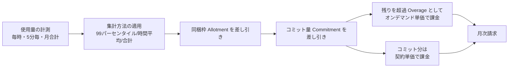
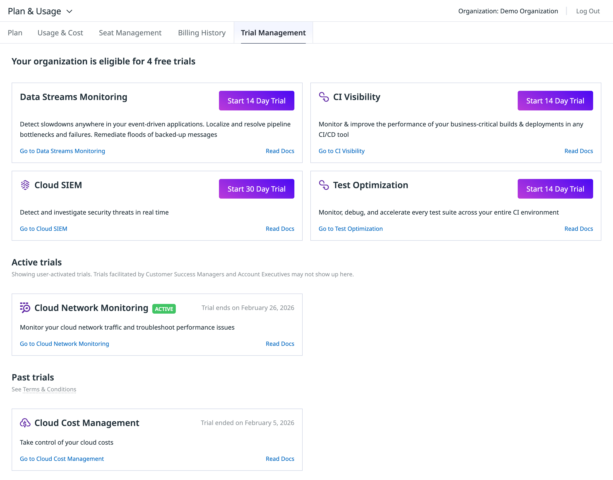
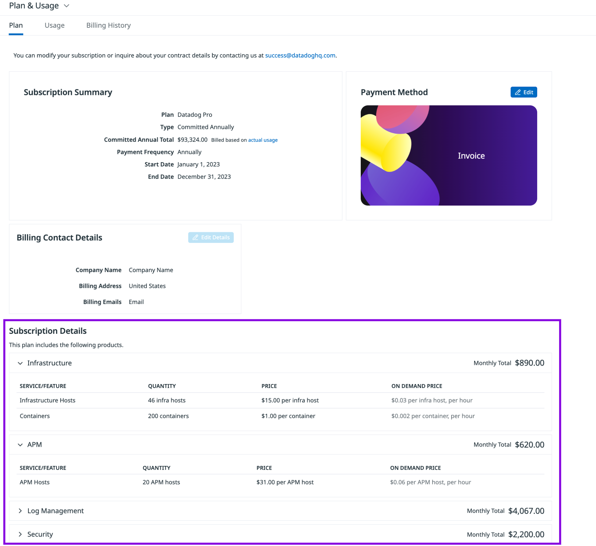
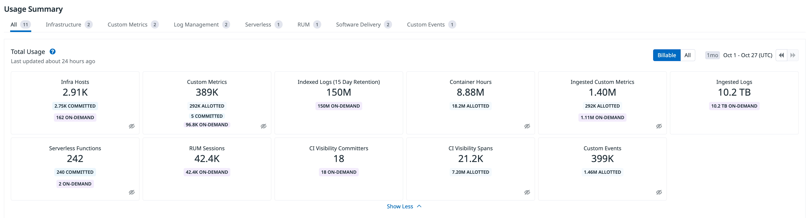

# 料金体系の全体像

## 概要

Datadog の料金体系は「製品（SKU）ごとに独立した課金単位を持つ、モジュール型の従量・サブスクリプション課金」である。Infrastructure Monitoring や APM のように **ホスト単位** で課金される製品と、Log Management・RUM・Synthetic Monitoring のように **データ量・イベント数・セッション数・テスト実行数** で課金される製品、On-Call や Incident Management のように **シート（ユーザー）単位**、CI Visibility や Code Security のように **コミッター単位** で課金される製品が混在する。そのため Datadog の請求額は「どの製品を、どの規模で、どの契約形態で使うか」の組み合わせで決まる。

本ファイルは料金体系の「考え方の地図」である。以下の問いに答える。

- Datadog はどのような単位で課金するのか（課金モデルの分類）
- ホスト数はどう数えられるのか（99 パーセンタイル / High-Water Mark）
- 年契約（Annual）・月契約（Month-to-month）・オンデマンド（On-demand）は何が違うのか
- 無料で使える範囲（Free tier、無料トライアル、同梱枠）はどこまでか
- 主要製品はそれぞれ何を単位に課金されるのか（早見表）
- 詳しい単価・計算方法・見積り・契約はどのファイルを読めばよいか

> **料金の数値について:** 本ファイルに記載する定価は、公式料金ページ（https://www.datadoghq.com/pricing/ および https://www.datadoghq.com/pricing/list/ ）の **2026-11-02 時点** の値（USD、税別）であり、契約形態を併記する。**掲載値はすべて US/EU1 サイトの価格**であり、本ナレッジの基準サイトである AP1（日本）では価格が異なる（ほぼすべての SKU で US/EU1 の約 1.25 倍。3.6 節）。AP1 の価格は [製品別料金表](./02-pricing-by-product.md) の AP1 列を参照すること。料金の正本は [製品別料金表](./02-pricing-by-product.md) であり、本ファイルの数値は「課金モデルを説明するための代表例」に限定する。数値に差異がある場合は `02-pricing-by-product.md` を正とする。

関連ファイルとの役割分担は次のとおり。

| 知りたいこと | 読むファイル |
|---|---|
| 課金の考え方・単位・契約形態の全体像 | 本ファイル |
| 全製品の単価（年契約 / 月契約 / オンデマンド） | [製品別料金表（料金の正本）](./02-pricing-by-product.md) |
| 99 パーセンタイル計算、コンテナ時間、カスタムメトリクスの平均計算などの詳細 | [課金計算の仕組み](./03-billing-mechanics.md) |
| Free / Pro / Enterprise / DevSecOps 等のエディション差 | [エディション・プラン](./04-editions-and-plans.md) |
| 見積りの手順・試算シート | [コスト見積り手法](./05-cost-estimation.md) |
| 直販・AWS Marketplace・パートナー経由などの購入経路、契約条件 | [購入経路と契約](./06-procurement-and-contracts.md) |
| 使用量の確認画面（Plan & Usage）と Usage Attribution | [Usage・Usage Attribution・Cost Visibility](../02_リファレンス/platform/usage-and-cost-attribution.md) |
| コスト削減の実践 | [コスト最適化](../04_応用編/01-cost-optimization.md) |

## 1. 料金体系の基本構造

### 1.1 Datadog の料金は「製品ごとの SKU の合算」

Datadog の請求は、契約した各製品（SKU）の課金単位ごとの使用量 × 単価の合計である。Datadog は「プラットフォーム一括の定額料金」を持たず、Infrastructure、APM、Log Management、RUM などを個別に契約・従量利用する。公式料金ページは 2026-11-02 時点で、以下のカテゴリに製品を分類している [出典](https://www.datadoghq.com/pricing/list/)。

| カテゴリ | 主な製品（料金ページ上の表記） |
|---|---|
| Infrastructure | Infrastructure（Basic / Pro / Enterprise / DevSecOps Pro / DevSecOps Enterprise）、Container Monitoring、Custom Metrics、Custom Events、Cloud Network Monitoring、Network Device Monitoring、Network Path、NetFlow Monitoring、Serverless、Kubernetes Autoscaling、GPU Monitoring、Edge Device Monitoring |
| Log Management 関連 | Logs Ingestion、Indexed Log Events、Flex Logs、Log Forwarding、Sensitive Data Scanner、Audit Trail、Observability Pipelines、Storage Management |
| APM 関連 | APM / APM Pro / APM Enterprise、Indexed Spans、Ingested Spans、Universal Service Monitoring、Data Streams Monitoring、Continuous Profiler、Database Monitoring |
| Data Observability | Jobs Monitoring、Quality Monitoring |
| Software Delivery | Pipeline Visibility（CI Visibility）、Test Optimization、Code Coverage |
| Security | Cloud Security（旧称：Cloud Security Management。料金プラン名は CSM Pro / Enterprise）、Workload Protection、App and API Protection、Cloud SIEM、Code Security（SCA / SAST / IaC / Secret Scanning / IAST）、AI Guard |
| Digital Experience | RUM（Measure / Investigate）、Session Replay、Product Analytics、Synthetic API / Browser Tests、Mobile App Testing、Experiments、Feature Flags |
| Service Management | On-Call、Incident Management、Incident Response、Event Management、Workflow Automation、App Builder |
| Cost | Cloud Cost Management Pro / Enterprise |
| AI | Agent Observability（LLM spans）、AI Credits |
| その他 | Managed Platform OTLP、Datadog Disaster Recovery |

> **名称に関する注意:** 料金一覧ページでは「Cloud Security Management (CSM) Pro / Enterprise」という旧来の表記が残っている。製品名は現在 Cloud Security（旧称：Cloud Security Management / CSM）である（[Cloud Security](../02_リファレンス/security/cloud-security.md) 参照）。また LLM 系の料金項目は料金一覧上「Agent Observability（LLM spans 単位）」として掲載されている（2026-11-02 時点）。製品機能の詳細は [LLM Observability](../02_リファレンス/ai/llm-observability.md) を参照。

### 1.2 料金を構成する 4 つの要素

Datadog の任意の製品の月額は、概ね次の 4 要素で決まる。

| 要素 | 内容 | 例 |
|---|---|---|
| ① 課金単位（Billing unit） | 何を数えるか | ホスト、GB、100 万イベント、1,000 セッション、シート、コミッター |
| ② 計測・集計方法（Metering） | どう数えるか | ホスト：毎時計測し上位 1% を除いた最大値／コンテナ：5 分ごと計測し時間平均／ログ：月間合計 |
| ③ 単価（Rate） | 契約形態別の単価 | 年契約（Annual）・月契約（Month-to-month）・オンデマンド（On-demand） |
| ④ 同梱枠（Allotment）とコミット（Commitment） | 無償で含まれる量、契約で約束した量 | Infrastructure Pro 1 ホストにつきカスタムメトリクス 100、コンテナ 5 など |

[出典](https://docs.datadoghq.com/account_management/billing/pricing/)

上図の流れは Datadog の Usage 画面の「Billable」ビューの考え方（commitments / allotments / on-demand usage に分けて表示）に対応する [出典](https://docs.datadoghq.com/account_management/billing/usage_details/)。

## 2. 課金モデルの分類

Datadog の課金モデルは、課金単位の性質で次のように整理できる（分類は本ナレッジの整理。各製品の単位は公式料金一覧に基づく）[出典](https://www.datadoghq.com/pricing/list/)。

| 課金モデル | 数えるもの | 代表製品 | 主な集計方法 |
|---|---|---|---|
| ホスト単位（Host-based） | 監視対象の OS インスタンス数 | Infrastructure、APM、Database Monitoring、Cloud Network Monitoring、Continuous Profiler、Universal Service Monitoring、Workload Protection、App and API Protection、CSM | 毎時計測 → 上位 1% を除いた最大値（99 パーセンタイル） |
| デバイス単位 | ネットワーク機器・GPU・無線 AP 等 | Network Device Monitoring、Wireless Access Point Monitoring、GPU Monitoring（アクティブ GPU） | 同時監視数（ホストと同様） |
| コンテナ / タスク単位（時間按分） | コンテナ、Fargate タスク、関数、アプリインスタンス | Container Monitoring、Fargate、Serverless | 5 分ごとに計測し時間平均、月の合計時間 |
| 量単位（Volume-based：GB） | データ量 | Logs Ingestion、APM Ingested Spans、Observability Pipelines、Sensitive Data Scanner、Log Forwarding、Managed Platform OTLP | 月間合計 |
| イベント / 件数単位（Event-based） | イベント・スパン・レコード件数 | Indexed Logs、Flex Logs、Indexed Spans、Cloud SIEM、Custom Events、NetFlow、Error Tracking、Event Management、Agent Observability（LLM spans） | 月間合計（保持期間ごとに単価が異なる場合あり） |
| セッション単位 | RUM セッション | RUM Measure / Investigate、Session Replay、Product Analytics | 1,000 セッション単位の月間合計 |
| 実行回数単位 | テスト実行、ワークフロー実行 | Synthetic API / Browser Tests、Mobile App Testing、Workflow Automation | 月間合計 |
| 時系列（カーディナリティ）単位 | カスタムメトリクスの一意な組み合わせ | Custom Metrics、Ingested Custom Metrics | 毎時の一意な時系列数の月平均 |
| コミッター単位 | アクティブな Git コミッター | Pipeline Visibility、Test Optimization、Code Coverage、Code Security（SAST / Static SCA / IaC / Secret Scanning） | 月 3 回以上コミットしたコミッター数 |
| シート単位（Seat-based） | ユーザーの席数 | On-Call、Incident Management、Incident Response | 契約シート数（超過はオンデマンド単価） |
| 支出連動 | 監視対象のクラウド支出、Datadog 支出 | Cloud Cost Management（クラウド / SaaS 支出 $1,000 単位）、Audit Trail（Datadog 支出の %） | 月次 |
| 計算資源単位 | vCPU、インスタンス時間、DBU | Observability Pipelines Plus（vCPU）、Kubernetes Autoscaling（vCPU）、Flex Compute（instance-hour）、Jobs Monitoring（host-hour / DBU / job-hour） | 月次 |
| その他の固定単位 | 公開アプリ数、実験数、テーブル数、クレジット | App Builder（公開アプリ）、Experiments（ローンチした実験）、Data Quality Monitoring（監視テーブル）、AI Credits（クレジット） | 月次 |
| 個別見積り | 範囲に応じたカスタム | Infrastructure Basic、Flex Compute、Datadog Disaster Recovery | Contact Sales |

### 2.1 ホスト単位課金（Host-based）

Datadog の「ホスト」は「Datadog で監視する物理または仮想の OS インスタンス」と定義される。サーバー、VM、Kubernetes のノード、Azure App Service Plan のインスタンス、Heroku dyno などが該当する [出典](https://docs.datadoghq.com/account_management/billing/)。

ホスト単位課金の主な規則は次のとおり（本節の単価は US/EU1 価格。AP1 価格は [製品別料金表](./02-pricing-by-product.md) の AP1 列を参照）。

| 規則 | 内容 | 出典 |
|---|---|---|
| 計測頻度 | ホスト数を 1 時間ごとに計測する | [出典](https://docs.datadoghq.com/account_management/billing/) |
| 月末の請求ホスト数（High Water Mark Plan / HWMP） | 毎時の計測値のうち上位 1% を除外し、残り 99% の中の最大値（ハイウォーターマーク）で課金する。短時間のスパイクの影響を抑える仕組み | [出典](https://docs.datadoghq.com/account_management/billing/pricing/) |
| 具体的な順位 | APM の例では「月末に毎時計測値を降順に並べ、9 番目に高い値で課金（2 月は 8 番目）」と説明されている | [出典](https://docs.datadoghq.com/account_management/billing/apm_tracing_profiler/) |
| Hybrid Monthly/Hourly Plan（MHP） | 月次の最低コミットを支払い、それを超えたホスト時間を時間単価で課金する方式 | [出典](https://docs.datadoghq.com/account_management/billing/pricing/) |
| 二重計上の回避 | Agent を導入した EC2 / VM が同時にクラウド連携でも検出された場合も 1 ホストとして数える | [出典](https://docs.datadoghq.com/account_management/billing/) |
| 非アクティブホスト | `INACTIVE` 状態のホストは課金対象外（Infrastructure List から消えるまで最大 2 時間） | [出典](https://docs.datadoghq.com/account_management/billing/) |
| コンテナ内 Agent | コンテナごとに Agent を入れると各コンテナがホストとして数えられる。ホストごとに 1 つのコンテナ化 Agent を推奨 | [出典](https://docs.datadoghq.com/account_management/billing/) |
| 製品ごとに独立 | Infrastructure ホスト、APM ホスト、DBM ホスト、CNM ホスト、Profiler ホストはそれぞれの製品で別に数える | [出典](https://docs.datadoghq.com/account_management/billing/pricing/) |

> 99 パーセンタイル計算の数値例、2 月の扱い、MHP の詳細は [課金計算の仕組み](./03-billing-mechanics.md) を参照。

ホスト単位課金の代表価格（年契約、2026-11-02 時点、1 ホスト / 月）[出典](https://www.datadoghq.com/pricing/list/)：

| 製品 | 年契約（Annual） | 月契約（Month-to-month） | オンデマンド（On-demand） |
|---|---|---|---|
| Infrastructure Pro | $15 | $18 | $18 |
| Infrastructure Enterprise | $23 | $27 | $27 |
| APM（Infrastructure と併用時） | $31 | $36 | $36 |
| Database Monitoring | $70 | $84 | $84 |

> 全製品の単価は [製品別料金表](./02-pricing-by-product.md) を参照。

### 2.2 同梱枠（Allotment）

ホスト単位製品の多くは、1 ホストあたりの「同梱枠（allotment）」を持つ。同梱枠はアカウント全体でプール（合算）され、特定のホストに紐付かない [出典](https://docs.datadoghq.com/account_management/billing/custom_metrics/)。

| 製品 / エディション | 同梱されるもの（1 ホストあたり / 月） | 出典 |
|---|---|---|
| Infrastructure Pro | カスタムメトリクス 100、カスタムイベント 500、コンテナ 5 | [出典](https://www.datadoghq.com/pricing/) |
| Infrastructure Enterprise | カスタムメトリクス 200、カスタムイベント 1,000、コンテナ 10 | [出典](https://www.datadoghq.com/pricing/) |
| APM ホスト | Ingested Spans 150 GB、Indexed Spans 100 万件（APM ホスト全体で平均） | [出典](https://docs.datadoghq.com/account_management/billing/apm_tracing_profiler/) |
| APM（Fargate タスク） | Indexed Spans 195,000 件、Ingested Spans 30 GB | [出典](https://docs.datadoghq.com/account_management/billing/apm_tracing_profiler/) |
| Continuous Profiler（APM Enterprise 含む） | プロファイル対象コンテナ 4 | [出典](https://docs.datadoghq.com/account_management/billing/apm_tracing_profiler/) |
| サーバーレス関数（Pro / Enterprise） | 課金対象のサーバーレス関数 1 つにつきカスタムメトリクス 5 | [出典](https://docs.datadoghq.com/account_management/billing/) |
| Test Optimization / Code Security | 課金対象コミッター 1 人につき Code Coverage コミッター 1 人を追加費用なしで付与 | [出典](https://www.datadoghq.com/pricing/) |
| Agent Observability | Sensitive Data Scanner を 10K LLM spans あたり 1 GB 分、追加費用なしで同梱 | [出典](https://www.datadoghq.com/pricing/) |

> **注意（公式ドキュメント内の不整合）:** APM 課金ドキュメントは Fargate タスクの同梱 Indexed Spans を「195,000」と記載する一方、同ページの計算例は「20 Fargate タスクで 130 万件」（1 タスクあたり約 65,000 件）としている。どちらが現行かは公開情報では確定できず、契約前に Datadog に確認すること [出典](https://docs.datadoghq.com/account_management/billing/apm_tracing_profiler/)。

> **既存顧客の注意:** 料金一覧ページの脚注は、Container Monitoring、Custom Metrics、Custom Events、APM Ingestion / Indexed Spans などについて「既存顧客は最新の請求契約で同梱枠を確認すること」としている。契約時期により同梱枠が異なる可能性がある [出典](https://www.datadoghq.com/pricing/list/)。

### 2.3 量単位課金（Volume-based）

量単位課金は、送信・取り込み・保存したデータ量（GB）や件数で課金するモデルである。ログ・スパン・セッションのように使用量が業務量に比例して変動する製品は、量単位課金を採用している。

量単位課金の代表的な特徴は「取り込み（Ingest）」と「インデックス / 保持（Index / Retain）」が別 SKU になっていることである。

| 製品 | 取り込み側の課金 | 保持・検索側の課金 | 出典 |
|---|---|---|---|
| Log Management | Ingestion：$0.10 / GB（年契約・月契約・オンデマンド共通） | Indexed Log Events：保持期間別に 100 万件単位（例：15 日保持 年契約 $1.70）、Flex Logs Storage：100 万件保存単位 | [出典](https://www.datadoghq.com/pricing/list/) |
| APM | Ingested Spans：$0.10 / GB（同梱 150 GB / ホスト超過分） | Indexed Spans：保持期間別に 100 万件単位（同梱 100 万件 / ホスト超過分） | [出典](https://www.datadoghq.com/pricing/list/) |
| RUM | RUM Measure：1,000 セッション単位（全トラフィック） | RUM Investigate：1,000 セッション単位（フィルタ後に保持したセッション） | [出典](https://www.datadoghq.com/pricing/list/) |
| Managed Platform OTLP | 取り込んだスパン 1 GB 単位 $0.50 | — | [出典](https://www.datadoghq.com/pricing/list/) |

この「取り込みと保持の分離」は Logging without Limits™ / RUM without Limits の考え方に基づく。すべてのデータを安価に取り込み、必要なものだけをインデックス / 保持して高い単価を払う設計にできる。設計の詳細は [Indexes・保持・アーカイブ](../02_リファレンス/logs/log-indexes-retention-archives.md)、[APM の概念とインジェスト制御](../02_リファレンス/apm/apm-concepts-and-ingestion.md)、[RUM（ブラウザ）](../02_リファレンス/dem/rum-browser.md) を参照。

### 2.4 イベント単位・件数単位課金（Event-based）

イベント単位課金は、処理・保存・評価したイベントの件数で課金するモデルである。Datadog では次のような製品が該当する [出典](https://www.datadoghq.com/pricing/list/)。

| 製品 | 課金単位 | 備考 |
|---|---|---|
| Indexed Log Events | 100 万インデックス済みログ / 月 | 保持期間（3 / 7 / 15 / 30 日）で単価が異なる |
| Flex Logs Storage / Flex Logs Starter | 100 万保存イベント / 月 | 長期保持向け。Flex Compute は別途 |
| Indexed Spans | 100 万インデックス済みスパン / 月 | 保持期間（7 / 15 / 30 日）で単価が異なる |
| Cloud SIEM | 100 万分析イベント / 月 | 分析対象となったログ件数 |
| Custom Events | 10 万イベント / 月 | Infrastructure に同梱枠あり |
| NetFlow Monitoring | 100 万集約レコード / 月 | 保持期間（15 / 30 / 60 / 90 日）で単価が異なる |
| Error Tracking | 最初の 5 万エラーは定額、以降 1,000 エラー単位の段階料金 | APM トレース・RUM イベント由来のエラー追跡は追加費用なしで含まれる |
| Event Management | 相関パターンで評価されたイベント 1 件 | |
| Agent Observability | 最初の 10 万 LLM spans の定額 + 1 万 LLM spans 単位 | 保持期間（15 / 30 / 60 / 90 日）で単価が異なる |
| Feature Flags | 100 万 MFCR（Monthly Flag Configuration Requests） | 月 100 万 MFCR 未満は無料、段階料金 |
| AI Guard | 100 万入力トークン | |

### 2.5 カスタムメトリクスの 2 つの課金モデル

カスタムメトリクス（Custom Metrics）は、2026-11-02 時点で 2 つの課金モデルが存在する。

| 項目 | カーディナリティ課金（Timeseries / Cardinality pricing） | Metric Name pricing |
|---|---|---|
| 数えるもの | メトリクス名・ホスト・タグの一意な組み合わせ（時系列）の数 | 一意なメトリクス名の数 + データポイント数 |
| 集計方法 | 毎時の一意な時系列数を月平均 | メトリクス名は月 1 回（最初にインデックス済みデータポイントを送った時間に）カウント。1 名につき 1,000 万インデックス済みデータポイントを含む |
| 追加 SKU | Ingested Custom Metrics（Metrics without Limits™ で設定したメトリクスのみ対象） | Indexed Points SKU（同梱超過分）、Ingested Points SKU（インデックス量の 5 倍を超える取り込み） |
| 単価の契約形態差 | 料金一覧参照（Custom Metrics は 100 メトリクスあたり $5 で 3 形態同額） | 年契約を基準に、月契約 +20%、オンデマンド +40%。5 段階のボリューム段階料金 |
| 適用条件 | 標準 | 契約に Metric Name pricing の SKU が含まれる場合のみ。カーディナリティ課金 SKU とは排他 |

[出典](https://docs.datadoghq.com/account_management/billing/custom_metrics/)、[出典](https://docs.datadoghq.com/account_management/billing/metric_name_pricing/)、[出典](https://www.datadoghq.com/pricing/list/)

カーディナリティ課金の重要な性質として、「データポイントの送信頻度やクエリ回数は請求に影響しない」点がある。一方、Distribution メトリクスは 1 つのタグ組み合わせにつき 5 つ（count / sum / min / max / avg）、パーセンタイル集計を有効にするとさらに 5 つのカスタムメトリクスとして数えられる [出典](https://docs.datadoghq.com/account_management/billing/custom_metrics/)。Metric Name pricing の導入時期は公開情報では確認できず。

> 詳細は [Custom Metrics と DogStatsD](../02_リファレンス/platform/custom-metrics-and-dogstatsd.md) と [課金計算の仕組み](./03-billing-mechanics.md) を参照。

### 2.6 コンテナ・サーバーレスの時間按分課金

Container Monitoring は、ホスト単位とは異なり「コンテナ時間」で課金する [出典](https://docs.datadoghq.com/account_management/billing/containers/)。

| 規則 | 内容 |
|---|---|
| 計測頻度 | 5 分ごとに計測し、1 時間分（12 回）の平均を取る |
| 同梱枠 | Infrastructure Pro は 1 ホストあたり 5、Enterprise は 10。アカウント全体で平均（プール） |
| 超過分 | 同梱枠とコンテナのコミットを超えた分を、コンテナ時間あたりの単価（$0.002 / コンテナ時間）でオンデマンド課金。プリペイドのコンテナ（$1 / コンテナ / 月）を購入することもできる |
| 除外 | Datadog Agent のコンテナと pause コンテナは数えない（EKS の pause コンテナ除外は Agent 7.20 以降） |
| GKE Autopilot | コンテナではなく Serverless カテゴリで課金 |
| Fargate | ECS Fargate のタスク / EKS Fargate の Pod の同時監視数で課金 |

[出典](https://docs.datadoghq.com/account_management/billing/containers/)、[出典](https://www.datadoghq.com/pricing/)

サーバーレスは、Serverless Workload Monitoring（アクティブ関数 / アクティブアプリインスタンス単位）と Serverless APM（100 万トレース済み呼び出し単位 / トレース対象アプリインスタンス単位）に分かれる。Serverless ワークロードには APM ホスト料金はかからない [出典](https://docs.datadoghq.com/account_management/billing/)。詳細は [Serverless Monitoring](../02_リファレンス/infrastructure/serverless.md) を参照。

### 2.7 コミッター単位・シート単位・その他

| モデル | 定義 | 該当製品 | 出典 |
|---|---|---|---|
| コミッター単位 | 請求月内に 3 回以上コミットした Git 作成者（Git author のメールアドレスで識別。Git メタデータがない場合はパイプライン起動ユーザー名） | Pipeline Visibility、Test Optimization、Code Coverage、Code Security（Static SCA、SAST、IaC、Secret Scanning、各バンドル） | [出典](https://docs.datadoghq.com/account_management/billing/pricing/)、[出典](https://www.datadoghq.com/pricing/) |
| シート単位 | 契約したシート数で課金。全コミットシート使用中でも割り当ては成功し、超過シートはオンデマンド単価で課金。シート削減は更新時に有効 | On-Call、Incident Management、Incident Response | [出典](https://www.datadoghq.com/pricing/) |
| Incident Management（旧プラン） | 旧来の使用量ベースプランでは月間アクティブユーザー（インシデントのフィールド更新、タイムラインへのコメント、ポストモーテム生成など実質的な貢献をしたユーザー）で課金。宣言・閲覧・検索のみはカウントしない | Incident Management（Legacy） | [出典](https://docs.datadoghq.com/account_management/billing/pricing/) |
| 支出連動 | 監視対象のクラウド / SaaS 支出 $1,000 あたり | Cloud Cost Management Pro / Enterprise | [出典](https://www.datadoghq.com/pricing/list/) |
| Datadog 支出の % | 月額支出の 2%（年契約）/ 3%（月契約・オンデマンド） | Audit Trail | [出典](https://www.datadoghq.com/pricing/list/) |
| クレジット | 500 クレジット単位のバンドル、または 1 クレジット単位 | AI Credits（Bits AI 等の AI 機能） | [出典](https://www.datadoghq.com/pricing/list/) |
| 公開アプリ単位 | 公開（publish）したアプリ数。公開するまでは無料 | App Builder | [出典](https://www.datadoghq.com/pricing/) |

## 3. 契約形態：年契約・月契約・オンデマンド

### 3.1 3 つの契約形態

Datadog の公式料金一覧は、各製品に **Annual（年契約）**、**Month-to-month（月契約）**、**On-demand（オンデマンド）** の 3 列の単価を掲載している。料金ページの FAQ は「Annual, monthly and hourly plans are available（年・月・時間単位のプランを用意している）」「We can customize billing plans to meet your needs（ニーズに合わせて請求プランをカスタマイズできる）」と説明している [出典](https://www.datadoghq.com/pricing/)、[出典](https://www.datadoghq.com/pricing/list/)。

| 項目 | 年契約（Annual / Committed） | 月契約（Month-to-month） | オンデマンド（On-demand） |
|---|---|---|---|
| 単価水準 | 最も安い（料金ページの「Starting at / From」価格は年契約） | 年契約より高い | 最も高い、または月契約と同額 |
| コミット（使用量の約束） | あり：製品ごとに月次の使用量（ホスト数、GB、件数等）をコミット | あり（月単位のコミット）【推定】 | なし（使った分だけ） |
| 期間 | 12 か月（複数年契約も可） | 月単位 | 期間の約束なし |
| 計測 | 月次 | 月次 | 一部製品は時間単位で計測（APM のオンデマンドは「月次集計ではなく時間単位で計測」と明記） |
| コミット超過分 | 超過分はオンデマンド単価で課金 | 公開情報では確認できず | — |
| 割引 | 多年契約・ボリュームディスカウントあり | 公開情報では確認できず | 基本なし |
| 想定用途 | 本番の定常利用 | 短期・試行的な本番利用 | PoC、変動の大きい利用、少量利用 |

[出典](https://www.datadoghq.com/pricing/)、[出典](https://www.datadoghq.com/pricing/list/)

> 「月契約にコミットがあるか」「月契約の超過扱い」は公式料金ページに明記されておらず、上表の該当箇所は【推定】または「公開情報では確認できず」とした。契約条件の詳細は [購入経路と契約](./06-procurement-and-contracts.md) を参照。

### 3.2 価格差の傾向

公式料金一覧（2026-11-02 時点）の 3 列の単価を比較すると、契約形態による価格差には製品ごとに 3 つのパターンがある [出典](https://www.datadoghq.com/pricing/list/)。

| パターン | 例（年 / 月 / オンデマンド） | 傾向 |
|---|---|---|
| A：月契約 = オンデマンド | Infrastructure Pro $15 / $18 / $18、Infrastructure Enterprise $23 / $27 / $27、APM $31 / $36 / $36、Database Monitoring $70 / $84 / $84、Continuous Profiler $19 / $23 / $23 | ホスト単位の主要製品に多い。年契約に対し約 +16〜20% |
| B：月契約 < オンデマンド | Cloud Network Monitoring $5 / $6 / $7.20、Network Device Monitoring $7 / $8.50 / $10.20、Indexed Logs（15 日）$1.70 / $2.04 / $2.55、Synthetic API Tests $5 / $6 / $7.20 | 量単位製品・新しい製品に多い。月契約は年契約の約 +20%、オンデマンドは約 +44〜50% |
| C：3 形態同額 | Logs Ingestion $0.10 / $0.10 / $0.10、APM Ingestion $0.10、Custom Metrics $5（100 メトリクス）、Log Forwarding $0.25、Managed Platform OTLP $0.50 | 取り込み系 SKU に多い |

> 上記の「約 +20%」「約 +44〜50%」は料金一覧の数値から本ナレッジが算出した比率であり、Datadog が一般規則として公表しているものではない（【推定】）。ただし Metric Name pricing については公式ドキュメントが「年契約を基準に月契約 +20%、オンデマンド +40%」と明記している [出典](https://docs.datadoghq.com/account_management/billing/metric_name_pricing/)。

### 3.3 コミットと超過（Overage）の考え方

年契約では、製品ごとに月次の使用量をコミットする。コミットを超えた使用量は止められず、超過分としてオンデマンド単価で課金される。主な公式記述は次のとおり。

| 製品 | コミットと超過の規則 | 出典 |
|---|---|---|
| Log Management（Indexed Logs） | 月末にインデックス済みログ件数を集計。コミット未満なら請求額は変わらない。超過分は 50% のプレミアム（年契約単価 +50%）でオンデマンド課金。コミットは月単位のため、1 日のスパイクがあっても月平均がコミット付近なら超過にならない場合がある。使用量はコミット量で制限されない | [出典](https://docs.datadoghq.com/account_management/billing/log_management/)、[出典](https://www.datadoghq.com/pricing/) |
| Log Management（料金ページの説明） | 月間ログ量をコミットすることで、日次のスパイクでレート制限されることはない | [出典](https://www.datadoghq.com/pricing/) |
| Infrastructure | アカウント全体で 1 つのカバレッジレベル（Pro / Enterprise 等）を選ぶ。DevSecOps バンドルは単体の Infrastructure・コンテナ・Cloud Security 製品と組み合わせられない | [出典](https://www.datadoghq.com/pricing/) |
| APM | 全ホストで 1 つの APM ティア（APM / APM Pro / APM Enterprise）にコミット。Infrastructure と併せて購入する場合、すべての APM ホストに Pro または Enterprise の Infrastructure が必要 | [出典](https://www.datadoghq.com/pricing/) |
| シート製品（On-Call 等） | コミットシートを使い切っても追加割り当ては成功し、超過シートはオンデマンド単価で課金。シート数の削減は更新時に有効 | [出典](https://www.datadoghq.com/pricing/) |
| ホスト製品（MHP） | 月次の最低コミットを超えたホスト時間を時間単価で課金 | [出典](https://docs.datadoghq.com/account_management/billing/pricing/) |

> **オンデマンドの時間単価の例:** 公式ドキュメントの Subscription Details 画面の例示（2023 年契約のサンプル画面）では、Infrastructure Hosts のオンデマンド単価が「$0.03 per infra host, per hour」、APM Hosts が「$0.06 per APM host, per hour」、Containers が「$0.002 per container, per hour」と表示されている。これはサンプル画面上の値であり、現行の時間単価は契約・料金ページで確認すること [出典](https://docs.datadoghq.com/account_management/billing/)。

### 3.4 ボリューム・多年契約ディスカウント

公式料金ページは、多くの製品に「Multi-year and volume discounts are available（多年契約・ボリュームディスカウントあり）」と記載している。明示されている適用目安は次のとおり [出典](https://www.datadoghq.com/pricing/)。

| 製品 | ディスカウントの記載 |
|---|---|
| Infrastructure | 月 500 ホスト以上で多年契約・ボリュームディスカウント |
| Flex Logs Starter | 月 30 億（3B）イベント以上で多年契約・ボリュームディスカウント |
| Code Coverage、Agent Observability ほか多数 | 多年契約・ボリュームディスカウントあり（条件は非公開） |
| OTLP APM Ingest（Managed Platform OTLP） | 多年契約・ボリュームディスカウントなし |

具体的な割引率は公開されておらず、本ナレッジでは割引率を記載しない（公開情報では確認できず）。交渉の観点は [購入経路と契約](./06-procurement-and-contracts.md) と [コスト見積り手法](./05-cost-estimation.md) を参照。

### 3.5 請求サイクルと支払い

| 項目 | 内容 | 出典 |
|---|---|---|
| 請求サイクル | 毎月 1 日（UTC）開始。契約開始月は登録日から日割り | [出典](https://docs.datadoghq.com/account_management/billing/) |
| 支払い方法 | クレジットカード、または請求書払い（ACH、電信送金、小切手） | [出典](https://docs.datadoghq.com/account_management/billing/) |
| 請求書送付 | 小切手・ACH・電信送金の場合、毎月第 10 営業日頃に請求先連絡先へメール送付 | [出典](https://docs.datadoghq.com/account_management/billing/) |
| カード領収書 | Billing History で過去月分を参照（管理者） | [出典](https://docs.datadoghq.com/account_management/billing/) |
| 必要な権限 | Datadog Admin ロール、または `billing_read` / `billing_edit` 権限 | [出典](https://docs.datadoghq.com/account_management/billing/) |
| パートナー経由の契約 | Subscription Details セクションは Datadog パートナー経由の請求では表示されない | [出典](https://docs.datadoghq.com/account_management/billing/) |
| 問い合わせ窓口 | `success@datadoghq.com`（請求異議・クレジット・支払方法変更）、`billing@datadoghq.com`（請求書写し・内訳）、`remittances@datadoghq.com`（送金）、`purchaseorders@datadoghq.com`（発注書写し） | [出典](https://docs.datadoghq.com/account_management/billing/) |
| 通貨 | 公式料金ページは USD で掲載。円建て請求の可否・条件は公開情報では確認できず | [出典](https://www.datadoghq.com/pricing/) |

### 3.6 購入経路と契約形態の関係（概要）

Datadog は直販のほか、AWS Marketplace やパートナー（リセラー）経由でも購入できる。AWS Marketplace には「Datadog Pro (Pay-As-You-Go)」の従量課金リスティングと、プライベートオファーでカスタム見積りを受ける Custom Pricing リスティングがある 【第三者情報】[出典](https://aws.amazon.com/marketplace/pp/prodview-7tlwraipohxq6)（取得日 2026-11-02）。

国内の技術ブログでは、AWS Marketplace の Pay-As-You-Go は前払いなしの従量課金で AWS の請求に合算され、当時 EC2 1 台あたり $0.03 / 時間、ログ保持期間は 15 日固定（変更には事前コミット型プランの契約が必要）と紹介されている 【第三者情報】[出典](https://dev.classmethod.jp/articles/datadog-aws-marketplace/)（2020-09-02 公開）。この記事は 2 年以上前の情報であり、現行の Marketplace 条件と食い違う可能性がある。

> **サイト差異:** 公式料金ページには「Datadog Site」セレクタがあり、**US（US1 / US3 / US5）／US1-FED／EU1／AP1／AP2／UK1** の 6 区分で価格が切り替わる [出典](https://www.datadoghq.com/pricing/list/)。掲載値から算出すると、ほぼすべての SKU で **AP1 は US/EU1 の約 1.25 倍**（例：Infrastructure Pro 年契約 US/EU1 $15 → AP1 $18.75）、AP2・UK1 は約 1.2 倍である（比率は掲載値どうしの割り算で、公式に明言された係数ではない。Audit Trail の % 課金は全サイト共通）。**本ファイルの数値は US/EU1 価格**であり、AP1 での見積りには [製品別料金表 §1.2](./02-pricing-by-product.md#12-サイトリージョン別の価格) と各章の AP1 列（公式掲載値）を使うこと。US1-FED（Datadog for Government）にも料金ページ上の掲載価格があり、提供製品は US の約 1.25 倍（例：Infrastructure Pro 年契約 $18.75）だが、US1-FED で提供されない製品も多い（[製品別料金表 §18](./02-pricing-by-product.md#18-サイト別価格一覧付録と-us1-fed-の非提供製品)）。なお Datadog は 2026-05-06 に Datadog for Government の FedRAMP High 認証取得を発表している [出典](https://www.datadoghq.com/ja/about/latest-news/press-releases/datadog-for-government-fedramp-high-2026/)。また、サイトにより提供されない製品があるため、AP1 で利用したい製品の提供有無は [Datadog Sites](../02_リファレンス/platform/datadog-sites.md) で確認すること。

詳細は [購入経路と契約](./06-procurement-and-contracts.md) を参照。

## 4. 無料枠・無料トライアル

### 4.1 無料で使えるもの一覧

| 区分 | 内容 | 出典 |
|---|---|---|
| Infrastructure Free tier | Basic ホスト最大 5 台、メトリクス保持 1 日、無料。より多くのホスト・長期保持には有償プランへアップグレード | [出典](https://www.datadoghq.com/pricing/) |
| 無料トライアル（全般） | セルフサービスのトライアルを Plan & Usage の Trial Management タブから開始可能。公式ドキュメントのサンプル画面では Data Streams Monitoring・CI Visibility・Test Optimization が 14 日、Cloud SIEM が 30 日のトライアル | [出典](https://docs.datadoghq.com/account_management/plan_and_usage/) |
| トライアル期間中の課金 | トライアル中は課金されないが、トライアル終了後の使用量は課金される。トライアル使用量は Usage & Cost にインジケーター付きで推定コストとともに表示 | [出典](https://docs.datadoghq.com/account_management/plan_and_usage/) |
| Feature Flags | 月 100 万 MFCR 未満は無料（年・月・オンデマンドとも） | [出典](https://www.datadoghq.com/pricing/) |
| Agent Observability（LLM） | 月 40K LLM spans まで無料（15 日保持、全機能利用可、クレジットカード不要） | [出典](https://www.datadoghq.com/pricing/)、[出典](https://www.datadoghq.com/pricing/list/) |
| App Builder | 利用開始は無料。アプリを公開（publish）した時点から有償 | [出典](https://www.datadoghq.com/pricing/) |
| Error Tracking | APM トレースと RUM イベントに対する Error Tracking は追加費用なしで含まれる（単体の Error Tracking SKU は別途有償） | [出典](https://www.datadoghq.com/pricing/) |
| Code Coverage | Test Optimization または Code Security の課金コミッター 1 人につき Code Coverage コミッター 1 人分を追加費用なしで付与 | [出典](https://www.datadoghq.com/pricing/) |
| Datadog for Startups | 対象スタートアップは Datadog Pro を 1 年間無料 | [出典](https://www.datadoghq.com/pricing/) |
| 同梱枠 | 各ホスト製品の同梱枠（カスタムメトリクス、コンテナ、スパン等）は追加料金なし（2.2 節） | [出典](https://www.datadoghq.com/pricing/) |

> **無料トライアルの一般的な期間:** AWS Marketplace の Datadog Pro (Pay-As-You-Go) リスティングも 14 日間の無料トライアル後に自動で Pay-As-You-Go プランへ移行すると記載している 【第三者情報】[出典](https://aws.amazon.com/marketplace/pp/prodview-7tlwraipohxq6)。新規アカウントのトライアル期間・終了後の自動ダウングレード条件について、公式ドキュメント上の明記は今回の調査では確認できず。

### 4.2 Trial Management 画面

- **キャプション:** Plan & Usage > Trial Management タブ（セルフサービスのトライアル管理画面）
- **画面の説明:** 画面上部に Plan & Usage のタブ（Plan / Usage & Cost / Seat Management / Billing History / Trial Management）が並ぶ。Trial Management タブには「Your organization is eligible for 4 free trials」として、開始可能なトライアルのカード（例：Data Streams Monitoring「Start 14 Day Trial」、CI Visibility「Start 14 Day Trial」、Cloud SIEM「Start 30 Day Trial」、Test Optimization「Start 14 Day Trial」）が表示される。その下に「Active trials」（例：Cloud Network Monitoring が ACTIVE、終了日付き）と「Past trials」（例：Cloud Cost Management、終了日付き）が並ぶ。Customer Success Manager や Account Executive が設定したセールス主導のトライアルはここに表示されない場合がある旨の注記がある。
- **出典:** https://docs.datadoghq.com/account_management/plan_and_usage/ （取得日 2026-11-02）

### 4.3 Free tier と有償プランの違い（概要）

Infrastructure の Free tier・Basic・Pro・Enterprise の主な違いは次のとおり。エディションの詳細比較は [エディション・プラン](./04-editions-and-plans.md) を参照。

| 項目 | Free tier | Basic | Pro | Enterprise |
|---|---|---|---|---|
| 料金（2026-11-02 時点） | 無料 | Contact Sales | 年契約 $15 / ホスト / 月（オンデマンド $18） | 年契約 $23 / ホスト / 月（オンデマンド $27） |
| ホスト数 | 最大 5（Basic ホスト） | 制限の記載なし | 制限の記載なし | 制限の記載なし |
| メトリクス保持 | 1 日 | 15 か月 | 15 か月（フル解像度） | 15 か月（カスタマイズ可） |
| 主な機能 | 公開情報では詳細確認できず | コアシステムメトリクス、標準ダッシュボード | 1,000 以上のインテグレーション、コンテナ監視、OpenTelemetry サポート | Pro + 機械学習ベースのアラート、Live Processes、Governance Console |
| カスタムメトリクス同梱 | 公開情報では確認できず | 公開情報では確認できず | 100 / ホスト | 200 / ホスト |
| コンテナ同梱 | 公開情報では確認できず | 公開情報では確認できず | 5 / ホスト | 10 / ホスト |
| 混在 | — | Pro または Enterprise ホストと同一アカウントで混在可 | — | — |

[出典](https://www.datadoghq.com/pricing/)

## 5. 主要製品の課金単位 早見表

以下は主要製品の「何で課金されるか」の早見表である。単価は年契約（Annual）の **US/EU1 サイトの** 定価（2026-11-02 時点、USD）を代表値として示す（AP1 は約 1.25 倍。AP1 価格は [製品別料金表](./02-pricing-by-product.md) の AP1 列を参照）。月契約・オンデマンド単価、全製品・全ティアは [製品別料金表](./02-pricing-by-product.md) を参照 [出典](https://www.datadoghq.com/pricing/list/)。

### 5.1 Infrastructure・ネットワーク・サーバーレス

| 製品 | 課金単位 | 年契約単価 | 同梱・備考 | 詳細ファイル |
|---|---|---|---|---|
| Infrastructure Pro | ホスト / 月 | $15 | カスタムメトリクス 100、イベント 500、コンテナ 5 / ホスト | [Infrastructure Monitoring](../02_リファレンス/infrastructure/infrastructure-monitoring.md) |
| Infrastructure Enterprise | ホスト / 月 | $23 | カスタムメトリクス 200、イベント 1,000、コンテナ 10 / ホスト | 同上 |
| Infrastructure DevSecOps Pro / Enterprise | ホスト / 月 | $22 / $34 | Infrastructure とセキュリティのバンドル。単体の Infra・コンテナ・Cloud Security と併用不可 | [エディション・プラン](./04-editions-and-plans.md) |
| Container Monitoring（超過） | コンテナ / 月 または コンテナ時間 | $1 / コンテナ / 月（プリペイド）、$0.002 / コンテナ時間 | 同梱超過分 | [コンテナ・Kubernetes 監視](../02_リファレンス/infrastructure/container-and-kubernetes-monitoring.md) |
| Custom Metrics（超過） | 100 カスタムメトリクス / 月 | $5 | 同梱超過分。Ingested は 100 あたり $0.10 | [Custom Metrics と DogStatsD](../02_リファレンス/platform/custom-metrics-and-dogstatsd.md) |
| Custom Events（超過） | 10 万イベント / 月 | $2 | 同梱超過分 | [Event Management](../02_リファレンス/platform/event-management.md) |
| Cloud Network Monitoring | ネットワークホスト / 月 | $5 | | [Cloud Network Monitoring](../02_リファレンス/infrastructure/cloud-network-monitoring.md) |
| Network Path | 1,000 テスト / 月 | $5 | | 同上 |
| Network Device Monitoring | ネットワーク機器 / 月 | $7 | 無線 AP は $4 / 台 | [Network Device Monitoring](../02_リファレンス/infrastructure/network-device-monitoring.md) |
| NetFlow Monitoring | 100 万集約レコード / 月 | $0.60（15 日保持）〜 | 保持期間で単価が変わる | 同上 |
| Serverless Workload Monitoring | アクティブ関数 / 月、アクティブアプリインスタンス / 月 | $5 / $3 | | [Serverless Monitoring](../02_リファレンス/infrastructure/serverless.md) |
| Serverless APM | 100 万トレース済み呼び出し / 月、トレース対象アプリインスタンス | $10 / $6 | APM ホスト料金は不要 | 同上 |
| Kubernetes Autoscaling | vCPU / 月 | $3 | | [Kubernetes 監視の実践](../04_応用編/07-kubernetes-monitoring-practices.md) |
| GPU Monitoring | アクティブ GPU デバイス / 月 | $20 | 5 分間隔で非ゼロのグラフィックスエンジン活動がある GPU をアクティブとし月平均 | [Infrastructure Monitoring](../02_リファレンス/infrastructure/infrastructure-monitoring.md) |
| Edge Device Monitoring | インフラホスト / 月 | $5 | | 同上 |
| Cloud Cost Management Pro / Enterprise | クラウド / SaaS 支出 $1,000 / 月 | $5 / $10 | | [Cloud Cost Management](../02_リファレンス/infrastructure/cloud-cost-management.md) |

### 5.2 APM・プロファイリング・データベース

| 製品 | 課金単位 | 年契約単価 | 同梱・備考 | 詳細ファイル |
|---|---|---|---|---|
| APM | APM ホスト / 月 | $31（Infra 併用）、$36（単体） | Ingested Spans 150 GB、Indexed Spans 100 万 / ホスト | [APM の概念とインジェスト制御](../02_リファレンス/apm/apm-concepts-and-ingestion.md) |
| APM Pro（APM + Data Streams Monitoring） | APM ホスト / 月 | $35（Infra 併用）、$41（単体） | 同上 | 同上 |
| APM Enterprise（APM + DSM + Continuous Profiler） | APM ホスト / 月 | $40（Infra 併用）、$47（単体） | 同上 + プロファイル対象コンテナ 4 / ホスト | 同上 |
| APM Ingested Spans（超過） | GB / 月 | $0.10 | | 同上 |
| APM Indexed Spans（超過） | 100 万スパン / 月 | $1.27（7 日）/ $1.70（15 日）/ $2.50（30 日） | 保持期間で単価が変わる | 同上 |
| Universal Service Monitoring | インフラホスト / 月 | $9 | | [Universal Service Monitoring](../02_リファレンス/apm/universal-service-monitoring.md) |
| Data Streams Monitoring | クライアントホスト / 月 | $15 | | [Data Streams Monitoring](../02_リファレンス/apm/data-streams-monitoring.md) |
| Continuous Profiler | プロファイル対象ホスト / 月 | $19 | Fargate タスク $1.20、超過コンテナ $2 / 月 | [Continuous Profiler](../02_リファレンス/apm/continuous-profiler.md) |
| Database Monitoring | データベースホスト / 月 | $70 | 正規化クエリ数も計測対象 | [Database Monitoring](../02_リファレンス/infrastructure/database-monitoring.md) |
| Error Tracking（単体） | 最初の 5 万エラー定額、以降 1,000 エラー単位の段階料金 | $25（5 万エラーまで） | APM / RUM 由来は追加費用なし | [Error Tracking](../02_リファレンス/apm/error-tracking.md) |
| Managed Platform OTLP | 取り込みスパン GB / 月 | $0.50 | ディスカウント対象外 | [OpenTelemetry サポート](../02_リファレンス/platform/opentelemetry.md) |

### 5.3 ログ・データ処理

| 製品 | 課金単位 | 年契約単価 | 同梱・備考 | 詳細ファイル |
|---|---|---|---|---|
| Logs Ingestion | 取り込み（またはスキャン）GB / 月 | $0.10 | S3 / GCS / Azure へのアーカイブ転送を含む | [ログ収集](../02_リファレンス/logs/log-collection.md) |
| Indexed Log Events（Standard Indexing） | 100 万インデックス済みログ / 月 | $1.06（3 日）/ $1.27（7 日）/ $1.70（15 日）/ $2.50（30 日） | より長い保持は要相談 | [Indexes・保持・アーカイブ](../02_リファレンス/logs/log-indexes-retention-archives.md) |
| Flex Logs Storage | 100 万保存イベント / 月 | $0.05 | 最短 1 か月〜最長 15 か月。Flex Compute は Contact Sales | 同上 |
| Flex Logs Starter | 100 万保存イベント / 月 | $0.60 | 保持 3 / 6 / 12 / 15 か月（最短 3 か月）。月 20 億イベント未満は Starter Compute 同梱 | 同上 |
| Rehydration | 圧縮 GB スキャン | $0.10 | 加えてインデックス化したイベントに標準インデックス単価 | 同上 |
| Log Forwarding（カスタム宛先） | 送信 GB / 宛先 / 月 | $0.25 | | [Log Pipelines と処理](../02_リファレンス/logs/log-pipelines-and-processing.md) |
| Observability Pipelines | 取り込み GB / 月 | $0.095 | Plus は vCPU / 月 $1,950 | [Observability Pipelines](../02_リファレンス/logs/observability-pipelines.md) |
| Sensitive Data Scanner | スキャン GB / 月 | $0.30 | | [Sensitive Data Scanner](../02_リファレンス/security/sensitive-data-scanner.md) |
| Audit Trail | 月額支出の % | 2% | 月契約・オンデマンドは 3% | [Audit Trail](../02_リファレンス/platform/audit-trail.md) |
| Storage Management | 100 万監視オブジェクト / 月 | $0.35 | | — |
| Data Jobs Monitoring | ホスト時間 / DBU / ジョブ時間 | $0.05 / $0.025 / $0.10 | クラスタ / Databricks Serverless / オーケストレーター | [Data Jobs Monitoring](../02_リファレンス/data/data-jobs-monitoring.md) |
| Data Quality Monitoring | 監視テーブル / 月 | $16 | | [Data Observability](../02_リファレンス/data/data-observability.md) |

### 5.4 Digital Experience

| 製品 | 課金単位 | 年契約単価 | 同梱・備考 | 詳細ファイル |
|---|---|---|---|---|
| RUM Measure | 1,000 セッション / 月（全トラフィック） | $0.15 | SDK が追跡し送信したセッション | [RUM（ブラウザ）](../02_リファレンス/dem/rum-browser.md) |
| RUM Investigate | 1,000 セッション / 月（フィルタ後に保持） | $3 | RUM without Limits では取り込みと保持を別課金 | 同上 |
| Session Replay（アドオン） | 1,000 セッション / 月 | $2.50 | | [Session Replay と Product Analytics](../02_リファレンス/dem/session-replay-and-product-analytics.md) |
| Product Analytics | 1,000 セッション / 月（全トラフィック） | $0.80 | | 同上 |
| RUM Profiling / Export Pipelines / Managed Archive | 1,000 セッション / 月 | $3 / $0.10 / $0.20〜 | アドオン | [RUM（モバイル）](../02_リファレンス/dem/rum-mobile.md) |
| Synthetic API Tests | 1 万テスト実行 / 月 | $5 | | [Synthetic Monitoring](../02_リファレンス/dem/synthetic-monitoring.md) |
| Synthetic Browser Tests | 1,000 テスト実行 / 月 | $12 | | 同上 |
| Mobile App Testing | 100 テスト実行 / 月 | $50 | | 同上 |
| Parallel Testing | 追加並列数 / 月 | $79 | Continuous Testing アドオン | 同上 |
| Experiments | ローンチした実験 / 月 | $450 | | — |
| Feature Flags | 100 万 MFCR | 100 万未満無料、$55（1M〜10M）、$45（10M+） | | — |

> RUM のセッションは「15 分間操作がない」または「4 時間連続で活動した」時点で終了する [出典](https://docs.datadoghq.com/account_management/billing/pricing/)。

### 5.5 Security

| 製品 | 課金単位 | 年契約単価 | 備考 | 詳細ファイル |
|---|---|---|---|---|
| Cloud Security（料金表上は CSM）Pro / Enterprise | CSM ホスト / 月 | $10 / $25 | コンテナは別単価 | [Cloud Security](../02_リファレンス/security/cloud-security.md) |
| Workload Protection（旧称 CWS） | ホスト / 月 | $15 | Fargate タスク $2.60 | [Workload Protection](../02_リファレンス/security/workload-protection.md) |
| App and API Protection（旧称 ASM） | AAP ホスト / 月 | $31 | Fargate タスク $2、サーバーレスは 100 万トレース済み呼び出し $10 | [App and API Protection](../02_リファレンス/security/app-and-api-protection.md) |
| Cloud SIEM | 100 万分析イベント / 月 | $5 | | [Cloud SIEM](../02_リファレンス/security/cloud-siem.md) |
| Code Security：Runtime SCA / IAST | ホスト / 月 | $10 / $20 | | [Code Security](../02_リファレンス/security/code-security.md) |
| Code Security：Static SCA / SAST / IaC / Secret Scanning | コミッター / 月 | $25 / $25 / $15 / $15 | バンドル $40〜$55 | 同上 |
| AI Guard | 100 万入力トークン / 月 | $0.80 | | [Datadog Security 概要](../02_リファレンス/security/security-platform-overview.md) |

### 5.6 Software Delivery・Service Management・AI

| 製品 | 課金単位 | 年契約単価 | 備考 | 詳細ファイル |
|---|---|---|---|---|
| Pipeline Visibility（CI Visibility） | アクティブ Git コミッター / 月 | $8 | | [CI Visibility](../02_リファレンス/software-delivery/ci-visibility.md) |
| Test Optimization（旧称 Test Visibility） | アクティブ Git コミッター / 月 | $20 | | [Test Optimization](../02_リファレンス/software-delivery/test-optimization.md) |
| Code Coverage | アクティブ Git コミッター / 月 | $8 | Test Optimization / Code Security コミッター分は無償付与 | [DORA Metrics・Quality Gates・Code Coverage](../02_リファレンス/software-delivery/software-delivery-insights.md) |
| On-Call | シート / 月 | $20 | | [On-Call](../02_リファレンス/service-management/on-call.md) |
| Incident Management | シート / 月 | $30 | Incident Response（バンドル）は $40 | [Incident Management](../02_リファレンス/service-management/incident-management.md) |
| Event Management | 相関パターンで評価されたイベント / 月 | $0.10 | | [Event Management](../02_リファレンス/platform/event-management.md) |
| Workflow Automation | 100 ワークフロー実行 / 月 | $10 | | [Workflow Automation](../02_リファレンス/service-management/workflow-automation.md) |
| App Builder | 公開アプリ / 月 | $35 | 公開前は無料 | [App Builder](../02_リファレンス/service-management/app-builder.md) |
| Agent Observability（LLM） | 最初の 10 万 LLM spans 定額 + 1 万 LLM spans 単位 | $160（10 万 spans まで、15 日保持）、追加 $3.50 / 1 万 spans | 月 4 万 spans まで無料 | [LLM Observability](../02_リファレンス/ai/llm-observability.md) |
| AI Credits | 500 クレジットバンドル / 月 | $500 | 単発は $1.30 / クレジット | [Bits AI と AI 機能](../02_リファレンス/ai/bits-ai.md) |
| Datadog Disaster Recovery | 対象範囲によるカスタム | Contact Sales | | — |

> 上記に掲載のない製品（Work Management（旧称：Case Management）、Watchdog、Dashboards、Monitors、SLO、Notebooks など）は、2026-11-02 時点の公式料金一覧に独立した SKU として掲載されていない。これらはプラットフォーム機能として各製品契約に含まれるものと読めるが、個別機能の課金有無は各リファレンスの「課金への影響」節を参照（料金一覧に記載がない機能の課金条件は公開情報では確認できず）。

## 6. 課金を確認する画面

### 6.1 Plan & Usage の構成

Datadog の課金・使用量は、管理者が **Plan & Usage**（左ナビ下部の Account メニュー、または Personal Settings ページのヘッダードロップダウン）から確認する [出典](https://docs.datadoghq.com/account_management/plan_and_usage/)。

| タブ / セクション | 内容 |
|---|---|
| Plan | プランのアップグレード / ダウングレード、Subscription Summary、Payment Method、Billing Contact Details、Subscription Details（コミット製品の数量・契約単価・オンデマンド単価） |
| Usage（Usage & Cost） | 製品カテゴリ別の当月累計と推移。All / Billable の切替、CSV ダウンロード、Top Custom Metrics、インデックス別ログ使用量 |
| Billing History | 請求履歴、カード領収書 |
| Trial Management | セルフサービストライアルの開始、実施中・過去のトライアル |
| Usage Notifications | 契約にない製品を初めて課金利用した際の通知（当月の初回利用から約 48 時間後にメール。利用にはアカウント担当者またはサポートへの申請が必要）【Preview】（公式ドキュメント上の表記は beta）[出典](https://docs.datadoghq.com/account_management/billing/usage_details/) |

使用量データの反映には最大 72 時間かかる場合がある [出典](https://docs.datadoghq.com/account_management/plan_and_usage/)。画面の詳細は [Usage・Usage Attribution・Cost Visibility](../02_リファレンス/platform/usage-and-cost-attribution.md) を参照。

### 6.2 Subscription Details（契約内容の確認）

- **キャプション:** Plan & Usage > Plan タブ（Subscription Summary と Subscription Details）
- **画面の説明:** 上部に Plan / Usage / Billing History タブ。「Subscription Summary」にプラン名（例：Datadog Pro）、Type（例：Committed Annually）、Committed Annual Total（「Billed based on actual usage」の注記付き）、Payment Frequency、Start Date / End Date が表示される。右側に「Payment Method」（例：Invoice）と Edit ボタン、その下に「Billing Contact Details」（会社名、請求先住所、請求メール）。下段の「Subscription Details」では製品カテゴリ（Infrastructure、APM、Log Management、Security など）ごとに Monthly Total が表示され、展開すると SERVICE/FEATURE・QUANTITY・PRICE・ON DEMAND PRICE の列が並ぶ。サンプルでは Infrastructure Hosts が「46 infra hosts / $15.00 per infra host / $0.03 per infra host, per hour」、Containers が「200 containers / $1.00 per container / $0.002 per container, per hour」、APM Hosts が「20 APM hosts / $31.00 per APM host / $0.06 per APM host, per hour」と表示されている（サンプル値）。
- **出典:** https://docs.datadoghq.com/account_management/billing/ （取得日 2026-11-02）

### 6.3 Usage の Billable ビュー（コミット・同梱・オンデマンドの内訳）

- **キャプション:** Plan & Usage > Usage の Usage Summary（Billable 表示、内訳ピル付き）
- **画面の説明:** 上部に製品カテゴリのタブ（All / Infrastructure / Custom Metrics / Log Management / Serverless / RUM / Software Delivery / Custom Events）。「Total Usage」の右上で Billable / All を切り替え、期間（例：1mo、Oct 1 - Oct 27 (UTC)）を選ぶ。製品ごとのタイル（Infra Hosts、Custom Metrics、Indexed Logs (15 Day Retention)、Container Hours、Ingested Custom Metrics、Ingested Logs、Serverless Functions、RUM Sessions、CI Visibility Committers、CI Visibility Spans、Custom Events）に合計値が表示され、その下に「COMMITTED」（青、コミットでカバーされた量）、「ALLOTTED」（同梱枠でカバーされた量）、「ON-DEMAND」（紫、コミット超過で課金される量）のピルが表示される。例えば Infra Hosts 2.91K のうち 2.75K COMMITTED / 162 ON-DEMAND と表示される。
- **出典:** https://docs.datadoghq.com/account_management/billing/usage_details/ （取得日 2026-11-02）

Usage 画面の Billable ビューは、本ファイル 1.2 節の「同梱枠 → コミット → オンデマンド」の順序をそのまま可視化したものである。集計方法は製品により異なり、Infrastructure ホスト・APM ホスト・ネットワーク機器は 99 パーセンタイル、ログやスパンは合計で計算される [出典](https://docs.datadoghq.com/account_management/billing/usage_details/)。

## 7. 料金体系を理解するうえでの要点

### 7.1 料金体系の特徴（公式情報からの整理）

| 特徴 | 内容 | 実務上の含意 |
|---|---|---|
| 製品の個別契約 | 製品ごとに SKU と課金単位が独立 | 必要な製品だけ契約できる一方、製品追加ごとに費用が積み上がる |
| ホストのスパイク耐性 | ホスト製品は上位 1% の時間を除外 | 月 7 時間程度（31 日月で 744 時間の 1%）の一時的なスケールアウトは請求ホスト数に影響しない |
| 取り込みと保持の分離 | ログ・スパン・RUM は取り込みと保持 / インデックスを別課金 | フィルタ・サンプリング・保持期間設計で費用を大きく制御できる |
| 同梱枠のプール | カスタムメトリクス・コンテナ・スパンの同梱枠はアカウント全体で合算 | ホスト間の偏りは問題にならないが、総量の超過に注意 |
| コミット超過は止まらない | 使用量はコミットで制限されず、超過はオンデマンド単価 | コミット設計と使用量監視（Usage・Estimated Usage メトリクス）が重要 |
| 多年・ボリューム割引 | 多くの製品で割引あり（率は非公開） | 規模が大きい場合は見積り交渉の余地がある |

### 7.2 費用が想定外に増えやすいポイント 【経験則】

以下は一般に語られる注意点であり、詳細と対策は [コスト最適化](../04_応用編/01-cost-optimization.md) と [よくある失敗とアンチパターン](../04_応用編/12-common-pitfalls.md) を参照。

| ポイント | 理由（課金モデルとの関係） |
|---|---|
| カスタムメトリクスの高カーディナリティタグ | カーディナリティ課金では一意なタグ組み合わせごとに数えられる（`user_id`、`request_id` 等のタグで爆発する） |
| Distribution メトリクスのパーセンタイル有効化 | 1 組み合わせあたり 5 → 10 カスタムメトリクスに増える |
| ログのインデックス対象・保持期間 | Indexed Logs は件数 × 保持期間別単価。30 日保持は 15 日保持の約 1.5 倍 |
| コンテナごとの Agent 導入 | 各コンテナがホストとして数えられる |
| Infrastructure ティアの全体適用 | Infrastructure はアカウントで 1 つのカバレッジレベルを選ぶため、一部だけ Enterprise にすることは原則できない（Basic ホストの混在は可） |
| APM ホストの Infrastructure 前提 | Infrastructure と併せて購入する場合、APM ホストには Pro / Enterprise の Infrastructure も必要 |
| 契約外製品の利用開始 | 契約にない製品を有効化するとオンデマンド単価で課金される（First-time usage notifications で検知可能） |

## 8. 制限値・クォータ・デフォルト値（課金関連）

| 項目 | 値 | 出典 |
|---|---|---|
| 請求サイクル開始 | 毎月 1 日 00:00 UTC | [出典](https://docs.datadoghq.com/account_management/billing/) |
| ホスト計測間隔 | 1 時間 | [出典](https://docs.datadoghq.com/account_management/billing/) |
| ホスト課金の除外率 | 上位 1%（99 パーセンタイル） | [出典](https://docs.datadoghq.com/account_management/billing/pricing/) |
| コンテナ計測間隔 | 5 分（1 時間で平均） | [出典](https://docs.datadoghq.com/account_management/billing/containers/) |
| Fargate タスク計測間隔 | 5 分（月末集計） | [出典](https://docs.datadoghq.com/account_management/billing/pricing/) |
| 非アクティブホストが一覧から消えるまで | 最大 2 時間 | [出典](https://docs.datadoghq.com/account_management/billing/) |
| Usage データの反映遅延 | 最大 72 時間 | [出典](https://docs.datadoghq.com/account_management/plan_and_usage/) |
| Top Custom Metrics | 上位 5,000（All の CSV は最大 300,000 メトリクス、それ以上は API） | [出典](https://docs.datadoghq.com/account_management/billing/usage_details/) |
| 初回利用通知 | 契約外製品の初回課金利用から約 48 時間後 | [出典](https://docs.datadoghq.com/account_management/billing/usage_details/) |
| コミッターの定義 | 請求月内に 3 回以上コミット | [出典](https://docs.datadoghq.com/account_management/billing/pricing/) |
| RUM セッションの終了条件 | 15 分無操作 または 4 時間連続活動 | [出典](https://docs.datadoghq.com/account_management/billing/pricing/) |
| Free tier | Basic ホスト 5 台、メトリクス保持 1 日 | [出典](https://www.datadoghq.com/pricing/) |
| Feature Flags 無料枠 | 月 100 万 MFCR 未満 | [出典](https://www.datadoghq.com/pricing/) |
| Agent Observability 無料枠 | 月 40K LLM spans | [出典](https://www.datadoghq.com/pricing/list/) |
| Log Indexed 超過プレミアム | 年契約単価 +50% | [出典](https://docs.datadoghq.com/account_management/billing/log_management/) |
| Metric Name pricing の契約形態差 | 月契約 +20%、オンデマンド +40%（年契約基準） | [出典](https://docs.datadoghq.com/account_management/billing/metric_name_pricing/) |
| Metric Name pricing の 1 メトリクス名あたり同梱データポイント | 1,000 万インデックス済みデータポイント | [出典](https://docs.datadoghq.com/account_management/billing/metric_name_pricing/) |
| 新規アカウントの無料トライアル期間 | 公式ドキュメント上は確認できず（AWS Marketplace の Pay-As-You-Go リスティングは 14 日間と記載【第三者情報】、2026-11-02 取得） | [出典](https://aws.amazon.com/marketplace/pp/prodview-7tlwraipohxq6) |
| 円建て請求・為替条件 | 公開情報では確認できず | — |
| 割引率・Enterprise 契約条件 | 公開情報では確認できず | — |

## 9. 次に読むファイル

| 目的 | ファイル |
|---|---|
| 全製品の単価を確認する | [製品別料金表（料金の正本）](./02-pricing-by-product.md) |
| 99 パーセンタイル・コンテナ時間・カスタムメトリクス平均の計算例を知る | [課金計算の仕組み](./03-billing-mechanics.md) |
| エディション（Free / Basic / Pro / Enterprise / DevSecOps、APM / APM Pro / APM Enterprise）の機能差を知る | [エディション・プラン](./04-editions-and-plans.md) |
| 見積りを作る | [コスト見積り手法](./05-cost-estimation.md) |
| 契約形態・購入経路・交渉を検討する | [購入経路と契約](./06-procurement-and-contracts.md) |
| 競合製品と料金モデルを比較する | [製品選定と競合比較](./07-selection-and-competitive-comparison.md) |
| 使用量の可視化・部門配賦をする | [Usage・Usage Attribution・Cost Visibility](../02_リファレンス/platform/usage-and-cost-attribution.md) |
| コストを削減する | [コスト最適化](../04_応用編/01-cost-optimization.md) |
| 製品全体像を把握する | [製品ポートフォリオ全体像](../01_入門編/04-product-map.md) |

## 参照元

公式（Datadog）

- Datadog Pricing（2026-11-02 取得）: https://www.datadoghq.com/pricing/
- Datadog Pricing List（2026-11-02 取得）: https://www.datadoghq.com/pricing/list/
- Billing: https://docs.datadoghq.com/account_management/billing/
- Pricing（課金計算）: https://docs.datadoghq.com/account_management/billing/pricing/
- Custom Metrics Billing: https://docs.datadoghq.com/account_management/billing/custom_metrics/
- Metric Name Pricing: https://docs.datadoghq.com/account_management/billing/metric_name_pricing/
- Container Billing: https://docs.datadoghq.com/account_management/billing/containers/
- APM Billing（APM / Tracing / Profiler）: https://docs.datadoghq.com/account_management/billing/apm_tracing_profiler/
- Log Management Billing: https://docs.datadoghq.com/account_management/billing/log_management/
- Usage Details: https://docs.datadoghq.com/account_management/billing/usage_details/
- Plan and Usage Settings: https://docs.datadoghq.com/account_management/plan_and_usage/
- Datadog for Government、FedRAMP High 認証を取得（2026-05-06）: https://www.datadoghq.com/ja/about/latest-news/press-releases/datadog-for-government-fedramp-high-2026/

第三者

- 【第三者情報】AWS Marketplace: Datadog Pro (Pay-As-You-Go) リスティング（2026-11-02 取得）: https://aws.amazon.com/marketplace/pp/prodview-7tlwraipohxq6
- 【第三者情報】DevelopersIO「AWS Marketplace から Datadog を契約」（2020-09-02 公開、現行仕様と異なる可能性あり）: https://dev.classmethod.jp/articles/datadog-aws-marketplace/
