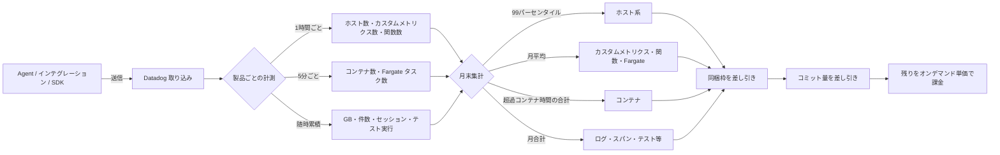
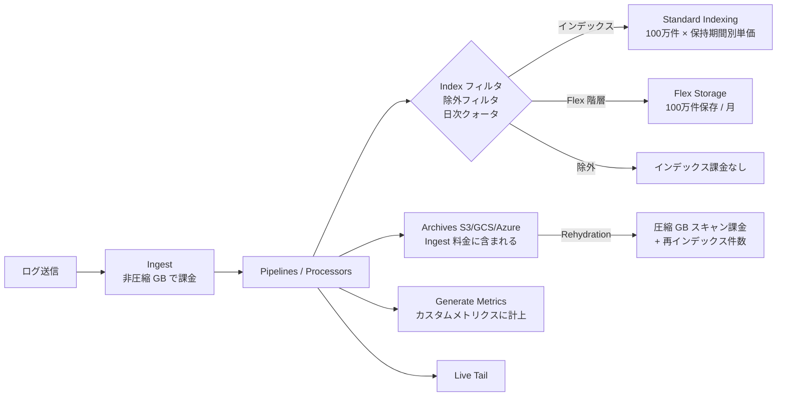
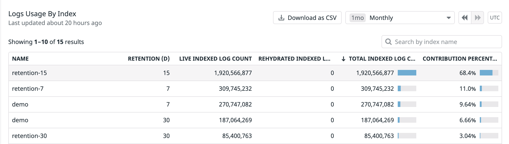
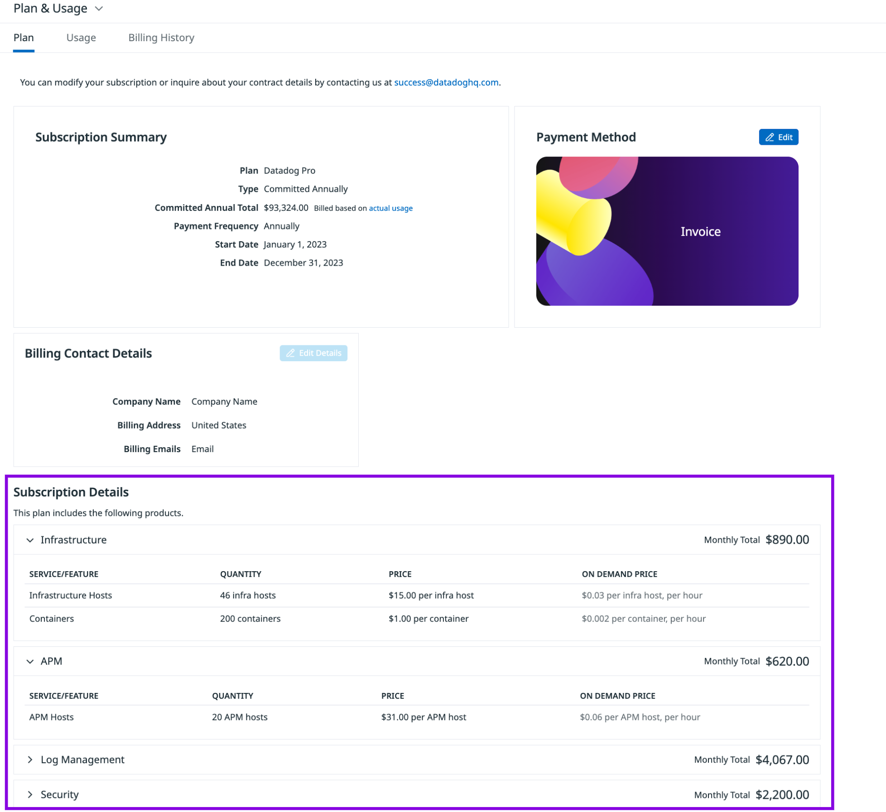
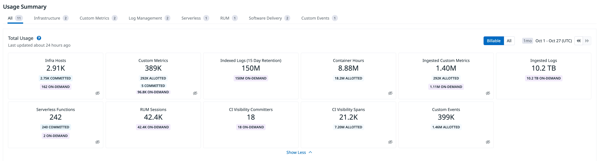
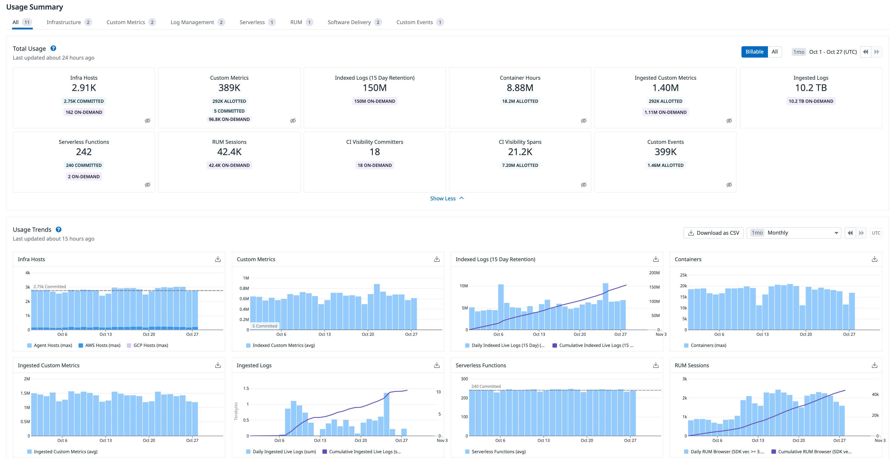
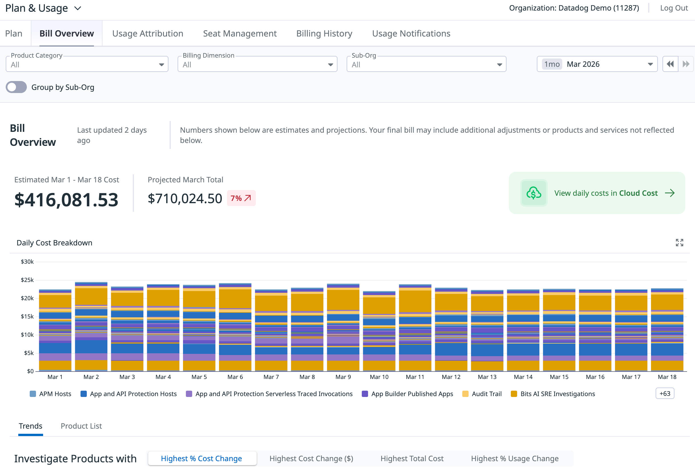

# 課金計算の仕組み

## 概要

Datadog の請求額は「製品ごとの課金単位 × 製品ごとの集計方法 × 契約形態（コミット / オンデマンド）」で決まる。課金単位（ホスト、GB、100 万件、セッション等）が同じように見えても、**月末にどう集計するか（99 パーセンタイル、月平均、合計）** が製品ごとに異なるため、同じ使い方でも製品によって「スパイクが請求に効く / 効かない」が変わる。本ファイルは、この「集計方法」と「コミットと超過の扱い」を数値例付きで説明する。

本ファイルが答える主な問いは次のとおり。

- ホスト数はなぜ「平均」でも「最大」でもなく「99 パーセンタイル（ハイウォーターマーク）」なのか、何時間のスパイクまでなら無視されるのか
- コンテナとカスタムメトリクスの同梱枠（allotment）は、ホストごとなのかアカウント全体なのか
- ログの Ingest（取り込み）と Index（インデックス）はどう二重に課金されるのか、除外フィルタで何が減るのか
- APM の Ingested Span と Indexed Span の違い、どのスパンが課金対象外か
- コミット（契約量）を超えたら何が起きるのか、オンデマンド単価はどれくらい高いのか
- Plan & Usage 画面・Bill Overview・請求書はどこを見れば何が分かるのか
- よくある誤解と、その正しい理解

関連ファイルとの役割分担は次のとおり。

| ファイル | 役割 |
|---|---|
| [料金体系の全体像](./01-pricing-overview.md) | 課金モデルの分類、契約形態（年 / 月 / オンデマンド）の違い、課金単位の早見表 |
| [製品別料金表](./02-pricing-by-product.md) | **料金の正本**。各製品の定価（年契約 / 月契約 / オンデマンド） |
| 本ファイル | 集計方法（99 パーセンタイル、月平均、合計）、同梱枠のプール計算、二段階課金、コミット超過、請求画面の読み方 |
| [コスト見積り手法](./05-cost-estimation.md) | 新規導入時の見積りの立て方、見積りシート |
| [コスト最適化](../04_応用編/01-cost-optimization.md) | 運用中のコスト削減施策 |
| [Usage・Usage Attribution・Cost Visibility](../02_リファレンス/platform/usage-and-cost-attribution.md) | 使用量画面・Usage Attribution・API の機能仕様 |

> **料金の数値について:** 本ファイルの単価は、公式料金ページ（https://www.datadoghq.com/pricing/ 、https://www.datadoghq.com/pricing/list/ ）および公式ドキュメントの **2026-11-02 時点** の値（USD、税別）を、計算例のために引用したものである。特記がない限り **年契約（Annual）** の単価で、オンデマンド単価を使う箇所はその旨を明記する。数値に差異がある場合は [製品別料金表](./02-pricing-by-product.md) を正とする。

## 1. 集計方法の全体像

### 1.1 製品ごとの月末集計方法

Datadog は多くの製品の使用量を **1 時間ごと（コンテナ・Fargate は 5 分ごと）** に計測し、月末にその時系列を製品ごとの方法で 1 つの請求数量に集約する。公式ドキュメントの Usage Details ページは、月初来（Month-to-date）の使用量の計算方法を次のように説明している [出典](https://docs.datadoghq.com/account_management/billing/usage_details/)。

| 集計方法 | 対象製品（Usage 画面の表示名） | スパイクの影響 |
|---|---|---|
| **99 パーセンタイル**（上位 1% の時間を除いた最大値＝ハイウォーターマーク） | Infra Hosts、APM Hosts、Profiled Hosts、Network Hosts、Network Devices、IoT Devices | 月の上位 1% の時間（約 7〜8 時間）に収まる短時間のスパイクは無視される。それを超えると、スパイク時の値がそのまま請求数量になる |
| **ハイウォーターマーク**（Usage 画面の記載） | Containers | 下記 1.2 の注意を参照 |
| **月平均**（毎時のユニーク数の平均） | Custom Metrics、Ingested Custom Metrics、Profiled Containers、Serverless Functions（1 時間に 1 回以上実行された関数） | スパイクは時間比で薄まる |
| **月合計**（全時間の和） | Fargate Tasks（Usage 画面の表示はタスク時間の合計。下記 1.2 の注意を参照）、Ingested / Indexed / Scanned / Analyzed Logs、Ingested / Indexed Spans、Network Flows、Serverless Invocations、Synthetic API / Browser Tests | 量に比例して増える。スパイク分はそのまま請求に乗る |
| **ユニーク数の合計** | RUM Sessions | セッション数に比例 |
| **ユニークユーザー** | Incident Management（旧使用量プラン） | 月内に実質的に関与したユーザー数 |

[出典](https://docs.datadoghq.com/account_management/billing/usage_details/)

Cost Details のドキュメントも同じ整理で、「Infrastructure ホストと APM ホスト（下位 99% のハイウォーターマーク）、カスタムメトリクスと Fargate タスク（月平均）はコストが比較的安定し、インデックス済み・取り込み済みログ（使用量の合計）は量に応じて増減する」と説明している [出典](https://docs.datadoghq.com/account_management/plan_and_usage/cost_details/)。

### 1.2 コンテナ・Fargate の集計方法に関する記述の食い違い

コンテナの集計について、公式ドキュメント内に表現の差がある。

| ドキュメント | 記述 |
|---|---|
| Usage Details（Month-to-date の計算方法の表） | Containers は「High watermark of distinct containers（ユニークコンテナ数のハイウォーターマーク）」 |
| Container Billing（コンテナ課金の専用ページ） | 5 分ごとに計測し、1 時間ごとに 12 で割って平均。その時間平均から同梱枠を引いた超過分を全時間で合計（＝コンテナ時間で課金） |

[出典](https://docs.datadoghq.com/account_management/billing/usage_details/)、[出典](https://docs.datadoghq.com/account_management/billing/containers/)

課金計算の具体的な手順はコンテナ課金の専用ページの方が詳しく、本ファイルでは専用ページの「時間平均 → 超過分のコンテナ時間を合計」を正として説明する（第 3 章）。Usage 画面の表示値がどちらの集計に基づくかは、公開情報では確認できず。

> **注意（Fargate Tasks）:** Fargate Tasks についても、ドキュメントによって表現が異なる。Usage Details は「当月の全時間にわたる Fargate タスクの合計（sum of all Fargate tasks over all hours）」、Billing Pricing は「5 分ごとに監視タスク数を記録し、アプリケーションが実行・監視された総時間で課金」と書いている。一方、料金ページの課金定義（アクティブなタスクの月平均）、Cost Details、APM 課金ドキュメントは「月平均」と説明している。Usage 画面に出るのは全時間の合計（タスク時間）で、それを月の時間数で割ると月平均のタスク数になる、という関係と読める。ただし、請求数量がどちらの単位で表示されるかは契約・請求書で確認すること [出典](https://docs.datadoghq.com/account_management/billing/usage_details/)、[出典](https://docs.datadoghq.com/account_management/billing/pricing/)、[出典](https://www.datadoghq.com/pricing/)、[出典](https://docs.datadoghq.com/account_management/plan_and_usage/cost_details/)。

### 1.3 計測と請求サイクルの基本

| 項目 | 内容 | 出典 |
|---|---|---|
| 請求サイクル | 毎月 1 日（UTC）開始。登録日に関係なく暦月単位。初月は登録日からの日割り | [出典](https://docs.datadoghq.com/account_management/billing/) |
| 時刻の基準 | UTC。Usage 画面の期間表示も UTC（例：「Oct 1 - Oct 27 (UTC)」） | [出典](https://docs.datadoghq.com/account_management/billing/usage_details/) |
| ホスト・カスタムメトリクスの計測頻度 | 1 時間ごと | [出典](https://docs.datadoghq.com/account_management/billing/) |
| コンテナ・Fargate・プロファイル対象コンテナの計測頻度 | 5 分ごと | [出典](https://docs.datadoghq.com/account_management/billing/containers/)、[出典](https://docs.datadoghq.com/account_management/billing/apm_tracing_profiler/) |
| 製品間の独立性 | Infrastructure ホスト、APM ホスト、DBM ホスト、CNM ホスト、Profiler ホストは製品ごとに別々に数える（1 台の VM が Infra と APM の両方で 1 ホストずつ課金される） | [出典](https://docs.datadoghq.com/account_management/billing/pricing/) |
| 試用（Trial）中の使用量 | 試用期間中は課金されないが、試用終了後の使用量は課金される | [出典](https://docs.datadoghq.com/account_management/plan_and_usage/) |



## 2. ホスト数の計算（99 パーセンタイル / ハイウォーターマーク）

### 2.1 公式定義

Datadog の「ホスト」は「Datadog で監視する物理または仮想の OS インスタンス」と定義される。サーバー、VM、Kubernetes のノード、Azure App Service Plan のインスタンス、Heroku dyno などが該当する [出典](https://docs.datadoghq.com/account_management/billing/)。

公式ドキュメントはホスト課金を次のように説明している。

- Datadog はホスト数とカスタムメトリクス数を 1 時間ごとに計測する。
- 月末に、課金対象ホスト数を「その月の時間ごとの使用量のうち、**下位 99% の中の最大値（ハイウォーターマーク）**」で算出する。
- 上位 1% を除外するのは、使用量のスパイクが請求に与える影響を抑えるためである。

[出典](https://docs.datadoghq.com/account_management/billing/)

この方式は料金ドキュメント上 **High Water Mark Plan（HWMP）** と呼ばれ、Infrastructure、APM、Database Monitoring、Cloud Network Monitoring、Continuous Profiler などのホスト単位製品に適用される。IoT デバイスも同じ 99 パーセンタイル方式で計算される [出典](https://docs.datadoghq.com/account_management/billing/pricing/)、[出典](https://docs.datadoghq.com/account_management/billing/)。

### 2.2 「何番目の値」で課金されるか

APM の課金ドキュメントは、より具体的に「APM ホスト数を 1 時間に 1 回記録し、月末に **9 番目に高い計測値** で課金する。**2 月は例外で 8 番目に高い値** で課金する」と説明している [出典](https://docs.datadoghq.com/account_management/billing/apm_tracing_profiler/)。

この「9 番目 / 8 番目」は、月の時間数の 1% を切り上げた時間数を除外した結果と整合する（以下の算出は本ナレッジによるもので、Datadog が計算式として公表しているものではない【推定】）。

| 月の日数 | 月の時間数 | 上位 1% の時間数 | 除外される上位時間（切り上げ）【推定】 | 課金に使われる値 |
|---|---|---|---|---|
| 28 日（2 月・平年） | 672 | 6.72 | 7 時間 | 8 番目に高い値（公式記載） |
| 29 日（2 月・閏年） | 696 | 6.96 | 7 時間【推定】 | 8 番目に高い値（公式は「2 月は 8 番目」とのみ記載） |
| 30 日 | 720 | 7.2 | 8 時間 | 9 番目に高い値（公式記載） |
| 31 日 | 744 | 7.44 | 8 時間 | 9 番目に高い値（公式記載） |

> 実務上は「**月に合計 8 時間（2 月は 7 時間）を超えて続く（または繰り返す）ピークは、そのピークの値で課金される**」と覚えるとよい。除外されるのは「連続した 8 時間」ではなく「計測値の高い順に上位 8 時間分」であり、毎日 1 時間だけ発生するバッチのピークでも月 30 回発生すれば上位 8 時間に収まらず、ピーク値が請求に反映される。

### 2.3 計算例

**例 1：短時間のスケールアウト（請求に影響しない）**

| 条件 | 値 |
|---|---|
| 月 | 30 日（720 時間） |
| 通常時のホスト数 | 100 台 |
| 障害対応で一時的にスケールアウト | 300 台 × 6 時間（月に 1 回） |

毎時の計測値を高い順に並べると、上位 6 時間が 300、7 番目以降が 100 となる。9 番目に高い値は 100 のため、**請求ホスト数は 100 台**。

**例 2：毎日のバッチピーク（請求に影響する）**

| 条件 | 値 |
|---|---|
| 月 | 30 日（720 時間） |
| 通常時のホスト数 | 100 台 |
| 毎日の夜間バッチ | 150 台 × 1 時間 / 日 × 30 日 = 30 時間 |

150 台の時間が 30 時間あり、上位 8 時間を除いても 9 番目に高い値は 150 のため、**請求ホスト数は 150 台**。平均ホスト数（約 102 台）よりかなり多い。

**例 3：月の途中で本番を拡張した場合**

| 条件 | 値 |
|---|---|
| 1〜20 日 | 100 台 |
| 21〜30 日 | 200 台（240 時間） |

200 台の時間が 240 時間あるため、**請求ホスト数は 200 台**。ホスト単位製品は「月内の最大規模にほぼ等しい数」で課金されると考えてよく、月平均（約 133 台）ではない。

**例 4：金額への換算（Infrastructure Pro、年契約）**

例 2 で、年契約のコミットが 120 ホストだった場合を考える。コミット 120 ホストまでは年契約単価 $15 / ホスト / 月で 120 × $15 = $1,800。超過 30 ホストはオンデマンド単価（Infrastructure Pro のオンデマンド定価は $18 / ホスト / 月）で 30 × $18 = $540 が加算される（超過分をオンデマンド単価で課金する考え方は第 7 章参照。実際の超過単価は契約書の On-Demand Price に従う）[出典](https://www.datadoghq.com/pricing/list/)。

### 2.4 Hybrid Monthly/Hourly Plan（MHP）

ホスト単位製品にはもう 1 つ **Hybrid Monthly/Hourly Plan（MHP）** があり、「月次の最低コミットを支払い、それを超えたホスト時間（host-hours）を時間単価で課金する」方式とされる [出典](https://docs.datadoghq.com/account_management/billing/pricing/)。

| 項目 | HWMP | MHP |
|---|---|---|
| 超過分の数え方 | 99 パーセンタイルのホスト数 − コミット | コミットを超えたホスト時間の合計 |
| 向いている環境【推定】 | ホスト数が比較的安定、短時間のスパイクのみ | 大きな変動が月の一部の時間帯に集中する環境 |
| 時間単価の例 | — | 公式ドキュメントに掲載された Subscription Details 画面のスクリーンショットには、Infrastructure Hosts「$0.03 per infra host, per hour」、APM Hosts「$0.06 per APM host, per hour」と表示されている（画像上のサンプル値で、本文には記載がない。現行単価の根拠にはしないこと。単価は契約で確認） |
| 選択条件 | 公開情報では確認できず | 公開情報では確認できず（料金ページは「時間単位の請求が必要な場合は営業 / CSM に問い合わせ」と案内） |

[出典](https://docs.datadoghq.com/account_management/billing/pricing/)、[出典](https://docs.datadoghq.com/account_management/billing/)

MHP の超過ホスト時間がどの粒度（各時間の超過分の合計か、月合計のホスト時間とコミット × 時間数の差か）で計算されるかの詳細は、公開情報では確認できず。

### 2.5 何がホストとして数えられるか

| ケース | 扱い | 出典 |
|---|---|---|
| Agent を導入した EC2 / VM | 1 ホスト | [出典](https://docs.datadoghq.com/account_management/billing/) |
| Agent 導入済み EC2 が AWS インテグレーションでも検出された | 二重計上しない（EC2 インスタンスメタデータで同一ホストと判定）。IMDSv2 必須のインスタンスでは Agent 7.64.0 以降、または `ec2_prefer_imdsv2: true` が必要 | [出典](https://docs.datadoghq.com/account_management/billing/aws/) |
| Agent 未導入でも AWS インテグレーションが検出した EC2 | 課金対象ホストになる。AWS インテグレーションの Metric Collection タブでタグフィルタ（`!` で除外可）を設定すれば除外できる | [出典](https://docs.datadoghq.com/account_management/billing/aws/) |
| ELB、RDS、DynamoDB などその他の AWS リソース | 月次の Infrastructure ホスト課金の対象外 | [出典](https://docs.datadoghq.com/account_management/billing/aws/) |
| Kubernetes ノード | ノードが 1 ホスト。APM と Continuous Profiler も Pod 単位ではなくノード単位 | [出典](https://docs.datadoghq.com/account_management/billing/)、[出典](https://docs.datadoghq.com/account_management/billing/apm_tracing_profiler/) |
| コンテナごとに Agent を導入 | 各コンテナがホストとして数えられる。ホストごとに 1 つのコンテナ化 Agent が推奨 | [出典](https://docs.datadoghq.com/account_management/billing/) |
| Azure App Service Plan のインスタンス、Heroku dyno | ホストとして数えられる | [出典](https://docs.datadoghq.com/account_management/billing/) |
| `INACTIVE` 状態のホスト | 課金対象外。Infrastructure List から消えるまで最大 2 時間かかる | [出典](https://docs.datadoghq.com/account_management/billing/) |
| タグフィルタで除外した EC2 | Infrastructure List に最大 2 時間 `???` として残るが課金されない。ただし Agent が動いているホストは課金される | [出典](https://docs.datadoghq.com/account_management/billing/aws/) |
| サーバーレス（Lambda） | ホストではなくアクティブ関数単位。APM ホストは発生しない | [出典](https://docs.datadoghq.com/account_management/billing/serverless/) |
| GKE Autopilot | GKE Standard のホスト / コンテナではなく Serverless カテゴリで課金 | [出典](https://docs.datadoghq.com/account_management/billing/containers/) |

AWS・Azure・Google Cloud インテグレーションの設定とフィルタの詳細は [AWS Integration](../02_リファレンス/platform/aws-integration.md)、[Azure Integration](../02_リファレンス/platform/azure-integration.md)、[Google Cloud Integration](../02_リファレンス/platform/gcp-integration.md) を参照。

### 2.6 APM ホストの数え方

APM ホストは「APM がインストールされ、トレースを送信しているホスト」で、Infrastructure ホストと同じく 1 時間ごとに計測され 99 パーセンタイル（9 番目 / 2 月は 8 番目）で課金される。**課金はホスト単位でありサービス単位ではない**（1 ホストで複数サービスが動いても APM ホストは 1）[出典](https://docs.datadoghq.com/account_management/billing/apm_tracing_profiler/)。

`datadog.estimated_usage.apm_hosts`（直近 1 時間のユニーク APM ホスト数）は Azure App Services のホストを含まない [出典](https://docs.datadoghq.com/account_management/billing/usage_metrics/)。

## 3. コンテナの課金計算

### 3.1 同梱枠（allotment）とプール

Container Monitoring は Infrastructure Pro / Enterprise に同梱枠がある [出典](https://docs.datadoghq.com/account_management/billing/containers/)。

| プラン | 同梱コンテナ数（1 ホストあたり） |
|---|---|
| Infrastructure Pro | 5 |
| Infrastructure Enterprise | 10 |

同梱枠の重要な性質は次のとおり [出典](https://docs.datadoghq.com/account_management/billing/containers/)。

- コンテナ数は **インフラ全体で平均（プール）** される。ホストごとに均等に配置されている必要はなく、アカウント全体の実行中コンテナ数が全体の同梱枠を超えなければ追加料金は発生しない。
- 同梱枠はホスト数に比例するため、オートスケーリンググループではピーク時に同梱枠も増える。
- 追加のコンテナは、コンテナ時間単位で課金される。営業 / CSM 経由でプリペイドのコンテナコミットを購入することもできる。

> **補足:** 公式料金ページの一部製品（Workload Protection 等のセキュリティ製品）の説明には「プランによりホストライセンスあたり 4 コンテナを無料で監視できる」という記述がある [出典](https://www.datadoghq.com/pricing/)。Infrastructure の同梱枠（Pro 5 / Enterprise 10）とは別製品の枠であり、混同しないこと。製品ごとの枠は [製品別料金表](./02-pricing-by-product.md) を参照。

### 3.2 超過分の計算手順

公式ドキュメントが示す手順は次のとおり [出典](https://docs.datadoghq.com/account_management/billing/containers/)。

1. コンテナ数を **5 分ごと** に計測する。
2. 各時間について、5 分ごとの計測値の合計を **12 で割って** 時間平均を出す。
3. 各時間の平均から **アカウント全体の同梱枠** を差し引く（負になる時間は 0）。
4. 各時間のオンデマンド分を **月全体で合計** したものがオンデマンドのコンテナ時間となる。

公式の例では、ある 5 分間に 1,200 のオンデマンドコンテナがあった場合、1,200 ÷ 12 = **100 コンテナ時間** として課金される。

### 3.3 計算例

| 条件 | 値 |
|---|---|
| プラン | Infrastructure Pro（同梱 5 コンテナ / ホスト） |
| ホスト数 | 常時 50 台 → 同梱枠 250 コンテナ |
| 実行中コンテナ数 | 常時 400（ホストあたり平均 8） |
| 月 | 30 日（720 時間） |

- 各時間の超過：400 − 250 = 150 コンテナ
- 月の超過コンテナ時間：150 × 720 = 108,000 コンテナ時間
- オンデマンド単価 $0.002 / コンテナ時間で計算すると：108,000 × $0.002 = **$216**
- 代わりに 150 コンテナ分のプリペイドコミット（$1 / コンテナ / 月）を購入していれば：150 × $1 = **$150**

単価は [製品別料金表](./02-pricing-by-product.md) および公式料金ページ（2026-11-02 時点）の値 [出典](https://www.datadoghq.com/pricing/list/)。$0.002 / コンテナ時間 × 720 時間 = $1.44 で、常時稼働する超過コンテナはプリペイド（$1）の方が安い計算になる。逆に月の一部の時間だけ超過する場合（例：月 300 時間だけ超過）は 300 × $0.002 = $0.60 でオンデマンドが安い。

### 3.4 数えられないコンテナ

| 対象 | 扱い | 出典 |
|---|---|---|
| Datadog Agent のコンテナ | 同梱枠にカウントしない | [出典](https://docs.datadoghq.com/account_management/billing/containers/) |
| Kubernetes の pause コンテナ | 除外され課金されない（Agent v5.8 以降。AWS EKS の pause コンテナ除外は v7.20 以降） | [出典](https://docs.datadoghq.com/account_management/billing/containers/) |
| CrashLoopBackOff の Pod | 計測間隔の中で 10 秒を超えて動作したコンテナはカウントされる | [出典](https://docs.datadoghq.com/account_management/billing/containers/) |
| 監視対象を絞ったコンテナ | Container Discovery Management（コンテナの include / exclude 設定）で監視対象外にできる | [出典](https://docs.datadoghq.com/account_management/billing/containers/) |

コンテナの除外設定は [コンテナ/Kubernetes向けAgent](../02_リファレンス/platform/kubernetes-and-containers-agent.md) を参照。

### 3.5 Fargate とプロファイル対象コンテナ

| 対象 | 計測・集計 | 出典 |
|---|---|---|
| ECS Fargate | 同時に監視しているタスク数。5 分ごとに計測し月平均 | [出典](https://docs.datadoghq.com/account_management/billing/containers/)、[出典](https://www.datadoghq.com/pricing/) |
| EKS Fargate | 同時に監視している Pod 数（同上） | [出典](https://docs.datadoghq.com/account_management/billing/containers/) |
| Fargate のアクティブインスタンスの定義 | 少なくとも 1 回の 5 分間計測で稼働状態が観測されたユニークな Fargate タスク（ECS）/ Pod（EKS）の数を月平均 | [出典](https://www.datadoghq.com/pricing/) |
| APM の Fargate タスク | タスクを 5 分間隔で計測し月平均。1 タスクあたり Indexed Spans 195,000 件と Ingested Spans 30 GB を同梱 | [出典](https://docs.datadoghq.com/account_management/billing/apm_tracing_profiler/) |
| Continuous Profiler のプロファイル対象コンテナ | APM Enterprise / Continuous Profiler は 1 ホストあたり 4 コンテナを同梱し、全プロファイル対象ホストで合算（プール）。超過は 1 コンテナあたり $2 / 月。プロファイラーを実行していないコンテナはカウントしない | [出典](https://docs.datadoghq.com/account_management/billing/pricing/)、[出典](https://docs.datadoghq.com/account_management/billing/apm_tracing_profiler/) |

> **注意:** APM の課金ドキュメントには、Fargate 1 タスクあたりの同梱 Indexed Spans を「195,000」とする記述と、シナリオ計算上 1 タスク 65,000 件相当になる箇所が混在している [出典](https://docs.datadoghq.com/account_management/billing/apm_tracing_profiler/)。見積りでは契約書の同梱量を確認すること。

## 4. カスタムメトリクスの課金計算

### 4.1 2 つの課金モデル

カスタムメトリクスには 2026-11-02 時点で 2 つの課金モデルがあり、契約に含まれる SKU で決まる（相互排他）[出典](https://docs.datadoghq.com/account_management/billing/metric_name_pricing/)。

| 項目 | カーディナリティ課金（Timeseries pricing、標準） | Metric Name pricing |
|---|---|---|
| 数えるもの | メトリクス名 + タグ値（`host` タグを含む）の一意な組み合わせ（時系列） | 一意なメトリクス名の数 + データポイント数 |
| 集計 | 毎時のユニーク数を月平均 | メトリクス名は月 1 回（最初にインデックス済みデータポイントを送った時間に）カウント |
| 送信頻度の影響 | **影響しない** | 影響する（データポイント課金） |
| 本章での扱い | 4.2〜4.6 | 4.7 |

カスタムメトリクスの送信方法・設定の詳細は [Custom Metrics と DogStatsD](../02_リファレンス/platform/custom-metrics-and-dogstatsd.md) を参照。

### 4.2 カーディナリティ課金の定義

- カスタムメトリクスは「メトリクス名とタグ値（`host` タグを含む）の一意な組み合わせ」で識別される。
- 課金対象数は「1 時間ごとの一意なカスタムメトリクス数を、月の時間数で平均した値」。
- **送信頻度やクエリ回数は請求に影響しない。**

[出典](https://docs.datadoghq.com/account_management/billing/custom_metrics/)

### 4.3 同梱枠とプール

| プラン | Indexed カスタムメトリクスの同梱枠（1 ホストあたり） | Ingested カスタムメトリクスの同梱枠（Metrics without Limits™ 利用時のみ、1 ホストあたり） |
|---|---|---|
| Infrastructure Pro | 100 | 100 |
| Infrastructure Enterprise | 200 | 200 |

同梱枠はインフラ全体でプールされる。公式の例では、3 ホストの Pro アカウントは 300 の Indexed カスタムメトリクスを持ち、それを全ホストに分散しても 1 ホストで使い切ってもよい [出典](https://docs.datadoghq.com/account_management/billing/custom_metrics/)。

超過分の単価は次のとおり。

| 超過の種類 | 単価 | 出典 |
|---|---|---|
| Indexed カスタムメトリクス | 100 あたり契約単価（定価は 100 カスタムメトリクスあたり $5 / 月、年契約・月契約・オンデマンド同額） | [出典](https://docs.datadoghq.com/account_management/billing/custom_metrics/)、[出典](https://www.datadoghq.com/pricing/list/) |
| Ingested カスタムメトリクス | 100 あたり $0.10 | [出典](https://docs.datadoghq.com/account_management/billing/custom_metrics/) |

サーバーレス（Lambda）の Pro / Enterprise プランには、課金対象関数 1 つあたり 5 カスタムメトリクスが含まれる [出典](https://docs.datadoghq.com/account_management/billing/serverless/)。

> 同梱枠の計算に使うホスト数が「毎時のホスト数」か「月の請求ホスト数（99 パーセンタイル）」かは、公開情報では確認できず。

### 4.4 メトリクスタイプ別の数え方

公式ドキュメントの例：`request.Latency` をホスト A・B から、`endpoint`（X / Y）と `status`（200 / 400）のタグ付きで送信し、実際に存在する組み合わせが 4 通りの場合 [出典](https://docs.datadoghq.com/account_management/billing/custom_metrics/)。

| メトリクスタイプ | カスタムメトリクス数 | 理由 |
|---|---|---|
| Count、Rate | 4 | 組み合わせごとに 1 |
| Gauge | 4 | 組み合わせごとに 1 |
| Histogram | 20 | Agent 側の 5 集計（avg、count、median、95percentile、max）× 4。`datadog.yaml` で集計を増減すると数も増減する |
| Distribution | 20 | サーバー側の 5 集計（count、sum、min、max、avg）× 4 |
| Distribution + パーセンタイル（p50、p75、p90、p95、p99） | 40 | 2 × 5 × 4 |

タグに関する規則 [出典](https://docs.datadoghq.com/account_management/billing/custom_metrics/)：

- タグを追加すると数が増えうる。数は **最も粒度の細かいタグ** に従ってスケールする（例：`country` と `region` で 2 通りの温度メトリクスに `city`（3 値）を加えると 3 通り）。
- 既存のタグから一意に決まるタグ（例：`city` の後に `state` を追加）は粒度を増やさないため、数は増えない。
- タグ値の並び順を変えても新しいカスタムメトリクスにはならない。

### 4.5 月平均の計算例（カーディナリティ爆発）

| 条件 | 値 |
|---|---|
| プラン | Infrastructure Pro、ホスト 100 台 → 同梱枠 10,000 |
| 通常時の一意な時系列数 | 10,000 |
| 事故 | 誤って `user_id` タグを付けたデプロイで 1 週間（168 時間）だけ 100,000 に増加 |
| 月 | 30 日（720 時間） |

- 月平均：(100,000 × 168 + 10,000 × 552) ÷ 720 = 22,320,000 ÷ 720 = **31,000**
- 超過：31,000 − 10,000 = 21,000 → 210 単位（100 単位）
- 超過額：210 × $5 = **$1,050 / 月**（定価で計算）

月平均なので、1 週間の爆発でも月の請求に約 2 割強の重みで効く。ホストの 99 パーセンタイルのように「数時間なら無視」される仕組みはない。早期検知には `datadog.estimated_usage.metrics.custom` のモニターが有効（第 8 章）。

### 4.6 Metrics without Limits™ の Ingested / Indexed

Metrics without Limits™（MwL）でタグ構成（保持するタグの指定）を行ったメトリクスは、2 つの数量で課金される [出典](https://docs.datadoghq.com/account_management/billing/custom_metrics/)。

| 数量 | 定義 | 課金対象 |
|---|---|---|
| Ingested（取り込み） | 送信されたすべてのタグの組み合わせ数 | **MwL でタグ構成したメトリクスのみ** が Ingested の対象 |
| Indexed（インデックス） | タグ構成後にクエリ可能として残る組み合わせ数 | 全カスタムメトリクス。タグ構成していないメトリクスは Indexed のみで課金 |

公式の例（前述の `request.Latency`、`endpoint` と `status` のみ保持）：

| タイプ | Ingested | Indexed |
|---|---|---|
| Count / Rate | 4 | 3 |
| Distribution | 20（5 × 4） | 15（5 × 3） |

MwL で Indexed を減らすと Indexed 超過（100 あたり $5）は減るが、Ingested が同梱枠（Pro 100 / Enterprise 200 per host）を超えた分に 100 あたり $0.10 がかかる。Ingested の単価は Indexed の 1/50 のため、高カーディナリティなメトリクスほど MwL の削減効果が大きい【推定】。

### 4.7 Metric Name pricing の計算

契約に Metric Name pricing の SKU が含まれる場合は、以下で計算する [出典](https://docs.datadoghq.com/account_management/billing/metric_name_pricing/)。

| SKU | 課金対象 |
|---|---|
| Metric-Name | 月内に 100 を超えるインデックス済みデータポイントを送った一意なメトリクス名。月 1 回カウント |
| Indexed Points | 同梱分（メトリクス名 1 つにつき 1,000 万インデックス済みデータポイント）を超えたインデックス済みデータポイント |
| Ingested Points | インデックス量の 5 倍を超える取り込みデータポイント |

| 規則 | 内容 |
|---|---|
| 段階料金 | メトリクス名とインデックス済みデータポイントは 5 段階の限界（marginal）ボリューム料金。上位段階ほど単価が下がる。過去に請求済みの使用量は再計算されない |
| 契約形態差 | 年契約を基準に月契約 +20%、オンデマンド +40% |
| 計測と請求 | 1 時間ごとに追跡し、契約により時間単位または月単位で請求（合計は同じ）。カウンターは請求サイクルごとにリセット |
| Distribution | データポイントに 5 倍（パーセンタイル有効時 10 倍）の乗数（MwL の有無に関係なく Ingested・Indexed の両方） |
| Historical Metric Ingestion | 元のタイムスタンプではなく取り込み時刻で計上。Ingested と Indexed の両方に計上 |
| コミット | メトリクス名とデータポイントを別々にコミット可能。コミット量は該当段階の単価で一括請求され、コミット内に限界割引は適用されない。超過分は次の段階境界から通常の限界料金 |
| Ingested の対象 | MwL の設定に関係なく全データポイントが対象（カーディナリティ課金との違い） |

具体的な段階の境界と単価は公開されておらず、契約で決まる（公開情報では確認できず）。

> **注意:** 公式ドキュメントの SKU 表は 1,000 万ポイントを「メトリクス名ごと」と記載する一方、月次請求の説明では超過ポイントを「全メトリクス共通の 1 つの月次超過バケット」に累積すると記載している [出典](https://docs.datadoghq.com/account_management/billing/metric_name_pricing/)。同梱分の正確な構造は CSM に確認すること。

### 4.8 カスタムメトリクスとして数えられるもの

| 発生源 | 扱い | 出典 |
|---|---|---|
| DogStatsD、カスタム Agent チェック、API 送信 | カスタムメトリクス | [出典](https://docs.datadoghq.com/metrics/custom_metrics/) |
| Marketplace インテグレーション、Datadog 公式の 1,000 以上のインテグレーションに含まれないインテグレーション | カスタムメトリクス | [出典](https://docs.datadoghq.com/metrics/custom_metrics/) |
| ActiveMQ XML、Go-Expvar、Java-JMX | カスタムメトリクスを送信しうる（デフォルトで 350 に制限） | [出典](https://docs.datadoghq.com/metrics/custom_metrics/) |
| Nagios、PDH Check、OpenMetrics、Windows パフォーマンスカウンター、WMI、Prometheus | カスタムメトリクスを送信しうる（デフォルト上限なし） | [出典](https://docs.datadoghq.com/metrics/custom_metrics/) |
| MySQL、Oracle、Postgres、SQL Server | 設定によりカスタムメトリクスを収集できる | [出典](https://docs.datadoghq.com/metrics/custom_metrics/) |
| AWS（CloudWatch カスタムメトリクス） | 課金対象（AWS の課金ページで CloudWatch custom metrics を課金項目として列挙） | [出典](https://docs.datadoghq.com/account_management/billing/aws/) |
| ログから生成したメトリクス（Generate Metrics） | カスタムメトリクスの割り当てに計上される | [出典](https://www.datadoghq.com/pricing/) |
| OpenTelemetry（OTLP）で送信したアプリケーションメトリクス | Datadog インテグレーションに対応しないものはカスタムメトリクスとして課金される、と第三者が解説 【第三者情報】 | [出典](https://signoz.io/blog/datadog-custom-metrics-pricing/)（公開日は確認できず）。詳細は [OpenTelemetry サポート](../02_リファレンス/platform/opentelemetry.md) |

## 5. ログの二段階課金（Ingest と Index）

### 5.1 二段階の構造

Log Management は **取り込み（Ingest）** と **保存・検索可能化（Index / Flex Storage）** の 2 段階で別々に課金される [出典](https://docs.datadoghq.com/account_management/billing/pricing/)、[出典](https://www.datadoghq.com/pricing/)。



| 段階 | 課金単位 | 単価（2026-11-02 時点） | 集計 | 出典 |
|---|---|---|---|---|
| Ingest | 処理のために取り込んだ **非圧縮データ** の GB、またはリハイドレーションでスキャンした **圧縮データ** の GB | $0.10 / GB（年契約・オンデマンドとも） | 月合計 | [出典](https://www.datadoghq.com/pricing/) |
| Standard Indexing | 100 万インデックス済みログイベント / 月 | 15 日保持：年契約 $1.70、オンデマンド $2.55（3 / 7 / 30 日等の単価は [製品別料金表](./02-pricing-by-product.md)） | 月合計 | [出典](https://www.datadoghq.com/pricing/) |
| Flex Storage | 100 万保存イベント / 月 | 年契約 $0.05〜、オンデマンド $0.075。保持は最短 1 か月〜最長 15 か月 | 1 時間ごとに計測。最低 30 日分 | [出典](https://www.datadoghq.com/pricing/) |
| Flex Logs Starter | 100 万保存イベント / 月 | 年契約 $0.60、オンデマンド $0.90。保持 3 / 6 / 12 / 15 か月。月 20 億イベント未満は Starter Compute 同梱 | — | [出典](https://www.datadoghq.com/pricing/) |
| Flex Compute | インスタンス時間（XS / S / M / L） | Contact Sales | — | [出典](https://www.datadoghq.com/pricing/) |
| Rehydration | 圧縮 GB スキャン + 再インデックスしたイベント | $0.10 / 圧縮 GB スキャン + 選択した保持期間の契約インデックス単価 | — | [出典](https://www.datadoghq.com/pricing/) |
| Log Forwarding（カスタム宛先） | 送信 GB / 宛先 / 月 | $0.25〜 | — | [出典](https://www.datadoghq.com/pricing/) |
| Archives（S3 / GCS / Azure への転送） | — | Ingest 料金に含まれる（クラウド側のストレージ料金は別途） | — | [出典](https://www.datadoghq.com/pricing/) |

GB を 10^9 バイトとするか 2^30 バイトとするかは、公開情報では確認できず。

### 5.2 何が Ingest を減らし、何が Index を減らすか

| 操作 | Ingest への影響 | Index への影響 | 出典 |
|---|---|---|---|
| Agent / Observability Pipelines で送信前に除外・削減 | 減る | 減る | [出典](https://www.datadoghq.com/pricing/) |
| Index の除外フィルタ（Exclusion filters） | **減らない**（Datadog に取り込まれた後の処理のため）【推定】 | 減る。除外されたログは Live Tail・ログベースメトリクス・アーカイブには引き続き流れる | [出典](https://docs.datadoghq.com/logs/log_configuration/indexes/) |
| Index の日次クォータ（Daily quota） | 減らない【推定】 | クォータ到達後はインデックスされない（Live Tail・アーカイブ・ログベースメトリクスには残る） | [出典](https://docs.datadoghq.com/logs/log_configuration/indexes/) |
| 保持期間の短縮（例：15 日 → 7 日） | 変わらない | 件数は同じだが単価が下がる | [出典](https://www.datadoghq.com/pricing/) |
| Flex 階層への振り分け | 変わらない | Standard Indexing の代わりに Flex Storage の単価 | [出典](https://www.datadoghq.com/pricing/) |

> 除外フィルタで除外したログが Ingest 課金の対象であることは、`datadog.estimated_usage.logs.ingested_events` が「除外されたログを含む取り込みイベント総数」と定義されていることとも整合する [出典](https://docs.datadoghq.com/account_management/billing/usage_metrics/)。ただし公式ドキュメントが「除外ログも Ingest 課金される」と明文で記載している箇所は本調査では確認できなかったため【推定】とした。

日次クォータの規則（Log Management の Indexes）[出典](https://docs.datadoghq.com/logs/log_configuration/indexes/)：

| 項目 | 内容 |
|---|---|
| 単位 | 100 万件単位で 1 日あたりの上限を設定 |
| 対象 | 除外フィルタ適用後に保存されるログ |
| リセット時刻 | デフォルト 14:00 UTC（変更可） |
| 警告しきい値 | クォータに対する %（最小 50%） |
| 到達時 | インデックスされなくなる。クォータ / 警告到達時にイベントが生成される |
| インデックス数の上限 | デフォルト 100（サポートに依頼して引き上げ可） |
| ルーティング | 最初にフィルタに一致したインデックスに入る（順序でクォータ・保持が決まる） |

詳細は [Indexes・保持・アーカイブ](../02_リファレンス/logs/log-indexes-retention-archives.md) を参照。

### 5.3 計算例

| 条件 | 値 |
|---|---|
| 取り込み量 | 10,000 GB / 月（非圧縮） |
| 取り込みイベント数 | 20 億件 / 月 |
| 除外フィルタで debug ログを除外 | 50% |
| インデックス件数 | 10 億件 / 月（15 日保持） |

- Ingest：10,000 GB × $0.10 = **$1,000**（除外フィルタでは減らない）
- Standard Indexing（年契約単価）：1,000（100 万件単位）× $1.70 = **$1,700**
- 合計：**$2,700 / 月**

同じ量を除外フィルタなしで全件インデックスした場合、Indexing は 2,000 × $1.70 = $3,400 で合計 $4,400 になる。ログのコストは多くの場合 Ingest より Index が支配的になる【推定】。

### 5.4 ログのコミットと超過

公式ドキュメントのログ課金の説明は次のとおり [出典](https://docs.datadoghq.com/account_management/billing/log_management/)、[出典](https://www.datadoghq.com/pricing/)。

- 月末にインデックス済みログイベントの総数を計算する。
- 使用量がコミット未満なら請求額は変わらない。
- 超過した場合はコミット量を差し引き、超過分を **50% のプレミアム（年契約単価の +50%）** で「オンデマンド使用量」として課金する。
- コミットは **月単位** で定義される。1 日だけスパイクしても、日平均がコミット付近に収まれば超過にならない場合がある。
- 料金ページの FAQ：「月間量をコミットするため、1 日の量でレート制限されることはない」「超過分にのみ年契約価格の +50% を適用」。

**計算例：** 15 日保持のインデックスを月 5 億件コミット（年契約 $1.70）し、実績が 7 億件だった場合。

- コミット分：500 × $1.70 = $850
- 超過分：200 × $2.55（= $1.70 × 1.5）= $510
- 合計：**$1,360**

### 5.5 ログ使用量の確認方法

| 方法 | 内容 | 出典 |
|---|---|---|
| Usage ページ | 「Indexed Logs」グラフで時間ごとのインデックス件数と月初来の合計 | [出典](https://docs.datadoghq.com/account_management/billing/log_management/) |
| Usage ページの Log Management タブ | 「Logs Usage by Index」表でインデックス名・保持期間ごとの時間 / 日 / 月 / 年のインデックス件数、ライブとリハイドレーションの内訳、構成比、CSV | [出典](https://docs.datadoghq.com/account_management/billing/usage_details/) |
| Pipelines の設定画面 | インデックスをダブルクリックして直近数日のインデックス件数 | [出典](https://docs.datadoghq.com/account_management/billing/log_management/) |
| Log Explorer とファセット | 時間範囲を変えて件数を確認、属性・タグ別に内訳 | [出典](https://docs.datadoghq.com/account_management/billing/log_management/) |
| 推定使用量メトリクス | `datadog.estimated_usage.logs.ingested_bytes`、`datadog.estimated_usage.logs.ingested_events` ほか | [出典](https://docs.datadoghq.com/account_management/billing/usage_metrics/) |



- **キャプション:** Plan & Usage の Usage ページ、Log Management タブの「Logs Usage by Index」表。
- **画面の説明:** インデックス名ごとに保持期間（Retention）とインデックス済みログ件数を行として並べ、ライブログとリハイドレーションログの内訳、全体に占める割合（%）を表示する。期間の粒度（時間 / 日 / 月 / 年）を切り替えられ、CSV でダウンロードできる。どのインデックス（どの保持期間）がインデックス課金を押し上げているかを特定する画面である。
- **出典:** https://docs.datadoghq.com/account_management/billing/usage_details/ （取得日 2026-11-02）

## 6. APM の課金計算（APM Host・Ingested Span・Indexed Span）

### 6.1 3 つの課金次元

APM は「APM ホスト（または Fargate タスク / サーバーレス呼び出し）」「Ingested Spans（取り込みスパンの GB）」「Indexed Spans（保持フィルタでインデックスしたスパン件数）」の 3 次元で課金される [出典](https://docs.datadoghq.com/account_management/billing/apm_tracing_profiler/)。

| 次元 | 定義 | 集計 | 同梱量 | 超過単価（年契約） |
|---|---|---|---|---|
| APM Host | APM がインストールされトレースを送信しているホスト | 1 時間ごと、99 パーセンタイル（9 番目 / 2 月は 8 番目） | — | APM $31、APM Pro $35、APM Enterprise $40（/ ホスト / 月、Infrastructure 併用時） |
| Ingested Spans | Datadog に取り込まれたスパンの総 GB | 月末の総 GB | 150 GB / APM ホスト / 月 | $0.10 / GB |
| Indexed Spans | 保持フィルタ（Retention Filters）でインデックスされたスパン | 月末の総件数 | 100 万件 / APM ホスト / 月 | $1.70 / 100 万件（15 日保持） |
| APM Fargate タスク | 同時監視タスク数（5 分ごと計測、月平均） | 月平均 | Indexed 195,000 件、Ingested 30 GB（料金ページ・APM Billing 料金表とも集計単位の明記なし。公式計算例では 20 タスクで 130 万件＝1 タスクあたり 6.5 万件相当として差し引いており食い違う。[製品別料金表 §4.2](./02-pricing-by-product.md#42-サーバーレスの同梱枠) の注意を参照） | タスク $6 / 月 |
| Serverless APM | APM の取り込みスパンに紐づく Lambda 呼び出し数の月合計 | 月合計 | 100 万トレース済み呼び出しあたり Indexed 300,000 件、Ingested 50 GB（料金ページ、2026-11-02 時点。下記注意を参照） | 超過 Indexed は $1.70 / 100 万件 |

[出典](https://docs.datadoghq.com/account_management/billing/apm_tracing_profiler/)、[出典](https://docs.datadoghq.com/account_management/billing/serverless/)、[出典](https://www.datadoghq.com/pricing/allotments/)。

> **注意:** Serverless APM の同梱 Indexed Spans は、料金ページ（Allotments）では「100 万呼び出しあたり 300,000 件」だが、APM 課金ドキュメントの計算例では「100 万呼び出しあたり 150,000 件」となっており、両者が食い違う。本ファイルは [製品別料金表](./02-pricing-by-product.md) と同じく料金ページの値（300,000 件）を正とする。契約時に確認すること。

APM ホストとサーバーレス APM の現行定価は [製品別料金表](./02-pricing-by-product.md) を参照（APM 単体購入時は $36 等、Indexed Spans の 7 / 30 日保持単価も同ファイル）。

- 同梱量はホスト数に比例する（公式シナリオで 5 ホストに Indexed 500 万件・Ingested 750 GB が含まれる計算）。ドキュメントは「プール」という語を使っていないが、シナリオの計算はアカウント全体で合算する形になっている [出典](https://docs.datadoghq.com/account_management/billing/apm_tracing_profiler/)。
- Ingested は「スパン数やトレース数ではなく **量（バイト）** で計測」される [出典](https://docs.datadoghq.com/tracing/trace_pipeline/metrics/)。GB が圧縮か非圧縮かは公開情報では確認できず。
- サーバーレスでは APM ホストは発生しない [出典](https://docs.datadoghq.com/account_management/billing/serverless/)。

### 6.2 課金されない Indexed Span

| 保持の経路 | Indexed Spans 課金 | 保持期間 | 出典 |
|---|---|---|---|
| Intelligent Retention Filter（多様性サンプリング、1% フラットサンプリング） | **課金対象外**（「indexed spans の使用量にカウントされず請求に影響しない」） | 30 日 | [出典](https://docs.datadoghq.com/tracing/trace_pipeline/trace_retention/) |
| カスタム保持フィルタ | 課金対象 | 15 日 | [出典](https://docs.datadoghq.com/tracing/trace_pipeline/trace_retention/) |
| デフォルト保持フィルタ（Error Default、App and API Protection Default、Synthetics Default、Dynamic Instrumentation Default） | 公式ドキュメントに明記なし。Intelligent Retention のみが除外と明記されているため、課金対象と考えるのが自然【推定】 | 15 日 | [出典](https://docs.datadoghq.com/tracing/trace_pipeline/trace_retention/) |

旧 App Analytics のフィルタは 2020-10-20 に自動的に Retention Filters に変換された [出典](https://docs.datadoghq.com/account_management/billing/apm_tracing_profiler/)。インジェスト制御（サンプリング）と保持フィルタの設定は [APM の概念とインジェスト制御](../02_リファレンス/apm/apm-concepts-and-ingestion.md) を参照。

### 6.3 公式シナリオによる計算例

APM 課金ドキュメントの公式シナリオ（年契約、15 日保持）[出典](https://docs.datadoghq.com/account_management/billing/apm_tracing_profiler/)。

**シナリオ 1：APM ホスト 5 台、Indexed 3,000 万件、Ingested 900 GB**

| 項目 | 計算 | 金額 |
|---|---|---|
| APM ホスト | 5 × $31 | $155 |
| Indexed Spans | (3,000 万 − 同梱 500 万) = 2,500 万 → 25 × $1.70 | $42.50 |
| Ingested Spans | (900 GB − 同梱 750 GB) = 150 GB → 150 × $0.10 | $15 |
| 合計 | | **$212.50 / 月** |

**動的スケーリングのシナリオ：** アプリ 1 が 4〜8 台の EC2 上の 20〜40 コンテナ、アプリ 2 が 10〜30 の Fargate タスクで稼働。EC2 の 99 パーセンタイルが 7 台、Fargate タスクの月平均が 28。

| 項目 | 計算 | 金額 |
|---|---|---|
| APM ホスト | 7 × $31 | $217 |
| APM Fargate タスク | 28 × $6 | $168 |
| Indexed Spans 超過 | なし | $0 |
| 合計 | | **$385 / 月** |

このシナリオは「EC2 は 99 パーセンタイル（ピーク寄り）」「Fargate は月平均」という集計方法の違いを示している。

その他の公式シナリオの結果（いずれも月額）：APM Pro 5 ホスト・同使用量 $232.50、APM Enterprise 5 ホスト・各 6 プロファイル対象コンテナ $220、APM 5 ホスト + Indexed 2,000 万件 + Fargate 20 タスク $298.29、Enterprise 1 ホスト・2 コンテナ・Indexed 2,000 万件 $72.30、Enterprise Kubernetes 20 ノード・100 コンテナ・Indexed 2,000 万件 $840、Lambda 1,000 万呼び出し・Indexed 1,000 万件 $64.45（同梱 Indexed を 100 万呼び出しあたり 150,000 件として計算したドキュメント上の値。料金ページの 300,000 件で計算すると金額は下がる） [出典](https://docs.datadoghq.com/account_management/billing/apm_tracing_profiler/)。

### 6.4 APM 使用量の確認

| メトリクス | 内容 | 課金次元か |
|---|---|---|
| `datadog.estimated_usage.apm.ingested_bytes` | 取り込みスパンの量（バイト）。タグ `env`、`service`、`sampling_service`、`ingestion_reason` | はい |
| `datadog.estimated_usage.apm.indexed_spans` | タグベースの保持フィルタでインデックスされたスパン。タグ `env`、`service` | はい |
| `datadog.estimated_usage.apm.ingested_spans` | 取り込みスパン数 | 参考 |
| `datadog.estimated_usage.apm.ingested_traces` | ヘッドベースサンプリングでサンプルされたリクエスト / 秒 | 参考 |
| `datadog.estimated_usage.apm_hosts` | 直近 1 時間のユニーク APM ホスト数 | はい（ホスト） |
| `datadog.estimated_usage.apm.fargate_tasks` | 直近 5 分のユニーク APM Fargate タスク数 | はい（タスク） |

[出典](https://docs.datadoghq.com/tracing/trace_pipeline/metrics/)、[出典](https://docs.datadoghq.com/account_management/billing/usage_metrics/)

`sampling_service` タグは、スパンを出したサービスではなく **ヘッドベースのサンプリング判断をしたサービス** に取り込みバイトを帰属させる。どのサービスのサンプリング設定が取り込み量を決めているかを特定するのに使う [出典](https://docs.datadoghq.com/tracing/trace_pipeline/metrics/)。Datadog は「APM Traces Estimated Usage」「APM Ingestion Reasons」の標準ダッシュボードを提供している。

## 7. コミットと超過（オンデマンド単価）

### 7.1 基本構造

年契約（Annual / Committed）では、製品ごとに月次の使用量をコミットする。請求額は製品ごとに次の式で決まる。

```
製品の月額 = コミット量 × 契約単価
          + max(0, 請求数量 − 同梱枠 − コミット量) × オンデマンド単価
```

- **同梱枠（allotment）**：ホスト課金製品に付随する無償枠（コンテナ、カスタムメトリクス、カスタムイベント、Indexed / Ingested Spans 等）。Usage 画面では「ALLOTTED」と表示される。
- **コミット（commitment）**：契約で購入した量。Usage 画面では「COMMITTED」と表示される。
- **オンデマンド（on-demand）**：同梱枠とコミットを超えた量。Usage 画面では「ON-DEMAND」と表示される。

[出典](https://docs.datadoghq.com/account_management/billing/usage_details/)

使用量はコミット量で止められない（超えた分が課金される）。Indexed Logs の日次クォータのように利用者側で上限を設定できる製品を除き、上限管理は利用者の責任である [出典](https://docs.datadoghq.com/account_management/billing/log_management/)、[出典](https://docs.datadoghq.com/logs/log_configuration/indexes/)。

### 7.2 オンデマンド単価の水準

公式料金一覧（2026-11-02 時点）の年契約 / 月契約 / オンデマンドの単価の例 [出典](https://www.datadoghq.com/pricing/list/)。全製品の値は [製品別料金表](./02-pricing-by-product.md) を参照。

| 製品 | 年契約 | 月契約 | オンデマンド | オンデマンド / 年契約 |
|---|---|---|---|---|
| Infrastructure Pro（ホスト / 月） | $15 | $18 | $18 | 1.2 倍 |
| Infrastructure Enterprise（ホスト / 月） | $23 | $27 | $27 | 約 1.17 倍 |
| APM（ホスト / 月、Infra 併用） | $31 | $36 | $36 | 約 1.16 倍 |
| Indexed Logs 15 日（100 万件 / 月） | $1.70 | $2.04 | $2.55 | 1.5 倍 |
| Logs Ingestion（GB） | $0.10 | $0.10 | $0.10 | 1.0 倍 |
| Custom Metrics（100 / 月） | $5 | $5 | $5 | 1.0 倍 |
| Synthetic API Tests（1 万実行 / 月） | $5 | $6 | $7.20 | 1.44 倍 |

公式に明文化されている超過プレミアムは、Indexed Logs の「+50%」と Metric Name pricing の「オンデマンド +40%」である [出典](https://docs.datadoghq.com/account_management/billing/log_management/)、[出典](https://docs.datadoghq.com/account_management/billing/metric_name_pricing/)。その他の製品の超過単価は、契約書と Plan 画面の「Subscription Details」の ON DEMAND PRICE 列で確認する（第 9 章）。

### 7.3 コミットの単位と注意点

| 項目 | 内容 | 出典 / 確度 |
|---|---|---|
| コミットの単位 | 製品（SKU）ごと・月単位。製品間で余りを融通する仕組み（例：ログの未使用分を APM の超過に充当）は公開情報では確認できず | [出典](https://docs.datadoghq.com/account_management/billing/log_management/) |
| 月をまたいだ繰り越し | 公開情報では確認できず。月単位で集計されるため、未使用分は翌月に繰り越されないと考えるのが一般的【経験則】 | — |
| コミット未満の月 | 請求額はコミット額のまま（使っていなくても減らない） | [出典](https://docs.datadoghq.com/account_management/billing/log_management/) |
| ティアの一貫性 | Infrastructure はアカウント全体で 1 つのカバレッジ（Pro / Enterprise）、APM は全ホストで 1 つのティアにコミット。APM ホストには Pro 以上の Infrastructure が必要 | [出典](https://www.datadoghq.com/pricing/) |
| シート製品 | コミットシートを超えても割り当ては成功し、超過シートはオンデマンド単価。同時に割り当てた最大シート数で課金（過去に割り当てた全員ではない）。シート削減は更新時に有効 | [出典](https://www.datadoghq.com/pricing/) |
| 契約外の製品を使い始めた場合 | 契約にない製品の最初の課金対象使用から約 48 時間後に、Usage Notifications 権限を持つユーザーへ通知メール（ベータ） | [出典](https://docs.datadoghq.com/account_management/billing/usage_details/) |
| 契約外の保持期間 | 契約にない保持期間を追加するには Customer Success（`success@datadoghq.com`）に連絡して有効化してもらい、さらに組織管理者が Organization Settings で契約外保持期間の利用を有効化する必要がある。有効化後、各インデックスの保持期間を更新する | [出典](https://docs.datadoghq.com/logs/log_configuration/indexes/) |

### 7.4 コミット量の決め方の考え方

| 観点 | 考え方 | 確度 |
|---|---|---|
| ホスト製品 | 99 パーセンタイルの実績（Usage 画面の Billable 表示）を基準にする。月平均で決めると超過が常態化しやすい | 【経験則】 |
| ログ・スパン（合計型） | 月合計の実績を基準にする。季節変動（年末商戦等）がある場合は、超過単価（ログは 1.5 倍）とコミット単価の差を比較してコミット水準を決める | 【経験則】 |
| 成長見込み | 年契約の途中でのコミット増額や更新時の見直しが可能かは契約による | 公開情報では確認できず |

見積り手法の詳細は [コスト見積り手法](./05-cost-estimation.md)、契約交渉は [購入経路と契約](./06-procurement-and-contracts.md) を参照。

## 8. 使用量の監視（推定使用量メトリクス）

Datadog は課金次元ごとに `datadog.estimated_usage.*` メトリクスを提供しており、ダッシュボードやモニターで使用量を監視できる [出典](https://docs.datadoghq.com/account_management/billing/usage_metrics/)。

| 項目 | 内容 |
|---|---|
| 精度 | ほぼリアルタイムの推定値で、課金使用量とは平均 **10〜20%** 異なる。使用量が少ないほど誤差が大きい |
| 集計 | `sum by` を空間集計に使うと、分割した系列の合計が総使用量に一致する |
| タグ別内訳 | `.by_tag` 系メトリクスは Usage Attribution ページで設定したタグ（例：`team`、`env`）で分割。タグ変更は次の 00:00 UTC から有効。Pro プランは CSM に依頼して有効化 |
| 保持期間 | 公開情報では確認できず |

主なメトリクスと課金集計の対応：

| メトリクス | 計測内容 | 請求の集計方法（第 1 章） |
|---|---|---|
| `datadog.estimated_usage.hosts` | 直近 1 時間のユニークホスト数 | 99 パーセンタイル |
| `datadog.estimated_usage.containers` | 直近 1 時間のユニークコンテナ数 | 時間平均の超過分の合計 |
| `datadog.estimated_usage.fargate_tasks` | 直近 5 分のユニーク Fargate タスク数 | 月平均 |
| `datadog.estimated_usage.metrics.custom` | 直近 1 時間のユニーク Indexed カスタムメトリクス数（`.by_metric`、`.by_tag` あり） | 月平均 |
| `datadog.estimated_usage.metrics.custom.ingested` | 直近 1 時間のユニーク Ingested カスタムメトリクス数 | 月平均 |
| `datadog.estimated_usage.billable.metrics` 【Preview】 | 月初来の課金対象メトリクス名数（Metric Name pricing の組織のみ） | 月 1 回カウント |
| `datadog.estimated_usage.billable.points` 【Preview】 | 月初来の同梱超過インデックスポイント（Metric Name pricing の組織のみ） | 月合計 |
| `datadog.estimated_usage.logs.ingested_bytes` | ログ取り込みバイト | 月合計 |
| `datadog.estimated_usage.logs.ingested_events` | 取り込みイベント（除外ログを含む） | 月合計（参考） |
| `datadog.estimated_usage.apm.ingested_bytes` | 取り込みスパンのバイト | 月合計 |
| `datadog.estimated_usage.apm.indexed_spans` | インデックススパン | 月合計 |
| `datadog.estimated_usage.rum.sessions` | RUM セッション | 月合計 |
| `datadog.estimated_usage.serverless.aws_lambda_functions` | 直近 1 時間のユニーク関数数 | 月平均 |
| `datadog.estimated_usage.ci_visibility.pipeline.committers` ほか | 月初来（暦月）のコミッター数 | 月内ユニーク |

[出典](https://docs.datadoghq.com/account_management/billing/usage_metrics/)

> 合計型の製品は「月初来の累積値 ÷ 経過日数 × 月の日数」で月末着地を予測できる【経験則】。ホスト型は 99 パーセンタイルのため、月の前半で既にピークが 8 時間を超えて発生していれば、後半に減らしても請求数量は下がらない点に注意する。

モニターによる使用量アラートの設計は [Monitors](../02_リファレンス/platform/monitors.md) と [コスト最適化](../04_応用編/01-cost-optimization.md) を参照。

## 9. 請求画面と請求書の読み方

### 9.1 画面と情報の対応

使用量と請求の情報は、組織設定の **Plan & Usage** にまとまっている（左下のユーザー名にカーソルを合わせ「Plan & Usage」を選択）[出典](https://docs.datadoghq.com/account_management/billing/usage_details/)。

| 画面 / タブ | 分かること | 必要な権限 | 出典 |
|---|---|---|---|
| Plan | プラン、契約形態、Subscription Details（製品ごとの数量・契約単価・オンデマンド単価）、支払い方法、請求先 | `billing_read`（編集は `billing_edit`）、または Datadog Admin | [出典](https://docs.datadoghq.com/account_management/billing/) |
| Usage | 製品ごとの月初来使用量、Billable / All の切替、コミット・同梱・オンデマンドの内訳、使用量推移、Top Custom Metrics、Logs Usage by Index | `usage_read` | [出典](https://docs.datadoghq.com/account_management/billing/usage_details/) |
| Bill Overview | 推定コスト（月初来）、月末予測、日次コスト内訳、製品ごとのコストと使用量、課金対象ホストの一覧（CSV） | `billing_read` | [出典](https://docs.datadoghq.com/account_management/plan_and_usage/bill_overview/) |
| Cost Summary / Cost Chargebacks | 月初来・月末予測・過去 15 か月のコスト、子組織への按分 | `billing_read` + `usage_read` | [出典](https://docs.datadoghq.com/account_management/plan_and_usage/cost_details/) |
| Usage Attribution | タグ別の使用量按分 | `usage_read` + Pro / Enterprise プラン | [出典](https://docs.datadoghq.com/account_management/plan_and_usage/bill_overview/) |
| Billing History | 過去の請求履歴（クレジットカード払いは領収書） | `billing_read` | [出典](https://docs.datadoghq.com/account_management/billing/) |
| Usage Notifications | 契約外製品の初回使用通知の対象製品の設定（ベータ） | Usage Notifications Read / Write | [出典](https://docs.datadoghq.com/account_management/billing/usage_details/) |
| Trial Management | セルフサービスの試用状況（試用製品がある場合のみ表示） | 公開情報では確認できず | [出典](https://docs.datadoghq.com/account_management/plan_and_usage/) |

画面機能の詳細は [Usage・Usage Attribution・Cost Visibility](../02_リファレンス/platform/usage-and-cost-attribution.md) を参照。

### 9.2 Plan 画面の Subscription Details



- **キャプション:** Plan & Usage の Plan タブ。Subscription Details セクションが強調表示されている。
- **画面の説明:** 上部の「Subscription Summary」にプラン名、契約形態（例：Committed Annually）、年間コミット総額、支払い頻度、契約の開始日 / 終了日が表示される。下段の「Subscription Details」は製品カテゴリ（Infrastructure、APM、Log Management など）ごとに展開でき、各行に SERVICE/FEATURE（課金次元）、QUANTITY（コミット数量）、PRICE（契約単価）、ON DEMAND PRICE（超過時の単価）が並ぶ。公式のサンプル画面では Infrastructure Hosts が「$15.00 per infra host」「$0.03 per infra host, per hour」、Containers が「$1.00 per container」「$0.002 per container, per hour」、APM Hosts が「$31.00 per APM host」「$0.06 per APM host, per hour」と表示されている（公式ドキュメント掲載のスクリーンショット上のサンプル値で、本文には記載がない。現行単価の根拠にはしないこと）。
- **出典:** https://docs.datadoghq.com/account_management/billing/ （取得日 2026-11-02）

読み方のポイント：

| 列 | 意味 | 使い方 |
|---|---|---|
| QUANTITY | コミットした数量 | Usage 画面の COMMITTED と照合 |
| PRICE | コミット分の契約単価 | コミット額 = QUANTITY × PRICE |
| ON DEMAND PRICE | 同梱枠とコミットを超えた分の単価。ホスト・コンテナは時間単価で表示される場合がある | Usage 画面の ON-DEMAND と掛け合わせて超過額を見積る |

Subscription Details は **Datadog パートナー（リセラー等）経由で請求されている場合は表示されない** [出典](https://docs.datadoghq.com/account_management/billing/)。その場合はパートナーの請求書・契約書で確認する。

### 9.3 Usage 画面の Billable 表示



- **キャプション:** Plan & Usage の Usage ページ、Usage Summary の「Total Usage」カード（Billable 表示）。
- **画面の説明:** 上部に All / Infrastructure / Custom Metrics / Log Management / Serverless / RUM / Software Delivery / Custom Events などの製品タブ。右上に「Billable」「All」の切替と期間（例：1mo、Oct 1 - Oct 27 (UTC)）。各カードに製品の月初来使用量（例：Infra Hosts 2.91K、Custom Metrics 389K、Indexed Logs (15 Day Retention) 150M、Container Hours 8.88M、Ingested Custom Metrics 1.40M、Ingested Logs 10.2 TB）が大きく表示され、その下にピル（ラベル）で内訳が示される。例：Infra Hosts は「2.75K COMMITTED」「162 ON-DEMAND」、Custom Metrics は「292K ALLOTTED」「5 COMMITTED」「96.8K ON-DEMAND」、Container Hours は「18.2M ALLOTTED」。カード右下の目のアイコン（See included usage）でピル表示を切り替える。
- **出典:** https://docs.datadoghq.com/account_management/billing/usage_details/ （取得日 2026-11-02）

| 要素 | 意味 | 出典 |
|---|---|---|
| Billable / All 切替 | Billable は最終請求に寄与する使用量のみ（コミット・同梱・オンデマンドに分解）。All は試用など課金対象外の使用量も含む | [出典](https://docs.datadoghq.com/account_management/billing/usage_details/) |
| 紫のピル（ON-DEMAND） | オンデマンドで課金される使用量 | 同上 |
| 青のピル（COMMITTED / ALLOTTED） | コミットまたは同梱枠でカバーされる使用量 | 同上 |
| 破線の「Committed」線 | 使用量推移グラフ上の製品ごとのコミット水準（同梱枠は含まない） | 同上 |
| CSV | 組織ごと・製品ごとの時間単位の内訳 | 同上 |
| 更新遅延 | Usage レポートの更新には最大 72 時間かかることがある | [出典](https://docs.datadoghq.com/account_management/plan_and_usage/) |

> 画像の例で Custom Metrics が「292K ALLOTTED」「96.8K ON-DEMAND」となっているように、同梱枠を超えた分はコミットがなければすべてオンデマンドになる。Usage 画面の ON-DEMAND が恒常的に出ている製品は、コミット追加で単価を下げられる可能性がある（ログ・Synthetics など、オンデマンド単価が年契約より大きく高い製品で特に効果が大きい）【経験則】。



- **キャプション:** Usage ページで Billable のピルと、使用量推移グラフ上の破線のコミット線を表示した状態。
- **画面の説明:** 上段の Total Usage カードにはコミット・同梱・オンデマンドのピルが表示され、下段の Usage Trends グラフには製品ごとの使用量の推移と、コミット水準を示す破線の「Committed」線が描かれる。使用量が破線を上回っている期間がオンデマンド課金の発生期間を示す。粒度は日 / 週 / 月 / 年で切り替えられる。
- **出典:** https://docs.datadoghq.com/account_management/billing/usage_details/ （取得日 2026-11-02）

### 9.4 Bill Overview（推定・予測コスト）

Bill Overview は、コスト・使用量推移・月末予測を 1 画面にまとめたページで、**2026 年 3 月から段階的に全組織へ自動展開** されている（ヘッダーの「Disable Preview」で旧レイアウトに戻せる）[出典](https://docs.datadoghq.com/account_management/plan_and_usage/bill_overview/)。



- **キャプション:** Plan & Usage の Bill Overview タブ。
- **画面の説明:** 上部タブは Plan / Bill Overview / Usage Attribution / Seat Management / Billing History / Usage Notifications。その下に Product Category、Billing Dimension、Sub-Org のフィルタと「Group by Sub-Org」トグル、期間選択（例：1mo Mar 2026）。中央に「Estimated Mar 1 - Mar 18 Cost」（月初来の推定コスト）と「Projected March Total」（月末予測と前月比 %）、右に「View daily costs in Cloud Cost」へのリンク。注記として「表示値は推定・予測であり、最終請求には追加の調整や表示されない製品・サービスが含まれうる」旨が表示される。下段に「Daily Cost Breakdown」（課金次元ごとに色分けした日次コストの積み上げ棒グラフ）、さらに Trends / Product List タブと「Investigate Products with」（Highest % Cost Change、Highest Cost Change ($)、Highest Total Cost、Highest % Usage Change）の並べ替えがある。
- **出典:** https://docs.datadoghq.com/account_management/plan_and_usage/bill_overview/ （取得日 2026-11-02）

| 要素 | 内容 | 出典 |
|---|---|---|
| Estimated cost to date | 当月の経過日数分の推定コスト | [出典](https://docs.datadoghq.com/account_management/plan_and_usage/bill_overview/) |
| Projected total | 現在の使用傾向が続いた場合の月末予測（前月比 %） | 同上 |
| Product List | 課金次元ごとの Cost（Total、Proj. EOM、Change）と Usage（Total、Change）。Monthly / Daily 切替、CSV、行末からコストモニターを作成 | 同上 |
| Product detail | Cost Overview（「Show Usage Charges Only」でオンデマンド課金だけを表示）、Usage Overview（同梱枠の消化率バー。超過時は「>100%」表示）、Resource Drilldown | 同上 |
| Resource Drilldown / Billable resources CSV | Infra Hosts と APM Hosts のみ。選択月の課金対象ホスト一覧。CSV は完了した暦月のみで、列は Org Name、Public ID、Timestamp、Resource Type、Resource Name、Usage Value、Tags（JSON） | 同上 |
| Usage Value の意味 | 99 パーセンタイル課金ではホストごとに 1、合計型（sum-basis）課金ではホスト時間（30 日フル稼働で 720）。合計するとページの Infra Hosts / APM Hosts の合計と一致 | 同上 |

> **サイト差異:** Billable resources の CSV は `app.ddog-gov.com` および `us2.ddog-gov.com`（US1-FED 等の政府向けサイト）ではサポートされない [出典](https://docs.datadoghq.com/account_management/plan_and_usage/bill_overview/)。

### 9.5 Cost Summary と Cost Chargebacks

| 項目 | 内容 | 出典 |
|---|---|---|
| データ範囲 | 過去 15 か月 | [出典](https://docs.datadoghq.com/account_management/plan_and_usage/cost_details/) |
| 予測コストの計算 | 前月と当月の予測使用量に契約単価を適用。毎日更新され、月内の使用量により変動。最終請求額とは異なりうる | 同上 |
| 推定（Estimated MTD） | 月初から当日まで。前月の確定データがまだない場合は前月分も推定として表示 | 同上 |
| 確定（Historical） | 月締め後、**月末から約 16 日後** に利用可能 | 同上 |
| Chargebacks の按分方法 | 子組織の使用量 ÷ 親組織全体の使用量（使用量比率）を親組織のコストに適用 | 同上 |
| 子組織の見え方 | 親組織は親と各子組織を、子組織は自組織のみを参照。子組織ビューは Limited Availability（担当者 / サポートに依頼） | 同上 |
| API | Usage Metering API の Get estimated / projected / historical cost across your account。予測コストは当月のみで、毎月 12 日頃から取得可能。US1 のエンドポイントは `GET https://api.datadoghq.com/api/v2/usage/projected_cost` | 同上、[出典](https://docs.datadoghq.com/api/latest/usage-metering/get-projected-cost-across-your-account/) |

> **サイト差異:** Usage Metering API のエンドポイントのホスト名はサイトごとに異なる（例：AP1 は `api.ap1.datadoghq.com`）。サイトごとの URL は [Datadog Sites](../02_リファレンス/platform/datadog-sites.md) と [API とキー管理](../02_リファレンス/platform/api-and-keys.md) を参照。

マルチ組織の按分運用は [大規模・マルチorg運用](../04_応用編/15-large-scale-and-multi-org.md) を参照。

### 9.6 請求書（Invoice）と支払い

| 項目 | 内容 | 出典 |
|---|---|---|
| 請求書の送付 | 小切手・ACH・電信送金で支払う顧客には、毎月 **第 10 営業日頃** に請求先住所のメールアドレスへ請求書を送付 | [出典](https://docs.datadoghq.com/account_management/billing/) |
| クレジットカード払い | Billing History で過去月の領収書を参照 | 同上 |
| 請求書の写し・内訳 | `billing@datadoghq.com`（請求書の写し、時間的に急ぐ請求、請求内訳、ポータル招待） | 同上 |
| 請求の異議・クレジット・使用量の質問・支払方法変更 | `success@datadoghq.com` | 同上 |
| 送金 | `remittances@datadoghq.com` | 同上 |
| 発注書の写し | `purchaseorders@datadoghq.com` | 同上 |
| パートナー経由 | Subscription Details は表示されない。請求はパートナーから | 同上 |
| 請求書 PDF の明細フォーマット | 公開情報では確認できず | — |

**請求書を検証する手順（推奨）**【経験則】

1. **対象月を確定する**：請求は暦月（UTC）。前月分の確定値（Historical）は月末から約 16 日後に Cost Summary で確認できる。
2. **製品ごとの請求数量を照合する**：Usage 画面を Billable 表示にし、対象月の各製品のカードの COMMITTED / ALLOTTED / ON-DEMAND を確認する。ホスト製品は 99 パーセンタイル、ログ・スパンは月合計であることを念頭に置く。
3. **単価を照合する**：Plan 画面の Subscription Details の PRICE（コミット）と ON DEMAND PRICE（超過）を確認する。
4. **超過額を再計算する**：ON-DEMAND 数量 × ON DEMAND PRICE。ホストの時間単価表示（per host, per hour）の場合は契約の計算方式（HWMP / MHP）を確認する。
5. **ホストの内訳を確認する**：Bill Overview の Resource Drilldown（Infra Hosts / APM Hosts）で課金対象ホストの CSV を取得し、想定外のホスト（Agent 未導入の EC2、検証環境、コンテナ内 Agent 等）がないか確認する。
6. **差異があれば問い合わせる**：`success@datadoghq.com` または CSM。

## 10. よくある誤解

| # | 誤解 | 正しい理解 | 出典 |
|---|---|---|---|
| 1 | ホスト課金は月平均のホスト数で決まる | 毎時計測の **上位 1% を除いた最大値（99 パーセンタイル）**。30 / 31 日の月は 9 番目、2 月は 8 番目に高い値。月平均よりピークに近い | [出典](https://docs.datadoghq.com/account_management/billing/)、[出典](https://docs.datadoghq.com/account_management/billing/apm_tracing_profiler/) |
| 2 | 99 パーセンタイルなのでスパイクは無視される | 無視されるのは月合計で約 7〜8 時間分まで。毎日 1 時間のバッチピークでも月 30 時間になれば請求に反映される | 同上（時間数の算出は【推定】） |
| 3 | Infrastructure を契約していれば APM のホストは追加料金不要 | ホスト製品は製品ごとに別々に数えて課金される（Infra ホスト + APM ホスト） | [出典](https://docs.datadoghq.com/account_management/billing/pricing/) |
| 4 | APM はサービス数で課金される | ホスト単位（+ Ingested / Indexed スパン量）。Kubernetes ではノード単位で Pod 数ではない | [出典](https://docs.datadoghq.com/account_management/billing/apm_tracing_profiler/) |
| 5 | Agent をサイドカーで各コンテナに入れても 1 ホスト | コンテナごとに Agent を入れると各コンテナがホストとして課金される。ホストごとに 1 つの Agent（DaemonSet 等）が推奨 | [出典](https://docs.datadoghq.com/account_management/billing/) |
| 6 | Agent を入れていない EC2 は課金されない | AWS インテグレーションが検出した EC2 も課金対象ホスト。タグフィルタで除外する | [出典](https://docs.datadoghq.com/account_management/billing/aws/) |
| 7 | コンテナの同梱枠はホストごとに 5（10）で、超えたホストだけ課金される | 同梱枠はアカウント全体でプールされ、全体の合計で判定する | [出典](https://docs.datadoghq.com/account_management/billing/containers/) |
| 8 | カスタムメトリクスはメトリクス名の数で課金される | 標準のカーディナリティ課金では「メトリクス名 + タグ値（host 含む）の組み合わせ」の毎時ユニーク数の月平均。Metric Name pricing を契約している場合のみメトリクス名 + データポイント | [出典](https://docs.datadoghq.com/account_management/billing/custom_metrics/)、[出典](https://docs.datadoghq.com/account_management/billing/metric_name_pricing/) |
| 9 | カスタムメトリクスは送信頻度を下げれば安くなる | カーディナリティ課金では送信頻度・クエリ回数は請求に影響しない。タグの組み合わせ数を減らす必要がある（Metric Name pricing ではデータポイント数が効く） | 同上 |
| 10 | Distribution / Histogram も 1 組み合わせ = 1 カスタムメトリクス | Histogram は 5、Distribution は 5（パーセンタイル有効で 10）カスタムメトリクスとして数える | [出典](https://docs.datadoghq.com/account_management/billing/custom_metrics/) |
| 11 | ログベースメトリクスはログ料金に含まれる | ログから生成したメトリクスはカスタムメトリクスの割り当てに計上される | [出典](https://www.datadoghq.com/pricing/) |
| 12 | 除外フィルタで除外したログは無料 | 除外フィルタはインデックス課金を減らすが、取り込み（Ingest）は既に発生している【推定】。Ingest を減らすには送信前（Agent / Observability Pipelines）で削減する | [出典](https://docs.datadoghq.com/logs/log_configuration/indexes/)、[出典](https://docs.datadoghq.com/account_management/billing/usage_metrics/) |
| 13 | ログの Ingest は圧縮後の転送量で課金される | 処理のために取り込んだ **非圧縮** データの GB。リハイドレーションのスキャンのみ圧縮 GB | [出典](https://www.datadoghq.com/pricing/) |
| 14 | ログを 1 日だけ大量に送るとコミット超過になる | コミットは月単位。日平均がコミット付近に収まれば超過にならない場合がある。超過時は超過分のみ +50% | [出典](https://docs.datadoghq.com/account_management/billing/log_management/) |
| 15 | APM のスパンは全部 Indexed Spans として課金される | 取り込みは GB（Ingested）、保持フィルタでインデックスしたものだけが Indexed。Intelligent Retention Filter で保持されたスパンは Indexed 課金に含まれない | [出典](https://docs.datadoghq.com/tracing/trace_pipeline/trace_retention/) |
| 16 | Lambda で APM を使うと APM ホスト料金がかかる | サーバーレスでは APM ホストは発生せず、呼び出し数と超過 Indexed Spans で課金 | [出典](https://docs.datadoghq.com/account_management/billing/serverless/) |
| 17 | `INACTIVE` のホストや停止したホストも課金され続ける | `INACTIVE` は課金対象外（一覧から消えるまで最大 2 時間）。ただしその月に稼働していた時間の計測値は 99 パーセンタイル計算に含まれる | [出典](https://docs.datadoghq.com/account_management/billing/) |
| 18 | `datadog.estimated_usage.*` の値が請求額そのもの | 推定値で、課金使用量と平均 10〜20% 異なる。確定値は Usage 画面（Billable）と請求書で確認 | [出典](https://docs.datadoghq.com/account_management/billing/usage_metrics/) |
| 19 | 試用（Trial）中の製品は試用後も自動的に無料 | 試用期間中は課金されないが、試用終了後の使用量は課金される | [出典](https://docs.datadoghq.com/account_management/plan_and_usage/) |
| 20 | コミットを使い切ったら Datadog が取り込みを止めてくれる | 使用量はコミットで制限されず、超過分はオンデマンド単価で課金される。インデックスの日次クォータ等で利用者が上限を設定する | [出典](https://docs.datadoghq.com/account_management/billing/log_management/)、[出典](https://docs.datadoghq.com/logs/log_configuration/indexes/) |
| 21 | Bill Overview の予測額が請求額 | 推定・予測であり、最終請求には追加の調整や表示されない製品・サービスが含まれうる（画面上に注記あり）。確定は月末から約 16 日後 | [出典](https://docs.datadoghq.com/account_management/plan_and_usage/bill_overview/)、[出典](https://docs.datadoghq.com/account_management/plan_and_usage/cost_details/) |

第三者の解説では、ホスト課金だけで見積もった結果、ログ・APM・カスタムメトリクスが加わって実際の請求が当初見積りの 2〜3 倍になることが多いと指摘されている 【第三者情報】[出典](https://www.doit.com/ja/blog/datadog-pricing-explained)（公開日は確認できず）。また、オートスケーリング環境では 99 パーセンタイルの値（最も多い時間帯のホスト数）が読みにくい点も指摘されている 【第三者情報】[出典](https://finout.io/blog/part-2-the-magic-that-is-datadog-pricing)（公開日は確認できず）。国内でも、膨張の主な発生源としてログの標準インデックス、カスタムメトリクス、ホスト数と連動しない APM スパン・RUM セッションが挙げられ、タグ粒度の設計、Metrics without Limits™ による絞り込み、サンプリング率の事前決定が対策として紹介されている 【第三者情報】[出典](https://www.issoh.co.jp/tech/details/16574/)（公開日は確認できず）。具体的な削減施策は [コスト最適化](../04_応用編/01-cost-optimization.md) と [よくある失敗とアンチパターン](../04_応用編/12-common-pitfalls.md) を参照。

## 11. 主要な数値・デフォルト値の早見表

| 項目 | 値 | 出典 |
|---|---|---|
| 請求サイクル | 暦月（毎月 1 日 UTC 開始）、初月は日割り | [出典](https://docs.datadoghq.com/account_management/billing/) |
| ホストの計測間隔 | 1 時間 | 同上 |
| ホストの課金値 | 99 パーセンタイル（30 / 31 日の月は 9 番目、2 月は 8 番目に高い値） | [出典](https://docs.datadoghq.com/account_management/billing/apm_tracing_profiler/) |
| `INACTIVE` ホストが一覧から消えるまで | 最大 2 時間 | [出典](https://docs.datadoghq.com/account_management/billing/) |
| コンテナの計測間隔 | 5 分（12 回の平均で 1 時間値） | [出典](https://docs.datadoghq.com/account_management/billing/containers/) |
| コンテナの同梱枠 | Pro 5 / Enterprise 10（1 ホストあたり、全体でプール） | 同上 |
| CrashLoopBackOff のカウント条件 | 計測間隔内で 10 秒超動作 | 同上 |
| カスタムメトリクスの同梱枠 | Pro 100 / Enterprise 200（Indexed・Ingested とも 1 ホストあたり、プール） | [出典](https://docs.datadoghq.com/account_management/billing/custom_metrics/) |
| Ingested カスタムメトリクス超過 | 100 あたり $0.10 | 同上 |
| Lambda 関数あたり同梱カスタムメトリクス | 5（Pro / Enterprise） | [出典](https://docs.datadoghq.com/account_management/billing/serverless/) |
| Histogram / Distribution の乗数 | 5 / 5（パーセンタイル有効で 10） | [出典](https://docs.datadoghq.com/account_management/billing/custom_metrics/) |
| Metric Name pricing の課金対象名 | 月内に 100 超のインデックス済みデータポイント | [出典](https://docs.datadoghq.com/account_management/billing/metric_name_pricing/) |
| Metric Name pricing の同梱ポイント | メトリクス名あたり 1,000 万インデックス済みデータポイント | 同上 |
| Metric Name pricing の Ingested 無償範囲 | インデックス量の 5 倍まで | 同上 |
| Metric Name pricing の契約形態差 | 月契約 +20%、オンデマンド +40% | 同上 |
| APM 同梱量 | Ingested 150 GB、Indexed 100 万件（APM ホストあたり / 月） | [出典](https://docs.datadoghq.com/account_management/billing/apm_tracing_profiler/) |
| APM Fargate 同梱量 | Ingested 30 GB、Indexed 195,000 件（タスクあたり） | 同上 |
| Serverless APM 同梱量 | 100 万トレース済み呼び出しあたり Indexed 300,000 件、Ingested 50 GB（APM 課金ドキュメントの計算例は Indexed 150,000 件で食い違う。料金ページを正とする） | [出典](https://www.datadoghq.com/pricing/allotments/) |
| Profiler 同梱コンテナ | 1 ホストあたり 4（全ホスト合算）、超過 $2 / コンテナ / 月 | [出典](https://docs.datadoghq.com/account_management/billing/pricing/) |
| Indexed Spans の保持（カスタム保持フィルタ） | 15 日 | [出典](https://docs.datadoghq.com/tracing/trace_pipeline/trace_retention/) |
| Intelligent Retention の保持 | 30 日（Indexed 課金対象外） | 同上 |
| ログ Indexed 超過プレミアム | 年契約単価 +50% | [出典](https://docs.datadoghq.com/account_management/billing/log_management/) |
| Flex Logs の最低課金 | 30 日分 | [出典](https://www.datadoghq.com/pricing/) |
| 日次クォータのデフォルトリセット | 14:00 UTC | [出典](https://docs.datadoghq.com/logs/log_configuration/indexes/) |
| インデックス数の上限（デフォルト） | 100 | 同上 |
| RUM セッションの終了条件 | 15 分の無操作、または 4 時間の連続操作 | [出典](https://docs.datadoghq.com/account_management/billing/pricing/) |
| CI Visibility のコミッター | 月 3 回以上コミットした一意な Git 作成者 | 同上 |
| CNM のフロー | 送信元と宛先（IP:Port）間の 5 分間のトラフィック | 同上 |
| DBM の同梱正規化クエリ | データベースホストあたり 200 | [出典](https://docs.datadoghq.com/account_management/billing/apm_tracing_profiler/) |
| 推定使用量メトリクスの誤差 | 平均 10〜20% | [出典](https://docs.datadoghq.com/account_management/billing/usage_metrics/) |
| Usage レポートの更新遅延 | 最大 72 時間 | [出典](https://docs.datadoghq.com/account_management/plan_and_usage/) |
| コストデータの保持 | 過去 15 か月 | [出典](https://docs.datadoghq.com/account_management/plan_and_usage/cost_details/) |
| 月次確定までの日数 | 月末から約 16 日 | 同上 |
| 予測コスト API の取得開始 | 毎月 12 日頃 | 同上 |
| 請求書送付時期（請求書払い） | 毎月第 10 営業日頃 | [出典](https://docs.datadoghq.com/account_management/billing/) |
| 契約外製品の初回使用通知 | 初回課金使用から約 48 時間後（ベータ） | [出典](https://docs.datadoghq.com/account_management/billing/usage_details/) |
| Top Custom Metrics の「All」表示上限 | 300,000 メトリクス（それ以上は API） | 同上 |

> **サイト差異:** 本ファイルの集計方法は全商用サイト（US1 / US3 / US5 / EU1 / AP1 / AP2）で共通と公式ドキュメント上は読める。サイト別の集計方法の差異は公開情報では確認できず。US1-FED（政府向け）では Bill Overview の Billable resources CSV が使えない点が明記されている。料金のサイト差異は [料金体系の全体像](./01-pricing-overview.md) を参照。

## 12. 公開情報で確認できなかった事項

| 事項 | 状況 |
|---|---|
| 99 パーセンタイルで除外する時間数の正確な計算式（切り上げか等） | 公式は「上位 1% 除外」「9 番目（2 月は 8 番目）」のみ。閏年 2 月の扱いも明記なし |
| MHP（Hybrid Monthly/Hourly Plan）の超過ホスト時間の計算粒度と選択条件 | 公開情報では確認できず |
| カスタムメトリクス・コンテナの同梱枠算出に使うホスト数（毎時か請求ホスト数か） | 公開情報では確認できず |
| ログ Ingest・APM Ingested の GB 定義（10^9 / 2^30）、APM Ingested の圧縮 / 非圧縮 | 公開情報では確認できず |
| 除外フィルタで除外したログの Ingest 課金の明文 | 推定使用量メトリクスの定義からの推定 |
| デフォルト保持フィルタ由来スパンの Indexed 課金 | 明記なし（課金対象と推定） |
| コミットの製品間融通・翌月繰り越し | 公開情報では確認できず |
| 請求書 PDF の明細フォーマット | 公開情報では確認できず |
| Usage 画面の Containers の集計（ハイウォーターマーク表記）と課金計算（時間平均の超過合計）の関係 | ドキュメント間で表現が異なる |

## 参照元

- https://docs.datadoghq.com/account_management/billing/ （Billing FAQ、取得日 2026-11-02）
- https://docs.datadoghq.com/account_management/billing/pricing/ （Pricing / 製品別の課金方式）
- https://docs.datadoghq.com/account_management/billing/containers/ （Container Billing）
- https://docs.datadoghq.com/account_management/billing/custom_metrics/ （Custom Metrics Billing）
- https://docs.datadoghq.com/account_management/billing/metric_name_pricing/ （Metric Name Pricing）
- https://docs.datadoghq.com/account_management/billing/apm_tracing_profiler/ （APM / Profiler Billing）
- https://docs.datadoghq.com/account_management/billing/log_management/ （Log Management Billing）
- https://docs.datadoghq.com/account_management/billing/aws/ （AWS Integration Billing）
- https://docs.datadoghq.com/account_management/billing/serverless/ （Serverless Billing）
- https://docs.datadoghq.com/account_management/billing/usage_details/ （Usage Details）
- https://docs.datadoghq.com/account_management/billing/usage_metrics/ （Estimated Usage Metrics）
- https://docs.datadoghq.com/account_management/plan_and_usage/ （Plan and Usage Settings）
- https://docs.datadoghq.com/account_management/plan_and_usage/bill_overview/ （Bill Overview）
- https://docs.datadoghq.com/account_management/plan_and_usage/cost_details/ （Cost Details）
- https://docs.datadoghq.com/api/latest/usage-metering/get-projected-cost-across-your-account/ （Usage Metering API）
- https://docs.datadoghq.com/tracing/trace_pipeline/metrics/ （APM Usage Metrics）
- https://docs.datadoghq.com/tracing/trace_pipeline/trace_retention/ （Trace Retention）
- https://docs.datadoghq.com/logs/log_configuration/indexes/ （Log Indexes）
- https://docs.datadoghq.com/metrics/custom_metrics/ （Custom Metrics）
- https://www.datadoghq.com/pricing/ （公式料金ページ、2026-11-02 時点）
- https://www.datadoghq.com/pricing/list/ （公式料金一覧、2026-11-02 時点）
- https://www.doit.com/ja/blog/datadog-pricing-explained 【第三者情報】（公開日は確認できず）
- https://finout.io/blog/part-2-the-magic-that-is-datadog-pricing 【第三者情報】（公開日は確認できず）
- https://www.issoh.co.jp/tech/details/16574/ 【第三者情報】（公開日は確認できず）
- https://signoz.io/blog/datadog-custom-metrics-pricing/ 【第三者情報】（公開日は確認できず）
