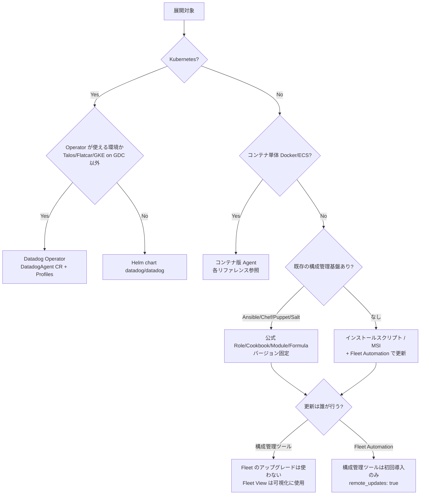
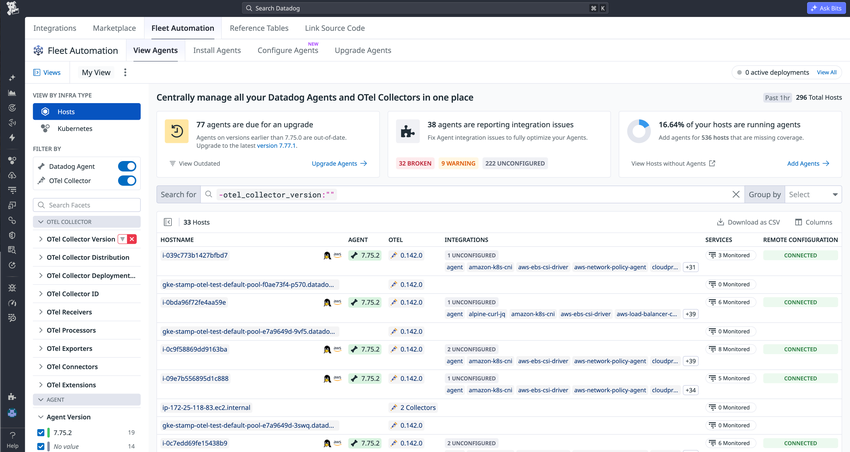
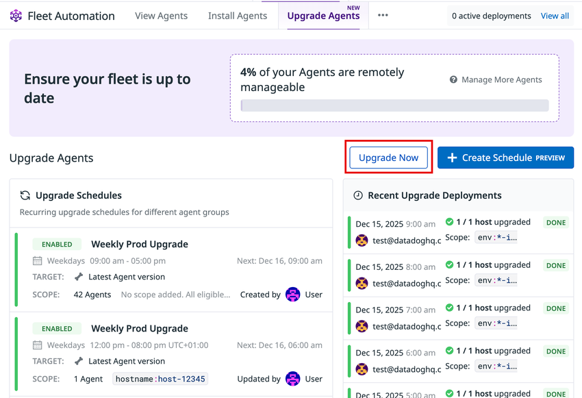
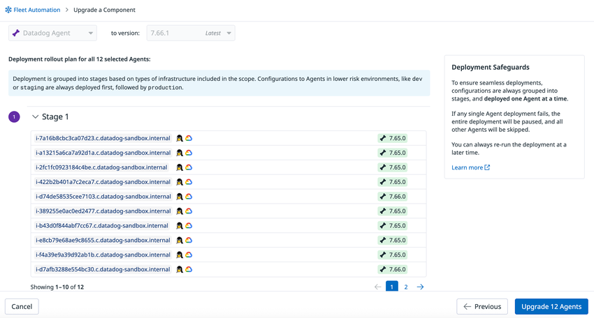
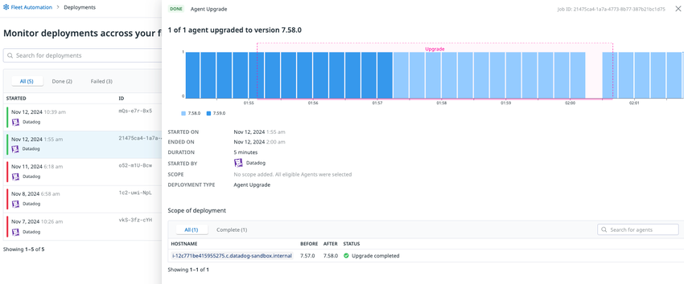
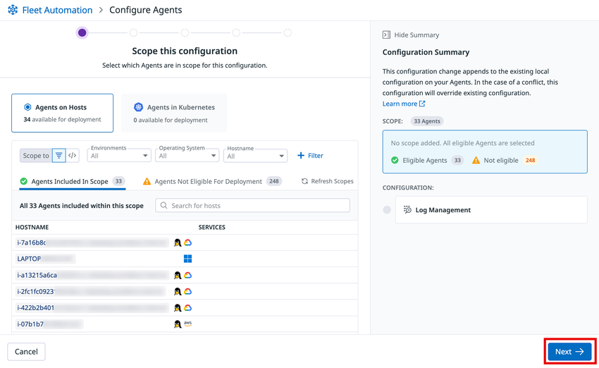

# Agent 展開設計

## 概要

Agent 展開設計は、Datadog Agent（以下 Agent）を本番環境の全ホスト・全クラスタへ「漏れなく・同じ構成で・安全に」配布し、その後も継続的に更新できる状態を作るための設計作業である。Datadog 導入プロジェクトでは、要件定義（[要件定義とアーキテクチャ設計](./09-requirements-and-architecture-design.md)）で決めた監視対象・有効化する製品・タグ体系を、具体的な配布手段と運用ルールに落とし込む工程にあたる。

本ファイルは次の問いに答える。

| 問い | 該当節 |
|---|---|
| どの環境にどの展開手段（スクリプト、MSI、Ansible/Chef/Puppet/SaltStack、Helm、Operator）を使うべきか | [2](#2-展開方式の選定) |
| 各構成管理ツールで Agent バージョン・サイト・タグ・インテグレーションをどう指定するか | [3](#3-ホストvmベアメタルへの展開) |
| Kubernetes では Helm と Datadog Operator のどちらを選ぶか、何を固定すべきか | [4](#4-kubernetes-への展開) |
| Single Step Instrumentation（SSI）を大規模に有効化するとき、どう範囲を絞って段階的に広げるか | [5](#5-single-step-instrumentationssiの展開設計) |
| Agent のバージョンをどう固定し、どの頻度・手段で更新するか | [6](#6-バージョン管理方針) |
| 構成管理ツールと Fleet Automation の設定が衝突したらどちらが勝つか、責任分界をどう決めるか | [7](#7-構成管理の責任分界) |
| Fleet Automation で何ができ、どのバージョン・権限が必要か | [8](#8-fleet-automation-の活用) |
| 段階展開（リング／カナリア）とロールバックをどう設計するか | [9](#9-段階展開リング展開とロールバック) |

Agent そのものの仕様（コンポーネント構成、`datadog.yaml` の設定キー、コマンド）は [Datadog Agent](../02_リファレンス/platform/agent.md) と [Agent 設定リファレンス](../02_リファレンス/platform/agent-configuration.md)、Kubernetes 向け Agent の詳細は [コンテナ/Kubernetes向けAgent](../02_リファレンス/platform/kubernetes-and-containers-agent.md)、Fleet Automation の機能仕様の詳細は [Fleet Automation と Remote Configuration](../02_リファレンス/platform/fleet-automation.md) を参照。本ファイルはそれらを前提に「展開の設計判断」に焦点を当てる。

---

## 1. 展開設計の全体像

### 1.1 Agent 展開設計で決めるべき項目

Agent 展開設計では、少なくとも次の項目を決めて設計書に残す。

| 設計項目 | 決める内容 | 主な判断材料 |
|---|---|---|
| 展開対象の棚卸し | OS・ディストリビューション・アーキテクチャ別の台数、Kubernetes クラスタ数とバージョン、コンテナ実行環境、サーバーレス | CMDB、クラウドのインベントリ、[Infrastructure Monitoring](../02_リファレンス/infrastructure/infrastructure-monitoring.md) の対象範囲 |
| 展開手段 | 環境ごとの配布ツール（スクリプト／MSI／Ansible 等／Helm／Operator） | 既存の構成管理基盤、運用チームのスキル、OS 対応 |
| 有効化する機能 | Logs、APM（SSI 含む）、Process、Cloud Network Monitoring、USM、Security 等 | 要件定義、[課金への影響](#10-課金への影響) |
| バージョン方針 | 固定するか追従するか、何世代遅れまで許容するか、更新頻度 | 変更管理ルール、[6 節](#6-バージョン管理方針) |
| 構成の正本（Source of Truth） | `datadog.yaml` とインテグレーション設定をどこで管理するか（Git＋構成管理ツール、Fleet Automation、Helm values／DatadogAgent CR） | [7 節](#7-構成管理の責任分界) |
| シークレット管理 | API キーの配布方法（Kubernetes Secret、Chef の `run_state`、Vault 等の Secrets Management） | [API とキー管理](../02_リファレンス/platform/api-and-keys.md)、[セキュリティとコンプライアンス](./12-security-and-compliance.md) |
| タグ付与 | ホストタグ・`env`・`service`・`version`・`team` 等をどの手段で付けるか | [Tagging](../02_リファレンス/platform/tagging.md)、[タグ戦略の実践](../04_応用編/02-tagging-strategy.md) |
| ネットワーク | プロキシ、PrivateLink、パッケージリポジトリ／コンテナレジストリへの到達性 | [ネットワーク・接続要件](./11-network-and-connectivity.md) |
| 段階展開とロールバック | リング（開発→検証→本番一部→本番全体）、合否判定基準、戻し方 | [9 節](#9-段階展開リング展開とロールバック) |
| 権限 | 誰が Agent のアップグレード・設定変更・flare 送信を行えるか | [組織・ユーザー・権限管理](../02_リファレンス/platform/account-and-access-management.md)、[8.4](#84-fleet-automation-の権限rbac) |

### 1.2 展開方式の判断フロー



> 判断フローの「Fleet Automation か構成管理ツールのどちらか一方でバージョンを管理する」という分岐は、公式ドキュメントの「Upgrade precedence」の記述（両方を併用すると構成管理ツールが Fleet でアップグレードした Agent を `DD_AGENT_MINOR_VERSION` のバージョンへ戻す）に基づく。[出典](https://docs.datadoghq.com/agent/fleet_automation/upgrade_agents/)

---

## 2. 展開方式の選定

### 2.1 環境別の推奨展開方式

Datadog Agent の展開方式は、展開先の環境と既存の運用基盤で選ぶ。公式ドキュメントは各手段の「推奨」を次のように示している。

| 展開先 | 推奨される展開方式 | 補足 | 出典 |
|---|---|---|---|
| Linux VM／ベアメタル（少数・構成管理なし） | アプリ内ガイド（Fleet Automation の Install Agents）で生成したワンライナー（インストールスクリプト） | 生成コマンドには API キー・サイト・有効化製品が埋め込まれる | [Linux SSI](https://docs.datadoghq.com/tracing/trace_collection/automatic_instrumentation/single-step-apm/linux/) |
| Windows Server | Fleet Automation のアプリ内ガイドで生成したコマンド、または MSI のサイレントインストール | `msiexec /qn` とプロパティ指定 | [Windows](https://docs.datadoghq.com/agent/supported_platforms/windows/) |
| Linux／Windows／macOS（Ansible 運用あり） | 公式 Ansible コレクション `datadog.dd`（ロール `datadog.dd.agent`） | Red Hat Automation Hub で認定済み | [Ansible](https://docs.datadoghq.com/agent/basic_agent_usage/ansible/) |
| Linux／Windows（Chef 運用あり） | 公式 Cookbook `datadog` | `chef-client` 12.7 以上 | [Chef](https://docs.datadoghq.com/agent/basic_agent_usage/chef/) |
| Linux／Windows（Puppet 運用あり） | 公式 Module `datadog/datadog_agent` | Puppet 7.34.x 以上 | [Puppet](https://docs.datadoghq.com/agent/basic_agent_usage/puppet/) |
| Debian 系／RedHat 系 Linux（Salt 運用あり） | 公式 Formula `datadog-formula` | Debian 系・RedHat 系のみ対応。Fleet Automation のアプリ内ガイドで Pillar スニペットを生成できる | [SaltStack](https://docs.datadoghq.com/agent/basic_agent_usage/saltstack/) |
| Kubernetes／OpenShift（新規） | Datadog Operator（推奨） | 単一 CRD で Node Agent・Cluster Agent・Cluster Checks Runner を展開 | [Operator](https://docs.datadoghq.com/containers/datadog_operator/) |
| Kubernetes（Operator 非対応プラットフォーム等） | Helm chart `datadog/datadog` | Talos、Flatcar、GKE on Google Distributed Cloud、Operator が公開していない Helm 機能が必要な場合 | [Operator](https://docs.datadoghq.com/containers/datadog_operator/) |
| Kubernetes（手動 DaemonSet） | 公式にサポートされるが非推奨 | 誤設定の余地が大きい | [Operator](https://docs.datadoghq.com/containers/datadog_operator/) |
| インターネット接続が限定されたサーバー | プロキシ経由、またはパッケージを別ホストで取得して持ち込み | [3.7](#37-インターネット接続が限定された環境) | [Limited connectivity](https://docs.datadoghq.com/agent/guide/installing-the-agent-on-a-server-with-limited-internet-connectivity/) |

ECS、Fargate、Docker 単体、サーバーレス（Lambda 拡張等）の展開手段は本ファイルの対象外とし、[コンテナ/Kubernetes向けAgent](../02_リファレンス/platform/kubernetes-and-containers-agent.md) と [Serverless Monitoring](../02_リファレンス/infrastructure/serverless.md) を参照。

### 2.2 展開手段の比較

| 観点 | インストールスクリプト／MSI | Ansible / Chef / Puppet / SaltStack | Helm | Datadog Operator |
|---|---|---|---|---|
| 初期導入の容易さ | 最も容易（1 行） | 既存基盤があれば容易 | 容易 | 容易（Operator 導入＋CR 適用） |
| 構成の宣言的管理 | なし（初回のみ引数反映） | あり（コード化・冪等） | あり（`values.yaml`） | あり（`DatadogAgent` CR を継続 reconcile） |
| バージョン固定 | `DD_AGENT_MINOR_VERSION` | 各ツールの変数で固定（[6.2](#62-ツール別のバージョン固定方法)） | `agents.image.tag` 等 | `override.<component>.image.tag` 等 |
| Fleet Automation でのリモートアップグレード | 可（Linux 7.69.0 以降／Windows 7.71.1 以降） | 可（ただし構成管理ツール側の固定と競合） | 不可（コンテナは非対応） | 不可（コンテナは非対応） |
| Fleet Automation でのリモート設定変更 | 可（7.73 以降。Linux はインストールスクリプトまたは Ansible Role で導入したもの） | Ansible Role は可。Chef/Puppet/Salt 導入ホストは公式前提の記載なし（公開情報では確認できず） | 不可（Helm values は編集不可） | 【Preview】Operator v1.27 以降で `DatadogAgent` を編集可 |
| ノードグループ別の構成 | 個別対応 | インベントリ／ロール単位 | ノードグループごとに別リリース＋affinity が必要 | DatadogAgentProfile で 1 リソースから適用 |
| 状態・エラーの可視化 | Fleet View | 各ツールの実行レポート（Puppet run reports、Chef handler 等）＋ Fleet View | Fleet View（Kubernetes view で values を閲覧、Helm chart v3.157.0 以降） | CR の status、Fleet View（Operator v1.24 以降で CR 閲覧） |
| マーケットプレイス配布 | — | Red Hat Automation Hub（Ansible） | Helm リポジトリのみ | Red Hat OperatorHub、Amazon EKS add-on、Google Cloud Marketplace |

出典：[Fleet Automation Configure Agents](https://docs.datadoghq.com/agent/fleet_automation/configure_agents/)、[Upgrade Agents](https://docs.datadoghq.com/agent/fleet_automation/upgrade_agents/)、[Fleet View](https://docs.datadoghq.com/agent/fleet_automation/fleet_view/)、[Datadog Operator](https://docs.datadoghq.com/containers/datadog_operator/)

---

## 3. ホスト（VM／ベアメタル）への展開

### 3.1 Linux インストールスクリプト

Linux 向けインストールスクリプト（`install_script_agent7.sh`）は、パッケージリポジトリと署名鍵の設定、Agent パッケージのインストール、`datadog.yaml` の初期生成、（指定時は）SSI パッケージの導入までを 1 コマンドで行う。スクリプトは環境変数で挙動を制御する。**入力オプションは初回インストール時のみ反映され、既存の設定ファイルは上書きされない**点が大規模展開時の重要な注意点である。[出典](https://github.com/DataDog/agent-linux-install-script)

主要な環境変数は次のとおり（Agent 7 系の公式スクリプト README に基づく）。

| 環境変数 | 内容 | 既定値・備考 |
|---|---|---|
| `DD_API_KEY` | API キー | 必須（`DD_UPGRADE` 指定時を除く） |
| `DD_SITE` | 送信先サイト（例：AP1 は `ap1.datadoghq.com`） | 既定値の記載なし。サイト一覧は [Datadog Sites](../02_リファレンス/platform/datadog-sites.md) |
| `DD_URL` | 独自のインテーク URL（`DD_SITE` より優先） | APM・Logs・Live Process のインテークには影響しない |
| `DD_AGENT_MAJOR_VERSION` | メジャーバージョン（`6` または `7`） | `install_script_agent7.sh` は `7` が既定 |
| `DD_AGENT_MINOR_VERSION` | マイナーバージョン。`73` のような部分指定は最新パッチを選択、`73.1` のような完全指定で固定 | 未指定時は最新。不正な値はスクリプトを中断 |
| `DD_AGENT_DIST_CHANNEL` | `stable` または `beta`（本番リポジトリ） | — |
| `DD_AGENT_FLAVOR` | `datadog-agent`、`datadog-iot-agent`、`datadog-dogstatsd`、`datadog-fips-proxy`、`datadog-fips-agent`、`datadog-heroku-agent` | 既定 `datadog-agent` |
| `DD_HOSTNAME` | ホスト名を強制 | — |
| `DD_TAGS` | ホストタグ（`team:infra,env:prod` 形式） | `DD_HOST_TAGS` は非推奨 |
| `DD_ENV` | `env` の値 | — |
| `DD_INSTALL_ONLY` | インストールのみ行い Agent を起動しない | ゴールデンイメージ作成時に有用 |
| `DD_NO_AGENT_INSTALL` | 署名鍵と設定ファイルのみ作成し Agent は入れない | `DD_APM_INSTRUMENTATION_ENABLED=docker` 時は自動で `true` |
| `DD_REPO_URL` | パッケージリポジトリのドメイン（ミラー利用時） | 既定 `datadoghq.com`。旧 `REPO_URL` は非推奨 |
| `DD_RPM_REPO_GPGCHECK` | RPM の `repo_gpgcheck` 切替（`0`/`1`） | `DD_REPO_URL` 指定時は既定で無効 |
| `DD_APM_INSTRUMENTATION_ENABLED` | SSI の有効化（`host`、`docker`、`all`） | Agent 7 のみ。SUSE 非対応 |
| `DD_APM_INSTRUMENTATION_STRICT` | 上と同じ値。SSI の導入に失敗したらスクリプトを失敗させる | permissive 版より優先 |
| `DD_APM_INSTRUMENTATION_LIBRARIES` | 導入する SDK（README 記載の値は `all`、`java`、`js`、`python`、`dotnet`、`ruby`。`言語:メジャー` で固定可） | 未指定時は `java`、`js`、`python`、`dotnet`、`ruby` が有効（README 記載）。PHP の SSI 対応は [5.2](#52-ssi-の対応範囲) を参照 |
| `DD_RUNTIME_SECURITY_CONFIG_ENABLED` | Workload Protection（旧称：CWS）有効化 | 設定ファイル未作成時のみ |
| `DD_COMPLIANCE_CONFIG_ENABLED` | ホストのコンプライアンス（CSPM）有効化 | 同上 |
| `DD_SYSTEM_PROBE_NETWORK_ENABLED` | Cloud Network Monitoring（旧称：NPM）有効化 | 同上 |
| `DD_SYSTEM_PROBE_SERVICE_MONITORING_ENABLED` | Universal Service Monitoring 有効化 | 同上 |
| `DD_DISCOVERY_ENABLED` | Service Discovery 有効化 | 同上 |
| `DD_OTELCOLLECTOR_ENABLED` | DDOT（Datadog Distribution of OpenTelemetry Collector）の導入・有効化 | 同上 |
| `DD_FIPS_MODE` | ローカル FIPS プロキシ経由で送信 | Agent 自体を FIPS 準拠にするものではない |
| `DD_INSTRUMENTATION_TELEMETRY_ENABLED` | スクリプト失敗テレメトリの送信 | 既定 `true` |

出典：[DataDog/agent-linux-install-script README](https://github.com/DataDog/agent-linux-install-script)、[Linux SSI](https://docs.datadoghq.com/tracing/trace_collection/automatic_instrumentation/single-step-apm/linux/)

**バージョンを固定したインストール例（AP1、Agent 7.73 系の最新パッチ）：**

```bash
DD_API_KEY="<API_KEY>" \
DD_SITE="ap1.datadoghq.com" \
DD_AGENT_MAJOR_VERSION=7 \
DD_AGENT_MINOR_VERSION=73 \
DD_ENV=prod \
DD_TAGS="team:platform,service_tier:1" \
bash -c "$(curl -L https://install.datadoghq.com/scripts/install_script_agent7.sh)"
```

> 上記のスクリプト URL はアプリ内ガイドが生成するコマンドの一般的な形式である。実際の導入時は Fleet Automation の Install Agents 画面で生成されたコマンドを正とすること。

**スクリプト展開時の設計上の注意：**

- 入力変数は初回のみ反映されるため、**既存ホストのタグ・サイト変更にスクリプト再実行は使えない**。変更は `datadog.yaml` を構成管理ツールで書き換えるか、Fleet Automation の Configure Agents で行う。[出典](https://github.com/DataDog/agent-linux-install-script)
- スクリプトを再実行すると Agent と SSI パッケージが更新される（SSI の SDK 更新はこの方法で行う）。[出典](https://docs.datadoghq.com/tracing/trace_collection/automatic_instrumentation/single-step-apm/linux/)
- 【経験則】ゴールデンイメージ（AMI 等）に Agent を焼き込む場合、`DD_INSTALL_ONLY=true` で起動させずにイメージ化し、ホスト名・タグはインスタンス起動時（cloud-init 等）に設定すると、イメージ作成ホストのホスト名が残る問題を避けやすい。

### 3.2 Windows（MSI）

Windows の Agent は MSI パッケージ（`datadog-agent-7-latest.amd64.msi`）で配布され、`msiexec` の `/qn`（サイレント）とプロパティ指定で無人インストールできる。Agent サービスは `ddagentuser` アカウントで動作する。[出典](https://docs.datadoghq.com/agent/supported_platforms/windows/)

| MSI プロパティ | 内容 | 既定値・備考 |
|---|---|---|
| `APIKEY` | API キー | — |
| `SITE` | 送信先サイト | — |
| `TAGS` | カンマ区切りの `key:value` タグ | — |
| `HOSTNAME` | ホスト名の上書き | — |
| `DDAGENTUSER_NAME` / `DDAGENTUSER_PASSWORD` | サービスアカウント名・パスワード | 6.11.0 以降。ドメインコントローラー等ドメインサーバーではパスワード必須 |
| `APPLICATIONDATADIRECTORY` | 設定ディレクトリ | 既定 `C:\ProgramData\Datadog`。初回インストールのみ有効 |
| `PROJECTLOCATION` | バイナリディレクトリ | 既定 `%ProgramFiles%\Datadog\Datadog Agent`。初回のみ有効 |
| `LOGS_ENABLED` | ログ収集 | 既定 無効 |
| `APM_ENABLED` | APM Agent | 既定 有効 |
| `PROCESS_ENABLED` | Process Agent | 既定 無効 |
| `HOSTNAME_FQDN_ENABLED` | FQDN をホスト名に使用 | 既定 無効（6.20.0 以降） |
| `CMD_PORT` | コマンド API ポート | 既定 5001 |
| `PROXY_HOST` / `PROXY_PORT` / `PROXY_USER` / `PROXY_PASSWORD` | プロキシ設定 | — |
| `EC2_USE_WINDOWS_PREFIX_DETECTION` | EC2 Windows でインスタンス ID をホスト名に使用 | 7.28.0 以降 |
| `REBOOT=ReallySuppress` | 強制再起動の抑止 | 一部コンポーネントはカーネルドライバを使用 |

- 有効な `datadog.yaml` が既に存在する場合、`datadog.yaml` がコマンドライン引数より優先される。[出典](https://docs.datadoghq.com/agent/supported_platforms/windows/)
- アンインストールしても `C:\ProgramData\Datadog` は削除されない（再導入時に旧設定が残る）。[出典](https://docs.datadoghq.com/agent/supported_platforms/windows/)
- SCCM／Intune／GPO による配布手順について、公式 Windows ページでの記載は公開情報では確認できず。【経験則】`msiexec /i datadog-agent-7-latest.amd64.msi /qn APIKEY=... SITE=... TAGS=...` を各配布ツールのアプリケーションとして登録する形が一般的である。`latest` ではなくバージョン付き MSI を配布物として社内リポジトリに保管すると、バージョン固定と再現性が担保できる。

### 3.3 Ansible（公式コレクション `datadog.dd`）

Ansible による展開は、公式コレクション `datadog.dd` のロール `datadog.dd.agent` を使う。単体ロール版は `DataDog/ansible-datadog` リポジトリで提供されている。[出典](https://docs.datadoghq.com/agent/basic_agent_usage/ansible/)

| 項目 | 内容 |
|---|---|
| 要件 | Ansible 2.10 以降 |
| 対応プラットフォーム | Debian 系・RHEL 系・SUSE 系 Linux の大半、macOS、Windows |
| Windows 前提 | `ansible.windows` コレクション。単体ロールのガイドでは、Windows ホストにはインベントリで `ansible_become: no` を設定する方法を推奨（`become: yes` のままだとロールが失敗する） |
| openSUSE/SLES 前提 | `community.general` コレクション（Red Hat はコミュニティコンテンツをサポートしないため、問題は Datadog サポートへ） |
| インストール | `ansible-galaxy collection install datadog.dd`、または `requirements.yml` に記載 |
| コレクション自体の固定 | `ansible-galaxy collection install datadog.dd:==<version>`。Galaxy 版は Ansible 本体の更新では自動更新されない |
| 配布チャネル | Ansible Galaxy、Red Hat Automation Hub（Red Hat 認定） |
| Fleet Automation との関係 | Ansible Datadog Role で導入した Linux VM は Fleet Automation の Configure Agents の前提を満たす |

出典：[Ansible](https://docs.datadoghq.com/agent/basic_agent_usage/ansible/)、[Ansible 単体ロール](https://docs.datadoghq.com/agent/guide/ansible_standalone_role/)、[Configure Agents](https://docs.datadoghq.com/agent/fleet_automation/configure_agents/)

主要なロール変数：

| 変数 | 既定値 | 内容 |
|---|---|---|
| `datadog_api_key` | なし（Ansible ロール 4.21 以降は必須） | 未指定ならロールが失敗する |
| `datadog_site` | `datadoghq.com` | AP1 なら `ap1.datadoghq.com` |
| `datadog_agent_version` | 未指定 | 特定バージョンに固定（**推奨**）。指定時は `datadog_agent_major_version` 不要 |
| `datadog_agent_major_version` | `7` | `datadog_agent_version` 未指定時、このメジャーの最新を導入 |
| `datadog_agent_flavor` | `datadog-agent` | Raspberry Pi 等は `datadog-iot-agent` |
| `datadog_config` | 未指定 | `datadog.yaml` に書き出す設定 |
| `datadog_checks` | 未指定 | `/etc/datadog-agent/conf.d/<check>.d/conf.yaml` に書き出すチェック設定 |
| `datadog_enabled` | `true` | `false` でサービスを起動しない |
| `datadog_apm_instrumentation_enabled` | 未指定 | SSI：`host`／`docker`／`all` |
| `datadog_apm_instrumentation_libraries` | `["java", "js", "dotnet", "python", "ruby"]` | SSI で導入する SDK |
| `datadog_remote_updates` | 未指定 | datadog-installer によるリモートインストール・更新を有効化 |
| `datadog_agent_allow_downgrade` | `defaults/main.yml` 参照 | `yes` でダウングレードを許可（慎重に）。Windows はダウングレード非対応 |
| `datadog_windows_ddagentuser_name` / `_password` | — | Windows のサービスユーザー |
| `datadog_windows_skip_install` / `datadog_windows_force_reinstall` | — | Windows のインストール制御（force が優先） |

出典：[Ansible standalone role](https://docs.datadoghq.com/agent/guide/ansible_standalone_role/)

**プレイブック例（バージョン固定・AP1・タグ・ログ有効化）：**

```yaml
- hosts: web_prod
  tasks:
    - name: Install Datadog Agent
      import_role:
        name: datadog.dd.agent
  vars:
    datadog_api_key: "{{ vault_datadog_api_key }}"
    datadog_site: "ap1.datadoghq.com"
    datadog_agent_version: "7.73.1"       # 例。検証済みバージョンに固定
    datadog_config:
      env: prod
      tags:
        - "team:web"
      logs_enabled: true
    datadog_checks:
      nginx:
        init_config:
        instances:
          - nginx_status_url: http://localhost/nginx_status/
```

> `7.73.1` は記法例であり、特定バージョンの推奨ではない。固定するバージョンは検証環境で確認したものを使う。Windows の Agent 6.14.0／6.14.1 はロールでブロックされている（6.14.2 以降を使用）。[出典](https://docs.datadoghq.com/agent/guide/ansible_standalone_role/)

### 3.4 Chef（公式 Cookbook `datadog`）

| 項目 | 内容 |
|---|---|
| Cookbook | `datadog`（Berkshelf 例：`cookbook 'datadog', '~> 4.0'`） |
| 要件 | `chef-client` 12.7 以上（それ未満は Cookbook 2.x）。AlmaLinux は Chef 16.10.8 以上 or 17.0.69 以上、Rocky は 16.17.4 以上 or 17.1.35 以上、RHEL 8 は Chef 15 以上、SUSE は 13.3 以上 |
| 依存 | `apt`（Debian 9 以降は v7.1 以上）、`chef_handler`、`yum` |
| 対応 OS | AlmaLinux、Amazon Linux、CentOS、Debian、RedHat、Rocky、Scientific Linux、Ubuntu、Windows、SUSE |
| 主なレシピ | `dd-agent`（導入・API キー設定・起動）、`dd-handler`（Chef 実行結果を Datadog に送る）、`remove-dd-agent`、`system-probe`（NPM／USM 用設定） |
| リソース | `datadog_monitor`（レシピのないインテグレーション設定）、`datadog_integration`（インテグレーションの特定バージョン導入。`third_party` は Agent 6.21/7.21 以降） |
| キー管理 | API キー・アプリケーションキーはノード属性で設定。`run_state` を使うと Chef Server に平文保存されない |
| 追加設定 | `extra_config` ハッシュを `datadog.yaml` にマージ（`secret_backend_command`、`logs_config` 等） |

バージョン関連の属性：

| 属性 | 内容・既定値 |
|---|---|
| `agent_major_version` | 5／6／7。既定 7 |
| `agent_version` | 特定バージョンに固定（**推奨**） |
| `agent_package_action` | Linux のみ。既定 `'install'`。`'upgrade'` は自動更新になるため**非推奨** |
| `agent_flavor` | Linux のみ。既定 `'datadog-agent'` |
| `agent_allow_downgrade` | ダウングレード時に必要 |
| `aptrepo` | 既定 `[signed-by=/usr/share/keyrings/datadog-archive-keyring.gpg] apt.datadoghq.com`（ミラー利用時に変更） |

注意点：`dd-agent` レシピはインテグレーションリソースより前に run list に置く。`data_bags` はレシピで使われない。Cookbook 4.x で 3.x から多くの属性名が変更されている（例：`agent6` → `agent_major_version`）。[出典](https://docs.datadoghq.com/agent/basic_agent_usage/chef/)

### 3.5 Puppet（公式 Module `datadog_agent`）

| 項目 | 内容 |
|---|---|
| Module | `datadog-datadog_agent`（Puppet Forge：`datadog/datadog_agent`） |
| 要件 | Puppet 7.34.x 以上、または Puppet Enterprise 2021.7.x 以上。Module v4.x は Puppet 6 以前と Agent v5 を非サポート（それらは v3.x） |
| 対応 OS | Linux、Windows |

主要パラメーター（`datadog_agent` クラス）：

| パラメーター | 既定値 | 内容 |
|---|---|---|
| `api_key` | — | API キー |
| `agent_major_version` | `7` | 6 または 7 |
| `agent_version` | 空（最新） | マイナーバージョン固定（例：`1:7.16.0-1`） |
| `datadog_site` | `datadoghq.com` | 送信先サイト |
| `dd_url` | — | インテーク URL 上書き（`datadog_site` より優先） |
| `host` | ノードのホスト名 | ホスト名の上書き |
| `local_tags` | — | `KEY:VALUE` のタグ配列 |
| `facts_to_tags` | — | Puppet facts をタグに変換 |
| `apm_enabled` / `process_enabled` / `logs_enabled` | `false` | 各機能の有効化 |
| `agent_extra_options` | — | 追加オプションのハッシュ（ディープマージ） |
| `windows_npm_install` | `false` | Windows NPM ドライバ導入 |
| `puppet_run_reports` | — | Puppet 実行レポートを Datadog に送信 |

設計上の注意：

- タグに使う facts は静的なもの（OS、ロール等）にし、CPU 使用率や uptime など動的な facts はタグにしない（カーディナリティ増加の原因）。構造化 facts は特定の値をインデックス指定する。[出典](https://docs.datadoghq.com/agent/basic_agent_usage/puppet/)
- Puppet run reports は `puppet.conf` の `[master]` セクションに `reports=datadog_reports` を書く（`[main]` では読み込み失敗）。設定変更後は `puppetserver` の再起動が必要。[出典](https://docs.datadoghq.com/agent/basic_agent_usage/puppet/)
- `datadog_agent::install_integration` でインテグレーションのバージョン固定が可能だが、Agent 同梱バージョンより下にはダウングレードできない。

### 3.6 SaltStack（公式 Formula `datadog-formula`）

| 項目 | 内容 |
|---|---|
| Formula | `datadog`（リポジトリ `DataDog/datadog-formula`） |
| 対応 OS | Debian 系・RedHat 系のみ |
| 導入方法 | Fleet Automation のアプリ内ガイドで Pillar スニペットを生成して Pillar ファイルに追加し、通常の Salt state を実行。上級者向けには `gitfs_remotes` に追加（`ref:` で Formula のバージョン固定）、または `file_roots` にクローン |
| Pillar 構造 | `datadog` キー配下に `config`（`datadog.yaml` に書き出し）、`install_settings`（`agent_version` 等）、`checks`（チェック設定・バージョン） |
| Agent バージョン | `install_settings.agent_version`（既定は Agent v7 の最新） |
| チェック個別バージョン | `checks.<name>.version`。`third_party: true` はバージョン指定必須かつ Agent 6.21.0/7.21.0 以降 |
| State | `datadog`（一括）、`datadog.install`、`datadog.config`、`datadog.service`、`datadog.uninstall` |
| マシン別のチェックインスタンス | Salt master（masterless は minion）で `pillar_merge_lists: True` が必要 |

出典：[SaltStack](https://docs.datadoghq.com/agent/basic_agent_usage/saltstack/)

### 3.7 インターネット接続が限定された環境

インターネット接続が限定されたサーバーへの Agent 展開は、次の 3 方式から選ぶ。[出典](https://docs.datadoghq.com/agent/guide/installing-the-agent-on-a-server-with-limited-internet-connectivity/)

| 方式 | 内容 | 必要な到達先 |
|---|---|---|
| プロキシ経由 | Agent 通信とパッケージ取得をプロキシ経由にする | 送信先インテークと Remote Configuration エンドポイント（[ネットワーク・接続要件](./11-network-and-connectivity.md)） |
| パッケージ直接インストール | OS に合ったパッケージを取得し `yum localinstall` / `apt install ./...deb` | — |
| ミラーして持ち込み | 到達可能なホストで取得し、対象へ転送してローカルインストール | — |

| リポジトリ | URL |
|---|---|
| 署名鍵 | `keys.datadoghq.com` |
| APT（Debian/Ubuntu） | `apt.datadoghq.com`（DEB プール：`https://apt.datadoghq.com/pool/d/da/`） |
| YUM（RHEL/SUSE） | `yum.datadoghq.com`（Agent 7：`https://yum.datadoghq.com/stable/7/`） |

- 社内ミラー（Artifactory、Nexus、Satellite 等）を使う場合は、インストールスクリプトの `DD_REPO_URL`、Chef の `aptrepo`、各ツールのリポジトリ変数でミラーを指す。
- Fleet Automation のリモート管理は、プロキシ経由やミラーリポジトリ構成でも動作する（プロキシ設定後に Agent 再起動が必要）。[出典](https://docs.datadoghq.com/agent/fleet_automation/configure_agents/)
- 完全なエアギャップ環境で Fleet Automation のリモートアップグレードがどう動くか（パッケージ取得元の指定方法）は公開情報では確認できず。

---

## 4. Kubernetes への展開

### 4.1 Datadog Operator と Helm の選定

Kubernetes では Datadog Operator が新規展開の推奨方式であり、Helm chart は Operator 非対応の環境や Helm 固有機能が必要な場合に使う。[出典](https://docs.datadoghq.com/containers/datadog_operator/)

| 観点 | Datadog Operator | Helm chart（`datadog/datadog`） |
|---|---|---|
| 動作モデル | コントローラーが `DatadogAgent` カスタムリソースを継続的に reconcile | `helm install/upgrade` 時に `values.yaml` からマニフェストをレンダリング |
| 展開対象 | 1 つの CRD で Node Agent・Cluster Agent・Cluster Checks Runner | 1 リリースで同等を展開 |
| 状態の可視化 | CR の status にデプロイ状態・ヘルス・エラーを報告 | Helm のリリース状態のみ |
| 設定検証 | Agent 設定のバリデーション、高水準オプションで誤設定を抑止 | values のスキーマ範囲 |
| ノードグループ別構成 | DatadogAgentProfile で 1 リソースから適用 | ノードグループごとに別リリース＋手書きの affinity |
| クラスタ種別の自動検出 | EKS、OpenShift 等を検出し、コントロールプレーン監視などを自動適用 | 手動設定 |
| 機能パリティ | v1.29.0 以降で主要クラウド上の Helm chart と機能同等 | — |
| マーケットプレイス | Red Hat OperatorHub、Amazon EKS add-on、Google Cloud Marketplace | 掲載なし |
| Fleet Automation からの設定編集 | 【Preview】Operator v1.27 以降で `DatadogAgent` を編集可（ロールアウト失敗時は Operator が自動で前の設定に戻す） | 不可（values の閲覧のみ、Helm chart v3.157.0 以降） |
| Helm を使うべきケース | — | Talos、Flatcar、GKE on Google Distributed Cloud、Operator 未公開の Helm 機能が必要な場合 |

出典：[Datadog Operator](https://docs.datadoghq.com/containers/datadog_operator/)、[Fleet View](https://docs.datadoghq.com/agent/fleet_automation/fleet_view/)、[Configure Agents](https://docs.datadoghq.com/agent/fleet_automation/configure_agents/)

> Helm chart には Operator への移行用の値（`datadog.operator.migration.enabled`、既定 `false`）がある。また Helm chart の `datadog.operator.enabled` は既定 `true`（Operator を依存チャートとして導入）である。移行手順の詳細は公式ガイドを参照。[出典](https://github.com/DataDog/helm-charts/blob/main/charts/datadog/README.md)

### 4.2 Kubernetes と Agent の最低バージョン

| Kubernetes | Agent | Cluster Agent | 理由 |
|---|---|---|---|
| 1.16.0 以上 | 7.19.0 以上 | 1.9.0 以上 | Kubelet メトリクスの非推奨化 |
| 1.21.0 以上 | 7.36.0 以上 | 1.20.0 以上 | Kubernetes リソースの非推奨化 |
| 1.22.0 以上 | 7.37.0 以上 | 7.37.0 以上 | Dynamic service account token 対応 |
| 1.25.0 以上 | 7.40.0 以上 | 7.40.0 以上 | `v1` API グループ対応 |
| 1.33.0 以上 | 7.67.0 以上 | 7.67.0 以上 | `/pods` 出力の `AllocatedResources` 非互換の修正 |

Datadog は **Cluster Agent と Agent のバージョンを揃える**ことを推奨している。Kubernetes のバージョンアップ計画と Agent のバージョン計画は連動させる（例：1.33 へ上げる前に Agent/Cluster Agent を 7.67.0 以上へ）。[出典](https://docs.datadoghq.com/containers/kubernetes/installation/)

### 4.3 Operator による展開手順

```shell
helm repo add datadog https://helm.datadoghq.com
helm install datadog-operator datadog/datadog-operator
kubectl create secret generic datadog-secret --from-literal api-key=<DATADOG_API_KEY>
```

```yaml
# datadog-agent.yaml
apiVersion: datadoghq.com/v2alpha1
kind: DatadogAgent
metadata:
  name: datadog
spec:
  global:
    clusterName: prod-tokyo-01
    site: ap1.datadoghq.com
    credentials:
      apiSecret:
        secretName: datadog-secret
        keyName: api-key
    tags:
      - "env:prod"
  override:
    nodeAgent:
      image:
        tag: "7.73.1"        # 例：検証済みバージョンに固定
    clusterAgent:
      image:
        tag: "7.73.1"        # Node Agent と揃える
```

```shell
kubectl apply -f datadog-agent.yaml
```

出典：[Kubernetes installation](https://docs.datadoghq.com/containers/kubernetes/installation/)、[Operator configuration v2alpha1](https://github.com/DataDog/datadog-operator/blob/main/docs/configuration.v2alpha1.md)

Operator の主要キー（v2alpha1）：

| キー | 既定値 | 内容 |
|---|---|---|
| `global.site` | `datadoghq.com` | 送信先サイト |
| `global.clusterName` | — | クラスタ名（データのスコープ、Fleet の Kubernetes view で使用） |
| `global.registry` | `registry.datadoghq.com` | 全 Datadog イメージのレジストリ |
| `global.tags` | — | 全メトリクス・イベント・サービスチェックに付与するタグ |
| `override.<component>.image.name` | — | `<NAME>`、`<NAME>:<TAG>`、`<REGISTRY>/<NAME>:<TAG>` 形式 |
| `override.<component>.image.tag` | — | イメージタグ（`name` が完全指定でない場合に有効） |
| `features.apm.instrumentation.enabled` | `false` | SSI（全 Pod への APM ライブラリ注入） |
| `features.remoteConfiguration.enabled` | `true` | Remote Configuration |

### 4.4 Helm による展開手順

```shell
helm repo add datadog https://helm.datadoghq.com
helm repo update
kubectl create secret generic datadog-secret --from-literal api-key=<DATADOG_API_KEY>
helm install datadog-agent -f datadog-values.yaml datadog/datadog
# Windows ノード向けは --set targetSystem=windows
```

Helm chart の主要値（chart 3.264.0 時点の README）：

| キー | 既定値 | 展開設計上の意味 |
|---|---|---|
| `datadog.site` | `nil` | 送信先サイト（AP1 は `ap1.datadoghq.com`） |
| `datadog.apiKeyExistingSecret` | — | 既存 Secret 参照（values に平文キーを書かない） |
| `datadog.clusterName` | — | クラスタ名 |
| `datadog.tags` | `[]` | 静的タグ |
| `agents.image.tag` | `"7.84.6"`（chart 3.264.0 の既定） | **chart のバージョンに Agent バージョンが紐づく**。固定したい場合は明示 |
| `clusterAgent.image.tag` | `"7.84.6"`（同上） | Node Agent と揃える |
| `agents.image.doNotCheckTag` | 未設定 | バージョンと chart の互換チェックを省略 |
| `agents.updateStrategy` | RollingUpdate、`maxUnavailable: "10%"` | DaemonSet 更新時に同時に停止する Agent の上限 |
| `clusterAgent.enabled` | `true` | Cluster Agent を展開 |
| `clusterAgent.replicas` | `1` | 本番では冗長化を検討【経験則】 |
| `datadog.apm.instrumentation.enabled` | `false` | SSI |
| `datadog.remoteConfiguration.enabled` | `true` | Remote Configuration（`remoteConfiguration.enabled` へ移行予定で非推奨表記） |
| `registry` | `nil` | 全 Agent イメージのレジストリ。未指定時はサイトと `registryMigrationMode` で決定 |
| `registryMigrationMode` | `"auto"` | 既定レジストリを `registry.datadoghq.com` へ段階移行 |
| `useFIPSAgent` | `false` | FIPS 準拠イメージ（GovCloud 向け） |
| `targetSystem` | `"linux"` | `linux` / `windows` |

出典：[Helm chart README](https://github.com/DataDog/helm-charts/blob/main/charts/datadog/README.md)

> **バージョン管理上の注意：** Helm chart は chart バージョンごとに既定の Agent イメージタグを持つため、`helm upgrade` で chart を上げると **Agent も暗黙に更新される**。README は「固定する場合は `agents.image.tag` に固定バージョンを設定し、最新安定版に追従する場合は未設定のまま chart を定期的に更新する」と説明している。chart バージョン自体も `helm install --version` で固定し、GitOps（Argo CD／Flux 等）の管理下に置くのが【経験則】として一般的である。[出典](https://github.com/DataDog/helm-charts/blob/main/charts/datadog/README.md)

### 4.5 コンテナレジストリの選定

| レジストリ | パス |
|---|---|
| Datadog Container Registry | `registry.datadoghq.com` |
| Google Artifact Registry | `gcr.io/datadoghq`（欧州 `eu.gcr.io/datadoghq`、アジア `asia.gcr.io/datadoghq`） |
| Amazon ECR Public | `public.ecr.aws/datadog` |
| Azure ACR | `datadoghq.azurecr.io` |
| Docker Hub | `docker.io/datadog`（プルレート制限あり。Docker Hub 契約者以外は他レジストリ推奨） |

- 設定箇所：Operator は `global.registry`、Helm はトップレベルの `registry`。[出典](https://docs.datadoghq.com/containers/kubernetes/installation/)
- 閉域・プライベートレジストリ運用では、Agent・Cluster Agent イメージに加え、SSI を使う場合は `apm-inject` と `dd-lib-<language>-init` イメージもミラーし、タグを設定値と一致させる（バージョン未指定時はタグ `0`）。[出典](https://docs.datadoghq.com/tracing/trace_collection/automatic_instrumentation/single-step-apm/kubernetes/)

### 4.6 クラスタ名・名前空間・権限の設計

| 項目 | ルール・推奨 |
|---|---|
| クラスタ名 | 小文字英字・数字・ハイフンのみ、英字で開始、英数字で終了、80 文字以内。ホストと Cluster Checks のスコープに使われる |
| 名前空間 | Agent は専用名前空間（例：`datadog`）に入れる。**SSI は Agent と同じ名前空間の Pod を計装しない** |
| API キー | Kubernetes Secret に格納し `apiSecret`（Operator）／`apiKeyExistingSecret`（Helm）で参照 |
| 非特権実行 | Agent 7.48 以降は `dd-agent` ユーザーとして UID `100` を推奨。GID は Docker/containerd ソケット所有グループ。Operator は `override.nodeAgent.securityContext`、Helm は `datadog.securityContext` |
| 確認方法 | Agent Pod（ラベル `app.kubernetes.io/component:agent`）が数分以内に Containers 画面へ表示される |

出典：[Kubernetes installation](https://docs.datadoghq.com/containers/kubernetes/installation/)

---

## 5. Single Step Instrumentation（SSI）の展開設計

### 5.1 SSI の位置付け

Single Step Instrumentation（SSI、Single Step APM）は、Agent の導入・更新時に APM Instrumentation を有効にすると、Agent が対応プロセスへ Datadog SDK（トレーサー）を自動ロードし、コード変更なしでトレースを取得できるようにする仕組みである。カスタム計装コードが検出されると SSI は自動で無効化されるため、既存の手動計装は除去してからアプリを再起動する。[出典](https://docs.datadoghq.com/tracing/trace_collection/single-step-apm/)

SSI の言語別の詳細・SDK 設定は [APM インスツルメンテーション](../02_リファレンス/apm/apm-instrumentation.md) を参照。本節は「大規模に安全に有効化する」観点に絞る。

### 5.2 SSI の対応範囲

| 環境 | 状態 | 要件 |
|---|---|---|
| Linux ホスト | GA | APM Instrumentation を有効にした Agent |
| Docker | GA | 同上、Linux ホスト |
| Kubernetes | GA | Datadog Admission Controller 有効、Linux ノード |
| Windows IIS | GA（.NET のみ） | Agent 7.67.1 以上、.NET SDK 3.19.0 以上 |
| EKS Fargate | 【Preview】 | — |
| ECS Fargate | 非対応 | — |

| 言語 | 最低 SDK | 主な注意 |
|---|---|---|
| Java | 1.44.0 | 既定で除外されるアプリ・ライブラリあり（denylist） |
| Python | 2.20.1 | Python 3.7 以上。preload 型 WSGI（gunicorn `--preload` 等）で起動時クラッシュの可能性 |
| Ruby | 2.6.0 | glibc 2.17 以上、Alpine/musl 非対応。アンインストール前に `Gemfile`/`Gemfile.lock` を退避 |
| Node.js | 4.0 | ESM は計装されない |
| .NET | 3.7.0 | 1 プロセスに CLR プロファイラは 1 つ。他プロファイラの `CORECLR_*`／`LD_PRELOAD` を除去 |
| PHP | 1.6.0 | JIT や Xdebug・ionCube・NewRelic・Blackfire・pcov 検出時は自動無効化（`DD_INJECT_FORCE=true` で強制） |

- Linux アーキテクチャは x86_64 と arm64。対応ディストリは Amazon Linux 2022/2023、CentOS 7/8、Debian 10〜12、RHEL 7〜9、Ubuntu 20/22/24、Fedora 40、AlmaLinux 8、Oracle Linux 8、Rocky Linux 8。
- 強化された SELinux 環境は非対応。`t2.micro` のような極小インスタンスはタイムアウトの可能性があり `t2.small` 以上を推奨。
- SDK・ランタイムが非互換の場合、SSI は計装せずにアプリをそのまま起動する（フォールバック）。

出典：[SSI compatibility](https://docs.datadoghq.com/tracing/trace_collection/automatic_instrumentation/single-step-apm/compatibility/)

### 5.3 SSI を段階的に有効化する手段

SSI は**既定ではホスト上／クラスタ内の全サービスを計装する**ため、大規模環境では範囲を絞って段階的に広げる設計が必要である。

| 環境 | 範囲を絞る手段 | 要件 | 出典 |
|---|---|---|---|
| Linux ホスト | **Instrumentation rules**（Allow/Block ルール。属性：OS、Executable、Executable Full Path、Arguments、Working Directory、Language、Entry Point File。演算子：`equals`／`not equals`／`prefix`／`contains`。上から評価し最初に一致したルールを適用、未一致は既定動作） | Agent 7.73 以降。Remote Configuration 有効時は 50 秒以内に反映。app.ddog-gov.com 非対応 | [Linux SSI](https://docs.datadoghq.com/tracing/trace_collection/automatic_instrumentation/single-step-apm/linux/) |
| Linux ホスト | APM > Instrument a Service > **Deploy on existing hosts**（既存 Agent へリモートで SSI を有効化。ステージごとのロールアウト割合を設定） | 失敗が **3 台連続**、または**全体の 10%** に達すると自動停止 | 同上 |
| Linux ホスト | `DD_APM_INSTRUMENTATION_LIBRARIES` で言語と SDK メジャーを限定 | — | 同上 |
| Kubernetes | **`targets`**（`namespaceSelector`・`podSelector`、言語別 `ddTraceVersions`、`ddTraceConfigs`。上から評価し最初の一致を適用） | Agent 7.64 以降 | [K8s SSI](https://docs.datadoghq.com/tracing/trace_collection/automatic_instrumentation/single-step-apm/kubernetes/) |
| Kubernetes | `enabledNamespaces`／`disabledNamespaces`（相互排他、旧方式） | 7.63 以前 | 同上 |
| Kubernetes | **DatadogInstrumentation（DDI）CRD**（ワークロード単位。Deployment、StatefulSet、DaemonSet、Job、CronJob、Argo Rollout。1 ワークロードに 1 DDI） | Agent／Cluster Agent 7.85.0 以降、Operator 1.31.0 以降 または Helm chart 3.255.0 以降 | 同上 |
| Kubernetes | Pod ラベル `admission.datadoghq.com/enabled: "false"` でオプトアウト（他の Admission Controller の変更も無効化される点に注意） | — | 同上 |

Kubernetes での設定の優先順位（高い順）は、①Pod アノテーション ②DDI ③Remote Configuration のポリシー ④Agent の `targets`／`enabledNamespaces` ⑤クラスタ全体の計装 である。[出典](https://docs.datadoghq.com/tracing/trace_collection/automatic_instrumentation/single-step-apm/kubernetes/)

**オプトイン型の段階展開パターン（公式掲載）：** Deployment のメタデータと Pod テンプレートにラベル `datadoghq.com/apm-instrumentation: "enabled"` を付け、`targets` の `podSelector` でそのラベルに一致させる。これにより「チームが自分のワークロードにラベルを付けたものだけ計装」という段階展開ができる。

```yaml
# Helm values 例
datadog:
  apm:
    instrumentation:
      enabled: true
      targets:
        - name: opt-in-workloads
          podSelector:
            matchLabels:
              datadoghq.com/apm-instrumentation: "enabled"
          ddTraceVersions:
            java: "1"      # メジャー固定。latest は避ける
            python: "3"
```

出典：[K8s SSI](https://docs.datadoghq.com/tracing/trace_collection/automatic_instrumentation/single-step-apm/kubernetes/)

**SSI 展開時の設計上の注意：**

- SDK バージョンに `latest` を使わない（メジャーリリースで破壊的変更があり得る）。[出典](https://docs.datadoghq.com/tracing/trace_collection/automatic_instrumentation/single-step-apm/kubernetes/)
- Kubernetes ではアプリ Pod の再起動（再作成）で初めて注入される。無効化も既存 Pod は置き換えまで計装されたまま。
- SSI は起動時間をわずかに増やす。
- Unified Service Tags（`env`／`service`／`version`）をラベルから抽出する機能（Agent 7.69 以降、Operator 1.16.0 以降、Helm chart 3.120.0 以降）は Remote Configuration と併用できないため、その場合は `ddTraceConfigs` で明示する。
- EKS＋Calico 環境ではコントロールプレーンから Admission Webhook に到達できず「Address is not allowed」となる場合があり、`clusterAgent.useHostNetwork: true` で回避する。
- Linux ホストでの削除は `dd-host-install --uninstall` 実行後にサービスを再起動する。[出典](https://docs.datadoghq.com/tracing/trace_collection/automatic_instrumentation/single-step-apm/linux/)

---

## 6. バージョン管理方針

### 6.1 方針の類型

Agent のバージョン管理方針は「固定して計画的に上げる」か「最新に追従する」かの二択を基本とし、本番環境では固定を推奨する。公式の Ansible ロールと Chef Cookbook はいずれも**特定バージョンへの固定を推奨**し、Chef の `agent_package_action 'upgrade'`（自動更新）は非推奨と明記している。[出典](https://docs.datadoghq.com/agent/guide/ansible_standalone_role/)、[出典](https://docs.datadoghq.com/agent/basic_agent_usage/chef/)

| 方針 | 内容 | 向く環境 | 留意点 |
|---|---|---|---|
| 完全固定（パッチまで） | 例：`7.73.1` に固定し、検証後に一斉更新 | 規制業界、変更管理が厳しい本番 | 脆弱性修正の取り込みが遅れる。更新サイクルを明文化する |
| マイナー固定（最新パッチ追従） | 例：`DD_AGENT_MINOR_VERSION=73` で 7.73 系の最新パッチ | 一般的な本番 | 新規ホストと既存ホストでパッチ差が出る |
| N-1／N-2 追従 | Fleet Automation のスケジュールで「最新」「1 つ前」「2 つ前」を指定 | Fleet Automation を正本にする VM 環境 | 「1 つ前」が何を指すか（マイナー単位か）の厳密な定義は公開情報では確認できず |
| 最新追従 | 常に最新 | 開発・検証環境、カナリアリング | 本番には非推奨【経験則】 |

**Agent のリリース周期とサポート期間：** Datadog Agent の公式なリリース周期やバージョン別のサポート終了（EOL）ポリシーは、公開情報では確認できず。【第三者情報】Classmethod の検証記事では 2026-01 時点で 7.75.0、2026-04 時点で 7.78.0 が最新として扱われており、マイナーリリースはおおむね月次程度のペースで出ていることがうかがえる。[出典](https://dev.classmethod.jp/articles/datadog-fleet-automation-remote-agent-upgrade-configuration/)（2026-01-27 公開）、[出典](https://dev.classmethod.jp/articles/datadog-fleet-automation-upgrade-scheduling/)（2026-04-28 公開）

**OS サポート終了の例：** 【第三者情報】Datadog は CentOS/RHEL 6 について、Agent 7.51.1（2024-02）以降の新バージョンをリリースしないと告知しており、該当ホストは 6/7.51.1 以前に固定する必要がある（Datadog 通知を転載した販売代理店ページより）。[出典](https://support.skax.co.kr/en/support/solutions/articles/42000106561--datadog-datadog-support-discontinued-due-to-centos-rhel-6-service-discontinuation)（2024 年公開。2 年以上前の情報のため現行状況は要確認）。古い OS が残る環境では **OS 別にバージョンを分けて固定する**設計が必要になる。

### 6.2 ツール別のバージョン固定方法

| 展開手段 | Agent バージョン固定 | ダウングレード | 出典 |
|---|---|---|---|
| Linux インストールスクリプト | `DD_AGENT_MAJOR_VERSION` ＋ `DD_AGENT_MINOR_VERSION`（`73` 部分指定／`73.1` 完全指定） | パッケージマネージャーで手動 | [README](https://github.com/DataDog/agent-linux-install-script) |
| Windows MSI | バージョン付き MSI を配布 | 公開情報では確認できず（Ansible ロールは Windows のダウングレード非対応と明記） | [Windows](https://docs.datadoghq.com/agent/supported_platforms/windows/) |
| Ansible | `datadog_agent_version`（推奨）、または `datadog_agent_major_version` | `datadog_agent_allow_downgrade: yes`（Windows 不可） | [Ansible role](https://docs.datadoghq.com/agent/guide/ansible_standalone_role/) |
| Chef | `agent_version`（推奨）、`agent_major_version` | `agent_allow_downgrade: true` | [Chef](https://docs.datadoghq.com/agent/basic_agent_usage/chef/) |
| Puppet | `agent_version`（例：`1:7.16.0-1`）、`agent_major_version` | 公開情報では確認できず | [Puppet](https://docs.datadoghq.com/agent/basic_agent_usage/puppet/) |
| SaltStack | `datadog.install_settings.agent_version` | 公開情報では確認できず | [SaltStack](https://docs.datadoghq.com/agent/basic_agent_usage/saltstack/) |
| Helm | `agents.image.tag`、`clusterAgent.image.tag`、chart 自体は `--version` | 旧タグを指定して `helm upgrade` | [Helm README](https://github.com/DataDog/helm-charts/blob/main/charts/datadog/README.md) |
| Operator | `override.nodeAgent.image.tag`、`override.clusterAgent.image.tag`、Operator 自体は Helm chart バージョン | 旧タグを指定して CR 適用 | [Operator config](https://github.com/DataDog/datadog-operator/blob/main/docs/configuration.v2alpha1.md) |
| Fleet Automation（VM） | Upgrade Now でバージョン指定、スケジュールで最新／1 つ前／2 つ前 | 失敗時は自動で前バージョンに戻る（手動ダウングレード機能は公開情報では確認できず） | [Upgrade Agents](https://docs.datadoghq.com/agent/fleet_automation/upgrade_agents/) |
| SSI の SDK（Linux） | `DD_APM_INSTRUMENTATION_LIBRARIES=java:1,python:3` 等。インストール時に固定され、更新はスクリプト再実行 | — | [Linux SSI](https://docs.datadoghq.com/tracing/trace_collection/automatic_instrumentation/single-step-apm/linux/) |
| SSI の SDK（K8s） | `ddTraceVersions`（言語別）、DDI、Pod アノテーション `admission.datadoghq.com/<lang>-lib.version` | 旧バージョン指定後に Pod 再作成 | [K8s SSI](https://docs.datadoghq.com/tracing/trace_collection/automatic_instrumentation/single-step-apm/kubernetes/) |
| インテグレーション個別 | Chef `datadog_integration`、Puppet `datadog_agent::install_integration`、Salt `checks.<name>.version` | Agent 同梱バージョン未満には下げられない（Puppet） | 各ページ |

### 6.3 バージョン更新のプロセス設計

【経験則】大規模環境での Agent 更新は次のプロセスで運用すると事故が少ない。

| ステップ | 内容 | 判定基準の例 |
|---|---|---|
| 1. リリース確認 | GitHub `DataDog/datadog-agent` のリリースノート・CHANGELOG で破壊的変更・既知の問題を確認 | 対象 OS のサポート継続、使用中インテグレーションの変更有無 |
| 2. 検証環境へ適用 | 開発・検証リングへ適用 | Agent の `status`／`health` 正常、主要メトリクスの欠落なし |
| 3. 観察期間 | 数日〜1 週間程度観察 | Agent 自身のリソース使用量（`datadog.agent.*` 系メトリクス）、ログ・トレース量の変化 |
| 4. 本番の一部へ適用 | カナリアリング（例：本番の 5〜10%） | 監視の欠損なし、アラートの誤発報なし |
| 5. 本番全体へ適用 | 残りのリングへ順次 | — |
| 6. バージョン定義の更新 | 構成管理コード／Helm values のバージョン定義を更新して Git にコミット | 新規ホストも同バージョンで構築されること |

> Fleet Automation は新しい Agent バージョンがアップグレード候補として表示されるまで**最大 24 時間**かかることがある。[出典](https://docs.datadoghq.com/agent/fleet_automation/upgrade_agents/)

---

## 7. 構成管理の責任分界

### 7.1 設定の正本をどこに置くか

大規模展開では、`datadog.yaml`・インテグレーション設定（`conf.d`）・ログ設定・バージョンのそれぞれについて「どこが正本か」を決める。正本が複数あると、後述の優先順位に従って設定が上書き合戦になる。

| 管理対象 | 選択肢 A：構成管理ツール（Git 管理） | 選択肢 B：Fleet Automation | 選択肢 C：Kubernetes マニフェスト |
|---|---|---|---|
| Agent バージョン（VM） | Ansible/Chef/Puppet/Salt の変数で固定 | Upgrade Now／スケジュール | — |
| Agent バージョン（K8s） | — | 不可（コンテナのリモートアップグレード非対応） | Helm values／`DatadogAgent` CR |
| `datadog.yaml` | テンプレート化 | Configure Agents（7.73 以降） | Helm values／CR（Operator は Fleet から編集可【Preview】） |
| インテグレーション設定 | `datadog_checks` 等 | Configure Agent Integrations（7.76 以降、OOTB インテグレーションのみ。カスタムチェック不可） | Autodiscovery アノテーション、ConfigMap |
| カスタムログ設定 | 同上 | Configure Custom Logs（7.76 以降） | アノテーション |
| API キー・サイト | 構成管理（Vault 等と連携） | **変更不可**（`api_key`、`site` は Fleet の対象外） | Secret |

出典：[Configure Agents](https://docs.datadoghq.com/agent/fleet_automation/configure_agents/)、[Configure Integrations](https://docs.datadoghq.com/agent/fleet_automation/configure_integrations/)、[Upgrade Agents](https://docs.datadoghq.com/agent/fleet_automation/upgrade_agents/)

### 7.2 Fleet Automation と構成管理ツールが衝突したときの挙動

| 対象 | 挙動 | 出典 |
|---|---|---|
| Agent バージョン | Fleet Automation と構成管理ツールは**どちらか一方**を使う。併用すると構成管理ツールが Fleet でアップグレードした Agent を `DD_AGENT_MINOR_VERSION` のバージョンへ戻す（未設定なら最新へ上げる） | [Upgrade Agents](https://docs.datadoghq.com/agent/fleet_automation/upgrade_agents/) |
| `datadog.yaml` | Fleet からの変更はマージパッチ（指定したフィールドのみ更新）。フィールド単位で衝突した場合は Fleet の値がローカル値を上書き | [Configure Agents](https://docs.datadoghq.com/agent/fleet_automation/configure_agents/) |
| インテグレーション／ログ設定 | 新規ファイル配置、またはマージパッチで更新。既存ファイル名をマージパッチなしで指定すると全体上書き。`tags` などの配列フィールドはマージされず置換 | [Configure Integrations](https://docs.datadoghq.com/agent/fleet_automation/configure_integrations/) |
| 全般 | Fleet・構成管理ツール・ホスト上の直接編集のいずれであっても、**最後に行われた変更**が有効な設定になる | [Configure Agents](https://docs.datadoghq.com/agent/fleet_automation/configure_agents/) |

【第三者情報】Classmethod の検証では、Fleet Automation でログ設定を配布した後、Agent が再起動し `datadog.yaml` のコメントが削除されて設定項目だけが残った。コメントで運用情報を残している場合は注意が必要である。[出典](https://dev.classmethod.jp/articles/datadog-fleet-automation-remote-agent-upgrade-configuration/)（2026-01-27 公開）

### 7.3 推奨される責任分界のパターン

【経験則】次の 3 パターンのいずれかを明示的に選び、運用設計書（[運用設計](./13-operations-design.md)）に記載する。

| パターン | 初回導入 | バージョン更新 | 設定変更 | 向く組織 |
|---|---|---|---|---|
| ① 構成管理ツール一元 | 構成管理ツール | 構成管理ツール（バージョン固定変数を更新） | 構成管理ツール | 既に Ansible/Puppet 等で全サーバーを管理し、Git＋レビューを変更管理の証跡にしている組織。Fleet は可視化（Fleet View）と flare 送信に限定し、Agent Upgrade／Agent Configuration Management 権限を絞る |
| ② Fleet Automation 一元 | スクリプト／MSI／Ansible（初回のみ） | Fleet のスケジュール | Fleet の Configure Agents | 構成管理基盤がない、または Datadog 運用チームとサーバー運用チームが分かれている組織 |
| ③ ハイブリッド | 構成管理ツール | Fleet のスケジュール（構成管理ツール側はバージョンを固定しない＝`latest` 指定もしない設計が必要） | 基盤設定は構成管理、製品の有効化・インテグレーションは Fleet | 移行期。衝突しやすいため対象キーの棲み分けを文書化する |

> パターン③で構成管理ツールが Agent パッケージを「インストール済みなら何もしない」動作になるかは、ツールごとの実装（例：Chef の `agent_package_action 'install'`、Ansible の `datadog_agent_version` 未指定時の挙動）に依存する。Fleet でのアップグレード後に構成管理ツールが戻さないことを検証環境で必ず確認する。

### 7.4 シークレットとタグの扱い

- **API キー**：構成管理ツールではプレーンテキストを避ける（Chef は `run_state`、Ansible は Vault、Kubernetes は Secret）。`datadog.yaml` の `secret_backend_command` による Secrets Management も選択肢（Chef の `extra_config` 例に掲載）。[出典](https://docs.datadoghq.com/agent/basic_agent_usage/chef/)
- **Remote Configuration 用の API キー**：Remote Configuration を使う Agent の API キーには Remote Configuration の capability が必要（`UNAUTHORIZED` の典型原因）。キー単位で無効化して opt-out することもできる。[出典](https://docs.datadoghq.com/agent/guide/setup_remote_config)
- **タグ**：ホストタグは展開手段ごとに `DD_TAGS`／`TAGS`／`datadog_config.tags`／`local_tags`／`global.tags`／`datadog.tags` で付与する。命名規則は [タグ戦略の実践](../04_応用編/02-tagging-strategy.md) で定め、全展開手段で同じキーを使う。Fleet Automation のタグ管理は【Preview】（別途アクセス申請）。[出典](https://docs.datadoghq.com/agent/fleet_automation/configure_agents/)
- **Fleet でのターゲティング**：Fleet Automation のアップグレード・設定配布はホスト情報やタグでフィルタして対象を選ぶため、`env`・`team`・リング識別用タグ（例：`rollout_ring:canary`）を展開時に必ず付けておくと段階展開が容易になる【経験則】。

---

## 8. Fleet Automation の活用

Fleet Automation の機能仕様の詳細は [Fleet Automation と Remote Configuration](../02_リファレンス/platform/fleet-automation.md) を参照。本節は展開設計で押さえるべき要件と使い方を整理する。

### 8.1 Fleet Automation の主要画面



**キャプション：** Fleet Automation のトップ（Fleet View）。Agent の一覧をバージョン・状態・有効化製品とともに表示する画面。

**画面の説明：** Fleet Automation（`https://app.datadoghq.com/fleet`、AP1 は `https://ap1.datadoghq.com/fleet`）を開くと表示される。ホスト名またはクラスタ名でのフリーテキスト検索と、OS・`env`・team・`products_enabled` などのタグ・ホスト情報によるフィルタがあり、一覧には各 Agent のホスト名、Agent バージョン、Remote Configuration の状態、有効な製品などが並ぶ。行を選ぶとサイドパネルで設定（Configuration）、インテグレーション、Audit Events、Support（リモート flare 送信）タブを確認できる。

出典：[Fleet Automation](https://docs.datadoghq.com/agent/fleet_automation/)（画像取得日 2026-11-03）



**キャプション：** Fleet Automation の Upgrade Agents タブ。

**画面の説明：** 上部タブに View Agents、Install Agents、Upgrade Agents が並ぶ。Upgrade Agents タブの上部には「リモート管理可能な Agent の割合」（例：4% of your Agents are remotely manageable）と Manage More Agents リンクが表示され、その下に **Upgrade Now** ボタンと **+ Create Schedule** ボタンがある。左側の Upgrade Schedules に定期スケジュール（名前、有効状態、曜日と時間帯、ターゲット＝Latest Agent version、スコープ＝対象 Agent 数やタグ、作成者、次回実行日時）が、右側の Recent Upgrade Deployments に直近の実行結果（日時、成功ホスト数、実行ユーザー、スコープ、DONE 等の状態）が表示される。

出典：[Upgrade Agents](https://docs.datadoghq.com/agent/fleet_automation/upgrade_agents/)（画像取得日 2026-11-03）

### 8.2 機能別の要件

| 機能 | Remote Configuration | `remote_updates` | 最低 Agent バージョン | 対応環境 |
|---|---|---|---|---|
| Fleet View（可視化） | 不要 | 不要 | 設定表示は 7.47.0 以降で既定有効、インテグレーション設定表示は 7.49.0 以降で既定有効 | 全環境 |
| リモート flare 送信 | 必要 | 不要 | 7.47 以降（7.66 以降推奨） | Agent／DDOT Collector（Kubernetes view からは不可） |
| Agent アップグレード | 必要 | 必要 | Linux 7.69.0 以降、Windows 7.71.1 以降 | Linux／Windows VM のみ。コンテナは非対応 |
| Agent 設定（`datadog.yaml`）・OTel Collector 設定 | 必要 | 必要 | 7.73 以降 | Linux VM（インストールスクリプトまたは Ansible Role で導入）、Windows VM |
| インテグレーション設定・シークレット | 必要 | 必要 | 7.76 以降 | 同上（コンテナ非対応、カスタムチェック非対応） |
| カスタムログ設定 | 必要 | 必要 | 7.76 以降 | 同上 |
| Kubernetes：`DatadogAgent` 閲覧 | — | — | Operator v1.24 以降 | Operator 管理クラスタ |
| Kubernetes：Helm values 閲覧 | — | — | Helm chart v3.157.0 以降 | Helm 管理クラスタ |
| Kubernetes：設定編集 | 必要 | Operator 側で remote updates 許可 | Operator v1.27 以降（クラスタ名未設定で編集するには v1.30.0 以降）【Preview】 | Operator 管理クラスタのみ |
| SDK アップグレード | — | — | 公開情報では確認できず | SSI で計装した Linux／Windows VM のサービス【Preview】。スケジュール不可、1 回に 1 言語、コンテナ非対応 |

出典：[Remote Configuration setup](https://docs.datadoghq.com/agent/guide/setup_remote_config)、[Upgrade Agents](https://docs.datadoghq.com/agent/fleet_automation/upgrade_agents/)、[Configure Agents](https://docs.datadoghq.com/agent/fleet_automation/configure_agents/)、[Configure Integrations](https://docs.datadoghq.com/agent/fleet_automation/configure_integrations/)、[Fleet View](https://docs.datadoghq.com/agent/fleet_automation/fleet_view/)、[Upgrade SDKs](https://docs.datadoghq.com/agent/fleet_automation/upgrade_sdks/)

### 8.3 リモート管理を有効にするための展開時設定

Fleet Automation でのリモート管理を見込む場合は、展開時点で次を設定しておく。

| 設定 | 値 | 既定 |
|---|---|---|
| `remote_configuration.enabled`（`DD_REMOTE_CONFIGURATION_ENABLED`） | `true` | Agent 7.47.0 以降は既定で有効（GovCloud と FIPS Agent を除く。これらは明示が必要） |
| `remote_updates`（`DD_REMOTE_UPDATES`、トップレベル） | `true` | Agent 7.73.0 以降は既定 `true`。それ以前の対応バージョンは明示が必要 |
| API キーの Remote Configuration capability | 有効 | 有効化には `api_keys_write` 権限 |
| 組織の Remote Configuration | 有効 | 多くの組織で既定有効。変更には `org_management` 権限 |
| ディスク空き容量（VM） | 初回導入 2 GB＋アップグレード用 2 GB | アップグレードは `/opt/datadog-packages`（Linux）または `C:\ProgramData\Datadog\Installer\packages`（Windows）に 1.3 GB 必要。ロールバック用に一時的に 2 世代を保持 |
| ネットワーク | Remote Configuration エンドポイントへのアウトバウンド HTTPS（プロキシ許可リストに追加、VPC エンドポイントも可） | Datadog から Agent へのインバウンド接続は不要 |

出典：[Remote Configuration setup](https://docs.datadoghq.com/agent/guide/setup_remote_config)、[Upgrade Agents](https://docs.datadoghq.com/agent/fleet_automation/upgrade_agents/)

> `remote_updates` を有効にしても Remote Configuration は有効にならない（別設定）。逆に Remote Configuration に接続できていても Remote Agent Management が「NOT ENABLED」と表示される場合は `remote_updates` を有効にして Agent を再起動する。【第三者情報】Agent 7.71.2 では Remote Agent Management が有効にならず、7.73.3 に上げると有効になったという検証報告がある。[出典](https://dev.classmethod.jp/articles/datadog-fleet-automation-remote-agent-upgrade-configuration/)（2026-01-27 公開）

> Agent 7.66 より前に Preview でリモート管理を設定したホストは、Installer との非互換で更新できない場合がある。Fleet Automation で `support_remote_upgrade:datadog-installer` を検索して該当ホストを特定し、インストールスクリプトを再実行する。[出典](https://docs.datadoghq.com/agent/fleet_automation/upgrade_agents/)

### 8.4 Fleet Automation の権限（RBAC）

Fleet Automation は組織の全ユーザーが利用できるが、次の権限で操作を制限する。大規模展開では「誰が本番 Agent を更新・再設定できるか」を権限で統制する。

| 権限 | 制御する操作 | 設計例【経験則】 |
|---|---|---|
| `API Keys Read` | API キーによる Agent の表示・検索 | 運用担当全員 |
| `Agent Flare Collection` | リモート flare 送信 | 運用担当・サポート窓口 |
| `Agent Upgrade` | Agent のアップグレード | Datadog プラットフォームチームのみ |
| `Agent Configuration Management` | Agent の設定変更 | Datadog プラットフォームチームのみ（パターン①では誰にも付与しない。下記注記を参照） |

既定ロールへの付与は権限ごとに異なる。

| 権限 | 識別子 | 既定で付与されるロール |
|---|---|---|
| `API Keys Read` | `api_keys_read` | Standard、Admin |
| `Agent Flare Collection` | `agent_flare_collection` | Standard、Admin |
| `Agent Upgrade` | `agent_upgrade_write` | Admin のみ |
| `Agent Configuration Management` | `fleet_policies_write` | Admin のみ |

Standard ロールのユーザーは既定でリモート flare を送信できる点に注意する。また Admin ロールは既定で 4 権限すべてを持つため、パターン①で「誰にも付与しない」を実現するには、Admin ロールの利用者を最小限に絞るか、Admin を使わずに該当権限を外したカスタムロールで運用する必要がある。Terraform でスケジュールを管理する場合、アプリケーションキーに `agent_upgrade_write` と `hosts_read` が必要。[出典](https://docs.datadoghq.com/agent/fleet_automation/)、[出典](https://docs.datadoghq.com/account_management/rbac/permissions/)、[出典](https://docs.datadoghq.com/agent/fleet_automation/upgrade_agents/)

### 8.5 アップグレードスケジュールのコード管理（Terraform）

Fleet Automation のアップグレードスケジュールは Terraform の `datadog_fleet_schedule` リソースで管理できる（Datadog Terraform provider 4.22.0 以降）。対象ホストのクエリ、目標バージョン、定期メンテナンスウィンドウを定義する。

```hcl
resource "datadog_fleet_schedule" "ring1_staging" {
  name              = "Ring1 staging Agent upgrades"
  query             = "env:staging"
  status            = "inactive"   # active にすると有効化
  version_to_latest = 0            # 0 = 最新（1 = 1 つ前、2 = 2 つ前 と解釈される）

  rule = {
    days_of_week                = ["Tue", "Thu"]
    maintenance_window_duration = 120     # 分
    start_maintenance_window    = "03:00"
    timezone                    = "Asia/Tokyo"
  }
}
```

出典：[Upgrade Agents](https://docs.datadoghq.com/agent/fleet_automation/upgrade_agents/)（公式例は `env:staging service:example`、`America/New_York`。上記はタイムゾーンとクエリを変更した例）

> `version_to_latest` の `1`／`2` の意味は、UI の「1 つ前」「2 つ前」と対応すると推測されるが、Terraform ドキュメント上の厳密な定義は公開情報では確認できず【推定】。Terraform 全般は [Terraform と IaC](../02_リファレンス/platform/terraform-and-iac.md)、[Monitoring as Code](../04_応用編/09-monitoring-as-code.md) を参照。

---

## 9. 段階展開（リング展開）とロールバック

### 9.1 リング設計

大規模環境では、Agent の新規導入・バージョン更新・設定変更・SSI 有効化のいずれも、影響範囲を段階的に広げる「リング展開」で行う。Fleet Automation のアップグレードでも、公式ドキュメント掲載の画面キャプチャ上の説明では、Deployment Safeguards が対象をステージに分け、dev や staging のような低リスク環境を先に、production を後に展開するとされている（ドキュメント本文に仕様としての記載はない。詳細は [9.2](#92-展開手段別の段階展開の実現方法)）。

| リング | 対象例 | 規模の目安【経験則】 | 合格基準の例 | 識別タグ例 |
|---|---|---|---|---|
| Ring 0（検証） | 検証専用ホスト、検証クラスタ | 数台 | Agent `status` 正常、全チェック OK、主要ダッシュボードの値に欠損なし | `rollout_ring:0` |
| Ring 1（非本番） | 開発・ステージング環境全体 | 非本番の全量 | 1〜数日間、Agent 異常・データ欠損・リソース急増なし | `env:staging` |
| Ring 2（本番カナリア） | 本番の代表的なロール・OS・AZ を網羅した一部 | 本番の 5〜10% | 本番アラートの誤発報・未発報なし、ホストの CPU/メモリ影響が許容内 | `rollout_ring:canary` |
| Ring 3（本番全体） | 残りの本番 | 全量 | — | `env:prod` |

### 9.2 展開手段別の段階展開の実現方法

| 展開手段 | 段階展開の仕組み | 停止条件・安全装置 | 出典 |
|---|---|---|---|
| Fleet Automation（Agent アップグレード） | Upgrade Now で対象をタグ・ホスト情報でフィルタ。デプロイ計画はインフラ種別に基づくステージに分けられ、低リスク環境（dev／staging）が先に、production が後に展開される | 画面上の Deployment Safeguards の説明では「Agent は 1 台ずつ展開され、1 台でも失敗するとデプロイ全体を一時停止し残りはスキップ（後で再実行可）」。失敗した Agent は自動で前バージョンに戻る | [Upgrade Agents](https://docs.datadoghq.com/agent/fleet_automation/upgrade_agents/)（画面キャプチャ） |
| Fleet Automation（スケジュール） | リングごとにスケジュールを分け（例：staging は火曜、prod は木曜）、メンテナンスウィンドウ内で実行 | 【第三者情報】ウィンドウ内で開始時刻ちょうどではなく数分遅れて開始、ウィンドウを超えると一時停止し次のウィンドウで再開、ホストごとに順次（ローリング）実行 | [Upgrade Agents](https://docs.datadoghq.com/agent/fleet_automation/upgrade_agents/)、[Classmethod](https://dev.classmethod.jp/articles/datadog-fleet-automation-upgrade-scheduling/)（2026-04-28 公開） |
| Fleet Automation（Configure Agents） | スコープをタグで絞って配布。デプロイ計画でロールアウトの同時実行数（rollout concurrency）を確認 | ホスト向けの一時停止閾値は公式ページで公開情報では確認できず。Kubernetes（Operator）はロールアウト失敗時に前の設定へ自動復元 | [Configure Agents](https://docs.datadoghq.com/agent/fleet_automation/configure_agents/) |
| SSI リモート有効化（Linux 既存ホスト） | ステージごとのロールアウト割合を指定 | 3 台連続失敗、または失敗が全体の 10% で自動停止 | [Linux SSI](https://docs.datadoghq.com/tracing/trace_collection/automatic_instrumentation/single-step-apm/linux/) |
| Ansible | インベントリグループ単位でプレイを分ける。`serial`（バッチサイズ）と `max_fail_percentage` で同時実行数と停止条件を制御【経験則】 | プレイブックで定義 | Ansible の一般機能 |
| Chef / Puppet / Salt | 環境（Chef environment、Puppet environment、Salt の targeting／grains）ごとにバージョン変数を変えて段階適用【経験則】 | 各ツールの実行レポート（Chef `dd-handler`、Puppet run reports）を Datadog で監視 | [Chef](https://docs.datadoghq.com/agent/basic_agent_usage/chef/)、[Puppet](https://docs.datadoghq.com/agent/basic_agent_usage/puppet/) |
| Helm | クラスタ単位で順に `helm upgrade`。クラスタ内は DaemonSet の RollingUpdate（既定 `maxUnavailable: "10%"`） | Pod の readiness | [Helm README](https://github.com/DataDog/helm-charts/blob/main/charts/datadog/README.md) |
| Operator | クラスタ単位で CR を更新。ノードグループ単位は DatadogAgentProfile で構成を分ける | CR の status、Fleet（Preview）経由の変更は失敗時に自動復元 | [Operator](https://docs.datadoghq.com/containers/datadog_operator/) |
| SSI（Kubernetes） | `targets` の `namespaceSelector`／`podSelector`、オプトインラベル、DDI でワークロード単位 | 注入は Pod 再作成時のみ発生するため、アプリのデプロイ単位で自然に段階化される | [K8s SSI](https://docs.datadoghq.com/tracing/trace_collection/automatic_instrumentation/single-step-apm/kubernetes/) |



**キャプション：** Fleet Automation で Agent アップグレードを開始する前のデプロイ計画（Deployment rollout plan）画面。

**画面の説明：** 画面上部で対象コンポーネント（Datadog Agent）と目標バージョン（例：7.66.1、Latest）を選ぶ。中央に「Deployment rollout plan for all 12 selected Agents」として、Stage 1 などのステージごとに対象ホスト名と現在のバージョン（7.65.0 等）が一覧表示される。説明文には「デプロイはスコープに含まれるインフラ種別に基づいてステージに分けられ、dev や staging など低リスク環境の Agent が先に、production が後に展開される」とある。右側の **Deployment Safeguards** パネルには「設定は常にステージに分けられ、Agent は 1 台ずつ展開される。1 台でも失敗するとデプロイ全体が一時停止し他の Agent はスキップされる。後で再実行できる」と記載されている。右下の **Upgrade 12 Agents** ボタンで実行する。

出典：[Upgrade Agents](https://docs.datadoghq.com/agent/fleet_automation/upgrade_agents/)（画像取得日 2026-11-03。画面は公式ドキュメント掲載時点のもので、現行 UI と文言が異なる可能性がある）



**キャプション：** Fleet Automation の Deployments（デプロイ進捗）画面。

**画面の説明：** 実行中・完了したデプロイの一覧で、各 Agent をクリックすると所要時間、進捗、アップグレードを開始したユーザーを確認できる。段階展開中はこの画面で各ステージの進行と失敗の有無を監視する。

出典：[Upgrade Agents](https://docs.datadoghq.com/agent/fleet_automation/upgrade_agents/)（画像取得日 2026-11-03）



**キャプション：** Fleet Automation の Configure Agents で配布対象（スコープ）を指定する画面。

**画面の説明：** Configuration タブの Configure Agents から開くウィザードの最初のステップで、ホスト情報やタグ（`env`、OS 等）で設定配布の対象 Agent を絞り込み、該当する Agent 数を確認する。続くステップで有効化する製品（Logs、APM、NDM 等）を選び、デプロイ計画（対象 Agent、ロールアウトの同時実行数）を確認して Deploy Configuration を押す。

出典：[Configure Agents](https://docs.datadoghq.com/agent/fleet_automation/configure_agents/)（画像取得日 2026-11-03）

### 9.3 アップグレード時の影響と所要時間

| 項目 | 値 | 出典 |
|---|---|---|
| Agent 再起動によるダウンタイム | 5〜30 秒 | [Upgrade Agents](https://docs.datadoghq.com/agent/fleet_automation/upgrade_agents/) |
| 1 台あたりの所要時間 | 約 5 分（アップグレード約 2 分＋安定性監視） | 同上 |
| 失敗時 | 自動で前バージョンに戻る | 同上 |
| 変更されるファイル | Linux：`/opt/datadog-packages`、`/etc/datadog-agent`、`/etc/systemd/system`。Windows：`C:\ProgramData\Datadog\Installer\packages`、`C:\Program Files\Datadog\Datadog Agent`。設定ファイルは変更されない | 同上 |
| 【第三者情報】実測 | 7.71.2→7.75.0 で約 4 分のうち約 3.5 分サービス停止を観測した例、7.73.0→7.78.0 で 1 台 4〜5 分・停止 5〜30 秒の例 | [Classmethod](https://dev.classmethod.jp/articles/datadog-fleet-automation-remote-agent-upgrade-configuration/)（2026-01-27 公開）、[Classmethod](https://dev.classmethod.jp/articles/datadog-fleet-automation-upgrade-scheduling/)（2026-04-28 公開） |

> Agent 停止中も DogStatsD に送られたカスタムメトリクスやトレースが欠損し得るため、Agent 再起動を伴う更新はアプリのピーク時間帯を避けたメンテナンスウィンドウで実施し、「no data」系モニターには Downtime を設定する【経験則】。Downtime の設計は [通知と Downtime](../02_リファレンス/platform/notifications-and-downtimes.md) を参照。

### 9.4 展開の検証チェックリスト

【経験則】各リングの完了判定に使うチェック項目の例。

| 観点 | 確認方法 |
|---|---|
| Agent 稼働 | `datadog-agent status`（Windows は管理者で `agent status`）、Fleet View のバージョン・状態 |
| 展開漏れ | Infrastructure List とクラウドインベントリ（AWS／Azure／GCP インテグレーションで検出したホスト）との突合。Agent 未導入ホストの洗い出し |
| バージョン統一 | Fleet View で Agent バージョン別に集計し、想定外バージョンがないか |
| リモート管理可否 | Fleet View の Remote Configuration 状態・Remote Agent Management 状態（Upgrade Agents タブの「remotely manageable」割合） |
| インテグレーション | Fleet View の未設定・誤設定インテグレーション表示（「Unconfigured integrations detected on your hosts」） |
| タグ | `env`、`team`、リングタグが全ホストに付いているか |
| 監視の欠損 | 主要ダッシュボード・モニターの no data 発生有無 |
| SSI | Linux：`/etc/ld.so.preload` に注入ライブラリ、`/opt/datadog-packages/` に `datadog-apm-*`。K8s：`spec.initContainers` に `datadog-init-apm-inject` と `datadog-lib-<language>-init`。APM の Services 画面にサービスが出現 |
| 監査 | Fleet View の Audit Events（設定変更・アップグレード・flare の履歴。Audit Trail 有効時は最大 90 日、無効時は直近 24 時間） |

出典：[Fleet View](https://docs.datadoghq.com/agent/fleet_automation/fleet_view/)、[Linux SSI](https://docs.datadoghq.com/tracing/trace_collection/automatic_instrumentation/single-step-apm/linux/)、[K8s SSI](https://docs.datadoghq.com/tracing/trace_collection/automatic_instrumentation/single-step-apm/kubernetes/)

### 9.5 ロールバック手段

| 対象 | ロールバック方法 |
|---|---|
| Fleet でのアップグレード失敗 | 自動で前バージョンへ戻る（2 世代を一時保持） |
| Fleet でのアップグレード成功後に問題発覚 | 手動ダウングレード機能は公開情報では確認できず。構成管理ツールまたはパッケージマネージャーで旧バージョンを入れ直す（Windows のダウングレードは Ansible ロールでは非対応） |
| 構成管理ツールでの更新 | バージョン変数を戻し、`allow_downgrade` 系フラグ（Ansible `datadog_agent_allow_downgrade`、Chef `agent_allow_downgrade`）を有効にして再適用 |
| Helm | 旧 chart バージョン／旧 `agents.image.tag` で `helm upgrade`、または `helm rollback` |
| Operator | CR のイメージタグを戻して `kubectl apply`。Fleet 経由（Preview）の変更は失敗時に自動復元 |
| Fleet の設定配布 | 公式ページにホスト向けの自動ロールバック手順の記載なし（公開情報では確認できず）。旧値をマージパッチで再配布する。最後の変更が有効になる原則に従う |
| SSI（Linux） | `dd-host-install --uninstall` 後にサービス再起動（全サービスのトレースが止まる）。範囲を絞るなら Instrumentation rules で Block |
| SSI（Kubernetes） | DDI の `enabled: false`、Pod ラベル `admission.datadoghq.com/enabled: "false"`、またはクラスタ全体で `instrumentation.enabled: false`。いずれも Pod 再作成が必要 |

---

## 10. 課金への影響

Agent の展開設計は、Agent を入れたホスト数と有効化した製品で課金額が決まるため、コストに直結する。料金の数値は [製品別料金表](./02-pricing-by-product.md) を正本とし、本ファイルでは課金単位と設計上の注意のみを記す。

| 設計判断 | 課金への影響 | 参照 |
|---|---|---|
| Agent を導入するホスト数 | Infrastructure Monitoring はホスト単位（コンテナはホストあたりの無料枠を超えると追加）。展開対象の棚卸しがそのまま見積りの基礎になる | [課金計算の仕組み](./03-billing-mechanics.md)、[コスト見積り手法](./05-cost-estimation.md) |
| SSI／APM の有効化 | APM ホストとして課金対象になる。SSI は既定で全サービスを計装するため、範囲を絞らないと想定外の APM ホスト・Indexed Span が増える | [APM の概念とインジェスト制御](../02_リファレンス/apm/apm-concepts-and-ingestion.md) |
| `logs_enabled`、`container_collect_all` | ログの取り込み量・インデックス量が増える | [ログ管理の実践](../04_応用編/06-log-management-practices.md) |
| Cloud Network Monitoring、USM、Workload Protection、CSPM、Process、Continuous Profiler 等の有効化 | それぞれ製品別のホスト課金。インストールスクリプトや Fleet の Configure Agents で一括有効化できるため、意図しない全台有効化に注意 | [製品別料金表](./02-pricing-by-product.md) |
| インテグレーションで収集するカスタムメトリクス | タグのカーディナリティ次第でカスタムメトリクス数が増える（Puppet の動的 facts のタグ化等） | [Custom Metrics と DogStatsD](../02_リファレンス/platform/custom-metrics-and-dogstatsd.md) |
| Fleet Automation の利用 | Fleet Automation は全顧客が追加費用なしで利用可能（2024-12 の公式ブログ時点） | [出典](https://www.datadoghq.com/blog/fleet-automation-agent-management/)（2024-12-02 公開） |

> 【経験則】段階展開の Ring 2（本番カナリア）時点で Usage 画面のホスト数・製品別使用量を確認し、全量展開後の使用量を予測してから Ring 3 に進むと、月中の超過（オンデマンド課金）を避けやすい。使用量の確認は [Usage・Usage Attribution・Cost Visibility](../02_リファレンス/platform/usage-and-cost-attribution.md) を参照。

---

## 11. サイト差異

> **サイト差異:** Datadog Government サイト（US1-FED：app.ddog-gov.com、US2-FED：us2.ddog-gov.com）では、Fleet View は【Preview】であり、Agent の設定変更・Agent のアップグレード・SDK のアップグレードは非対応である。[出典](https://docs.datadoghq.com/agent/fleet_automation/)

> **サイト差異:** GovCloud（ddog-gov.com）と FIPS モードの Agent では Remote Configuration が既定で無効のため、`remote_configuration.enabled: true` を明示する必要がある。[出典](https://docs.datadoghq.com/agent/guide/setup_remote_config)

> **サイト差異:** SSI の Instrumentation rules（Linux）は app.ddog-gov.com では非対応。Fleet Automation の SDK アップグレード【Preview】の提供先として公式ページには app.datadoghq.com（US1）、US3、US5、app.datadoghq.eu（EU1）、AP1、AP2、uk1 が列挙されている。[出典](https://docs.datadoghq.com/tracing/trace_collection/automatic_instrumentation/single-step-apm/linux/)、[出典](https://docs.datadoghq.com/agent/fleet_automation/upgrade_sdks/)

> **サイト差異:** 送信先サイトは全展開手段で明示する（Ansible `datadog_site`、Puppet `datadog_site`、Chef／Helm／Operator の既定は `datadoghq.com`＝US1）。AP1 を使う場合に設定漏れがあると US1 に送信を試みて失敗するため、展開テンプレートの既定値を AP1（`ap1.datadoghq.com`）に変えておく【経験則】。サイト一覧は [Datadog Sites](../02_リファレンス/platform/datadog-sites.md)。

> **サイト差異:** Helm chart の既定コンテナレジストリはサイト（`datadog.site`）と `registryMigrationMode` によって決まり、GKE Autopilot、GKE GDC、US1-FED、US3 には固定のレジストリ規則がある。[出典](https://github.com/DataDog/helm-charts/blob/main/charts/datadog/README.md)

---

## 12. 制限値・デフォルト値まとめ

| 項目 | 値 | 出典 |
|---|---|---|
| Fleet リモートアップグレードの最低 Agent | Linux 7.69.0、Windows 7.71.1 | [Upgrade Agents](https://docs.datadoghq.com/agent/fleet_automation/upgrade_agents/) |
| Fleet リモート設定の最低 Agent | 7.73（インテグレーション・シークレット・カスタムログは 7.76） | [Configure Agents](https://docs.datadoghq.com/agent/fleet_automation/configure_agents/) |
| リモート flare の最低 Agent | 7.47（7.66 以降推奨） | [Remote Config setup](https://docs.datadoghq.com/agent/guide/setup_remote_config) |
| `remote_updates` 既定値 | `true`（7.73.0 以降） | 同上 |
| Remote Configuration 既定 | 7.47.0 以降で有効（GovCloud・FIPS を除く） | 同上 |
| リモートアップグレードに必要なディスク | 初回 2 GB＋アップグレード用 2 GB（パッケージ領域に 1.3 GB） | [Upgrade Agents](https://docs.datadoghq.com/agent/fleet_automation/upgrade_agents/) |
| アップグレード時のダウンタイム | 5〜30 秒、全体で約 5 分 | 同上 |
| 新バージョンが Fleet に出るまで | 最大 24 時間 | 同上 |
| スケジュールの目標バージョン | 最新／1 つ前／2 つ前 | 同上 |
| Terraform `datadog_fleet_schedule` | provider 4.22.0 以降、アプリケーションキーに `agent_upgrade_write`・`hosts_read` | 同上 |
| Fleet 関連権限の既定ロール | `agent_upgrade_write`・`fleet_policies_write` は Admin のみ、`agent_flare_collection`・`api_keys_read` は Standard と Admin | [RBAC Permissions](https://docs.datadoghq.com/account_management/rbac/permissions/) |
| SSI リモート有効化の自動停止 | 3 台連続失敗、または失敗率 10% | [Linux SSI](https://docs.datadoghq.com/tracing/trace_collection/automatic_instrumentation/single-step-apm/linux/) |
| SSI Instrumentation rules 反映時間 | Remote Configuration 有効時 50 秒以内 | 同上 |
| SSI `targets` | Agent 7.64 以降 | [K8s SSI](https://docs.datadoghq.com/tracing/trace_collection/automatic_instrumentation/single-step-apm/kubernetes/) |
| DDI（DatadogInstrumentation） | 1 ワークロードに 1 つ。Agent/Cluster Agent 7.85.0 以降 | 同上 |
| SSI 対応 Kubernetes | 1.20 以上 | 同上 |
| Fleet Audit Events の保持 | Audit Trail 有効時は最大 90 日、無効時は 24 時間 | [Fleet View](https://docs.datadoghq.com/agent/fleet_automation/fleet_view/) |
| クラスタ名 | 80 文字以内、小文字英数字とハイフン | [K8s installation](https://docs.datadoghq.com/containers/kubernetes/installation/) |
| Helm DaemonSet 更新 | RollingUpdate、`maxUnavailable: "10%"` | [Helm README](https://github.com/DataDog/helm-charts/blob/main/charts/datadog/README.md) |
| Helm `clusterAgent.replicas` | 1 | 同上 |
| Ansible 要件 | Ansible 2.10 以降 | [Ansible](https://docs.datadoghq.com/agent/basic_agent_usage/ansible/) |
| Chef 要件 | `chef-client` 12.7 以上 | [Chef](https://docs.datadoghq.com/agent/basic_agent_usage/chef/) |
| Puppet 要件 | Puppet 7.34.x 以上／PE 2021.7.x 以上 | [Puppet](https://docs.datadoghq.com/agent/basic_agent_usage/puppet/) |
| Salt 対応 OS | Debian 系・RedHat 系のみ | [SaltStack](https://docs.datadoghq.com/agent/basic_agent_usage/saltstack/) |
| Windows MSI `CMD_PORT` 既定 | 5001 | [Windows](https://docs.datadoghq.com/agent/supported_platforms/windows/) |
| Fleet Automation の管理対象数の上限、API レート制限、ロールアウト同時実行数の上限 | 公開情報では確認できず | — |
| Agent のリリース周期・EOL ポリシー | 公開情報では確認できず | — |

---

## 13. よくある落とし穴

| 落とし穴 | 何が起きるか | 対策 |
|---|---|---|
| 構成管理ツールと Fleet の両方で Agent バージョンを管理 | Fleet で上げた Agent が構成管理ツールの次回実行で戻る | [7.3](#73-推奨される責任分界のパターン) のパターンを 1 つに決める |
| インストールスクリプトの再実行でタグ・サイトを変えようとする | 既存設定ファイルは上書きされず反映されない | 構成管理ツールか Fleet の Configure Agents で `datadog.yaml` を変更 |
| Helm chart を上げたら Agent も上がった | chart ごとに既定 `agents.image.tag` があるため | `agents.image.tag`／`clusterAgent.image.tag` を明示固定 |
| Node Agent と Cluster Agent のバージョン差 | 互換性問題の原因 | 両方のタグを同じ値で管理 |
| SSI を全クラスタで一括有効化 | 想定外のサービスが計装され APM ホスト課金・起動時間増・互換性問題 | `targets`／オプトインラベル／Instrumentation rules で段階有効化 |
| SSI を Agent と同じ名前空間のアプリに期待 | Agent の名前空間は計装されない | Agent を専用名前空間に置く |
| `remote_updates` 未設定の 7.72 以前の Agent | Fleet で「NOT ENABLED」となりリモート管理できない | 展開テンプレートで `remote_updates: true` を明示、または 7.73 以降を導入 |
| AP1 利用時のサイト設定漏れ | 各ツールの既定 `datadoghq.com`（US1）へ送信しようとして失敗 | テンプレートの既定値を `ap1.datadoghq.com` に |
| Docker Hub からのイメージ取得 | プルレート制限で DaemonSet が起動しない | `registry.datadoghq.com` 等へ切替、または社内ミラー |
| Puppet の動的 facts をタグ化 | カスタムメトリクスのカーディナリティ増加 | 静的 facts のみタグ化 |
| CentOS/RHEL 6 など古い OS へ最新 Agent | インストール失敗 | OS 別にバージョンを固定（【第三者情報】RHEL 6 は 7.51.1 以前） |
| Fleet でインテグレーションの `tags` を部分更新 | 配列は置換されるため、指定しなかったタグが消える | 配列は完全な値を指定 |

その他の導入時の失敗パターンは [よくある失敗とアンチパターン](../04_応用編/12-common-pitfalls.md)、Kubernetes 固有の運用は [Kubernetes 監視の実践](../04_応用編/07-kubernetes-monitoring-practices.md)、複数 org にまたがる展開は [大規模・マルチorg運用](../04_応用編/15-large-scale-and-multi-org.md) を参照。

---

## 関連ファイル

- [Datadog Agent](../02_リファレンス/platform/agent.md)
- [Agent 設定リファレンス](../02_リファレンス/platform/agent-configuration.md)
- [コンテナ/Kubernetes向けAgent](../02_リファレンス/platform/kubernetes-and-containers-agent.md)
- [Fleet Automation と Remote Configuration](../02_リファレンス/platform/fleet-automation.md)
- [APM インスツルメンテーション](../02_リファレンス/apm/apm-instrumentation.md)
- [Terraform と IaC](../02_リファレンス/platform/terraform-and-iac.md)
- [導入方法論](./08-implementation-methodology.md)
- [要件定義とアーキテクチャ設計](./09-requirements-and-architecture-design.md)
- [ネットワーク・接続要件](./11-network-and-connectivity.md)
- [セキュリティとコンプライアンス](./12-security-and-compliance.md)
- [運用設計](./13-operations-design.md)
- [他製品からの移行](./14-migration-from-other-tools.md)

---

## 参照元

公式ドキュメント（2026-11-02 時点で参照）

- Fleet Automation: https://docs.datadoghq.com/agent/fleet_automation/
- Remote Agent Management: https://docs.datadoghq.com/agent/fleet_automation/remote_management/
- Upgrade Agents: https://docs.datadoghq.com/agent/fleet_automation/upgrade_agents/
- Configure Agents: https://docs.datadoghq.com/agent/fleet_automation/configure_agents/
- Configure Agent Integrations: https://docs.datadoghq.com/agent/fleet_automation/configure_integrations/
- Fleet View: https://docs.datadoghq.com/agent/fleet_automation/fleet_view/
- Upgrade SDKs: https://docs.datadoghq.com/agent/fleet_automation/upgrade_sdks/
- Remote Configuration for Fleet Automation: https://docs.datadoghq.com/agent/guide/setup_remote_config
- Datadog Role Permissions（RBAC）: https://docs.datadoghq.com/account_management/rbac/permissions/
- Ansible: https://docs.datadoghq.com/agent/basic_agent_usage/ansible/
- Ansible standalone role: https://docs.datadoghq.com/agent/guide/ansible_standalone_role/
- Chef: https://docs.datadoghq.com/agent/basic_agent_usage/chef/
- Puppet: https://docs.datadoghq.com/agent/basic_agent_usage/puppet/
- SaltStack: https://docs.datadoghq.com/agent/basic_agent_usage/saltstack/
- Windows: https://docs.datadoghq.com/agent/supported_platforms/windows/
- Installing the Agent on a server with limited internet connectivity: https://docs.datadoghq.com/agent/guide/installing-the-agent-on-a-server-with-limited-internet-connectivity/
- Kubernetes installation: https://docs.datadoghq.com/containers/kubernetes/installation/
- Datadog Operator: https://docs.datadoghq.com/containers/datadog_operator/
- Single Step APM: https://docs.datadoghq.com/tracing/trace_collection/single-step-apm/
- SSI compatibility: https://docs.datadoghq.com/tracing/trace_collection/automatic_instrumentation/single-step-apm/compatibility/
- SSI on Linux: https://docs.datadoghq.com/tracing/trace_collection/automatic_instrumentation/single-step-apm/linux/
- SSI on Kubernetes: https://docs.datadoghq.com/tracing/trace_collection/automatic_instrumentation/single-step-apm/kubernetes/

公式 GitHub

- DataDog/agent-linux-install-script README: https://github.com/DataDog/agent-linux-install-script
- DataDog/helm-charts（datadog chart README、chart 3.264.0 時点）: https://github.com/DataDog/helm-charts/blob/main/charts/datadog/README.md
- DataDog/datadog-operator configuration v2alpha1: https://github.com/DataDog/datadog-operator/blob/main/docs/configuration.v2alpha1.md

公式ブログ

- Centrally manage Agent upgrades and configurations with Datadog Fleet Automation（2024-12-02 公開）: https://www.datadoghq.com/blog/fleet-automation-agent-management/

第三者情報

- Classmethod DevelopersIO「Datadog Fleet Automationを使ってAgentをリモートでアップグレード・設定変更してみた」（2026-01-27 公開）: https://dev.classmethod.jp/articles/datadog-fleet-automation-remote-agent-upgrade-configuration/
- Classmethod DevelopersIO：Fleet Automation の Agent アップグレードスケジュール検証記事（2026-04-28 公開）: https://dev.classmethod.jp/articles/datadog-fleet-automation-upgrade-scheduling/
- SKAX サポート（Datadog 通知の転載）CentOS/RHEL 6 サポート終了（2024 年公開）: https://support.skax.co.kr/en/support/solutions/articles/42000106561--datadog-datadog-support-discontinued-due-to-centos-rhel-6-service-discontinuation

画像（取得日 2026-11-03、出典：docs.datadoghq.com。著作権は Datadog, Inc. に帰属）

- `assets/images/agent-rollout-design/fleet-automation-main.png`
- `assets/images/agent-rollout-design/upgrade-screen.png`
- `assets/images/agent-rollout-design/agent-upgrades-staged.png`
- `assets/images/agent-rollout-design/deployments.png`
- `assets/images/agent-rollout-design/fa-scope-config.png`
