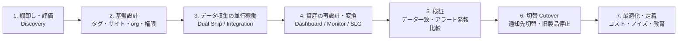
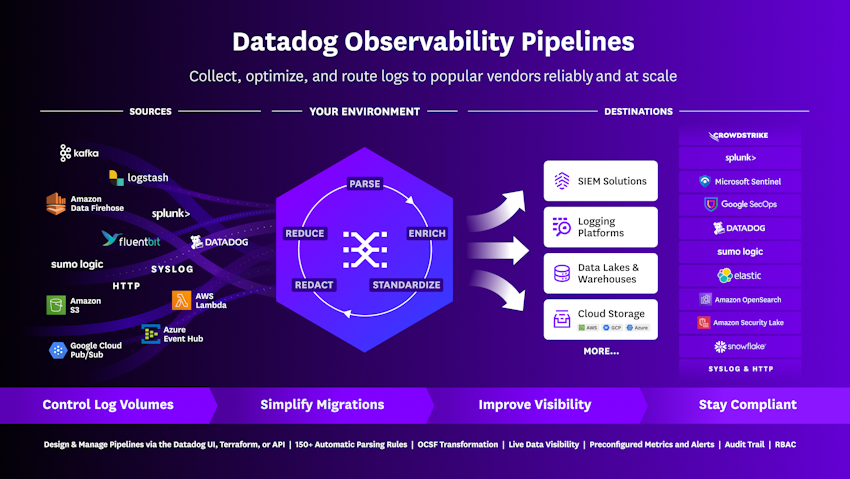
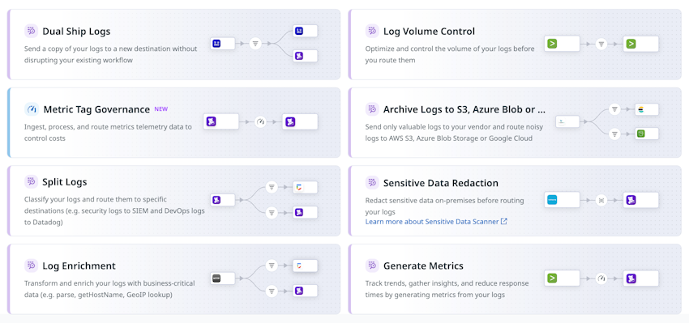
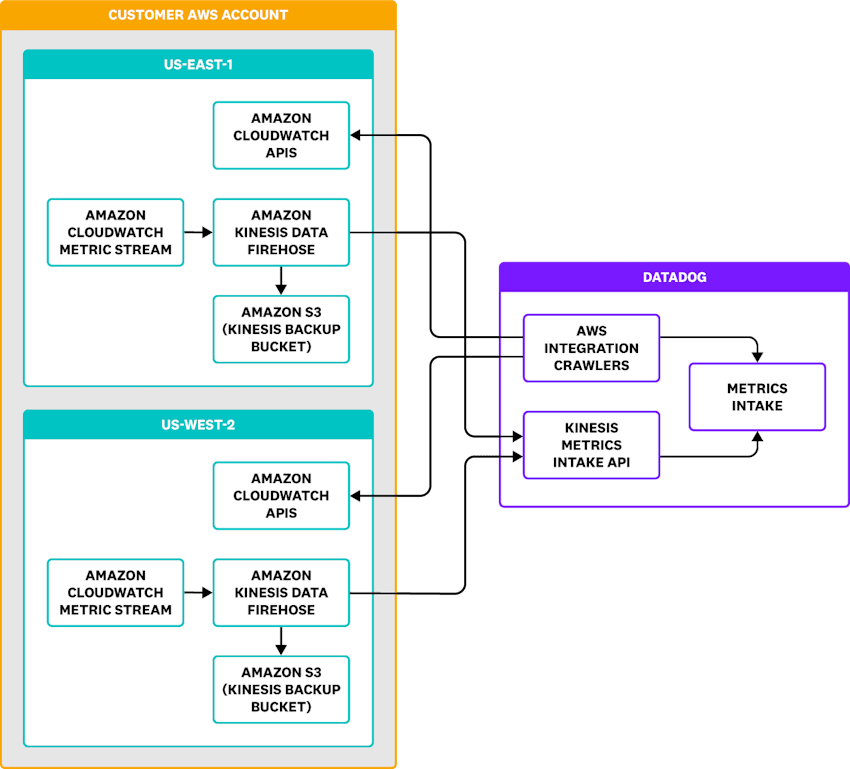
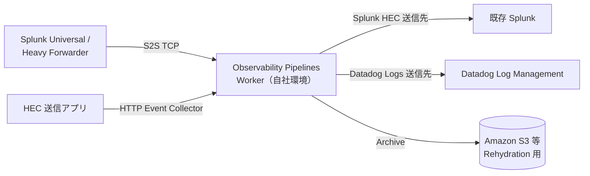

# 他製品からの移行

## 概要

本ファイルは、既存の監視・オブザーバビリティ製品（Zabbix、Nagios、Prometheus/Grafana、New Relic、Amazon CloudWatch、Splunk など）から Datadog へ移行する際の**進め方・製品別の置き換え対応・並行稼働の方法・移行ツール**をまとめた導入編ドキュメントである。

本ファイルの要点は次のとおり。

- **Datadog には、他社製品のダッシュボード／アラートを丸ごと取り込む「公式の汎用インポーター」は公開情報では確認できない**（2026-11-02 時点）。ダッシュボード・モニターの自動変換は、Datadog Marketplace のパートナー製アプリ（Crest Data の New Relic / Splunk 向け移行アプリ）、OSS ツール、または手作業での再設計で行う。
- **データ収集の並行稼働**には公式機能が揃っている。ログは **Observability Pipelines** の「Dual Ship Logs」テンプレートや Splunk HEC / Splunk Forwarder（TCP）/ Sumo Logic などのソースで既存エージェントを入れ替えずに Datadog へ複製できる。メトリクスは Prometheus エンドポイントの直接スクレイプ（OpenMetrics チェック）、Zabbix / Nagios / New Relic インテグレーション、CloudWatch のポーリング／Metric Streams で既存製品を止めずに取得できる。
- Datadog 公式ブログ（NoBS 寄稿、2026-03 公開）は、移行を**「lift-and-shift ではなく再設計の機会」**と位置付け、不要資産を移さない、タグを基盤にする、ダッシュボードを共通の問いで集約する、アラートを actionable にする、の 4 原則を推奨している。[出典](https://www.datadoghq.com/blog/datadog-migration-mindset/)

関連する詳細は次のファイルを参照。

| 観点 | 参照先 |
|---|---|
| 導入プロジェクトの全体の進め方 | [導入方法論](./08-implementation-methodology.md) |
| 要件定義・アーキテクチャ | [要件定義とアーキテクチャ設計](./09-requirements-and-architecture-design.md) |
| Agent の展開計画 | [Agent 展開設計](./10-agent-rollout-design.md) |
| 製品選定・競合比較 | [製品選定と競合比較](./07-selection-and-competitive-comparison.md) |
| 料金（正本） | [製品別料金表](./02-pricing-by-product.md) |
| 移行後のアラート設計 | [アラート設計とノイズ削減](../04_応用編/03-alert-design-and-noise-reduction.md) |
| 移行後のダッシュボード設計 | [ダッシュボード設計の実践](../04_応用編/04-dashboard-design-practices.md) |
| Terraform での資産管理 | [Terraform と IaC](../02_リファレンス/platform/terraform-and-iac.md)、[Monitoring as Code](../04_応用編/09-monitoring-as-code.md) |
| OpenTelemetry を介したベンダー中立な移行 | [OpenTelemetry サポート](../02_リファレンス/platform/opentelemetry.md)、[OpenTelemetry 活用戦略](../04_応用編/10-opentelemetry-strategy.md) |

---

## 1. 移行の全体像

### 1.1 移行で置き換える 4 つのレイヤー

他製品から Datadog への移行は、次の 4 レイヤーに分けて計画すると漏れが少ない【経験則】。

| レイヤー | 移行対象の例 | Datadog 側の受け皿 | 自動変換の可否（2026-11 時点） |
|---|---|---|---|
| ① データ収集 | Zabbix Agent、Nagios プラグイン、Prometheus exporter、New Relic APM エージェント、CloudWatch、Splunk Universal Forwarder | Datadog Agent、各種 Integrations、OpenMetrics チェック、APM トレーシングライブラリ、AWS Integration、Observability Pipelines | ― （収集方式の置き換え） |
| ② データ構造・命名 | ホストグループ、ラベル、インデックス、ソースタイプ、メトリクス名 | Tags（`env`/`service`/`version` 等）、メトリクス名、Log Indexes、ログ属性・Facet | 手動設計（一部はマッピング設定で自動） |
| ③ 可視化・分析資産 | Grafana/Zabbix/New Relic/Splunk のダッシュボード、保存検索 | Dashboards、Notebooks、Saved Views | New Relic・Splunk はパートナー製アプリで一部自動。その他は OSS／手作業 |
| ④ 検知・通知資産 | Zabbix トリガー、Nagios サービスチェック、Prometheus Alertmanager ルール、New Relic アラートポリシー、CloudWatch アラーム、Splunk アラート／相関サーチ | Monitors、SLO、Notification、Downtime、On-Call、Cloud SIEM Detection Rules | Splunk/New Relic はパートナーアプリで一部、SIEM ルールは Sigma 経由で一部。その他は手作業 |

### 1.2 推奨フェーズ

移行プロジェクトのフェーズは、パートナー各社の公開ガイドでおおむね次の流れで説明されている。以下は RapDev（Datadog パートナー）の Splunk→Datadog 移行フレームワーク（2025-11 公開）【第三者情報】と、NoBS 寄稿の Datadog 公式ブログ（2026-03 公開）を基に整理したものである。



| フェーズ | 主な作業 | 成果物 | 根拠 |
|---|---|---|---|
| 1. 棚卸し・評価 | 既存のデータソース、ダッシュボード、アラート、利用者、利用頻度を洗い出す。使われていない資産は移行対象から外す | 資産インベントリ、移行対象リスト、優先度 | RapDev Phase 1【第三者情報】、Datadog 公式ブログ「Migrate only the resources you need」 |
| 2. 基盤設計 | Datadog サイト（AP1 等）、org 構成、タグ設計（Unified Service Tagging）、ロール、API キー管理を決める | 設計書、タグ規約 | Datadog 公式ブログ「Treat tags as the foundation」 |
| 3. データ収集の並行稼働 | Agent 展開、インテグレーション有効化、ログの二重送信、APM 計装 | 稼働中の Agent／パイプライン | RapDev Phase 2【第三者情報】 |
| 4. 資産の再設計・変換 | ダッシュボードを「共通の問い」単位に集約、アラートを actionable に再設計、SLO 化 | Dashboards、Monitors、SLO、Runbook | Datadog 公式ブログ「Consolidate dashboards」「Make every alert actionable」 |
| 5. 検証 | 旧製品と Datadog の値・発報タイミングを比較、ログの取り込み精度確認 | 比較レポート | RapDev Phase 3【第三者情報】 |
| 6. 切替 | しきい値と通知経路の微調整、セキュリティ／コンプライアンス設定の整合、旧製品の通知停止 | 切替判定記録 | RapDev Phase 4【第三者情報】 |
| 7. 最適化・定着 | 教育、ダッシュボード・コスト・性能の定期レビュー | 運用ルール | RapDev Phase 5【第三者情報】 |

RapDev は同記事で、同社の移行案件は平均 3〜4 か月、移行後に最大 32% のコスト削減、Splunk の 21 ダッシュボードを Datadog の 1 ビューに集約した例を挙げている【第三者情報】（ベンダー自身の主張であり、独立した検証はない）。[出典](https://www.rapdev.io/blog/how-to-successfully-migrate-from-splunk-to-datadog)（2025-11-19 公開）

### 1.3 Datadog 公式ブログが推奨する 4 原則（移行マインドセット）

Datadog 公式ブログの寄稿記事「Datadog migration mindset」（NoBS 社 Nick Vecellio、2026-03-09 公開）は、移行時の設計原則として次の 4 点を挙げている。[出典](https://www.datadoghq.com/blog/datadog-migration-mindset/)

| 原則 | 内容 | 実務上の具体策 |
|---|---|---|
| Migrate only the resources you need | 移行前にダッシュボード・モニターを監査し、「今も有用か」「最新か」「実際に使われているか」を確認。満たさないものは移行しない | 旧製品の閲覧ログ・発報履歴で利用実態を確認【経験則】 |
| Treat tags as the foundation | 早期にタグ戦略を決め、まず `env`・`service`・`version` の Unified Service Tagging をメトリクス・ログ・トレースに揃える | [タグ戦略の実践](../04_応用編/02-tagging-strategy.md) 参照 |
| Consolidate dashboards around common questions | サービス／チーム／環境ごとにダッシュボードを複製せず、「人が問う質問」単位で設計し、Template Variables で使い回す | [ダッシュボード設計の実践](../04_応用編/04-dashboard-design-practices.md) 参照 |
| Make every alert actionable | 移行するアラートは介入が必要な実状態を表し、文脈と Runbook 等の次の一手を含める。タグや Multi Alert で 1 定義を多サービスに適用し、少数高品質にする | [アラート設計とノイズ削減](../04_応用編/03-alert-design-and-noise-reduction.md) 参照 |

同記事は、フェーズ分けされた移行計画として NoBS と Datadog の共同「Migration Playbook」と NoBS のウェビナーを参照先として挙げている（本ファイル作成時点で内容は未確認）。

---

## 2. 移行元製品別の対応表

### 2.1 製品別サマリー

| 移行元 | Datadog での収集手段（並行稼働に使えるもの） | 資産変換の手段 | 主な注意点 |
|---|---|---|---|
| Zabbix | Zabbix インテグレーション（Zabbix API からアイテム履歴を取得しメトリクス化、Webhook でアラートをイベント化）→ 最終的に Datadog Agent へ置き換え | 公式／パートナーの自動変換ツールは公開情報では確認できず。トリガーは手動で Monitor に再設計 | Zabbix サーバーのタイムゾーンを UTC にする必要あり。インテグレーションは Agent 同梱でなく別途インストール |
| Nagios | Nagios インテグレーション（ログからイベント化、perfdata をメトリクス化）→ Agent へ置き換え | 自動変換ツールは公開情報では確認できず | Nagios のサービスチェック結果は Datadog の Service Check にはならず「イベント」になる |
| Prometheus | Agent の OpenMetrics チェックで既存 exporter を直接スクレイプ。Kubernetes では `prometheus.io/scrape` アノテーションの自動検出。Observability Pipelines の Prometheus（remote write 形式）ソース。OpenTelemetry Collector 経由も可 | PromQL→Datadog クエリの公式自動変換は公開情報では確認できず | スクレイプしたメトリクスはすべて Custom Metrics として課金。ワイルドカード指定に注意。`_total` サフィックスの扱い |
| Grafana | （Grafana はデータソースではなく可視化層）Grafana 側の Datadog データソースプラグイン（Grafana Enterprise）で、移行期間中に Grafana から Datadog メトリクスを参照できる | Grafana→Datadog の公式変換ツールは公開情報では確認できず。OSS（`grafana-to-datadog`、開発途上）あり | Grafana Alerting のルールも手動移行 |
| New Relic | New Relic インテグレーション（アラートを Webhook でイベント化、APM メトリクス取得は非推奨・機能縮小）、APM は Datadog トレーシングライブラリまたは OpenTelemetry に置き換え | Crest Data「New Relic to Datadog Migration App」（Marketplace、ダッシュボードとクエリ、成功課金） | Datadog の APM はサンプリングされるため、トレース由来でなく「trace metrics」でアラートを組む（後述の事例） |
| Amazon CloudWatch | AWS Integration（API ポーリング：既定 10 分間隔）、CloudWatch Metric Streams（約 2〜3 分）、CloudWatch アラームを Events Explorer に表示、ログは Forwarder / Firehose 等 | CloudWatch アラーム→Monitor、CloudWatch ダッシュボード→Dashboard の自動変換は公開情報では確認できず | Datadog が `GetMetricData` を呼ぶため AWS 側の CloudWatch API 料金が増える。Metric Streams は AWS 側の Firehose 料金が発生 |
| Splunk | Observability Pipelines の Splunk HEC / Splunk Heavy or Universal Forwarders (TCP) ソースで既存フォワーダーから Datadog へ二重送信 | Crest Data「Splunk to Datadog Migration」（ダッシュボード・SPL クエリ）、SIEM ルールは Sigma 形式経由で一部変換可 | Datadog Logs は既定で 18 時間より古いタイムスタンプのログを受け付けない。履歴ログは Archive＋Rehydration で移す |

各行の詳細は以降の節で説明する。

### 2.2 概念マッピング（共通）

各製品の概念と Datadog の概念の対応は次のとおり。厳密な 1:1 ではないため、移行時は「同じ目的を Datadog でどう実現するか」で再設計する【経験則】。

| 概念 | Zabbix | Nagios | Prometheus/Grafana | New Relic | CloudWatch | Splunk | Datadog |
|---|---|---|---|---|---|---|---|
| 収集エージェント | Zabbix Agent | NRPE / プラグイン | exporter + Prometheus server | Infrastructure agent / APM agent | CloudWatch Agent | Universal Forwarder | Datadog Agent（[Agent](../02_リファレンス/platform/agent.md)） |
| 監視テンプレート | Template | コマンド定義 | exporter 種別 | On-host integration | 名前空間 | Add-on / App | Integrations（[Integrations](../02_リファレンス/platform/integrations.md)） |
| グルーピング | Host group / Tag | hostgroup | Label | Tag / Workload | Dimension | index / sourcetype / host | Tags（[Tagging](../02_リファレンス/platform/tagging.md)） |
| 自動検出 | LLD（Low-level discovery） | ― | Service discovery | 自動 | ― | ― | Autodiscovery（コンテナ）、Integration の自動検出 |
| 閾値検知 | Trigger | Service check（WARNING/CRITICAL） | Alerting rule（Alertmanager） | Alert condition | Alarm | Saved search alert / Correlation search | Monitor（[Monitors](../02_リファレンス/platform/monitors.md)） |
| 通知経路 | Action / Media type | Contact / Notification command | Alertmanager receiver | Notification channel / Workflow | SNS | Alert action | `@` 通知ハンドル、Notification Rules、On-Call（[通知と Downtime](../02_リファレンス/platform/notifications-and-downtimes.md)） |
| メンテナンス抑止 | Maintenance | Scheduled downtime | Silence | Muting rule | （アラーム無効化） | Throttle / 無効化 | Downtime |
| 可視化 | Dashboard / Graph / Screen | ― （NagVis 等） | Grafana Dashboard | Dashboard（NRQL） | CloudWatch Dashboard | Dashboard（SPL） | Dashboards（[Dashboards](../02_リファレンス/platform/dashboards.md)） |
| クエリ言語 | アイテムキー / 関数 | ― | PromQL | NRQL | Metric Math / Logs Insights | SPL | メトリクスクエリ（[メトリクスクエリと関数](../02_リファレンス/platform/metrics-query-and-functions.md)）、ログ検索構文、DDSQL |
| 参照表 | Value map | ― | ― | Lookup table | ― | Lookup | Reference Tables |
| ログのフィールド抽出 | 正規表現アイテム | ― | （Loki: LogQL） | Parsing rule | Logs Insights parse | Field extraction / props.conf | Log Pipelines の Grok Parser 等（[Log Pipelines と処理](../02_リファレンス/logs/log-pipelines-and-processing.md)） |
| ログの保存区分 | ― | ― | ― | Data partition | Log group | Index | Log Indexes、Flex Logs、Archives（[Indexes・保持・アーカイブ](../02_リファレンス/logs/log-indexes-retention-archives.md)） |
| 外形監視 | Web scenario | check_http | blackbox_exporter | Synthetics | CloudWatch Synthetics | ― | Synthetic Monitoring（[Synthetic Monitoring](../02_リファレンス/dem/synthetic-monitoring.md)） |
| SLO | SLA（Service） | ― | （Sloth 等 OSS） | Service levels | Application Signals SLO | ― | SLO（[SLO](../02_リファレンス/platform/slo.md)） |

---

## 3. 並行稼働（Parallel Run）の方法

並行稼働は、旧製品を止めずに同じデータを Datadog にも送り、値・発報を比較してから切り替える方式である。Datadog には並行稼働に使える公式機能が複数ある。

### 3.1 並行稼働パターン一覧

| パターン | 仕組み | 主な対象 | エージェント入替 | 出典 |
|---|---|---|---|---|
| A. 旧製品 API を Datadog から読む | Zabbix / Nagios / New Relic / AWS の各インテグレーションで旧製品・クラウドの値やアラートを取り込む | メトリクス、アラートイベント | 不要 | 各インテグレーションの公式ドキュメント |
| B. 既存 exporter を Agent でスクレイプ | Prometheus/OpenMetrics エンドポイントを Datadog Agent が直接取得。Prometheus サーバーはそのまま稼働可 | Prometheus メトリクス | Agent 追加（exporter はそのまま） | [OpenMetrics](https://docs.datadoghq.com/integrations/openmetrics/) |
| C. Observability Pipelines で二重送信 | 既存のフォワーダー（Splunk UF/HF、Splunk HEC クライアント、Fluentd/Fluent Bit、Logstash、Sumo Logic、Syslog 等）の送信先を OP Worker に向け、Worker から旧製品と Datadog の両方へ送る | ログ（メトリクスも一部） | 不要（送信先の変更のみ） | [Observability Pipelines](https://docs.datadoghq.com/observability_pipelines/) |
| D. Agent と旧エージェントの同居 | Datadog Agent を旧エージェント（Zabbix Agent、NR Infrastructure agent 等）と同一ホストに併設 | ホストメトリクス、ログ | Agent 追加 | 【経験則】 |
| E. OpenTelemetry Collector で分岐 | OTel Collector の exporter を複数設定し、旧製品と Datadog に送る | メトリクス、トレース、ログ | Collector の設定変更 | [OpenTelemetry サポート](../02_リファレンス/platform/opentelemetry.md) |
| F. Datadog Agent の Dual Shipping | Agent から複数の **Datadog org／サイト**へ同時送信 | Datadog→Datadog（org 統合・サイト移転） | 不要 | [Dual Shipping](https://docs.datadoghq.com/agent/configuration/dual-shipping/) |

> 注意: Datadog Agent の Dual Shipping（`additional_endpoints`）は**送信先が Datadog の org／サイト**である。他社製品へ送る用途ではない。公式ドキュメントは「ログを外部の送信先に送る、またはベンダー・クラウドストレージ・SIEM に分割する場合は Observability Pipelines を使う」と明記している。[出典](https://docs.datadoghq.com/agent/configuration/dual-shipping/)

### 3.2 Observability Pipelines による二重送信（ログ移行の中心）

Observability Pipelines（OP）は、利用者自身の環境で動く **Observability Pipelines Worker** がログ（およびメトリクス）を受け取り、加工して複数の送信先に振り分ける製品である。詳細仕様は [Observability Pipelines](../02_リファレンス/logs/observability-pipelines.md) を参照。

Datadog 公式ブログ（2024-04-18 公開）は、OP を使うと「エージェントやコレクターを削除・再インストールする代わりに、OP Worker をスタンドアロンのサービスとして配置」して、既存ログベンダーを維持したまま同じログを Datadog Log Management にも送れる（新ベンダーの試用・移行が可能）と説明している。[出典](https://www.datadoghq.com/blog/observability-pipelines-dual-ship-logs/)



**キャプション:** Datadog Observability Pipelines の概念図（Sources → 利用者環境での処理 → Destinations）。

**画面の説明:** 図の左側「SOURCES」に Kafka、Logstash、Amazon Data Firehose、Splunk、Fluent Bit、Datadog、Sumo Logic、Syslog、HTTP、Amazon S3、AWS Lambda、Azure Event Hub、Google Cloud Pub/Sub が並ぶ。中央「YOUR ENVIRONMENT」の六角形に Parse / Enrich / Standardize / Redact / Reduce の処理が描かれる。右側「DESTINATIONS」に SIEM Solutions、Logging Platforms、Data Lakes & Warehouses、Cloud Storage があり、CrowdStrike、Splunk、Microsoft Sentinel、Google SecOps、Datadog、Sumo Logic、Elastic、Amazon OpenSearch、Amazon Security Lake、Snowflake、Syslog & HTTP のロゴが並ぶ。下部の帯に「Control Log Volumes」「Simplify Migrations」「Improve Visibility」「Stay Compliant」と記され、移行の簡素化が主要ユースケースの一つと位置付けられている。

出典: https://docs.datadoghq.com/observability_pipelines/ （取得日 2026-11-02）

#### OP のユースケーステンプレート（2026-11-02 時点）

| テンプレート | 用途 | 移行での使いどころ |
|---|---|---|
| Dual Ship Logs | 同じログストリームを複数の送信先へ送る | **旧製品と Datadog の並行稼働の基本形** |
| Split Logs | ログ種別（例：セキュリティ系とアプリ系）で別ツールへ振り分け | セキュリティログは既存 SIEM、アプリログは Datadog など段階移行 |
| Log Volume Control | 低価値ログを保存前にフィルタ | 移行を機に取り込み量を削減 |
| Archive Logs | 生ログを Amazon S3 / Google Cloud Storage / Azure Storage に保存（後で Rehydration 可能） | 全量はアーカイブ、必要分のみインデックス |
| Sensitive Data Redaction | PII・シークレットを組み込み／カスタムルールで除去 | 送信前マスキング（コンプライアンス要件） |
| Log Enrichment | Reference Table や静的マッピングでメタデータ付与 | 旧製品のフィールド名・タグ体系の変換 |
| Generate Log-based Metrics | 大量ログを count / distribution メトリクスへ変換 | 旧製品でログ集計していたダッシュボードの置き換え |
| Metric Tag Governance（メトリクス） | 必要なメトリクスを残し、タグを標準化・不要タグ除去でカーディナリティ抑制 | Prometheus 等から流入するメトリクスのタグ整理 |

[出典](https://docs.datadoghq.com/observability_pipelines/)



**キャプション:** Observability Pipelines でパイプライン作成時に表示されるテンプレート選択画面。

**画面の説明:** 2 列のカードで 8 種類のテンプレートが並ぶ。左列上から「Dual Ship Logs（Send a copy of your logs to a new destination without disrupting your existing workflow）」「Metric Tag Governance（NEW）」「Split Logs」「Log Enrichment」、右列上から「Log Volume Control」「Archive Logs to S3, Azure Blob or …」「Sensitive Data Redaction」「Generate Metrics」。各カード右側に送信元→処理→送信先の簡易フロー図がある。

出典: https://docs.datadoghq.com/observability_pipelines/configuration/explore_templates/ （取得日 2026-11-02）

#### 移行元別に使える OP のソース／送信先

OP のログ用ソースと送信先のうち、移行で特に使うものは次のとおり（全一覧は公式ページ参照）。[Sources](https://docs.datadoghq.com/observability_pipelines/sources/)・[Destinations](https://docs.datadoghq.com/observability_pipelines/destinations/)

| 移行元 | OP のソース | OP の送信先（旧製品側を維持する場合） |
|---|---|---|
| Splunk（Universal / Heavy Forwarder） | Splunk Heavy or Universal Forwarders (TCP) | Splunk HTTP Event Collector (HEC) |
| Splunk HEC へ直接送っているアプリ | Splunk HTTP Event Collector (HEC) | Splunk HTTP Event Collector (HEC) |
| Sumo Logic | Sumo Logic Hosted Collector | Sumo Logic Hosted Collector |
| Elastic Stack（Beats / Logstash） | Filebeat、Logstash | Elasticsearch、Amazon OpenSearch、OpenSearch |
| Fluentd / Fluent Bit | Fluentd and Fluent Bit | HTTP Client 等 |
| Syslog 系 | Syslog、Socket | Syslog |
| New Relic Logs | 送信元に応じたソース（HTTP Server 等） | New Relic |
| AWS（CloudWatch Logs → Firehose 等） | Amazon Data Firehose、Amazon S3 | ― |
| OpenTelemetry | OpenTelemetry | ― |
| Microsoft Sentinel / Google SecOps / CrowdStrike など SIEM | （上記ソース） | Microsoft Sentinel、Google SecOps、CrowdStrike Next-Gen SIEM、SentinelOne、Amazon Security Lake |

OP のメトリクス用ソースは Datadog Agent、OpenTelemetry、Prometheus。メトリクス用送信先は Datadog Metrics、Elasticsearch、HTTP/S Client、OpenTelemetry、Prometheus、Splunk HEC である。[出典](https://docs.datadoghq.com/observability_pipelines/destinations/)

OP の **Prometheus ソース**は、設定例の URL パスが `/api/v1/write` で、シークレット識別子に `REMOTE_WRITE` を含むことから、Prometheus remote write 形式の受信口と読み取れる（公式ページは方式名を明記していない）。設定項目は Address（例：`0.0.0.0:9091`）、URL path、Authorization（None / Plain。Plain はユーザー名とパスワードの識別子を指定）、認証トークン（任意。Authorization が None の場合のみ設定可）、Keepalive（最大接続時間 既定 300 秒、ジッター係数 既定 0.1）、TLS（相互 TLS 可）。[出典](https://docs.datadoghq.com/observability_pipelines/sources/prometheus/)

> **課金への影響:** OP 自体の料金は [製品別料金表](./02-pricing-by-product.md) の Observability Pipelines の項を参照。二重送信中は旧製品と Datadog の双方の取り込み料金が発生する。

### 3.3 Datadog Agent の Dual Shipping（Datadog org／サイト間）

Datadog Agent の Dual Shipping は、Agent が**複数の Datadog org やサイト**へ同時にデータを送る機能である。他社製品からの移行ではなく、「Datadog 内の org 統合・サイト移転（例：US1 から AP1 への移設）」で並行稼働させる場合に使う。

| データ種別 | YAML キー | 環境変数 | 最低 Agent（YAML / 環境変数） |
|---|---|---|---|
| Metrics・Service Checks | `additional_endpoints` | `DD_ADDITIONAL_ENDPOINTS` | 6.17 / 7.17（YAML）、6.18 / 7.18（環境変数） |
| APM | `apm_config.additional_endpoints`（`https://trace.agent.<SITE>`） | `DD_APM_ADDITIONAL_ENDPOINTS` | 6.7.0 / 6.19・7.19 |
| Continuous Profiler | `apm_config.profiling_additional_endpoints` | `DD_APM_PROFILING_ADDITIONAL_ENDPOINTS` | 6.7.0 / 6.19・7.19 |
| Live Processes | `process_config.additional_endpoints`（`https://process.<SITE>`） | `DD_PROCESS_ADDITIONAL_ENDPOINTS` | 6.4.0 / 6.20・7.20 |
| Cluster Agent メトリクス | Helm の `clusterAgent.env` で `DD_ADDITIONAL_ENDPOINTS` を指定。HPA 用の Cluster Agent metrics provider は `external_metrics_provider.endpoints`（api_key / app_key / url を複数列挙） | `DD_ADDITIONAL_ENDPOINTS`（Cluster Agent コンテナ） | 公開情報では確認できず |
| Orchestrator | `orchestrator_explorer.orchestrator_additional_endpoints` | `DD_ORCHESTRATOR_EXPLORER_ORCHESTRATOR_ADDITIONAL_ENDPOINTS` | 公開情報では確認できず |
| CI Visibility | `evp_proxy_config.additional_endpoints` | `DD_EVP_PROXY_CONFIG_ADDITIONAL_ENDPOINTS` | 6.38 / 7.38（YAML） |
| Logs | `logs_config.additional_endpoints`（＋`force_use_http`） | `DD_LOGS_CONFIG_ADDITIONAL_ENDPOINTS`、`DD_LOGS_CONFIG_FORCE_USE_HTTP` | TCP 6.6、HTTPS 6.13、環境変数 6.18 / 7.18 |
| Database Monitoring | `database_monitoring.samples` / `.activity` / `.metrics` | `DD_DATABASE_MONITORING_*_ADDITIONAL_ENDPOINTS` | 6.29 / 7.29 |
| Network Devices | `network_devices.metadata`、`.snmp_traps.forwarder`、`.netflow.forwarder` | `DD_NETWORK_DEVICES_METADATA_ADDITIONAL_ENDPOINTS` 等 | 6.29 / 7.29 |
| Network Path | `network_path.forwarder` | `DD_NETWORK_PATH_FORWARDER_ADDITIONAL_ENDPOINTS` | 6.55 / 7.55 |
| Cloud Security Misconfigurations | `compliance_config.endpoints` | `DD_COMPLIANCE_CONFIG_ENDPOINTS_ADDITIONAL_ENDPOINTS` | 公開情報では確認できず |
| Workload Protection | `runtime_security_config.endpoints` | `DD_RUNTIME_SECURITY_CONFIG_ENDPOINTS_ADDITIONAL_ENDPOINTS` | 公開情報では確認できず |

メトリクスの設定例（URL をキーに API キーのリストを値とするマップ形式）：

```yaml
# datadog.yaml
additional_endpoints:
  "https://app.ap1.datadoghq.com":
    - <AP1側のAPIキー>
```

ログの設定例（エンドポイントオブジェクトのリスト形式）：

```yaml
logs_config:
  force_use_http: true
  additional_endpoints:
    - api_key: "<追加先のAPIキー>"
      Host: "<追加先のログ受信ホスト>"
      Port: 443
      is_reliable: true
```

主な挙動・制約：[出典](https://docs.datadoghq.com/agent/configuration/dual-shipping/)

| 項目 | 内容 |
|---|---|
| `is_reliable` | Agent 7.34.0 で導入、7.37.0 以降は既定 `true`。reliable な送信先はプライマリと同じ優先度。unreliable な送信先は reliable が 1 つ以上利用可能なときのみ送信。全 reliable 送信先がダウンすると復旧まで読み取り・送信を停止 |
| トランスポート | HTTP 系の送信先は `use_http` を明示。追加送信先はすべて同じトランスポート設定を共有 |
| Continuous Profiler | 追加送信先へのアップロードはベストエフォート |
| Kubernetes（Helm） | `useConfigMap: true` と `customAgentConfig`、またはキーを Secret に置き `datadog.env` / `datadog.envFrom` で `DD_ADDITIONAL_ENDPOINTS` を参照。Cluster Agent 側は別途 `clusterAgent.env` に設定（上表） |
| Kubernetes（Operator） | `override.nodeAgent.customConfigurations` の `configData`、または `nodeAgent.env` |
| 課金 | 「複数の Datadog org にデータを送ると課金に影響し得る」とのみ記載。詳細は Datadog サポートへ |

> **サイト差異:** Dual Shipping の送信先 URL はサイトごとに異なる（AP1 は `ap1.datadoghq.com` 系）。各サイトのエンドポイントは [Datadog Sites](../02_リファレンス/platform/datadog-sites.md) を参照。

### 3.4 並行稼働期間の設計

| 項目 | 推奨・考え方 | 確度 |
|---|---|---|
| 期間 | 公開情報で標準期間は定められていない。月次バッチや月末処理など周期的な事象を 1 回以上含める期間を確保するのが一般的 | 【経験則】 |
| 比較対象 | 主要メトリクスの値（集計方法・ロールアップの違いを考慮）、アラートの発報有無・タイミング、ログ件数 | 【経験則】 |
| 通知 | 並行稼働中は Datadog 側の通知を検証用チャネルに限定し、本番通知は旧製品側に残すと二重呼び出しを避けられる | 【経験則】 |
| コスト | 並行期間中は旧製品と Datadog の両方の費用が発生。Datadog 側は Agent 導入ホスト数・取り込みログ量で課金されるため、並行期間を見積りに含める | 【経験則】（課金単位は [課金計算の仕組み](./03-billing-mechanics.md)） |
| 切替判定 | 主要アラートの再現確認、ダッシュボード利用者の承認、Runbook 更新、オンコール通知経路の切替テスト完了 | 【経験則】 |

New Relic から Datadog へ移行した Wantedly の発表（Japan Datadog User Group Meetup #12、2025-08-20）では、移行時に「エンドユーザー影響のあるアラートを優先」「両ツールで重複していたアラートは廃止」「一部を SLO バーンレートアラートへ移行」した、と報告されている【第三者情報】。[出典](https://speakerdeck.com/donkomura/uontetudorinoaratoshe-ji-to-datadog-yi-xing-denozhi-jian)（2025-08-20 公開）

---

## 4. 移行元別の詳細手順

### 4.1 Zabbix からの移行

#### 4.1.1 Zabbix インテグレーション（並行稼働用）

Datadog の Zabbix インテグレーションは、Datadog Agent が **Zabbix API からアイテム履歴を収集してメトリクスとして Datadog に送信**し、Zabbix のアラートを **Webhook で Datadog の Event に転送**する。[出典](https://docs.datadoghq.com/integrations/zabbix/)

| 項目 | 内容 |
|---|---|
| 提供形態 | Agent パッケージに**同梱されない**。別途インストールが必要 |
| 必要 Agent | v7.21+ / v6.21+（それ以前や Docker Agent はコミュニティインテグレーションの手順） |
| インストール | `datadog-agent integration install -t datadog-zabbix==<INTEGRATION_VERSION>` |
| ドキュメント記載のインテグレーションバージョン | 1.1.1（2026-11-02 時点） |
| 前提 | **Zabbix サーバーのタイムゾーンを UTC に設定** |
| 設定ファイル | Agent の `conf.d/zabbix.d/conf.yaml`（全オプションはサンプルファイル参照） |
| 確認 | `datadog-agent status` の Checks に `zabbix` が出ること |
| Service Check | `zabbix.can_connect`（Zabbix API に接続不可で CRITICAL） |
| 収集メトリクス例 | `zabbix.processed.*`、`zabbix.process.internal.*`、`zabbix.process.data_collector.*`、`zabbix.queue.size`、`zabbix.cache.*`、`zabbix.agent.ping`、`zabbix.cpu.*`、`zabbix.load.avg.{1,5,15}_min`、`zabbix.memory.*`、`zabbix.swap_space.*`、`zabbix.system.uptime` など（すべて gauge） |

**Zabbix アラートを Datadog Event に送る手順（公式手順の要約）:**

1. Zabbix で *Administration > Media Types* に Webhook メディアタイプを作成する。
2. 送信先 URL は `https://app.datadoghq.com/intake/webhook/zabbix?api_key=<key>`（サイトに応じてホスト名を変える）。
3. パラメータに `api_key`、`event_date`、`event_name`、`event_nseverity`、`event_tags`、`event_time`、`event_value`、`item_name`、`alert_message`、`alert_subject` を設定し、`{EVENT.NAME}`、`{ALERT.MESSAGE}` 等の Zabbix マクロを割り当てる。
4. 公式ページ記載のスクリプトを貼り付け、**Test** で確認する。
5. 専用ユーザー（例：`Datadog`）を作り Webhook メディアを付与、対象ホストへの読み取り権限以上を与える。
6. *Configuration > Actions* でアラートアクションを作成する。

**Datadog On-Call へのページング（任意）:** 2 つ目の Webhook「Datadog On-Call」で `event-management-intake.<dd_site>/api/v2/events/webhook` に `oncall_team` パラメータ付きで送る。重大度は Disaster・High → `error`、Average・Warning 以下 → `warn`、OK → `ok` にマップされ、同じ `aggregation_key` のイベントは重複排除されるため OK で対応する PROBLEM のページが解決される。アクションは PROBLEM と Recovery の両方で有効化する。[出典](https://docs.datadoghq.com/integrations/zabbix/)

> 位置付け: 上記は「Zabbix を残したまま Datadog で可視化・アラート集約する」並行稼働・ハイブリッド用の手段である。最終的にホスト監視を Datadog に移す場合は、各ホストに Datadog Agent を入れて標準メトリクス（`system.*`）と各 Integration で置き換える【経験則】。

#### 4.1.2 Zabbix 資産の置き換え

| Zabbix 資産 | Datadog での置き換え | 備考 |
|---|---|---|
| Zabbix Agent（OS 監視） | Datadog Agent の System チェック（`system.cpu.*`、`system.mem.*`、`system.disk.*` 等） | Agent 標準で収集。詳細は [Infrastructure Monitoring](../02_リファレンス/infrastructure/infrastructure-monitoring.md) |
| テンプレート（MySQL、Nginx 等） | 対応する Datadog Integration | Integration の有無を事前確認 |
| SNMP 監視 | Network Device Monitoring | [Network Device Monitoring](../02_リファレンス/infrastructure/network-device-monitoring.md) |
| UserParameter / 外部スクリプト | Custom Agent Check、DogStatsD | Custom Metrics として課金。[Custom Metrics と DogStatsD](../02_リファレンス/platform/custom-metrics-and-dogstatsd.md) |
| ホストグループ / Zabbix タグ | Datadog Tags（Agent の `tags`、クラウドタグ） | タグ設計を先に決める |
| LLD（ファイルシステム、NIC 等の自動検出） | Agent が自動でデバイス単位タグ（`device` 等）付きで収集 | Monitor は Multi Alert（`by {device}`）で表現 |
| トリガー | Metric Monitor / Service Check Monitor / Host Monitor | 依存関係（トリガー依存）は Composite Monitor 等で再設計【経験則】 |
| アクション（通知・エスカレーション） | Monitor の通知メッセージ、Notification Rules、On-Call のエスカレーション | [On-Call](../02_リファレンス/service-management/on-call.md) |
| メンテナンス期間 | Downtime | |
| Web シナリオ | Synthetic Monitoring（API / Browser テスト） | |
| ダッシュボード / スクリーン | Dashboards（多くの Integration にすぐ使える標準ダッシュボードあり） | 自動変換ツールは公開情報では確認できず |

Zabbix から Datadog への移行を扱った日本語の公開事例は、本調査では見つからなかった（公開情報では確認できず）。

### 4.2 Nagios からの移行

Datadog の Nagios インテグレーションは、Nagios のログを読み取って **イベント**を生成し、Nagios の **パフォーマンスデータをメトリクス**として送信できる。Datadog Agent に同梱されており、Nagios サーバーに追加インストールは不要。[出典](https://docs.datadoghq.com/integrations/nagios/)

| 項目 | 内容 |
|---|---|
| 必要 Agent | 6.0.0 以降 |
| 設定ファイル | `nagios.d/conf.yaml`。主要キーは `nagios_conf`（例：`/etc/nagios3/nagios.cfg`）。その他のオプションは GitHub のサンプル `conf.yaml` 参照 |
| イベント化される文字列 | `SERVICE FLAPPING ALERT`、`SERVICE ALERT`、`SERVICE NOTIFICATION`、`SERVICE DOWNTIME ALERT`、`HOST ALERT`、`HOST DOWNTIME ALERT`、`ACKNOWLEDGE_SVC_PROBLEM`、`ACKNOWLEDGE_HOST_PROBLEM`、`PROCESS_SERVICE_CHECK_RESULT` を含むログ行 1 行ごとに 1 イベント |
| メトリクス（例、すべて gauge） | `nagios.current_users.users`、`nagios.disk_space`、`nagios.host.pl`、`nagios.host.rta`、`nagios.http.size`、`nagios.http.time`、`nagios.ping.pl`、`nagios.ping.rta`、`nagios.swap_usage.swap` |
| Service Check | なし |
| ログ収集 | `datadog.yaml` で `logs_enabled: true`、`logs` ブロックで `type: file`、`path`（Nagios の `log_file`）、`source: nagios` |
| 課金 | このチェックは Custom Metrics を送信し得るため課金に影響する可能性あり |
| On-Call | 通知スクリプト（`curl`・`python3` 依存）で Datadog On-Call をページング可能。API キーを `commands.cfg` に直書きしないこと |

> **サイト差異:** Nagios、Zabbix、New Relic、Crest Data 移行アプリなど本ファイルで挙げた多くのインテグレーションは、`US1-FED`（us2.ddog-gov.com）では既定で有効でない場合があり、support@ddog-gov.com への例外申請が必要と各公式ページに記載されている。

**Nagios 資産の置き換えの考え方:**

| Nagios 資産 | Datadog での置き換え |
|---|---|
| `check_*` プラグイン（OS） | Agent 標準メトリクス＋Metric Monitor |
| `check_http` / `check_ping` | Synthetic Monitoring（HTTP/ICMP/TCP テスト）、または Agent の HTTP Check / TCP Check インテグレーション |
| 独自プラグイン | Custom Agent Check（Python）として書き直し、Service Check を送信する【経験則】 |
| サービスの状態（OK/WARNING/CRITICAL/UNKNOWN） | Service Check（OK/WARNING/CRITICAL/UNKNOWN）＋Service Check Monitor |
| contact / contactgroup | `@` 通知ハンドル、Teams、On-Call スケジュール |
| hostgroup / servicegroup | Tags |
| 親子関係（parents）による通知抑制 | Composite Monitor、Downtime、または Monitor 条件で再設計【経験則】 |

### 4.3 Prometheus / Grafana からの移行

#### 4.3.1 収集の置き換え：OpenMetrics チェック

Datadog Agent は **OpenMetrics チェック**と **Prometheus チェック**を同梱しており、既存の exporter（`/metrics` エンドポイント）を追加インストールなしでスクレイプできる。公式は、テキスト形式を出さないエンドポイントの場合のみ Prometheus チェックを使い、通常は効率的で Prometheus テキスト形式を完全サポートする **OpenMetrics チェック**を推奨している。[出典](https://docs.datadoghq.com/integrations/guide/prometheus-host-collection/)

| 項目 | 内容 |
|---|---|
| `openmetrics_endpoint` | 必須。メトリクス公開 URL。インスタンスごとに一意。指定すると「latest」モード（旧来は `prometheus_url` の legacy モード） |
| `namespace` | 必須。全メトリクス名の先頭に付与 |
| `metrics` | 必須。取得するメトリクス名のリスト（正規表現として解釈）。`metric_name: renamed` で改名 |
| メトリクス数上限 | 既定で 1 インスタンスあたり 2000 メトリクス（`max_returned_metrics` で変更） |
| `_total` サフィックス | Agent v7.32.0 以降、`_total` で終わるカウンタは `_total` を除いた名前で指定（例：`promhttp_metric_handler_requests_total` → 指定は `promhttp_metric_handler_requests`、送信名は `promhttp_metric_handler_requests.count`） |
| Accept ヘッダー | Agent v7.46 で OpenMetrics 形式優先に変更。一部エンドポイントでパースエラーが出る場合は `headers` で `Accept: text/plain` を指定 |
| 最低 Agent | 6.6.0（OpenMetrics チェック） |
| 課金 | **収集したメトリクスはすべて Custom Metrics**。汎用ワイルドカード（`.*`）は課金に大きく影響するため、具体名または部分一致で指定する |

[出典](https://docs.datadoghq.com/integrations/openmetrics/)

#### 4.3.2 Prometheus のメトリクス型と Datadog の型の対応

| Prometheus / OpenMetrics の型 | Datadog の型（latest） | 名前の付き方・補足 |
|---|---|---|
| `counter` | `count` | 同じ名前（`_total` は除去し `.count` 付与） |
| `gauge` | `gauge` | 同じ名前 |
| `histogram` | 各構成要素が `count` | `_count`/`_sum`/`_bucket` → `.count`/`.sum`/`.bucket` |
| `summary` | `_count`・`_sum` は `count`、分位点は `gauge` | `.count`、`.sum`、`.quantile` |

histogram の追加オプション（latest）：`histogram_buckets_as_distributions: true` で `_bucket` を Datadog の **distribution**（DDSketch ベース、パーセンタイル算出可）に集約。`collect_counters_with_distributions` で `_count`/`_sum` も `count` として併送。legacy モードでは `send_distribution_buckets`、`send_histograms_buckets`、`send_monotonic_counter`、`send_distribution_counts_as_monotonic`、`send_distribution_sums_as_monotonic` が対応する。Agent はすべての `count` を単調カウンタとして処理し、連続する生値の差分を送る。[出典](https://docs.datadoghq.com/integrations/guide/prometheus-metrics/)

#### 4.3.3 Kubernetes 上の Prometheus スクレイプの置き換え

Kubernetes では、Datadog Agent が `prometheus.io/scrape=true` アノテーションを持つ Pod を自動検出して OpenMetrics チェックを生成できる（Prometheus の annotation ベース設定をそのまま流用可能）。[出典](https://docs.datadoghq.com/containers/kubernetes/prometheus/)

```yaml
# Helm values.yaml
datadog:
  prometheusScrape:
    enabled: true          # Prometheus アノテーションのスクレイプを有効化
    serviceEndpoints: true # Cluster Agent が Service のアノテーションも検出
    additionalConfigs:
      - autodiscovery:
          kubernetes_container_names: [my-app]
          kubernetes_annotations:
            include:
              app: my-app
        configurations:
          - timeout: 5
            send_distribution_buckets: true
```

| 項目 | 既定値・要件 |
|---|---|
| 検出条件 | `prometheus.io/scrape=true`（必須） |
| `prometheus.io/path` | 既定 `/metrics` |
| `prometheus.io/port` | 既定 `%%port%%`（コンテナ／サービスのポート） |
| Pod アノテーションによるスクレイプ | Agent v7.27+ / v6.27+ |
| Service / Endpoints のスクレイプ | Cluster Agent v1.11+ |
| AD Annotations v2 | Agent 7.36+ |
| 課金上の注意 | 詳細設定なしで有効化すると Custom Metrics が大幅に増え得る。`metrics` を必要なものに絞る |

個別コンテナに設定する場合の Autodiscovery アノテーション例：

```yaml
ad.datadoghq.com/<CONTAINER_NAME>.checks: |
  {
    "openmetrics": {
      "init_config": {},
      "instances": [{
        "openmetrics_endpoint": "http://%%host%%:%%port%%/metrics",
        "namespace": "myapp",
        "metrics": [{"http_requests": "http.requests"}]
      }]
    }
  }
```

詳しくは [コンテナ/Kubernetes向けAgent](../02_リファレンス/platform/kubernetes-and-containers-agent.md)、[Kubernetes 監視の実践](../04_応用編/07-kubernetes-monitoring-practices.md) を参照。

#### 4.3.4 その他の取り込み経路

| 経路 | 概要 | 参照 |
|---|---|---|
| OpenTelemetry Collector（`prometheusreceiver`）＋ Datadog Exporter／Datadog Agent の OTLP 受信 | Prometheus の scrape 設定を Collector に移し、Datadog に送る | [OpenTelemetry サポート](../02_リファレンス/platform/opentelemetry.md) |
| Observability Pipelines の Prometheus ソース | Prometheus remote write 形式で受け取り Datadog Metrics 等へ送る（3.2 節参照） | [Observability Pipelines](../02_リファレンス/logs/observability-pipelines.md) |
| Datadog Agent が Prometheus remote write を直接受信する機能 | 公開情報では確認できず | ― |

#### 4.3.5 PromQL と Datadog クエリの対応（目安）

Datadog のメトリクスクエリは PromQL とは異なる独自構文で、**PromQL をそのまま実行する公式機能は本調査では確認できなかった**（2026-11-02 時点）。主な書き換えの目安を示す【経験則】。関数仕様は [メトリクスクエリと関数](../02_リファレンス/platform/metrics-query-and-functions.md) を参照。

| PromQL | Datadog クエリの書き方（例） | 補足 |
|---|---|---|
| `sum by (service) (metric)` | `sum:metric{*} by {service}` | 空間集約は `avg`/`sum`/`min`/`max` |
| `metric{env="prod"}` | `metric{env:prod}` | ラベル＝タグ（`key:value`） |
| `metric{env!="dev"}` | `metric{!env:dev}` | |
| `rate(counter_total[5m])` | `per_second(sum:counter.count{*})` または `.as_rate()` | OpenMetrics の counter は Datadog の `count` 型として差分送信される |
| `increase(counter_total[1h])` | `sum:counter.count{*}.as_count().rollup(sum, 3600)` | |
| `histogram_quantile(0.95, sum by (le)(rate(x_bucket[5m])))` | distribution 化（`histogram_buckets_as_distributions`）した上で `p95:x{*}` | 事前に distribution として収集する設計が必要 |
| `avg_over_time(m[10m])` | `avg:m{*}.rollup(avg, 600)` | |
| `topk(5, ...)` | `top(..., 5, 'mean', 'desc')` | |
| `offset 1h` | `timeshift(..., -3600)` / `hour_before()` | |
| Recording rule | Datadog は通常不要（クエリ時集約）。重いものは Metrics without Limits のタグ設定や Log-based Metrics で代替 | 【経験則】 |

#### 4.3.6 Grafana ダッシュボード・Alertmanager の移行

| 資産 | 移行手段 | 備考 |
|---|---|---|
| Grafana ダッシュボード | Datadog 公式の変換ツールは公開情報では確認できず。OSS の `guychouk/grafana-to-datadog`（ブラウザ上で Grafana の Dashboard JSON を Datadog JSON へ変換し、PromQL パーサでクエリ変換。作者自身が開発途上と明記）【第三者情報】。現実的には Datadog の Integration 標準ダッシュボードを起点に再作成 | [GitHub](https://github.com/guychouk/grafana-to-datadog)（公開日確認できず） |
| Grafana をフロントエンドとして当面残す | Grafana の Datadog データソースプラグインで Datadog メトリクスを Grafana から参照可能。プラグインページでは「Grafana Enterprise」データソースと表示され、メトリクスのクエリ・可視化が対象 【第三者情報】 | [Grafana Datadog plugin](https://grafana.com/grafana/plugins/grafana-datadog-datasource/)（取得日 2026-11-02） |
| Alertmanager ルール | 手動で Metric Monitor に変換。`for:` は Monitor の評価ウィンドウ／リカバリ条件で表現。`group_by` は Multi Alert（`by {tag}`）で表現 | 【経験則】 |
| Alertmanager の inhibit / silence | Composite Monitor、Downtime | 【経験則】 |
| Alertmanager の routing | 通知メッセージ内の条件変数（`{{#is_alert}}` 等）、Notification Rules、On-Call | 【経験則】 |

なお、逆方向（Datadog→Grafana）については Grafana Labs が Datadog ダッシュボードの変換ツールを提供しているが、モニターとログは対象外としている【第三者情報】。これは移行元ではなく「移行先候補との比較」で参照される情報である。

### 4.4 New Relic からの移行

#### 4.4.1 New Relic インテグレーション（並行稼働用）

Datadog の New Relic インテグレーションは、**New Relic のアラート通知を Webhook で Datadog の Event Stream に取り込む**ことと、New Relic APM・Synthetics・Mobile のメトリクス（`new_relic.` プレフィックス）の取得を提供する。ただし **APM 連携は非推奨（deprecated）で機能が縮小されており、APM メトリクスのラベルは利用できない**。[出典](https://docs.datadoghq.com/integrations/new_relic/)

| 項目 | 内容 |
|---|---|
| アラート Webhook | New Relic で Webhook 通知チャネル（名前例「Datadog」）を作成。ベース URL `https://<YOUR_DATADOG_FULL_SITE>/intake/webhook/newrelic?api_key=<DATADOG_API_KEY>`。対象アラートポリシーに紐付け |
| ペイロード | JSON 必須。`tags` 配列でカスタムタグ付与可 |
| On-Call ページング | event-management-intake エンドポイントに `dd-api-key`、`integration_id=new-relic`、`oncall_team` を付けた Webhook |
| イベント種別マッピング | Alert：説明に "ended"/"closed"/"recovered" → SUCCESS、"acknowledged" → INFO、それ以外 → ERROR。Default：severity の info/warn/critical → info/warning/error。Deployment → INFO |
| 必須フィールド不足 | 必須フィールドが欠けたイベントは拒否され Event Explorer に表示されない |
| API キー | 2025-03-01 以降、New Relic REST API v2 は REST API Key を受け付けないため、インテグレーション設定を User API key に置き換える |
| メトリクス例 | `new_relic.apdex.*`、`new_relic.application_summary.*`、`new_relic.web_transaction.*`、`new_relic.synthetics_summary.*`、`new_relic.apm_mobile.*` 等 |

#### 4.4.2 New Relic 資産の置き換え

| New Relic 機能 | Datadog の置き換え | 参照 |
|---|---|---|
| APM エージェント | Datadog トレーシングライブラリ（Single Step Instrumentation 含む）または OpenTelemetry | [APM インスツルメンテーション](../02_リファレンス/apm/apm-instrumentation.md) |
| Distributed Tracing | APM（トレース）。W3C Trace Context で他システムと相互運用 | 4.4.3 参照 |
| Infrastructure agent | Datadog Agent | [Agent](../02_リファレンス/platform/agent.md) |
| Logs | Log Management（Agent / OP） | [ログ収集](../02_リファレンス/logs/log-collection.md) |
| Browser | RUM（ブラウザ） | [RUM（ブラウザ）](../02_リファレンス/dem/rum-browser.md) |
| Mobile | RUM（モバイル） | [RUM（モバイル）](../02_リファレンス/dem/rum-mobile.md) |
| Synthetics | Synthetic Monitoring | [Synthetic Monitoring](../02_リファレンス/dem/synthetic-monitoring.md) |
| Errors Inbox | Error Tracking | [Error Tracking](../02_リファレンス/apm/error-tracking.md) |
| Alerts（ポリシー・条件） | Monitors、Notification Rules | [Monitors](../02_リファレンス/platform/monitors.md) |
| Service Levels | SLO | [SLO](../02_リファレンス/platform/slo.md) |
| Dashboards（NRQL） | Dashboards（メトリクスクエリ、ログ／スパンクエリ、DDSQL） | [Dashboards](../02_リファレンス/platform/dashboards.md) |
| Workloads / Entity | Software Catalog（旧称：Service Catalog）、Teams | [Software Catalog](../02_リファレンス/platform/software-catalog.md) |
| Change tracking（デプロイマーカー） | Deployment Tracking（`version` タグ）、Events | [APM 画面と分析機能](../02_リファレンス/apm/apm-ui-and-analysis.md) |

#### 4.4.3 APM エージェント切替時のトレースコンテキスト

Datadog のトレーシングライブラリの既定の伝播形式は **Datadog、W3C Trace Context（`tracecontext`）、Baggage（`baggage`）の順**で、抽出時は Datadog ヘッダーが優先される。既定設定は旧 Datadog SDK や OpenTelemetry 等との互換性を意図している。[出典](https://docs.datadoghq.com/tracing/trace_collection/trace_context_propagation/)

| 環境変数 | 役割 |
|---|---|
| `DD_TRACE_PROPAGATION_STYLE` | 抽出・注入の両方の形式を指定。抽出はリスト順で最初の有効なコンテキストを継続、他は span link |
| `DD_TRACE_PROPAGATION_STYLE_EXTRACT` / `_INJECT` | 方向別に上書き（最優先） |
| `OTEL_PROPAGATORS` | 最低優先。Datadog 側の変数があれば無視。OpenTelemetry SDK からの移行向け |
| `DD_TRACE_PROPAGATION_BEHAVIOR_EXTRACT` | `continue` / `restart` / `ignore` |

B3（Single / Multi）は多くの言語で対応（値の表記は言語により異なる。Python は v3.0 で `b3 single header` 値を削除。Rust は Datadog と W3C のみ）。サービスを段階的に New Relic から Datadog へ切り替える期間は、両エージェントが W3C Trace Context を解釈できる構成にすることで、境界でのトレース断絶を減らせる【経験則】。New Relic エージェント側の W3C 対応状況は New Relic のドキュメントで確認すること。

#### 4.4.4 New Relic to Datadog Migration App（Crest Data）

Datadog Marketplace には、Datadog Technology Partner である Crest Data の **New Relic to Datadog Migration App** が掲載されている。[出典](https://docs.datadoghq.com/integrations/crest-data-systems-new-relic-to-datadog-migration/)

| 項目 | 内容 |
|---|---|
| 提供者 | Crest Data（Datadog Technology Partner）。Datadog 自身の製品ではない |
| 移行対象 | **メタデータのみ**（ダッシュボードとクエリ）。チャート・グラフ等の可視化を Datadog 形式へ変換。アラートの移行は掲載ページに記載なし |
| モード | Remote：New Relic の API キーを入力してダッシュボード情報を取得（ダッシュボード移行）。Offline：ダッシュボードは `.json`、クエリ（パネル・検索とも）は `.csv` をアップロード |
| 前提 | 移行前に**対応するデータを Datadog に取り込み済み**であること（New Relic と同等のデータが Datadog にある前提で可視化を変換） |
| データアクセス | Crest Data は New Relic / Datadog のデータ本体にはアクセスせず、接続されたメタデータのみ扱う |
| 課金 | 成功課金（移行に成功したパネル・クエリ分のみ）。単価は掲載ページに記載なし（公開情報では確認できず） |
| 対応 NRQL・ウィジェット | 掲載ページに記載なし。Crest Data のユーザーガイド（PDF）を参照 |
| 購入 | Datadog Marketplace で購入。Crest Data のサインアップが必要 |
| 連絡先 | サポート migrationapps@crestdata.ai、営業 datadog-sales@crestdata.ai |
| バージョン | 1.0.0（掲載時点） |

#### 4.4.5 New Relic からの移行事例：アラートの落とし穴

Wantedly は 2024 年に New Relic（アプリケーション監視）から Datadog に統合した。発表では次の知見が共有されている【第三者情報】。[出典](https://speakerdeck.com/donkomura/uontetudorinoaratoshe-ji-to-datadog-yi-xing-denozhi-jian)（2025-08-20 公開）

| 落とし穴 | 内容 | 対処 |
|---|---|---|
| APM 由来アラートのサンプリング | New Relic 流のエラー率・レイテンシのアラートは、Datadog ではサンプリングされた APM データに基づくため、そのまま移植できなかった | サンプリングされない **trace metrics（トレース由来メトリクス）** を使ってアラートを構築 |
| 平均値しきい値 | 平均ベースのしきい値で部分的な異常が埋もれた | 集計方法を見直し。フラッピング抑制には min 集計を推奨 |
| `as_count()` と `avg()` の併用 | データが平滑化され実際のピークを見逃した | `as_rate()` を推奨 |
| 総括 | 移行は実装を見直しアラートを調整する機会だが、ミスがあると「気付かないうちに無監視」になり得る | 並行稼働中の発報比較 |

APM のサンプリングと trace metrics の関係は [APM の概念とインジェスト制御](../02_リファレンス/apm/apm-concepts-and-ingestion.md) を参照。

### 4.5 Amazon CloudWatch からの移行

CloudWatch からの「移行」は、多くの場合 **CloudWatch をデータソースとして残しつつ、可視化・アラート・相関分析を Datadog に移す**形になる【経験則】。AWS Integration の詳細仕様は [AWS Integration](../02_リファレンス/platform/aws-integration.md) を参照。

#### 4.5.1 メトリクス収集方式の比較

| 方式 | レイテンシ | 仕組み | Datadog 側追加料金 | AWS 側コスト |
|---|---|---|---|---|
| API ポーリング（既定） | 各 AWS サブインテグレーションごとに **10 分間隔**で収集 | Datadog が CloudWatch の `GetMetricData` 等を呼ぶ | ― | CloudWatch API 料金（多数のリソースを持つ SQS、ELB、DynamoDB、カスタムメトリクス等で増加） |
| CloudWatch Metric Streams（Amazon Data Firehose 経由） | 約 **2〜3 分** | CloudWatch Metric Stream → Firehose → Datadog | **追加料金なし** | メトリクス更新数に応じた Metric Streams 料金と Firehose 料金 |

[出典](https://docs.datadoghq.com/integrations/guide/aws-integration-and-cloudwatch-faq/)・[出典](https://docs.datadoghq.com/integrations/guide/aws-cloudwatch-metric-streams-with-kinesis-data-firehose/)



**キャプション:** CloudWatch Metric Streams で Datadog にメトリクスを送る構成図。

**画面の説明:** 左側の「CUSTOMER AWS ACCOUNT」枠内に US-EAST-1 と US-WEST-2 の 2 リージョンがあり、各リージョンで「Amazon CloudWatch Metric Stream」→「Amazon Kinesis Data Firehose」→ Datadog の「Kinesis Metrics Intake API」へ矢印が伸びる。Firehose からは「Amazon S3（Kinesis Backup Bucket）」へのバックアップ経路もある。同時に Datadog 側の「AWS Integration Crawlers」が各リージョンの「Amazon CloudWatch APIs」を呼び出しており（タグ・メタデータ取得と遅延の大きいメトリクスのポーリング）、両経路が Datadog の「Metrics Intake」に集約される。

出典: https://docs.datadoghq.com/integrations/guide/aws-cloudwatch-metric-streams-with-kinesis-data-firehose/ （取得日 2026-11-02）

Metric Streams の主な制約：[出典](https://docs.datadoghq.com/integrations/guide/aws-cloudwatch-metric-streams-with-kinesis-data-firehose/)

| 項目 | 内容 |
|---|---|
| ストリーム不可のメトリクス | 2 時間を超えて遅延報告されるもの（`aws.s3.bucket_size_bytes`、`aws.billing.estimated_charges` 等）は API ポーリングで継続収集 |
| メタデータ | カスタムタグ等は引き続き API ポーリングで取得するため AWS Integration 設定は変更しない |
| 出力形式 | OpenTelemetry 形式のみ。v0.7 はメトリクス欠損の可能性があり v1.0 推奨 |
| 切替時の二重計上 | ポーリング→ストリーミングの自動切替中（5 分超かかることあり）に同じメトリクスが二重計上される場合がある |
| 推奨 | 低レイテンシが重要な名前空間のみストリーミング、その他はポーリング（ストリーミングは CloudWatch コストを押し上げ得るため） |
| 課金影響 | ストリーミングで EC2・Lambda メトリクスを受けると、未監視だったリソースが課金対象ホスト・Lambda 呼び出しとして増える場合がある |
| 監視 | `datadog.aws_metric_streams.data_received` はデータ到着時のみ報告されるため、停止検知には missing-data 監視が必要 |
| クロスアカウント | 監視アカウントに `oam:ListSinks`、`oam:ListAttachedLinks` 権限が必要 |

#### 4.5.2 CloudWatch 資産の置き換え

| CloudWatch 資産 | Datadog の置き換え | 補足 |
|---|---|---|
| CloudWatch メトリクス | AWS Integration（`aws.*` メトリクス）、ホスト内部は Datadog Agent | Agent メトリクスは CloudWatch より高解像度【経験則】 |
| CloudWatch Alarms | Datadog Monitors に手動で再作成。移行期間中は AWS Integration により CloudWatch アラームを Events Explorer で参照可能 | CloudWatch アラームを Monitor として自動インポートする機能は公開情報では確認できず [出典](https://docs.datadoghq.com/integrations/amazon_web_services/) |
| CloudWatch Dashboards | Datadog の AWS 各サービスの標準ダッシュボード＋カスタム Dashboards | 自動変換ツールは公開情報では確認できず |
| CloudWatch Logs / Logs Insights | Log Management（Datadog Forwarder Lambda、Amazon Data Firehose 等で転送）、Log Explorer | [ログ収集](../02_リファレンス/logs/log-collection.md) |
| CloudWatch Synthetics | Synthetic Monitoring | |
| AWS X-Ray / Application Signals | APM（Datadog トレーシングライブラリ） | Java ライブラリは伝播形式 `xray` も対応 |
| Container Insights | コンテナ・Kubernetes 監視 | [コンテナ・Kubernetes 監視](../02_リファレンス/infrastructure/container-and-kubernetes-monitoring.md) |
| Lambda Insights | Serverless Monitoring | [Serverless Monitoring](../02_リファレンス/infrastructure/serverless.md) |

### 4.6 Splunk からの移行

Splunk からの移行は、ログ（Splunk Enterprise / Cloud Platform）、SIEM（Splunk Enterprise Security）、APM/インフラ（Splunk Observability Cloud）で論点が異なる。

#### 4.6.1 ログ収集の切替：OP による二重送信

既存の Splunk Universal Forwarder / Heavy Forwarder の送信先を Observability Pipelines Worker に向け、Worker から **Splunk HEC（既存環境の維持）** と **Datadog Logs** の両方へ送るのが基本形である。OP は Splunk HEC と Splunk Heavy or Universal Forwarders (TCP) をソースとしてサポートする。[出典](https://docs.datadoghq.com/observability_pipelines/sources/)



Datadog 公式ブログ（2025-07-03 公開）は、Cloud SIEM への移行時に OP で**オンプレミスでのフィルタ・重複排除・変換、ログからのメトリクス生成、ルールベースのクォータ、機微フィールドのマスク／ハッシュ／削除**を行い、二重送信で柔軟に移行できると説明している。[出典](https://www.datadoghq.com/blog/migrate-and-onboard-to-cloud-siem/)

#### 4.6.2 Splunk 資産の置き換え

| Splunk 資産 | Datadog の置き換え | 補足 |
|---|---|---|
| index | Log Indexes（保持期間別）、Flex Logs、Archives | [Indexes・保持・アーカイブ](../02_リファレンス/logs/log-indexes-retention-archives.md) |
| sourcetype / props.conf / transforms.conf（フィールド抽出） | Log Pipelines（Grok Parser、Remapper 等）、OP 上での加工 | [Log Pipelines と処理](../02_リファレンス/logs/log-pipelines-and-processing.md) |
| SPL による検索・集計 | Log Explorer の検索構文、Log Analytics（集計・可視化）、DDSQL、Notebooks | [ログ検索と分析](../02_リファレンス/logs/log-search-and-analytics.md) |
| lookup | Reference Tables | [Notebooks・DDSQL・Reference Tables](../02_リファレンス/platform/notebooks-and-data-tools.md) |
| Saved search alert | Log Monitor | Log Monitor のカスタム評価ウィンドウは最大 2 日（累積ウィンドウ Current hour / Current day も可）。頻繁に集計するものは Log-based Metrics にしてメトリクス Monitor 化するとコスト・性能面で有利【経験則】 |
| Dashboards（Classic / Dashboard Studio） | Dashboards | Crest Data の移行アプリで一部自動変換可（4.6.3） |
| Splunk ES 相関サーチ | Cloud SIEM Detection Rules | Sigma 経由で一部変換可（4.6.4） |
| Splunk Observability（APM / Infrastructure） | Datadog APM / Infrastructure | OpenTelemetry ベースで計装済みなら、Collector の送信先追加で並行稼働可能【経験則】 |

RapDev（2025-11 公開）は「すべてのログをそのまま移さない。APM・Metrics・RUM のほうが適するユースケースがある」と指摘している【第三者情報】。[出典](https://www.rapdev.io/blog/how-to-successfully-migrate-from-splunk-to-datadog)

#### 4.6.3 Splunk to Datadog Migration（Crest Data）

Datadog Marketplace には Crest Data の **Splunk to Datadog Migration** アプリ／サービスが掲載されている。[出典](https://docs.datadoghq.com/integrations/crest-data-systems-splunk-to-datadog-migration/)

| 項目 | 内容 |
|---|---|
| 移行対象 | Splunk App のダッシュボード→Datadog ダッシュボード、パネル／検索クエリ（SPL）→Datadog のクエリ言語、可視化（チャート等）、フィールド名のマッピング |
| アラート・保存検索 | 保存検索のクエリ（search query）は Offline オプション（`.csv`）で変換対象。アラート／Monitor の移行は掲載ページに記載なし（Crest Data に要確認） |
| モード | Remote：ダッシュボード移行のみ対応。Offline：ダッシュボードは `.json`、クエリは `.csv` |
| 前提 | 関連データソースを事前に Datadog に取り込み済みであること |
| データアクセス | メタデータのみ扱い、Splunk / Datadog のデータ本体にはアクセスしない |
| 課金 | 成功課金（成功したパネル・クエリのみ）。単価は公開情報では確認できず |
| 連絡先 | migrationapps@crestdata.ai（サポート）、datadog-sales@crestdata.ai（営業） |

Crest Data は 2025-08-21 に「Migration Acceleration Service for Datadog」を Datadog Marketplace で発表した。Automated Migration Engine でダッシュボード・アラート・ワークフローの最大 90% を Datadog ネイティブ形式に自動変換し、残りは Crest Data の専門スタッフが手作業で移行するとしている【第三者情報】（ベンダー発表で独立検証なし）。[出典](https://martechseries.com/predictive-ai/ai-platforms-machine-learning/crest-data-launches-a-migration-acceleration-service-for-datadog/)（2025-08-21 公開）

#### 4.6.4 SIEM 検知ルールの移行（Sigma 経由）

Splunk ES 等の検知ルールを Datadog Cloud SIEM に直接インポートする Datadog 公式ツールは、本調査では確認できなかった。公開されている手段は **Sigma 形式のルールを pySigma の Datadog バックエンドで変換し、API で登録する**方法である。Datadog 公式ブログ（2023-08-21 公開、2 年以上前の情報のため現行仕様と異なる可能性あり）の手順は次のとおり。[出典](https://www.datadoghq.com/blog/sigma-rules-datadog-cloud-siem/)

1. Sigma CLI をインストールする。
2. Sigma ルールリポジトリをクローンする。
3. `sigma plugin install datadog` で Datadog プラグインを入れる。
4. `sigma convert -t datadog <ルールのパス>` で変換する。
5. **Logs > Configuration** でフィールドマッピングを確認する（未マッピングのフィールドは `@` プレフィックスになり、組織のマッピングに合わせた修正が必要）。
6. 変換後 JSON を API キー・アプリケーションキー付きで `security_monitoring/rules` API に POST する。
7. **Security > Cloud SIEM > Detection Rules** で確認・チューニングする。

| 制約（記事時点） | 内容 |
|---|---|
| 対応ソース | AWS CloudTrail、Google Cloud、Azure のルールのみ |
| 精度 | 一部フィールドが既定でマッピングされないため、送信前に正確性の確認が必要 |

また、Cloud SIEM には統合ごとの **Content Packs**（検知ルール、ダッシュボード、調査ツール、SOAR ワークフローのブループリントの束）があり、例として AWS CloudTrail のパックには MITRE ATT&CK にマップされた 100 以上の検知ルールと 10 以上のワークフローブループリントが含まれる。移行時は既存ルールを 1:1 変換するより、Content Packs の標準ルールで置き換えられる範囲を先に確認すると効率的である【経験則】。[出典](https://www.datadoghq.com/blog/migrate-and-onboard-to-cloud-siem/)（2025-07-03 公開）。詳細は [Cloud SIEM](../02_リファレンス/security/cloud-siem.md) を参照。

#### 4.6.5 履歴ログの移行

Datadog Logs は**タイムスタンプが 18 時間より古いログを受け付けない**（7 日前まで受け付ける Preview あり）。このため、旧製品に蓄積された過去ログを通常の取り込みで移すことはできない。[出典](https://docs.datadoghq.com/logs/log_collection/)

Datadog 公式ブログ（2025-06-09 公開）は、**Observability Pipelines で過去ログを再生し、Datadog が Rehydrate できる形式でクラウドストレージに保存、必要時に Log Rehydration で取り込む**手順を紹介している。[出典](https://www.datadoghq.com/blog/migrate-historical-logs/)

| 移行元アーカイブ | 抽出方法（記事記載） |
|---|---|
| Elasticsearch | スナップショットを一時クラスタに復元し、Logstash で読み出して OP の Logstash ソースへ |
| Splunk 管理アーカイブ（DDAA） | Splunk アーカイブを S3 上で Datadog の Rehydrate 可能形式に変換する Preview 機能へのアクセスを申請 |
| Splunk 自己保管アーカイブ（DDSS、S3） | OP の S3 ソースを使い、バケット内オブジェクトごとに擬似 SQS イベントを送るスクリプトを作成 |
| その他（GCS、Azure Blob、S3） | ファイルをダウンロードし、構造化ログは HTTP Server ソース、非構造化ログは Syslog ソースで再生 |

続く手順は、(2) OP の Custom Processor（Preview）で VRL を使い元のイベント時刻を `timestamp` に設定（取り込み時刻は任意で別フィールドに保存）、(3) S3 / Azure Storage / Google Cloud Storage の Rehydrate 可能な送信先に保存、(4) 必要時に Log Rehydration でタイムスタンプを絞って取り込む、である。

> **課金への影響:** Rehydration した分は取り込み・インデックスの課金対象となる。単価は [製品別料金表](./02-pricing-by-product.md) の Log Management の項を参照。

### 4.7 その他の製品

| 移行元 | 主な手段 | 参照 |
|---|---|---|
| Elastic Stack（ELK） | OP の Filebeat / Logstash ソースで二重送信。履歴は 4.6.5 の Elasticsearch 手順 | [Observability Pipelines](../02_リファレンス/logs/observability-pipelines.md) |
| Sumo Logic | OP の Sumo Logic Hosted Collector ソース／送信先 | 同上 |
| Fluentd / Fluent Bit / rsyslog / syslog-ng / NXLog | 既存シッパーから Datadog に直接送信（公式ドキュメントに各シッパーの手順あり）、または OP 経由 | [ログ収集](../02_リファレンス/logs/log-collection.md) |
| OpenTelemetry で計装済みの環境 | Collector の exporter に Datadog を追加、または Datadog Agent の OTLP 受信 | [OpenTelemetry サポート](../02_リファレンス/platform/opentelemetry.md) |
| PagerDuty / Opsgenie 等のオンコール | Datadog から引き続き通知連携するか、Datadog On-Call へ移行 | [On-Call](../02_リファレンス/service-management/on-call.md)、[通知・コラボレーション連携](../02_リファレンス/platform/collaboration-integrations.md) |
| Dynatrace、AppDynamics 等の APM | 個別の Datadog 公式移行ツールは公開情報では確認できず。APM ライブラリ／OTel への再計装 | [APM インスツルメンテーション](../02_リファレンス/apm/apm-instrumentation.md) |

---

## 5. ダッシュボード・アラート変換の実務

### 5.1 変換の方針

| 方針 | 内容 | 向くケース |
|---|---|---|
| 再設計（推奨） | 旧資産を棚卸しし、Datadog の標準ダッシュボード・Template Variables・Multi Alert を前提に作り直す | 資産数が多く、重複・陳腐化が多い場合（Datadog 公式ブログの推奨方針） |
| 自動変換＋手直し | Crest Data の移行アプリ等で一次変換し、結果を検証・修正 | New Relic / Splunk でダッシュボード数が非常に多い場合 |
| 1:1 手動移植 | 旧資産を画面ごとに忠実に再現 | 規制・監査上、同一の可視化が求められる少数の資産 |

### 5.2 Datadog 側の資産作成・投入手段

| 手段 | 内容 | 出典 |
|---|---|---|
| Dashboard JSON のインポート | ダッシュボード右上の **Configure**（歯車）→ **Import dashboard JSON**。既存内容を**すべて上書き**する。**Export dashboard JSON** / **Copy dashboard JSON** で出力 | [出典](https://docs.datadoghq.com/dashboards/configure/) |
| Monitor の Terraform 出力 | **Manage Monitors** で対象を選び一括操作 **Export to Terraform**（選択したモニターの Terraform 定義を生成） | [出典](https://docs.datadoghq.com/monitors/manage/) |
| 既存資産の Terraform 取り込み | OSS の Terraformer で HCL と state を生成（例：`terraformer import datadog --resources=monitor --filter=monitor=1234`。ダッシュボードはウィジェット並べ替え防止に `--no-sort` 推奨）。`terraform import` は state のみ | [出典](https://docs.datadoghq.com/containers/guide/how-to-import-datadog-resources-into-terraform/) |
| API | Dashboards API、Monitors API 等で変換スクリプトから一括作成 | [API とキー管理](../02_リファレンス/platform/api-and-keys.md) |
| Terraform プロバイダ | 変換結果を HCL として管理（Monitoring as Code） | [Terraform と IaC](../02_リファレンス/platform/terraform-and-iac.md) |
| Datadog org 間の移送 | Datadog 管理の OSS「Dogmover」（`DataDog/Miscellany` リポジトリ）でダッシュボード、モニター、ユーザー、Synthetic テスト、ログパイプライン、Notebooks、SLO 等を移送。モニター投入時に全モニターへ managed downtime が自動設定される旨の注意あり【第三者情報（公式 GitHub の非サポートツール）】 | [GitHub](https://github.com/DataDog/Miscellany/tree/master/Dogmover) |

### 5.3 アラート変換時のチェックリスト

Datadog の Metric Monitor には、旧製品と挙動が異なる既定値がある。変換時は次を確認する。[出典](https://docs.datadoghq.com/monitors/configuration/)

| 項目 | Datadog の既定・仕様 | 旧製品との差で起きやすい問題 |
|---|---|---|
| 評価ウィンドウ | 5 分 / 15 分 / 1 時間 / カスタム（1 分〜48 時間、メトリクス Monitor は最大 1 か月、Log Monitor は最大 2 日）。累積ウィンドウ（Current hour / Current day / Current month。month はメトリクス Monitor のみ）もある | Zabbix の `avg(5m)`、Prometheus の `for: 5m` と意味が異なる（Datadog はウィンドウ内集約値で判定）【経験則】 |
| 評価頻度 | ウィンドウ 24 時間未満は 1 分ごと、24〜48 時間は 10 分ごと、48 時間以上は 30 分ごと | |
| No Data の扱い | Count クエリは既定「Evaluate as zero」、その他は「Show last known status」。`default_zero()` 使用時は常に 0 として評価 | 旧製品の「nodata トリガー」をそのまま想定すると検知漏れ【経験則】 |
| グループ保持 | 既定 24 時間（missing data 通知する Host Monitor・Service Check は 48 時間）。グループ数の多い Monitor は Dynamic retention が既定で有効。On missing data に対応する multi alert（Logs、APM Trace Analytics、Events、RUM 等）はカスタム保持 1〜72 時間 | |
| New group delay | 既定 60 秒 | |
| 集計関数 | `avg`、`sum`、`min`、`max` の選択と `.as_count()` / `.as_rate()` の組み合わせ | `as_count()`×`avg()` でピークを見逃した事例あり（4.4.5） |
| APM 由来のアラート | トレース由来メトリクス（trace metrics）を使う | サンプリング済みスパンでのアラートは誤差が出る（4.4.5） |

詳しい設計は [アラート設計とノイズ削減](../04_応用編/03-alert-design-and-noise-reduction.md)、Monitor 仕様は [Monitors](../02_リファレンス/platform/monitors.md) を参照。

---

## 6. 移行ツール一覧

| ツール | 提供者 | 種別 | 対象 | 自動化範囲 | 費用 |
|---|---|---|---|---|---|
| Observability Pipelines | Datadog（公式製品） | データ経路 | ログ（＋メトリクス）の二重送信・変換・履歴再生 | 収集経路 | 有償（[製品別料金表](./02-pricing-by-product.md)） |
| Agent Dual Shipping | Datadog（Agent 機能） | データ経路 | Datadog org／サイト間 | 収集経路 | 機能自体は追加料金の記載なし。送信先 org 側で課金され得る |
| Zabbix / Nagios / New Relic / AWS Integration | Datadog（公式 Integration） | データ取り込み | 旧製品のメトリクス・アラートイベント | 並行稼働 | 取り込むメトリクスは Custom Metrics 等として課金され得る |
| OpenMetrics チェック／Prometheus Autodiscovery | Datadog（Agent 同梱） | データ取り込み | Prometheus exporter | 並行稼働・本移行 | Custom Metrics として課金 |
| New Relic to Datadog Migration App | Crest Data（Marketplace パートナー） | 資産変換 | NR ダッシュボード・クエリ | メタデータ変換 | 成功課金（単価非公開） |
| Splunk to Datadog Migration | Crest Data（Marketplace パートナー） | 資産変換 | Splunk ダッシュボード・SPL クエリ | メタデータ変換 | 成功課金（単価非公開） |
| Migration Acceleration Service | Crest Data | サービス | ダッシュボード・アラート・ワークフロー | ベンダー発表で最大 90% 自動変換、残りは手作業【第三者情報】 | 公開情報では確認できず |
| pySigma Datadog backend / Sigma CLI | OSS（Sigma プロジェクト） | ルール変換 | Sigma 形式の SIEM ルール | ルール変換 | 無償（OSS） |
| Terraformer | OSS | IaC 化 | Datadog 上の既存資産 | HCL・state 生成 | 無償（OSS） |
| grafana-to-datadog | OSS（個人） | 資産変換 | Grafana Dashboard JSON | 開発途上 | 無償（OSS） |
| パートナーのプロフェッショナルサービス | Crest Data、NoBS、RapDev 等の Datadog パートナー | サービス | 移行計画・実装 | 契約による | 個別見積（公開情報では確認できず） |

Datadog Marketplace のパートナー製品・サービスの購入方法は [購入経路と契約](./06-procurement-and-contracts.md)、パートナー支援は [サポートと教育](./15-support-and-training.md) を参照。

---

## 7. 制限値・クォータ・デフォルト値（移行時に影響するもの）

| 項目 | 値 | 出典 |
|---|---|---|
| ログのタイムスタンプ許容範囲（過去） | 18 時間まで（7 日前まで受け付ける Preview あり） | [ログ収集](https://docs.datadoghq.com/logs/log_collection/) |
| ログ 1 件の最大サイズ（HTTPS API） | 1 MB（推奨は 25 KB 以下。Agent は 900 KB で分割） | 同上 |
| インデックス時のフィールド切り詰め | `message` 75 KiB、その他フィールド 25 KiB（全文は保存） | 同上 |
| ログ属性数 | 1 イベントあたり 2,048 未満推奨。キー 50 文字未満、ネスト 20 階層未満 | 同上 |
| ログのタグ | 1 イベント最大 100 タグ、各 256 文字まで、1 日あたり一意タグ 1,000 万 | 同上 |
| OpenMetrics チェックのメトリクス上限 | 既定で 1 インスタンス 2,000（`max_returned_metrics` で変更） | [OpenMetrics](https://docs.datadoghq.com/integrations/openmetrics/) |
| AWS Integration のポーリング間隔 | 各サブインテグレーションごとに 10 分 | [AWS FAQ](https://docs.datadoghq.com/integrations/guide/aws-integration-and-cloudwatch-faq/) |
| CloudWatch Metric Streams のレイテンシ | 約 2〜3 分 | [Metric Streams](https://docs.datadoghq.com/integrations/guide/aws-cloudwatch-metric-streams-with-kinesis-data-firehose/) |
| Dual Shipping `is_reliable` 既定 | Agent 7.37.0 以降 `true` | [Dual Shipping](https://docs.datadoghq.com/agent/configuration/dual-shipping/) |
| OP Prometheus ソースの Keepalive | 最大接続時間 既定 300 秒、ジッター係数 既定 0.1 | [OP Prometheus source](https://docs.datadoghq.com/observability_pipelines/sources/prometheus/) |
| Monitor の New group delay | 既定 60 秒 | [Monitor 設定](https://docs.datadoghq.com/monitors/configuration/) |
| Monitor のグループ保持 | 既定 24 時間（一部 48 時間）。グループ数の多い Monitor は Dynamic retention が既定で有効、カスタム保持は 1〜72 時間（対応 multi alert のみ） | 同上 |
| Crest Data 移行アプリの処理上限 | 公開情報では確認できず | ― |
| Dashboard JSON インポートのサイズ・ウィジェット数上限 | 公開情報では確認できず（ダッシュボード自体の制限は [Dashboards](../02_リファレンス/platform/dashboards.md) 参照） | ― |

---

## 8. 課金への影響

移行で発生・変動する Datadog 側の課金要素を整理する。単価は [製品別料金表](./02-pricing-by-product.md)（料金の正本）、計算方法は [課金計算の仕組み](./03-billing-mechanics.md) を参照。

| 移行作業 | 影響する課金単位 | 注意点 |
|---|---|---|
| Agent の展開（並行稼働含む） | Infrastructure のホスト数（APM 有効化ホストは APM ホスト） | 並行稼働開始時点からホスト課金が始まる |
| Prometheus / OpenMetrics の取り込み | **Custom Metrics**（すべて Custom Metrics 扱い） | ワイルドカード・高カーディナリティなラベルで急増。`metrics` を絞る、OP の Metric Tag Governance や Metrics without Limits で抑制 |
| Zabbix / Nagios インテグレーション | Custom Metrics になり得る（Nagios は公式ページに注記あり） | 並行稼働期間だけの利用でも課金対象 |
| CloudWatch 取り込み | AWS 側：CloudWatch API（`GetMetricData`）、Metric Streams・Firehose 料金。Datadog 側：ストリーミング自体は追加料金なしだが、未監視だった EC2・Lambda が課金対象になる場合あり | Datadog の請求と AWS の請求の両方を見積もる |
| ログの二重送信 | Log Management の取り込み量・インデックス量、Observability Pipelines の処理量 | 旧製品の取り込み料金も同時に発生 |
| 履歴ログの Rehydration | Rehydrate した取り込み・インデックス量 | タイムスタンプで絞って最小化 |
| APM の切替 | APM ホスト、インデックス化スパン、取り込みスパン | [APM の概念とインジェスト制御](../02_リファレンス/apm/apm-concepts-and-ingestion.md) |
| Agent Dual Shipping（org 間） | 送信先の各 org で課金され得る | 公式ドキュメントは詳細を Datadog サポートに確認するよう案内 |
| Marketplace の移行アプリ | パートナーの成功課金（パネル・クエリ単位） | 単価は公開情報では確認できず |

コストの見積り手法は [コスト見積り手法](./05-cost-estimation.md)、移行後の最適化は [コスト最適化](../04_応用編/01-cost-optimization.md) を参照。

---

## 9. よくある失敗と対策

| 失敗 | 何が起きるか | 対策 | 確度・出典 |
|---|---|---|---|
| lift-and-shift でダッシュボード・アラートを全量移植 | 使われない資産・重複アラートが Datadog に持ち込まれ、ノイズとメンテ負荷が残る | 棚卸しで利用実態を確認し、不要なものは移さない | Datadog 公式ブログ（2026-03） |
| タグ設計を後回しにする | ダッシュボード・Monitor が再利用できず、後から大規模な作り直し | Unified Service Tagging（`env`/`service`/`version`）を最初に決める | Datadog 公式ブログ（2026-03） |
| Prometheus の全メトリクスをワイルドカードで取り込み | Custom Metrics が急増し想定外のコスト | `metrics` を明示、高カーディナリティラベルを除外 | OpenMetrics 公式ドキュメント |
| APM のサンプリング済みデータでエラー率アラートを作る | 値がずれて誤検知・検知漏れ | trace metrics を使う | Wantedly 発表（2025-08）【第三者情報】 |
| `avg()` と `.as_count()` の組み合わせ | ピークが平滑化され見逃し | `.as_rate()` の利用、集計方法の見直し | Wantedly 発表（2025-08）【第三者情報】 |
| 過去ログを通常取り込みで移そうとする | 18 時間より古いログは受け付けられない | Archive＋Rehydration の手順を使う | Datadog 公式 |
| Agent Dual Shipping で他社製品にも送れると誤解 | 他社製品へは送れない | 他社宛ては Observability Pipelines を使う | Datadog 公式 |
| 並行稼働中に両方から本番通知 | 二重呼び出しでオンコール疲弊 | Datadog 側通知は検証チャネル限定、切替時に一括変更 | 【経験則】 |
| 旧製品の停止を急ぐ | 監視の空白期間（気付かないうちに無監視） | 主要アラートの発報比較と切替判定基準を事前合意 | Wantedly 発表（2025-08）【第三者情報】、【経験則】 |
| Zabbix サーバーのタイムゾーン未設定 | Zabbix インテグレーションの時刻ずれ | Zabbix サーバーを UTC に設定 | Zabbix インテグレーション公式 |

その他の一般的な失敗パターンは [よくある失敗とアンチパターン](../04_応用編/12-common-pitfalls.md) を参照。

---

## 10. 公開情報で確認できなかった事項（2026-11-02 時点）

- Datadog 公式（first-party）の汎用的なダッシュボード／アラートのインポーター（Grafana、Zabbix、CloudWatch、Prometheus Alertmanager 向け）。
- Datadog が PromQL をネイティブに実行する機能、および Datadog Agent 自体が Prometheus remote write を受信する機能（OP の Prometheus ソースは remote write 形式の受信口と読み取れるが、公式ページは方式名を明記していない）。
- CloudWatch アラームを Datadog Monitor として自動インポートする機能。
- Crest Data の各移行アプリの単価、対応ウィジェット・NRQL/SPL 構文の網羅的な一覧（Crest Data のユーザーガイド PDF 参照）。
- Zabbix・Nagios・CloudWatch・Grafana から Datadog への日本語の公開移行事例（本調査では見つからなかった）。
- Datadog 自身（Datadog Professional Services）が提供する移行サービスの範囲・価格。
- 並行稼働期間の公式な推奨値。

---

## 参照元

### Datadog 公式ドキュメント（取得日 2026-11-02）

- Dual Shipping: https://docs.datadoghq.com/agent/configuration/dual-shipping/
- Observability Pipelines: https://docs.datadoghq.com/observability_pipelines/
- Observability Pipelines Sources: https://docs.datadoghq.com/observability_pipelines/sources/
- Observability Pipelines Destinations: https://docs.datadoghq.com/observability_pipelines/destinations/
- Observability Pipelines Prometheus Source: https://docs.datadoghq.com/observability_pipelines/sources/prometheus/
- Observability Pipelines テンプレート: https://docs.datadoghq.com/observability_pipelines/configuration/explore_templates/
- Zabbix インテグレーション: https://docs.datadoghq.com/integrations/zabbix/
- Nagios インテグレーション: https://docs.datadoghq.com/integrations/nagios/
- New Relic インテグレーション: https://docs.datadoghq.com/integrations/new_relic/
- OpenMetrics インテグレーション: https://docs.datadoghq.com/integrations/openmetrics/
- Mapping Prometheus metrics to Datadog metrics: https://docs.datadoghq.com/integrations/guide/prometheus-metrics/
- Prometheus and OpenMetrics metrics collection from a host: https://docs.datadoghq.com/integrations/guide/prometheus-host-collection/
- Kubernetes Prometheus and OpenMetrics metrics collection: https://docs.datadoghq.com/containers/kubernetes/prometheus/
- AWS integration and CloudWatch FAQ: https://docs.datadoghq.com/integrations/guide/aws-integration-and-cloudwatch-faq/
- AWS CloudWatch Metric Streams with Amazon Data Firehose: https://docs.datadoghq.com/integrations/guide/aws-cloudwatch-metric-streams-with-kinesis-data-firehose/
- Amazon Web Services インテグレーション: https://docs.datadoghq.com/integrations/amazon_web_services/
- Log Collection and Integrations: https://docs.datadoghq.com/logs/log_collection/
- Trace Context Propagation: https://docs.datadoghq.com/tracing/trace_collection/trace_context_propagation/
- Dashboard 設定（Import/Export JSON）: https://docs.datadoghq.com/dashboards/configure/
- Manage Monitors（Export to Terraform）: https://docs.datadoghq.com/monitors/manage/
- Monitor Configuration: https://docs.datadoghq.com/monitors/configuration/
- How to import Datadog resources into Terraform: https://docs.datadoghq.com/containers/guide/how-to-import-datadog-resources-into-terraform/
- New Relic to Datadog Migration App（Crest Data、Marketplace）: https://docs.datadoghq.com/integrations/crest-data-systems-new-relic-to-datadog-migration/
- Splunk to Datadog Migration（Crest Data、Marketplace）: https://docs.datadoghq.com/integrations/crest-data-systems-splunk-to-datadog-migration/

### Datadog 公式ブログ

- Datadog migration mindset（NoBS 寄稿、2026-03-09 公開）: https://www.datadoghq.com/blog/datadog-migration-mindset/
- Migrate historical logs（2025-06-09 公開）: https://www.datadoghq.com/blog/migrate-historical-logs/
- Migrate and onboard to Cloud SIEM（2025-07-03 公開）: https://www.datadoghq.com/blog/migrate-and-onboard-to-cloud-siem/
- Observability Pipelines dual ship logs（2024-04-18 公開）: https://www.datadoghq.com/blog/observability-pipelines-dual-ship-logs/
- Sigma rules in Datadog Cloud SIEM（2023-08-21 公開）: https://www.datadoghq.com/blog/sigma-rules-datadog-cloud-siem/

### 公式 GitHub

- Dogmover（DataDog/Miscellany）: https://github.com/DataDog/Miscellany/tree/master/Dogmover

### 第三者情報

- RapDev「How to successfully migrate from Splunk to Datadog」（2025-11-19 公開）: https://www.rapdev.io/blog/how-to-successfully-migrate-from-splunk-to-datadog
- Wantedly「ウォンテッドリーのアラート設計と Datadog 移行での知見」（Japan Datadog User Group Meetup #12、2025-08-20 公開）: https://speakerdeck.com/donkomura/uontetudorinoaratoshe-ji-to-datadog-yi-xing-denozhi-jian
- MarTech Series「Crest Data launches a Migration Acceleration Service for Datadog」（2025-08-21 公開）: https://martechseries.com/predictive-ai/ai-platforms-machine-learning/crest-data-launches-a-migration-acceleration-service-for-datadog/
- Grafana Labs Datadog data source plugin（取得日 2026-11-02）: https://grafana.com/grafana/plugins/grafana-datadog-datasource/
- guychouk/grafana-to-datadog（公開日確認できず）: https://github.com/guychouk/grafana-to-datadog
