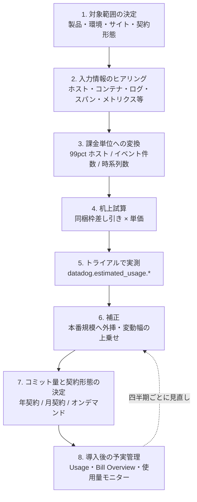
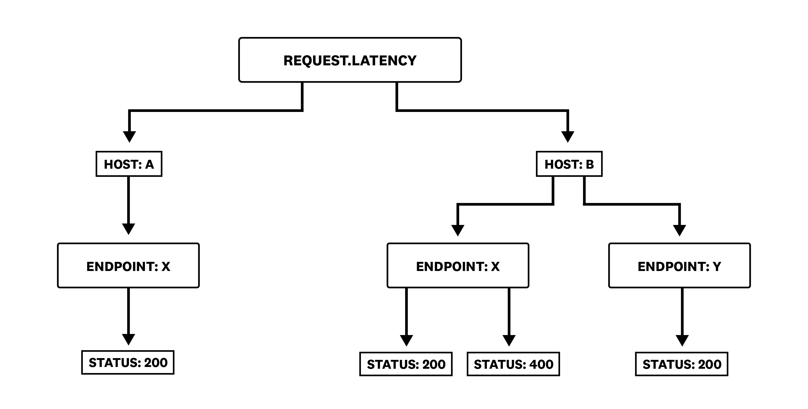
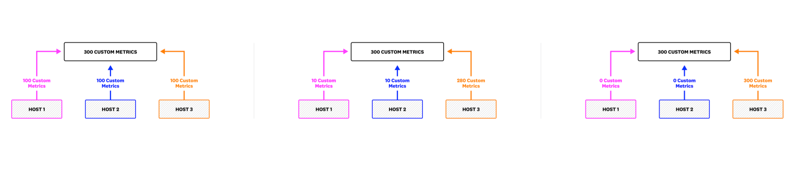
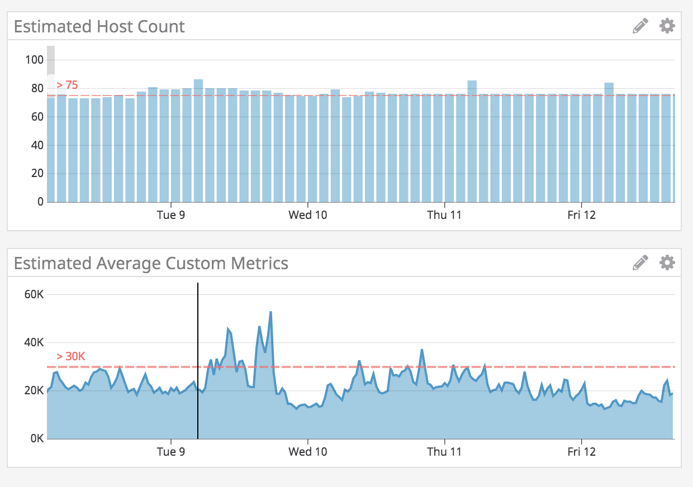

# コスト見積り手法

## 概要

本ファイルは、Datadog を導入する前（または対象範囲を拡大する前）に **月額費用を見積もる方法** をまとめる。Datadog の請求は「製品ごとの SKU の合算」であり、ホスト数だけでなくログ量・スパン量・カスタムメトリクス数・セッション数などの **量に連動する複数の課金次元** が積み上がるため、見積りは次の 4 段階で行うのが基本になる。

1. **入力情報の洗い出し**（対象環境の台数と量をヒアリング・計測する）
2. **課金単位への変換**（ホスト → 99 パーセンタイル、ログ GB → イベント件数、メトリクス名 → 時系列数 など）
3. **同梱枠（allotment）の差し引きと単価の適用**（契約形態・サイト別単価）
4. **リスク要因の上乗せと検証**（トライアルでの実測、変動幅、落とし穴の確認）

| 項目 | 本ファイルでの扱い |
|---|---|
| 単価 | すべて [製品別料金表（料金の正本）](pricing-by-product.md) の定価を引用（公式料金ページ、2026-11-03 取得値を基準日 2026-11-02 時点の値として扱う） |
| 基準サイト | **AP1（日本）**。AP1 の定価は US / EU1 の約 1.25 倍で掲載されている（[製品別料金表 §1.2](pricing-by-product.md#12-サイトリージョン別の価格)）。比較用に US 価格も併記する |
| 基準契約形態 | 特記なき限り **年契約（Billed Annually）** の月額換算 |
| 試算例 | 入力値（台数・量）は架空の想定であり、計算結果は **【推定】** |
| 割引 | ボリューム・多年契約割引は非公開のため試算に含めない（[購入経路と契約](procurement-and-contracts.md) を参照） |

関連ファイルとの役割分担：

| 知りたいこと | 参照先 |
|---|---|
| 課金モデルの分類・考え方 | [料金体系の全体像](pricing-overview.md) |
| 単価・同梱枠の数値 | [製品別料金表（料金の正本）](pricing-by-product.md) |
| 99 パーセンタイル、コンテナ時間、カスタムメトリクスの数え方などメータリングの詳細 | [課金計算の仕組み](billing-mechanics.md) |
| エディション別機能差 | [エディション・プラン](editions-and-plans.md) |
| 導入後のコスト削減策 | [コスト最適化](../04_応用編/cost-optimization.md) |
| 使用量の確認画面・Usage Attribution | [Usage・Usage Attribution・Cost Visibility](../02_リファレンス/platform/usage-and-cost-attribution.md) |

---

## 1. 見積りの全体プロセス

### 1.1 プロセスの流れ

Datadog のコスト見積りは、机上試算 → トライアル実測 → 補正 → コミット量決定の順に精度を上げていく。



| 段階 | 主な作業 | 成果物 | 精度の目安 |
|---|---|---|---|
| 1. 対象範囲の決定 | 使う製品（Infrastructure / APM / Logs / RUM 等）、対象環境（本番・ステージング・開発）、Datadog サイト、契約形態を決める | 対象範囲表 | — |
| 2. ヒアリング | §2 の入力情報を収集 | ヒアリングシート | — |
| 3. 課金単位への変換 | §3 の計算式で課金数量に変換 | 数量表 | — |
| 4. 机上試算 | 同梱枠を差し引き単価を掛ける | 概算見積り | 【経験則】ログ・スパン・カスタムメトリクスの比重が大きいほど誤差が大きい |
| 5. トライアル実測 | 推定使用量メトリクスで実際の量を計測 | 実測値 | 推定使用量メトリクスは請求値と平均 10〜20% 乖離しうる（公式） |
| 6. 補正 | 本番トラフィック比で外挿、成長率と変動幅を上乗せ | 補正後見積り | — |
| 7. コミット決定 | 安定部分を年契約コミット、変動部分をオンデマンドで吸収 | 発注内容 | — |
| 8. 予実管理 | 使用量モニターと月次レビュー | 予実表 | — |

推定使用量メトリクスの誤差については [出典](https://docs.datadoghq.com/account_management/billing/usage_metrics/)。

### 1.2 見積り前に決めるべき前提条件

| 前提条件 | 選択肢 | 見積りへの影響 | 参照 |
|---|---|---|---|
| Datadog サイト | US1 / US3 / US5 / EU1 / AP1 / AP2 / UK1 / US1-FED | サイトごとに定価が異なる（AP1 は US の約 1.25 倍、AP2・UK1 は約 1.2 倍）。US1-FED は一部製品非提供 | [製品別料金表 §1.2・§18](pricing-by-product.md#12-サイトリージョン別の価格)、[Datadog Sites](../02_リファレンス/platform/datadog-sites.md) |
| 契約形態 | 年契約 / 月契約 / オンデマンド | ホスト課金製品は月契約・オンデマンドが年契約の約 1.17〜1.2 倍、量課金製品の多くはオンデマンドが年契約の約 1.2〜1.5 倍。ただしログ取り込み・APM 取り込みスパン・カスタムメトリクス（インデックス・取り込み）・Log Forwarding などは契約形態によらず同額（1.0 倍）で、製品による差は 0〜50% | [製品別料金表 §1.1](pricing-by-product.md#11-3-つの契約形態) |
| Infrastructure エディション | Basic / Pro / Enterprise / DevSecOps Pro / DevSecOps Enterprise | 単価と同梱枠（コンテナ 5 / 10、カスタムメトリクス 100 / 200 per ホスト）が変わる | [エディション・プラン](editions-and-plans.md) |
| APM エディション | APM / APM Pro / APM Enterprise（併用 or スタンドアロン） | **全 APM ホストで 1 エディションに統一（混在不可）** | [製品別料金表 §5.1](pricing-by-product.md#51-apm-エディションinfrastructure-併用スタンドアロン) |
| カスタムメトリクスの課金モデル | Timeseries（cardinality）pricing / Metric Name pricing | 数え方と単価体系が根本的に異なる。Metric Name pricing の単価は非公開 | [課金計算の仕組み §4](billing-mechanics.md#4-カスタムメトリクスの課金計算) |
| ログの保持設計 | Standard Indexing 3 / 7 / 15 / 30 日、Flex Logs、アーカイブのみ | インデックス単価が保持期間で 2 倍以上変わる | [Indexes・保持・アーカイブ](../02_リファレンス/logs/log-indexes-retention-archives.md) |
| 対象環境 | 本番のみ / 本番＋ステージング / 全環境 | 非本番の常時稼働ホストもそのまま課金対象 | §6 |

---

## 2. 見積りに必要な入力情報の洗い出し

### 2.1 ヒアリングシート（製品横断）

見積りに必要な入力情報を製品ごとに整理する。**太字** は金額への影響が大きく、必ず取得すべき項目。

| 区分 | 入力項目 | 単位 | 取得方法の例 | 変換先の課金単位 |
|---|---|---|---|---|
| ホスト | **Agent を導入するホスト数（VM / 物理 / K8s ノード）** | 台 | CMDB、クラウドコンソール、`kubectl get nodes` | Infrastructure ホスト（99 パーセンタイル） |
| ホスト | **ホスト数の時間変動（最小・平常・ピーク、ピーク継続時間/月）** | 台・時間 | Auto Scaling 履歴、クラウドの請求データ | 99 パーセンタイル値（§3.1） |
| ホスト | Agent 未導入だがクラウド連携で検出される VM 数（EC2 / Azure VM / GCE） | 台 | クラウドのインスタンス一覧 | Infrastructure ホスト（タグフィルタで除外しない限り課金） |
| ホスト | 環境別内訳（本番 / ステージング / 開発 / 検証） | 台 | 同上 | 同上 |
| コンテナ | **ホストあたりの平均実行コンテナ数**（Agent・pause コンテナを除く） | 個 | `kubectl get pods -A`、`docker ps` | 追加コンテナ（同梱枠超過分） |
| コンテナ | ECS / EKS Fargate のタスク（Pod）数の月平均 | タスク | ECS コンソール、メトリクス | Serverless Application Monitoring インスタンス |
| サーバーレス | Lambda 関数数（月内に 1 時間 1 回以上実行される関数）、月間呼び出し数 | 関数・回 | CloudWatch `Invocations` | アクティブ関数、トレース済み呼び出し |
| サーバーレス | Cloud Run / Azure App Service / Container Apps / GKE Autopilot のインスタンス数 | インスタンス | 各クラウドのメトリクス | アクティブアプリケーションインスタンス |
| APM | **計装するサービスが動くホスト（ノード）数** | 台 | アーキテクチャ図 | APM ホスト |
| APM | **リクエスト数（RPS）とトレースあたりスパン数** | req/s・span | APM 既存ツール、LB のアクセス数 | 取り込みスパン GB（実測推奨） |
| APM | 15 日以上保持したいスパンの割合・保持期間 | %・日 | 要件 | インデックススパン件数 |
| APM | プロファイル対象コンテナ数（APM Enterprise / Profiler 利用時） | 個 | — | プロファイル対象コンテナ |
| ログ | **1 日あたりのログ量（非圧縮 GB/日）** | GB/日 | 既存ログ基盤の取り込み量、ディスク使用量、CloudWatch Logs の `IncomingBytes` | 取り込み GB |
| ログ | **1 日あたりのログ件数、または平均ログサイズ** | 件/日・bytes | 既存基盤の件数、サンプル計測 | インデックスイベント件数 |
| ログ | **インデックス対象にする割合と保持期間**（ソース別） | %・日 | 運用要件（検索・アラートに使うか） | 保持期間別インデックス単価 |
| ログ | 長期保管の要件（監査等で 1 年保管など） | 月 | コンプライアンス要件 | Flex Logs / アーカイブ / Archive Search |
| カスタムメトリクス | **自前メトリクスの名前数 × タグの組み合わせ数** | 時系列 | Prometheus の `count({__name__=~".+"})`、既存 StatsD の系列数 | インデックスカスタムメトリクス |
| カスタムメトリクス | メトリクスタイプ（histogram / distribution＋パーセンタイルの有無） | — | アプリのコード | 乗数（×5、×10） |
| カスタムメトリクス | カスタムメトリクスを発生させるインテグレーション（Prometheus / OpenMetrics、JMX、WMI、DB のカスタムクエリ等） | — | 監視対象一覧 | 同上 |
| カスタムメトリクス | ログ・スパン・RUM から生成するメトリクスの数 | 時系列 | 設計書 | 同上（同梱枠を消費） |
| DB | Database Monitoring 対象の DB インスタンス数 | 台 | DB 一覧 | データベースホスト |
| ネットワーク | CNM を有効にするホスト数、SNMP 監視するネットワーク機器数 | 台 | — | ネットワークホスト / デバイス |
| RUM | **月間セッション数**（Web / モバイル）、詳細保持する割合、Session Replay の割合 | セッション | GA4 等のアクセス解析（セッション定義の違いに注意） | RUM Measure / Investigate / Session Replay（1,000 セッション単位） |
| Synthetic | **API テスト数 × 実行間隔 × ロケーション数**、ブラウザテスト数 × ステップ数 × 間隔 × ロケーション × デバイス | 回/月 | 監視設計 | API 1 万回 / ブラウザ 1,000 回単位 |
| Security | Cloud SIEM で分析するログ件数、Cloud Security / Workload Protection 対象ホスト | 件・GB・台 | — | 分析イベント 100 万件（料金ページのカードは分析 GB 表記。§3.9 注記）、CSM ホスト |
| Software Delivery | 月 3 回以上コミットするアクティブコミッター数 | 人 | Git の履歴 | コミッター |
| Service Management | On-Call / Incident Management のシート数 | 人 | 当番表 | シート |
| 横断 | 成長率（ホスト・トラフィックの年間増加率） | %/年 | 事業計画 | コミット量の決定 |
| 横断 | Audit Trail の利用有無 | — | 監査要件 | 月額利用料の 2%（年契約） |

課金単位の定義は [製品別料金表](pricing-by-product.md)、カウント方法は [課金計算の仕組み](billing-mechanics.md) を参照。

### 2.2 入力情報の優先順位

【経験則】ホスト単価は定額で見積り誤差が小さい一方、量課金（ログ・スパン・カスタムメトリクス・RUM・Synthetic）は前提の置き方で数倍変わる。ヒアリングの時間が限られる場合は次の順に精度を上げる。

| 優先度 | 項目 | 理由 |
|---|---|---|
| 1 | ログ量（GB/日・件/日）とインデックス割合・保持期間 | 取り込み単価は低いがインデックス単価が高く、保持期間の選択で 2 倍以上変わる（§3.4） |
| 2 | カスタムメトリクスの時系列数（特にタグのカーディナリティ） | 高カーディナリティなタグ 1 つで桁が変わる（§3.6） |
| 3 | ホスト数の変動パターン（ピークの継続時間） | 99 パーセンタイル課金のため、月 8 時間を超えるピークはピーク値で課金（§3.1） |
| 4 | K8s のノードあたりコンテナ数 | 同梱枠（5 / 10 per ホスト）を超えた分が追加課金（§3.2） |
| 5 | APM のトラフィック量 | 同梱枠（150 GB / 100 万スパン per ホスト）が大きく、多くの環境では超過しにくいが、高スループット環境では超過する（§3.3） |
| 6 | RUM セッション数・Synthetic の実行頻度 | ロケーション数・頻度・ステップ数の掛け算で膨らみやすい（§3.7・§3.8） |

### 2.3 既存ツールからの数値の流用

| 既存の情報源 | 流用できる値 | 注意点 |
|---|---|---|
| 既存のログ基盤（Elasticsearch / Splunk / CloudWatch Logs 等）の日次取り込み量 | ログ GB/日 | Datadog の取り込み課金は **非圧縮** の GB（[製品別料金表 §7.1](pricing-by-product.md#71-ログの取り込みインデックスflex)）。圧縮後のストレージ使用量を使うと過小評価になる。Datadog 側でのパース・エンリッチによる属性追加後のサイズで課金されるかは公開情報では確認できず |
| Prometheus のアクティブ時系列数 | カスタムメトリクス数 | Datadog では `host` タグも組み合わせに含まれ、histogram・distribution は集計数の乗数がかかる（§3.6）。OpenMetrics / Prometheus インテグレーションはカスタムメトリクスを生成し、デフォルトの上限がない（公式） |
| 既存 APM（New Relic / Dynatrace 等）のスパン数 | トレース量の目安 | Datadog の取り込み課金はスパン件数ではなく **バイト数（GB）**。スパン数から GB を推定する公式の換算値はない（§3.3） |
| Web アクセス解析（GA4 等）のセッション数 | RUM セッション数 | RUM のセッション定義（15 分無操作で終了、最長 4 時間）とアクセス解析のセッション定義は異なる。ボット・監視トラフィックの扱いも異なる |
| クラウドの請求データ（インスタンス時間） | ホスト数とその変動 | インスタンス時間 ÷ 月の時間数は平均値。Datadog は 99 パーセンタイル（ほぼ最大値）で課金するため、平均値で見積ると過小になる |

出典：[Custom Metrics](https://docs.datadoghq.com/metrics/custom_metrics/)、[製品別料金表](pricing-by-product.md)

---

## 3. 課金次元別の計算式

以下、単価記号を `P_xxx` と表記する。実際の数値は [製品別料金表](pricing-by-product.md) の該当サイト・契約形態の列を用いる。参考として **AP1 年契約** と **US 年契約** の値を各節に示す（2026-11-02 時点、[出典](https://www.datadoghq.com/pricing/list/)）。

### 3.1 Infrastructure ホスト

```
課金ホスト数 H = 月内の時間ごとのホスト数のうち、上位 1% の時間を除いた最大値
                 （30・31 日の月は 9 番目に高い値、2 月は 8 番目）
Infrastructure 費用 = H × P_infra
```

| 単価 | AP1 年契約 | US 年契約 |
|---|---|---|
| Infrastructure Pro | $18.75 | $15 |
| Infrastructure Enterprise | $28.75 | $23 |
| Infrastructure DevSecOps Pro | $27.50 | $22 |
| Infrastructure DevSecOps Enterprise | $42.50 | $34 |

見積り時の H の置き方：

| ホスト数のパターン | H の置き方 | 例 |
|---|---|---|
| 固定台数 | 台数そのもの | 常時 20 台 → H = 20 |
| 月数時間だけのスパイク（合計 8 時間以内/月） | 平常時の台数 | 平常 100 台、障害時 300 台 × 6 時間 → H = 100 |
| 毎日のピーク（日次バッチ、日中のスケールアウト） | **ピーク時の台数** | 平常 100 台、毎日 1 時間 150 台 → H = 150 |
| 月途中の増設 | 増設後の台数（8 時間を超えて＝9 時間以上。2 月は 8 時間以上続けば） | 1〜20 日 100 台、21 日以降 200 台 → H = 200 |

計算方法の詳細と根拠は [課金計算の仕組み §2](billing-mechanics.md#2-ホスト数の計算99-パーセンタイル--ハイウォーターマーク) を参照。ホスト時間で課金する Hybrid Monthly/Hourly Plan（MHP）は営業・CSM 経由で相談する方式で、選択条件は公開情報では確認できず。

**ホストに数えるもの・数えないもの（見積りでの扱い）**

| 対象 | 見積りでの扱い | 出典 |
|---|---|---|
| Agent 導入済みの VM / 物理サーバー / K8s ノード | 1 台 = 1 ホスト | [Billing](https://docs.datadoghq.com/account_management/billing/) |
| Agent 未導入でもクラウドインテグレーションが検出した VM（EC2 等） | **ホストとして課金される**。インテグレーション側のタグフィルタで除外しない限り含める | [AWS Billing](https://docs.datadoghq.com/account_management/billing/aws/) |
| RDS・ELB 等のマネージドリソース | Infrastructure ホストに含めない | 同上 |
| コンテナごとに Agent を入れる構成 | **各コンテナが 1 ホスト**（避けるべき構成） | [Billing](https://docs.datadoghq.com/account_management/billing/) |
| Azure App Service Plan インスタンス、Heroku dyno | ホストに含める | 同上 |
| Lambda、Fargate、GKE Autopilot | ホストではなくサーバーレス／タスク単位（§3.5） | [Containers Billing](https://docs.datadoghq.com/account_management/billing/containers/) |

### 3.2 コンテナ

```
同梱コンテナ数 C_allot = H × (Pro: 5 / Enterprise: 10)   ※アカウント全体でプール
各時間の超過コンテナ数 C_over(h) = max(0, その時間の平均実行コンテナ数 − C_allot)

【前払い（年・月契約）】追加コンテナ費用 ≒ 常時超過するコンテナ数 × P_container_prepaid
【オンデマンド】      追加コンテナ費用 = Σ_h C_over(h) × P_container_hour
```

| 単価 | AP1 | US |
|---|---|---|
| 追加コンテナ（前払い、コンテナ/月） | $1.25 | $1 |
| 追加コンテナ（オンデマンド、コンテナ時間） | $0.0025 | $0.002 |

- 実行コンテナ数には Datadog Agent のコンテナと Kubernetes の pause コンテナを **含めない**（公式）[出典](https://docs.datadoghq.com/account_management/billing/containers/)。
- 常時超過するコンテナはオンデマンド（US：$0.002 × 720 時間 = $1.44/月）より前払い（US：$1/月）の方が安い。月の一部の時間だけ超過する分はオンデマンドが安い（[課金計算の仕組み §3.3](billing-mechanics.md#33-計算例)）。
- Basic ホストではコンテナ監視を利用できない（[製品別料金表 §2.2](pricing-by-product.md#22-エディション別の同梱枠機能差basic--pro--enterprise)）。

### 3.3 APM（ホスト・取り込みスパン・インデックススパン）

```
APM 費用 = H_apm × P_apm
         + max(0, 取り込みスパン GB − H_apm × 150 GB) × P_ingest_span
         + max(0, インデックススパン件数 − H_apm × 100 万件) ÷ 100 万 × P_indexed_span(保持期間)
```

| 単価 | AP1 年契約 | US 年契約 |
|---|---|---|
| APM（Infrastructure 併用） | $38.75 | $31 |
| APM Pro（併用） | $43.75 | $35 |
| APM Enterprise（併用） | $50 | $40 |
| APM（スタンドアロン） | $45 | $36 |
| 取り込みスパン超過 | $0.125/GB | $0.10/GB |
| インデックススパン（15 日保持） | $2.125/100 万件 | $1.70/100 万件 |

- **H_apm** はトレースを送信しているホスト（K8s では Pod ではなく **ノード**）の 99 パーセンタイル。1 ホストで複数サービスが動いても 1 APM ホスト [出典](https://docs.datadoghq.com/account_management/billing/apm_tracing_profiler/)。
- **同梱枠は全 APM ホストで合算**（150 GB 取り込み・100 万件インデックス / ホスト / 月）。オンデマンド契約では時間ごとに按分される（[製品別料金表 §5.2](pricing-by-product.md#52-apm-の同梱枠allotment)）。
- 併用モデル（$31 等）は全 APM ホストに Infrastructure Pro / Enterprise が必要。見積りでは **Infrastructure ホスト費用と APM ホスト費用を両方計上** する（1 台の VM が Infra と APM で 1 ホストずつ課金される）[出典](https://docs.datadoghq.com/account_management/billing/pricing/)。

**取り込みスパン GB の見積り方**

Datadog の取り込みスパンはスパン件数ではなく **バイト数** で計量される。スパン 1 件あたりの平均サイズや「100 万スパン = 何 GB」の公式な換算値は **公開情報では確認できず**。そのため次の方法で推定する。

| 方法 | 手順 | 精度 |
|---|---|---|
| 実測（推奨） | トライアルで `datadog.estimated_usage.apm.ingested_bytes` と `datadog.estimated_usage.apm.ingested_spans` を計測し、平均スパンサイズ = bytes ÷ spans を求めて本番トラフィックに外挿 | 高 |
| 既定サンプリングからの上限推定 | Agent の既定ヘッドベースサンプリングは **Agent あたり合計 10 トレース/秒** を目標（`DD_APM_TARGET_TPS`、既定 10）、エラーサンプラーは最大 10 トレース/秒/Agent（`DD_APM_ERROR_TPS`）。トレーサー側でサンプリングルールを指定した場合はその率に従う | 中（実際の率は変動。公式に「目標は固定値ではない」） |
| 同梱枠との比較 | 1 ホストあたり 150 GB/月 ≒ 0.205 GB/時。トライアルの 1 時間あたり取り込み量がこれを下回れば超過なしと判断 | 中 |

出典：[Ingestion Mechanisms](https://docs.datadoghq.com/tracing/trace_pipeline/ingestion_mechanisms/)、[Usage Metrics](https://docs.datadoghq.com/account_management/billing/usage_metrics/)

**インデックススパン件数の見積り方**：インデックススパンは保持フィルター（Retention Filters）で保持したスパンの件数。Datadog が自動で保持するスパン（Intelligent Retention 等）は同梱枠を消費しない（[製品別料金表 §5.2](pricing-by-product.md#52-apm-の同梱枠allotment)）。カスタム保持フィルターで「エラーのみ」「特定サービスの 1%」などを設計し、`対象スパン数/秒 × 保持率 × 2,592,000 秒（30 日）` で月間件数を求める。

**追加の APM 系 SKU**：Continuous Profiler（APM Enterprise は 4 プロファイル対象コンテナ/ホスト同梱、超過 $2/コンテナ US）、Data Streams Monitoring、USM、Managed Platform OTLP（$0.50/GB US、同梱枠なし）は [製品別料金表 §5.3](pricing-by-product.md#53-スパンprofilerusmdsm-の追加-sku) を参照。

### 3.4 ログ（取り込み・インデックス・Flex・アーカイブ）

```
取り込み GB/月 G = 非圧縮ログ量（GB/日）× 30
イベント件数/月 N = G ÷ 平均ログサイズ   または   1 日の件数 × 30
ログ費用 = G × P_log_ingest
         + Σ_index ( N × インデックス割合_i ÷ 100 万 × P_index(保持期間_i) )
         + Flex Logs 保存イベント ÷ 100 万 × P_flex（＋Flex Compute：要問合せ）
         + （Rehydrate・Archive Search・Log Forwarding を使う場合はその量 × 単価）
```

| 単価 | AP1 年契約 | US 年契約 |
|---|---|---|
| 取り込み（Ingest） | $0.125/GB | $0.10/GB |
| インデックス Standard 3 日 | $1.325/100 万件 | $1.06/100 万件 |
| インデックス Standard 7 日 | $1.5875/100 万件 | $1.27/100 万件 |
| インデックス Standard 15 日 | $2.125/100 万件 | $1.70/100 万件 |
| インデックス Standard 30 日 | $3.125/100 万件 | $2.50/100 万件 |
| Flex Logs Storage | $0.0625/100 万件/月 | $0.05/100 万件/月 |
| Flex Logs Starter（3 / 6 / 12 / 15 か月保持） | $0.75/100 万件/月 | $0.60/100 万件/月 |
| Archive Search | $0.0625/GB スキャン | $0.05/GB スキャン |
| Log Forwarding to Custom Destinations | $0.3125/GB/宛先 | $0.25/GB/宛先 |

- **件数の見積り**：料金ページ FAQ は「トライアル中に直近 24 時間のカウントクエリを実行し、30 倍する」方法を推奨している。ログサイズはまちまちなため（"Log events come in all shapes and sizes"）、Datadog はインデックスをサイズではなく件数で課金する [出典](https://www.datadoghq.com/pricing/?product=log-management)。
- **平均ログサイズ** の公式な標準値は **公開情報では確認できず**。実測では `datadog.estimated_usage.logs.ingested_bytes ÷ datadog.estimated_usage.logs.ingested_events` で求める [出典](https://docs.datadoghq.com/account_management/billing/usage_metrics/)。机上試算で仮置きする場合は【推定】と明記し、本ファイルの試算例では **1 KB/件（1 GB ≒ 100 万件）** を仮置きしている。
- **インデックスの保持期間による単価差**：同じ 6 億件/月（AP1 年契約）でも、3 日保持 $795、7 日 $952.50、15 日 $1,275、30 日 $1,875 と 2.4 倍の差がある（計算値）。
- **オンデマンド顧客のデフォルト保持は 15 日**（料金ページ FAQ）。
- **Flex Logs** は 100 万件ごとに最低 30 日分（最低 $0.05、US）課金される。Flex Compute の価格は要問合せのため、Flex Logs（Starter を除く）の見積りには営業見積りが必要。Flex Logs Starter は月 20 億件未満（保存総計 100 億件）向けで Starter Compute を同梱（[製品別料金表 §7.1](pricing-by-product.md#71-ログの取り込みインデックスflex)）。
- **アーカイブ**（S3 / GCS / Azure Storage）への転送は取り込み料金に含まれるが、**クラウドストレージ側の保管料・API 料金はクラウド事業者に別途発生** する。
- **Rehydration** は圧縮 GB あたり $0.10（US）＋再インデックスしたイベントのインデックス費用。

### 3.5 サーバーレス・Fargate

```
Lambda 監視費用 = アクティブ関数数（時間ごとの月平均）× P_fn
Lambda APM 費用 = トレース済み呼び出し数 ÷ 100 万 × P_fn_apm
アプリ型（Fargate / Cloud Run / App Service 等）= アクティブインスタンス数（月平均）× P_app (+ APM なら P_app_apm)
```

| 単価 | AP1 年契約 | US 年契約 |
|---|---|---|
| Serverless Workload Monitoring - Functions（アクティブ関数） | $6.25 | $5 |
| Serverless Functions APM（100 万トレース済み呼び出し） | $12.50 | $10 |
| Serverless Workload Monitoring - Apps（アクティブアプリケーションインスタンス） | $3.75 | $3 |
| Serverless Application APM（トレース対象インスタンス） | $7.50 | $6 |

- アクティブ関数は「1 時間に 1 回以上実行された関数数」の月平均。月に 1 回だけ呼ばれる関数は 1/720 関数分しか課金されない（料金ページ FAQ の計算例）。
- 同梱枠：Serverless Functions APM は 100 万呼び出しあたり取り込み 50 GB・インデックス 30 万件、Serverless Application APM はインスタンスあたり取り込み 30 GB・インデックス 19.5 万件（料金ページ値。ドキュメントの例と食い違いがあるため契約時に確認）。
- 詳細は [製品別料金表 §4](pricing-by-product.md#4-serverless-monitoringサーバーレス監視) と [Serverless Monitoring](../02_リファレンス/infrastructure/serverless.md)。

### 3.6 カスタムメトリクス

```
（Timeseries pricing の場合）
1 メトリクス名の時系列数 = 一意なタグ値の組み合わせ数（host タグを含む）× タイプ乗数
  タイプ乗数：count / rate / gauge = 1、histogram = 5（既定）、distribution = 5、distribution + パーセンタイル = 10
課金対象カスタムメトリクス数 M = 時間ごとの一意な時系列数の月平均（全メトリクス名の合計）
同梱枠（インデックス・取り込みそれぞれ）= H × (Pro: 100 / Enterprise: 200)   ※アカウント全体でプール
  M_allot = インデックス側の同梱枠、M_ing_allot = 取り込み側の同梱枠（値は同じ）
カスタムメトリクス費用 = max(0, M − M_allot) ÷ 100 × P_cm
（Metrics without Limits 設定時）取り込みカスタムメトリクス費用 = max(0, M_ingested − M_ing_allot) ÷ 100 × P_ingested_cm
```

| 単価 | AP1 年契約 | US 年契約 |
|---|---|---|
| Custom Metrics（インデックス、100 個） | $6.25 | $5 |
| Ingested Custom Metrics（Metrics without Limits 設定時、100 個） | $0.125 | $0.10 |

- 料金比較表は 100 個あたり $5（US 年契約）を掲載しているが、ドキュメントでは「超過単価は契約で定める」とされる。見積りでは定価を使い、契約単価を確認する（[製品別料金表 §2.3](pricing-by-product.md#23-infrastructure-の追加-skuコンテナカスタムメトリクスイベントほか)）。
- **送信頻度とクエリ回数は課金に影響しない**。タグの並び順を変えても新しいメトリクスにはならず、より粒度の細かいタグが組み合わせ数を決める（例：`city` があれば `state` を追加しても増えない）[出典](https://docs.datadoghq.com/account_management/billing/custom_metrics/)。
- Metric Name pricing を選んだ場合は「メトリクス名数 + インデックスデータポイント」で課金され、段階単価は非公開のため営業見積りが必要（[課金計算の仕組み §4.7](billing-mechanics.md#47-metric-name-pricing-の計算)）。



- **キャプション**: カスタムメトリクス `request.Latency` のタグ組み合わせを木構造で示した公式の説明図。
- **画面（図）の説明**: 最上段に `REQUEST.LATENCY`、その下に `HOST: A` と `HOST: B` の 2 分岐。HOST A の下は `ENDPOINT: X` → `STATUS: 200` の 1 系統、HOST B の下は `ENDPOINT: X`（`STATUS: 200` と `STATUS: 400`）と `ENDPOINT: Y`（`STATUS: 200`）の 3 系統に分かれる。末端の葉の数＝一意なタグ組み合わせ＝**4**。gauge / count / rate ならカスタムメトリクス 4、histogram なら 4 × 5 = 20、distribution なら 4 × 5 = 20、distribution でパーセンタイル（p50 / p75 / p90 / p95 / p99）を有効にすると 40 になる。
- **出典**: [Custom Metrics Billing](https://docs.datadoghq.com/account_management/billing/custom_metrics/)（画像取得日 2026-11-03）



- **キャプション**: Pro プラン 3 ホストの同梱枠（合計 300 カスタムメトリクス）がアカウント全体でプールされることを示す公式の説明図。
- **画面（図）の説明**: 3 つのパネルが横に並び、いずれも HOST 1 / HOST 2 / HOST 3 から上部の「300 CUSTOM METRICS」の箱に矢印が伸びる。左パネルは各ホスト 100 ずつ、中央パネルは 10 / 10 / 280、右パネルは 0 / 0 / 300。どの配分でも合計 300 以内なら追加課金は発生しないことを表す。
- **出典**: [Custom Metrics Billing](https://docs.datadoghq.com/account_management/billing/custom_metrics/)（画像取得日 2026-11-03）

**時系列数の机上見積りの手順**

| 手順 | 内容 | 例 |
|---|---|---|
| 1 | メトリクス名ごとにタグとその値の種類数を列挙 | `checkout.latency`：`env`(2) × `service`(10) × `endpoint`(20) × `status_class`(3) |
| 2 | 実在する組み合わせだけを数える（全積は上限） | 上限 1,200、実際に発生する組み合わせを 600 と見積る |
| 3 | `host` タグが付くか確認（DogStatsD は既定で送信元 host が付く） | 30 ホストに分散 → 最大 600 × 30 = 18,000（実際は各ホストで発生する組み合わせのみ） |
| 4 | タイプ乗数を掛ける | distribution（パーセンタイルなし）→ ×5 |
| 5 | 全メトリクス名を合算し、同梱枠を差し引く | — |
| 6 | Metrics without Limits™ でインデックスするタグを絞る場合は、取り込み数（$0.10/100 個 US）とインデックス数を別々に計算 | `host` を除外してインデックス → インデックス数は大幅減、取り込み数は残る |

**カスタムメトリクスとして数えられるもの（見積り漏れしやすいもの）**

| 発生源 | カスタムメトリクスか | 出典 |
|---|---|---|
| DogStatsD、カスタム Agent チェック、API 送信 | カスタム | [Custom Metrics](https://docs.datadoghq.com/metrics/custom_metrics/) |
| 1,000 以上の公式インテグレーションの標準メトリクス | カスタムではない（標準メトリクス） | 同上 |
| Marketplace インテグレーション、公式インテグレーション以外 | カスタム | 同上 |
| ActiveMQ XML / Go-Expvar / Java-JMX | カスタム（既定で上限 350） | 同上 |
| Nagios / PDH Check / OpenMetrics / Windows パフォーマンスカウンター / WMI / Prometheus | カスタム（**既定の上限なし**） | 同上 |
| MySQL / Oracle / Postgres / SQL Server のカスタムクエリ | 設定によりカスタム | 同上 |
| AWS などクラウド連携から送られるカスタムメトリクス | カスタム | 同上 |
| ログベースメトリクス・スパンベースメトリクス | カスタムメトリクスの同梱枠を消費 | [製品別料金表 §2.3](pricing-by-product.md#23-infrastructure-の追加-skuコンテナカスタムメトリクスイベントほか) |
| 過去データの取り込み（Historical Metrics） | インデックスカスタムメトリクスとして課金 | [Historical Metrics Ingestion](https://docs.datadoghq.com/metrics/custom_metrics/historical_metrics/) |
| OpenTelemetry（OTLP）で送るアプリケーションメトリクス | 公式インテグレーション以外から送るメトリクスはカスタムとされるため、カスタムとして見積るのが安全。OTLP について明示した課金記述は公開情報では確認できず | [Custom Metrics Billing](https://docs.datadoghq.com/account_management/billing/custom_metrics/) |

詳細は [Custom Metrics と DogStatsD](../02_リファレンス/platform/custom-metrics-and-dogstatsd.md) を参照。

### 3.7 RUM・Session Replay・Product Analytics

```
RUM 費用 = 全セッション数 ÷ 1,000 × P_rum_measure
         + 保持フィルター通過セッション数 ÷ 1,000 × P_rum_investigate
         + Session Replay 対象セッション数 ÷ 1,000 × P_replay
```

| 単価（1,000 セッション） | AP1 年契約 | US 年契約 |
|---|---|---|
| RUM Measure（全トラフィック） | $0.1875 | $0.15 |
| RUM Investigate（保持分） | $3.75 | $3 |
| Session Replay | $3.125 | $2.50 |
| Product Analytics（全トラフィック） | $1 | $0.80 |

- セッションは 15 分の無操作で終了し、最長 4 時間で区切られる [出典](https://docs.datadoghq.com/account_management/billing/pricing/)。
- 見積りの感度が高いのは「保持（Investigate）割合」と「Replay 割合」。Measure は全量課金だが単価が低い。
- 詳細は [製品別料金表 §11.1](pricing-by-product.md#111-rumsession-replayproduct-analyticsexperiments)。

### 3.8 Synthetic Monitoring

```
API テスト実行数/月 = Σ（テスト数 × ステップ数（マルチステップ時） × (60 ÷ 間隔[分]) × 24 × 30 × ロケーション数）
ブラウザテスト実行数/月 = Σ（テスト数 × ceil(ステップ数 ÷ 25) × (60 ÷ 間隔[分]) × 24 × 30 × ロケーション数 × デバイス数）
費用 = API 実行数 ÷ 10,000 × P_api + ブラウザ実行数 ÷ 1,000 × P_browser
```

| 単価 | AP1 年契約 | US 年契約 |
|---|---|---|
| API テスト（1 万回） | $6.25 | $5 |
| ブラウザテスト（1,000 回） | $15 | $12 |

- 1 分間隔・3 ロケーションの API テスト 1 本 = 60 × 24 × 30 × 3 = **129,600 回/月**（AP1 年契約で約 $81）。5 分間隔にすると 1/5。
- プライベートロケーションに追加費用はないが、実行回数はマネージドロケーションと同様に課金される。CI からの実行（Continuous Testing）も実行回数に含まれる（[製品別料金表 §11.2](pricing-by-product.md#112-synthetic-monitoringmobile-app-testingcontinuous-testing)）。

### 3.9 その他の製品（主要な計算式のみ）

| 製品 | 計算式 | AP1 年契約単価 | US 年契約単価 |
|---|---|---|---|
| Database Monitoring | DB ホスト数 × 単価（正規化クエリ 200/ホスト同梱） | $87.50 | $70 |
| Cloud Network Monitoring（旧称：Network Performance Monitoring / NPM） | CNM ホスト数 × 単価（Infrastructure 必須） | $6.25 | $5 |
| Network Device Monitoring | デバイス数 × 単価 | $8.75 | $7 |
| Cloud SIEM | 分析イベント数 ÷ 100 万 × 単価（課金単位の表記揺れは表下の注記を参照） | $6.25 | $5 |
| Cloud Security Pro（旧称：Cloud Security Management / CSM Pro） | ホスト数 × 単価（コンテナ 5/ホスト同梱） | $12.50 | $10 |
| Workload Protection（旧称：Cloud Workload Security / CWS） | ホスト数 × 単価（コンテナ 4/ホスト同梱） | $18.75 | $15 |
| App and API Protection（旧称：Application Security Management / ASM） | AAP ホスト数 × 単価 | $38.75 | $31 |
| Error Tracking | 5 万件まで定額＋段階単価（APM・RUM 由来は無料） | $31.25（〜5 万件） | $25（〜5 万件） |
| CI Pipeline Visibility / Test Optimization | アクティブコミッター数 × 単価 | $10 / $25 | $8 / $20 |
| Incident Response / On-Call / Incident Management | シート数（同時割当の最大値）× 単価 | $50 / $25 / $37.50 | $40 / $20 / $30 |
| Workflow Automation | 実行回数 ÷ 100 × 単価 | $12.50 | $10 |
| Agent Observability（旧称：LLM Observability） | Pro 月額（10 万 LLM スパン込み）＋追加 1 万スパンごと | $200＋$4.375 | $160＋$3.50 |
| AI Credits（Bits AI） | 500 クレジットバンドル（未使用分は繰り越さない） | $625 | $500 |
| **Audit Trail** | **月額利用料（spend）合計 × 2%**（年契約。月・オンデマンドは 3%） | 2% | 2% |
| Sensitive Data Scanner（Full） | スキャン GB × 単価 | $0.375 | $0.30 |
| Observability Pipelines | 取り込み GB × 単価（月 30 TB 超は vCPU 課金の Plus を検討） | $0.11875 | $0.095 |

出典：[製品別料金表 §3〜§14](pricing-by-product.md)（公式料金ページ、2026-11-03 取得）

- **Cloud SIEM の課金単位は公式情報どうしで表記が食い違う**。料金ページの Cloud SIEM カードは「Per GB analyzed per month」（[出典](https://www.datadoghq.com/pricing/?product=log-management)）、料金比較表と課金ドキュメントは「分析イベント 100 万件/月」（"Datadog charges for analyzed logs based on the millions of events per month analyzed" [出典](https://docs.datadoghq.com/account_management/billing/pricing/)）で、単価はいずれも $5（US 年契約）。本ファイルの試算は件数単位で計算しているが、**契約時に課金単位（GB か件数か）を必ず確認する**。トライアルの実測では `security_monitoring.analyzed_bytes`（§4.1）から GB を求め、平均ログサイズで割った件数換算も併記して両方の単位で見積る。

---

## 4. トライアルでの実測（推定使用量メトリクス）

### 4.1 推定使用量メトリクスの一覧（見積りに使う主要なもの）

Datadog は使用量を **`datadog.estimated_usage.*`** というメトリクスで準リアルタイムに提供している。トライアル期間中にこれらを計測すると、机上の前提値を実測値で置き換えられる。推定使用量メトリクスは追加費用なしで利用でき、ダッシュボードやモニターに使える [出典](https://docs.datadoghq.com/account_management/billing/usage_metrics/)。

| 見積り対象 | メトリクス名 | 内容 |
|---|---|---|
| Infrastructure ホスト | `datadog.estimated_usage.hosts`（`.hosts.by_tag`） | 直近 1 時間のユニークホスト数 |
| コンテナ | `datadog.estimated_usage.containers`（`.by_tag`） | 直近 1 時間のユニークコンテナ数 |
| Fargate タスク | `datadog.estimated_usage.fargate_tasks`（`.by_tag`） | 直近 5 分のユニーク Fargate タスク数（ECS / EKS） |
| インデックスカスタムメトリクス | `datadog.estimated_usage.metrics.custom`（`.by_metric`、`.by_tag`） | 直近 1 時間のユニークなインデックスカスタムメトリクス数 |
| 取り込みカスタムメトリクス | `datadog.estimated_usage.metrics.custom.ingested`（`.by_metric`、`.by_tag`） | 直近 1 時間のユニークな取り込みカスタムメトリクス数 |
| ログ取り込み量 | `datadog.estimated_usage.logs.ingested_bytes` | ログ取り込みの総バイト数 |
| ログ取り込み件数 | `datadog.estimated_usage.logs.ingested_events` | 取り込みイベント総数（除外されたログを含む） |
| Cloud SIEM 分析量 | `datadog.estimated_usage.security_monitoring.analyzed_bytes` | Cloud SIEM のログ取り込みバイト数（GB 単位での見積りに使う。件数単位の契約では平均ログサイズで割って件数に換算する。§3.9 注記参照） |
| APM ホスト | `datadog.estimated_usage.apm_hosts`（`.by_tag`） | 直近 1 時間のユニーク APM ホスト数（Azure App Services を除く） |
| APM 取り込み量 | `datadog.estimated_usage.apm.ingested_bytes` | 取り込みスパンのバイト数 |
| APM 取り込み件数 | `datadog.estimated_usage.apm.ingested_spans` | 取り込みスパン総数 |
| APM インデックス件数 | `datadog.estimated_usage.apm.indexed_spans` | タグベースの保持フィルターでインデックスされたスパン数 |
| APM Fargate タスク | `datadog.estimated_usage.apm.fargate_tasks`（`.by_tag`） | 直近 5 分のユニーク APM Fargate タスク数 |
| RUM セッション | `datadog.estimated_usage.rum.sessions`、`.rum.ingested_sessions`、`.rum.indexed_sessions` | RUM セッション総数、取り込み（Measure）・保持（Investigate）セッション数 |
| Lambda | `datadog.estimated_usage.serverless.aws_lambda_functions`、`.serverless.invocations` | 直近 1 時間のユニーク関数数、呼び出し数 |
| Synthetic | `datadog.estimated_usage.synthetics.api_test_runs`、`.browser_test_runs` | API / ブラウザテスト実行数 |
| CNM / NDM | `datadog.estimated_usage.network.hosts`、`.network.devices` | ユニーク CNM ホスト数 / NDM デバイス数 |
| Profiler | `datadog.estimated_usage.profiling.hosts`、`.profiling.containers` | プロファイル対象ホスト / コンテナ数 |
| DBM | `datadog.estimated_usage.dbm.hosts` | ユニーク DBM ホスト数 |
| CI / Test | `datadog.estimated_usage.ci_visibility.pipeline.committers`、`.ci_visibility.test.committers` | 暦月初来のコミッター数 |
| Custom Events | `datadog.estimated_usage.events.custom_events` | カスタムイベント送信量 |
| Sensitive Data Scanner | `datadog.estimated_usage.sds.scanned_bytes` | スキャンバイト数 |
| Observability Pipelines | `datadog.estimated_usage.observability_pipelines.ingested_bytes` | 取り込みバイト数 |

出典：[Estimated Usage Metrics](https://docs.datadoghq.com/account_management/billing/usage_metrics/)（2026-11-03 取得）

> **注意:** 推定使用量は準リアルタイムに計算されるため請求値と一致しない。**平均で 10〜20% の差** があり、使用量が小さいほど誤差は大きい（公式）[出典](https://docs.datadoghq.com/account_management/billing/usage_metrics/)。見積りではこの幅を上乗せする。

### 4.2 推定使用量ダッシュボードの例



- **キャプション**: 推定使用量メトリクスを使ったダッシュボードの例（公式ドキュメントの図）。
- **画面の説明**: 上段は「Estimated Host Count」ウィジェットで、時間ごとのホスト数を棒グラフで表示し、75 台の位置に赤い破線（しきい値「> 75」）が引かれている。概ね 73〜80 台で推移し、数本だけ 85 台前後に突出している。下段は「Estimated Average Custom Metrics」の面グラフで、通常 15K〜30K の間を推移し、火曜日に 50K 超まで急増した時間帯がある。30K に赤い破線（しきい値「> 30K」）が引かれ、コミット量・同梱枠に対する超過を視覚的に確認できる。各ウィジェット右上に編集（鉛筆）と設定（歯車）アイコンがある。
- **出典**: [Estimated Usage Metrics](https://docs.datadoghq.com/account_management/billing/usage_metrics/)（画像取得日 2026-11-03）

### 4.3 実測値から月間課金数量を求めるクエリ例

| 求めたい値 | クエリ・方法（例） | 換算 |
|---|---|---|
| 課金ホスト数（近似） | `datadog.estimated_usage.hosts` の時間値をトライアル期間で並べ、上位 1% を除いた最大値 | 本番規模への外挿は「本番台数 ÷ トライアル台数」を乗じる |
| 日次ログ量 | `sum:datadog.estimated_usage.logs.ingested_bytes{*}.as_count()` を 1 日単位でロールアップ | × 30 で月間 GB |
| 日次ログ件数 | `sum:datadog.estimated_usage.logs.ingested_events{*}.as_count()` を 1 日単位、または Log Explorer で直近 24 時間のカウント | × 30（料金ページ FAQ 推奨） |
| ソース別ログ量 | 上記を `by {service}` や `by {source}` で分解（推定使用量メトリクスはタグで分解可能） | インデックス対象・除外対象の切り分けに使う |
| 平均ログサイズ | ログ bytes ÷ ログ events | 机上の 1 KB 仮置きを置き換える |
| APM 平均スパンサイズ | `apm.ingested_bytes` ÷ `apm.ingested_spans` | 本番の RPS とスパン数から GB を推定 |
| APM 取り込み理由の内訳 | `apm.ingested_bytes` を `ingestion_reason` タグで分解 | 既定サンプリング・エラー・ルール等の寄与を把握 |
| カスタムメトリクスの上位 | `datadog.estimated_usage.metrics.custom.by_metric` を `by {metric_name}` で top 表示、または Plan & Usage の Top Custom Metrics | カーディナリティの大きいメトリクスを特定 |

ロールアップやクエリ関数の詳細は [メトリクスクエリと関数](../02_リファレンス/platform/metrics-query-and-functions.md)、Usage 画面の見方は [Usage・Usage Attribution・Cost Visibility](../02_リファレンス/platform/usage-and-cost-attribution.md) を参照。

### 4.4 トライアル実測の進め方

| 項目 | 推奨 | 根拠・理由 |
|---|---|---|
| 計測対象 | 本番と同等のトラフィックを持つ環境（本番の一部、またはカナリア） | 【経験則】ステージングはトラフィック・ログ量が本番より小さく外挿誤差が大きい |
| 計測期間 | 少なくとも平日と週末、月末処理などの周期を含む期間 | 【経験則】曜日・月次の変動を捉えるため |
| 計測項目 | ホスト、コンテナ、ログ（bytes / events）、スパン（bytes / spans / indexed）、カスタムメトリクス（by_metric）、RUM セッション | §4.1 |
| 外挿方法 | 「本番の総量 ÷ 計測対象の量」（台数比、リクエスト比、セッション比）を乗じる | issoh 記事でも「本番より小さい環境ではトラフィック比で外挿」とされる【第三者情報】[出典](https://www.issoh.co.jp/tech/details/16574/)（2026-08 公開、2026-09 更新） |
| 試用中の課金 | 試用期間中は課金されないが、試用終了後の使用量は課金される | [課金計算の仕組み §1.3](billing-mechanics.md#13-計測と請求サイクルの基本) |
| Free tier | Basic ホスト 5 台・メトリクス保持 1 日のため、量の実測・料金の妥当性判断には不十分 | [製品別料金表 §2.4](pricing-by-product.md#24-free-tier-と無料トライアル)、【第三者情報】issoh 記事 |

---

## 5. 規模別の試算例【推定】

以下の試算は **架空の前提条件** に基づく計算例であり、すべて **【推定】** である。単価は [製品別料金表](pricing-by-product.md) の AP1 年契約（定価、2026-11-02 時点）を使用し、割引・税は含まない。ログは平均 1 KB/件（1 GB ≒ 100 万件）と仮置きしている。

### 5.1 試算例 A：小規模 Web サービス（VM 10 台）

**前提条件**

| 項目 | 値 |
|---|---|
| 構成 | EC2 10 台（Web 4・App 4・バッチ 2）、コンテナなし、台数固定 |
| 製品 | Infrastructure Pro、APM（Infrastructure 併用）を App/Web の 5 台に導入、Log Management |
| APM | 取り込み 300 GB/月、インデックス 300 万件/月（同梱 750 GB・500 万件以内） |
| カスタムメトリクス | 1,500（同梱 10 × 100 = 1,000） |
| ログ | 5 GB/日 → 150 GB/月 ≒ 1.5 億件/月 |
| サイト・契約 | AP1、年契約 |

**計算（ケース A-1：全ログを 15 日保持でインデックス）**

| 明細 | 計算式 | 月額（USD） |
|---|---|---|
| Infrastructure Pro | 10 × $18.75 | $187.50 |
| APM | 5 × $38.75 | $193.75 |
| APM スパン超過 | 同梱内 | $0 |
| カスタムメトリクス超過 | (1,500 − 1,000) ÷ 100 × $6.25 | $31.25 |
| ログ取り込み | 150 GB × $0.125 | $18.75 |
| ログインデックス（15 日、全件） | 150 × $2.125 | $318.75 |
| **合計** | | **$750.00** |

**計算（ケース A-2：インデックスを 30% に絞る。残りはアーカイブのみ）**

| 明細 | 計算式 | 月額（USD） |
|---|---|---|
| Infrastructure・APM・カスタムメトリクス・取り込み | A-1 と同じ | $431.25 |
| ログインデックス（15 日、30%） | 45 × $2.125 | $95.625 |
| **合計** | | **$526.875** |

- 同じ環境でもインデックス設計だけで月額が約 30% 変わる。このケースでは **ログのインデックスが最大の費目** になりうる。
- 参考：A-2 を US 年契約単価で計算すると $421.50（$150 + $155 + $25 + $15 + $76.50）。
- 参考：A-2 を AP1 **月契約** 単価で計算すると $614.75（Infra $22.50、APM $45、インデックス 15 日 $2.55）、**オンデマンド** では $643.4375（インデックス 15 日 $3.1875）。年契約比でそれぞれ約 +17%、+22%。

### 5.2 試算例 B：中規模 Kubernetes 環境（ノード 50 台）

**前提条件**

| 項目 | 値 |
|---|---|
| 構成 | Kubernetes（EKS / GKE Standard 等）ノード 50 台（固定と仮定）、ノードあたり平均 20 コンテナ（Agent・pause を除く）→ 1,000 コンテナ |
| 製品 | Infrastructure Pro、APM（全ノード）、Log Management、DBM（DB 4 台）、Synthetic、RUM＋Session Replay |
| コンテナ | 同梱 50 × 5 = 250 → 常時超過 750 コンテナ（前払いで購入） |
| APM | 取り込み 12,000 GB/月（同梱 7,500 GB）、インデックス 8,000 万件/月（同梱 5,000 万件） |
| カスタムメトリクス | 20,000（Prometheus / OpenMetrics 由来含む。同梱 5,000） |
| ログ | 100 GB/日 → 3,000 GB/月 ≒ 30 億件/月、インデックスは 20%（6 億件）を 15 日保持、残りはアーカイブ |
| Synthetic | API テスト 20 本 × 5 分間隔 × 3 ロケーション = 518,400 回/月、ブラウザテスト 5 本（25 ステップ以内）× 15 分間隔 × 2 ロケーション = 28,800 回/月 |
| RUM | 月 200 万セッション、Investigate 保持 10%（20 万）、Session Replay 2%（4 万） |
| サイト・契約 | AP1、年契約 |

**計算**

| 明細 | 計算式 | 月額（USD） |
|---|---|---|
| Infrastructure Pro | 50 × $18.75 | $937.50 |
| 追加コンテナ（前払い） | 750 × $1.25 | $937.50 |
| APM | 50 × $38.75 | $1,937.50 |
| APM 取り込みスパン超過 | (12,000 − 7,500) GB × $0.125 | $562.50 |
| APM インデックススパン超過（15 日） | (80 − 50) × $2.125 | $63.75 |
| カスタムメトリクス超過 | (20,000 − 5,000) ÷ 100 × $6.25 | $937.50 |
| ログ取り込み | 3,000 GB × $0.125 | $375.00 |
| ログインデックス（15 日、20%） | 600 × $2.125 | $1,275.00 |
| Database Monitoring | 4 × $87.50 | $350.00 |
| Synthetic API テスト | 51.84 × $6.25 | $324.00 |
| Synthetic ブラウザテスト | 28.8 × $15 | $432.00 |
| RUM Measure | 2,000 × $0.1875 | $375.00 |
| RUM Investigate | 200 × $3.75 | $750.00 |
| Session Replay | 40 × $3.125 | $125.00 |
| **合計** | | **$9,382.25** |

- 追加コンテナをオンデマンドで払った場合は 750 × 720 時間 × $0.0025 = **$1,350**（前払いより $412.50 高い）。
- ホスト課金（Infra＋APM＋DBM：$3,225）は合計の約 34% にすぎず、**量課金とコンテナ超過が約 66%** を占める（§5.6 と同じ定義）。
- 参考：同条件を US 年契約単価で計算すると **$7,505.80**。
- DB を RDS 等のマネージドサービスで運用する場合、DBM の Agent を動かすホストは 50 ノードのいずれかに含まれる前提としている。

### 5.3 試算例 C：大規模エンタープライズ（ホスト 400 台）

**前提条件**

| 項目 | 値 |
|---|---|
| 構成 | Infrastructure Enterprise 400 ホスト（うち K8s ノード 300 台、ノードあたり 30 コンテナ → 9,000 コンテナ） |
| コンテナ | 同梱 400 × 10 = 4,000 → 常時超過 5,000 コンテナ（前払い） |
| APM | APM（併用）250 ホスト、取り込み 60,000 GB/月（同梱 37,500 GB）、インデックス 4 億件/月（同梱 2.5 億件） |
| カスタムメトリクス | 150,000（同梱 400 × 200 = 80,000） |
| ログ | 1 TB/日 → 30,000 GB/月 ≒ 300 億件/月、インデックスは 10%（30 億件）を 15 日保持、残りはアーカイブ |
| Cloud SIEM | セキュリティ関連ログ 10 億件/月を分析 |
| Audit Trail | 利用（年契約：月額利用料の 2%） |
| サイト・契約 | AP1、年契約（定価。500 ホスト以上ではボリューム割引の対象と料金ページに記載があるが、本例は 400 ホストかつ割引なしで計算） |

**計算**

| 明細 | 計算式 | 月額（USD） |
|---|---|---|
| Infrastructure Enterprise | 400 × $28.75 | $11,500.00 |
| 追加コンテナ（前払い） | 5,000 × $1.25 | $6,250.00 |
| APM | 250 × $38.75 | $9,687.50 |
| APM 取り込みスパン超過 | 22,500 GB × $0.125 | $2,812.50 |
| APM インデックススパン超過（15 日） | 150 × $2.125 | $318.75 |
| カスタムメトリクス超過 | 70,000 ÷ 100 × $6.25 | $4,375.00 |
| ログ取り込み | 30,000 GB × $0.125 | $3,750.00 |
| ログインデックス（15 日、10%） | 3,000 × $2.125 | $6,375.00 |
| Cloud SIEM | 1,000 × $6.25 | $6,250.00 |
| 小計 | | $51,318.75 |
| Audit Trail | 小計 × 2% | $1,026.375 |
| **合計** | | **$52,345.125** |

- 参考：同条件を US 年契約単価で計算すると小計 $41,055、Audit Trail 込み **$41,876.10**。
- Cloud SIEM は件数単位（100 万分析イベント）で計算した。料金ページのカードは GB 単位表記のため、契約時に課金単位を確認する（§3.9 注記）。
- Audit Trail の課金基礎（どの明細を spend に含めるか）の詳細は公開情報では確認できず。本例では小計全体に 2% を乗じた。
- 大規模環境では多年契約・ボリューム割引の交渉余地がある（割引率は非公開、[購入経路と契約](procurement-and-contracts.md) 参照）。

### 5.4 試算例 D：サーバーレス中心（Lambda 50 関数）

| 明細 | 前提・計算式 | 月額（USD、AP1 年契約） |
|---|---|---|
| Serverless Workload Monitoring - Functions | 常時アクティブな関数 50 × $6.25 | $312.50 |
| Serverless Functions APM | トレース済み呼び出し 3,000 万回 → 30 × $12.50（同梱：100 万呼び出しあたり取り込み 50 GB・インデックス 30 万件の範囲内と仮定） | $375.00 |
| ログ取り込み | 2 GB/日 → 60 GB × $0.125 | $7.50 |
| ログインデックス（7 日、全件） | 6,000 万件 → 60 × $1.5875 | $95.25 |
| **合計** | | **$790.25** |

- Lambda 環境では Infrastructure ホストが発生しない。アクティブ関数は「1 時間に 1 回以上実行された関数数」の月平均のため、低頻度の関数は按分される。

### 5.5 試算結果の円換算と年額【推定】

料金ページは USD のみで円建て価格は掲載されていない（[製品別料金表](pricing-by-product.md)）。以下は **計算用の仮置きレート 1 USD = 150 円**（2026-11-02 時点の実勢レートではない。見積り時点の為替レートで必ず再計算すること）による【推定】。

| 試算例 | 月額（USD） | 年額（USD） | 月額（円、仮置き 150 円/USD） | 年額（円、同） |
|---|---|---|---|---|
| A-2 小規模（インデックス 30%） | $526.875 | $6,322.50 | 約 7.9 万円 | 約 94.8 万円 |
| B 中規模 K8s | $9,382.25 | $112,587 | 約 140.7 万円 | 約 1,688.8 万円 |
| C 大規模（Audit Trail 込み） | $52,345.125 | $628,141.50 | 約 785.2 万円 | 約 9,422.1 万円 |

- 国内代理店・クラウドマーケットプレイス経由の購入では、請求通貨・為替の扱い・消費税の扱いが購入経路により異なる。詳細は [購入経路と契約](procurement-and-contracts.md) を参照（円建て契約の条件は公開情報では確認できず）。

### 5.6 費目構成の傾向

試算例 A〜C の費目構成（AP1 年契約）を比較すると、規模が大きくなるほどホスト単価以外の比率が上がる。

| 費目 | A-2 小規模 | B 中規模 | C 大規模（Audit Trail 前） |
|---|---|---|---|
| ホスト課金（Infra＋APM＋DBM） | 約 72%（$381.25） | 約 34%（$3,225） | 約 41%（$21,187.50） |
| コンテナ超過 | 0% | 約 10% | 約 12% |
| カスタムメトリクス超過 | 約 6% | 約 10% | 約 9% |
| ログ（取り込み＋インデックス） | 約 22% | 約 18% | 約 20% |
| APM スパン超過 | 0% | 約 7% | 約 6% |
| RUM・Synthetic・SIEM | 0% | 約 21% | 約 12% |

（比率は本ファイルの試算値からの計算。前提を変えれば大きく変わる）

---

## 6. 見積りの落とし穴

### 6.1 ホスト・コンテナ関連

| 落とし穴 | 何が起きるか | 対策 | 出典・確度 |
|---|---|---|---|
| **平均ホスト数で見積る** | 99 パーセンタイル課金のため、毎日のピーク（合計 8 時間/月 超）はピーク値で課金。平均 102 台でも請求 150 台になる例がある | 時間ごとのホスト数分布を取得し、ピーク継続時間を確認 | [課金計算の仕組み §2.3](billing-mechanics.md#23-計算例) |
| **コンテナごとに Agent を導入** | 各コンテナが 1 ホストとして課金される | ホスト（ノード）ごとに 1 Agent（DaemonSet） | [Billing](https://docs.datadoghq.com/account_management/billing/) |
| **クラウド連携で Agent 未導入の VM が課金される** | AWS / Azure / GCP インテグレーションが検出した VM がホストとして計上される | 監視不要な VM をタグフィルタで除外。見積りにはクラウド上の全 VM 数を確認 | [AWS Billing](https://docs.datadoghq.com/account_management/billing/aws/) |
| **Infra と APM のホストを片方だけ計上** | 併用モデルの APM は Infrastructure 必須。1 台が Infra・APM の両方で課金される | 両方を明細に入れる | [Pricing](https://docs.datadoghq.com/account_management/billing/pricing/) |
| **非本番環境の常時稼働ホスト** | 開発・検証環境もそのまま課金。短時間のスケールアウトは請求に乗りにくい一方、常時起動の検証環境は課金対象 | 環境別に台数を分けて見積り、不要な環境は監視対象外に | 【第三者情報】[issoh](https://www.issoh.co.jp/tech/details/16574/)（2026-08 公開） |
| **コンテナ密度の過小評価** | サイドカー（サービスメッシュのプロキシ等）や init 以外の常駐コンテナも数えられる。CrashLoopBackOff でも 10 秒超動作すればカウント | `kubectl` で実コンテナ数（Agent・pause 除く）を数える | [Containers Billing](https://docs.datadoghq.com/account_management/billing/containers/) |
| **Fargate・サーバーレスの見落とし** | ホストではないため台数の棚卸しから漏れやすい | タスク数・関数数を別に棚卸し | [製品別料金表 §4](pricing-by-product.md#4-serverless-monitoringサーバーレス監視) |
| **エディションの混在可否** | APM / APM Pro / APM Enterprise は混在不可、DevSecOps バンドルは環境全体が対象で単体製品と併用不可 | 一部ホストだけ上位エディションにする前提の見積りをしない | [製品別料金表 §17.1](pricing-by-product.md#171-課金への影響主要な前提条件と組み合わせ制約) |

### 6.2 ログ関連

| 落とし穴 | 何が起きるか | 対策 | 出典・確度 |
|---|---|---|---|
| **取り込み単価だけで見積る** | $0.10/GB（US）だけを見て安価と判断すると、インデックス費用（100 万件あたり $1.70、15 日・US）で数倍になる | 取り込みとインデックスを分けて計算 | [製品別料金表 §7.1](pricing-by-product.md#71-ログの取り込みインデックスflex) |
| **圧縮後サイズで見積る** | 課金は非圧縮 GB。圧縮率 5〜10 倍のログ基盤のストレージ量を流用すると大きく過小評価 | 非圧縮の取り込み量か件数で見積る | 公式（非圧縮課金）／圧縮率は【経験則】 |
| **既定ですべてインデックスされる** | 除外フィルタ（Exclusion Filter）を設定しないと、取り込んだログはインデックスの対象になる | インデックス対象ログを設計し、除外フィルタ・Flex・アーカイブを前提に見積る | 【第三者情報】[issoh](https://www.issoh.co.jp/tech/details/16574/)。設定は [Indexes・保持・アーカイブ](../02_リファレンス/logs/log-indexes-retention-archives.md) |
| **保持期間を一律長期にする** | 3 日と 30 日で単価が 2.4 倍 | 用途別にインデックスを分け、短期保持＋アーカイブ／Flex を組み合わせる | [製品別料金表 §7.1](pricing-by-product.md#71-ログの取り込みインデックスflex) |
| **障害時のログ急増** | ログは月合計課金のためスパイクがそのまま請求に乗る。コミット超過分は年契約単価 +50% | 変動幅を上乗せしてコミットを設定、日次クォータを検討 | [Log Management Billing](https://docs.datadoghq.com/account_management/billing/log_management/) |
| **Flex Compute の価格未確認** | Flex Logs（Starter 以外）は Compute が要問合せのため、Storage 単価だけで見積ると不足 | 営業見積りを取得 | [製品別料金表 §7.1](pricing-by-product.md#71-ログの取り込みインデックスflex) |
| **アーカイブ先のクラウド費用** | S3 等の保管料・リクエスト料金は Datadog 請求外 | クラウド側の費用を別途計上 | 【経験則】 |
| **ログベースメトリクスの影響** | ログから生成したメトリクスはカスタムメトリクス同梱枠を消費 | カスタムメトリクス見積りに含める | [製品別料金表 §7.1](pricing-by-product.md#71-ログの取り込みインデックスflex) |

**コミット超過の計算例【推定】**：AP1 年契約でインデックス（15 日）を月 5 億件コミット（$1,062.50）し、実績が 7 億件だった場合、超過 2 億件は年契約単価の 1.5 倍で 200 × $2.125 × 1.5 = **$637.50** が加算される（コミット単価のままなら $425）。超過単価の正確な適用は契約書の On-Demand Price に従う（[課金計算の仕組み §7](billing-mechanics.md#7-コミットと超過オンデマンド単価)）。

### 6.3 カスタムメトリクス関連

| 落とし穴 | 何が起きるか | 対策 | 出典・確度 |
|---|---|---|---|
| **高カーディナリティなタグ** | `user_id`、`request_id`、`pod_name`、`container_id` などの値域の広いタグで時系列数が爆発。ユーザー ID でタグ付けしたメトリクスは利用者数だけカスタムメトリクスになる | タグ設計をレビューし、高カーディナリティな値はログ・トレース側で扱う | 公式（組み合わせ定義）／例は【第三者情報】[DoiT](https://www.doit.com/blog/datadog-pricing-explained)（2026-05 公開） |
| **host タグの掛け算** | DogStatsD 送信は送信元 host が組み合わせに含まれ、ホスト数だけ倍増 | Metrics without Limits™ でインデックスタグから `host` を外す等を検討 | [Custom Metrics Billing](https://docs.datadoghq.com/account_management/billing/custom_metrics/) |
| **histogram / distribution の乗数** | histogram は既定で 5 倍、distribution は 5 倍、パーセンタイル有効で 10 倍 | 必要な集計だけ有効化 | 同上 |
| **Prometheus / OpenMetrics の一括収集** | 既定の上限がなく、エクスポーターの全メトリクスがカスタムメトリクスになる | 収集対象メトリクスを明示的に絞る | [Custom Metrics](https://docs.datadoghq.com/metrics/custom_metrics/) |
| **月平均だから大丈夫という誤解** | 月平均課金でも、常態化した増加はそのまま請求に乗る。短時間の爆発は月平均で薄まるが、Metric Name pricing ではデータポイント量も効く | 推定使用量メトリクスにモニターを設定 | [課金計算の仕組み §4.5](billing-mechanics.md#45-月平均の計算例カーディナリティ爆発) |

### 6.4 APM・RUM・Synthetic 関連

| 落とし穴 | 何が起きるか | 対策 | 出典・確度 |
|---|---|---|---|
| **スパン件数で取り込み量を見積る** | 取り込みはバイト課金。スパンサイズはタグ・属性数で変わる | 実測で平均スパンサイズを求める（§3.3） | [Usage Metrics](https://docs.datadoghq.com/account_management/billing/usage_metrics/) |
| **サンプリングルールの変更** | トレーサーでサンプリング率を 100% にすると既定（Agent あたり 10 トレース/秒目標）より大幅に増える | サンプリング方針を見積り前提として明記 | [Ingestion Mechanisms](https://docs.datadoghq.com/tracing/trace_pipeline/ingestion_mechanisms/) |
| **高スループットのマイクロサービス** | 同梱スパンを月初の 1 週間で使い切ることがある | 1 時間あたり 0.205 GB/ホストと実測値を比較 | 【第三者情報】[DoiT](https://www.doit.com/blog/datadog-pricing-explained)（2026-05 公開） |
| **Synthetic の掛け算** | 間隔 × ロケーション数 × ステップ数（ブラウザは 25 ステップごと）× デバイス数で増える。5 分間隔×10 ロケーション（120 回/時）は 1 分間隔×1 ロケーション（60 回/時）の 2 倍 | テストごとに実行回数を計算 | [製品別料金表 §11.2](pricing-by-product.md#112-synthetic-monitoringmobile-app-testingcontinuous-testing)、例は【第三者情報】issoh |
| **RUM のセッション定義の違い** | アクセス解析のセッション数と一致しない。Session Replay や Investigate の割合を決めないと見積りが振れる | 保持フィルター・Replay サンプリング率を前提に明記 | [Pricing](https://docs.datadoghq.com/account_management/billing/pricing/) |

### 6.5 契約・サイト・見積り方法関連

| 落とし穴 | 何が起きるか | 対策 | 出典・確度 |
|---|---|---|---|
| **US 価格で見積る** | AP1 の定価は US の約 1.25 倍。US 価格の記事・資料をそのまま使うと 2 割過小 | 利用サイトの価格列を使う | [製品別料金表 §1.2](pricing-by-product.md#12-サイトリージョン別の価格) |
| **第三者記事の古い単価** | 記事ごとに単価が異なり、時期によっても変わる（例：カスタムメトリクスを「1 個 $0.05」と表記する記事がある＝100 個 $5 と同値） | 公式料金ページ（本ナレッジの正本）で確認 | 【第三者情報】検索結果の各記事 |
| **オンデマンド単価を見落とす** | コミット超過や未契約製品はオンデマンド単価。オンデマンドは年契約より 30〜50% 高いとする記事もある（実際の差は製品により 0〜50%。ログ取り込み・APM 取り込みスパン・カスタムメトリクス・Log Forwarding は 0%） | コミット超過の想定を見積りに含める | [製品別料金表 §1.1](pricing-by-product.md#11-3-つの契約形態)、【第三者情報】DoiT |
| **Audit Trail などの % 課金** | 月額利用料の 2%（年契約）が全体に乗る | 利用する場合は合計に加算 | [製品別料金表 §7.2](pricing-by-product.md#72-sensitive-data-scanneraudit-trailobservability-pipelines) |
| **推定使用量＝請求値と考える** | 推定使用量は請求値と平均 10〜20% 乖離 | 10〜20% のバッファを上乗せ | [Usage Metrics](https://docs.datadoghq.com/account_management/billing/usage_metrics/) |
| **導入後の機能追加** | 導入当初はインフラのみでも、APM・ログ・RUM・セキュリティと範囲が広がる | ロードマップを見積りに反映し、年次で見直す | 【経験則】 |
| **「実際の請求は当初見積りの 2〜3 倍」** | 第三者記事で語られるが、根拠データは示されていない | 定量根拠としてではなく、量課金を過小評価しないための警告として扱う | 【第三者情報】[DoiT](https://www.doit.com/blog/datadog-pricing-explained)（2026-05 公開）。数値の根拠は公開情報では確認できず |

### 6.6 見積りのレビュー・チェックリスト

| # | チェック項目 | 確認 |
|---|---|---|
| 1 | 利用サイト（AP1 等）と契約形態の単価列を使っているか | □ |
| 2 | ホスト数は平均ではなく 99 パーセンタイル（ピークの継続時間）で置いたか | □ |
| 3 | クラウド連携で検出される Agent 未導入 VM を含めた／除外設計をしたか | □ |
| 4 | K8s のコンテナ数（Agent・pause 除く）と同梱枠超過を計算したか | □ |
| 5 | Fargate・Lambda・Cloud Run 等のサーバーレスを別に棚卸ししたか | □ |
| 6 | APM ホストと Infrastructure ホストを両方計上したか | □ |
| 7 | APM の取り込み GB を実測値（平均スパンサイズ）で見積ったか | □ |
| 8 | ログは非圧縮 GB と件数の両方を出し、インデックス割合・保持期間をソース別に決めたか | □ |
| 9 | カスタムメトリクスは host タグ・タイプ乗数・インテグレーション由来・ログ/スパン由来メトリクスを含めたか | □ |
| 10 | Synthetic の実行回数をロケーション・頻度・ステップ・デバイスで掛け算したか | □ |
| 11 | RUM の Investigate・Replay の割合を前提として明記したか | □ |
| 12 | Audit Trail 等の % 課金、DBM・CNM 等の前提製品を含めたか | □ |
| 13 | 推定使用量の誤差（10〜20%）と成長率・スパイクのバッファを上乗せしたか | □ |
| 14 | 割引（非公開）を含めない定価ベースか、交渉後の条件かを明記したか | □ |
| 15 | 円換算のレートと日付を明記し【推定】としたか | □ |

---

## 7. 見積りからコミット量の決定へ

### 7.1 コミット量の考え方

| 使用量の性質 | 推奨される扱い | 理由 |
|---|---|---|
| 安定したベース部分（常時稼働ホスト、常時超過コンテナ、平常時のログ量） | 年契約でコミット | 単価が最も安い |
| 成長分・季節変動 | 一部をコミット、残りをオンデマンド | 過剰コミットは未使用でも支払いが発生 |
| 短時間のスパイク（月 8 時間以内のホスト増） | コミット不要 | 99 パーセンタイルで除外される |
| 障害時のログ急増 | オンデマンドで吸収（ログ超過は +50%） | ログのコミットは月単位のため、月平均がコミット内なら請求は変わらない |

詳細は [課金計算の仕組み §7](billing-mechanics.md#7-コミットと超過オンデマンド単価) と [購入経路と契約](procurement-and-contracts.md) を参照。

### 7.2 導入後の予実管理

| 手段 | 内容 | 参照 |
|---|---|---|
| 推定使用量メトリクスへのモニター | ホスト数・カスタムメトリクス・ログ量などにしきい値アラートを設定（§4.2 の図のようにしきい値線を引く） | [Monitors](../02_リファレンス/platform/monitors.md) |
| Plan & Usage の Usage / Bill Overview | 月初来の使用量、コミット・同梱・オンデマンドの内訳、推定・予測コストの確認 | [課金計算の仕組み §9](billing-mechanics.md#9-請求画面と請求書の読み方) |
| Usage Attribution / Cost Chargebacks | タグ別（チーム・サービス別）の使用量・コストの配賦 | [Usage・Usage Attribution・Cost Visibility](../02_リファレンス/platform/usage-and-cost-attribution.md) |
| Datadog Cost Visibility（無料） | Datadog 自身のコストをダッシュボード・Cost Monitors・予算で管理 | [Cloud Cost Management](../02_リファレンス/infrastructure/cloud-cost-management.md) |
| 定期レビュー | 【第三者情報】月次で使用量をレビューし、カスタムメトリクスのカーディナリティを四半期ごとに監査する、年契約前に現行の成長率で 90 日分のコストを予測する、といった運用が推奨されている | [DoiT](https://www.doit.com/blog/datadog-pricing-explained)（2026-05 公開） |

削減策（除外フィルタ、Flex Logs、Metrics without Limits™、保持フィルター設計など）は [コスト最適化](../04_応用編/cost-optimization.md) を参照。

---

## 8. 制限値・デフォルト値（見積りに関係するもの）

| 項目 | 値 | 出典 |
|---|---|---|
| ホスト課金の集計 | 時間ごとの計測の 99 パーセンタイル（30・31 日の月は 9 番目、2 月は 8 番目に高い値） | [APM Billing](https://docs.datadoghq.com/account_management/billing/apm_tracing_profiler/) |
| コンテナ・Fargate の計測間隔 | 5 分 | [Containers Billing](https://docs.datadoghq.com/account_management/billing/containers/) |
| カスタムメトリクスの集計 | 時間ごとのユニーク数の月平均 | [Custom Metrics Billing](https://docs.datadoghq.com/account_management/billing/custom_metrics/) |
| 同梱コンテナ | Pro 5 / Enterprise 10 per ホスト（アカウント全体でプール） | [製品別料金表 §2.2](pricing-by-product.md#22-エディション別の同梱枠機能差basic--pro--enterprise) |
| 同梱カスタムメトリクス | Pro 100 / Enterprise 200 per ホスト（プール） | 同上 |
| 同梱 APM スパン | 取り込み 150 GB・インデックス 100 万件 per APM ホスト/月 | [製品別料金表 §5.2](pricing-by-product.md#52-apm-の同梱枠allotment) |
| APM 既定サンプリング目標 | Agent あたり 10 トレース/秒（`DD_APM_TARGET_TPS`）、エラー 10 トレース/秒（`DD_APM_ERROR_TPS`） | [Ingestion Mechanisms](https://docs.datadoghq.com/tracing/trace_pipeline/ingestion_mechanisms/) |
| ログのオンデマンド既定保持 | 15 日 | [Pricing - Log Management](https://www.datadoghq.com/pricing/?product=log-management) |
| ログのコミット超過 | 年契約単価 +50% | 同上 |
| Flex Logs 最低課金 | 100 万件ごとに最低 30 日分 | 同上 |
| RUM セッション | 15 分無操作で終了、最長 4 時間 | [Pricing](https://docs.datadoghq.com/account_management/billing/pricing/) |
| ブラウザテスト 1 実行 | 25 ステップまで | [製品別料金表 §11.2](pricing-by-product.md#112-synthetic-monitoringmobile-app-testingcontinuous-testing) |
| カスタムメトリクスを生成するインテグレーションの既定上限 | ActiveMQ XML / Go-Expvar / Java-JMX は 350、OpenMetrics / Prometheus 等は上限なし | [Custom Metrics](https://docs.datadoghq.com/metrics/custom_metrics/) |
| 推定使用量と請求値の差 | 平均 10〜20%（小規模ほど大きい） | [Usage Metrics](https://docs.datadoghq.com/account_management/billing/usage_metrics/) |
| 請求サイクル | 毎月 1 日（UTC）開始、初月日割り | [Billing](https://docs.datadoghq.com/account_management/billing/) |

---

## 9. 公開情報では確認できなかった事項

| 項目 | 状況 |
|---|---|
| 公式の料金シミュレーター（計算ツール） | 公式料金ページ上で全製品を合算する見積りツールは確認できず（第三者の計算ツールは存在するが単価の正確性は未検証） |
| ログ 1 件あたりの平均サイズ・スパン 1 件あたりの平均サイズの標準値 | 公開情報では確認できず。実測（bytes ÷ events / spans）で求める |
| 取り込み課金がパース・エンリッチ後のサイズか送信時のサイズか | 公開情報では確認できず（「非圧縮 GB」とのみ記載） |
| OTLP 経由のアプリケーションメトリクスの課金区分の明示 | 公開情報では確認できず（公式インテグレーション以外はカスタムという一般定義から、カスタムとして見積るのが安全） |
| Audit Trail の 2% の課金基礎に含まれる明細の範囲 | 公開情報では確認できず |
| Flex Compute、Metric Name pricing の段階単価、Infrastructure Basic、APM Edge Devices の価格 | 要問合せ（非公開） |
| ボリューム・多年契約の割引率 | 非公開 |
| 円建て契約の価格・為替条件、消費税の扱い | 公開情報では確認できず（購入経路により異なる） |
| Hybrid Monthly/Hourly Plan の選択条件と時間単価 | 公開情報では確認できず |
| 「請求は当初見積りの 2〜3 倍」という第三者の主張の根拠データ | 公開情報では確認できず |

---

## 関連ファイル

- [料金体系の全体像](pricing-overview.md)
- [製品別料金表（料金の正本）](pricing-by-product.md)
- [課金計算の仕組み](billing-mechanics.md)
- [エディション・プラン](editions-and-plans.md)
- [購入経路と契約](procurement-and-contracts.md)
- [要件定義とアーキテクチャ設計](requirements-and-architecture-design.md)
- [Agent 展開設計](agent-rollout-design.md)
- [コスト最適化](../04_応用編/cost-optimization.md)
- [ログ管理の実践](../04_応用編/log-management-practices.md)
- [タグ戦略の実践](../04_応用編/tagging-strategy.md)
- [Usage・Usage Attribution・Cost Visibility](../02_リファレンス/platform/usage-and-cost-attribution.md)
- [Custom Metrics と DogStatsD](../02_リファレンス/platform/custom-metrics-and-dogstatsd.md)
- [APM の概念とインジェスト制御](../02_リファレンス/apm/apm-concepts-and-ingestion.md)
- [Indexes・保持・アーカイブ](../02_リファレンス/logs/log-indexes-retention-archives.md)
- [Datadog Sites](../02_リファレンス/platform/datadog-sites.md)

## 参照元

- Datadog Pricing（製品別カード・FAQ・サイト別価格データ）: https://www.datadoghq.com/pricing/ （取得日 2026-11-03）
- Datadog Pricing Comparison: https://www.datadoghq.com/pricing/list/ （取得日 2026-11-03）
- Pricing - Log Management（FAQ：件数の見積り方、+50% 超過、Flex 最低課金、オンデマンド既定保持）: https://www.datadoghq.com/pricing/?product=log-management （取得日 2026-11-03）
- Billing: https://docs.datadoghq.com/account_management/billing/
- Pricing（Billing ドキュメント）: https://docs.datadoghq.com/account_management/billing/pricing/
- Estimated Usage Metrics: https://docs.datadoghq.com/account_management/billing/usage_metrics/
- Custom Metrics Billing: https://docs.datadoghq.com/account_management/billing/custom_metrics/
- Custom Metrics: https://docs.datadoghq.com/metrics/custom_metrics/
- Historical Metrics Ingestion: https://docs.datadoghq.com/metrics/custom_metrics/historical_metrics/
- Containers Billing: https://docs.datadoghq.com/account_management/billing/containers/
- AWS Integration Billing: https://docs.datadoghq.com/account_management/billing/aws/
- APM Billing: https://docs.datadoghq.com/account_management/billing/apm_tracing_profiler/
- Log Management Billing: https://docs.datadoghq.com/account_management/billing/log_management/
- Ingestion Mechanisms（APM）: https://docs.datadoghq.com/tracing/trace_pipeline/ingestion_mechanisms/
- 【第三者情報】DoiT, "Datadog Pricing Explained"（2026-05-12 公開）: https://www.doit.com/blog/datadog-pricing-explained
- 【第三者情報】issoh, Datadog 料金解説記事（2026-08-15 公開、2026-09-27 更新）: https://www.issoh.co.jp/tech/details/16574/
