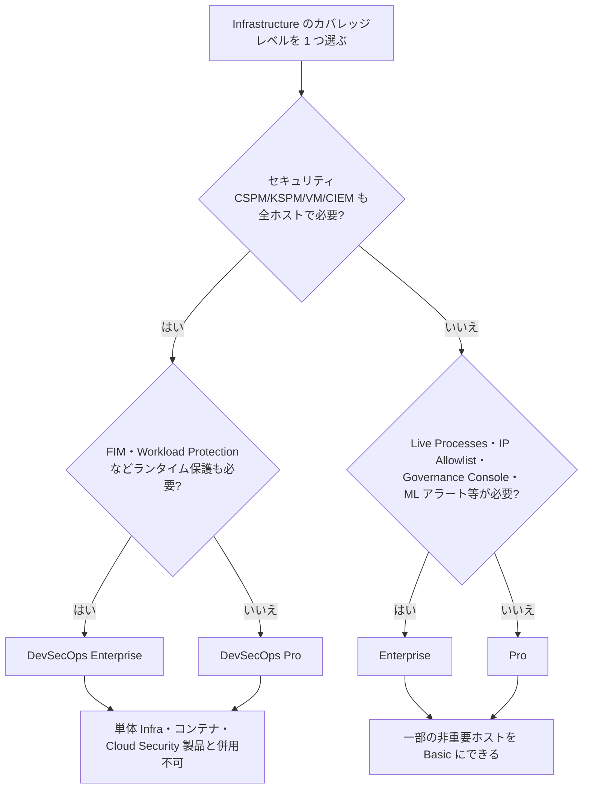
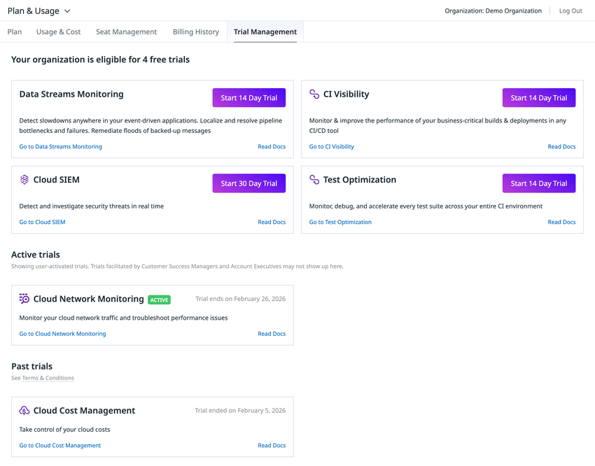
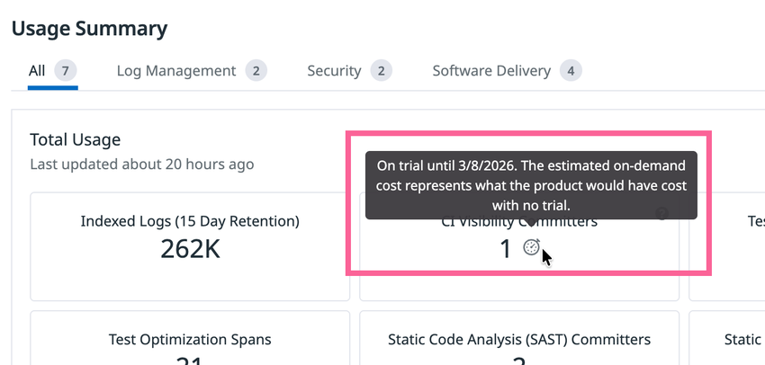

# エディション・プラン

## 概要

本ファイルは、Datadog の**エディション（Edition）／プラン（Plan）／ティア（Tier）**の構成と、エディションごとの機能差を整理した導入編の資料である。コンサルタント・PM・アーキテクトが「どのエディションを選ぶべきか」「Enterprise にしないと使えない機能は何か」「無料でどこまで使えるか」「スタートアップ・学生・政府機関向けの特別な提供形態はあるか」に答えるための根拠とする。

| 項目 | 内容 |
|---|---|
| 基準日 | 2026-11-02（料金ページ・ドキュメントの取得日は 2026-11-02〜2026-11-03） |
| 扱う範囲 | Infrastructure の Free tier / Basic / Pro / Enterprise、DevSecOps バンドル、製品別ティア（APM、Log Management、Cloud Security、Code Security、Cloud Cost Management、Agent Observability、RUM、Incident Response）、製品単位の無料枠、無料トライアル、Datadog for Startups、Student Developer Program、Datadog for Government、サポートプラン |
| 扱わない範囲 | 全 SKU の単価一覧（→ [製品別料金表（料金の正本）](pricing-by-product.md)）、メータリング計算（→ [課金計算の仕組み](billing-mechanics.md)）、値引き・契約交渉・購入経路（→ [購入経路と契約](procurement-and-contracts.md)）、見積り手順（→ [コスト見積り手法](cost-estimation.md)） |
| 料金の扱い | 本ファイルの価格は [pricing-by-product.md](pricing-by-product.md) と同一の公式定価（2026-11-03 取得、USD）。特記のない価格は **US/EU1 サイトの年契約（Billed Annually）** の値 |

本ファイルが答える質問の例：

- 「Datadog に Free プランはあるか。何台まで、何日保持か」→ [§3.5](#35-free-tier無料プラン)
- 「Pro と Enterprise の違いは何か。Enterprise 限定機能は」→ [§3.2](#32-エディション別機能比較表infrastructure)、[§3.3](#33-enterprise-限定機能のドキュメント上の扱い)
- 「DevSecOps バンドルとは何か。単体購入と比べて得か」→ [§4](#4-devsecops-バンドル)
- 「APM Pro と APM Enterprise の違い」→ [§5](#5-apm-のエディション)
- 「無料トライアルは何日で、終了後どうなるか」→ [§13](#13-無料トライアル)
- 「スタートアップ向けの無償プログラムの条件」→ [§14](#14-datadog-for-startups)
- 「米国政府機関向けの FedRAMP 対応サイトはどれか」→ [§16](#16-政府機関向けdatadog-for-government)

---

## 1. Datadog における「エディション」の考え方

### 1.1 プラットフォーム全体の単一エディションは存在しない

Datadog の料金体系は**製品（SKU）ごとの独立課金**であり、Microsoft 365 の E3/E5 のような「プラットフォーム全体を一括で決めるエディション」は存在しない。エディション（ティア）を持つのは一部の製品だけで、それぞれが独立に選択される [出典](https://www.datadoghq.com/pricing/)。

- 一般に「Datadog Pro」「Datadog Enterprise」と呼ばれるのは、**Infrastructure Monitoring の Pro / Enterprise** を指すことが多い。Infrastructure の Enterprise を選んでも、APM や Log Management が自動的に上位ティアになるわけではない。
- ただし Infrastructure のエディションは、カスタムメトリクス・コンテナ・カスタムイベントの同梱枠、SSO/IP 制限などの**組織（org）レベルの管理機能**、Watchdog・異常検知など**プラットフォーム共通の機能**の可否に影響するため、事実上「アカウントの基本エディション」として扱われる【経験則】。
- APM ホストを Infrastructure 併用価格で購入する場合、**すべての APM ホストに Infrastructure Pro または Enterprise が必要**など、製品間の前提条件がある（[§5](#5-apm-のエディション)）。

### 1.2 ティア構成を持つ製品・持たない製品

| 区分 | 製品 | ティア／バンドル | 詳細 |
|---|---|---|---|
| ティアあり | Infrastructure Monitoring | Free tier / Basic / Pro / Enterprise | [§3](#3-infrastructure-monitoring-のエディション) |
| ティアあり（バンドル） | Infrastructure DevSecOps | DevSecOps Pro / DevSecOps Enterprise | [§4](#4-devsecops-バンドル) |
| ティアあり | APM | APM / APM Pro / APM Enterprise | [§5](#5-apm-のエディション) |
| 保持ティア | Log Management | Standard（Standard Indexing）/ Flex Starter / Flex（Flex Storage + Flex Compute） | [§6](#6-log-management-のティアstandard--flex-starter--flex) |
| ティアあり | Cloud Security（旧称：Cloud Security Management / CSM） | CSM Pro / CSM Enterprise | [§7](#7-cloud-security旧称cloud-security-management--csmのティア) |
| バンドル | Code Security | Core Bundle / Flex Bundle（Secrets）/ Advanced Bundle | [§8](#8-code-security-のバンドル) |
| ティアあり | Cloud Cost Management | Datadog Cost Visibility（無料）/ Pro / Enterprise | [§9](#9-cloud-cost-management-のティア) |
| ティアあり | Agent Observability（旧称：LLM Observability） | Free / Pro | [§10](#10-agent-observability旧称llm-observabilityの-free--pro) |
| 機能 SKU 分割 | Real User Monitoring | RUM Measure / RUM Investigate（RUM without Limits） | [§11](#11-rum-measure--rum-investigate) |
| バンドル | Incident Response | On-Call / Incident Management / Incident Response（バンドル） | [§12](#12-incident-responseon-call--incident-management) |
| 単一 SKU（ティアなし） | Synthetic Monitoring、Cloud SIEM、App and API Protection（旧称：ASM）、Workload Protection（旧称：CWS）、Database Monitoring、Error Tracking、CI Visibility、Test Optimization、Sensitive Data Scanner、Audit Trail、Workflow Automation、App Builder、Event Management、Network 系 等 | 単価のみ（量・保持期間による段階料金はある） | [pricing-by-product.md](pricing-by-product.md) |

出典：[Pricing](https://www.datadoghq.com/pricing/)、[Pricing Comparison](https://www.datadoghq.com/pricing/list/)（取得日 2026-11-03）

### 1.3 エディション関連の用語

| 用語 | 意味 |
|---|---|
| Edition / Plan / Tier | 料金ページでは製品カード名（Pro、Enterprise 等）として表記される。ドキュメントでは "Enterprise plan"、"Pro plan" と表記されることが多い |
| Free tier | Infrastructure の無料プラン（Basic ホスト 5 台、メトリクス保持 1 日）。トライアル終了後に選択できる [出典](https://www.datadoghq.com/pricing/?product=infrastructure) |
| Allotment（同梱枠） | ホスト等の購入に付随して無料で使える量（例：Infrastructure Pro 1 ホストあたりカスタムメトリクス 100 個）。エディションにより量が異なる |
| Bundle（バンドル） | 複数製品をまとめた SKU（DevSecOps、Incident Response、Code Security Bundle など） |
| Pro+ | IP Allowlist のドキュメントに "Pro+ or Enterprise plan" と記載される呼称。**料金ページには Pro+ というエディションは掲載されていない**（契約上の個別プランと考えられるが、公開情報では定義を確認できず） [出典](https://docs.datadoghq.com/account_management/org_settings/ip_allowlist/) |

---

## 2. エディション横断サマリー（主要製品のティアと定価）

主要製品のティア別定価（US/EU1、2026-11-03 取得）。AP1（日本）サイト価格は概ね US の 1.25 倍で、**正確な値は [pricing-by-product.md](pricing-by-product.md) の AP1 列を使うこと**。

| 製品 | ティア | 課金単位 | 年契約 | 月契約 | オンデマンド | AP1 年契約 |
|---|---|---|---|---|---|---|
| Infrastructure | Free tier | — | $0（Basic ホスト 5 台まで） | — | — | $0 |
| Infrastructure | Basic | ホスト/月 | 要問合せ | 要問合せ | 要問合せ | 要問合せ |
| Infrastructure | Pro | ホスト/月 | $15 | $18 | $18 | $18.75 |
| Infrastructure | Enterprise | ホスト/月 | $23 | $27 | $27 | $28.75 |
| Infrastructure | DevSecOps Pro | ホスト/月 | $22 | $27 | $27 | $27.50 |
| Infrastructure | DevSecOps Enterprise | ホスト/月 | $34 | $41 | $41 | $42.50 |
| APM（Infrastructure 併用） | APM | APM ホスト/月 | $31 | $36 | $36 | $38.75 |
| APM（Infrastructure 併用） | APM Pro | APM ホスト/月 | $35 | $42 | $42 | $43.75 |
| APM（Infrastructure 併用） | APM Enterprise | APM ホスト/月 | $40 | $48 | $48 | $50 |
| APM（スタンドアロン） | APM / APM Pro / APM Enterprise | APM ホスト/月 | $36 / $41 / $47 | $41.80 / $49.20 / $56.40 | 同左 | $45 / $51.25 / $58.75 |
| Cloud Security | CSM Pro | CSM ホスト/月 | $10 | $12 | $12 | $12.50 |
| Cloud Security | CSM Enterprise | CSM ホスト/月 | $25 | $30 | $30 | $31.25 |
| Code Security | Core Bundle | コミッター/月 | $40 | $48 | $57.60 | $50 |
| Code Security | Flex Bundle（Secrets） | コミッター/月 | $48 | $58 | $70 | $60 |
| Code Security | Advanced Bundle | コミッター/月 | $55 | $66 | $80 | $68.75 |
| Cloud Cost Management | Datadog Cost Visibility | — | $0 | $0 | $0 | $0 |
| Cloud Cost Management | Pro | クラウド/SaaS 支出 $1,000/月 | $5 | $6 | $7.20 | $6.25 |
| Cloud Cost Management | Enterprise | クラウド/SaaS 支出 $1,000/月 | $10 | $12 | $15 | $12.50 |
| Agent Observability | Free | — | $0（4 万 LLM スパン/月まで） | $0 | — | $0 |
| Agent Observability | Pro | 月額（10 万 LLM スパン込み） | $160 | $200 | $240 | $200 |
| RUM | RUM Measure | 1,000 セッション/月 | $0.15 | $0.18 | $0.22 | $0.1875 |
| RUM | RUM Investigate | 1,000 セッション/月 | $3 | $3.60 | $4.50 | $3.75 |
| Incident Response | On-Call（Standalone） | シート/月 | $20 | $24 | $29 | $25 |
| Incident Response | Incident Management（Standalone） | シート/月 | $30 | $36 | $43.20 | $37.50 |
| Incident Response | Incident Response（Bundle） | シート/月 | $40 | $48 | $58 | $50 |

出典：[Pricing](https://www.datadoghq.com/pricing/)、[Pricing Comparison](https://www.datadoghq.com/pricing/list/)（取得日 2026-11-03）。数値は [pricing-by-product.md](pricing-by-product.md) と一致させている。

> **サイト差異:** 料金ページの Datadog Site セレクタは US（US1/US3/US5）／EU1／AP1／AP2／UK1／US1-FED の区分で価格が切り替わる。AP1 は US 比で概ね 1.25 倍、AP2・UK1 は概ね 1.20 倍、US1-FED は概ね 1.25 倍（提供製品のみ）。比率は掲載値どうしの比較による算出値で、公式に倍率が明言されているわけではない（[pricing-by-product.md §1.2](pricing-by-product.md#12-サイトリージョン別の価格)）。

---

## 3. Infrastructure Monitoring のエディション

### 3.1 エディションの位置付けと価格

| エディション | 料金ページの説明（原文） | 位置付け | 年契約 | オンデマンド |
|---|---|---|---|---|
| Free tier | "up to five Basic hosts with 1-day metric retention, at no cost" | トライアル終了後に移行できる無料枠。検証・個人利用向け | $0 | — |
| Basic | "Essential coverage for noncritical workloads" | 非重要ワークロード向けの低価格ティア。コアシステムメトリクスと OOTB ダッシュボード、15 か月保持 | 要問合せ（Contact sales） | 要問合せ |
| Pro | "Centralize your monitoring of systems, services, and serverless functions" | 標準エディション。1,000+ Integrations、コンテナ監視、OpenTelemetry サポート | $15/ホスト/月 | $18 |
| Enterprise | "Advanced features and administrative controls" | 上位エディション。機械学習ベースのアラート、Live Processes、Governance Console、拡張された管理機能 | $23/ホスト/月 | $27 |

出典：[Pricing - Infrastructure](https://www.datadoghq.com/pricing/?product=infrastructure)（取得日 2026-11-03）

- 「ホスト」は監視対象の物理または仮想 OS インスタンス（サーバー、VM、Kubernetes ノード）。Azure App Service Plan インスタンス、Heroku dyno もホストとして数える [出典](https://docs.datadoghq.com/account_management/billing/)。
- ボリューム・多年契約割引の目安として料金ページに "Multi-Year/Volume discounts available (500+ hosts/mo)" とある。割引率は非公開（[購入経路と契約](procurement-and-contracts.md)）。

### 3.2 エディション別機能比較表（Infrastructure）

料金ページ Infrastructure の Features 表（Basic / Pro / Enterprise）を転記し、Free tier 列を FAQ の記述から補った。○＝含まれる、—＝含まれない。

| 機能・同梱枠 | Free tier | Basic | Pro | Enterprise |
|---|---|---|---|---|
| ホスト数上限 | **5 台（Basic ホスト）** | 上限の記載なし | 上限の記載なし | 上限の記載なし |
| Full-Resolution Data Retention（メトリクス保持） | **1 日** | 15 か月 | 15 か月 | 15 か月（**Customizable**） |
| Standard Events and Metrics | 公開情報では確認できず（Basic 相当と推定【推定】） | ○ | ○ | ○ |
| Out-of-the-Box Dashboards | 同上 | ○ | ○ | ○ |
| 1,000+ Integrations | 同上 | **Limited（限定）** | ○ | ○ |
| Host and Container Maps | 同上 | **Host map only** | ○ | ○ |
| Enterprise-Grade Security | 同上 | ○ | ○ | ○ |
| Unlimited User Accounts（ユーザー数無制限） | 同上 | ○ | ○ | ○ |
| Alerts（アラート） | 同上 | Unlimited | Unlimited | Unlimited |
| Container Monitoring（同梱コンテナ） | 利用不可（Basic ホストのため） | **Not supported** | **5/ホスト** | **10/ホスト** |
| Custom Metrics（同梱） | 同上（0） | 0/ホスト | **100/ホスト** | **200/ホスト** |
| Custom Events（同梱） | 同上（0） | 0/ホスト | **500/ホスト** | **1,000/ホスト** |
| Single Sign-On with SAML | 公開情報では確認できず | ○ | ○ | ○ |
| Outlier Detection（外れ値検知） | 公開情報では確認できず | ○ | ○ | ○ |
| Watchdog: Automated insights | 公開情報では確認できず | — | — | ○ |
| Correlations | 公開情報では確認できず | — | — | ○ |
| Anomaly Detection（異常検知） | 公開情報では確認できず | — | — | ○ |
| Forecast Monitoring（予測モニター） | 公開情報では確認できず | — | — | ○ |
| Live Processes | 公開情報では確認できず | — | — | ○ |
| SCIM（Advanced Administrative Features） | 公開情報では確認できず | ○ | ○ | ○ |
| Multiple SAML Providers | 公開情報では確認できず | — | — | ○ |
| IP Allowlist | 公開情報では確認できず | — | — | ○ |
| Email Domain Allowlist | 公開情報では確認できず | — | — | ○ |
| Governance Console | 公開情報では確認できず | — | — | ○ |
| Data Access Control（Restricted Datasets） | 公開情報では確認できず | 10 datasets | 10 datasets | **100 datasets** |
| Cross-Org Visibility | 公開情報では確認できず | 5 connections | 5 connections | **100 connections** |
| OpenTelemetry サポート | 公開情報では確認できず | 記載なし | ○（Pro カードに記載） | ○ |

出典：[Pricing - Infrastructure（Features 表・FAQ）](https://www.datadoghq.com/pricing/?product=infrastructure)（取得日 2026-11-03）。料金ページの HTML 上、Watchdog〜Governance Console の各行は 3 列のうち Enterprise 列のみにチェックが置かれていることを確認した。

**読み方の補足**

- Enterprise 限定の「Anomaly Detection / Forecast Monitoring / Watchdog」は料金ページ上の区分である。ドキュメント側では、Watchdog は「すべての Watchdog 機能は組み込み済みで設定不要」とだけ書かれ、プラン要件は明記されていない [出典](https://docs.datadoghq.com/watchdog/)。Anomaly Monitor のドキュメントは「**Enterprise プランの顧客は create-monitor API で異常検知モニターを作成できる**」と記載し、UI 作成のプラン要件は明記していない [出典](https://docs.datadoghq.com/monitors/types/anomaly/)。実際の利用可否は契約・組織設定で確認すること。
- Custom Metrics / Custom Events / コンテナの同梱枠は**ホスト単位ではなくアカウント全体で平均**される（例：Pro 100 ホストならカスタムメトリクス 10,000 個までアカウント全体で同梱）。計算方法は [課金計算の仕組み](billing-mechanics.md)、単価は [pricing-by-product.md §2.3](pricing-by-product.md#23-infrastructure-の追加-skuコンテナカスタムメトリクスイベントほか) を参照。
- Basic ホストではコンテナ監視は利用できない（"Container monitoring is not available for Basic hosts."）[出典](https://www.datadoghq.com/pricing/?product=infrastructure)。

### 3.3 Enterprise 限定機能のドキュメント上の扱い

料金ページで Enterprise 限定とされる管理系機能について、公式ドキュメント側の記述を整理する。

| 機能 | ドキュメント上のプラン要件（原文） | 有効化方法 | 制限値・サイト | 出典 |
|---|---|---|---|---|
| Live Processes / Live Process Monitoring | "Live Processes and Live Process Monitoring are included in the Enterprise plan." 他プランは担当営業または success@datadoghq.com へ依頼 | Agent でプロセス収集を有効化 | — | [Live Processes](https://docs.datadoghq.com/infrastructure/process/) |
| IP Allowlist | "The IP allowlist feature is available for customers on a Pro+ or Enterprise plan." | サポートへ依頼して有効化 | エントリ数上限は公開情報では確認できず | [IP Allowlist](https://docs.datadoghq.com/account_management/org_settings/ip_allowlist/) |
| Governance Console | "Governance Console is available for customers on an enterprise plan only." サポートへ依頼 | `governance_console_read` 権限で閲覧 | 商用サイト（US1/US3/US5/EU1/AP1/AP2/UK1）のみ。**app.ddog-gov.com（US1-FED）と us2.ddog-gov.com（US2-FED）では非対応** | [Governance Console](https://docs.datadoghq.com/account_management/governance_console/) |
| Data Access Control（Restricted Datasets） | 「Enterprise プランでは最大 100、その他のプランでは最大 10 の Restricted Dataset を作成可能」 | Organization Settings で設定 | Enterprise でテレメトリタイプを Restricted に設定した場合は最大 1,000。1 データセットあたりプリンシパル（ロール・チーム）最大 50、key:value 最大 10 | [Data Access Control](https://docs.datadoghq.com/account_management/rbac/data_access/) |
| Cross-Org Visibility | 「Enterprise 以外の組織は最大 5 つの他組織と共有可能」（Enterprise の上限はドキュメントに明記なし。料金ページは 100 connections） | org 間で接続を設定 | ソースと宛先の org は**同一サイト・同一アカウント**である必要がある | [Cross-Org Visibility](https://docs.datadoghq.com/account_management/org_settings/cross_org_visibility/) |
| Anomaly Detection Monitor（API 作成） | "Customers on an enterprise plan can create anomaly detection monitors using the create-monitor API endpoint." | API | — | [Anomaly Monitor](https://docs.datadoghq.com/monitors/types/anomaly/) |
| SAML SSO | ドキュメント上のプラン要件の明記なし。「SAML が有効でない場合はサポートに連絡して有効化」 | サポート依頼 + Admin 設定 | Multiple SAML Providers は料金ページ上 Enterprise | [SAML](https://docs.datadoghq.com/account_management/saml/) |

各機能の仕様は [組織・ユーザー・権限管理](../02_リファレンス/platform/account-and-access-management.md)、[Watchdog](../02_リファレンス/platform/watchdog.md)、[Monitors](../02_リファレンス/platform/monitors.md)、[大規模・マルチorg運用](../04_応用編/large-scale-and-multi-org.md) を参照。

### 3.4 エディションの選択ルール（混在の可否）

| ルール | 内容（料金ページ FAQ） |
|---|---|
| アカウント単位で 1 つ | "You can choose one level of infrastructure coverage for your Datadog account: Pro, Enterprise, DevSecOps Pro, or DevSecOps Enterprise." |
| Basic の混在 | "If you choose Pro or Enterprise, you can also monitor a subset of your hosts with Basic level coverage."（Basic ホストは Pro または Enterprise ホストと同一アカウントで混在可） |
| DevSecOps | "The DevSecOps bundles cover your entire environment, and can't be combined with standalone infrastructure, container, or cloud security products." |
| 請求方式 | "Annual, monthly and hourly plans are available."（年・月・時間単位の請求プラン） |

出典：[Pricing - Infrastructure FAQ](https://www.datadoghq.com/pricing/?product=infrastructure)（取得日 2026-11-03）

- 「Pro と Enterprise を一部ずつ」といった Infrastructure の部分適用はできない（Basic の混在のみ可）。そのため Enterprise 限定機能が一部チームだけ必要な場合でも、原則として全ホストを Enterprise にする必要がある【経験則】。大規模組織では org を分けて契約・設定する選択肢もあるが、契約上の扱いは営業確認が必要（[大規模・マルチorg運用](../04_応用編/large-scale-and-multi-org.md)）。

### 3.5 Free tier（無料プラン）

| 項目 | 内容 | 出典 |
|---|---|---|
| 入り方 | "When your free trial ends, you can choose to upgrade to a paid plan or move to the Free tier."（トライアル終了時に有償プランか Free tier を選ぶ） | [Pricing - Infrastructure FAQ](https://www.datadoghq.com/pricing/?product=infrastructure) |
| ホスト数 | **最大 5 台の Basic ホスト** | 同上 |
| メトリクス保持 | **1 日** | 同上 |
| 料金 | 無料（"at no cost"） | 同上 |
| 拡張 | "To monitor more hosts or retain data longer, upgrade to a paid plan at any time." | 同上 |
| コンテナ・カスタムメトリクス | Basic ホストのためコンテナ監視は利用不可、カスタムメトリクス・カスタムイベント同梱は 0（Basic の定義による） | 同上 |
| ユーザー数・期間制限 | 公開情報では確認できず（期間制限の記載はない） | — |
| APM・Logs 等の Free | Infrastructure Free tier に APM・Log Management 等の無料枠は含まれない（製品単位の無料枠は [§13.6](#136-製品単位の無料枠一覧) を参照） | [Pricing](https://www.datadoghq.com/pricing/) |

> **旧情報の注意:** 2016 年の GitHub Student Developer Pack 告知では「最大 10 ホストの無料 Pro アカウント」とされていたが、現行の学生向け提供条件とは異なる（[§15](#15-student-developer-program学生向け)）。Free tier の「5 ホスト・1 日保持」という条件は長年変わっていないと第三者サイトで紹介されているが【第三者情報】、変更履歴の公式記録は確認できず。

### 3.6 Basic の位置付け

- Basic は "Essential coverage for noncritical workloads"（非重要ワークロード向け）で、コアシステムメトリクス・OOTB ダッシュボード・15 か月保持を提供する。価格は Contact sales（非公開）[出典](https://www.datadoghq.com/pricing/?product=infrastructure)。
- Integrations は "Limited"、Host and Container Maps は "Host map only"、コンテナ監視・カスタムメトリクス・カスタムイベントの同梱はない。
- 典型的な使い方は「開発・検証環境やバッチ用の大量ホストを、Pro/Enterprise の本番ホストと同じアカウントで安価に監視する」こと【経験則】。Basic でどの Integration が使えるか（"Limited" の範囲）の一覧は公開情報では確認できず。

---

## 4. DevSecOps バンドル

### 4.1 構成と価格

DevSecOps バンドルは、**Infrastructure Monitoring と Cloud Security（料金ページ表記：Cloud Security Management / CSM）をホスト単位で一体化した SKU** である [出典](https://www.datadoghq.com/pricing/?product=infrastructure)。

| 項目 | DevSecOps Pro | DevSecOps Enterprise |
|---|---|---|
| 料金ページの説明 | "Secure your cloud resources and adhere to industry standards" | "Advanced risk and threat detection capabilities" |
| 構成 | **Infrastructure Pro の全機能 + CSM Pro の全機能** | **Infrastructure Enterprise の全機能 + CSM Enterprise の全機能** |
| 年契約（US/EU1） | $22/ホスト/月 | $34/ホスト/月 |
| 月契約／オンデマンド（US/EU1） | $27 / $27 | $41 / $41 |
| AP1 年契約 | $27.50 | $42.50 |
| Cloud Security Posture Management（CSPM） | ○ | ○ |
| Kubernetes Security Posture Management（KSPM） | ○ | ○ |
| コンプライアンスフレームワークへのマッピング | ○（CIS、PCI DSS、SOC 2 など 15 以上のベンチマーク） | ○ |
| Vulnerability Management（コンテナ・ホスト） | ○ | ○ |
| Cloud Infrastructure Entitlement Management（CIEM） | ○ | ○ |
| Resource Catalog（クラウドリソースとリスクのインベントリ） | ○ | ○ |
| File Integrity Monitoring（FIM） | — | ○ |
| Workload Protection（Linux / Windows / Kubernetes / Docker） | — | ○ |
| Anomalous workload profile detection | — | ○ |
| Workflows | セキュリティ Finding・Signal 起点は無料 | 同左 |
| 同梱コンテナ | **5 コンテナ/ホスト/月** | **10 コンテナ/ホスト/月** |
| 追加コンテナ | DevSecOps Containers：前払い $1.50/コンテナ/月、オンデマンド $0.003/コンテナ/時 | 同左 |

出典：[Pricing - Infrastructure](https://www.datadoghq.com/pricing/?product=infrastructure)、[Pricing Comparison](https://www.datadoghq.com/pricing/list/)（取得日 2026-11-03）。追加コンテナ単価は [pricing-by-product.md §2.3](pricing-by-product.md#23-infrastructure-の追加-skuコンテナカスタムメトリクスイベントほか) と一致。

### 4.2 DevSecOps と単体購入（Infrastructure + Cloud Security）の比較

US/EU1 年契約の定価で、同一ホストに Infrastructure と Cloud Security を別々に購入した場合と比較する（定価どうしの単純計算）。

| 比較 | 単体購入の合計 | DevSecOps | 差額（/ホスト/月） |
|---|---|---|---|
| Pro 相当 | Infrastructure Pro $15 + CSM Pro $10 = **$25** | DevSecOps Pro **$22** | −$3 |
| Enterprise 相当 | Infrastructure Enterprise $23 + CSM Enterprise $25 = **$48** | DevSecOps Enterprise **$34** | −$14 |

| 相違点 | 単体（CSM Enterprise） | DevSecOps Enterprise |
|---|---|---|
| 同梱コンテナ（セキュリティ） | CSM Enterprise：20 コンテナ/ホスト/月 | 10 コンテナ/ホスト/月（Infrastructure と共通の枠） |
| Workload Protection の対象 | Linux、Windows、Kubernetes、Docker、**AWS Fargate ECS/EKS** | Linux、Windows、Kubernetes、Docker（料金ページの記載に Fargate はない） |
| 適用範囲 | ホストを選んで購入できる（ただし CSM Pro と CSM Enterprise は org 内で混在不可） | **環境全体が対象**。単体の Infrastructure・コンテナ・Cloud Security 製品と併用不可 |
| 前提条件 | CSM Pro は他プラン不要。CSM Enterprise は全ホストに Infrastructure Pro / Enterprise が必要 | Infrastructure を内包 |

出典：[Pricing - Infrastructure / Cloud Security](https://www.datadoghq.com/pricing/)（取得日 2026-11-03）、[pricing-by-product.md §10.1](pricing-by-product.md#101-cloud-security旧称cloud-security-management--csmと-workload-protection)

- 上の差額は定価比較であり、実契約では値引き条件により変わる【推定】。
- **DevSecOps が有利になる典型**：全ホストでインフラ監視とクラウドセキュリティ（CSPM/脆弱性管理）の両方を行う組織。**不利になり得る典型**：セキュリティを一部ホスト（本番のみ等）に限定したい組織、コンテナ密度が高く CSM Enterprise の 20 コンテナ枠を活かしたい組織、Fargate のランタイム保護が必要な組織【経験則】。
- セキュリティ製品群の全体像は [Datadog Security 概要](../02_リファレンス/security/security-platform-overview.md)、機能は [Cloud Security](../02_リファレンス/security/cloud-security.md)、[Workload Protection](../02_リファレンス/security/workload-protection.md) を参照。

---

## 5. APM のエディション

| 項目 | APM | APM Pro | APM Enterprise |
|---|---|---|---|
| 料金ページの説明 | "Resolve issues faster with end-to-end distributed traces and service health metrics" | "Track and improve the performance of your streaming data pipelines end to end" | "Optimize code performance in production with minimal overhead" |
| 年契約（Infrastructure 併用） | $31/APM ホスト/月 | $35 | $40 |
| オンデマンド（Infrastructure 併用） | $36 | $42 | $48 |
| 年契約（スタンドアロン） | $36 | $41 | $47 |
| 分散トレーシング、サービス依存関係マップ | ○ | ○ | ○ |
| Universal Service Monitoring（自動サービス検出） | ○ | ○ | ○ |
| Live Search（15 分）・履歴検索（15 日） | ○ | ○ | ○ |
| RED メトリクス（全トラフィック、15 か月保持） | ○ | ○ | ○ |
| Data Streams Monitoring（キュー・コンシューマー・プロデューサーの依存関係、パイプラインレイテンシ・コンシューマーラグ、障害キュー検出） | 別売（$15/ホスト〜） | **○** | **○** |
| Continuous Profiler（wall / lock / CPU / I/O 時間、CPU・メモリプロファイル、バージョン比較、自動コード分析） | 別売（$19/ホスト〜） | 別売 | **○**（4 プロファイル対象コンテナ/ホスト同梱） |

出典：[Pricing - APM](https://www.datadoghq.com/pricing/?product=apm)（取得日 2026-11-03）

| ルール | 内容 |
|---|---|
| 混在不可 | APM / APM Pro / APM Enterprise は全 APM ホストで 1 プランにコミットする（混在購入不可）。APM 契約者は一部ホストに DSM・Profiler を、APM Pro 契約者は一部ホストに Profiler を追加購入できる |
| Infrastructure 前提 | Infrastructure 併用価格では、すべての APM ホストに Infrastructure **Pro または Enterprise** が必要（Basic は不可） |
| 同梱枠 | 取り込みスパン 150 GB/APM ホスト/月、インデックススパン 100 万件/APM ホスト/月（15 日保持）。全ホストでプール |
| USM | APM ホストには同一ホストの USM が含まれる |
| サイト差異 | US1-FED では APM Pro・USM・Data Streams Monitoring が提供されない（料金ページの価格データによる） |

出典：[Pricing - APM](https://www.datadoghq.com/pricing/?product=apm)、[pricing-by-product.md §5](pricing-by-product.md#5-apmapplication-performance-monitoringと関連製品)（取得日 2026-11-03）。機能は [APM の概念とインジェスト制御](../02_リファレンス/apm/apm-concepts-and-ingestion.md)、[Data Streams Monitoring](../02_リファレンス/apm/data-streams-monitoring.md)、[Continuous Profiler](../02_リファレンス/apm/continuous-profiler.md) を参照。

---

## 6. Log Management のティア（Standard / Flex Starter / Flex）

Log Management には Infrastructure のようなエディションはなく、**保存・検索の層（ティア）を用途ごとに選ぶ**構成である。料金ページのタブは「Standard」「Flex Starter」「Flex」の 3 つ [出典](https://www.datadoghq.com/pricing/?product=log-management)。

| ティア | 主な用途（料金ページ） | 単価（US 年契約） | 保持 | モニター・Watchdog Insights |
|---|---|---|---|---|
| Ingest（全ティア共通） | 取り込み・処理・Live Tail・アーカイブ | $0.10/GB | — | — |
| Standard Indexing | "real-time exploration, alerting, and dashboards with mission-critical logs" | $1.70/100 万イベント（15 日保持） | 3 / 7 / 15 / 30 日、30 日超は要問合せ | ○（Log Monitors、Watchdog Insights） |
| Flex Logs Starter | 長期保持・履歴調査（小〜中規模） | $0.60/100 万イベント保存 | 3 / 6 / 12 / 15 か月 | —（Flex Logs はモニター・Watchdog Insights 非対応） |
| Flex Storage + Flex Compute | 大規模の長期保持・監査・セキュリティ用途 | Storage $0.05/100 万イベント保存、Compute は要問合せ | 1〜15 か月 | — |

出典：[Pricing - Log Management](https://www.datadoghq.com/pricing/?product=log-management)（取得日 2026-11-03）。保持別単価・Starter Compute の条件は [pricing-by-product.md §7.1](pricing-by-product.md#71-ログの取り込みインデックスflex)、仕様は [Indexes・保持・アーカイブ](../02_リファレンス/logs/log-indexes-retention-archives.md) を参照。

---

## 7. Cloud Security（旧称：Cloud Security Management / CSM）のティア

| 項目 | CSM Pro | CSM Enterprise |
|---|---|---|
| 年契約／オンデマンド（US） | $10 / $12（/ホスト/月） | $25 / $30 |
| CSPM、KSPM、コンプライアンスマッピング | ○ | ○ |
| Vulnerability Management（コンテナ・ホスト） | ○ | ○ |
| CIEM | ○ | ○ |
| クラウドリソースのインベントリとリスク | ○ | ○ |
| Case Management | ○ | ○ |
| 修復 Workflows（Finding・Signal 起点は無料） | ○ | ○ |
| File Integrity Monitoring | — | ○ |
| Workload Protection（Linux / Windows / Kubernetes / Docker / AWS Fargate ECS・EKS） | — | ○ |
| 同梱コンテナ | 5/ホスト/月 | 20/ホスト/月 |
| 前提 | 他の Datadog プラン不要 | 全ホストに Infrastructure Pro / Enterprise が必要 |
| 混在 | CSM Pro と CSM Enterprise は org 内で混在不可 | 同左 |

出典：[Pricing - Cloud Security](https://www.datadoghq.com/pricing/)、[pricing-by-product.md §10.1](pricing-by-product.md#101-cloud-security旧称cloud-security-management--csmと-workload-protection)（取得日 2026-11-03）。DevSecOps との違いは [§4.2](#42-devsecops-と単体購入infrastructure--cloud-securityの比較)。

---

## 8. Code Security のバンドル

| バンドル | 含まれるもの | 年契約 | 月契約 | オンデマンド |
|---|---|---|---|---|
| Core Bundle | SAST、Static SCA、Runtime Code Analysis（IAST）、Runtime SCA | $40/コミッター/月 | $48 | $57.60 |
| Flex Bundle（Secrets） | Core Bundle + Secret Scanning | $48 | $58 | $70 |
| Advanced Bundle | Core Bundle + Secret Scanning + Infrastructure as Code（IaC）Security | $55 | $66 | $80 |

出典：[Pricing - Code Security](https://www.datadoghq.com/pricing/?product=code-security)（取得日 2026-11-03）

- 各機能の単体購入（SAST $25、Static SCA $25、IaC $15、Secret Scanning $15 /コミッター、IAST $20、Runtime SCA $10 /ホスト：いずれも年契約）も可能。
- Test Optimization または Code Security のコミッター 1 人ごとに Code Coverage のコミッター 1 人分が無料で付く [出典](https://www.datadoghq.com/pricing/)。
- **サイト差異:** Code Security（全 SKU・バンドル）は US1-FED では提供されない。詳細は [Code Security](../02_リファレンス/security/code-security.md)。

---

## 9. Cloud Cost Management のティア

| 機能（料金ページ Features 表から主要行） | Datadog Cost Visibility（無料） | Pro | Enterprise |
|---|---|---|---|
| 料金（US 年契約） | $0 | $5/クラウド・SaaS 支出 $1,000/月（オンデマンド $7.20） | $10（オンデマンド $15） |
| 対象コスト | **Datadog 自身のコストのみ** | クラウド・SaaS コスト | 同左 |
| ダッシュボード・ノートブックでのコスト表示、Cost Monitors、予測、MCP 経由のコスト参照 | ○ | ○ | ○ |
| Kubernetes コスト可視化・配賦 | — | ○ | ○ |
| コスト配賦・レポート、Recommendations | — | ○ | ○ |
| FinOps Agent による原因調査 | — | ○ | ○ |
| Custom Allocation Rules | — | Basic（分割なし） | Advanced（メトリクスによる分割） |
| Budgets | Flat | Flat | **Hierarchical（階層型）** |
| リアルタイムコスト | — | — | ○【Preview】 |

出典：[Pricing - Cloud Cost Management](https://www.datadoghq.com/pricing/?product=cloud-cost-management)（取得日 2026-11-03）。詳細は [Cloud Cost Management](../02_リファレンス/infrastructure/cloud-cost-management.md)、[pricing-by-product.md §8](pricing-by-product.md#8-cloud-cost-managementstorage-managementkubernetes-autoscaling)。

---

## 10. Agent Observability（旧称：LLM Observability）の Free / Pro

| 項目 | Free | Pro |
|---|---|---|
| 料金 | $0（クレジットカード不要） | 年契約 $160/月、月契約 $200/月、オンデマンド $240/月（最初の 10 万 LLM スパン込み） |
| LLM スパン | 4 万/月まで | 10 万/月込み。追加は 1 万スパンあたり $3.50（年契約） |
| トレース保持 | 15 日 | 15 日（30 / 60 / 90 日の保持アドオンあり） |
| コンテキスト・評価 | 無制限 | 無制限 |
| 機能 | Full feature access | Full feature access |

出典：[Pricing - Agent Observability](https://www.datadoghq.com/pricing/?product=llm-observability)（取得日 2026-11-03）。課金対象は LLM スパン（モデル呼び出し）のみで、ツール・ワークフロー・検索スパンは対象外。

> **サイト差異:** Agent Observability（Free を含む）は US1-FED では提供されない（[pricing-by-product.md §18.2](pricing-by-product.md#182-us1-fedgovcloudで提供されない製品)）。機能は [LLM Observability](../02_リファレンス/ai/llm-observability.md) を参照。

---

## 11. RUM Measure / RUM Investigate

RUM は「エディション」ではなく、**全セッションを計測する RUM Measure と、保持フィルタで残したセッションを調査する RUM Investigate の 2 SKU を組み合わせる**構成（RUM without Limits）である。

| 項目 | RUM Measure | RUM Investigate |
|---|---|---|
| 料金（US 年契約／オンデマンド） | $0.15 / $0.22（1,000 セッション/月） | $3 / $4.50（1,000 セッション/月） |
| 対象 | SDK が送信した全セッション | 保持ルール（エラー・クラッシュ・低速・高価値ユーザー等）で残したセッション |
| 主な内容 | 30 以上の OOTB メトリクスを 100% のセッションで算出（15 か月保持）、モニター・SLO・ダッシュボード | 保持セッションの全イベント（ビュー・エラー・リソース等）を 30 日（リソース・ロングタスク・Vitals は 15 日）、Error Tracking・クラッシュレポート |
| アドオン | RUM Managed Archive（1 / 3 / 6 か月）、RUM Profiling、Export Pipelines、Session Replay | — |

出典：[Pricing - RUM](https://www.datadoghq.com/pricing/?product=real-user-monitoring)（取得日 2026-11-03）。詳細は [RUM（ブラウザ）](../02_リファレンス/dem/rum-browser.md)、[Session Replay と Product Analytics](../02_リファレンス/dem/session-replay-and-product-analytics.md)。

---

## 12. Incident Response（On-Call / Incident Management）

| 機能 | On-Call（Standalone） | Incident Management（Standalone） | Incident Response（Bundle） |
|---|---|---|---|
| 料金（US 年契約／オンデマンド、シート/月） | $20 / $29 | $30 / $43.20 | $40 / $58 |
| On-Call スケジュール・エスカレーション・ルーティング（無制限） | ○ | — | ○ |
| ページ（SMS・音声・モバイルプッシュ・メール） | ○ | — | ○ |
| On-Call 分析 | ○ | — | ○ |
| インシデント宣言・タイムライン・ロール・タスク | — | ○ | ○ |
| AI 生成のポストモーテム | — | ○ | ○ |
| ステータスページ（無制限、カスタムドメイン） | — | ○ | ○ |
| Slack / Jira 等の連携、インシデントオートメーション（無制限） | — | ○ | ○ |

出典：[Pricing - Incident Response](https://www.datadoghq.com/pricing/?product=incident-response)（取得日 2026-11-03）。料金ページの Features 表の行の帰属は各カードの説明文から判断した（チャット連携・API/Webhook など共通行の帰属は公開ページのテキストからは特定できず）。シートの数え方は [pricing-by-product.md §13](pricing-by-product.md#13-service-managementincident-responseevent-managementworkflowapp-builder)、機能は [Incident Management](../02_リファレンス/service-management/incident-management.md)、[On-Call](../02_リファレンス/service-management/on-call.md)。

---

## 13. 無料トライアル

### 13.1 新規アカウントの無料トライアル

| 項目 | 内容 | 出典 |
|---|---|---|
| 期間 | **14 日間**（"Try Datadog for 14 days"、"Get 14 days of unlimited monitoring"） | [Free Trial](https://www.datadoghq.com/free-datadog-trial/) |
| クレジットカード | **不要**（"No credit card required"） | 同上 |
| 対象範囲 | プラットフォーム全体（"Explore the entire Datadog platform for 14 days"）。ホスト数の上限の記載なし | 同上 |
| 登録情報 | ビジネスメール、パスワード、氏名、役職、会社名（電話番号は任意）。Subscription Agreement と Privacy Policy に同意 | 同上 |
| データ保存サイト | 登録時に選択。**"You can't migrate data between regions."**（後からサイト間のデータ移行はできない） | 同上 |
| 終了後 | 有償プランへアップグレードするか、Free tier（[§3.5](#35-free-tier無料プラン)）へ移行するかを選ぶ | [Pricing - Infrastructure FAQ](https://www.datadoghq.com/pricing/?product=infrastructure) |
| トライアル中の推奨作業 | ログ量の見積りは「トライアル中に過去 24 時間の件数をカウントクエリで数え、30 倍して月間量を推定する」のが公式 FAQ の推奨 | [Pricing - Log Management FAQ](https://www.datadoghq.com/pricing/?product=log-management) |

> **サイト差異:** 新規トライアル時のサイト選択は永続的で変更できない。日本のデータ保存が必要な場合は AP1 を選ぶ。サイトの選び方は [Datadog Sites](../02_リファレンス/platform/datadog-sites.md)、[ネットワーク・接続要件](network-and-connectivity.md) を参照。US1-FED（政府機関向け）のトライアル提供条件は公開情報では確認できず（[§16](#16-政府機関向けdatadog-for-government)）。

### 13.2 既存組織での製品トライアル（Trial Management）

既存の Datadog 組織では、**Plan & Usage > Trial Management** タブからセルフサービスで製品単位のトライアルを開始できる [出典](https://docs.datadoghq.com/account_management/plan_and_usage/)。

| 項目 | 内容 |
|---|---|
| 表示条件 | 組織が製品トライアルを利用できる場合のみタブが表示される |
| 対象 | ユーザーが自分で開始できるセルフサービストライアルのみ。**営業担当が設定したセールス主導のトライアルは表示されない** |
| 期間 | 製品ごとに "limited time"（ドキュメントの画面例では Data Streams Monitoring・CI Visibility・Test Optimization が 14 日、Cloud SIEM が 30 日） |
| 課金 | トライアル中は課金されない。**トライアル終了後の使用量は課金される** |
| 使用量の表示 | Usage & Cost にインジケーターアイコン付きで表示され、課金されない。トライアルがなかった場合の推定コストが表示される |
| アクセス | 管理者（Admin）。Account メニュー（左ナビ下部）または Personal Settings のヘッダーから Plan & Usage を開く |

- **キャプション:** Plan & Usage > Trial Management タブ（セルフサービストライアルの管理画面）。
- **画面の説明:** 上部に Plan & Usage のタブ（Plan / Usage & Cost / Billing History / Trial Management 等）。Trial Management タブには開始可能なトライアルのカード（例：Data Streams Monitoring「Start 14 Day Trial」、CI Visibility「Start 14 Day Trial」、Cloud SIEM「Start 30 Day Trial」、Test Optimization「Start 14 Day Trial」）が並び、その下に「Active trials」（実施中、終了日付き）と「Past trials」（過去のトライアル、終了日付き）の一覧がある。各エントリから製品とドキュメントへ遷移できる。
- **出典:** [Plan and Usage Settings（Datadog Docs）](https://docs.datadoghq.com/account_management/plan_and_usage/)（画像取得日 2026-11-03）

- **キャプション:** Usage & Cost（Usage Summary）でのトライアル製品の使用量表示。
- **画面の説明:** Usage Summary の Total Usage タイル（例：Indexed Logs (15 Day Retention) 262K、CI Visibility Committers 1、Test Optimization Spans、Static Code Analysis (SAST) Committers）のうち、トライアル中の製品（CI Visibility Committers）の数値横にストップウォッチ型のアイコンが付く。カーソルを合わせると「On trial until 3/8/2026. The estimated on-demand cost represents what the product would have cost with no trial.」（トライアル終了日と、トライアルがなかった場合のオンデマンド推定コストである旨）のツールチップが表示される。上部タブは All / Log Management / Security / Software Delivery。
- **出典:** [Plan and Usage Settings（Datadog Docs）](https://docs.datadoghq.com/account_management/plan_and_usage/)（画像取得日 2026-11-03）

### 13.3 その他のトライアル経路

| 経路 | 内容 | 出典 |
|---|---|---|
| AWS Marketplace | AWS Marketplace の Datadog リスティングから **14 日間の全機能無料トライアル**を開始（View purchase options → 必要なら PO 追加 → Subscribe）。コミットを追加する場合は Pro / Enterprise プランへ | [AWS Marketplace Datadog Trial](https://docs.datadoghq.com/integrations/guide/aws-marketplace-datadog-trial/) |
| AWS Marketplace の終了後挙動 | Datadog Pro（Pay-As-You-Go）リスティングは 14 日トライアル後に自動で Pay-As-You-Go に移行すると記載 【第三者情報】（AWS 側の掲載） | [pricing-overview.md §4](pricing-overview.md) |
| パートナー経由 | パートナー向けの Free Trial ページ、マルチテナント課金のパートナーが Admin Org から顧客向けトライアル org を払い出す手順がある | [Partner Trial](https://www.datadoghq.com/free-datadog-trial/partner/)、[Trial Org Provisioning](https://docs.datadoghq.com/partners/multi_tenant_billing/trial-org-provisioning/) |
| セールス主導 | 営業担当（AE/CSM）が設定するトライアル。Trial Management には表示されない | [Plan and Usage](https://docs.datadoghq.com/account_management/plan_and_usage/) |
| Preview 機能 | GA 前の機能は Product Preview Program で申し込む | [Product Preview](https://www.datadoghq.com/product-preview/) |

購入経路の詳細は [購入経路と契約](procurement-and-contracts.md) を参照。

### 13.4 トライアル運用の注意点【経験則】

- トライアル開始時のサイト選択が本番運用まで引き継がれる。日本企業はデータ所在地要件（AP1）を事前に確認する。
- トライアル中は課金されないが、**トライアル終了後も Agent・インテグレーションが送信を続けると使用量が課金対象になる**。不要な製品（APM、Logs のインデックス等）はトライアル終了前に停止・除外フィルタを設定する。
- トライアルは「unlimited monitoring」だが、PoC の評価では本番相当のホスト数・ログ量で計測しておくと見積り精度が上がる（[コスト見積り手法](cost-estimation.md)）。

### 13.5 プラン変更（アップグレード／ダウングレード）

| 項目 | 内容 | 出典 |
|---|---|---|
| 変更場所 | 管理者は Plan & Usage の **Plan タブ**からアップグレード／ダウングレードできる | [Plan and Usage](https://docs.datadoghq.com/account_management/plan_and_usage/) |
| 標準プランにない有償機能 | 追加・削除は担当営業または success@datadoghq.com に連絡 | 同上 |
| 請求サイクル | UTC の毎月 1 日開始。初月は登録日から日割り | [Billing](https://docs.datadoghq.com/account_management/billing/) |
| 支払方法 | クレジットカード、または請求書（ACH・電信送金・小切手） | 同上 |
| Subscription Details | コミット製品の数量・契約単価・オンデマンド単価を表示（Datadog Partner 経由の請求では非対応） | 同上 |
| 契約期間中のコミット減額 | 公開情報では確認できず（一般に契約更新時の扱い【経験則】）。[購入経路と契約](procurement-and-contracts.md) を参照 | — |

### 13.6 製品単位の無料枠一覧

エディションとは別に、製品ごとに恒常的な無料枠・無償条件がある（2026-11-03 時点の料金ページ記載）。

| 製品 | 無料枠・無償条件 | 出典 |
|---|---|---|
| Infrastructure | Free tier：Basic ホスト 5 台、メトリクス保持 1 日 | [Pricing - Infrastructure](https://www.datadoghq.com/pricing/?product=infrastructure) |
| Agent Observability | Free：4 万 LLM スパン/月、15 日保持 | [Pricing - Agent Observability](https://www.datadoghq.com/pricing/?product=llm-observability) |
| Cloud Cost Management | Datadog Cost Visibility（Datadog 自身のコスト）は無料 | [Pricing - CCM](https://www.datadoghq.com/pricing/?product=cloud-cost-management) |
| Feature Flags | 月間フラグ設定リクエスト 100 万件未満は無料 | [Pricing - Feature Flags](https://www.datadoghq.com/pricing/) |
| Event Management | Datadog 生成イベント（Monitor アラート等）は無料。サードパーティイベントのみ課金 | [Pricing - Event Management](https://www.datadoghq.com/pricing/) |
| Workflow Automation | セキュリティ Finding・Signal 起点の実行は無料 | [Pricing](https://www.datadoghq.com/pricing/) |
| App Builder | 未公開（作成・保存のみ）のアプリは無料 | [pricing-by-product.md §13](pricing-by-product.md#13-service-managementincident-responseevent-managementworkflowapp-builder) |
| Code Coverage | Test Optimization / Code Security のコミッター 1 人ごとに 1 人分無料 | [Pricing](https://www.datadoghq.com/pricing/) |
| AI Credits | Bits Testing は 11 月 30 日まで無料（料金ページ記載。年の明記なし） | [Pricing - AI Credits](https://www.datadoghq.com/pricing/) |
| Cloud SIEM | Bits Security Analyst 調査を分析 1 TB あたり月 100 回（最低 50 回）無料。セキュリティシグナル 15 か月保持は追加費用なし | [Pricing - Cloud SIEM](https://www.datadoghq.com/pricing/) |

同梱枠（allotment）の全一覧は [pricing-by-product.md §16](pricing-by-product.md#16-同梱枠allotment無料枠の一覧) を参照。

---

## 14. Datadog for Startups

Datadog for Startups（DDFS）は、初期段階のスタートアップに 1 年間 Datadog を無償提供するプログラムである [出典](https://www.datadoghq.com/startups/)。

| 項目 | 内容 |
|---|---|
| 特典 | **最大 $100k のクレジット**を、**最初の 1 年間**プラットフォーム全体に利用可能。料金ページでは「Get one year of free Datadog Pro」と告知 |
| 対象製品 | フロントエンド・バックエンドのオブザーバビリティ、セキュリティを含むプラットフォーム全体。プログラム期間中に GA になった製品・機能も対象。Preview 製品は枠があれば利用可。"No watered-down tiers, no hidden limits." |
| 資金調達段階 | **Series A 以前** |
| 紹介要件 | **参加パートナー（VC、ハイパースケーラーやベンダーのスタートアッププログラム等）からの紹介が必須**。直接申込は不可。紹介元が不明な場合は投資家・アクセラレーター等に確認 |
| 除外条件 | 現在または過去の Datadog 顧客、過去に DDFS クレジットを受けた企業は対象外 |
| 申込手順 | ①チーム情報を添えて申請 → ②審査中は Datadog トライアルを利用可（**サイトは後から変更不可**）→ ③メールで結果通知（ページ本文は「数日以内」、FAQ は通常 3〜5 営業日）→ ④承認後 **30 日以内**にクレジット有効化を確認しないと失効 |
| 支援 | 任意で Technical Engagement Manager（TEM）がデモ・ベストプラクティス・アーキテクチャレビューを支援（初期設定やトラブルシューティングは対象外）。数か月後にカスタマーサクセス担当が卒業（有償移行）計画を支援。技術的問題は support@datadoghq.com |
| 非アクティブ時 | 3 か月非アクティブで警告、30 日以内に利用開始しないとプログラムから除外 |
| 契約 | アカウント作成は Master Subscription Agreement に従う |
| 非対象の場合 | 全企業向けの 2 週間トライアル（[§13.1](#131-新規アカウントの無料トライアル)）を利用 |
| パートナー参加 | ddfspartners@datadoghq.com |

出典：[Datadog for Startups](https://www.datadoghq.com/startups/)、[Pricing](https://www.datadoghq.com/pricing/)（取得日 2026-11-02〜03）

- 料金ページの「1 年間の Datadog Pro 無料」と、Startups ページの「最大 $100k のクレジット」の関係（クレジット上限を超えた使用量の扱い等）は公開情報では確認できず。
- 1 年後の有償移行で費用が急増しやすいため、プログラム期間中からタグ設計・ログのインデックス除外・カスタムメトリクス管理を行っておくことが推奨される【経験則】（[コスト最適化](../04_応用編/cost-optimization.md)）。

---

## 15. Student Developer Program（学生向け）

| 項目 | 内容 |
|---|---|
| 対象 | GitHub Student Developer Pack の加入学生。**学生プロジェクト専用で商用利用不可** |
| 期間 | 最大 2 年間、かつ学生である間。GitHub Student Pack の有効メンバーであれば期限切れ後も更新可 |
| サイト | **すべて US5（https://us5.datadoghq.com）に作成され、他サイトへ移行不可** |
| 月間上限 | ホスト（Infrastructure・APM）10、取り込みログ 500 GB、コンテナ 50、Lambda 関数 10、Fargate タスク 5、Browser テスト 1,000、API テスト 10,000、Browser RUM セッション 1,000、Mobile RUM セッション 1,000、LLM リクエスト 100,000 |
| 主な機能 | 標準・カスタムメトリクスの最大 15 か月保持、ダッシュボード、アラート、サービス間トレース |
| 既存 Free tier アカウント | 変換不可。新規作成が必要で、ユーザー・Agent・ホスト・メトリクスは移行されない |
| 教員向け | studentpack@datadoghq.com（授業用アクセス・教材） |

出典：[Datadog Student Developer Program](https://studentpack.datadoghq.com/)（取得日 2026-11-02）

> **旧情報の注意:** 2016 年の告知（GitHub ブログ等）では「最大 10 ホストの無料 Pro アカウント」と紹介されていた。現行条件は上表のとおり製品別の月間上限が設定されている [出典](https://www.datadoghq.com/blog/datadog-github-student-developer-pack/)。

---

## 16. 政府機関向け（Datadog for Government）

### 16.1 概要

| 項目 | 内容 | 出典 |
|---|---|---|
| 名称 | Datadog for Government | [Government](https://www.datadoghq.com/solutions/government/) |
| サイト | **US1-FED**（`https://app.ddog-gov.com`、site パラメータ `ddog-gov.com`、米国）。ドキュメントでは "Datadog's FedRAMP High Certified site" | [Datadog Sites](https://docs.datadoghq.com/getting_started/site/) |
| 認証 | **FedRAMP High** 認証を取得（**2026-05-06 発表**）。"FedRAMP High certification is the top security baseline offered by FedRAMP"、機密性の高い管理対象非機密情報（CUI）向け | [Press Release](https://www.datadoghq.com/about/latest-news/press-releases/datadog-for-government-achieves-fedramp-high-certification/) |
| 第 2 の政府サイト | **US2-FED**（`https://us2.ddog-gov.com`）。"In Process for IL5 Authorization"（DoD Impact Level 5 の認可取得プロセス中） | [Datadog Sites](https://docs.datadoghq.com/getting_started/site/) |
| ホスティング | AWS GovCloud (US) | [Government](https://www.datadoghq.com/solutions/government/) |
| データ所在・運用者 | 米国内のデータ所在。顧客データとプラットフォーム運用は**米国内の U.S. persons に限定** | 同上 |
| 問い合わせ | fed-sales@datadoghq.com | [Datadog Sites](https://docs.datadoghq.com/getting_started/site/) |
| 価格 | 料金ページのサイトセレクタで US1-FED を選ぶと表示（US 比で概ね 1.25 倍、提供製品のみ）。政府向け個別価格は担当営業へ | [pricing-by-product.md §18](pricing-by-product.md#18-サイト別価格一覧付録と-us1-fed-の非提供製品) |

> **旧情報の注意:** 2026-05 以前の資料では US1-FED を「FedRAMP Moderate」等と記載しているものがある。現行は FedRAMP High（2026-05-06 発表）。CJIS・StateRAMP（GovRAMP）・ITAR について Government ページでの言及は確認できず。

### 16.2 購入経路

| 経路 | 内容 |
|---|---|
| Carahsoft | 最も一般的な経路。GSA Multiple Award Schedule、NASA SEWP V、州の契約、高等教育向けの E&I・Internet2 契約 |
| クラウドマーケットプレイス | AWS Marketplace（AWS GovCloud (US) を含む）、Azure Marketplace、Google Cloud Marketplace のプライベートオファー（コミット消化に利用可） |
| パートナー | 認定リセラー・システムインテグレーター |

出典：[Datadog for Government](https://www.datadoghq.com/solutions/government/)（取得日 2026-11-02）

### 16.3 US1-FED で提供される製品・されない製品

料金ページで US1-FED を選択した際に表示対象となる製品（料金ページのスクリプト内の製品リスト `fedProducts`）：

| 区分 | US1-FED で料金表示される製品 |
|---|---|
| Observability | Infrastructure Monitoring、APM、Log Management、Error Tracking、Serverless Monitoring、Database Monitoring、Network Monitoring、Edge Device Monitoring、Managed Platform OTLP、Data Jobs Monitoring |
| Digital Experience | Real User Monitoring、Synthetic Monitoring |
| Security | Cloud SIEM、Cloud Security、Workload Protection、App and API Protection、Sensitive Data Scanner、Audit Trail |
| Service Management | Incident Response、Workflow Automation、App Builder |
| Cost | Cloud Cost Management |

出典：[Pricing](https://www.datadoghq.com/pricing/) のページ内データ（取得日 2026-11-03）

**US1-FED で提供されない（または料金ページ上 "currently unavailable on the US-FED site" とされる）主な製品・機能：**

- Code Security、AI Guard、Agent Observability、AI Credits、Feature Flags、Event Management、Observability Pipelines、Continuous Testing、Test Optimization、CI Pipeline Visibility、Code Coverage、Product Analytics、APM Pro、Universal Service Monitoring、Data Streams Monitoring、Datadog Disaster Recovery など（完全な一覧と不整合の注記は [pricing-by-product.md §18.2](pricing-by-product.md#182-us1-fedgovcloudで提供されない製品)）
- **Governance Console**（Enterprise 限定機能）は US1-FED・US2-FED とも非対応 [出典](https://docs.datadoghq.com/account_management/governance_console/)

> **サイト差異:** 同じエディション（例：Infrastructure Enterprise）でも、US1-FED では利用できない機能がある。ドキュメントの各ページ右側のサイトセレクタで US1-FED を選ぶと、サイト固有の対応状況を確認できる [出典](https://docs.datadoghq.com/getting_started/site/)。政府向け案件では製品ごとにサイト対応を確認すること（[Datadog Sites](../02_リファレンス/platform/datadog-sites.md)、[セキュリティとコンプライアンス](security-and-compliance.md)）。

### 16.4 日本の公共機関について

- 日本の政府・自治体向けの専用サイトや ISMAP 登録に関する公式情報は、今回の調査では確認できず。日本の公共案件で ISMAP 等の要件がある場合は、最新の登録状況を ISMAP 管理基準の登録簿と Datadog 営業に確認する必要がある（[セキュリティとコンプライアンス](security-and-compliance.md)）。

---

## 17. サポートプランとエディション

サポートは製品エディションとは独立の契約である。

| 項目 | Free | Standard | Premier |
|---|---|---|---|
| 対象 | 無償利用者（対象範囲の定義は公開情報では確認できず） | **有償エディションに標準付帯**（"Included with any paid edition"） | 追加契約 |
| 料金 | — | 追加費用なし | **月額利用料の 8%、最低 $2,000**。最低 1 年のコミットが必要 |
| 応答時間（Business Critical / Degraded / General） | — | 2 時間以内（24x7）/ 12 時間以内 / 48 時間以内 | 30 分以内（24x7）/ 4 時間以内 / 12 時間以内 |
| チャネル | 公開情報では明確に確認できず | メール（営業時間）、チャット（米国東部時間 平日 10:00〜19:00） | メール・チャット・電話 すべて 24x7 |
| Premier の追加特典 | — | — | 専任のグローバルサポートエンジニアチーム、エスカレーション優先、環境ランブック、四半期チケットレビュー |

出典：[Support Plans](https://www.datadoghq.com/support-services/plans/)（取得日 2026-11-02）。営業時間は日曜 20:00〜金曜 21:00（米国東部時間、祝日除く）。

- Premier の料金（8%・最低 $2,000）はサポートプランページの記載で、[pricing-by-product.md §15](pricing-by-product.md#15-datadog-disaster-recoveryサポート) では「料金ページ上では確認できず」とされている。サポート全般は [サポートと教育](support-and-training.md) を正とする。
- 日本語サポートの提供条件は [サポートと教育](support-and-training.md) を参照。

---

## 18. エディション選定の考え方

### 18.1 判断ポイント一覧

| 判断ポイント | Pro で足りる典型 | Enterprise を検討する典型 |
|---|---|---|
| カスタムメトリクス・コンテナ密度 | 1 ホストあたりカスタムメトリクス 100 個・コンテナ 5 個程度に収まる | ホストあたりコンテナが多い Kubernetes 環境、カスタムメトリクスが多い（同梱枠が 200 / 10 に倍増） |
| 機械学習系アラート | 閾値ベースのモニター中心 | Anomaly / Forecast モニター、Watchdog 自動インサイト、Correlations を活用したい |
| プロセス可視化 | 不要 | Live Processes でプロセス単位の調査・監視をしたい |
| ガバナンス・セキュリティ統制 | 単一 IdP の SAML、標準 RBAC | IP Allowlist、複数 SAML IdP、Email Domain Allowlist、Governance Console、Restricted Dataset 11 個以上 |
| マルチ org | 共有先 org が 5 以下 | 6 以上の org 間で Cross-Org Visibility を使う |
| メトリクス保持 | 15 か月で十分 | 15 か月以外の保持を個別に設定したい（Customizable） |

出典：[§3.2](#32-エディション別機能比較表infrastructure)、[§3.3](#33-enterprise-限定機能のドキュメント上の扱い) の公式情報に基づき、判断観点として整理【経験則】。

### 18.2 損益分岐の目安（同梱枠による相殺）

Enterprise は Pro より 1 ホストあたり $8/月高い（US 年契約 $23 − $15）。一方で同梱枠が増えるため、超過分の購入を相殺できる場合がある。以下は定価による単純計算【推定】。

| 同梱枠の差（Enterprise − Pro、1 ホストあたり） | 定価換算（US 年契約） |
|---|---|
| カスタムメトリクス +100 個 | 100 個あたり $5（料金比較表の定価。実際の超過単価は契約で定める） → 最大 $5 |
| コンテナ +5 個 | 前払い $1/コンテナ/月 → 最大 $5 |
| カスタムイベント +500 件 | 10 万件あたり $2 → 約 $0.01 |

- カスタムメトリクスとコンテナの両方で同梱枠を使い切る環境では、同梱枠の増分だけで差額 $8 を上回る可能性がある（最大 約 $10）。実際の効果はアカウント全体の平均使用量と契約単価に依存するため、[コスト見積り手法](cost-estimation.md) の手順で試算すること【推定】。

### 18.3 よくある誤解

| 誤解 | 実際 |
|---|---|
| 「Enterprise にすれば全製品が上位版になる」 | エディションは製品ごと。APM・Cloud Security 等は別途ティアを選ぶ（[§1](#1-datadog-におけるエディションの考え方)） |
| 「一部のホストだけ Enterprise にできる」 | Infrastructure のカバレッジレベルはアカウントで 1 つ。混在できるのは Basic のみ（[§3.4](#34-エディションの選択ルール混在の可否)） |
| 「Free tier は期間限定のトライアル」 | トライアル（14 日）と Free tier（Basic 5 ホスト・1 日保持、期間制限の記載なし）は別物（[§3.5](#35-free-tier無料プラン)、[§13](#13-無料トライアル)） |
| 「DevSecOps は Infrastructure に Cloud Security を足したもので、一部ホストにだけ付けられる」 | DevSecOps は環境全体が対象で、単体 Infrastructure・コンテナ・Cloud Security 製品と併用不可（[§4](#4-devsecops-バンドル)） |
| 「Basic ホストでもコンテナを監視できる」 | Basic ホストではコンテナ監視は利用不可 |
| 「US1-FED でも商用サイトと同じ製品が使える」 | 提供されない製品・機能が多数ある（[§16.3](#163-us1-fed-で提供される製品されない製品)） |

---

## 19. 課金への影響

| 項目 | 課金への影響 |
|---|---|
| Infrastructure エディション | ホスト単価（Pro $15 / Enterprise $23 / DevSecOps Pro $22 / DevSecOps Enterprise $34、US 年契約）と同梱枠（コンテナ、カスタムメトリクス、カスタムイベント）が変わる。ホスト数は 99 パーセンタイルのハイウォーターマークで計測（[課金計算の仕組み](billing-mechanics.md)） |
| Basic ホスト | 価格非公開。Pro / Enterprise ホストと混在可。同梱枠なし |
| DevSecOps | Infrastructure と Cloud Security を一体課金。追加コンテナは DevSecOps Containers 単価（前払い $1.50/月） |
| APM エディション | APM ホスト単価と DSM・Profiler の有無が変わる。Infrastructure 併用価格は Infrastructure Pro / Enterprise が前提 |
| トライアル | トライアル中は非課金、終了後の使用量は課金 |
| Startups | 最大 $100k のクレジット（初年度）。終了後は通常課金 |
| サイト | 同一エディションでも AP1・AP2・UK1・US1-FED は US より高い価格設定 |

単価の正本は [製品別料金表](pricing-by-product.md)、課金モデルの全体像は [料金体系の全体像](pricing-overview.md) を参照。

---

## 20. 制限値・クォータ・デフォルト値

| 項目 | 値 | 出典 |
|---|---|---|
| Free tier のホスト数 | Basic ホスト 5 台 | [Pricing - Infrastructure](https://www.datadoghq.com/pricing/?product=infrastructure) |
| Free tier のメトリクス保持 | 1 日 | 同上 |
| Basic / Pro のメトリクス保持 | 15 か月 | 同上 |
| Enterprise のメトリクス保持 | 15 か月（カスタマイズ可） | 同上 |
| 同梱コンテナ（Basic / Pro / Enterprise） | 0（非対応）/ 5 / 10 per host | 同上 |
| 同梱コンテナ（DevSecOps Pro / Enterprise） | 5 / 10 per host | 同上 |
| 同梱コンテナ（CSM Pro / Enterprise） | 5 / 20 per host | [Pricing - Cloud Security](https://www.datadoghq.com/pricing/) |
| 同梱カスタムメトリクス（Basic / Pro / Enterprise） | 0 / 100 / 200 per host | [Pricing - Infrastructure](https://www.datadoghq.com/pricing/?product=infrastructure) |
| 同梱カスタムイベント（Basic / Pro / Enterprise） | 0 / 500 / 1,000 per host | 同上 |
| Restricted Datasets（Enterprise 以外 / Enterprise / Enterprise で Restricted 設定時） | 10 / 100 / 1,000 | [Data Access Control](https://docs.datadoghq.com/account_management/rbac/data_access/) |
| Restricted Dataset あたりのプリンシパル・key:value | 50 / 10 | 同上 |
| Cross-Org Visibility 接続数（非 Enterprise / Enterprise） | 5 / 100（Enterprise の値は料金ページ） | [Cross-Org Visibility](https://docs.datadoghq.com/account_management/org_settings/cross_org_visibility/)、[Pricing](https://www.datadoghq.com/pricing/?product=infrastructure) |
| ユーザー数 | 無制限（Basic / Pro / Enterprise） | [Pricing - Infrastructure](https://www.datadoghq.com/pricing/?product=infrastructure) |
| アラート数 | 無制限（Basic / Pro / Enterprise） | 同上 |
| 新規アカウントトライアル期間 | 14 日 | [Free Trial](https://www.datadoghq.com/free-datadog-trial/) |
| AWS Marketplace トライアル期間 | 14 日 | [AWS Marketplace Trial](https://docs.datadoghq.com/integrations/guide/aws-marketplace-datadog-trial/) |
| 製品トライアル期間（Trial Management） | 製品ごと（画面例：14 日、Cloud SIEM 30 日） | [Plan and Usage](https://docs.datadoghq.com/account_management/plan_and_usage/) |
| Agent Observability Free | 4 万 LLM スパン/月、15 日保持 | [Pricing - Agent Observability](https://www.datadoghq.com/pricing/?product=llm-observability) |
| Startups クレジット | 最大 $100k、1 年間。承認後 30 日以内に有効化 | [Startups](https://www.datadoghq.com/startups/) |
| Startups 非アクティブ期限 | 3 か月非アクティブで警告、30 日で除外 | 同上 |
| Student Program 期間 | 最大 2 年（学生である間） | [Student Program](https://studentpack.datadoghq.com/) |
| Student Program ホスト上限 | 10（Infrastructure・APM） | 同上 |
| Premier Support 最低料金 | 月額利用料の 8%、最低 $2,000、最低 1 年コミット | [Support Plans](https://www.datadoghq.com/support-services/plans/) |
| ボリューム割引の目安（Infrastructure / CSM） | 500 ホスト/月以上 | [Pricing](https://www.datadoghq.com/pricing/) |

---

## 21. 公開情報では確認できなかった事項

| 項目 | 状況 |
|---|---|
| Infrastructure Basic の価格 | Contact sales（非公開） |
| Basic の "Limited" Integrations の範囲 | 公開情報では確認できず |
| Free tier で利用できる機能の詳細（SAML、モニター数、ユーザー数、APM 等） | 料金ページは「Basic ホスト 5 台・1 日保持」のみ記載。詳細は公開情報では確認できず |
| 「Pro+」プランの定義 | IP Allowlist ドキュメントに記載があるのみで、料金ページに掲載なし |
| Enterprise の Cross-Org Visibility 上限のドキュメント記載 | 料金ページは 100 connections、ドキュメントは非 Enterprise の 5 のみ明記 |
| 新規アカウントのトライアル終了後に自動で Free tier へ移行するか | FAQ は「有償プランか Free tier を選べる」とのみ記載。自動移行の挙動は公開情報では確認できず |
| Startups の「1 年間 Pro 無料」と「最大 $100k クレジット」の関係 | 公開情報では確認できず |
| US1-FED / US2-FED のトライアル提供条件 | 公開情報では確認できず |
| US2-FED の提供製品・FedRAMP 認証範囲 | ドキュメントは "In Process for IL5 Authorization" のみ |
| 日本の公共向け（ISMAP 等）の状況 | 今回の調査では確認できず |
| エディション変更（ダウングレード）時の同梱枠・データ保持の扱い | 公開情報では確認できず |
| 非営利団体・OSS プロジェクト向けの無償プログラム | 今回の調査では公式ページを確認できず |
| Free tier の条件変更履歴 | 公開情報では確認できず |

---

## 関連ファイル

| ファイル | 関係 |
|---|---|
| [料金体系の全体像](pricing-overview.md) | 課金モデル（ホスト・量・シート）、契約形態、無料枠の概要 |
| [製品別料金表（料金の正本）](pricing-by-product.md) | 全 SKU の単価（US/EU1・AP1）、同梱枠、US1-FED 非提供製品 |
| [課金計算の仕組み](billing-mechanics.md) | 99 パーセンタイル、同梱枠の平均化、時間按分 |
| [コスト見積り手法](cost-estimation.md) | エディション別の試算手順 |
| [購入経路と契約](procurement-and-contracts.md) | 直販・マーケットプレイス・パートナー、値引き、契約条件 |
| [製品選定と競合比較](selection-and-competitive-comparison.md) | 製品・エディション選定 |
| [セキュリティとコンプライアンス](security-and-compliance.md) | FedRAMP 等の認証、データ所在 |
| [サポートと教育](support-and-training.md) | サポートプラン、トレーニング |
| [Datadog Sites](../02_リファレンス/platform/datadog-sites.md) | サイト一覧、US1-FED / US2-FED |
| [組織・ユーザー・権限管理](../02_リファレンス/platform/account-and-access-management.md) | SAML、SCIM、IP Allowlist、Data Access Control |
| [Usage・Usage Attribution・Cost Visibility](../02_リファレンス/platform/usage-and-cost-attribution.md) | Plan & Usage 画面 |
| [Infrastructure Monitoring](../02_リファレンス/infrastructure/infrastructure-monitoring.md) | Live Processes 等の機能仕様 |
| [Datadog Security 概要](../02_リファレンス/security/security-platform-overview.md) | DevSecOps に含まれるセキュリティ機能 |
| [コスト最適化](../04_応用編/cost-optimization.md) | エディション・同梱枠を活かした最適化 |
| [大規模・マルチorg運用](../04_応用編/large-scale-and-multi-org.md) | Cross-Org Visibility、Governance Console の運用 |

---

## 参照元

- Datadog Pricing（取得日 2026-11-03）: https://www.datadoghq.com/pricing/
- Datadog Pricing - Infrastructure: https://www.datadoghq.com/pricing/?product=infrastructure
- Datadog Pricing - APM: https://www.datadoghq.com/pricing/?product=apm
- Datadog Pricing - Log Management: https://www.datadoghq.com/pricing/?product=log-management
- Datadog Pricing - Cloud Cost Management: https://www.datadoghq.com/pricing/?product=cloud-cost-management
- Datadog Pricing - Agent Observability: https://www.datadoghq.com/pricing/?product=llm-observability
- Datadog Pricing - Real User Monitoring: https://www.datadoghq.com/pricing/?product=real-user-monitoring
- Datadog Pricing - Incident Response: https://www.datadoghq.com/pricing/?product=incident-response
- Datadog Pricing - Code Security: https://www.datadoghq.com/pricing/?product=code-security
- Datadog Pricing Comparison（取得日 2026-11-03）: https://www.datadoghq.com/pricing/list/
- Datadog Free Trial: https://www.datadoghq.com/free-datadog-trial/
- Datadog Free Trial for Partners: https://www.datadoghq.com/free-datadog-trial/partner/
- Datadog for Startups: https://www.datadoghq.com/startups/
- Datadog Student Developer Program: https://studentpack.datadoghq.com/
- Free Datadog Accounts for Students（Datadog Blog、2016 年公開）: https://www.datadoghq.com/blog/datadog-github-student-developer-pack/
- Datadog for Government: https://www.datadoghq.com/solutions/government/
- Datadog for Government Achieves FedRAMP High Certification（2026-05-06）: https://www.datadoghq.com/about/latest-news/press-releases/datadog-for-government-achieves-fedramp-high-certification/
- Datadog Support Plans: https://www.datadoghq.com/support-services/plans/
- Datadog Product Preview Program: https://www.datadoghq.com/product-preview/
- Plan and Usage Settings: https://docs.datadoghq.com/account_management/plan_and_usage/
- Billing: https://docs.datadoghq.com/account_management/billing/
- Getting Started with Datadog Sites: https://docs.datadoghq.com/getting_started/site/
- IP Allowlist: https://docs.datadoghq.com/account_management/org_settings/ip_allowlist/
- Cross-Organization Visibility: https://docs.datadoghq.com/account_management/org_settings/cross_org_visibility/
- Governance Console: https://docs.datadoghq.com/account_management/governance_console/
- Data Access Control: https://docs.datadoghq.com/account_management/rbac/data_access/
- SAML: https://docs.datadoghq.com/account_management/saml/
- Live Processes: https://docs.datadoghq.com/infrastructure/process/
- Watchdog: https://docs.datadoghq.com/watchdog/
- Anomaly Monitor: https://docs.datadoghq.com/monitors/types/anomaly/
- AWS Marketplace Datadog Trial Setup: https://docs.datadoghq.com/integrations/guide/aws-marketplace-datadog-trial/
- Trial Org Provisioning（Partners）: https://docs.datadoghq.com/partners/multi_tenant_billing/trial-org-provisioning/
