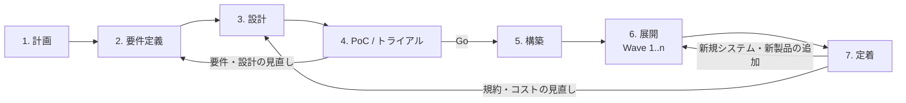
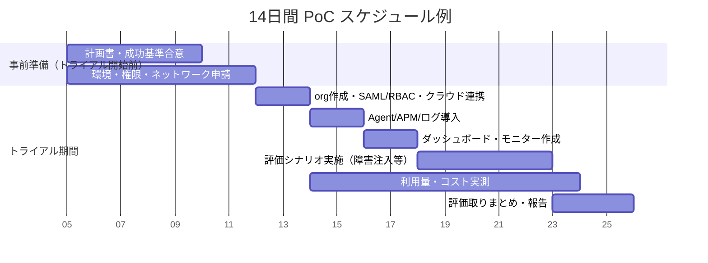
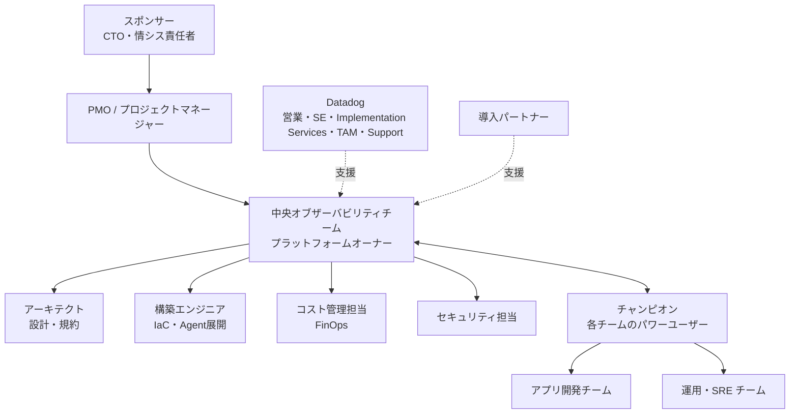

# 導入方法論

## 概要

本ファイルは、Datadog を組織に導入するプロジェクトの進め方（方法論）をまとめる。対象は、導入を企画・推進するコンサルタント、PM、アーキテクト、プラットフォームチームである。

- Datadog 公式は、エンタープライズ向けの導入ガイドとして **Administrator's Guide（管理者ガイド）** を公開しており、導入を **Plan（計画）→ Build（構築）→ Run（運用）** の3フェーズで整理している。[出典](https://docs.datadoghq.com/administrators_guide/)
- 本ナレッジでは、SI・コンサルティングの実務で使いやすいように、公式の3フェーズを **7フェーズ（計画 / 要件定義 / 設計 / PoC / 構築 / 展開 / 定着）** に細分化し、各フェーズの目的・活動・成果物・完了基準（ゲート）を定義する。7フェーズへの細分化そのものは本ナレッジの整理であり、Datadog 公式の区分ではない。
- 体制（中央オブザーバビリティチーム、チャンピオン、Datadog 側の支援ロール）、WBS 例、成果物一覧、PoC（無料トライアル）の評価観点と計測方法を表で示す。
- 個別の設計論点（要件定義の詳細、Agent 展開、ネットワーク、セキュリティ、運用設計、移行、料金）は各専用ファイルに委ね、本ファイルからリンクする。

> **本ファイルの記述区分:** 公式ドキュメントに基づく記述は出典リンクを付けている。フェーズの細分化、WBS、期間の目安、RACI などプロジェクト管理上の型は、公式情報と第三者事例をもとにした本ナレッジの整理であり `【経験則】` を付ける。

## 関連ファイル

| 論点 | 参照先 |
|---|---|
| Datadog の全体像・用語 | [Datadogとは](../01_入門編/what-is-datadog.md)、[必須概念](../01_入門編/core-concepts.md)、[製品ポートフォリオ全体像](../01_入門編/product-map.md) |
| 料金・見積り・契約 | [料金体系の全体像](pricing-overview.md)、[製品別料金表（料金の正本）](pricing-by-product.md)、[課金計算の仕組み](billing-mechanics.md)、[コスト見積り手法](cost-estimation.md)、[購入経路と契約](procurement-and-contracts.md)、[エディション・プラン](editions-and-plans.md) |
| 製品選定・競合比較 | [製品選定と競合比較](selection-and-competitive-comparison.md) |
| 要件定義・アーキテクチャ設計の詳細 | [要件定義とアーキテクチャ設計](requirements-and-architecture-design.md) |
| Agent の展開方式 | [Agent 展開設計](agent-rollout-design.md)、[Fleet Automation と Remote Configuration](../02_リファレンス/platform/fleet-automation.md) |
| ネットワーク・セキュリティ | [ネットワーク・接続要件](network-and-connectivity.md)、[セキュリティとコンプライアンス](security-and-compliance.md) |
| 運用設計 | [運用設計](operations-design.md) |
| 他製品からの移行 | [他製品からの移行](migration-from-other-tools.md) |
| サポート・教育 | [サポートと教育](support-and-training.md) |
| 定着・組織展開の実践 | [組織への定着](../04_応用編/organizational-adoption.md)、[よくある失敗とアンチパターン](../04_応用編/common-pitfalls.md)、[導入事例](../04_応用編/case-studies.md) |

---

## 1. Datadog 公式の導入フレームワーク（Administrator's Guide）

### 1.1 Administrator's Guide の位置付け

Datadog の Administrator's Guide は、Datadog を購入した企業が「エンタープライズグレードの本番環境」を設計・導入・管理するためのガイドであり、通常のドキュメントをベストプラクティスと例で補完するものである。[出典](https://docs.datadoghq.com/administrators_guide/)

Administrator's Guide は、導入時に以下の問題を防ぐことを目的として挙げている。[出典](https://docs.datadoghq.com/administrators_guide/)

| 防ぎたい問題（公式表現） | 意味 | 本ファイルで対応するフェーズ |
|---|---|---|
| fragmented data models | タグ・サービス名などデータモデルがチームごとにばらばら | 設計（タグ設計）、構築 |
| unstructured user grouping | ユーザー・チーム・権限が体系化されていない | 設計（RBAC/Teams） |
| ungoverned consumption | 利用量（=課金）が統制されていない | 要件定義・設計・定着（コストガバナンス） |
| unrealized value | 導入しても価値が出ない（使われない） | 展開・定着 |

### 1.2 Plan / Build / Run の3フェーズ

- **キャプション:** Datadog Administrator's Guide が示す導入の3フェーズ（Plan / Build / Run）の構成図。
- **画面（図）の説明:** 図は上から3段の帯で構成される。最上段の紫色の帯「PLAN PHASE」では、中央の「BLUEPRINT（青写真）」から「GOALS（目標）」「REQUIREMENTS（要件）」「ARCHITECTURE（アーキテクチャ）」の3つに分岐する。中段の青色の帯「BUILD PHASE」では、「DEVELOP（開発）」から「CODE（コード）」と「TEST（テスト）」に分岐し、両者が「IMPLEMENT（実装）」に合流する。最下段のオレンジ色の帯「RUN PHASE」では、「OPERATIONS（運用）」から「MONITOR（監視）→ DASHBOARD（ダッシュボード）」と「IMPROVE（改善）→ METRICS（メトリクス）」の2系統に分岐する。各帯は上から下へ矢印でつながる。
- **出典:** https://docs.datadoghq.com/administrators_guide/ （画像 URL: https://docs.dd-static.net/images/administrators_guide/plan_build_run_2.30b3cb0b9a337300351313a138ba895b.png 、取得日 2026-11-02）

| 公式フェーズ | 公式の説明（要約） | サブトピック（公式） | 出典 |
|---|---|---|---|
| Getting Started（事前準備） | サポートへの Flare 送付方法、無料トレーニングの受講、テスト環境の構築 | Getting help / Learn Datadog basics / Create a test environment | [出典](https://docs.datadoghq.com/administrators_guide/getting_started/) |
| Plan | Datadog の関連領域を学び、ナレッジベースを作り、ハンズオン経験を積み、導入を計画しベストプラクティスを適用する | Scoping exercise、Resource tagging、Access control、Product best practices、Integrations、Platform services、Optimizing data collection、Service tiers | [出典](https://docs.datadoghq.com/administrators_guide/plan/) |
| Build | 何を導入するかを特定し、詳細なロールアウト方法論を作る | Iterating on your environment（Primary / Secondary）、Internal support、Create content（API/JSON/Terraform）、Provisioning | [出典](https://docs.datadoghq.com/administrators_guide/build/) |
| Run | Datadog を維持し、価値を最大化し、継続的なサポートを管理する | 新規インフラ/アプリのオンボーディング、技術的問題の対応、Usage 監視、ダッシュボード/モニター展開、API キーローテーション、RBAC、Agent アップデート | [出典](https://docs.datadoghq.com/administrators_guide/run/) |

### 1.3 Datadog のサービス提供における「導入ジャーニー」

Datadog の Services and Enablement ページは、顧客のジャーニーを3段階に分け、各段階で提供されるサービスを対応付けている。[出典](https://www.datadoghq.com/support-services/)

| ジャーニー段階（公式） | 対応する Datadog サービス | 本ファイルのフェーズ対応 |
|---|---|---|
| Plan & Implement | Implementation Services、Premier Support、Technical Account Management（TAM） | 計画〜展開 |
| Adopt & Engage | Technical Enablement Services、TAM | 展開〜定着 |
| Optimize & Scale | Premier Support、TAM | 定着（継続改善） |

各サービスの内容は「[7.4 Datadog 側・パートナーの支援](#74-datadog-側パートナーの支援)」を参照。

---

## 2. 本ナレッジの7フェーズモデル

### 2.1 フェーズ一覧と公式フレームワークとの対応

`【経験則】` 以下は、公式の Plan / Build / Run を SI・コンサルティング案件で一般的なフェーズ区分に対応付けた整理である。

| # | フェーズ | 目的 | 公式フェーズとの対応 | 主な成果物 |
|---|---|---|---|---|
| 1 | 計画（Initiation / Planning） | 導入目的・スコープ・体制・予算・スケジュールを合意する | Getting Started + Plan（前半） | プロジェクト計画書、体制図、目標 KPI |
| 2 | 要件定義（Requirements） | 監視対象・監視要件・非機能要件・コスト上限を確定する | Plan（Scoping exercise） | 監視対象インベントリ、要件定義書、Service Tiers 案 |
| 3 | 設計（Design） | org 構成、タグ、RBAC、収集方式、ログ/APM 方針、アラート方針を設計する | Plan（Best practices / Access control / Product best practices） | 基本設計書、タグ規約、RBAC 設計、命名規約 |
| 4 | PoC（Trial） | 代表システムで技術適合性・運用適合性・コストを検証し、Go/No-Go を判断する | Getting Started（test environment）＋ Plan | PoC 計画書、PoC 評価報告書、コスト実測値 |
| 5 | 構築（Build） | IaC/構成管理で Agent・インテグレーション・共通コンテンツを実装し、テストする | Build | IaC リポジトリ、構築手順書、テスト結果 |
| 6 | 展開（Rollout） | 優先度順に段階展開（ウェーブ）し、本番運用に乗せる | Build → Run | 展開計画（ウェーブ表）、オンボーディング手順、展開実績 |
| 7 | 定着（Adoption / Run） | 利用者教育・運用移管・利用率とコストの継続改善を行う | Run | 運用手順書、教育資料、定着 KPI レポート |

### 2.2 フェーズの流れ（全体図）

- PoC の位置付けは案件によって異なる。`【経験則】` 製品選定が未了の場合は「計画 → PoC（比較評価） → 要件定義」の順に PoC を前倒しし、選定済みで導入方式の検証が目的の場合は本表のとおり「設計後の PoC」とすることが多い。選定目的の比較評価は [製品選定と競合比較](selection-and-competitive-comparison.md) を参照。
- Datadog 公式も、導入をイテレーティブに進め、段階的に複雑さを加えること（stagger installation and add complexity gradually）を推奨している。[出典](https://docs.datadoghq.com/administrators_guide/build/) また Run フェーズでは、新しい Datadog インストールを順次リリースしてリスクを減らし採用を促すことを推奨している。[出典](https://docs.datadoghq.com/administrators_guide/run/)

### 2.3 規模別の期間目安

`【経験則】` 期間は公式に定められたものではない。下表は一般的なプロジェクト管理の目安であり、監視対象数、既存ツールからの移行有無、組織の承認プロセスによって大きく変わる。

| 規模の目安 | 監視対象の例 | 計画〜PoC | 構築〜初期展開 | 定着（初期） | 合計目安 |
|---|---|---|---|---|---|
| 小規模 | 単一プロダクト、数十ホスト、クラウド1アカウント | 2〜4週間 | 2〜4週間 | 1〜2か月 | 2〜4か月 |
| 中規模 | 複数プロダクト、数百ホスト、K8s 複数クラスタ | 1〜2か月 | 1〜3か月 | 3か月程度 | 4〜8か月 |
| 大規模 | 全社、数千ホスト以上、複数クラウド・オンプレ混在、既存ツール移行あり | 2〜3か月 | 3〜6か月（ウェーブ展開） | 6か月以上（継続） | 9〜12か月以上 |

参考となる公開情報:

- パートナーの RapDev は、導入の最初のステップ「インフラ情報の収集」を **2週間** の収集プロセスとして説明している。`【第三者情報】` [出典](https://www.rapdev.io/datadog-implementations)（公開日の記載なし、2026-11-02 参照）
- 株式会社ヌーラボの事例では、候補製品ごとのトライアルを **2週間〜1か月** 実施し、2025年3月に Datadog の利用を開始した。`【第三者情報】` [出典](https://findy-tools.io/products/datadog/5/827)（2026-02 公開）
- Datadog 公式の無料トライアルは **14日間** である（[4.2](#42-無料トライアルの条件) 参照）。14日を超える PoC が必要な場合の延長条件は公開情報では確認できず、営業担当との調整が必要になる。

---

## 3. 各フェーズの詳細

各フェーズを「目的 / 主な活動 / 成果物 / 完了基準（ゲート）」で記述する。

### 3.1 フェーズ1: 計画

**目的:** Datadog 導入の目的（ビジネス上の狙い）、スコープ、体制、予算、スケジュールを関係者で合意する。

Datadog 公式の Administrator's Guide は、導入後に得られる効果として以下を挙げており、導入目的の設定に利用できる。[出典](https://docs.datadoghq.com/administrators_guide/)

- クラウド・インフラコストの削減
- インシデントの重大度・頻度・平均復旧時間（MTTR）の削減
- スタック全体のオブザーバビリティ/セキュリティデータの単一プラットフォームでの収集・処理・相関
- オブザーバビリティのコンテキストに基づく修復の自動化と Datadog からの直接アクション

また、Stripe の講演をもとにした Datadog 公式ブログは、導入推進者が「何を改善するのか（What is it that you are improving?）」と「成功をどう測るか」に答えられるようにすべきだとしている。[出典](https://www.datadoghq.com/blog/introducing-observability-through-monitoring/)（2017-01-19 公開。古い記事だが組織論として現在も有効な内容。製品仕様の記述は含まない）

| 活動 | 内容 | 成果物 |
|---|---|---|
| 目的・KPI の設定 | MTTR、障害検知時間、監視カバレッジ、ツール統合によるコスト削減、開発者の自己解決率などを定義 | 目標 KPI 定義書 |
| ステークホルダー特定 | スポンサー（CTO/情シス責任者）、SRE/インフラ、アプリ開発、セキュリティ、購買・経理 | ステークホルダー表 |
| 現状把握（As-Is） | 既存監視ツール、運用体制、障害対応フロー、既存ツールのコスト・不満点を把握 | 現状調査報告 |
| スコープ定義 | 対象製品（Infrastructure、APM、Logs、RUM、Synthetics、Security 等）、対象システム、対象環境 | スコープ定義書 |
| 体制構築 | 中央チーム、チャンピオン、各チーム窓口、Datadog 側/パートナーの支援範囲 | 体制図、RACI |
| 予算の枠取り | 概算見積り（[コスト見積り手法](cost-estimation.md)）、契約形態の比較（[購入経路と契約](procurement-and-contracts.md)） | 概算予算 |
| 学習の開始 | Learning Center の無料コース受講、テスト環境の準備（公式 Getting Started の推奨） | 学習計画 |
| スケジュール | マイルストーン、PoC 期間、展開ウェーブの仮置き | マスタースケジュール |

**ゲート（完了基準）`【経験則】`:** 目的・KPI・スコープ・体制・概算予算がスポンサーに承認されていること。

> **サイト差異:** Datadog の org（組織）は作成時に Datadog Site（`US1`、`US3`、`US5`、`EU1`、`AP1`、`AP2`、`US1-FED`）を選び、トライアル申込ページは「リージョン間でデータを移行できない（can't migrate data between regions）」と警告している。[出典](https://www.datadoghq.com/trial/) PoC 用の org を作る前に、本番で使うサイト（日本のデータ所在要件があれば `AP1` 等）を計画フェーズで決めておく。サイトの詳細は [Datadog Sites](../02_リファレンス/platform/datadog-sites.md) を参照。

### 3.2 フェーズ2: 要件定義

**目的:** 監視対象と監視要件を網羅的に棚卸しし、製品ごとの適用範囲、非機能要件、コスト上限を確定する。

Datadog 公式は、Plan フェーズの最初に **Scoping exercise（スコーピング演習）** を置き、組織を早期に調査してエコシステム、言語、データストア、ネットワーク、インフラをマッピングすることを推奨している。大規模な導入では標準的なプロジェクト管理手法を使ってロールアウトを反復し、リスクを管理するよう述べている。[出典](https://docs.datadoghq.com/administrators_guide/plan/)

公式が例示するスコーピング調査の項目は以下のとおりである。[出典](https://docs.datadoghq.com/administrators_guide/plan/)

| 調査項目（公式例） | 記入例 | 設計への影響 |
|---|---|---|
| Application name | order-api | `service` タグ名、Software Catalog の登録単位 |
| Language | Java / Go / Python | APM の SDK、Single Step Instrumentation の可否 |
| Frameworks | Spring Boot | 自動インスツルメンテーションの対応可否 |
| Model / View / Controller 層 | DB、フロント、API | APM・DBM・RUM の適用範囲 |
| Infrastructure type | VM / Kubernetes / Serverless | Agent の展開方式（[Agent 展開設計](agent-rollout-design.md)） |
| Operating system | Linux / Windows | Agent パッケージ、権限、構成管理ツール |

`【経験則】` 実務ではこれに加えて以下を要件定義書に含めることが多い。

| 要件区分 | 確認事項 | 詳細ファイル |
|---|---|---|
| 監視対象インベントリ | ホスト数、コンテナ数、K8s ノード数、サーバーレス関数数、DB インスタンス数、ネットワーク機器数 | [要件定義とアーキテクチャ設計](requirements-and-architecture-design.md) |
| データ量 | ログ量（GB/日、件数/日）、トレース量、カスタムメトリクス数の見込み | [コスト見積り手法](cost-estimation.md) |
| 監視要件 | 監視項目、閾値、通知先、エスカレーション、SLO 対象 | [運用設計](operations-design.md) |
| 環境別カバレッジ | Dev / QA / Staging / Prod でどの製品を有効にするか（Service Tiers） | 本ファイル [3.3](#33-フェーズ3-設計) |
| 保持・アーカイブ | ログ保持期間、監査要件、アーカイブ先 | [Indexes・保持・アーカイブ](../02_リファレンス/logs/log-indexes-retention-archives.md) |
| セキュリティ・コンプライアンス | 認証（SAML）、PII マスキング、データ所在地、監査ログ | [セキュリティとコンプライアンス](security-and-compliance.md) |
| ネットワーク | 外向き通信可否、プロキシ、PrivateLink 等 | [ネットワーク・接続要件](network-and-connectivity.md) |
| 移行要件 | 既存ツールの監視定義・ダッシュボードの移行範囲、並行稼働期間 | [他製品からの移行](migration-from-other-tools.md) |
| コスト上限 | 年間予算、製品別の上限、超過時の扱い | [課金計算の仕組み](billing-mechanics.md) |

**ゲート `【経験則】`:** 監視対象インベントリと要件定義書が各システムオーナーにレビューされ、概算見積りが予算内に収まることが確認されていること。

### 3.3 フェーズ3: 設計

**目的:** 全社で一貫したデータモデル・権限・収集方式を設計し、後続の構築・展開を標準化する。

Datadog 公式 Plan ページの主要な設計論点と推奨事項を以下にまとめる。[出典](https://docs.datadoghq.com/administrators_guide/plan/)

| 設計領域 | 公式の推奨（要約） | 詳細ファイル |
|---|---|---|
| Resource tagging | Unified Service Tagging（`env`、`service`、`version`）を早期に理解しタグ体系を作る。タグ値は一貫させる（`Production` と `Prod` は別タグ）。コードバージョンなど動的タグの信頼できるソースを決める。CI の git ハッシュを Kubernetes ラベル経由で `version` にするなどタグ付けを自動化する。サービスにオーナーを割り当てる | [Tagging](../02_リファレンス/platform/tagging.md)、[タグ戦略の実践](../04_応用編/tagging-strategy.md) |
| Access control | RBAC を既存の SAML 認証に接続し、SAML グループマッピングでデフォルトロールや Teams に割り当てる。API/App キーは Service Account に持たせる。Teams でダッシュボード・サービス・モニター・インシデントをユーザーグループに紐付ける | [組織・ユーザー・権限管理](../02_リファレンス/platform/account-and-access-management.md)、[API とキー管理](../02_リファレンス/platform/api-and-keys.md) |
| Multi-organization | MSP が顧客データを分離する場合や、社内で完全分離が必要な場合に複数 org を使う。親 org から子 org の合計使用量を見られる。子 org は単一の親から管理すべき | [大規模・マルチorg運用](../04_応用編/large-scale-and-multi-org.md) |
| APM | インスツルメント対象サービスと実行形態（ホスト/コンテナ/サーバーレス）を特定し、言語・ランタイムに応じて方式（Single Step〜手動）を選ぶ。インジェスト制御とサンプリングを確認し、Remote Configuration で Agent 再起動なしにサンプリングを調整する | [APM インスツルメンテーション](../02_リファレンス/apm/apm-instrumentation.md)、[APM の概念とインジェスト制御](../02_リファレンス/apm/apm-concepts-and-ingestion.md) |
| Log Management | ログの送信方式（Datadog のインテーク直接、Fluent Bit、Syslog、Logstash 等）を決め、最もログを出すサービスや大量パターンを特定して除外フィルタを作り、ログアーカイブを設定する | [ログ収集](../02_リファレンス/logs/log-collection.md)、[ログ管理の実践](../04_応用編/log-management-practices.md) |
| RUM | 重要な Web サイト・モバイル画面・ユーザー操作を特定し、本番と本番相当環境に展開し、サンプリング率を設定する | [RUM（ブラウザ）](../02_リファレンス/dem/rum-browser.md) |
| Synthetic Monitoring | 中心的な API エンドポイントとユーザージャーニーを頻繁にテストし、業務トランザクションのロードマップを作る。サブテストで保守を減らし、顧客が実際にいるロケーションからテストする | [Synthetic Monitoring](../02_リファレンス/dem/synthetic-monitoring.md) |
| Integrations | 推奨導入順（下表）に従い、早期にメトリクス収集を始める | [Integrations](../02_リファレンス/platform/integrations.md) |
| Optimizing data collection | 課金に影響するため監視対象リソースを制限する。AWS と GCP ではリソース収集を有効化し、Azure とコンテナ環境ではメトリクス収集を制限する | [コスト最適化](../04_応用編/cost-optimization.md) |
| Service tiers | 環境やアプリの重要度ごとにカバレッジレベルを定義する。最初は精緻でなくてよいので早期に見積もる | 本節下表 |

#### インテグレーションの推奨導入順（公式）

Datadog 公式 Plan ページは、インテグレーションを以下の順で導入することを推奨している。[出典](https://docs.datadoghq.com/administrators_guide/plan/)

| 順 | カテゴリ | 公式の補足 |
|---|---|---|
| 1 | Cloud technologies（AWS、Google Cloud、Azure） | プロビジョニングされた認証情報でメトリクスを取得する。必要なものだけ取り込むよう調整する |
| 2 | Incident response（Slack、Jira、PagerDuty） | 通知の送信先。アラートに必須 |
| 3 | Infrastructure（オーケストレーション、OS、ネットワーク） | 基礎的なメトリクスとログ |
| 4 | Data layers（データストア、メッセージキュー） | Agent 用に DBA 権限が必要になることが多い |
| 5 | Development（自動化、言語、ソース管理） | メトリクスのプッシュ。DogStatsD が必要な場合がある |
| 6 | Security and compliance（Okta 等） | 標準への準拠を確認する |

#### Service Tiers（環境別カバレッジ）の例（公式）

Datadog 公式 Plan ページは、SDLC の段階ごとに製品の利用可否（Allow / Deny）を決める例を示している。[出典](https://docs.datadoghq.com/administrators_guide/plan/)

| 製品 | Dev | QA | Staging | Prod |
|---|---|---|---|---|
| APM | Deny/Allow | Allow | Allow | Allow |
| Synthetic Monitoring | Deny | Deny/Allow | Allow | Allow |
| Log Management | Allow | Allow | Allow | Allow |
| RUM | Deny | Deny/Allow | Allow | Allow |
| DBM（Database Monitoring） | Deny/Allow | Deny/Allow | Allow | Allow |
| Live Processes | Deny | Deny/Allow | Allow | Allow |

注: 公式ページの表は APM 行の値の並びに乱れがあり、上表は他行と同じ並びで解釈したもの。公式は「本番はフルカバレッジ、開発は開発者向けツール中心」という考え方を示している。

`【経験則】` Service Tiers は環境軸だけでなく、アプリの重要度軸（Tier 1: 顧客影響あり / Tier 2: 社内業務 / Tier 3: その他）と掛け合わせて「Tier × 環境」のマトリクスにし、製品ごとの適用可否と保持期間・サンプリング率を決めると、コスト見積りと展開ウェーブの両方に使える。

#### 設計フェーズの成果物

| 成果物 | 主な記載内容 |
|---|---|
| 基本設計書（全体アーキテクチャ） | org 構成、Site、データフロー、収集方式（Agent / Agentless / OpenTelemetry）、ネットワーク経路 |
| タグ規約 | 必須タグ（`env`、`service`、`version`、`team` 等）、値の命名規則、付与方法（自動/手動）、ソース・オブ・トゥルース |
| 命名規約 | ダッシュボード、モニター、SLO、ログインデックス、パイプラインの命名 |
| RBAC 設計書 | ロール、権限、SAML グループマッピング、Teams、Service Account、キー管理 |
| 製品別設計書 | APM（サンプリング）、ログ（インデックス/除外/アーカイブ/保持）、RUM/Synthetics（サンプリング・頻度・ロケーション） |
| Service Tiers 表 | Tier × 環境ごとの製品適用可否 |
| アラート方針 | 重大度定義、通知先、エスカレーション、Downtime 運用（[アラート設計とノイズ削減](../04_応用編/alert-design-and-noise-reduction.md)） |
| コストガバナンス設計 | Usage Attribution のタグ、利用量モニター、レビュー頻度 |

**ゲート `【経験則】`:** タグ規約・RBAC・収集方式が確定し、PoC で検証すべき論点（未確定事項）が明確になっていること。

### 3.4 フェーズ4: PoC（トライアル）

PoC の詳細（トライアル条件、評価観点、計測方法、判定）は「[4. PoC の進め方と評価観点](#4-poc-の進め方と評価観点)」で詳述する。

**ゲート `【経験則】`:** PoC 評価報告書で、事前に合意した成功基準の達成状況と実測コストが報告され、スポンサーが Go/No-Go を判断していること。

### 3.5 フェーズ5: 構築

**目的:** 設計に従い、再現性のある方法で Datadog の構成を実装・テストする。

Datadog 公式 Build ページは、構築には「信頼性があり再現可能な構成手順」と柔軟性の両方が必要だとし、以下を推奨している。[出典](https://docs.datadoghq.com/administrators_guide/build/)

| 論点 | 公式の推奨（要約） |
|---|---|
| Iterating on your environment | 段階的に導入し複雑さを徐々に加える。**Primary（必須）**: Unified Service Tags（`service`、`env`、`version`）、製品プロファイル（Infrastructure、APM、Synthetic Monitoring、RUM、Log Management 等）、主要インテグレーションの詳細（ポート、ログイン、URL）。**Secondary（任意）**: 二次的なインテグレーション、高度な/個別ケースのオプション |
| Internal support | プラットフォームオーナーとして、社内ユーザーが導入を依頼できる手段（Wiki、ServiceNow 連携、Jira ボード等）を用意する |
| Create content | Datadog は RESTful API プラットフォームで UI 操作の大半はプログラムで実行できる。ダッシュボード、アラート、ノートブック、ログパース、クラウド連携設定は JSON として保存され、エクスポート/インポートできる。これにより IaC 準拠、構成バックアップ、アカウント移行、再利用が可能になる。Terraform Provider と CLI ツール（datadog-sync-cli）がある |
| Provisioning | 既存のプロビジョニングプロセスに統合する。**File**（構成をソース管理し Jinja2・Ansible 等でテンプレート化）、**Package**（.rpm、.msi、コンテナ版 Agent を Artifactory・Nexus 等の社内リポジトリに配置）、**Service**（IaC やシェルスクリプトでランタイムを管理）。Ansible、Puppet、Chef、PowerShell、Bash、CloudFormation、Terraform 等のサンプル/連携がある。Bash のみでの展開は推奨されず、IaC は早期に導入する |

公式 Build ページが「社内ユーザーが利用する導入タスク」として定義を求めている作業は以下である。[出典](https://docs.datadoghq.com/administrators_guide/build/) これらは展開・定着フェーズのサービスカタログ（申請メニュー）にそのまま使える。

| 社内向け導入タスク（公式） | 依頼時に最低限収集する情報（公式） |
|---|---|
| ソフトウェアとインフラを含む新規アプリのオンボーディング | 社内コストセンターコード |
| クラウドアカウントの追加 | アプリ名、オーナー、運用チーム |
| vSphere クラスタノードの追加 | ローカル環境固有の詳細 |
| データベースインスタンスの追加 | （同上） |
| サードパーティ製品の監視追加 | （同上） |
| Synthetic Monitoring テストの追加 | （同上） |
| アラート/モニターの作成 | （同上） |
| ダッシュボードの作成・更新 | （同上） |

`【経験則】` 構築フェーズの主な作業と成果物:

| 作業 | 内容 | 成果物 | 詳細ファイル |
|---|---|---|---|
| org 初期設定 | SAML、ロール、Teams、Service Account、API/App キー、Usage Attribution | 設定パラメータシート | [組織・ユーザー・権限管理](../02_リファレンス/platform/account-and-access-management.md) |
| クラウド連携 | AWS/Azure/GCP 連携（対象リージョン・リソースの絞り込み） | IaC（Terraform 等） | [AWS Integration](../02_リファレンス/platform/aws-integration.md) |
| Agent 展開資材 | 構成管理ロール/Helm values/Operator マニフェスト、社内リポジトリへのパッケージ配置 | Agent 展開コード | [Agent 展開設計](agent-rollout-design.md) |
| 共通コンテンツ | 共通ダッシュボード、モニターテンプレート、ログパイプライン、SLO テンプレート | Monitoring as Code リポジトリ | [Monitoring as Code](../04_応用編/monitoring-as-code.md)、[Terraform と IaC](../02_リファレンス/platform/terraform-and-iac.md) |
| 通知連携 | Slack/Teams/PagerDuty/ServiceNow 等 | 通知設定一覧 | [通知・コラボレーション連携](../02_リファレンス/platform/collaboration-integrations.md) |
| テスト | 収集確認、タグ付与確認、アラート発報試験、権限試験、ログマスキング試験 | テスト仕様書・結果報告書 | — |
| コスト監視の仕込み | 推定使用量メトリクスに対するモニター | 利用量モニター | [Usage・Usage Attribution・Cost Visibility](../02_リファレンス/platform/usage-and-cost-attribution.md) |

国内の導入記では、構築時のつまずきとして、Agent 自動復旧用の SSM 実行権限（`ssm:SendCommand`）不足と IAM ポリシーの文字数制限、APM のリソース名が GUID 形式で表示される問題（環境変数の設定で解決）、ログ収集での Agent の読み取り権限不足と YAML のインデントミスが挙げられており、「動かない場合は権限や設定ミスなど基本に立ち返る」「公式ドキュメントとサポートが解決への近道」と振り返っている。`【第三者情報】` [出典](https://zenn.dev/nexta_/articles/bd4d187e9b917f)（2025-07-28 公開）

**ゲート `【経験則】`:** 構築テスト（収集・タグ・通知・権限・マスキング）が合格し、展開手順がリハーサル済みであること。

### 3.6 フェーズ6: 展開（ロールアウト）

**目的:** 監視対象を優先度順に段階展開し、各ウェーブで品質とコストを確認しながら本番運用に乗せる。

#### 展開の基本方針

- Datadog 公式は、新しい Datadog インストールを順次（sequentially）リリースしてリスクを減らし採用を高めることを推奨している。[出典](https://docs.datadoghq.com/administrators_guide/run/)
- Datadog 公式の Internal Developer Portal（IDP）のオンボーディングガイドも、最初は1〜2チームに導入し、そのフィードバックで標準を磨くことを推奨している（IDP 向けのガイドだが、段階展開の考え方は Datadog 全体の導入にも応用できる）。[出典](https://docs.datadoghq.com/internal_developer_portal/onboarding_guide/)
- パートナーの RapDev は、インフラ情報を収集したうえでデータに基づき優先順位付けし、上位5つのインテグレーション/ログファイルについて IaC 展開スクリプトとダッシュボード/モニターを作る手順を示している。`【第三者情報】` [出典](https://www.rapdev.io/datadog-implementations)（公開日の記載なし、2026-11-02 参照）

#### ウェーブ計画の例

`【経験則】`

| ウェーブ | 対象 | 目的 | 主な確認事項 |
|---|---|---|---|
| Wave 0（パイロット） | PoC 対象＋協力的な1〜2チーム（チャンピオンのいるチーム） | 展開手順・規約の最終確認 | 手順の所要時間、タグ付与の正しさ、ノイズの多いアラート |
| Wave 1 | Tier 1（顧客影響あり）の本番システム | 重要システムの可視化を早期に実現 | アラート品質、オンコール連携、SLO の初期値 |
| Wave 2 | Tier 1 の Staging / Tier 2 本番 | カバレッジ拡大 | 利用量の伸びと予算消化率 |
| Wave 3 以降 | 残りのシステム、Dev/QA、追加製品（Security、CI Visibility 等） | 全社展開・高度化 | 定着 KPI、追加製品の効果 |

各ウェーブの判定項目 `【経験則】`:

| 判定項目 | 確認方法 |
|---|---|
| Agent 展開率 | Fleet Automation で対象ホストに対する Agent 稼働率・バージョンを確認（下の画像参照） |
| タグ準拠率 | 必須タグ（`env`、`service`、`team` 等）が付いていないホスト・サービスの件数 |
| アラート品質 | 発報件数、誤検知率、無対応アラート数 |
| 利用量・コスト | `datadog.estimated_usage.*` メトリクスと予算計画との差異 |
| 利用者の受け入れ | ダッシュボード閲覧・モニター作成など利用状況、問い合わせ件数 |

- **キャプション:** Fleet Automation の「Manage Agents」画面（Agent の一元管理画面）。展開フェーズで Agent の展開状況・バージョン・連携エラーを追跡するのに使う。
- **画面の説明:** 上部タブに Integrations、Marketplace、Agent、Fleet Automation 等が並び、Fleet Automation 内に「Manage Agents」「Upgrades」「Policies」のサブタブがある。見出し「Centrally manage all your Datadog Agents in one place」の下に3枚のサマリーカードがあり、左から「アップグレード対象の Agent 数（例: 197 agents are due for an upgrade）」、「インテグレーションの問題を報告している Agent 数（BROKEN / WARNING / UNCONFIGURED の内訳）」、「Agent が稼働しているホストの割合（例: 16.06% of hosts are running agents）と Agent 未導入ホストの表示リンク」が表示される。その下に検索バーと Group by、左側に Agent Version、API Key Name、Products Enabled、OTel Collector Version、Remote Config Status などのファセット、右側に HOSTNAME、AGENT（バージョン）、INTEGRATIONS、SERVICES、REMOTE CONFIG STATUS 列を持つ Agent 一覧表がある。
- **出典:** https://docs.datadoghq.com/administrators_guide/plan/ （画像 URL: https://docs.dd-static.net/images/administrators_guide/fleet_automation.e9d0daa5ff5fd811b750855f3593409b.png 、取得日 2026-11-02）

Fleet Automation の仕様は [Fleet Automation と Remote Configuration](../02_リファレンス/platform/fleet-automation.md) を参照。

#### 新規アプリのオンボーディング手順（展開フェーズで標準化する）

Datadog 公式 Run ページは、新規アプリの追加を繰り返し可能なプロセスにすることを求め、以下を推奨している。[出典](https://docs.datadoghq.com/administrators_guide/run/)

- `version` タグは多くの高付加価値な可視化を支えるため、自動化され信頼できる方法で設定する（アプリのビルドプロセスに自動バージョンタグ付けを組み込む）。
- Software Catalog（ナレッジ内表記。公式 Run ページでは Catalog）を充実させ、Setup Guidance で準備状況を追跡する。Catalog はガバナンス、依存関係、サービス定義のオブジェクトをホストし、Datadog の設計パターンの中心となる。

`【経験則】` オンボーディング標準手順の例:

| # | ステップ | 担当 |
|---|---|---|
| 1 | 申請受付（アプリ名、オーナー、運用チーム、コストセンター、Tier、環境） | アプリチーム → 中央チーム |
| 2 | Service Tiers に基づく適用製品の決定 | 中央チーム |
| 3 | Agent/SDK の導入（IaC・Helm・Single Step Instrumentation 等） | アプリチーム（中央チームの資材を使用） |
| 4 | Unified Service Tagging（`DD_ENV`、`DD_SERVICE`、`DD_VERSION`）の設定確認 | アプリチーム |
| 5 | Software Catalog へのサービス登録・オーナー設定 | アプリチーム |
| 6 | テンプレートからのダッシュボード・モニター・SLO 作成 | アプリチーム（中央チームがレビュー） |
| 7 | 通知・オンコール連携の確認、発報試験 | アプリチーム＋運用 |
| 8 | 利用量の確認（予算との差異）と完了承認 | 中央チーム |

### 3.7 フェーズ7: 定着（運用移行・アダプション）

**目的:** Datadog が日常的に使われ、価値（MTTR 短縮等）とコストが継続的に管理される状態にする。

#### 公式 Run フェーズの運用タスク

Datadog 公式 Run ページは、定常運用で以下を行うことを推奨している。[出典](https://docs.datadoghq.com/administrators_guide/run/)

| 運用タスク | 公式の推奨（要約） | 詳細ファイル |
|---|---|---|
| 新規インフラのオンボーディング | 最も頻度の高い管理者タスク。Fleet Automation で Agent を大規模にリモート管理し、新しいインフラ要求を早期に把握する | [Fleet Automation と Remote Configuration](../02_リファレンス/platform/fleet-automation.md) |
| 技術的問題への対応 | `datadog-agent status` と `datadog-agent flare` を初日から使う | [Datadog Agent](../02_リファレンス/platform/agent.md) |
| Usage 監視 | 推定使用量のダッシュボード（OOTB）を基礎とし、Estimated Usage メトリクスに基づくモニターや、使用量の急増を検知する anomaly/change モニターを作る | [Usage・Usage Attribution・Cost Visibility](../02_リファレンス/platform/usage-and-cost-attribution.md) |
| ダッシュボード・モニターの展開 | 各ダッシュボードの目的を定義する。JSON / Terraform Provider / Dashboards API で管理する。既存ダッシュボードの再利用・クローンで時間を節約する | [ダッシュボード設計の実践](../04_応用編/dashboard-design-practices.md) |
| API キーローテーション | API/App キーを自社の鍵管理システムに統合し、論理的なグループにキーを割り当ててローテーションを容易にする | [API とキー管理](../02_リファレンス/platform/api-and-keys.md) |
| RBAC | SAML プロバイダーと背後の AD/LDAP に依存するため、Datadog 管理者と SAML/AD/LDAP 管理者がグループ名と属性を調整する | [組織・ユーザー・権限管理](../02_リファレンス/platform/account-and-access-management.md) |
| Agent アップデート | 既存のパッチ管理・アップグレードポリシーに Datadog を含める。Agent のリリースフィード（GitHub）を購読し、Fleet Automation でアップグレードが必要な Agent を監視する | [Agent 展開設計](agent-rollout-design.md) |

公式 Run ページは、メンテナンススケジュールや Agent アップグレードの具体的な頻度は定めていない（「ローカルのテスト・リリース手順に従う」としている）。[出典](https://docs.datadoghq.com/administrators_guide/run/)

#### 定着施策（組織面）

Datadog Architecture Center の記事（Datadog の TAM による）は、中央オブザーバビリティチームの責務として以下を挙げている。[出典](https://www.datadoghq.com/architecture/achieving-observability-excellence-key-central-responsibilities/)（2024-11-14 公開）

| 区分 | 中央チームの責務（要約） |
|---|---|
| 基礎（Foundational） | 要件定義・ベンダー評価・契約交渉。入門から上級までのトレーニング提供（ベンダーの無料リソース活用）。新入社員・新機能に合わせた継続的なトレーニング計画 |
| 発展（Advanced） | データ収集方法の標準化、タグ規約の強制と逸脱の監視、チームの準備状況の評価と展開拡大、テンプレート・ベストプラクティス・既製のモニタリング/アラート設定の共有、社内コミュニティの育成 |
| ガバナンス | バージョンごとの脆弱性・社内ポリシー適合の確認と CVE 追跡、RBAC、Audit Trail による API 利用のレビュー、Service Account の推奨、RBAC で保護された資産を作る Terraform リポジトリの提供、場合によりトレーニング修了者のみにアクセスを付与 |
| 採用度の測定 | 製品の採用率、利用分析、資産に適用したカスタムルールを測定し、採用度の低いチームにトレーニングと展開を集中させる |
| コストガバナンス | 支出の監視、チーム/コストセンターへのコスト配賦、（発展）オブザーバビリティコストとクラウドコスト・価値との比較 |
| SLI/SLO の標準化 | 利用者体験を反映する SLI を定義し、依存サービス間で計測方法をそろえる（例: フロントが p90 で目標を置くなら依存サービスも p90 を計測） |
| コミュニティ | 成功事例・ユースケースの共有、社内ツールの横展開 |

Datadog 公式ブログ（Stripe の講演に基づく）は、導入推進のステップとして以下を挙げている。[出典](https://www.datadoghq.com/blog/introducing-observability-through-monitoring/)（2017-01-19 公開）

1. 各チームのニーズを理解する（既存ツールの良い点・不満点を日常利用者から聞く）
2. 基盤を作る（完成前にアプローチを共有しフィードバックを得る）
3. コミュニケーションする（抵抗を想定し、変更を随時共有する）
4. チャンピオンを見つける（関心の高いパワーユーザーにアクセスを与え、展開を推進してもらう）
5. 説明責任を持ち調整する（懐疑的な意見にも耳を傾ける）
6. オブザーバビリティの文化を育て続ける

国内事例（株式会社ヌーラボ）では、導入推進者（チャンピオン）がドキュメントを読み込んだうえで勉強会を開き、全機能を一度に扱わず「まずはここを触ればOK」というガイドラインを整備し、ベンダートレーニングのハンズオン、コストのアノマリーモニター、月1回のベンダー担当者とのコストレビュー会を実施している。`【第三者情報】` [出典](https://findy-tools.io/products/datadog/5/827)（2026-02 公開）

詳細な定着の実践は [組織への定着](../04_応用編/organizational-adoption.md) を参照。

#### 定着 KPI の例

`【経験則】`

| KPI | 定義例 | 取得方法の例 |
|---|---|---|
| 監視カバレッジ | Agent 稼働ホスト数 / 対象ホスト数 | Fleet Automation、インベントリとの突合 |
| APM カバレッジ | APM 計装済みサービス数 / Software Catalog 登録サービス数 | Software Catalog |
| タグ準拠率 | 必須タグを持つリソースの割合 | タグによる集計、Usage Attribution |
| アクティブユーザー率 | 期間内にログインしたユーザー / 付与ユーザー | Audit Trail（[Audit Trail](../02_リファレンス/platform/audit-trail.md)） |
| MTTD / MTTR | 障害検知・復旧までの時間 | Incident Management（[Incident Management](../02_リファレンス/service-management/incident-management.md)）、既存 ITSM |
| アラート品質 | 対応不要アラート比率、1 人あたり通知数 | Monitor の履歴、Event Management |
| コスト予実 | 製品別の利用量・推定コスト vs 予算 | `datadog.estimated_usage.*`、Plan & Usage、Cost Visibility |
| 教育完了率 | 必須トレーニング修了者 / 対象者 | Learning Center、社内 LMS |

---

## 4. PoC の進め方と評価観点

### 4.1 PoC の目的の類型

`【経験則】` PoC は目的によって設計が変わる。開始前にどの類型かを合意する。

| 類型 | 主な問い | 主な評価観点 | 主な参加者 |
|---|---|---|---|
| A. 製品選定 PoC | Datadog と他製品のどちらが要件に合うか | 機能適合、操作性、コスト、サポート | SRE、開発、管理職、購買 |
| B. 技術検証 PoC | 自社環境（ネットワーク、OS、K8s、言語）で動くか | 収集可否、オーバーヘッド、接続性、セキュリティ要件 | インフラ、セキュリティ |
| C. 運用検証 PoC | 自社の運用プロセスに乗るか | アラート品質、通知連携、RBAC、IaC 管理 | 運用、SRE |
| D. コスト検証 PoC | 実データ量でコストがいくらになるか | 利用量の実測、コスト制御手段の有効性 | 中央チーム、購買・経理 |

実際の PoC は A〜D を組み合わせることが多い。製品選定の比較軸は [製品選定と競合比較](selection-and-competitive-comparison.md) を参照。

### 4.2 無料トライアルの条件

| 項目 | 内容 | 出典 |
|---|---|---|
| 期間 | **14日間**（"Explore the entire Datadog platform for 14 days"） | [出典](https://www.datadoghq.com/trial/) |
| 対象機能 | プラットフォーム全体（entire Datadog platform）。ページ上は「14 days of unlimited monitoring」と表記 | [出典](https://www.datadoghq.com/trial/) |
| ホスト数上限 | 公開情報では確認できず（上限の記載なし） | [出典](https://www.datadoghq.com/trial/) |
| クレジットカード | 不要（"No credit card required"） | [出典](https://www.datadoghq.com/trial/) |
| 申込時の同意 | Subscription Agreement と Privacy Policy への同意 | [出典](https://www.datadoghq.com/trial/) |
| データリージョン | 申込時にデータリージョン（Site）を選択。リージョン間でデータは移行できない | [出典](https://www.datadoghq.com/trial/) |
| 延長可否・条件 | 公開情報では確認できず | — |
| トライアル終了後の扱い（直接申込） | 公開情報では確認できず | — |
| AWS Marketplace 経由のトライアル | AWS Marketplace から全機能の 14 日間無料トライアルを開始できる。チェックアウト時に購買発注（PO）を追加できる | [出典](https://docs.datadoghq.com/integrations/guide/aws-marketplace-datadog-trial/) |
| AWS Marketplace 経由のトライアル終了後 | AWS Marketplace の出品ページでは、キャンセルしない限り従量課金（pay-as-you-go）プランへ自動移行する旨が記載されている | [出典](https://aws.amazon.com/marketplace/pp/prodview-7tlwraipohxq6)（2026-11-02 参照） |

> **サイト差異:** AWS Marketplace 経由のトライアルについて、公式ドキュメントは `US1-FED`（us2.ddog-gov.com）利用者には、Integrations ページまたは管理者に提供可否を確認し、例外申請は support@ddog-gov.com に送るよう案内している。[出典](https://docs.datadoghq.com/integrations/guide/aws-marketplace-datadog-trial/)

`【経験則】` PoC を 14 日で終えるには、トライアル開始前に「対象環境・アカウント権限・ネットワーク許可・評価シナリオ・評価者」をすべて準備しておく必要がある。準備不足のままトライアルを開始すると、Agent 導入やファイアウォール申請で期間の大半を消費しやすい。

### 4.3 PoC 計画書の構成

`【経験則】`

| 章 | 記載内容 |
|---|---|
| 目的・類型 | 4.1 の類型、検証したい問い |
| スコープ | 対象システム（代表的な 1〜3 システム）、対象環境、対象製品 |
| 前提・制約 | トライアル期間（14 日）、Site、ネットワーク経路、本番データ・個人情報の扱い |
| 成功基準 | 評価観点ごとの合格基準（定量／定性）と重み |
| 評価シナリオ | 障害注入、負荷、ログ検索、アラート発報などのシナリオ |
| 体制 | PoC リーダー、評価者、環境担当、Datadog/パートナー窓口 |
| スケジュール | 準備（トライアル開始前）、導入（Day 1〜3）、評価（Day 4〜12）、取りまとめ（Day 13〜14） |
| 計測方法 | 推定使用量メトリクス、アンケート、作業時間記録 |
| 撤収 | Agent・SDK のアンインストール、キーの無効化、データ削除方針 |

`【経験則】` 14 日間 PoC のスケジュール例:

### 4.4 PoC の評価観点（詳細）

`【経験則】` 以下は評価観点の網羅的な一覧である。成功基準と重みは各社の目的に応じて設定する。

#### A. 機能・技術適合性

| # | 評価観点 | 確認内容 | 計測・確認方法 | 関連ファイル |
|---|---|---|---|---|
| A-1 | 収集可否 | 対象 OS・ミドルウェア・クラウドサービスのメトリクス/ログが取れるか | インテグレーションの導入と収集確認 | [Integrations](../02_リファレンス/platform/integrations.md) |
| A-2 | APM 対応 | 対象言語・フレームワークで分散トレースが取れるか、サービスマップが正しいか | 代表トランザクションのトレース確認 | [APM インスツルメンテーション](../02_リファレンス/apm/apm-instrumentation.md) |
| A-3 | 相関 | メトリクス・トレース・ログ・プロファイルを `env`/`service`/`version` で横断できるか | Unified Service Tagging 適用後の画面遷移 | [Tagging](../02_リファレンス/platform/tagging.md) |
| A-4 | コンテナ/K8s | クラスタ、ノード、Pod、ワークロードの可視化、Autodiscovery | Helm/Operator で導入し確認 | [コンテナ・Kubernetes 監視](../02_リファレンス/infrastructure/container-and-kubernetes-monitoring.md) |
| A-5 | OpenTelemetry 互換 | 既存の OTel 計装・Collector を流用できるか | OTLP 取り込み確認 | [OpenTelemetry サポート](../02_リファレンス/platform/opentelemetry.md) |
| A-6 | ログ処理 | パース、マスキング、除外、アーカイブ、検索性能 | パイプライン作成、検索の応答時間 | [Log Pipelines と処理](../02_リファレンス/logs/log-pipelines-and-processing.md) |
| A-7 | ユーザー体験監視 | RUM、Synthetic の必要シナリオが実装できるか | ブラウザテスト・API テスト作成 | [Synthetic Monitoring](../02_リファレンス/dem/synthetic-monitoring.md) |
| A-8 | オーバーヘッド | Agent/SDK の CPU・メモリ・レイテンシへの影響 | 導入前後の比較、負荷試験 | [Datadog Agent](../02_リファレンス/platform/agent.md) |

#### B. 運用適合性

| # | 評価観点 | 確認内容 | 計測・確認方法 | 関連ファイル |
|---|---|---|---|---|
| B-1 | アラート品質 | 必要な障害を検知でき、ノイズが許容範囲か | 障害注入による検知時間（MTTD）、誤検知件数 | [Monitors](../02_リファレンス/platform/monitors.md) |
| B-2 | 調査効率 | 障害シナリオで原因特定までの時間が短縮されるか | 模擬障害での調査時間（MTTR）比較 | [APM 画面と分析機能](../02_リファレンス/apm/apm-ui-and-analysis.md) |
| B-3 | 通知・ITSM 連携 | Slack/Teams、PagerDuty、ServiceNow 等への連携 | 発報試験 | [通知・コラボレーション連携](../02_リファレンス/platform/collaboration-integrations.md) |
| B-4 | 操作性・学習コスト | 利用者が自力でダッシュボード作成・検索ができるか | 評価者アンケート、作業時間 | [画面構成とナビゲーション](../01_入門編/ui-navigation.md) |
| B-5 | IaC 管理 | モニター・ダッシュボードを Terraform 等で管理できるか | Terraform で作成・変更・削除 | [Terraform と IaC](../02_リファレンス/platform/terraform-and-iac.md) |
| B-6 | Agent 運用 | Agent のバージョン管理・設定変更・Flare 送付がリモートでできるか | Fleet Automation 操作 | [Fleet Automation と Remote Configuration](../02_リファレンス/platform/fleet-automation.md) |
| B-7 | サポート品質 | 問い合わせへの回答速度・品質 | 実際に問い合わせて記録 | [サポートと教育](support-and-training.md) |

#### C. セキュリティ・コンプライアンス・ネットワーク

| # | 評価観点 | 確認内容 | 計測・確認方法 | 関連ファイル |
|---|---|---|---|---|
| C-1 | 認証・権限 | SAML SSO、ロール、Teams、データアクセス制限 | SAML 接続試験、権限試験 | [組織・ユーザー・権限管理](../02_リファレンス/platform/account-and-access-management.md) |
| C-2 | 機微データ保護 | ログ等の PII マスキング、Sensitive Data Scanner | マスキング試験 | [Sensitive Data Scanner](../02_リファレンス/security/sensitive-data-scanner.md) |
| C-3 | 監査 | 操作ログの取得 | Audit Trail 確認 | [Audit Trail](../02_リファレンス/platform/audit-trail.md) |
| C-4 | 通信経路 | プロキシ経由、PrivateLink 等で送信できるか | 接続試験 | [ネットワーク・接続要件](network-and-connectivity.md) |
| C-5 | データ所在地・認証取得状況 | Site の所在、取得済み認証 | 公式情報・セキュリティ資料の確認 | [セキュリティとコンプライアンス](security-and-compliance.md) |

#### D. コスト

| # | 評価観点 | 確認内容 | 計測・確認方法 | 関連ファイル |
|---|---|---|---|---|
| D-1 | 利用量の実測 | ホスト数、コンテナ数、カスタムメトリクス数、ログ量、スパン量、RUM セッション数等 | `datadog.estimated_usage.*` メトリクス、Plan & Usage | [Usage・Usage Attribution・Cost Visibility](../02_リファレンス/platform/usage-and-cost-attribution.md) |
| D-2 | 全社展開時のコスト試算 | PoC の実測値 × 展開規模で年額を試算 | 試算シート | [コスト見積り手法](cost-estimation.md) |
| D-3 | コスト制御手段 | ログ除外フィルタ、インデックス、APM サンプリング、メトリクス制限が有効か | 設定前後の利用量比較 | [コスト最適化](../04_応用編/cost-optimization.md) |
| D-4 | 周辺コスト | クラウド側 API 料金（例: CloudWatch API）やデータ転送料 | クラウドの請求確認 | [AWS Integration](../02_リファレンス/platform/aws-integration.md) |
| D-5 | コスト配賦 | チーム/プロダクト別に利用量を按分できるか | Usage Attribution、`by_tag` メトリクス | [Usage・Usage Attribution・Cost Visibility](../02_リファレンス/platform/usage-and-cost-attribution.md) |

D-4 について、株式会社ヌーラボの事例では導入後に AWS インテグレーションによる CloudWatch の API 利用料の増加が判明し、対象リソースやリージョンを絞り込んで最適化している。`【第三者情報】` [出典](https://findy-tools.io/products/datadog/5/827)（2026-02 公開）

#### E. ベンダー・事業継続性

| # | 評価観点 | 確認内容 |
|---|---|---|
| E-1 | 契約・購買経路 | 年契約/月契約/オンデマンド、クラウドマーケットプレイス経由の可否（[購入経路と契約](procurement-and-contracts.md)） |
| E-2 | 支援体制 | 国内パートナー、Datadog の Implementation Services / TAM の有無（[サポートと教育](support-and-training.md)） |
| E-3 | ロックイン・移行性 | OpenTelemetry 利用度、設定の JSON/Terraform エクスポート可否（[OpenTelemetry 活用戦略](../04_応用編/opentelemetry-strategy.md)） |

### 4.5 PoC の計測: 推定使用量メトリクス

Datadog は、利用量を準リアルタイムで推定する `datadog.estimated_usage.*` メトリクスを提供しており、PoC のコスト実測（評価観点 D-1）に使える。主なメトリクスは以下のとおり。[出典](https://docs.datadoghq.com/account_management/billing/usage_metrics/)

| 利用種別 | メトリクス名（`datadog.estimated_usage.` 以下） | 集計ウィンドウ（公式） |
|---|---|---|
| Infrastructure Hosts | `hosts`、`hosts.by_tag` | 直近1時間のユニークホスト |
| Containers | `containers`、`containers.by_tag` | 直近1時間のユニークコンテナ |
| Fargate Tasks | `fargate_tasks`、`fargate_tasks.by_tag` | 直近5分のユニークタスク |
| Indexed Custom Metrics | `metrics.custom`、`metrics.custom.by_metric`、`metrics.custom.by_tag` | 直近1時間のユニークメトリクス |
| Ingested Custom Metrics | `metrics.custom.ingested` ほか | 直近1時間 |
| Logs | `logs.ingested_bytes`、`logs.ingested_events` ほか | 取り込み量（除外ログを含む件数） |
| APM | `apm_hosts`、`apm.indexed_spans`、`apm.ingested_bytes`、`apm.ingested_spans` ほか | APM ホストは直近1時間 |
| RUM | `rum.sessions`、`rum.ingested_sessions`、`rum.indexed_sessions` | — |
| Serverless | `serverless.aws_lambda_functions`、`serverless.invocations` | 直近1時間 |
| Synthetics | `synthetics.api_test_runs`、`synthetics.browser_test_runs` | — |
| Network | `network.hosts`、`network.devices` | 直近1時間 |
| DBM | `dbm.hosts` | 直近1時間 |

推定使用量メトリクスの注意点（公式）:[出典](https://docs.datadoghq.com/account_management/billing/usage_metrics/)

- 推定使用量と請求対象の使用量には、平均で **10〜20% の差** がある。使用量が小さいほど誤差は大きくなる。
- 複数の時系列に分かれるため、空間集約は `sum`（`sum by`）を使う。
- `by_tag` メトリクスのタグは Usage Attribution ページで設定し、変更は次の 00:00 UTC から反映される。PRO プランの顧客は Customer Success Manager 経由でアクセスを依頼できる。

`【経験則】` PoC は対象範囲が小さく推定誤差が相対的に大きくなるうえ、PoC 中は検証のために意図的に多くのデータを取り込むことが多い。全社展開の試算では、PoC の実測値をそのまま線形に拡大するのではなく、本番で適用するサンプリング率・除外フィルタ・保持期間を前提に補正する。

### 4.6 スコアリングと Go/No-Go 判定

`【経験則】` 評価観点ごとに重みを付けてスコア化し、成功基準と合わせて判定する。

| 評価カテゴリ | 重みの例 | 判定方法の例 |
|---|---|---|
| A. 機能・技術適合性 | 30% | 必須要件（Must）は全て充足が条件。Want は 5 段階評価 |
| B. 運用適合性 | 25% | 障害シナリオでの MTTD/MTTR、評価者アンケート |
| C. セキュリティ・コンプライアンス | 15% | 必須要件は全て充足が条件 |
| D. コスト | 20% | 試算年額が予算内か、コスト制御手段の有効性 |
| E. ベンダー・事業継続性 | 10% | 契約条件、支援体制 |

公開されている評価方法の例:

- 株式会社ヌーラボは、Datadog・New Relic・Mackerel・セルフホスト（Grafana LGTM スタック等）を、「オブザーバビリティの民主化」「MTTR の短縮」「DevOps 文化の醸成」「開発生産性の向上」の4軸で評価し、各トライアル後に参加者アンケートを実施して定量・定性の両面で評価した。Datadog の総合評価は 5 点満点中 4.46 点だった。SRE・開発チーム・マネージャー層による意思決定会議で合意し、絞り込みと最終決定を ADR（Architecture Decision Records）に記録した。コスト見積りでは、数量を算定するコマンドを各プロダクトの SRE に配布して実行してもらった。`【第三者情報】` [出典](https://findy-tools.io/products/datadog/5/827)（2026-02 公開）
- 個人ブログの比較記事は、PoC の重み付けの例として「オブザーバビリティ 25、コスト 20、クエリ・分析 15、スケーラビリティ 15、セキュリティ・コンプライアンス 15、運用・学習負荷 10（計 100）」と、重みを ±10% 変えた感度分析を提案している。PoC 期間は本番相当トラフィックで少なくとも 2 週間（短縮する場合も 72 時間以上の安定期間）としている。記事中の数値の多くは例示であり、ベンチマークとしての根拠は示されていない。`【第三者情報】` [出典](https://app-tatsujin.com/?p=29827)（2026-05-10 公開）

`【経験則】` Go/No-Go 判定の区分例:

| 判定 | 条件の例 | 次のアクション |
|---|---|---|
| Go | Must 要件を全て充足し、総合スコアが基準以上、試算コストが予算内 | 構築フェーズへ。契約手続き |
| 条件付き Go | Must は充足、一部 Want 未達またはコスト超過見込み | 対策（スコープ縮小、サンプリング、契約条件交渉）を付けて構築へ |
| 再検証 | 検証が未完了、または判断材料不足 | 期間延長・追加 PoC（延長条件は営業と調整） |
| No-Go | Must 要件未充足 | 他製品の検討、要件の見直し |

### 4.7 PoC で陥りやすい失敗

`【経験則】` [よくある失敗とアンチパターン](../04_応用編/common-pitfalls.md) も参照。

| 失敗 | 結果 | 対策 |
|---|---|---|
| 準備なしでトライアルを開始 | 14 日の多くを Agent 導入・ネットワーク申請で消費 | 開始前に権限・経路・対象を確保 |
| 成功基準が曖昧 | 「便利そう」で終わり、判断できない | 評価観点と合格基準を事前合意 |
| 単独の担当者だけで評価 | 実運用での複数ユーザー利用・権限要件が検証されない | 開発・運用・セキュリティの評価者を入れる |
| 全データを無制限に取り込む | 本番の利用量・コストを過大/過小に見積もる | 本番想定のサンプリング・除外を一部で試す |
| タグ設計を後回し | 本番でタグが不統一になり、配賦・相関ができない | PoC で Unified Service Tagging とタグ規約を試行 |
| アラート移行の工数を軽視 | 本番移行でアラート調整に想定以上の時間がかかる | PoC で代表的なアラートを移行し工数を計測 |
| PoC 環境の Site を誤る | 本番 Site と異なりデータを引き継げない | 計画フェーズで Site を決定 |

---

## 5. 体制

### 5.1 推奨体制の全体像

- Datadog Architecture Center の記事は、中央オブザーバビリティチーム（ベンダー評価、トレーニング、セキュリティ、コスト配賦、RBAC、標準化、コミュニティ構築を担う）と、実践を採用し成熟度を評価される個々のチームという役割分担を示している。[出典](https://www.datadoghq.com/architecture/achieving-observability-excellence-key-central-responsibilities/)（2024-11-14 公開）
- 公式ブログは、チャンピオンは推進チームのメンバーである必要はなく、関心の高いパワーユーザーを選び、プラットフォーム改善に関与できるアクセスを与えるべきだとしている。[出典](https://www.datadoghq.com/blog/introducing-observability-through-monitoring/)（2017-01-19 公開）

### 5.2 役割と責任

`【経験則】`

| 役割 | 主な責任 | 人数の目安（中規模） |
|---|---|---|
| スポンサー | 目的・予算の承認、組織横断の意思決定、Go/No-Go 判断 | 1 |
| プロジェクトマネージャー | 計画・進捗・課題・リスク管理、ベンダー調整 | 1 |
| プラットフォームオーナー（中央チームリーダー） | Datadog org の所有者。規約・ガバナンス・ロードマップの責任者 | 1 |
| アーキテクト | 全体設計、タグ規約、RBAC、製品別設計 | 1〜2 |
| 構築エンジニア | IaC、Agent 展開資材、共通コンテンツ作成 | 2〜4 |
| コスト管理担当（FinOps） | 利用量監視、配賦、予実管理、契約更新時の数量見直し | 0.5〜1（兼務可） |
| セキュリティ担当 | SAML/RBAC 審査、PII マスキング、監査、Agent 脆弱性対応 | 0.5（兼務可） |
| チャンピオン | 各チームでの普及、フィードバック、一次問い合わせ対応 | 各チーム 1 |
| アプリ・運用チーム | 自チームのオンボーディング実施、ダッシュボード・モニターの作成と運用 | 各チーム |

### 5.3 RACI 例

`【経験則】` R: 実行責任、A: 説明責任、C: 協議、I: 報告。

| 作業 | スポンサー | PM | 中央チーム | アーキテクト | アプリ/運用チーム | セキュリティ | Datadog/パートナー |
|---|---|---|---|---|---|---|---|
| 目的・KPI 設定 | A | R | C | C | C | I | C |
| 要件定義 | I | A | R | R | C | C | C |
| タグ規約・RBAC 設計 | I | I | A | R | C | C | C |
| PoC 実施 | I | A | R | R | R | C | C |
| Go/No-Go 判断 | A | R | C | C | C | C | I |
| 契約 | A | R | C | I | I | I | C |
| Agent 展開資材の構築 | I | I | A | C | C | C | C |
| 各システムへの展開 | I | A | C | I | R | I | I |
| アラート・ダッシュボード作成 | I | I | C | C | A/R | I | C |
| 利用量・コスト管理 | I | I | A/R | I | C | I | C |
| 教育・定着 | I | C | A/R | C | R | I | C |

### 5.4 体制モデルの選択

`【経験則】`

| モデル | 概要 | 向いている組織 | 注意点 |
|---|---|---|---|
| 中央集権型 | 中央チームが構築・設定・運用を全て担う | 小規模、運用部門が集約されている | 中央チームがボトルネックになりやすい |
| セルフサービス型（プラットフォームモデル） | 中央チームは基盤・規約・テンプレートを提供し、各チームが自律的にオンボーディング | 多数の開発チームを持つ組織、SRE 文化がある | 規約逸脱の監視（タグ準拠率等）が必須 |
| ハイブリッド型 | 初期は中央チームが主導し、定着とともにセルフサービスへ移行 | 多くの企業で現実的 | 移行時期と権限委譲の基準を明確にする |

Datadog Architecture Center の記事は、中央チームがテンプレート・ベストプラクティス・既製のモニタリング設定を共有し、採用度の低いチームにトレーニングを集中させるという、ハイブリッド〜セルフサービス型に近い運営を示している。[出典](https://www.datadoghq.com/architecture/achieving-observability-excellence-key-central-responsibilities/)

---

## 6. WBS 例

`【経験則】` 以下は中規模（複数プロダクト、数百ホスト、K8s あり、既存ツールからの移行あり）を想定した WBS 例である。期間は目安であり、公式に定められたものではない。

| WBS | タスク | 主担当 | 成果物 | 期間目安 |
|---|---|---|---|---|
| **1** | **計画** | | | **2〜4 週** |
| 1.1 | 導入目的・KPI の定義 | PM・スポンサー | 目標 KPI 定義書 | |
| 1.2 | 現状調査（既存監視ツール、運用フロー、コスト） | 中央チーム | 現状調査報告 | |
| 1.3 | スコープ定義（製品・システム・環境） | PM・アーキテクト | スコープ定義書 | |
| 1.4 | 体制構築（中央チーム、チャンピオン指名、外部支援） | PM | 体制図、RACI | |
| 1.5 | 概算見積り・予算確保 | 中央チーム・購買 | 概算見積書 | |
| 1.6 | Site 決定、学習計画（Learning Center） | アーキテクト | 学習計画 | |
| 1.7 | マスタースケジュール作成 | PM | マスタースケジュール | |
| **2** | **要件定義** | | | **2〜4 週** |
| 2.1 | スコーピング調査（アプリ名、言語、FW、インフラ種別、OS） | 中央チーム・各チーム | 監視対象インベントリ | |
| 2.2 | データ量見積り（ログ、トレース、カスタムメトリクス） | 各チーム | データ量見積り表 | |
| 2.3 | 監視要件・アラート要件 | 運用・SRE | 監視要件一覧 | |
| 2.4 | 非機能要件（セキュリティ、ネットワーク、保持、監査） | セキュリティ・インフラ | 非機能要件定義書 | |
| 2.5 | Service Tiers 案（Tier × 環境の製品適用） | アーキテクト | Service Tiers 表 | |
| 2.6 | 移行要件（既存定義の移行範囲・並行稼働期間） | 中央チーム | 移行要件定義書 | |
| **3** | **設計** | | | **3〜6 週** |
| 3.1 | 全体アーキテクチャ（org 構成、データフロー、収集方式） | アーキテクト | 基本設計書 | |
| 3.2 | タグ規約・命名規約 | アーキテクト | タグ規約、命名規約 | |
| 3.3 | RBAC・SAML・Teams・Service Account・キー管理 | アーキテクト・セキュリティ | RBAC 設計書 | |
| 3.4 | ネットワーク設計（プロキシ、PrivateLink 等） | インフラ | ネットワーク設計書 | |
| 3.5 | 製品別設計（APM、Logs、RUM、Synthetics 等） | アーキテクト | 製品別設計書 | |
| 3.6 | アラート方針・通知設計 | 運用・SRE | アラート設計書 | |
| 3.7 | コストガバナンス設計（Usage Attribution、利用量モニター） | FinOps | コスト管理設計書 | |
| 3.8 | Agent 展開方式設計 | 構築エンジニア | Agent 展開設計書 | |
| **4** | **PoC** | | | **準備 1〜2 週＋トライアル 2 週** |
| 4.1 | PoC 計画書・成功基準の合意 | PM・中央チーム | PoC 計画書 | |
| 4.2 | 環境・権限・ネットワーク準備 | インフラ | 準備チェックリスト | |
| 4.3 | トライアル org 作成・初期設定 | 中央チーム | — | |
| 4.4 | 代表システムへの導入（Agent、APM、ログ） | 構築エンジニア・各チーム | 導入記録 | |
| 4.5 | 評価シナリオ実施（障害注入、負荷、検索、アラート） | 評価者 | 評価記録 | |
| 4.6 | 利用量・コスト実測と全社試算 | FinOps | コスト試算書 | |
| 4.7 | 評価報告・Go/No-Go 判定 | PM・スポンサー | PoC 評価報告書 | |
| **5** | **契約** | | | **（並行）2〜6 週** |
| 5.1 | 契約形態・数量・コミットの決定 | 購買・中央チーム | 契約書 | |
| **6** | **構築** | | | **3〜8 週** |
| 6.1 | 本番 org 初期設定（SAML、ロール、Teams、キー、Usage Attribution） | 中央チーム | 設定パラメータシート | |
| 6.2 | クラウド連携（対象アカウント・リージョン・リソース絞り込み） | 構築エンジニア | IaC コード | |
| 6.3 | Agent 展開資材（構成管理、Helm/Operator、社内リポジトリ） | 構築エンジニア | Agent 展開コード | |
| 6.4 | 共通コンテンツ（ダッシュボード、モニター、パイプライン、SLO テンプレート） | 構築エンジニア | Monitoring as Code リポジトリ | |
| 6.5 | 通知・ITSM 連携 | 構築エンジニア | 通知設定一覧 | |
| 6.6 | 社内申請窓口（Wiki/ServiceNow/Jira）とオンボーディング手順 | 中央チーム | オンボーディング手順書 | |
| 6.7 | 構築テスト（収集・タグ・通知・権限・マスキング） | 構築エンジニア | テスト結果報告書 | |
| **7** | **展開** | | | **4〜12 週（ウェーブ数による）** |
| 7.1 | Wave 0（パイロット）展開・振り返り | 中央チーム・パイロットチーム | 振り返り記録 | |
| 7.2 | Wave 1（Tier 1 本番） | 各チーム | 展開実績 | |
| 7.3 | Wave 2〜n | 各チーム | 展開実績 | |
| 7.4 | 既存ツールとの並行稼働・切替・既存ツール停止 | 運用 | 切替判定記録 | |
| 7.5 | 各ウェーブの判定（展開率、タグ準拠率、アラート品質、コスト） | 中央チーム | ウェーブ判定記録 | |
| **8** | **定着** | | | **継続（初期 3〜6 か月）** |
| 8.1 | 利用者教育（ロール別トレーニング、勉強会、ガイドライン） | 中央チーム・チャンピオン | 教育資料 | |
| 8.2 | 運用移管（運用手順書、問い合わせ窓口、Agent 更新手順） | 中央チーム・運用 | 運用手順書 | |
| 8.3 | 定着 KPI・コストの定期レビュー | 中央チーム・FinOps | 月次レポート | |
| 8.4 | 規約・テンプレートの改善、追加製品の検討 | 中央チーム | 改善計画 | |

---

## 7. 成果物と外部支援

### 7.1 成果物一覧

`【経験則】`

| フェーズ | 成果物 | 目的 | 主な読者 |
|---|---|---|---|
| 計画 | プロジェクト計画書 | 目的・スコープ・体制・スケジュール・予算の合意 | スポンサー、関係部門 |
| 計画 | 目標 KPI 定義書 | 導入効果の測定基準 | スポンサー、中央チーム |
| 計画 | 体制図・RACI | 役割分担の明確化 | 全員 |
| 要件定義 | 監視対象インベントリ | 対象と規模の把握、見積り根拠 | 中央チーム、購買 |
| 要件定義 | 要件定義書（機能・非機能・移行） | 設計の入力 | アーキテクト |
| 要件定義 | Service Tiers 表 | 製品適用範囲とコストの基準 | 中央チーム、FinOps |
| 設計 | 基本設計書 | 全体アーキテクチャ | アーキテクト、構築 |
| 設計 | タグ規約・命名規約 | データモデルの統一 | 全利用者 |
| 設計 | RBAC 設計書 | 権限・認証 | セキュリティ、中央チーム |
| 設計 | 製品別設計書、アラート設計書 | 製品ごとの方針 | 構築、運用 |
| PoC | PoC 計画書 | 評価観点・成功基準・シナリオ | PoC 参加者 |
| PoC | PoC 評価報告書、コスト試算書 | Go/No-Go 判断材料 | スポンサー |
| 構築 | IaC リポジトリ（Agent、クラウド連携、モニター、ダッシュボード） | 再現性・変更管理 | 構築、運用 |
| 構築 | テスト仕様書・結果報告書 | 品質保証 | 中央チーム |
| 展開 | 展開計画（ウェーブ表）、展開実績 | 段階展開の管理 | PM、各チーム |
| 展開 | オンボーディング手順書・申請様式 | セルフサービス化 | 各チーム |
| 定着 | 運用手順書（Agent 更新、キーローテーション、利用量監視、問い合わせ対応） | 運用の標準化 | 運用 |
| 定着 | 教育資料・利用ガイドライン（「まずはここ」ガイド） | 利用者の自立 | 全利用者 |
| 定着 | 定着 KPI・コストの月次レポート | 継続改善 | スポンサー、中央チーム |

運用手順書の詳細は [運用設計](operations-design.md) を参照。

### 7.2 Datadog 公式の学習リソース（導入チーム向け）

Datadog 公式 Getting Started（Administrator's Guide）は、導入前に以下を行うことを推奨している。[出典](https://docs.datadoghq.com/administrators_guide/getting_started/)

| 項目 | 内容 |
|---|---|
| セルフサービスのリソース | トレーニングコース、ドキュメント（特に Getting Started）、Datadog UI 内の `?` アイコンによるヘルプ |
| サポートチケット | Datadog Support はインストールのガイド、バグ特定、機能要望の登録などを支援する |
| Agent Flare | サポートチケットを作成し、マスクされたログ・デバッグ設定・ローカル設定を zip で Datadog Support に送る CLI。ログイン不要 |
| Fleet Automation | Platform UI から Flare をリモートで生成できる |
| Learning Center（無料） | 入門: Datadog Foundation、Tagging Best Practices、Managing the Catalog／管理者: The Agent on a Host、Monitoring a Kubernetes Cluster、Datadog API: Automation and Infrastructure as Code／UI: Introduction to Dashboards、Discovering Graph Widgets、Using Dashboards and SLOs／SRE: Datadog 101: Site Reliability Engineer、APM Monitors and Alerting、Using Datadog RUM to track core web vitals／開発者: Setup APM for Java applications、Datadog 101: Developer、Tracking errors with RUM for JavaScript web applications |
| テスト環境 | 学習後、低リスクのサンドボックスで試す。重要な業務トランザクションの Synthetic テスト、SLO、APM Service Setup、Log Pipelines、Monitor Templates を試行する。Agent の設定例は GitHub の datadog-agent リポジトリ、Integration Config Specs は integrations-core リポジトリにある |

Datadog 認定資格（Certification）は、Datadog Fundamentals、Log Management Fundamentals、APM and Distributed Tracing Fundamentals、Datadog Cloud SIEM for AWS Fundamentals、Datadog Database Monitoring Fundamentals の5種で、多肢選択式・試験時間 120 分、受験料は 1 試験 US$100（再受験は都度支払い）、有効期間は取得日から 3 年である（2026-11-02 時点）。[出典](https://www.datadoghq.com/certification/overview/) 教育体系の詳細は [サポートと教育](support-and-training.md) を参照。

### 7.3 導入チームの立ち上げ時チェックリスト

`【経験則】`

- [ ] Site を決定した（PoC と本番で同一）
- [ ] Datadog の営業・SE 窓口と、必要に応じて導入パートナーの窓口を確保した
- [ ] 中央チームのメンバーが Learning Center の入門・管理者コースを受講した
- [ ] サンドボックス（テスト環境）を用意した
- [ ] タグ規約の初版（`env`、`service`、`version`、`team` 等）を作成した
- [ ] SAML/IdP 管理者、ネットワーク管理者、セキュリティ担当との調整窓口を確保した
- [ ] 利用量監視（推定使用量メトリクス）の仕組みを PoC 開始時から用意した

### 7.4 Datadog 側・パートナーの支援

Datadog の Services and Enablement ページに記載されている有償/契約ベースのサービスは以下のとおりである（価格は同ページに記載なし）。[出典](https://www.datadoghq.com/support-services/)

| サービス | 公式の説明（要約） | 導入フェーズでの使いどころ |
|---|---|---|
| Implementation Services | Datadog のアーキテクトが導入の設計と実行をガイドする。検証済みの導入方法論に基づくカスタマイズされた計画・設計、主要な意思決定への専門的助言とデプロイを加速する自動化ツール、移行とツール統合の支援 | 計画〜展開。移行を伴う大規模導入 |
| Technical Enablement Services | 基礎から上級までのカスタマイズされたトレーニング。事前のカリキュラム調整のうえ、顧客環境で対面・オンライン・ハイブリッドで実施。セッション録画と資料を共有 | 展開〜定着の教育 |
| Premier Support | ライブトラブルシューティング、専任の Premier Account Liaison（定期ケースレビューと四半期ビジネスレビュー）、年最大 5 日の Elevated Support Days、迅速な応答 | 展開・本番運用の立ち上がり |
| Technical Account Management（TAM） | 技術的助言とベストプラクティス、四半期ごとのアカウントレビュー（ヘルスチェックと最適化機会の発見）、コラボレーションスペース・オフィスアワー・オンサイト訪問 | 計画〜定着の全期間 |

Datadog Marketplace には、パートナーによる導入支援サービスも掲載されている（掲載はパートナー提供であり、内容はパートナーの説明による）。

| パートナー | 提供内容（掲載情報の要約） | 出典 |
|---|---|---|
| Crest Data | 移行（他ツールからの移行、データオンボーディング）、導入（初期設定、カスタム連携、ダッシュボード設計）、最適化（タグ戦略、アラート最適化、ベストプラクティス監査）、カスタムソリューション、セキュリティ、継続サポート。フェーズ・期間・価格は記載なし | `【第三者情報】` [出典](https://docs.datadoghq.com/integrations/crest_data_systems_datadog_professional_services/)（2026-11-02 参照） |
| DXHero | 利用戦略策定、導入、イネーブルメントセッション、アラート戦略、ダッシュボード作成、ヘルスチェック、技術サポート。フェーズ・期間・価格は記載なし | `【第三者情報】` [出典](https://docs.datadoghq.com/ja/integrations/datadog-professional-service-by-dxhero)（2026-11-02 参照） |
| RapDev | インフラ情報収集（2 週間）→ データに基づく優先順位付け → 上位5インテグレーション/ログの IaC 展開スクリプト作成 → ダッシュボード/モニター構築 → 週次の進捗報告とナレッジトランスファー | `【第三者情報】` [出典](https://www.rapdev.io/datadog-implementations)（2026-11-02 参照） |
| エーピーコミュニケーションズ（国内） | 「Trial Accelerator for Datadog」: 本導入前のトライアル期間中の不明点の調査・回答、ベストプラクティス提供、進捗確認と課題整理。本導入・運用は別サービス「導入・運用支援 for Datadog」（Agent 導入支援、ダッシュボード/モニター作成、内製化支援、運用代行）が担当 | `【第三者情報】` [出典](https://prtimes.jp/main/html/rd/p/000000123.000002508.html)（2026-05-28 公開） |

パートナー・購入経路の詳細は [購入経路と契約](procurement-and-contracts.md) と [サポートと教育](support-and-training.md) を参照。

---

## 8. 制限値・既定値（導入プロジェクトで参照する数値）

導入方法論そのものに製品制限値はないが、計画・PoC で参照する主な数値をまとめる。

| 項目 | 値 | 出典 |
|---|---|---|
| 無料トライアル期間 | 14 日 | [出典](https://www.datadoghq.com/trial/) |
| トライアルのクレジットカード | 不要 | [出典](https://www.datadoghq.com/trial/) |
| トライアルのホスト数上限 | 公開情報では確認できず | — |
| トライアル延長の条件 | 公開情報では確認できず | — |
| Site 間のデータ移行 | 不可 | [出典](https://www.datadoghq.com/trial/) |
| Unified Service Tagging の予約タグ | `env`（`DD_ENV`）、`service`（`DD_SERVICE`）、`version`（`DD_VERSION`） | [出典](https://docs.datadoghq.com/getting_started/tagging/unified_service_tagging/) |
| Unified Service Tagging の Agent 最低要件 | Agent 6.19.x / 7.19.x 以降 | [出典](https://docs.datadoghq.com/getting_started/tagging/unified_service_tagging/) |
| APM の自動 version タグ付け | Agent 7.52.0 以降 | [出典](https://docs.datadoghq.com/getting_started/tagging/unified_service_tagging/) |
| 推定使用量と請求使用量の差 | 平均 10〜20%（小規模ほど誤差大） | [出典](https://docs.datadoghq.com/account_management/billing/usage_metrics/) |
| Usage Attribution のタグ変更反映 | 次の 00:00 UTC から | [出典](https://docs.datadoghq.com/account_management/billing/usage_metrics/) |
| Premier Support の Elevated Support Days | 年最大 5 日 | [出典](https://www.datadoghq.com/support-services/) |
| Remote Configuration | 既定で有効（Administrator's Guide の記述） | [出典](https://docs.datadoghq.com/administrators_guide/plan/) |
| 認定資格 | 試験 120 分、US$100/回、有効期間 3 年（2026-11-02 時点） | [出典](https://www.datadoghq.com/certification/overview/) |
| 公式が推奨する導入期間・フェーズ期間 | 公開情報では確認できず（公式は期間を定めていない） | — |
| 公式が推奨する Agent アップグレード頻度 | 公開情報では確認できず（ローカルのテスト・リリース手順に従うとしている） | [出典](https://docs.datadoghq.com/administrators_guide/run/) |

## 9. 課金への影響

導入プロジェクトの進め方は、契約数量と実際の請求額に直接影響する。料金の数値は [製品別料金表（料金の正本）](pricing-by-product.md) を参照し、本ファイルでは数値を記載しない。

| フェーズ | 課金に影響する判断 | 参照先 |
|---|---|---|
| 計画・要件定義 | 対象製品・対象環境（Service Tiers）・データ量の見込みが年額の大半を決める | [コスト見積り手法](cost-estimation.md) |
| PoC | トライアル中の実測値が契約数量の根拠になる。AWS Marketplace 経由のトライアルは、キャンセルしない限り従量課金に移行する旨が出品ページに記載されている | [購入経路と契約](procurement-and-contracts.md) |
| 設計 | ログのインデックス/除外/保持、APM サンプリング、カスタムメトリクスのタグ設計、クラウド連携の収集範囲 | [課金計算の仕組み](billing-mechanics.md)、[コスト最適化](../04_応用編/cost-optimization.md) |
| 構築 | 推定使用量メトリクスに対する利用量モニター（anomaly/change）を展開前に仕込む（公式 Run ページの推奨） | [Usage・Usage Attribution・Cost Visibility](../02_リファレンス/platform/usage-and-cost-attribution.md) |
| 展開 | ウェーブごとに利用量を確認し、予算消化を管理する。Dev/QA への展開は Service Tiers に従って制限する | 本ファイル [3.6](#36-フェーズ6-展開ロールアウト) |
| 定着 | チーム/コストセンターへの配賦、契約更新時の数量見直し | [Usage・Usage Attribution・Cost Visibility](../02_リファレンス/platform/usage-and-cost-attribution.md) |

Datadog 公式 Plan ページも、Datadog がハイパーバイザー、コンテナスケジューラ、パブリッククラウドのリソースを自動検出するため、課金の観点から監視対象リソースを制限することが重要だと述べている。[出典](https://docs.datadoghq.com/administrators_guide/plan/)

## 10. 確認できなかった事項

- Datadog 公式が定めるフェーズごとの標準期間、標準 WBS、標準成果物テンプレート（公開情報では確認できず。Implementation Services の「検証済み方法論」の詳細は非公開）
- 無料トライアルの延長可否・条件、トライアル中のホスト数等の上限、直接申込のトライアル終了後の扱い（公開情報では確認できず）
- Implementation Services、Technical Enablement Services、Premier Support、TAM の価格（公式ページに価格の記載なし）
- パートナー各社の導入サービスの期間・価格（掲載ページに記載なし）

## 参照元

### Datadog 公式ドキュメント

- Administrator's Guide: https://docs.datadoghq.com/administrators_guide/
- Administrator's Guide — Getting Started: https://docs.datadoghq.com/administrators_guide/getting_started/
- Administrator's Guide — Plan: https://docs.datadoghq.com/administrators_guide/plan/
- Administrator's Guide — Build: https://docs.datadoghq.com/administrators_guide/build/
- Administrator's Guide — Run: https://docs.datadoghq.com/administrators_guide/run/
- Unified Service Tagging: https://docs.datadoghq.com/getting_started/tagging/unified_service_tagging/
- Estimated Usage Metrics: https://docs.datadoghq.com/account_management/billing/usage_metrics/
- Internal Developer Portal Onboarding Guide: https://docs.datadoghq.com/internal_developer_portal/onboarding_guide/
- AWS Marketplace Datadog Trial Setup: https://docs.datadoghq.com/integrations/guide/aws-marketplace-datadog-trial/

### Datadog 公式サイト・ブログ

- Free Trial: https://www.datadoghq.com/trial/ （2026-11-02 参照）
- Datadog Services and Enablement: https://www.datadoghq.com/support-services/ （2026-11-02 参照）
- Achieving Observability Excellence: Key Central Responsibilities（Architecture Center）: https://www.datadoghq.com/architecture/achieving-observability-excellence-key-central-responsibilities/ （2024-11-14 公開）
- Introducing observability through monitoring（公式ブログ）: https://www.datadoghq.com/blog/introducing-observability-through-monitoring/ （2017-01-19 公開）
- Datadog Certification: https://www.datadoghq.com/certification/overview/ （2026-11-02 参照）

### 第三者情報

- AWS Marketplace — Datadog 出品ページ: https://aws.amazon.com/marketplace/pp/prodview-7tlwraipohxq6 （2026-11-02 参照）
- Datadog Professional Services by Crest Data（Datadog Marketplace 掲載）: https://docs.datadoghq.com/integrations/crest_data_systems_datadog_professional_services/ （2026-11-02 参照）
- Datadog Professional Service by DXHero（Datadog Marketplace 掲載）: https://docs.datadoghq.com/ja/integrations/datadog-professional-service-by-dxhero （2026-11-02 参照）
- RapDev — Datadog Implementations: https://www.rapdev.io/datadog-implementations （公開日記載なし、2026-11-02 参照）
- エーピーコミュニケーションズ「Trial Accelerator for Datadog」プレスリリース: https://prtimes.jp/main/html/rd/p/000000123.000002508.html （2026-05-28 公開）
- Findy Tools — 株式会社ヌーラボ Datadog 活用事例: https://findy-tools.io/products/datadog/5/827 （2026-02 公開）
- アプリの達人「DatadogとNew Relic比較(2026年版)—PoCと移行ガイド」: https://app-tatsujin.com/?p=29827 （2026-05-10 公開）
- Nexta Tech Blog（Zenn）— Datadog 導入記: https://zenn.dev/nexta_/articles/bd4d187e9b917f （2025-07-28 公開）

### 画像

- Plan / Build / Run フェーズ図: https://docs.dd-static.net/images/administrators_guide/plan_build_run_2.30b3cb0b9a337300351313a138ba895b.png （取得日 2026-11-02）
- Fleet Automation 画面: https://docs.dd-static.net/images/administrators_guide/fleet_automation.e9d0daa5ff5fd811b750855f3593409b.png （取得日 2026-11-02）
