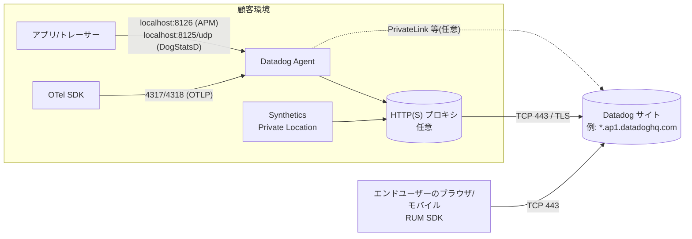
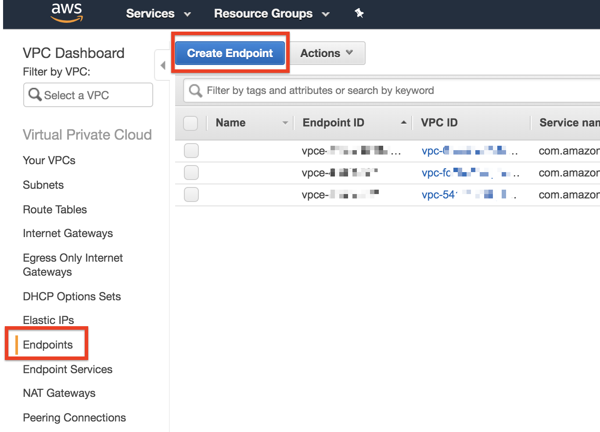
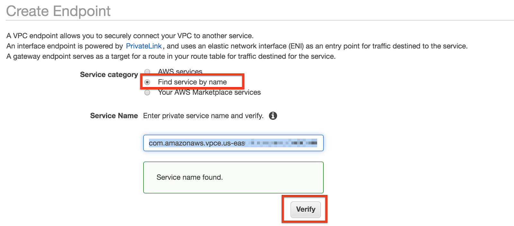
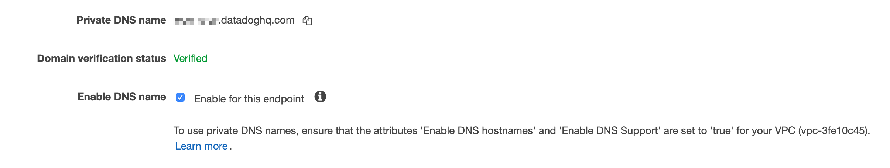

# ネットワーク・接続要件

## 概要

Datadog は SaaS 型のオブザーバビリティ基盤であり、監視対象環境に置いた Datadog Agent（以下 Agent）や各種 SDK・Forwarder がテレメトリ（メトリクス、ログ、トレース等）を **Datadog サイト（リージョン）の Intake エンドポイントへ HTTPS（TCP 443）で送信**する構成が基本となる。本ファイルは、導入時のファイアウォール申請・プロキシ設計・閉域接続設計に必要な以下の事項をまとめる。

| 項目 | 本ファイルでの節 |
|---|---|
| 通信方向・暗号化の原則 | [通信の基本原則](#通信の基本原則) |
| サイト別のベースドメイン | [サイトとベースドメイン](#サイトとベースドメイン) |
| 製品別の送信先エンドポイント | [送信先エンドポイント一覧](#送信先エンドポイント一覧) |
| 開放すべきポート（外向き・ローカル） | [ポート要件](#ポート要件) |
| 静的 IP レンジ（ip-ranges） | [IP レンジ（ip-ranges API）](#ip-レンジip-ranges-api) |
| プロキシ経由送信 | [プロキシ構成](#プロキシ構成) |
| クラウド閉域接続 | [AWS PrivateLink](#aws-privatelink) / [Azure Private Link](#azure-private-link) / [GCP Private Service Connect](#google-cloud-private-service-connect) |
| インターネット非接続環境 | [閉域環境の設計パターン](#閉域環境の設計パターン) |
| 通信断時の挙動 | [ネットワーク断時のバッファリング](#ネットワーク断時のバッファリング) |
| 帯域見積り | [帯域見積り](#帯域見積り) |
| サイト別の閉域接続可否 | [サイト別の閉域接続可否（まとめ）](#サイト別の閉域接続可否まとめ) |
| 複数送信先への同時送信 | [デュアルシッピング（複数送信先）](#デュアルシッピング複数送信先) |
| 疎通確認・障害切り分け | [疎通確認とトラブルシューティング](#疎通確認とトラブルシューティング) |
| 制限値・既定値の一覧 | [制限値・クォータ・デフォルト値](#制限値クォータデフォルト値) |
| 課金への影響 | [課金への影響](#課金への影響) |

基準サイトは AP1（日本、`ap1.datadoghq.com`）とし、他サイトとの差異は「サイト差異」として明記する。Agent の設定キー全体は [Agent 設定リファレンス](../02_リファレンス/platform/agent-configuration.md)、サイトの詳細は [Datadog Sites](../02_リファレンス/platform/datadog-sites.md) を参照。

---

## 通信の基本原則

Datadog Agent の通信には、公式ドキュメントで明記された次の原則がある。[出典](https://docs.datadoghq.com/agent/configuration/network/)

| 原則 | 内容 |
|---|---|
| 通信方向 | **通信は常に Agent から Datadog へ開始される。Datadog 側から Agent へセッションを開始することはない。** したがって Agent ホストへの外部からのインバウンド許可は不要。 |
| 暗号化 | Agent のトラフィックはすべて SSL/TLS で送信される。 |
| 主ポート | ほぼすべてのデータは TCP 443（HTTPS）で送信される。 |
| 許可方式 | 原則は **ドメイン（FQDN）での許可**。各ドメインは静的 IP への CNAME であり、IP レンジでの許可も可能。 |
| Remote Configuration | Agent が `config.<site>` へ定期的にポーリングする方式（Pull 型）であり、Datadog からのプッシュ接続ではない。詳細は [Fleet Automation と Remote Configuration](../02_リファレンス/platform/fleet-automation.md)。 |



> **注意:** 例外的に、Datadog のクラウドインテグレーション（AWS / Azure / Google Cloud）のメトリクス収集やログ転送（Forwarder、Firehose 等）は Agent を介さない経路で動く。これらのネットワーク要件は [AWS Integration](../02_リファレンス/platform/aws-integration.md)、[Azure Integration](../02_リファレンス/platform/azure-integration.md)、[Google Cloud Integration](../02_リファレンス/platform/gcp-integration.md) を参照。

---

## サイトとベースドメイン

Datadog のエンドポイントは **サイトパラメーター（`site` / `DD_SITE`）** をベースに組み立てられる。各サイトは独立しており、サイト間でデータは共有されない。[出典](https://docs.datadoghq.com/getting_started/site/)

| サイト | UI の URL | サイトパラメーター（`DD_SITE`） | 所在地 |
|---|---|---|---|
| US1 | `https://app.datadoghq.com` | `datadoghq.com` | 米国 |
| US3 | `https://us3.datadoghq.com` | `us3.datadoghq.com` | 米国 |
| US5 | `https://us5.datadoghq.com` | `us5.datadoghq.com` | 米国 |
| EU1 | `https://app.datadoghq.eu` | `datadoghq.eu` | EU（ドイツ） |
| **AP1** | `https://ap1.datadoghq.com` | `ap1.datadoghq.com` | **日本** |
| AP2 | `https://ap2.datadoghq.com` | `ap2.datadoghq.com` | オーストラリア |
| UK1 | `https://uk1.datadoghq.com` | `uk1.datadoghq.com` | 英国 |
| US1-FED | `https://app.ddog-gov.com` | `ddog-gov.com` | 米国（FedRAMP High） |
| US2-FED | `https://us2.ddog-gov.com` | `us2.ddog-gov.com` | 米国（IL5 認可プロセス中） |

> **サイト差異:** 本ナレッジ規約のサイト表記（US1/US3/US5/EU1/AP1/AP2/US1-FED）に加え、2026-11-02 時点の公式サイト一覧には **UK1** と **US2-FED** が掲載されている。[出典](https://docs.datadoghq.com/getting_started/site/)

**AP1 の主要ホスト名の例**（以降の表の `<site>` を `ap1.datadoghq.com` に置換したもの）

| 用途 | AP1 のホスト名 |
|---|---|
| Web UI | `ap1.datadoghq.com` |
| API | `api.ap1.datadoghq.com` |
| メトリクス（Agent） | `<バージョン>-app.agent.ap1.datadoghq.com`（例：`7-60-0-app.agent.ap1.datadoghq.com`） |
| ログ（Agent HTTP） | `agent-http-intake.logs.ap1.datadoghq.com` |
| ログ（HTTP API・カスタム Forwarder） | `http-intake.logs.ap1.datadoghq.com` |
| APM | `trace.agent.ap1.datadoghq.com` |
| Profiling | `intake.profile.ap1.datadoghq.com` |
| Process / CNM / USM | `process.ap1.datadoghq.com` |
| Orchestrator | `orchestrator.ap1.datadoghq.com` |
| Remote Configuration | `config.ap1.datadoghq.com` |
| ブラウザ RUM / Browser Logs | `browser-intake-ap1-datadoghq.com` |
| IP レンジ | `ip-ranges.ap1.datadoghq.com` |

（出典：[Network Traffic](https://docs.datadoghq.com/agent/configuration/network/)、[AWS PrivateLink（AP1 の DNS 名一覧）](https://docs.datadoghq.com/agent/guide/private-link/)、[Proxy RUM Data](https://docs.datadoghq.com/real_user_monitoring/guide/proxy-rum-data/)）

> **注意:** ブラウザ Intake は `browser-intake-ap1-datadoghq.com` のように **サイト名がハイフンで連結された別ドメイン**である（`*.ap1.datadoghq.com` のワイルドカードには含まれない）。プロキシ・ファイアウォールのワイルドカード許可で漏れやすい。

---

## 送信先エンドポイント一覧

### Agent のインストール・更新時に必要なドメイン

Agent のパッケージ取得・署名鍵検証のため、インストール時は次のドメインを許可する。[出典](https://docs.datadoghq.com/agent/configuration/network/)

| ドメイン | 用途 |
|---|---|
| `install.datadoghq.com` | インストールスクリプト |
| `yum.datadoghq.com` | RPM リポジトリ（RHEL / SUSE 系） |
| `apt.datadoghq.com` | APT リポジトリ（Debian / Ubuntu 系） |
| `keys.datadoghq.com` | パッケージ署名鍵 |
| `windows-agent.datadoghq.com` | Windows MSI |

> **補足:** これらのインストール用ドメインはサイトに依存せず共通（`datadoghq.com`）である。

### コンテナイメージレジストリ（Kubernetes / Docker）

接続制限のある Kubernetes 環境では、Datadog Operator・Agent イメージを取得するため次のレジストリへの TCP 443 を許可するか、社内レジストリへミラーする。[出典](https://docs.datadoghq.com/agent/configuration/network/)

| レジストリ | 備考 |
|---|---|
| `registry.datadoghq.com` | `us-docker.pkg.dev/datadog-prod/public-images` へリダイレクトされる場合がある |
| `gcr.io/datadoghq` / `eu.gcr.io/datadoghq` / `asia.gcr.io/datadoghq` | Google Artifact/Container Registry |
| `datadoghq.azurecr.io` | Azure Container Registry |
| `public.ecr.aws/datadog` | Amazon ECR Public |
| `docker.io/datadog` | Docker Hub |

### Agent の実行時（ランタイム）送信先

Agent が稼働中に通信するドメインは以下。`<site>` はサイトパラメーター（例：`ap1.datadoghq.com`）。[出典](https://docs.datadoghq.com/agent/configuration/network/)

| 製品・データ種別 | 送信先ホスト名 | 備考 |
|---|---|---|
| メトリクス、サービスチェック、イベント、メタデータ | `<VERSION>-app.agent.<site>`（例：`7-31-0-app.agent.<site>`） | ファイアウォールでは **`*.agent.<site>`** を許可する |
| API 呼び出し（APIキー検証等） | `api.<site>` | Agent 7.18.0 / 6.18.0 以降。それ以前は `app.<site>` |
| Agent Flare（サポート用診断アップロード） | `<VERSION>-flare.agent.<site>` | `*.agent.<site>` に含まれる |
| ログ | `agent-http-intake.logs.<site>`（HTTP intake を推奨） | TCP 送信は非推奨・サポート対象外（後述） |
| APM | `trace.agent.<site>`、`instrumentation-telemetry-intake.<site>` | |
| Continuous Profiler | `intake.profile.<site>` | |
| Live Containers、Live Process、Cloud Network Monitoring（旧称：Network Performance Monitoring / NPM）、Universal Service Monitoring | `process.<site>` | |
| Orchestrator（Kubernetes リソース） | `orchestrator.<site>`、`contlcycle-intake.<site>` | |
| Container Images | `contimage-intake.<site>` | |
| Cloud Security の脆弱性（SBOM） | `sbom-intake.<site>` | |
| Network Device Monitoring | `ndm-intake.<site>`、`snmp-traps-intake.<site>`、`ndmflow-intake.<site>` | |
| Network Path | `netpath-intake.<site>` | |
| LLM Observability | `llmobs-intake.<site>` | |
| Remote Configuration | `config.<site>` | |
| Database Monitoring | `dbm-metrics-intake.<site>`、`dbquery-intake.<site>` | サイト差異あり（下記） |
| End User Device Monitoring | `softinv-intake.<site>`、`eudm-intake.<site>` | サイト差異あり（下記） |
| RUM（ブラウザ SDK） | `browser-intake-<site 由来>`（例：`browser-intake-ap1-datadoghq.com`） | 送信元はエンドユーザー端末 |

> **サイト差異:** Database Monitoring と End User Device Monitoring のエンドポイントは、公式の Network Traffic ページでは `app.datadoghq.com`、`app.datadoghq.eu`、US3、US5、AP1、AP2、UK1 のみに掲載されている（Gov サイトは記載なし）。[出典](https://docs.datadoghq.com/agent/configuration/network/)

上記以外にも、AWS PrivateLink の DNS 名一覧には CI Visibility（`ci-intake`、`citestcycle-intake`、`citestcov-intake`、`cicodescan-intake`）、Workload Protection（`cws-intake`）、Cloud Security（`cspm-intake`）、Dynamic Instrumentation（`debugger-intake`）、Error Tracking（`error-tracking-intake`）、Event Management（`event-management-intake`）、Sensitive Data Scanner（`sds-intake`）、OTLP（`otlp.<site>`、`*.integrations.otlp.<site>`）、Fleet の OpAMP（`opamp.<site>`）、Data Observability（`data-obs-intake`）、ソースマップ（`sourcemap-intake`）等の Intake ホストが掲載されている。製品ごとの要否は各リファレンスを参照のこと。[出典](https://docs.datadoghq.com/agent/guide/private-link/)

**ファイアウォール申請時の実務的な指定方法 【経験則】**

| 方式 | 指定例（AP1） | 長所 | 短所 |
|---|---|---|---|
| ワイルドカード FQDN | `*.ap1.datadoghq.com`、`browser-intake-ap1-datadoghq.com`、`*.datadoghq.com`（インストール用） | 新製品の Intake 追加に追従しやすい | FQDN（SNI/HTTP Host）でのフィルタリングができる FW/プロキシが必要 |
| 個別 FQDN | 上表のホストを列挙 | 最小権限 | 製品追加やバージョン依存ホスト（`<VERSION>-app.agent`）で漏れやすい |
| IP レンジ | `ip-ranges` の CIDR | L3/L4 FW で実装可能 | IP の入れ替えへの追従が必要（後述） |

> **補足（FQDN の末尾ドット）:** Agent 7.67.0 以降は、サイトのドメインに末尾ドットを付けて名前解決する（例：`trace.agent.datadoghq.com.`）。DNS 検索ドメイン付加による余分な問い合わせを避けるための挙動で、Agent 7.72.0 以降は `convert_dd_site_fqdn.enabled: false`（環境変数 `DD_CONVERT_DD_SITE_FQDN_ENABLED=false`）で無効化できる。末尾ドット付きの Host を正しく扱えないプロキシ・FW を使う場合に確認する。[出典](https://docs.datadoghq.com/agent/configuration/network/)

### ログの送信先と転送方式

Agent v6.19+ / v7.19+ のログ転送は **圧縮付き HTTPS（TCP 443）がデフォルト**である。起動時にログ収集が有効なら Agent は HTTPS の疎通テストを行い、成功すれば HTTPS、失敗すれば TCP にフォールバックする。テストは起動時のみ実施される。[出典](https://docs.datadoghq.com/agent/logs/log_transport/)

| 設定 | 値・既定値 | 説明 |
|---|---|---|
| `logs_config.force_use_http` | `true` 推奨 | HTTPS 送信を強制（環境変数 `DD_LOGS_CONFIG_FORCE_USE_HTTP=true`）。**プロキシ経由ではトランスポートを必ず固定する**ことが推奨されている |
| `logs_config.force_use_tcp` | — | TCP 送信を強制（非推奨） |
| `logs_config.compression_level` | 既定 `6`（0〜9） | HTTPS 圧縮レベル |
| `logs_config.batch_wait` | 既定 5 秒（1〜10 の整数） | バッチを満たすまでの最大待ち時間。TCP に比べ最大 5 秒の遅延が加わる |
| HTTPS のバッチ上限 | 最大 1MB / バッチ、1 ログ最大 900kB、1 バッチ最大 1,000 件 | |

> **サイト差異（TCP ログ転送）:** TCP によるログ送信は `app.datadoghq.com`、`app.datadoghq.eu`、US3、US5、AP1、AP2、UK1 でサポート対象外（配信保証なし）、Gov サイトでは TCP エンドポイント自体が非対応。US の旧 TCP エンドポイントは `agent-intake.logs.datadoghq.com:10516`（TLS）/`:10514`（非 TLS）。**新規設計では TCP 10516 等を開放する必要はなく、HTTPS 443 に統一する。** [出典](https://docs.datadoghq.com/agent/logs/log_transport/) / [出典](https://docs.datadoghq.com/logs/log_collection/)

> **注意:** SOCKS5 プロキシは HTTPS 圧縮と併用できないため、SOCKS5 を使うとログは TCP に強制される。TCP が非対応のサイト（AP1 を含む）では **SOCKS5 プロキシ経由のログ送信は避け、HTTP(S) プロキシを使う**。[出典](https://docs.datadoghq.com/agent/logs/log_transport/)

### Synthetics Private Location の送信先

Synthetic Monitoring の Private Location（顧客環境内で動くワーカー）は **アウトバウンドのみ**で動作し、TCP 443 でテスト設定の取得と結果の送信を行う。[出典](https://docs.datadoghq.com/synthetics/platform/private_locations/) / [出典](https://docs.datadoghq.com/agent/configuration/network/)

| 条件 | 送信先 |
|---|---|
| ワーカー v1.5.0 以降 | `intake.synthetics.<site>` のみ |
| API テスト結果（ワーカー > v0.1.6） | `intake.synthetics.<site>` |
| ブラウザテスト結果（ワーカー > v0.2.0） | `intake-v2.synthetics.<site>` |
| API テスト結果（ワーカー < v0.1.5） | `api.<site>` |

- プロキシは `http://<USER>:<PWD>@<IP>:<PORT>` 形式で設定し、設定ファイルに `proxyDatadog` パラメーターとして入る。
- イメージは `datadog/synthetics-private-location-worker`（Gov サイトは FIPS 版 `datadog/synthetics-private-location-worker-fips`）。
- 詳細は [Synthetic Monitoring](../02_リファレンス/dem/synthetic-monitoring.md) を参照。

### OpenTelemetry（OTLP）

| 経路 | 要件 |
|---|---|
| アプリ → Agent の OTLP 受信 | gRPC `4317` / HTTP `4318`（既定ポート）。設定キー `otlp_config.receiver.protocols.grpc.endpoint` / `...http.endpoint`。トレース・メトリクスは Agent 6.32.0 / 7.32.0 以降、ログは 6.48.0 / 7.48.0 以降。OTLP 受信はデフォルト無効。[出典](https://docs.datadoghq.com/opentelemetry/setup/otlp_ingest_in_the_agent/) |
| Agent/Collector を介さない Agentless OTLP Intake | パスは `/v1/metrics`、`/v1/logs`、`/v1/traces`。トレースは `http/protobuf` と `http/json` のみ（gRPC 非対応）。API キーを `dd-api-key` ヘッダーで送る。ペイロード上限はメトリクス 512 KiB（圧縮後）、ログ 5.1 MiB、トレース 15 MiB（非圧縮）。[出典](https://docs.datadoghq.com/opentelemetry/setup/otlp_ingest/) |

ホスト名は PrivateLink の DNS 名一覧に `otlp.<site>` が掲載されている。[出典](https://docs.datadoghq.com/agent/guide/private-link/) 詳細は [OpenTelemetry サポート](../02_リファレンス/platform/opentelemetry.md)。

### 外部公開 IP 解決（Network Path・任意）

Network Path（Agent 7.75 以降）は送信元のパブリック IP を解決するため、任意で `icanhazip.com`、`ipinfo.io`、`checkip.amazonaws.com`、`api.ipify.org`、`whatismyip.akamai.com` へ HTTPS 通信する。これらに到達できなくても Network Path 自体は動作する。[出典](https://docs.datadoghq.com/agent/configuration/network/)

---

## ポート要件

### アウトバウンド（Agent → Datadog）

[出典](https://docs.datadoghq.com/agent/configuration/network/)

| ポート | プロトコル | 用途 | 対象サイト |
|---|---|---|---|
| **443** | TCP | ほぼ全データ（メトリクス、ログ、APM、コンテナ、Live Process、CNM、USM 等） | 全サイト |
| 123 | UDP | NTP（NTP チェック） | 全サイト |
| 8443 | TCP | Custom Agent Autoscaling | `app.datadoghq.com`、`app.datadoghq.eu` のみ |
| 8042 | TCP | Remote Configuration の疎通テスト（テレメトリのみ。顧客データは含まない。Remote Config 有効時のみ） | `app.datadoghq.com`、`app.datadoghq.eu` のみ |
| 10516 / 10514 | TCP | 旧 TCP ログ転送（非推奨・サポート対象外） | US のみ（AP1 では不要） |

> **サイト差異:** AP1 で必要なアウトバウンドは実質的に **TCP 443 と UDP 123（NTP チェックを使う場合）** のみ。8443 / 8042 は公式ページ上 US1・EU1 のみの記載。

**NTP チェックの宛先:** NTP インテグレーションは Agent が動くクラウドを検出し、可能ならそのクラウドのプライベート NTP サーバーを使う。クラウドが検出されない場合は `0.datadog.pool.ntp.org`〜`3.datadog.pool.ntp.org` を使う（UDP 123）。閉域環境では社内 NTP サーバーを `ntp.d/conf.yaml` で指定する。[出典](https://docs.datadoghq.com/integrations/ntp/)

### インバウンド（ホスト内ローカル通信）

以下のポートは **同一ホスト内（またはノード内）からの通信用**であり、外部へ公開する必要はない。公式ドキュメントは「信頼できないアクセスを許すと、アカウントへのデータ書き込みや設定の読み取りが可能になる」として、ファイアウォールで Agent へのアクセスを制限するよう求めている。[出典](https://docs.datadoghq.com/agent/configuration/network/)

| ポート | プロトコル | 用途 | 設定キー（環境変数） | 既定値 |
|---|---|---|---|---|
| 8125 | UDP | DogStatsD | `dogstatsd_port`（`DD_DOGSTATSD_PORT`） | 8125。`dogstatsd_non_local_traffic: true` でない限りローカルのみ |
| 8126 | TCP | APM レシーバー（トレース・プロファイル） | `receiver_port`（`DD_APM_RECEIVER_PORT`） | 8126。`0` で HTTP レシーバー無効 |
| 5000 | TCP | go_expvar インテグレーションサーバー | `expvar_port`（`DD_EXPVAR_PORT`） | 5000 |
| 5001 | TCP | IPC API | `cmd_port`（`DD_CMD_PORT`） | 5001 |
| 5002 | TCP | Agent ブラウザ GUI | `GUI_port`（`DD_GUI_PORT`） | Windows/macOS は 5002、Linux は `-1`（無効） |
| 5012 | TCP | APM の go_expvar サーバー | — | 5012 |
| 6062 | TCP | Process Agent デバッグ | — | 6062 |
| 6162 | TCP | Process Agent ランタイム | — | 6162 |
| 4317 / 4318 | TCP | OTLP 受信（gRPC / HTTP、有効化時） | `otlp_config.receiver.protocols.*.endpoint` | 無効 |

（ポート番号と用途の出典は [Network Traffic](https://docs.datadoghq.com/agent/configuration/network/)。`GUI_port` の OS 別既定値（Windows/macOS は `5002`、Linux は `-1`）および `dogstatsd_non_local_traffic`（`DD_DOGSTATSD_NON_LOCAL_TRAFFIC`、既定 `false`）の出典は Agent の設定例ファイル [datadog-agent_linux.yaml.example](https://github.com/DataDog/datadog-agent/blob/main/pkg/config/example/datadog-agent_linux.yaml.example)（2026-11-04 確認）。設定キー全体は [Agent 設定リファレンス](../02_リファレンス/platform/agent-configuration.md) を参照。）

> **注意:** DogStatsD・APM のポートを変更した場合は、アプリ側の SDK/トレーサーの送信先設定も合わせて変更する。コンテナ環境ではアプリコンテナから Agent（DaemonSet のホストポート、または UDS）に到達できる必要がある。詳細は [Custom Metrics と DogStatsD](../02_リファレンス/platform/custom-metrics-and-dogstatsd.md)、[APM インスツルメンテーション](../02_リファレンス/apm/apm-instrumentation.md)。

### Kubernetes クラスター内の通信

| 通信 | ポート | 説明 |
|---|---|---|
| ノード Agent → Cluster Agent | TCP 5005（Service は ClusterIP） | ノード Agent は HTTPS で Cluster Agent に接続。共有トークン `DD_CLUSTER_AGENT_AUTH_TOKEN` で認証。[出典](https://docs.datadoghq.com/containers/cluster_agent/setup/) |
| Kubernetes API → Admission Controller Webhook | Service 443 → targetPort 8000 | Cluster Agent v7.40 以降。手動 DaemonSet 構成例の Service 定義より。[出典](https://docs.datadoghq.com/containers/cluster_agent/admission_controller/) |
| Cluster Agent → Kubernetes API サーバー | — | API サーバーと通信するのは Cluster Agent のみ（ノード Agent は不要）。[出典](https://docs.datadoghq.com/containers/cluster_agent/setup/) |
| ノード Agent → kubelet | 公開情報（参照ページ）では確認できず | 一般に kubelet の 10250 を使う【経験則】 |

> **注意 【経験則】:** GKE プライベートクラスタや EKS で、コントロールプレーンからノードへの通信がセキュリティグループ/ファイアウォールで制限されている場合、Admission Controller の Webhook（ポート 8000）への到達が阻害され、APM ライブラリの自動注入等が動かないことがある。公式の Admission Controller ページには明示記載がないため、クラスター側のファイアウォールルールを個別に確認する。詳細は [コンテナ/Kubernetes向けAgent](../02_リファレンス/platform/kubernetes-and-containers-agent.md)。

### Network Device Monitoring の受信ポート（インバウンド・UDP）

NDM で Agent がネットワーク機器からの Trap / Flow を受け取る場合は、機器 → Agent ホストへの UDP インバウンドが必要になる。[出典](https://docs.datadoghq.com/network_monitoring/devices/netflow/) / [出典](https://docs.datadoghq.com/network_monitoring/devices/snmp_traps/)

| 種別 | 設定例のポート | 設定キー | 備考 |
|---|---|---|---|
| SNMP Traps | 9162 | `network_devices.snmp_traps.port` | 1024 未満（標準 162）にバインドするには `setcap CAP_NET_BIND_SERVICE` が必要で、Agent 更新のたびに再実行が必要 |
| NetFlow v9 | 2055 | `network_devices.netflow.listeners[].port` | 公式例の値（既定値とは明記されていない） |
| NetFlow v5 | 2056 | 同上 | 同上 |
| IPFIX | 4739 | 同上 | 同上 |
| sFlow v5 | 6343 | 同上 | 同上 |
| SNMP ポーリング | Agent → 機器 UDP 161 | — | SNMP の標準ポート【経験則】 |

詳細は [Network Device Monitoring](../02_リファレンス/infrastructure/network-device-monitoring.md)。

---

## IP レンジ（ip-ranges API）

### 概要と取得方法

Datadog は Intake の静的 IP レンジを JSON で公開している。URL は **`https://ip-ranges.<site>`**（AP1 は `https://ip-ranges.ap1.datadoghq.com`）で、セクションごとの個別ファイル（例：`/logs.json`、`/apm.json`）もある。認証は不要。[出典](https://docs.datadoghq.com/agent/configuration/network/)

| サイト | ip-ranges URL |
|---|---|
| US1 | `https://ip-ranges.datadoghq.com` |
| US3 | `https://ip-ranges.us3.datadoghq.com` |
| US5 | `https://ip-ranges.us5.datadoghq.com` |
| EU1 | `https://ip-ranges.datadoghq.eu` |
| AP1 | `https://ip-ranges.ap1.datadoghq.com` |
| AP2 | `https://ip-ranges.ap2.datadoghq.com` |
| UK1 | `https://ip-ranges.uk1.datadoghq.com` |
| US1-FED | `https://ip-ranges.ddog-gov.com` |
| US2-FED | `https://ip-ranges.us2.ddog-gov.com` |

（URL はいずれも `https://ip-ranges.<site パラメーター>` の規則に従う。上表の全 URL が HTTP 200 を返すことを 2026-11-02 に確認済み（US2-FED は 2026-11-04 に確認）。）

### JSON の構造

| フィールド / セクション | 内容 | Agent が使うか |
|---|---|---|
| `version` | 変更のたびに増加する整数 | — |
| `modified` | 最終変更日時 | — |
| `agents` | メトリクス送信先（`prefixes_ipv4` / `prefixes_ipv6`） | 使う |
| `api` | API | 使う |
| `apm` | APM | 使う |
| `logs` | ログ | 使う |
| `process` | Process / CNM 等 | 使う |
| `orchestrator` | Orchestrator | 使う |
| `remote-configuration` | Remote Configuration | 使う |
| `global` | 共通 | 公式説明に記載なし（実データには存在） |
| `synthetics` | Datadog 管理ロケーションからの Synthetic テストの **送信元 IP**。`prefixes_ipv4_by_location` でロケーション別にも提供 | 使わない（監視対象側 FW のインバウンド許可に使う） |
| `synthetics-private-locations` | Private Location ワーカーの送信先 | 使わない（ワーカーが使う） |
| `webhooks` | Webhook 通知の **送信元 IP** | 使わない（Webhook 受信側のインバウンド許可に使う） |

（出典：[Network Traffic](https://docs.datadoghq.com/agent/configuration/network/)、実データ [ip-ranges.ap1.datadoghq.com](https://ip-ranges.ap1.datadoghq.com/)）

### AP1 の値（2026-11-02 取得時点の参考値）

以下は 2026-11-02 に `https://ip-ranges.ap1.datadoghq.com/` を取得した結果である（`version: 11`、`modified: 2026-08-12T00:00:00`）。**IP は変更されるため、設計時・運用時は必ず API から最新値を取得すること。**

| セクション | IPv4 | IPv6 |
|---|---|---|
| `agents` / `api` / `apm` / `logs` / `process` / `orchestrator` / `remote-configuration` / `global` / `synthetics-private-locations` | `43.206.163.128/25`、`43.206.164.128/25` | `2406:da14:69c:e100::/56` |
| `webhooks` | `13.113.49.128/32`、`13.113.110.228/32`、`18.178.172.200/32`、`35.78.48.234/32`、`43.206.163.128/25`、`43.206.164.128/25`、`43.207.23.245/32`、`52.194.140.99/32` | `2406:da14:69c:e100::/56` |
| `synthetics`（全ロケーション） | 107 件（AWS / Azure / GCP の各ロケーション） | 1 件 |
| `synthetics` の `aws:ap-northeast-1`（東京） | `5.60.130.112/29`、`13.114.211.96/32`、`13.115.46.213/32`、`52.192.175.207/32` | — |

参考：同日取得の US1（`version: 63`）は Agent 系セクションが `3.233.144.0/20`（IPv4）と `2600:1f18:24e6:b900::/56`（IPv6）、`webhooks` は IPv4 38 件。

> **注意:** 公式ドキュメントは「**ip-ranges のすべてのアドレスを許可リストに追加すること。ある時点で有効なのはその一部で、ネットワーク保守により時間とともに入れ替わる**」としている。一部の IP だけを許可すると、将来の切り替えで送信が途絶える。[出典](https://docs.datadoghq.com/agent/configuration/network/)

### IP レンジ許可の運用 【経験則】

- `version` を定期的（例：日次）にポーリングし、値が変わったら FW ルールを更新・通知する仕組みを作る。
- 取得例：

```bash
# AP1 の Agent 系 IPv4 レンジを取得
curl -s https://ip-ranges.ap1.datadoghq.com/ | jq -r '.version, .modified, .agents.prefixes_ipv4[]'

# ログ専用ファイル
curl -s https://ip-ranges.ap1.datadoghq.com/logs.json
```

- ブラウザ RUM の送信は利用者端末から直接行われるため、社内プロキシ配下の端末から送る場合を除き IP 許可の対象外。
- Synthetic Monitoring で社内公開前の環境を外形監視する場合は、`synthetics.prefixes_ipv4_by_location` の該当ロケーションのみをインバウンド許可する設計が可能。
- Datadog から顧客システムへの Webhook（[通知と Downtime](../02_リファレンス/platform/notifications-and-downtimes.md)）を受ける場合は `webhooks` レンジをインバウンド許可する。

---

## プロキシ構成

### Agent のプロキシ設定

Agent は HTTP / HTTPS プロキシ経由で Datadog に送信できる。[出典](https://docs.datadoghq.com/agent/configuration/proxy/)

**`datadog.yaml` の設定例**

```yaml
proxy:
  https: "http://<USER>:<PASSWORD>@<PROXY_HOST>:<PROXY_PORT>"
  http: "http://<USER>:<PASSWORD>@<PROXY_HOST>:<PROXY_PORT>"
  no_proxy:
    - 169.254.169.254
    - 10.0.0.0/8
no_proxy_nonexact_match: true   # 推奨
logs_config:
  force_use_http: true          # 推奨（ログを HTTPS に固定）
```

| 設定キー | 環境変数 | 説明 |
|---|---|---|
| `proxy.https` | `DD_PROXY_HTTPS` | HTTPS 通信用プロキシ URL。Datadog への通信の大半は HTTPS なのでこちらが主 |
| `proxy.http` | `DD_PROXY_HTTP` | HTTP 通信用プロキシ URL |
| `proxy.no_proxy` | `DD_PROXY_NO_PROXY`（スペース区切り） | プロキシを経由しないホスト/CIDR |
| `no_proxy_nonexact_match` | `DD_NO_PROXY_NONEXACT_MATCH=true` | `no_proxy` を標準的なマッチング規則（ドメイン・サブドメイン・CIDR）で評価（推奨） |
| `logs_config.force_use_http` | `DD_LOGS_CONFIG_FORCE_USE_HTTP=true` | ログ送信を HTTPS に固定（推奨） |

- ユーザー名・パスワードは任意。変更後は Agent の再起動が必要。
- **環境変数は設定ファイルより優先**される。
- Kubernetes：Helm は `values.yaml` の `datadog.env`、Datadog Operator は `DatadogAgent` CR の `spec.global.env` に環境変数として設定する（例：クラスター内プロキシ `<PROXY_SERVICE>.<PROXY_NAMESPACE>.svc.cluster.local`）。

**`no_proxy` のマッチング規則**（`no_proxy_nonexact_match: true` の場合）

| 指定 | マッチ対象 |
|---|---|
| `datadoghq.com` | ドメイン本体とすべてのサブドメイン（`www.notdatadoghq.com` にはマッチしない） |
| `.datadoghq.com` | サブドメインのみ |
| `192.168.1.0/24` | CIDR 範囲 |
| IP / ホスト名 | 完全一致 |

既定（`false`）では、インテグレーション以外の Agent の HTTP(S) リクエストに対して `no_proxy` は完全一致でのみ評価される。[出典](https://docs.datadoghq.com/agent/configuration/proxy/)

> **注意 【経験則】:** クラウドのインスタンスメタデータ（AWS の `169.254.169.254` 等）や Kubernetes API・kubelet への通信がプロキシに向かうと、ホスト名解決やタグ付与に失敗することがある。`no_proxy` にメタデータエンドポイント、クラスター内 CIDR、`.svc`、`.cluster.local` 等を含める設計が一般的。

### プロキシサーバーの選択肢

| 方式 | 公式の位置付け | 説明 |
|---|---|---|
| **Squid**（フォワードプロキシ） | **推奨** | Agent の HTTP/HTTPS 送信を透過的に中継できる |
| HAProxy | 非推奨 | Datadog のドメイン一覧を常に最新に保つ必要がある |
| NGINX | 非推奨 | 同上 |

公式は「HAProxy や NGINX のようなソフトウェアでのトラフィック転送は推奨しない」としている。例外として、TLS を終端して中身を検査する Deep Packet Inspection（DPI）が必要な場合は、HAProxy/NGINX で TLS を無効化するか独自証明書を使う構成が取り得る。[出典](https://docs.datadoghq.com/agent/configuration/proxy/)

> **注意 【経験則】:** TLS インスペクション（SSL 復号）型のプロキシを使う場合、Agent が社内 CA を信頼していないと証明書エラーになる。復号対象から Datadog ドメインを除外する（バイパス）か、OS の信頼ストアへ社内 CA を追加する設計を事前に決める。

### FIPS Agent とプロキシ（US1-FED / US2-FED）

- FIPS Agent（Agent 7.65.0 以降、FIPS 140-2 検証済み暗号モジュール）は US1-FED / US2-FED 向けで、アウトバウンド通信は GovCloud に限定される。Cluster Agent とノード Agent 間通信はサポートされない。[出典](https://docs.datadoghq.com/agent/configuration/fips-compliance/)
- 旧来の **Datadog Agent FIPS Proxy は US1-FED のみ**で利用でき、通常のプロキシと併用できない。[出典](https://docs.datadoghq.com/agent/configuration/proxy/)

### 疎通確認

プロキシ設定後は Agent を再起動し、`datadog-agent status` の出力と `agent.log`、`trace-agent.log` 等で接続エラーがないか確認する。[出典](https://docs.datadoghq.com/agent/configuration/proxy/)

### RUM（ブラウザ SDK）のプロキシ

エンドユーザーのブラウザから Datadog への直接通信を避けたい（広告ブロッカー対策、社内ネットワーク制約、データ経路の統制）場合、ブラウザ SDK の `proxy` 初期化パラメーターで自社プロキシ経由にできる。[出典](https://docs.datadoghq.com/real_user_monitoring/guide/proxy-rum-data/)

| 項目 | 内容 |
|---|---|
| SDK バージョン | `proxy` パラメーターは v4.34.0 以降（それ以前の `proxyUrl` はセキュリティ上の理由で非推奨）。関数指定は v5.4.0 以降 |
| リクエスト | すべて POST で送信され、`ddforward` クエリパラメーターに Intake のパスとパラメーターが入る |
| プロキシの要件 | ① サイトの Intake オリジン＋パスで転送先を組み立てる ② `X-Forwarded-For` にクライアント IP を付与（GeoIP のため）③ POST で転送 ④ ボディは無変換（バイナリを含む）⑤ `cookie` 等の機微ヘッダーを除去 ⑥ 他ホストへのリダイレクトを防ぎ、Intake ホストを検証する |

| サイト | Intake オリジン |
|---|---|
| US1 | `https://browser-intake-datadoghq.com` |
| US3 | `https://browser-intake-us3-datadoghq.com` |
| US5 | `https://browser-intake-us5-datadoghq.com` |
| EU1 | `https://browser-intake-datadoghq.eu` |
| **AP1** | `https://browser-intake-ap1-datadoghq.com` |
| AP2 | `https://browser-intake-ap2-datadoghq.com` |
| UK1 | `https://browser-intake-uk1-datadoghq.com` |
| US1-FED | `https://browser-intake-ddog-gov.com` |
| US2-FED | `https://browser-intake-us2-ddog-gov.com` |

モバイル SDK のプロキシ設定は本ガイドの対象外。詳細は [RUM（ブラウザ）](../02_リファレンス/dem/rum-browser.md)、[RUM（モバイル）](../02_リファレンス/dem/rum-mobile.md)。

---

## AWS PrivateLink

### 概要と対応サイト

AWS PrivateLink を使うと、Agent から Datadog への通信をインターネットを経由せず AWS のバックボーン上の VPC インターフェイスエンドポイント経由で送信できる。[出典](https://docs.datadoghq.com/agent/guide/private-link/)

| サイト | AWS PrivateLink | Datadog 側エンドポイントのリージョン |
|---|---|---|
| US1 | 対応 | `us-east-1` |
| **AP1** | **対応** | **`ap-northeast-1`（東京）** |
| AP2 | 対応 | `ap-southeast-2` |
| UK1 | 対応 | `eu-west-2` |
| US3 / US5 / EU1 / US1-FED / US2-FED | **非対応** | — |

> **サイト差異:** US3 は Azure Private Link、US5・EU1 は GCP Private Service Connect が対応している（後述）。各サイトのクラウド基盤に合わせた閉域接続方式を選ぶ必要がある。

### AP1 のエンドポイントサービス一覧

AP1 は「2 階層 DNS」構成で、各 DNS 名は `<color>.intake.ap1.datadoghq.com` という「アンカー」に対応し、アンカー単位で VPC エンドポイントサービスが分かれる。より具体的な DNS レコードがワイルドカードより優先される。以下は 2026-11-02 時点の公式ドキュメントの値。[出典](https://docs.datadoghq.com/agent/guide/private-link/)

| アンカー | 主な DNS 名 | VPC エンドポイントサービス名 |
|---|---|---|
| beige | `*.agent.ap1.datadoghq.com`、`agent.ap1.datadoghq.com`（メトリクス・Flare） | `com.amazonaws.vpce.ap-northeast-1.vpce-svc-05e201c57e0c97bcc` |
| gold | `agent-http-intake.logs.ap1.datadoghq.com`、`http-intake.logs.ap1.datadoghq.com`、`lambda-http-intake.logs.ap1.datadoghq.com`、`aws-kinesis-http-intake.logs.ap1.datadoghq.com`、`eventbridge-intake.logs.ap1.datadoghq.com`、`runtime-security-http-intake.logs.ap1.datadoghq.com`、`obpipeline-intake.ap1.datadoghq.com`（ログ系） | `com.amazonaws.vpce.ap-northeast-1.vpce-svc-0b5c8477c05c8bbdb` |
| lime | `trace.agent.ap1.datadoghq.com`、`data-obs-intake.ap1.datadoghq.com`（APM 等） | `com.amazonaws.vpce.ap-northeast-1.vpce-svc-0126c3bb53b5655bb` |
| bisque | `process.ap1.datadoghq.com` | `com.amazonaws.vpce.ap-northeast-1.vpce-svc-03d339b15a9b93f40` |
| linen | `orchestrator.ap1.datadoghq.com` | `com.amazonaws.vpce.ap-northeast-1.vpce-svc-0ef5fc837fc1ca22b` |
| orchid | `api.ap1.datadoghq.com`、`synthetics.ap1.datadoghq.com`、`*.synthetics.ap1.datadoghq.com`、`quota.browser-intake-ap1-datadoghq.com` | `com.amazonaws.vpce.ap-northeast-1.vpce-svc-0e847a2951a0d615d` |
| violet | `config.ap1.datadoghq.com`（Remote Configuration） | `com.amazonaws.vpce.ap-northeast-1.vpce-svc-00b64297ce9465d1e` |
| white | `dbm-metrics-intake.ap1.datadoghq.com`、`dbquery-intake.ap1.datadoghq.com`（DBM） | `com.amazonaws.vpce.ap-northeast-1.vpce-svc-00f42cb7530f78bdf` |
| cyan | `intake.profile`、`instrumentation-telemetry-intake`、`ci-intake`、`citestcycle-intake`、`citestcov-intake`、`cireport-intake`、`cicodescan-intake`、`contimage-intake`、`contlcycle-intake`、`cspm-intake`、`cws-intake`、`sbom-intake`、`sds-intake`、`debugger-intake`、`error-tracking-intake`、`event-management-intake`、`llmobs-intake`、`ndm-intake`、`ndmflow-intake`、`snmp-traps-intake`、`netpath-intake`、`softinv-intake`、`kubeops-intake`、`agenthealth-intake`、`awsmetrics-intake`、`cloudplatform-intake`、`ocimetrics-intake`、`resources-intake`、`sentry-intake`、`webhook-intake`（いずれも `.ap1.datadoghq.com`） | `com.amazonaws.vpce.ap-northeast-1.vpce-svc-0bd6602ff16778f3d` |
| brown | `otlp.ap1.datadoghq.com`、`*.integrations.otlp.ap1.datadoghq.com`、`opamp.ap1.datadoghq.com` | `com.amazonaws.vpce.ap-northeast-1.vpce-svc-05640166b98113e6f` |
| plum | `sourcemap-intake.ap1.datadoghq.com` | `com.amazonaws.vpce.ap-northeast-1.vpce-svc-076c5c7eb3510acb8` |
| aqua | `gcp-intake.logs.ap1.datadoghq.com` | `com.amazonaws.vpce.ap-northeast-1.vpce-svc-09f7e6da6e5ec2113` |
| orange | `*.ap1.datadoghq.com`（上記以外のワイルドカード） | `com.amazonaws.vpce.ap-northeast-1.vpce-svc-0526180aeb5173dcb` |

> **注意:** サービス名は公式ドキュメントで変更・追加されることがある。設定時は必ず [公式ページ](https://docs.datadoghq.com/agent/guide/private-link/) でサイトセレクターを AP1 にして最新値を確認する。
>
> **サイト差異（US1 の例）:** US1 では メトリクス `metrics.agent.datadoghq.com` → `com.amazonaws.vpce.us-east-1.vpce-svc-09a8006e245d1e7b8`、Agent ログ `agent-http-intake.logs.datadoghq.com` → `...vpce-svc-025a56b9187ac1f63`、API `api.datadoghq.com` → `...vpce-svc-07895350fd0109264`、トレース `trace.agent.datadoghq.com` → `...vpce-svc-0ee865cd1c0a7ba32` など、AP1 とは異なる構成・ID である。US1 には MCP サーバー（`mcp.datadoghq.com`）や RUM（`rum.browser-intake-datadoghq.com`）の PrivateLink サービスも掲載されている。

### 同一リージョン（ap-northeast-1）での設定手順

[出典](https://docs.datadoghq.com/agent/guide/private-link/)

1. AWS コンソールで **VPC Dashboard > Endpoints > Create Endpoint** を開く。
2. **Find service by name** を選び、上表のサービス名を入力して **Verify** を押す。
3. VPC とサブネットを選ぶ。
4. **Enable DNS name** をチェックする（プライベート DNS により Datadog のホスト名が VPC 内でエンドポイントのプライベート IP に解決される）。
5. **TCP 443 のインバウンドを許可するセキュリティグループ**を選ぶ。
6. エンドポイントを作成し、ステータスが **Pending → Available** になるまで待つ（最大 10 分程度）。
7. Agent を再起動する。



*キャプション:* AWS VPC Dashboard の Endpoints 一覧画面。
*画面説明:* 左メニュー「Virtual Private Cloud」配下の **Endpoints** を選択すると、右側に既存エンドポイントの一覧（Name、Endpoint ID、VPC ID、Service name 列）が表示され、上部の **Create Endpoint** ボタンから新規作成を開始する。旧 UI のスクリーンショットであり、現行の AWS コンソールとは見た目が異なる場合がある。
*出典:* Datadog 公式ドキュメント画像 https://datadog-docs.imgix.net/images/agent/guide/private_link/create_vpc_endpoint.png （ガイド: https://docs.datadoghq.com/agent/guide/private-link/ ）、取得日 2026-11-02。



*キャプション:* Create Endpoint 画面でのサービス名検証。
*画面説明:* **Service category** で「Find service by name」を選び、**Service Name** 欄に `com.amazonaws.vpce.<region>.vpce-svc-...` 形式の Datadog サービス名を入力して **Verify** を押すと、「Service name found.」と表示される。
*出典:* https://datadog-docs.imgix.net/images/agent/guide/private_link/vpc_service_name.png （ガイド: https://docs.datadoghq.com/agent/guide/private-link/ ）、取得日 2026-11-02。



*キャプション:* エンドポイントのプライベート DNS 名の有効化。
*画面説明:* **Private DNS name** に `*.datadoghq.com` 系のホスト名、**Domain verification status** に「Verified」が表示され、**Enable DNS name** の「Enable for this endpoint」にチェックを入れる。注記として、VPC の「Enable DNS hostnames」と「Enable DNS Support」を `true` にする必要がある旨が表示される。
*出典:* https://datadog-docs.imgix.net/images/agent/guide/private_link/enabled_dns_private.png （ガイド: https://docs.datadoghq.com/agent/guide/private-link/ ）、取得日 2026-11-02。

> **補足:** 上記 3 枚は Datadog 公式ドキュメント画像サーバーから取得したが、2026-11-02 時点の現行ガイド本文には画像が埋め込まれていない（手順はテキストで記載）。画面は旧 AWS コンソール UI である。

### 他リージョン・他 VPC からの接続

AP1 の PrivateLink サービスは `ap-northeast-1` にあるため、大阪（`ap-northeast-3`）や海外リージョンの VPC から使う場合は以下のいずれかを選ぶ。

| 方式 | 公式の位置付け | 概要 | 留意点 |
|---|---|---|---|
| **Cross-region PrivateLink** | **推奨** | VPC エンドポイント作成時に「PrivateLink Ready partner services」でクロスリージョンを有効化し、Datadog サービスのリージョンを選んでサービス名を検証する | **クロスリージョン PrivateLink は CloudWatch メトリクスを出力しない**。AWS 側の対応リージョンは AWS のドキュメントで確認 |
| VPC Peering | 代替 | Datadog のリージョン（東京）に VPC を作りエンドポイントを置き、他リージョン VPC とピアリング | **Enable DNS name をオフ**にし、Route 53 で DNS を手動構成する |
| Transit Gateway | 代替（アーキテクチャセンター記事） | エンドポイントを置いた VPC と Agent の VPC を Transit Gateway（リージョン間ピアリング）で接続 | Route 53 プライベートホストゾーンを両 VPC に関連付け、VPC と TGW のルートテーブルを更新 |

（出典：[AWS PrivateLink ガイド](https://docs.datadoghq.com/agent/guide/private-link/)、[Transit Gateway 構成](https://www.datadoghq.com/architecture/connect-to-datadog-over-aws-privatelink-using-aws-transit-gateway/)（2024-08-26 公開）、[VPC Peering 構成](https://www.datadoghq.com/architecture/connect-to-datadog-over-aws-privatelink-using-aws-vpc-peering/)）

Datadog は 2025-04-02 の公式ブログで、**US1 と AP1 のエンドポイントに対するクロスリージョン AWS PrivateLink 対応**を発表した。それ以前は同一リージョン接続のみで、他リージョンからは VPC Peering / Transit Gateway / NAT Gateway 経由が必要だった。ブログでは大量のメトリクス・ログを NAT Gateway や Transit Gateway 経由で送るコストの削減効果を挙げているが、具体的な金額比較は示していない。[出典](https://www.datadoghq.com/blog/datadog-aws-cross-region-privatelink/)（2025-04-02 公開）

> **サイト差異:** ブログ発表時点のクロスリージョン対応は US1・AP1。AP2・UK1 のクロスリージョン可否は、現行ガイドで「他リージョンからはクロスリージョン PrivateLink を推奨」と一般的に記載されているものの、サイト別の明示は公開情報では確認できず。

### Route 53 による DNS 手動構成（VPC Peering / Transit Gateway の場合）

[出典](https://docs.datadoghq.com/agent/guide/private-link/)

1. サービスごと（例：`metrics.agent.<site>`、AP1 では `agent.ap1.datadoghq.com` 等）に **プライベートホストゾーン**を作成し、Datadog エンドポイントのリージョンの VPC に関連付ける。
2. 同名の **A レコード（エイリアス）** を作成し、VPC エンドポイントの DNS 名を指す。
3. 別 AWS アカウントの VPC を関連付ける場合は、ホストゾーンごとに **VPC association authorization** を作成する（コンソール不可。AWS CLI / SDK / API で実施）。
4. Agent が動く VPC をホストゾーンに関連付ける。
5. 関連付けた VPC で `enableDnsHostnames` と `enableDnsSupport` を有効化する。

**トラブルシュートの観点**

| 症状 | 原因 |
|---|---|
| `dig` でパブリック IP が返る | ホストゾーンが VPC に関連付けられていない、または A レコードがない |
| ロードバランサーのホスト名が返る | PrivateLink が使われていない |
| DNS は正しいが 443 の接続に失敗 | ピアリング/ルーティングの誤り、または Datadog 側 VPC CIDR 宛ての 443 アウトバウンドがブロックされている |
| サービス名が Verify できない / 10 分以上 Pending | Datadog サポートへ問い合わせ |

### AWS PrivateLink 利用時の注意

- Agent 6.19 / 7.19 より古い Agent はログを HTTPS で送る設定（`logs_config.force_use_http: true`、コンテナは `DD_LOGS_CONFIG_FORCE_USE_HTTP=true`）が必要。Lambda Extension では不要。
- Lambda Extension が `DD_API_KEY_SECRET_ARN` で Secrets Manager から API キーを読む場合、**Secrets Manager の VPC エンドポイント**も必要。
- 検証は VPC 内から `dig` を実行し、プライベート IP が返ることを確認する。
- PrivateLink の利用料（エンドポイント時間課金・データ処理課金）は AWS から請求される。Datadog 側の追加料金の有無はガイドに記載がなく、公開情報では確認できず。

[出典](https://docs.datadoghq.com/agent/guide/private-link/)

---

## Azure Private Link

### 対応サイトと公開サービス

Azure Private Link は **US3（`us3.datadoghq.com`）のみ**対応する。公開サービス（Private Link Service）のエイリアスは `westus2` にある。AP1 を含む他サイトは非対応。[出典](https://docs.datadoghq.com/agent/guide/azure-private-link/)

| 製品 | Private Link サービスエイリアス | プライベート DNS 名 |
|---|---|---|
| ログ（Agent） | `logs-pl-1.9941bd04-f840-4e6d-9449-368592d2f7da.westus2.azure.privatelinkservice` | `agent-http-intake.logs.us3.datadoghq.com` |
| ログ（OTel Collector / User HTTP Intake） | 同上 | `http-intake.logs.us3.datadoghq.com` |
| API | `api-pl-1.0962d6fc-b0c4-40f5-9f38-4e9b59ea1ba5.westus2.azure.privatelinkservice` | `api.us3.datadoghq.com` |
| メトリクス | `metrics-agent-pl-1.77764c37-633a-4c24-ac9b-0069ce5cd344.westus2.azure.privatelinkservice` | `agent.us3.datadoghq.com` |
| コンテナ（Orchestrator） | `orchestrator-pl-1.8ca24d19-b403-4c46-8400-14fde6b50565.westus2.azure.privatelinkservice` | `orchestrator.us3.datadoghq.com` |
| Process | `process-pl-1.972de3e9-3b00-4215-8200-e1bfed7f05bd.westus2.azure.privatelinkservice` | `process.us3.datadoghq.com` |
| Profiling | `profile-pl-1.3302682b-5bc9-4c76-a80a-0f2659e1ffe7.westus2.azure.privatelinkservice` | `intake.profile.us3.datadoghq.com` |
| トレース | `trace-edge-pl-1.d668729c-d53a-419c-b208-9d09a21b0d54.westus2.azure.privatelinkservice` | `agent.us3.datadoghq.com`（`trace` レコード） |
| Remote Configuration | `fleet-pl-1.37765ebe-d056-432f-8d43-fa91393eaa07.westus2.azure.privatelinkservice` | `config.us3.datadoghq.com` |
| Database Monitoring | `dbm-metrics-pl-1.e391d059-0e8f-4bd3-9f21-708e97a708a9.westus2.azure.privatelinkservice` | `dbm-metrics-intake.us3.datadoghq.com` |

### 設定手順

[出典](https://docs.datadoghq.com/agent/guide/azure-private-link/)

1. Azure ポータルの **Private Link > Private endpoints > Create** でプライベートエンドポイントを作成する。
   - Resource：「Connect to an Azure resource by resource ID or alias」を選び、上表のエイリアスを入力（要求メッセージに連絡先メールを記載可）。
   - Virtual Network：VNet とサブネットを選び、**Private DNS integration は No** にする。
   - 作成後、エンドポイントの **Private IP** を控える。接続状態は **Pending**。
2. **Datadog の承認を得る**：承認は手動であり、Datadog サポートにエンドポイント名を連絡する。
3. 状態が **Approved** になったことを確認し、`azure.network_privateendpoints.pe_bytes_in` / `pe_bytes_out` が 0 でないことを確認する。
4. Intake のプライベート DNS 名で **Private DNS ゾーン**を作り、Name `@` の A レコードにエンドポイントの Private IP を登録する。
5. メトリクスとトレースは `agent.<site>` のサブドメインを共有するため、`agent.us3.datadoghq.com` ゾーンに次を登録する：`(apex)` A → メトリクス IP、`*` A → メトリクス IP（`<version>-app.agent.<site>` 用）、`trace` A → トレース IP。

> **注意:** 承認が手動のため、即日開通しない前提でスケジュールを組む。プレビュー/GA の区分はガイドに記載がない。

---

## Google Cloud Private Service Connect

### 対応サイトとサービスアタッチメント

Private Service Connect（PSC）は **US5（`us-central1`）と EU1（`europe-west3`）** で対応する。AP1 を含む他サイトは非対応。[出典](https://docs.datadoghq.com/agent/guide/gcp-private-service-connect/)

| 製品 | サービスアタッチメント | US5 DNS 名 | EU1 DNS 名 |
|---|---|---|---|
| ログ（Agent） | `nlb-logs-agent-intake-psc` | `agent-http-intake.logs.us5.datadoghq.com` | `agent-http-intake.logs.datadoghq.eu` |
| ログ（User HTTP Intake） | `nlb-logs-intake-psc` | `http-intake.logs.us5.datadoghq.com` | `http-intake.logs.datadoghq.eu` |
| API | `nlb-api-psc` | `api.us5.datadoghq.com` | `api.datadoghq.eu` |
| メトリクス | `nlb-metrics-agent-psc` | `agent.us5.datadoghq.com` | `agent.datadoghq.eu` |
| コンテナ | `nlb-orchestrator-psc` | `orchestrator.us5.datadoghq.com` | `orchestrator.datadoghq.eu` |
| Process | `nlb-process-psc` | `process.us5.datadoghq.com` | `process.datadoghq.eu` |
| Profiling | `nlb-logs-http-profile-psc` | `intake.profile.us5.datadoghq.com` | `intake.profile.datadoghq.eu` |
| トレース | `nlb-trace-edge-psc` | `agent.us5.datadoghq.com` | `agent.datadoghq.eu` |
| Database Monitoring | `nlb-dbm-metrics-psc` | `dbm-metrics-intake.us5.datadoghq.com` | `dbm-metrics-intake.datadoghq.eu` |
| Remote Configuration | `nlb-fleet-psc` | `config.us5.datadoghq.com` | `config.datadoghq.eu` |

PSC ターゲット名の完全形：
- US5：`projects/datadog-prod-us5/regions/us-central1/serviceAttachments/<attachment>`
- EU1：`projects/datadog-prod/regions/europe-west3/serviceAttachments/<attachment>`

### 設定手順

[出典](https://docs.datadoghq.com/agent/guide/gcp-private-service-connect/)

1. **Network services > Private Service Connect > Endpoints > Connect endpoint** で、Target に「Published service」、Target service に上記ターゲット名、Endpoint 名（例：`datadog-api`）、ネットワーク/サブネット、IP アドレスを指定。プロデューサーリージョン外の VM から使う場合は **Global access** を有効化（転送ルールはプロデューサーリージョンに作る必要がある）。ステータスが **Accepted** になったら IP を控える。
2. **Network services > Cloud DNS > Create zone** で Private ゾーンを作成し、DNS 名に上表の名前、A レコードにエンドポイント IP を登録。
3. メトリクス・トレースは `agent.<site>` ゾーンに `(apex)`/`*` → メトリクス IP、`trace` → トレース IP を登録。
4. `dig +noall +answer 7-49-0-app.agent.us5.datadoghq.com`、`dig +noall +answer trace.agent.us5.datadoghq.com` で PSC の IP が返ることを確認。

---

## サイト別の閉域接続可否（まとめ）

| サイト | AWS PrivateLink | Azure Private Link | GCP PSC | 備考 |
|---|---|---|---|---|
| US1 | ○（us-east-1、クロスリージョン可） | × | × | |
| US3 | × | ○（westus2） | × | 承認は手動 |
| US5 | × | × | ○（us-central1） | |
| EU1 | × | × | ○（europe-west3） | |
| **AP1** | **○（ap-northeast-1、クロスリージョン可）** | **×** | **×** | |
| AP2 | ○（ap-southeast-2） | × | × | |
| UK1 | ○（eu-west-2） | × | × | |
| US1-FED / US2-FED | × | × | × | FIPS Agent を利用 |

（出典：[AWS](https://docs.datadoghq.com/agent/guide/private-link/)、[Azure](https://docs.datadoghq.com/agent/guide/azure-private-link/)、[GCP](https://docs.datadoghq.com/agent/guide/gcp-private-service-connect/)、[クロスリージョンブログ](https://www.datadoghq.com/blog/datadog-aws-cross-region-privatelink/)）

> **AP1 利用時の設計上の要点 【推定】:** AP1 で閉域接続をネイティブに使えるのは AWS PrivateLink のみである。Azure・Google Cloud・オンプレミスのワークロードから AP1 へ閉域で送る場合は、(a) 専用線/VPN で AWS（東京）の VPC に入り PrivateLink を経由する、(b) 自社の集約プロキシ（Squid や Observability Pipelines Worker）からインターネット経由で送る、のいずれかになる。(a) はオンプレミス側 DNS から Route 53 プライベートホストゾーンを解決させる仕組み（Route 53 Resolver インバウンドエンドポイント等）が必要になる。

---

## 閉域環境の設計パターン

Datadog は SaaS のみで提供され、オンプレミス版は存在しない。したがって「完全なエアギャップ（外部通信ゼロ）」環境でデータを Datadog に送ることはできず、**少なくとも 1 か所の出口（プロキシ・PrivateLink 等）から Datadog サイトへの TCP 443 到達が必要**となる。【推定】（公式のネットワーク要件が全データの Datadog への送信を前提としていることからの推定）

### パターン比較

| パターン | 構成 | 適するケース | 主な留意点 |
|---|---|---|---|
| A. 直接インターネット送信 | 各 Agent → NAT/IGW → Datadog | 制約の少ないクラウド環境 | NAT Gateway のデータ処理料金【経験則】 |
| B. フォワードプロキシ集約 | 各 Agent → Squid → Datadog | 社内標準でプロキシ経由が必須のオンプレ/企業網 | プロキシ容量、TLS 復号除外、`no_proxy` 設計 |
| C. AWS PrivateLink | 各 Agent → VPC エンドポイント → Datadog | AWS 上でインターネット出口を持たない VPC | 対応サイト限定、エンドポイント数（サービス数）分の費用、DNS 設計 |
| D. 専用線＋PrivateLink | オンプレ → Direct Connect/VPN → AWS VPC → PrivateLink | オンプレからインターネットを使わずに送りたい | オンプレ DNS の転送設定、帯域設計【推定】 |
| E. テレメトリ集約層 | 各 Agent → Observability Pipelines Worker / OTel Collector → Datadog | ログの加工・削減・ルーティングを出口で行いたい | 集約層の可用性・スケール。詳細は [Observability Pipelines](../02_リファレンス/logs/observability-pipelines.md) |

### オフライン環境への Agent インストール

パッケージリポジトリに到達できないサーバーには、到達可能な別サーバーでパッケージをダウンロードして持ち込む。[出典](https://docs.datadoghq.com/agent/guide/installing-the-agent-on-a-server-with-limited-internet-connectivity)

| 項目 | 内容 |
|---|---|
| RPM 取得元（Agent 7） | `https://yum.datadoghq.com/stable/7/` |
| DEB 取得元 | `https://apt.datadoghq.com/pool/d/da/` |
| RPM インストール | `sudo yum localinstall datadog-agent-<AGENT_VERSION>-1.<CPU_ARCHITECTURE>.rpm` |
| DEB インストール | `sudo apt install ./datadog-agent_<AGENT_VERSION>-1_amd64.deb` |
| 設定 | `datadog.yaml.example` をコピーして `datadog.yaml` を作り、`api_key` を設定 |
| 送信 | インストール後のデータ送信には別途プロキシ等の出口が必要 |

- コンテナ環境では、前述のレジストリのイメージを社内レジストリへミラーし、Helm / Operator の `registry` 設定を社内レジストリに向ける【経験則】。
- 署名鍵（`keys.datadoghq.com`）の取り込み手順はガイドに記載がないため、パッケージの署名検証方針は別途確認する。
- 大規模展開の手順は [Agent 展開設計](./agent-rollout-design.md) を参照。

### 閉域環境での機能制約の確認ポイント 【経験則】

| 機能 | 閉域時の確認点 |
|---|---|
| Remote Configuration / Fleet Automation | `config.<site>` への到達が必要。到達できないとリモートからの設定変更・Agent アップグレードが使えない |
| APM の Single Step Instrumentation | トレーサーライブラリの取得元（パッケージ/イメージ）への到達が必要 |
| インテグレーションの追加インストール | `datadog-agent integration install` は外部取得を伴う |
| Synthetic Monitoring | Datadog 管理ロケーションからは閉域内に到達できないため Private Location を使う |
| RUM | 閉域内の端末からブラウザ Intake へ送るにはプロキシが必要 |
| Agent Flare | `*-flare.agent.<site>` への到達が必要（不可の場合はファイルで手動提出【経験則】） |

---

## ネットワーク断時のバッファリング

Agent は送信失敗時にデータをメモリ（とオプションでディスク）に保持し再送する。[出典](https://docs.datadoghq.com/agent/configuration/network/)

| 設定キー | 説明 | 既定値 |
|---|---|---|
| `forwarder_retry_queue_payloads_max_size` | メトリクス再送キューのメモリ上限。超過分は破棄 | 公開情報（参照ページ）では確認できず |
| `forwarder_storage_max_size_in_bytes` | 正の値にするとメモリ超過分をディスクに保存（Agent 7.27.0 以降） | 無効（0）【推定：正の値で有効化と記載されているため】 |
| `forwarder_storage_path` | ディスク保存先 | Unix：`/opt/datadog-agent/run/transactions_to_retry`、Windows：`C:\ProgramData\Datadog\run\transactions_to_retry` |
| `forwarder_storage_max_disk_ratio` | ディスク使用率がこの割合未満のときのみディスクへ保存 | 80% |

- ディスクバッファリングはメトリクスについて記載されている。ログ・トレース等の他データ種別のディスクバッファリングは公式ページに記載がない。
- ログは Agent がファイルの読み取り位置（レジストリ）を保持するため、ファイルが残っていれば復旧後に続きから送信される一方、`is_reliable` な送信先がすべて落ちると読み取り・送信を停止する（デュアルシッピングの項参照）。[出典](https://docs.datadoghq.com/agent/configuration/dual-shipping/)
- 長時間の断が想定される拠点では、ディスクバッファの有効化と、Observability Pipelines Worker 等の集約層でのバッファリングを検討する【経験則】。

---

## 帯域見積り

### 公式の Agent オーバーヘッド値

Datadog は Agent のリソース消費の実測値を公開している。[出典](https://docs.datadoghq.com/agent/basic_agent_usage/)

| 条件 | CPU | メモリ | ネットワーク帯域 |
|---|---|---|---|
| Agent 7.34.0、c5.xlarge（4 vCPU / 8GB）、標準 Agent ＋ 自身の process チェック | 約 0.08% | 約 130MB（RSS） | **約 140 B/s 受信 / 800 B/s 送信** |
| ログ収集 110KB/s、HTTP 圧縮レベル 6（Agent 6.15.0） | 約 1.5% | 約 95MB | **約 14 KB/s 送信** |
| ログ収集 110KB/s、HTTP 圧縮レベル 1（Agent 6.15.0） | 約 1% | 約 95MB | 約 20 KB/s 送信 |
| ログ収集 110KB/s、HTTP 非圧縮（Agent 6.15.0） | 約 0.7% | 約 90MB | 約 200 KB/s 送信 |

ディスク使用量は Linux 830〜880MB（ディストリビューションによる）、Windows 870MB。インテグレーションを増やすとリソース消費は増える。

### 見積りの考え方 【推定】

公式値から以下の目安が導ける（いずれも上記測定条件に基づく単純計算であり、実環境のチェック数・タグ数・トレース量で大きく変動する）。

| 項目 | 計算 | 目安 |
|---|---|---|
| ベース Agent（1 ホスト） | 800 B/s × 86,400 s | 約 69 MB/日、約 2.1 GB/月（30 日） |
| ベース Agent（1,000 ホスト） | 800 B/s × 1,000 | 約 0.8 MB/s ≒ 6.4 Mbps、約 2.1 TB/月 |
| ログ（圧縮レベル 6） | 110 KB/s → 14 KB/s | 生ログ量の約 1/8（圧縮率 約 13%） |
| ログ 100 GB/日（生）を送る場合 | 100 GB × 約 0.13 | 約 13 GB/日 ≒ 平均 約 1.2 Mbps（ピークは別途係数を掛ける） |

**見積り手順（推奨）【経験則】**

1. ホスト数 × ベース送信量（上表）でメトリクス・メタデータ系の常時帯域を出す。
2. ログは「1 日あたり生ログ量（GB）× 圧縮率（0.13 程度を初期値）」で算出し、ピーク時間帯の偏り（例：平均の 3〜5 倍）を加味する。
3. APM はスパン量に依存するため、PoC で `datadog.trace_agent.*` 系の Agent 自己メトリクスや、プロキシ/NAT の転送量を実測する。
4. Network Device Monitoring の NetFlow、Live Process、Cloud Network Monitoring、Profiler は追加の帯域を生むため、有効化する製品ごとに PoC で実測する。
5. デュアルシッピングを行う場合は、送信先の数だけ帯域が増える。
6. AWS では NAT Gateway / Transit Gateway / PrivateLink のデータ処理料金が転送量に比例してかかるため、AWS 公式料金ページの単価で別途試算する（Datadog の料金ではない）。

> **注意:** 帯域は Datadog の課金単位（ホスト数、取り込みログ GB 等）とは別物である。Datadog の課金はログの場合 **非圧縮の取り込み量**基準であり、ネットワーク上の圧縮後転送量ではない。料金の詳細は [課金計算の仕組み](./billing-mechanics.md) と [製品別料金表](./pricing-by-product.md) を参照。

---

## デュアルシッピング（複数送信先）

Agent は同じデータを複数の Datadog 組織・サイトへ同時送信できる（移行期間の並行稼働等）。[出典](https://docs.datadoghq.com/agent/configuration/dual-shipping/)

| データ種別 | 設定キー | 送信先 URL の形式 |
|---|---|---|
| メトリクス・サービスチェック | `additional_endpoints`（Agent 6.17+ / 7.17+） | `https://app.<site>` → API キー配列 |
| APM | `apm_config.additional_endpoints` | `https://trace.agent.<site>` |
| Profiler | `apm_config.profiling_additional_endpoints` | `https://intake.profile.<site>/api/v2/profile`（ベストエフォート） |
| Live Processes | `process_config.additional_endpoints` | `https://process.<site>` |
| ログ | `logs_config.additional_endpoints`（`api_key`、`Host`、`Port`、`is_reliable`） | `force_use_http: true` と併用、Port は通常 443 |

- `is_reliable` は Agent 7.34.0 で導入、7.37.0 から既定 `true`。reliable な送信先がすべてダウンするとログの読み取り・送信を停止する。
- ネットワーク観点では送信先ごとに帯域が増え、ファイアウォール/プロキシで追加サイトのドメインも許可する必要がある。
- 複数組織への送信は課金に影響し得る（公式注記）。移行での使い方は [他製品からの移行](./migration-from-other-tools.md) を参照。

---

## 疎通確認とトラブルシューティング

| 確認内容 | コマンド・方法 | 出典 |
|---|---|---|
| Agent 全体の送信状況 | `datadog-agent status`（Forwarder、Logs Agent、APM Agent の各セクションでエラー有無を確認） | [Proxy](https://docs.datadoghq.com/agent/configuration/proxy/) |
| Agent ログ | `agent.log`、`trace-agent.log`、`process-agent.log` の接続エラー | 同上 |
| 名前解決（PrivateLink） | `dig agent-http-intake.logs.ap1.datadoghq.com` → プライベート IP が返るか | [PrivateLink](https://docs.datadoghq.com/agent/guide/private-link/) |
| 名前解決（PSC） | `dig +noall +answer 7-49-0-app.agent.us5.datadoghq.com` | [PSC](https://docs.datadoghq.com/agent/guide/gcp-private-service-connect/) |
| HTTPS 到達（プロキシ経由） | `curl -v -x http://<proxy>:<port> https://api.ap1.datadoghq.com/api/v1/validate -H "DD-API-KEY: <KEY>"` 【経験則】 | — |
| Azure Private Link | Connection Status が Approved、`azure.network_privateendpoints.pe_bytes_in/out` が非 0 | [Azure](https://docs.datadoghq.com/agent/guide/azure-private-link/) |

**よくある失敗 【経験則】**

| 症状 | 原因 |
|---|---|
| メトリクスは届くがログが届かない | ログが TCP にフォールバック（起動時に HTTPS テスト失敗）。`force_use_http: true` を設定し再起動 |
| ブラウザ RUM が届かない | `browser-intake-ap1-datadoghq.com` が `*.ap1.datadoghq.com` に含まれず FW で未許可 |
| Agent アップグレード後に送信停止 | メトリクス送信先がバージョン入りホスト名（`7-xx-x-app.agent.<site>`）のため、個別 FQDN 許可が追従していない。`*.agent.<site>` で許可する |
| ホスト名・タグが不正 | クラウドメタデータへの通信がプロキシへ流れている（`no_proxy` 未設定） |
| PrivateLink 化したのにインターネットへ出ている | Enable DNS name 未チェック、またはホストゾーン未関連付け |

---

## 制限値・クォータ・デフォルト値

| 項目 | 値 | 出典 |
|---|---|---|
| 主なアウトバウンドポート | TCP 443（全サイト） | [Network](https://docs.datadoghq.com/agent/configuration/network/) |
| NTP | UDP 123 | 同上 |
| DogStatsD 既定ポート | UDP 8125（既定でローカルのみ受信） | 同上 |
| APM レシーバー既定ポート | TCP 8126 | 同上 |
| IPC API / expvar / GUI | 5001 / 5000 / 5002（Linux は GUI 既定無効 `-1`） | 同上、GUI 既定値は [Agent 設定例](https://github.com/DataDog/datadog-agent/blob/main/pkg/config/example/datadog-agent_linux.yaml.example) |
| OTLP 受信 | gRPC 4317 / HTTP 4318（既定無効） | [OTLP](https://docs.datadoghq.com/opentelemetry/setup/otlp_ingest_in_the_agent/) |
| Cluster Agent | TCP 5005 | [Cluster Agent](https://docs.datadoghq.com/containers/cluster_agent/setup/) |
| Admission Controller | Service 443 → 8000 | [Admission Controller](https://docs.datadoghq.com/containers/cluster_agent/admission_controller/) |
| ログ HTTPS 圧縮レベル | 既定 6（0〜9） | [Log transport](https://docs.datadoghq.com/agent/logs/log_transport/) |
| ログ `batch_wait` | 既定 5 秒（1〜10） | 同上 |
| ログ HTTPS バッチ | 最大 1MB、1 ログ 900kB、1,000 件/バッチ | 同上 |
| ログ API の 1 ログ上限 | 1MB（推奨 25KB 未満） | [Log collection](https://docs.datadoghq.com/logs/log_collection/) |
| Agentless OTLP ペイロード | メトリクス 512 KiB（圧縮後）、ログ 5.1 MiB、トレース 15 MiB（非圧縮）。超過は HTTP 413 | [OTLP ingest](https://docs.datadoghq.com/opentelemetry/setup/otlp_ingest/) |
| ディスクバッファ保存条件 | ディスク使用率 80% 未満（`forwarder_storage_max_disk_ratio`） | [Network](https://docs.datadoghq.com/agent/configuration/network/) |
| メモリ再送キュー上限の既定値 | 公開情報では確認できず | — |
| AWS PrivateLink エンドポイントの Available までの時間 | 最大 10 分程度 | [PrivateLink](https://docs.datadoghq.com/agent/guide/private-link/) |
| Azure Private Link の承認 | Datadog サポートによる手動承認（所要時間は公開情報では確認できず） | [Azure](https://docs.datadoghq.com/agent/guide/azure-private-link/) |
| ip-ranges の更新頻度 | 不定期（`version` で検知）。保証された更新頻度は公開情報では確認できず | [Network](https://docs.datadoghq.com/agent/configuration/network/) |
| ベース Agent の送信帯域 | 約 800 B/s（Agent 7.34.0 実測） | [Agent overhead](https://docs.datadoghq.com/agent/basic_agent_usage/) |
| 最低 Agent バージョン（主要機能） | `api.<site>` 利用：6.18/7.18、ログ HTTPS 既定：6.19/7.19、ディスクバッファ：7.27.0、FQDN 末尾ドット：7.67.0（無効化は 7.72.0+）、Network Path 公開 IP 解決：7.75 | 各出典 |

---

## 課金への影響

- **Datadog の課金**：ネットワーク経路（インターネット、プロキシ、PrivateLink）の違いによって Datadog の課金単位（ホスト、取り込みログ GB、インデックス済みスパン等）は変わらない。PrivateLink 利用自体に Datadog の追加料金があるかは公開情報では確認できず。
- **デュアルシッピング**：複数の Datadog 組織へ送ると、それぞれの組織で課金対象となり得る（公式注記）。[出典](https://docs.datadoghq.com/agent/configuration/dual-shipping/)
- **クラウド側の費用**：NAT Gateway・Transit Gateway・PrivateLink（エンドポイント時間・データ処理）・リージョン間転送の料金は各クラウド事業者から請求される。Datadog の公式ブログはクロスリージョン PrivateLink が NAT/TGW 経由よりコスト削減になり得るとしているが、金額は示していない。[出典](https://www.datadoghq.com/blog/datadog-aws-cross-region-privatelink/)（2025-04-02 公開）
- **ログの課金基準**：ネットワーク上は圧縮されて転送されるが、課金は取り込み量基準。料金は [製品別料金表](./pricing-by-product.md)、計算方法は [課金計算の仕組み](./billing-mechanics.md) を参照。

---

## 関連ファイル

- [Datadog Sites（サイト）](../02_リファレンス/platform/datadog-sites.md)
- [Datadog Agent](../02_リファレンス/platform/agent.md) / [Agent 設定リファレンス](../02_リファレンス/platform/agent-configuration.md)
- [コンテナ/Kubernetes向けAgent](../02_リファレンス/platform/kubernetes-and-containers-agent.md)
- [Fleet Automation と Remote Configuration](../02_リファレンス/platform/fleet-automation.md)
- [API とキー管理](../02_リファレンス/platform/api-and-keys.md)
- [AWS Integration](../02_リファレンス/platform/aws-integration.md) / [Azure Integration](../02_リファレンス/platform/azure-integration.md) / [Google Cloud Integration](../02_リファレンス/platform/gcp-integration.md)
- [OpenTelemetry サポート](../02_リファレンス/platform/opentelemetry.md)
- [ログ収集](../02_リファレンス/logs/log-collection.md) / [Observability Pipelines](../02_リファレンス/logs/observability-pipelines.md)
- [Synthetic Monitoring](../02_リファレンス/dem/synthetic-monitoring.md) / [RUM（ブラウザ）](../02_リファレンス/dem/rum-browser.md)
- [Network Device Monitoring](../02_リファレンス/infrastructure/network-device-monitoring.md) / [Cloud Network Monitoring](../02_リファレンス/infrastructure/cloud-network-monitoring.md)
- [要件定義とアーキテクチャ設計](./requirements-and-architecture-design.md) / [Agent 展開設計](./agent-rollout-design.md) / [セキュリティとコンプライアンス](./security-and-compliance.md)
- [他製品からの移行](./migration-from-other-tools.md) / [大規模・マルチorg運用](../04_応用編/large-scale-and-multi-org.md)

---

## 参照元

**Datadog 公式ドキュメント（2026-11-02 取得）**
- Network Traffic：https://docs.datadoghq.com/agent/configuration/network/
- Agent Proxy Configuration：https://docs.datadoghq.com/agent/configuration/proxy/
- Connect to Datadog over AWS PrivateLink：https://docs.datadoghq.com/agent/guide/private-link/
- Connect to Datadog over Azure Private Link：https://docs.datadoghq.com/agent/guide/azure-private-link/
- Connect to Datadog over Google Cloud Private Service Connect：https://docs.datadoghq.com/agent/guide/gcp-private-service-connect/
- Agent Transport for Logs：https://docs.datadoghq.com/agent/logs/log_transport/
- Log Collection and Integrations（Logging endpoints）：https://docs.datadoghq.com/logs/log_collection/
- Getting Started with Datadog Sites：https://docs.datadoghq.com/getting_started/site/
- Basic Agent Usage（Agent overhead）：https://docs.datadoghq.com/agent/basic_agent_usage/
- Dual Shipping：https://docs.datadoghq.com/agent/configuration/dual-shipping/
- Installing the Agent on a server with limited internet connectivity：https://docs.datadoghq.com/agent/guide/installing-the-agent-on-a-server-with-limited-internet-connectivity
- Proxy Your Browser RUM Data：https://docs.datadoghq.com/real_user_monitoring/guide/proxy-rum-data/
- Synthetics Private Locations：https://docs.datadoghq.com/synthetics/platform/private_locations/
- OTLP Ingestion by the Datadog Agent：https://docs.datadoghq.com/opentelemetry/setup/otlp_ingest_in_the_agent/
- Datadog OTLP Intake Endpoint：https://docs.datadoghq.com/opentelemetry/setup/otlp_ingest/ 、https://docs.datadoghq.com/opentelemetry/setup/otlp_ingest/traces/
- FIPS Compliance：https://docs.datadoghq.com/agent/configuration/fips-compliance/
- Cluster Agent Setup：https://docs.datadoghq.com/containers/cluster_agent/setup/
- Admission Controller：https://docs.datadoghq.com/containers/cluster_agent/admission_controller/
- NetFlow Monitoring：https://docs.datadoghq.com/network_monitoring/devices/netflow/
- SNMP Traps：https://docs.datadoghq.com/network_monitoring/devices/snmp_traps/
- NTP Integration：https://docs.datadoghq.com/integrations/ntp/

**Agent ソースリポジトリ（2026-11-04 確認）**
- Agent 設定例（Linux / Windows / macOS）：https://github.com/DataDog/datadog-agent/tree/main/pkg/config/example

**IP レンジ（2026-11-02 取得の実データ）**
- https://ip-ranges.ap1.datadoghq.com/ （version 11、modified 2026-08-12）
- https://ip-ranges.datadoghq.com/ （version 63、modified 2026-08-12）

**Datadog 公式ブログ・アーキテクチャセンター**
- Reduce costs and enhance security with cross-region Datadog connectivity using AWS PrivateLink（2025-04-02 公開）：https://www.datadoghq.com/blog/datadog-aws-cross-region-privatelink/
- Connect to Datadog over AWS PrivateLink using AWS Transit Gateway（2024-08-26 公開）：https://www.datadoghq.com/architecture/connect-to-datadog-over-aws-privatelink-using-aws-transit-gateway/
- Connect to Datadog over AWS PrivateLink using AWS VPC peering：https://www.datadoghq.com/architecture/connect-to-datadog-over-aws-privatelink-using-aws-vpc-peering/
- Using Cross-Region AWS PrivateLink to Send Telemetry to Datadog：https://www.datadoghq.com/architecture/using-cross-region-aws-privatelink-to-send-telemetry-to-datadog/

**画像**
- https://datadog-docs.imgix.net/images/agent/guide/private_link/create_vpc_endpoint.png
- https://datadog-docs.imgix.net/images/agent/guide/private_link/vpc_service_name.png
- https://datadog-docs.imgix.net/images/agent/guide/private_link/enabled_dns_private.png
