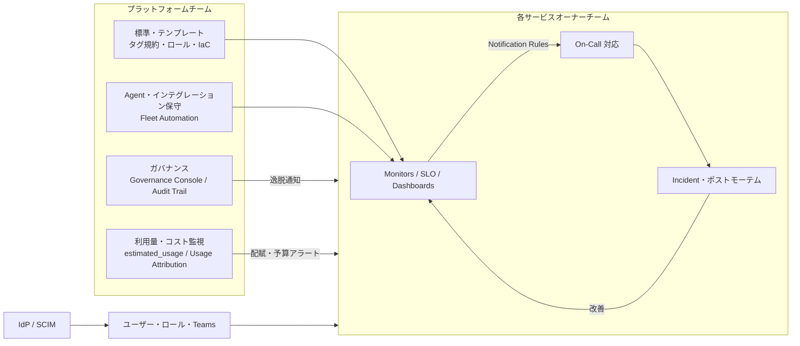
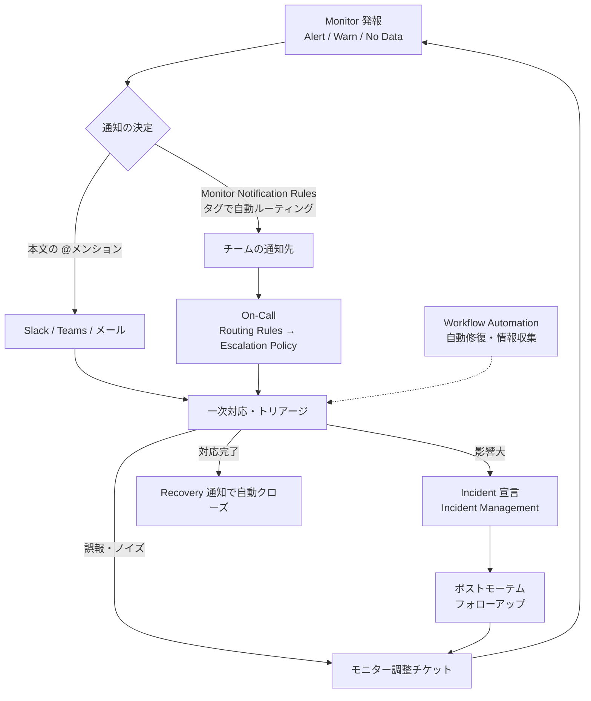
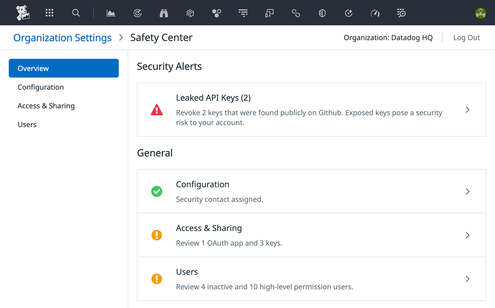
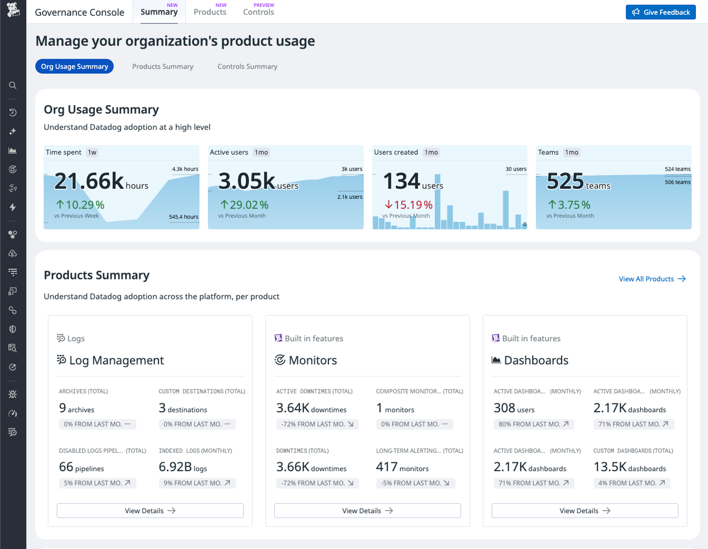

# 運用設計

## 概要

本ファイルは、Datadog の導入後に「誰が・何を・どの頻度で」運用するかを決める**運用設計**の指針をまとめる。対象読者は、運用移行を設計するコンサルタント、PM、アーキテクト、プラットフォームチームのリーダーである。

本ファイルが扱う範囲は次の 7 領域である。

| # | 領域 | 主な問い |
|---|---|---|
| 1 | 運用体制（プラットフォームチーム） | 中央チームは何を担い、各開発・運用チームとどう分担するか |
| 2 | アラート運用フロー | アラートは誰にどう届き、どう対応・振り返り・改善されるか |
| 3 | ユーザー・権限運用 | 入社・異動・退職、ロール保守、キーとトークンの管理をどう回すか |
| 4 | Agent／インテグレーションの保守 | Agent をどの頻度で更新し、健全性をどう監視するか |
| 5 | 利用量とコストの監視 | 使いすぎをどう早期検知し、予算をどう管理するか |
| 6 | ガバナンス | タグ・所有者・設定の逸脱をどう検知・是正するか |
| 7 | 定期レビュー | 日次〜年次で何を見直すか |

Datadog 公式の Administrator's Guide は導入を Plan / Build / Run の 3 段階で説明しており、本ファイルは主に **Run（運用）** に相当する。公式 Run ページは「キーローテーション、パッチ適用、オンボーディング、IaC といった既存の標準プロセスに Datadog を組み込み、その標準を早期に公開すること」を要点としている。[出典](https://docs.datadoghq.com/administrators_guide/run/)

本ファイルは運用の**設計方針**に絞る。各機能の仕様（設定項目・API・制限値）は以下のリファレンスを正とし、本文では必要な数値だけを引用する。

| 関連テーマ | 参照先 |
|---|---|
| 導入プロジェクトの体制・WBS・定着 KPI | [導入方法論](./implementation-methodology.md) |
| org 構成・RBAC・タグの基本設計 | [要件定義とアーキテクチャ設計](./requirements-and-architecture-design.md) |
| Agent の展開方式・リング展開 | [Agent 展開設計](./agent-rollout-design.md) |
| SAML・監査・コンプライアンス | [セキュリティとコンプライアンス](./security-and-compliance.md) |
| サポート窓口・教育 | [サポートと教育](./support-and-training.md) |
| ロール・権限・Teams の仕様 | [組織・ユーザー・権限管理](../02_リファレンス/platform/account-and-access-management.md) |
| キー・トークンの仕様 | [API とキー管理](../02_リファレンス/platform/api-and-keys.md) |
| 利用量・コストの仕様 | [Usage・Usage Attribution・Cost Visibility](../02_リファレンス/platform/usage-and-cost-attribution.md) |
| モニター・通知・Downtime | [Monitors](../02_リファレンス/platform/monitors.md)、[通知と Downtime](../02_リファレンス/platform/notifications-and-downtimes.md) |
| オンコール・インシデント | [On-Call](../02_リファレンス/service-management/on-call.md)、[Incident Management](../02_リファレンス/service-management/incident-management.md) |
| Fleet Automation | [Fleet Automation と Remote Configuration](../02_リファレンス/platform/fleet-automation.md) |
| 監査ログ | [Audit Trail](../02_リファレンス/platform/audit-trail.md) |
| 実践知見 | [アラート設計とノイズ削減](../04_応用編/alert-design-and-noise-reduction.md)、[コスト最適化](../04_応用編/cost-optimization.md)、[Monitoring as Code](../04_応用編/monitoring-as-code.md)、[組織への定着](../04_応用編/organizational-adoption.md)、[大規模・マルチorg運用](../04_応用編/large-scale-and-multi-org.md) |

---

## 1. 運用設計の全体像

### 1.1 運用領域と主な Datadog 機能

Datadog の運用設計では、各運用領域に対して「使う機能」「担当」「頻度」を決める。下表は本ファイル全体の索引である。担当・頻度は【経験則】に基づく初期値であり、組織の規模と規制要件に合わせて調整する。

| 運用領域 | 主に使う Datadog 機能 | 主担当（例） | 頻度（例） |
|---|---|---|---|
| アラート対応 | Monitors、Monitor Notification Rules、On-Call、Incident Management、Workflow Automation | 各サービスオーナーチーム | 常時 |
| アラート品質改善 | Monitor Quality、Monitor Status、Event Management | 各チーム＋プラットフォームチーム | 週次〜月次 |
| ユーザー・ロール | SAML、SCIM、Roles、Teams、Restriction Policies | プラットフォームチーム＋IdP 管理者 | 随時（自動）＋四半期監査 |
| キー・トークン | API Keys、Application Keys、Service Accounts、PAT／SAT、Safety Center | プラットフォームチーム＋セキュリティ | 四半期ローテーション・監査 |
| Agent 保守 | Fleet Automation、Remote Configuration、`datadog-agent status` / `flare` | プラットフォームチーム＋インフラチーム | 月次更新 |
| インテグレーション保守 | Integrations 画面（Issues）、クラウド連携の権限更新 | プラットフォームチーム | 月次確認 |
| 利用量・コスト | `datadog.estimated_usage.*`、Plan & Usage、Usage Attribution、Cost Monitor | FinOps 担当 | 日次アラート＋月次レビュー |
| ガバナンス | Governance Console、Tag Policies、Audit Trail、Terraform | プラットフォームチーム | 継続検知＋月次〜四半期 |
| 外部依存の把握 | Datadog ステータスページ、リリースノート、Agent の GitHub Releases | プラットフォームチーム | 常時購読 |

### 1.2 運用の流れ（全体図）

この図の要点は、**プラットフォームチームが「標準と土台」を、各チームが「自サービスの監視とアラート対応」を所有する**分担である。Datadog Architecture Center の記事も、中央オブザーバビリティチームがベンダー評価・トレーニング・セキュリティ・コスト配賦・RBAC・標準化・コミュニティ構築を担い、各チームが実践を採用するという分担を示している。[出典](https://www.datadoghq.com/architecture/achieving-observability-excellence-key-central-responsibilities/)（2024-11-14 公開）

---

## 2. 運用体制（プラットフォームチーム）

### 2.1 体制モデル

Datadog の運用体制は、中央チームがどこまで作業を担うかで 3 つに分かれる。モデル選択の詳細は [導入方法論 §5.4](./implementation-methodology.md) を参照。運用フェーズでは次の観点で見直す。【経験則】

| モデル | 運用フェーズでの姿 | 運用で必要になる仕組み |
|---|---|---|
| 中央集権型 | 中央チームがモニター・ダッシュボード作成まで代行する | 申請窓口と SLA。中央チームのキャパシティ管理 |
| セルフサービス型（プラットフォームモデル） | 中央チームは土台・規約・テンプレートを提供し、各チームが自分で作る | Tag Policies、Governance Controls などによる逸脱の自動検知。テンプレート（Powerpack、Monitor Templates、Terraform モジュール） |
| ハイブリッド型 | 導入初期は中央主導、定着につれてセルフサービスへ移る | 権限委譲の基準（例：教育修了でカスタムロール付与）と移行時期 |

数十チーム以上の組織では、中央チームが全モニターを作る中央集権型はボトルネックになりやすく、セルフサービス型＋自動ガードレールが現実的である。【経験則】Datadog 公式ブログ（2025-08-25 公開）も、チーム単位のアラートルーティング、Workflow の blueprint によるチーム外編集の制限、Terraform によるダッシュボード管理を組み合わせ、規模が大きくなってもモニターやダッシュボードが「孤児」にならないようにする運用を推奨している。[出典](https://www.datadoghq.com/blog/dashboards-monitors-at-scale/)

### 2.2 プラットフォームチームの責務

プラットフォームチーム（中央オブザーバビリティチーム、Observability CoE とも呼ばれる）の運用上の責務を、公式資料を基に整理する。

| 区分 | 責務 | 根拠 |
|---|---|---|
| オンボーディング | 新規インフラ・新規アプリの監視開始。Fleet Automation で Agent を大規模にリモート管理し、新しいインフラ要求を早期に把握する | 公式 Run ページ [出典](https://docs.datadoghq.com/administrators_guide/run/) |
| アプリの標準化 | `version` タグの自動付与（ビルド工程に組み込む）、Software Catalog（旧称：Service Catalog）の整備 | 同上 |
| 技術的問題への対応 | `datadog-agent status` で一次切り分け、`datadog-agent flare` でサポートへ連携 | 同上 |
| Usage 監視 | 推定使用量ダッシュボードを土台に、推定使用量メトリクスへのモニター（急増を検知する anomaly／change モニターを含む）を設定 | 同上 |
| コンテンツ展開 | ダッシュボード・モニター・SLO を JSON／Terraform／API で管理。目的を定義し、既製ダッシュボードを再利用 | 同上 |
| キー管理 | API／アプリケーションキーを自社の鍵管理に統合し、論理的なグループごとにキーを分けてローテーションを容易にする | 同上 |
| RBAC | SAML と AD／LDAP のグループ名・属性を IdP 管理者と調整し、グループを Datadog の権限にマッピング | 同上 |
| Agent 更新 | 既存のパッチ管理・アップグレード方針に Datadog を含め、GitHub のリリースフィードを購読し、Fleet Automation で更新が必要な Agent を監視 | 同上 |
| ガバナンス | 脆弱性・社内ポリシー適合の確認と CVE 追跡、RBAC、Audit Trail による API 利用のレビュー、Service Account の推奨、RBAC で保護された資産を作る Terraform リポジトリの提供 | Architecture Center [出典](https://www.datadoghq.com/architecture/achieving-observability-excellence-key-central-responsibilities/)（2024-11-14 公開） |
| 採用度・コスト | 製品の採用率・利用分析を測り、採用度の低いチームに教育を集中。支出の監視とチーム／コストセンターへの配賦 | 同上 |
| 標準・テンプレート | データ収集方法の標準化、タグ規約の強制と逸脱監視、テンプレートと既製モニター設定の共有、社内コミュニティの育成 | 同上 |
| 社内サポート | インストール作業のカタログ化、申請時の最小情報の定義、Wiki／ServiceNow／Jira での申請プロセス公開 | 公式 Build ページ [出典](https://docs.datadoghq.com/administrators_guide/build/) |

### 2.3 運用フェーズの役割定義

下表は運用フェーズの役割定義の例である。【経験則】導入プロジェクト期の役割（スポンサー、PM 等）は [導入方法論 §5.2](./implementation-methodology.md) を参照。

| 役割 | 所属 | 主な運用責任 | 必要なロール・権限（例） |
|---|---|---|---|
| プラットフォームオーナー | プラットフォームチーム | org の所有者。規約・ロードマップ・ベンダー窓口（営業・TAM）の責任者。契約更新時の数量見直し | Organization Admin 相当 |
| プラットフォームエンジニア | プラットフォームチーム | Agent・インテグレーション保守、IaC、テンプレート、ガバナンス制御の運用 | Platform Admin 相当（課金・ユーザー管理は除外可） |
| FinOps 担当 | プラットフォームチームまたは財務 | 利用量アラート対応、月次コストレビュー、配賦レポート | `usage_read`＋`billing_read` を持つカスタムロール |
| セキュリティ担当 | セキュリティ部門 | Safety Center・Audit Trail の確認、キー漏洩対応、権限監査 | `audit_logs_read` 等 |
| IdP 管理者 | 情報システム部門 | SAML／SCIM の設定、グループ管理、入退社の反映 | Datadog 側の権限は不要（IdP 側） |
| サービスオーナー（チームリーダー） | 各開発・運用チーム | 自チームのモニター・SLO・ダッシュボード、通知先、オンコールの維持 | Standard User 相当＋Team 管理 |
| オンコール担当 | 各チーム | アラートの一次対応、インシデント宣言 | Standard User 相当 |
| チャンピオン | 各チーム | チーム内の一次問い合わせ、規約の浸透、フィードバック | Standard User 相当 |

公式は、カスタムロールを 4〜6 個から始め（Read Only、Standard User、Platform Admin、Organization Admin、Restricted User 等）、ロールは「所有」ではなく「権限」で設計し、所有と責任は Teams で表すことを推奨している。[出典](https://docs.datadoghq.com/getting_started/access_for_enterprises/permissions/) ロールの詳細は [組織・ユーザー・権限管理 §8](../02_リファレンス/platform/account-and-access-management.md) を参照。

### 2.4 運用タスクの RACI（例）

`【経験則】` R: 実行責任、A: 説明責任、C: 協議、I: 報告。

| 運用タスク | プラットフォームオーナー | プラットフォームエンジニア | FinOps | セキュリティ | IdP 管理者 | サービスオーナー |
|---|---|---|---|---|---|---|
| 新規チーム・サービスのオンボーディング | A | R | I | I | C | R |
| モニター・SLO の作成と維持 | I | C | I | I | — | A/R |
| アラート対応・インシデント | I | C（基盤起因時 R） | — | C（セキュリティ時 R） | — | A/R |
| 通知ルール・オンコール設定 | I | C | — | — | — | A/R |
| ユーザーの追加・削除・異動 | A | C | — | C | R | I |
| カスタムロールの保守 | A | R | — | C | C | I |
| キーのローテーション・監査 | A | R | — | C | — | C |
| Agent 更新 | A | R | — | C | — | C（業務影響の確認） |
| クラウド連携の権限更新 | A | R | — | C | — | I |
| 利用量アラート対応 | I | C | A/R | — | — | R（原因チーム） |
| 月次コストレビュー | A | C | R | — | — | C |
| ガバナンス逸脱の是正 | A | R | C | C | — | R（資産所有者） |
| 四半期アクセスレビュー | A | R | — | R | C | C |
| 契約更新・数量見直し | A/R | C | R | I | — | I |

### 2.5 社内申請窓口（サービスカタログ）

公式 Build ページは、社内向けに Datadog の「インストール作業カタログ」を作り、申請ごとに最小情報を定義して、Wiki、ServiceNow、Jira などで申請プロセスを公開することを推奨している。[出典](https://docs.datadoghq.com/administrators_guide/build/)

| 公式が挙げる作業カタログの例 | 申請時の最小情報（公式） |
|---|---|
| アプリケーションのオンボーディング | コストセンターコード |
| クラウドアカウントの追加 | アプリ名 |
| vSphere ノードの作成 | オーナー |
| データベースインスタンスの作成 | 運用チーム |
| サードパーティ製品の監視 | 現地固有の条件（ローカル条件） |
| Synthetic テストの追加 | — |
| モニターの作成 | — |
| ダッシュボードの作成・更新 | — |

申請の例として、運用設計書には次のような項目を定義する。【経験則】

| 申請種別 | 追加で求める情報（例） | 処理担当 | 目標リードタイム（例） |
|---|---|---|---|
| 新規サービスの監視開始 | `service` 名、`env`、`team`、言語・フレームワーク、ログ量見込み | プラットフォームエンジニア＋サービスオーナー | 5 営業日 |
| クラウドアカウント追加 | アカウント ID、リージョン、取得対象サービス、コストセンター | プラットフォームエンジニア | 3 営業日 |
| ユーザー権限の変更 | 対象 IdP グループ、理由、期間 | IdP 管理者 | 2 営業日 |
| ログインデックス・保持期間の変更 | 理由、想定量、費用負担部門 | プラットフォームエンジニア＋FinOps | 5 営業日 |
| 新製品の利用開始（例：RUM、Cloud SIEM） | 用途、量の見込み、予算 | プラットフォームオーナー＋FinOps | 契約状況による |

> 新製品の利用開始を申請制にする理由は、契約外の製品を使うとオンデマンド料金が発生するためである。初回利用は First-time usage notifications（Beta）でも検知できる。[出典](https://docs.datadoghq.com/account_management/plan_and_usage/usage_details/) 詳細は [§6](#6-利用量とコストの監視)。

### 2.6 Datadog 側との接点

| 接点 | 内容 | 運用での使い方 |
|---|---|---|
| サポート | Support Website からチケット起票（全サイト共通）。アプリ内の Support > Live Chat with Human は月〜金 10:00〜19:00（米国東部時間） | `flare` 添付の起票手順をランブック化する |
| ステータスページ | サイトごとに別ページ（例：AP1 は `https://status.ap1.datadoghq.com`、US1 は `https://status.datadoghq.com`） | 自社が使うサイトのページを購読し、Datadog 側障害と自社障害を切り分ける |
| リリース情報 | Agent の GitHub Releases、Datadog の新リリース・セキュリティニュースレター、公式ブログ「The Monitor」 | Agent 更新計画と新機能の評価に使う |
| TAM・営業 | 契約内容・利用量の相談、上限引き上げ申請 | 四半期または契約更新前に定例化 |

[出典](https://docs.datadoghq.com/help/)、[出典](https://docs.datadoghq.com/administrators_guide/run/)、ステータスページの URL は [Datadog Sites](../02_リファレンス/platform/datadog-sites.md) を参照。サポートプランの違いは [サポートと教育](./support-and-training.md) を参照。

> **サイト差異:** ステータスページはサイトごとに分かれている（US1-FED は `status.ddog-gov.com`）。自社の org が属するサイトのページを購読すること。[Datadog Sites](../02_リファレンス/platform/datadog-sites.md)

### 2.7 運用ドキュメント（ランブック）の一覧

運用開始までに整備するドキュメントの例を示す。【経験則】

| ドキュメント | 内容 | 主管 |
|---|---|---|
| 運用設計書 | 本ファイルの各節（体制、フロー、頻度、権限）を自社向けに確定したもの | プラットフォームオーナー |
| タグ規約・命名規約 | 必須タグ、値の集合、モニター・ダッシュボード名の規則 | プラットフォームチーム（[タグ戦略の実践](../04_応用編/tagging-strategy.md)） |
| オンボーディング手順書 | サービス・クラウドアカウント・ユーザー追加の手順 | プラットフォームエンジニア |
| アラート対応ランブック | モニターごとの調査手順と判断基準（モニター本文からリンク） | サービスオーナー |
| Agent 保守手順書 | 更新手順、ロールバック、`status`／`flare` の取得方法 | プラットフォームエンジニア |
| キー漏洩対応手順書 | 失効・再発行・影響調査の手順（§4.5） | セキュリティ担当 |
| Datadog 障害時手順書 | ステータスページ確認、代替監視、ユーザーへの周知 | プラットフォームオーナー |
| コストレビュー資料テンプレート | 月次の利用量・予実・施策の記録 | FinOps 担当 |
| ブレークグラス手順書 | SAML／IdP 障害時の管理者ログイン手順 | プラットフォームオーナー＋セキュリティ |

---

## 3. アラート運用フロー

### 3.1 全体フロー

Datadog のアラート運用は、Monitor の発報から通知、オンコール対応、インシデント管理、振り返りによるモニター改善までを 1 つのループとして設計する。

| 段階 | 使う機能 | 設計で決めること | 詳細 |
|---|---|---|---|
| 発報 | Monitors | 重要度（Priority P1〜P5）、閾値、評価ウィンドウ、No Data の扱い、Multi Alert のグループ | [Monitors](../02_リファレンス/platform/monitors.md) |
| 通知 | 本文の `@` メンション、Monitor Notification Rules | 通知先の決定方法（モニター個別かタグベースか）、Priority ごとのチャネル | [通知と Downtime](../02_リファレンス/platform/notifications-and-downtimes.md) |
| 呼び出し | On-Call（または PagerDuty 等の外部ツール） | ルーティングルール、エスカレーション、スケジュール、営業時間外の扱い | [On-Call](../02_リファレンス/service-management/on-call.md)、[通知・コラボレーション連携](../02_リファレンス/platform/collaboration-integrations.md) |
| 対応 | Monitor Status 画面、Notebooks、Workflow Automation、Bits AI | ランブックの場所、自動化する初動 | [Workflow Automation](../02_リファレンス/service-management/workflow-automation.md)、[Bits AI と AI 機能](../02_リファレンス/ai/bits-ai.md) |
| 宣言 | Incident Management | 宣言基準（Severity 定義）、役割、コミュニケーション先 | [Incident Management](../02_リファレンス/service-management/incident-management.md) |
| 振り返り | ポストモーテム、フォローアップ、Case Management | 振り返り対象の基準、モニター改善の追跡 | [Case Management](../02_リファレンス/service-management/case-management.md) |
| 計画停止 | Downtime | 定期メンテナンスの登録方法、終了時通知 | [通知と Downtime](../02_リファレンス/platform/notifications-and-downtimes.md) |

### 3.2 重要度（Priority）と通知チャネルの対応

Datadog の Monitor Priority は P1（最高）〜P5（最低）の 5 段階で、本文の条件変数（`{{#is_priority 'P1'}}`）や Notification Rules のスコープ条件に使える。[出典](https://docs.datadoghq.com/monitors/notify/)、[出典](https://docs.datadoghq.com/monitors/notify/variables/) 運用設計では、Priority ごとに「誰を・どう・いつ」呼ぶかを決める。下表は例である。【経験則】

| Priority | 定義（例） | 通知チャネル（例） | 応答目標（例） | インシデント宣言 |
|---|---|---|---|---|
| P1 | 顧客影響のある本番障害、SLO の急速な消費 | On-Call ページ（電話・プッシュ）＋チーム Slack | 5〜15 分以内に Acknowledge | 原則宣言 |
| P2 | 顧客影響の可能性が高い本番の劣化 | On-Call ページ（営業時間外は低緊急度）＋Slack | 30 分以内 | 判断して宣言 |
| P3 | 本番の予兆（容量逼迫、エラー率上昇の傾向） | チーム Slack チャネル | 当日中 | 不要 |
| P4 | 非本番の障害、対応が翌営業日でよいもの | 低優先 Slack チャネル／チケット | 翌営業日 | 不要 |
| P5 | 情報通知（デプロイ通知、利用量の傾向） | ダッシュボード・ダイジェスト | 対応不要 | 不要 |

- 公式ブログの例では、決済チーム向けのルールで本番アラートはオンコールをページし、ステージングのアラートは低優先の Slack チャネルに流している。[出典](https://www.datadoghq.com/blog/monitor-notification-rules/)（2025-06-27 公開、2026-02-17 更新）
- Notification Rules のスコープで Priority を条件にする場合、タグとしては小文字（`priority:p1`）で指定しないと一致しなかったという検証報告がある。【第三者情報】[出典](https://dev.classmethod.jp/articles/datadog-monitor-notification-rules-tag-based-alert/)（2026-01-29 公開）

### 3.3 通知ルーティングの設計

Datadog で通知先を決める方法は、モニター本文に `@` メンションを書く方法と、**Monitor Notification Rules（通知ルール）** でタグに基づき自動的に宛先を付ける方法の 2 つである。モニター数が多い組織では、通知先をモニター個別に書かずに通知ルールへ集約すると、チーム改編やチャネル変更時の修正箇所が減る。【経験則】

| 項目 | Monitor Notification Rules の仕様（2026-11-02 時点） |
|---|---|
| Manual routing | 宛先を指定。無条件、またはステータス（Alert／OK／Warn／No data）やタグ（1 条件 1 タグキー）を条件に通知 |
| Dynamic routing【Preview】 | Service-based：モニターの `service` タグから Software Catalog の所有チームを引いて通知。Team-based：`team` タグから Team の通知チャネルを引いて通知。解決できない場合のフォールバック宛先が必須 |
| 宛先 | Manual：メールと任意のインテグレーションチャネル。Dynamic：Slack、メール、PagerDuty、Microsoft Teams |
| 一致判定 | モニターのタグと発報グループのタグを合わせて判定。複数ルールが一致した場合は宛先を統合・重複排除 |
| 上限 | 組織あたり既定 1,000 ルール、1 ルールあたり宛先 50、スコープ 3,000 文字 |
| スコープ構文 | `AND`／`OR`／`NOT`。ワイルドカードは `key:*` のみ（`service:web-*` のような部分一致は不可）。キーなしタグは不可 |
| 権限 | `monitor_config_policy_write`、または `monitor_notification_rules_write`【Preview】 |

[出典](https://docs.datadoghq.com/monitors/notify/notification_rules/)

公式ブログが挙げる通知ルールの運用ベストプラクティスは次の 3 点である。[出典](https://www.datadoghq.com/blog/monitor-notification-rules/)（2025-06-27 公開、2026-02-17 更新）

| ベストプラクティス | 内容 | 運用設計への落とし込み【経験則】 |
|---|---|---|
| タグを一貫して付ける | `team`、`service`、`env` をすべてのモニターに必須にする。Monitor の Tag Policies で強制できる | Tag Policies で `team`・`env` を「必須かつ値限定」にする（§7.3） |
| 所有者を明確にする | 1 つのルールは 1 つのチームにスコープする | ルール名にチーム名を含め、ルールも Terraform で管理する |
| 狭く始めて広げる | 例：`team:payment-processing AND env:prod AND priority:p1` から始め、確認後に広げる（ブログ原文の例は `priority:P0` だが、Datadog の Priority は P1〜P5 で P0 は存在しないため、ここでは `priority:p1` に置き換えた） | 新チームのオンボーディング時は本番 P1 のみから開始する |

### 3.4 オンコールとエスカレーション

Datadog On-Call を使う場合、Team ごとに Routing Rules（条件と緊急度でどのエスカレーションポリシーへ送るか）、Escalation Policy（段階的な呼び出し）、Schedule（当番表）を定義する。仕様は [On-Call](../02_リファレンス/service-management/on-call.md) を参照。PagerDuty、Opsgenie などの外部ツールを使い続ける場合は、Datadog 側は通知ルールで外部ツールに渡すまでを責任範囲とする。

運用設計で決める事項の例。【経験則】

| 決定事項 | 選択肢・例 |
|---|---|
| オンコールツール | Datadog On-Call／既存ツール（PagerDuty 等）の継続／併用期間を設けて移行 |
| オンコール単位 | Team 単位（Datadog Teams と一致させる） |
| 当番体制 | 週次ローテーション、フォロー・ザ・サン（拠点間引き継ぎ） |
| エスカレーション段数 | 一次（当番）→ 二次（副当番・リーダー）→ 三次（マネージャー） |
| 時間外の扱い | P1 のみ時間外ページ、P2 以下は翌営業日（Routing Rules の Support hours で表現） |
| ページ以外の通知 | Slack のチームチャネルへ同時投稿 |
| 引き継ぎ | Handover の自動化、当番交代時の未解決アラート共有 |

### 3.5 インシデント管理との接続

Datadog Incident Management は、モニターやページからインシデントを宣言し、Severity、役割、タイムライン、ポストモーテム、フォローアップを管理する機能である。仕様は [Incident Management](../02_リファレンス/service-management/incident-management.md) を参照。既存の ITSM（ServiceNow 等）を正とする組織では、Datadog はアラートの発生源とし、チケットは ITSM で管理するといった責任分界を決める。【経験則】

公式ブログ（2025-08-25 公開）は、**インシデントのたびに、どのモニターが発報したか、ノイズが多すぎなかったか、エスカレーションが適切だったかを振り返る**ことを推奨している。[出典](https://www.datadoghq.com/blog/dashboards-monitors-at-scale/)

### 3.6 計画停止（Downtime）の運用

Datadog の Downtime は、計画メンテナンス中のモニター通知を抑止する機能である。運用上の注意点を示す。

| 論点 | 内容 | 出典・確度 |
|---|---|---|
| 終了日時のない Downtime | 終了日時は任意で、省略すると Downtime は終了しない（Governance Console では「終了の定義がないアクティブな Downtime」として Forever Downtimes コントロールで検出される） | [出典](https://docs.datadoghq.com/monitors/downtimes/)、[出典](https://docs.datadoghq.com/account_management/governance_console/controls/) |
| 長期ミュートの検知 | Monitor Quality は 60 日を超えてミュート（部分的なミュートを含む）されたモニターを検出する | [出典](https://docs.datadoghq.com/monitors/quality/) |
| 無期限 Downtime の自動取り消し | Governance Console の Forever Downtimes コントロールは、終了日時のないアクティブな Downtime を検出し、取り消して監視を再開させる自動是正を選べる | [出典](https://docs.datadoghq.com/account_management/governance_console/controls/) |
| 定期メンテナンス | 繰り返しスケジュール（RRULE）で登録し、IaC で管理する | 【経験則】 |
| クラウド VM の停止 | オートスケールなどで意図的に停止した VM はクラウド連携により自動ミュートできる | [通知と Downtime §8](../02_リファレンス/platform/notifications-and-downtimes.md) |
| SLO への影響 | Downtime と SLO の関係は [通知と Downtime §7.10](../02_リファレンス/platform/notifications-and-downtimes.md) を参照 | — |

運用ルール例：「Downtime は必ず終了日時を設定する。無期限が必要な場合はモニター自体の削除・無効化を検討する」。【経験則】

### 3.7 アラート品質の継続改善

Datadog の **Monitor Quality** は、Manage Monitors 画面のタブで、設定に問題のあるモニターを検出する機能である。最初のモニター作成後に自動で有効になり、Teams、Creators、Services、Environments で絞り込める。[出典](https://docs.datadoghq.com/monitors/quality/)

| Monitor Quality が検出する問題 | 推奨アクション |
|---|---|
| High volume of alerts（アラートが多すぎる） | 閾値・評価ウィンドウの調整 |
| Muted for over 60 days（60 日超のミュート） | ミュート解除または削除 |
| Missing recipients（通知先なし） | 通知先の追加 |
| Missing a delay（AWS／Azure／Google Cloud のデータで Evaluation Delay なし） | Evaluation Delay の追加 |
| Misconfigured notification channels（壊れた `@` 通知） | ハンドルの修正 |
| Composite monitors missing constituents（構成モニターが削除された Composite） | 削除 |
| Stuck in alert state（常に ALERT） | 調査・編集 |

[出典](https://docs.datadoghq.com/monitors/quality/)

アラート品質のレビュー観点（月次の例）。【経験則】詳細な手法は [アラート設計とノイズ削減](../04_応用編/alert-design-and-noise-reduction.md) を参照。

| 観点 | 指標の例 | 改善アクション |
|---|---|---|
| ノイズ | 対応不要だったアラートの比率、1 人あたり週間ページ数 | 閾値見直し、Anomaly／Outlier への置き換え、Composite 化 |
| 見逃し | インシデントのうちモニター起点でなかった件数 | モニター追加、SLO アラートの導入 |
| 応答 | Acknowledge までの時間、エスカレーション発生率 | ルーティング・当番体制の見直し |
| 所有 | `team` タグのないモニター数、通知先のないモニター数 | Tag Policies、Governance Controls で検知 |
| 陳腐化 | 数か月発報していないモニター、新しいアラートと重複するモニター | 削除・統合 |

公式ブログ（2025-08-25 公開）は、**数か月ごとにモニターを監査し、タグ・作成日・発報頻度で絞り込んで、数か月発報していないものや新しいアラートと重複するものを削除する**ことを推奨している。また、変動のあるワークロードや季節性には静的閾値より Anomaly／Outlier モニターを使うこと、アラートストームは APM の依存関係マッピング、指数バックオフ、計画 Downtime で抑えることを挙げている。[出典](https://www.datadoghq.com/blog/dashboards-monitors-at-scale/)

### 3.8 Datadog 自体の障害・取り込み遅延への備え

Datadog は SaaS のため、Datadog 側の障害やデータ遅延でアラートが遅れる・出ない可能性がある。運用設計では次を決める。【経験則】

| 備え | 内容 |
|---|---|
| ステータスページの購読 | 自社サイトのステータスページ（例：`https://status.ap1.datadoghq.com`）を運用チャネルに連携する |
| No Data の扱い | 重要なモニターでは No Data 通知を有効にし、データ途絶自体を検知する（仕様は [Monitors](../02_リファレンス/platform/monitors.md)） |
| 外形の二重化 | 最重要サービスでは、Datadog 外の簡易な死活監視（クラウド事業者の監視など）を併用するかを判断する |
| Agent 側のバッファ | ネットワーク断時に Agent がデータを一時保持する仕組みと上限は [ネットワーク・接続要件](./network-and-connectivity.md) を参照 |
| 周知 | Datadog 側障害時に社内へ「監視が不完全である」ことを周知する手順を用意する |

---

## 4. ユーザー・権限運用

### 4.1 基本方針

Datadog 公式の Access for Enterprises ガイド（100 ユーザー以上、規制業種などの組織向け）は、ユーザー運用について次の方針を示している。[出典](https://docs.datadoghq.com/getting_started/access_for_enterprises/assigning_users/)

| 方針 | 内容 |
|---|---|
| 自動化 | IdP のグループを Datadog の Roles と Teams にマッピングして割り当てを自動化する（「手動のユーザー管理はスケールしない」） |
| Roles と Teams の分離 | Roles は「プラットフォーム全体で何ができるか」、Teams は「何に責任を持つか」（所有するサービス、リポジトリ、モニター、ログ）を表す。1 つの仕組みに両方の意味を持たせない |
| チーム単位の昇格 | チーム全員に昇格が必要な場合は team-linked Roles【Preview】でチームにロールを割り当てる |
| 管理者の締め出し防止 | 資産をチームに制限する前に、管理者用のオーバーライド Team を作る |
| 一時的な特権 | 緊急のインシデント対応などには Request Access【Preview】を使い、管理者承認を経由させる |
| 定期監査 | 業務に必要以上の権限を持つユーザー、割り当てのないロール、古いチームメンバーシップを定期的に確認する |

同ガイドはレビュー周期や入退社の具体手順は定めておらず、「退職処理は IdP のプロビジョニング解除と連動させる」ことを求めている。[出典](https://docs.datadoghq.com/getting_started/access_for_enterprises/assigning_users/) 以下の手順・周期は公式の仕様を組み合わせた【経験則】である。

### 4.2 ユーザーライフサイクル

| イベント | 推奨する処理（SAML＋SCIM 構成の例） | Datadog 側で起きること・注意点 |
|---|---|---|
| 入社・利用開始 | IdP で対象グループに追加 → SCIM でユーザー作成、SAML／SCIM のマッピングでロール・Team を付与 | SCIM でマッチするロールがない場合は org の既定ロール（Standard）になる。JIT プロビジョニングの既定ロールも Standard |
| 異動 | IdP のグループを変更 → ロール・Team が自動更新 | SCIM は SAML マッピングより優先される。両方を使う場合はロールの正を SCIM に一本化する（公式推奨） |
| 一時的な特権付与 | Request Access【Preview】、または期限付きのグループ追加 | 付与と解除を Audit Trail で記録する |
| 休職 | IdP でアカウント無効化 → Datadog ユーザーを無効化 | — |
| 退職 | IdP でアカウント無効化・グループ削除 → SCIM で Datadog ユーザーを無効化 | ユーザーが作成したアプリケーションキーは失効する。PAT の扱いは公開情報では確認できず（PAT はユーザー個人に紐づき、有効期限で自動失効する。[出典](https://docs.datadoghq.com/account_management/personal-access-tokens/)）、退職前に失効させるのが安全である【経験則】。**API キーとクライアントトークンは有効なまま**残る。所有ダッシュボード等は残る（Governance Console の「Dashboards Owned by Disabled Users」で検出可能） |
| 招待の放置 | 30 日以上未承諾の招待は再送か削除 | Safety Center が 30 日以上未承諾の招待を表示する。招待リンク自体の有効期限は 48 時間 |

[出典](https://docs.datadoghq.com/account_management/scim/)、[出典](https://docs.datadoghq.com/account_management/api-app-keys/)、[出典](https://docs.datadoghq.com/account_management/safety_center/)、[出典](https://docs.datadoghq.com/account_management/governance_console/controls/)、[出典](https://docs.datadoghq.com/account_management/users/)

> **退職時の落とし穴:** 個人が作ったアプリケーションキーで動いている Terraform や CI は、その人の退職でキーが失効し止まる。自動化は必ず Service Account のキー／SAT で動かす（公式推奨）。[出典](https://docs.datadoghq.com/getting_started/access_for_enterprises/credential_management/) 詳細は [API とキー管理 §9.4](../02_リファレンス/platform/api-and-keys.md)。

### 4.3 ロールの保守

Datadog のカスタムロールは、**新製品・新機能の権限を自動では受け取らない**。Managed Roles（Datadog Admin／Standard／Read Only）は Datadog が自動更新する。[出典](https://docs.datadoghq.com/account_management/rbac/)

| 保守タスク | 方法 | 頻度（例） |
|---|---|---|
| 新機能の権限への追従 | カスタムロールの **Automatic Updates** で Managed テンプレートに追従させる。追従させないロール（委託先用など）はリリースノートを確認し **Bulk Assign** で付与 | 月次確認【経験則】 |
| 機微な権限の点検 | `user_access_manage`、課金系、`org_management` などの Sensitive permissions を持つユーザー一覧を確認 | 四半期（公式は四半期監査を推奨） |
| 管理者数の点検 | Safety Center は管理者がユーザー全体の 10% を超えると警告する | 四半期 |
| 未使用・重複ロールの整理 | 割り当てのないロール、重複ロールを削除（Governance Console の「Roles without Users」で検出可能） | 四半期 |
| IaC との整合 | ロールを Terraform（`datadog_role`）で管理している場合、UI での変更を禁止し差分を検知する | 継続 |

[出典](https://docs.datadoghq.com/getting_started/access_for_enterprises/permissions/)、[出典](https://docs.datadoghq.com/account_management/safety_center/)、[出典](https://docs.datadoghq.com/account_management/governance_console/controls/)

> **注意:** Terraform や API で `default_permissions_opt_out` を使うと、明示的に付与していない既定権限（`dashboards_read`、`monitors_read` など）が外れ、意図しないアクセス喪失が起き得る（公式の警告）。[組織・ユーザー・権限管理 §8.4](../02_リファレンス/platform/account-and-access-management.md)

### 4.4 Teams の運用

| 運用項目 | 内容 | 根拠・確度 |
|---|---|---|
| Team と IdP の連携 | Team のメンバーシップも SAML／SCIM で IdP から同期し、手動編集と混在させない | 公式 Example Implementations の構成例（Okta＋SCIM で部門グループ→Team） [出典](https://docs.datadoghq.com/getting_started/access_for_enterprises/example_implementations/) |
| 所属のないユーザー | Governance Console の「Users in No Teams」で検出 | [出典](https://docs.datadoghq.com/account_management/governance_console/controls/) |
| 通知チャネル未設定の Team | 「Teams without Notification Channels」で検出（Team-based routing が機能しない原因になる） | 同上 |
| 不正な `team` タグ | 「Invalid Team Tags in Dashboards／Monitors」で存在しない Team 名を検出 | 同上 |
| 権限付与に使う Team | 「誰でも参加可」の Team はアクセス制御の付与先に使えないため、招待制にする | [組織・ユーザー・権限管理 §10](../02_リファレンス/platform/account-and-access-management.md) |
| 上限 | Team 数は org あたり最大 5,000、階層は最大 10 レベル | 同上 |

### 4.5 キー・トークンの運用

Datadog 公式の Credential Management ガイドは、キー運用について次の具体的な基準を示している。[出典](https://docs.datadoghq.com/getting_started/access_for_enterprises/credential_management/)

| 項目 | 公式の推奨 |
|---|---|
| API キーの単位 | データを送るチームまたは主要サービスごとに 1 つ（共有キーは監査と失効の負債になる） |
| 自動化の資格情報 | パイプライン（Terraform、CI/CD、スクリプト）ごとに Service Account と SAT を用意する |
| 命名 | 所有者と目的が分かる名前（例：`ci-pipeline-staging`） |
| スコープ | アプリケーションキー作成時にスコープを明示し、必要なエンドポイントに限定する |
| 短命トークン | 対話的な作業は PAT、自動化は SAT。長期有効のアプリケーションキーより PAT／SAT を優先。SAT は短い有効期限を強く推奨 |
| 保管 | HashiCorp Vault、AWS Secrets Manager、Azure Key Vault などに保管。ソースコード、環境ファイル、Terraform state に置かない |
| キーレス | クラウド事業者の ID マッピングによるキーレス認証を検討 |
| RUM のクライアントトークン | 認証付きプロキシ経由にしてエンドユーザーから隠す |

**ローテーションと監査の周期（公式）**

| 資格情報 | ローテーション | 備考 |
|---|---|---|
| API キー | **四半期ごと**、漏洩の疑いがあれば即時 | — |
| アプリケーションキー | 本番パイプラインのキーは**四半期ごと**。漏洩時、または作成者の退職時は即時 | — |
| PAT | 自動で期限切れになるためローテーション不要 | — |
| SAT | 期限付きならローテーション不要。長期有効で設定した場合は四半期ごと | — |
| 未使用キー | **90 日間**使われていないキーは調査し、目的・所有者が不明なキーは失効 | Governance Console、Safety Center、Audit Trail で利用状況を確認 |
| キー監査 | **四半期ごと**に、未使用キーの削除、退職者のキーの置き換え、本番キーのローテーション | — |

[出典](https://docs.datadoghq.com/getting_started/access_for_enterprises/credential_management/)

公式の Example Implementations では、大手金融機関の例で**アプリケーションキーの 90 日ローテーションを Terraform で強制**し、大手テクノロジー企業の例で**四半期ごとに未使用キーを特定・失効**している。[出典](https://docs.datadoghq.com/getting_started/access_for_enterprises/example_implementations/)

ローテーション手順（API キー）と漏洩時の公式手順は [API とキー管理 §9.2〜9.3](../02_リファレンス/platform/api-and-keys.md) を参照。要点は「新キー作成 → 利用側切り替え → 旧キーの利用停止を確認 → 旧キー失効（API キーは失効後 7 日以内なら復元可能）」である。

> **自動検出の閾値の違い:** 未使用 API キーの検出閾値は機能により異なる。Safety Center は **30 日以上**未使用の API キーを表示し、Governance Console の Unused API Keys／Unused Application Keys コントロールは既定 **30 日**（閾値は変更可能）、公式 Credential Management ガイドは **90 日**未使用を調査対象としている。運用設計では「30 日で通知、90 日で失効」のように段階を決めるとよい。【経験則】

### 4.6 Safety Center

Datadog の **Safety Center** は、Organization Settings にある、組織のセキュリティ警告と推奨事項をまとめた画面である。組織の管理者が高優先度の警告を確認し対処する。[出典](https://docs.datadoghq.com/account_management/safety_center/)

*キャプション：Organization Settings > Safety Center の Overview 画面。*
*画面説明：パンくずは「Organization Settings > Safety Center」。左メニューに Overview、Configuration、Access & Sharing、Users の 4 項目。右側の「Security Alerts」に赤い警告アイコン付きで「Leaked API Keys (2)」（GitHub 上で公開されていた 2 つのキーを失効するよう促す文言）がある。その下の「General」に、Configuration（緑のチェック、「Security contact assigned.」）、Access & Sharing（黄色の注意、「Review 1 OAuth app and 3 keys.」）、Users（黄色の注意、「Review 4 inactive and 10 high-level permission users.」）の 3 行が並び、各行の右端の矢印から詳細へ進む。*
*出典：https://docs.datadoghq.com/account_management/safety_center/ （2026-11-02 取得）*

| 区分 | 項目 | 検出・表示条件 | 推奨アクション |
|---|---|---|---|
| Security Alerts | Leaked application keys／Leaked API keys | 漏洩・公開されたキー | できるだけ早く失効（公開サイトから削除しても第三者に取得されていないことは保証されない） |
| Configuration | Security Contacts | 主・副のメールアドレスにセキュリティ通知を送る（公開キーの検出など） | 設定する。**6 か月ごと**に見直しのリマインダーが表示される |
| Access & Sharing | OAuth applications | 60 日以上非アクティブ、または書き込み権限があり 30 日以上非アクティブ | 不要なら無効化 |
| Access & Sharing | API keys | 30 日以上未使用 | インフラが依存していなければ失効 |
| Users | Pending invites | 30 日以上未承諾 | 再送または削除 |
| Users | Admin users | 管理者がユーザー全体の 10% を超える | 定期的に見直し、不要な管理者権限を外す |

[出典](https://docs.datadoghq.com/account_management/safety_center/)

> **サイト差異:** Safety Center は `app.ddog-gov.com`（US1-FED）と `us2.ddog-gov.com` では非対応。[出典](https://docs.datadoghq.com/account_management/safety_center/)

運用ルール例：「Security Contacts にはセキュリティ部門の共有メールボックスを設定する」「Safety Center の Overview を月次で確認し、Leaked Keys は検知時に即時対応する」。【経験則】

### 4.7 権限・設定変更の監査（Audit Trail）

Datadog Audit Trail は、ユーザーや API による操作（ロール変更、キー作成、ダッシュボード変更など）を記録する機能である。保持期間は 3／7／15／30／90 日から選び（有効化時の既定 90 日）、90 日を超える保管にはアーカイブを使う。Audit Trail は別料金の製品である。[Audit Trail](../02_リファレンス/platform/audit-trail.md)

運用で設定する Audit Trail Monitor の例。公式 Example Implementations の大手金融機関の例では、**ロール変更、キー作成、Data Access Control のポリシー変更**に Audit Trail のアラートを設定している。[出典](https://docs.datadoghq.com/getting_started/access_for_enterprises/example_implementations/)

| 監視対象（例） | 目的 | 通知先（例） |
|---|---|---|
| ロール・権限の変更 | 権限昇格の検知 | セキュリティ担当 |
| API キー・アプリケーションキーの作成・削除 | 不正なキー発行の検知 | セキュリティ担当＋プラットフォーム |
| SAML・ログイン方式・IP Allowlist の変更 | 認証設定の改変検知 | セキュリティ担当 |
| Data Access Control・Restriction Policy の変更 | データアクセス制御の改変検知 | セキュリティ担当 |
| ログのインデックス・保持期間・除外フィルターの変更 | コストと証跡への影響の検知 | FinOps＋プラットフォーム |
| Audit Trail 自体の設定変更・無効化 | 証跡の停止の検知 | セキュリティ担当 |

監査対象イベントのクエリと Monitor の作り方は [Audit Trail](../02_リファレンス/platform/audit-trail.md) を参照。

---

## 5. Agent／インテグレーションの保守

### 5.1 保守タスク一覧

| タスク | 内容 | 頻度（例） | 主な機能 |
|---|---|---|---|
| Agent のマイナー・パッチ更新 | 既存のパッチ管理に組み込み、テスト環境 → 本番の順で更新 | 月 1 回（公式推奨：マイナー・パッチごと、少なくとも月 1 回） | Fleet Automation の Upgrade Agents、構成管理ツール |
| 更新対象の把握 | Fleet Automation でアップグレードが必要な Agent を確認 | 週次〜月次 | Fleet View |
| Agent の死活監視 | Host Monitor で `datadog.agent.up` を監視 | 常時 | Monitors |
| インテグレーションの健全性 | BROKEN／UNCONFIGURED のインテグレーションを確認 | 週次 | Fleet View、Integrations 画面 |
| クラウド連携の権限更新 | AWS 等の連携ロールに必要な権限を最新化 | 月次確認、Issues 表示時に即時 | Integrations 画面の Issues |
| 構成ドリフトの確認 | IaC／構成管理の定義と実機の差分 | 月次 | 構成管理ツール、Fleet View |
| 脆弱性対応 | Agent 同梱コンポーネントの CVE 追跡 | 随時 | リリースノート、社内脆弱性管理 |
| 新バージョンの評価 | リリースノートで破壊的変更・新機能を確認 | 月次 | Agent の GitHub Releases |
| 撤去 | 廃止ホストの Agent 停止・削除、不要な API キーの失効 | 随時 | — |

[出典](https://docs.datadoghq.com/administrators_guide/run/)、[出典](https://docs.datadoghq.com/agent/versions/)

### 5.2 Agent の更新方針

Datadog は Agent を**少なくとも月 1 回、マイナー・パッチリリースごとに更新すること**を推奨し、メジャーリリースを待つことは推奨していない。最新メジャー（v7）の最新版を維持することが、最新機能と修正を得る唯一のサポートされた方法とされる。[出典](https://docs.datadoghq.com/agent/versions/) 2026-11-02 時点の最新版は 7.85.0 で、直近は概ね月 1 回マイナー版が出ている（詳細は [Datadog Agent §5](../02_リファレンス/platform/agent.md)）。

公式 Run ページは具体的な更新頻度を定めず、「ローカルのテスト・リリース手順に従う」「既存のパッチ管理・アップグレード方針に Datadog を含める」としている。[出典](https://docs.datadoghq.com/administrators_guide/run/)

更新方針の設計例。【経験則】展開方式とリング展開の詳細は [Agent 展開設計](./agent-rollout-design.md) を参照。

| 項目 | 設計例 |
|---|---|
| 対象バージョン | リリース後 1〜2 週間経ったマイナー版の最新パッチ |
| 段階 | Ring 0（検証環境）→ Ring 1（非本番）→ Ring 2（本番の一部）→ Ring 3（本番全体）。各段階で 2〜5 営業日観察 |
| 実施手段 | VM：Fleet Automation の Upgrade Agents（スケジュール実行）または構成管理ツール。Kubernetes：Helm チャート／Datadog Operator のバージョン更新 |
| 判定基準 | `datadog.agent.up` の欠落なし、インテグレーションの BROKEN 増加なし、メトリクス・ログ量の急変なし |
| 緊急更新 | セキュリティ修正は通常サイクルを待たず実施 |
| 事前確認 | カスタムチェックの互換性、`datadog.yaml` の非推奨設定 |

Fleet Automation のリモートアップグレードの主な仕様（2026-11-02 時点）：

| 項目 | 仕様 |
|---|---|
| 最低 Agent バージョン | Linux 7.69.0、Windows 7.71.1 |
| 対象 | Linux／Windows の VM。**コンテナ化された Agent は非対応** |
| 前提 | 組織と API キーで Remote Configuration を有効化し、各 Agent で `remote_updates: true`。ディスク：初回インストールに 2 GB 以上、アップグレード用にさらに 2 GB（ロールバック用に一時的に 2 つの Agent を保持するため） |
| 所要時間 | 約 5 分（再起動で 5〜30 秒のダウンタイム） |
| 失敗時 | 自動で旧バージョンへロールバック |
| 併用時の注意 | 構成管理ツールと併用すると、ツール側で固定したバージョン（`DD_AGENT_MINOR_VERSION`）に戻される可能性があるため、どちらか一方で管理する |

[出典](https://docs.datadoghq.com/agent/fleet_automation/upgrade_agents/)

> **サイト差異:** Fleet Automation のリモートアップグレードと Configure Agents は `app.ddog-gov.com`（US1-FED）と `us2.ddog-gov.com` では非対応。[Fleet Automation と Remote Configuration](../02_リファレンス/platform/fleet-automation.md)

### 5.3 Agent のヘルス監視

Datadog の各 Agent は `datadog.agent.up` というサービスチェックを `OK` で送る。**Host Monitor** でこのチェックを監視すると、指定した分数以上 `OK` が届かないときにアラートを出せる。ホストの一定割合が報告しなくなったときに通知する Cluster Alert も選べる。AIX の Agent は `datadog.agent.up` を送らないため、代わりに Agent が報告中に `1` を送る `datadog.agent.running` メトリクスを使う。[出典](https://docs.datadoghq.com/monitors/types/host/)

プラットフォームチームが用意する Agent 監視の例。【経験則】

| モニター | 対象 | 設定例 | 通知先 |
|---|---|---|---|
| Agent 停止（ホスト単位） | `datadog.agent.up` | Host Monitor、Multi Alert（`host` 単位）、本番のみ | 当該ホストのオーナーチーム（`team` タグでルーティング） |
| Agent 一斉停止 | `datadog.agent.up` | Cluster Alert（例：環境内の 10% 以上が未報告） | プラットフォームチーム（Datadog 側障害や API キー失効も疑う） |
| ホスト数の急減 | `datadog.estimated_usage.hosts` | Change／Anomaly モニター | プラットフォームチーム |
| ログ送信の途絶 | `datadog.estimated_usage.logs.ingested_events` を `service` 別に | 0 件継続で通知 | オーナーチーム |
| インテグレーションのチェック失敗 | 各インテグレーションのサービスチェック（`can_connect` 等） | Service Check Monitor | オーナーチーム |

トラブル時の一次切り分けは `datadog-agent status`、サポートへの連携は `datadog-agent flare` で行う（公式 Run ページは初日から両コマンドを使うことを推奨）。[出典](https://docs.datadoghq.com/administrators_guide/run/) コマンドの詳細は [Datadog Agent §6〜7](../02_リファレンス/platform/agent.md)。

### 5.4 インテグレーションの保守

Datadog のインテグレーションは取り込み方式により保守のしかたが異なる。

| 種類 | 保守のポイント | 詳細 |
|---|---|---|
| Agent ベース（同梱） | Agent に同梱されるため、Agent の更新に合わせて更新される。個別バージョンを固定する場合は `datadog-agent integration` コマンドで管理 | [Integrations §4](../02_リファレンス/platform/integrations.md) |
| Agent ベース（Community／Marketplace） | 個別にインストールしたものは Agent 更新時の扱いを確認する | 同上 |
| 認証（クローラー）ベース：AWS／Azure／Google Cloud | 連携用ロール・サービスプリンシパルの権限と資格情報の期限を保守する | [AWS](../02_リファレンス/platform/aws-integration.md)、[Azure](../02_リファレンス/platform/azure-integration.md)、[Google Cloud](../02_リファレンス/platform/gcp-integration.md) |
| SaaS 連携（Slack、PagerDuty 等） | トークンの期限、チャネル名変更、連携ユーザーの退職 | [通知・コラボレーション連携](../02_リファレンス/platform/collaboration-integrations.md) |
| カスタムチェック・OpenMetrics | 自社コードとして保守。Agent のメジャー更新時に互換性を確認 | [Integrations §5・§7](../02_リファレンス/platform/integrations.md) |

**AWS インテグレーションの権限更新:** Datadog の AWS インテグレーション画面の **Issues** から「Resolve All AWS Permissions Issues」を実行すると、Datadog の API から最新の必要権限を取得する CloudFormation スタックが起動し、`datadog-aws-integration-iam-permissions-` で始まるポリシーを作成して連携ロールにアタッチする（`SecurityAudit` ポリシーがなければ追加）。再実行すると同じ接頭辞の旧ポリシーは削除されてから作り直される。ロール名・External ID・信頼ポリシーの誤りや SCP による明示的な拒否は、この方法では直らない。IAM 変更後は再検証まで少なくとも 5 分待つ必要があり、UI に古いエラーが数時間残ることがある。[出典](https://docs.datadoghq.com/integrations/guide/aws-integration-troubleshooting/)

運用ルール例：「クラウド連携の Issues は週次で確認し、権限不足は月次メンテナンスで解消する。SaaS 連携の資格情報は Service Account または共有アカウントで作り、個人に紐づけない」。【経験則】

### 5.5 構成管理と責任分界

公式 Build ページは、Datadog のインストールを「ファイル（設定）・パッケージ（バイナリ）・サービス（OS のサービス管理）」の 3 つに分け、既存の構成管理（Ansible、Puppet、Chef、PowerShell、Bash、CloudFormation、Terraform 等）に組み込むこと、Agent パッケージを Artifactory や Nexus などの社内リポジトリに置くこと、設定ファイルをソース管理しテンプレート化することを推奨している。[出典](https://docs.datadoghq.com/administrators_guide/build/)

| 管理対象 | 正とする場所（例） | 変更経路 |
|---|---|---|
| Agent のバージョン | 構成管理ツール または Fleet Automation（どちらか一方） | 変更申請 → リング展開 |
| `datadog.yaml`・`conf.d` | Git リポジトリ（テンプレート） | プルリクエスト → 構成管理で配布。Fleet Automation の Configure Agents を使う場合はその範囲を明確化 |
| モニター・ダッシュボード・SLO | Terraform（本番・共通）／UI（チームの実験用） | プルリクエスト（[Monitoring as Code](../04_応用編/monitoring-as-code.md)） |
| ロール・Teams・キー | Terraform＋IdP | 変更申請・承認 |
| ログパイプライン・インデックス | Terraform | プルリクエスト＋FinOps レビュー |

Fleet Automation と構成管理ツールの使い分けは [Agent 展開設計](./agent-rollout-design.md) と [Fleet Automation と Remote Configuration](../02_リファレンス/platform/fleet-automation.md) を参照。

---

## 6. 利用量とコストの監視

### 6.1 数値の種類と使い分け

Datadog の利用量・コストの数値は、鮮度と精度が異なる複数の種類がある。運用では「即時検知」と「予算管理・請求照合」で使う数値を分ける。仕様の正は [Usage・Usage Attribution・Cost Visibility](../02_リファレンス/platform/usage-and-cost-attribution.md)。

| 数値 | 鮮度 | 精度 | 運用での用途 |
|---|---|---|---|
| Estimated Usage Metrics（`datadog.estimated_usage.*`） | 準リアルタイム | 推定値。請求値と平均 10〜20% の差 | 急増の即時検知、月初来（MTD）の割当量監視 |
| Usage 画面（Plan & Usage） | 最大 72 時間遅れ | 請求の基礎データ | 週次の傾向確認 |
| Datadog Costs／Cost Monitor | 48 時間遅れ | 金額ベース | 予算・予測・異常の金額アラート |
| Projected（予測）コスト | 当月のみ | 予測 | 月中の着地見込み |
| Historical（確定）コスト | 翌月 16 日頃に確定 | 確定値 | 請求照合、月次レビュー |

[出典](https://docs.datadoghq.com/account_management/billing/usage_metrics/)、その他の出典は [Usage・Usage Attribution・Cost Visibility](../02_リファレンス/platform/usage-and-cost-attribution.md) を参照。

### 6.2 利用量アラートの標準セット

公式 Run ページは、推定使用量のダッシュボードを土台に、推定使用量メトリクスへのモニター（使用量の急増を検知する anomaly／change モニターを含む）を設定することを推奨している。[出典](https://docs.datadoghq.com/administrators_guide/run/) プラットフォームチームが最初に用意するモニターの例を示す。対象は契約している製品に合わせて選ぶ。【経験則】

| 対象 | メトリクス・手段 | 条件の例 | 通知先 |
|---|---|---|---|
| ホスト数 | `datadog.estimated_usage.hosts` | 契約数（コミット）の 90% 超、または前週比で急増 | FinOps＋プラットフォーム |
| コンテナ数 | `datadog.estimated_usage.containers` | 急増（Anomaly） | 同上 |
| カスタムメトリクス | `datadog.estimated_usage.metrics.custom`（`.by_metric` で内訳） | 前日比の急増。タグ爆発の検知 | プラットフォーム＋原因チーム |
| ログ取り込み | `datadog.estimated_usage.logs.ingested_events` を `service`・`datadog_index` 別に | 異常な急増・途絶 | 原因チーム |
| インデックスログの MTD | 同上（`datadog_is_excluded:false`）、評価ウィンドウ Current month | 月の割当量の 80%／90% | FinOps |
| インデックスの Daily Quota | Event Monitor（`source:datadog datadog_index:* "daily quota reached"`）、および 24 時間でクォータの 80% 到達 | 到達・接近 | プラットフォーム＋原因チーム |
| APM 取り込み | `datadog.estimated_usage.apm.ingested_bytes`、評価ウィンドウ Current month | 割当量の 80%／90% | FinOps＋原因チーム |
| APM インデックススパン | `datadog.estimated_usage.apm.indexed_spans` | 同上 | 同上 |
| 金額ベース | Cost Monitor（Budget／Forecast）を Datadog Costs に対して | 月次予算の 90% 予測超過 | FinOps |
| 契約外製品の利用 | First-time usage notifications（Beta） | 初回利用から約 48 時間後に通知 | FinOps＋プラットフォームオーナー |

[出典](https://docs.datadoghq.com/logs/guide/best-practices-for-log-management/)、[出典](https://docs.datadoghq.com/account_management/billing/usage_monitor_apm/)、[出典](https://docs.datadoghq.com/account_management/billing/usage_metrics/)

- 推定使用量メトリクスは `sum by` で集計しないと過小評価になる（公式の注意）。
- 推定値は請求値とずれるため、閾値には余裕を持たせる（例：80% で Warning）。【経験則】
- Cost Monitor は 48 時間遅れるため、暴走（デバッグログの大量出力、タグ爆発など）の即時検知には推定使用量メトリクスを使う。【経験則】
- 割当量（ホストあたりの同梱スパン量など）と単価の正本は [製品別料金表](./pricing-by-product.md)、計算方法は [課金計算の仕組み](./billing-mechanics.md) を参照。

### 6.3 予算管理と配賦

| 仕組み | 内容 | 前提・制約 |
|---|---|---|
| Usage Attribution | タグ（最大 3 キー）ごとの利用量・コストを月次・時間単位で集計 | Enterprise プランに含まれる。初回レポートはタグ設定から 24 時間後 |
| `.by_tag` 推定使用量メトリクス | Usage Attribution のタグで分けた推定使用量（例：`datadog.estimated_usage.hosts.by_tag`） | タグ変更の反映は次の 00:00 UTC |
| Cost Summary／Cost Chargebacks | 製品別・org 別のコスト（マルチ org では子 org 別の配賦） | 親 org で参照。過去 15 か月 |
| Datadog Costs（CCM 上） | Datadog 自身の日次コスト | 追加料金なし。48 時間遅れ |
| AI Credit Limits | Bits AI 系の AI Credits に組織・ユーザー単位の上限（超過時は利用停止） | 設定は `billing_edit` 権限 |

詳細は [Usage・Usage Attribution・Cost Visibility](../02_リファレンス/platform/usage-and-cost-attribution.md) を参照。

配賦の運用設計で決める事項。【経験則】

| 決定事項 | 例 |
|---|---|
| 配賦キー | `team`、`cost_center`、`env` の 3 つ（Usage Attribution の上限が 3 キーのため慎重に選ぶ。途中で変えると月をまたぐ比較が難しくなる） |
| 未タグ付けの扱い | プラットフォームチーム負担として計上し、タグ付与率を KPI にする |
| 配賦の方式 | ショーバック（可視化のみ）から始め、定着後にチャージバック（社内請求）へ |
| 共通費 | Audit Trail、共通基盤の監視などはプラットフォーム予算 |
| 予算の単位 | 製品別×チーム別の月次予算。超過時の承認者を決める |

### 6.4 月次コストレビュー

国内事例として、株式会社ヌーラボはコストのアノマリーモニターに加え、月 1 回ベンダー担当者とコストレビュー会を実施している。【第三者情報】[出典](https://findy-tools.io/products/datadog/5/827)（2026-02 公開） 日本の技術コミュニティでも、`datadog.estimated_usage.*` でログ量・ホスト数・カスタムメトリクス数・Synthetics 実行回数を監視して高額請求を防ぐ運用が紹介されている。【第三者情報】[出典](https://speakerdeck.com/shiroigit/jddug-number-13-datadog-no-liao-jin-wojian-shi-sitemita)（2025-11-15 公開）

月次コストレビューのアジェンダ例。【経験則】

| # | 議題 | 使うデータ |
|---|---|---|
| 1 | 前月の確定コストと予算差異 | Cost Summary（Historical）、請求書 |
| 2 | 当月の着地予測 | Projected コスト、推定使用量メトリクス |
| 3 | 製品別・チーム別の増減トップ 5 | Usage Attribution、Datadog Costs |
| 4 | 前月の利用量アラートとその原因・対処 | モニター履歴 |
| 5 | コミット（契約数量）に対する消化率と超過（オンデマンド）額 | Usage 画面の Billable、Bill Overview |
| 6 | 最適化施策の進捗（未使用メトリクス、ログ除外、サンプリング） | Governance Console の Cost optimization コントロール、[コスト最適化](../04_応用編/cost-optimization.md) |
| 7 | 新製品の利用申請・初回利用通知 | First-time usage notifications |

---

## 7. ガバナンス

### 7.1 ガバナンスの対象

Datadog の運用ガバナンスは、「規約を決める → 逸脱を自動検知する → 所有者に通知・是正する → 監査する」の繰り返しで設計する。

| 対象 | 規約の例 | 検知・強制の手段 |
|---|---|---|
| タグ | `env`・`service`・`version`・`team` を必須、値は定義済み集合 | Monitor の Tag Policies、ログ・スパンのタグルール、Governance Console（Tag Rule Violations、Without Team Tags） |
| 所有者 | すべてのモニター・ダッシュボード・ノートブック・APM サービスに `team` | Governance Console、Software Catalog |
| 命名 | 例：ダッシュボードは「サービス／ドメイン - 環境 - 目的」 | レビュー（公式ブログの例：「Payments Service - Prod Env Overview」） |
| 資産の編集権 | 本番モニターは所有 Team のみ編集可 | Restriction Policies（Granular Access Control）、Workflow の blueprint |
| 設定変更 | 本番の共通設定は IaC 経由 | Terraform、Audit Trail |
| データアクセス | 機微データは許可された Team のみ参照 | Data Access Control、Logs RBAC |
| コスト | 不要なメトリクス・タグ・インデックスを持たない | Governance Console の Cost optimization コントロール |

[出典](https://www.datadoghq.com/blog/dashboards-monitors-at-scale/)、[出典](https://docs.datadoghq.com/account_management/governance_console/controls/)

### 7.2 Governance Console

Datadog の **Governance Console** は、複数チームを抱えるアカウント向けに、Datadog の利用状況・普及状況・設定を一元的に見て、ポリシーの適用と既定設定の適用を行う画面である。画面は Summary（製品利用の概要）、Products（製品ごとの利用量・上限・クォータ）、Controls（Governance Controls）で構成される。[出典](https://docs.datadoghq.com/account_management/governance_console/)

| 項目 | 内容 |
|---|---|
| 提供条件 | **Enterprise プランのみ**。サポートに依頼して利用開始 |
| 権限 | `governance_console_read`（UI・レポート閲覧）。個別製品の設定変更には各製品の権限（例：メトリクス設定は `metric_tags_write`）が必要 |
| サイト | `app.ddog-gov.com`、`us2.ddog-gov.com` では非対応 |
| マルチ org | コントロールの挙動と範囲はサブ org ごとに定義され、複数のサブ org をまたがない |

[出典](https://docs.datadoghq.com/account_management/governance_console/)、[出典](https://docs.datadoghq.com/account_management/governance_console/controls/)

*キャプション：Governance Console の Summary 画面（Org Usage Summary と Products Summary）。*
*画面説明：上部タブは Summary（NEW）、Products（NEW）、Controls（PREVIEW）。見出し「Manage your organization's product usage」の下に Org Usage Summary／Products Summary／Controls Summary の切り替え。Org Usage Summary には 4 枚のカードがあり、Time spent（1 週間の利用時間と前週比）、Active users（1 か月のアクティブユーザー数と前月比）、Users created（1 か月の新規ユーザー数）、Teams（Team 数）を示す。その下の Products Summary には Log Management（アーカイブ数、Custom Destinations 数、無効なログパイプライン数、月間インデックスログ数）、Monitors（アクティブな Downtime 数、Composite モニター数、長期間アラート中のモニター数など）、Dashboards（月間アクティブダッシュボード数・利用ユーザー数、カスタムダッシュボード総数）のカードが並び、各値に前月比と「View Details」ボタンがある。右上に「View All Products」リンク。*
*出典：https://docs.datadoghq.com/account_management/governance_console/ （2026-11-02 取得）*

> 注：画像ではタブ「Controls」に PREVIEW 表示があるが、ドキュメント本文に Controls の提供段階の明記はない。現行の提供段階は画面で確認すること。

公式ブログ（2026-04-17 公開）は、Governance Console の使い方を次の流れで説明している。[出典](https://www.datadoghq.com/blog/governance-console/)

1. **組織全体の利用状況を把握する**：Summary でアクティブユーザー、ダッシュボード、モニター、利用時間を追い、タグ付与率、資産の所有、製品の利用率、コントロールの採用状況を見る。
2. **製品ごとに掘り下げる**：例えば Log Management では、アーカイブと Custom Destinations、無効・未使用のパイプライン、クォータに対するインデックスログ量、ログに基づくモニターとダッシュボードを確認し、「大量に取り込んでいるがほとんどクエリされていない」「所有者タグのない複雑な設定」などを是正対象にする。
3. **コントロールを適用する**：各コントロールは Detection（検出）→ Notification（所有者・管理者への通知）→ Enforcement（可能な場合の自動是正）のライフサイクルを持つ。
4. **段階的に展開する**：コントロールは環境・チーム・リソースの一部にスコープできる。非本番やパイロットのグループで始め、検出結果を手動で確認し、期待どおり動くことを確かめてから自動是正を広げる。

**Governance Controls の一覧（2026-11-02 時点）**

| 区分 | コントロール | 検出内容 | 組み込みの自動是正 |
|---|---|---|---|
| Security | Leaked API Keys | トークン漏洩検知で公開が見つかったアクティブな API キー | ドキュメント上の記述が Unused API Keys と同一で不明確（画面で確認） |
| Security | Roles without Users | 割り当てユーザーのいないロール | なし（手動削除） |
| Security | Unscoped Application Keys | スコープ未設定のアプリケーションキー | なし |
| Security | Unused API Keys | 閾値（既定 30 日）を超えて未使用の API キー | 非アクティブなキーを失効 |
| Security | Unused Application Keys | 閾値（既定 30 日）を超えて未使用のアプリケーションキー | 非アクティブなキーを失効 |
| Security | Users in No Teams | どの Team にも属さないアクティブユーザー | なし |
| Cost optimization | Daily Quota Adjustment | Daily Quota に到達したログインデックス | 取り込みレートに基づき Daily Quota を調整 |
| Cost optimization | Inactive Metric Tags | ほぼクエリされず、モニター・ダッシュボード・SLO・ノートブックにも使われていないタグ | Metrics without Limits™ でアクティブなタグのみを許可リスト化 |
| Cost optimization | Metric Cardinality Spikes | ベースラインを大きく超えたカーディナリティのカスタムメトリクス | なし |
| Cost optimization | Synthetic Tests with Muted Monitors | モニターがミュートされた Synthetic テスト | なし |
| Cost optimization | Unqueried Metrics | ほぼクエリされず資産にも使われていないメトリクス | Metrics without Limits™ で未使用タグを除去 |
| Data hygiene | APM Services without Team Tags | `team` タグのない APM サービス | なし |
| Data hygiene | APM Spans Tag Rule Violations | タグルールに違反するスパン | なし |
| Data hygiene | Dashboards Owned by Disabled Users | 無効化されたユーザーが所有するダッシュボード | なし |
| Data hygiene | Dashboards with Low Quality Scores | 品質スコアが低いダッシュボード（既定で Granular Access Control で制限されたものは除外） | ダッシュボードを削除 |
| Data hygiene | Dashboards without Team Tags | `team` タグのないダッシュボード（既定で直近 30 日の活動を対象） | なし |
| Data hygiene | Empty Log Indexes | ログのないインデックス（既定で除外フィルターで全除外のものはスキップ） | 空インデックスを削除 |
| Data hygiene | Forever Downtimes | 終了日時のないアクティブな Downtime | 取り消して監視を再開 |
| Data hygiene | Inactive Log Pipelines | 無効、またはプロセッサーのないパイプライン（既定で 180 日無効） | パイプラインを削除 |
| Data hygiene | Invalid Team Tags in Dashboards／Monitors | 存在しない Team を指す `team` タグ | なし |
| Data hygiene | Logs Tag Rule Violations | タグルールに違反するログ | なし |
| Data hygiene | Monitors with Broken Notification Handles | 無効・壊れた `@` ハンドルを持つモニター | なし |
| Data hygiene | Monitors without Team Tags | `team` タグのないモニター | なし |
| Data hygiene | Notebooks without Team Tags | `team` タグのないノートブック | なし |
| Data hygiene | Persistent Alert Monitors | 閾値（既定 7 日）を超えて Alert 状態のモニター | なし |
| Data hygiene | Synthetic Tests with Low Uptime | 一定期間の稼働率が閾値未満の Synthetic テスト | テストを一時停止 |
| Data hygiene | Teams without Notification Channels | 通知チャネル未設定の Team | なし |
| Data hygiene | Unused Dashboards | 閾値（既定 30 日、最大 60 日）閲覧されていないダッシュボード | ダッシュボードを削除 |

すべてのコントロールで、カスタムの Workflow による是正を選べる。[出典](https://docs.datadoghq.com/account_management/governance_console/controls/)

| 是正方式 | 内容 |
|---|---|
| Manual（既定） | 検出結果を報告し、Manual Mitigation タブから対応 |
| Workflow | 非準拠の資産を検出したら既存の Datadog Workflow を実行 |
| 組み込みの自動アクション | 上表で「自動是正」があるコントロールのみ |
| Remediation Delay | 是正を最大 1 週間遅らせる（所有者に対応の猶予を与える） |
| 通知 | 各コントロールの Notify users で宛先と頻度を選ぶ。通知メールは未解決の検出を要約し、コントロールへリンクする |

[出典](https://docs.datadoghq.com/account_management/governance_console/controls/)

コントロール導入の進め方の例。【経験則】（公式ブログの「段階展開」の考え方に基づく）

| 段階 | 対象コントロール | 是正方式 |
|---|---|---|
| 1. 可視化 | すべて | Manual。検出件数を月次レビューで共有 |
| 2. 通知 | Monitors／Dashboards without Team Tags、Teams without Notification Channels、Monitors with Broken Notification Handles | 所有者・管理者へ週次通知 |
| 3. 低リスクの自動是正 | Forever Downtimes、Empty Log Indexes、Unused API Keys（Remediation Delay 1 週間） | 非本番・パイロットから自動是正 |
| 4. 影響の大きい自動是正 | Unused Dashboards、Unqueried Metrics、Inactive Metric Tags | 例外リスト運用を決めてから適用 |

> Governance Console を使えないプラン（Enterprise 以外）の場合は、Monitor Quality、Safety Center、Audit Trail、API（Monitors／Dashboards の一覧取得）と Workflow Automation の組み合わせで同等の点検を実装する。【経験則】

### 7.3 Tag Policies とタグルール

Datadog の Monitor Settings の **Tag Policies** は、モニターに付けるタグを組織全体で強制する設定である。[出典](https://docs.datadoghq.com/monitors/settings/)

| ポリシーの種類 | 内容 | 用途の例 |
|---|---|---|
| Require tags with mandatory values | タグキー必須、値は定義済みの集合に限定 | `team` を Team 一覧の値に限定 |
| Require tags only | タグキー必須、値は任意 | `service` を必須 |
| Optional tag with mandatory values | タグは任意だが、使う場合は値を限定 | `env` は `prod`／`stg`／`dev` のみ |

設定には `monitor_config_policy_write` 権限（公式ページ上の表記は MONITOR_CONFIG_POLICY_WRITE_PERMISSION）を持つロールが必要である。[出典](https://docs.datadoghq.com/monitors/settings/) 詳細は [Monitors](../02_リファレンス/platform/monitors.md)、タグ規約の作り方は [タグ戦略の実践](../04_応用編/tagging-strategy.md) を参照。

### 7.4 資産の保護

| 手段 | 内容 | 詳細 |
|---|---|---|
| Restriction Policies（Granular Access Control） | ダッシュボード・モニター・ノートブック等の閲覧・編集を Role／Team／ユーザー単位で制限 | [組織・ユーザー・権限管理 §11](../02_リファレンス/platform/account-and-access-management.md) |
| Workflow の blueprint | 「restrict-new-monitors-to-tagged-teams」「restrict-new-dashboards-to-tagged-teams」で、新しいモニター・ダッシュボードの編集をタグで示された Team に制限 | [出典](https://www.datadoghq.com/blog/dashboards-monitors-at-scale/)（2025-08-25 公開） |
| オーバーライド用 Team | 「Platform Governance」「Platform SRE」などの Team をすべての資産のアクセスリストに入れ、締め出しを防ぐ | 公式 Example Implementations [出典](https://docs.datadoghq.com/getting_started/access_for_enterprises/example_implementations/) |
| 削除モニターの復元 | 削除したモニターは 7 日以内なら復元可能（Synthetic モニターは不可） | [通知と Downtime §11](../02_リファレンス/platform/notifications-and-downtimes.md) |
| IaC | 本番の共通資産は Terraform で管理し、UI 変更はドリフトとして検知 | [Terraform と IaC](../02_リファレンス/platform/terraform-and-iac.md) |

### 7.5 変更管理

公式 Example Implementations は、ガバナンスの強い構成例として次を挙げている。[出典](https://docs.datadoghq.com/getting_started/access_for_enterprises/example_implementations/)

| 例 | 変更管理の方式 |
|---|---|
| 大手金融機関（15,000 ユーザー、単一 org、150 Teams） | コンプライアンス主導の四半期アクセスレビュー、規制当局向けの四半期アクセスレビュー報告、ロール変更・キー作成・Data Access Control ポリシー変更への Audit Trail アラート、アプリケーションキー 90 日ローテーションの Terraform による強制 |
| 規制業種の複数事業部企業（8,000 ユーザー、親 org＋子 org 12） | すべてのキーを Terraform で管理。防衛部門はキー・ロール変更に承認ゲートのある強化パイプライン。人が所有するアプリケーションキーはなし |
| 大手テクノロジー企業（12,000 ユーザー） | ロールを Terraform モジュールで標準化。Team メンバーシップを社内のサービス所有レジストリから毎晩同期。四半期ごとに未使用キーを監査・失効 |
| 政府機関・プラットフォーム提供者（5,000 ユーザー、3 org） | ロール、Teams、Data Access Control、アクセスポリシー、キーをすべて Terraform で定義し、コードレビューと ServiceNow の承認を経て適用。Entra ID → ServiceNow CMDB → Terraform でユーザーの org・Team・Role を決定 |

変更の分類と承認経路の例。【経験則】

| 変更種別 | 例 | 承認 | 経路 |
|---|---|---|---|
| 標準変更（事前承認済み） | チーム内のモニター・ダッシュボードの追加・修正 | 不要（チーム内レビュー） | UI または Terraform |
| 通常変更 | 共通モニター、ログパイプライン、インデックス、Agent 設定 | プラットフォームチーム | Terraform／構成管理のプルリクエスト |
| コスト影響変更 | ログ保持期間・インデックス追加、新製品の有効化、APM サンプリング率の引き上げ | プラットフォームオーナー＋FinOps | 申請＋プルリクエスト |
| セキュリティ影響変更 | ロール・権限、SAML、キー発行、Data Access Control | セキュリティ担当 | 申請＋Terraform＋Audit Trail で事後確認 |
| 緊急変更 | 障害対応中のモニターミュート、Daily Quota の一時引き上げ | 当番の判断、事後報告 | UI（事後に IaC へ反映） |

### 7.6 環境ごとの標準

公式 Plan ページは、すべての環境が同じ重要度ではないため**サービスティアを早期に（粗くてもよいので）見積もる**こと、「標準の Datadog 導入」が何を意味するかを利用者と合意すること、開発・QA・ステージング・本番ごとに製品の利用可否を示すマトリクスを自社基準に合わせて作ることを推奨している。[出典](https://docs.datadoghq.com/administrators_guide/plan/)

| 製品・設定（例） | dev | stg | prod | 備考【経験則】 |
|---|---|---|---|---|
| Infrastructure（Agent） | ○ | ○ | ○ | — |
| APM | △（サンプリング低） | ○ | ○ | 取り込み量に注意 |
| Logs（インデックス） | △（短期保持・除外多め） | ○ | ○ | 保持期間を環境で変える |
| RUM・Session Replay | × | △ | ○ | セッション課金 |
| Synthetic Monitoring | × | △ | ○ | 実行回数課金 |
| On-Call ページ | × | × | ○（P1・P2） | 非本番は Slack のみ |
| Cloud SIEM 等セキュリティ製品 | × | △ | ○ | 契約範囲に合わせる |

---

## 8. 定期レビュー

### 8.1 レビューカレンダー

公式資料が周期を明示しているものは「公式」、それ以外は【経験則】である。

| 周期 | レビュー項目 | 主担当 | 根拠 |
|---|---|---|---|
| 常時 | 利用量アラート、Agent 死活、Audit Trail アラート、Safety Center の Leaked Keys | 各担当 | — |
| 日次 | 前日の P1／P2 アラートとインシデントの確認 | 各チーム | 【経験則】 |
| 週次 | オンコールの引き継ぎ・振り返り、Monitor Quality の新規検出、Fleet Automation の更新対象・BROKEN インテグレーション、クラウド連携の Issues | 各チーム＋プラットフォーム | 【経験則】 |
| 月次 | Agent のマイナー更新 | プラットフォーム | 公式（少なくとも月 1 回）[出典](https://docs.datadoghq.com/agent/versions/) |
| 月次 | コストレビュー（予実、増減、施策） | FinOps | 【経験則】／国内事例【第三者情報】 |
| 月次 | ダッシュボードの軽量レビュー（利用状況・所有者） | プラットフォーム＋各チーム | 公式ブログ（月次チェックイン、利用監査、所有者レビュー）[出典](https://www.datadoghq.com/blog/dashboards-monitors-at-scale/) |
| 月次 | Governance Console の検出件数と是正状況、カスタムロールへの新権限の反映 | プラットフォーム | 【経験則】 |
| 四半期 | アクセスレビュー（過剰権限、未使用・重複ロール、古いチームメンバーシップ、管理者数） | プラットフォーム＋セキュリティ | 公式（四半期のロール監査）[出典](https://docs.datadoghq.com/getting_started/access_for_enterprises/permissions/) |
| 四半期 | キーの監査とローテーション（API キー、本番パイプラインのアプリケーションキー、長期 SAT） | プラットフォーム＋セキュリティ | 公式 [出典](https://docs.datadoghq.com/getting_started/access_for_enterprises/credential_management/) |
| 数か月ごと | モニターの棚卸し（数か月発報していない・重複するモニターの削除） | 各チーム | 公式ブログ [出典](https://www.datadoghq.com/blog/dashboards-monitors-at-scale/) |
| 四半期 | タグ準拠率・オンボーディング状況・採用度（KPI）のレビュー、TAM との定例 | プラットフォームオーナー | 【経験則】 |
| 半年 | Security Contacts の見直し | セキュリティ | 公式（Safety Center が 6 か月ごとにリマインド）[出典](https://docs.datadoghq.com/account_management/safety_center/) |
| 年次 | 契約数量・プランの見直し（更新前）、運用設計書・規約の改訂、保持期間とアーカイブ要件の再確認、教育計画 | プラットフォームオーナー＋FinOps | 【経験則】。契約は [購入経路と契約](./procurement-and-contracts.md) |
| インシデント後 | 発報したモニター、ノイズ、エスカレーションの妥当性の振り返り | 各チーム | 公式ブログ [出典](https://www.datadoghq.com/blog/dashboards-monitors-at-scale/) |

### 8.2 四半期アクセスレビューのチェックリスト

`【経験則】`（公式の監査観点を基に作成）

| # | 確認項目 | 確認方法 |
|---|---|---|
| 1 | 管理者（Admin 相当）の人数と妥当性。全ユーザーの 10% を超えていないか | Safety Center の Users、Roles 画面 |
| 2 | `user_access_manage`、課金系、`org_management` など機微な権限を持つユーザー | Roles 画面、Roles API |
| 3 | 割り当てのないロール、重複ロール | Governance Console（Roles without Users）、Roles 画面 |
| 4 | カスタムロールの新権限反映（Automatic Updates の設定状況） | Roles 画面 |
| 5 | 退職者・異動者のアカウントが無効化されているか | IdP と Datadog ユーザー一覧の突合 |
| 6 | 30 日以上未承諾の招待 | Safety Center |
| 7 | ログイン方式の上書き（ブレークグラス用）が想定ユーザーだけか | ユーザー一覧 |
| 8 | 30〜90 日未使用の API キー・アプリケーションキー、スコープなしのアプリケーションキー | Safety Center、Governance Console、API キー一覧の Last used |
| 9 | 退職者が作成したキー（API キーは作成者の無効化後も有効なまま） | API キー一覧、Audit Trail |
| 10 | 非アクティブな OAuth アプリ | Safety Center |
| 11 | Restriction Policy でオーバーライド Team が全資産に入っているか | 資産の権限設定、Terraform |
| 12 | Data Access Control・Logs RBAC の設定が要件どおりか | Data Access 画面 |
| 13 | Audit Trail の有効状態・保持期間・アーカイブ | Audit Trail Settings |

### 8.3 運用 KPI

導入定着の KPI（監視カバレッジ、APM カバレッジ、アクティブユーザー率など）は [導入方法論 §3.7](./implementation-methodology.md) を参照。運用フェーズで追加する KPI の例を示す。【経験則】

| KPI | 定義例 | 取得方法 |
|---|---|---|
| Agent 最新化率 | 最新マイナー −1 以内の Agent 数 / 全 Agent 数 | Fleet Automation（Agent Version ファセット） |
| Agent 稼働率 | `datadog.agent.up` が OK のホスト比率 | Host Monitor、ダッシュボード |
| 所有者付与率 | `team` タグ付きのモニター・ダッシュボード比率 | Governance Console、Monitors API |
| Monitor Quality 指摘件数 | 指摘のあるモニター数の推移 | Monitor Quality |
| 1 人あたり週間ページ数 | On-Call のページ数 / 当番人数 | On-Call の分析、外部ツール |
| アクション不要アラート比率 | 対応不要とされたアラート / 全アラート | 振り返り記録 |
| 予算差異 | (実績 − 予算) / 予算（製品別・チーム別） | Cost Summary、Usage Attribution |
| 未使用キー数 | 90 日以上未使用のキー数 | Safety Center、Governance Console |
| ガバナンス是正率 | 期限内に是正された検出 / 全検出 | Governance Console |

---

## 9. 運用設計書テンプレート

運用設計書に記載する項目の雛形を示す。【経験則】

| 章 | 記載項目 | 本ファイルの参照節 |
|---|---|---|
| 1. 運用範囲 | 対象 org・サイト、対象環境、対象製品、運用時間帯 | §1 |
| 2. 運用体制 | 体制図、役割と担当者、RACI、エスカレーション連絡先、Datadog 側窓口（サポート・TAM） | §2 |
| 3. 申請・問い合わせ | 申請種別、必要情報、リードタイム、窓口ツール | §2.5 |
| 4. アラート運用 | Priority 定義、通知チャネル対応表、通知ルールの命名とスコープ方針、オンコール体制、インシデント宣言基準、Downtime ルール | §3 |
| 5. ユーザー・権限 | IdP 連携方式、ロール一覧と付与基準、Teams の作り方、入退社・異動の手順、一時特権の手順、ブレークグラス | §4.1〜4.4 |
| 6. 資格情報 | キーの単位と命名、保管場所、ローテーション周期、漏洩時手順 | §4.5〜4.6 |
| 7. 監査 | Audit Trail の保持・アーカイブ、監視対象と通知先 | §4.7 |
| 8. Agent・インテグレーション | 更新周期、リング構成、判定基準、ヘルス監視、クラウド連携の権限更新 | §5 |
| 9. 利用量・コスト | 利用量アラート一覧、予算と配賦キー、月次レビュー | §6 |
| 10. ガバナンス | タグ・命名規約、Tag Policies、Governance Controls と是正方式、変更分類と承認経路、環境マトリクス | §7 |
| 11. 定期レビュー | レビューカレンダー、チェックリスト、KPI | §8 |
| 12. Datadog 障害時 | ステータスページ、代替手段、周知手順 | §3.8 |

---

## 10. 運用設計で参照する主な数値

各値の正はリンク先のリファレンスである（2026-11-02 時点）。

| 項目 | 値 | 出典 |
|---|---|---|
| Agent の推奨更新頻度 | マイナー・パッチごと、少なくとも月 1 回 | [agent/versions](https://docs.datadoghq.com/agent/versions/) |
| リモートアップグレードの最低 Agent バージョン | Linux 7.69.0、Windows 7.71.1（コンテナ化 Agent は非対応） | [upgrade_agents](https://docs.datadoghq.com/agent/fleet_automation/upgrade_agents/) |
| 新 Agent リリースがリモートアップグレード対象に出るまで | 最大 24 時間 | 同上 |
| API キーのローテーション（公式推奨） | 四半期ごと（漏洩疑い時は即時） | [credential_management](https://docs.datadoghq.com/getting_started/access_for_enterprises/credential_management/) |
| 本番パイプラインのアプリケーションキー（公式推奨） | 四半期ごと（漏洩・作成者退職時は即時） | 同上 |
| 未使用キーの調査基準（公式推奨） | 90 日未使用 | 同上 |
| Safety Center の未使用 API キー表示 | 30 日以上未使用 | [safety_center](https://docs.datadoghq.com/account_management/safety_center/) |
| Safety Center の OAuth アプリ表示 | 60 日以上非アクティブ、または書き込み権限ありで 30 日以上 | 同上 |
| Safety Center の未承諾招待 | 30 日以上 | 同上 |
| Safety Center の管理者比率警告 | 全ユーザーの 10% 超 | 同上 |
| Security Contacts の見直しリマインド | 6 か月ごと | 同上 |
| Governance Controls の既定閾値 | Unused API／Application Keys 30 日、Persistent Alert Monitors 7 日、Unused Dashboards 30 日（最大 60 日）、Inactive Log Pipelines 180 日 | [controls](https://docs.datadoghq.com/account_management/governance_console/controls/) |
| Governance Controls の Remediation Delay | 最大 1 週間 | 同上 |
| Monitor Quality の長期ミュート検出 | 60 日超 | [monitors/quality](https://docs.datadoghq.com/monitors/quality/) |
| Notification Rules の上限 | 組織あたり既定 1,000 ルール、1 ルール 50 宛先、スコープ 3,000 文字 | [notification_rules](https://docs.datadoghq.com/monitors/notify/notification_rules/) |
| 推奨スターターカスタムロール数 | 4〜6 | [permissions guide](https://docs.datadoghq.com/getting_started/access_for_enterprises/permissions/) |
| 招待リンクの有効期限 | 48 時間 | [users](https://docs.datadoghq.com/account_management/users/) |
| Team 数の上限 | org あたり 5,000 | [組織・ユーザー・権限管理](../02_リファレンス/platform/account-and-access-management.md) |
| API キー失効後の復元可能期間 | 7 日以内 | [API とキー管理](../02_リファレンス/platform/api-and-keys.md) |
| Audit Trail の保持期間 | 3／7／15／30／90 日（有効化時の既定 90 日） | [Audit Trail](../02_リファレンス/platform/audit-trail.md) |
| 推定使用量メトリクスと請求値の差 | 平均 10〜20% | [usage_metrics](https://docs.datadoghq.com/account_management/billing/usage_metrics/) |
| Usage 画面の更新遅延 | 最大 72 時間 | [Usage・Usage Attribution・Cost Visibility](../02_リファレンス/platform/usage-and-cost-attribution.md) |
| Cost Monitor（確定データ）の遅延 | 評価ウィンドウ 48 時間遅れ、評価頻度 30 分 | 同上 |
| 前月コストの確定 | 翌月 16 日頃 | 同上 |
| Usage Attribution のタグキー数 | 最大 3 | 同上 |
| 削除モニターの復元可能期間 | 7 日（Synthetic モニターは不可） | [monitors/settings](https://docs.datadoghq.com/monitors/settings/) |
| AWS 連携の IAM 変更後の再検証待ち | 少なくとも 5 分（UI に古いエラーが数時間残ることがある） | [aws-integration-troubleshooting](https://docs.datadoghq.com/integrations/guide/aws-integration-troubleshooting/) |
| Live Chat の受付時間 | 月〜金 10:00〜19:00（米国東部時間） | [help](https://docs.datadoghq.com/help/) |

---

## 11. 課金への影響

運用設計で使う機能のうち、課金や提供プランに関わるものを示す。単価は [製品別料金表（料金の正本）](./pricing-by-product.md)、プラン差は [エディション・プラン](./editions-and-plans.md) を参照。

| 機能 | 課金・プラン上の扱い（2026-11-02 時点） |
|---|---|
| ユーザー数 | 料金ページ上「Unlimited User Accounts」（ユーザー課金なし） |
| Governance Console | Enterprise プランのみ（サポートに依頼） |
| Usage Attribution | Enterprise プランに含まれる。他プランは営業に問い合わせ |
| Audit Trail | 別製品として課金（料金ページ上「Per % of spend, per month」）。保持期間を変えても料金は変わらない（画面表記） |
| On-Call、Incident Management | シート課金の製品（[On-Call](../02_リファレンス/service-management/on-call.md)、[Incident Management](../02_リファレンス/service-management/incident-management.md)） |
| Workflow Automation | 実行数に基づく課金（[Workflow Automation](../02_リファレンス/service-management/workflow-automation.md)）。Governance Controls の Workflow 是正や自動修復を多用する場合は実行数を見積もる |
| Datadog Costs（CCM 上の Datadog 支出） | 追加料金なし |
| Cloud Cost Management 本体 | 有料製品 |
| Safety Center、Monitor Quality、Tag Policies、Notification Rules | 個別の料金項目は公開情報では確認できず（プラットフォーム機能として提供） |
| 契約外製品の利用 | オンデマンド料金が発生する（First-time usage notifications で検知） |
| 利用量アラート用のモニター | 推定使用量メトリクスがカスタムメトリクスとして課金されるかは公開情報では確認できず |

運用設計がコストに与える主な影響は次のとおり。【経験則】

- **申請制と利用量アラート**がないと、ログの保持期間延長やデバッグログの出力、カスタムメトリクスのタグ爆発、契約外製品の利用が月末まで気づかれず、オンデマンド料金が膨らむ。
- **配賦（ショーバック／チャージバック）**を早期に始めると、各チームがコストを意識し、削減施策の合意が取りやすくなる。
- **Governance Console の Cost optimization コントロール**（Unqueried Metrics、Inactive Metric Tags、Daily Quota Adjustment）は、継続的な削減を自動化できるが、ダッシュボードやモニターへの影響を確認してから自動是正を有効にする。詳細は [コスト最適化](../04_応用編/cost-optimization.md)。

---

## 12. 確認できなかった事項

- Datadog Agent のバージョンごとの公式サポート期間（EOL ポリシー）は、公開情報では確認できず。公式は最新メジャーの最新版を維持することを唯一のサポート方法としている。
- Governance Console の Leaked API Keys コントロールの組み込み自動是正の内容（ドキュメント上は Unused API Keys と同じ文言で、明確でない）。
- Governance Console の Controls の現行の提供段階（画面画像では PREVIEW 表示、本文に明記なし）。
- Monitor Quality の「High volume of alerts」「Stuck in alert state」の判定閾値。
- Notification Rules の宛先と、モニター本文の `@` メンションの関係（重複時の扱い）。公式は複数ルール間の統合・重複排除のみ記載。
- 各サイトのステータスページの購読方式（メール、RSS、Webhook など）。
- Request Access【Preview】と team-linked Roles【Preview】の詳細仕様・提供条件。
- 推定使用量メトリクスがカスタムメトリクスとして課金されるか。
- Safety Center の権限要件の詳細（公式は「組織の管理者」とのみ記載）。

---

## 参照元

### Datadog 公式ドキュメント

- https://docs.datadoghq.com/administrators_guide/run/
- https://docs.datadoghq.com/administrators_guide/build/
- https://docs.datadoghq.com/administrators_guide/plan/
- https://docs.datadoghq.com/getting_started/access_for_enterprises/
- https://docs.datadoghq.com/getting_started/access_for_enterprises/assigning_users/
- https://docs.datadoghq.com/getting_started/access_for_enterprises/permissions/
- https://docs.datadoghq.com/getting_started/access_for_enterprises/credential_management/
- https://docs.datadoghq.com/getting_started/access_for_enterprises/example_implementations/
- https://docs.datadoghq.com/account_management/governance_console/
- https://docs.datadoghq.com/account_management/governance_console/controls/
- https://docs.datadoghq.com/account_management/safety_center/
- https://docs.datadoghq.com/account_management/rbac/
- https://docs.datadoghq.com/account_management/scim/
- https://docs.datadoghq.com/account_management/users/
- https://docs.datadoghq.com/account_management/api-app-keys/
- https://docs.datadoghq.com/account_management/personal-access-tokens/
- https://docs.datadoghq.com/account_management/audit_trail/
- https://docs.datadoghq.com/account_management/billing/usage_metrics/
- https://docs.datadoghq.com/account_management/billing/usage_monitor_apm/
- https://docs.datadoghq.com/account_management/plan_and_usage/usage_details/
- https://docs.datadoghq.com/monitors/notify/
- https://docs.datadoghq.com/monitors/notify/variables/
- https://docs.datadoghq.com/monitors/notify/notification_rules/
- https://docs.datadoghq.com/monitors/quality/
- https://docs.datadoghq.com/monitors/settings/
- https://docs.datadoghq.com/monitors/downtimes/
- https://docs.datadoghq.com/monitors/types/host/
- https://docs.datadoghq.com/agent/versions/
- https://docs.datadoghq.com/agent/fleet_automation/upgrade_agents/
- https://docs.datadoghq.com/integrations/guide/aws-integration-troubleshooting/
- https://docs.datadoghq.com/logs/guide/best-practices-for-log-management/
- https://docs.datadoghq.com/help/

### Datadog 公式サイト・ブログ

- https://www.datadoghq.com/blog/dashboards-monitors-at-scale/ （2025-08-25 公開）
- https://www.datadoghq.com/blog/monitor-notification-rules/ （2025-06-27 公開、2026-02-17 更新）
- https://www.datadoghq.com/blog/governance-console/ （2026-04-17 公開）
- https://www.datadoghq.com/architecture/achieving-observability-excellence-key-central-responsibilities/ （2024-11-14 公開）
- https://www.datadoghq.com/pricing/

### 第三者情報

- https://dev.classmethod.jp/articles/datadog-monitor-notification-rules-tag-based-alert/ （2026-01-29 公開）【第三者情報】
- https://findy-tools.io/products/datadog/5/827 （2026-02 公開）【第三者情報】
- https://speakerdeck.com/shiroigit/jddug-number-13-datadog-no-liao-jin-wojian-shi-sitemita （2025-11-15 公開）【第三者情報】

### 画像

- `../assets/images/operations-design/safety-center-overview.png` … https://docs.datadoghq.com/account_management/safety_center/ （2026-11-02 取得）
- `../assets/images/operations-design/governance-console-overview.png` … https://docs.datadoghq.com/account_management/governance_console/ （2026-11-02 取得）
