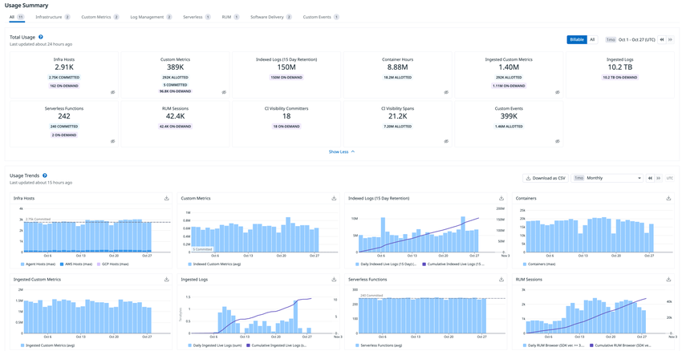
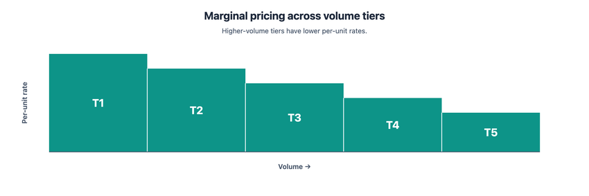
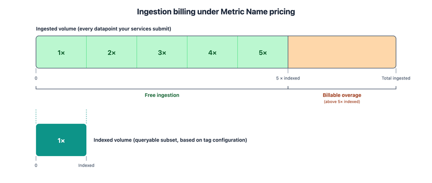

# 製品別料金表（料金の正本）

## 概要

本ファイルは、Datadog の公式料金ページ（[Pricing](https://www.datadoghq.com/pricing/) と [Pricing Comparison（/pricing/list/）](https://www.datadoghq.com/pricing/list/)）に掲載された**全製品の定価・課金単位・同梱の無料枠（allotment）**を集約した、本ナレッジにおける**料金数値の正本**である。他ファイルで料金を引用する場合は本ファイルの値と一致させる（[執筆規約 §7](../_CONVENTIONS.md)）。

| 項目 | 内容 |
|---|---|
| 取得日 | **2026-11-03**（本ナレッジ基準日 2026-11-02 の翌日に取得。基準日時点の値として扱う） |
| 取得元 | `https://www.datadoghq.com/pricing/`（製品別カード・FAQ）、`https://www.datadoghq.com/pricing/list/`（全製品比較表）。いずれもページ内に埋め込まれたサイト別価格データ（US / EU1 / AP1 / AP2 / UK1 / US1-FED）を参照 |
| 通貨 | USD（円建ての価格は公式に掲載されていない。円換算が必要な場合は [コスト見積り手法](cost-estimation.md) で【推定】として扱う） |
| 契約形態 | 年契約（Billed Annually）／月契約（Billed Month-to-month）／オンデマンド（Billed On-demand）の 3 列 |
| 価格の性質 | **定価（List price）**。値引き・ボリュームディスカウント・多年契約割引は非掲載（[購入経路と契約](procurement-and-contracts.md) を参照） |
| 確度 | 公式料金ページ掲載値のため確度ラベル不要（規約 §7）。料金ページ以外の情報や推定は都度ラベルを付す |

本ファイルが答える質問の例：

- 「Infrastructure Enterprise は AP1（日本サイト）で年契約いくらか」→ [§2](#2-infrastructure-monitoringインフラ監視)
- 「APM ホスト 1 台あたり何 GB のスパン取り込みが無料か」→ [§5](#5-apmapplication-performance-monitoringと関連製品)
- 「Flex Logs と Standard Indexing の単価差」→ [§7](#7-log-management-と関連製品)
- 「RUM Measure と RUM Investigate の違いと単価」→ [§11](#11-digital-experiencerumproduct-analyticsexperimentssynthetic)
- 「どの製品が US1-FED（GovCloud）で買えないか」→ [§18](#18-サイト別価格一覧付録と-us1-fed-の非提供製品)

料金体系の考え方（ホスト課金・量課金・コミットと超過）は [料金体系の全体像](pricing-overview.md)、メータリングの計算方法（99 パーセンタイル、時間按分など）は [課金計算の仕組み](billing-mechanics.md)、エディション別の機能差は [エディション・プラン](editions-and-plans.md)、見積りの手順は [コスト見積り手法](cost-estimation.md) を参照。本ファイルは**数値の一覧**に徹する。

---

## 1. 前提：契約形態・サイト別価格・表の読み方

### 1.1 3 つの契約形態

Datadog の料金ページは、すべての製品について 3 つの契約形態の価格を掲載している [出典](https://www.datadoghq.com/pricing/list/)。

| 契約形態（料金ページ表記） | 意味 | 価格水準の傾向（掲載値から読み取れる範囲） |
|---|---|---|
| Billed Annually（年契約） | 年間コミット。最も安い単価 | 基準 |
| Billed Month-to-month（月契約） | 月単位のコミット | 年契約の概ね 1.15〜1.2 倍（製品により異なる。ホスト課金製品の多くは年契約より約 17〜20% 高い） |
| Billed On-demand（オンデマンド） | コミットなしの従量。コミット超過分にも適用 | 年契約の概ね 1.2〜1.5 倍。ホスト課金製品の多くは月契約と同額 |

- 上記の倍率は掲載値を比較した結果であり、製品ごとの正確な値は各表を参照すること（例：Infrastructure Pro は $15 / $18 / $18、Logs 15 日保持インデックスは $1.70 / $2.04 / $2.55）。
- Log Management のコミット超過は「年契約価格 + 50%」で課金されると料金ページ FAQ に記載されている（"pay for additional services (+50% of the annual price) only on the volume that exceeds your commitment"）[出典](https://www.datadoghq.com/pricing/?product=log-management)。公式ドキュメントでも「超過分のオンデマンド利用は 50% のプレミアム付きで課金」とされる [出典](https://docs.datadoghq.com/account_management/billing/log_management/)。
- Metric Name pricing（後述 §2.6）では、ドキュメント上「月契約 = 年契約 +20%、オンデマンド = 年契約 +40%」と明記されている [出典](https://docs.datadoghq.com/account_management/billing/metric_name_pricing/)。
- ホスト課金製品の請求方式（High watermark plan / Hybrid monthly/hourly plan）は [課金計算の仕組み](billing-mechanics.md) を参照。

### 1.2 サイト（リージョン）別の価格

> **サイト差異:** 料金ページには「Datadog Site」セレクタがあり、**US（US1, US3, US5）／US1-FED／EU1／AP1／AP2／UK1** の 6 区分で価格が切り替わる。AP1（日本）の価格は US の価格と同一ではない [出典](https://www.datadoghq.com/pricing/list/)。

料金ページに埋め込まれたサイト別価格データ（2026-11-03 取得）を比較すると、ほぼすべての SKU で次の比率になっている。

| サイト区分（料金ページ表記） | 対象サイト | US 価格に対する比率（掲載値から算出） | 例：Infrastructure Pro 年契約 |
|---|---|---|---|
| US (US1, US3, US5) | US1 / US3 / US5 | 1.00 | $15 |
| EU1 | EU1 | 1.00 | $15 |
| AP1 | AP1（日本） | **1.25** | $18.75 |
| AP2 | AP2（オーストラリア） | 1.20 | $18 |
| UK1 | UK1 | 1.20 | $18 |
| US1-FED | US1-FED（GovCloud） | 1.25（提供製品のみ） | $18.75 |

- 比率は掲載値どうしの割り算であり、公式に「1.25 倍」と明言された記述は確認できない。**見積りでは比率ではなく本ファイルの AP1 列（公式掲載値）を使うこと。**
- 例外：Audit Trail（月額利用料に対する %）は全サイト共通で 年 2% / 月 3% / オンデマンド 3%。
- UK1 サイトは料金ページのセレクタに存在するが、UK1 の提供開始時期・エンドポイント等は [Datadog Sites](../02_リファレンス/platform/datadog-sites.md) を参照。
- 本ファイルの各表は **US/EU1 列と AP1 列**を併記する。AP2・UK1・US1-FED の年契約価格は [§18 付録](#18-サイト別価格一覧付録と-us1-fed-の非提供製品) を参照。

### 1.3 表の読み方

- 「—」は、その契約形態の価格が掲載されていないことを示す（例：コンテナの前払い単価は年・月のみ、時間単価はオンデマンドのみ）。
- 「要問合せ」は料金ページ上 "Contact Sales" と表示されるもの。
- 「提供なし（非掲載）」は、そのサイトの価格データにその SKU が存在しないもの（主に US1-FED）。
- 製品名は料金ページの表記を主とし、現行製品名・旧称を併記する（例：料金ページの「Cloud Security Management (CSM) Pro」は現行製品名 Cloud Security の Pro プラン）。
- 価格は「Starting At（〜から）」表記の定価。ボリュームディスカウント・多年契約割引の存在は多くの製品カードに "Multi-Year/Volume discounts available" と記載されるが、割引率は非公開。

### 1.4 料金・使用量を確認する画面

- **キャプション**: Plan & Usage > Usage の Usage Summary（Billable 表示）と Usage Trends。
- **画面説明**: 上部タブ（All / Infrastructure / Custom Metrics / Log Management / Serverless / RUM / Software Delivery / Custom Events）で製品群を切り替える。Total Usage のタイルには製品ごとの使用量と、「COMMITTED（契約コミット数）」「ALLOTTED（同梱枠）」「ON-DEMAND（オンデマンド課金対象）」のピルが表示される（例：Infra Hosts 2.91K に 2.75K COMMITTED / 162 ON-DEMAND、Custom Metrics 389K に 292K ALLOTTED など）。右上の Billable / All トグルで課金対象のみ／全量を切り替え、下段の Usage Trends では各製品の日次推移とコミットライン（点線）が描かれ、Download as CSV で出力できる。
- **出典**: [Usage Details（Datadog Docs）](https://docs.datadoghq.com/account_management/plan_and_usage/usage_details/)（画像取得日 2026-11-03）。画面の詳細は [Usage・Usage Attribution・Cost Visibility](../02_リファレンス/platform/usage-and-cost-attribution.md) を参照。

---

## 2. Infrastructure Monitoring（インフラ監視）

### 2.1 エディション別ホスト単価

| 製品（SKU） | 課金単位 | US/EU1 年契約 | US/EU1 月契約 | US/EU1 オンデマンド | AP1 年契約 | AP1 月契約 | AP1 オンデマンド |
|---|---|---|---|---|---|---|---|
| Infrastructure Basic | インフラホスト/月 | 要問合せ | 要問合せ | 要問合せ | 要問合せ | 要問合せ | 要問合せ |
| Infrastructure Pro | インフラホスト/月 | $15 | $18 | $18 | $18.75 | $22.50 | $22.50 |
| Infrastructure Enterprise | インフラホスト/月 | $23 | $27 | $27 | $28.75 | $33.75 | $33.75 |
| Infrastructure DevSecOps Pro | インフラホスト/月 | $22 | $27 | $27 | $27.50 | $33.75 | $33.75 |
| Infrastructure DevSecOps Enterprise | インフラホスト/月 | $34 | $41 | $41 | $42.50 | $51.25 | $51.25 |

出典：[Pricing Comparison](https://www.datadoghq.com/pricing/list/)、[Pricing - Infrastructure](https://www.datadoghq.com/pricing/?product=infrastructure)（取得日 2026-11-03）

- **Infrastructure Basic** は "Contact Sales"（価格非公開）。Basic ホストは Pro または Enterprise ホストと同一アカウント内で混在できる（"Basic hosts can be mixed with either Pro or Enterprise hosts in the same account."）。
- **DevSecOps Pro** = Infrastructure Pro + Cloud Security（CSM）Pro の全機能。**DevSecOps Enterprise** = Infrastructure Enterprise + Cloud Security（CSM）Enterprise の全機能（File Integrity Monitoring、Workload Protection を含む）。
- ボリュームディスカウント：Infrastructure カードに "Multi-Year/Volume discounts available (500+ hosts/mo)" と記載。
- ホストの定義：「監視対象の物理または仮想 OS インスタンス。サーバー、VM、ノード（Kubernetes の場合）」。ドキュメントでは Azure App Service Plan インスタンス、Heroku dyno も含む [出典](https://docs.datadoghq.com/account_management/billing/)。

### 2.2 エディション別の同梱枠・機能差（Basic / Pro / Enterprise）

| 項目 | Basic | Pro | Enterprise |
|---|---|---|---|
| Full-Resolution Data Retention（メトリクス保持） | 15 か月 | 15 か月 | 15 か月（カスタマイズ可） |
| Alerts（アラート数） | 無制限 | 無制限 | 無制限 |
| **Container Monitoring 同梱枠** | 非対応（Not supported） | **5 コンテナ/ホスト** | **10 コンテナ/ホスト** |
| **Custom Metrics 同梱枠** | 0/ホスト | **100/ホスト** | **200/ホスト** |
| **Custom Events 同梱枠** | 0/ホスト | **500/ホスト** | **1,000/ホスト** |
| 1,000+ Integrations | 限定（Limited） | ○ | ○ |
| Host and Container Maps | Host map のみ | ○ | ○ |
| Standard Events and Metrics / OOTB Dashboards / Enterprise-Grade Security / Unlimited User Accounts | ○ | ○ | ○ |
| Single Sign-On with SAML / SCIM / Outlier Detection | ○ | ○ | ○ |
| Watchdog: Automated insights / Correlations / Anomaly Detection / Forecast Monitoring / Live Processes | — | — | ○ |
| Multiple SAML Providers / IP Allowlist / Email Domain Allowlist / Governance Console | — | — | ○ |
| Data Access Control | 10 datasets | 10 datasets | 100 datasets |
| Cross-Org Visibility | 5 connections | 5 connections | 100 connections |

出典：[Pricing - Infrastructure（Features 表）](https://www.datadoghq.com/pricing/?product=infrastructure)（取得日 2026-11-03）。チェックマークが 1 つだけの行（Watchdog 〜 Governance Console）は、Enterprise カードの説明（"Machine learning-based alerts / Live Processes / Governance Console"）と整合するため Enterprise のみと判断した。機能差の詳細は [エディション・プラン](editions-and-plans.md) を参照。

DevSecOps バンドルの同梱枠：

| 項目 | DevSecOps Pro | DevSecOps Enterprise |
|---|---|---|
| Infrastructure 機能 | Infrastructure Pro の全機能 | Infrastructure Enterprise の全機能 |
| セキュリティ機能 | CSPM、KSPM、コンプライアンスフレームワークへのマッピング、Vulnerability Management（コンテナ・ホスト）、CIEM、Resource Catalog | 左記 + File Integrity Monitoring、Workload Protection（Linux / Windows / Kubernetes / Docker）、Anomalous workload profile detection |
| Containers 同梱枠 | 5 コンテナ/ホスト/月 | 10 コンテナ/ホスト/月 |
| Workflows | セキュリティ Finding・Signal からの起動は無料 | 同左 |

- 準拠ベンチマーク：DevSecOps Pro / Enterprise は CIS、PCI DSS、SOC 2 など 15 以上の業界ベンチマークへの準拠を追跡できる。
- **組み合わせ制約**：アカウントで選べる Infrastructure のカバレッジレベルは Pro / Enterprise / DevSecOps Pro / DevSecOps Enterprise のいずれか 1 つ。Pro または Enterprise を選んだ場合のみ、一部ホストを Basic にできる。**DevSecOps バンドルは環境全体を対象とし、単体の Infrastructure・コンテナ・Cloud Security 製品と組み合わせられない**（"The DevSecOps bundles cover your entire environment, and can't be combined with standalone infrastructure, container, or cloud security products."）[出典](https://www.datadoghq.com/pricing/?product=infrastructure)。

### 2.3 Infrastructure の追加 SKU（コンテナ・カスタムメトリクス・イベントほか）

| 製品（SKU） | 課金単位 | US/EU1 年契約 | US/EU1 月契約 | US/EU1 オンデマンド | AP1 年契約 | AP1 月契約 | AP1 オンデマンド |
|---|---|---|---|---|---|---|---|
| Container Monitoring（追加コンテナ） | 年・月：コンテナ/月（前払い）／オンデマンド：コンテナ時間 | $1 | $1 | $0.002 | $1.25 | $1.25 | $0.0025 |
| DevSecOps Containers（追加コンテナ） | 年・月：コンテナ/月（前払い）／オンデマンド：コンテナ時間 | $1.50 | $1.50 | $0.003 | $1.875 | $1.875 | $0.00375 |
| Custom Metrics（インデックス） | 100 カスタムメトリクス/月 | $5 | $5 | $5 | $6.25 | $6.25 | $6.25 |
| Ingested Custom Metrics（Metrics without Limits） | 100 取り込みカスタムメトリクス/月 | $0.10 | $0.10 | $0.10 | $0.125 | $0.125 | $0.125 |
| Custom Events | 10万カスタムイベント/月 | $2 | $2.40 | $3 | $2.50 | $3 | $3.75 |
| Edge Device Monitoring | インフラホスト（デバイス）/月 | $5 | $6 | $7.20 | $6.25 | $7.50 | $9 |
| GPU Monitoring | アクティブ GPU デバイス/月 | $20 | $24 | $29 | $25 | $30 | $36.25 |
| Kubernetes Autoscaling | オートスケール対象 vCPU/月 | $3 | $3.60 | $4.32 | $3.75 | $4.50 | $5.40 |
| Storage Management | 監視オブジェクト 100万件/月 | $0.35 | $0.42 | $0.50 | $0.4375 | $0.525 | $0.625 |

出典：[Pricing Comparison](https://www.datadoghq.com/pricing/list/)、[Pricing - Infrastructure FAQ](https://www.datadoghq.com/pricing/?product=infrastructure)（取得日 2026-11-03）。DevSecOps Containers の値は /pricing/ ページの価格データ（`CONT-DEVSECOPS-ENT`）による。

- **コンテナ**：Pro は 5、Enterprise は 10 コンテナ/ホストが無料。超過分はオンデマンドで $0.002/コンテナ/時間（US）。前払い（prepaid）は $1/コンテナ/月、DevSecOps Containers は $1.50/コンテナ/月（FAQ 記載）。Basic ホストではコンテナ監視は利用不可。
- コンテナ同梱枠はホスト単位ではなく**アカウント全体で平均**される。Datadog Agent のコンテナ、Kubernetes の pause コンテナは同梱枠にカウントされない [出典](https://docs.datadoghq.com/account_management/billing/containers/)。
- **Custom Metrics**：Pro 100 / Enterprise 200 個/ホストが同梱。カウントは時間ごと、月平均、ホスト単位ではなくアカウント全体。料金比較表の単価は 100 カスタムメトリクスあたり $5/月（US 年契約）だが、Infrastructure FAQ には「同梱枠を超えるカスタムメトリクスは使用量に応じて課金。詳細は営業へ」とある。ドキュメントの Custom Metrics Billing では「インデックス済みカスタムメトリクス 100 個超過ごとの金額は契約で定める」とされる [出典](https://docs.datadoghq.com/account_management/billing/custom_metrics/)。
- **Ingested Custom Metrics**（Metrics without Limits™ で設定したメトリクスのみ対象）：同梱枠は Pro 100 / Enterprise 200 個/ホスト、超過は 100 個あたり $0.10 [出典](https://docs.datadoghq.com/account_management/billing/custom_metrics/)。
- **Custom Events**：Pro 500 / Enterprise 1,000 件/ホストが同梱（アカウント全体で平均）。超過は 10 万件あたり $2（年契約）／$3（オンデマンド）。
- **ログベースメトリクス・スパンベースメトリクス**はカスタムメトリクスの同梱枠を消費する（Log Management FAQ / APM FAQ）。
- **Edge Device Monitoring**：$5/ホスト/月（年契約）。Kubernetes Autoscaling カードには "Cloud Cost Management bundle discounts available" とある。
- **GPU Monitoring**：$20/アクティブ GPU デバイス/月（年契約）。オンデマンド・月契約もあり。
- **Storage Management**：$0.35/監視オブジェクト 100 万件/月（年契約）。Amazon S3 は GA、Azure Blob Storage・Google Cloud Storage は【Preview】。CCM なしでも利用可。

### 2.4 Free tier と無料トライアル

| 項目 | 内容 | 出典 |
|---|---|---|
| Free tier | トライアル終了後に選択可能。**Basic ホスト 5 台まで、メトリクス保持 1 日**、無料 | [Pricing - Infrastructure FAQ](https://www.datadoghq.com/pricing/?product=infrastructure) |
| 無料トライアル | 料金ページ各所に "Free Trial" / "Start Free Trial" の導線。トライアル期間・管理画面は [料金体系の全体像](pricing-overview.md) を参照 | [Pricing](https://www.datadoghq.com/pricing/) |
| Datadog for Startups | 「1 年間の Datadog Pro を無料」（Agent Observability セクション内の告知） | [Pricing - Agent Observability](https://www.datadoghq.com/pricing/?product=llm-observability) |

### 2.5 Custom Metrics の 2 つの課金モデル

Custom Metrics には 2 つの課金モデルがあり、契約上の SKU が相互排他になる [出典](https://docs.datadoghq.com/account_management/billing/metric_name_pricing/)。

| 項目 | Timeseries（cardinality）pricing（従来） | Metric Name pricing（オプトイン） |
|---|---|---|
| 課金対象 | メトリクス名 × タグ値（host 含む）の一意な組み合わせ（時系列）の月平均 | 一意なメトリクス名の数 + データポイント量 |
| SKU | Custom Metrics（100 個単位）、Ingested Custom Metrics（100 個単位） | Metric-Name、Indexed Points、Ingested Points |
| 同梱 | Pro 100 / Enterprise 200 個/ホスト | メトリクス名 1 つあたり **インデックス済みデータポイント 1,000 万点**。取り込みデータポイントは**インデックス量の 5 倍まで無料** |
| 課金されるメトリクス名 | — | 月内に 100 点を超えるインデックス済みデータポイントを持つメトリクス名 |
| 単価 | 料金比較表：$5/100 個（US 年契約）、取り込みは $0.10/100 個 | **契約で定める**（5 段階のマージナル（逓減）料金。具体的な単価・段階境界は非公開） |
| 契約形態の差 | 掲載値どおり | 月契約 +20%、オンデマンド +40%（年契約比） |
| Distribution メトリクス | 集計ごとにカウント | データポイントに 5 倍（パーセンタイル有効時 10 倍）の乗数 |

- **キャプション**: Metric Name pricing のマージナル（逓減）料金の概念図。
- **画面説明**: 横軸が使用量、5 本の棒が 5 つの料金段階（Tier）を表し、右（大量）ほど棒が低い＝単価が下がることを示す。使用量のうち各段階に入った部分だけがその段階の単価で課金され、過去に課金済みの部分は再計算されない。
- **出典**: [Metric Name Pricing for Custom Metrics](https://docs.datadoghq.com/account_management/billing/metric_name_pricing/)（画像取得日 2026-11-03）

- **キャプション**: Metric Name pricing における取り込み（Ingested）データポイントの課金関係図。
- **画面説明**: 取り込み量の帯が「無料取り込みゾーン（インデックス量の 5 倍まで）」と「課金対象の超過ゾーン」に分かれ、その下にインデックス量の帯が無料ゾーンの 1 区画と同じ幅で描かれている。
- **出典**: [Metric Name Pricing for Custom Metrics](https://docs.datadoghq.com/account_management/billing/metric_name_pricing/)（画像取得日 2026-11-03）

カウント方法の詳細は [Custom Metrics と DogStatsD](../02_リファレンス/platform/custom-metrics-and-dogstatsd.md)、削減策は [コスト最適化](../04_応用編/cost-optimization.md) を参照。

---

## 3. Network Monitoring（ネットワーク監視）

| 製品（SKU） | 課金単位 | US/EU1 年契約 | US/EU1 月契約 | US/EU1 オンデマンド | AP1 年契約 | AP1 月契約 | AP1 オンデマンド |
|---|---|---|---|---|---|---|---|
| Cloud Network Monitoring（旧 NPM） | ネットワークホスト/月 | $5 | $6 | $7.20 | $6.25 | $7.50 | $9 |
| Network Device Monitoring | ネットワークデバイス/月 | $7 | $8.50 | $10.20 | $8.75 | $10.625 | $12.75 |
| Wireless Access Point Monitoring | デバイス/月 | $4 | $4.80 | $5.76 | $5 | $6 | $7.20 |
| NetFlow Monitoring（15日保持） | 集約 NetFlow レコード 100万件/月 | $0.60 | $0.72 | $0.86 | $0.75 | $0.90 | $1.075 |
| NetFlow Monitoring（30日保持・デフォルト） | 集約 NetFlow レコード 100万件/月 | $0.65 | $0.78 | $0.94 | $0.8125 | $0.975 | $1.175 |
| NetFlow Monitoring（60日保持） | 集約 NetFlow レコード 100万件/月 | $0.75 | $0.90 | $1.08 | $0.9375 | $1.125 | $1.35 |
| NetFlow Monitoring（90日保持） | 集約 NetFlow レコード 100万件/月 | $0.85 | $1.02 | $1.22 | $1.0625 | $1.275 | $1.525 |
| Network Path | 1,000 テスト/月 | $5 | $6 | $7.20 | $6.25 | $7.50 | $9 |

出典：[Pricing Comparison](https://www.datadoghq.com/pricing/list/)、[Pricing - Network Monitoring](https://www.datadoghq.com/pricing/?product=network-monitoring)（取得日 2026-11-03）

| 項目 | 内容 |
|---|---|
| Cloud Network Monitoring（旧称：Network Performance Monitoring / NPM）のホスト | Agent がインストールされ CNM が有効な物理・仮想マシン。CNM で監視するホストすべてに **Infrastructure Pro または Enterprise が必要** |
| CNM のフロー | 送信元（IP:Port）と宛先（IP:Port）間の 5 分間のトラフィック記録。ドキュメント上、CNM ホスト全体の月間フロー総数も計測される [出典](https://docs.datadoghq.com/account_management/billing/pricing/) |
| Network Device Monitoring のデバイス | SNMP でポーリングされる一意の IP を持つ物理/仮想アプライアンス。NDM はポーリング用の Infrastructure ホストが 1 台以上あればよい |
| Wireless Access Point SKU | Cisco Meraki など NDM の OOTB API 連携に対応する無線 AP が対象。SNMP 直接監視の AP、WLC 経由の AP、Meraki のスイッチ/アプライアンス/WLC/セルラーゲートウェイは対象外 |
| NetFlow 保持期間 | 15 / 30 / 60 / 90 日（**デフォルト 30 日**）。90 日超は要問合せ。Agent は既定 5 分間隔で集約して送信 |
| Network Path のテスト | TCP/UDP/ICMP traceroute と複数プローブの組み合わせ。Agent（ホスト・End User Device）からでも Datadog Managed Synthetic Locations からでも**同一価格** |

詳細仕様は [Cloud Network Monitoring](../02_リファレンス/infrastructure/cloud-network-monitoring.md)、[Network Device Monitoring](../02_リファレンス/infrastructure/network-device-monitoring.md) を参照。

---

## 4. Serverless Monitoring（サーバーレス監視）

| 製品（SKU） | 課金単位 | US/EU1 年契約 | US/EU1 月契約 | US/EU1 オンデマンド | AP1 年契約 | AP1 月契約 | AP1 オンデマンド |
|---|---|---|---|---|---|---|---|
| Serverless Workload Monitoring - Functions | アクティブ関数（Lambda）/アクティブ Step Function/月 | $5 | $6 | $7.20 | $6.25 | $7.50 | $9 |
| Serverless Functions APM | トレース対象呼び出し 100万回（Step Functions は状態遷移 100万回）/月 | $10 | $12 | $15 | $12.50 | $15 | $18.75 |
| Serverless Workload Monitoring - Apps（Serverless Application Monitoring） | アクティブアプリケーションインスタンス/月 | $3 | $4 | $4.32 | $3.75 | $5 | $5.40 |
| Serverless Application APM | トレース対象アプリケーションインスタンス/月 | $6 | $7.20 | $9 | $7.50 | $9 | $11.25 |
| Data Streams Monitoring for AWS Fargate | アクティブアプリケーションインスタンス/月 | $2.90 | $3.50 | $4.40 | $3.625 | $4.375 | $5.50 |

出典：[Pricing Comparison](https://www.datadoghq.com/pricing/list/)、[Pricing - Serverless](https://www.datadoghq.com/pricing/?product=serverless)（取得日 2026-11-03）。DSM for Fargate は /pricing/ の DSM カード "Serverless Applications - AWS Fargate $2.90 per active application instances ($4.40 on-demand)" による。

### 4.1 対象プラットフォームと課金単位

| 対象 | 監視 SKU（単価・US 年契約） | APM SKU（単価・US 年契約） | 課金単位の定義 |
|---|---|---|---|
| AWS Lambda | Serverless Workload Monitoring - Functions：$5/アクティブ関数 | Serverless Functions APM：$10/トレース済み呼び出し 100 万回 | アクティブ関数 = 1 時間に 1 回以上実行された関数数の月平均。トレース済み呼び出し = 1 トップレベル Lambda スパン |
| AWS Step Functions | Serverless Workload Monitoring：$5/アクティブ Step Function | Serverless Functions APM：$10/状態遷移 100 万回 | 1 状態遷移 = 1 スパン。Lambda スパンは別途課金 |
| AWS Fargate（ECS/EKS） | Serverless Application Monitoring：$3/アクティブアプリケーションインスタンス | Serverless Application APM：$6/トレース対象インスタンス | 5 分間隔の計測で 1 回以上アクティブだった一意のタスク（ECS）/Pod（EKS）の月平均 |
| Azure App Service | 同上 $3 | 同上 $6 | 一意の Web App / Function App インスタンス |
| Azure Container Apps | 同上 $3 | 同上 $6 | 一意の Container App レプリカ |
| Azure Functions | 同上 $3 | 同上 $6 | ホスティング形態で計上先が変わる（App Service Plan → App Service、Consumption/Premium → Azure Functions、Container Apps 内 → レプリカ） |
| Google Cloud Run | 同上 $3 | 同上 $6 | 一意のアクティブコンテナ。Cloud Run services、Cloud Run Functions（Gen1/Gen2）は同一価格 |
| GKE Autopilot | 同上 $3 | 同上 $6 | 5 分間隔で 1 回以上アクティブだった一意の Pod の月平均。OTel 計装のワークロードは現時点で Serverless Apps APM のみ課金 |

- 計算例（公式）：時間 1 に 2 関数、時間 2 に 1 関数、時間 3 に 3 関数がアクティブ → (2+1+3)/3 = 平均 2 アクティブ関数 × $5 = $10。通常月の分母はその月の時間数（30 日なら 720 時間）。月に 1 回だけ呼ばれた関数は 1/720 × $5 [出典](https://www.datadoghq.com/pricing/?product=serverless)。
- Serverless Functions APM は Serverless Workload Monitoring なしでは購入できない（オプションのアドオン）。
- GKE Autopilot は GKE Standard と異なり Serverless カテゴリで課金される [出典](https://docs.datadoghq.com/account_management/billing/containers/)。

### 4.2 サーバーレスの同梱枠

| SKU | 同梱枠 | 出典 |
|---|---|---|
| Serverless Application Monitoring（アクティブアプリケーションインスタンス） | 取り込みカスタムメトリクス 20 + インデックスカスタムメトリクス 20/インスタンス | [Pricing - Serverless FAQ](https://www.datadoghq.com/pricing/?product=serverless) |
| Serverless Application APM（アドオン） | 取り込みスパン 30 GB、インデックススパン 19.5 万件（"30GB of Ingested Spans and Indexed Spans allotment to 195k"） | 同上。APM Billing ドキュメントでも Fargate 1 タスクあたり 195,000 Indexed Spans / 30 GB Ingested Spans [出典](https://docs.datadoghq.com/account_management/billing/apm_tracing_profiler/) |
| Serverless Functions APM | トレース済み呼び出し 100 万回あたり 取り込みスパン 50 GB、インデックススパン 30 万件（超過は $0.10/GB、インデックスは 15 日保持 $1.70/100 万件・オンデマンド $2.55） | [Pricing - Serverless FAQ](https://www.datadoghq.com/pricing/?product=serverless) |
| Serverless Workload Monitoring - Functions | Pro / Enterprise プランでは課金対象関数 1 つあたりカスタムメトリクス 5 個 | [Billing](https://docs.datadoghq.com/account_management/billing/) |

> 注意：APM Billing ドキュメントの Lambda 計算例は「100 万呼び出しあたり 150,000 Indexed Spans 同梱」としており、料金ページ FAQ の「30 万件」と食い違う。本ファイルは料金ページの値（30 万件）を正とするが、契約時に確認すること。

詳細は [Serverless Monitoring](../02_リファレンス/infrastructure/serverless.md) を参照。

---

## 5. APM（Application Performance Monitoring）と関連製品

### 5.1 APM エディション（Infrastructure 併用／スタンドアロン）

| 製品（SKU） | 課金単位 | US/EU1 年契約 | US/EU1 月契約 | US/EU1 オンデマンド | AP1 年契約 | AP1 月契約 | AP1 オンデマンド |
|---|---|---|---|---|---|---|---|
| APM | APM ホスト/月（Infrastructure 併用） | $31 | $36 | $36 | $38.75 | $45 | $45 |
| APM Pro（APM + Data Streams Monitoring） | APM ホスト/月（Infrastructure 併用） | $35 | $42 | $42 | $43.75 | $52.50 | $52.50 |
| APM Enterprise（APM + DSM + Continuous Profiler） | APM ホスト/月（Infrastructure 併用） | $40 | $48 | $48 | $50 | $60 | $60 |
| APM（スタンドアロン） | APM ホスト/月（Infrastructure なし） | $36 | $41.80 | $41.80 | $45 | $52.25 | $52.25 |
| APM Pro（スタンドアロン） | APM ホスト/月（Infrastructure なし） | $41 | $49.20 | $49.20 | $51.25 | $61.50 | $61.50 |
| APM Enterprise（スタンドアロン） | APM ホスト/月（Infrastructure なし） | $47 | $56.40 | $56.40 | $58.75 | $70.50 | $70.50 |

出典：[Pricing Comparison](https://www.datadoghq.com/pricing/list/)、[Pricing - APM](https://www.datadoghq.com/pricing/?product=apm)（取得日 2026-11-03）。スタンドアロン価格は /pricing/ の価格データ（`HOSTS-APM-STANDALONE` 等）および APM FAQ（"Standalone pricing is $36 for APM, $41 for APM Pro, and $47 for APM Enterprise"）による。

| エディション | 含まれる製品 |
|---|---|
| APM | 分散トレーシング、サービス依存関係、Deployment Tracking、Software Catalog、Universal Service Monitoring、タグベースのスパン保持・スパンからのカスタムメトリクス生成、AI ベースの異常/外れ値/根本原因検出、Dynamic Instrumentation、Recommendations、Error Tracking（APM トレース由来） |
| APM Pro | APM + **Data Streams Monitoring** |
| APM Enterprise | APM Pro + **Continuous Profiler**（4 プロファイル対象コンテナ/ホスト同梱） |

- **Infrastructure 併用モデル**（$31 / $35 / $40）では、APM ホストすべてに Infrastructure Pro または Enterprise が必要（コミット・オンデマンドとも）。**スタンドアロン**（$36 / $41 / $47、年契約）は Infrastructure 不要。
- APM / APM Pro / APM Enterprise は**混在購入不可**（全 APM ホストで 1 プランにコミット）。ただし APM 契約者は一部ホストに DSM / Continuous Profiler を、APM Pro 契約者は一部ホストに Continuous Profiler を追加購入できる。
- APM ホストには同一ホストの **USM が含まれる**。USM と APM を同一ホストで購入・導入しても APM 価格のみ。
- APM の課金対象ホスト = トレースを Datadog SaaS に送信しているホスト（OpenTelemetry Collector を含む）。計装されていないサービス（DB、キャッシュ、キュー、LB 等）のみのホストは APM が有効でも APM ホストにならない。
- ホスト上のコンテナ数は APM のホスト単価に影響しない。Kubernetes では APM・Continuous Profiler は **Pod ではなくノード単位**で課金 [出典](https://docs.datadoghq.com/account_management/billing/apm_tracing_profiler/)。コンテナごとに Agent を入れた場合は各コンテナが 1 ホストとして扱われる。
- **APM Edge Devices**：POS・キオスク・産業機器等向けに、低い同梱枠で割安なデバイス単価の請求オプションがある（価格は要問合せ）。Agent 7.75.0 以降で `DD_APM_MODE=edge`（または `apm_config.mode: edge`）を設定。OpenTelemetry 非対応 [出典](https://docs.datadoghq.com/account_management/billing/apm_tracing_profiler/)。

### 5.2 APM の同梱枠（Allotment）

| 項目 | 同梱枠 | 超過時 | 備考 |
|---|---|---|---|
| Ingested Spans（取り込みスパン） | **150 GB/APM ホスト/月**（時間換算 0.205 GB/ホスト/時） | $0.10/GB（US、全契約形態） | 全 APM ホストで合算。取り込みスパンは 15 分間の Live Search の対象 |
| Indexed Spans（インデックススパン） | **100 万件/APM ホスト/月**（15 日保持。時間換算 1,370 件/ホスト/時） | 保持期間別単価（下表） | 全 APM ホストで合算。Datadog が自動保持するスパン（auto-retained）は同梱枠を消費しない |
| Continuous Profiler（APM Enterprise・単体） | 4 プロファイル対象コンテナ/ホスト（全プロファイル対象ホストで平均） | $2/コンテナ（年・月）、$0.004/コンテナ/時（オンデマンド） | プロファイルを実行していないコンテナはカウントしない |
| Data Streams Monitoring | APM Pro / Enterprise に含まれる | — | — |
| Error Tracking | APM トレース由来のエラーは追加費用なし | — | §9 参照 |

- **オンデマンドの時間按分**：オンデマンドでは取り込み・インデックスとも同梱枠が**時間ごと**に計量され、月全体で合算されない。各時間の同梱枠 = 月間同梱枠 ÷（365×24÷12）。例：1 月の各ホスト時間あたり 0.205 GB（150 GB ÷ 730）と 1,369 件 [出典](https://www.datadoghq.com/pricing/?product=apm)。
- **RED メトリクス**（リクエスト・エラー・レイテンシ）はサンプリング率にかかわらずトラフィック 100% で算出され、APM 価格に含まれる。保持 15 か月。
- スパンベースのカスタムメトリクスはカスタムメトリクス同梱枠を消費する。
- モバイル（Android / iOS）のトレースは Agent 不要で、取り込み・インデックススパン量で課金される。

### 5.3 スパン・Profiler・USM・DSM の追加 SKU

| 製品（SKU） | 課金単位 | US/EU1 年契約 | US/EU1 月契約 | US/EU1 オンデマンド | AP1 年契約 | AP1 月契約 | AP1 オンデマンド |
|---|---|---|---|---|---|---|---|
| APM Ingested Spans（超過分） | 取り込みスパン 1GB/月 | $0.10 | $0.10 | $0.10 | $0.125 | $0.125 | $0.125 |
| APM Indexed Spans（7日保持） | インデックススパン 100万件/月 | $1.27 | $1.52 | $1.91 | $1.5875 | $1.90 | $2.3875 |
| APM Indexed Spans（15日保持） | インデックススパン 100万件/月 | $1.70 | $2.04 | $2.55 | $2.125 | $2.55 | $3.1875 |
| APM Indexed Spans（30日保持） | インデックススパン 100万件/月 | $2.50 | $3 | $3.75 | $3.125 | $3.75 | $4.6875 |
| Managed Platform OTLP（OTLP APM Ingest） | 取り込みスパン 1GB/月 | $0.50 | $0.50 | $0.50 | $0.625 | $0.625 | $0.625 |
| Universal Service Monitoring | インフラホスト/月 | $9 | $10.80 | $13 | $11.25 | $13.50 | $16.25 |
| Data Streams Monitoring（単体） | クライアントホスト/月 | $15 | $18 | $18 | $18.75 | $22.50 | $22.50 |
| Kafka Console（DSM） | ブローカーホスト/月 | $100 | $120 | $120 | $125 | $150 | $150 |
| Continuous Profiler（単体） | プロファイル対象ホスト/月 | $19 | $23 | $23 | $23.75 | $28.75 | $28.75 |
| Continuous Profiler（Fargate） | Fargate タスク/月 | $1.20 | $1.40 | $1.70 | $1.50 | $1.75 | $2.125 |
| Continuous Profiler - Containers（追加） | 年・月：コンテナ/月／オンデマンド：コンテナ時間 | $2 | $2 | $0.004 | $2.50 | $2.50 | $0.005 |

出典：[Pricing Comparison](https://www.datadoghq.com/pricing/list/)、[Pricing - APM / USM / Data Streams Monitoring / OTLP APM Ingest](https://www.datadoghq.com/pricing/)（取得日 2026-11-03）

- **Managed Platform OTLP（OTLP APM Ingest）**：Collector なしで OTLP を直接 Datadog に送る方式。$0.50/GB（全契約形態同一）。**同梱枠なし**、取り込み GB とインデックス 100 万スパンの純粋な従量課金。マルチイヤー・ボリューム割引なし。対応マネージドパートナー：Cloudflare、Mulesoft、Retool、Modal ほか [出典](https://www.datadoghq.com/pricing/?product=otlp-apm-ingest)。
- **Universal Service Monitoring（USM）**：単体購入は全 Infrastructure（Pro/Enterprise）ホストが対象で $9/ホスト（年契約）、Infrastructure 必須。一部ホストのみに USM を使いたい場合は APM を購入（APM ホストに USM が含まれる）。ECS Fargate、EKS Fargate、Lambda は非対応。
- **Data Streams Monitoring**：課金対象ホスト = Agent が導入され、DSM 計装済みのプロデューサー/コンシューマーが動作するホスト。**Infrastructure Pro / Enterprise が必須**。マップ履歴 30 日、メトリクス 15 か月保持。
- **Kafka Console**：$100/ブローカーホスト/月（年契約）、月・オンデマンド $120。セルフホストと Amazon MSK Provisioned が対象。MSK Serverless と Confluent Cloud は課金対象外。
- **Continuous Profiler 単体**：$19/プロファイル対象ホスト（年契約）、月・オンデマンド $23。Infrastructure Pro/Enterprise が必要。APM と併用時は全 APM ホストがプロファイラホストでもある。

APM の計算例（公式ドキュメント、年契約・15 日保持）：

| シナリオ | 内訳 | 月額 |
|---|---|---|
| APM ホスト 5 台、インデックス 3,000 万件、取り込み 900 GB | 5×$31 + (30M−5M)×$1.70/M + (900−750)GB×$0.10 | **$212.50** |
| APM Pro ホスト 5 台、同上 | 5×$35 + $42.50 + $15 | **$232.50** |
| APM Enterprise ホスト 5 台、各 6 プロファイル対象コンテナ | 5×$40 + (6−4)×$2×5 | **$220** |
| APM ホスト 5 台 + Fargate タスク平均 20、インデックス 2,000 万件 | 5×$31 + 20×$6 + 13.7M×$1.70/M（5M + 1.3M 同梱） | **$298.29** |
| APM Enterprise 20 ノード（K8s）、プロファイル対象コンテナ計 100、インデックス 2,000 万件 | 20×$40 + (100−80)×$2 | **$840** |

出典：[APM Billing](https://docs.datadoghq.com/account_management/billing/apm_tracing_profiler/)。インジェスト制御の詳細は [APM の概念とインジェスト制御](../02_リファレンス/apm/apm-concepts-and-ingestion.md) を参照。

---

## 6. Database Monitoring と Data Observability

| 製品（SKU） | 課金単位 | US/EU1 年契約 | US/EU1 月契約 | US/EU1 オンデマンド | AP1 年契約 | AP1 月契約 | AP1 オンデマンド |
|---|---|---|---|---|---|---|---|
| Database Monitoring | データベースホスト/月 | $70 | $84 | $84 | $87.50 | $105 | $105 |
| Data Observability: Jobs Monitoring（Clusters：Databricks Classic / Spark） | ホスト時間 | $0.05 | $0.06 | $0.072 | $0.0625 | $0.075 | $0.09 |
| Data Observability: Jobs Monitoring（Databricks Serverless） | DBU | $0.025 | $0.03 | $0.036 | $0.03125 | $0.0375 | $0.045 |
| Data Observability: Jobs Monitoring（Orchestrators：Airflow/dbt/Glue 等） | ジョブ時間 | $0.10 | $0.12 | $0.144 | $0.125 | $0.15 | $0.18 |
| Data Observability: Quality Monitoring | 監視対象テーブル/月 | $16 | $21 | $24 | $20 | $26.25 | $30 |

出典：[Pricing Comparison](https://www.datadoghq.com/pricing/list/)、[Pricing - Database Monitoring / Data Observability](https://www.datadoghq.com/pricing/)（取得日 2026-11-03）

| 製品 | 同梱枠・課金ルール |
|---|---|
| Database Monitoring | **正規化クエリ 200 件/データベースホスト**同梱。超過は設定された正規化クエリ数で課金（単価は非掲載）。データベースホスト = 1 つ以上の論理 DB を動かす DB インスタンス（セルフホスト・マネージド問わず）。Azure SQL Database は DB ごとに 1 ホスト。**DBM 単体購入不可**（Infrastructure 契約者のみ）。一部の DB ホストだけに購入可。保持：クエリメトリクス 15 か月、Explain Plan・クエリサンプル 15 日 |
| Jobs Monitoring（Clusters） | ホスト時間課金。5 分ごとの一意ホスト数の 1 時間平均（例：100+300+150+50=600 → 600÷12=50 ホスト時間）。ジョブ実行トレースはスパンを生むが、**0.205 GB 取り込みスパン・1,370 インデックススパン/Jobs Monitoring ホスト/時**が同梱。K8s 上のジョブは **10 コンテナ/ホスト**同梱。Jobs Monitoring 有効ホストは Infrastructure ホストとして課金されない（Spark on Kubernetes を除く） |
| Jobs Monitoring（Databricks Serverless） | Datadog が監視するサーバーレスジョブ実行の消費 DBU 合計 × 単価 |
| Jobs Monitoring（Orchestrators） | 監視対象ジョブ実行時間（時間）の月合計を切り上げ（例：計 8.9 時間 → 9 ジョブ時間） |
| Quality Monitoring | 監視対象テーブル数の時間ごとの計測の月平均。テーブル同期は無料、モニター追加で「監視対象」。**標準モニター（freshness、row count、nullness、uniqueness）は何個付けても 1 テーブル**、カスタム SQL モニターは 1 つごとに +1。GROUP BY モニターは 1 テーブル。リネージ・メタデータ同期は無料。最低数なし |

- Jobs Monitoring の保持：ジョブ実行トレース 90 日、メトリクス 15 か月。
- Jobs Monitoring は AP / EU / US の全データセンターと GovCloud（US）で提供。Quality Monitoring は GovCloud 非提供。

詳細は [Database Monitoring](../02_リファレンス/infrastructure/database-monitoring.md)、[Data Jobs Monitoring](../02_リファレンス/data/data-jobs-monitoring.md)、[Data Observability](../02_リファレンス/data/data-observability.md) を参照。

---

## 7. Log Management と関連製品

### 7.1 ログの取り込み・インデックス・Flex

| 製品（SKU） | 課金単位 | US/EU1 年契約 | US/EU1 月契約 | US/EU1 オンデマンド | AP1 年契約 | AP1 月契約 | AP1 オンデマンド |
|---|---|---|---|---|---|---|---|
| Logs - Ingestion（取り込み） | 取り込みログ 1GB（非圧縮）/月 | $0.10 | $0.10 | $0.10 | $0.125 | $0.125 | $0.125 |
| Logs - Indexed Log Events（Standard 3日保持） | インデックスログ 100万件/月 | $1.06 | $1.27 | $1.59 | $1.325 | $1.5875 | $1.9875 |
| Logs - Indexed Log Events（Standard 7日保持） | インデックスログ 100万件/月 | $1.27 | $1.52 | $1.91 | $1.5875 | $1.90 | $2.3875 |
| Logs - Indexed Log Events（Standard 15日保持） | インデックスログ 100万件/月 | $1.70 | $2.04 | $2.55 | $2.125 | $2.55 | $3.1875 |
| Logs - Indexed Log Events（Standard 30日保持） | インデックスログ 100万件/月 | $2.50 | $3 | $3.75 | $3.125 | $3.75 | $4.6875 |
| Flex Logs Storage | 保存イベント 100万件/月 | $0.05 | $0.06 | $0.075 | $0.0625 | $0.075 | $0.09375 |
| Flex Logs Starter（3/6/12/15か月保持） | 保存イベント 100万件/月 | $0.60 | $0.72 | $0.90 | $0.75 | $0.90 | $1.125 |
| Archive Search | スキャン 1GB（年契約はコミット済みスキャン容量） | $0.05 | $0.06 | $0.07 | $0.0625 | $0.075 | $0.0875 |
| Log Forwarding to Custom Destinations | 送信 1GB（非圧縮）/宛先/月 | $0.25 | $0.25 | $0.25 | $0.3125 | $0.3125 | $0.3125 |

出典：[Pricing Comparison](https://www.datadoghq.com/pricing/list/)、[Pricing - Log Management / Archive Search](https://www.datadoghq.com/pricing/?product=log-management)（取得日 2026-11-03）

| 区分（料金ページの階層） | 価格（US 年契約） | 主な内容 |
|---|---|---|
| Ingest | $0.10/GB | 取り込み・処理・エンリッチ・Live Tail・アーカイブ。200+ ソースの OOTB パース、ログベースメトリクス、自社ストレージへのアーカイブと Rehydration。課金は**非圧縮**の取り込み GB（Rehydration 時は**圧縮**状態でスキャンした GB） |
| Standard Indexing | 3 日 $1.06 / 7 日 $1.27 / 15 日 $1.70 / 30 日 $2.50（100 万イベント） | リアルタイム探索・Log Monitor・ダッシュボード・Watchdog Insights。**30 日超の保持は要問合せ** |
| Flex Storage | $0.05/100 万イベント保存/月 | 保持 1〜15 か月。Rehydrate 不要で検索。**Flex は Monitor と Watchdog Insights 非対応** |
| Flex Compute | 要問合せ（Extra Small / Small / Medium / Large、インスタンス時間課金） | Flex Tier を検索するための Datadog 管理コンピュート |
| Flex Logs Starter | $0.60/100 万イベント保存/月 | 保持 3 / 6 / 12 / 15 か月（最低 3 か月）。**月 20 億件未満（保存総計 100 億件）向けに Starter Compute を同梱**。30 億件/月以上はボリューム割引の相談可 |
| Log Forwarding to Custom Destinations | $0.25/GB/宛先 | 非圧縮 GB。S3 / GCS / Azure Storage へのアーカイブ転送は Ingest 料金に含まれ無料 |
| Archive Search | $0.05/GB（年契約はコミット済みスキャン容量）、オンデマンド $0.07/GB | Rehydrate せずにアーカイブを直接検索。最小スキャン量・上限なし。**結果は 24 時間・最大 10 万件まで追加費用なしで保持**。それ以上はインデックス費用 |

課金ルール（料金ページ FAQ・公式ドキュメント）：

- **Flex Logs の課金**：時間単位で 100 万保存イベントごとに計量。**各 100 万イベントは最低 30 日分（最低 $0.05）課金**。60 日保持なら 30 日ごとに課金。
- **Rehydration**：アーカイブからスキャンした**圧縮** GB あたり $0.10。Rehydrate でインデックスされたイベントは、選択した保持期間の契約インデックス単価で課金。
- **ログベースメトリクス**はカスタムメトリクス同梱枠を消費。
- **オンデマンド顧客のデフォルト保持は 15 日**（変更は support@datadoghq.com に依頼）。
- **コミット超過**：月間コミットを超えた量のみ、年契約価格 +50% で課金。日次スパイクがあっても月平均がコミット内なら請求は変わらない。
- Datadog アカウント間のログ転送は非対応。
- Log Management は Infrastructure / APM なしで単体購入可能。
- インデックス数（ログイベント数）と GB の換算は「トライアル中に 24 時間の件数を数えて 30 倍」が公式の推奨。

詳細は [Indexes・保持・アーカイブ](../02_リファレンス/logs/log-indexes-retention-archives.md)、運用の工夫は [ログ管理の実践](../04_応用編/log-management-practices.md) を参照。

### 7.2 Sensitive Data Scanner・Audit Trail・Observability Pipelines

| 製品（SKU） | 課金単位 | US/EU1 年契約 | US/EU1 月契約 | US/EU1 オンデマンド | AP1 年契約 | AP1 月契約 | AP1 オンデマンド |
|---|---|---|---|---|---|---|---|
| Sensitive Data Scanner（Full：検出＋マスキング） | スキャン 1GB/月 | $0.30 | $0.36 | $0.45 | $0.375 | $0.45 | $0.5625 |
| Sensitive Data Scanner（Detect：10% サンプリング・検出のみ） | 取り込み 1GB/月 | $0.03 | $0.04 | $0.045 | $0.038 | $0.045 | $0.056 |
| Audit Trail | 月額利用料に対する % | 2% | 3% | 3% | 2% | 3% | 3% |
| Observability Pipelines | 取り込み 1GB（非圧縮）/月 | $0.095 | $0.10 | $0.12 | $0.11875 | $0.125 | $0.15 |
| Observability Pipelines Plus（vCPU 課金） | Worker 割当 vCPU/月 | $1,950 | $2,340 | $2,808 | $2,437.50 | $2,925 | $3,510 |

出典：[Pricing Comparison](https://www.datadoghq.com/pricing/list/)、[Pricing - Sensitive Data Scanner / Audit Trail / Observability Pipelines](https://www.datadoghq.com/pricing/)（取得日 2026-11-03）。SDS Detect（10% サンプリング）の値は /pricing/ の価格データ（`SDS-PARTIAL`）による。

| 製品 | 課金ルール・同梱 |
|---|---|
| Sensitive Data Scanner（Detect / 部分カバレッジ） | 取り込み GB あたり、**10% サンプリング**で検出・分類のみ。マスキングにはサンプリング無効化（Full）が必要 |
| Sensitive Data Scanner（Full） | スキャン GB あたり。検出 + ハッシュ・リダクト・マスク。対象：Logs、APM スパン、RUM イベント、AWS クラウドストレージ（S3 等）。EU / AP / US の全アカウントで提供 |
| Audit Trail | **月額利用料（spend）の 2%**（年契約）、3%（月契約・オンデマンド）。監査イベントの検索・分析は最大 90 日。他の Datadog 製品の購入が前提 |
| Observability Pipelines | 非圧縮の取り込み GB あたり。**月 30 TB 未満向け** |
| Observability Pipelines Plus（vCPU 課金） | Worker に割り当てた vCPU あたり（年契約 $1,950/vCPU/月・US）。**月 30 TB 超に推奨**、目安は **1 vCPU/30 TB/月**。スパイクを吸収できる |
| OP の SDS 連携 | Observability Pipelines 上でのオンプレミス SDS 処理は OP 価格に含まれ、スキャン量の上限なし。SaaS の SDS は別製品・別課金 |

- Agent Observability には SDS が無料で組み込まれ、LLM スパン 1 万件ごとに SDS 処理 1 GB の同梱枠がある（§14）。

---

## 8. Cloud Cost Management・Storage Management・Kubernetes Autoscaling

| 製品（SKU） | 課金単位 | US/EU1 年契約 | US/EU1 月契約 | US/EU1 オンデマンド | AP1 年契約 | AP1 月契約 | AP1 オンデマンド |
|---|---|---|---|---|---|---|---|
| Datadog Cost Visibility（Datadog 自身のコストのみ） | —（無料） | $0 | $0 | $0 | $0 | $0 | $0 |
| Cloud Cost Management Pro | クラウド/SaaS 支出 $1,000/月 | $5 | $6 | $7.20 | $6.25 | $7.50 | $9 |
| Cloud Cost Management Enterprise | クラウド/SaaS 支出 $1,000/月 | $10 | $12 | $15 | $12.50 | $15 | $18.75 |

出典：[Pricing - Cloud Cost Management](https://www.datadoghq.com/pricing/?product=cloud-cost-management)、[Pricing Comparison](https://www.datadoghq.com/pricing/list/)（取得日 2026-11-03）

| プラン | 主な内容（料金ページ） |
|---|---|
| Datadog Cost Visibility（無料） | **Datadog 自身のコストのみ**。ダッシュボード/ノートブックでのコスト表示、Cost Monitors（アラート・異常検知）、予測、Budgets（Flat）、MCP 経由のコストデータ参照 |
| Pro（$5/クラウド・SaaS 支出 $1,000） | Cost Visibility の全機能 + Kubernetes コスト可視化、コスト配賦とレポート、推奨（Recommendations）、FinOps Agent による原因調査、Tag Pipelines、Custom Allocation Rules（Basic：分割なし）、Budgets（Flat） |
| Enterprise（$10/クラウド・SaaS 支出 $1,000） | Pro の全機能 + Datadog メトリクスによる共有コストの分割配賦（Advanced with Split by Metric）、観測データからのリアルタイムコスト【Preview】、階層型 Budgets |

- 対象：AWS、Azure、Google Cloud、OCI と追加のコストインテグレーション。単体購入可能だが、コンテナコスト配賦やコンピュート最適化推奨は Infrastructure / Container Monitoring が必要。
- 料金ページ FAQ：「一部のケースではレガシーのホストベース料金モデルが適用され続ける場合がある」。
- Storage Management（$0.35/100 万オブジェクト）、Kubernetes Autoscaling（$3/vCPU）、GPU Monitoring（$20/GPU）は [§2.3](#23-infrastructure-の追加-skuコンテナカスタムメトリクスイベントほか) の表を参照。

詳細は [Cloud Cost Management](../02_リファレンス/infrastructure/cloud-cost-management.md) を参照。

---

## 9. Error Tracking

### 9.1 段階別単価

| 製品（SKU） | 課金単位 | US/EU1 年契約 | US/EU1 月契約 | US/EU1 オンデマンド | AP1 年契約 | AP1 月契約 | AP1 オンデマンド |
|---|---|---|---|---|---|---|---|
| Error Tracking（〜5万エラー：定額） | 月額定額（5万エラーまで） | $25 | $30 | $36 | $31.25 | $37.50 | $45 |
| Error Tracking（5万超〜10万） | 1,000 エラー/月 | $0.25 | $0.30 | $0.38 | $0.3125 | $0.375 | $0.475 |
| Error Tracking（10万超〜50万） | 1,000 エラー/月 | $0.21 | $0.25 | $0.32 | $0.2625 | $0.3125 | $0.40 |
| Error Tracking（50万超〜1,000万） | 1,000 エラー/月 | $0.17 | $0.20 | $0.26 | $0.2125 | $0.25 | $0.325 |
| Error Tracking（1,000万超〜2,000万） | 1,000 エラー/月 | $0.12 | $0.14 | $0.22 | $0.15 | $0.175 | $0.275 |
| Error Tracking（2,000万超） | 1,000 エラー/月 | $0.10 | $0.12 | $0.18 | $0.125 | $0.15 | $0.225 |

### 9.2 月間エラー量別のパッケージ価格（料金ページのスライダー値）

| 製品（SKU） | 課金単位 | US/EU1 年契約 | US/EU1 月契約 | US/EU1 オンデマンド | AP1 年契約 | AP1 月契約 | AP1 オンデマンド |
|---|---|---|---|---|---|---|---|
| 月5万エラー | 月額 | $25 | $30 | $36 | $31.25 | $37.50 | $45 |
| 月10万エラー | 月額 | $37.50 | $45 | $55 | $46.875 | $56.25 | $68.75 |
| 月30万エラー | 月額 | $79.50 | $95 | $119 | $99.375 | $118.75 | $148.75 |
| 月50万エラー | 月額 | $121.50 | $145 | $183 | $151.875 | $181.25 | $228.75 |
| 月100万エラー | 月額 | $206.50 | $245 | $313 | $258.125 | $306.25 | $391.25 |
| 月300万エラー | 月額 | $546.50 | $645 | $833 | $683.125 | $806.25 | $1,041.25 |
| 月500万エラー | 月額 | $886.50 | $1,045 | $1,353 | $1,108.125 | $1,306.25 | $1,691.25 |
| 月1,000万エラー | 月額 | $1,736.50 | $2,045 | $2,653 | $2,170.625 | $2,556.25 | $3,316.25 |
| 月1,500万エラー | 月額 | $2,336.50 | $2,745 | $3,753 | $2,920.625 | $3,431.25 | $4,691.25 |
| 月2,000万エラー | 月額 | $2,936.50 | $3,445 | $4,853 | $3,670.625 | $4,306.25 | $6,066.25 |
| 月2,500万エラー | 月額 | $3,436.50 | $4,045 | $5,753 | $4,295.625 | $5,056.25 | $7,191.25 |
| 月3,000万エラー | 月額 | $3,936.50 | $4,645 | $6,653 | $4,920.625 | $5,806.25 | $8,316.25 |
| 月3,500万エラー | 月額 | $4,436.50 | $5,245 | $7,553 | $5,545.625 | $6,556.25 | $9,441.25 |
| 月4,000万エラー | 月額 | $4,936.50 | $5,845 | $8,453 | $6,170.625 | $7,306.25 | $10,566.25 |
| 月4,500万エラー | 月額 | $5,436.50 | $6,445 | $9,353 | $6,795.625 | $8,056.25 | $11,691.25 |
| 月5,000万エラー | 月額 | $5,936.50 | $7,045 | $10,253 | $7,420.625 | $8,806.25 | $12,816.25 |

出典：[Pricing Comparison](https://www.datadoghq.com/pricing/list/)、[Pricing - Error Tracking](https://www.datadoghq.com/pricing/?product=error-tracking)（取得日 2026-11-03）。パッケージ価格は /pricing/ の価格データ（`ERR-TRACKING-*`）による月額合計。

- 5 万件/月までは定額 $25（年契約）。5 万件超は 1,000 件あたりの段階単価（逓減）で加算。
- **APM トレース・RUM セッション由来のエラーは Error Tracking の追加費用なし**。課金対象は、RUM セッション外のスタンドアロンなフロントエンドエラー、APM トレース外のスタンドアロンなバックエンドエラー、ログ由来のエラー（特定属性を持つもの）。ログ由来の Error Tracking には Log Management（インデックスあり）が必要。
- Error Tracking Rules で対象エラーを包含/除外でき、予算を設定するレート制限（rate limiting）もある。直近 24 時間の量の推定がアプリ内で見られる。
- 料金ページ FAQ では「EU・US ホストの全アカウントで提供」と記載。AP1 の価格データは存在する（表の AP1 列）。

---

## 10. Security（セキュリティ製品）

### 10.1 Cloud Security（旧称：Cloud Security Management / CSM）と Workload Protection

| 製品（SKU） | 課金単位 | US/EU1 年契約 | US/EU1 月契約 | US/EU1 オンデマンド | AP1 年契約 | AP1 月契約 | AP1 オンデマンド |
|---|---|---|---|---|---|---|---|
| Cloud Security Pro（料金表記：CSM Pro） | CSM ホスト/月 | $10 | $12 | $12 | $12.50 | $15 | $15 |
| CSM Pro Containers（追加） | 年・月：コンテナ/月／オンデマンド：コンテナ時間 | $0.50 | $0.50 | $0.001 | $0.625 | $0.625 | $0.00125 |
| Cloud Security Enterprise（料金表記：CSM Enterprise） | CSM ホスト/月 | $25 | $30 | $30 | $31.25 | $37.50 | $37.50 |
| CSM Enterprise Containers（追加） | 年・月：コンテナ/月／オンデマンド：コンテナ時間 | $1 | $1 | $0.002 | $1.25 | $1.25 | $0.0025 |
| Workload Protection（旧 CWS） | Workload Protection ホスト/月 | $15 | $18 | $18 | $18.75 | $22.50 | $22.50 |
| Workload Protection Containers（追加） | 年・月：コンテナ/月／オンデマンド：コンテナ時間 | $1 | $1 | $0.002 | $1.25 | $1.25 | $0.0025 |
| Workload Protection for AWS Fargate | Fargate タスク/月 | $2.60 | $3.10 | $3.70 | $3.25 | $3.875 | $4.625 |

出典：[Pricing Comparison](https://www.datadoghq.com/pricing/list/)、[Pricing - Cloud Security / Workload Protection](https://www.datadoghq.com/pricing/)（取得日 2026-11-03）

| 項目 | CSM Pro | CSM Enterprise | Workload Protection（単体） |
|---|---|---|---|
| 主な機能 | CSPM、KSPM、コンプライアンスマッピング、Vulnerability Management（コンテナ・ホスト）、CIEM、クラウドリソースインベントリ、Case Management、修復 Workflows | CSM Pro + File Integrity Monitoring、Workload Protection（Linux / Windows / Kubernetes / Docker / AWS Fargate ECS・EKS） | ファイル・プロセス活動監視、eBPF 解析、ネットワーク異常検知、Runtime Security Posture、FIM、脅威検知、マルウェア対策 |
| **コンテナ同梱枠** | **5 コンテナ/ホスト/月** | **20 コンテナ/ホスト/月** | **4 コンテナ/ホスト** |
| 追加コンテナ | 前払い $0.50/コンテナ/月、オンデマンド $0.001/時 | 前払い $1/コンテナ/月、オンデマンド $0.002/時 | 前払い $1/コンテナ/月、オンデマンド $0.002/時 |
| 前提プラン | **他の Datadog プラン不要**（Infrastructure 不要） | **全 CSM Enterprise ホストに Infrastructure Pro または Enterprise が必要** | Infrastructure Monitoring に追加購入。CSM Enterprise には含まれる |
| Workflows | セキュリティ Finding・Signal 起点は無料 | 同左 | 同左 |
| Fargate | — | Workload Protection for Fargate を含む | アドオン $2.60/タスク（オンデマンド $3.70） |

- CSM Pro と CSM Enterprise は**組織内で混在購入不可**。
- 課金対象ホスト：Agent または Agentless で保護する物理/仮想 OS インスタンス（サーバー、VM、K8s ノード、Azure App Service Plan インスタンス）。
- CSM Enterprise をオンデマンドで使っている場合、請求書に一時的に CSM Pro と Workload Protection の明細が表示される（年末までに CSM Enterprise に一本化される旨の記載）。
- ボリューム割引："Multi-Year/Volume discounts available (500+ hosts/mo)"。
- DevSecOps バンドル（§2.1）を選んだ場合は Cloud Security 単体製品と併用できない。

### 10.2 App and API Protection（旧称：Application Security Management / ASM）・Cloud SIEM・AI Guard

| 製品（SKU） | 課金単位 | US/EU1 年契約 | US/EU1 月契約 | US/EU1 オンデマンド | AP1 年契約 | AP1 月契約 | AP1 オンデマンド |
|---|---|---|---|---|---|---|---|
| App and API Protection（旧 ASM） | AAP ホスト/月 | $31 | $36 | $36 | $38.75 | $45 | $45 |
| App and API Protection for AWS Fargate | Fargate タスク/月 | $2 | $2.40 | $2.90 | $2.50 | $3 | $3.625 |
| Serverless App and API Protection | トレース対象呼び出し 100万回/月 | $10 | $12 | $15 | $12.50 | $15 | $18.75 |
| Cloud SIEM | 分析イベント 100万件/月（料金一覧の表記） | $5 | $6 | $7.50 | $6.25 | $7.50 | $9.375 |
| AI Guard | 入力トークン 100万/月 | $0.80 | $1 | $1.20 | $1 | $1.25 | $1.50 |

出典：[Pricing Comparison](https://www.datadoghq.com/pricing/list/)、[Pricing - App and API Protection / Cloud SIEM / AI Guard](https://www.datadoghq.com/pricing/)（取得日 2026-11-03）

| 製品 | 課金ルール・同梱 |
|---|---|
| App and API Protection | 課金対象ホスト = AAP が有効で、スパンを Datadog に送信しているホスト（APM と同様）。**Infrastructure Monitoring が必要**。サービス単位で有効化でき、全 APM ホストへの展開は不要。セキュリティシグナル 15 か月、疑わしいリクエスト 90 日保持。サーバーレスアドオンは AWS Lambda、GCP Cloud Run、Azure App Service、Azure Container Apps、Azure Functions が対象（$10/100 万トレース済み呼び出し、オンデマンド $15）。Fargate アドオン $2/タスク（オンデマンド $2.90）。料金ページ FAQ では EU・JP・US ホストのアカウントで提供 |
| Cloud SIEM | 料金比較表の単位は「分析イベント 100 万件/月」、/pricing/ の Cloud SIEM カードは「Per GB analyzed per month」と表記が異なる（いずれも $5 年契約・$7.50 オンデマンド）。公式ドキュメントでは「月間の分析イベント数（百万件単位）」で課金 [出典](https://docs.datadoghq.com/account_management/billing/pricing/)。**セキュリティログを 12 か月保持・インデックス、セキュリティシグナルを 15 か月保持（追加費用なし）**。カスタム検知ルールの追加費用なし。**Bits Security Analyst の調査が分析 1 TB あたり月 100 回無料（最低 月 50 回）**。セキュリティ起点の Workflows は無料。ボリューム割引は 12 億イベント/月以上で相談可 |
| AI Guard | 評価に送られた入力トークン 100 万あたり（ユーザープロンプト、アシスタント応答、ツール呼び出し引数/結果を含む全会話コンテキスト）。評価失敗（サービス不可）は非課金。**単体製品**で他製品不要。**APM の同梱枠を含む**ため、AI Guard が出すトレースの取り込みは APM 未契約でも課金されない。プリペイドのドローダウン可。US1-FED 以外の全リージョンで提供 |

### 10.3 Code Security

| 製品（SKU） | 課金単位 | US/EU1 年契約 | US/EU1 月契約 | US/EU1 オンデマンド | AP1 年契約 | AP1 月契約 | AP1 オンデマンド |
|---|---|---|---|---|---|---|---|
| Static Code Analysis（SAST） | コミッター/月 | $25 | $30 | $36 | $31.25 | $37.50 | $45 |
| Static Software Composition Analysis（Static SCA） | コミッター/月 | $25 | $30 | $36 | $31.25 | $37.50 | $45 |
| Infrastructure-as-Code（IaC）Security | コミッター/月 | $15 | $18 | $22 | $18.75 | $22.50 | $27.50 |
| Secret Scanning | コミッター/月 | $15 | $18 | $22 | $18.75 | $22.50 | $27.50 |
| Runtime Code Analysis（IAST） | ホスト/月 | $20 | $24 | $29 | $25 | $30 | $36.25 |
| Runtime Software Composition Analysis（Runtime SCA） | ホスト/月 | $10 | $12 | $15 | $12.50 | $15 | $18.75 |
| Runtime SCA for AWS Fargate（Runtime SCA 単体購入時） | Fargate タスク/月 | $1 | $1.20 | $1.40 | $1.25 | $1.50 | $1.75 |
| Code Security Bundle（Core Bundle） | コミッター/月 | $40 | $48 | $57.60 | $50 | $60 | $72 |
| Code Security Flex Bundle（Secrets） | コミッター/月 | $48 | $58 | $70 | $60 | $72.50 | $87.50 |
| Code Security Advanced Bundle | コミッター/月 | $55 | $66 | $80 | $68.75 | $82.50 | $100 |

出典：[Pricing Comparison](https://www.datadoghq.com/pricing/list/)、[Pricing - Code Security](https://www.datadoghq.com/pricing/?product=code-security)（取得日 2026-11-03）。Runtime SCA for Fargate の値は /pricing/ の価格データ（`APPSEC-FARGATE-SCA`）および FAQ（"$1 per task, or $1.40 on demand"）による。

| バンドル | 含まれるもの |
|---|---|
| Code Security Bundle（Core Bundle） | SAST、Static SCA、Runtime Code Analysis（IAST）、Runtime SCA |
| Flex Bundle（Secrets） | Core Bundle + Secret Scanning |
| Advanced Bundle | Core Bundle + Secret Scanning + IaC Security |

- **コミッター**：Git author email で識別するアクティブコミッター。**月 3 回以上コミットした人**が課金対象。
- バンドル購入時、Runtime SCA / IAST は Agent 導入済みの任意ホストで利用可（ホスト数の制限なし）。
- IAST / Runtime SCA の要件は Agent と SDK のみ（APM・Infrastructure 不要）。ただし APM 無効でもセキュリティトレース等の **APM intake 費用は発生**する。
- バンドルのオンデマンド課金はコミット超過時のみ（例：20 コミッター契約で 25 人なら 5 人分をバンドルのオンデマンド単価で課金）。バンドルが契約にない場合は、有効化した各単体製品のオンデマンド単価で個別課金。
- Test Optimization / Code Security の課金対象コミッター 1 人につき Code Coverage 1 コミッター分が無料（§12）。

詳細は [Datadog Security 概要](../02_リファレンス/security/security-platform-overview.md)、[Cloud SIEM](../02_リファレンス/security/cloud-siem.md)、[Cloud Security](../02_リファレンス/security/cloud-security.md)、[Workload Protection](../02_リファレンス/security/workload-protection.md)、[App and API Protection](../02_リファレンス/security/app-and-api-protection.md)、[Code Security](../02_リファレンス/security/code-security.md)、[Sensitive Data Scanner](../02_リファレンス/security/sensitive-data-scanner.md) を参照。

---

## 11. Digital Experience（RUM・Product Analytics・Experiments・Synthetic）

### 11.1 RUM・Session Replay・Product Analytics・Experiments

| 製品（SKU） | 課金単位 | US/EU1 年契約 | US/EU1 月契約 | US/EU1 オンデマンド | AP1 年契約 | AP1 月契約 | AP1 オンデマンド |
|---|---|---|---|---|---|---|---|
| RUM Measure | 1,000 セッション/月（全トラフィック） | $0.15 | $0.18 | $0.22 | $0.1875 | $0.225 | $0.275 |
| RUM Investigate | 1,000 セッション/月（保持フィルタ通過分） | $3 | $3.60 | $4.50 | $3.75 | $4.50 | $5.625 |
| Session Replay（RUM/Product Analytics アドオン） | 1,000 セッション/月 | $2.50 | $3 | $3.60 | $3.125 | $3.75 | $4.50 |
| RUM Managed Archive（1か月保存） | 1,000 セッション/月 | $0.20 | $0.25 | $0.30 | $0.25 | $0.3125 | $0.375 |
| RUM Managed Archive（3か月保存） | 1,000 セッション/月 | $0.30 | $0.38 | $0.45 | $0.375 | $0.475 | $0.5625 |
| RUM Managed Archive（6か月保存） | 1,000 セッション/月 | $0.45 | $0.56 | $0.68 | $0.5625 | $0.70 | $0.85 |
| Export Pipelines（RUM Measure / Product Analytics アドオン） | 1,000 セッション/月 | $0.10 | $0.12 | $0.15 | $0.125 | $0.15 | $0.1875 |
| RUM Profiling（RUM Measure アドオン） | 1,000 セッション/月 | $3 | $3.60 | $4.50 | $3.75 | $4.50 | $5.625 |
| Product Analytics | 1,000 セッション/月（全トラフィック） | $0.80 | $1 | $1.20 | $1 | $1.25 | $1.50 |
| Experiments | ローンチした実験/月 | $450 | $530 | $575 | $562.50 | $662.50 | $718.75 |

出典：[Pricing Comparison](https://www.datadoghq.com/pricing/list/)、[Pricing - RUM & Session Replay / Product Analytics / Experiments](https://www.datadoghq.com/pricing/)（取得日 2026-11-03）

| SKU | 課金ルール・同梱・保持 |
|---|---|
| RUM Measure | SDK が追跡し Datadog に送信した**全セッション**に課金。30 以上の OOTB メトリクスを全セッションで算出（**15 か月保持、カスタムメトリクス扱いにならない**）。独自に生成したメトリクスは追加メトリクスとして課金 |
| RUM Investigate | 保持フィルタ（UI / API / MCP で設定、アプリ再デプロイ不要）で**保持したセッション**に課金。保持セッションは全イベント付きで **30 日**（resources・long tasks・vitals は 15 日） |
| RUM Measure と Investigate | 両 SKU を組み合わせて使う設計（RUM without Limits） |
| Session Replay | RUM Investigate（保持セッション）または Product Analytics のアドオン。**30 日保持**。RUM と Product Analytics の両方を使っても二重課金なし |
| RUM Managed Archive | RUM Measure のアドオン。全取り込みセッションを 1 / 3 / 6 か月保存（アプリごとに設定）。**アーカイブからのセッション復元は RUM Investigate の契約単価の 10 倍**で別課金。復元後 30 日間 RUM Explorer で調査可 |
| Export Pipelines | RUM Measure / Product Analytics のアドオン。S3 / GCS / Azure Blob へ Parquet または JSON で連続エクスポート |
| RUM Profiling | RUM Measure のアドオン。プロファイリングが有効だった取り込みセッション 1 件 = 1 課金セッション（データ未収集のセッションは非課金）。ブラウザ・iOS・Android |
| Product Analytics | 全トラフィックの 1,000 セッション単位。行動データの**保持は最低 15 か月**。US・EU ホストのアカウントで提供、GovCloud 非提供 |
| Experiments | **ローンチされ、500 サブジェクト以上かつ 3 日以上のデータに達した実験**が課金対象（達しない実験は非課金）。実験 1 件につき **1M MFCR（Feature Flags 構成リクエスト）同梱**。シート・ユーザー・メトリクス無制限 |

- **セッションの定義**：Web / モバイルアプリ上のユーザージャーニー。**15 分の無操作で終了、最長 4 時間**（4 時間後は新セッション）[出典](https://docs.datadoghq.com/account_management/billing/pricing/)。
- Synthetic ブラウザテストの Synthetic RUM データ収集は無料。

詳細は [RUM（ブラウザ）](../02_リファレンス/dem/rum-browser.md)、[RUM（モバイル）](../02_リファレンス/dem/rum-mobile.md)、[Session Replay と Product Analytics](../02_リファレンス/dem/session-replay-and-product-analytics.md) を参照。

### 11.2 Synthetic Monitoring・Mobile App Testing・Continuous Testing

| 製品（SKU） | 課金単位 | US/EU1 年契約 | US/EU1 月契約 | US/EU1 オンデマンド | AP1 年契約 | AP1 月契約 | AP1 オンデマンド |
|---|---|---|---|---|---|---|---|
| Synthetic API Tests | API テスト実行 1万回/月 | $5 | $6 | $7.20 | $6.25 | $7.50 | $9 |
| Synthetic Browser Tests | ブラウザテスト実行 1,000回/月 | $12 | $15 | $18 | $15 | $18.75 | $22.50 |
| Mobile App Testing | テスト実行 100回/月 | $50 | $60 | $72 | $62.50 | $75 | $90 |
| Continuous Testing（Parallel Testing） | 追加並列数/月 | $79 | $95 | $114 | $98.75 | $118.75 | $142.50 |
| Network Path（再掲） | 1,000 テスト/月 | $5 | $6 | $7.20 | $6.25 | $7.50 | $9 |

出典：[Pricing Comparison](https://www.datadoghq.com/pricing/list/)、[Pricing - Synthetic Monitoring / Continuous Testing](https://www.datadoghq.com/pricing/)（取得日 2026-11-03）

| テスト種別 | 1 テスト実行の数え方 |
|---|---|
| API テスト | HTTP / SSL / DNS / TCP / ICMP の各ヒットが 1 実行。**マルチステップ API テストは各ステップが 1 実行**。例：3 ロケーションから毎分 → 180 実行/時 |
| ブラウザテスト | **25 ステップまでで 1 実行**。50 ステップは 2 実行、51〜75 ステップは 3 実行。サブテストのステップも合算。例：51 ステップのテストを 15 分ごと・5 ロケーション・2 デバイス → 3×4×5×2 = 120 実行/時 |
| Mobile App Testing | 25 ステップごとに 1 実行 × 選択デバイス数。例：26 ステップ・2 デバイス → 4 実行。実機（物理端末）を使用。US1 / US5 / EU1 で提供、テストは AWS US West で実行 |
| Network Path | 1,000 テスト単位（§3 参照） |
| Parallel Testing（Continuous Testing） | 追加並列スロット数/月。CI からのテスト実行自体は API / ブラウザテストの実行数に含まれ、既定は逐次実行。並列数の購入でテスト実行回数は制限されない |

- **プライベートロケーションの追加費用なし**（実行回数はマネージドロケーションと同様に課金）。
- Bits Testing（AI によるテスト生成）は AI Credits で課金（§14）。

詳細は [Synthetic Monitoring](../02_リファレンス/dem/synthetic-monitoring.md) を参照。

---

## 12. Software Delivery（CI Visibility・Test Optimization・Code Coverage・Feature Flags）

| 製品（SKU） | 課金単位 | US/EU1 年契約 | US/EU1 月契約 | US/EU1 オンデマンド | AP1 年契約 | AP1 月契約 | AP1 オンデマンド |
|---|---|---|---|---|---|---|---|
| CI Pipeline Visibility | アクティブコミッター/月 | $8 | $9.60 | $12 | $10 | $12 | $15 |
| Pipeline Visibility 追加スパン | 100万スパン/月 | $2.50 | $3 | $3.75 | $3.125 | $3.75 | $4.6875 |
| Test Optimization（旧 Test Visibility） | アクティブコミッター/月 | $20 | $24 | $29 | $25 | $30 | $36.25 |
| Test Optimization 追加スパン | 100万スパン/月 | $2.50 | $3 | $3.75 | $3.125 | $3.75 | $4.6875 |
| Code Coverage | アクティブコミッター/月 | $8 | $9.60 | $12 | $10 | $12 | $15 |
| Feature Flags（100万〜1,000万 MFCR） | 100万 Monthly Flag Configuration Requests | $55 | $89 | $100 | $68.75 | $111.25 | $125 |
| Feature Flags（1,000万 MFCR 超） | 100万 Monthly Flag Configuration Requests | $45 | $73 | $92 | $56.25 | $91.25 | $115 |

出典：[Pricing Comparison](https://www.datadoghq.com/pricing/list/)、[Pricing - CI Pipeline Visibility / Test Optimization / Code Coverage / Feature Flags](https://www.datadoghq.com/pricing/)（取得日 2026-11-03）。追加スパンの値は /pricing/ の価格データ（`PIP-SPA-VIS`、`TEST-SPA-VIS`）による。

| 製品 | 同梱枠・課金ルール |
|---|---|
| CI Pipeline Visibility | パイプライン・ステージ・ジョブがそれぞれ 1 スパン。**40 万スパン/コミッター/月**（547.95 スパン/コミッター/時、全コミッターで合算）同梱。スパン保持 **15 か月（変更不可）**。対応 CI：GitLab、GitHub Actions、Jenkins、CircleCI、Buildkite、Codefresh、TeamCity、Azure DevOps、AWS CodePipeline |
| Test Optimization（旧称：Test Visibility） | 個々のテスト実行が 1 スパン。**100 万スパン/コミッター/月**（1,370 スパン/コミッター/時）同梱。スパン保持 **3 か月（変更不可）**。任意の CI で利用可 |
| 追加スパン | 料金ページ FAQ の記述は「$3/100 万スパン/月」、価格データ上は 年 $2.50 / 月 $3 / オンデマンド $3.75（US） |
| Code Coverage | 請求期間中の最大アクティブコミッター数で課金。**Test Optimization / Code Security の課金対象コミッター 1 人につき 1 コミッター分が無料**（例：Test Optimization 25 人 → Code Coverage 25 人分無料）。GitHub、GitLab、Azure DevOps 対応 |
| Feature Flags | **月 100 万 MFCR（Monthly Flag Configuration Requests）未満は無料**。超過分を 100 万単位で課金（100 万〜1,000 万と 1,000 万超で単価が異なる）。APM・RUM の SDK を利用するが他製品のライセンスは不要。US・EU・APAC ホストで提供、GovCloud 非提供 |

- **コミッター**：Git author email で識別、**月 3 回以上コミット**で課金対象。Git に紐づかないパイプラインはパイプライン実行者のユーザー名を使用。検証済みボットや GitHub UI 上の操作によるコミットは課金対象外 [出典](https://docs.datadoghq.com/account_management/billing/ci_visibility/)。
- 複数の Software Delivery 製品を別々のコミッター数で購入できる（例：10 人中 8 人を Pipeline Visibility、5 人を Test Optimization）。
- GitHub 上のリポジトリでは、Datadog GitHub App（`Contents: Read`）により複数メールのコミッターを 1 人に重複排除できる（GitLab・Azure DevOps・Bitbucket は対象外）。

詳細は [CI Visibility](../02_リファレンス/software-delivery/ci-visibility.md)、[Test Optimization](../02_リファレンス/software-delivery/test-optimization.md)、[DORA Metrics・Quality Gates・Code Coverage](../02_リファレンス/software-delivery/software-delivery-insights.md) を参照。

---

## 13. Service Management（Incident Response・Event Management・Workflow・App Builder）

| 製品（SKU） | 課金単位 | US/EU1 年契約 | US/EU1 月契約 | US/EU1 オンデマンド | AP1 年契約 | AP1 月契約 | AP1 オンデマンド |
|---|---|---|---|---|---|---|---|
| On-Call（Standalone） | シート/月 | $20 | $24 | $29 | $25 | $30 | $36.25 |
| Incident Management（Standalone） | シート/月 | $30 | $36 | $43.20 | $37.50 | $45 | $54 |
| Incident Response（On-Call＋Incident Management バンドル） | シート/月 | $40 | $48 | $58 | $50 | $60 | $72.50 |
| Event Management | 相関パターンで評価されたイベント 1件/月 | $0.10 | $0.12 | $0.14 | $0.125 | $0.15 | $0.175 |
| Workflow Automation | ワークフロー実行 100回/月 | $10 | $12 | $14 | $12.50 | $15 | $17.50 |
| App Builder | 公開アプリ/月 | $35 | $42 | $51 | $43.75 | $52.50 | $63.75 |

出典：[Pricing Comparison](https://www.datadoghq.com/pricing/list/)、[Pricing - Incident Response / Event Management / Workflow Automation / App Builder](https://www.datadoghq.com/pricing/)（取得日 2026-11-03）

| 製品 | 課金ルール |
|---|---|
| On-Call | シート制。**スケジュールへの参加、エスカレーションポリシーへの登録、ページ受信の通知設定**にシートが必要。他チームへのページ送信や閲覧は不要。SMS・音声通話の通信費はシート価格に含まれる。スケジュール・エスカレーション・ルーティングは無制限 |
| Incident Management | シート制。インシデントの更新（ステータス・重大度・カスタムフィールド）、削除、タイムラインへのコメント/グラフ/リンク追加、タスク割当、ロールへのレスポンダー割当（割当先もシート要）に必要。**作成・閲覧・チャンネル参加は不要**。Slack / Teams / Google Chat への投稿も不要。ステータスページ無制限（カスタムドメイン可）、インシデントオートメーション無制限 |
| Incident Response（バンドル） | On-Call と Incident Management の両方を 1 シートでカバー。同じ人が両方を行う場合に有利（別々なら $20 + $30 = $50、バンドルは $40：US 年契約） |
| シートの計数 | **同時に割り当てられたシート数の最大値**で課金。割当解除したシートはその期間は課金され、翌サイクルから外れる（同期間内の付け替えは 2 シート分）。コミット数を超えたシート要求も成功し、**超過分はオンデマンド単価**。コミット数の削減は契約変更扱いで更新時に反映。複数 org にいる同一ユーザーはメールアドレスで重複排除。Plan & Usage → Seat Management で確認 |
| Event Management | **相関パターンで評価されたイベント**（取り込みではなく評価基準）1 件あたり。**Datadog 生成イベント（Monitor アラート、Error Tracking、Incidents 等）は無料**。サードパーティイベントのみ課金。他製品なしで利用可 |
| Workflow Automation | 実行 100 回あたり。1 トリガー = 1 実行。**セキュリティ Finding・Signal 起点の実行は無料**（各セキュリティ製品の記載）。インシデント起点の「Incident Automations」は Workflow 実行。制限：最大実行時間 24 時間、最大 100 ステップ |
| App Builder | **公開（published）アプリ 1 つあたり**。作成・保存のみ（未公開）は無料。公開解除で課金停止。他製品なしで利用可 |

- レガシーの使用量ベース（月間アクティブユーザー）の Incident Management 契約も存在する（ドキュメント記載）[出典](https://docs.datadoghq.com/account_management/billing/pricing/)。

詳細は [Incident Management](../02_リファレンス/service-management/incident-management.md)、[On-Call](../02_リファレンス/service-management/on-call.md)、[Event Management](../02_リファレンス/platform/event-management.md)、[Workflow Automation](../02_リファレンス/service-management/workflow-automation.md)、[App Builder](../02_リファレンス/service-management/app-builder.md) を参照。

---

## 14. AI（Agent Observability・AI Credits）

| 製品（SKU） | 課金単位 | US/EU1 年契約 | US/EU1 月契約 | US/EU1 オンデマンド | AP1 年契約 | AP1 月契約 | AP1 オンデマンド |
|---|---|---|---|---|---|---|---|
| Agent Observability Free（旧称：LLM Observability） | 4万 LLM スパン/月まで | $0 | $0 | — | $0 | $0 | — |
| Agent Observability Pro（最初の10万 LLM スパン・15日保持） | 月額（10万 LLM スパン込み） | $160 | $200 | $240 | $200 | $250 | $300 |
| Agent Observability 追加スパン（15日保持） | 1万 LLM スパン/月 | $3.50 | $4.20 | $5 | $4.375 | $5.25 | $6.25 |
| Agent Observability（30日保持） | 1万 LLM スパン/月 | $5 | $5.70 | $6.50 | $6.25 | $7.125 | $8.125 |
| Agent Observability（60日保持） | 1万 LLM スパン/月 | $6.50 | $7.20 | $8 | $8.125 | $9 | $10 |
| Agent Observability（90日保持） | 1万 LLM スパン/月 | $7.50 | $8.20 | $9 | $9.375 | $10.25 | $11.25 |
| AI Credits（Bits AI 各機能） | 500 クレジットバンドル/月 | $500 | $600 | $650 | $625 | $750 | $812.50 |
| AI Credits（オンデマンド） | 1 クレジット | — | — | $1.30 | — | — | $1.625 |

出典：[Pricing Comparison](https://www.datadoghq.com/pricing/list/)、[Pricing - Agent Observability / AI Credits](https://www.datadoghq.com/pricing/)（取得日 2026-11-03）

### 14.1 Agent Observability（旧称：LLM Observability）

| 項目 | Free | Pro |
|---|---|---|
| 料金 | $0 | 年契約 $160/月、月契約 $200/月、オンデマンド $240/月（最初の 10 万 LLM スパン込み） |
| LLM スパン | **4 万スパン/月まで**（料金比較表の注記 "40k LLM spans are free"） | **10 万スパン/月込み**。追加は 1 万スパンあたり 年 $3.50 / 月 $4.20 / オンデマンド $5 |
| トレース保持 | 15 日 | 15 日（30 / 60 / 90 日の保持アドオンあり） |
| 実験結果の保持 | 15 日 | 年契約・月契約は 3 か月、オンデマンドは 15 日 |
| コンテキスト・評価 | 無制限 | 無制限 |

- **課金対象は LLM スパンのみ**（LLM プロバイダーへの 1 回の呼び出し）。ツールスパン、ワークフロースパン、検索（retrieval）スパンは課金対象外。
- 保持アドオン（US 年契約、1 万 LLM スパンあたり）：30 日保持 $5（実験保持 6 か月）、60 日保持 $6.50（9 か月）、90 日保持 $7.50（12 か月）。FAQ 本文ではオンデマンド価格（$6.50 / $8 / $9）で記載されている。
- トレースメトリクスは 15 か月保持、データセットはバージョン管理され 3 年保存。
- **Sensitive Data Scanner を無料で内蔵**：1 万 LLM スパンごとに SDS 処理 1 GB の同梱枠。
- 単体製品（他の Datadog 契約不要）。マルチイヤー・ボリューム割引あり。

### 14.2 AI Credits（Bits AI）

| 項目 | 内容 |
|---|---|
| 単価 | 500 クレジットバンドル/月：年契約 $500、月契約 $600、オンデマンドは 1 クレジット $1.30（US） |
| 繰り越し | **毎月 1 日にリセット、未使用分は繰り越さない** |
| 超過 | 購入バンドルを超えた分はオンデマンド単価で自動課金 |
| 消費目安（参考値・料金ページ記載） | Bits Chat 1 メッセージ ≈ 0.5、Bits Agent Builder 1 実行 ≈ 1、Bits Investigation 1 回 ≈ 4、Bits Code 1 修正 ≈ 5、Bits Database Optimization ≈ 0.3 クレジット。Bits Testing（テスト生成）は「11 月 30 日まで無料」と記載 |

- 消費量は目安であり、タスクの複雑さやモデルが処理するコンテキスト量で変動する（料金ページ注記）。

詳細は [Bits AI と AI 機能](../02_リファレンス/ai/bits-ai.md)、[LLM Observability](../02_リファレンス/ai/llm-observability.md) を参照。

---

## 15. Datadog Disaster Recovery・サポート

| 製品（SKU） | 課金単位 | US/EU1 年契約 | US/EU1 月契約 | US/EU1 オンデマンド | AP1 年契約 | AP1 月契約 | AP1 オンデマンド |
|---|---|---|---|---|---|---|---|
| Datadog Disaster Recovery | 対象範囲に基づくカスタム見積 | 要問合せ | 要問合せ | 要問合せ | 要問合せ | 要問合せ | 要問合せ |

| 製品・サービス | 価格 | 内容 |
|---|---|---|
| Datadog Disaster Recovery（DDR） | **カスタム見積（Contact Sales）**。カバレッジ範囲に基づく | クラウドリージョン障害時にテレメトリ取り込みをセカンダリ Datadog サイトへフェイルオーバー。ダッシュボード・モニター・アラートを再計装なしで継続。対象：Infrastructure Monitoring、Log Management、APM ワークロード。トライアル可。**GovCloud（US1-FED）非提供** |
| サポートプラン | 料金ページ上は "Support Plans & Post Sales Services" の導線のみで、**価格は公開情報では確認できず** | 標準でチャット・メールの技術サポート、コミュニティフォーラム、オンラインドキュメント。詳細は [サポートと教育](support-and-training.md) |

出典：[Pricing - Datadog Disaster Recovery](https://www.datadoghq.com/pricing/)（取得日 2026-11-03）

---

## 16. 同梱枠（Allotment）・無料枠の一覧

製品をまたいだ同梱枠を一覧化する（すべて料金ページ・公式ドキュメント記載値。2026-11-03 取得）。

| 同梱元 | 同梱されるもの | 量 | 集計単位 |
|---|---|---|---|
| Infrastructure Pro ホスト | コンテナ | 5/ホスト | アカウント全体で平均 |
| Infrastructure Enterprise ホスト | コンテナ | 10/ホスト | 同上 |
| Infrastructure Pro ホスト | カスタムメトリクス（インデックス・取り込み） | 100/ホスト | アカウント全体、時間ごと計数の月平均 |
| Infrastructure Enterprise ホスト | カスタムメトリクス（インデックス・取り込み） | 200/ホスト | 同上 |
| Infrastructure Pro / Enterprise ホスト | カスタムイベント | 500 / 1,000/ホスト | アカウント全体で平均 |
| Infrastructure Basic ホスト | コンテナ・カスタムメトリクス・カスタムイベント | なし（0） | — |
| DevSecOps Pro / Enterprise ホスト | コンテナ | 5 / 10/ホスト/月 | — |
| Metric Name pricing のメトリクス名 | インデックス済みデータポイント | 1,000 万点/メトリクス名 | 超過分は全メトリクス共通の 1 つの月次バケット |
| Metric Name pricing | 取り込みデータポイント | インデックス量の 5 倍まで | 月 |
| APM ホスト（全エディション） | 取り込みスパン | 150 GB/ホスト/月（0.205 GB/ホスト/時） | 全 APM ホストで合算（オンデマンドは時間ごと） |
| APM ホスト（全エディション） | インデックススパン（15 日保持） | 100 万件/ホスト/月（1,370 件/ホスト/時） | 同上。auto-retained スパンは枠を消費しない |
| APM ホスト | Universal Service Monitoring | 同一ホストで無料 | — |
| APM Enterprise ホスト／Continuous Profiler ホスト | プロファイル対象コンテナ | 4/ホスト | 全プロファイル対象ホストで平均 |
| Serverless Application Monitoring インスタンス | カスタムメトリクス | 取り込み 20 + インデックス 20/インスタンス | — |
| Serverless Application APM（Fargate 等） | スパン | 取り込み 30 GB、インデックス 19.5 万件 | — |
| Serverless Functions APM | スパン | 100 万トレース済み呼び出しあたり 取り込み 50 GB、インデックス 30 万件 | 月末 |
| Serverless Workload Monitoring - Functions（Pro/Enterprise プラン） | カスタムメトリクス | 5/課金対象関数 | — |
| Jobs Monitoring ホスト | スパン | 取り込み 0.205 GB、インデックス 1,370 件/ホスト/時 | — |
| Jobs Monitoring ホスト（K8s） | コンテナ | 10/ホスト | — |
| Database Monitoring ホスト | 正規化クエリ | 200/ホスト | — |
| CSM Pro ホスト | コンテナ | 5/ホスト/月 | — |
| CSM Enterprise ホスト | コンテナ | 20/ホスト/月 | — |
| Workload Protection ホスト | コンテナ | 4/ホスト | — |
| Cloud SIEM | Bits Security Analyst 調査 | 分析 1 TB あたり 100 回/月（最低 50 回/月） | 月 |
| CI Pipeline Visibility コミッター | パイプラインスパン | 40 万/コミッター/月（547.95/時） | 全コミッターで合算 |
| Test Optimization コミッター | テストスパン | 100 万/コミッター/月（1,370/時） | 全コミッターで合算 |
| Test Optimization / Code Security コミッター | Code Coverage コミッター | 1:1 | — |
| Feature Flags | MFCR | 100 万/月 未満は無料 | 月 |
| Experiments（1 実験） | MFCR | 100 万/実験 | — |
| Agent Observability Free | LLM スパン | 4 万/月（15 日保持） | 月 |
| Agent Observability Pro | LLM スパン | 10 万/月 | 月 |
| Agent Observability | SDS 処理 | 1 GB/1 万 LLM スパン | — |
| AI Guard | APM 取り込み | AI Guard が出すトレースの取り込み（量は非掲載） | — |
| Archive Search | 検索結果の保持 | 24 時間・最大 10 万件 | 検索ごと |
| Log Management（Ingest） | S3 / GCS / Azure Storage へのアーカイブ転送 | 無料（Ingest 料金に含む） | — |
| APM トレース・RUM セッション | Error Tracking | 追加費用なし | — |
| RUM Measure | OOTB メトリクス 30 種以上 | 追加費用なし（15 か月保持） | — |
| Synthetic ブラウザテスト | Synthetic RUM データ収集 | 無料 | — |
| Event Management | Datadog 生成イベント | 無料 | — |
| Workflow Automation | セキュリティ Finding・Signal 起点の実行 | 無料 | — |
| App Builder | 未公開アプリ | 無料 | — |
| Network Path | 実行場所（Agent / Managed Location）による価格差 | なし | — |
| Synthetic | プライベートロケーション | 追加費用なし | — |
| Free tier | Basic ホスト | 5 台（メトリクス保持 1 日） | — |
| Datadog Cost Visibility | Datadog 自身のコスト管理 | 無料 | — |

---

## 17. 課金への影響・制限値・デフォルト値（料金関連の要点）

### 17.1 課金への影響（主要な前提条件と組み合わせ制約）

| 制約 | 内容 |
|---|---|
| Infrastructure が前提の製品 | APM（併用モデル）、Data Streams Monitoring、Continuous Profiler、Cloud Network Monitoring、Universal Service Monitoring、Database Monitoring、CSM Enterprise、App and API Protection（各製品 FAQ） |
| 単体購入可の製品 | Log Management、APM スタンドアロン、CSM Pro、Event Management、Workflow Automation、App Builder、Incident Management / On-Call、Agent Observability、AI Guard、Feature Flags、Cloud Cost Management、Storage Management（CCM 不要）、Experiments（Product Analytics 不要） |
| 他製品の購入が前提 | Audit Trail（"Do I need to purchase other Datadog products to use Datadog Audit Trail? Yes."） |
| 混在不可 | APM / APM Pro / APM Enterprise の混在、CSM Pro と CSM Enterprise の混在、DevSecOps バンドルと単体 Infra・コンテナ・Cloud Security 製品の併用 |
| 混在可 | Infrastructure Pro / Enterprise と Basic、Software Delivery の各製品（コミッター数を別々に購入） |

### 17.2 制限値・クォータ・デフォルト値（料金ページ記載のもの）

| 項目 | 値 |
|---|---|
| メトリクス保持（Infrastructure） | 15 か月（Enterprise はカスタマイズ可）。Free tier は 1 日 |
| ログのオンデマンド顧客デフォルト保持 | 15 日 |
| Standard Indexing 保持の選択肢 | 3 / 7 / 15 / 30 日（30 日超は要問合せ） |
| Flex Logs 保持 | 1〜15 か月（課金は 100 万イベントあたり最低 30 日） |
| Flex Logs Starter 保持 | 3 / 6 / 12 / 15 か月 |
| APM インデックススパン保持 | デフォルト 15 日（7 / 15 / 30 日を選択、それ以上は要問合せ） |
| APM 取り込みスパンの Live Search | 15 分 |
| RED メトリクス保持 | 15 か月 |
| DBM 保持 | クエリメトリクス 15 か月、Explain Plan・サンプル 15 日 |
| NetFlow 保持 | デフォルト 30 日（15 / 60 / 90 日） |
| DSM | マップ履歴 30 日、メトリクス 15 か月 |
| RUM セッション・Session Replay | 30 日（resources / long tasks / vitals は 15 日） |
| RUM OOTB メトリクス | 15 か月 |
| Product Analytics 行動データ | 最低 15 か月 |
| Pipeline スパン／テストスパン | 15 か月／3 か月（変更不可） |
| Cloud SIEM | セキュリティログ 12 か月、シグナル 15 か月 |
| App and API Protection | シグナル 15 か月、疑わしいリクエスト 90 日 |
| Audit Trail | 検索・分析 90 日 |
| Jobs Monitoring | ジョブ実行トレース 90 日、メトリクス 15 か月 |
| Agent Observability | トレース 15 日（デフォルト）、トレースメトリクス 15 か月、データセット 3 年 |
| Workflow Automation | 最大実行時間 24 時間、最大 100 ステップ |
| ブラウザテスト / Mobile App Testing の 1 実行 | 25 ステップ |
| RUM セッション | 15 分無操作で終了、最長 4 時間 |
| Code Security / CI のコミッター判定 | 月 3 コミット以上 |
| 請求サイクル | 毎月 1 日（UTC）開始、初月は日割り [出典](https://docs.datadoghq.com/account_management/billing/) |

---

## 18. サイト別価格一覧（付録）と US1-FED の非提供製品

### 18.1 サイト別 年契約価格（年契約の掲載がない SKU はオンデマンド価格に「（OD）」を付記）

| 料金ページ内部キー | 製品 | US | EU1 | AP1 | AP2 | UK1 | US1-FED |
|---|---|---|---|---|---|---|---|
| `HOSTS-BASIC` | Infrastructure Basic | 要問合せ | 要問合せ | 要問合せ | 要問合せ | 要問合せ | 要問合せ |
| `HOSTS-PRO` | Infrastructure Pro | $15 | $15 | $18.75 | $18 | $18 | $18.75 |
| `HOSTS-ENTERP` | Infrastructure Enterprise | $23 | $23 | $28.75 | $27.60 | $27.60 | $28.75 |
| `HOST-DEVSECOPS-PRO` | Infrastructure DevSecOps Pro | $22 | $22 | $27.50 | $26.40 | $26.40 | $27.50 |
| `HOST-DEVSECOPS-ENT` | Infrastructure DevSecOps Enterprise | $34 | $34 | $42.50 | $40.80 | $40.80 | $42.50 |
| `CONT-EXCL-AGENT` | Container Monitoring（追加コンテナ） | $1 | $1 | $1.25 | $1.20 | $1.20 | $1.25 |
| `CONT-DEVSECOPS-ENT` | DevSecOps Containers（追加コンテナ） | $1.50 | $1.50 | $1.875 | $1.80 | $1.80 | $1.875 |
| `CM-100` | Custom Metrics（インデックス） | $5 | $5 | $6.25 | $6 | $6 | $6.25 |
| `CM-INGEST` | Ingested Custom Metrics（Metrics without Limits） | $0.10 | $0.10 | $0.125 | $0.12 | $0.12 | $0.125 |
| `CUSTOM-EVENTS` | Custom Events | $2 | $2 | $2.50 | $2.40 | $2.40 | $2.50 |
| `EDGE-DEVICE-MONT` | Edge Device Monitoring | $5 | $5 | $6.25 | $6 | $6 | $6.25 |
| `GPU-MONITORING` | GPU Monitoring | $20 | $20 | $25 | $24 | $24 | 提供なし |
| `KUBERNETES-AUTOSCALING` | Kubernetes Autoscaling | $3 | $3 | $3.75 | $3.60 | $3.60 | 提供なし |
| `INFRA-STORAGE-MGMT` | Storage Management | $0.35 | $0.35 | $0.4375 | $0.42 | $0.42 | 提供なし |
| `HOSTS-NETWORK` | Cloud Network Monitoring（旧 NPM） | $5 | $5 | $6.25 | $6 | $6 | $6.25 |
| `SNMP-DEVICE` | Network Device Monitoring | $7 | $7 | $8.75 | $8.40 | $8.40 | $8.75 |
| `NETWORK-DEVICE-WIRELESS` | Wireless Access Point Monitoring | $4 | $4 | $5 | $4.80 | $4.80 | $5 |
| `NETFLOW-MONITORING-15DAY` | NetFlow Monitoring（15日保持） | $0.60 | $0.60 | $0.75 | $0.72 | $0.72 | $0.75 |
| `NETFLOW-MONITORING` | NetFlow Monitoring（30日保持・デフォルト） | $0.65 | $0.65 | $0.8125 | $0.78 | $0.78 | $0.8125 |
| `NETFLOW-MONITORING-60DAY` | NetFlow Monitoring（60日保持） | $0.75 | $0.75 | $0.9375 | $0.90 | $0.90 | $0.9375 |
| `NETFLOW-MONITORING-90DAY` | NetFlow Monitoring（90日保持） | $0.85 | $0.85 | $1.0625 | $1.02 | $1.02 | $1.0625 |
| `NETWORK-PATH` | Network Path | $5 | $5 | $6.25 | $6 | $6 | $6.25 |
| `SERVERLESS-INFRA` | Serverless Workload Monitoring - Functions | $5 | $5 | $6.25 | $6 | $6 | $6.25 |
| `SERVERLESS-APM` | Serverless Functions APM | $10 | $10 | $12.50 | $12 | $12 | $12.50 |
| `SERVERLESS-APPS` | Serverless Workload Monitoring - Apps（Serverless Application Monitoring） | $3 | $3 | $3.75 | $3.60 | $3.60 | $3.75 |
| `SERVERLESS-APPS-APM` | Serverless Application APM | $6 | $6 | $7.50 | $7.20 | $7.20 | $7.50 |
| `SERVERLESS-APPS-DSM` | Data Streams Monitoring for AWS Fargate | $2.90 | $2.90 | $3.625 | $3.48 | $3.48 | $3.625 |
| `ccm_cost_visibility` | Datadog Cost Visibility（Datadog 自身のコストのみ） | $0 | $0 | $0 | $0 | $0 | $0 |
| `CCM-SPEND-MONITORED-PRO` | Cloud Cost Management Pro | $5 | $5 | $6.25 | $6 | $6 | $6.25 |
| `CCM-SPEND-MONITORED-ENT` | Cloud Cost Management Enterprise | $10 | $10 | $12.50 | $12 | $12 | $12.50 |
| `HOSTS-APM` | APM | $31 | $31 | $38.75 | $37.20 | $37.20 | $38.75 |
| `APM-HOST-PRO` | APM Pro（APM + Data Streams Monitoring） | $35 | $35 | $43.75 | $42 | $42 | 提供なし |
| `APM-HOST-ENT` | APM Enterprise（APM + DSM + Continuous Profiler） | $40 | $40 | $50 | $48 | $48 | $50 |
| `HOSTS-APM-STANDALONE` | APM（スタンドアロン） | $36 | $36 | $45 | $43.20 | $43.20 | $45 |
| `APM-PRO-STANDALONE` | APM Pro（スタンドアロン） | $41 | $41 | $51.25 | $49.20 | $49.20 | 提供なし |
| `APM-ENTERPRISE-STANDALONE` | APM Enterprise（スタンドアロン） | $47 | $47 | $58.75 | $56.40 | $56.40 | $58.75 |
| `SPANS-INGEST` | APM Ingested Spans（超過分） | $0.10 | $0.10 | $0.125 | $0.12 | $0.12 | $0.125 |
| `TRACE-7DAY` | APM Indexed Spans（7日保持） | $1.27 | $1.27 | $1.5875 | $1.524 | $1.524 | $1.5875 |
| `TRACE-15DAY` | APM Indexed Spans（15日保持） | $1.70 | $1.70 | $2.125 | $2.04 | $2.04 | $2.125 |
| `TRACE-30DAY` | APM Indexed Spans（30日保持） | $2.50 | $2.50 | $3.125 | $3 | $3 | $3.125 |
| `APM-INGEST` | Managed Platform OTLP（OTLP APM Ingest） | $0.50 | $0.50 | $0.625 | $0.60 | $0.60 | $0.625 |
| `USM-WITHIN-INFRA-HOST` | Universal Service Monitoring | $9 | $9 | $11.25 | $10.80 | $10.80 | 提供なし |
| `DSM` | Data Streams Monitoring（単体） | $15 | $15 | $18.75 | $18 | $18 | 提供なし |
| `DSM-KAFKA-CONSOLE` | Kafka Console（DSM） | $100 | $100 | $125 | $120 | $120 | 提供なし |
| `PROF-HOSTS` | Continuous Profiler（単体） | $19 | $19 | $23.75 | $22.80 | $22.80 | $23.75 |
| `FARGATE-PROF` | Continuous Profiler（Fargate） | $1.20 | $1.20 | $1.50 | $1.44 | $1.44 | $1.50 |
| `PROF-CONT` | Continuous Profiler - Containers（追加） | $2 | $2 | $2.50 | $2.40 | $2.40 | $2.50 |
| `HOSTS-DBM` | Database Monitoring | $70 | $70 | $87.50 | $84 | $84 | $87.50 |
| `DJM-HOST-HR` | Data Observability: Jobs Monitoring（Clusters：Databricks Classic / Spark） | $0.05 | $0.05 | $0.0625 | $0.06 | $0.06 | $0.0625 |
| `DATA-OBSERVABILITY-JOBS-MONITORING-DATABRICKS-SERVERLESS` | Data Observability: Jobs Monitoring（Databricks Serverless） | $0.025 | $0.025 | $0.03125 | $0.03 | $0.03 | $0.03125 |
| `DO-JOBS-MONITORING-ORCHESTRATORS` | Data Observability: Jobs Monitoring（Orchestrators：Airflow/dbt/Glue 等） | $0.10 | $0.10 | $0.125 | $0.12 | $0.12 | $0.125 |
| `DO-QUALITY-MONITORING` | Data Observability: Quality Monitoring | $16 | $16 | $20 | $19.20 | $19.20 | 提供なし |
| `LOG-INGEST` | Logs - Ingestion（取り込み） | $0.10 | $0.10 | $0.125 | $0.12 | $0.12 | $0.125 |
| `LOGS-3DAY` | Logs - Indexed Log Events（Standard 3日保持） | $1.06 | $1.06 | $1.325 | $1.272 | $1.272 | $1.325 |
| `LOGS-7DAY` | Logs - Indexed Log Events（Standard 7日保持） | $1.27 | $1.27 | $1.5875 | $1.524 | $1.524 | $1.5875 |
| `LOGS-15DAY` | Logs - Indexed Log Events（Standard 15日保持） | $1.70 | $1.70 | $2.125 | $2.04 | $2.04 | $2.125 |
| `LOGS-30DAY` | Logs - Indexed Log Events（Standard 30日保持） | $2.50 | $2.50 | $3.125 | $3 | $3 | $3.125 |
| `FLEX-STORED-LOGS` | Flex Logs Storage | $0.05 | $0.05 | $0.0625 | $0.06 | $0.06 | $0.0625 |
| `FLEX-LOGS-STARTER` | Flex Logs Starter（3/6/12/15か月保持） | $0.60 | $0.60 | $0.75 | $0.72 | $0.72 | $0.75 |
| `LOGS-ARCHIVE-SEARCH` | Archive Search | $0.05 | $0.05 | $0.0625 | $0.06 | $0.06 | 提供なし |
| `LOG-FW` | Log Forwarding to Custom Destinations | $0.25 | $0.25 | $0.3125 | $0.30 | $0.30 | $0.3125 |
| `SDS` | Sensitive Data Scanner（Full：検出＋マスキング） | $0.30 | $0.30 | $0.375 | $0.36 | $0.36 | $0.375 |
| `SDS-PARTIAL` | Sensitive Data Scanner（Detect：10% サンプリング・検出のみ） | $0.03 | $0.03 | $0.038 | $0.036 | $0.036 | $0.04 |
| `AUDIT-TRAIL` | Audit Trail | 2% | 2% | 2% | 2% | 2% | 2% |
| `OBS-PIPES` | Observability Pipelines | $0.095 | $0.095 | $0.11875 | $0.114 | $0.114 | 提供なし |
| `OBS-PIPES-PLUS` | Observability Pipelines Plus（vCPU 課金） | $1,950 | $1,950 | $2,437.50 | $2,340 | $2,340 | 提供なし |
| `err_tracking_tier_1` | Error Tracking（〜5万エラー：定額） | $25 | $25 | $31.25 | $30 | $30 | $31.25 |
| `err_tracking_tier_2` | Error Tracking（5万超〜10万） | $0.25 | $0.25 | $0.3125 | $0.30 | $0.30 | $0.3125 |
| `err_tracking_tier_3` | Error Tracking（10万超〜50万） | $0.21 | $0.21 | $0.2625 | $0.252 | $0.252 | $0.2625 |
| `err_tracking_tier_4` | Error Tracking（50万超〜1,000万） | $0.17 | $0.17 | $0.2125 | $0.204 | $0.204 | $0.2125 |
| `err_tracking_tier_5` | Error Tracking（1,000万超〜2,000万） | $0.12 | $0.12 | $0.15 | $0.144 | $0.144 | $0.15 |
| `err_tracking_tier_6` | Error Tracking（2,000万超） | $0.10 | $0.10 | $0.125 | $0.12 | $0.12 | $0.125 |
| `CSM-HOST-PRO` | Cloud Security Pro（料金表記：CSM Pro） | $10 | $10 | $12.50 | $12 | $12 | $12.50 |
| `SEC-CONT` | CSM Pro Containers（追加） | $0.50 | $0.50 | $0.625 | $0.60 | $0.60 | $0.625 |
| `CSM-HOST-ENT` | Cloud Security Enterprise（料金表記：CSM Enterprise） | $25 | $25 | $31.25 | $30 | $30 | $31.25 |
| `CSM-CONT-ENT` | CSM Enterprise Containers（追加） | $1 | $1 | $1.25 | $1.20 | $1.20 | $1.25 |
| `CWS-HOSTS` | Workload Protection（旧 CWS） | $15 | $15 | $18.75 | $18 | $18 | $18.75 |
| `CWS-CONT` | Workload Protection Containers（追加） | $1 | $1 | $1.25 | $1.20 | $1.20 | $1.25 |
| `FARGATE-CWS` | Workload Protection for AWS Fargate | $2.60 | $2.60 | $3.25 | $3.12 | $3.12 | $3.25 |
| `APPSEC-HOSTS` | App and API Protection（旧 ASM） | $31 | $31 | $38.75 | $37.20 | $37.20 | $38.75 |
| `FARGATE-ASM` | App and API Protection for AWS Fargate | $2 | $2 | $2.50 | $2.40 | $2.40 | $2.50 |
| `SERVERLESS-ASM` | Serverless App and API Protection | $10 | $10 | $12.50 | $12 | $12 | $12.50 |
| `SIEM-INDEXED` | Cloud SIEM | $5 | $5 | $6.25 | $6 | $6 | $6.25 |
| `AI-GUARD` | AI Guard | $0.80 | $0.80 | $1 | $0.96 | $0.96 | 提供なし |
| `CA-SAST` | Static Code Analysis（SAST） | $25 | $25 | $31.25 | $30 | $30 | 提供なし |
| `CA-STATIC-SCA` | Static Software Composition Analysis（Static SCA） | $25 | $25 | $31.25 | $30 | $30 | 提供なし |
| `IAC-SECURITY` | Infrastructure-as-Code（IaC）Security | $15 | $15 | $18.75 | $18 | $18 | 提供なし |
| `CODE-SECURITY-SECRETS-COMMITTER` | Secret Scanning | $15 | $15 | $18.75 | $18 | $18 | 提供なし |
| `CODE-SECURITY-HOST` | Runtime Code Analysis（IAST） | $20 | $20 | $25 | $24 | $24 | 提供なし |
| `APPSEC-VM-OSS-HOSTS` | Runtime Software Composition Analysis（Runtime SCA） | $10 | $10 | $12.50 | $12 | $12 | 提供なし |
| `APPSEC-FARGATE-SCA` | Runtime SCA for AWS Fargate（Runtime SCA 単体購入時） | $1 | $1 | $1.25 | $1.20 | $1.20 | 提供なし |
| `CA-COMBO-COMMITTERS` | Code Security Bundle（Core Bundle） | $40 | $40 | $50 | $48 | $48 | 提供なし |
| `CODE-SECURITY-FLEX-SECRETS-BUNDLE` | Code Security Flex Bundle（Secrets） | $48 | $48 | $60 | $57.60 | $57.60 | 提供なし |
| `CODE-SECURITY-ADVANCED-BUNDLE` | Code Security Advanced Bundle | $55 | $55 | $68.75 | $66 | $66 | 提供なし |
| `RUM-INGESTED` | RUM Measure | $0.15 | $0.15 | $0.1875 | $0.18 | $0.18 | $0.1875 |
| `RUM-INVESTIGATE` | RUM Investigate | $3 | $3 | $3.75 | $3.60 | $3.60 | $3.75 |
| `RUM-SESSION-REPLAY-ADD-ON` | Session Replay（RUM/Product Analytics アドオン） | $2.50 | $2.50 | $3.125 | $3 | $3 | $3.125 |
| `RUM-MANAGED-ARCHIVE-1MO` | RUM Managed Archive（1か月保存） | $0.20 | $0.20 | $0.25 | $0.24 | $0.24 | $0.25 |
| `RUM-MANAGED-ARCHIVE-3MO` | RUM Managed Archive（3か月保存） | $0.30 | $0.30 | $0.375 | $0.36 | $0.36 | $0.375 |
| `RUM-MANAGED-ARCHIVE-6MO` | RUM Managed Archive（6か月保存） | $0.45 | $0.45 | $0.5625 | $0.54 | $0.54 | $0.5625 |
| `RUM-EXPORT` | Export Pipelines（RUM Measure / Product Analytics アドオン） | $0.10 | $0.10 | $0.125 | $0.12 | $0.12 | $0.125 |
| `RUM-FRONTEND-PROFILING` | RUM Profiling（RUM Measure アドオン） | $3 | $3 | $3.75 | $3.60 | $3.60 | $3.75 |
| `PRODUCT-ANALYTICS` | Product Analytics | $0.80 | $0.80 | $1 | $0.96 | $0.96 | 提供なし |
| `DEM-EXPERIMENTS` | Experiments | $450 | $450 | $562.50 | $540 | $540 | 提供なし |
| `SYNTHETICS-10K` | Synthetic API Tests | $5 | $5 | $6.25 | $6 | $6 | $6.25 |
| `SYNTHETICS-1K` | Synthetic Browser Tests | $12 | $12 | $15 | $14.40 | $14.40 | $15 |
| `CI-MOBILE-APP-TEST` | Mobile App Testing | $50 | $50 | $62.50 | $60 | $60 | 提供なし |
| `CI-APP-TEST` | Continuous Testing（Parallel Testing） | $79 | $79 | $98.75 | $94.80 | $94.80 | $98.75 |
| `PIP-VIS` | CI Pipeline Visibility | $8 | $8 | $10 | $9.60 | $9.60 | 提供なし |
| `PIP-SPA-VIS` | Pipeline Visibility 追加スパン | $2.50 | $2.50 | $3.125 | $3 | $3 | 提供なし |
| `TES-VIS` | Test Optimization（旧 Test Visibility） | $20 | $20 | $25 | $24 | $24 | 提供なし |
| `TEST-SPA-VIS` | Test Optimization 追加スパン | $2.50 | $2.50 | $3.125 | $3 | $3 | 提供なし |
| `SD-CODE-COVERAGE` | Code Coverage | $8 | $8 | $10 | $9.60 | $9.60 | 提供なし |
| `FEATURE-FLAGS` | Feature Flags（100万〜1,000万 MFCR） | $55 | $55 | $68.75 | $66 | $66 | 提供なし |
| `FEATURE-FLAGS-10M` | Feature Flags（1,000万 MFCR 超） | $45 | $45 | $56.25 | $54 | $54 | 提供なし |
| `ON-CALL` | On-Call（Standalone） | $20 | $20 | $25 | $24 | $24 | $25 |
| `INCIDENT-MANAGEMENT` | Incident Management（Standalone） | $30 | $30 | $37.50 | $36 | $36 | $37.50 |
| `ENT-INCIDENT-RESPONSE` | Incident Response（On-Call＋Incident Management バンドル） | $40 | $40 | $50 | $48 | $48 | $50 |
| `EVT-MGT-CORRELATION` | Event Management | $0.10 | $0.10 | $0.125 | $0.12 | $0.12 | 提供なし |
| `WORKFLOW-WORKFLOW` | Workflow Automation | $10 | $10 | $12.50 | $12 | $12 | $12.50 |
| `PUBLISHED-APP` | App Builder | $35 | $35 | $43.75 | $42 | $42 | $43.75 |
| `LLM-OBSERVABILITY-15DAY-FREE` | Agent Observability Free（旧称：LLM Observability） | $0 | $0 | $0 | $0 | $0 | 提供なし |
| `LLM-OBSERVABILITY-15DAY` | Agent Observability Pro（最初の10万 LLM スパン・15日保持） | $160 | $160 | $200 | $192 | $192 | 提供なし |
| `LLM-OBSERVABILITY-ADDL-10K` | Agent Observability 追加スパン（15日保持） | $3.50 | $3.50 | $4.375 | $4.20 | $4.20 | 提供なし |
| `LLM-OBSERVABILITY-30DAY` | Agent Observability（30日保持） | $5 | $5 | $6.25 | $6 | $6 | 提供なし |
| `LLM-OBSERVABILITY-60DAY` | Agent Observability（60日保持） | $6.50 | $6.50 | $8.125 | $7.80 | $7.80 | 提供なし |
| `LLM-OBSERVABILITY-90DAY` | Agent Observability（90日保持） | $7.50 | $7.50 | $9.375 | $9 | $9 | 提供なし |
| `AI-CREDITS` | AI Credits（Bits AI 各機能） | $500 | $500 | $625 | $600 | $600 | 提供なし |
| `AI-CREDITS-OD` | AI Credits（オンデマンド） | $1.30（OD） | $1.30（OD） | $1.625（OD） | $1.56（OD） | $1.56（OD） | 提供なし |
| `DATADOG-DISASTER-RECOVERY` | Datadog Disaster Recovery | 要問合せ | 要問合せ | 要問合せ | 要問合せ | 要問合せ | 提供なし |

出典：[Pricing Comparison](https://www.datadoghq.com/pricing/list/) と [Pricing](https://www.datadoghq.com/pricing/) に埋め込まれたサイト別価格データ（取得日 2026-11-03）。月契約・オンデマンドの価格も同データに存在する（US/EU1 と AP1 は各章の表を参照）。

### 18.2 US1-FED（GovCloud）で提供されない製品

料金ページの US1-FED 価格データに存在しない（＝US1-FED で購入不可または非掲載）SKU、および料金ページ上 "This product is currently unavailable on the US-FED site." と表示される製品：

| 区分 | 製品 |
|---|---|
| Infrastructure | Storage Management、Kubernetes Autoscaling、GPU Monitoring、Datadog Disaster Recovery |
| APM 系 | APM Pro（Infrastructure 併用・スタンドアロンとも）、Universal Service Monitoring、Data Streams Monitoring（単体・Kafka Console） |
| Logs・データ | Observability Pipelines / Observability Pipelines Plus、Archive Search、Data Observability: Quality Monitoring |
| Security | Code Security（SAST / Static SCA / IAST / Runtime SCA（Fargate 含む）/ IaC / Secret Scanning / 各バンドル）、AI Guard |
| Digital Experience | Product Analytics、Experiments、Mobile App Testing |
| Software Delivery | CI Pipeline Visibility、Test Optimization（追加スパン含む）、Code Coverage、Feature Flags、Continuous Testing（製品カードの表示による） |
| Service Management | Event Management |
| AI | Agent Observability（Free を含む）、AI Credits |

> **サイト差異:** 上表は 2026-11-03 時点の料金ページのデータに基づく。料金ページ内で次の不整合がある。(1) App and API Protection（ホスト・Fargate・Serverless）は /pricing/ の価格データには US1-FED 価格（ホスト年契約 $38.75）があるが、/pricing/list/ の US1-FED データには存在しない。(2) Continuous Testing（Parallel Testing）は US1-FED の価格データには存在するが、製品カードには "currently unavailable on the US-FED site" と表示される。(3) Data Streams Monitoring for AWS Fargate（`SERVERLESS-APPS-DSM`）は US1-FED 価格データがあるが、DSM 本体は US1-FED 非提供と表示される。US1-FED での利用可否の最終判断は [Datadog Sites](../02_リファレンス/platform/datadog-sites.md) と各製品ドキュメントのサイト対応表で確認すること。

---

## 19. 料金ページ間の表記ゆれ・注意点

| 項目 | 内容 | 本ファイルの扱い |
|---|---|---|
| Cloud SIEM の課金単位 | /pricing/list/ は「Per 1M analyzed events」、/pricing/ の製品カードは「Per GB analyzed」。単価は同じ（$5 / $6 / $7.50） | 料金比較表と公式ドキュメント（百万イベント単位）に合わせ「分析イベント 100 万件」を主表記とし、カード表記を併記 |
| Pipeline / Test 追加スパン | FAQ 本文は「$3 per million spans」、価格データは 年 $2.50 / 月 $3 / OD $3.75 | 価格データを表に掲載し FAQ 記述を注記 |
| Serverless Functions APM の同梱インデックススパン | 料金ページ FAQ は 100 万呼び出しあたり 30 万件、APM Billing ドキュメントの計算例は 15 万件 | 料金ページを正とし注記 |
| APM の「$31」 | 「With Infrastructure Monitoring attached」の価格。スタンドアロンは $36 | 両方を掲載 |
| Agent Observability 保持アドオン | FAQ 本文の価格（$6.50 / $8 / $9）はオンデマンド価格、料金比較表の年契約価格は $5 / $6.50 / $7.50 | 料金比較表の 3 列を掲載 |
| Continuous Profiler 単体のオンデマンド | FAQ は「$23 per profiled host per month or $0.004 per hour」。料金比較表上 $0.004/時 は**追加コンテナ**のオンデマンド単価 | 料金比較表の構造に従う |
| Error Tracking の提供地域 | FAQ は「EU・US ホストのアカウント」と記載するが、AP1 / AP2 / UK1 / US1-FED の価格データも存在 | 価格は掲載、提供可否はリファレンスで確認 |
| Cloud Cost Management の提供地域 | FAQ は「EU・US ホストのアカウント」と記載するが、AP1 等の価格データも存在 | 同上 |
| Custom Metrics の超過単価 | 料金比較表は $5/100 個（US 年契約）を掲載、Infrastructure FAQ とドキュメントは「契約で定める」 | 料金比較表の値を定価として掲載し、実際の契約単価は契約書で確認する旨を注記 |
| 製品名 | 料金ページは「Cloud Security Management (CSM)」「Agent Observability」「Real User Monitoring」など。リファレンスでは Cloud Security、LLM Observability 等 | 「現名称（旧称）」を併記 |

---

## 20. 公開情報では確認できなかった事項

| 項目 | 状況 |
|---|---|
| Infrastructure Basic の価格 | Contact Sales（非公開） |
| Flex Compute（Extra Small〜Large）の価格 | Contact Us for Pricing（非公開） |
| Standard Indexing 30 日超、NetFlow 90 日超、APM インデックス 30 日超の保持価格 | 要問合せ（非公開） |
| Metric Name pricing の段階単価・段階境界 | 契約で定める（非公開） |
| DBM の正規化クエリ超過単価 | 公開情報では確認できず |
| APM Edge Devices の価格 | 要問合せ |
| Datadog Disaster Recovery の価格 | カスタム見積 |
| サポートプラン（Premier 等）の価格 | 公開情報では確認できず |
| ボリュームディスカウント・多年契約の割引率 | 非公開（[購入経路と契約](procurement-and-contracts.md) で【第三者情報】【推定】として扱う） |
| 円建て価格 | 料金ページは USD のみ |
| AI Guard の APM 同梱量 | 「APM allotment を含む」とあるが量は非掲載 |
| UK1 サイトの提供開始時期 | 料金ページからは確認できず |

---

## 関連ファイル

- [料金体系の全体像](pricing-overview.md) — 課金モデルの分類と考え方
- [課金計算の仕組み](billing-mechanics.md) — 99 パーセンタイル、時間按分、コミットと超過
- [エディション・プラン](editions-and-plans.md) — エディション別の機能差
- [コスト見積り手法](cost-estimation.md) — 見積りの手順と計算例
- [購入経路と契約](procurement-and-contracts.md) — 契約形態、マーケットプレイス、割引
- [コスト最適化](../04_応用編/cost-optimization.md) — 削減策
- [Usage・Usage Attribution・Cost Visibility](../02_リファレンス/platform/usage-and-cost-attribution.md) — 使用量の確認方法
- [Datadog Sites](../02_リファレンス/platform/datadog-sites.md) — サイトごとの提供状況

## 参照元

- Datadog Pricing（製品別カード・FAQ・サイト別価格データ）: https://www.datadoghq.com/pricing/ （取得日 2026-11-03）
- Datadog Pricing Comparison（全製品比較表）: https://www.datadoghq.com/pricing/list/ （取得日 2026-11-03）
- Billing: https://docs.datadoghq.com/account_management/billing/
- Pricing（Billing ドキュメント）: https://docs.datadoghq.com/account_management/billing/pricing/
- Custom Metrics Billing: https://docs.datadoghq.com/account_management/billing/custom_metrics/
- Metric Name Pricing for Custom Metrics: https://docs.datadoghq.com/account_management/billing/metric_name_pricing/
- Containers Billing: https://docs.datadoghq.com/account_management/billing/containers/
- APM Billing: https://docs.datadoghq.com/account_management/billing/apm_tracing_profiler/
- Serverless Billing: https://docs.datadoghq.com/account_management/billing/serverless/
- Log Management Billing: https://docs.datadoghq.com/account_management/billing/log_management/
- CI Visibility Billing: https://docs.datadoghq.com/account_management/billing/ci_visibility/
- Usage Details: https://docs.datadoghq.com/account_management/plan_and_usage/usage_details/
