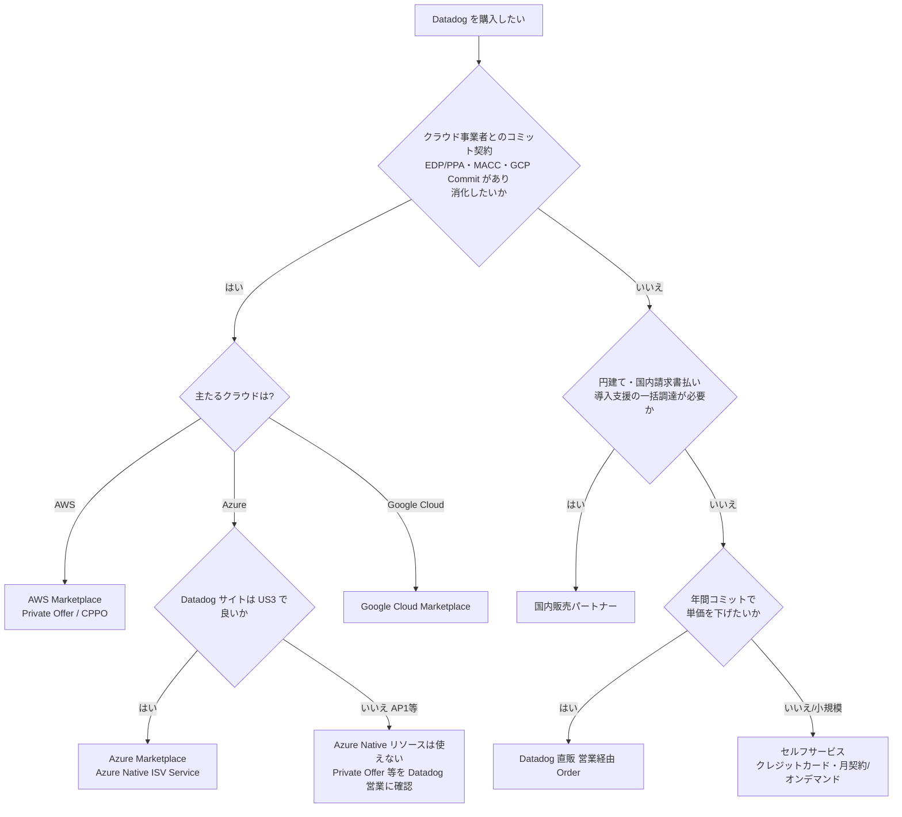
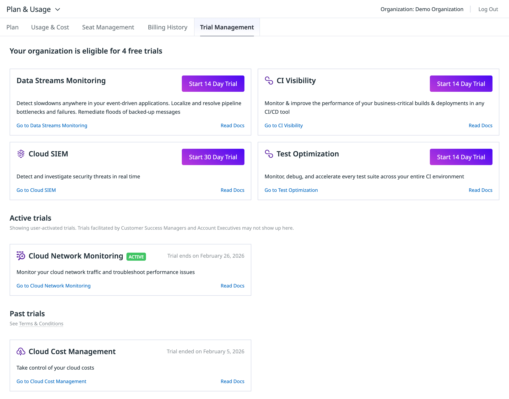
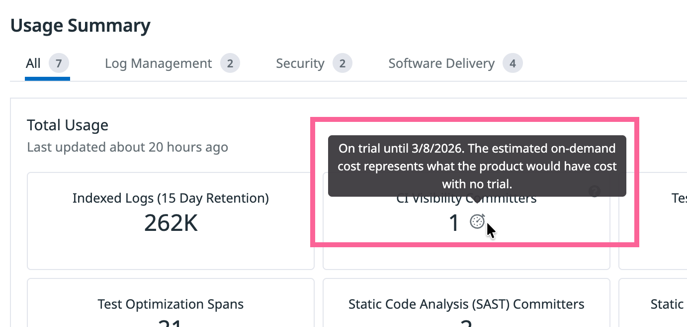

# 購入経路と契約

## 概要

本ファイルは「Datadog をどこから・どういう契約で買うか」に答える。対象は次のとおり。

- **購入経路**：Datadog との直接契約（セルフサービスのクレジットカード契約／営業経由の Order 契約）、AWS Marketplace、Azure Marketplace（Datadog – An Azure Native ISV Service）、Google Cloud Marketplace、国内販売パートナー（Datadog Partner Network のリセラー、AWS Marketplace CPPO を含む）。
- **契約形態**：年契約（Billed Annually）・月契約（Billed Month-to-month）・オンデマンド（Billed On-demand）、Pay-as-you-go、コミット（Committed）と超過（On-demand overage）、トゥルーアップに相当する扱い。
- **契約条件**：Order Term、自動更新と非更新の通知期限、更新時の値上げ上限、支払期日・遅延利息・停止、税、可用性（99.8%）と返金。
- **サポートプラン**：Standard Support（有償エディションに同梱）と Premier Support（有償）。
- **解約・データの扱い**：解約後 30 日間のデータダウンロード、削除の時期、Free プランへのダウングレード、組織の無効化。

本ファイルが扱わないもの（詳細は各ファイルへ）：

| 知りたいこと | 参照先 |
|---|---|
| 製品ごとの単価（料金の正本） | [製品別料金表](pricing-by-product.md) |
| 料金体系の全体像（課金軸・契約形態の考え方） | [料金体系の全体像](pricing-overview.md) |
| ホスト数の 99 パーセンタイル計算、コミット超過の計算、請求画面の読み方 | [課金計算の仕組み](billing-mechanics.md) |
| エディション・プラン（Free / Pro / Enterprise 等） | [エディション・プラン](editions-and-plans.md) |
| 見積り手法 | [コスト見積り手法](cost-estimation.md) |
| サポート窓口の使い方・トレーニング・認定資格 | [サポートと教育](support-and-training.md) |
| 契約後のコスト削減策 | [コスト最適化](../04_応用編/cost-optimization.md) |
| Usage・Usage Attribution・Cost Visibility の画面と API | [Usage・Usage Attribution・Cost Visibility](../02_リファレンス/platform/usage-and-cost-attribution.md) |
| サイト（US1 / AP1 等）の選択と移行不可の制約 | [Datadog Sites（サイト）](../02_リファレンス/platform/datadog-sites.md) |
| セキュリティ・コンプライアンス文書（SOC 2、ISO 27001 等） | [セキュリティとコンプライアンス](security-and-compliance.md) |

> **注意:** 本ファイルの契約条項は、Datadog の公開 MSA（Master Subscription Agreement、最終更新 2023-07-27 版、2026-11-02 時点で公開されている最新版）・Support Terms（2025-11-14 版）・DPA（2024-01-03 版）に基づく。**実際の契約では Order（注文書）や個別交渉条項が優先**され、また Marketplace・リセラー経由の購入では MSA の価格・更新・解約条項が適用除外になる（§6.7）。法的判断は契約書原本と法務部門で確認すること。

---

## 1. 購入経路の全体像

### 1.1 購入経路の一覧

Datadog の購入経路は大きく 5 つに分かれる。

| # | 購入経路 | 契約の相手方（請求元） | 契約条件の根拠 | 通貨 | 主な用途・メリット |
|---|---|---|---|---|---|
| A | 直販（セルフサービス） | Datadog, Inc. | MSA + Pricing Page | USD | アプリ内でクレジットカード登録し Pro 等にアップグレード。小規模・スモールスタート |
| B | 直販（営業経由 Order） | Datadog, Inc.（Order に記載の Datadog 法人） | MSA + Order | USD（MSA 5.1） | 年間コミット、ボリューム／複数年ディスカウント、請求書払い |
| C | AWS Marketplace | AWS（Marketplace 経由。販売者は Datadog） | Marketplace の EULA（＝MSA を参照）＋ Marketplace 条件 | USD（Private Offer は JPY 等も可、§3.4） | AWS 請求への一本化、AWS 側のコミット（EDP/PPA）消化 |
| D | Azure Marketplace（Datadog – An Azure Native ISV Service） | Microsoft（Marketplace） | Marketplace 条件 | Azure 請求通貨 | Azure 請求への一本化、MACC への算入 |
| E | Google Cloud Marketplace | Google（Marketplace） | Marketplace 条件 | 公開情報では確認できず | Google Cloud 請求への一本化、コミット消化 |
| F | 国内販売パートナー（リセラー） | パートナー各社 | パートナーとの契約（MSA 第 17 条で Datadog の価格・更新条項は適用除外） | パートナーによる（円建て請求の可否は各社に要確認） | 円建て・国内請求書払い、導入支援・技術支援のセット提供 |
| F' | パートナー経由の Marketplace（AWS CPPO） | AWS（Marketplace）、パートナーが販売 | Marketplace 条件 + パートナー条件 | Private Offer の通貨 | パートナー支援 + AWS 請求一本化 |

出典：[MSA](https://www.datadoghq.com/legal/msa/)、[Billing](https://docs.datadoghq.com/account_management/billing/)、[AWS Marketplace Datadog Pro](https://aws.amazon.com/marketplace/pp/prodview-536p4hpqbajc2)、[Azure Native Integration](https://docs.datadoghq.com/integrations/guide/azure-native-integration/)、[Google Cloud Marketplace 提供開始リリース](https://www.datadoghq.com/about/latest-news/press-releases/datadog-announces-availability-on-google-cloud-marketplace-to-support-customers-cloud-migrations/)、[クラスメソッド CPPO リリース](https://www.datadoghq.com/ja/about/latest-news/press-releases/datadog-classmethod-2024-06/)（いずれも取得日 2026-11-02）

### 1.2 購入経路の選び方（フロー）

上図は本ファイルの整理に基づく判断の目安であり、Datadog 公式の選定フローではない【経験則】。

### 1.3 購入経路別の比較表

| 観点 | 直販（カード） | 直販（Order） | AWS Marketplace | Azure Marketplace | Google Cloud Marketplace | 国内パートナー |
|---|---|---|---|---|---|---|
| 初期設定 | アプリ内 Plan 画面 | 営業と Order 締結 | Marketplace で Subscribe → Setup Your Account | Azure ポータルで Datadog リソース作成 | Marketplace で購入 | パートナーと契約 |
| 年間コミット | 不可（カード契約は月契約が既定。年契約は CSM に連絡）[出典](https://docs.datadoghq.com/account_management/billing/credit_card/) | 可 | 可（12 か月契約、Private Offer） | 可（プラン・Private Offer による） | 公開情報では確認できず | 可（パートナー条件） |
| 請求書の発行元 | Datadog | Datadog | AWS | Microsoft | Google | パートナー |
| クラウドコミットへの算入 | なし | なし | AWS 側の契約による | MACC に算入（該当する場合） | Google Cloud のコミット消化に一部充当可 | CPPO 経由なら AWS 側の契約による |
| 契約条件の根拠 | MSA | MSA + Order | Marketplace 条件（MSA 5・6・11.2〜11.4 条は適用除外） | 同左 | 同左 | パートナー条件（同左） |
| Plan 画面の Subscription Details 表示 | 対応 | 対応 | 公開情報では確認できず | 公開情報では確認できず | 公開情報では確認できず | **非対応**（"Not supported if billing runs through a Datadog Partner"） |
| 無料トライアル | 14 日 | 14 日（営業主導トライアルも可） | 14 日（Pay-As-You-Go リスティング） | **新規 org 作成フローでは不可** | 公開情報では確認できず | パートナーによる |

出典：[Billing](https://docs.datadoghq.com/account_management/billing/)、[MSA §16, §17](https://www.datadoghq.com/legal/msa/)、[AWS Marketplace Trial](https://docs.datadoghq.com/integrations/guide/aws-marketplace-datadog-trial/)、[Azure Native Integration](https://docs.datadoghq.com/integrations/guide/azure-native-integration/)（取得日 2026-11-02）

---

## 2. 直販（Datadog との直接契約）

### 2.1 セルフサービス（クレジットカード）

Datadog の直販セルフサービスでは、無料トライアルから Plan & Usage 画面で有償プランへアップグレードし、クレジットカードで支払う。

| 項目 | 内容 | 出典 |
|---|---|---|
| 設定画面 | 左下のユーザー名 → **Plan & Usage** → **Plan** | [Credit Card](https://docs.datadoghq.com/account_management/billing/credit_card/) |
| 既定の契約形態 | カード登録時は**月契約（monthly plan）が既定**。年契約への切り替えは Customer Success Manager（CSM）に連絡 | 同上 |
| 支払い（課金）時期 | 毎月 **第 10 営業日前後**にカードへ課金 | 同上 |
| 決済失敗時 | 失敗した課金は**最大 2 回まで再試行** | 同上 |
| 登録できる支払い方法 | **同時に 1 つのみ** | 同上 |
| カード変更 | Plan 画面の **Edit** | 同上 |
| カード削除 | 先に **Free プランへダウングレード**してから **Remove Card** | 同上 |
| 請求書払い→カードへの切り替え | CSM に連絡（過去分をキューに入れ、以後は自動課金） | 同上 |
| 領収書 | 管理者は **Billing History** で過去月の領収書を閲覧可能。請求書の写しは billing サポートへ依頼 | [Billing](https://docs.datadoghq.com/account_management/billing/) |

### 2.2 営業経由の Order 契約（請求書払い）

年間コミットやディスカウントを伴う契約は、Datadog の営業（Account Executive）と **Order** を締結する。MSA では Order を「サービスのサブスクリプションの購入、または Pay-as-you-go ベースでの利用」と定義している（MSA §23）[出典](https://www.datadoghq.com/legal/msa/)。

| 項目 | 内容 | 出典 |
|---|---|---|
| 支払い方法 | 請求書払い（**ACH、電信送金（wire）、小切手**）またはクレジットカード | [Billing](https://docs.datadoghq.com/account_management/billing/) |
| 請求書の送付 | 毎月 **第 10 営業日前後**にメール送付。送金先は請求書に記載 | 同上 |
| 請求方式 | 使用量ベースで計算し、**毎月後払い（invoiced monthly in arrears）** | [MSA §5.1](https://www.datadoghq.com/legal/msa/) |
| 支払期日 | 請求書日付から **30 日以内**、**米ドル（USD）** | MSA §5.1 |
| 請求額への異議 | 請求書受領から **10 日以内**に書面で | MSA §5.2 |
| 遅延利息 | **月 1.5%**（または法定上限のいずれか低い方） | MSA §5.2(a) |
| 回収費用 | 合理的な回収費用（弁護士費用含む）は顧客負担 | MSA §5.2(b) |
| 利用停止 | 未払いが **10 日以上**継続した場合、アクセス停止の可能性 | MSA §5.2(c) |
| 税 | 料金は税抜き。売上税・付加価値税等は顧客負担（Datadog の所得課税を除く） | MSA §5.4 |
| Standard Support | 追加料金なしで含まれる | MSA §5.1 |
| 購買発注書（PO） | PO の写しは `purchaseorders@datadoghq.com` | [Billing](https://docs.datadoghq.com/account_management/billing/) |

> **補足:** MSA 上の支払い通貨は USD であり、Datadog 直販で円建て請求が可能かどうかは**公開情報では確認できず**。円建て・国内請求書払いが社内規程上必要な場合は、国内販売パートナー（§5）や AWS Marketplace の JPY 建て Private Offer（§3.4）を検討する【経験則】。

### 2.3 分割払いのオプション（第三者情報）

年間コミット契約の支払い回数について、Datadog 公式の公開情報は確認できない。SaaS 調達支援企業 Sastrify のブログ（2023-11-10 公開）は次のように紹介している【第三者情報】。

| 支払いスケジュール | 価格（同記事による） |
|---|---|
| Annual（年 1 回前払い） | 見積価格どおり |
| Biannual（年 2 回） | 見積価格 + 2.5% |
| Quarterly（四半期） | 見積価格 + 5% |
| Monthly（毎月） | 見積価格 + 10% |

[出典](https://www.sastrify.com/blog/datadog-renewal)（2023-11-10 公開。2 年以上前の情報であり、現行の条件と異なる可能性がある）

### 2.4 Billing の問い合わせ窓口

| 用件 | 宛先 |
|---|---|
| 請求の異議・クレジット・使用量・支払い方法変更・支払いの懸念・アカウント全般・連絡先更新・Statement・請求先/送付先情報 | `success@datadoghq.com` |
| 請求書の写し・急ぎの請求・請求内訳・請求ポータルへの招待 | `billing@datadoghq.com` |
| 送金（remittance） | `remittances@datadoghq.com` |
| 購買発注書（PO）の写し | `purchaseorders@datadoghq.com` |
| 価格・契約の相談 | `sales@datadoghq.com`（[Pricing](https://docs.datadoghq.com/account_management/billing/pricing/)） |

出典：[Billing - Contact](https://docs.datadoghq.com/account_management/billing/)（取得日 2026-11-02）

> **注意:** Support Terms では、**請求に関する質問はサポートプランの対象外**とされ、`billing@datadoghq.com` または担当の Customer Success 担当者へ問い合わせるよう定められている [出典](https://www.datadoghq.com/legal/datadog-support-terms/)。

### 2.5 Plan & Usage 画面での契約情報の確認

Datadog の契約・支払い情報は **Plan & Usage** 画面（Organization Settings 配下）で確認する。アクセスできるのは Datadog Admin ロール、または `billing_read` / `billing_edit` 権限を持つユーザー [出典](https://docs.datadoghq.com/account_management/billing/)。

| タブ / 項目 | 内容 |
|---|---|
| Plan → **Payment Method** | カードの管理・置き換え、カード払いと請求書払いの切り替え |
| Plan → **Billing Contact Details** | 請求先住所、請求書送付先メール（Datadog のユーザーでなくても可） |
| Plan → **Subscription Details** | コミット対象製品の数量・契約単価・オンデマンド単価。**Datadog Partner 経由の請求では非対応** |
| Usage & Cost | 時間単位の使用量、上位 5,000 のカスタムメトリクス。更新は最大 72 時間遅れ |
| Billing History | 過去の請求・領収書 |
| Trial Management | セルフサービス型トライアルの開始と状況確認（営業主導トライアルは表示されない） |
| Bill Overview【Limited Availability】 | 2026 年 3 月から全組織に順次展開されている新しい請求概要画面 |

出典：[Billing](https://docs.datadoghq.com/account_management/billing/)、[Plan and Usage](https://docs.datadoghq.com/account_management/plan_and_usage/)（取得日 2026-11-02）。画面の詳細は [課金計算の仕組み §9](billing-mechanics.md) を参照。

- **キャプション:** Plan & Usage 画面の Trial Management タブ。
- **画面説明:** 画面上部に Plan & Usage のタブ（Plan / Usage & Cost / Seat Management / Billing History / Trial Management）が並ぶ。Trial Management タブでは「Your organization is eligible for N free trials」の見出しの下に、試用可能な製品のカード（例：Data Streams Monitoring・CI Visibility・Test Optimization は「Start 14 Day Trial」、Cloud SIEM は「Start 30 Day Trial」）が並び、各カードに製品画面へのリンクと「Read Docs」リンクがある。下段の **Active trials** にはユーザーが開始した実施中トライアル（ACTIVE バッジと「Trial ends on …」の終了日）、**Past trials** には終了済みトライアル（「Trial ended on …」）が表示される。注記として「CSM や Account Executive が設定したトライアルはここに表示されない場合がある」と書かれている。
- **出典:** [Plan and Usage](https://docs.datadoghq.com/account_management/plan_and_usage/)（画像取得日 2026-11-02）

- **キャプション:** Usage & Cost（Usage Summary）でトライアル中の製品に表示されるインジケーター。
- **画面説明:** Usage Summary の Total Usage タイル（例：Indexed Logs (15 Day Retention)、CI Visibility Committers）のうち、トライアル中の製品の数値横にストップウォッチ型アイコンが付く。カーソルを合わせると「On trial until <日付>. The estimated on-demand cost represents what the product would have cost with no trial.」というツールチップが表示され、トライアルがなかった場合のオンデマンド換算コストが推定表示されていることが分かる。
- **出典:** [Plan and Usage](https://docs.datadoghq.com/account_management/plan_and_usage/)（画像取得日 2026-11-02）

---

## 3. AWS Marketplace

### 3.1 AWS Marketplace のリスティング

Datadog は AWS Marketplace で SaaS として販売されている（販売者は Datadog）。2026-11-03 時点で確認できた主なリスティングは次のとおり。

| リスティング | 価格モデル | 契約期間 | URL |
|---|---|---|---|
| Datadog Pro (Pay-As-You-Go with 14-day Free Trial) | 従量（実使用量に応じて課金）。**終了日なし・いつでも解約可** | なし | [prodview-7tlwraipohxq6](https://aws.amazon.com/marketplace/pp/prodview-7tlwraipohxq6) |
| Datadog Pro | 月あたりのコミット使用量 × 契約期間（Total Expected Use）。超過は従量 | **1 か月契約 / 12 か月契約**（12 か月は「save up to 20%」と表記） | [prodview-536p4hpqbajc2](https://aws.amazon.com/marketplace/pp/prodview-536p4hpqbajc2) |
| Datadog Enterprise | コミット契約（Pro と同様の構造と考えられるが、詳細は本調査では未取得） | 公開情報では確認できず（本調査範囲） | [prodview-tl2m77mvj2gmk](https://aws.amazon.com/marketplace/pp/prodview-tl2m77mvj2gmk) |

出典：[AWS Marketplace Datadog Trial（Datadog 公式ドキュメント）](https://docs.datadoghq.com/integrations/guide/aws-marketplace-datadog-trial/)、各 AWS Marketplace ページ（取得日 2026-11-03）

### 3.2 Pay-As-You-Go リスティングの課金次元（抜粋）

AWS Marketplace の Pay-As-You-Go リスティングは、使用量を**時間単位の次元（dimension）**で AWS に報告する。リスティングには 18 の次元があり、以下は確認できた 10 次元の抜粋（AWS Marketplace ページ掲載値、取得日 2026-11-03、オンデマンド相当）。

| 次元 | 単位 | 単価（USD） |
|---|---|---|
| Infra Pro Hosts | ホスト・時間 | $0.03 |
| Additional Containers | コンテナ・時間 | $0.002 |
| Additional Custom Metrics | 100 メトリクス・時間 | $0.008 |
| APM Hosts | ホスト・時間 | $0.06 |
| APM Analyzed Spans (15-day retention) | 100 万件 | $2.55 |
| Indexed Log Events (15-day retention) | 100 万件 | $2.55 |
| Ingested Logs | 1 GB | $0.10 |
| Synthetics API Tests | 1 万回 | $7.20 |
| Synthetics Browser Checks | 1,000 回 | $18.00 |
| Serverless Functions | 関数・時間 | $0.012（"no longer offered"） |

[出典](https://aws.amazon.com/marketplace/pp/prodview-7tlwraipohxq6)

- Infra Pro Hosts の $0.03/時間は月 720 時間換算で $21.6 となり、Datadog 料金ページのオンデマンド単価（Infrastructure Pro $18/ホスト/月）とは計算方法が異なる。Datadog 側の請求計算（ハイウォーターマーク方式等）と AWS 側の時間次元との対応関係は**公開情報では確認できず**。Marketplace の単価で見積もる場合は、必ず Datadog 営業に Marketplace 上での実際の請求方法を確認する。
- 料金ページの単価（年契約・月契約・オンデマンド）とサイト別価格は [製品別料金表](pricing-by-product.md) を正とする。AWS Marketplace の公開リスティング単価は **US 価格の USD 建て**と考えられるが、AP1 サイト（料金ページ上 US の 1.25 倍）での扱いは**公開情報では確認できず**。

### 3.3 Datadog Pro（1 か月契約）リスティングの単価

AWS Marketplace の「Datadog Pro」リスティング（コミット型）の **1 か月契約**の掲載値（取得日 2026-11-03）。12 か月契約の単価はページ上に表示されず、「最大 20% 割引」とのみ表記されている。

| 次元 | 契約単価（/月） | 超過単価 |
|---|---|---|
| Infra Hosts | $18.00 | $0.03/unit |
| APM Hosts | $36.00 | $0.06/unit |
| App Analytics Add-On（Analyzed Span） | $2.04 | $2.55/unit |
| Custom Metrics（100 個あたり） | $5.00 | $0.008/unit |
| Indexed Logs（100 万件、15 日保持） | $2.04 | $2.55/unit |
| Ingested Logs（GB） | $0.10 | $0.10/unit |
| Synthetics API Tests（1 万回） | $6.00 | $7.20/unit |
| Synthetics Browser Tests（1,000 回） | $15.00 | $18.00/unit |
| Serverless Functions | $6.00 | $0.012/unit（新規顧客は利用不可） |
| Fargate Tasks | $1.20 | $0.002/unit |
| Consumption unit（契約外の追加使用） | — | $0.01/unit |
| Custom dimension（一部 Private Offer 用） | — | $1.00/unit |

[出典](https://aws.amazon.com/marketplace/pp/prodview-536p4hpqbajc2)

- リスティングの記載：「Usage-based pricing is in effect for overages or additional usage not covered in the contract.」（契約でカバーされない超過・追加使用は従量課金）。
- リスティングの記載：「If you choose not to renew or replace your contract before the contract end date, access to your entitlements will expire.」（契約終了日までに更新・置き換えしないと権利が失効）。
- 返金ポリシーは「Vendor refund policy」として Datadog の MSA にリンクされている。
- **Consumption unit / Custom dimension** は、Private Offer で Datadog の多数の製品を 1 つの金額単位（消費ユニット）で表現するための次元と考えられる【推定】。具体的な使われ方は公開情報では確認できず。

### 3.4 Private Offer・通貨・CPPO

AWS Marketplace の **Private Offer** は、特定の買い手アカウント向けに販売者が個別価格・個別条件を設定するオファーである。Datadog の年間コミット契約を AWS 経由で調達する場合は、通常 Datadog 営業（またはパートナー）が Private Offer を発行する【経験則】。

| 項目 | 内容 | 出典 |
|---|---|---|
| 有効期限 | Private Offer には有効期限があり、期限切れ後は購読不可（販売者に延長・再発行を依頼） | [AWS: Private offers](https://docs.aws.amazon.com/marketplace/latest/buyerguide/buyer-private-offers.html) |
| 対象アカウント | 1 オファーあたり最大 25 アカウント。管理アカウントが受諾すれば組織内のメンバーアカウントと共有可能 | 同上 |
| 同時購読 | 1 製品につき同時に購読できるオファーは 1 つ | 同上 |
| 通貨 | Private Offer は **USD・EUR・GBP・AUD・JPY** で作成可能（契約型は 2024-10、使用量ベースは 2025-10 に対応）。**公開オファーは USD のみ**。CUR（Cost and Usage Report）は USD 表示 | [AWS What's New 2024-10](https://aws.amazon.com/about-aws/whats-new/2024/10/aws-marketplace-offers-new-currencies-non-us-bank-accounts-disbursement/)、[AWS What's New 2025-10](https://aws.amazon.com/about-aws/whats-new/2025/10/aws-marketplace-currencies-usage-based-private-offers)、[Pay for private offers in multiple currencies](https://docs.aws.amazon.com/marketplace/latest/buyerguide/buyer-private-offers-subscribing-fixed-exchange-rate.html) |
| CPPO（Channel Partner Private Offers） | 販売パートナーが ISV に代わって Private Offer を提示する仕組み。CPPO では販売者・パートナー・買い手が同一通貨で取引する必要がある | [AWS Multi-currency pricing](https://docs.aws.amazon.com/marketplace/latest/userguide/multi-currency-pricing.html) |
| Datadog の CPPO（国内） | クラスメソッドが 2024-06-20 に Datadog と戦略的パートナーシップを締結し、AWS Marketplace CPPO で Datadog 製品の取り扱いを開始。「オブザーバビリティ関連製品を CPPO の対象とするのは国内で初めて」 | [Datadog プレスリリース](https://www.datadoghq.com/ja/about/latest-news/press-releases/datadog-classmethod-2024-06/)（2024-06-20） |

> **補足:** Datadog が実際に JPY 建ての Private Offer を発行するかどうかは**公開情報では確認できず**。AWS 側の機能として可能であることと、Datadog が対応することは別であるため、営業・パートナーに確認する。

### 3.5 AWS 側のコミット（EDP / PPA）への算入

- Datadog は AWS Marketplace 購入を「AWS 請求に統合でき、AWS のコミットに算入できる」経路として位置付けているが、**どの割合が EDP（Enterprise Discount Program）／PPA（Private Pricing Agreement）の消化に算入されるかは、顧客と AWS 間の契約条件による**。Datadog 公式の公開情報では算入率は確認できず。
- Sastrify（2023-11-10 公開）は「AWS EDP 参加企業（通常年間 AWS 支出 100 万ドル以上）は AWS Marketplace 経由で Datadog を支払い、AWS コミットに充当できる」と紹介している【第三者情報】[出典](https://www.sastrify.com/blog/datadog-renewal)（2 年以上前の情報）。

### 3.6 AWS Marketplace からの購入手順

Datadog 公式ドキュメント（AWS Marketplace Datadog Trial）の手順：

1. Datadog の AWS Marketplace リスティング（Pay-As-You-Go with 14-day Free Trial）を開く。
2. **View purchase options** をクリック。
3. 内容を確認し、必要なら購買発注書（PO）番号を追加。
4. **Subscribe** をクリック。
5. コミットを追加する場合は Pro プラン／Enterprise プランのリスティングから購入する。

[出典](https://docs.datadoghq.com/integrations/guide/aws-marketplace-datadog-trial/)（取得日 2026-11-02）

Subscribe 後のアカウント連携（第三者ブログによる手順）：

| 手順 | 内容 |
|---|---|
| 1 | AWS Marketplace の購読完了画面で **Setup Your Account** をクリック |
| 2 | 12 桁の AWS アカウント ID を入力 |
| 3a | 新規 Datadog 組織を作る場合：新規アカウント作成を選択し、メールアドレス・会社名を入力 |
| 3b | 既存組織に紐づける場合：Company Name に**既存の Datadog 組織名**、Email に**管理者のメールアドレス**を入力 |
| 4 | Datadog の AWS インテグレーション設定はその場で行うか、Skip して後で設定 |
| 5 | Datadog の **Plan & Usage > Plan** で請求が AWS Marketplace 経由になっていることを確認 |

[出典](https://dev.classmethod.jp/articles/datadog-aws-marketplace/)【第三者情報】（2020-09-02 公開。2 年以上前の情報で、画面・手順・単価は現行と異なる可能性がある）

> **サイト差異:** AWS Marketplace から新規組織を作成する際に Datadog サイト（AP1 等）を選択できるかどうかは**公開情報では確認できず**。Datadog のサイトは作成後に移行できない（[Datadog Sites](../02_リファレンス/platform/datadog-sites.md)）ため、AP1 で運用したい場合は**先に AP1 で組織を作成してから Marketplace の購読を既存組織に紐づける**か、営業に手順を確認する【経験則】。`us2.ddog-gov.com`（US1-FED）の利用者は、インテグレーションの利用可否を組織管理者に確認し、例外申請は `support@ddog-gov.com` へ連絡する [出典](https://docs.datadoghq.com/integrations/guide/aws-marketplace-datadog-trial/)。

### 3.7 AWS Marketplace 経由の解約

| 手順 | 内容 |
|---|---|
| 1 | Datadog の **Plan & Usage** で Pro → Free へ **Downgrade** |
| 2 | 必要に応じて AWS Marketplace の **Manage subscriptions** で購読をキャンセル |
| 注意 | コミット型（1 か月 / 12 か月）契約は、契約終了日に更新しなければ権利が失効する。期中解約・返金は MSA 第 17 条により Marketplace（Intermediary）のプロセスで扱う |

出典：[クラスメソッド ブログ](https://dev.classmethod.jp/articles/datadog-aws-marketplace/)【第三者情報】（2020-09-02 公開）、[AWS Marketplace Datadog Pro](https://aws.amazon.com/marketplace/pp/prodview-536p4hpqbajc2)、[MSA §17](https://www.datadoghq.com/legal/msa/)

---

## 4. Azure Marketplace（Datadog – An Azure Native ISV Service）

### 4.1 概要

Azure では、Datadog は **Azure Native ISV Service**（Microsoft と Datadog が共同開発・共同管理）として提供され、Azure リソース `Microsoft.Datadog/monitors`（Datadog リソース）を作成することで、組織の作成または既存組織とのリンク、ログ転送、メトリクス収集、Agent 展開、Entra ID SSO、課金を Azure ポータルから一元管理できる [出典](https://learn.microsoft.com/en-us/azure/partner-solutions/datadog/overview)。

| 項目 | 内容 | 出典 |
|---|---|---|
| オファー名 | Datadog – An Azure Native ISV Service | [Microsoft Learn](https://learn.microsoft.com/en-us/azure/partner-solutions/datadog/overview)（2026-10-30 更新） |
| オファー ID | `dd_liftr_v2`（Marketplace の URL は `datadog1591740804488.dd_liftr_v3_decoupled`） | 同上 |
| Azure 側のデプロイリージョン | **West US 2** | 同上 |
| 対応 Datadog サイト | **US3 のみ**（"only available to Datadog organizations on the Datadog US3 site"） | [Azure Native Integration](https://docs.datadoghq.com/integrations/guide/azure-native-integration/) |
| 課金 | Datadog の費用は Azure の月次請求に統合。**MACC（Microsoft Azure Consumption Commitment）に算入**（該当する場合） | 同上、[Microsoft Learn](https://learn.microsoft.com/en-us/azure/partner-solutions/datadog/overview) |
| プラン選択 | 作成時の料金プランのドロップダウンで選択。Private Offer がある場合も同じドロップダウンに表示 | [Azure Native Integration](https://docs.datadoghq.com/integrations/guide/azure-native-integration/) |
| 課金期間（Billing term） | 作成フローでは **Monthly** と表示 | 同上 |
| プラン変更 | Datadog リソースの Overview で **Change Plan**（Azure Marketplace 課金の場合のみ）。テナントで利用可能なプラン（Private Offer を含む）が表示される | 同上 |
| トライアル | **「Create a new Datadog organization」フローではトライアル不可**。トライアルは US3 でトライアル組織を作成してからリンクフローを使う | 同上 |

> **サイト差異:** Azure Native ISV Service の Datadog リソースは **US3 の組織でのみ利用可能**。AP1（日本）など他サイトの組織は Azure Native の Datadog リソースを使えず、Azure 連携には Azure Automated Log Forwarding ガイド等の通常のインテグレーションを用いる [出典](https://docs.datadoghq.com/integrations/guide/azure-native-integration/)。したがって **AP1 を使いつつ Azure 請求（MACC 消化）で Datadog を購入できるかは公開情報では確認できず**、Datadog 営業への確認が必要。Azure 連携の詳細は [Azure Integration](../02_リファレンス/platform/azure-integration.md) を参照。

### 4.2 新規組織作成とリンクの違い（課金への影響）

| フロー | 課金への影響 | 出典 |
|---|---|---|
| **既存の Datadog 組織にリンク** | 「This action does not affect your Datadog billing plan.」Datadog の既存契約（直販等）はそのまま | [Azure Native Integration](https://docs.datadoghq.com/integrations/guide/azure-native-integration/) |
| **新規 Datadog 組織を作成** | 新規組織が作られ、料金プランを選択し、Azure サブスクリプションをリンク。課金は Azure 請求に統合され MACC に算入（該当時）。公式は「less common」なフローと記載 | 同上 |

### 4.3 Datadog リソース削除時の扱い

| 状況 | 結果 |
|---|---|
| Marketplace 課金の組織で、組織にマップされた**唯一の**リソースを削除 | ログ・メトリクスの送信が停止し、**Azure 経由の Datadog 課金がすべて停止**。その後 Datadog サポートから次のステップについて連絡がある |
| Marketplace 課金の組織で、**他のリソースも同じ組織にマップ**されている | 削除したリソースに対応する Azure サブスクリプションのログ・メトリクス送信のみ停止 |
| Marketplace 課金ではない組織（リンクのみ） | その Azure サブスクリプションのインテグレーションが削除されるだけ |

出典：[Azure Native Integration](https://docs.datadoghq.com/integrations/guide/azure-native-integration/)（取得日 2026-11-02）。削除時に Datadog 組織そのものや蓄積データがどう扱われるかは同ページに記載がなく、**公開情報では確認できず**（MSA §11.5 の一般規定は §8 を参照）。

---

## 5. Google Cloud Marketplace

| 項目 | 内容 | 出典 |
|---|---|---|
| 提供開始 | 2021-07-29 発表 | [Datadog プレスリリース](https://www.datadoghq.com/about/latest-news/press-releases/datadog-announces-availability-on-google-cloud-marketplace-to-support-customers-cloud-migrations/) |
| 請求 | Datadog の使用量は Google Cloud の請求書に直接計上される（consolidated billing） | 同上 |
| コミット消化 | 使用量の**一部**を Google Cloud のコミット済み支出で支払える | 同上 |
| リスティング | プレスリリースのリンク先は `console.cloud.google.com/marketplace/product/datadog-public/datadog` | 同上 |
| プラン・単価・契約期間 | **公開情報では確認できず**（Marketplace コンソールへのログインが必要） | — |
| Private Offer | Google Cloud Marketplace 自体は Private Offer に対応。Datadog の提供条件は公開情報では確認できず | [Google Cloud Blog](https://cloud.google.com/blog/topics/partners/announcing-google-cloud-marketplace-private-offers/) |

Google Cloud Marketplace の購入がコミット（Minimum Commitment）消化にどこまで算入されるかは Google の「commitment drawdown」規定に従う。Google の公式ドキュメントは Marketplace 購入の算入ルールと除外対象を定めており、2025-06-09 以降は認定チャネルパートナー経由の購入について「コミット総額の 25% を上限に 100% 算入」という条件が報じられている [Google Cloud: Commit drawdown](https://cloud.google.com/marketplace/docs/commit-drawdown)【第三者情報を含む】。Datadog 個別の算入可否・率は**公開情報では確認できず**。

> **サイト差異:** Google Cloud Marketplace から作成・リンクできる Datadog サイトの範囲は**公開情報では確認できず**。

---

## 6. 契約形態と主要条項

### 6.1 契約形態（料金ページ上の 3 区分 + Pay-as-you-go）

Datadog の料金ページは製品ごとに **Billed Annually（年契約）／Billed Month-to-month（月契約）／Billed On-demand（オンデマンド）** の 3 区分の単価を掲載している。数値は [製品別料金表](pricing-by-product.md) を正とする。

| 契約形態 | 意味 | 代表値（Infrastructure Pro、US サイト、2026-11-02 時点） |
|---|---|---|
| Billed Annually（年契約） | 年間コミット。最安の単価 | $15/ホスト/月 |
| Billed Month-to-month（月契約） | 月単位のコミット | $18/ホスト/月 |
| Billed On-demand（オンデマンド） | コミットなしの従量。**コミット超過分にも適用** | $18/ホスト/月 |
| Pay-as-you-go（MSA 上の Order 形態） | コミットなしの利用。**Order Term は利用した各日** | オンデマンド単価 |

出典：[Pricing](https://www.datadoghq.com/pricing/)、[製品別料金表 §1.1](pricing-by-product.md)、[MSA §23](https://www.datadoghq.com/legal/msa/)

- 料金ページには「Multi-Year/Volume discounts available」と複数製品で記載されている。Infrastructure は **500 ホスト/月以上**、Log Management は **月 30 億イベント以上**でボリュームディスカウントの案内がある [出典](https://www.datadoghq.com/pricing/)。割引率は非公開。
- Infrastructure には「hourly plans」の記載もあり、ホスト課金製品には **High watermark plan（HWMP）** と **Hybrid monthly/hourly plan（MHP、月次最低コミット + 超過分を時間単価）** がある（Infrastructure Monitoring・APM・Database Monitoring が対象）[出典](https://docs.datadoghq.com/account_management/billing/pricing/)。計算方法は [課金計算の仕組み §2.4](billing-mechanics.md) を参照。

### 6.2 コミットと超過（On-demand overage）

| 論点 | 公式情報 | 出典 |
|---|---|---|
| 料金計算の基本 | Order に別段の定めがない限り、暦月ごとの製品使用量で計算 | [Pricing（docs）](https://docs.datadoghq.com/account_management/billing/pricing/) |
| コミット超過 | コミットを超えた使用量はオンデマンド単価で課金（料金ページの各製品 FAQ、Plan 画面の Subscription Details に「契約単価」と「オンデマンド単価」を表示） | [Billing](https://docs.datadoghq.com/account_management/billing/)、[Pricing](https://www.datadoghq.com/pricing/) |
| Log Management の超過 | コミットはデイリー量でレート制限されない。超過分は**年契約価格 + 50%** | [Pricing](https://www.datadoghq.com/pricing/) |
| APM のオンデマンド | 時間単位で計測され、ある時間の超過は他の時間に関係なく課金 | 同上 |
| AI Credits | 月次でリセット、未使用分は繰り越さない。月次バンドル超過分はオンデマンド単価で自動課金 | 同上 |
| 期中解約時のコミット | 顧客都合の解約では**コミット済み料金は Order 期間全体分が支払対象**。解約前の使用に基づくコミット超過分の料金も支払対象 | [MSA §11.4](https://www.datadoghq.com/legal/msa/) |
| 契約満了後の継続利用 | 満了後も利用を続けた場合は **Pricing Page の料金**で課金 | MSA §6.3 |

> **補足（トゥルーアップ）:** Datadog の公開 MSA には「トゥルーアップ（true-up：年度末に使用実績とコミットを精算する仕組み）」という条項は存在しない。公開情報上の仕組みは「**月次で使用量を計測し、コミット超過分を毎月オンデマンド単価で後払い請求**」であり、年次一括精算ではない（MSA §5.1）。年間プールのコミット、超過単価の個別交渉、期中のコミット増額などは Order 個別条件で決まる【推定】。超過計算の詳細は [課金計算の仕組み §7](billing-mechanics.md) を参照。

### 6.3 コミット交渉で語られる論点（第三者情報）

以下は Datadog 公式ではなく、調達支援・コンサルティング企業の公開情報に基づく。値引き率や条件は契約ごとに異なる。

| 論点 | 内容 | 出典 |
|---|---|---|
| コミット水準 | 交渉で最も重要なのはコミット水準の選択。予測使用量レンジの**下限寄り**でコミットするのが推奨。コミットは**増額できるが減額できない**、年 2〜3 回調整できる | 【第三者情報】[Sastrify](https://www.sastrify.com/blog/datadog-renewal)（2023-11-10 公開、2 年以上前） |
| 割引水準 | コミット契約では単価が公開価格より **30〜50%** 低くなることがある | 【第三者情報】[DoiT changelog](https://www.doit.com/changelog/manage-your-datadog-commitment-and-pricing-details-in-doit-cloud-intelligence)（公開日は公開情報では確認できず） |
| 超過単価の交渉 | オンデマンドのプレミアムは契約条項であり、超過をコミット単価で課金する条件や、製品横断のプールコミット、記念日での true-down 権、更新時の値上げ上限などを交渉材料とする | 【第三者情報】[Redress Compliance Datadog negotiation playbook](https://redresscompliance.com/assets/docs/playbooks/datadog-negotiation-playbook.pdf)（公開日は確認できず） |
| タイミング | 四半期末、特に暦年末に締結すると有利とされる | 【第三者情報】同上 |
| ボリュームの段階 | 価格は量に応じた段階（tier）があり、次の tier の開始点を営業に確認すると単価を下げられる場合がある | 【第三者情報】[Sastrify](https://www.sastrify.com/blog/datadog-renewal) |

### 6.4 Order Term・自動更新・非更新

| 条項 | 内容 | MSA |
|---|---|---|
| Order Term | Order に記載されたサブスクリプション期間。Pay-as-you-go は利用した各日 | §23 |
| 自動更新 | Order は**期間満了時に同じ期間で新しい Order として自動更新** | §6.1 |
| 更新前の通知（Datadog → 顧客） | 12 か月以上の Order：更新開始の**約 30 日前**にメール通知。12 か月未満：**約 15 日前**に価格・Order 変更を通知 | §6.1 |
| 非更新の申し出（顧客 → Datadog） | 満了の**少なくとも 15 日前**までに Customer Success Manager へ非更新を申し出る | §6.3 |
| 非更新の申し出（Datadog → 顧客） | Datadog も満了 15 日前までに非更新を通知できる | §6.3 |
| 通知に対し何もしない場合 | 非更新手続きを期限内に取らなかった場合、**値上げに同意したものとみなす** | §6.1 |
| 満了後の継続利用 | Pricing Page の料金で課金 | §6.3 |

### 6.5 更新時の値上げ上限

| 条項 | 内容 | MSA |
|---|---|---|
| 値上げの上限 | 12 か月以上の Order では、更新時に期間終了時点の価格を「**9%** または直近 12 か月の **CPI（消費者物価指数）上昇率**のいずれか大きい方」まで引き上げ可能 | §6.2 |
| クレジット | クレジット（credits）は更新されない | §6.2 |
| プロモーション価格 | Order に別段の定めがない限り、更新後には引き継がれない | §6.2 |
| MSA 自体の改定 | 改定版掲載の翌月 1 日に発効。ただし 12 か月以上の固定期間 Order では**次の更新期間の開始時**に発効。異議がある場合の唯一の救済は非更新 | §22.8 |

> **注意:** MSA 第 5 条・第 6 条（価格・支払い・更新）は、Marketplace・リセラー経由の購入では適用されない（§6.7）。

### 6.6 可用性（SLA）と返金

| 項目 | 内容 | MSA |
|---|---|---|
| 可用性コミットメント | サービスを **99.8% 以上**の時間で Available にする（Exceptions による時間を除く） | §2 |
| 計測 | Order Term 中の暦月ごとの分単位。顧客はサポート経由で可用性データを要求できる | §2 |
| 対象 | **Core Services**（Order 上の機能のうち、当該月にコミット済み支出があるもの。ベータは除く） | §2 |
| 除外（Exceptions） | 顧客の違反・誤設定、顧客環境の障害、不可抗力、§5.2 / §8.3 に基づく停止、事前通知されたメンテナンス | §2 |
| 救済 | **2 か月連続**で基準を下回った場合、書面通知により当該 Core Service の Order コミットを翌暦月から解約でき、**按分返金（Pro-Rated Refund）** | §2, §11.4 |
| その他の解約時の返金 | §2 または §11.2（Datadog の重大な違反等）による解約時のみ、未使用の前払い額を按分返金。それ以外は Order 期間全体の前払い・コミット料金は返金されない | §11.4 |

### 6.7 Marketplace・リセラー経由の購入（Indirect Purchases）

MSA 第 17 条は、サードパーティの Marketplace または Datadog 認定リセラー（Intermediary）経由の購入に適用される [出典](https://www.datadoghq.com/legal/msa/)。

| 項 | 内容 |
|---|---|
| (a) | 「Order」は顧客と Intermediary 間の注文を指す |
| (b) | Datadog は使用量データ等の顧客情報を Intermediary と共有できる |
| (c) | **第 5 条（価格・料金）と第 6 条（更新）は適用されない**。価格・更新は顧客と Intermediary の条件に従う |
| (d) | Intermediary が Datadog に支払わない場合、Datadog は Intermediary との注文を解約できる |
| (e) | **第 11.2〜11.4 条（解約・返金）は直接適用されず**、解約・返金は顧客と Intermediary 間で、Intermediary のプロセスを用いて処理する |

- 実務上の含意：Marketplace・リセラー経由では、**値上げ上限（9%/CPI）や非更新の 15 日前ルールは自動的には適用されない**。更新条件・値上げ上限・解約条項は Intermediary（AWS / Microsoft / Google / パートナー）との契約に明記させる必要がある【経験則】。
- 一方、サービスの利用条件（データの扱い、§11.5 の解約後アクセス等）は MSA 本体が適用される前提である。第 17 条が §11.5 を除外していないことは条文構成から読み取れるが、Marketplace 経由の解約時に実際にどう運用されるかは**公開情報では確認できず**。

### 6.8 契約準拠法・その他

| 項目 | 内容 | MSA |
|---|---|---|
| 契約当事者 | Datadog, Inc.（デラウェア州法人） | 前文 |
| 準拠法 | ニューヨーク州法（米国連邦法が適用される場合を除く） | §21 |
| 管轄 | ニューヨーク州ニューヨーク市の州裁判所または連邦裁判所の専属管轄 | §21 |
| 解約（Datadog 側） | 未払いが書面通知後 **15 日超**継続、重大な違反が書面通知後 **30 日**未是正、倒産等 | §11.2 |
| 関連会社 | Datadog の関連会社（Affiliates）が顧客データを処理し得る。Datadog はその行為に責任を負う | §1.3 |
| 日本法人 | Datadog Japan 合同会社（2019 年設立）が存在するが、日本法人を契約当事者とする Order が可能かは**公開情報では確認できず** | [プレスリリース](https://www.datadoghq.com/ja/about/latest-news/press-releases/japanese-subsidiary/) |

---

## 7. 無料トライアル・無料枠・特別プログラム

| プログラム | 内容 | 出典 |
|---|---|---|
| 無料トライアル（新規顧客） | **14 日間**（MSA §16(b)）。全製品を試用可能 | [MSA §16](https://www.datadoghq.com/legal/msa/) |
| 製品別トライアル（既存顧客） | Plan & Usage の Trial Management タブから開始。製品により 14 日・30 日（例：Cloud SIEM は 30 日）。トライアル中は無料、終了後の使用は課金 | [Plan and Usage](https://docs.datadoghq.com/account_management/plan_and_usage/) |
| 無料サービスの有償化 | 無料期間終了後（Order に期間の定めがなければ 15 日前通知で）Pricing Page の料金が適用 | MSA §16(a) |
| 無料・ベータの補償上限 | 無料・ベータサービスに関する IP 補償は総額 **$10,000** が上限 | MSA §16(f) |
| Free プラン（Infrastructure） | トライアル後、**最大 5 Basic ホスト・メトリクス保持 1 日** | [Pricing](https://www.datadoghq.com/pricing/) |
| AWS Marketplace トライアル | Pay-As-You-Go リスティングで新規アカウントを作ると 14 日間全機能トライアル、その後自動的に Pay-As-You-Go プランへ | [AWS Marketplace](https://aws.amazon.com/marketplace/pp/prodview-7tlwraipohxq6) |
| Azure Marketplace | 新規組織作成フローではトライアル不可 | [Azure Native Integration](https://docs.datadoghq.com/integrations/guide/azure-native-integration/) |
| Datadog for Startups | Series A 以前・公式パートナーからの紹介・Datadog 新規顧客が対象。**最大 $100k のクレジット（初年度）**、全 GA 製品利用可。承認メール後 **30 日以内**に有効化しないと失効。**3 か月間**未使用で警告し 30 日後に除外。リージョン（サイト）選択は変更不可 | [Datadog for Startups](https://www.datadoghq.com/partner/datadog-for-startups/) |
| Student Developer | 学生向けに **2 年間**、使用量制限付きで無料 | 同上 |

> **注意:** トライアルで作成した組織のサイト（AP1 等）は本契約でもそのまま使われる。サイト間のデータ移行はできないため、トライアル開始時に本番で使うサイトを選ぶ（[Datadog Sites](../02_リファレンス/platform/datadog-sites.md)）。

---

## 8. 国内販売パートナー

### 8.1 Datadog Partner Network（DPN）

| 項目 | 内容 | 出典 |
|---|---|---|
| 日本での開始 | 2020-01-29 発表 | [Datadog プレスリリース](https://www.datadoghq.com/ja/about/latest-news/press-releases/datadog-partner-network-2020-01/) |
| パートナー種別 | Managed Service Provider、System Integrator、Reseller、Referral Partner、Technology Partner | 同上 |
| パートナーが提供できるもの | ローカライズされた導入、サポート、**決済代行を含むフルフィルメント** | 同上 |
| パートナー検索 | Datadog Partner Network のページ（パートナーロケーター） | [Partner Network](https://www.datadoghq.com/partner/network/) |
| パートナー経由の請求時の制約 | Plan 画面の Subscription Details は表示されない | [Billing](https://docs.datadoghq.com/account_management/billing/) |
| 契約上の扱い | MSA §17（Indirect Purchases）が適用 | [MSA](https://www.datadoghq.com/legal/msa/) |

### 8.2 Datadog Japan Partner Award 受賞企業（公式発表）

国内で Datadog の販売・導入実績があるパートナーを把握する手がかりとして、Datadog 公式の Japan Partner Award を整理する（網羅的なリセラー一覧ではない）。

| 年 | 部門 | 企業 | 受賞理由（要約） |
|---|---|---|---|
| 2026（2026-05-14 発表） | Business Driver of the Year | 株式会社NTTデータ | 2025 年 3 月にパートナー契約を締結し、9 か月で新規販売額トップのパートナーに |
| 2026 | Industry Impact of the Year | キンドリルジャパン株式会社 | Datadog Live / DASH で事例発表、金融ミッションクリティカル領域でのオブザーバビリティ推進 |
| 2026 | Enablement Excellence of the Year | 株式会社エーピーコミュニケーションズ | 年間 50 名以上が Datadog 認定資格取得、独自の PoC 支援サービス |
| 2026 | Power of Three Partner of the Year | クラスメソッド株式会社 | AWS との協業、**AWS Marketplace 経由の販売**で実績 |
| 2026 | Cloud Partner of the Year | アマゾン ウェブ サービス ジャパン合同会社 | **AWS Marketplace での販売拡大** |
| 2025（2025-05-28 発表） | Sales Partner of the Year | 伊藤忠テクノソリューションズ株式会社（CTC） | Datadog 販売額が前年度から大幅に伸長 |
| 2025 | System Integration of the Year | キンドリルジャパン株式会社 | 大手生命保険会社のメインフレームを含むハイブリッド環境の技術支援 |
| 2025 | Ecosystem Partner of the Year | クラスメソッド株式会社 | AWS との協業によるエコシステム活性化 |
| 2025 | Public Certification of the Year | アイレット株式会社 | 企業別で最多の認定資格取得者 |
| 2025 | Cloud Partner of the Year | アマゾン ウェブ サービス ジャパン合同会社 | AWS Marketplace での販売拡大 |

出典：[Japan Partner Award 2026](https://www.datadoghq.com/ja/about/latest-news/press-releases/datadog-japan-partner-awards-2026/)、[Japan Partner Award 2025](https://www.datadoghq.com/ja/about/latest-news/press-releases/datadog-japan-partner-awards-2025/)（取得日 2026-11-02）

### 8.3 国内パートナー経由で確認すべき事項

国内パートナー経由の具体的な契約条件（円建て単価・為替の扱い・支払いサイト・最低契約期間）は各社非公開であり、**公開情報では確認できず**。調達時は次の項目を書面で確認する【経験則】。

| 確認項目 | 理由 |
|---|---|
| 請求通貨（円建てか USD 建てか）と為替レートの決め方・見直し時期 | MSA 上の直販は USD 建てで、円建て化はパートナー側の条件 |
| 支払いサイト（月末締め翌月末払い等）と請求書の発行単位 | MSA §5 は適用除外となり、パートナー条件が適用 |
| コミット超過分の請求方法・単価 | 超過分のオンデマンド単価を円換算するか、別途定めるか |
| 更新時の値上げ上限・非更新の通知期限 | MSA §6 は適用除外 |
| 期中解約・返金の条件 | MSA §11.2〜11.4 は適用除外 |
| 一次サポート窓口（パートナーか Datadog か）と言語 | Datadog の Support Terms とは別に、パートナー独自の支援範囲が定まる |
| Premier Support の購入可否 | Datadog の Premier Support をパートナー経由で付けられるか |
| 使用量・請求明細の参照方法 | Plan 画面の Subscription Details がパートナー経由では表示されない |
| 契約の相手方変更（パートナー変更・直販切替）時の組織・データの継続 | 組織は継続利用できるのが通常だが、手続きは要確認 |
| CPPO（AWS Marketplace 経由）か、パートナー直接請求か | AWS コミット消化の可否が変わる |

---

## 9. サポートプラン

### 9.1 プラン比較

Datadog のサポートプランは **Standard Support（有償エディションに同梱）** と **Premier Support（有償）** の 2 段階で、Free 利用者にはサポートプランがない。

| 項目 | Premier | Standard | Free |
|---|---|---|---|
| 価格 | **月間支出の 8%（最低 $2,000）**、**最低 1 年契約** | 有償エディションに同梱 | — |
| Business Critical | **すべての応答が 30 分以内（24x7）** | **すべての応答が 2 時間以内（24x7）** | — |
| Degraded Service | すべての応答が **4 Business Hours 以内** | 初回応答 **12 Business Hours 以内** | — |
| General Issue | 初回応答 **12 Business Hours 以内**、以降 24 Business Hours 以内 | 初回応答 **48 Business Hours 以内** | — |
| メール | 24x7 | Business Hours | — |
| チャット | 24x7（料金ページ表記） | 平日 10:00〜19:00（EDT/EST、祝日除く） | — |
| 電話・ビデオ相談 | あり（Premier のみ） | なし | — |
| 指定のグローバルサポートエンジニアチーム | あり | なし | — |
| エスカレーションの優先対応（製品・エンジニアリングとの直接連携） | あり | なし | — |
| Environmental Run Book（顧客環境向け手順書） | あり | なし | — |
| 四半期ごとのサポートチケットレビュー（件数、解決時間、SLA 指標） | あり | なし | — |
| 提供言語 | **英語のみ**（現時点） | Support Terms に言語の定めなし | — |

出典：[Support Plans](https://www.datadoghq.com/support-services/plans/)、[Datadog Support Terms（2025-11-14 版）](https://www.datadoghq.com/legal/datadog-support-terms/)（取得日 2026-11-02）

- **Business Hours** の定義：**日曜 20:00 〜 金曜 21:00（EDT/EST）、祝日除く**。日本時間に換算すると、概ね月曜朝〜土曜朝（夏時間・冬時間で 1 時間ずれる）に相当する【推定】。
- Premier の価格は「月間支出の 8%」であり、具体的な算定基準（どの製品の支出を含むか、Marketplace 経由購入の扱い）は**公開情報では確認できず**。

### 9.2 重大度（Severity）の定義

| 重大度 | 定義 | 対応 |
|---|---|---|
| Business Critical Incident | サービスの完全な障害または重大な劣化、またはサービスにアクセスできない | 24x7 で回避策・解決に取り組み、定期的に状況報告。上級エンジニア・管理職へのエスカレーションあり |
| Degraded Service Incident | 部分的な障害または軽度の劣化。一部機能は利用可能 | Business Hours に対応。8 Business Hours 以内に回避策・解決がなければ上級エンジニアへエスカレーション |
| General Issue | 非重大な技術問題、How-to、実装の質問、機能要望 | Business Hours に対応 |

出典：[Datadog Support Terms](https://www.datadoghq.com/legal/datadog-support-terms/)

### 9.3 サポートの対象外・その他の条件

| 項目 | 内容 |
|---|---|
| 対象外 | 無料サービス、アルファ・ベータ等の商用前リリース、**請求に関する質問**、GovCloud 提供（別の Support Terms） |
| 窓口 | Support Portal（help.datadoghq.com）、アプリ内 Live Chat、`support@datadoghq.com` |
| セルフヘルプ（サポート外） | ドキュメント、Learning Center、Slack Community、Foundational Enablement |
| 禁止事項 | サポート依頼に個人情報・健康情報・金融情報等の機微データを含めない |
| 救済 | 不十分なサポートに対する唯一の救済はサポートの再実施 |
| 変更 | Datadog はサポートプランを変更できるが、**Order 期間中にサポートレベルを実質的に低下させない** |

出典：[Datadog Support Terms](https://www.datadoghq.com/legal/datadog-support-terms/)。窓口の使い方・日本語対応・教育プログラムは [サポートと教育](support-and-training.md) を参照。

> **補足（版による差異）:** 2022-09-30 版の Support Terms では Standard の General Issue 初回応答が「48 Business Hours」と定義されており、2025-11-14 版でも同じ値である。料金ページ（Support Plans）は「< 48 hours」等と表記しているが、契約上の基準は Support Terms の **Business Hours** ベースの定義である。

---

## 10. 解約・ダウングレード・データの扱い

### 10.1 解約・ダウングレードの手段

| 手段 | 内容 | 出典 |
|---|---|---|
| Free プランへのダウングレード | Plan & Usage の Plan 画面で Downgrade（カード削除の前提条件でもある） | [Credit Card](https://docs.datadoghq.com/account_management/billing/credit_card/) |
| 組織（アカウント）の無効化 | **Datadog サポートに連絡**（セルフサービス不可） | [Account Management](https://docs.datadoghq.com/account_management/) |
| 組織の早期削除 | `support@datadoghq.com` へ organization deletion request を送信 | [MSA §11.5](https://www.datadoghq.com/legal/msa/) |
| 契約の非更新 | 満了の 15 日前までに CSM へ申し出（直販） | MSA §6.3 |
| 有償機能の追加・削除 | 標準プラン外の有償機能は担当営業または `success@datadoghq.com` へ | [Plan and Usage](https://docs.datadoghq.com/account_management/plan_and_usage/) |
| Marketplace 経由 | Datadog 側でダウングレードし、各 Marketplace の購読を解約（AWS）。Azure は Datadog リソースの削除で Azure 経由の課金停止（§4.3） | §3.7、§4.3 |

### 10.2 解約後のデータの扱い

| 項目 | 内容 | 出典 |
|---|---|---|
| 解約後のアクセス | 未払いがないことを条件に、解約後**最大 30 日間**、指定の Authorized User が顧客データにアクセスしダウンロードできる（Service Plan の保持期間がより短い場合はそれに従う） | [MSA §11.5](https://www.datadoghq.com/legal/msa/) |
| 解約後アクセスの料金 | ダウンロード目的に限られ、**Pricing Page の料金**で課金 | MSA §11.5 |
| 削除 | 解約後の顧客データは通常の運用で削除され、該当 Service Plan の保持期間を超えて保持されない | MSA §11.5 |
| 早期削除 | organization deletion request で早期削除を依頼可能 | MSA §11.5 |
| 個人データの削除（DPA） | **解約発効日から 30 日後**に、顧客の**書面による依頼**に基づき削除プロセスを開始。本番環境から **90 日以内**、バックアップから **180 日以内**に削除。法令で保持が必要なデータは除く | [DPA（2024-01-03 版）](https://www.datadoghq.com/legal/data-processing-addendum/) |
| エクスポート責任 | 保持したいデータは **30 日の期間終了前に顧客がエクスポート**する | 同上 |
| 監査権 | SOC 2 Type 2、ISO 27001 等の既存監査報告書を要求に応じて提供。顧客による監査は法令上必要な場合に限り、**30 日前の書面通知・12 か月に 1 回まで** | 同上 |
| サブプロセッサー変更 | 新規サブプロセッサー任命の **30 日前**までにリストを更新。顧客は Change Notice から **15 日以内**に合理的理由で異議申し立て可能 | 同上 |

> **実務上の注意:** Datadog に蓄積したメトリクス・ログ・トレースは製品ごとに保持期間が異なり（例：ログのインデックス保持は契約した保持期間）、解約時に「全データを持ち出す」標準機能はない。長期保存が必要なログは、平時から **Log Archives（S3 / Azure Blob / GCS 等）** に転送しておくことで、解約後も自社ストレージにデータが残る【経験則】。ダッシュボード・モニター等の設定は API / Terraform でエクスポートできる（[Terraform と IaC](../02_リファレンス/platform/terraform-and-iac.md)、[Indexes・保持・アーカイブ](../02_リファレンス/logs/log-indexes-retention-archives.md)）。

### 10.3 解約・非更新のチェックリスト【経験則】

| # | 項目 | 期限の目安 |
|---|---|---|
| 1 | 契約満了日・自動更新条項・非更新の通知期限を確認（直販は満了 15 日前、Marketplace / パートナーは各条件） | 満了 60〜90 日前 |
| 2 | 更新時の値上げ通知（12 か月以上の Order は約 30 日前）を受け取り、条件を検討 | 満了 30 日前 |
| 3 | 必要なログを Log Archives 等で自社ストレージに保全 | 解約前 |
| 4 | ダッシュボード・モニター・SLO・パイプライン設定を API / Terraform でエクスポート | 解約前 |
| 5 | Agent・インテグレーション（AWS / Azure / GCP）の停止・アンインストール計画（停止しないと使用量が計測され続ける） | 解約前 |
| 6 | Marketplace 購読の解約（AWS）／Datadog リソース削除（Azure） | 解約時 |
| 7 | 解約後 30 日以内に必要なデータをダウンロード | 解約後 30 日以内 |
| 8 | DPA に基づく個人データ削除の書面依頼（必要な場合） | 解約後 |

---

## 11. マルチ組織・グループ会社での契約

| 項目 | 内容 | 出典 |
|---|---|---|
| マルチ組織の有効化 | 既定では無効。Datadog サポートに依頼して有効化 | [Multi-organization](https://docs.datadoghq.com/account_management/multi_organization/) |
| 請求 | 子組織は**親組織の請求アカウントに追加**され、請求は親に集約 | 同上 |
| プラン | 新しい子組織は親組織のプランを継承 | 同上 |
| 子組織の請求設定変更 | 営業担当者に連絡 | 同上 |
| 使用量の確認 | 親組織の Plan & Usage > Usage & Cost で Overall / Individual Organizations を切り替え | 同上 |
| 子組織名の上限 | 32 文字 | 同上 |
| Usage Attribution | Enterprise プランに含まれる。その他のプランは担当者または `success@datadoghq.com` に連絡。タグキーは最大 3 つ | 同上 |

グループ会社ごとに別契約・別請求にしたい場合（親子間で請求を分離したい場合）の具体的な手続きは**公開情報では確認できず**、営業との個別調整となる。社内配賦は Usage Attribution / Cost Chargebacks で行うのが一般的【経験則】。詳細は [大規模・マルチorg運用](../04_応用編/large-scale-and-multi-org.md)、[Usage・Usage Attribution・Cost Visibility](../02_リファレンス/platform/usage-and-cost-attribution.md) を参照。

---

## 12. 調達プロセスの進め方【経験則】

以下は一般的な SaaS 調達の実務と、上記の公式条項から導いた進め方であり、Datadog 公式の手順ではない。

| フェーズ | 主な作業 | 関連する公式条項・情報 |
|---|---|---|
| 1. 要件整理 | 対象製品、サイト（AP1 等）、想定規模、データ保持要件 | [要件定義とアーキテクチャ設計](requirements-and-architecture-design.md) |
| 2. トライアル / PoC | 14 日トライアル（延長は営業に相談）。トライアル組織のサイトはそのまま本番に使われる点に注意 | MSA §16 |
| 3. 使用量計測と見積り | トライアル中の Usage & Cost（推定オンデマンドコストの表示）で使用量を把握 | [コスト見積り手法](cost-estimation.md) |
| 4. 購入経路の決定 | クラウドコミット消化、円建て請求、導入支援の要否で選ぶ（§1.2） | §1 |
| 5. コミット水準の決定 | 予測レンジの下限寄りでコミットし、超過はオンデマンドで吸収する考え方が一般的 | §6.2、§6.3 |
| 6. 契約条件の確認 | 自動更新、非更新期限、値上げ上限、超過単価、解約・返金、サポートプラン | §6、§9 |
| 7. セキュリティ審査 | SOC 2 / ISO 27001 報告書、DPA、サブプロセッサー一覧 | [セキュリティとコンプライアンス](security-and-compliance.md) |
| 8. 発注・組織設定 | Order 締結または Marketplace 購読、既存組織とのリンク確認、請求先・請求書送付先の登録 | §2.5 |
| 9. 運用中の管理 | 推定使用量メトリクスと Usage モニターでコミット超過を監視、更新前にコミット見直し | [課金計算の仕組み §8](billing-mechanics.md)、[コスト最適化](../04_応用編/cost-optimization.md) |

---

## 13. 主要な数値・期限の早見表

| 項目 | 値 | 出典 |
|---|---|---|
| 請求サイクル | 毎月 1 日（UTC）開始。初月はサインアップ日から按分 | [Billing](https://docs.datadoghq.com/account_management/billing/) |
| 請求書送付・カード課金 | 毎月第 10 営業日前後 | 同上 |
| 支払期日（直販 Order） | 請求書日付から 30 日以内、USD | MSA §5.1 |
| 請求への異議申し立て | 請求書受領から 10 日以内 | MSA §5.2 |
| 遅延利息 | 月 1.5% | MSA §5.2(a) |
| 利用停止の可能性 | 未払い 10 日以上 | MSA §5.2(c) |
| Datadog による解約（未払い） | 書面通知後 15 日超 | MSA §11.2 |
| Datadog による解約（重大な違反） | 書面通知後 30 日未是正 | MSA §11.2 |
| カード決済の再試行 | 最大 2 回 | [Credit Card](https://docs.datadoghq.com/account_management/billing/credit_card/) |
| 自動更新 | 同期間で自動更新 | MSA §6.1 |
| 更新通知（Datadog → 顧客） | 12 か月以上：約 30 日前、12 か月未満：約 15 日前 | MSA §6.1 |
| 非更新の申し出期限 | 満了の 15 日前まで | MSA §6.3 |
| 更新時の値上げ上限 | 9% または CPI 上昇率の大きい方（12 か月以上の Order） | MSA §6.2 |
| 可用性 | 99.8%（2 か月連続未達で解約・按分返金） | MSA §2 |
| 無料トライアル | 14 日（新規顧客） | MSA §16(b) |
| 解約後のデータアクセス | 最大 30 日 | MSA §11.5 |
| 個人データ削除 | 解約 30 日後から、書面依頼で本番 90 日・バックアップ 180 日以内 | DPA |
| Premier Support | 月間支出の 8%（最低 $2,000）、最低 1 年 | [Support Plans](https://www.datadoghq.com/support-services/plans/) |
| Standard の Business Critical 応答 | 2 時間以内（24x7） | Support Terms |
| Premier の Business Critical 応答 | 30 分以内（24x7） | Support Terms |
| Log Management のコミット超過 | 年契約価格 + 50% | [Pricing](https://www.datadoghq.com/pricing/) |
| AWS Marketplace 12 か月契約 | 「最大 20% 割引」（1 か月契約比） | [AWS Marketplace](https://aws.amazon.com/marketplace/pp/prodview-536p4hpqbajc2) |
| AWS Private Offer の対象アカウント | 最大 25 アカウント | [AWS](https://docs.aws.amazon.com/marketplace/latest/buyerguide/buyer-private-offers.html) |
| Azure Native の対応サイト | US3 のみ | [Azure Native Integration](https://docs.datadoghq.com/integrations/guide/azure-native-integration/) |

---

## 14. よくある質問

**Q1. 日本円で支払えるか。**
Datadog 直販の MSA では支払い通貨は USD（§5.1）。円建てで支払う方法としては、国内販売パートナー経由（各社条件、公開情報では確認できず）や、AWS Marketplace の JPY 建て Private Offer（AWS 側は 2024-10 以降対応。Datadog が発行するかは要確認）が考えられる。

**Q2. AWS の EDP を Datadog の支払いで消化できるか。**
AWS Marketplace 経由で購入すれば AWS 請求に統合される。EDP / PPA への算入可否・算入率は顧客と AWS の契約による（§3.5）。

**Q3. AP1（日本サイト）で Azure Marketplace 経由の購入はできるか。**
Azure Native ISV Service の Datadog リソースは US3 組織のみ対応のため、AP1 では利用できない。AP1 組織を Azure 請求で購入する手段の有無は公開情報では確認できず（§4.1）。

**Q4. 年間コミットを途中で減らせるか。**
公開 MSA では、顧客都合の期中解約でもコミット済み料金は Order 期間全体分が支払対象（§11.4）。第三者情報では「増額は可能だが減額は不可」とされる（§6.3）。

**Q5. コミットを超えたらどうなるか。**
超過分は月次でオンデマンド単価により後払い請求される。Log Management では年契約価格 + 50%。データ取り込みはコミット超過で停止しない（§6.2）。

**Q6. 更新時にどれだけ値上げされ得るか。**
直販で 12 か月以上の Order の場合、上限は「9% または直近 12 か月の CPI 上昇率の大きい方」。Marketplace・リセラー経由ではこの条項は適用されず、Intermediary との条件による（§6.5、§6.7）。

**Q7. 解約したらデータはいつ消えるか。**
解約後最大 30 日間はダウンロード可能。その後通常の運用で削除される。個人データは書面依頼により、解約 30 日後から本番 90 日・バックアップ 180 日以内に削除（§10.2）。

**Q8. Premier Support は日本語で受けられるか。**
Support Terms 上、Premier Support は現時点で英語のみ（§9.1）。日本語対応の範囲は [サポートと教育](support-and-training.md) を参照。

---

## 15. 公開情報で確認できなかった事項

| 事項 | 状況 |
|---|---|
| Datadog 直販での円建て請求・Datadog Japan 合同会社を契約当事者とする Order の可否 | 公開情報では確認できず |
| 国内パートナー各社の円建て単価・為替・支払いサイト・最低契約期間 | 非公開 |
| AWS Marketplace 12 か月契約・Enterprise リスティングの単価 | ページ上に非表示または本調査で未取得 |
| AWS Marketplace での AP1 等のサイト指定方法 | 公開情報では確認できず |
| AWS Marketplace の時間次元と Datadog の 99 パーセンタイル計算との対応関係 | 公開情報では確認できず |
| Datadog が JPY 建て Private Offer を発行するか | 公開情報では確認できず |
| Google Cloud Marketplace のプラン・単価・契約期間・対応サイト | 公開情報では確認できず |
| AP1 組織を Azure 請求（MACC 消化）で購入する方法 | 公開情報では確認できず |
| 各 Marketplace のクラウドコミットへの Datadog 個別の算入率 | 公開情報では確認できず |
| 年間コミットの分割払いオプション（公式） | 公式情報なし（第三者情報のみ、§2.3） |
| 値引き率・ボリュームディスカウントの水準 | 非公開（第三者情報で 30〜50% との言及あり） |
| Premier Support の「月間支出」の算定範囲（Marketplace 経由購入の扱い等） | 公開情報では確認できず |
| Azure の Datadog リソース削除時の組織・データの扱い | 公開情報では確認できず |
| 親子組織間で請求を分離する手続き | 公開情報では確認できず（営業と個別調整） |

---

## 参照元

公式（Datadog）：

- Master Subscription Agreement（2023-07-27 版）: https://www.datadoghq.com/legal/msa/
- Datadog Support Terms（2025-11-14 版）: https://www.datadoghq.com/legal/datadog-support-terms/
- Data Processing Addendum（2024-01-03 版）: https://www.datadoghq.com/legal/data-processing-addendum/
- Support Plans: https://www.datadoghq.com/support-services/plans/
- Pricing: https://www.datadoghq.com/pricing/
- Pricing Comparison: https://www.datadoghq.com/pricing/list/
- Billing: https://docs.datadoghq.com/account_management/billing/
- Credit Card: https://docs.datadoghq.com/account_management/billing/credit_card/
- Pricing（docs）: https://docs.datadoghq.com/account_management/billing/pricing/
- Plan and Usage: https://docs.datadoghq.com/account_management/plan_and_usage/
- Multi-organization Accounts: https://docs.datadoghq.com/account_management/multi_organization/
- Account Management: https://docs.datadoghq.com/account_management/
- AWS Marketplace Datadog Trial: https://docs.datadoghq.com/integrations/guide/aws-marketplace-datadog-trial/
- Azure Native Integration: https://docs.datadoghq.com/integrations/guide/azure-native-integration/
- Datadog for Startups: https://www.datadoghq.com/partner/datadog-for-startups/
- Datadog Partner Network: https://www.datadoghq.com/partner/network/
- プレスリリース「Google Cloud Marketplace での提供開始」（2021-07-29）: https://www.datadoghq.com/about/latest-news/press-releases/datadog-announces-availability-on-google-cloud-marketplace-to-support-customers-cloud-migrations/
- プレスリリース「Datadog Partner Network を日本で開始」（2020-01-29）: https://www.datadoghq.com/ja/about/latest-news/press-releases/datadog-partner-network-2020-01/
- プレスリリース「クラスメソッド、Datadog と戦略的パートナーシップを締結」（2024-06-20）: https://www.datadoghq.com/ja/about/latest-news/press-releases/datadog-classmethod-2024-06/
- プレスリリース「Datadog Japan Partner Award 2025」（2025-05-28）: https://www.datadoghq.com/ja/about/latest-news/press-releases/datadog-japan-partner-awards-2025/
- プレスリリース「Datadog Japan Partner Award 2026」（2026-05-14）: https://www.datadoghq.com/ja/about/latest-news/press-releases/datadog-japan-partner-awards-2026/
- プレスリリース「日本法人設立」: https://www.datadoghq.com/ja/about/latest-news/press-releases/japanese-subsidiary/

クラウド事業者：

- AWS Marketplace: Datadog Pro (Pay-As-You-Go with 14-day Free Trial): https://aws.amazon.com/marketplace/pp/prodview-7tlwraipohxq6
- AWS Marketplace: Datadog Pro: https://aws.amazon.com/marketplace/pp/prodview-536p4hpqbajc2
- AWS Marketplace: Datadog Enterprise: https://aws.amazon.com/marketplace/pp/prodview-tl2m77mvj2gmk
- AWS: Private offers in AWS Marketplace: https://docs.aws.amazon.com/marketplace/latest/buyerguide/buyer-private-offers.html
- AWS: Pay for a private offer with foreign currencies: https://docs.aws.amazon.com/marketplace/latest/buyerguide/buyer-private-offers-subscribing-fixed-exchange-rate.html
- AWS: Multi-currency pricing for private offers: https://docs.aws.amazon.com/marketplace/latest/userguide/multi-currency-pricing.html
- AWS What's New（2024-10）: https://aws.amazon.com/about-aws/whats-new/2024/10/aws-marketplace-offers-new-currencies-non-us-bank-accounts-disbursement/
- AWS What's New（2025-10）: https://aws.amazon.com/about-aws/whats-new/2025/10/aws-marketplace-currencies-usage-based-private-offers
- Microsoft Learn: Datadog overview - Azure Native Integrations（2026-10-30 更新）: https://learn.microsoft.com/en-us/azure/partner-solutions/datadog/overview
- Google Cloud: Commitment drawdown: https://cloud.google.com/marketplace/docs/commit-drawdown
- Google Cloud Blog: Marketplace private offers: https://cloud.google.com/blog/topics/partners/announcing-google-cloud-marketplace-private-offers/

第三者情報：

- クラスメソッド「Datadog を AWS Marketplace から購入」（2020-09-02 公開）: https://dev.classmethod.jp/articles/datadog-aws-marketplace/
- Sastrify「Datadog renewal」（2023-11-10 公開）: https://www.sastrify.com/blog/datadog-renewal
- DoiT changelog（公開日確認できず）: https://www.doit.com/changelog/manage-your-datadog-commitment-and-pricing-details-in-doit-cloud-intelligence
- Redress Compliance「Datadog negotiation playbook」（公開日確認できず）: https://redresscompliance.com/assets/docs/playbooks/datadog-negotiation-playbook.pdf
