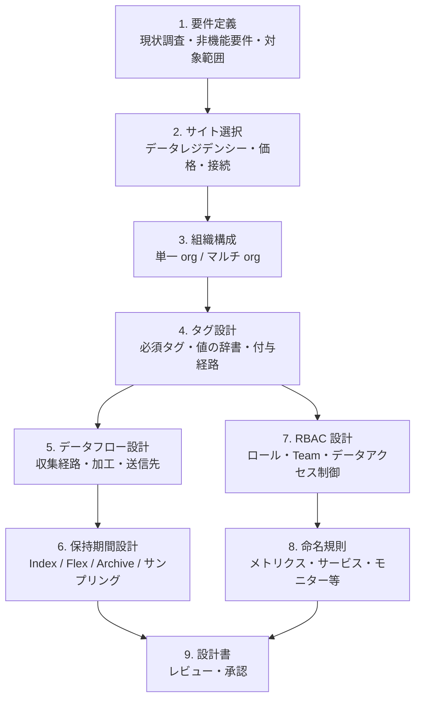
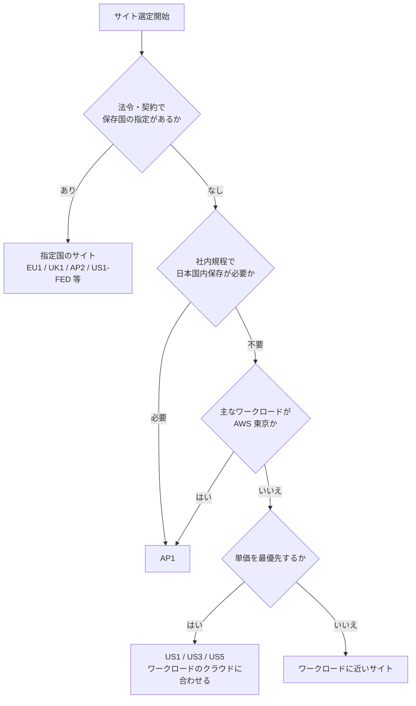
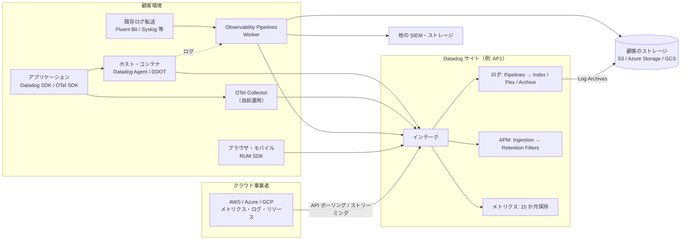
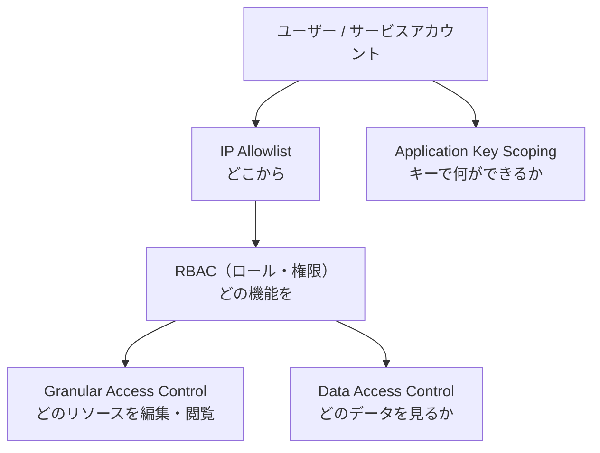

# 要件定義とアーキテクチャ設計

## 概要

本ファイルは、Datadog の導入プロジェクトで行う**要件定義**と**アーキテクチャ設計（基本設計）**の進め方をまとめたものである。各設計項目について「何を決めるか」「判断基準は何か」「公式の推奨は何か」「後から変えにくいか」を示し、最後にそのまま使える**設計書テンプレート**を載せる。

本ファイルが答える主な問い:

- Datadog の導入時に、最初に決めるべき設計事項は何か。後から変えられないものはどれか
- Datadog Site（サイト）は何を基準に選ぶか。日本企業は AP1 と US1 のどちらを選ぶべきか
- Organization（組織、org）は 1 つにすべきか、複数にすべきか。環境（本番・検証）で分けるべきか
- 必須タグは何にするか。タグの値やキーの命名規則はどう決めるか
- テレメトリをどの経路で送るか（Agent、OpenTelemetry、Observability Pipelines、クラウドインテグレーション）
- データ保持期間の要件をどの機能で満たすか（Standard Indexing、Flex Logs、Log Archives）
- ロール・Team・データアクセス制御をどう組み合わせるか
- 設計書には何を書けばよいか

扱う範囲は次のとおり。各機能の仕様の詳細はリファレンスに任せ、本ファイルでは設計判断に必要な事実と判断基準に絞る。

| 設計領域 | 本ファイルの節 | 仕様の詳細（リファレンス） |
|---|---|---|
| 要件定義（ヒアリング・現状調査） | [§1](#1-要件定義) | [導入方法論](implementation-methodology.md) |
| サイト選択 | [§2](#2-サイト選択) | [Datadog Sites（サイト）](../02_リファレンス/platform/datadog-sites.md) |
| 組織構成（単一 / マルチ org） | [§3](#3-組織構成単一-org--マルチ-org) | [組織・ユーザー・権限管理](../02_リファレンス/platform/account-and-access-management.md)、[大規模・マルチorg運用](../04_応用編/large-scale-and-multi-org.md) |
| タグ設計 | [§4](#4-タグ設計) | [Tagging（タグ）](../02_リファレンス/platform/tagging.md)、[タグ戦略の実践](../04_応用編/tagging-strategy.md) |
| データフロー設計 | [§5](#5-データフロー設計) | [Datadogのアーキテクチャ概観](../01_入門編/architecture-overview.md)、[ネットワーク・接続要件](network-and-connectivity.md) |
| 保持期間設計 | [§6](#6-保持期間設計) | [Indexes・保持・アーカイブ](../02_リファレンス/logs/log-indexes-retention-archives.md) |
| RBAC 設計 | [§7](#7-rbac-設計) | [組織・ユーザー・権限管理](../02_リファレンス/platform/account-and-access-management.md)、[セキュリティとコンプライアンス](security-and-compliance.md) |
| 命名規則 | [§8](#8-命名規則) | 各リファレンス |
| 設計書テンプレート | [§9](#9-設計書テンプレート) | — |

Agent の展開方式（インストール方法、構成管理、段階展開）は [Agent 展開設計](agent-rollout-design.md)、監視・アラート・運用体制の設計は [運用設計](operations-design.md)、コストの見積りは [コスト見積り手法](cost-estimation.md) で扱う。

> **サイト差異:** 本ファイルの記述は全サイト共通を前提とする。サイトにより機能・価格・エンドポイントが異なる箇所は、その都度「サイト差異」として示す。本ナレッジの基準サイトは AP1（日本）である。

---

## 0. 設計の全体像と「後から変えにくい」決定事項

### 0.1 設計の流れ

Datadog 公式の Administrator's Guide（管理者ガイド）は、導入を Plan（計画）→ Build（構築）→ Run（運用）の段階で説明している。Plan の段階では、組織の現状調査、技術と Datadog 製品の対応付け、サービスティアの設定、タグ付けと命名、アクセス制御と組織構造、データ保持とセキュリティを検討する。[出典](https://docs.datadoghq.com/administrators_guide/plan/)

本ファイルでは、この Plan の段階を次の順序で進めることを想定する。順序は、前の決定が後の決定の前提になるように並べている。



- タグ設計は、データフロー（どこでタグを付けるか）、RBAC（Data Access Control はタグで範囲を決める）、コスト配賦（Usage Attribution はタグで分解する）のすべての前提になるため、早い段階で決める。【経験則】
- サイトと組織構成は、後から変更するコストが最も大きい（次節）。

### 0.2 変更容易性で見た決定事項の分類

下表は、各決定事項を「後から変えられるか」で分類したものである。変更が難しいものほど、要件定義の段階で確定させる必要がある。

| 決定事項 | 後からの変更 | 変更時に起きること | 根拠 |
|---|---|---|---|
| サイト（US1 / AP1 など） | **不可**（既存 org のサイトを変える公式機能はない） | 新サイトに org を作り直し、設定をコピーする。取り込み済みの過去データは移せない | [Datadog Sites](../02_リファレンス/platform/datadog-sites.md)、[datadog-sync-cli](https://github.com/DataDog/datadog-sync-cli) |
| 単一 org / マルチ org | 困難 | org の統合・分割は設定の移行プロジェクトになる。公式の買収時の例では、統合に 3〜6 か月の段階的な移行を想定している | [出典](https://docs.datadoghq.com/getting_started/organization_topology/) |
| `env` / `service` の値 | 困難 | APM のサービス単位の履歴、モニター、SLO、ダッシュボードのクエリが途切れる | 【経験則】 |
| APM の追加 Primary Tag | 可能だが影響大 | 旧タグで集計した過去の APM データは参照できなくなり、旧タグでスコープしたモニターは No Data になる | [出典](https://docs.datadoghq.com/tracing/guide/setting_primary_tags_to_scope/) |
| Usage Attribution のタグキー | 可能 | 過去のレポートは旧タグのまま。月の途中で変えると部分月のレポートになる | [出典](https://docs.datadoghq.com/account_management/billing/usage_attribution/) |
| Data Access Control のタグキー | 困難 | 同じテレメトリタイプでは全データセットで同じタグキーを使う必要があるため、キーを変えるとデータセットを作り直すことになる | [出典](https://docs.datadoghq.com/account_management/rbac/data_access/) |
| ログの Index 構成・保持期間 | 可能 | 保持期間の変更は契約の範囲内で可能。削除した Index 名は再利用できない | [出典](https://docs.datadoghq.com/logs/log_configuration/indexes/) |
| ロール・Team | 可能 | 設定変更で反映される | [出典](https://docs.datadoghq.com/account_management/rbac/) |
| メトリクス名 | 困難 | 名前を変えると別のメトリクスになり、履歴が途切れる（メトリクス名は大文字小文字も区別される） | [出典](https://docs.datadoghq.com/developers/guide/what-best-practices-are-recommended-for-naming-metrics-and-tags/) |

---

## 1. 要件定義

### 1.1 現状調査（スコーピング）

Datadog の Administrator's Guide は、導入の初期に組織全体を調査し、エコシステム、アプリケーションの言語、データストア、ネットワーク、インフラを記録することを推奨している。調査票の例として、アプリケーション名、言語、フレームワーク、MVC の各層、インフラの種類、OS が挙げられている。調査の後で、各技術を Datadog の製品に対応付ける。[出典](https://docs.datadoghq.com/administrators_guide/plan/)

本ファイルでは、公式の調査項目に、設計判断に必要な項目を加えた次の表を現状調査票として使う。

| 区分 | 調査項目 | 主に影響する設計 |
|---|---|---|
| 組織 | 事業部・子会社・顧客（MSP の場合）の構成、データ分離の契約・規制、買収予定 | 組織構成（§3）、RBAC（§7） |
| 規制・社内規程 | データの保存国の制約、個人情報・機微データの有無、監査ログの保存年数、準拠すべき認証（ISMAP、PCI DSS、HIPAA、SOC 2 など） | サイト（§2）、保持期間（§6）、[セキュリティとコンプライアンス](security-and-compliance.md) |
| インフラ | クラウド事業者とリージョン、オンプレミスの拠点、ホスト数（VM・物理）、コンテナ基盤（Kubernetes / ECS など）とノード数・Pod 数、サーバーレス（Lambda 等）の関数数 | サイト（§2）、データフロー（§5）、[コスト見積り手法](cost-estimation.md) |
| アプリケーション | サービス数、言語とフレームワーク、デプロイ方式（CI/CD ツール）、リリース頻度、サービスの所有チーム | タグ（§4）、命名（§8）、[APM インスツルメンテーション](../02_リファレンス/apm/apm-instrumentation.md) |
| データ層 | データベースの種類と台数、メッセージキュー、キャッシュ | [Database Monitoring](../02_リファレンス/infrastructure/database-monitoring.md)、[Data Streams Monitoring](../02_リファレンス/apm/data-streams-monitoring.md) |
| ログ | ログの発生源、1 日あたりの量（GB と件数）、現在のログ基盤、検索頻度、保存期間要件 | データフロー（§5）、保持期間（§6） |
| ネットワーク | インターネットへの出口（プロキシ・FW）、閉域接続の要否、ネットワーク機器の台数 | [ネットワーク・接続要件](network-and-connectivity.md)、[Network Device Monitoring](../02_リファレンス/infrastructure/network-device-monitoring.md) |
| ID 管理 | IdP（Entra ID、Okta など）、SAML / SCIM の可否、利用者数と部門 | RBAC（§7） |
| 既存ツール | 現在の監視・ログ・APM・アラート通知・インシデント管理ツール | [他製品からの移行](migration-from-other-tools.md)、[通知・コラボレーション連携](../02_リファレンス/platform/collaboration-integrations.md) |
| 体制 | 運用チーム、オンコール体制、プラットフォームチームの有無 | [運用設計](operations-design.md)、[組織への定着](../04_応用編/organizational-adoption.md) |

### 1.2 機能要件の整理（製品へのマッピング）

機能要件は「何を観測したいか」を Datadog の製品に対応付けて整理する。製品の全体像は [製品ポートフォリオ全体像](../01_入門編/product-map.md) を参照。

| 観測したいこと | 主な Datadog 製品 | 参照 |
|---|---|---|
| サーバー・クラウドリソースの稼働状況 | Infrastructure Monitoring、クラウドインテグレーション | [Infrastructure Monitoring](../02_リファレンス/infrastructure/infrastructure-monitoring.md) |
| コンテナ・Kubernetes | Container Monitoring、Kubernetes 用 Agent | [コンテナ・Kubernetes 監視](../02_リファレンス/infrastructure/container-and-kubernetes-monitoring.md) |
| アプリケーションの性能とエラー | APM、Error Tracking、Continuous Profiler | [APM の概念とインジェスト制御](../02_リファレンス/apm/apm-concepts-and-ingestion.md) |
| ログの検索・分析・長期保管 | Log Management（Standard Indexing / Flex Logs / Archives） | [ログ収集](../02_リファレンス/logs/log-collection.md) |
| エンドユーザー体験 | RUM、Session Replay、Synthetic Monitoring | [RUM（ブラウザ）](../02_リファレンス/dem/rum-browser.md)、[Synthetic Monitoring](../02_リファレンス/dem/synthetic-monitoring.md) |
| データベースの性能 | Database Monitoring | [Database Monitoring](../02_リファレンス/infrastructure/database-monitoring.md) |
| ネットワーク | Cloud Network Monitoring（旧称：Network Performance Monitoring / NPM）、Network Device Monitoring | [Cloud Network Monitoring](../02_リファレンス/infrastructure/cloud-network-monitoring.md) |
| サービスの目標管理 | SLO | [SLO](../02_リファレンス/platform/slo.md) |
| セキュリティ監視 | Cloud SIEM、Cloud Security（旧称：Cloud Security Management / CSM）、Workload Protection（旧称：Cloud Workload Security / CWS）、App and API Protection（旧称：Application Security Management / ASM） | [Datadog Security 概要](../02_リファレンス/security/security-platform-overview.md) |
| サービスの所有者・依存関係の管理 | Software Catalog（旧称：Service Catalog） | [Software Catalog](../02_リファレンス/platform/software-catalog.md) |
| インシデント対応 | Incident Management、On-Call | [Incident Management](../02_リファレンス/service-management/incident-management.md) |
| コストの可視化 | Cloud Cost Management、Usage Attribution | [Cloud Cost Management](../02_リファレンス/infrastructure/cloud-cost-management.md) |

### 1.3 非機能要件チェックリスト

非機能要件は、Datadog の設計に直結する項目に絞って確認する。下表の「確認すべき Datadog 側の事実」は、要件が実現可能かを判断するために参照する仕様である。

| 区分 | 要件の例 | 確認すべき Datadog 側の事実 | 関連する設計 |
|---|---|---|---|
| データ所在地 | 「監視データを日本国内に保存すること」 | AP1 は日本（AWS `ap-northeast-1`）。サイト間でデータは共有されない | §2 |
| データ保持 | 「ログを 1 年間検索可能にすること」「監査ログを 7 年保管すること」 | Standard Indexing の定価掲載は 3/7/15/30 日。Flex Logs は 30〜450 日。7 年などの長期保管は顧客ストレージへの Log Archives | §6 |
| メトリクスの保持 | 「前年同月と比較したい」 | メトリクスは 15 か月保持（Enterprise はカスタマイズ可と料金表に記載） | §6 |
| アクセス制御 | 「部門ごとに見られるログを分けること」 | Data Access Control（タグで範囲を決める）、Logs RBAC の Restriction Query | §7 |
| 認証 | 「社内 IdP で SSO すること」「多要素認証を必須にすること」 | SAML / SCIM はすべてのプランで利用可。Multiple SAML Providers、IP Allowlist は Enterprise | §7 |
| 監査 | 「Datadog 上の操作ログを残すこと」 | Audit Trail は有効化時 90 日保持（無効時は 7 日） | §6、[Audit Trail](../02_リファレンス/platform/audit-trail.md) |
| ネットワーク | 「インターネットを経由しないこと」 | AP1 は AWS PrivateLink に対応（同一リージョンからの接続） | §2、[ネットワーク・接続要件](network-and-connectivity.md) |
| 可用性 | 「Datadog 障害時も監視を継続すること」 | Datadog Disaster Recovery（DDR）は商用サイトで【Limited Availability】。別サイトに副 org を作るアクティブ／パッシブ方式 | §2.6 |
| 機微データ | 「個人情報を Datadog に送らないこと」 | Sensitive Data Scanner（取り込み時のマスク）、Observability Pipelines（送信前のマスク） | §5、[Sensitive Data Scanner](../02_リファレンス/security/sensitive-data-scanner.md) |
| コスト配賦 | 「部門別に Datadog 費用を按分すること」 | Usage Attribution は最大 3 タグキー（Enterprise プランの機能） | §4.7 |
| 性能・鮮度 | 「異常を 1 分以内に検知すること」 | モニターの評価間隔・データ遅延は製品ごとに異なる | [Monitors](../02_リファレンス/platform/monitors.md) |

[出典](https://docs.datadoghq.com/data_security/data_retention_periods/)、[出典](https://docs.datadoghq.com/logs/log_configuration/flex_logs/)、[出典](https://www.datadoghq.com/pricing/?product=infrastructure)（2026-11-02 取得）、[出典](https://docs.datadoghq.com/disaster_recovery/)

### 1.4 サービスティアと環境ごとの適用範囲

Administrator's Guide は、サービスティア（サービスの重要度区分）を早い段階で決めることを推奨している。最初の見積りは正確でなくてよいが、導入が広がるときの判断材料になる。[出典](https://docs.datadoghq.com/administrators_guide/plan/)

また、Administrator's Guide は環境（SDLC の段階）ごとにどの製品を有効にするかの例を示している。下表は公式の例である。Allow は有効化、Deny は無効化、Deny/Allow は状況に応じて判断することを意味する。

| 製品 | Dev | QA | Staging | Prod |
|---|---|---|---|---|
| APM | Deny/Allow | Allow | Allow | Allow |
| Synthetic Monitoring | Deny | Deny/Allow | Allow | Allow |
| Log Management | Allow | Allow | Allow | Allow |
| RUM | Deny | Deny/Allow | Allow | Allow |
| Database Monitoring | Deny/Allow | Deny/Allow | Allow | Allow |
| Live Processes | Deny | Deny/Allow | Allow | Allow |

[出典](https://docs.datadoghq.com/administrators_guide/plan/)

公式は、この表を自社の基準に合わせて調整し、「自社にとっての標準的な Datadog の導入」の範囲を定義するよう勧めている。判断の観点は、SDLC の段階、アプリケーションの重要度、各製品の目的である。

サービスティアと適用範囲を組み合わせた設計例を示す。【経験則】

| ティア | 定義の例 | 必須の製品 | 任意の製品 | モニター・SLO |
|---|---|---|---|---|
| Tier 1 | 売上・顧客に直結するサービス | Infrastructure、APM、Logs、RUM / Synthetic | Profiler、DBM | SLO 必須、24 時間オンコール通知 |
| Tier 2 | 社内業務で重要なサービス | Infrastructure、APM、Logs | Synthetic | 主要モニターのみ、業務時間内通知 |
| Tier 3 | 補助的なサービス・バッチ | Infrastructure、Logs | APM | 最低限のモニター |

### 1.5 規模とコストの前提値

要件定義では、コスト見積りに使う前提値（ホスト数、コンテナ数、ログ量、スパン量、カスタムメトリクス数、RUM セッション数など）を集める。課金単位と同梱枠（allotment）は製品ごとに異なるため、詳細は [コスト見積り手法](cost-estimation.md) と [製品別料金表](pricing-by-product.md) を参照。設計に影響する代表的な同梱枠は次のとおり（2026-11-02 時点の公式料金ページの値。正本は [製品別料金表](pricing-by-product.md)）。

| 項目 | Pro | Enterprise | 設計への影響 |
|---|---|---|---|
| Custom Metrics 同梱枠 | 100 / ホスト | 200 / ホスト | タグ設計（§4.5）で時系列数を抑える必要がある |
| Container Monitoring 同梱枠 | 5 コンテナ / ホスト | 10 コンテナ / ホスト | コンテナ密度の高い基盤ではエディション選択に影響 |
| Data Access Control | 10 datasets | 100 datasets | 部門・顧客ごとにデータセットを作る設計では上限に注意（§7.4） |
| Cross-Org Visibility | 5 connections | 100 connections | マルチ org で横断ダッシュボードを作る場合の上限（§3.5） |

[出典](https://www.datadoghq.com/pricing/?product=infrastructure)（2026-11-03 取得、年契約・月契約・オンデマンド共通の機能表）

---

## 2. サイト選択

### 2.1 サイトとは

Datadog Site（サイト）は、Datadog が世界各地で運用している互いに独立した SaaS インスタンスである。org は必ず 1 つのサイトに作られ、テレメトリと設定はそのサイトに保存される。公式ドキュメントは、各サイトは完全に独立しており、サイト間でデータを共有できないと明記している。[出典](https://docs.datadoghq.com/getting_started/site/)

2026-11-02 時点のサイトは 9 つある（商用 7：US1、US3、US5、EU1、AP1、AP2、UK1／政府向け 2：US1-FED、US2-FED）。各サイトの URL、エンドポイント、ホスティング先は [Datadog Sites（サイト）](../02_リファレンス/platform/datadog-sites.md) を参照。

| サイト | 所在地 | ホスティング（判明分） | 主な選定理由 |
|---|---|---|---|
| US1 | 米国 | AWS `us-east-1` | デフォルト。新機能が先に提供されることがある【第三者情報】 |
| US3 | 米国 | Azure `westus2` | Azure Native Integration（US3 のみ） |
| US5 | 米国 | Google Cloud `us-central1` | Google Cloud の米国リージョンとの近さ |
| EU1 | ドイツ | Google Cloud `europe-west3` | GDPR などの EU 域内保存要件 |
| AP1 | 日本 | AWS `ap-northeast-1`（東京） | 日本国内保存、AWS 東京リージョンとの近さ |
| AP2 | オーストラリア | AWS `ap-southeast-2` | 豪州・ニュージーランドの保存要件 |
| UK1 | 英国 | AWS `eu-west-2` | 英国内保存要件 |
| US1-FED / US2-FED | 米国 | AWS GovCloud（US1-FED） | 米国政府機関とそのパートナー |

ホスティングの根拠（PrivateLink 等のサービス名）は [Datadog Sites](../02_リファレンス/platform/datadog-sites.md) を参照。

### 2.2 選定の観点

サイト選定では、次の観点を上から順に確認する。上の観点ほど「満たせないと導入できない」制約であり、下の観点ほど「比較して選ぶ」要素である。

| 優先 | 観点 | 確認内容 | 判断の目安 |
|---|---|---|---|
| 1 | 法令・契約 | GDPR、政府調達基準、顧客との契約で保存国が決まっているか | 決まっていれば該当国のサイト（EU1、UK1、AP2、US1-FED 等） |
| 2 | 社内規程 | 社内のデータ分類規程で国内保存が必要か | 日本国内保存なら AP1 |
| 3 | 必要な機能 | 使いたい製品・機能がそのサイトで提供されているか | 政府向けサイトでは提供されない製品がある。商用サイト間の製品単位の非提供は確認されていない（後述） |
| 4 | ワークロードの場所 | 監視対象の主なクラウド・リージョン | 同じクラウド・同じリージョンなら PrivateLink 等で転送料金と遅延を抑えやすい |
| 5 | 価格 | サイト別の単価 | AP1 は US／EU1 のおおむね 1.25 倍（後述） |
| 6 | 既存 org | 既存の org と横断クエリ（Cross-Organization Visibility）や Organization Groups を使うか | 横断できるのは同じサイトの org 同士だけ |

[出典](https://docs.datadoghq.com/getting_started/site/)、[出典](https://docs.datadoghq.com/account_management/org_settings/cross_org_visibility/)

Classmethod の記事は、日本企業向けの選定フローとして「① GDPR などの法令順守が必要か → ② 社内規程で国内保存が必要か（必要なら AP1） → ③ 主に使う AWS リージョンが東京か（東京なら AP1） → ④ コストを最優先するか（優先するなら US1）」という順序を示している。【第三者情報】[出典](https://dev.classmethod.jp/articles/how-to-choose-datadog-site/)（2025-07-07 公開）



上図は Classmethod の記事（2025-07-07 公開）のフローに、本ナレッジで法令の分岐先を補ったものである。【第三者情報】【経験則】

### 2.3 価格差

Datadog の公式料金ページはサイト（リージョン）ごとに単価が異なる。2026-11-03 取得の公式料金ページでは、AP1 の単価は US（US1/US3/US5）および EU1 のおおむね 1.25 倍、AP2 と UK1 はおおむね 1.2 倍である。[出典](https://www.datadoghq.com/pricing/)

| SKU（年契約の月額換算、USD） | US・EU1 | AP1 |
|---|---|---|
| Infrastructure Pro（ホスト/月） | $15 | $18.75 |
| Infrastructure Enterprise（ホスト/月） | $23 | $28.75 |
| APM Pro（ホスト/月） | $35 | $43.75 |
| Log ingest（GB） | $0.10 | $0.125 |

取得日 2026-11-03、契約形態は年契約（billed annually）。月契約・オンデマンドの単価と全 SKU は [製品別料金表](pricing-by-product.md) を参照（料金の正本）。

### 2.4 ネットワーク転送コストとの比較

サイトの単価差だけでなく、監視対象からサイトまでの**クラウド側の転送料金**も比較する。Classmethod の記事は、AWS 東京からインターネット経由で US1 に送る場合の転送料金を約 $0.09/GB、AWS PrivateLink で AP1 に送る場合を約 $0.01/GB と試算し、APM やログの量が多い環境では月額で数万〜数十万円の差になりうると指摘している。【第三者情報】[出典](https://dev.classmethod.jp/articles/how-to-choose-datadog-site/)（2025-07-07 公開。AWS の転送料金は変わることがあるため、最新の AWS 料金で再計算すること）

> **設計上の注意:** 単価だけを見て US1 を選ぶと、ログ・トレースの多い環境ではクラウドの転送料金で差が縮まる、または逆転することがある。サイト選定では「Datadog の単価差 × 量」と「転送料金差 × 量」を両方試算する。【経験則】

プライベート接続の方式はサイトで異なる（US1/AP1/AP2/UK1 は AWS PrivateLink、US3 は Azure Private Link、US5/EU1 は Google Cloud Private Service Connect）。詳細は [ネットワーク・接続要件](network-and-connectivity.md) を参照。[出典](https://docs.datadoghq.com/agent/guide/private-link/)

### 2.5 サイト間の機能差異

> **サイト差異:** 商用 7 サイトの間で、製品単位で「not supported」となっている公式注記は、2026-11-03 時点の調査では見つかっていない。確認できた差異は次のとおり。詳細と政府向けサイトの非提供製品の一覧は [Datadog Sites](../02_リファレンス/platform/datadog-sites.md) を参照。

| 項目 | 差異 |
|---|---|
| Flex Logs の Compute サイズ | US3、US5、AP1、AP2、US1-FED、US2-FED は Starter・XS・XS+・S のみ。M・L は選べない |
| Azure Native Integration | US3 のみ |
| Log Archives（US3） | Azure Storage のファイアウォールルールに非対応 |
| サービスアカウントのアプリケーションキー | AP2、US1-FED、US2-FED では作成時に一度だけ読み取り可能 |
| 政府向けサイト | App and API Protection、On-Call など、提供されない製品がある。FIPS Agent は政府向けサイト専用 |
| Preview / Limited Availability の機能 | サイトごとに提供範囲が違うことがある。AP1 での提供は公式ドキュメントのサイトセレクターを AP1 にして確認する |

[出典](https://docs.datadoghq.com/logs/log_configuration/flex_logs/)、[出典](https://docs.datadoghq.com/integrations/guide/azure-native-integration/)、[出典](https://docs.datadoghq.com/logs/log_configuration/archives/)

### 2.6 サイトの変更・DR に関する制約

| 項目 | 仕様 | 設計への影響 |
|---|---|---|
| 既存 org のサイト変更 | 公式の変更機能はない | サイトは導入初期に確定させる |
| 過去データのサイト間移行 | 公式の手段はない。datadog-sync-cli は取り込み済みデータを対象外と明記 | 移行時は新旧並行期間を設ける |
| 設定の移行 | datadog-sync-cli でダッシュボード・モニター等の設定をコピーできる | IaC（Terraform）で設定を管理しておくと移行・再構築が容易になる |
| 並行送信 | Agent の Dual Shipping（`additional_endpoints`）で複数サイト・複数 org に同時送信できる | 並行期間は両方の org で使用量が計上されうる |
| Cross-Organization Visibility | 同じアカウントかつ同じサイトの org 間のみ | サイトをまたぐ横断ダッシュボードは作れない |
| Datadog Disaster Recovery（DDR） | 【Limited Availability】。主 org と別リージョンのサイトに独立した副 org を作るアクティブ／パッシブ方式。フェイルオーバーは顧客が実行。政府向けサイトでは提供されない | 可用性要件が厳しい場合はアカウントチームに提供可否を確認する |
| Agent の `site` 既定値 | `datadoghq.com`（US1） | AP1 では `site: ap1.datadoghq.com`（`DD_SITE`）の設定漏れに注意。Terraform Provider の `api_url` も既定は US1 |

[出典](https://github.com/DataDog/datadog-sync-cli)、[出典](https://docs.datadoghq.com/agent/configuration/dual-shipping/)、[出典](https://docs.datadoghq.com/disaster_recovery/)、[出典](https://docs.datadoghq.com/agent/troubleshooting/site/)

### 2.7 サイト選定の成果物

設計書には、少なくとも次の内容を書く（§9 のテンプレートの「サイト」節）。

- 選定したサイトと `site` パラメータ（例：AP1、`ap1.datadoghq.com`）
- 選定理由（法令・規程、ワークロードの場所、価格試算の結果）
- 不採用としたサイトとその理由
- 接続方式（インターネット経由／PrivateLink 等）
- 将来サイトを変える必要が生じた場合の方針（設定の IaC 化、Dual Shipping による並行期間）

---

## 3. 組織構成（単一 org / マルチ org）

### 3.1 公式の推奨

Datadog は、ほとんどの導入で**単一 org（single organization）**を推奨し、アクセス制御を備えた単一 org ではどうしても満たせない要件がある場合にのみ複数 org を使うよう案内している。[出典](https://docs.datadoghq.com/getting_started/organization_topology/)

公式が挙げる単一 org の利点:

| 利点 | 内容 |
|---|---|
| 観測データのつながり | 分散トレース、メトリクス、ログがサービスをまたいで相関する |
| 設定の一元化 | モニター、ダッシュボード、パイプライン、SLO が 1 か所にある |
| ユーザー管理の一元化 | SSO 設定 1 つ、SCIM 連携 1 つ、ロールと Team の 1 セット |
| チーム別のコスト可視化 | `team:` や `cost_center:` などのタグで、org を分けずに使用量を配賦できる |
| 運用コストの低さ | org ごとの Terraform モジュール、org をまたぐ回避策、重複した通知ルーティングが不要 |

単一 org でも、RBAC、Data Access Control、Granular Access Control、Teams、IP Allowlist の組み合わせで、規制業界を含む強いデータ分離ができるとされる。ただし、インフラなどの基本機能は全ユーザーに見えること、すべてのテレメトリタイプが行レベルの制限に対応しているわけではないことが制約である。[出典](https://docs.datadoghq.com/getting_started/organization_topology/)

### 3.2 マルチ org を選ぶべき 5 つのシナリオ（公式）

| シナリオ | 内容 |
|---|---|
| 規制・契約上の分離 | アクセス制限ではなく、物理的に別の org 境界にデータを置く必要がある |
| データレジデンシー | 地域間のデータ転送が禁止され、別サイトに org を置く必要がある |
| チームのファイアウォール | データの混在をゼロにする必要がある（アクセス制御はすべてのテレメトリやアセットのメタデータを完全には分離しない） |
| MSP の顧客分離 | 外部顧客ごとに課金・データ・ユーザーを分ける。通常は親子 org モデルを使う |
| 買収 | 統合期間中の一時的なマルチ org。最終的には単一 org への統合を目指す |

[出典](https://docs.datadoghq.com/getting_started/organization_topology/)

公式の判断基準は次の 5 つの問いである。どれにも当てはまらなければ単一 org を選ぶ。

1. データを同じ org に置くと、規制や契約に違反するか
2. データレジデンシーの要件があるか
3. あるチームが別のチームのデータを見ることが、許容できないリスクか
4. 外部顧客ごとに、課金とユーザーを分離する必要があるか
5. 買収した組織が関係しているか

[出典](https://docs.datadoghq.com/getting_started/organization_topology/)

### 3.3 単一 org とマルチ org の比較（公式）

| 機能 | 単一 org | マルチ org |
|---|---|---|
| エンドツーエンドの分散トレース | 完全 | org 境界をまたげない |
| ダッシュボードでのテレメトリ表示 | 完全 | Cross-Organization Visibility でメトリクス・ログ・CI データ等を共有 |
| ダッシュボード共有 | 完全 | 招待制の共有ダッシュボード |
| Monitors | 完全 | org をまたいだ評価は不可 |
| SLO | 完全 | org をまたげない |
| ユーザー管理 | SCIM 1 つ | org ごとに SCIM |
| RBAC / カスタムロール | 1 つの設定 | org ごとに重複（Organization Groups の Shared Roles で緩和可） |
| SSO / SAML | 1 つの設定 | org ごとに SAML |
| 課金 | org 内で Usage Attribution | 親 org で集約・請求 |
| 機能のロールアウト | 即時 | org ごとに有効化 |

[出典](https://docs.datadoghq.com/getting_started/organization_topology/)

### 3.4 環境（本番・非本番）で org を分けるべきか

環境ごとに org を分けるかどうかは、公式の 5 シナリオには含まれていない。公式のエンタープライズ実装例では、次の 2 つの考え方が示されている。[出典](https://docs.datadoghq.com/getting_started/access_for_enterprises/example_implementations/)

| 実装例（公式テンプレート） | org 構成 | 環境の扱い |
|---|---|---|
| 大手テック企業（1.2 万ユーザー、20 プロダクトライン） | 主 org 1 つに全プロダクトラインを集約し、Data Access Control と Teams で内部を区切る。サンドボックスと非本番用に別 org を 2 つ | 非本番を別 org に分離 |
| 政府機関・プラットフォーム事業者（5,000 ユーザー、約 200 テナント） | 環境（production、staging、development）で 3 org に分割。テナントは org ではなく Teams と Data Access Control で分離し、200 以上の org を作ることを避ける | 環境で org を分割 |

設計判断の目安は次のとおり。【経験則】

| 観点 | 環境で org を分けない（`env` タグで区別） | 環境で org を分ける |
|---|---|---|
| 本番と検証のトレース・比較 | 1 つのダッシュボードで比較できる | Cross-Organization Visibility が必要（Monitors は org をまたげない） |
| 誤操作のリスク | 検証用の変更が本番のモニター等に影響しうる。Granular Access Control で保護する | org 境界で分離される |
| IaC の検証 | 同じ org 内で名前空間を分けて検証 | 非本番 org で Terraform 変更を先に検証できる |
| 管理コスト | SSO・SCIM・ロールが 1 セット | org ごとに SAML・SCIM・ロールが必要 |
| 課金 | Usage Attribution で `env` 別に配賦 | 親 org で org 別に集計 |

### 3.5 マルチ org にする場合の設計事項

マルチ org（親子 org、Multi-Organization Account）を採用する場合は、次の仕様を前提に設計する。

| 項目 | 仕様 | 出典 |
|---|---|---|
| 有効化 | 既定で無効。Datadog サポートに依頼して有効化する | [出典](https://docs.datadoghq.com/account_management/multi_organization/) |
| 子 org の名前 | 最大 32 文字 | 同上 |
| 子 org の課金 | 親 org のプランを継承し、親の請求アカウントに追加される | 同上 |
| 設定の継承 | IP Allowlist と SAML 設定は子 org に継承されない。ロールも親子間で共有されない | 同上、[出典](https://docs.datadoghq.com/account_management/rbac/) |
| Custom Sub-domain | 既定で無効（サポートに依頼）。通知リンクを開いたときに該当 org へ切り替えるために使う。ないと別 org のリンクで 404 になる | [出典](https://docs.datadoghq.com/account_management/multi_organization/) |
| Usage Attribution | 親 org で有効化すると全 org を最大 3 タグキーで集計。子 org で有効化するとその子 org 内のみ | 同上 |
| Cross-Organization Visibility | 同じアカウントかつ同じサイト。対応データはメトリクス、ログ、CI Visibility パイプライン、Test Optimization、Audit Trail。接続数は Pro 等 5、Enterprise 100。データはソース org に残り追加料金なし | [出典](https://docs.datadoghq.com/account_management/org_settings/cross_org_visibility/) |
| Cross-Org 接続の作成者 | 接続は作成者のデータアクセス制限を継承し、作成者のアカウントが無効化されると削除される。サービスアカウントでの作成が推奨 | 同上 |
| Organization Groups | 複数 org にポリシーと Shared Roles を配布する。1 org は 1 グループのみ所属。単一リージョン（サイト）内のみ。提供状況（GA か Preview か）はアカウントチームに確認 | [出典](https://docs.datadoghq.com/account_management/organization_groups/) |

マルチ org の実践知見として、Volkswagen Group の事例（Datadog 公式ブログへの寄稿）では、親 org はテレメトリを取り込まずに中央管理と課金だけに使い、子 org・ユーザー・SAML・ロール・ログの Restriction Query・Index・モニター・API 資格情報の作成を API / Terraform で自動化している。【第三者情報】[出典](https://www.datadoghq.com/blog/volkswagen-organizations/)（2025-03-14 公開）

詳しい運用は [大規模・マルチorg運用](../04_応用編/large-scale-and-multi-org.md) を参照。

### 3.6 組織構成の設計パターン

| パターン | 構成 | 向くケース |
|---|---|---|
| A. 単一 org | 1 org。部門・チームは Teams、データ分離は Data Access Control、環境は `env` タグで区別 | 大半の企業（公式推奨） |
| B. 単一 org ＋ サンドボックス org | 本番・検証を含む主 org と、Datadog 設定の試験用 org | IaC の変更検証や新機能の試験をしたい企業 |
| C. 環境別 org | prod / non-prod（または prod / stg / dev）で org を分ける | 本番データへのアクセスを org 境界で厳格に分けたい場合 |
| D. 事業部・子会社別 org | 親 org の下に事業部ごとの子 org | 規制で事業部間のデータ混在が許されない場合（公式例：防衛部門だけ別 org） |
| E. 地域別 org | サイトごとに org（例：日本は AP1、欧州は EU1） | データレジデンシー要件が地域ごとに異なるグローバル企業 |
| F. 顧客別 org（MSP） | 親 org の下に顧客ごとの子 org | MSP、SaaS 事業者が顧客に Datadog を提供する場合 |

パターン A〜B は公式推奨と公式実装例、C〜F は公式の 5 シナリオと実装例に基づく分類である。[出典](https://docs.datadoghq.com/getting_started/organization_topology/)、[出典](https://docs.datadoghq.com/getting_started/access_for_enterprises/example_implementations/)

---

## 4. タグ設計

タグの構文・付与方法・制約の詳細は [Tagging（タグ）](../02_リファレンス/platform/tagging.md)、組織でのタグ統制の実践は [タグ戦略の実践](../04_応用編/tagging-strategy.md) を参照。本節では、設計書に書くべき決定事項に絞る。

### 4.1 タグ設計で決めること

| 決定事項 | 内容 |
|---|---|
| 必須タグのキー | すべてのテレメトリ・リソースに付けるタグキーの一覧 |
| 値の辞書 | 各キーで許可する値の一覧（例：`env` は `prod` / `stg` / `dev` のみ） |
| 付与経路 | 各タグをどこで付けるか（Agent、Kubernetes ラベル、クラウドのタグ、トレーサーの環境変数、CI/CD） |
| 正となる情報源 | 動的なタグ（`version` など）の値をどこから取るか |
| 用途への割り当て | どのタグを Usage Attribution、Data Access Control、APM Primary Tag、モニターの通知ルーティングに使うか |
| 禁止事項 | タグにしてはいけない値（高カーディナリティ値、個人情報） |
| 統制方法 | Monitor の Tag Policies、IaC のレビュー、定期的な付与率の確認 |

### 4.2 予約タグと Unified Service Tagging

Datadog は 7 つのタグキー（`host`、`device`、`source`、`service`、`env`、`version`、`team`）を予約している。予約タグのキーを独自の意味で使うと、他の発生源の値と混ざって誤動作の原因になる。[出典](https://docs.datadoghq.com/getting_started/tagging/)

| タグキー | 用途 | 設計上の決定事項 |
|---|---|---|
| `env` | 環境 | 値の辞書（`prod` / `stg` / `dev` 等）。APM の必須 Primary Tag。Tracer と Agent で異なる値を設定しない |
| `service` | サービス（アプリケーション） | サービスの定義（独立してデプロイできる単位）と命名規則（§8.3） |
| `version` | アプリケーションのバージョン | 値の正となる情報源（Git のコミットハッシュ、リリース番号など） |
| `team` | 所有チーム | Datadog Teams のハンドルと一致させる（一致すると Teams の機能と連携する） |
| `source` | ログの発生源（インテグレーション名） | インテグレーションの名前に合わせる（`source` に応じて Integration Pipeline が自動適用される） |
| `host` | ホスト | 原則 Agent に任せる。DogStatsD で別の値を送ると Agent のホスト名を上書きする |
| `device` | デバイス・ディスク | 原則インテグレーションに任せる |

[出典](https://docs.datadoghq.com/getting_started/tagging/)

Unified Service Tagging（統合サービスタグ付け）は、`env`、`service`、`version` の 3 つの予約タグでメトリクス・トレース・ログ・プロファイル等を結び付ける仕組みであり、Datadog は導入のベストプラクティスとしてこれを推奨している。Administrator's Guide も、値の一貫性（「Production」と「Prod」は別の値になる）、動的タグの正となる情報源の決定、CI パイプラインの Git ハッシュを Kubernetes ラベル経由で `version` に入れるような自動化を推奨している。[出典](https://docs.datadoghq.com/getting_started/tagging/unified_service_tagging/)、[出典](https://docs.datadoghq.com/administrators_guide/plan/)

### 4.3 必須タグセットの設計例

公式は予約タグ以外の必須タグを定めていない。以下は、公式の予約タグと公式ドキュメント中の例（`team:`、`cost_center:`、`data_sensitivity`、`agency` など）をもとにした設計例である。【経験則】

| 区分 | タグキー | 値の例 | 必須範囲 | 主な用途 |
|---|---|---|---|---|
| 予約（UST） | `env` | `prod`、`stg`、`dev` | 全テレメトリ | 環境の区別、APM Primary Tag |
| 予約（UST） | `service` | `checkout-api` | アプリケーションのテレメトリ | サービス単位の分析、Software Catalog |
| 予約（UST） | `version` | `1.4.2`、`a1b2c3d` | アプリケーションのテレメトリ | デプロイ追跡 |
| 予約 | `team` | `payments` | 全リソース | 所有者、通知ルーティング、Team フィルタ |
| 組織 | `cost_center` | `cc1234` | ホスト・クラウドリソース | Usage Attribution、Cloud Cost Management |
| 組織 | `system` / `product` | `ec-site` | 全リソース | 複数サービスを束ねる業務システム単位の集計 |
| 組織 | `tier` | `1`〜`3`（英字始まりにするなら `t1`〜`t3`） | サービス | アラートの重要度、SLO の対象判定 |
| インフラ | `region` / `availability-zone` | `ap-northeast-1` | インフラ | クラウドインテグレーションが自動付与することが多い |
| インフラ | `kube_cluster_name` | `prod-main` | Kubernetes | Agent が自動付与（`cluster_name` は最大 40 文字） |
| 機微区分 | `data_sensitivity` | `pii`、`trading` | 機微データを含むテレメトリ | Data Access Control のデータセット定義（公式実装例） |

[出典](https://docs.datadoghq.com/getting_started/organization_topology/)、[出典](https://docs.datadoghq.com/getting_started/access_for_enterprises/example_implementations/)

> **注意:** タグの先頭は英字でなければならない。数字始まりの値（例：`tier:1`）は値側なので構文上は問題ないが、キーは必ず英字で始める。製品が明示的にサポートしていない限り、英字始まりにするのが安全である。[出典](https://docs.datadoghq.com/getting_started/tagging/)

### 4.4 タグの構文上の制約（設計に効くもの）

| 項目 | 仕様 |
|---|---|
| 形式 | `<KEY>:<VALUE>`（推奨）または `<VALUE>`。最初のコロンより前がキー |
| 先頭文字 | 英字 |
| 使える文字 | Unicode の英字、数字、`_`、`-`、`:`、`.`、`/`。それ以外は `_` に変換 |
| 最大長 | 200 文字（キー・コロン・値の合計） |
| 大文字小文字 | メトリクスタグとスパンタグは小文字に正規化される |
| CamelCase | クラウドごとに変換方法が異なる（AWS は `testtag`、Alibaba Cloud 等は `test_tag`）ため、キーに CamelCase を使わない |
| `DD_TAGS` | 空白区切り。値に空白を含めると別のタグに分かれる |
| ログのタグ | 1 ログあたり 100 以下、1 タグ 256 文字以下にすべき。1 日あたりのユニークタグは最大 1,000 万 |

[出典](https://docs.datadoghq.com/getting_started/tagging/)、[出典](https://docs.datadoghq.com/getting_started/tagging/assigning_tags/)、[出典](https://docs.datadoghq.com/logs/log_collection/)

### 4.5 カーディナリティとコスト

カスタムメトリクスは、メトリクス名とタグ値（`host` タグを含む）の組み合わせで一意に識別され、組み合わせ（時系列）の数が課金対象になる。Datadog は、エポックタイムスタンプ、ユーザー ID、リクエスト ID など値が無制限に増える情報をタグにしないよう推奨している。[出典](https://docs.datadoghq.com/getting_started/tagging/)、[出典](https://docs.datadoghq.com/metrics/custom_metrics/)

| 設計上の論点 | 指針 | 根拠 |
|---|---|---|
| メトリクスのタグ | 値の種類が有限なキーだけを付ける | 公式推奨 |
| ユーザー ID・リクエスト ID | メトリクスのタグにしない。ログ・スパンの属性として扱う | 公式推奨 |
| Kubernetes のラベルのタグ化 | ワイルドカード（`"*"`）で全ラベルをタグ化しない。必要なラベルを列挙する | 【経験則】 |
| コンテナのタグカーディナリティ | `DD_CHECKS_TAG_CARDINALITY` / `DD_DOGSTATSD_TAG_CARDINALITY` の既定は `low`。`orchestrator` / `high` にすると Pod・コンテナ単位の時系列が増える | [出典](https://docs.datadoghq.com/getting_started/tagging/assigning_tags/) |
| APM の追加 Primary Tag | 一意の値は 100 まで | [出典](https://docs.datadoghq.com/tracing/guide/setting_primary_tags_to_scope/) |
| APM の `env`×`service` | 一意の組み合わせの上限は 5,000。`env` や region をサービス名に含めない | [出典](https://docs.datadoghq.com/tracing/troubleshooting/) |

取り込み後にタグを絞る Metrics without Limits™ は [Metrics](../02_リファレンス/platform/metrics.md)、削減策は [コスト最適化](../04_応用編/cost-optimization.md) を参照。

### 4.6 タグの付与経路の設計

タグは複数の経路から付き、Agent は優先順位を強制しない。同じキーが複数経路から異なる値で付くと、両方の値が付く。そのため、キーごとに「どの経路で付けるか」を 1 つに決める。[出典](https://docs.datadoghq.com/getting_started/tagging/)

| 付与経路 | 付くテレメトリ | 向くタグ | 設定例 |
|---|---|---|---|
| クラウドのリソースタグ | クラウドインテグレーションのメトリクス、Agent（`collect_ec2_tags` 等） | `team`、`cost_center`、`system` | AWS のタグ → Datadog のタグ（小文字化に注意） |
| Agent のホストタグ | そのホストのメトリクス・ログ等 | `env`（VM 環境）、`datacenter` | `datadog.yaml` の `tags`、`env` |
| Kubernetes のラベル・アノテーション | Pod のメトリクス・ログ・トレース | `service`、`version`、`env`、`team` | `tags.datadoghq.com/service` などの標準ラベル |
| トレーサーの環境変数 | トレース、プロファイル、ランタイムメトリクス | `service`、`env`、`version` | `DD_SERVICE`、`DD_ENV`、`DD_VERSION` |
| ログ収集設定 | ログ | `source`、`service` | ログ設定の `source`、`service` |
| CI/CD | デプロイ時に値を注入 | `version` | Git ハッシュをラベルに設定 |
| Datadog 側（取り込み後） | 対象による | 配賦用の補正 | Cloud Cost Management の Tag Pipelines、ログの Pipelines |

Kubernetes の標準ラベル、Docker、ECS、非コンテナ環境での具体的な設定は [Tagging（タグ）](../02_リファレンス/platform/tagging.md) の「Unified Service Tagging」節を参照。

### 4.7 タグの用途への割り当て

タグは、次の Datadog 機能の「キー」になる。各機能には上限や制約があるため、どのタグキーを割り当てるかを設計書で決める。

| 機能 | タグの使われ方 | 制約 | 出典 |
|---|---|---|---|
| Usage Attribution | 使用量を最大 3 タグキーで分解 | 最大 3 キー。初回レポートはタグ設定から 24 時間後。Enterprise プランの機能 | [出典](https://docs.datadoghq.com/account_management/billing/usage_attribution/) |
| Data Access Control | タグでデータセットを定義し、Team / Role に閲覧を許可 | 同一テレメトリタイプでは全データセットで同じタグキー。データセット数は Pro 等 10、Enterprise 100 | [出典](https://docs.datadoghq.com/account_management/rbac/data_access/)、[出典](https://www.datadoghq.com/pricing/?product=infrastructure) |
| APM Primary Tag | `env` と追加 1 タグで APM の集計をスコープ | 追加タグは値 100 まで。ホストタグまたはコンテナタグであること。設定は管理者のみ | [出典](https://docs.datadoghq.com/tracing/guide/setting_primary_tags_to_scope/) |
| Monitor の Tag Policies | 全モニターに必須タグと許可値を強制 | 準拠しないモニターは新規作成できない | [出典](https://docs.datadoghq.com/monitors/settings/) |
| Teams | `team:<handle>` でリソースを Team に紐付け | ハンドルに使える文字は `a-z`、`0-9`、`._-:/` | [出典](https://docs.datadoghq.com/account_management/teams/) |
| 通知ルーティング | モニターの通知先をタグで切り替え | — | [通知と Downtime](../02_リファレンス/platform/notifications-and-downtimes.md) |
| Cloud Cost Management | クラウドコストをタグで配賦。Tag Pipelines で補正 | Tag Pipelines のルールは最大 100 | [出典](https://docs.datadoghq.com/cloud_cost_management/tags/tag_pipelines/) |

推奨する割り当ての例【経験則】:

| 機能 | 割り当てるタグキー |
|---|---|
| Usage Attribution（3 キー） | `team`、`cost_center`、`env`（または `service`） |
| Data Access Control | ログ・APM は `service` または `team`、機微データは `data_sensitivity` |
| APM 追加 Primary Tag | `region` や `kube_cluster_name` など、値が少なく変わりにくいインフラタグ |
| Monitor の Tag Policies | `team`（必須・任意値）、`env`（必須・値の辞書）、`tier`（任意・値の辞書） |

### 4.8 タグの統制

| 手段 | 内容 | 出典 |
|---|---|---|
| Monitor の Tag Policies | 全モニターに必須タグ・許可値を強制する（Monitors > Settings > Tag Policies） | [出典](https://docs.datadoghq.com/monitors/settings/) |
| IaC のレビュー | Terraform でモニター・ダッシュボードを管理し、タグをレビューで確認する | [Terraform と IaC](../02_リファレンス/platform/terraform-and-iac.md) |
| Software Catalog の Setup Guidance | サービスごとに期待される設定（タグなど）を満たしているかを確認する | [出典](https://docs.datadoghq.com/administrators_guide/plan/) |
| 付与率の定期確認 | タグの付いていないホスト・サービスを定期的に洗い出す | 【経験則】 |
| クラウド側のタグ統制 | AWS Organizations のタグポリシー等で、クラウドリソースのタグを統制する | 【経験則】 |

---

## 5. データフロー設計

データフロー設計では、各テレメトリを「どこで収集し」「どこで加工し」「どこに送り」「Datadog の中でどう扱うか」を決める。Datadog の基本アーキテクチャ（Agent → インテーク → バックエンド）は [Datadogのアーキテクチャ概観](../01_入門編/architecture-overview.md) を参照。

### 5.1 全体のデータフロー（参照モデル）



上図は、公式ドキュメントの各製品の構成を、設計の参照モデルとして 1 枚にまとめたものである。実際にはこのうち必要な経路だけを採用する。【経験則】

### 5.2 収集経路の選択

| 経路 | 対象 | 使う場面 | 主な制約・注意 | 参照 |
|---|---|---|---|---|
| Datadog Agent | ホスト・コンテナのメトリクス、ログ、トレースの受信、プロセス、インテグレーション | 標準の経路。多くの機能（Live Processes、CNM、USM、Fleet Automation 等）は Agent が前提 | ホストごとの展開と構成管理が必要 | [Datadog Agent](../02_リファレンス/platform/agent.md)、[Agent 展開設計](agent-rollout-design.md) |
| クラウドインテグレーション（エージェントレス） | クラウドサービスのメトリクス・ログ・リソース | マネージドサービス（RDS、ELB など）の監視 | API ポーリング間隔による遅延、クラウド側の API 料金 | [AWS Integration](../02_リファレンス/platform/aws-integration.md)、[Azure](../02_リファレンス/platform/azure-integration.md)、[Google Cloud](../02_リファレンス/platform/gcp-integration.md) |
| Datadog SDK（トレーサー） | トレース、プロファイル | APM の標準経路 | 言語ごとのライブラリ導入 | [APM インスツルメンテーション](../02_リファレンス/apm/apm-instrumentation.md) |
| DDOT Collector | OTel のテレメトリ | OTel パイプラインを使いつつ Datadog の機能を最大限使う（公式推奨は Datadog SDK + DDOT） | Agent に組み込まれた Collector | [OpenTelemetry サポート](../02_リファレンス/platform/opentelemetry.md) |
| OTLP Ingest in the Agent | OTel のテレメトリ | OTel SDK のデータを Agent で受ける | Collector の処理機能（processor、tail sampling）はない | 同上 |
| アップストリームの OTel Collector | OTel のテレメトリ | 既存の Collector 基盤を使う、ベンダー中立性を重視する | Datadog のサポート対象は Datadog 製コンポーネントのみ。Agent 前提の機能は使えない | 同上 |
| Direct OTLP Ingest | OTel のテレメトリ | Collector も Agent も置けない環境 | HTTP のみ（gRPC 非対応）。Infrastructure の Host List に反映されない | 同上 |
| Observability Pipelines | ログ、メトリクス | 送信前のフィルタ・マスク・分岐、既存ログ基盤からの移行、複数宛先への送信 | Worker を顧客環境で運用する | [Observability Pipelines](../02_リファレンス/logs/observability-pipelines.md) |
| RUM SDK | ブラウザ・モバイルのイベント | エンドユーザー体験 | ブラウザから直接インテークへ送信（プロキシ設定可） | [RUM（ブラウザ）](../02_リファレンス/dem/rum-browser.md) |
| API | メトリクス、ログ、イベント | 独自システムからの送信 | API キーの管理 | [API とキー管理](../02_リファレンス/platform/api-and-keys.md) |

[出典](https://docs.datadoghq.com/opentelemetry/setup/)、[出典](https://docs.datadoghq.com/observability_pipelines/)

OpenTelemetry を採用するかどうかの戦略は [OpenTelemetry 活用戦略](../04_応用編/opentelemetry-strategy.md) を参照。

### 5.3 テレメトリ別のデータフロー設計項目

| テレメトリ | 設計項目 | 決めること | 参照 |
|---|---|---|---|
| メトリクス | 収集範囲 | 有効にするインテグレーション、クラウドで収集するリソースの絞り込み（Administrator's Guide は、監視対象リソースの制限、AWS のリソース除外、Azure・コンテナのメトリクス収集の制限を推奨） | [出典](https://docs.datadoghq.com/administrators_guide/plan/) |
| メトリクス | カスタムメトリクス | 送信方法（DogStatsD、OTel、API）、命名規則、タグの許可リスト | [Custom Metrics と DogStatsD](../02_リファレンス/platform/custom-metrics-and-dogstatsd.md) |
| ログ | 送信前の処理 | 不要ログの除外、機微データのマスク（Agent の処理ルール、Observability Pipelines） | [ログ収集](../02_リファレンス/logs/log-collection.md) |
| ログ | 取り込み後の処理 | Pipelines（パース・属性の標準化）、Logs to Metrics、Sensitive Data Scanner | [Log Pipelines と処理](../02_リファレンス/logs/log-pipelines-and-processing.md) |
| ログ | 保存先の振り分け | Index（Standard / Flex）、Exclusion Filters、Archives、Log Forwarding | §6 |
| トレース | 取り込み量 | サンプリング（Head-based、Adaptive Sampling、Remote Configuration による変更） | [APM の概念とインジェスト制御](../02_リファレンス/apm/apm-concepts-and-ingestion.md) |
| トレース | インデックス | Retention Filters（Intelligent Retention で足りるか） | 同上 |
| RUM | サンプリング | セッションのサンプリング率、Session Replay の対象 | [RUM（ブラウザ）](../02_リファレンス/dem/rum-browser.md) |
| セキュリティ | 検知の入力 | Cloud SIEM の対象ログ（Index に入れないログも分析できるか） | [Cloud SIEM](../02_リファレンス/security/cloud-siem.md) |

Administrator's Guide は、ログについて次の扱いの層を示している。設計では、ログの種類ごとにどの層に送るかを決める。[出典](https://docs.datadoghq.com/administrators_guide/plan/)

| 層 | 保持 | 取り出し | コストの要因 |
|---|---|---|---|
| Ignored（送らない・除外） | なし | なし | なし |
| Ingested（取り込みのみ、Logs to Metrics） | メトリクスとして保持 | Live Tail で 15 分 | 量 |
| Archive | Rehydrate 時 | 無期限 | 量（取り出しは低速） |
| Forward（他の宛先へ転送） | メトリクスとして保持 | 転送先による | 量 |
| Index | あり | 3、7、15、30 日 | 量とメッセージ数（即時検索） |
| Flex Logs | あり（ストレージ階層） | ストレージ階層 | 取り出し量（高速検索） |

Flex Logs はモニター、アラート、Watchdog に対応しない。ただし Index 前に Logs to Metrics でメトリクスを作り、そのメトリクスでモニターを作ることはできる。[出典](https://docs.datadoghq.com/administrators_guide/plan/)

### 5.4 機微データの扱い

| 段階 | 手段 | 特徴 | 参照 |
|---|---|---|---|
| アプリケーション | ログに出さない、マスクしてから出力 | 最も確実 | 【経験則】 |
| Agent | ログの処理ルール（`log_processing_rules` の `mask_sequences` 等） | ホスト上で送信前にマスク | [ログ収集](../02_リファレンス/logs/log-collection.md) |
| Observability Pipelines | Sensitive Data Redaction テンプレート | 顧客環境内で送信前にマスク。複数の宛先に送る場合も一元化できる | [Observability Pipelines](../02_リファレンス/logs/observability-pipelines.md) |
| Datadog 取り込み時 | Sensitive Data Scanner | 取り込み後・保存前にスキャンしてマスク | [Sensitive Data Scanner](../02_リファレンス/security/sensitive-data-scanner.md) |
| 閲覧時 | Data Access Control、Logs RBAC | 保存はするが閲覧できる人を限定 | §7 |

> **設計上の注意:** 「個人情報を Datadog に保存しない」という要件は、送信前のマスク（アプリケーション、Agent、Observability Pipelines）で満たす。Sensitive Data Scanner は Datadog の取り込み処理の中でマスクする機能であり、「Datadog に送信しない」要件とは区別して説明する。【経験則】

### 5.5 並行送信（Dual Shipping）と移行

Agent の Dual Shipping は、`additional_endpoints` の設定で同じデータを複数の org・サイトに送る機能である。移行期間の並行稼働や DR に使う。複数の org に送ると、それぞれの org で使用量が計上されうるため、課金への影響は Datadog に確認する。[出典](https://docs.datadoghq.com/agent/configuration/dual-shipping/)

ログについては、Observability Pipelines の Dual Ship Logs テンプレートで、既存のログ基盤と Datadog に並行して送ることもできる。[Observability Pipelines](../02_リファレンス/logs/observability-pipelines.md)、[他製品からの移行](migration-from-other-tools.md) を参照。

### 5.6 ネットワーク経路

データフロー図には、送信元から Datadog のインテークまでのネットワーク経路（プロキシ、FW、PrivateLink 等）も記載する。必要なエンドポイント、ポート、プロキシ設定は [ネットワーク・接続要件](network-and-connectivity.md) を参照。主要な事実は次のとおり。

| 項目 | 仕様 | 出典 |
|---|---|---|
| Agent の送信ポート | 大半のデータは TCP 443（アウトバウンド） | [出典](https://docs.datadoghq.com/agent/configuration/network/) |
| エンドポイントの形 | `<サービス接頭辞>.<site>`（例：`trace.agent.ap1.datadoghq.com`）。RUM は例外（`browser-intake-ap1-datadoghq.com`） | 同上 |
| 静的 IP レンジ | `https://ip-ranges.<site>`（例：`https://ip-ranges.ap1.datadoghq.com`） | 同上 |
| 閉域接続 | AP1 は AWS PrivateLink | [出典](https://docs.datadoghq.com/agent/guide/private-link/) |

---

## 6. 保持期間設計

### 6.1 Datadog の保持期間の考え方

Datadog の保持期間は、製品とデータの種類ごとに固定のもの、プラン（契約）で決まるもの、顧客が設定するものがある。保持期間の要件ごとに、どの製品・機能で満たすかを設計する。

### 6.2 製品別の保持期間（公式）

下表は公式ドキュメント「Data Retention Periods」の主な値である（2026-11-02 取得）。

| 製品 | データ | 保持期間 | 設計での扱い |
|---|---|---|---|
| Metrics | タグと値 | 15 か月 | 固定。Enterprise はカスタマイズ可（料金表） |
| Log Management | ログ | 顧客のプランによる | 設計対象（§6.3） |
| Log Management | Sensitive Data Scanner のサンプルログ | 7 日 | 固定 |
| APM | Indexed spans | プランにより 15 日または 30 日 | 長期分析が必要なら Span-based Metrics |
| APM | サービス・リソースの統計 | 30 日 | 長期の傾向はメトリクス（15 か月）で見る |
| APM | エラー | 15 日 | — |
| APM | 閲覧したトレース | アカウントの存続期間 | — |
| Continuous Profiler | フレームグラフ等 | 8 日 | ノートブックに出力すると 1 年 |
| Browser / Mobile RUM | Session、View、Action、Error イベント | 30 日 | — |
| Browser / Mobile RUM | Resource、Long Task、Vitals イベント | 15 日 | — |
| Session Replay | リプレイ | 30 日（延長オプションで 15 か月） | — |
| Product Analytics | イベント | 15 か月 | — |
| Synthetics | テスト結果 | 15 か月 | — |
| Database Monitoring | クエリサンプル / クエリメトリクス | 15 日 / 15 か月 | — |
| Cloud Network Monitoring | ネットワークトラフィック | 14 日 | — |
| Network Device Monitoring | NetFlow | プランにより 15、30、60、90 日 | — |
| Container / Process | Live Processes とコンテナ | 36 時間 | — |
| Event Management | イベント | 15 か月 | — |
| SLO | SLO の結果 | 15 か月 | — |
| Error Tracking | エラーサンプル / Issues | 30 日 / 最終活動から 1 年 | — |
| CI Pipeline Visibility | パイプライン等 | 15 か月 | — |
| Test Visibility / Intelligent Test Runner | テスト | 3 か月 | — |
| Cloud SIEM | シグナル | 15 か月 | — |
| Cloud Security | 設定ミス、ID リスク、攻撃経路 | 15 か月 | — |
| Workload Protection | イベント / シグナル | 90 日 / 15 か月 | — |
| App and API Protection | セキュリティシグナル / スパン | 15 か月 / 90 日 | — |
| Audit Trail | 監査ログ | 有効時 90 日（無効時 7 日） | 長期保管は Audit Trail のアーカイブ等を検討 |
| Cloud Cost Management | コストメトリクス | 15 か月 | — |
| Datadog App | ダッシュボード、ノートブック、モニター | アカウントの存続期間 | — |
| Incident Management | インシデント | アカウントの存続期間 | — |

[出典](https://docs.datadoghq.com/data_security/data_retention_periods/)、[出典](https://www.datadoghq.com/pricing/?product=infrastructure)

> **サイト差異:** データ保持期間の公式ページには、サイトごとの違いは記載されていない（公開情報では確認できず）。

### 6.3 ログの保持期間の選択肢

| 保存先 | 保持期間 | 検索 | モニター | 向くログ（公式の例） |
|---|---|---|---|---|
| Standard Indexing | 契約で許可された値。定価掲載は 3 / 7 / 15 / 30 日。30 日超は要問い合わせ。オンデマンドの既定は 15 日 | 最速 | 対応 | 頻繁に検索し短期保持するログ（アプリケーションログ等） |
| Flex Logs（Scalable Compute） | 30〜450 日 | 即時検索（Compute サイズに依存） | 非対応（Logs to Metrics で代替） | 長期保持し、ときどき緊急に検索するログ（セキュリティ、トランザクション、ネットワーク等） |
| Flex Starter | 3 / 6 / 12 / 15 か月 | 即時検索 | 非対応 | 小規模な長期保持 |
| Log Archives | 顧客のストレージに依存（無期限も可） | Archive Search、Rehydration | 非対応 | ほとんど検索せず長期保管するログ（監査ログ、構成ログ等） |
| Rehydration（Historical View） | 既定 15 日（契約で選べる値が決まる） | 再取り込み後に検索 | — | 過去ログの調査 |

[出典](https://docs.datadoghq.com/logs/log_configuration/indexes/)、[出典](https://docs.datadoghq.com/logs/log_configuration/flex_logs/)、[出典](https://docs.datadoghq.com/logs/log_configuration/archives/)、[出典](https://www.datadoghq.com/pricing/list/)（2026-11-02 取得）

> **サイト差異:** Flex Logs の Compute サイズは、US3、US5、AP1、AP2、US1-FED、US2-FED では Starter・XS・XS+・S のみで、M・L は選べない。大量のログを Flex で頻繁に検索する設計では、AP1 で選べるサイズで性能が足りるかを確認する。[出典](https://docs.datadoghq.com/logs/log_configuration/flex_logs/)

### 6.4 要件から保持方式への対応付け

| 保持要件の例 | 推奨する方式 | 補足 |
|---|---|---|
| 障害調査のためにアプリケーションログを 2 週間検索したい | Standard Index（15 日） | モニター・Watchdog が使える |
| デバッグログは数日でよい | Standard Index（3 日または 7 日）を別 Index にする、または Exclusion Filter で一部だけ Index | Index は最初に一致した 1 つに入る |
| セキュリティ調査のためにログを 1 年検索したい | Flex Logs（365 日程度） | Cloud SIEM の要件も確認 |
| 監査・法令のためにログを 7 年保管したい | Log Archives（顧客の S3 等）＋ストレージ側のライフサイクル・WORM 設定 | 検索は Archive Search / Rehydration。Flex Frozen（7 年超、プレスリリース）も選択肢 |
| アクセスログの件数推移を 1 年見たい | Logs to Metrics（メトリクスは 15 か月） | ログ本体は短期保持でよい |
| トレースの傾向を長期で見たい | Trace Metrics / Span-based Metrics（15 か月） | Indexed Spans は 15〜30 日 |
| Datadog 上の操作履歴を 1 年以上残したい | Audit Trail（90 日）＋アーカイブ | [Audit Trail](../02_リファレンス/platform/audit-trail.md) を参照 |

[出典](https://docs.datadoghq.com/logs/log_configuration/flex_logs/)、[出典](https://docs.datadoghq.com/logs/log_configuration/archives/)、[出典](https://www.datadoghq.com/about/latest-news/press-releases/datadog-expands-log-management-offering-with-new-long-term-retention-search-and-data-residency-capabilities/)

### 6.5 Index 構成の設計

| 項目 | 仕様 | 設計の指針 |
|---|---|---|
| Index の最大数 | 既定 100 / アカウント（サポートで引き上げ可） | 上限を十分下回る数に保ち、サービスごとの Index は避ける |
| 振り分け | 最初に一致した 1 つの Index のみ | 具体的なフィルターを上に置く |
| Index 名 | 英字始まり、英小文字・数字・`-` | 削除した名前は再利用できないため、命名規則を決めてから作る |
| Daily Quota | 既定は未設定。リセットの既定は 14:00 UTC | 想定外の量の急増に備えて設定する |
| アクセス制御 | Index 単位で読み取り権限を付けられる | Data Access Control と方式を揃える（§7.4） |

[出典](https://docs.datadoghq.com/logs/log_configuration/indexes/)

Index の設計例【経験則】:

| Index 名 | フィルター | 保持 | ストレージ階層 | 用途 |
|---|---|---|---|---|
| `main-prod` | `env:prod` | 15 日 | Standard | 本番の調査・モニター |
| `security` | `source:(cloudtrail OR okta)` | 365 日 | Flex | セキュリティ調査 |
| `debug-short` | `status:debug` | 3 日 | Standard | 開発者のデバッグ |
| `nonprod` | `env:(stg OR dev)` | 7 日 | Standard | 検証環境 |
| （Archive） | `*` | 顧客ストレージで管理 | — | 全ログの長期保管 |

保持期間とコストの関係は [ログ管理の実践](../04_応用編/log-management-practices.md) と [コスト最適化](../04_応用編/cost-optimization.md) を参照。

---

## 7. RBAC 設計

### 7.1 アクセス制御の仕組みと使い分け（公式）

Datadog のアクセス制御は、複数の仕組みを重ねて使う。公式の「Access for Enterprises」ガイドは、目的ごとに使う仕組みを次のように整理している。[出典](https://docs.datadoghq.com/getting_started/access_for_enterprises/creating_access_policies/)

| 制御したいこと | 例 | 仕組み | 動作 |
|---|---|---|---|
| ある機能をそもそも使えるか | 委託先にはログを一切見せない | Permissions（権限）と RBAC | ロールから読み取り・書き込み権限を外す。機能単位の全か無か |
| 特定のリソースを誰が編集・閲覧できるか | このダッシュボードは Team A だけが編集できる | Granular Access Control | リソースごとに Edit / View / No Access を Role、Team、ユーザーに設定 |
| どのテレメトリデータを見られるか | `service:payment-processor` のデータは決済チームだけが見られる | Data Access Control | タグとテレメトリタイプで制限付きデータセットを作り、Role / Team に割り当てる |
| アプリケーションキーで何ができるか | モニターは管理できるがログは読めないキー | Application Key Scoping | キーを特定の API に限定する。作成者の権限を超えられない |
| どのネットワークから使えるか | 社内ネットワークの IP のみ | IP Allowlist | API と UI の両方を IP レンジで制限する（Enterprise） |

ユーザーの実際のアクセス範囲は、適用されるすべての制御の**積集合（intersection）**になる。公式の推奨は、RBAC は機能単位の大まかな制御に使い、リソース単位の問題（誰がダッシュボードを編集できるか）には Granular Access Control、データ単位の問題（誰がどのデータを見られるか）には Data Access Control を使うことである。また、Audit Trail を有効にして定期的に確認することを推奨している。[出典](https://docs.datadoghq.com/getting_started/access_for_enterprises/creating_access_policies/)



### 7.2 ロール設計

Datadog には 3 つの Managed Roles（Datadog Admin Role、Datadog Standard Role、Datadog Read Only Role）がある。Managed Roles は直接変更できないが、クローンできる。複数のロールを持つユーザーは、すべてのロールの権限の和集合を得る。カスタムロールは新機能の権限を自動では受け取らないため、Automatic Updates で Managed Role のテンプレートに追従させるか、リリースノートを監視して権限を追加する。[出典](https://docs.datadoghq.com/account_management/rbac/)

公式は、**4〜6 個のカスタムロール**から始め、意味のある集団が異なる権限セットを必要とする場合にのみ増やすことを推奨している。[出典](https://docs.datadoghq.com/getting_started/access_for_enterprises/permissions/)

| ロール（公式のスターター例） | ベース | 主な変更 | 対象 |
|---|---|---|---|
| Read Only | Read Only | 原則なし | ステークホルダー、経営層、監査人 |
| Standard User | Standard | `user_access_manage` や課金系などの機微な権限を外す | 大半の SRE・開発者 |
| Platform Admin | Admin | 課金・組織管理を別チームが担うなら外す。インフラ権限を追加 | プラットフォーム管理者 |
| Organization Admin | Admin | フルアクセス | 少数の信頼できる管理者 |
| Restricted User | Read Only | 特定の製品に限定 | 委託先・外部ユーザー |

公式のロール運用指針:

- ロールは所有（ownership）ではなく**権限**を基準に設計し、所有と責任は **Teams** で表す
- ゼロから作らず、Managed Role をクローンして権限を削る
- 四半期ごとに監査する（未使用ロール、重複ロール、過剰な権限を持つユーザー）
- `user_access_manage` は他者のロールを管理でき、自分に権限を付与することもできる極めて機微な権限なので、信頼できる管理者に限る
- Team ベースのリソース制限は管理者にも適用されるため、ブレークグラス用の管理者 Team（例：「Platform Admins」）を重要リソースのアクセスリストに入れておく

[出典](https://docs.datadoghq.com/getting_started/access_for_enterprises/permissions/)

> **プランの確認:** Custom Roles を利用できるプランの条件は、公式ドキュメント・料金ページでは確認できなかった（公開情報では確認できず）。契約前に Datadog に確認する。

### 7.3 ID 管理（SSO・プロビジョニング）

Administrator's Guide は、既存の SAML サービスと Datadog を接続し、SAML グループを既定ロールと Team に対応付けること、API キーとアプリケーションキーの所有にサービスアカウントを使うことを推奨している。[出典](https://docs.datadoghq.com/administrators_guide/plan/)

| 設計項目 | 選択肢 | 指針 | 出典 |
|---|---|---|---|
| ログイン方式 | パスワード、Google、SAML | SAML に統一し、必要なら SAML Strict にする | [出典](https://docs.datadoghq.com/account_management/saml/) |
| ブレークグラス | 少数の管理者にパスワード＋MFA を残す | IdP 障害時のため（Override Default Login Methods） | [出典](https://docs.datadoghq.com/account_management/users/)【経験則】 |
| ロールの割り当て | SAML Group Mapping、SCIM | SAML と SCIM を併用する場合は JIT を無効にし、ロールの正を SCIM に一本化する（公式推奨） | [組織・ユーザー・権限管理](../02_リファレンス/platform/account-and-access-management.md) |
| Team のメンバー | 手動、SAML、SCIM、API / Terraform | IdP のグループと Team を対応させる | 同上 |
| 自動化用アカウント | サービスアカウント | Terraform、CI/CD、SCIM、Cross-Org 接続はサービスアカウントで運用する。個人ユーザーを無効化するとそのユーザーのキーも使えなくなるため | 同上 |
| 複数 IdP | Multiple SAML Providers | Enterprise の機能 | [出典](https://www.datadoghq.com/pricing/?product=infrastructure) |

> **サイト差異:** US1-FED と US2-FED は SAML ログインのみ。商用サイトでは SAML の有効化に Datadog サポートが必要な場合がある。[組織・ユーザー・権限管理](../02_リファレンス/platform/account-and-access-management.md) を参照。

### 7.4 データアクセス制御の設計

| 項目 | Data Access Control（Restricted Datasets） | Logs RBAC（Restriction Query） |
|---|---|---|
| 対象 | ログ、APM トレース、RUM セッション、カスタムメトリクス、Cloud Cost、Error Tracking、セキュリティシグナル、LLM Observability 等（Hosts、Processes、Containers 等は申請制 Preview） | ログのみ |
| 範囲の決め方 | テレメトリタイプごとに 1 つのタグ／属性キー。同じタイプでは全データセットで同じキー | ログのクエリ |
| 付与先 | Team または Role（個別ユーザー不可） | Role |
| 既定 | Unrestricted（どのデータセットにも入らないデータは見える）。Restricted に切り替えると明示許可のみ | — |
| 上限 | Pro 等 10 datasets、Enterprise 100 datasets | 公開情報では確認できず |
| 併用 | 併用すると両方の制限がかかる。公式はどちらか一方の利用を推奨 | 同左 |

[出典](https://docs.datadoghq.com/account_management/rbac/data_access/)、[出典](https://www.datadoghq.com/pricing/?product=infrastructure)

データアクセス制御の設計上の注意（公式仕様）:

- モニターはシステムユーザーとして全データで評価される。作成者が見られないデータでも評価されるため、機微データに対するモニターを作れる人を管理する。
- 共有ダッシュボードは作成者の権限でデータを表示するため、共有前に内容を確認する。
- RUM の Restricted Dataset を作ると、Session Replay の延長保持（15 か月）と Playlists が無効になる。
- 権限を付与する Team は、「Anyone in the organization」以外のメンバーシップ設定にする。

[出典](https://docs.datadoghq.com/account_management/rbac/data_access/)

### 7.5 公式のエンタープライズ実装例（要約）

Datadog の Access for Enterprises ガイドは、4 つの組織像について実装テンプレートを示している。設計の参考として要約する。[出典](https://docs.datadoghq.com/getting_started/access_for_enterprises/example_implementations/)

| テンプレート | 規模 | トポロジ | ロール | データアクセス | キー・自動化 |
|---|---|---|---|---|---|
| 大手金融機関 | 15,000 ユーザー | 単一 org ＋ Data Access Control。150 の Team を事業ラインに対応 | 5 つ（Read Only、Standard User、Platform Admin、Restricted User、Trading Floor） | `data_sensitivity:trading` は Trading と Compliance の Team のみ、`data_sensitivity:pii` は Privacy の Team のみ | CI/CD パイプラインごとにサービスアカウント、Team ごとに API キー。アプリケーションキーは 90 日ごとにローテーション（Terraform で強制） |
| 規制下の複数事業部企業 | 8,000 ユーザー | 親 org ＋子 org 12。防衛部門はメタデータも分離するため専用 org | 子 org ごとに 4〜5 | 防衛は Restricted（既定で非表示）、医療は PHI タグのデータセット | すべて Terraform。防衛は承認ゲート付き。人が所有するアプリケーションキーなし |
| 大手テック企業 | 12,000 ユーザー | 主 org 1 ＋サンドボックス・非本番の 2 org | 5 つ（Read Only、Standard、Platform、Organization Admin、Contractor） | プロダクトラインごとに Logs・RUM・Cloud Costs を分離。委託先は契約範囲のサービスのみ | Team ごとに API キー、自動化はすべてサービスアカウント。四半期ごとに未使用キーを失効 |
| 政府機関・プラットフォーム事業者 | 5,000 ユーザー、約 200 テナント | 環境別 3 org。テナントは Teams と DAC で分離 | 5 つ（Read Only、Standard User、Platform Admin、Organization Admin、Restricted Observer） | `agency` タグでテナントごとのデータセット | ServiceNow の承認を経て Terraform で適用。テナントごとに API キー。人のアプリケーションキーなし |

4 つのテンプレートに共通するパターンとして、公式は次の点を挙げている。

- 「Platform」系の Team（Platform Governance、Platform SRE など）を、管理者のオーバーライドやインシデント対応のための Team として置く
- タグがアクセス範囲を決める（`data_sensitivity`、`agency`、サービス単位のタグ）
- 規模が大きい組織では、ロール・キー・アクセス設定を Terraform で管理し、多くは承認ゲートを設ける
- すべてのテンプレートで、アセットの制限によって管理者が締め出されないブレークグラスの経路を残す

### 7.6 キー管理の設計

| 項目 | 仕様 | 設計の指針 | 出典 |
|---|---|---|---|
| API キーの数 | 既定で 1 org あたり最大 50 個（Managed API キーは数えない）。増枠はサポートに依頼 | 用途別（Kubernetes 用、オンプレ用、Terraform 用など）またはチーム別に分け、漏えい時に特定のキーだけ失効できるようにする | [出典](https://docs.datadoghq.com/account_management/api-app-keys/) |
| アプリケーションキー | ユーザーまたはサービスアカウントに紐付く。スコープで API を限定できる | 自動化はサービスアカウントのキーを使い、必要な API にスコープを絞る | 同上 |
| キーの有効範囲 | org（＝サイト）単位 | マルチ org では org ごとにキーを管理する | 同上 |

キーの種類（Personal Access Token、Service Access Token 等）とレート制限は [API とキー管理](../02_リファレンス/platform/api-and-keys.md) を参照。

---

## 8. 命名規則

命名規則は、Datadog の製品が強制する**構文上の制約**と、組織が決める**規約**に分けて設計する。公式の一般的な推奨は次のとおり。[出典](https://docs.datadoghq.com/developers/guide/what-best-practices-are-recommended-for-naming-metrics-and-tags/)

- 値の目的や意味が分かる、説明的な名前を使う
- 複数の意味に取れる略語を避ける
- チーム・アプリケーション・サービスの間で一貫させる
- 他のタグやメトリクスと衝突する予約語を避ける
- メトリクスには、データを生成するアプリケーションやサービスを示す名前空間（プレフィックス）を付ける
- 名前やタグに個人情報・機微データを含めない

### 8.1 製品が強制する構文上の制約

| 対象 | 制約 | 出典 |
|---|---|---|
| メトリクス名 | 英字で始める。ASCII 英数字、`_`、`.` のみ（他は `_` に変換）。最大 200 文字（UI のため 100 文字未満を推奨）。Unicode 非対応。大文字小文字を区別 | [出典](https://docs.datadoghq.com/metrics/custom_metrics/) |
| 生成メトリクス | スパンベースメトリクスは `trace.*` で始められない。RUM ベースメトリクスは `datadog.estimated_usage` で始められない | [出典](https://docs.datadoghq.com/tracing/trace_pipeline/generate_metrics/) |
| タグ | 英字で始める。最大 200 文字。メトリクスタグ・スパンタグは小文字化 | [出典](https://docs.datadoghq.com/getting_started/tagging/) |
| APM の `service` | 最大 100 文字（`resource` は 5,000 文字） | [出典](https://docs.datadoghq.com/tracing/troubleshooting/) |
| ホスト名 | RFC 1123 準拠（英字、数字、ハイフン） | [出典](https://docs.datadoghq.com/getting_started/tagging/assigning_tags/) |
| Team のハンドル | `a-z`、`0-9`、`._-:/`（末尾 `_` 不可） | [出典](https://docs.datadoghq.com/account_management/teams/) |
| ログの Index 名 | 英字始まり、英小文字・数字・`-`。削除した名前は再利用不可 | [出典](https://docs.datadoghq.com/logs/log_configuration/indexes/) |
| 子 org 名 | 最大 32 文字 | [出典](https://docs.datadoghq.com/account_management/multi_organization/) |
| Kubernetes のクラスター名（`cluster_name`） | 最大 40 文字 | [Tagging](../02_リファレンス/platform/tagging.md) |

### 8.2 メトリクス名の規約

公式は、名前空間を持つドット区切りの擬似的な階層形式（例：`http.nginx.response_time`）を推奨している。階層は強制されないが、Datadog はこの階層からメトリクスとホストの関係を推定する。[出典](https://docs.datadoghq.com/developers/guide/what-best-practices-are-recommended-for-naming-metrics-and-tags/)

規約の例【経験則】:

| 規約 | 例 | 理由 |
|---|---|---|
| `<会社または組織の接頭辞>.<システム>.<対象>.<指標>` | `acme.checkout.payment.latency` | 他のインテグレーションのメトリクスと衝突しない。名前空間で所有者が分かる |
| 単位はメトリクスのメタデータで設定し、名前には入れないか、入れる場合は統一する | `..._seconds` か `..._ms` のどちらかに統一 | 単位の混在を避ける |
| 環境・ホスト・顧客 ID を名前に含めない | `env` はタグで表す | 名前を変えると別メトリクスになり、集計できなくなる |
| 小文字とスネークケース | `response_time` | 大文字小文字が区別されるため、揺れを防ぐ |

### 8.3 サービス名（`service`）の規約

Administrator's Guide は、サービスを「独立してデプロイできる単一のアプリケーションの単位」として定義することを推奨している。[出典](https://docs.datadoghq.com/administrators_guide/plan/)

| 規約 | 例 | 理由・根拠 |
|---|---|---|
| 環境やリージョンを含めない | `checkout-api`（`checkout-api-prod` にしない） | `env`×`service` の一意の組み合わせは 5,000 が上限。環境は `env`、リージョンは Primary Tag で表す（公式推奨） |
| 小文字とハイフン区切り | `order-worker` | スパンタグは小文字化される。サンプリングルールではサービス名の大文字小文字が区別される |
| 機能を表す名前 | `inventory-api`、`inventory-batch` | 同じリポジトリでも独立してデプロイする単位は別サービスにする |
| Software Catalog の定義と一致させる | `service.datadog.yaml` 等の定義 | 所有者・連絡先・リンクを紐付けるため |
| 推論されたサービス（DB、キュー）の名前 | 必要に応じて renaming rule で改名 | [Software Catalog](../02_リファレンス/platform/software-catalog.md) |

[出典](https://docs.datadoghq.com/tracing/troubleshooting/)、[出典](https://docs.datadoghq.com/tracing/guide/setting_primary_tags_to_scope/)

### 8.4 `env` の値の規約

Administrator's Guide は、値の不一致（「Production」と「Prod」）を避けるよう注意している。[出典](https://docs.datadoghq.com/administrators_guide/plan/)

| 値（例） | 意味 |
|---|---|
| `prod` | 本番 |
| `stg` | ステージング |
| `dev` | 開発 |
| `sandbox` | 試験用 |

値は辞書として設計書に列挙し、Monitor の Tag Policies の「Optional tag with mandatory values」などで許可値を強制する。[出典](https://docs.datadoghq.com/monitors/settings/)

### 8.5 リソース名の規約（モニター、ダッシュボード等）

Datadog はモニターやダッシュボードの名前の規約を公式には定めていない（公開情報では確認できず）。以下は実務で使われる規約の例である。【経験則】

| リソース | 規約の例 | 補足 |
|---|---|---|
| Monitor | `[<env>][<service>] <症状> が <しきい値> を超過` 例：`[prod][checkout-api] p99 レイテンシーが 1 秒を超過` | 通知の件名になるため、何が起きたかが件名だけで分かるようにする。テンプレート変数（`{{host.name}}` 等）も使える。タグ（`team`、`env`、`service`）は名前ではなくタグで付ける |
| Dashboard | `<システム> - <対象> - <用途>` 例：`EC サイト - checkout-api - サービス概要` | Team タグを付けて Team フィルタで探せるようにする |
| SLO | `<service> <指標> <目標>` 例：`checkout-api 可用性 99.9%` | — |
| Synthetic テスト | `[<env>] <対象> <テスト種別>` 例：`[prod] ログイン API チェック` | — |
| Log Index | `<用途>-<環境>` 例：`main-prod`、`security` | 削除した名前は再利用できない |
| ロール | `<範囲>-<目的>` 例：`team-payments-lead`、`contractor-readonly` | 公式の例（目的と範囲を名前で示す） |
| Team | 組織の部署名ではなく、サービスを所有する単位 | ハンドルは `team` タグの値になる |
| API キー | `<用途>-<環境>` 例：`k8s-prod-agent`、`terraform-ci` | 用途別に分ける（公式推奨） |
| サービスアカウント | `sa-<用途>` 例：`sa-terraform`、`sa-scim` | — |
| 子 org | `<会社略称>-<区分>` 例：`acme-prod`（32 文字以内） | Custom Sub-domain も同じ名前にそろえると識別しやすい |

ロール名の例は公式ドキュメントに基づく。[出典](https://docs.datadoghq.com/getting_started/access_for_enterprises/permissions/)。API キーを用途別に分ける推奨は [出典](https://docs.datadoghq.com/account_management/api-app-keys/)。

モニターの通知設計とアラート設計は [アラート設計とノイズ削減](../04_応用編/alert-design-and-noise-reduction.md)、ダッシュボードの構成は [ダッシュボード設計の実践](../04_応用編/dashboard-design-practices.md) を参照。

---

## 9. 設計書テンプレート

以下は、Datadog の基本設計書のテンプレートである。各節の「記載例」は AP1・単一 org の典型的な構成を想定したものであり、そのまま使う値ではない。【経験則】

```markdown
# Datadog 基本設計書

## 0. 文書情報
- 文書番号 / 版数 / 作成日 / 作成者 / 承認者
- 改訂履歴
- 参照文書（要件定義書、Datadog 契約書・Order Form、ネットワーク設計書）

## 1. 概要
### 1.1 目的
（例）本番システムの可観測性を確保し、障害の検知から原因特定までの時間を短縮する
### 1.2 対象範囲
- 対象システム / 環境（prod / stg / dev）/ 対象外
### 1.3 利用する Datadog 製品とエディション
| 製品 | エディション | 契約形態 | 対象 | 数量（見込み） |
|---|---|---|---|---|
| Infrastructure | Enterprise | 年契約 | 全ホスト | 200 ホスト |
| APM | Pro | 年契約 | Tier 1・2 サービス | 80 ホスト |
| Log Management | Standard 15 日 + Flex | 年契約 | 全環境 | 500 GB/日 |

## 2. 前提条件と制約
- 規制・社内規程（データ所在地、保存年数、個人情報の扱い）
- ネットワーク制約（プロキシ、閉域接続）
- 契約上の制約（保持期間の選択肢、同梱枠）

## 3. サイト
| 項目 | 設計値 |
|---|---|
| サイト | AP1 |
| site パラメータ | ap1.datadoghq.com |
| Web UI | https://ap1.datadoghq.com |
| API | https://api.ap1.datadoghq.com |
| 選定理由 | 社内規程による国内保存、主ワークロードが AWS 東京 |
| 不採用サイトと理由 | US1：国内保存要件を満たさない |
| 接続方式 | AWS PrivateLink（本番 VPC）/ プロキシ経由（オンプレ） |
| サイト変更時の方針 | 設定は Terraform 管理。移行時は Dual Shipping で並行稼働 |

## 4. 組織構成
### 4.1 トポロジ
- 単一 org / マルチ org とその理由（公式の 5 シナリオへの該当有無）
### 4.2 org 一覧
| org 名 | 用途 | 親子関係 | Custom Sub-domain | 管理者 |
|---|---|---|---|---|
### 4.3 org 間の連携
- Cross-Organization Visibility の接続（ソース → 宛先、共有データタイプ、作成するサービスアカウント）

## 5. タグ設計
### 5.1 必須タグ
| キー | 必須範囲 | 許可値 / 形式 | 付与経路 | 正となる情報源 |
|---|---|---|---|---|
| env | 全テレメトリ | prod / stg / dev | Agent・K8s ラベル・DD_ENV | 環境定義 |
| service | アプリ | 命名規則 8.3 | DD_SERVICE・K8s ラベル | Software Catalog |
| version | アプリ | Git 短縮ハッシュ | CI/CD で注入 | Git |
| team | 全リソース | Datadog Teams のハンドル | クラウドタグ・K8s ラベル | IdP グループ |
| cost_center | ホスト・クラウド | ccNNNN | クラウドタグ | 経理の原価センタ表 |
### 5.2 禁止事項
- ユーザー ID、リクエスト ID、タイムスタンプをメトリクスのタグにしない
- タグキーに CamelCase を使わない
### 5.3 用途への割り当て
| 機能 | タグキー |
|---|---|
| Usage Attribution | team, cost_center, env |
| Data Access Control | logs: service / apm: service / rum: @application.id |
| APM 追加 Primary Tag | kube_cluster_name |
| Monitor Tag Policies | team（必須）, env（必須・許可値） |
### 5.4 統制
- Tag Policies の設定内容、付与率の確認頻度、例外申請の手順

## 6. データフロー
### 6.1 全体図（Mermaid 等）
### 6.2 収集経路
| テレメトリ | 発生源 | 収集方式 | 加工 | 送信先 | 備考 |
|---|---|---|---|---|---|
| メトリクス | EC2 | Datadog Agent | — | AP1 | |
| メトリクス | RDS | AWS Integration | — | AP1 | ポーリング |
| ログ | EKS | Agent | 除外・マスク | AP1 | |
| ログ | オンプレ | Fluent Bit → Observability Pipelines | マスク・分岐 | AP1 / 既存 SIEM | |
| トレース | EKS | Datadog SDK → Agent | サンプリング | AP1 | |
### 6.3 機微データの扱い
- マスクする箇所（アプリ / Agent / OP / Sensitive Data Scanner）とルール
### 6.4 ネットワーク
- エンドポイント、ポート、プロキシ、PrivateLink（詳細はネットワーク設計書）

## 7. 保持期間
### 7.1 製品別保持期間（固定値の確認）
### 7.2 ログの Index 設計
| Index | フィルター | 保持 | 階層 | Daily Quota | 閲覧権限 |
|---|---|---|---|---|---|
### 7.3 アーカイブ
| アーカイブ | 対象 | 保存先 | 暗号化 | 保存期間（ストレージ側） |
|---|---|---|---|---|
### 7.4 APM のサンプリングと Retention Filters
### 7.5 RUM / Session Replay のサンプリング

## 8. アクセス制御
### 8.1 認証
- SAML（IdP）、SAML Strict の有無、ブレークグラス用アカウント、MFA
### 8.2 ロール
| ロール | ベース | 追加 / 削除する権限 | 対象者 | IdP グループ |
|---|---|---|---|---|
### 8.3 Team
| Team ハンドル | 表示名 | 所有サービス | メンバーの管理元 | 通知先 |
|---|---|---|---|---|
### 8.4 データアクセス制御
| データセット | テレメトリ | タグ条件 | 許可する Team / Role | モード |
|---|---|---|---|---|
### 8.5 リソースの保護（Granular Access Control）
- 本番モニター・重要ダッシュボードの編集権限、管理者オーバーライド Team
### 8.6 キーとサービスアカウント
| 名前 | 種別 | 用途 | 所有者 | スコープ | ローテーション |
|---|---|---|---|---|---|
### 8.7 組織レベルの設定
- IP Allowlist、Email Domain Allowlist、Public Sharing の可否、Audit Trail

## 9. 命名規則
- メトリクス、service、env、モニター、ダッシュボード、SLO、Index、ロール、Team、API キー、サービスアカウント、子 org

## 10. 構成管理
- Terraform 管理の対象リソース、state の分け方、レビューと承認の手順

## 11. 非機能要件への対応
| 要件 | 対応方式 | 残課題 |
|---|---|---|

## 12. 課題・リスクと未決事項
| No | 内容 | 影響 | 対応方針 | 期限 | 担当 |
|---|---|---|---|---|---|
```

設計書のレビューで確認すべき観点【経験則】:

| 観点 | 確認内容 |
|---|---|
| サイト | `site` パラメータが Agent・SDK・Terraform・CI のすべてで一致しているか |
| 組織構成 | マルチ org にした場合、公式の 5 シナリオのどれに該当するかが説明されているか |
| タグ | 予約タグの値の辞書があるか。高カーディナリティのタグが含まれていないか |
| タグの用途 | Usage Attribution（3 キー）、Data Access Control（タイプごとに 1 キー）の上限・制約を満たしているか |
| 保持期間 | 契約で許可された保持期間と一致しているか。長期保管の要件がアーカイブで満たされているか |
| アクセス制御 | 管理者が締め出されない経路（ブレークグラス）があるか。自動化が個人ユーザーのキーに依存していないか |
| コスト | 設計に基づく使用量見積りがあるか（[コスト見積り手法](cost-estimation.md)） |

---

## 設計に関わる制限値・デフォルト値（一覧）

| 項目 | 値 | 出典 |
|---|---|---|
| サイト数 | 9（商用 7、政府向け 2） | [出典](https://docs.datadoghq.com/getting_started/site/) |
| Agent の `site` 既定値 | `datadoghq.com`（US1） | [出典](https://docs.datadoghq.com/agent/troubleshooting/site/) |
| 既存 org のサイト変更 | 不可（公式機能なし） | [Datadog Sites](../02_リファレンス/platform/datadog-sites.md) |
| マルチ org 機能 | 既定で無効（サポートに依頼） | [出典](https://docs.datadoghq.com/account_management/multi_organization/) |
| 子 org 名 | 最大 32 文字 | 同上 |
| Cross-Organization Visibility の接続数 | Pro 等 5、Enterprise 100。同じアカウントかつ同じサイトのみ | [出典](https://docs.datadoghq.com/account_management/org_settings/cross_org_visibility/) |
| Organization Groups | 1 org は 1 グループのみ。単一リージョン内 | [出典](https://docs.datadoghq.com/account_management/organization_groups/) |
| 予約タグ | `host`、`device`、`source`、`service`、`env`、`version`、`team` | [出典](https://docs.datadoghq.com/getting_started/tagging/) |
| タグの最大長 | 200 文字 | 同上 |
| Usage Attribution のタグキー | 最大 3 | [出典](https://docs.datadoghq.com/account_management/billing/usage_attribution/) |
| Data Access Control のデータセット数 | Pro 等 10、Enterprise 100 | [出典](https://www.datadoghq.com/pricing/?product=infrastructure) |
| APM 追加 Primary Tag の値 | 100 まで | [出典](https://docs.datadoghq.com/tracing/guide/setting_primary_tags_to_scope/) |
| APM の `env`×`service` の一意の組み合わせ | 5,000 | [出典](https://docs.datadoghq.com/tracing/troubleshooting/) |
| メトリクス名 | 最大 200 文字（100 未満推奨） | [出典](https://docs.datadoghq.com/metrics/custom_metrics/) |
| メトリクスの保持 | 15 か月 | [出典](https://docs.datadoghq.com/data_security/data_retention_periods/) |
| Standard Index の保持（定価掲載） | 3 / 7 / 15 / 30 日（30 日超は要問い合わせ）。オンデマンドの既定は 15 日 | [出典](https://www.datadoghq.com/pricing/list/) |
| Flex Logs の保持 | 30〜450 日（Starter は 3 / 6 / 12 / 15 か月） | [出典](https://docs.datadoghq.com/logs/log_configuration/flex_logs/) |
| ログ Index の最大数 | 既定 100 / アカウント | [出典](https://docs.datadoghq.com/logs/log_configuration/indexes/) |
| APM Indexed Spans の保持 | プランにより 15 日または 30 日 | [出典](https://docs.datadoghq.com/data_security/data_retention_periods/) |
| Audit Trail の保持 | 有効時 90 日（無効時 7 日） | 同上 |
| API キーの数 | 既定で 1 org あたり最大 50 個 | [出典](https://docs.datadoghq.com/account_management/api-app-keys/) |
| 推奨カスタムロール数 | 4〜6 個から始める | [出典](https://docs.datadoghq.com/getting_started/access_for_enterprises/permissions/) |
| Custom Roles の数の上限 | 公開情報では確認できず | — |
| Team 数の上限 | 公開情報では確認できず | — |
| サイト別の保持期間の差 | 公開情報では確認できず | [出典](https://docs.datadoghq.com/data_security/data_retention_periods/) |

---

## 課金への影響

設計判断は、次のように課金に影響する。料金の数値は [製品別料金表](pricing-by-product.md) を正本とし、課金計算の仕組みは [課金計算の仕組み](billing-mechanics.md) を参照。

| 設計判断 | 課金への影響 | 出典 |
|---|---|---|
| サイト選択 | サイトにより単価が異なる。AP1 は US／EU1 のおおむね 1.25 倍（2026-11-03 取得の公式料金ページ）。クラウド側の転送料金も変わる | [出典](https://www.datadoghq.com/pricing/) |
| マルチ org | 子 org は親 org のプランを継承し、親で合算請求される。Cross-Organization Visibility はデータを複製せず追加料金なし | [出典](https://docs.datadoghq.com/account_management/multi_organization/)、[出典](https://docs.datadoghq.com/account_management/org_settings/cross_org_visibility/) |
| Dual Shipping | 送信先の各 org で使用量が計上されうる | [出典](https://docs.datadoghq.com/agent/configuration/dual-shipping/) |
| タグ設計 | メトリクスのタグの組み合わせ数がカスタムメトリクス数（課金対象）になる。コンテナのタグカーディナリティ設定も影響する | [出典](https://docs.datadoghq.com/metrics/custom_metrics/) |
| ログの保持設計 | Standard Index は保持期間別の単価（100 万イベントあたり）。Flex Logs は保存と Compute を分けた課金。Archives は顧客のストレージ費用 | [出典](https://www.datadoghq.com/pricing/list/) |
| APM のサンプリング・Retention Filters | 取り込みスパン（GB）とインデックススパン（件数）が同梱枠を超えると課金 | [APM の概念とインジェスト制御](../02_リファレンス/apm/apm-concepts-and-ingestion.md) |
| エディション | Usage Attribution、IP Allowlist、Multiple SAML Providers、Data Access Control の 100 datasets、Cross-Org Visibility の 100 connections などは Enterprise | [出典](https://www.datadoghq.com/pricing/?product=infrastructure) |
| Audit Trail | 月額利用料に対する割合で課金（年契約 2%、月契約・オンデマンド 3%） | [製品別料金表](pricing-by-product.md) |

---

## 関連ファイル

- [導入方法論](implementation-methodology.md)：プロジェクトの進め方、フェーズ、体制
- [Agent 展開設計](agent-rollout-design.md)：Agent のインストール方式と段階展開
- [ネットワーク・接続要件](network-and-connectivity.md)：エンドポイント、プロキシ、PrivateLink
- [セキュリティとコンプライアンス](security-and-compliance.md)：認証、データ保護、認定
- [運用設計](operations-design.md)：監視・通知・運用体制
- [コスト見積り手法](cost-estimation.md)、[製品別料金表](pricing-by-product.md)、[エディション・プラン](editions-and-plans.md)
- [Datadog Sites（サイト）](../02_リファレンス/platform/datadog-sites.md)
- [組織・ユーザー・権限管理](../02_リファレンス/platform/account-and-access-management.md)
- [Tagging（タグ）](../02_リファレンス/platform/tagging.md)
- [Indexes・保持・アーカイブ](../02_リファレンス/logs/log-indexes-retention-archives.md)
- [Usage・Usage Attribution・Cost Visibility](../02_リファレンス/platform/usage-and-cost-attribution.md)
- [Terraform と IaC](../02_リファレンス/platform/terraform-and-iac.md)
- [タグ戦略の実践](../04_応用編/tagging-strategy.md)、[大規模・マルチorg運用](../04_応用編/large-scale-and-multi-org.md)、[Monitoring as Code](../04_応用編/monitoring-as-code.md)、[よくある失敗とアンチパターン](../04_応用編/common-pitfalls.md)

---

## 参照元

公式ドキュメント（いずれも 2026-11-02〜2026-11-03 取得）

- Administrator's Guide - Plan: https://docs.datadoghq.com/administrators_guide/plan/
- Getting Started with Datadog Sites: https://docs.datadoghq.com/getting_started/site/
- Choosing Your Datadog Topology: https://docs.datadoghq.com/getting_started/organization_topology/
- Access for Enterprises: https://docs.datadoghq.com/getting_started/access_for_enterprises/
- Choosing Access Enforcement Mechanisms: https://docs.datadoghq.com/getting_started/access_for_enterprises/creating_access_policies/
- Example Implementation Templates: https://docs.datadoghq.com/getting_started/access_for_enterprises/example_implementations/
- Permissions and Feature Access: https://docs.datadoghq.com/getting_started/access_for_enterprises/permissions/
- Managing Multiple-Organization Accounts: https://docs.datadoghq.com/account_management/multi_organization/
- Cross-Organization Visibility: https://docs.datadoghq.com/account_management/org_settings/cross_org_visibility/
- Organization Groups: https://docs.datadoghq.com/account_management/organization_groups/
- Access Control (RBAC): https://docs.datadoghq.com/account_management/rbac/
- Data Access Control: https://docs.datadoghq.com/account_management/rbac/data_access/
- Teams: https://docs.datadoghq.com/account_management/teams/
- API and Application Keys: https://docs.datadoghq.com/account_management/api-app-keys/
- SAML: https://docs.datadoghq.com/account_management/saml/
- Users: https://docs.datadoghq.com/account_management/users/
- Usage Attribution: https://docs.datadoghq.com/account_management/billing/usage_attribution/
- Getting Started with Tags: https://docs.datadoghq.com/getting_started/tagging/
- Assigning Tags: https://docs.datadoghq.com/getting_started/tagging/assigning_tags/
- Unified Service Tagging: https://docs.datadoghq.com/getting_started/tagging/unified_service_tagging/
- Naming best practices for metrics and tags: https://docs.datadoghq.com/developers/guide/what-best-practices-are-recommended-for-naming-metrics-and-tags/
- Custom Metrics: https://docs.datadoghq.com/metrics/custom_metrics/
- Generate Metrics from Spans: https://docs.datadoghq.com/tracing/trace_pipeline/generate_metrics/
- Setting Primary Tags to Scope: https://docs.datadoghq.com/tracing/guide/setting_primary_tags_to_scope/
- APM Troubleshooting（データ量の上限）: https://docs.datadoghq.com/tracing/troubleshooting/
- Monitor Settings（Tag Policies）: https://docs.datadoghq.com/monitors/settings/
- Data Retention Periods: https://docs.datadoghq.com/data_security/data_retention_periods/
- Log Indexes: https://docs.datadoghq.com/logs/log_configuration/indexes/
- Flex Logs: https://docs.datadoghq.com/logs/log_configuration/flex_logs/
- Log Archives: https://docs.datadoghq.com/logs/log_configuration/archives/
- Log Collection: https://docs.datadoghq.com/logs/log_collection/
- OpenTelemetry Setup: https://docs.datadoghq.com/opentelemetry/setup/
- Observability Pipelines: https://docs.datadoghq.com/observability_pipelines/
- Dual Shipping: https://docs.datadoghq.com/agent/configuration/dual-shipping/
- Network Traffic: https://docs.datadoghq.com/agent/configuration/network/
- AWS PrivateLink: https://docs.datadoghq.com/agent/guide/private-link/
- Agent Site Troubleshooting: https://docs.datadoghq.com/agent/troubleshooting/site/
- Datadog Disaster Recovery: https://docs.datadoghq.com/disaster_recovery/
- Azure Native Integration: https://docs.datadoghq.com/integrations/guide/azure-native-integration/
- Tag Pipelines: https://docs.datadoghq.com/cloud_cost_management/tags/tag_pipelines/

公式サイト・GitHub

- Pricing（リージョン別価格、2026-11-03 取得）: https://www.datadoghq.com/pricing/
- Pricing - Infrastructure（エディション別機能表、2026-11-03 取得）: https://www.datadoghq.com/pricing/?product=infrastructure
- Pricing List（2026-11-02 取得）: https://www.datadoghq.com/pricing/list/
- Press release（Flex Frozen ほか）: https://www.datadoghq.com/about/latest-news/press-releases/datadog-expands-log-management-offering-with-new-long-term-retention-search-and-data-residency-capabilities/
- datadog-sync-cli: https://github.com/DataDog/datadog-sync-cli

第三者情報

- Classmethod「Datadog のサイトの選び方」（2025-07-07 公開）: https://dev.classmethod.jp/articles/how-to-choose-datadog-site/
- Volkswagen Group の Datadog 公式ブログ寄稿（2025-03-14 公開）: https://www.datadoghq.com/blog/volkswagen-organizations/
