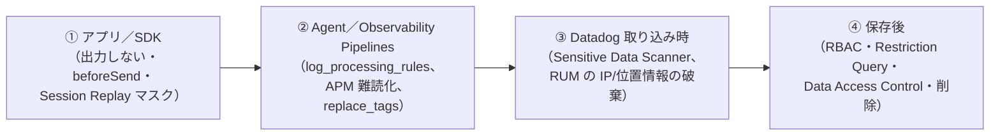

# セキュリティとコンプライアンス

## 概要

本ファイルは、Datadog を導入する組織が**セキュリティ審査（ベンダー評価）・コンプライアンス確認**で確認すべき事項をまとめた導入編ガイドである。主な読者は、情報セキュリティ部門への説明を担うコンサルタント、PM、アーキテクトである。

本ファイルで扱う範囲は次のとおり。

| 観点 | 本ファイルの節 | 詳細仕様の正本 |
|---|---|---|
| 取得認証・第三者評価（SOC 2、ISO、PCI DSS、HIPAA、FedRAMP、ISMAP など） | [1](#1-取得認証第三者評価の状況) | Trust Center（https://trust.datadoghq.com/） |
| データ保存場所（データレジデンシー） | [2](#2-データ保存場所データレジデンシー) | [Datadog Sites](../02_リファレンス/platform/datadog-sites.md) |
| 暗号化（通信・保存） | [3](#3-暗号化) | 本ファイル |
| PII・機微データ対策 | [4](#4-pii機微データ対策) | [Sensitive Data Scanner](../02_リファレンス/security/sensitive-data-scanner.md) ほか |
| データ保持・削除、契約終了後の扱い | [5](#5-データ保持と削除) | [Indexes・保持・アーカイブ](../02_リファレンス/logs/log-indexes-retention-archives.md) |
| サブプロセッサ・DPA・プライバシーポリシー | [6](#6-サブプロセッサdpaプライバシーポリシー) | Datadog 法務ページ |
| アクセス管理・監査（概要のみ） | [7](#7-アクセス管理と監査の要点) | [組織・ユーザー・権限管理](../02_リファレンス/platform/account-and-access-management.md)、[Audit Trail](../02_リファレンス/platform/audit-trail.md) |
| 日本の法規制の観点（個人情報保護法、電気通信事業法、ISMAP、FISC） | [8](#8-日本の法規制の観点) | 各官公庁の公式情報 |
| セキュリティ審査チェックリスト | [9](#9-セキュリティ審査チェックリスト) | 本ファイル |

本ファイルは「**Datadog というサービスそのもののセキュリティ**」を扱う。顧客環境を守るためのセキュリティ製品（Cloud SIEM、Cloud Security、Workload Protection など）は [Datadog Security 概要](../02_リファレンス/security/security-platform-overview.md) を参照する。公式ドキュメントの Data Security ページも同じ区分である。[出典](https://docs.datadoghq.com/data_security/)

> **重要な前提:** Datadog の認証・監査レポートの原本（SOC 2 報告書、ISO 証明書、PCI DSS の AOC など）は、**Trust Center（https://trust.datadoghq.com/）からアクセス申請して入手する**。本ファイルは公開情報の整理であり、監査報告書の適用範囲（対象サイト・対象製品・対象期間）は、必ず原本で確認すること。[出典](https://www.datadoghq.com/security/)

---

## 1. 取得認証・第三者評価の状況

### 1.1 Trust Center に掲載されたフレームワーク一覧

Datadog の Trust Center（https://trust.datadoghq.com/）には、2026-11-02 時点で次の 21 のコンプライアンス認証・フレームワークが掲載されている。[出典](https://trust.datadoghq.com/)（2026-11-02 取得）

| 区分 | フレームワーク | 掲載名 | 備考 |
|---|---|---|---|
| 監査報告（米国） | SOC 2 Type 1 / SOC 2 Type 2 | SOC 2 Type 1、SOC 2 Type 2 | 報告書は Trust Center で申請・入手 |
| ISO（情報セキュリティ） | ISO/IEC 27001 | ISO/IEC 27001 | Trust Center の Featured 文書に ISO/IEC 27001 証明書がある |
| ISO（クラウドセキュリティ） | ISO/IEC 27017 | ISO/IEC 27017:2015 | |
| ISO（クラウド上の PII 保護） | ISO/IEC 27018 | ISO/IEC 27018:2019 | |
| ISO（プライバシー） | ISO/IEC 27701 | ISO/IEC 27701 | Processor（処理者）として認証。2023-04-28 の公式ブログで発表 |
| ISO（AI マネジメント） | ISO/IEC 42001 | ISO/IEC 42001:2023 | 2026-03-26 の公式ブログで発表 |
| 決済カード | PCI DSS | PCI DSS | 公式ドキュメントは PCI DSS v4.0 準拠と記載 |
| 医療（米国） | HIPAA | HIPAA | BAA を締結（[1.4](#14-hipaa)） |
| 米国政府 | FedRAMP High | FedRAMP High | Datadog for Government（US1-FED）が対象（[1.5](#15-fedramp--govramp米国政府向け)） |
| 米国州・地方政府 | GovRAMP | GovRAMP | |
| 豪州政府 | IRAP | IRAP | |
| 英国 | Cyber Essentials Plus | Cyber Essentials Plus | |
| 自動車業界（欧州） | TISAX | TISAX | |
| クラウドセキュリティ | CSA STAR | CSA STAR | Trust Center の Self-Assessments に CAIQ がある |
| プライバシー法 | GDPR | GDPR | 規制への対応状況。認証ではない |
| プライバシー法 | CCPA | CCPA | 規制への対応状況。認証ではない |
| データ移転 | EU-US DPF | EU-US DPF | プライバシーポリシーで DPF 準拠を明記（[6.3](#63-プライバシーポリシーと国際移転)） |
| 金融（EU） | DORA | DORA | EU のデジタル・オペレーショナル・レジリエンス法 |
| AI 規制（EU） | EU AI Act | EU AI Act | |
| アクセシビリティ | VPAT | VPAT | |

> **注意:** 上表は Trust Center のトップページに表示される「フレームワーク名」の一覧である。各項目が「認証取得」「監査報告書あり」「自己評価・対応方針の掲載」のどれに当たるかは項目ごとに異なる（例：GDPR・CCPA は認証制度ではない）。正確な位置付けは各文書で確認すること。

> **ISMAP は掲載されていない:** 2026-11-02 時点の Trust Center 一覧に **ISMAP（日本政府のクラウドサービス評価制度）は含まれていない**。詳細は [1.6](#16-ismap日本政府) を参照。

### 1.2 Trust Center で入手できる主な文書

Trust Center では、認証書類のほかに次のカテゴリの文書が公開・申請対象になっている（2026-11-02 取得時点の表示）。[出典](https://trust.datadoghq.com/)

| カテゴリ | 主な文書 |
|---|---|
| Reports | Network and Dataflow Diagrams、Pen Test Report（2026 年のペネトレーションテスト要約は NCC Group が実施。Datadog / Eppo / Cloudcraft 別） |
| Self-Assessments | CAIQ、HECVAT Full、SIG Core |
| Legal | Subprocessors、Cyber Insurance、Data Processing Addendum |
| Data Security | Access Monitoring、Data Backups、Encryption-in-transit |
| App Security | Responsible Disclosure、Code Analysis、Credential Management |
| Data Privacy | Cookies、Data Out of System、Privacy Center |
| Access Control | Data Access、Logging、Password Security |
| Infrastructure | Status Monitoring、Amazon Web Services、Azure |
| Network Security | Firewall、IDS/IPS、SIEM |
| Corporate Security | Asset Management Practices、Email Protection、Employee Training |
| Policies and Procedures | Acceptable Use、Datadog Privacy and Data Governance Policy、Access Control、Information Security Policy |

> **実務上のポイント:** 日本企業のセキュリティチェックシート（独自様式）への回答は、Trust Center の **CAIQ・SIG Core** と **SOC 2 Type 2 報告書**の該当箇所を対応付けて作ると効率がよい。Datadog 側で独自様式に回答してもらえるかどうかは契約・担当者次第であり、公開情報では確認できず。【経験則】

### 1.3 PCI DSS

Datadog の公式ドキュメントでは、PCI DSS について次のように説明している。[出典](https://docs.datadoghq.com/data_security/pci_compliance/)（2026-11-02 取得）

| 項目 | 内容 |
|---|---|
| 準拠バージョン | Datadog のツールとポリシーは **PCI DSS v4.0** に準拠する |
| Datadog の位置付け | **Connected PCI environment**（CDE に接続する環境）。Datadog 自体は CDE（Cardholder Data Environment）ではなく、カード会員データ（CHD）の保存・処理・伝送はしない |
| 顧客の責任 | 「It is your responsibility to prevent any CHD from entering the Datadog platform」。**CHD を Datadog に入れないことは顧客の責任** |
| 推奨される Datadog 機能 | Sensitive Data Scanner（CHD の検出・分類・秘匿化）、Audit Trail（最大 90 日の監査イベント検索）、File Integrity Monitoring（重要ファイルの改変検知）、Cloud Security（ベンチマーク準拠の追跡） |
| 責任分担の文書 | Trust Center の **Customer Responsibility Matrix** と **Attestation of Compliance（AOC）** をダウンロードして確認する |

> **旧仕様との食い違いに注意:** 2022 年の公式ブログ「Announcing PCI-Compliant Log Management and APM」や、一部の言語版ドキュメント（スペイン語版・日本語版の旧訳）では、「PCI 準拠の Log Management / APM は **US1 サイトの org に限る**」「**PCI 専用エンドポイントに HTTPS で送る**」「PCI 準拠 org に設定すると **Audit Trail が自動で有効化**され、無効化できない」といった要件が書かれていた。[出典](https://www.datadoghq.com/blog/datadog-pci-compliance-log-management-apm/)（2022 公開）。しかし 2026-11-02 時点の英語版 PCI ページには、**サイト制限・専用エンドポイントの記述がない**。現行の要件（AP1 で PCI 準拠の構成を取れるか、専用エンドポイントが必要か）は、**公開情報では確認できず**。Trust Center の Customer Responsibility Matrix と担当営業で確認すること。

> **設計上の推奨:** PCI DSS 対象システムを Datadog で監視する場合、Datadog 側に CHD を入れない設計が前提となる。具体的には、(1) アプリでログ出力前にマスクする、(2) Agent の `log_processing_rules`（`mask_sequences`）で送信前にマスクする、(3) Sensitive Data Scanner の Credit Card 系ルールで取り込み時に秘匿化する、の多層防御にする。APM では Agent の `DD_APM_OBFUSCATION_CREDIT_CARDS_ENABLED`（デフォルト有効）を確認する。（[4](#4-pii機微データ対策)）

Agent の TLS について、PCI 対応では Agent v6/v7 で `min_tls_version: 'tlsv1.2'` を設定する（6.39.0 / 7.39.0 未満の Agent では `force_tls_12: true`）と公式ドキュメントに記載がある。[出典](https://docs.datadoghq.com/data_security/agent/)

### 1.4 HIPAA

Datadog は、保護対象医療情報（PHI）を送る顧客と **BAA（Business Associate Agreement）を締結する**。[出典](https://docs.datadoghq.com/data_security/hipaa_compliance/)

#### HIPAA 対象サービス（HIPAA-eligible services）

公式の HIPAA 対象サービス一覧（2026-07-23 更新）は、「Eligible Services」と「Extended Eligible Services」の 2 区分である。[出典](https://www.datadoghq.com/legal/hipaa-eligible-services/)

| 区分 | サービス |
|---|---|
| Eligible Services | Cloud SIEM（旧称：Security Monitoring）、Log Management |
| Extended Eligible Services | Agent Observability（旧称：LLM Observability）、Application Performance Monitoring、App and API Protection（旧称：Application Security Management）、Audit Trail、Bits Agent Builder、Bits Investigation、Bits Chat、Bits Security Analyst、CI Visibility、Cloud Network Monitoring（旧称：Network Performance Monitoring）、Cloud Security Posture Management、Cloud SIEM、Continuous Profiler、Data Observability、Database Monitoring、Datadog MCP Server、Eppo、Error Tracking、Experiments、Feature Flags、Incident Management、Infrastructure Monitoring、Log Management、Metaplane、Network Device Monitoring、Product Analytics、Real User Monitoring、Sensitive Data Scanner、Serverless Monitoring、Session Replay、Synthetic Monitoring、Workflow Automation、Workload Protection（旧称：Cloud Workload Security） |

- 一覧にあるサービスは、BAA の対象 org で PHI の処理に使える。
- 一覧にないサービスも HIPAA 有効 org で使えるが、**PHI を処理しない場合に限る**。
- 「Eligible」と「Extended Eligible」の違いは公開ページに説明がない。アカウント担当者に確認するよう案内されている。
- サイト（リージョン）による制限は、一覧ページには書かれていない。

#### BAA 締結 org の制限事項

BAA を締結した org には、次の機能制限がある。[出典](https://docs.datadoghq.com/data_security/hipaa_compliance/)

| 制限 | 内容 |
|---|---|
| サポート | Zendesk Live Chat でサポートを依頼できない |
| 共有 | Datadog の Explorer からログやセキュリティシグナルを共有（share）できない |
| 生成 AI | 第三者提供の生成 AI サービスを使えない（HIPAA 対象として一覧にあるものを除く） |
| エンドポイント | HIPAA 用の専用エンドポイントは不要。すべてのログ送信エンドポイントで暗号化が有効 |

> **日本での適用:** HIPAA は米国法であり、日本の医療機関には直接適用されない。日本の医療情報は「医療情報システムの安全管理に関するガイドライン」（厚生労働省）や「3 省 2 ガイドライン」で評価するのが一般的である。Datadog がこれらのガイドラインへの対応表を公開しているかは、**公開情報では確認できず**。【推定】

### 1.5 FedRAMP / GovRAMP（米国政府向け）

| 項目 | 内容 | 出典 |
|---|---|---|
| FedRAMP High | **2026-05-06** に Datadog for Government が FedRAMP High 認証の取得を発表。公式ブログでは「Datadog for Government (US1-FED) now operates within a FedRAMP High-certified environment」と記載 | [公式ブログ](https://www.datadoghq.com/blog/datadog-achieves-fedramp-high-certification/)、[プレスリリース（日本語）](https://www.datadoghq.com/ja/about/latest-news/press-releases/datadog-for-government-fedramp-high-2026/) |
| データ所在 | US1-FED の GovCloud 環境内で処理・保存。NIST 800-53 Rev. 5 に準拠 | 同上 |
| 経緯 | 2020 年に FedRAMP Low（SaaS）認可、その後 Moderate 認可を経て、2025 年 5 月に High の「In Process」を発表 | [Low 認可](https://investors.datadoghq.com/news-releases/news-release-details/datadog-achieves-fedramp-low-impact-saas-authorization)、[High In Process](https://www.datadoghq.com/about/latest-news/press-releases/datadog-for-government-achieves-fedramp-high-in-process-status-to-support-mission-critical-federal-workloads/) |
| IL5 | 2026-05 時点では「IL5 認可に向けて進行中」で、取得済みではない | [公式ブログ](https://www.datadoghq.com/blog/datadog-achieves-fedramp-high-certification/) |
| GovRAMP | Trust Center に GovRAMP High が掲載されている（州・地方政府向け） | [Trust Center](https://trust.datadoghq.com/)、[公式ブログ](https://www.datadoghq.com/blog/datadog-achieves-govramp-high-authorization/) |
| US2-FED | FedRAMP High の発表記事は US1-FED のみに言及。US2-FED の認可レベルは公開情報では確認できず | — |

> **サイト差異:** FedRAMP は **US1-FED（Datadog for Government）サイトだけが対象**である。AP1 を含む商用サイトの org は FedRAMP の認可範囲に入らない。政府サイトでは FIPS Agent（FIPS 140-2 検証済み暗号モジュール）が使えるが、商用サイトでは使えない。詳細は [Datadog Sites](../02_リファレンス/platform/datadog-sites.md) を参照。

### 1.6 ISMAP（日本政府）

ISMAP（Information system Security Management and Assessment Program：政府情報システムのためのセキュリティ評価制度）は、政府が求めるセキュリティ要求を満たすクラウドサービスを事前に評価・登録する制度である。2020 年 6 月に運用を開始した。政府機関は原則として「ISMAP 等クラウドサービスリスト」に掲載されたサービスから調達する。[出典](https://www.cyber.go.jp/policy/group/general/ismap.html)

| 確認項目 | 状況（2026-11-02 時点） |
|---|---|
| ISMAP クラウドサービスリストへの Datadog の登録 | **公開情報では確認できず**。Trust Center の 21 フレームワークに ISMAP は含まれていない。Datadog の登録を報じた公式発表・報道も見つからなかった |
| ISMAP-LIU（低リスク向け区分）への登録 | **公開情報では確認できず** |
| 取得に向けた動き | Datadog の採用情報（監査チームの求人）に「ISMAP と IRAP の監査プログラムの立ち上げ・支援」を担うとの記載があったことが、検索結果から読み取れる【第三者情報】（求人ページは 2026-11-02 時点で 404。掲載日は確認できず）。IRAP はその後 Trust Center に掲載されたが、ISMAP の取得は確認できない |

> **実務上の注意:** 政府機関・独立行政法人・一部の自治体の案件で Datadog を使う場合は、**最新の ISMAP クラウドサービスリスト（ISMAP ポータルで公開。随時更新）を必ず確認**すること。未登録の場合、調達側の規程で例外承認が必要になるか、利用自体ができない可能性がある。民間企業でも、ISMAP 登録を選定条件とする社内規程を持つ場合がある。【経験則】

> **ISMAP と AWS の関係:** AP1 は AWS 東京リージョン（`ap-northeast-1`）上で稼働している（[2.1](#21-サイト別のホスティング先)）。AWS 自体は ISMAP に登録されているが、**基盤（IaaS）が ISMAP 登録済みであることは、その上で動く SaaS（Datadog）が ISMAP 登録済みであることを意味しない**。SaaS としての登録が別途必要である。【推定】

### 1.7 その他の認証・取組み（時系列）

| 時期 | 出来事 | 出典 |
|---|---|---|
| 2020-02 | ISO 27001 認証取得、ISO 27017 / 27018 準拠を発表（当時の規格版は ISO/IEC 27001:2013、27017:2015、27018:2019） | [プレスリリース](https://www.datadoghq.com/ja/about/latest-news/press-releases/iso-27001-27017-27018/) |
| 2022 | PCI 準拠の Log Management / APM を発表（当時は US1 限定、PCI Level 1 Service Provider と記載） | [公式ブログ](https://www.datadoghq.com/blog/datadog-pci-compliance-log-management-apm/) |
| 2023-04-19 | 日本（東京）データセンター AP1 の開設を発表 | [プレスリリース](https://www.datadoghq.com/ja/about/latest-news/press-releases/datadog-launches-new-data-center-in-japan/) |
| 2023-04-28 | ISO 27701 Processor 認証取得を発表 | [公式ブログ](https://www.datadoghq.com/blog/iso-27701-processor-data-privacy-compliance-datadog/) |
| 2025-05 | FedRAMP High「In Process」を発表 | [プレスリリース](https://www.datadoghq.com/about/latest-news/press-releases/datadog-for-government-achieves-fedramp-high-in-process-status-to-support-mission-critical-federal-workloads/) |
| 2026-03-26 | ISO 42001（AI マネジメントシステム）認証取得を発表。同記事は他の認証として ISO 27001、ISO 27701 Processor、HIPAA、PCI、TISAX を挙げている | [公式ブログ](https://www.datadoghq.com/blog/datadog-achieves-iso-42001/) |
| 2026-05-06 | FedRAMP High 認証取得を発表（US1-FED） | [公式ブログ](https://www.datadoghq.com/blog/datadog-achieves-fedramp-high-certification/) |

> **現行の ISO 規格版について:** ISO/IEC 27001 は 2022 年版への移行期限（2025-10-31）を過ぎている。Datadog の現行証明書が 27001:2022 版かどうかは Trust Center の証明書で確認すること（公開情報では確認できず）。

### 1.8 脆弱性報告・バグバウンティ

| 項目 | 内容 |
|---|---|
| セキュリティ上の懸念の報告先 | `security@datadoghq.com`（24 時間以内に返信するとしている。PGP 鍵を公開） |
| プラットフォーム悪用の報告先 | `abuse@datadoghq.com` |
| バグバウンティ | HackerOne 上で非公開（private）のバグバウンティプログラムを運営 |
| ステータス | サイトごとのステータスページ（AP1 は `https://status.ap1.datadoghq.com`） |

[出典](https://www.datadoghq.com/security/)、[ステータスページの出典](../02_リファレンス/platform/datadog-sites.md)

---

## 2. データ保存場所（データレジデンシー）

### 2.1 サイト別のホスティング先

Datadog のデータ保存場所は、**org を作成したサイト（Datadog Site）**で決まる。各サイトは独立しており、サイト間でデータは共有されない。サイトは後から変更できない（移行は新 org を作り直す扱い）。詳細は [Datadog Sites](../02_リファレンス/platform/datadog-sites.md) を参照。

| サイト | 公式サイト一覧の所在国 | クラウド / リージョン（PrivateLink 等の公式手順から判明） |
|---|---|---|
| US1 | US | AWS `us-east-1` |
| US3 | US | Microsoft Azure `westus2` |
| US5 | US | Google Cloud `us-central1` |
| EU1 | EU | Google Cloud `europe-west3`（フランクフルト） |
| **AP1** | **Japan** | **AWS `ap-northeast-1`（東京）** |
| AP2 | Australia | AWS `ap-southeast-2`（シドニー） |
| UK1 | UK | AWS `eu-west-2`（ロンドン） |
| US1-FED | US（GovCloud） | AWS GovCloud (US) |
| US2-FED | US | 公開情報では確認できず |

[出典](https://docs.datadoghq.com/getting_started/site/)、[出典](https://docs.datadoghq.com/agent/guide/private-link/?site=ap1)（詳細は [Datadog Sites](../02_リファレンス/platform/datadog-sites.md)）

AP1 の開設時（2023-04-19）、Datadog は「日本国内でデータを保存・処理できるようにすることで、データの国内保存に関する規制や顧客・パートナーの要望に対応できる」と説明した。[出典](https://www.datadoghq.com/ja/about/latest-news/press-releases/datadog-launches-new-data-center-in-japan/)

### 2.2 「サイト外」で処理されうるデータ

AP1 を選んでも、**すべての処理が日本国内で完結するとは限らない**。公開情報から読み取れる、サイト外での処理の可能性は次のとおり。

| データ・処理 | サイト外処理の可能性 | 根拠 |
|---|---|---|
| 中核の観測データ（メトリクス・ログ・トレース等）の保存 | サイトの所在国に保存（AP1 は日本） | サイト一覧、AP1 プレスリリース |
| AI 機能（Bits AI など） | AI サービスのサブプロセッサ（Anthropic、OpenAI、Baseten、Databricks、Fireworks.ai、Nebius、Together）は所在地がすべて**米国**と掲載されている。AI 機能に送ったプロンプトや関連データが米国で処理される可能性がある【推定】 | [サブプロセッサ一覧](https://www.datadoghq.com/legal/subprocessors/)（2026-10-16 更新） |
| サポート対応（チケット、添付した Agent flare 等） | Zendesk・Salesforce（米国）がカスタマーサポート基盤として掲載。サポートに添付した情報は米国のサービスで扱われる可能性がある【推定】 | 同上 |
| 通知（メール・SMS・音声） | Mailgun、Twilio、Vonage（米国）が掲載。通知本文に含めた情報が米国経由になる可能性がある【推定】 | 同上 |
| データウェアハウス | Snowflake（米国）が「Data warehouse services」として掲載。対象データの範囲は公開情報では確認できず | 同上 |
| 脅威インテリジェンス | ReversingLabs（スイス）が掲載 | 同上 |
| Datadog 従業員によるアクセス | Datadog Japan G.K.（日本）を含む各国の関連会社がサブプロセッサとして掲載されている。保守目的のアクセスは「選ばれた一部のエンジニア」に限定されると説明 | 同上、[Data Security](https://docs.datadoghq.com/data_security/) |
| Agent テレメトリ（商用サイト） | Agent は環境・性能・機能利用情報（診断ログ、難読化したスタックトレースを含むことがある）を送る。`agent_telemetry.enabled: false` で無効化できる | [Agent Data Security](https://docs.datadoghq.com/data_security/agent/) |

> **参考（UK1 の公式説明）:** Datadog の公式ブログは UK1 について「中核となる観測データ（ログ・メトリクス・トレース・セキュリティシグナル）は英国内に保存され、主に英国内で処理されるが、一部の機能では英国外のサブプロセッサで処理されることがある」と説明している。[出典](https://www.datadoghq.com/blog/observability-data-hosting-uk-aws/)（2026-04-21 公開）。AP1 についての同様の明示的な説明は公開情報では確認できないが、構造は同じと考えるのが妥当である。【推定】

> **実務上の推奨:** 「データを国外に出さない」ことが要件の場合は、(1) AP1 を選ぶ、(2) Bits AI 等の AI 機能の利用可否を社内で判断する（AI 機能は org 単位で無効化できるかを [Bits AI](../02_リファレンス/ai/bits-ai.md) で確認）、(3) サポート問い合わせに個人データを添付しない運用にする、(4) 通知本文にログ本文などの個人データを埋め込まない、の 4 点をセットで設計する。【経験則】

### 2.3 Datadog の外に置くデータ（顧客管理領域）

次のデータは Datadog の保存領域ではなく、**顧客自身のクラウドストレージ**に置かれるため、保存場所・暗号化鍵を顧客が管理できる。

| 機能 | 保存先 | 補足 |
|---|---|---|
| Log Archives | 顧客の Amazon S3 / Azure Storage / Google Cloud Storage | 保存リージョン・暗号化（例：S3 の SSE-KMS）は顧客のバケット設定に従う。詳細は [Indexes・保持・アーカイブ](../02_リファレンス/logs/log-indexes-retention-archives.md) |
| Observability Pipelines の送信先 | 顧客が指定する任意の宛先 | パイプラインは顧客環境で稼働し、Datadog 以外にも送れる。詳細は [Observability Pipelines](../02_リファレンス/logs/observability-pipelines.md) |
| Synthetic Monitoring の Private Location | 顧客環境のコンテナ | 内部向けテストを顧客ネットワーク内から実行 |

---

## 3. 暗号化

### 3.1 通信の暗号化（in transit）

| 項目 | 内容 | 出典 |
|---|---|---|
| 最低 TLS バージョン | Datadog のシステムは **TLS 1.2 以上**を必須とする | [TLS Ciphers Deprecation](https://docs.datadoghq.com/data_security/guide/tls_ciphers_deprecation/) |
| HSTS | Datadog のツールを通るデータは TLS と HSTS で保護される | [Data Security](https://docs.datadoghq.com/data_security/) |
| 暗号スイートの縮退（2024-04-01） | 商用サイトで、SHA256 を使う CBC モードの ECDHE スイート 4 つと RSA スイート 2 つを無効化 | [TLS Ciphers Deprecation](https://docs.datadoghq.com/data_security/guide/tls_ciphers_deprecation/) |
| 暗号スイートの縮退（2026-09-01） | 商用サイト（US1/EU1/US3/US5/AP1/AP2/UK1）で、残りの CBC モード ECDHE・RSA スイートと、RSA 鍵交換の AES-GCM スイートを無効化 | 同上 |
| 商用サイトで受け付けるスイート（2026-09-01 以降） | TLS 1.2：ECDHE-ECDSA / ECDHE-RSA × AES-128-GCM-SHA256 / AES-256-GCM-SHA384 / CHACHA20-POLY1305-SHA256。TLS 1.3：`TLS_AES_128_GCM_SHA256`、`TLS_AES_256_GCM_SHA384`、`TLS_CHACHA20_POLY1305_SHA256` | 同上 |
| 政府サイトで受け付けるスイート | TLS 1.2：ECDHE-RSA / ECDHE-ECDSA × AES-128-GCM-SHA256 / AES-256-GCM-SHA384。TLS 1.3：`TLS_AES_128_GCM_SHA256`、`TLS_AES_256_GCM_SHA384`（CHACHA20 は不可） | 同上 |
| 互換性テスト用エンドポイント | `tls-config-test.datadoghq.com`（受け付けるスイートだけを設定したテスト先） | 同上 |
| 接続方向 | 通信は常に Agent 側から開始される。Datadog から Agent へセッションを張ることはない | [Agent Data Security](https://docs.datadoghq.com/data_security/agent/) |
| Agent の最低 TLS 指定 | Agent v6 以降は最低 TLS バージョンを強制できる。`min_tls_version: 'tlsv1.2'`（6.39.0 / 7.39.0 未満は `force_tls_12: true`） | 同上 |
| ログ送信エンドポイント | すべてのログ送信エンドポイントが暗号化されている。旧来の暗号化専用エンドポイントとして `http-encrypted-intake.logs.datadoghq.com`、`gcp-encrypted-intake.logs.datadoghq.com` がある | [Logs Data Security](https://docs.datadoghq.com/data_security/logs/) |
| Synthetic Private Location | Private Location と Datadog 間の通信の機微部分は RSA（4096 ビット）で非対称暗号化 | [Synthetics Data Security](https://docs.datadoghq.com/data_security/synthetics/) |

> **影響を受けやすいクライアント:** 2026-09-01 の暗号スイート縮退で問題が出やすいのは、カスタムインテグレーション、スクリプト、古い HTTP クライアント（一部の Windows PowerShell や Ruby の旧バージョンなど）である。接続エラーが出た場合は `tls-config-test.datadoghq.com` で確認する。[出典](https://docs.datadoghq.com/data_security/guide/tls_ciphers_deprecation/)

閉域接続（AWS PrivateLink 等）とプロキシ構成は [ネットワーク・接続要件](network-and-connectivity.md) を参照。

### 3.2 保存時の暗号化（at rest）

| 対象 | 内容 | 出典 |
|---|---|---|
| 保存データ全般 | 暗号化、アクセス制御、認証で保護される | [Data Security](https://docs.datadoghq.com/data_security/) |
| インデックス済みログ | **AES-256** の共通鍵暗号で暗号化 | [Logs Data Security](https://docs.datadoghq.com/data_security/logs/) |
| インテグレーションの認証情報（クラウドの資格情報等） | 暗号化して専用の安全な認証情報データストアに保存。アクセスは制御・監査される | [Data Security](https://docs.datadoghq.com/data_security/) |
| インテグレーションのデータ | 保存時・通信時ともに暗号化。異常検知ツールで不正アクセスを監視 | 同上 |
| RUM データ | Datadog 管理のクラウドインスタンスに保存し、保存時暗号化 | [RUM Data Security](https://docs.datadoghq.com/data_security/real_user_monitoring/) |
| Synthetic の認証情報（Private Location） | テスト設定・変数・結果のリクエスト署名用の認証情報は AES-GCM（256 ビット）で暗号化保存。テスト結果の機微部分（レスポンスヘッダー・ボディ）はデフォルトで暗号化保存 | [Synthetics Data Security](https://docs.datadoghq.com/data_security/synthetics/) |
| DPA 上の約束 | 保存時・通信時の暗号化を DPA のセキュリティ措置として記載 | [DPA](https://www.datadoghq.com/legal/data-processing-addendum/) |

### 3.3 顧客管理鍵（CMK / BYOK）

| 項目 | 状況 |
|---|---|
| Datadog 内の保存データに対する顧客管理鍵（BYOK / CMEK） | **公開情報では確認できず**（公式ドキュメント・Trust Center 公開部分に該当機能の記載が見つからなかった） |
| 顧客鍵で保護できる代替手段 | Log Archives を顧客のバケットに置き、顧客の KMS 鍵で暗号化する（[2.3](#23-datadog-の外に置くデータ顧客管理領域)） |
| 秘密情報の Agent 設定ファイルへの平文記載回避 | Agent の Secrets Management（ユーザー提供の実行ファイルで秘密情報を取得・復号し、メモリ上にのみ保持） |

[出典](https://docs.datadoghq.com/data_security/agent/)

---

## 4. PII・機微データ対策

### 4.1 基本方針：送らない・送る前に消す・取り込み時に消す・見せない

Datadog の公式ドキュメントは、データ保護の手段として「送るデータを減らすツール」をデータの種類ごとに提供している。[出典](https://docs.datadoghq.com/data_security/) PII 対策は、次の 4 層で考えると整理しやすい。【経験則】

| 層 | 主な手段 | 効果 | 詳細 |
|---|---|---|---|
| ① 発生源 | アプリでマスク、RUM の `beforeSend`、Session Replay のプライバシー設定 | データが端末・サーバーから出ない | [RUM（ブラウザ）](../02_リファレンス/dem/rum-browser.md)、[Session Replay](../02_リファレンス/dem/session-replay-and-product-analytics.md) |
| ② 収集経路 | Agent の `log_processing_rules`（`exclude_at_match`、`include_at_match`、`mask_sequences`）、APM の難読化、Observability Pipelines の Sensitive Data Scanner プロセッサ | Datadog に届く前に除去 | [ログ収集](../02_リファレンス/logs/log-collection.md)、[Observability Pipelines](../02_リファレンス/logs/observability-pipelines.md) |
| ③ 取り込み時 | Sensitive Data Scanner（検出・タグ付け・秘匿化／ハッシュ化）、RUM の IP・位置情報収集オフ | 保存前に除去 | [Sensitive Data Scanner](../02_リファレンス/security/sensitive-data-scanner.md) |
| ④ 保存後 | RBAC、Logs の Restriction Query、Data Access Control（Restricted Datasets）、データ削除 | 見せない・消す | [組織・ユーザー・権限管理](../02_リファレンス/platform/account-and-access-management.md)、[5](#5-データ保持と削除) |

### 4.2 製品別の PII 関連デフォルトと設定

| 製品 | デフォルトの挙動・主な設定 | 出典 |
|---|---|---|
| Logs（Agent） | Agent v6 以降で `log_processing_rules` による除外（`exclude_at_match` / `include_at_match`）とマスク（`mask_sequences`）が可能 | [Logs Data Security](https://docs.datadoghq.com/data_security/logs/) |
| Logs（取り込み時） | Sensitive Data Scanner にクレジットカード番号、メールアドレス、IP アドレス、API キーなどの定義済みルールがあり、独自の正規表現ルールも追加できる。Agent 上・Observability Pipelines 上でも動かせる | 同上 |
| APM（Agent） | **デフォルト有効**：MongoDB、Elasticsearch、Redis、Memcached、クレジットカード番号の難読化。SQL はリテラル・バインド変数を難読化。**デフォルト無効**：HTTP クエリ文字列の削除（`DD_APM_OBFUSCATION_HTTP_REMOVE_QUERY_STRING`）、数字を含むパスの難読化、スタックトレース削除、Redis 引数の全削除、クレジットカードの Luhn チェック | [Tracing Data Security](https://docs.datadoghq.com/tracing/configure_data_security/) |
| APM（タグの置換・除外） | `replace_tags`（`DD_APM_REPLACE_TAGS`）でタグ値を正規表現置換、`ignore_resources`（`DD_APM_IGNORE_RESOURCES`）でリソースごと破棄 | 同上 |
| APM（トレーサー） | `DD_TRACE_OBFUSCATION_QUERY_STRING_REGEXP` で一致した値を `<redacted>` に置換。`DD_HTTP_SERVER_TAG_QUERY_STRING`（デフォルト `true`）を `false` にするとクエリ文字列を収集しない。クライアント IP は Python / Ruby / Go などでデフォルト非収集 | 同上 |
| Database Monitoring | Agent がクエリのバインドパラメータをすべて難読化し、パスワードや PII がクエリメトリクス・サンプル・実行計画に出ないようにする | [Data Security](https://docs.datadoghq.com/data_security/) |
| Live Processes / Containers | 既定のキーワードでコマンド引数等をスクラブ。`custom_sensitive_words`、`DD_ORCHESTRATOR_EXPLORER_CUSTOM_SENSITIVE_WORDS` で拡張 | 同上 |
| Serverless | AWS Lambda のリクエスト・レスポンスペイロードから特定パラメータをスクラブ可能 | 同上 |
| RUM | ユーザー識別はデフォルトでは行わない（セッションごとに `session.id`）。IP アドレスと位置情報（国・市・郡）の収集は RUM アプリケーションの **User Data Collection** タブで止められる。ただし SDK は送信を続け、Datadog の処理時に破棄する方式で、**変更前のイベントには残る** | [RUM Data Security](https://docs.datadoghq.com/data_security/real_user_monitoring/) |
| RUM（同意） | ブラウザ RUM はファーストパーティ Cookie を使う。法域で必要なら RUM 初期化前に同意を取る必要がある。モバイル RUM はユーザーが同意した場合のみ追跡 | 同上 |
| RUM（プロキシ） | RUM イベントを自社プロキシ経由にし、エンドユーザー端末が Datadog に直接接続しないようにできる。`clientToken` はクライアント側で見えるため定期ローテーションを推奨 | 同上 |
| Session Replay | 既定のプライバシーレベルは **`mask`**（テキスト・入力・画像などをすべてマスク）。マスクした値は**端末から出ず、後から解除できない** | [Session Replay Privacy Options](https://docs.datadoghq.com/session_replay/browser/privacy_options/) |
| Synthetic Monitoring | グローバル変数の値を難読化して保存可能。API / Multistep API / Browser テストのプライバシーオプションで、結果に保存されるデータを制限可能 | [Synthetics Data Security](https://docs.datadoghq.com/data_security/synthetics/) |
| Agent 自身のログ | API キー、パスワード、トークンなどの資格情報らしき文字列をディスクに書く前に難読化 | [Agent Data Security](https://docs.datadoghq.com/data_security/agent/) |

### 4.3 Session Replay のプライバシーレベル

Browser SDK の `defaultPrivacyLevel` は次の 3 種類である（`defaultPrivacyLevel` と `mask-user-input` は SDK v3.6.0 以降）。プライバシー設定を指定しない場合は **`mask`** が適用される。[出典](https://docs.datadoghq.com/session_replay/browser/privacy_options/)

| 値 | 挙動 |
|---|---|
| `mask`（デフォルト） | HTML テキスト、ユーザー入力、画像、canvas の内容、リンク、`data-*` 属性をすべてマスク |
| `mask-user-input` | フォーム項目（input、textarea、チェックボックスなど）をマスクし、その他のテキストは記録 |
| `allow` | マスクせずすべて記録 |

要素単位では、HTML 属性 `data-dd-privacy`（値：`allow`、`mask`、`hidden`、`mask-user-input`）またはクラス名 `dd-privacy-allow` / `dd-privacy-mask` / `dd-privacy-hidden` / `dd-privacy-mask-user-input` で上書きできる。[出典](https://docs.datadoghq.com/session_replay/browser/privacy_options/)

*キャプション:* Session Replay でプライバシーレベル `mask` を適用したときの再生画面の例。

*画面の説明:* EC サイトのような画面の再生イメージ。上部のバナー画像と左側の商品画像は灰色の矩形に置き換えられている。ナビゲーションのメニュー名、見出し、商品名、価格、注文概要の各行の文字は、すべて「XXXXX」のような同じ長さの「X」に置き換えられている。右下の入力欄（クーポンコード等）の入力値は「***」と表示され、ボタンの文言も「XXXXXXXX」になっている。レイアウトは残るが、テキスト・画像・入力値は読み取れない。

*出典:* https://docs.datadoghq.com/session_replay/browser/privacy_options/ （画像 URL: https://docs.dd-static.net/images/real_user_monitoring/session_replay/browser-privacy-mask-all.828d42fbb8e33a86f125b6202fcec774.png、2026-11-02 取得）

*キャプション:* Session Replay でプライバシーレベル `mask-user-input` を適用したときの再生画面の例。

*画面の説明:* `mask` の例と同じ EC サイト風の画面だが、商品画像・見出し・商品名・価格などの静的テキストはそのまま表示される。ユーザーが入力するフォーム項目（数量入力やクーポンコード欄など）の値だけがマスクされる。静的コンテンツに個人情報（ログイン後の氏名表示など）を含む画面では、このレベルではその部分がマスクされない点に注意する。

*出典:* https://docs.datadoghq.com/session_replay/browser/privacy_options/ （画像 URL: https://docs.dd-static.net/images/real_user_monitoring/session_replay/browser-privacy-mask-input.80289b90f35e95329b97d63a9284bd33.png、2026-11-02 取得）

> **Session Replay のマスクと Sensitive Data Scanner の違い:** Session Replay のマスクは端末側で行うため、元の値は Datadog に届かず復元できない。Sensitive Data Scanner の Mask アクションは、`Data Scanner Unmask` 権限を持つユーザーが元の値を表示できる。「Datadog 上に元データを一切置かない」要件なら、発生源・Agent 側での除去か、Sensitive Data Scanner の Redact（置換）や Hash を選ぶ。[出典](https://docs.datadoghq.com/data_security/real_user_monitoring/)

### 4.4 見落としやすい「データ以外」の PII

公式ドキュメントは、テレメトリ本体以外にも次の項目に個人情報・機密情報を入れないよう注意喚起している。[出典](https://docs.datadoghq.com/data_security/)

| 種類 | 例 |
|---|---|
| タグ・メタデータ | `user:yamada.taro@example.com` のような `key:value` |
| 名前・説明文 | ダッシュボード、ノートブック、モニター、インシデント、SLO の名前・説明 |
| メトリクス | ログ・トレース・RUM・Synthetics から生成したメトリクス（タグ値に PII が入る） |
| APM | サービス名、リソース名、トレース・スパンの属性 |
| Database Monitoring | クエリシグネチャ |
| プロセス情報 | コマンド引数、ユーザー名、作業ディレクトリ |
| イベント・コメント | イベント本文、コメント |
| CI | ブランチ名、パイプライン名、テスト名、スイート名 |

> **実務上の注意:** メトリクスのタグに PII（メールアドレス、ユーザー ID など）を入れると、PII 対策だけでなく**カスタムメトリクスのカーディナリティ爆発による課金増**にもつながる。PII はタグに入れないことを、タグ設計の規約に明記する。詳細は [タグ戦略の実践](../04_応用編/tagging-strategy.md)、[Custom Metrics と DogStatsD](../02_リファレンス/platform/custom-metrics-and-dogstatsd.md)。【経験則】

### 4.5 機密データの漏えいに備える仕組み

| 機能 | 内容 | 出典 |
|---|---|---|
| Token Safety | 公開 GitHub リポジトリを走査し、有効な Datadog のキーが漏えいしていればキー所有者にメールで通知 | [Security](https://www.datadoghq.com/security/) |
| Password Safety | NIST のガイドラインに従い、第三者の漏えいパスワードのハッシュ DB と照合 | 同上 |
| Safety Center | org 管理者にセキュリティアラートと推奨事項を表示 | 同上 |
| API キー・アプリケーションキー | スコープ付きアクセスとライフサイクル管理。詳細は [API とキー管理](../02_リファレンス/platform/api-and-keys.md) | 同上 |

---

## 5. データ保持と削除

### 5.1 製品別のデフォルト保持期間（抜粋）

Datadog は製品・データ種別ごとに保持期間を定めている。下表は公式「Data Retention Periods」ページからの主要部分の抜粋である（2026-11-02 取得）。[出典](https://docs.datadoghq.com/data_security/data_retention_periods/)

| 製品 | データ種別 | デフォルト保持期間 |
|---|---|---|
| Metrics | タグと値 | 15 か月 |
| Log Management | ログ | 契約プランで決まる（インデックスごとに設定） |
| Log Management | Sensitive Data Scanner のサンプルログ | 7 日 |
| APM | インデックス済みスパン | 15 日または 30 日（プランによる） |
| APM | サービス／リソースの統計 | 30 日 |
| APM | エラー | 15 日 |
| APM | 閲覧したトレース | アカウント存続期間 |
| Audit Trail | 監査ログ（Audit Trail 有効時） | 90 日 |
| Audit Trail | 監査ログ（Audit Trail 無効時） | 7 日 |
| Browser / Mobile RUM | Session・View・Action・Error | 30 日 |
| Browser / Mobile RUM | Resource・Long Task・Vitals | 15 日 |
| Session Replay | リプレイ（延長オプションなし） | 30 日 |
| Session Replay | リプレイ（延長オプションあり） | 15 か月 |
| Product Analytics | イベント | 15 か月 |
| Container / Process | Live processes と containers | 36 時間 |
| Container / Process | YAML 定義 | 7 日 |
| Continuous Profiler | フレームグラフ等 | 8 日 |
| Database Monitoring | クエリサンプル | 15 日 |
| Database Monitoring | クエリメトリクス | 15 か月 |
| Cloud Network Monitoring | ネットワークトラフィック | 14 日 |
| Cloud SIEM | シグナル | 15 か月 |
| Workload Protection | イベント | 90 日 |
| App and API Protection | セキュリティシグナル | 15 か月 |
| Event Management | イベント | 15 か月 |
| Synthetics | テスト結果 | 15 か月 |
| Error Tracking | エラーサンプル | 30 日 |
| Bits Chat | メッセージ | 15 か月 |
| Bits Code | ソースコード | 7 日 |
| Source Code Integration | ソースコード | 7 日 |
| Datadog App | ダッシュボード、ノートブック、モニター | アカウント存続期間 |
| Incident Management | インシデント | アカウント存続期間 |

> **全量の一覧:** 上表は抜粋である。全製品の一覧は公式ページを参照すること。ログの保持設計（Standard / Flex / Archives）は [Indexes・保持・アーカイブ](../02_リファレンス/logs/log-indexes-retention-archives.md) を参照。

> **コンプライアンス上の論点:** Datadog の保持期間は「最大でこの期間保存する」という意味であり、「法定保存期間を満たす保存庫」として使うには、ログの長期保管を **Log Archives（顧客のストレージ）** で担保するのが一般的である。【経験則】

### 5.2 データ削除の手段一覧

| 対象 | 手段 | 実施者 | 出典 |
|---|---|---|---|
| ログ（時間範囲＋クエリ指定） | **Logs Data Deletion**（UI：Organization Settings > Data Deletion） | `Logs Delete Data` 権限を持つユーザー | [Delete Data](https://docs.datadoghq.com/account_management/delete_data/) |
| ログ・RUM（API） | Data Deletion API。ログは `logs_delete_data`、RUM は `rum_delete_data` 権限が必要 | 権限を持つユーザー／サービスアカウント | [Data Deletion API](https://docs.datadoghq.com/api/latest/data-deletion) |
| ログ（インデックスごと） | Log Indexes ページでインデックスを削除 | 権限を持つユーザー | [Delete Logs with Sensitive Data](https://docs.datadoghq.com/logs/guide/delete_logs_with_sensitive_data/) |
| ログ（自然消滅） | インデックスの保持期間を短縮する（期間を過ぎたログは削除） | 同上 | 同上 |
| ログ（見せない） | Restriction Query 等で該当ログをクエリ不可にする（保持期間満了まで非表示） | 同上 | 同上 |
| RUM（時間範囲） | ハードデリート。**アプリケーション単位の指定はできず**、指定時間範囲の全データを削除。サポートに依頼 | Datadog サポート | [RUM Data Security](https://docs.datadoghq.com/data_security/real_user_monitoring/) |
| ログ・RUM 以外の製品 | サポートに依頼 | Datadog サポート | [Delete Data](https://docs.datadoghq.com/account_management/delete_data/) |
| Log Archives | 顧客のバケットで削除（Datadog の削除機能の対象外） | 顧客 | 【推定】Archives は顧客ストレージのため |

### 5.3 Logs Data Deletion の手順と仕様

**有効化:** Logs Data Deletion は **Organization Admin だけが有効化できる**。Organization Settings > Preferences で **Logs Data Deletion** をオンにして保存する。削除を実行するユーザーには、Organization Settings > Roles で **Logs Delete Data** 権限を含むロールを付与する。[出典](https://docs.datadoghq.com/account_management/delete_data/)

**削除リクエストの作成手順:**

1. Organization Settings > **Data Deletion** を開く。
2. 製品（Logs）を選ぶ。
3. 時間範囲を選ぶ。
4. 削除するイベントをクエリで指定する。
5. 結果を確認し、右下の **Delete** をクリックする。
6. 確認チェックボックスをオンにし、指定された文字列を入力して **Confirm** をクリックする。

[出典](https://docs.datadoghq.com/account_management/delete_data/)

| 仕様 | 内容 |
|---|---|
| 削除の開始 | 確認後ただちに開始され、対象データはアクセス不能になる |
| 取り消し可能期間 | 送信から **10 日間**は、Upcoming または Done (Recoverable) のジョブで **Cancel** できる。取り消すとデータは復元される |
| 恒久削除 | ログは **10 日経過後に恒久削除**される |
| 同時実行数 | 最大 **5 件**の削除を同時に実行できる |
| 削除されないもの | 削除したログから派生したデータ（例：ログから生成したメトリクス） |
| 取りこぼし | ジョブ開始後に到着したレコードは、その時間帯の処理が済んでいると削除されないことがある |
| 削除履歴 | Deletion History に **90 日間**記録される |
| 監査 | Audit Trail に依頼者情報付きで記録される。`@asset.name:"Data Deletion"` で検索 |
| Log Archives・リハイドレート済みデータへの影響 | 公開情報では確認できず |

[出典](https://docs.datadoghq.com/account_management/delete_data/)

> **機微データ流出時の推奨手順:** 公式ガイドは、(1) まず機微ログの送信を止める、(2) 必要に応じて該当ログをクエリ不可にする、(3) Sensitive Data Scanner で今後の取り込みを秘匿化する、(4) Logs Data Deletion で恒久削除する、の流れを示している。[出典](https://docs.datadoghq.com/logs/guide/delete_logs_with_sensitive_data/) 加えて、**ログから生成したメトリクスやアーカイブは別途対応が必要**である点をインシデント手順に入れておく。【経験則】

### 5.4 契約終了後のデータ削除（DPA）

Datadog の DPA（Data Processing Addendum、2024-01-03 最終更新）では、契約終了後のデータ削除を次のように定めている。[出典](https://www.datadoghq.com/legal/data-processing-addendum/)

| 項目 | 内容 |
|---|---|
| 削除の開始 | 契約終了から **30 日後**、書面による要求に基づき削除を開始 |
| 本番データの削除 | **90 日以内** |
| バックアップの削除 | **180 日以内** |
| データのエクスポート | 残したいデータは **30 日の期間が終わる前に顧客自身でエクスポート**する必要がある |
| データ返却義務 | DPA に独立したデータ返却義務の規定はない |

> **実務上の注意:** 解約・サイト移行の計画では、ダッシュボードやモニター定義（Terraform 等でコード化しておくと移行しやすい）、必要なログ（Archives に保存しておく）を、契約終了前に確保しておく。[Terraform と IaC](../02_リファレンス/platform/terraform-and-iac.md)、[他製品からの移行](migration-from-other-tools.md) も参照。【経験則】

---

## 6. サブプロセッサ・DPA・プライバシーポリシー

### 6.1 サブプロセッサ一覧

Datadog のサブプロセッサ一覧（2026-10-16 更新）は次のとおり。[出典](https://www.datadoghq.com/legal/subprocessors/)

#### 第三者サブプロセッサ

| サブプロセッサ | 目的 | 所在地 |
|---|---|---|
| Amazon Web Services, Inc. | インフラ | 米国、オーストラリア、イタリア、日本、英国 |
| Anthropic, PBC | AI サービス | 米国 |
| Baseten Labs, Inc. | AI サービス | 米国 |
| Databricks, Inc. | AI サービス | 米国 |
| Fireworks.ai, Inc. | AI サービス | 米国 |
| Google LLC | インフラ、メール・オフィスアプリ | 米国、ドイツ |
| Hyperdoc Inc. | 会議の文字起こし・録画 | 米国 |
| Mailgun Technologies, Inc. | メール・オフィスアプリ | 米国 |
| Microsoft Corporation (Azure) | インフラ | 米国 |
| Nebius, Inc. | AI サービス | 米国 |
| OpenAI, LLC | AI サービス | 米国 |
| Reversing Labs International GmbH | 脅威インテリジェンス | スイス |
| Salesforce, Inc. | カスタマーサポート基盤 | 米国 |
| Snowflake, Inc. | データウェアハウス | 米国 |
| Together Computer, Inc. | AI サービス | 米国 |
| Twilio, Inc. | 通信サービス | 米国 |
| Vonage Business, Inc. | 通信サービス | 米国 |
| Zendesk, Inc. | カスタマーサポート基盤 | 米国 |

#### Datadog 関連会社（所在地のみ掲載）

| 関連会社 | 所在地 |
|---|---|
| Datadog Japan G.K. | 日本 |
| Datadog Ireland Limited | オーストラリア、アイルランド、英国 |
| Datadog International Limited | アイルランド、スウェーデン、スイス |
| DDog Singapore PTE. LTD. | シンガポール |
| Datadog Korea, Inc. | 韓国 |
| Datadog Cloud India Private Limited | インド |
| Datadog France SAS | フランス |
| Datadog Germany GmbH | ドイツ |
| Datadog Netherlands BV | オランダ |
| Datadog Cloud Spain SLU | スペイン |
| Datadog Portugal, Unipessoal Lda. | ポルトガル |
| Datadog Israel Ltd. | イスラエル |
| Datadog Arabia | サウジアラビア |
| Datadog Brasil LTDA | ブラジル |
| Datadog México, S. de R.L. de C.V. | メキシコ |
| Datadog Services Canada, Inc. | カナダ |

> **読み方の注意:** サブプロセッサ一覧は Datadog 全体の一覧であり、**サイトごとの対応関係は書かれていない**。例えば AWS の所在地「日本」は AP1、「オーストラリア」は AP2、「英国」は UK1 に対応すると考えられるが、一覧上は明示されていない。【推定】 また、サブプロセッサ一覧の「イタリア」に対応するサイトは公開情報では確認できず。

### 6.2 DPA（Data Processing Addendum）の主要条項

Datadog の DPA（2024-01-03 最終更新。2020〜2023 年版もある）の主要条項は次のとおり。[出典](https://www.datadoghq.com/legal/data-processing-addendum/)

| 項目 | 内容 |
|---|---|
| 適用 | 契約（Agreement）の発効日に発効 |
| セキュリティ措置 | 必要最小限のアクセス、SOC 2 認証の維持、ISO 27001 と NIST ガイダンスへの準拠、年次ペネトレーションテスト、定期的な脆弱性スキャン、保存時・通信時の暗号化、BC/DR 計画とテスト、身元調査、年次セキュリティ研修 |
| 侵害通知 | 個人データ侵害を認識した後「遅滞なく（without undue delay）」通知。**時間数の規定はない** |
| サブプロセッサの追加 | 新規追加の **30 日以上前**に一覧を更新 |
| 異議申立て | 変更通知から **15 日以内**に `privacy@datadoghq.com` へメールで異議を申し立てられる。15 日以内に解決しなければ、どちらの当事者も該当注文を解約でき、前払いの未使用分は日割りで返金 |
| 国際移転 | EEA からは EU SCC（Module 2 / 3）、スイスは調整した SCC、英国は UK Transfer Addendum。十分性認定がある場合は別途の仕組み不要 |
| 契約終了後の削除 | [5.4](#54-契約終了後のデータ削除dpa) 参照（30 日後開始、本番 90 日以内、バックアップ 180 日以内） |
| 監査 | 求めに応じて監査報告書（SOC 2 Type 2、ISO 27001、CAIQ）を提供。顧客による監査は **30 日以上前の通知**、**12 か月に 1 回まで**（規制当局の要求を除く）、範囲は双方合意、費用は顧客負担 |
| CCPA（Appendix C） | Covered Information の販売・共有をしない、他の個人情報と結合しない（Service Provider として許される場合を除く）、消費者からの請求対応を支援 |
| 日本（個人情報保護法）固有の条項 | **なし**（EEA・スイス・英国・CCPA の条項のみ） |

> **サブプロセッサ変更の通知:** サブプロセッサ一覧ページでは、業務用メールアドレスで変更通知を購読できる。ただし購読フォームの表記は「ニュースや案内の受け取り」になっているため、サブプロセッサ更新の通知が含まれるかを担当者に確認すること。[出典](https://www.datadoghq.com/legal/subprocessors/)

### 6.3 プライバシーポリシーと国際移転

Datadog のプライバシーポリシー（2026-03-12 最終更新）の要点は次のとおり。[出典](https://www.datadoghq.com/legal/privacy/)

| 項目 | 内容 |
|---|---|
| 対象 | Datadog がコントローラーとして扱う個人情報（Web サイト訪問者、ユーザーアカウント情報など）。顧客が送るテレメトリ（顧客データ）は DPA が規律する |
| データ管理者 | Datadog, Inc.（補足通知で別途定める場合を除く） |
| EU-U.S. DPF | EU-U.S. Data Privacy Framework、UK Extension、Swiss-U.S. Data Privacy Framework に準拠し、米国商務省に自己認証している。紛争解決機関は TRUSTe、執行権限は FTC |
| 国際移転 | 米国を含む他国で収集・移転・保存されうる。十分性認定国への移転や欧州委員会承認の SCC に基づく。Transfer Impact Assessment に言及 |
| EU 代理人 | GDPR 第 27 条の EU 代理人は Datadog Ireland Limited |
| 連絡先 | `privacy@datadoghq.com` |
| 日本の個人情報保護法に固有の記載 | なし |

---

## 7. アクセス管理と監査の要点

本節は要点のみ記載する。仕様の詳細は各リファレンスを参照する。

| 統制 | Datadog の機能 | 詳細 |
|---|---|---|
| 認証 | SAML SSO、MFA（org ごとに設定）、Login Methods の制限 | [組織・ユーザー・権限管理](../02_リファレンス/platform/account-and-access-management.md) |
| プロビジョニング | SAML JIT、SAML Group Mapping、SCIM | 同上 |
| 認可 | RBAC（Datadog Admin / Standard / Read Only ＋カスタムロール）、Restriction Policies（Granular Access Control） | 同上 |
| データ単位のアクセス制御 | Logs の Restriction Query、Data Access Control（Restricted Datasets） | 同上 |
| ネットワーク制限 | IP Allowlist（UI・API へのアクセス元 IP を制限） | 同上 |
| セッション管理 | 最大セッション時間・アイドルタイムアウトを管理者が設定 | [Security](https://www.datadoghq.com/security/) |
| 監査ログ | Audit Trail（有効時 90 日保持、無効時 7 日） | [Audit Trail](../02_リファレンス/platform/audit-trail.md) |
| キー管理 | API キー・アプリケーションキー、スコープ付きキー | [API とキー管理](../02_リファレンス/platform/api-and-keys.md) |
| クラウド連携の権限 | AWS：IAM ロール委任と限定ポリシー。Azure：選んだサブスクリプションへの Reader ロールのみ。Google Cloud：Compute Viewer と Monitoring Viewer ロールのみのサービスアカウント | [Data Security](https://docs.datadoghq.com/data_security/)、[AWS Integration](../02_リファレンス/platform/aws-integration.md) |
| Agent の実行ユーザー | Linux：`dd-agent`、Windows：`ddagentuser`。例外として `system-probe` は Linux で `root`・Windows で `LOCAL_SYSTEM`、`security-agent` は Linux で `root`、`process-agent` は Windows で `LOCAL_SYSTEM` | [Agent Data Security](https://docs.datadoghq.com/data_security/agent/) |
| パッケージの真正性 | Linux の DEB / RPM は署名鍵を公開。Windows MSI は `Get-AuthenticodeSignature` で署名者「Datadog, Inc」・発行者 DigiCert を確認できる | 同上 |
| Agent のローカル GUI | localhost からのみアクセス可能。トークンと Cookie で CSRF 対策。無効化可能 | 同上 |

> **監査要件との対応:** Audit Trail は無効時でも 7 日分の監査ログを保持するが、PCI DSS 等で監査証跡の長期保管が必要な場合は、Audit Trail を有効化（90 日）し、さらに長期分はアーカイブ等で保管する設計にする。Audit Trail は課金対象であり、料金は [製品別料金表](pricing-by-product.md) を参照。【経験則】

---

## 8. 日本の法規制の観点

> **免責:** 本節は、公開されている官公庁の情報と Datadog の公開情報を突き合わせた整理である。法的判断ではないため、最終判断は法務部門・弁護士に確認すること。

### 8.1 個人情報保護法（APPI）

Datadog に送るログ・トレース・RUM データには、氏名、メールアドレス、IP アドレス、端末識別子、ユーザー ID などの個人情報（または個人関連情報）が含まれることがある。個人情報保護法上の論点は次のとおり。

| 論点 | 内容 | 根拠・確度 |
|---|---|---|
| 「提供」か「委託」か、取り扱わないクラウドか | クラウド事業者が個人データを「取り扱わないこととなっている」場合は第三者提供に当たらない（いわゆるクラウド例外）。Datadog はログの解析・インデックス化・検索、Sensitive Data Scanner による検査などでデータを処理するため、クラウド例外に当たらず**委託（または外国にある第三者への提供）として整理するのが一般的**と考えられる | 【推定】PPC の Q&A（7-53 等）の解釈に基づく。法律事務所等の解説あり |
| 外国にある第三者 | Datadog の契約主体は米国法人 Datadog, Inc. である（DPA・プライバシーポリシー）。AP1（日本）のサーバーにデータを保存しても、事業者が外国にある場合は「外国にある第三者」に関する規律（法第 28 条）の検討が必要になる可能性がある | 【推定】契約主体の確認と法務判断が必要 |
| 外的環境の把握（安全管理措置） | 外国にある第三者のクラウドを使う場合、「クラウドサービス提供事業者が所在する外国の名称」と「個人データが保存されるサーバが所在する外国の名称」を明らかにし、当該外国の制度を把握した上で講じた措置を本人の知り得る状態に置く必要がある。**日本国内のサーバに保存する場合も同様**とされている | 個人情報保護委員会 Q&A 10-25（令和 3 年 9 月追加）[出典](https://www.ppc.go.jp/all_faq_index/faq1-q10-25) |
| 委託先の監督 | 委託に当たる場合、委託先（Datadog）の安全管理措置の確認が必要。SOC 2 Type 2 報告書・ISO 27001/27017/27018/27701 証明書・DPA が監督の根拠資料として使える | 【経験則】 |
| 漏えい時の対応 | 個人データの漏えい等が発生した場合の委員会報告・本人通知は顧客（個人情報取扱事業者）の義務。DPA 上の Datadog の通知義務は「遅滞なく」で時間規定がないため、社内の報告期限（速報おおむね 3〜5 日以内、確報 30 日以内など）と整合するよう運用を設計する | DPA [出典](https://www.datadoghq.com/legal/data-processing-addendum/)、報告期限は個人情報保護委員会ガイドライン（【推定】詳細は PPC ガイドラインで確認） |

> **プライバシーポリシーへの記載例（考え方）:** RUM やログで個人データを Datadog に送る場合、自社のプライバシーポリシーの安全管理措置の公表事項に「委託先の所在国：米国（Datadog, Inc.）」「保存サーバの所在国：日本（AP1 を選択した場合）」と、米国の個人情報保護制度を踏まえて講じた措置を記載する対応が考えられる。AI 機能・サポート等で米国のサブプロセッサが関与する点（[2.2](#22-サイト外で処理されうるデータ)）も踏まえて記載範囲を決める。【推定】

> **最も確実な対策は「送らない」こと:** 法的整理の手間とリスクを最小化するには、[4](#4-pii機微データ対策) の多層防御で、そもそも個人データを Datadog に送らない設計を優先するのがよい。【経験則】

### 8.2 電気通信事業法の外部送信規律（RUM・Session Replay 利用時）

2023-06-16 施行の改正電気通信事業法の「外部送信規律」は、Web サイトやアプリの利用者の端末から外部に情報を送信させる場合、**送信される情報の内容、利用目的、送信先の名称**を、通知または容易に知り得る状態に置くことなどを求めている。対象は、メッセージサービス、SNS、検索サービス、ニュース・キュレーションサイトなど、電気通信事業に当たるオンラインサービスを提供する事業者である。自社製品・サービスの紹介のみの企業サイトは対象外とされる。[出典](https://www.soumu.go.jp/main_sosiki/joho_tsusin/d_syohi/gaibusoushin_kiritsu.html)

Datadog RUM / Session Replay の Browser SDK・Mobile SDK は、利用者の端末から Datadog のインテークへ情報を送信する。したがって、外部送信規律の対象事業者が RUM を導入する場合は、**外部送信先として Datadog（送信される情報：閲覧ページ、操作、エラー、端末・ブラウザ情報、IP アドレス等）を公表事項に追加する**必要がある。【推定】

| 対応 | Datadog 側の設定 |
|---|---|
| 送信情報の最小化 | IP・位置情報の収集オフ（User Data Collection タブ）、`beforeSend` で属性削除、Session Replay は `mask` を維持 |
| 同意管理との連動 | 同意取得前に RUM を初期化しない（公式ドキュメントは法域で必要なら初期化前の同意取得を求めている） |
| 端末から Datadog への直接送信を避ける | RUM のプロキシ構成（自社ドメイン経由で転送） |

[出典](https://docs.datadoghq.com/data_security/real_user_monitoring/)

### 8.3 ISMAP（政府調達）

[1.6](#16-ismap日本政府) のとおり、2026-11-02 時点で Datadog の ISMAP 登録は公開情報では確認できない。政府機関・自治体・独立行政法人の案件では、ISMAP クラウドサービスリストを最新版で確認し、未登録の場合の調達ルール（例外手続きの有無）を発注者に確認する。

### 8.4 金融機関（FISC 安全対策基準）

金融機関が Datadog を使う場合、FISC（金融情報システムセンター）の「金融機関等コンピュータシステムの安全対策基準・解説書」の外部委託・クラウド利用に関する基準への対応を求められることが多い。2026-03-25 に第 14 版が公表されたとの報道があり（AI・生成 AI の安全対策と耐量子計算機暗号への対応を反映）、版の確認が必要である。【第三者情報】[出典](https://www.issoh.co.jp/md/column/17146)（公開日は公開情報では確認できず）

| 確認事項 | 状況 |
|---|---|
| Datadog の FISC 安全対策基準対応リファレンス（AWS・Google Cloud・Salesforce などが公開している形式の資料） | **公開情報では確認できず** |
| 代替の評価資料 | SOC 2 Type 2、ISO 27001/27017/27018、CAIQ、SIG Core、ペネトレーションテスト要約、Network and Dataflow Diagrams（Trust Center）。基盤の AWS 東京リージョンについては AWS の FISC リファレンスを参照できる |
| 監査権 | DPA 上、顧客監査は 30 日前通知・年 1 回・費用顧客負担（[6.2](#62-dpadata-processing-addendumの主要条項)）。金融庁・日銀の考査対応で必要な監査権・立入検査権が契約上確保できるかは、個別契約で確認が必要【推定】 |

### 8.5 その他の業界規制

| 規制・ガイドライン | Datadog の公開情報での対応状況 |
|---|---|
| 医療情報システムの安全管理に関するガイドライン（厚労省）、3 省 2 ガイドライン | 対応表は公開情報では確認できず |
| 政府機関等のサイバーセキュリティ対策のための統一基準群 | 公開情報では確認できず（ISMAP 登録が実質的な前提となる場合が多い【経験則】） |
| プライバシーマーク（JIS Q 15001） | Datadog Japan の取得状況は公開情報では確認できず |
| GDPR（日本企業の EU 拠点） | DPA の EU SCC、EU1 サイト、EU-U.S. DPF で対応。Trust Center に GDPR を掲載 |

---

## 9. セキュリティ審査チェックリスト

Datadog 導入時のセキュリティ審査で確認・準備すべき項目を、確認先とともに示す。

| # | 確認項目 | 確認先・根拠資料 | 本ファイルの節 |
|---|---|---|---|
| 1 | 利用サイトの決定（AP1 か否か。後から変更不可） | [Datadog Sites](../02_リファレンス/platform/datadog-sites.md) | [2.1](#21-サイト別のホスティング先) |
| 2 | 第三者認証の確認（SOC 2 Type 2 報告書の対象期間・対象サイト、ISO 証明書の版と範囲） | Trust Center | [1.1](#11-trust-center-に掲載されたフレームワーク一覧) |
| 3 | 業界規制（PCI DSS・HIPAA・FedRAMP・ISMAP・FISC）の要否と Datadog の対応 | Trust Center、担当営業 | [1.3](#13-pci-dss)〜[1.6](#16-ismap日本政府)、[8](#8-日本の法規制の観点) |
| 4 | DPA の締結・条項確認（侵害通知、サブプロセッサ変更、監査、契約終了後削除） | DPA | [6.2](#62-dpadata-processing-addendumの主要条項) |
| 5 | サブプロセッサの所在国と、AI 機能・サポート経由の国外処理の可否 | サブプロセッサ一覧 | [2.2](#22-サイト外で処理されうるデータ)、[6.1](#61-サブプロセッサ一覧) |
| 6 | 送信データの棚卸しと PII 除去方針（ログ・APM・RUM・DBM・プロセス） | 各 Data Security ページ | [4](#4-pii機微データ対策) |
| 7 | 通信要件（TLS 1.2 以上、2026-09-01 の暗号スイート縮退、閉域接続、プロキシ） | TLS Ciphers ページ、[ネットワーク・接続要件](network-and-connectivity.md) | [3.1](#31-通信の暗号化in-transit) |
| 8 | 保存時暗号化と鍵管理（BYOK の要否と代替策） | Logs Data Security | [3.2](#32-保存時の暗号化at-rest)、[3.3](#33-顧客管理鍵cmk--byok) |
| 9 | 認証・認可（SAML SSO、MFA、RBAC、データアクセス制御、IP Allowlist） | [組織・ユーザー・権限管理](../02_リファレンス/platform/account-and-access-management.md) | [7](#7-アクセス管理と監査の要点) |
| 10 | 監査ログ（Audit Trail の有効化と保管期間） | [Audit Trail](../02_リファレンス/platform/audit-trail.md) | [7](#7-アクセス管理と監査の要点) |
| 11 | データ保持期間と削除手順（流出時の削除手順、Logs Data Deletion の有効化と権限者） | Data Retention Periods、Delete Data | [5](#5-データ保持と削除) |
| 12 | 個人情報保護法の整理（委託／外国第三者提供、外的環境の把握の公表）、外部送信規律の公表 | 法務部門、PPC Q&A、総務省 | [8.1](#81-個人情報保護法appi)、[8.2](#82-電気通信事業法の外部送信規律rumsession-replay-利用時) |
| 13 | Agent のホスト権限・実行ユーザー・パッケージ署名・テレメトリ | Agent Data Security、[Agent 展開設計](agent-rollout-design.md) | [7](#7-アクセス管理と監査の要点) |
| 14 | 解約・移行時のデータ確保（Archives、設定のコード化） | DPA、[Terraform と IaC](../02_リファレンス/platform/terraform-and-iac.md) | [5.4](#54-契約終了後のデータ削除dpa) |

> **進め方:** 要件定義の段階でこのチェックリストを情報セキュリティ部門と合意しておくと、PoC 後の本番移行で審査が止まるリスクを減らせる。要件定義全体の進め方は [要件定義とアーキテクチャ設計](requirements-and-architecture-design.md) と [導入方法論](implementation-methodology.md) を参照。【経験則】

---

## 10. 課金への影響

本ファイルで扱うセキュリティ・コンプライアンス対応のうち、追加費用が発生しうるものは次のとおり。料金の数値は [製品別料金表](pricing-by-product.md)（料金の正本）を参照する。

| 対応 | 課金の有無・単位 | 参照 |
|---|---|---|
| Audit Trail の有効化（90 日保持） | 有料の製品（課金単位は料金表を参照） | [製品別料金表](pricing-by-product.md)、[Audit Trail](../02_リファレンス/platform/audit-trail.md) |
| Sensitive Data Scanner | 有料の製品（スキャン量ベース） | [製品別料金表](pricing-by-product.md)、[Sensitive Data Scanner](../02_リファレンス/security/sensitive-data-scanner.md) |
| Log Archives | Datadog 側の追加料金ではなく、顧客ストレージの費用が発生。リハイドレートは課金対象 | [Indexes・保持・アーカイブ](../02_リファレンス/logs/log-indexes-retention-archives.md) |
| AWS PrivateLink 等の閉域接続 | クラウド事業者側の費用（Datadog 側の追加料金の有無は [ネットワーク・接続要件](network-and-connectivity.md) を参照） | [ネットワーク・接続要件](network-and-connectivity.md) |
| サイト選択（AP1 など） | サイトにより価格が異なる場合がある | [Datadog Sites](../02_リファレンス/platform/datadog-sites.md)、[料金体系の全体像](pricing-overview.md) |
| Observability Pipelines（送信前の PII 除去） | 有料の製品 | [Observability Pipelines](../02_リファレンス/logs/observability-pipelines.md)、[製品別料金表](pricing-by-product.md) |
| Session Replay の延長保持（15 か月） | 追加料金の対象かどうかは料金表を参照 | [製品別料金表](pricing-by-product.md) |
| HIPAA BAA・PCI 対応 | 追加料金の有無は公開情報では確認できず（契約時に確認） | [購入経路と契約](procurement-and-contracts.md) |

---

## 11. 確認できなかった事項（2026-11-02 時点）

| 事項 | 状況 |
|---|---|
| Datadog の ISMAP / ISMAP-LIU 登録 | 公開情報では確認できず（Trust Center 一覧に掲載なし） |
| SOC 2 報告書・ISO 証明書の対象サイト（AP1 が含まれるか）と対象期間 | 公開情報では確認できず（Trust Center で原本を入手して確認） |
| ISO/IEC 27001 の現行証明書の規格版（2022 年版か） | 公開情報では確認できず |
| PCI DSS 準拠構成の現行のサイト制限・専用エンドポイントの要否 | 公開情報では確認できず（旧情報では US1 限定） |
| Datadog 内保存データに対する顧客管理鍵（BYOK / CMEK） | 公開情報では確認できず |
| AI 機能（Bits AI 等）で送信したデータのモデル学習への利用有無、AI サブプロセッサでの保持条件 | 公開情報では確認できず（[Bits AI](../02_リファレンス/ai/bits-ai.md) も同様の整理） |
| Logs Data Deletion が Log Archives・リハイドレート済みデータに及ぶか | 公開情報では確認できず |
| 日本の個人情報保護法・FISC・医療情報ガイドラインへの Datadog 公式の対応表 | 公開情報では確認できず |
| US2-FED の FedRAMP 認可レベル | 公開情報では確認できず |
| サブプロセッサ一覧の「イタリア」（AWS）に対応するサイト | 公開情報では確認できず |

---

## 参照元

### Datadog 公式ドキュメント（docs.datadoghq.com）
- Data Security 概要: https://docs.datadoghq.com/data_security/
- Logs Data Security: https://docs.datadoghq.com/data_security/logs/
- Agent Data Security: https://docs.datadoghq.com/data_security/agent/
- RUM Data Security: https://docs.datadoghq.com/data_security/real_user_monitoring/
- Synthetic Monitoring Data Security: https://docs.datadoghq.com/data_security/synthetics/
- PCI DSS Compliance: https://docs.datadoghq.com/data_security/pci_compliance/
- HIPAA Compliance: https://docs.datadoghq.com/data_security/hipaa_compliance/
- Data Retention Periods: https://docs.datadoghq.com/data_security/data_retention_periods/
- TLS Ciphers Deprecation: https://docs.datadoghq.com/data_security/guide/tls_ciphers_deprecation/
- Delete Data: https://docs.datadoghq.com/account_management/delete_data/
- Data Deletion API: https://docs.datadoghq.com/api/latest/data-deletion
- Delete Logs with Sensitive Data: https://docs.datadoghq.com/logs/guide/delete_logs_with_sensitive_data/
- Configure Data Security (APM): https://docs.datadoghq.com/tracing/configure_data_security/
- Session Replay Browser Privacy Options: https://docs.datadoghq.com/session_replay/browser/privacy_options/
- Datadog Sites: https://docs.datadoghq.com/getting_started/site/
- AWS PrivateLink（AP1）: https://docs.datadoghq.com/agent/guide/private-link/?site=ap1

### Datadog 公式サイト・法務・Trust Center
- Security: https://www.datadoghq.com/security/
- Trust Center: https://trust.datadoghq.com/
- Subprocessors（2026-10-16 更新）: https://www.datadoghq.com/legal/subprocessors/
- Data Processing Addendum（2024-01-03 更新）: https://www.datadoghq.com/legal/data-processing-addendum/
- Privacy Policy（2026-03-12 更新）: https://www.datadoghq.com/legal/privacy/
- HIPAA-Eligible Services（2026-07-23 更新）: https://www.datadoghq.com/legal/hipaa-eligible-services/

### Datadog 公式ブログ・プレスリリース
- Datadog for Government Achieves FedRAMP High Certification（2026-05-06）: https://www.datadoghq.com/blog/datadog-achieves-fedramp-high-certification/
- Datadog for Government、FedRAMP High 認証を取得（2026-05-06）: https://www.datadoghq.com/ja/about/latest-news/press-releases/datadog-for-government-fedramp-high-2026/
- FedRAMP High In Process（2025-05）: https://www.datadoghq.com/about/latest-news/press-releases/datadog-for-government-achieves-fedramp-high-in-process-status-to-support-mission-critical-federal-workloads/
- GovRAMP High: https://www.datadoghq.com/blog/datadog-achieves-govramp-high-authorization/
- FedRAMP Low-Impact SaaS Authorization（2020）: https://investors.datadoghq.com/news-releases/news-release-details/datadog-achieves-fedramp-low-impact-saas-authorization
- Datadog Achieves ISO 42001（2026-03-26）: https://www.datadoghq.com/blog/datadog-achieves-iso-42001/
- ISO 27701 Processor Certification（2023-04-28）: https://www.datadoghq.com/blog/iso-27701-processor-data-privacy-compliance-datadog/
- ISO 27001 認証取得・27017/27018 準拠（2020-02）: https://www.datadoghq.com/ja/about/latest-news/press-releases/iso-27001-27017-27018/
- PCI-Compliant Log Management and APM（2022）: https://www.datadoghq.com/blog/datadog-pci-compliance-log-management-apm/
- Datadog、日本に新しいデータセンターを開設（2023-04-19）: https://www.datadoghq.com/ja/about/latest-news/press-releases/datadog-launches-new-data-center-in-japan/
- UK データホスティング（2026-04-21）: https://www.datadoghq.com/blog/observability-data-hosting-uk-aws/

### 官公庁
- 個人情報保護委員会 Q&A 10-25（外的環境の把握）: https://www.ppc.go.jp/all_faq_index/faq1-q10-25
- 総務省 外部送信規律: https://www.soumu.go.jp/main_sosiki/joho_tsusin/d_syohi/gaibusoushin_kiritsu.html
- 内閣サイバーセキュリティセンター ISMAP: https://www.cyber.go.jp/policy/group/general/ismap.html

### 第三者情報
- FISC 安全対策基準 第 14 版に関するコラム（一創）: https://www.issoh.co.jp/md/column/17146 （公開日は確認できず）
