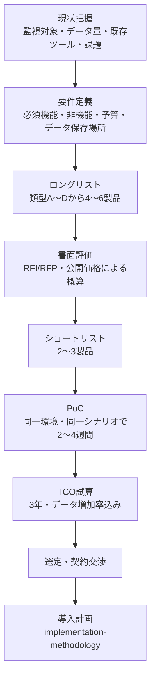
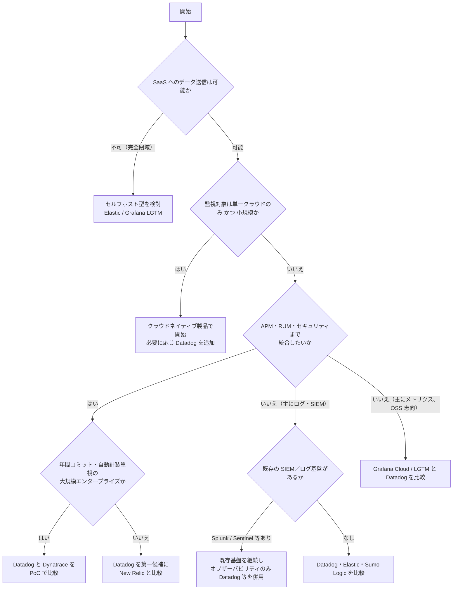

# 製品選定と競合比較

## 概要

本ファイルは、オブザーバビリティ（監視・可観測性）製品を選定する際の**評価基準**と、Datadog と主要競合 9 製品の**機能・価格モデル・公開定価・日本リージョン・強み／弱み**の比較、そして **Datadog が向くケース／向かないケース**をまとめた導入編の資料である。対象読者は製品選定・RFP・PoC を担当するコンサルタント、PM、アーキテクトである。

| 項目 | 内容 |
|---|---|
| 比較対象 | New Relic、Dynatrace、Grafana Cloud（および OSS の LGTM スタック）、Elastic Observability、Splunk Observability Cloud、AWS CloudWatch、Azure Monitor、Google Cloud Observability、Sumo Logic |
| 基準時点 | 2026-11-02（価格ページの取得は 2026-11-02〜11-03） |
| 価格の扱い | 各社の**公式価格ページ・公式価格 API に掲載された定価（リスト価格）**を記載。値引き・Enterprise 契約条件は非公開のため扱わない。Datadog の料金数値は正本 [製品別料金表](pricing-by-product.md) と一致させている |
| 定性評価の扱い | 「強み」「弱み」のうち公式情報で裏付けられないものには `【経験則】`・`【第三者情報】`・`【推定】` を付ける |
| 画像 | 本ファイルは比較資料のため画面スクリーンショットは掲載しない。Datadog の画面は [画面構成とナビゲーション](../01_入門編/ui-navigation.md) を参照 |

> **注意（比較資料の限界）:** 競合各社は価格と機能を頻繁に変更する。本ファイルの競合情報は 2026-11-02 時点の公開情報のスナップショットであり、契約判断の前には必ず各社の最新の公式ページと見積りで確認すること。特に、競合製品の機能有無は「公式価格ページ・公式ドキュメントで確認できた範囲」で記載しており、細部の機能比較（例：特定言語のトレーサー対応状況）は各社ドキュメントで個別に確認する必要がある。

関連ファイル：料金の考え方は [料金体系の全体像](pricing-overview.md)、単価は [製品別料金表](pricing-by-product.md)、見積り手法は [コスト見積り手法](cost-estimation.md)、移行の進め方は [他製品からの移行](migration-from-other-tools.md) を参照。

---

## 1. 選定の前提：オブザーバビリティ製品の類型

オブザーバビリティ製品は、提供形態と出自によって大きく 4 つの類型に分けられる。類型ごとに「得意な領域」「価格モデル」「運用負荷」の傾向が異なるため、まず候補をこの類型で整理すると比較がぶれにくい。

| 類型 | 代表製品 | 特徴 | 価格モデルの傾向 |
|---|---|---|---|
| A. 統合 SaaS 型（フルスタック） | **Datadog**、New Relic、Dynatrace、Splunk Observability Cloud | メトリクス・トレース・ログ・RUM・Synthetic・セキュリティ等を単一 SaaS で提供。エージェント（独自 + OpenTelemetry）で収集 | 製品（SKU）ごとのホスト課金・量課金（Datadog、Splunk）、データ量 + ユーザー課金（New Relic）、消費量ベースのプラットフォーム契約（Dynatrace DPS） |
| B. OSS ベース型 | Grafana Cloud（LGTM：Loki / Grafana / Tempo / Mimir）、Elastic Observability | OSS をコアにし、マネージド SaaS とセルフホストの両方を選べる | シリーズ数・GB 単位の従量課金（Grafana）、取り込み GB + 保持 GB（Elastic Serverless） |
| C. クラウドネイティブ型 | AWS CloudWatch、Azure Monitor、Google Cloud Observability | 各クラウドに組み込まれ、そのクラウドのサービスとの統合が最も深い。マルチクラウド・オンプレは弱め | 取り込み GB・メトリクス数・API 呼び出し・アラーム数などの細かい従量課金 |
| D. ログ／セキュリティ起点型 | Sumo Logic（および Splunk Platform、Elastic Security） | ログ分析・SIEM を起点に、メトリクス・トレースに拡張 | スキャン量（クレジット）課金、取り込み課金 |

Datadog は類型 A に属し、2026 年 7 月公表の Gartner Magic Quadrant for Observability Platforms（2026 年版）で **Leader（6 年連続）**、かつ **Ability to Execute（実行能力）軸で最上位**に位置付けられたと Datadog 自身が公表している [出典](https://www.datadoghq.com/blog/datadog-observability-platforms-gartner-magic-quadrant-2026/)（2026-07-15 公開）。同レポートでは Dynatrace も Leader（16 回目）と公表されており、評価対象は 19 社 [出典](https://www.dynatrace.com/news/press-release/dynatrace-named-a-leader-in-the-2026-gartner-magic-quadrant-for-observability-platforms-for-the-16th-time/)（2026-07-15 公開）。

> **注:** Gartner の評価内容はベンダーによる引用であり、他の Leader の一覧や各社の Strengths / Cautions は Gartner レポート本体（有償）でのみ確認できる。本ファイルでは公開情報で確認できた範囲のみを記載する。

Datadog の製品全体像は [製品ポートフォリオ全体像](../01_入門編/product-map.md)、Datadog とは何かは [Datadogとは](../01_入門編/what-is-datadog.md) を参照。

---

## 2. 選定基準（評価軸）

### 2.1 評価軸一覧

オブザーバビリティ製品の選定では、機能の有無だけでなく、**データ量が増えたときのコスト挙動**と**運用負荷**を必ず評価軸に含める。以下は本ナレッジで推奨する評価軸である【経験則】。

| # | 評価軸 | 確認すべき観点 | Datadog の位置付け（要約） |
|---|---|---|---|
| 1 | カバレッジ（機能網羅性） | インフラ、APM、ログ、RUM、Synthetic、プロファイラ、DB、ネットワーク、セキュリティ、インシデント対応、CI/CD、LLM | 30 以上の統合製品を単一プラットフォームで提供（Datadog 公表）[出典](https://www.datadoghq.com/blog/datadog-observability-platforms-gartner-magic-quadrant-2026/) |
| 2 | 相関分析（シグナル間の横断） | メトリクス→トレース→ログ→RUM→プロファイルをワンクリックで辿れるか。共通タグ・共通 ID の有無 | Unified Service Tagging（`env`・`service`・`version`）でシグナルを横断。詳細は [Tagging](../02_リファレンス/platform/tagging.md) |
| 3 | 収集方式とオープン性 | 独自エージェントの必須性、OpenTelemetry（OTLP）受信、Prometheus 互換、ベンダーロックイン | Datadog Agent が主。OTLP 取り込み・DDOT Collector 等の OTel 対応あり。詳細は [OpenTelemetry サポート](../02_リファレンス/platform/opentelemetry.md) |
| 4 | インテグレーション数・品質 | クラウド・ミドルウェア・SaaS の既製連携数、ダッシュボード・モニターのテンプレート | 1,000 以上（うち AWS 100 以上）[出典](https://docs.datadoghq.com/integrations/guide/aws-marketplace-datadog-trial/) |
| 5 | 価格モデル | 課金単位（ホスト／GB／ユーザー／クエリ）、同梱枠、コミットとオンデマンドの差 | 製品別 SKU のホスト課金 + 量課金。詳細は [料金体系の全体像](pricing-overview.md) |
| 6 | コストの予測可能性・制御手段 | 超過時の挙動（停止／超過課金）、サンプリング・フィルタ・保持階層、使用量の可視化 | Indexes・Exclusion Filters・Flex Logs・Metrics without Limits™・Ingestion Controls・Usage Attribution 等で制御。詳細は [コスト最適化](../04_応用編/cost-optimization.md) |
| 7 | データ保存場所（データレジデンシー） | 日本国内リージョンの有無、政府向けリージョン | **AP1（日本）** サイトあり。詳細は [Datadog Sites](../02_リファレンス/platform/datadog-sites.md) |
| 8 | セキュリティ・コンプライアンス | SOC 2、ISO 27001、FedRAMP、HIPAA、監査ログ、RBAC、SSO/SCIM | 詳細は [セキュリティとコンプライアンス](security-and-compliance.md) |
| 9 | 運用負荷 | SaaS かセルフホストか、バックエンドのスケール運用の要否、エージェント管理 | SaaS のためバックエンド運用は不要。Agent 管理は [Fleet Automation](../02_リファレンス/platform/fleet-automation.md) |
| 10 | AI／自動化 | 異常検知、根本原因分析、自然言語クエリ、エージェント型調査 | Watchdog、Bits AI（Bits Investigation 等）。詳細は [Bits AI と AI 機能](../02_リファレンス/ai/bits-ai.md)、[Watchdog](../02_リファレンス/platform/watchdog.md) |
| 11 | 拡張性（API・IaC） | API の網羅性、Terraform プロバイダ、Monitoring as Code | 詳細は [API とキー管理](../02_リファレンス/platform/api-and-keys.md)、[Terraform と IaC](../02_リファレンス/platform/terraform-and-iac.md) |
| 12 | サポート・エコシステム | 日本語サポート、国内パートナー、教育コンテンツ、コミュニティ | 詳細は [サポートと教育](support-and-training.md) |
| 13 | 購入経路 | 直販、クラウドマーケットプレイス（AWS / Azure / Google Cloud）、リセラー | 詳細は [購入経路と契約](procurement-and-contracts.md) |

### 2.2 ユースケース別の重み付け例

評価軸の重みは組織の状況によって変わる。以下は典型的なユースケース別の重み付け例である【経験則】（5 = 最重要、1 = 参考程度）。

| 評価軸 | クラウドネイティブ SaaS 企業（マイクロサービス・K8s） | 大企業の基幹系（オンプレ混在・規制業種） | 単一クラウドの小規模チーム | コスト最優先・OSS 志向 | セキュリティ統合重視 |
|---|---|---|---|---|---|
| カバレッジ | 5 | 4 | 2 | 2 | 4 |
| 相関分析 | 5 | 4 | 3 | 3 | 4 |
| オープン性（OTel） | 4 | 3 | 2 | 5 | 3 |
| インテグレーション | 4 | 4 | 2 | 3 | 4 |
| 価格・予測可能性 | 3 | 4 | 5 | 5 | 3 |
| データレジデンシー | 2 | 5 | 2 | 2 | 4 |
| 運用負荷の低さ | 5 | 4 | 5 | 2 | 4 |
| AI／自動化 | 4 | 4 | 2 | 2 | 3 |
| SIEM・CSPM 等 | 2 | 3 | 1 | 1 | 5 |

### 2.3 選定プロセス

- 要件定義の詳細は [要件定義とアーキテクチャ設計](requirements-and-architecture-design.md)、導入全体の進め方は [導入方法論](implementation-methodology.md) を参照。
- Datadog の無料トライアルは **14 日間**で全機能を試用できる（AWS Marketplace 経由のトライアル手順で明記）[出典](https://docs.datadoghq.com/integrations/guide/aws-marketplace-datadog-trial/)。トライアル終了後は Free tier（Basic ホスト 5 台まで、メトリクス保持 1 日）を選択できる [出典](https://www.datadoghq.com/pricing/?product=infrastructure)。PoC 期間が 14 日を超える場合は営業経由で延長を相談するのが一般的である【経験則】。

### 2.4 PoC 評価チェックリスト

PoC では、各製品を**同じ環境・同じ障害シナリオ**で評価する。以下は Datadog を含む比較 PoC で確認すべき項目の例である【経験則】。

| 区分 | チェック項目 | 測り方の例 |
|---|---|---|
| 導入容易性 | エージェント導入〜最初のダッシュボード表示までの時間 | K8s クラスタ 1 つ、VM 数台、マネージド DB 1 つに導入し所要時間を記録 |
| 自動検出 | サービスマップ・依存関係が自動で描かれるか | APM 計装後のサービスマップの正確さ |
| 相関 | アラート → トレース → ログ → インフラへの遷移の手数 | 意図的にレイテンシ障害を注入し、根本原因到達までのクリック数・時間 |
| クエリ性能 | 1 日・7 日・30 日範囲のログ検索・集計の応答時間 | 同一クエリを各製品で実行 |
| コスト計測 | PoC 期間の使用量から月額を外挿できるか | Datadog は Plan & Usage と [Usage Attribution](../02_リファレンス/platform/usage-and-cost-attribution.md) で確認 |
| コスト制御 | ログの取り込み除外・サンプリング・保持階層を設定できるか | 除外フィルタを入れた後の課金対象量の変化 |
| アラート品質 | 異常検知・複合条件・通知ルーティングの柔軟さ | 誤報率、通知先（Slack / PagerDuty / Teams 等）連携 |
| OTel 互換 | OTel SDK / Collector から送ったデータが同等に扱えるか | 同じアプリを OTel と独自エージェントの両方で計装し比較 |
| 権限・監査 | RBAC、SSO、監査ログ | チーム別のアクセス制御を再現 |
| 日本語・サポート | 問い合わせ応答の速さ、日本語ドキュメントの充実度 | PoC 中に実際に 2〜3 件問い合わせる |

---

## 3. 機能カバレッジ比較

### 3.1 主要機能の提供有無（公式情報で確認できた範囲）

凡例：✓ = 公式の価格ページ・ドキュメントで提供を確認、△ = 別製品・別契約・限定的、— = 本調査では確認できず（提供していないことを意味しない）。

| 機能 | Datadog | New Relic | Dynatrace | Grafana Cloud | Elastic | Splunk Obs. Cloud | AWS CloudWatch | Azure Monitor | Google Cloud Obs. | Sumo Logic |
|---|---|---|---|---|---|---|---|---|---|---|
| インフラ・メトリクス | ✓ | ✓ | ✓ | ✓ | ✓ | ✓ | ✓ | ✓ | ✓ | ✓ |
| Kubernetes 監視 | ✓ | ✓ | ✓ | ✓ | ✓ | ✓ | ✓（Container Insights） | ✓（Managed Prometheus 等） | ✓（Managed Prometheus） | ✓ |
| APM・分散トレース | ✓ | ✓ | ✓ | ✓（Application Observability / Tempo） | ✓ | ✓ | ✓（X-Ray / Application Signals） | ✓（Application Insights） | ✓（Cloud Trace） | ✓（トレース） |
| ログ管理 | ✓ | ✓ | ✓（Log Analytics） | ✓（Loki） | ✓ | △（Log Observer Connect で Splunk Platform のログを参照） | ✓ | ✓（Log Analytics） | ✓（Cloud Logging） | ✓ |
| 継続的プロファイリング | ✓ | — | ✓（Code Monitoring 等） | ✓（Profiles / Pyroscope） | — | ✓（Always On Profiling） | — | — | — | — |
| RUM（実ユーザー監視） | ✓ | ✓ | ✓ | ✓（Frontend Observability） | ✓ | ✓（End-to-End エディション） | ✓（CloudWatch RUM） | △（Application Insights のブラウザ監視） | — | — |
| Session Replay | ✓ | — | ✓ | — | — | — | — | — | — | — |
| Synthetic 監視 | ✓ | ✓ | ✓ | ✓ | ✓ | ✓ | ✓（Synthetics canary） | ✓（Web tests） | ✓（Uptime checks / Synthetic monitors） | — |
| DB 監視（クエリレベル） | ✓ | — | — | ✓（Database Observability） | — | △（アドオン） | ✓（Database Insights） | — | — | — |
| LLM / AI エージェント監視 | ✓ | — | — | ✓（Agent Observability） | — | — | — | — | — | — |
| SIEM | ✓（Cloud SIEM） | — | — | — | ✓（Elastic Security、別ソリューション） | △（Splunk Enterprise Security、別製品） | — | △（Microsoft Sentinel、別製品） | △（Google Security Operations、別製品） | ✓（Cloud SIEM） |
| CSPM・ワークロード保護 | ✓ | — | ✓（Security Posture Management） | — | ✓（Elastic Security） | — | — | — | — | — |
| アプリ脆弱性・RASP | ✓（App and API Protection / Code Security） | — | ✓（Runtime Vulnerability Analytics / Runtime Application Protection） | — | — | △（Secure Application、アドオン） | — | — | — | — |
| インシデント管理・オンコール | ✓（Incident Management / On-Call） | — | — | ✓（IRM） | — | — | — | — | — | — |
| 負荷試験 | — | — | — | ✓（k6） | — | — | — | — | — | — |
| セルフホスト版 | △（BYOC Logs のみ） | — | △（Dynatrace Managed は本調査対象外） | ✓（OSS / Enterprise） | ✓（Self-managed） | — | — | — | — | — |

出典：各社の価格ページ（[Datadog](https://www.datadoghq.com/pricing/)、[New Relic](https://newrelic.com/pricing)、[Dynatrace](https://www.dynatrace.com/pricing/)、[Grafana](https://grafana.com/pricing/)、[Elastic](https://www.elastic.co/pricing/serverless-observability)、[Splunk](https://www.splunk.com/en_us/products/pricing/observability.html)、[AWS](https://aws.amazon.com/cloudwatch/pricing/)、[Azure](https://azure.microsoft.com/en-us/pricing/details/monitor/)、[Google Cloud](https://cloud.google.com/stackdriver/pricing)、[Sumo Logic](https://www.sumologic.com/pricing)）（取得日 2026-11-02〜03）

> **読み方の注意:** 「—」は本調査で参照した公式価格ページ等に該当行がなかったことを示すだけであり、提供していないことを意味しない（例：New Relic は価格ページが「データ取り込み + ユーザー」課金で機能別の行を持たないため、機能有無が価格ページから読み取れない）。競合の機能有無は RFP で必ず書面確認すること。

### 3.2 データモデル・クエリ言語の比較

| 製品 | 主なクエリ言語・UI | データモデルの特徴 |
|---|---|---|
| Datadog | 画面上のクエリエディタ、メトリクスクエリ関数、ログ検索構文、DDSQL | タグ（`key:value`）を軸に全シグナルを関連付け。詳細は [メトリクスクエリと関数](../02_リファレンス/platform/metrics-query-and-functions.md)、[Notebooks・DDSQL](../02_リファレンス/platform/notebooks-and-data-tools.md) |
| New Relic | NRQL（SQL 風） | 全テレメトリを NRDB に格納し NRQL で横断クエリ【第三者情報】 |
| Dynatrace | DQL（Dynatrace Query Language） | Grail データレイクハウスに格納。ログ・メトリクス・トレース・イベントで Ingest / Retain / Query を個別課金（価格ページの区分）[出典](https://www.dynatrace.com/pricing/) |
| Grafana Cloud | PromQL（メトリクス）、LogQL（ログ）、TraceQL（トレース） | OSS の各バックエンド（Mimir / Loki / Tempo / Pyroscope）を Grafana で可視化 |
| Elastic | ES\|QL、KQL、Query DSL | Elasticsearch のインデックス（全文検索に強い） |
| Splunk Obs. Cloud | SignalFlow（メトリクス）、Splunk Platform 側は SPL | メトリクスはストリーミング処理型【第三者情報】 |
| AWS CloudWatch | Metrics Insights（SQL 風）、Logs Insights クエリ言語 | ロググループ・名前空間単位 |
| Azure Monitor | KQL（Kusto Query Language） | Log Analytics ワークスペースのテーブル |
| Google Cloud Obs. | PromQL、Logging クエリ言語、Log Analytics（SQL） | プロジェクト・ログバケット単位 |
| Sumo Logic | Sumo Logic 検索言語 | ログ中心。Flex ライセンスでは取り込みではなくスキャン量で課金 [出典](https://www.sumologic.com/pricing) |

---

## 4. 価格モデル比較

### 4.1 課金単位の比較

価格モデルの違いは TCO（総保有コスト）に直結する。特に「**何が増えると請求が増えるか**」を把握することが重要である。

| 製品 | 主な課金単位 | 請求が増える主な要因 | 無料枠・Free tier | 超過時の挙動 |
|---|---|---|---|---|
| **Datadog** | 製品（SKU）ごと：インフラホスト/月、APM ホスト/月、ログ取り込み GB + インデックス 100 万イベント、RUM 1,000 セッション、Synthetic 実行回数、カスタムメトリクス数 など | ホスト数、ログのインデックス件数、カスタムメトリクスのカーディナリティ、有効化する製品数 | Free tier：Basic ホスト 5 台・メトリクス保持 1 日。トライアル 14 日 | コミット超過分はオンデマンド料金で課金（ログはコミット超過分が年契約価格 +50%）[出典](pricing-by-product.md) |
| **New Relic** | データ取り込み GB + ユーザー（Core / Full platform）。オプションでコンピュート（CCU）課金 | 取り込み GB、Full platform ユーザー数 | 毎月 100 GB 取り込み、Basic ユーザー無制限、Full platform ユーザー 1 名、Synthetic チェック 500 回 | Free は 100 GB 超過で**取り込み停止・プラットフォーム利用不可**（翌月またはアップグレードまで）[出典](https://newrelic.com/pricing) |
| **Dynatrace** | DPS（Dynatrace Platform Subscription）：年間最低利用額コミット + レートカードによる消費。ホスト（メモリ GiB 時間 / ホスト時間）、Pod 時間、GiB 取り込み・保持・スキャン、セッション | ホストのメモリ量（Full-Stack は 8 GiB 単位）、ログの取り込み・保持日数・クエリ量 | 公開情報では恒久無料枠は確認できず（トライアルあり） | コミット超過分は前払い消費と同じ単価で月次オンデマンド課金（ペナルティ型の超過料金なし）[出典](https://www.dynatrace.com/pricing/) |
| **Grafana Cloud** | アクティブシリーズ数（メトリクス）、GB（ログ・トレース・プロファイル：処理 + 書き込み + 保持）、ホスト時間、セッション、アクティブユーザー | メトリクスのアクティブシリーズ（カーディナリティ）、ログ GB | Free：メトリクス 1 万シリーズ、ログ・トレース・プロファイル各 50 GB、保持 14 日、ユーザー 3 名 等 | Pro は $19/月の基本料金 + 従量課金。Enterprise は年 $25,000 以上のコミット [出典](https://grafana.com/pricing/) |
| **Elastic（Serverless）** | 取り込み GB + 保持 GB/月 + 転送量（Egress） | 取り込み GB、保持期間 | 公開情報ではトライアルの期間・条件は確認できず | 従量課金 [出典](https://www.elastic.co/pricing/serverless-observability) |
| **Splunk Obs. Cloud** | ホスト/月（エディション別：Infrastructure / App & Infra / End-to-End）、年額請求 | ホスト数、上位エディション | 公開情報では確認できず | 公開情報では確認できず [出典](https://www.splunk.com/en_us/products/pricing/observability.html) |
| **AWS CloudWatch** | メトリクス数/月、API リクエスト、アラーム数、ログ取り込み GB・保存 GB・スキャン GB、RUM イベント、canary 実行、Application Signals シグナル数 | ログ取り込み GB、カスタムメトリクス数、Logs Insights のスキャン量 | ログ 5 GB、カスタム／詳細メトリクス 10 個、アラーム 10 個、ダッシュボード 3 個 等 | 従量課金 [出典](https://aws.amazon.com/cloudwatch/pricing/) |
| **Azure Monitor** | Log Analytics 取り込み GB（Analytics / Basic / Auxiliary）、保持 GB/月、クエリ GB、メトリクスサンプル数、アラートルール数、Web テスト実行 | Analytics Logs の取り込み GB | Analytics Logs は請求アカウントあたり毎月 5 GB 無料、保持 31 日無料（Sentinel 有効時 90 日）| 従量課金またはコミットメントティア（100〜50,000 GB/日）[出典](https://azure.microsoft.com/en-us/pricing/details/monitor/) |
| **Google Cloud Obs.** | Logging 取り込み GiB、保持 GiB/月、Monitoring 取り込み MiB / サンプル数、Trace スパン数、Uptime check 実行、アラート条件 | ログ取り込み GiB、メトリクス取り込み量 | Logging：毎月 50 GiB/プロジェクト、Trace：250 万スパン/請求アカウント 等 | 従量課金 [出典](https://cloud.google.com/stackdriver/pricing) |
| **Sumo Logic** | Flex ライセンス：取り込みは $0（無制限）、分析（スキャン）量に応じたクレジット消費 + 保存の名目的な料金 | スキャン量（クエリ・ダッシュボード・アラートの実行量） | 無料トライアル（トライアル中にクレジットカードで最大 $25,000 分のクレジット購入可） | クレジット消費。超過・ピークのペナルティなしと記載 [出典](https://www.sumologic.com/pricing) |

### 4.2 Datadog の主要定価（再掲・正本は pricing-by-product.md）

以下は比較のための抜粋であり、数値は正本 [製品別料金表](pricing-by-product.md) と同一である（取得日 2026-11-02〜03、US サイト = US1/US3/US5、AP1 = 日本サイト）。

| SKU | 課金単位 | US 年契約 | US 月契約 | US オンデマンド | AP1 年契約 |
|---|---|---|---|---|---|
| Infrastructure Pro | ホスト/月 | $15 | $18 | $18 | $18.75 |
| Infrastructure Enterprise | ホスト/月 | $23 | $27 | $27 | $28.75 |
| APM（Infrastructure 併用） | APM ホスト/月 | $31 | $36 | $36 | $38.75 |
| APM Pro（APM + Data Streams Monitoring） | APM ホスト/月 | $35 | $42 | $42 | $43.75 |
| APM Enterprise（APM Pro + Continuous Profiler） | APM ホスト/月 | $40 | $48 | $48 | $50 |
| Logs - Ingestion | 取り込み 1 GB（非圧縮） | $0.10 | $0.10 | $0.10 | $0.125 |
| Logs - Standard Indexing（15 日保持） | 100 万イベント/月 | $1.70 | $2.04 | $2.55 | $2.125 |
| Flex Logs Storage | 保存 100 万イベント/月 | $0.05 | $0.06 | $0.075 | $0.0625 |
| RUM Measure | 1,000 セッション/月 | $0.15 | $0.18 | $0.22 | $0.1875 |
| RUM Investigate | 1,000 セッション/月 | $3 | $3.60 | $4.50 | $3.75 |
| Synthetic API Tests | 1 万回実行/月 | $5 | $6 | $7.20 | $6.25 |
| Synthetic Browser Tests | 1,000 回実行/月 | $12 | $15 | $18 | $15 |
| Database Monitoring | DB ホスト/月 | $70 | $84 | $84 | $87.50 |
| Cloud SIEM | 分析イベント 100 万件/月（料金一覧の表記） | $5 | $6 | $7.50 | $6.25 |

> **サイト差異:** AP1（日本）サイトの定価は US サイトより高く設定されている（例：Infrastructure Pro 年契約 US $15 に対し AP1 $18.75）。競合との価格比較を日本サイト前提で行う場合は AP1 価格を使うこと。サイト別の係数は [製品別料金表](pricing-by-product.md) を参照。

### 4.3 競合の公開定価（抜粋）

以下は各社の公式価格ページ・公式価格 API に掲載された**定価**である（取得日 2026-11-02〜03）。リージョンの指定がないものは各社ページの既定表示（多くは US）の値。契約形態の表記は各社ページの記載に従う。

#### New Relic（[出典](https://newrelic.com/pricing)）

| 項目 | Free | Standard | Pro | Enterprise |
|---|---|---|---|---|
| データ取り込み（Original data） | 100 GB/月まで無料 | $0.40/GB | $0.40/GB | 個別見積 |
| データ取り込み（Data Plus） | — | $0.60/GB | $0.60/GB | 個別見積（FedRAMP Moderate・HIPAA 対応を含む） |
| EU データセンター保存 | — | +$0.05/GB | +$0.05/GB | — |
| Basic ユーザー | 無料・無制限 | 無料 | 無料 | 無料 |
| Core ユーザー | — | $49/ユーザー/月 | $49/ユーザー/月 | $49/ユーザー/月 |
| Full platform ユーザー | 1 名無料 | 1 人目 $10、以降 $99（最大 5 名） | $349/ユーザー/月（年コミット）、$418.80（月次従量） | 個別見積 |
| サポート SLA | — | チケット、2 営業日 | 重大時 初回応答 2 時間 | 重大時 初回応答 1 時間 |
| 追加 Synthetic チェック | — | $0.005/チェック | $0.005/チェック | — |

- 既定のデータ保持は「少なくとも 8 日」、Data Plus は多くのデータ種別で既定 +最大 90 日。
- Pro / Enterprise では、ユーザーライセンスなしの**フル消費型（コンピュート / CCU 課金）**を選択できる。CCU の単価は価格ページ上で確認できず（Pro / Enterprise は Contact Sales）。

#### Dynatrace（[出典](https://www.dynatrace.com/pricing/)）

| 製品 | 月額リスト価格 | 時間単位レート |
|---|---|---|
| Foundation & Discovery | $7/ホスト | $0.01/ホスト時間 |
| Infrastructure Monitoring | $29/ホスト | $0.04/ホスト時間 |
| Full-Stack Monitoring | $58/8 GiB ホスト | $0.01/メモリ GiB 時間 |
| Kubernetes Platform Monitoring | $1.40/Pod | $0.002/Pod 時間 |
| Code Monitoring | $3.60/コンテナ | $0.005/コンテナ時間 |
| Runtime Vulnerability Analytics | $13/8 GiB ホスト | $0.00225/メモリ GiB 時間 |
| Runtime Application Protection | $13/8 GiB ホスト | $0.00225/メモリ GiB 時間 |
| Security Posture Management | $5/ホスト | $0.007/ホスト時間 |

| シグナル | 取り込み・処理 | 保持 | クエリ |
|---|---|---|---|
| Log Analytics（Pay-per-Query） | $0.20/GiB | $0.0007/GiB 日 | $0.0035/スキャン GiB |
| Log Analytics（Bundled Queries） | $0.20/GiB | $0.02/GiB 日（クエリ込み） | 込み |
| Metrics | $0.15/10 万データポイント | $0.0007/GiB 日 | 追加費用なし |
| Traces | $0.20/GiB | $0.0007/GiB 日 | $0.0035/スキャン GiB |
| Events | $0.20/GiB | $0.0007/GiB 日 | $0.0035/スキャン GiB |

| DEM・AI | 価格 |
|---|---|
| RUM | $2.25/1,000 セッション |
| RUM + Session Replay | $4.50/1,000 セッション |
| Synthetic Browser Monitor | $4.50/1,000 アクション |
| Synthetic HTTP Monitor | $1.00/1,000 リクエスト |
| AI Exploration | 追加費用なし |
| Agentic Operations | $0.10/AI ユニット |

- 契約は **DPS（Dynatrace Platform Subscription）**：プラットフォーム全体での年間最低利用額コミット。コミット額が大きいほど単価が下がり、超過分は前払いと同じ単価で月次オンデマンド課金。

#### Grafana Cloud（[出典](https://grafana.com/pricing/)）

| 製品 | Free 枠（/月） | Pro 単価 |
|---|---|---|
| 基本料金 | $0 | **$19/月**（Free 枠を含む） |
| Metrics | 1 万アクティブシリーズ、保持 14 日 | $6.50/1,000 シリーズ〜（保持 13 か月） |
| Logs | 50 GB、保持 14 日 | 処理 $0.05/GB + 書き込み $0.40/GB + 保持 $0.10/GB〜（保持 30 日） |
| Traces | 50 GB、保持 14 日 | 処理 $0.05/GB + 書き込み $0.40/GB + 保持 $0.10/GB（保持 30 日） |
| Profiles | 50 GB、保持 14 日 | 同上 |
| Kubernetes Monitoring | 2,232 ホスト時間・37,944 コンテナ時間 | $0.01/ホスト時間（$7.20/ホスト）、$0.0007/コンテナ時間（$0.50/コンテナ） |
| Application Observability | 2,232 ホスト時間 | $0.025/ホスト時間（$18/ホスト） |
| Frontend Observability | 5 万セッション | $0.75/1,000 セッション |
| Database Observability | 2,232 ホスト時間（DB ホスト 3 台） | $0.07/ホスト時間（約 $51/ホスト） |
| Synthetics | API 10 万回・ブラウザ 1 万回 | API $5/1 万回、ブラウザ $50/1 万回 |
| Performance Testing（k6） | 500 VU 時間 | $0.15/VU 時間 |
| Grafana ユーザー | 3 アクティブユーザー | $8/アクティブユーザー（Enterprise プラグイン付きは $55） |
| IRM（Incident Response & Management） | 3 アクティブユーザー | $20/アクティブユーザー |
| Grafana Assistant（AI） | 3 アクティブ AI ユーザー | $20/アクティブ AI ユーザー（4,000 万トークン込み）、追加 $2/100 万トークン |
| Agent Observability | 3 万生成 | $1.50/1,000 生成 |
| Enterprise | — | 年 $25,000 以上のコミット。Metrics は $3/1,000 シリーズまで低下可、カスタム保持、BYOC 等 |

#### Elastic Observability（Elastic Cloud Serverless）（[出典](https://www.elastic.co/pricing/serverless-observability)）

| 項目 | Logs Essentials | Complete |
|---|---|---|
| 取り込み（ログ・トレース・Synthetic・RUM 等） | $0.07/GB〜 | $0.09/GB〜 |
| 取り込み（メトリクス） | $0.07/GB〜 | $0.023/GB〜 |
| 保持（ログ・トレース等） | $0.017/GB/月〜 | $0.019/GB/月 |
| 保持（メトリクス） | $0.017/GB/月〜 | $0.005/GB/月 |
| Egress | 50 GB 無料、以降 $0.05/GB | 同左 |
| Synthetic ブラウザテスト | — | $0.0123/実行 |
| Synthetic 軽量テストロケーション | — | $28/ロケーション/月 |
| Elastic Managed LLM | — | 入力 $4.50/100 万トークン、出力 $21/100 万トークン |

- メトリクスの新価格は 2026-07-01 から適用と記載。セルフマネージド（オンプレ）や Elastic Cloud Hosted（デプロイメント型）は別の価格体系。

#### Splunk Observability Cloud（[出典](https://www.splunk.com/en_us/products/pricing/observability.html)）

| エディション | 開始価格（年額請求） | 含まれる機能 |
|---|---|---|
| Infrastructure | $15/ホスト/月 | Infrastructure Monitoring、Log Observer Connect、Network Explorer、Synthetic Uptime Monitoring |
| App & Infra | $60/ホスト/月 | Infrastructure の全機能 + APM（Always On Profiling を含む）+ Synthetic API Monitoring |
| End-to-End | $75/ホスト/月 | App & Infra の全機能 + RUM + Synthetic Browser Monitoring |

- Database Monitoring、Secure Application はアドオン（価格は要問い合わせ）。ログ本体は Splunk Platform（Splunk Cloud Platform / Splunk Enterprise）側の契約で、Log Observer Connect により参照する構成。

#### AWS CloudWatch（米国東部（バージニア北部）、[出典](https://aws.amazon.com/cloudwatch/pricing/)・AWS Price List API）

| 項目 | 単価 | 東京リージョン（ap-northeast-1） |
|---|---|---|
| カスタムメトリクス | $0.30/メトリクス/月（最初の 1 万）、$0.10（次の 24 万）、$0.05（次の 75 万）、$0.02（100 万超） | $0.30（最初の 1 万） |
| API リクエスト（GetMetricData 等） | $0.01/1,000 メトリクス（無料枠 100 万リクエスト超過後） | — |
| アラーム | 標準解像度 $0.10/アラームメトリクス/月、高解像度 $0.30、複合アラーム $0.50 | — |
| ログ取り込み（カスタムログ、Standard クラス） | $0.50/GB | $0.76/GB |
| ログ取り込み（Infrequent Access クラス） | $0.25/GB | — |
| ログ保存 | $0.03/GB/月 | $0.033/GB/月 |
| Logs Insights スキャン | $0.005/GB | $0.0076/GB（Logs Insights）、$0.005/GB（Log Analytics と Logs Insights の表記がある SKU） |
| Vended logs（Standard） | $0.50/GB（〜10 TB）、$0.25（次の 20 TB）、$0.10（次の 20 TB）、$0.05（50 TB 超） | — |
| Application Signals | $1.50/100 万シグナル（最初の 1 億）、$0.75（次の 9 億）、$0.30（10 億超） | — |
| X-Ray | 記録 $0.000005/トレース、取得・スキャン $0.0000005/トレース、インデックススパン $0.75/100 万 | — |
| CloudWatch RUM | $1/10 万イベント | — |
| Synthetics canary | $0.0012/実行 | — |
| Database Insights（Advanced） | $0.0125/vCPU 時間 | — |
| 無料枠（月） | ログ 5 GB、カスタム／詳細メトリクス 10、API 100 万、ダッシュボード 3、アラーム 10、canary 100 回 等 | — |

- 東京リージョンの値は AWS Price List API（`AmazonCloudWatch` / `ap-northeast-1`）で取得。ダッシュボードの月額単価は本調査では取得できず（公開情報では確認できず）。

#### Azure Monitor（East US、USD、Azure Retail Prices API の従量課金価格）

| 項目 | 単価 |
|---|---|
| Analytics Logs 取り込み | $2.30/GB（請求アカウントあたり毎月 5 GB まで無料）。クエリは追加費用なし |
| Basic Logs 取り込み | $0.50/GB |
| Auxiliary Logs 取り込み | $0.05/GB |
| Basic / Auxiliary のクエリ（Search Queries） | $0.005/スキャン GB |
| Analytics Logs の保持（無料期間超過分） | $0.10/GB/月 |
| 長期保持（Data Archive） | $0.02/GB/月 |
| コミットメントティア（例） | 100 GB/日 $196/日、500 GB/日 $865/日、1,000 GB/日 $1,700/日 |
| Managed Prometheus 等のメトリクス取り込み | $0.16/1,000 万サンプル（Metrics ingestion）、処理 $0.05/1,000 万サンプル |
| メトリクスアラート | $0.10/監視対象時系列/月（10 時系列まで無料） |
| ログアラート | 評価頻度 15 分 $0.50、10 分 $1、5 分 $1.50、1 分 $3（/月） |
| Standard Web テスト | $0.0005/実行（Ping テストは無料） |
| Application Insights（ワークスペースベース） | 取り込みは Log Analytics 経由で課金（90 日保持込み） |

出典：[Azure Monitor pricing](https://azure.microsoft.com/en-us/pricing/details/monitor/)（ページ上は価格がプレースホルダ表示のため、数値は [Azure Retail Prices API](https://prices.azure.com/api/retail/prices)（`serviceName` = `Log Analytics` / `Azure Monitor`、`armRegionName` = `eastus`、`priceType` = `Consumption`）で取得、取得日 2026-11-03）。保持の無料期間（31 日、Sentinel 有効時 90 日）とコミットメントティアの範囲（100〜50,000 GB/日、最低 31 日）は価格ページの記載。

#### Google Cloud Observability（[出典](https://cloud.google.com/stackdriver/pricing)）

| 項目 | 単価 | 無料枠（/月） |
|---|---|---|
| Cloud Logging 取り込み（Logging storage） | $0.50/GiB（ログバケットへの取り込み時の一回課金。30 日保存込み、クエリ・分析は追加費用なし） | 50 GiB/プロジェクト |
| Vended network logs | $0.25/GiB | — |
| Logging 保持（30 日超） | $0.01/GiB/月 | — |
| Cloud Monitoring（Prometheus 以外） | $0.2580/MiB（150〜10 万 MiB）、$0.1510/MiB（10 万〜25 万 MiB）、$0.0610/MiB（25 万 MiB 超） | 150 MiB/請求アカウント（課金対象メトリクス） |
| Managed Service for Prometheus | $0.06/100 万サンプル（〜500 億）、$0.048（500 億〜2,500 億）、$0.036（2,500 億〜5,000 億）、$0.024（5,000 億超） | — |
| Cloud Trace | $0.20/100 万スパン | 250 万スパン/請求アカウント |
| Uptime check | $0.30/1,000 実行 | 100 万実行/プロジェクト |
| アラートポリシー | $0.35/メトリクス参照/月 + $0.50/100 万返却ポイント | — |

#### Sumo Logic（[出典](https://www.sumologic.com/pricing)）

| 項目 | 内容 |
|---|---|
| ライセンス | **Flex**：取り込み $0（無制限）、ユーザー無制限。分析（スキャン）量に応じてクレジットを消費 |
| 分析量の目安区分 | Low：取り込み 1 GB あたり 500〜750 スキャン／Mid：750〜1,500／High：1,500〜2,000 |
| 単価 | 価格ページ上では非掲載（見積り） |
| エディション | Essentials（メトリクス 5 万/日・トレース 5 GB/日上限、リアルタイムアラート ログ 300・メトリクス 500、保持最大 365 日、8×5 サポート）／Enterprise Suite（SIEM 向け、メトリクス・トレース無制限、ログアラート 1,000、保持は顧客定義、P1 24/7 サポート） |
| AI | DojoAI（ユーザーあたり 1 日 10 プロンプト、追加はクレジット） |

### 4.4 概算比較の例（ログ 1 TB/月のケース）【推定】

価格モデルの違いを直感的に理解するため、**「非圧縮ログを月 1 TB（1,000 GB）取り込み、約 15〜30 日間検索可能にする」**という単純化したケースで、各社の公開定価から概算した例を示す。前提が異なれば結果は大きく変わるため、意思決定には使わず、価格モデルの性質の理解にのみ使うこと。

前提：1 イベント ≒ 1 KB と仮定し 1,000 GB ≒ 10 億イベント。US（またはクラウドの米国東部）リージョンの定価。値引き・無料枠以外の同梱枠・税・転送料は考慮しない。

| 製品 | 計算 | 月額概算 | 備考 |
|---|---|---|---|
| Datadog（Standard Indexing 15 日） | 取り込み 1,000 GB × $0.10 + インデックス 1,000（百万イベント）× $1.70 | 約 $1,800 | 年契約単価。全件インデックスする最も高い構成。Exclusion Filters で 50% をインデックスから除外すれば約 $950 |
| Datadog（Flex Logs 中心） | 取り込み $100 + Flex Storage 1,000 × $0.05 | 約 $150 + Flex Compute 費用 | Flex は別途 Compute（サイズ別の月額）が必要。リアルタイム監視用途には Standard Indexing と併用するのが一般的。詳細は [Indexes・保持・アーカイブ](../02_リファレンス/logs/log-indexes-retention-archives.md) |
| New Relic | (1,000 − 100) GB × $0.40 | 約 $360 + ユーザー費用 | 他のテレメトリ（メトリクス・トレース）の GB も同じ枠を消費。Full platform ユーザー 10 名（Pro 年コミット）なら +$3,490 |
| Dynatrace（Pay-per-Query） | 取り込み 1,000 GiB × $0.20 + 保持（定常 約 1,000 GiB × 30 日 × $0.0007） | 約 $220 + クエリ費用 | クエリ $0.0035/スキャン GiB。全量を月 10 回スキャンすると +$35 |
| Grafana Cloud（Pro） | (1,000 − 50) GB × ($0.05 + $0.40 + $0.10) + $19 | 約 $540 | 保持 30 日 |
| Elastic Serverless（Complete） | 1,000 GB × $0.09 + 保持 約 1,000 GB × $0.019 | 約 $110 | 保持 GB は圧縮後のストレージ量で計算される可能性があり、実際の値は異なる【推定】 |
| AWS CloudWatch（Standard クラス、us-east-1） | (1,000 − 5) GB × $0.50 + 保存 $0.03/GB/月 | 約 $500〜$530 | Logs Insights の検索は $0.005/スキャン GB。東京は取り込み $0.76/GB |
| Azure Monitor（Analytics Logs） | (1,000 − 5) GB × $2.30 | 約 $2,290 | 31 日保持・クエリ込み。Basic Logs なら約 $500 + クエリ |
| Google Cloud Logging | (1,000 − 50) GiB × $0.50 | 約 $475 | 30 日保持・クエリ込み |
| Sumo Logic（Flex） | 取り込み $0 + スキャン量に応じたクレジット | 公開情報では算出不可 | 単価非公開 |

**この表から読み取れる性質【経験則】:**

- **Datadog のログは「取り込み」と「インデックス」が分離**しており、全件をインデックスするとクラウドネイティブ製品より高くなりやすい。一方で、インデックス対象を絞る・Flex Logs やアーカイブを使う設計にすれば大きく下げられる。Datadog のログコストは「設計次第」で数倍変わる。詳細は [ログ管理の実践](../04_応用編/log-management-practices.md)、[コスト最適化](../04_応用編/cost-optimization.md)。
- GB 単価の安さだけで比較すると、**検索性能・保持中の検索可否・アラート連携・相関分析**などの機能差が見えなくなる。PoC で同じクエリを実行して比較すること。
- ホスト課金（Datadog・Splunk・Dynatrace の一部）とデータ量課金（New Relic・Grafana・Elastic・クラウドネイティブ）では、**ホスト数が多くデータが少ない環境**と**ホスト数が少なくデータが多い環境**で有利不利が逆転する。

ホスト課金を含めた全体の見積り方法は [コスト見積り手法](cost-estimation.md) を参照。

---

## 5. 製品別の比較詳細

各節は「概要 → 価格モデル → Datadog と比べた強み → Datadog と比べた弱み → 日本リージョン → Datadog と迷ったときの判断ポイント」の順に記載する。強み・弱みは公式情報で裏付けられる事実と、確度ラベル付きの一般的評価を区別している。

### 5.1 New Relic

**概要:** New Relic は APM を出自とする統合 SaaS 型のオブザーバビリティプラットフォームである。全テレメトリを単一のデータストアに格納し、NRQL で横断クエリする。

| 観点 | 内容 |
|---|---|
| 価格モデル | データ取り込み GB（$0.40/GB、Data Plus $0.60/GB）+ ユーザー（Core $49、Full platform $349 等）。Pro / Enterprise はユーザーなしのコンピュート（CCU）課金も選択可 [出典](https://newrelic.com/pricing) |
| 無料枠 | 毎月 100 GB、Full platform ユーザー 1 名、Basic ユーザー無制限。**100 GB 超過で取り込み停止**（Free の場合） |
| 日本リージョン | US（既定）・EU に加え **JP リージョン**（`one.jp.newrelic.com`）あり。JP リージョンは New Relic の日本法人経由でのみ提供され、Log Patterns、Infinite Tracing、Pixie、一部レガシー API 等は利用不可 [出典](https://docs.newrelic.com/docs/accounts/accounts-billing/account-setup/choose-your-data-center/) |

| Datadog と比べた New Relic の強み | Datadog と比べた New Relic の弱み |
|---|---|
| 恒久無料枠が大きい（100 GB/月 + Full ユーザー 1 名）ため、小規模・個人・検証用途で始めやすい | 閲覧以上の操作をするユーザー（Full platform）が多い組織ではユーザー費用が大きくなる（Pro は $349/ユーザー/月）|
| 課金がデータ GB とユーザーに集約され、SKU 数が少なく見積りが単純になりやすい【経験則】 | データ量課金のため、ログ・トレースが急増すると請求が直接増える。ホスト数が多くデータが少ない環境では有利だが逆も成立【経験則】 |
| NRQL による全データ横断クエリ【第三者情報】 | JP リージョンでは一部機能・API が利用できない（上記） |
| — | セキュリティ（SIEM・CSPM）、インシデント管理・オンコール等の周辺製品の幅は Datadog の方が広い（Datadog の提供製品から）|

**判断ポイント:** 「監視を使うエンジニアの人数」が少なく「データ量が中程度」なら New Relic のコストが有利になりやすく、「多くの人が操作する」「ホスト数が多く 1 ホストあたりのデータが少ない」「セキュリティや On-Call まで 1 ベンダーに寄せたい」なら Datadog が有利になりやすい【経験則】。

### 5.2 Dynatrace

**概要:** Dynatrace は、単一エージェント（OneAgent）による自動計装と、因果関係ベースの AI（Davis）による根本原因分析を特徴とするエンタープライズ向けの統合プラットフォームである。データは Grail（データレイクハウス）に格納し DQL でクエリする。

| 観点 | 内容 |
|---|---|
| 価格モデル | DPS（年間最低利用額コミット + レートカード消費）。Full-Stack $58/8 GiB ホスト/月（$0.01/メモリ GiB 時間）、Infrastructure $29/ホスト/月、ログは取り込み $0.20/GiB + 保持 + クエリ [出典](https://www.dynatrace.com/pricing/) |
| 日本リージョン | 2024-03 に AWS 東京リージョンでの SaaS 提供を発表（顧客データを東京に保存）[出典](https://www.dynatrace.com/news/press-release/dynatrace-platform-availability-on-aws-in-japan/)（2024-03-04 公開） |
| アナリスト評価 | 2026 Gartner MQ for Observability Platforms で Leader（16 回目、同社発表）|

| Datadog と比べた Dynatrace の強み | Datadog と比べた Dynatrace の弱み |
|---|---|
| OneAgent による自動計装・トポロジー自動検出が強く、大規模・複雑なエンタープライズ環境で設定作業が少ないと評価される【第三者情報】 | 恒久無料枠が公開情報では確認できず、小規模での試用・段階導入のハードルが高い |
| ログ・メトリクス・トレースで「取り込み・保持・クエリ」を分離した課金のため、保持を長くしても安価（$0.0007/GiB 日）| 課金が「メモリ GiB 時間」「Pod 時間」「GiB スキャン」など多次元で、利用者が直感的に見積りにくい【経験則】 |
| DPS は製品横断のコミットで、超過も同単価の月次課金（ペナルティ型超過料金なし）| メモリの大きいホストほど Full-Stack の費用が上がる（8 GiB 単位）。大容量メモリの DB サーバー等では割高になりうる【推定】 |
| ランタイムのアプリケーションセキュリティ（RVA / RAP）をホスト単価で追加可能 | クラウドネイティブ系スタートアップ・開発者主導の採用では Datadog の方が一般的【経験則】 |

**判断ポイント:** 「エンタープライズの大規模・オンプレ混在環境で、自動化と AI による根本原因分析を最重視し、年間コミットを前提にできる」場合は Dynatrace が有力候補になる。「開発チーム主導で段階的に広げる」「SaaS / クラウドネイティブ中心」「幅広いインテグレーションやセキュリティ・インシデント管理まで含めたい」場合は Datadog が有利になりやすい【経験則】。

### 5.3 Grafana Cloud / LGTM スタック

**概要:** Grafana Labs は OSS の Grafana（可視化）、Loki（ログ）、Tempo（トレース）、Mimir（メトリクス）、Pyroscope（プロファイル）、k6（負荷試験）を開発しており、これらの頭文字から **LGTM スタック**と呼ばれる。Grafana Cloud はこれらのマネージド SaaS 版、セルフホストは OSS または Grafana Enterprise で構築する。Grafana・Loki・Tempo は 2021-04 に Apache 2.0 から **AGPLv3** にライセンス変更されている [出典](https://grafana.com/licensing/)。

| 観点 | 内容 |
|---|---|
| 価格モデル | Free（恒久無料枠あり）／Pro（$19/月 + 従量）／Enterprise（年 $25,000〜）。メトリクスはアクティブシリーズ、ログ・トレースは GB 単位 [出典](https://grafana.com/pricing/) |
| 日本リージョン | AWS ap-northeast-1（東京）リージョンあり（Self-Serve および AWS Marketplace）[出典](https://grafana.com/docs/grafana-cloud/platform/security-and-account-management/account-management/regional-availability/) |
| セルフホスト | OSS で自前運用可能（バックエンドの運用は自組織の責任）|

| Datadog と比べた Grafana の強み | Datadog と比べた Grafana の弱み |
|---|---|
| OSS ベースで、Prometheus・OpenTelemetry・各種データソースへの接続が標準。ベンダーロックインが小さい | 多数のコンポーネント（Mimir / Loki / Tempo / Pyroscope / Alloy 等）を理解・設計する必要があり、セルフホストではスケール運用の負荷が大きい【経験則】 |
| 恒久 Free 枠が大きく（メトリクス 1 万シリーズ、ログ等 各 50 GB）、Pro の基本料金も $19/月と低い | セキュリティ製品（SIEM・CSPM・アプリ保護）は価格ページ上に見当たらず、Datadog のようにセキュリティまで一体で揃える用途には向きにくい |
| 既存の Prometheus / Grafana 資産（ダッシュボード・アラートルール）をそのまま活かせる | Loki はラベルベースのインデックスで、全文検索・高カーディナリティ属性での検索は設計に依存する【第三者情報】 |
| セルフホストと SaaS を同じ OSS で行き来でき、BYOC（Enterprise）も選べる | 統合された UX・自動相関（ワンクリックでの横断）は Datadog の方が作り込まれていると評価されることが多い【第三者情報】 |
| Grafana は Datadog 自体もデータソースとして可視化できる（併用が容易）| — |

**判断ポイント:** 「Prometheus を既に運用している」「OSS 志向・ロックイン回避が最優先」「プラットフォームチームに OSS の運用力がある」なら Grafana が有力。「運用チームが小さく、SaaS で全部揃えたい」「セキュリティや RUM・Session Replay・LLM 監視まで一体で使いたい」なら Datadog が有利。Grafana Labs は Datadog から Grafana Cloud への移行理由としてコストと価格の透明性を挙げている（ベンダー自身の主張）【第三者情報】[出典](https://grafana.com/blog/2025/02/10/from-datadog-to-grafana-cloud-why-companies-migrate-and-how-it-changes-business-for-the-better/)（2025-02-10 公開）。

### 5.4 Elastic Observability

**概要:** Elastic は Elasticsearch / Kibana を中核に、ログ分析・APM・インフラ監視・Synthetic・RUM と、Elastic Security（SIEM 等）を提供する。提供形態は Elastic Cloud Serverless、Elastic Cloud Hosted、セルフマネージドの 3 つ。ソースコードは SSPL・Elastic License 2.0 に加え、2024 年から **AGPLv3** も選択肢に追加された [出典](https://www.elastic.co/pricing/faq/licensing)。

| 観点 | 内容 |
|---|---|
| 価格モデル（Serverless） | 取り込み GB + 保持 GB/月 + Egress。Logs Essentials（取り込み $0.07/GB〜）と Complete（$0.09/GB〜）の 2 階層 [出典](https://www.elastic.co/pricing/serverless-observability) |
| 日本リージョン | Elastic Cloud Serverless は AWS ap-northeast-1（東京）・GCP asia-northeast1（東京）で提供。Azure Japan East は Serverless の一覧になし [出典](https://www.elastic.co/docs/deploy-manage/deploy/elastic-cloud/regions) |
| セルフホスト | 可能（Self-managed）|

| Datadog と比べた Elastic の強み | Datadog と比べた Elastic の弱み |
|---|---|
| 全文検索エンジン由来の強力なログ検索。GB 単価が低く、大量ログの長期保管に向く | APM・RUM・インフラ監視の作り込み・インテグレーション数は Datadog が上回るとの評価が多い【第三者情報】 |
| Elastic Security（SIEM）と同じ基盤でオブザーバビリティとセキュリティを統合できる | セルフマネージドの場合、クラスタのサイジング・シャード設計・アップグレード等の運用負荷が大きい【経験則】 |
| オンプレ・閉域網でセルフホスト可能（規制業種・エアギャップ環境）| 料金はデータ量・保持量に比例。Serverless では保持 GB の見積りが必要 |
| 既に Elasticsearch / ELK を運用している組織では資産と人材を流用できる | — |

**判断ポイント:** 「ログ分析とセキュリティ分析が主目的」「オンプレ／閉域網で運用する必要がある」「ELK の運用実績がある」なら Elastic が有力。「APM・RUM・インフラ監視を中心に、運用負荷を下げてすぐ使いたい」なら Datadog が有利【経験則】。

### 5.5 Splunk Observability Cloud

**概要:** Splunk Observability Cloud は、旧 SignalFx を中心としたメトリクス・APM・RUM・Synthetic の SaaS 製品群で、ログは Splunk Platform（Splunk Cloud Platform / Splunk Enterprise）と Log Observer Connect で連携する。OpenTelemetry ベースの収集（Splunk Distribution of OpenTelemetry Collector）を標準とする。

| 観点 | 内容 |
|---|---|
| 価格モデル | ホスト/月のエディション制（年額請求）：Infrastructure $15、App & Infra $60、End-to-End $75 [出典](https://www.splunk.com/en_us/products/pricing/observability.html) |
| 日本リージョン | `jp0` レルム（AWS 東京）あり（Synthetics の URL `app.jp0.signalfx.com` 等）【第三者情報】。日本での提供開始は 2022-07 と報道 [出典](https://cloud.watch.impress.co.jp/docs/news/1427639.html)（2022 公開。2 年以上前の情報のため現行仕様と異なる可能性あり） |

| Datadog と比べた Splunk の強み | Datadog と比べた Splunk の弱み |
|---|---|
| Splunk Platform（SIEM の Splunk Enterprise Security を含む）を既に持つ組織では、ログ・セキュリティ資産を活かしつつオブザーバビリティを追加できる | ログはオブザーバビリティ製品単体ではなく Splunk Platform 側の契約・運用が前提となり、構成と契約が 2 系統になる |
| エディション価格がシンプル（3 段階、ホスト単位）で、APM + RUM 込みの End-to-End が $75/ホスト | Infrastructure + APM + RUM を個別に組み合わせる柔軟性は Datadog の方が高い（Datadog は SKU 単位で購入）|
| OpenTelemetry ネイティブの収集 | 公開価格ページでは Database Monitoring、Secure Application の価格が非公開 |

**判断ポイント:** 「Splunk を SIEM・ログ基盤として既に全社導入している」場合は Splunk Observability Cloud の追加が自然な選択肢になる。逆に「ログ・メトリクス・APM・セキュリティを 1 つの SaaS にまとめたい」場合は Datadog が有利。両者の併用（Splunk を SIEM、Datadog をオブザーバビリティ）も実務では多い【経験則】。

### 5.6 AWS CloudWatch

**概要:** Amazon CloudWatch は AWS に組み込まれた監視サービスで、AWS サービスのメトリクス・ログを追加設定なしで収集できる。Application Signals（APM）、X-Ray（トレース）、CloudWatch RUM、Synthetics、Container Insights、Database Insights などに拡張されている。

| 観点 | 内容 |
|---|---|
| 価格モデル | メトリクス数・API・アラーム・ログ GB（取り込み・保存・スキャン）・RUM イベント・canary 実行などの細粒度従量課金 [出典](https://aws.amazon.com/cloudwatch/pricing/) |
| 日本リージョン | 東京・大阪の各 AWS リージョンで利用可能（データは各リージョンに保存）|

| Datadog と比べた CloudWatch の強み | Datadog と比べた CloudWatch の弱み |
|---|---|
| AWS サービスの標準メトリクスは追加費用なしで自動収集され、導入作業がほぼ不要 | マルチクラウド・オンプレ・SaaS の監視は不得手。他クラウドとの横断ダッシュボード・相関は弱い【経験則】 |
| AWS の請求に一本化でき、調達が簡単。小規模なら安価 | アカウント・リージョンをまたいだ横断ビューの設計が必要（クロスアカウントオブザーバビリティ等の設定）【経験則】 |
| IAM・Organizations と統合されたアクセス制御 | 課金項目が多く（メトリクス・API・アラーム・ログ・Insights・canary 等）、使用量の把握が難しくなりがち【経験則】 |
| — | APM・RUM・Session Replay・プロファイラ・セキュリティ等の機能の幅と UX の一体感は Datadog が上回る【経験則】 |

**Datadog との関係:** Datadog は CloudWatch のメトリクスを API ポーリングまたは Metric Streams で取り込み、ログは Forwarder や Amazon Data Firehose で転送できる（[AWS Integration](../02_リファレンス/platform/aws-integration.md)）。このため「CloudWatch か Datadog か」の二者択一ではなく、**CloudWatch をデータ源として Datadog で横断監視する**構成が一般的である。この場合、CloudWatch の API 呼び出し・Metric Streams 料金が AWS 側に別途かかる点に注意する。

**判断ポイント:** 「AWS のみ・小規模・AWS 標準機能で足りる」なら CloudWatch 単独が合理的。「マルチクラウド／ハイブリッド」「多数のマイクロサービスの APM・相関分析が必要」「アプリ・インフラ・セキュリティを統一 UI で見たい」なら Datadog を上に載せる構成が有利【経験則】。

### 5.7 Azure Monitor

**概要:** Azure Monitor は Azure に組み込まれた監視サービスで、Log Analytics（ログ・KQL）、Application Insights（APM）、Azure Monitor Metrics、Managed Prometheus、アラート、Workbooks で構成される。SIEM は Microsoft Sentinel（別製品）が同じ Log Analytics ワークスペースを利用する。

| 観点 | 内容 |
|---|---|
| 価格モデル | Log Analytics の取り込み GB（Analytics $2.30/GB、Basic $0.50/GB、Auxiliary $0.05/GB）、コミットメントティア、保持、メトリクスサンプル、アラートルール [出典](https://azure.microsoft.com/en-us/pricing/details/monitor/)・[Azure Retail Prices API](https://prices.azure.com/api/retail/prices) |
| 日本リージョン | 東日本・西日本の Azure リージョンでワークスペースを作成可能 |

| Datadog と比べた Azure Monitor の強み | Datadog と比べた Azure Monitor の弱み |
|---|---|
| Azure リソースのプラットフォームメトリクスは無料、Azure Policy・Entra ID と統合 | Analytics Logs の取り込み単価（$2.30/GB）は高く、ログ量が多い環境ではコストが急増しやすい（Basic / Auxiliary の使い分けが必須）【経験則】 |
| KQL が強力で、Sentinel・Defender と同じ基盤でセキュリティ分析と統合できる | Azure 以外（AWS・GCP・SaaS）の監視は不得手【経験則】 |
| 大量取り込みではコミットメントティアで単価を下げられる（例：1,000 GB/日 $1,700/日）| アラートルール・Web テストなどが個別課金で、構成要素が多い |

**判断ポイント:** 「Azure 中心・Microsoft Sentinel を SIEM として使う・KQL 人材がいる」なら Azure Monitor が自然。「マルチクラウド」「APM・RUM の高度な相関」「Azure 以外も同一画面で見たい」なら Datadog の [Azure Integration](../02_リファレンス/platform/azure-integration.md) を併用する構成が有利【経験則】。

### 5.8 Google Cloud Observability

**概要:** Google Cloud Observability（旧称：Stackdriver）は Cloud Logging、Cloud Monitoring、Cloud Trace、Cloud Profiler、Managed Service for Prometheus 等で構成される Google Cloud 組み込みの監視サービスである。

| 観点 | 内容 |
|---|---|
| 価格モデル | Logging 取り込み $0.50/GiB（30 日保存・クエリ込み、50 GiB/プロジェクト無料）、Monitoring は MiB またはサンプル数、Trace $0.20/100 万スパン、アラート $0.35/メトリクス参照 [出典](https://cloud.google.com/stackdriver/pricing) |
| 日本リージョン | 東京・大阪のリージョンにログバケットを作成可能 |

| Datadog と比べた Google Cloud Obs. の強み | Datadog と比べた Google Cloud Obs. の弱み |
|---|---|
| Google Cloud サービス・GKE と深く統合。Managed Prometheus はサンプル課金で大規模でも安価 | マルチクラウド・オンプレの統合監視は不得手【経験則】 |
| ログは取り込み時の一回課金でクエリ追加費用なし、Log Analytics（SQL）で BigQuery 連携 | RUM・Session Replay・セキュリティ（SIEM は Google Security Operations で別製品）など周辺機能は Datadog の方が幅広い |
| 無料枠（ログ 50 GiB/プロジェクト等）が大きく、小規模なら費用がほぼかからない | — |

**判断ポイント:** 「Google Cloud のみ・GKE 中心・BigQuery で分析したい」なら Google Cloud Observability が合理的。「複数クラウドや SaaS をまとめて監視」「APM と RUM を相関させたい」なら Datadog の [Google Cloud Integration](../02_リファレンス/platform/gcp-integration.md) を併用する【経験則】。

### 5.9 Sumo Logic

**概要:** Sumo Logic はクラウドネイティブのログ分析・SIEM を起点とする SaaS で、メトリクス・トレースにも対応する。2026 年時点の Flex ライセンスでは**取り込みを無料（無制限）**とし、分析（スキャン）量で課金する独自モデルを取る [出典](https://www.sumologic.com/pricing)。

| 観点 | 内容 |
|---|---|
| 価格モデル | Flex：取り込み $0、分析スキャン量でクレジット消費、保存は名目的料金。エディションは Essentials / Enterprise Suite（見積り）|
| 日本リージョン | JP デプロイメント（Asia Pacific (Tokyo)、AWS ap-northeast-1、`api.jp.sumologic.com`）あり [出典](https://help.sumologic.com/docs/api/aws-region-by-sumo-deployment/) |

| Datadog と比べた Sumo Logic の強み | Datadog と比べた Sumo Logic の弱み |
|---|---|
| 取り込み無料のため「とりあえず全部のログを入れておき、必要なときに検索する」使い方と相性が良い | 単価が非公開でスキャン量の見積りが必要。クエリ・ダッシュボード・アラートを多用するとクレジット消費が増える【推定】 |
| ログ分析と Cloud SIEM・SOAR を同一基盤で提供（Enterprise Suite）| APM・RUM・Synthetic・プロファイラ・DB 監視など、アプリケーション側のオブザーバビリティ機能の幅は Datadog が大きく上回る |
| ユーザー数無制限 | Essentials はメトリクス 5 万/日・トレース 5 GB/日の上限あり |

**判断ポイント:** 「ログ・セキュリティ分析が主目的で、検索頻度が低い大量ログを保管したい」なら Sumo Logic が候補。「APM・インフラ・RUM を中心としたフルスタック監視」なら Datadog が有利。Datadog 側でも Flex Logs・アーカイブ・Observability Pipelines で「全量保存・低頻度検索」に近い設計が可能（[Observability Pipelines](../02_リファレンス/logs/observability-pipelines.md)）。

### 5.10 競合比較サマリ（一覧）

| 製品 | 類型 | 価格モデルの核 | 主な強み | Datadog と比べた主な弱み | 日本リージョン |
|---|---|---|---|---|---|
| **Datadog** | 統合 SaaS | 製品別ホスト課金 + 量課金 | 製品の幅、1,000+ インテグレーション、シグナル横断の UX、セキュリティ・On-Call まで一体 | （比較基準）| AP1 |
| New Relic | 統合 SaaS | データ GB + ユーザー | 大きな無料枠、課金の単純さ | Full ユーザー費用、JP リージョンの機能制限 | JP（日本法人経由）|
| Dynatrace | 統合 SaaS | DPS（コミット + 消費） | 自動計装、因果 AI、エンタープライズ実績 | 恒久無料枠なし、多次元の課金 | AWS 東京 |
| Grafana Cloud | OSS ベース | シリーズ数 + GB | OSS・オープン性、低価格、セルフホスト可 | 構成要素が多い、セキュリティ製品なし | AWS 東京 |
| Elastic | OSS ベース | 取り込み GB + 保持 GB | 全文検索、SIEM 統合、セルフホスト可 | APM/RUM の幅、セルフ運用負荷 | AWS / GCP 東京（Serverless）|
| Splunk Obs. Cloud | 統合 SaaS | ホスト単位エディション | Splunk Platform との統合、OTel ネイティブ | ログは別契約、構成が 2 系統 | jp0 |
| AWS CloudWatch | クラウドネイティブ | 細粒度従量 | AWS 統合、導入不要 | マルチクラウド・相関・UX | 東京・大阪 |
| Azure Monitor | クラウドネイティブ | 取り込み GB 中心 | KQL、Sentinel 統合 | Analytics Logs 単価、Azure 外 | 東日本・西日本 |
| Google Cloud Obs. | クラウドネイティブ | 取り込み GiB・サンプル | GCP・GKE 統合、大きな無料枠 | マルチクラウド、周辺機能 | 東京・大阪 |
| Sumo Logic | ログ／セキュリティ起点 | スキャン量（取り込み無料） | 全量取り込み、SIEM | APM・RUM 等の幅、単価非公開 | JP（東京）|

---

## 6. Datadog の強みと弱み（総括）

### 6.1 強み

| # | 強み | 根拠・補足 |
|---|---|---|
| 1 | **製品の幅と単一プラットフォーム** | インフラ、APM、ログ、RUM、Synthetic、DB、ネットワーク、セキュリティ（Cloud SIEM・Cloud Security・Workload Protection・App and API Protection・Code Security）、CI/テスト、Incident Management・On-Call、LLM Observability 等、30 以上の製品 [出典](https://www.datadoghq.com/blog/datadog-observability-platforms-gartner-magic-quadrant-2026/) |
| 2 | **インテグレーション数** | 1,000 以上（AWS 100 以上）[出典](https://docs.datadoghq.com/integrations/guide/aws-marketplace-datadog-trial/)。詳細は [Integrations](../02_リファレンス/platform/integrations.md) |
| 3 | **シグナル横断の相関** | Unified Service Tagging によりメトリクス・トレース・ログ・RUM・プロファイルを同じタグで横断。[必須概念](../01_入門編/core-concepts.md) |
| 4 | **SaaS としての運用負荷の低さ** | バックエンドのスケール・保守は不要。Agent は [Fleet Automation](../02_リファレンス/platform/fleet-automation.md) で一元管理 |
| 5 | **段階的導入のしやすさ** | 製品単位で購入でき、インフラ監視から始めて APM・ログ・セキュリティへ広げられる。Log Management・APM スタンドアロン等は単体購入可 [出典](pricing-by-product.md) |
| 6 | **コスト制御の部品が豊富** | ログの Exclusion Filters・Flex Logs・アーカイブ／Rehydration、Metrics without Limits™、APM Ingestion Controls、Observability Pipelines、Usage Attribution |
| 7 | **日本リージョン（AP1）** | 日本国内にデータを保存できる AP1 サイト。詳細は [Datadog Sites](../02_リファレンス/platform/datadog-sites.md) |
| 8 | **AI 機能** | Watchdog（自動異常検知）、Bits AI（Bits Investigation による自律的なアラート調査等）[出典](https://www.datadoghq.com/blog/datadog-observability-platforms-gartner-magic-quadrant-2026/) |
| 9 | **アナリスト評価** | 2026 Gartner MQ for Observability Platforms で Leader（6 年連続）・Ability to Execute 最上位（同社発表）|

### 6.2 弱み・注意点

| # | 弱み・注意点 | 内容と緩和策 |
|---|---|---|
| 1 | **課金体系の複雑さ** | 製品ごとに課金単位（ホスト・GB・イベント・セッション・実行回数・カスタムメトリクス数等）が異なり、全体像の把握に学習が必要。第三者のレビューでも価格の分かりにくさ・予測しにくさが指摘される【第三者情報】。緩和策：[課金計算の仕組み](billing-mechanics.md)、[コスト見積り手法](cost-estimation.md) |
| 2 | **カスタムメトリクスのカーディナリティ課金** | タグの組み合わせ数がそのままカスタムメトリクス数になり、高カーディナリティなタグで請求が急増する。緩和策：[Custom Metrics と DogStatsD](../02_リファレンス/platform/custom-metrics-and-dogstatsd.md)、[タグ戦略の実践](../04_応用編/tagging-strategy.md) |
| 3 | **ログの全件インデックスは高価** | 取り込み $0.10/GB に加えインデックス $1.70/100 万イベント（15 日、US 年契約）。全件インデックスするとクラウドネイティブ製品より高くなりやすい。緩和策：インデックス対象の絞り込み、Flex Logs、アーカイブ |
| 4 | **製品追加に伴うコスト増** | 有効化しやすい反面、製品を増やすほど SKU が増える。オンデマンド利用は年契約より高い（例：Infrastructure Pro $15 → $18）|
| 5 | **セルフホスト版がない（ログ除く）** | Datadog は SaaS が基本で、メトリクス・APM 等のオンプレ版はない。ログのみ自社クラウドアカウントにデータを置く **BYOC Logs**（ドキュメント URL は `/cloudprem/`）が提供されている（US1-FED / US2-FED サイトは非対応）[出典](https://docs.datadoghq.com/cloudprem/)。完全閉域網（インターネット接続不可）での利用には向かない |
| 6 | **AP1 の価格は US より高い** | AP1 の定価は US サイトより高い（例：Infrastructure Pro 年契約 $15 → $18.75）[出典](pricing-by-product.md) |
| 7 | **恒久無料枠が小さい** | Free tier は Basic ホスト 5 台・メトリクス保持 1 日のみで、New Relic（100 GB/月）や Grafana Cloud Free と比べ小さい |
| 8 | **独自 Agent への依存** | 一部機能は Datadog Agent が前提。OTel での収集も可能だが、機能差がある場合がある。緩和策：[OpenTelemetry 活用戦略](../04_応用編/opentelemetry-strategy.md) |

---

## 7. Datadog が向くケース／向かないケース

### 7.1 Datadog が向くケース

| ケース | 理由 |
|---|---|
| マイクロサービス・Kubernetes・サーバーレスを多用するクラウドネイティブ環境 | APM・コンテナ監視・サーバーレス監視・サービスマップ・Software Catalog が統合されている（[コンテナ・Kubernetes 監視](../02_リファレンス/infrastructure/container-and-kubernetes-monitoring.md)、[Serverless](../02_リファレンス/infrastructure/serverless.md)）|
| マルチクラウド・ハイブリッド（AWS / Azure / Google Cloud / オンプレ） | クラウド各社のインテグレーションと Agent で横断監視でき、クラウドネイティブ製品の弱点を補える |
| 監視ツールが乱立しており統合したい（ツール統合・ツールスプロールの解消） | 30 以上の製品を単一 UI・単一タグ体系で提供 |
| 開発・運用・セキュリティ（DevSecOps）を同じ基盤で見たい | Cloud SIEM、Cloud Security、App and API Protection 等をオブザーバビリティデータと相関（[Datadog Security 概要](../02_リファレンス/security/security-platform-overview.md)）|
| 小さく始めて段階的に広げたい | 製品単位・ホスト単位で購入でき、月契約・オンデマンドもある |
| 運用チームが小さく、監視基盤の運用に人を割けない | SaaS のためバックエンド運用が不要 |
| 日本国内にデータを置く必要がある SaaS 利用 | AP1 サイト |
| フロントエンド（RUM・Session Replay）からバックエンドまでの End-to-End 分析 | RUM とトレースの相関（[RUM（ブラウザ）](../02_リファレンス/dem/rum-browser.md)）|
| LLM アプリケーションの監視 | [LLM Observability](../02_リファレンス/ai/llm-observability.md) |
| インシデント対応・オンコールまで一体化したい | [Incident Management](../02_リファレンス/service-management/incident-management.md)、[On-Call](../02_リファレンス/service-management/on-call.md) |

### 7.2 Datadog が向かない（または慎重な検討が必要な）ケース

| ケース | 理由 | 代替・緩和策 |
|---|---|---|
| インターネット接続のない完全閉域網・エアギャップ環境 | SaaS 前提のため Datadog へのデータ送信が必要（プロキシ・PrivateLink 等は利用可）| Elastic / Grafana のセルフホスト。接続要件は [ネットワーク・接続要件](network-and-connectivity.md) |
| 単一クラウドで小規模・クラウド標準機能で十分 | クラウドネイティブ製品の方が安価で導入不要 | CloudWatch / Azure Monitor / Google Cloud Observability |
| 予算が極めて限られ、OSS を運用する人材がいる | OSS（Prometheus + Grafana 等）のセルフホストはライセンス費用がかからない（運用人件費は別）| Grafana OSS / LGTM |
| 大量ログを長期・全件で検索可能にしたいが、検索頻度は低い | 全件 Standard Indexing は高価 | Datadog 内では Flex Logs・アーカイブ／Rehydration・Archive Search。他社では Sumo Logic（取り込み無料）、Elastic、Grafana Loki |
| 高カーディナリティのカスタムメトリクスを大量に送る設計（例：ユーザー ID をタグにする）| カスタムメトリクス課金が急増 | 設計の見直し（高カーディナリティ属性はログ・トレース・RUM 側へ）。[よくある失敗とアンチパターン](../04_応用編/common-pitfalls.md) |
| 監視の目的がセキュリティログ分析（SIEM）のみ | Datadog Cloud SIEM でも可能だが、既存 SIEM 資産（Splunk ES、Sentinel 等）がある場合は移行コストが大きい | 既存 SIEM を継続し、Datadog はオブザーバビリティに限定する併用 |
| ベンダーロックインを極力避けたい | Datadog Agent・Datadog 固有の機能に依存しやすい | OpenTelemetry で計装し、送信先を切替可能にする（[OpenTelemetry 活用戦略](../04_応用編/opentelemetry-strategy.md)）|
| 利用ユーザーは多いがホスト数・データ量が非常に小さい | Datadog はユーザー課金ではないため有利な場合も多いが、製品数を広げると SKU が増える | 必要製品を絞る。New Relic Free / Grafana Free も比較対象 |

### 7.3 判断フロー（簡易版）

このフローは一般的な判断の目安であり【経験則】、最終判断は PoC と TCO 試算に基づくこと。

---

## 8. 併用・ハイブリッド構成のパターン

実務では単一製品への全面置き換えではなく、併用構成を選ぶことも多い【経験則】。

| パターン | 構成 | 狙い | 注意点 |
|---|---|---|---|
| クラウドネイティブ + Datadog | CloudWatch / Azure Monitor / Cloud Monitoring をデータ源とし、Datadog で横断可視化・アラート | マルチクラウドの一元化 | クラウド側の API・Metric Streams・ログ転送費用が別途発生。[AWS Integration](../02_リファレンス/platform/aws-integration.md) |
| 既存 SIEM + Datadog | Splunk ES / Microsoft Sentinel を SIEM として継続、Datadog はオブザーバビリティ | 既存セキュリティ運用の維持 | ログの二重取り込みを避けるため Observability Pipelines 等で振り分け（[Observability Pipelines](../02_リファレンス/logs/observability-pipelines.md)）|
| Grafana + Datadog | Grafana のダッシュボードから Datadog をデータソースとして参照、または Prometheus 系を残す | 既存 Grafana 資産の活用 | Datadog API のレート制限、二重管理 |
| OpenTelemetry による送信先の抽象化 | アプリは OTel で計装し、Collector から Datadog と他製品へ送信 | ロックイン回避、移行の容易化 | 送信先ごとのコスト、機能差。[OpenTelemetry サポート](../02_リファレンス/platform/opentelemetry.md) |
| ログの階層化 | 重要ログのみ Datadog にインデックス、全量は自社ストレージ（S3 等）にアーカイブ | ログコスト削減 | 必要時の Rehydration 手順と費用。[Indexes・保持・アーカイブ](../02_リファレンス/logs/log-indexes-retention-archives.md) |

他製品から Datadog への移行手順は [他製品からの移行](migration-from-other-tools.md) を参照。

---

## 9. RFP・比較評価で使える質問例

ベンダー比較の RFP や評価シートで確認すべき質問の例である【経験則】。Datadog に関する回答はリンク先のリファレンスを根拠にできる。

| 区分 | 質問 | Datadog の回答の根拠 |
|---|---|---|
| 価格 | 課金単位と同梱枠（ホストあたりのコンテナ数・カスタムメトリクス数・スパン量等）は何か | [製品別料金表](pricing-by-product.md) |
| 価格 | コミット超過時の単価は | [課金計算の仕組み](billing-mechanics.md) |
| 価格 | 使用量をリアルタイムに把握・チーム別に配賦できるか | [Usage・Usage Attribution・Cost Visibility](../02_リファレンス/platform/usage-and-cost-attribution.md) |
| データ | データ保存場所（日本国内か）、保持期間の選択肢 | [Datadog Sites](../02_リファレンス/platform/datadog-sites.md)、[Indexes・保持・アーカイブ](../02_リファレンス/logs/log-indexes-retention-archives.md) |
| データ | 機微データのマスキング手段 | [Sensitive Data Scanner](../02_リファレンス/security/sensitive-data-scanner.md) |
| 収集 | OpenTelemetry（OTLP）でのデータ受信可否と機能差 | [OpenTelemetry サポート](../02_リファレンス/platform/opentelemetry.md) |
| 収集 | エージェントの一元管理・リモート設定 | [Fleet Automation と Remote Configuration](../02_リファレンス/platform/fleet-automation.md) |
| セキュリティ | 認証（SAML SSO、SCIM）、RBAC、監査ログ | [組織・ユーザー・権限管理](../02_リファレンス/platform/account-and-access-management.md)、[Audit Trail](../02_リファレンス/platform/audit-trail.md) |
| コンプライアンス | 取得認証（SOC 2、ISO 27001 等）| [セキュリティとコンプライアンス](security-and-compliance.md) |
| 運用 | 構成のコード管理（Terraform 等）| [Terraform と IaC](../02_リファレンス/platform/terraform-and-iac.md) |
| 可用性 | リージョン障害時の継続性 | Datadog Disaster Recovery（DDR、カスタム見積）[製品別料金表](pricing-by-product.md) |
| サポート | 日本語サポートの範囲・応答時間 | [サポートと教育](support-and-training.md) |
| 契約 | マーケットプレイス経由の購入可否 | [購入経路と契約](procurement-and-contracts.md) |

---

## 10. よくある質問（FAQ）

**Q1. Datadog は競合より高いのか？**
A. 一概には言えない。Datadog はホスト課金と量課金の組み合わせであり、ホスト単価（Infrastructure Pro $15/ホスト/月、US 年契約）は Dynatrace Infrastructure Monitoring（$29/ホスト/月）や Splunk Infrastructure（$15/ホスト/月）と同水準以下である一方、ログを全件インデックスする場合やカスタムメトリクスが多い場合はデータ量課金の製品より高くなりやすい。前者は公開定価の比較、後者は【経験則】。自社のホスト数・ログ量・メトリクス数で [コスト見積り手法](cost-estimation.md) に沿って試算すること。

**Q2. New Relic の「100 GB 無料」と Datadog の Free tier はどちらが大きいか？**
A. New Relic Free は毎月 100 GB の取り込みと Full platform ユーザー 1 名が無料 [出典](https://newrelic.com/pricing)。Datadog Free tier は Basic ホスト 5 台・メトリクス保持 1 日のみ [出典](https://www.datadoghq.com/pricing/?product=infrastructure)。無料枠の大きさは New Relic の方が大きい。Datadog は 14 日間の全機能トライアルがある。

**Q3. 日本国内にデータを保存できる製品はどれか？**
A. Datadog（AP1）、New Relic（JP リージョン、日本法人経由・一部機能制限あり）、Dynatrace（AWS 東京）、Grafana Cloud（AWS 東京）、Elastic Cloud Serverless（AWS / GCP 東京）、Splunk Observability Cloud（jp0）、Sumo Logic（JP デプロイメント）、各クラウドネイティブ製品（各社の日本リージョン）が該当する。各出典は本文 §5 を参照。データ保存場所の詳細要件は [セキュリティとコンプライアンス](security-and-compliance.md) で確認する。

**Q4. Datadog をオンプレミスにインストールできるか？**
A. Datadog 本体（SaaS バックエンド）のオンプレ版はない。Agent はオンプレのサーバーに導入でき、データを Datadog SaaS に送る。ログについては自社クラウドアカウント（AWS / GCP / Azure）にデータを保持する BYOC Logs がある [出典](https://docs.datadoghq.com/cloudprem/)。

**Q5. Grafana（OSS）を使えば無料で同じことができるか？**
A. ライセンス費用はかからないが、Mimir / Loki / Tempo 等のバックエンドのサイジング・冗長化・アップグレード・ストレージ費用・運用人件費が発生する【経験則】。また APM の自動相関、RUM・Session Replay、セキュリティ製品などの機能範囲は異なる。TCO は人件費込みで比較すること。

**Q6. CloudWatch を使っていれば Datadog は不要か？**
A. AWS のみで小規模なら CloudWatch で足りることも多い。マルチクラウド・オンプレ混在、マイクロサービスの APM・相関分析、統一ダッシュボードが必要になると Datadog の価値が出る。Datadog は CloudWatch のメトリクスを取り込めるため、併用が一般的【経験則】。

**Q7. Gartner の評価はどうなっているか？**
A. 2026 年版 Gartner Magic Quadrant for Observability Platforms（評価対象 19 社）で、Datadog は Leader（6 年連続）かつ Ability to Execute 最上位と同社が発表 [出典](https://www.datadoghq.com/blog/datadog-observability-platforms-gartner-magic-quadrant-2026/)。Dynatrace も Leader（16 回目）と発表 [出典](https://www.dynatrace.com/news/press-release/dynatrace-named-a-leader-in-the-2026-gartner-magic-quadrant-for-observability-platforms-for-the-16th-time/)。他社の位置付けはレポート本体で確認する必要がある。

**Q8. 価格の比較は円建てでどう考えるべきか？**
A. Datadog は AP1 サイトの USD 定価（US より高い）で比較し、円換算する場合は換算レートと日付を明記した【推定】として扱う（[執筆規約 §7](../_CONVENTIONS.md)）。競合の日本リージョン価格は公開されていない場合が多い（例：New Relic の JP リージョン価格は営業経由）[出典](https://docs.newrelic.com/docs/accounts/accounts-billing/account-setup/choose-your-data-center/)。

---

## 11. 確認できなかった事項

以下は本調査（2026-11-02 時点）の公開情報では確認できなかった。

| 事項 | 状況 |
|---|---|
| New Relic のコンピュート（CCU）課金の単価 | 価格ページ上は画像または Contact Sales |
| Dynatrace の恒久無料枠・DPS のコミット最低額 | 公開情報では確認できず |
| Splunk Observability Cloud の Database Monitoring・Secure Application の価格、超過時の扱い | 要問い合わせ |
| Sumo Logic Flex のクレジット単価・スキャン単価 | 価格ページでは非掲載 |
| AWS CloudWatch のダッシュボード月額単価 | 本調査で取得できず |
| Elastic Cloud Serverless のトライアル条件 | 公開情報では確認できず |
| 各競合の日本リージョンでの価格 | 多くは非公開（New Relic は営業経由と明記）|
| Gartner MQ 2026 の全 Leader 一覧と各社評価 | レポート本体（有償）でのみ確認可能 |
| Datadog BYOC Logs の提供ステータス（Preview / GA）・価格 | ドキュメントに明記なし |

---

## 関連ファイル

- [Datadogとは](../01_入門編/what-is-datadog.md)
- [製品ポートフォリオ全体像](../01_入門編/product-map.md)
- [料金体系の全体像](pricing-overview.md)
- [製品別料金表（料金の正本）](pricing-by-product.md)
- [課金計算の仕組み](billing-mechanics.md)
- [エディション・プラン](editions-and-plans.md)
- [コスト見積り手法](cost-estimation.md)
- [購入経路と契約](procurement-and-contracts.md)
- [導入方法論](implementation-methodology.md)
- [要件定義とアーキテクチャ設計](requirements-and-architecture-design.md)
- [セキュリティとコンプライアンス](security-and-compliance.md)
- [他製品からの移行](migration-from-other-tools.md)
- [OpenTelemetry 活用戦略](../04_応用編/opentelemetry-strategy.md)
- [コスト最適化](../04_応用編/cost-optimization.md)
- [導入事例](../04_応用編/case-studies.md)

## 参照元

Datadog（公式）

- Datadog Pricing: https://www.datadoghq.com/pricing/ （取得日 2026-11-02）
- Datadog Pricing Comparison: https://www.datadoghq.com/pricing/list/ （取得日 2026-11-02）
- Datadog Pricing - Infrastructure（Free tier）: https://www.datadoghq.com/pricing/?product=infrastructure
- Getting Started with Datadog Sites: https://docs.datadoghq.com/getting_started/site/
- AWS Marketplace Datadog Trial Setup（14 日トライアル、1,000+ インテグレーション）: https://docs.datadoghq.com/integrations/guide/aws-marketplace-datadog-trial/
- BYOC Logs: https://docs.datadoghq.com/cloudprem/
- Datadog named a Leader in the 2026 Gartner Magic Quadrant for Observability Platforms（2026-07-15 公開）: https://www.datadoghq.com/blog/datadog-observability-platforms-gartner-magic-quadrant-2026/

競合（各社公式）

- New Relic Pricing: https://newrelic.com/pricing （取得日 2026-11-02）
- New Relic - Choose your data center: https://docs.newrelic.com/docs/accounts/accounts-billing/account-setup/choose-your-data-center/
- Dynatrace Pricing: https://www.dynatrace.com/pricing/ （取得日 2026-11-02）
- Dynatrace platform availability on AWS in Japan（2024-03-04 公開）: https://www.dynatrace.com/news/press-release/dynatrace-platform-availability-on-aws-in-japan/
- Dynatrace named a Leader in the 2026 Gartner Magic Quadrant for Observability Platforms（2026-07-15 公開）: https://www.dynatrace.com/news/press-release/dynatrace-named-a-leader-in-the-2026-gartner-magic-quadrant-for-observability-platforms-for-the-16th-time/
- Grafana Cloud Pricing: https://grafana.com/pricing/ （取得日 2026-11-02）
- Grafana Labs Licensing: https://grafana.com/licensing/
- Grafana Cloud Regional availability: https://grafana.com/docs/grafana-cloud/platform/security-and-account-management/account-management/regional-availability/
- Elastic Observability Serverless Pricing: https://www.elastic.co/pricing/serverless-observability （取得日 2026-11-02）
- Elastic Licensing FAQ: https://www.elastic.co/pricing/faq/licensing
- Elastic Cloud Serverless Regions: https://www.elastic.co/docs/deploy-manage/deploy/elastic-cloud/regions
- Splunk Observability Cloud Pricing: https://www.splunk.com/en_us/products/pricing/observability.html （取得日 2026-11-02）
- Amazon CloudWatch Pricing: https://aws.amazon.com/cloudwatch/pricing/ （取得日 2026-11-03）
- AWS Price List API（AmazonCloudWatch, us-east-1 / ap-northeast-1）: https://pricing.us-east-1.amazonaws.com/offers/v1.0/aws/AmazonCloudWatch/current/us-east-1/index.json （取得日 2026-11-03）
- Azure Monitor Pricing: https://azure.microsoft.com/en-us/pricing/details/monitor/
- Azure Retail Prices API（Log Analytics / Azure Monitor, eastus）: https://prices.azure.com/api/retail/prices （取得日 2026-11-03）
- Google Cloud Observability Pricing: https://cloud.google.com/stackdriver/pricing （取得日 2026-11-03）
- Sumo Logic Pricing: https://www.sumologic.com/pricing （取得日 2026-11-02）
- Sumo Logic - AWS Region by Sumo Logic Deployment: https://help.sumologic.com/docs/api/aws-region-by-sumo-deployment/

第三者情報

- Grafana Labs Blog「From Datadog to Grafana Cloud: why companies migrate」（2025-02-10 公開、ベンダー自身の主張）: https://grafana.com/blog/2025/02/10/from-datadog-to-grafana-cloud-why-companies-migrate-and-how-it-changes-business-for-the-better/
- クラウド Watch（Impress）Splunk Observability Cloud 日本提供の報道（2022 公開）: https://cloud.watch.impress.co.jp/docs/news/1427639.html
- PeerSpot - Datadog vs Dynatrace vs New Relic（レビュー集約、随時更新）: https://www.peerspot.com/products/comparisons/datadog_vs_dynatrace_vs_new-relic
