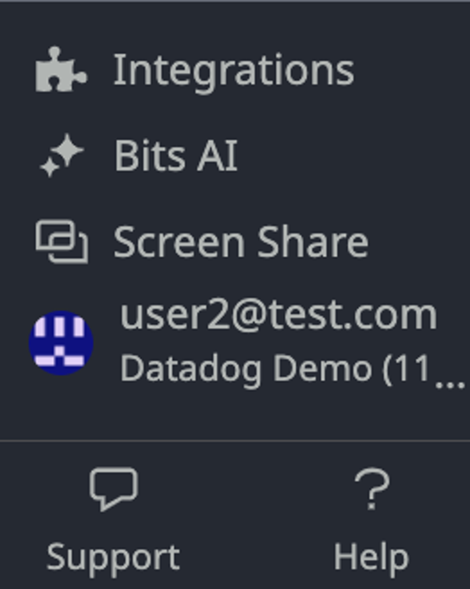
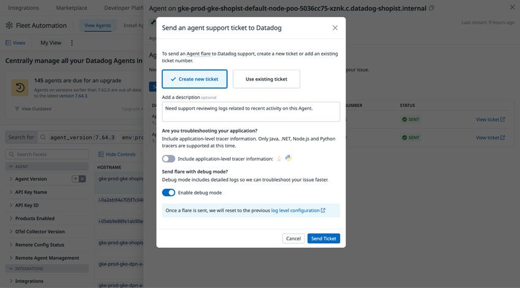

# サポートと教育

## 概要

Datadog のサポートと教育の仕組みは、大きく次の 4 層に分けられる。

| 層 | 主な内容 | 費用 | 本ファイルの節 |
|---|---|---|---|
| ① セルフヘルプ | 公式ドキュメント、Learning Center（無料のハンズオン学習）、Slack Community、Foundation Enablement（無料ライブウェビナー）、ステータスページ | 無料 | 「セルフヘルプ」「Learning Center」「コミュニティ」 |
| ② サポートプラン | Free / Standard（有償エディション契約に含まれる）/ Premier（有償アドオン） | Standard は追加費用なし、Premier は月額支出の 8%（最低 $2,000/月） | 「サポートプラン」「問い合わせ方法」 |
| ③ 有償サービス | Premier Support、Technical Account Management（TAM）、Technical Enablement（Premium Virtual / Premium On-site）、Implementation Services | Premier は月額支出の 8%（最低 $2,000/月）、TAM・Implementation・Premium Enablement は個別見積り、Foundation は $0 | 「有償サービス」 |
| ④ 認定資格・コミュニティ | Datadog Certification（Datadog Fundamentals 等、1 試験 US$100）、User Group（JDDUG）、Ambassadors / Champions、イベント（DASH、Datadog Summit Tokyo） | 試験は有償 | 「認定資格」「コミュニティ」 |

導入プロジェクトでは、契約時に「どのサポートプランか（Standard で足りるか Premier が必要か）」「日本語サポートの時間帯で運用要件を満たせるか」「教育計画（Learning Center、Enablement、認定資格）をどう組むか」を決めておくことが重要である。

関連ファイル:

- 料金体系・契約: [料金体系の全体像](./pricing-overview.md)、[製品別料金表（料金の正本）](./pricing-by-product.md)、[エディション・プラン](./editions-and-plans.md)、[購入経路と契約](./procurement-and-contracts.md)
- 導入プロセス: [導入方法論](./implementation-methodology.md)、[運用設計](./operations-design.md)
- 組織定着: [組織への定着](../04_応用編/organizational-adoption.md)
- 製品の入口: [はじめてのDatadog](../01_入門編/getting-started.md)、[画面構成とナビゲーション](../01_入門編/ui-navigation.md)

---

## サポートプラン

### サポートプランの比較（Free / Standard / Premier）

Datadog のサポートプランは公式に **Free**、**Standard**、**Premier** の 3 種類が掲載されている（2026-11-02 時点）。[出典](https://www.datadoghq.com/support-services/plans/)

| 項目 | Free | Standard | Premier |
|---|---|---|---|
| 月額料金 | N/A | **有償エディションに含まれる**（追加費用なし） | **月額支出の 8%（最低 $2,000/月）** |
| 最低契約期間 | — | — | **1 年**（Premier は最低 1 年コミットが必要） |
| Business Critical の応答 | N/A | **< 2 時間（24x7）** | **< 30 分（24x7）** |
| Degraded Service の応答 | N/A | < 12 時間（営業時間ベース） | < 4 時間（営業時間ベース） |
| General Issue の応答 | N/A | < 48 時間（営業時間ベース） | < 12 時間（営業時間ベース） |
| Online Documentation | ○ | ○ | ○ |
| Learning Center | ○ | ○ | ○ |
| Slack Community | ○ | ○ | ○ |
| Foundational Enablement | ○ | ○ | ○ |
| Email Support | × | ○（Business Hours） | ○（24x7） |
| Chat Support | × | ○（10am–7pm EST、月〜金、祝日除く） | ○（24x7） |
| Phone Support | × | × | ○（24x7） |
| Designated Team of Global Support Engineers（専任のグローバルサポートエンジニアチーム） | × | × | ○ |
| Priority Handling for Escalations（エスカレーションの優先処理） | × | × | ○ |
| Environmental Run Book（環境別ランブック） | × | × | ○ |
| Quarterly Support Ticket Review（四半期チケットレビュー） | × | × | ○ |

- 料金は公式サポートプランページの掲載値（2026-11-02 時点、Premier は年契約が前提）。料金の数値は [製品別料金表](./pricing-by-product.md) を正本とする。
- 表の ○ / × は公式ページの各プラン列のチェックアイコン有無を読み取ったもの。[出典](https://www.datadoghq.com/support-services/plans/)
- 公式ページの脚注：「Business hours are 8:00 PM Sunday - 9:00 PM Friday (EDT/EST), excluding holidays.」（営業時間は米国東部時間の日曜 20:00〜金曜 21:00、祝日除く）。

> **補足:** 「Free」は無料トライアルや無償利用の組織を想定した列で、メール・チャット・電話サポートは含まれない。Datadog Support Terms でも Free サービスおよびアルファ・ベータ等の pre-commercial リリースはサポート対象外とされている。[出典](https://www.datadoghq.com/legal/datadog-support-terms/)

### Support Terms（サポート規約）における重大度定義と応答時間

Datadog Support Terms（最終更新 2025-11-14）は、問い合わせを影響度で 3 区分し、プランごとの応答時間を定めている。番号付きの優先度（P1/P2 等）ではなく、以下の区分名を用いる。[出典](https://www.datadoghq.com/legal/datadog-support-terms/)

| 区分 | 定義（規約の要旨） | Standard | Premier |
|---|---|---|---|
| **Business Critical Incident** | サービスの全面的または重大な障害、またはサービスにアクセスできない | **すべての応答**を 2 時間以内（24x7） | **すべての応答**を 30 分以内（24x7） |
| **Degraded Service Incident** | 部分的な障害または軽度の劣化。一部機能は使えるが全部ではない | **初回応答**を 12 Business Hours 以内 | **すべての応答**を 4 Business Hours 以内 |
| **General Issue** | 上記以外すべて（重大でない技術的問題、how-to・実装に関する質問、機能要望を含む） | **初回応答**を 48 Business Hours 以内 | 初回応答 12 Business Hours 以内、以降の応答は 24 Business Hours 以内 |

規約上のポイント:

| 項目 | 内容 |
|---|---|
| Incident の定義 | サービスが MSA、該当 Order、Documentation に実質的に適合して動作しないこと |
| Business Hours | 日曜 20:00〜金曜 21:00（EDT/EST）、祝日除く |
| Live Chat の提供時間 | 月〜金 10:00〜19:00（EDT/EST）、祝日除く |
| Business Critical の扱い | 両プランとも 24x7 で対応 |
| エスカレーション（Business Critical） | シニアエンジニアリングおよび/または管理職（サポート上級リーダーシップを含みうる）へエスカレーション |
| エスカレーション（Degraded Service） | 8 Business Hours 以内に Workaround / Resolution が提供されない場合、シニアエンジニアリングへエスカレーション |
| Premier の言語 | **Premier Support は現在英語のみで提供**（規約に明記） |
| Standard の言語 | 規約には記載なし（日本語サポートの実態は後述「日本語サポート」節） |
| 顧客の義務 | 問題の明確な説明、関連する設定ファイル・ログの提供、再現への協力 |
| 送信禁止データ | 個人情報、健康情報、金融情報などの機微データをサポート依頼に含めない |
| 救済 | サポート不履行に対する唯一の救済は、該当サポートの再実施（re-performance） |
| 請求関係の問い合わせ | サポート対象外。`billing@datadoghq.com` または担当 Customer Success 担当者へ |
| 対象外 | Free サービス、アルファ・ベータ等の pre-commercial リリース |
| 規約変更 | Datadog はサポートプランを変更できるが、Order 期間中にサポート水準を実質的に低下させない |

> **注意（応答時間の意味）:** Support Terms の応答時間は「応答（Response）」の時間であり、**解決時間の保証ではない**。また Degraded / General は「Business Hours」で数えるため、週末をまたぐと実時間ではかなり長くなる。【経験則】運用要件で夜間・週末の迅速な応答が必要な場合、Business Critical 以外の区分は Standard では期待できない点を要件定義で明示しておくとよい。

> **注意（旧版規約）:** Support Terms には 2022-09-30、2023-09-26、2024-09-06 の旧版が公開されている。契約時点の版が適用されるため、既存契約の条件を確認する場合は契約日に対応する版を参照すること。[出典](https://www.datadoghq.com/legal/datadog-support-terms/2024-09-06/)

### Premier Support の詳細

Premier Support は Standard の全チャネル・リソースに加えて以下を提供する有償プランである。[出典](https://www.datadoghq.com/legal/datadog-support-terms/) / [出典](https://www.datadoghq.com/support-services/)

| Premier の提供内容 | 説明 |
|---|---|
| Phone Consultations | サポートスタッフとの電話・ビデオ会議を依頼できる |
| Designated Team of Global Support Engineers | 技術的問題に優先的に対応するエンジニアチーム |
| Priority Handling for Escalations | プロダクト・エンジニアリングチームと直接連携したエスカレーション |
| Environmental Run Book | 顧客の実装に合わせた内部リソース（環境情報の手順書） |
| Quarterly Support Ticket Review | チケット数・通話数・傾向・解決時間・達成したサービスレベル目標の定期レポート |
| Live troubleshooting sessions | スケジューリングリンクから参加するライブのトラブルシューティングセッション（Services ページの記載） |
| Premier Account Liaison | 定期的なケースレビューと QBR（四半期ビジネスレビュー）を担う指定窓口（Services ページの記載） |
| Elevated Support days | **年最大 5 日**の Elevated Support（大型イベント等に合わせた個別のイベント計画付き）（Services ページの記載） |

| 条件 | 値 |
|---|---|
| 料金 | 月額支出の 8%（最低 $2,000/月）（2026-11-02 時点、公式掲載値） |
| 最低契約期間 | 1 年 |
| 提供言語 | 英語のみ（Support Terms） |
| 応答 | Business Critical はすべての応答 30 分以内（24x7） |

> 【推定】「月額支出の 8%」の算定基礎（どの費目を含むか、コミット額か実使用額か）は公式ページに明記がなく、契約交渉で確認が必要。公開情報では確認できず。

### GovCloud（US1-FED）のサポート

> **サイト差異:** `US1-FED`（GovCloud、`app.ddog-gov.com`）は別の **Datadog GovCloud Support Terms**（2025-01-22 版）が適用される。[出典](https://www.datadoghq.com/legal/datadog-govcloud-support-terms/2025-01-22/)

| 項目 | GovCloud Standard | GovCloud Premier |
|---|---|---|
| Business Hours | 月〜金 10:00〜22:00 ET（米国祝日除く） | 同左 |
| Live Chat | 月〜金 10:00〜19:00 ET | 同左 |
| Business Critical | すべての応答を **2 Business Hours** 以内 | すべての応答を 30 分以内（24x7） |
| Degraded Service | 初回応答 12 Business Hours 以内 | すべての応答 4 Business Hours 以内 |
| General Issue | 初回応答 48 Business Hours 以内 | 初回 12 / 以降 24 Business Hours 以内 |
| サポートポータル | `https://govsupport.ddog-gov.com/` | 同左 |
| メール | `support@ddog-gov.com` / `help@ddog-gov.com` | 同左 |
| 言語 | 英語のみ | 英語のみ |

商用サイトの Standard は Business Critical を「24x7 で 2 時間」としているのに対し、GovCloud Standard は「2 Business Hours」である点が異なる。GovCloud サイトでは Agent の `flare` サブコマンドや Fleet Automation からのフレア送信もサポートされない（後述）。サイトの全体像は [Datadog Sites](../02_リファレンス/platform/datadog-sites.md) を参照。

---

## 問い合わせ方法

### 問い合わせチャネル一覧

| チャネル | 入口 | 提供時間 | 主な用途 | 備考 |
|---|---|---|---|---|
| サポートチケット | `https://help.datadoghq.com/hc/`（Support Portal）、Datadog UI のナビゲーション左下 **Support** ボタン | 規約の Business Hours（Business Critical は 24x7） | 緊急の問題、障害、通話・画面共有の依頼、複雑な調査 | 1 チケット 1 課題 |
| Live Chat（Live Chat with Human） | Datadog UI のナビゲーション左下 **Support** ボタン | 営業日 10:00〜19:00 ET（Premier は 24x7） | 設定・セットアップの質問、ドキュメントの補足、小さな問題 | **HIPAA 有効アカウントでは利用不可** |
| AI アシスタント | Datadog UI の **Support** ボタン | 公開情報では確認できず | 回答の検索 | 詳細は [Bits AI と AI 機能](../02_リファレンス/ai/bits-ai.md) |
| Email | `support@datadoghq.com` | Standard: Business Hours / Premier: 24x7 | チケット起票 | Support Terms 記載 |
| Phone | — | Premier のみ 24x7 | 電話・ビデオ相談 | Standard には含まれない |
| 請求の問い合わせ | `billing@datadoghq.com` または Customer Success 担当 | — | 請求・課金 | サポート対象外 |
| 営業・一般問い合わせ（日本） | `info@datadoghq.com`（日本語対応）、営業 +1-866-329-4466（内線 1） | — | 購入・契約 | [出典](https://www.datadoghq.com/ja/about/contact/) |

[出典](https://docs.datadoghq.com/getting_started/support/) / [出典](https://docs.datadoghq.com/help/) / [出典](https://www.datadoghq.com/legal/datadog-support-terms/)

**キャプション:** Datadog UI のナビゲーションメニュー下部にある **Support** ボタンと **Help** ボタン。

**画面の説明:** 左側ナビゲーションの下部に、`Integrations`、`Bits AI`、`Screen Share` の各メニューとログイン中のユーザー（メールアドレスと組織名）が並び、その下に吹き出しアイコンの **Support** と「?」アイコンの **Help** がある。**Support** をクリックすると、Live Chat（技術サポートエンジニアとのテキストチャット）と AI アシスタントにアクセスできる。

**出典:** https://docs.datadoghq.com/getting_started/support/ （2026-11-02 取得）

> 画像パスについて: 本ファイルは `03_導入編/` 直下にあるため、画像は `../assets/images/support-and-training/` で参照している。

### チケットとチャットの使い分け

公式ドキュメントは以下の目安を示している。迷った場合はどちらでもよく、**チャット終了時にはチケットが自動作成**されるため、未解決の問題も継続調査される。[出典](https://docs.datadoghq.com/getting_started/support/)

| サポートチケット向き | チャット向き |
|---|---|
| 緊急の問題 | 製品設定のサポート |
| 通話・画面共有の依頼 | セットアップの質問 |
| インシデント・障害 | ドキュメント内容の確認 |
| 多数の設定ファイル・ログ・クエリにまたがる複雑なトラブルシューティング | 特定の設定ファイル・ログ・クエリに関する小さな問題 |

チャットの運用ルール:

| 項目 | 内容 |
|---|---|
| ルーティング | チャット開始時に **technical** または **sales** を選択。technical は最初に空いた Technical Support Engineer へ、sales は営業チームへ |
| 緊急時 | チャットではなくチケットを使い、**なぜ緊急か**を明記する（リーダーシップがエキスパートへ振り分ける） |
| チャットで解決しない場合 | チャット終了後にサポートが追加情報を収集して深掘り調査する |
| チャット後のチケット | 解決済みなら顧客がクローズ可。未解決ならチャットの文脈を引き継いで担当エキスパートへ回る。以降の連絡はチケットで行う |
| HIPAA | HIPAA 有効アカウントではチャット不可 |

### チケット起票時に含める情報

公式ドキュメントが推奨する情報は以下。1 つのケースには 1 つの課題に限定し、無関係な問題は別ケースにする。[出典](https://docs.datadoghq.com/getting_started/support/)

| 情報 | 補足 |
|---|---|
| 組織名 | 複数の組織にアクセスできる場合 |
| Datadog サイト | `US1` / `US3` / `US5` / `EU1` / `AP1` / `AP2` / `US1-FED`（[Datadog Sites](../02_リファレンス/platform/datadog-sites.md)） |
| 問題が見えるページへのリンク | アカウント内の該当画面 URL |
| スクリーンショット・画面録画 | 挙動を示すもの |
| 再現手順 | |
| Agent flare | Agent 関連の問題の場合（次節） |
| 参照したドキュメントのリンク | |

> **注意:** Support Terms により、個人情報・健康情報・金融情報などの機微データをサポート依頼に含めてはならない。スクリーンショットやログ添付時はマスキングすること。[出典](https://www.datadoghq.com/legal/datadog-support-terms/)

### チケットの保持期間

| 項目 | 値 |
|---|---|
| クローズ済みチケットと添付ファイルの削除 | **最終更新から 15 か月後に削除**（2026-06-12 以降の運用） |

[出典](https://docs.datadoghq.com/getting_started/support/)

【経験則】監査や再発時の参照のため、重要なサポート回答は自社のナレッジベースやチケット管理システムへ転記しておくとよい。

### Agent flare（フレア）の送信

Agent flare は、Datadog Agent の設定ファイルとログ（APM 有効時は可能ならトレーサーのデバッグログも）をまとめてサポートへ送るアーカイブである。パスワード、API キー、プロキシ認証情報、SNMP community string などの機微情報は送信前に除去され、アップロード前に確認プロンプトが表示される。[出典](https://docs.datadoghq.com/agent/troubleshooting/send_a_flare/)

| 環境 | コマンド / 方法 |
|---|---|
| Linux | `sudo datadog-agent flare <CASE_ID>` |
| macOS | `datadog-agent flare <CASE_ID>`（Web GUI からも可） |
| Windows（PowerShell） | `& "$env:ProgramFiles\Datadog\Datadog Agent\bin\agent.exe" flare <CASE_ID>` |
| Docker | `docker exec -it dd-agent agent flare <CASE_ID>` |
| Kubernetes | `kubectl exec -it <AGENT_POD_NAME> -- agent flare <CASE_ID>`（専用コンテナ構成の Agent 7.19 以降は各コンテナで実行。`-c agent`、process/trace Agent は `--local`、security agent は `security-agent flare`。system-probe コンテナはフレア送信不可のため `kubectl logs <AGENT_POD_NAME> -c system-probe` で取得） |
| ECS Fargate | Datadog サイト（Fleet Automation）から Task ARN を指定して送信を推奨。代替として ECS Exec（platform v1.4.0） |
| Datadog サイト（Fleet Automation） | Fleet Automation で Agent を選択 → **Support** → **Send Support Ticket**。既存チケット番号を入力（空欄なら新規作成）、任意で **Debug mode** とトレーサーログを有効化 → **Send Ticket**。Fleet Automation と Remote Configuration の有効化が必要 |
| 手動送信 | 接続に問題がある場合、ローカルの `/tmp` からアーカイブを取得してサポートへ送付（K8s 例: `kubectl cp datadog-<pod-name>:tmp/datadog-agent-<date>.zip flare.zip -c agent`） |

- `<CASE_ID>` が無い場合は、Datadog ログインに使うメールアドレスを入力すると新規ケースが作成される。
- Fleet Automation の Debug mode で引き上げたログレベルは、フレア送信後に元へ戻る。

> **サイト差異:** `app.ddog-gov.com` および `us2.ddog-gov.com`（GovCloud）では、Fleet Automation および `flare` サブコマンドからのフレア送信はサポートされない。手動送信を用いる。[出典](https://docs.datadoghq.com/agent/troubleshooting/send_a_flare/)

**キャプション:** Fleet Automation の Agent 詳細から開く「Send Support Ticket」フォーム。

**画面の説明:** Fleet Automation で対象 Agent を選び **Support** タブから開くフォーム。既存の Zendesk チケット番号の入力欄（空欄なら新規作成）、Debug mode の有効化オプション、アプリケーショントレーサーログの同梱オプション、**Send Ticket** ボタンがある。

**出典:** https://docs.datadoghq.com/agent/troubleshooting/send_a_flare/ （2026-11-02 取得）

Agent と Fleet Automation の詳細は [Datadog Agent](../02_リファレンス/platform/agent.md)、[Fleet Automation と Remote Configuration](../02_リファレンス/platform/fleet-automation.md) を参照。

### 障害情報（ステータスページ）

Datadog 自身のサービス障害は、サイトごとのステータスページで公開される。サポートへ問い合わせる前に、該当サイトのステータスを確認するとよい。

| サイト | ステータスページ |
|---|---|
| US1 | `https://status.datadoghq.com` |
| US3 | `https://status.us3.datadoghq.com` |
| US5 | `https://status.us5.datadoghq.com` |
| EU1 | `https://status.datadoghq.eu` |
| AP1 | `https://status.ap1.datadoghq.com` |
| AP2 | `https://status.ap2.datadoghq.com` |
| US1-FED | `https://status.ddog-gov.com` |

- 上記 URL は 2026-11-02 に HTTP 200 で応答することを確認した。公式ヘルプページはステータスページと Ops の X（旧 Twitter）アカウントを情報源として案内している。[出典](https://docs.datadoghq.com/help/)
- 購読（メール通知等）の仕様は公開情報では確認できず。【第三者情報】StatusGator、IsDown 等の第三者サービスが AP1 ステータスページを監視・通知している。[出典](https://statusgator.com/services/datadog-ap1)（2026-11 閲覧）
- 顧客が自社サービス向けに作る Status Pages 機能（Datadog の製品機能）とは別物。製品機能は [Incident Management](../02_リファレンス/service-management/incident-management.md) を参照。

---

## 日本語サポート

### 日本語サポートの提供時間

公式ドキュメント「Datadog Support」の Language support 節に、日本語・韓国語サポートの提供時間が明記されている。[出典](https://docs.datadoghq.com/getting_started/support/)

| 言語 | サポート（チケット）提供時間 | チャット提供時間 | 休業日 |
|---|---|---|---|
| **日本語** | **月〜金 09:00〜17:00 JST** | **営業日 10:00〜16:00 JST** | 日本の祝日、**12 月 29 日〜1 月 3 日** |
| 韓国語 | 月〜金 09:00〜17:00 KST | 営業日 10:00〜11:30 および 13:00〜16:00 KST | 韓国の祝日 |
| 英語 | 規約の Business Hours（日曜 20:00〜金曜 21:00 ET）、Business Critical は 24x7 | 営業日 10:00〜19:00 ET | 米国祝日 |

- 日本語での対応ができない時間帯は、**英語でサポートを継続**できる。[出典](https://docs.datadoghq.com/getting_started/support/)
- 日本語版の問い合わせページでも「サポートへのお問い合わせ（日本語対応）」「info@datadoghq.com（日本語対応）」と案内されている。[出典](https://www.datadoghq.com/ja/about/contact/)
- **Premier Support は英語のみ**（Support Terms）。Premier の 24x7 応答・電話サポートは英語で提供される前提となる。[出典](https://www.datadoghq.com/legal/datadog-support-terms/)

### 日本時間に換算したサポート時間帯

【推定】米国東部時間の規約上の時間帯を日本時間（JST、UTC+9）に換算すると以下のようになる（夏時間 EDT は UTC-4、標準時 EST は UTC-5）。

| 規約上の時間帯（ET） | JST 換算（EDT 期間：概ね 3 月中旬〜11 月上旬） | JST 換算（EST 期間：概ね 11 月上旬〜3 月中旬） |
|---|---|---|
| Business Hours：日曜 20:00 〜 金曜 21:00 | 月曜 09:00 〜 土曜 10:00 | 月曜 10:00 〜 土曜 11:00 |
| 英語 Live Chat：月〜金 10:00〜19:00 | 月〜金の 23:00 〜 翌 08:00 | 月〜金の 24:00 〜 翌 09:00 |

- 換算は筆者による計算。英語の Business Hours はほぼ平日終日（JST の月曜朝〜土曜朝）をカバーしており、日本の夜間でも英語なら Degraded / General の Business Hours カウントが進むことを意味する。

### 日本語サポート利用上の実務ポイント

| 観点 | ポイント |
|---|---|
| 夜間・休日の障害 | 日本語サポートは平日日中のみ。夜間・休日の Business Critical は**英語で起票**する前提で運用手順を用意する【経験則】 |
| 年末年始 | 日本語サポートは 12/29〜1/3 休業。年末年始のリリース・移行作業は英語サポート前提で計画する |
| チケット記述 | 日本語で起票しても、緊急時の英語エスカレーションを見越して要点（サイト、組織名、影響、再現手順、エラー文）を英語でも併記すると調査が早い【経験則】 |
| Premier | Premier は英語のみ。日本語での手厚い支援を求める場合は、TAM・パートナー（後述）・日本の営業/CS 担当を含めて体制を検討する【推定】 |
| 請求 | 請求・課金はサポート対象外。`billing@datadoghq.com` または担当 CS へ |

---

## 有償サービス（Services & Enablement）

Datadog の「Services & Enablement」ページでは、以下 4 つのサービスが案内されている（2026-11-02 時点）。[出典](https://www.datadoghq.com/support-services/)

| サービス | 目的 | 主な内容 | 料金 |
|---|---|---|---|
| **Implementation Services** | Datadog 導入の設計・実行 | 目標・期間・リソースに基づく個別の計画と設計、主要判断のベストプラクティスと自動化ツール、移行・既存ツール統合の支援 | 公式未掲載（要問い合わせ） |
| **Technical Enablement** | 基礎〜応用のチーム教育 | 個別トレーニングプログラム、動画・ドキュメント・ベストプラクティスのライブラリ、エキスパート主導のセッション。顧客環境・対面・オンライン・ハイブリッドで実施し、録画を共有 | Foundation は $0、Premium は要問い合わせ（後述） |
| **Premier Support** | 迅速な応答とシニアエンジニアへの直接アクセス | ライブトラブルシューティング、Premier Account Liaison（定期ケースレビュー・QBR）、年最大 5 日の Elevated Support | 月額支出の 8%（最低 $2,000/月） |
| **Technical Account Management（TAM）** | 長期的な成功のための継続的な技術アドバイザー | 業界ベストプラクティスの指針、四半期のアカウントヘルスチェック（最適化機会の特定）、共有ワークスペース・オフィスアワー・オンサイト訪問による伴走 | 公式未掲載（要問い合わせ） |

### Technical Account Manager（TAM）

| 項目 | 内容 | 確度 |
|---|---|---|
| 位置づけ | 継続的な技術アドバイザー。ベストプラクティス指針、四半期のアカウントヘルスチェック、共有ワークスペース・オフィスアワー・オンサイト訪問 | 公式 [出典](https://www.datadoghq.com/support-services/) |
| 料金 | 公式料金ページに掲載なし。公開情報では確認できず | — |
| 契約条件（最低額・期間） | 公開情報では確認できず | — |
| 職務内容 | 大規模顧客に対し製品群の採用・活用をアドバイス、月次・四半期ビジネスレビューへの参加・準備（Datadog の TAM 求人票の記載） | 【第三者情報】求人票（careers.datadoghq.com、2026 閲覧） |
| 日本語対応 | 公開情報では確認できず（日本に TAM が在籍するかは個別確認） | — |

> 【推定】TAM は主に大規模契約の顧客向けに提供されるサービスで、契約規模・交渉により提供有無や条件が決まると考えられる。購入時は営業担当に「TAM の有無・担当範囲・日本語対応・訪問頻度」を確認すること。契約の進め方は [購入経路と契約](./procurement-and-contracts.md) を参照。

### Technical Enablement の料金ティア

Support Services Pricing ページ（Technical Enablement）に 3 ティアが掲載されている（2026-11-02 時点）。[出典](https://www.datadoghq.com/support-services/pricing/)

| ティア | 価格単位 | 価格 | 内容 |
|---|---|---|---|
| **Foundation** | — | **$0**（ページ内価格データ上、年契約・月契約・オンデマンドとも 0） | 定期スケジュールのオンラインウェビナー。**46 以上のトピック**で 1 時間の実践デモを定期開催。Datadog エキスパートとのライブ Q&A |
| **Premium Virtual** | **セッション単位** | 要問い合わせ（公式未掲載） | 顧客専用の **2 時間**のオンラインセッション、録画・資料の提供、カリキュラム作成のためのヘルスチェック、ユースケース・環境に合わせたトレーニング |
| **Premium On-site** | **日単位** | 要問い合わせ（公式未掲載） | 指定場所での対面講義（**1 日最大 6 時間**）、エキスパートとのオフィスアワー。場所により追加料金あり |

Technical Enablement の FAQ・条件:

| 項目 | 内容 |
|---|---|
| Premium Virtual の参加人数上限 | **500 名** |
| Scoping call | Technical Enablement Manager（TEM）が主導する **30 分**の事前打合せ。セッション消化にはカウントされない。複数回行われることもある |
| 配信ツール | Foundation / Premium Virtual とも Zoom。Premium Virtual は顧客側の会議リンクも利用可 |
| Premium On-site の会場 | Datadog は会場を用意・管理しない。講師が指定会場へ出張 |
| 複数日の On-site | 同一暦週内に実施する必要がある |
| Virtual と On-site の併用 | 可能 |
| 録画 | 可能（録画して共有。顧客が招待を管理する場合は顧客側でも録画可） |
| タイムゾーン | 全世界のタイムゾーンに対応 |
| 対応言語 | **英語、スペイン語、フランス語、ドイツ語、ポルトガル語、日本語、韓国語、Bahasa、ロシア語、カタルーニャ語** |
| カスタムトピック | Premium はスコーピングコールで目標・課題を確認しアジェンダをカスタマイズ |
| 比較表の機能項目 | Expert Technical Enablement Manager、Recordings Available、Scoping Calls、Customized Agendas、Health Check、Office Hours、Face-to-Face Interaction、Datadog instructor travel expenses included（ティアごとの付与状況は公式ページの表を参照） |

[出典](https://www.datadoghq.com/support-services/pricing/)

### Foundation Enablement セッション（無料ライブウェビナー）

| 項目 | 内容 |
|---|---|
| 形式 | 無料のインストラクター主導ライブウェビナー。1 時間の実践デモとライブ Q&A |
| 登録 | `https://www.datadoghq.com/technical-enablement/sessions/`（短縮 URL `https://dtdg.co/fe_sessions`） |
| 表示時刻 | 閲覧者のローカルタイムゾーンで表示 |
| 言語 | セッションごとに言語版がある（例: 日本語のオンサイト Foundation Enablement セッションページ、スペイン語の Datadog Overview） |
| 前提条件 | セッションにより前提あり（例: 「Become a Datadog Power User」は「Taking things to the next level」「Monitoring and SLOs」が前提） |
| リクエスト | 掲載がないトピックはリクエストでき、可能な範囲で新セッションが追加される |

[出典](https://www.datadoghq.com/technical-enablement/) / [出典](https://www.datadoghq.com/technical-enablement/session/usecase-poweruser/) / [出典](https://docs.datadoghq.com/help/)

### パートナーによる導入・運用支援

Datadog Partner Network（DPN）は販売・サービス系パートナー（MSP、リセラー、SI、コンサルタント）とテクノロジーパートナーで構成される。日本では **2020 年 1 月**に DPN が開始された。[出典](https://www.datadoghq.com/ja/about/latest-news/press-releases/datadog-partner-network-2020-01/)（2020-01 公開。開始時点の情報であり、現行プログラム構成とは異なる可能性がある）

| 観点 | 内容 |
|---|---|
| パートナー種別 | MSP、SI、リセラー、紹介パートナー、テクノロジーパートナー |
| 日本のパートナー表彰 | 「Datadog Japan Partner Award 2026」が発表され、Enablement Excellence of the Year など認定資格取得支援を評価する部門がある [出典](https://www.datadoghq.com/ja/about/latest-news/press-releases/datadog-japan-partner-awards-2026/) |
| Marketplace のサービス出品 | Datadog Marketplace / Integrations には第三者のプロフェッショナルサービス（例: 「Datadog Professional Service by DXHero」）も掲載されている [出典](https://docs.datadoghq.com/ja/integrations/datadog-professional-service-by-dxhero/) |

【経験則】日本語での手厚い導入支援・24x7 の日本語一次対応が必要な場合、国内パートナー（MSP / SI）のサービスと Datadog のサポートを組み合わせる構成がよく採られる。購入経路（直販・パートナー・クラウドマーケットプレイス）とサポート窓口の関係は [購入経路と契約](./procurement-and-contracts.md) を参照。

---

## セルフヘルプ

### セルフヘルプリソース一覧

Support Terms は以下を「セルフヘルプ」と位置づけ、**サポートとしては提供されない**（ガイダンスの評価は顧客責任）としている。[出典](https://www.datadoghq.com/legal/datadog-support-terms/)

| リソース | URL | 内容 |
|---|---|---|
| Documentation | `https://docs.datadoghq.com/`（日本語版 `https://docs.datadoghq.com/ja/`） | 公式ドキュメント。LLM 向けインデックス `https://docs.datadoghq.com/llms.txt` も公開 |
| Learning Center | `https://learn.datadoghq.com/` | 無料のハンズオンコース（後述） |
| Slack Community | `https://chat.datadoghq.com/`（招待ページ）、`datadoghq.slack.com` | ユーザー同士の Q&A・情報共有（ユーザー運営のネットワーク） |
| Foundation Enablement | `https://dtdg.co/fe_sessions` | 無料ライブウェビナー |
| Webinars | `https://dtdg.co/3PeuldT` | ウェビナー |
| Knowledge Center / Blog | `https://www.datadoghq.com/knowledge-center/`、`https://www.datadoghq.com/blog/` | 解説記事・新機能紹介 |
| Videos | `https://docs.datadoghq.com/videos/` | 製品動画 |
| Status Page | サイト別（前述） | Datadog 自身の障害情報 |

[出典](https://docs.datadoghq.com/help/)

> 公式ドキュメントの日本語版は機械翻訳・未翻訳のページを含む。一部のページは「このページは日本語には対応しておりません」と表示され英語のみである。最新仕様は英語版を正とすることを推奨する【経験則】。

---

## Learning Center

### Learning Center の概要

Datadog Learning Center は、Datadog の機能、ベストプラクティス、実装戦略を学ぶためのハンズオンコースとチュートリアルを提供する学習プラットフォームである。[出典](https://docs.datadoghq.com/getting_started/learning_center/) 費用が**無料**である点は公式ブログに記載がある（"free, interactive courses"）。[出典](https://www.datadoghq.com/blog/datadog-learning-paths/)

| 項目 | 内容 | 出典・確度 |
|---|---|---|
| URL | `https://learn.datadoghq.com/`（コース一覧 `https://learn.datadoghq.com/collections`） | 公式 |
| 費用 | 無料（"free, interactive courses"） | 公式ブログ（2025-05-05 公開） |
| 形式 | セルフペースのコース。上級コースはハンズオンラボ演習を含む | 公式ブログ |
| ラボ環境 | ラボの実行環境（クラウドインスタンスやトライアルアカウントの扱い）の仕様は公開情報では確認できず | docs の Learning Center ページ（英語版・日本語版）・公式ブログとも記載なし（2026-11-04 確認） |
| コース数 | 公式の最新コース数は公開情報では確認できず（docs はコース一覧 `https://learn.datadoghq.com/collections` へのリンクのみ）。【第三者情報】2024-06 時点の第三者記事では 54 コース | [出典](https://yagikota.github.io/blog/posts/datadog-learning-center)（2024-06 公開） |
| アカウント | Learning Center 用のアカウント登録が必要【推定】（基盤となる学習管理システムの種類は公開情報では確認できず） | — |
| 日本語コース | 公開情報では確認できず（コースは主に英語）【推定】 | — |
| 修了証 | Learning Path 修了で Credly バッジ | 公式ブログ |

### Learning Path（ラーニングパス）

Learning Path は、ペルソナ・製品・関連スキルごとに推奨コースをまとめたもの。2025-05-05 の公式ブログでの構成は以下。[出典](https://www.datadoghq.com/blog/datadog-learning-paths/)

| 区分 | Learning Path | 内容 |
|---|---|---|
| Universal（最初に推奨） | Core Skills Learning Path | メトリクス検索・分析、ダッシュボード作成、モニター設定 |
| Universal | Configuration Learning Path | ホスト vs コンテナでの Agent 実行、850 以上の Agent インテグレーション、Unified Service Tagging と Software Catalog の操作 |
| Persona-based（6 種） | Backend、Frontend、SRE、Application Security、Cloud Security、Cloud Security（Cloud SIEM 特化） | 役割別。例: Application Security Engineer Learning Path |
| Product-based | Log Querying & Analytics Learning Path（旧 Log Fundamentals の一部）、ダッシュボード、アプリケーション攻撃/脅威検知 等 | 複雑なログクエリ・集計、Reference Tables、サブクエリ。修了で Credly バッジ |
| Certification preparation（3 種） | Datadog Fundamentals / Log Management Fundamentals / APM and Distributed Tracing Fundamentals | 試験対策用にコースを集約。修了しても合格は保証されない |

【第三者情報】Log Management Fundamentals の Learning Path は全 7 コースで、先に「Tagging Best Practices」コースの受講が推奨されている。[出典](https://dev.classmethod.jp/articles/datadog-log-management-fundamentals/)（2024-11-26 公開）

### 教育計画への組み込み例

【経験則】導入プロジェクトでの教育計画は、以下のように役割別に組むと効果的である。詳細な定着施策は [組織への定着](../04_応用編/organizational-adoption.md) を参照。

| 対象 | 推奨リソース | タイミング |
|---|---|---|
| 全利用者 | Learning Center「Core Skills」、Foundation Enablement「Datadog Overview」 | アカウント発行直後 |
| 導入担当（インフラ/SRE） | 「Configuration」Learning Path、SRE Learning Path、[Agent 展開設計](./agent-rollout-design.md) | PoC〜設計フェーズ |
| アプリ開発者 | Backend / Frontend Learning Path、APM 関連コース | 計装開始前 |
| セキュリティ担当 | Application Security / Cloud Security / Cloud SIEM Learning Path | セキュリティ製品導入時 |
| 社内推進者（Champion） | Datadog Fundamentals 認定 → 専門認定（Log / APM 等） | 本番展開前後 |
| 大規模チーム | Technical Enablement（Premium Virtual / On-site）で自社環境に合わせた研修 | 全社展開時 |

---

## 認定資格（Datadog Certification）

### 認定資格一覧

公式 Certification ページに掲載されている試験（2026-11-02 時点）。[出典](https://www.datadoghq.com/certification/overview/)

| 認定資格 | レベル（公式表記） | 出題範囲（公式概要） | 試験言語 | Practice Exam |
|---|---|---|---|---|
| **Datadog Fundamentals** | Foundational | 基本的なコンピュータの基礎、Datadog によるインフラ展開、ネットワーク、Agent 設定、データ収集、Agent トラブルシューティング、可視化 | **英語、日本語**、韓国語、ブラジルポルトガル語、フランス語、スペイン語 | あり（25 問） |
| **Log Management Fundamentals** | Introductory | ロギング基礎、ログ収集、パース、検索とフィルタ、分析、活用、トラブルシューティング | 英語 | あり（25 問） |
| **APM and Distributed Tracing Fundamentals** | Introductory | APM 基礎、インスツルメンテーション、インサイトの発見、可視化、アプリケーションのトラブルシューティング | 英語、**日本語**、韓国語、ブラジルポルトガル語、スペイン語、フランス語 | あり（25 問） |
| **Datadog Cloud SIEM for AWS Fundamentals** | 公式に記載なし | AWS 向け Cloud SIEM の実装と管理（脅威検知、インシデント対応を含む） | 公開情報では確認できず | あり（25 問） |
| **Datadog Database Monitoring Fundamentals** | 公式に記載なし | データベースインテグレーション設定、パフォーマンスメトリクス分析、DB 問題のトラブルシューティング、ダッシュボードとアラート | 公開情報では確認できず | あり（25 問） |

- 日本語での認定プログラムは **2024-02-20** に開始され、最初の対象は Datadog Fundamentals だった（英語以外で初のスキル認定）。[出典](https://www.datadoghq.com/ja/about/latest-news/press-releases/datadog-certification-in-japan/)
- 各製品の詳細は [Log Management 関連リファレンス](../02_リファレンス/logs/log-collection.md)、[APM の概念とインジェスト制御](../02_リファレンス/apm/apm-concepts-and-ingestion.md)、[Cloud SIEM](../02_リファレンス/security/cloud-siem.md)、[Database Monitoring](../02_リファレンス/infrastructure/database-monitoring.md) を参照。

### 試験の共通仕様

| 項目 | 値 | 出典・確度 |
|---|---|---|
| 受験料 | **US$100**（再受験ごとに別途支払い） | 公式 |
| 試験時間 | **120 分** | 公式 |
| 形式 | 多肢選択式 | 公式 |
| 問題数 | 公式ページには記載なし。【第三者情報】Log Management Fundamentals は**全 90 問（採点対象外 15 問を含む）** | [出典](https://dev.classmethod.jp/articles/datadog-log-management-fundamentals/)（2024-11-26 公開）。他試験も 90 問との情報があるが公式では確認できず |
| 合格ライン | **非公開**（正答率ベース） | 公式 |
| 有効期間 | **認定日から 3 年**。再受験で更新 | 公式 |
| 受験方式 | **オンライン監督付き**（Kryterion の Secure Browser、Web カメラでライブ監督）または**テストセンターでの監督付き受験** | 公式 |
| 申込 | Webassessor（Kryterion） | 公式 |
| 前提条件 | 正式な前提なし。実稼働システムでの数か月の Datadog 利用経験を推奨（試験別の推奨経験は Exam Guide 参照） | 公式 |
| デジタルバッジ | 合格後、Credly の検証済みバッジをメールで受領 | 公式 |
| Practice Exam | 25 問の練習試験 | 公式 |
| 配慮申請（Accommodations） | 受験予定日の **30 日以上前**に申請フォームで申請 | 公式 |
| 本人確認（テストセンター） | **2 種類**の身分証（政府発行 ID・パスポート等の一次 ID と、学生証・クレジットカード等の二次 ID） | 公式 |
| Pilot exam | 新規・改訂試験の先行版として実施されることがある | 公式 |

[出典](https://www.datadoghq.com/certification/overview/)

> **注意（試験ベンダー）:** 2024-02 の日本語認定開始時のプレスリリースでは「第三者プロバイダの PSI」が認定を行うと記載されているが、Certification ページによれば **2025-01 に試験ベンダーが Kryterion（申込は Webassessor）へ移行**した（"As of January 2025, we have selected Kryterion as our certification exam vendor."）。受験時は現行の公式ページの案内に従うこと。

### 再受験・キャンセルポリシー

| 項目 | 値 |
|---|---|
| 受験回数上限 | **初回受験から 180 日間で 3 回まで** |
| 3 回不合格後 | **180 日間**の待機 |
| 次回予約までの間隔 | 受験後 **24〜48 時間**待ってから次回を予約 |
| No Call No Show | 受験 1 回としてカウント |
| キャンセル・変更期限（テストセンター） | 予定時刻の **72 時間前**まで |
| キャンセル・変更期限（オンライン） | 予定時刻の **24 時間前**まで |
| 期限超過時 | 受験料またはバウチャーは没収 |
| 再受験料 | 毎回 US$100 を別途支払い |

[出典](https://www.datadoghq.com/certification/overview/)

### 受験機会・割引

| 機会 | 内容 |
|---|---|
| DASH（年次カンファレンス） | DASH 参加者は会場で認定試験を受験でき、受験料はイベント参加費に含まれる [出典](https://www.datadoghq.com/certification/overview/) |
| 期間限定割引 | 2024-02 の日本語認定開始時に、2024-04-14 までの 30% 割引コードが Datadog Japan の X / Facebook で公開された（終了済みの施策） [出典](https://www.datadoghq.com/ja/about/latest-news/press-releases/datadog-certification-in-japan/) |
| 顧客・パートナー向けの受験料免除 | 公開情報では確認できず |

### 受験対策

| ステップ | 内容 |
|---|---|
| 1 | Exam Guide で出題範囲・推奨経験を確認 |
| 2 | 対応する Certification preparation Learning Path を修了 |
| 3 | 25 問の Practice Exam を受験 |
| 4 | 実環境（トライアル org や Learning Center のラボ）で操作経験を積む |

【第三者情報】Classmethod の受験記（2024-11-26 公開）によると、Log Management Fundamentals の難易度は Datadog Fundamentals と同等で、Log Explorer の可視化（List、Timeseries、Top list、Nested tables、Pie chart）の使い分けや、Agent・コンテナ・クラウド環境でのログ収集設定が問われた。英語の問題文は簡潔で、Datadog の専門用語の英語表記を押さえれば対応できたとしている。[出典](https://dev.classmethod.jp/articles/datadog-log-management-fundamentals/)（情報は 2024-11 時点。試験内容は改訂される可能性がある）

---

## コミュニティ

### コミュニティプログラム一覧

| プログラム | 内容 | URL |
|---|---|---|
| **Datadog Slack Community**（Datadog (Public) ワークスペース） | ユーザー運営のネットワーク。ユーザー同士の質問・Tips 共有 | `https://chat.datadoghq.com/`（招待）、`https://datadoghq.slack.com/` |
| **User Groups** | 各地のユーザーによるミートアップ | `https://www.datadoghq.com/user-groups/` |
| **Ambassadors** | 講演・執筆などで知見を共有する信頼されたコミュニティリーダー | `https://www.datadoghq.com/ambassadors/` |
| **Champions** | 技術発信力を高めるコミュニティ貢献者 | `https://www.datadoghq.com/champions/` |
| **Engineering Meetups** | Datadog オフィスで開催する技術イベント（オブザーバビリティ、AI、エンジニアリング） | `https://luma.com/datadoghq` |
| **Open Source** | Datadog の OSS 一覧 | `https://opensource.datadoghq.com/` |

- Community ページの掲載値（閲覧時点）: User Group 15、Ambassadors & Champions 57 名、ミートアップ 65 件（世界）。[出典](https://www.datadoghq.com/community/)
- Slack Community はサポート窓口ではない（Support Terms 上はセルフヘルプ扱い）。回答は他ユーザーによるものを含み、評価は顧客責任。[出典](https://www.datadoghq.com/legal/datadog-support-terms/)
- Slack の日本語チャンネルの有無は公開情報では確認できず。

### 日本のコミュニティ（JDDUG）

**Japan Datadog User Group（JDDUG）** は日本の Datadog ユーザーコミュニティで、料金プランや利用形態に関係なく参加できる。[出典](https://www.datadoghq.com/user-groups/) / [出典](https://www.datadoghq.com/blog/user-group-program/)

| 項目 | 内容 |
|---|---|
| 公式サイト | `https://jdd-ug.github.io/` |
| 支部 | **東京、札幌、福岡、沖縄**（User Groups ページ掲載。いずれも JDDUG サイトにリンク） |
| 位置づけ | 2025-05 に発表された Datadog User Group Program で、日本は最も活発で急成長しているコミュニティの一つとして紹介 |
| 開催例 | Japan Datadog User Group Meetup #6（2024-11-20、Datadog 東京オフィス（JP タワー）でオンライン/オフライン併催、無料・事前登録制） |

[出典](https://cloudpack.jp/event/japan-datadog-user-group-meetup-6/)（2024 公開、【第三者情報】）

### イベント

| イベント | 内容 |
|---|---|
| **DASH** | Datadog の年次カンファレンス（米国）。講演・ワークショップに加え、会場で認定試験を受験可能（参加費に含む） |
| **Datadog Summit Tokyo** | 日本での年次イベント。2025 年は 2025-10-16 に東京で開催（前日 10-15 はパートナー限定 Partner Day）。基調講演、ブレイクアウト、3 テーマのハンズオンワークショップ、AWS GameDay、JDDUG ブース等 [出典](https://www.datadoghq.com/ja/blog/datadog-summit-tokyo-2025/)（2025-09-09 公開） |
| 2026 年の Summit Tokyo | 公開情報では確認できず |

### Datadog Japan の拠点・窓口

| 項目 | 内容 |
|---|---|
| 東京オフィス | JP Tower 19th Floor, 2-7-2 Marunouchi, Chiyoda-ku, Tokyo 100-7019 |
| 営業 | +1-866-329-4466（内線 1、米国番号） |
| 一般問い合わせ | `info@datadoghq.com`（日本語対応） |
| サポート | `https://www.datadoghq.com/ja/support/`（日本語対応） |

[出典](https://www.datadoghq.com/ja/about/contact/)

---

## 制限値・クォータ・デフォルト値

本節はサポート・教育に関する数値をまとめたもの。

| 項目 | 値 | 出典 |
|---|---|---|
| Standard の Business Critical 応答 | すべての応答 2 時間以内（24x7） | Support Terms |
| Standard の Degraded Service 応答 | 初回 12 Business Hours 以内 | Support Terms |
| Standard の General Issue 応答 | 初回 48 Business Hours 以内 | Support Terms |
| Premier の Business Critical 応答 | すべての応答 30 分以内（24x7） | Support Terms |
| Premier の Degraded Service 応答 | すべての応答 4 Business Hours 以内 | Support Terms |
| Premier の General Issue 応答 | 初回 12 / 以降 24 Business Hours 以内 | Support Terms |
| Degraded Service のエスカレーション閾値 | 8 Business Hours | Support Terms |
| Business Hours（商用サイト） | 日曜 20:00〜金曜 21:00 ET（祝日除く） | Support Terms |
| Business Hours（GovCloud） | 月〜金 10:00〜22:00 ET | GovCloud Support Terms |
| 英語 Live Chat | 月〜金 10:00〜19:00 ET | Support Terms / Docs |
| 日本語サポート | 月〜金 09:00〜17:00 JST（祝日・12/29〜1/3 除く） | Docs |
| 日本語チャット | 営業日 10:00〜16:00 JST | Docs |
| Premier の料金 | 月額支出の 8%（最低 $2,000/月）、最低 1 年（2026-11-02 時点） | Support Plans |
| Premier の Elevated Support days | 年最大 5 日 | Services ページ |
| Premier の言語 | 英語のみ | Support Terms |
| HIPAA 有効アカウントのチャット | 利用不可 | Docs |
| クローズ済みチケットの保持 | 最終更新から 15 か月で削除 | Docs |
| 1 ケースあたりの課題数 | 1 件（推奨） | Docs |
| Foundation Enablement | $0、1 時間、46 以上のトピック | Support Services Pricing |
| Premium Virtual | 1 セッション 2 時間、参加上限 500 名 | Support Services Pricing |
| Premium On-site | 1 日最大 6 時間、複数日は同一暦週内 | Support Services Pricing |
| Scoping call | 30 分（セッション消化に含まない） | Support Services Pricing |
| 認定試験の受験料 | US$100 / 回 | Certification |
| 認定試験の試験時間 | 120 分 | Certification |
| 認定の有効期間 | 3 年 | Certification |
| Practice Exam | 25 問 | Certification |
| 受験回数 | 180 日で 3 回まで、3 回不合格後 180 日待機 | Certification |
| キャンセル期限 | オンライン 24 時間前 / テストセンター 72 時間前 | Certification |
| 配慮申請 | 30 日以上前 | Certification |
| Agent flare のサイズ上限 | 公開情報では確認できず | — |
| TAM の料金・最低契約額 | 公開情報では確認できず | — |
| Premium Virtual / On-site の単価 | 公開情報では確認できず（要問い合わせ） | — |
| 認定試験の問題数（公式） | 公開情報では確認できず（第三者情報で 90 問） | — |

---

## 課金への影響

| 項目 | 課金単位・扱い |
|---|---|
| Standard Support | 有償エディション契約に含まれ、追加費用なし |
| Premier Support | **月額支出の 8%（最低 $2,000/月）**、最低 1 年契約（2026-11-02 時点、公式掲載値） |
| TAM | 個別見積り（公開価格なし） |
| Implementation Services | 個別見積り（公開価格なし） |
| Technical Enablement | Foundation $0、Premium Virtual はセッション単位、Premium On-site は日単位（いずれも単価は要問い合わせ。On-site は場所により追加料金） |
| Learning Center | 無料 |
| 認定試験 | 1 回 US$100（Datadog 契約とは別に受験者が支払い。DASH 会場受験は参加費に含む） |

- Premier Support は契約全体の支出に比例するため、利用拡大に伴いサポート費も増える。【推定】8% の算定基礎・上限の有無は契約で確認が必要。
- 料金数値の正本は [製品別料金表](./pricing-by-product.md)。料金体系全体は [料金体系の全体像](./pricing-overview.md)、見積りは [コスト見積り手法](./cost-estimation.md) を参照。

---

## 導入時のチェックリスト

| # | 確認事項 | 関連 |
|---|---|---|
| 1 | Standard の応答時間（特に Degraded / General の Business Hours 換算）で運用要件を満たすか | 本ファイル「サポートプラン」 |
| 2 | 夜間・休日・年末年始の障害時に英語で起票できる体制・手順があるか | 「日本語サポート」、[運用設計](./operations-design.md) |
| 3 | Premier（英語のみ）・TAM・パートナー支援のどれが必要か | 「有償サービス」 |
| 4 | サポート連絡先（組織名、サイト、起票者）を運用手順書に記載したか | 「問い合わせ方法」 |
| 5 | Agent flare の送信手順（環境別、GovCloud は手動）を手順書化したか | 「Agent flare」 |
| 6 | ステータスページ（利用サイト）の確認手順を障害対応フローに入れたか | 「障害情報」 |
| 7 | 機微データをチケットに含めないルールを周知したか | Support Terms |
| 8 | 役割別の教育計画（Learning Center、Enablement、認定）を作ったか | 「Learning Center」「認定資格」 |
| 9 | 請求の問い合わせ窓口（billing / CS）を把握したか | 「問い合わせチャネル一覧」 |
| 10 | 重要なサポート回答を社内に保存する運用があるか（15 か月で削除） | 「チケットの保持期間」 |

---

## 参照元

- Datadog Docs: Datadog Support — https://docs.datadoghq.com/getting_started/support/ （2026-11-02 取得）
- Datadog Docs: Help — https://docs.datadoghq.com/help/ （2026-11-02 取得）
- Datadog Docs: Agent Flare — https://docs.datadoghq.com/agent/troubleshooting/send_a_flare/ （2026-11-02 取得）
- Datadog Docs: Learning Center — https://docs.datadoghq.com/getting_started/learning_center/ （2026-11-02 取得）
- Datadog: Support Plans — https://www.datadoghq.com/support-services/plans/ （2026-11-02 取得）
- Datadog: Support Terms（最終更新 2025-11-14） — https://www.datadoghq.com/legal/datadog-support-terms/
- Datadog: Support Terms（2024-09-06 版） — https://www.datadoghq.com/legal/datadog-support-terms/2024-09-06/
- Datadog: GovCloud Support Terms（2025-01-22 版） — https://www.datadoghq.com/legal/datadog-govcloud-support-terms/2025-01-22/
- Datadog: Services & Enablement — https://www.datadoghq.com/support-services/ （2026-11-02 取得）
- Datadog: Support Services Pricing — https://www.datadoghq.com/support-services/pricing/ （2026-11-02 取得）
- Datadog: Support — https://www.datadoghq.com/support/
- Datadog: Foundation Enablement Sessions — https://www.datadoghq.com/technical-enablement/
- Datadog: Foundation Enablement: Become a Datadog Power User — https://www.datadoghq.com/technical-enablement/session/usecase-poweruser/
- Datadog: Certification — https://www.datadoghq.com/certification/overview/ （2026-11-02 取得）
- Datadog Blog: Get started with Datadog Learning Paths（2025-05-05 公開） — https://www.datadoghq.com/blog/datadog-learning-paths/
- Datadog Blog: User Group Program（2025-05 公開） — https://www.datadoghq.com/blog/user-group-program/
- Datadog Blog: Datadog Summit Tokyo 2025（2025-09-09 公開） — https://www.datadoghq.com/ja/blog/datadog-summit-tokyo-2025/
- Datadog: Community — https://www.datadoghq.com/community/
- Datadog: User Groups — https://www.datadoghq.com/user-groups/
- Datadog: お問い合わせ（日本） — https://www.datadoghq.com/ja/about/contact/
- Datadog プレスリリース: 日本語での認定プログラムを開始（2024-02-20 公開） — https://www.datadoghq.com/ja/about/latest-news/press-releases/datadog-certification-in-japan/
- Datadog プレスリリース: Datadog Partner Network を日本で開始（2020-01 公開） — https://www.datadoghq.com/ja/about/latest-news/press-releases/datadog-partner-network-2020-01/
- Datadog プレスリリース: Datadog Japan Partner Award 2026 — https://www.datadoghq.com/ja/about/latest-news/press-releases/datadog-japan-partner-awards-2026/
- Datadog Docs: Datadog Professional Service by DXHero — https://docs.datadoghq.com/ja/integrations/datadog-professional-service-by-dxhero/
- Datadog Slack Community — https://chat.datadoghq.com/
- JDDUG — https://jdd-ug.github.io/
- 【第三者情報】Classmethod「Datadog 認定試験『Log Management Fundamentals』を受けてみた」（2024-11-26 公開） — https://dev.classmethod.jp/articles/datadog-log-management-fundamentals/
- 【第三者情報】Datadog Learning Center 紹介記事（2024-06 公開） — https://yagikota.github.io/blog/posts/datadog-learning-center
- 【第三者情報】cloudpack: Japan Datadog User Group Meetup #6（2024 公開） — https://cloudpack.jp/event/japan-datadog-user-group-meetup-6/
- 【第三者情報】StatusGator: Datadog AP1 — https://statusgator.com/services/datadog-ap1
