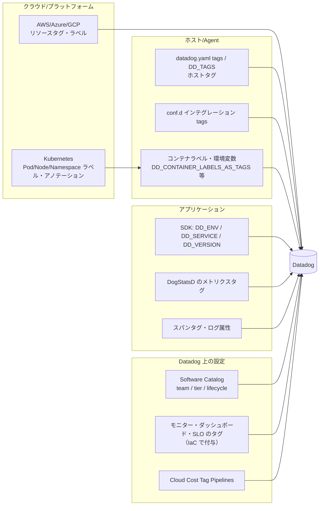
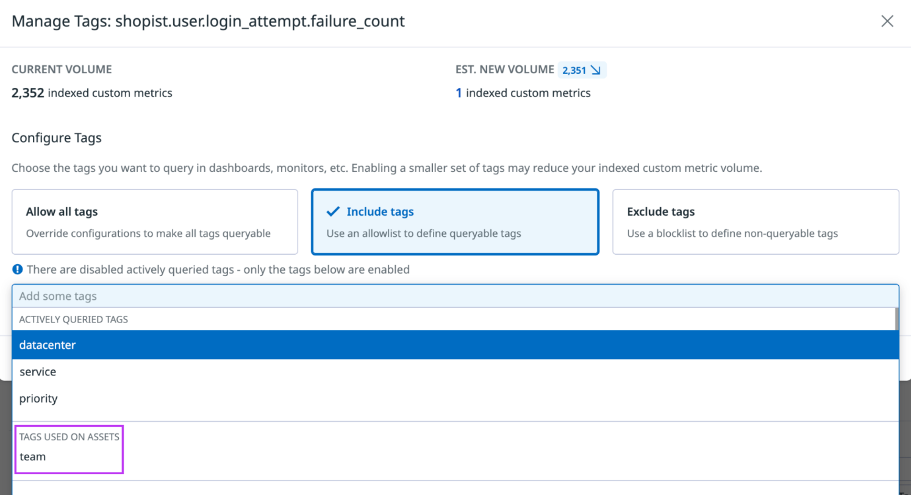
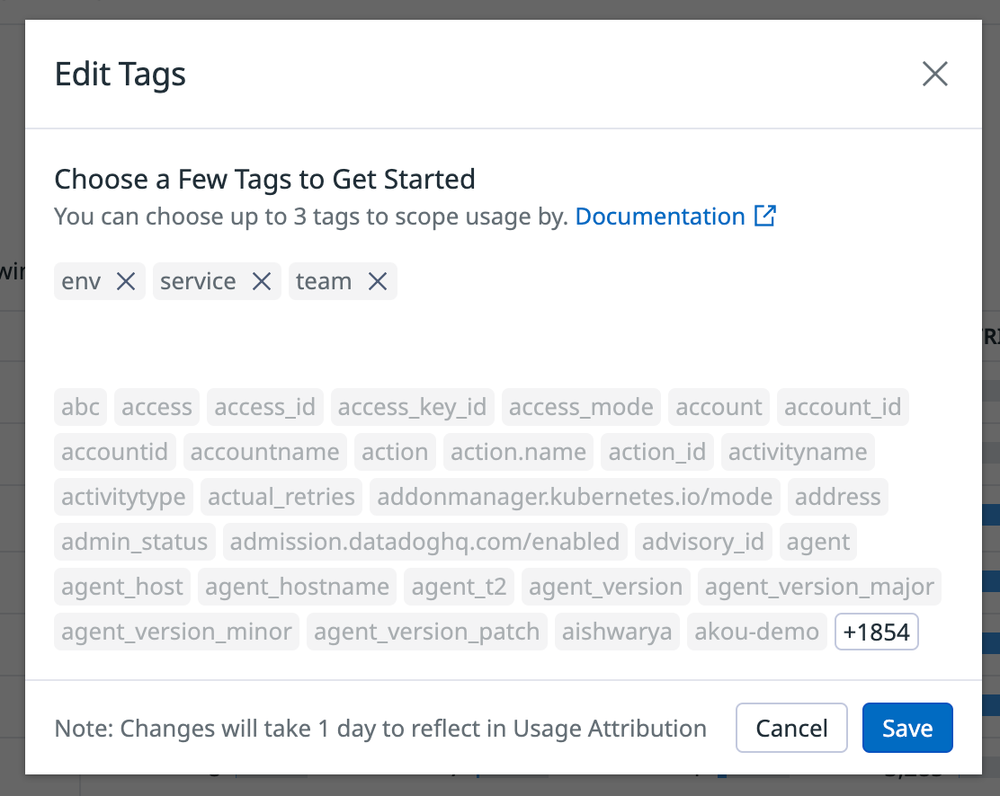
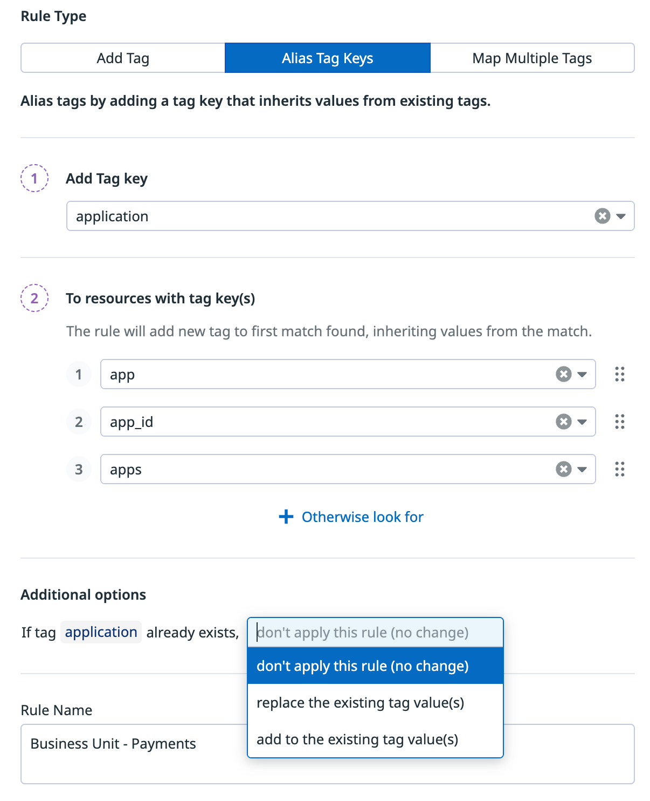
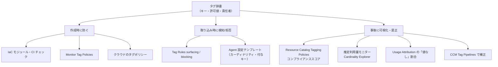
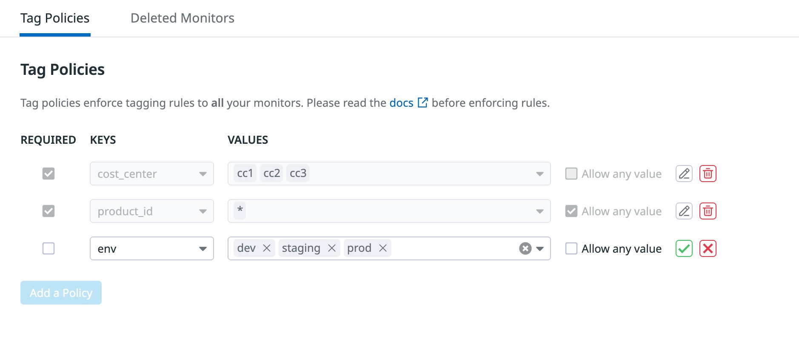

# タグ戦略の実践

## 概要

Datadog のタグ（Tag）は、メトリクス・トレース・ログ・RUM・モニター・ダッシュボード・SLO・コスト配賦のすべてをつなぐ「共通の次元（dimension）」である。タグ戦略の良し悪しは、(1) 障害調査で横断的に絞り込めるか、(2) アラートが正しいチームに届くか、(3) 利用量・コストをチームや事業に配賦できるか、(4) カスタムメトリクス課金が暴発しないか、に直結する。

本ファイルは応用編として、タグの**仕様そのもの**ではなく、**設計・付与・統制・運用改善**の実践知をまとめる。タグの文字種・長さ・予約キーなどの仕様は [Tagging（タグ）](../02_リファレンス/platform/tagging.md)、カスタムメトリクスの仕組みは [Custom Metrics と DogStatsD](../02_リファレンス/platform/custom-metrics-and-dogstatsd.md)、利用量配賦の画面仕様は [Usage・Usage Attribution・Cost Visibility](../02_リファレンス/platform/usage-and-cost-attribution.md) を参照のこと。

本ファイルの答える主な問い:

| 問い | 該当節 |
|---|---|
| どんなタグキーを標準にすべきか | [2. タグ設計の原則](#2-タグ設計の原則) / [3. 標準タグ辞書](#3-標準タグ辞書テンプレート) |
| タグはどのレイヤーで付けるべきか | [4. 付与レイヤーの設計](#4-付与レイヤーの設計) |
| `env` / `service` / `version` をどう揃えるか | [5. Unified Service Tagging の実装パターン](#5-unified-service-tagging-の実装パターン) |
| カスタムメトリクスが爆発しないタグ設計は | [6. カーディナリティ管理](#6-カーディナリティ管理) |
| チーム所有権・通知ルーティングをどう表すか | [7. チーム・所有権タグ](#7-チーム所有権タグ) |
| Datadog 利用料やクラウドコストを部門に配賦するには | [8. コスト配賦タグ](#8-コスト配賦タグ) |
| タグ規約をどう強制・監査するか | [9. 組織的な強制方法](#9-組織的な強制方法タグガバナンス) |
| よくある失敗は | [11. 失敗例とアンチパターン](#11-失敗例とアンチパターン) |

> **前提:** 本ファイルの情報基準日は 2026-11-02。Datadog Agent v7 系を前提とする。Preview の機能は `【Preview】` を付す。

---

## 1. タグ仕様の要点（設計に効くものだけ）

タグ戦略を設計するうえで押さえるべき Datadog タグ仕様を抜粋する。詳細は [Tagging（タグ）](../02_リファレンス/platform/tagging.md) を正とする。[出典](https://docs.datadoghq.com/getting_started/tagging/)

| 項目 | 仕様 | 設計上の含意 |
|---|---|---|
| 形式 | `<key>:<value>`（推奨）または `<value>` のみ | 値だけのタグ（例: `prod`）は検索・グループ化・配賦で使いにくい。**必ず key:value 形式に統一**する |
| キーの区切り | 最初のコロンでキーと値を分割（`env:staging:east` はキー `env`、値 `staging:east`） | 値にコロンを含めるのは可能だが、可読性のため避ける【経験則】 |
| 先頭文字 | 文字（Unicode 文字含む）で始まる必要がある | 数字始まりの値（例: `env:1prod`）は一部で動作するが一貫しない。避ける |
| 使用可能文字 | 英数字、`_`、`-`、`:`、`.`、`/`（`@` は HTTP 取り込みログのみ） | それ以外（カンマ、絵文字、バックスラッシュ、空白など）は `_` に変換される |
| アンダースコアの正規化 | 先頭・末尾の `_` は除去、連続 `_` は1つに圧縮 | `__team__` などの装飾は意味を失う |
| 最大長 | 200 文字（キー＋コロン＋値の合計） | URL・ARN をそのまま値にすると超過しやすい |
| 大文字小文字 | スパンタグとメトリクスタグは**小文字に正規化**。スパン属性・ログ属性は大小区別あり | キーにキャメルケースを使わない。値も小文字で統一する |
| `DD_TAGS` 内の空白 | 空白はタグの区切りとして扱われ、`_` には変換されない | 空白を含む値は YAML 設定ファイルやアノテーションで付ける |
| 予約タグキー | `host`、`device`、`source`、`service`、`env`、`version`、`team` | 予約キーを独自の意味で転用しない（[11 章](#11-失敗例とアンチパターン)） |
| 継承 | データはホストのホストタグを継承する | ホストとポッドで同名キーを使うと衝突する。`infra_service` のように別キー名を使う |
| 優先順位 | Agent は同一キーの優先順位を強制せず、**すべてのユニーク値を送出**する | 同一キーに複数値が付く状態（例: `env:prod` と `env:staging` の両方）が起き得る |

> **注意（古い情報との食い違い）:** 旧版の日本語ドキュメントや一部ブログでは「カンマが使用可能」と書かれている場合があるが、2026-11 時点の英語版公式ドキュメントではカンマは `_` に変換される文字として列挙されている。最新の英語版を正とする。[出典](https://docs.datadoghq.com/getting_started/tagging/)

---

## 2. タグ設計の原則

### 2.1 原則一覧

Datadog のタグ設計の原則を、公式ドキュメントと実務知見から整理する。

| # | 原則 | 内容 | 根拠 |
|---|---|---|---|
| P1 | 問いから逆算する | 「障害時にどう絞り込みたいか」「誰に通知したいか」「誰にコストを配賦したいか」という問いに対応するタグだけを定義する。グループ化・アラート・所有権のいずれにも使わないタグは削除候補 | 【第三者情報】[RapDev](https://rapdev.io/blog/top-7-mistakes-in-datadog-tagging-strategies)（2026-03 公開） |
| P2 | Unified Service Tagging を土台にする | `env`・`service`・`version` を全テレメトリに付け、メトリクス・トレース・ログ・RUM を相関させる | [公式](https://docs.datadoghq.com/getting_started/tagging/unified_service_tagging/) |
| P3 | 組織共通の辞書を1つ持つ | チームごとに独自キーを作らせない。キー名・許可値（語彙）・付与責任者を1つの標準として公開する | 【第三者情報】[RapDev](https://rapdev.io/blog/top-7-mistakes-in-datadog-tagging-strategies)（2026-03 公開）、[公式（命名の一貫性）](https://docs.datadoghq.com/extend/guide/what-best-practices-are-recommended-for-naming-metrics-and-tags) |
| P4 | 値の語彙を固定する | `env:prod` と `env:production` は別の値として扱われ、モニターやダッシュボードが分断される。キーごとに許可値リストを定める | 【第三者情報】[RapDev](https://rapdev.io/blog/top-7-mistakes-in-datadog-tagging-strategies)（2026-03 公開）、[issoh](https://www.issoh.co.jp/tech/details/16515/)（2026-08 公開） |
| P5 | メトリクスタグは有界（bounded）に | ユーザー ID、リクエスト ID、エポック時刻など際限なく増える値をメトリクスタグにしない | [公式](https://docs.datadoghq.com/getting_started/tagging/) |
| P6 | 予約タグを転用しない | `env`・`service`・`version` に別の意味を持たせると相関モデルが壊れる | 【第三者情報】[RapDev](https://rapdev.io/blog/top-7-mistakes-in-datadog-tagging-strategies)（2026-03 公開） |
| P7 | クラウド/プラットフォームのタグを先に活かす | AWS の `region`・`availability-zone`・`instance-type`、Kubernetes の推奨ラベル（`component`・`part-of`・`managed-by` 等）は自動取り込みされる。重複定義しない | [公式ブログ](https://www.datadoghq.com/blog/tagging-best-practices/)（2019-12 公開、2023-11 更新） |
| P8 | 小文字・スネークケース | メトリクス/スパンタグは小文字化されるため、キーも値も最初から小文字で統一する | [公式](https://docs.datadoghq.com/getting_started/tagging/) |
| P9 | 機微情報を入れない | 個人情報・機微データをタグ・メトリクス名に含めない | [公式](https://docs.datadoghq.com/extend/guide/what-best-practices-are-recommended-for-naming-metrics-and-tags) |
| P10 | 早期に確定する | 送信済みデータにタグを後付けできない（メトリクス・ログ等）。命名規約は導入初期に固める | 【第三者情報】[issoh](https://www.issoh.co.jp/tech/details/16515/)（2026-08 公開） |
| P11 | 定期的に棚卸しする | 値が1種類しかないタグ、数千種類あるタグを定期的に検出して見直す | 【第三者情報】[issoh](https://www.issoh.co.jp/tech/details/16515/)（2026-08 公開） |

### 2.2 タグの用途による分類

タグは用途ごとに分類して設計すると、過不足が見えやすい。issoh の記事は「障害調査用」「コスト配賦用」「環境切替用」の3分類を提案しており【第三者情報】、本ナレッジではこれを拡張して以下の5分類を推奨する【経験則】。

| 分類 | 目的 | 代表的なキー | カーディナリティ目安 |
|---|---|---|---|
| スコープ（環境・場所） | 環境・リージョン・クラスタで絞り込む | `env`、`region`、`availability-zone`、`kube_cluster_name`、`datacenter` | 低 |
| サービス識別 | アプリケーション・コンポーネントを特定し相関する | `service`、`version`、`role`、`component` | 低〜中 |
| 所有権 | アラートの宛先・責任範囲を表す | `team`、`owner`（Datadog Teams の handle と一致させる） | 低 |
| ビジネス・コスト | 事業・部門・顧客区分でコストやインパクトを集計する | `business_unit`、`cost_center`、`product`、`customer_tier`、`customer_region` | 低 |
| ライフサイクル・運用 | 監視の要否、重要度、管理方法を表す | `tier`、`lifecycle`、`managed_by`、`datadog:monitored` | 低 |

公式ブログ「Best practices for tagging your infrastructure and applications」（2019-12 公開、2023-11 更新）は、`business_unit:internal-processing`、`cost_center:internal-processing-01`、`customer_region:eu`、`site:web-store.staging`、`role:webserver` などの具体例を挙げている。[出典](https://www.datadoghq.com/blog/tagging-best-practices/)

### 2.3 タグと属性（attribute）の使い分け

Datadog では「タグ」と「属性（ログ属性・スパン属性・RUM 属性）」が別物である。高カーディナリティな識別子は**タグではなく属性**に置くのが原則である。

| データ | タグ | 属性 | 備考 |
|---|---|---|---|
| メトリクス | タグのみ（すべてカスタムメトリクスの次元になる） | なし | 値の組み合わせ数がそのまま課金対象時系列数になる |
| ログ | ホストタグ・`service`・`source` 等 | JSON 属性（`@http.status_code` など）。大小文字を区別 | ユーザー ID・リクエスト ID は属性に置く。ファセット化すれば検索・集計できる |
| トレース（スパン） | スパンタグ（小文字化される） | スパン属性 | `user.id` 等はスパン属性として扱う。トレースメトリクスの次元にはならない |

ログの予約属性（`host`、`source`、`status`、`service`、`trace_id`、`message`）と標準属性の命名規約は [Log Pipelines と処理](../02_リファレンス/logs/log-pipelines-and-processing.md) を参照。[出典](https://docs.datadoghq.com/logs/log_configuration/attributes_naming_convention/)

> **注意:** ログ属性・スパン属性は自由に高カーディナリティにできるが、それらを**ログベースメトリクスやスパンベースメトリクスの group by に使うと、その時点でカスタムメトリクスになる**。生成メトリクスの次元には有界な値のみを選ぶ【経験則】。

---

## 3. 標準タグ辞書（テンプレート）

以下は組織で採用する「標準タグ辞書」のテンプレートである。キー名は公式の予約キー・公式ブログの例・Kubernetes 推奨ラベルに整合させている。必須度・許可値は組織ごとに調整する【経験則】。

### 3.1 キー定義テンプレート

| キー | 必須度 | 対象データ | 許可値（例） | 付与元（推奨） | 備考 |
|---|---|---|---|---|---|
| `env` | 必須 | 全テレメトリ・モニター・SLO・ダッシュボード | `prod`、`stg`、`dev`（語彙を固定） | SDK（`DD_ENV`）／Agent／コンテナラベル | 予約キー。APM の必須プライマリタグ。未設定時は APM 上 `env:none` |
| `service` | 必須（アプリ） | トレース・ログ・アプリメトリクス・RUM | Software Catalog（旧称：Service Catalog）に登録したサービス名 | SDK（`DD_SERVICE`）／`tags.datadoghq.com/service` ラベル | 予約キー。ホストタグとして付けない |
| `version` | 必須（アプリ） | トレース・ログ・アプリメトリクス・RUM | デプロイ単位で変わる値（Git SHA、イメージタグ等） | CI/CD → `DD_VERSION`／ラベル | 予約キー。デプロイ追跡に使用 |
| `team` | 必須 | サービス・モニター・ダッシュボード・SLO・インフラ | Datadog Teams の team handle | Software Catalog／IaC／クラウドタグ | 予約キー。Teams 定義済み handle に揃える |
| `cost_center` | 必須（コスト配賦する場合） | インフラ・クラウドリソース | 経理の部門コード | クラウドタグ（IaC）／Tag Pipelines | 公式ブログ例あり |
| `business_unit` | 推奨 | インフラ・サービス | 事業部コード | クラウドタグ／Catalog | |
| `product` | 推奨 | サービス・インフラ | プロダクト名 | クラウドタグ／Catalog | |
| `region` | 自動 | AWS 等 | クラウドが付与 | クラウドインテグレーション | 自前で別名キーを作らない |
| `kube_cluster_name` | 自動 | Kubernetes | クラスタ名 | Agent | ホストタグ（低カーディナリティ） |
| `tier` | 推奨 | サービス・モニター | `tier1`〜`tier3` | Software Catalog | 重要度に応じたアラート設計に利用 |
| `lifecycle` | 任意 | サービス | `production`、`experimental`、`deprecated` | Software Catalog | 公式ブログ例あり |
| `managed_by` | 任意 | モニター・ダッシュボード・SLO | `terraform`、`ui` | IaC | UI 手修正と IaC 管理の区別に有効 |
| `datadog` | 任意 | クラウドリソース | `monitored`、`no` | クラウドタグ | AWS インテグレーションのタグフィルタに使う例が公式にある |

### 3.2 命名規約テンプレート

| 項目 | 規約（例） |
|---|---|
| キー | 小文字スネークケース（`cost_center`）。ハイフンはクラウド側標準（`availability-zone`）に合わせる場合のみ |
| 値 | 小文字。区切りは `-` または `_` のどちらかに統一 |
| 略語 | 意味が複数に取れる略語は使わない（公式推奨） |
| 環境値 | `prod` / `stg` / `dev` のように列挙し、`production`・`Prod`・`PRD` の混在を禁止 |
| 新規キー追加 | 辞書オーナー（プラットフォームチーム）のレビューを経て追加 |
| 予約キー | `host`、`device`、`source`、`service`、`env`、`version`、`team` は本来の意味以外で使用禁止 |

---

## 4. 付与レイヤーの設計

### 4.1 タグの流入経路

Datadog のテレメトリに付くタグは複数のレイヤーから流入する。どのレイヤーでどのキーを責任を持って付けるかを決めておくと、重複・衝突・欠落を防げる。



### 4.2 付与方法一覧

公式が挙げるタグ付与方法と、タグ戦略上の推奨用途を整理する。[出典](https://docs.datadoghq.com/getting_started/tagging/assigning_tags/)

| 方法 | 具体 | 推奨用途 | 注意点 |
|---|---|---|---|
| 設定ファイル | `datadog.yaml` の `tags`（ホストタグ）、`conf.d/<integration>.d/conf.yaml` の `tags` | 物理/VM ホストの `env`・`role`・`datacenter` | 構成管理（Ansible/Chef 等）でテンプレート化する |
| 環境変数 | `DD_TAGS`（空白区切り）、`DD_CONTAINER_LABELS_AS_TAGS`、`DD_CONTAINER_ENV_AS_TAGS`、`DD_KUBERNETES_POD_LABELS_AS_TAGS` | コンテナ Agent | `DD_TAGS` 内の空白は区切り扱い |
| インテグレーション継承 | AWS インスタンスのタグ、Chef のロールなどが自動付与 | クラウドリソースの `cost_center`・`team` | クラウド側のタグ規約がそのまま Datadog に流入する。**クラウドのタグ規約と Datadog のタグ辞書を一本化**する |
| UI | Host Map、Infrastructure List、Monitors、Distribution Metrics、AWS インテグレーションタイル、SLO 作成画面 | 例外的な手動修正のみ | UI でのホストタグ変更は反映まで最大 5 分。手作業は規約違反の温床になりやすい【経験則】 |
| API | チェックラン、イベント、メトリクス、モニター、ホストタグ、トレース、SLO の送信・作成時 | IaC・自動化 | [Terraform と IaC](../02_リファレンス/platform/terraform-and-iac.md) |
| DogStatsD | コード内でメトリクス・イベント・サービスチェックにタグ付与 | アプリ固有の次元（`endpoint`、`status_code`） | 高カーディナリティの最大の発生源。[6 章](#6-カーディナリティ管理) |
| Kubernetes アノテーション | `ad.datadoghq.com/tags: '{"<KEY>": "<VALUE>"}'`（Pod 全体）、`ad.datadoghq.com/<CONTAINER>.tags`（コンテナ単位） | Pod 単位の `team` 等 | Agent v6.10 以降。Agent v7.77 以降はテンプレート変数（`%%env_<VAR>%%` を除く）を使用可 |
| Kubernetes リソースのラベル/アノテーション | `kubernetesResourcesLabelsAsTags`、`kubernetesResourcesAnnotationsAsTags`（推奨、Agent v7.58.0 以降） | Deployment・Namespace・Node のラベルを一括でタグ化 | 旧方式（`podLabelsAsTags` 等）より新キーが優先。ワークロードのラベルは子 Pod に継承されないが、Namespace のメタデータは Pod/コンテナに継承される |
| Docker ラベル | `com.datadoghq.ad.tags`（Agent v7.17 以降） | Docker 環境 | |

[出典（Kubernetes）](https://docs.datadoghq.com/containers/kubernetes/tag/)、[出典（Docker）](https://docs.datadoghq.com/containers/docker/tag/)

### 4.3 レイヤー別の責任分担（推奨例）

| キー | 責任を持つレイヤー | 理由 |
|---|---|---|
| `env` | アプリの SDK（`DD_ENV`）＋インフラ（Agent/クラスタ） | APM はトレーサーと Agent の値が異なってはならない。クラスタ全体で単一 env なら Helm/Operator のグローバル設定、混在するなら Pod ラベル |
| `service` / `version` | アプリのデプロイ定義（CI/CD） | デプロイごとに変わるため、パイプラインで注入する |
| `team` / `tier` | Software Catalog（サービス定義） | 所有権の正本を1か所にする。[Software Catalog](../02_リファレンス/platform/software-catalog.md) |
| `cost_center` / `business_unit` | クラウドリソースタグ（IaC） | クラウド請求・Datadog 利用量の両方で同じ値を使うため |
| モニター・ダッシュボードの `team`・`managed_by` | Terraform 等の IaC | [Monitoring as Code](09-monitoring-as-code.md) |

> **ポイント:** ホストタグとして `service` を付けると、そのホスト上のすべてのデータ（別サービスのトレース・ログを含む）に `service` が付き、Unified Service Tagging と衝突する。APM の公式ガイドも、`resource`・`name`・`service` をホストレベルタグとして付けないよう明記している。[出典](https://docs.datadoghq.com/tracing/guide/setting_primary_tags_to_scope/)

---

## 5. Unified Service Tagging の実装パターン

Unified Service Tagging（統合サービスタグ付け）は、`env`・`service`・`version` の3つの予約タグでメトリクス・トレース・ログ・プロファイル・RUM を相関させる仕組みである。[出典](https://docs.datadoghq.com/getting_started/tagging/unified_service_tagging/)

### 5.1 環境別の設定方法

| 環境 | 設定方法 | 要点 |
|---|---|---|
| Kubernetes（完全構成） | ワークロード（Deployment 等）と Pod テンプレートの両方に `tags.datadoghq.com/env`、`tags.datadoghq.com/service`、`tags.datadoghq.com/version` ラベル。APM 用に `DD_ENV`・`DD_SERVICE`・`DD_VERSION` を Downward API で注入、または Cluster Agent の Admission Controller で自動注入 | Autodiscovery が必要 |
| Kubernetes（部分構成） | Datadog Operator / Helm でグローバル `env` を設定し、Pod ラベルで `service`・`version` を設定。複数コンテナの Pod はコンテナ別ラベルプレフィックスを使用 | グローバル `env` と Pod の `env` が異なると**両方の値が付く** |
| Docker | `DD_ENV`・`DD_SERVICE`・`DD_VERSION` と `com.datadoghq.tags.*` ラベル。`service`・`version` は Dockerfile、`env` はデプロイ時に設定するのが一般的 | Agent が Docker ソケットにアクセスできること |
| Amazon ECS | タスク定義の環境変数と `dockerLabels` | Fargate ではアプリケーションコンテナに設定（Agent コンテナではない）。Fluent Bit / FireLens 利用時はメトリクスとトレースのみ対象（ログは対象外） |
| 非コンテナ（VM/ベアメタル） | プロセスごとに `DD_ENV`・`DD_SERVICE`・`DD_VERSION`（起動コマンド、systemd/initd ユニット） | 1ホストに複数サービスがある場合はプロセス単位で設定。システムメトリクス用の `env` は `datadog.yaml` |
| ログ | SDK の自動ログインジェクションを有効化 | |
| RUM | ブラウザ SDK 初期化時に `service`・`env`・`version` を設定 | |
| OpenTelemetry | `deployment.environment.name`（旧 `deployment.environment`）→ `env`、`service.name` → `service`、`service.version` → `version` | OTel 構成では `DD_ENV` 等は非対応。`OTEL_RESOURCE_ATTRIBUTES` 等で設定。[OpenTelemetry 活用戦略](10-opentelemetry-strategy.md) |

### 5.2 `version` の自動付与

- APM では Agent 7.52.0 以降で `version` の自動タグ付けが可能。優先順位は「手動設定値 → `{image_tag}_{Git SHA 先頭7桁}` → `image_tag` または SHA のどちらか」。手動設定値は上書きされない。[出典](https://docs.datadoghq.com/getting_started/tagging/unified_service_tagging/)
- 非コンテナ環境で SHA ベースの追跡をするには、ビルド成果物に Git 情報を埋め込む必要がある。

### 5.3 トレーサー/Agent の最低バージョン

| コンポーネント | 最低バージョン |
|---|---|
| Agent | 6.19.x / 7.19.x 以降 |
| .NET | 1.17.0+ |
| C++ | 0.1.0+ |
| Go | 1.24.0+ |
| Java | 0.50.0+ |
| Node.js | 0.20.3+ |
| PHP | 0.47.0+ |
| Python | 0.38.0+ |
| Ruby | 0.34.0+ |

[出典](https://docs.datadoghq.com/getting_started/tagging/unified_service_tagging/)

### 5.4 実装時の落とし穴

| 落とし穴 | 症状 | 対策 |
|---|---|---|
| トレーサーと Agent で `env` が異なる | APM で同一サービスが2つの環境に分かれる | `env` は SDK（`DD_ENV`）で設定し、Agent 側と一致させる |
| グローバル `env` と Pod ラベルの `env` が異なる | データに `env` が2値付く | `env` は最も具体的なレベル1か所で設定する |
| プロセスチェックとホストの両方で `service` を設定 | 二重タグ付け | プロセスレベルの `service` はプロセスチェックでのみ設定 |
| `service` 名の表記ゆれ（`checkout` と `checkout-api`） | ログと APM が相関しない | `service` 値は Software Catalog の登録名に固定。ログの `service` は APM と完全一致させる必要がある |

---

## 6. カーディナリティ管理

### 6.1 なぜカーディナリティが課金に直結するか

Datadog のカスタムメトリクスは「**メトリクス名とタグ値（`host` タグを含む）のユニークな組み合わせ**」で1つと数えられる。[出典](https://docs.datadoghq.com/metrics/custom_metrics/)

公式の計算例（`request.Latency`、タグ `endpoint`（X/Y）と `status`（200/400）、ユニーク組み合わせ 4 通り）:

| メトリクスタイプ | カスタムメトリクス数 |
|---|---|
| Count / Rate / Gauge | 4 |
| Histogram（デフォルト 5 集計） | 4 × 5 = 20 |
| Distribution（デフォルト 5 集計） | 5 × 4 = 20 |
| Distribution＋パーセンタイル（p50/p75/p90/p95/p99） | 2 × 5 × 4 = 40 |

[出典](https://docs.datadoghq.com/account_management/billing/custom_metrics/)

**タグ追加が必ずしも数を増やすわけではない**点も重要である。カウントは最も細かい粒度のタグに依存する。公式例では、`city` タグが既にある状態で `state` タグを追加しても数は増えない（`city` が `state` を一意に決めるため）。タグの並び順を変えても新しいカスタムメトリクスにはならない。[出典](https://docs.datadoghq.com/account_management/billing/custom_metrics/)

#### 掛け算のイメージ（概算の考え方）

独立したタグ同士は掛け算で効く【経験則】。

```
時系列数 ≒ ホスト数（host タグを残す場合） × Π(各タグのユニーク値数のうち独立なもの)

例: api.request.count に
    host(50) × endpoint(40) × status_code(8) × method(4)
    = 64,000 時系列（すべての組み合わせが実際に発生した場合の上限）
  ここに user_id(10,000) を足すと上限は 6.4 億時系列
```

実際に発生した組み合わせだけが数えられるため上限値どおりにはならないが、**無界の値（ユーザー ID、リクエスト ID、セッション ID、タイムスタンプ、フル URL、エラーメッセージ全文）は1つ加えるだけで桁が変わる**。公式も「エポック時刻、ユーザー ID、リクエスト ID などの無界なソースは避ける」と明記している。[出典](https://docs.datadoghq.com/getting_started/tagging/)

### 6.2 割当量（Allotment）

| プラン | 1ホストあたりの割当 | 備考 |
|---|---|---|
| Pro | 取り込み（ingested）100／インデックス（indexed）100 カスタムメトリクス | インフラ全体でプール。例: Pro 3 ホストなら indexed 300 を任意のホストで使える |
| Enterprise | 取り込み 200／インデックス 200 カスタムメトリクス | 同上 |
| 超過 | indexed は 100 単位で契約単価、ingested は 100 あたり $0.10（Metrics without Limits で構成したメトリクスのみ） | 単価の正本は [製品別料金表](../03_導入編/02-pricing-by-product.md) |

[出典](https://docs.datadoghq.com/account_management/billing/custom_metrics/)

### 6.3 「タグにする / しない」判断表

| 候補値 | メトリクスタグ | 推奨する置き場所 | 理由 |
|---|---|---|---|
| `env`、`region`、`service` | ○ | タグ | 有界・低カーディナリティ |
| HTTP ステータスコード | ○（クラス化も検討） | タグ（`status_class:5xx` 等にまとめると更に削減） | 有界 |
| エンドポイント（ルートテンプレート `/users/{id}`） | ○ | タグ | 有界 |
| 生の URL パス（`/users/12345`） | × | スパン属性・ログ属性 | ID を含むと無界 |
| ユーザー ID・顧客 ID | × | ログ/スパン属性、RUM 属性 | 無界。顧客別集計が必要なら `customer_tier` など有界な区分をタグに |
| リクエスト ID・トレース ID | × | ログ属性（`trace_id`） | 無界 |
| `pod_name`・`container_id` | 原則 ×（必要時のみ） | Agent のカーディナリティ設定で制御 | ローリング更新ごとに増える |
| Git SHA（`version`） | ○（Unified Service Tagging） | タグ | デプロイ頻度に比例して増えるが、時間方向に入れ替わる |
| エラーメッセージ全文 | × | ログ / Error Tracking | 無界 |

### 6.4 Agent のタグカーディナリティ設定

コンテナ環境では Agent がオーケストレーター由来のタグを自動付与する。その粒度を Agent 設定で制御できる。[出典](https://docs.datadoghq.com/getting_started/tagging/assigning_tags/)

| 環境変数（`datadog.yaml` キー） | 対象 | 値 | デフォルト |
|---|---|---|---|
| `DD_CHECKS_TAG_CARDINALITY`（`checks_tag_cardinality`） | インテグレーション（チェック）メトリクス | `low` / `orchestrator` / `high` | `low` |
| `DD_DOGSTATSD_TAG_CARDINALITY`（`dogstatsd_tag_cardinality`） | DogStatsD（カスタム）メトリクス | `low` / `orchestrator` / `high` | `low` |

| レベル | 付与されるタグの例（Kubernetes） |
|---|---|
| `low` | `kube_namespace`、`kube_deployment`、`kube_service`、`kube_container_name`、`image_name`、`image_tag`、`short_image`、`env`、`service`、`version`、`pod_phase`、`kube_qos` など。ホストタグ（`kube_cluster_name`、`kube_node` 等） |
| `orchestrator` | 上記＋ `pod_name`、`kube_ownerref_name`、`oshift_deployment`、CronJob 配下の `kube_job`。ECS/Fargate では `task_arn` |
| `high` | 上記＋ `container_id`、`display_container_name` |

[出典](https://docs.datadoghq.com/containers/kubernetes/tag/)

DogStatsD 用の設定が分かれているのは、DogStatsD メトリクスの課金体系が異なるためである（公式記載）。**DogStatsD を `orchestrator` 以上にすると、Pod の入れ替わりごとに時系列が増える**ため、デフォルトの `low` を維持し、Pod 単位の分析が必要な場合はログ・APM で行うのが一般的【経験則】。

### 6.5 Metrics without Limits™ による「付けすぎ」の事後制御

Metrics without Limits™（MwL）は、取り込み（ingestion）とインデックス（indexing）を分離し、**クエリ可能にするタグを後から選べる**機能である。[出典](https://docs.datadoghq.com/metrics/metrics-without-limits/)

| 項目 | 内容 |
|---|---|
| 構成方式 | 許可リスト（include tags：指定タグのみクエリ可能）／ブロックリスト（exclude tags：指定タグをクエリ不可。API では `exclude_tags_mode: true`） |
| 推奨タグの提示 | 過去 30 日にクエリされたタグ（折れ線アイコン）と、ダッシュボード・モニター・ノートブック・SLO で使われているタグ（ターゲットアイコン）が事前入力される |
| 一括構成 | Metrics Summary の「Configure Metrics」で複数メトリクス・名前空間（`*` 構文）に一括適用。`include_actively_queried_tags_window` で一定期間内にクエリされたタグに限定可能 |
| 前提 | メトリクスのタイプが宣言されていること |
| 推定 | 保存前にカーディナリティ推定器で indexed 量を確認。indexed が ingested を上回る構成は保存しない |
| 効果の確認 | 約 24 時間後に Plan & Usage の Top Custom Metrics で減少を確認 |
| ロールバック | タグ表示は新しいデータから復活するが、除外していた期間は**バックフィルされない** |
| 権限 | `metrics_tags_write` を必要なユーザーにのみ付与 |
| 監査 | Events Explorer で `tags:audit "Queryable tag configuration"` を検索 |

[出典](https://docs.datadoghq.com/metrics/guide/custom_metrics_governance/)

MwL 適用時の計算例（許可リスト `endpoint`、`status`）: Count/Rate/Gauge は indexed 3・ingested 4、Distribution は indexed 15・ingested 20。**構成したメトリクスのみ ingested 量にカウントされ、未構成のメトリクスは indexed 量のみで課金される**。[出典](https://docs.datadoghq.com/account_management/billing/custom_metrics/)

> **位置付け:** MwL は「付けてしまったタグを課金対象から外す」対症療法であり、根本対策は送信コード側で無界タグを付けないことである。【第三者情報】[issoh](https://www.issoh.co.jp/tech/details/16515/)（2026-08 公開）。コスト観点の詳細は [コスト最適化](01-cost-optimization.md) を参照。



*図: Metrics without Limits™ のタグ構成モーダル*

- **画面の説明:** Metrics Summary でメトリクスを選び、タグ構成（Manage Tags）を開いたときのモーダル。許可リストに入れるタグ候補が並び、ダッシュボード・モニター・ノートブック・SLO などの資産で使われているタグにはターゲットアイコン、過去 30 日にクエリされたタグには折れ線アイコンが付く。これにより「消すと既存資産が壊れるタグ」を判別できる。
- **出典:** https://docs.datadoghq.com/metrics/metrics-without-limits/ （取得日: 2026-11-02）

### 6.6 カーディナリティの監視

カーディナリティは「設計で防ぎ、監視で検知し、MwL で止血する」の3段構えで管理する【経験則】。監視に使える公式の推定利用量メトリクス:

| メトリクス | 内容 |
|---|---|
| `datadog.estimated_usage.metrics.custom` | インデックス済みカスタムメトリクス数（推定） |
| `datadog.estimated_usage.metrics.custom.by_metric` | メトリクス名別 |
| `datadog.estimated_usage.metrics.custom.by_tag` | タグ別 |
| `datadog.estimated_usage.metrics.custom.ingested`（`.by_metric`、`.by_tag`） | 取り込みカスタムメトリクス数 |

これらは直近 1 時間に観測されたユニーク時系列を反映する。公式ガイドは `datadog.estimated_usage.metrics.custom.by_metric` に閾値モニター（例として 700,000）を設定し、変化率（change）、異常検知（anomaly）、予測（forecast）モニターを組み合わせることを推奨している。[出典](https://docs.datadoghq.com/metrics/guide/custom_metrics_governance/)

調査手順（公式ガイドの要約）:

1. Plan & Usage の Custom Metrics タブで Top Custom Metrics を確認（上位 5,000 まで表示）。[出典](https://docs.datadoghq.com/metrics/custom_metrics/)
2. Metrics Volume Management で急増したメトリクスを特定。
3. メトリクス詳細のサイドパネルで **Custom Metrics Tags Cardinality Explorer** を開き、ユニーク値が急増したタグキーを特定。
4. 送信元を修正、または MwL で除外。
5. Metrics Summary で Query Activity（30/60/90 日）・Related Assets（Not used in any asset）・Configuration（All Tags）で絞り込み、未使用メトリクスに空の許可リストを適用（公式は未クエリのメトリクスで平均利用量を最大 70% 削減できると記載）。

[出典](https://docs.datadoghq.com/metrics/guide/custom_metrics_governance/)

### 6.7 APM のプライマリタグとカーディナリティ

APM のトレースメトリクスは、プライマリタグ（primary tags）の次元で集計される。

| 項目 | 内容 |
|---|---|
| `env` | 既定かつ必須のプライマリタグ。未設定は `env:none` |
| 追加プライマリタグ | ホストタグまたはコンテナタグから選択。SDK が付けるスパンレベルのタグは使用不可 |
| 値の上限 | 追加プライマリタグ1つあたり **ユニーク値 100 まで** |
| コンテナベースのタグ | Agent 7.65.0 以降でデフォルト有効（`disable_cid_stats` で無効化） |
| 反映時間 | 変更が UI に反映されるまで最大 2 時間 |
| 権限 | APM Settings ページは組織管理者のみ |
| 変更の影響 | 以前のタグで集計された履歴データは参照不能になり、旧タグでスコープしたAPMモニターは No Data になる |

[出典](https://docs.datadoghq.com/tracing/guide/setting_primary_tags_to_scope/)

**設計上の含意:** 追加プライマリタグには `availability-zone`、`datacenter`、`kube_cluster_name` のような低カーディナリティで変化しないキーを選ぶ（公式ブログも同趣旨）。後から変えると履歴が見えなくなるため、導入初期に決める。詳細は [APM 運用の実践](05-apm-practices.md)。

---

## 7. チーム・所有権タグ

### 7.1 Datadog Teams と `team` タグ

`team` は予約タグキーであり、Datadog Teams の **team handle** と一致させると、Team フィルタなどの機能が有効になる。定義されていない handle は通常のタグとして振る舞うため、Teams として定義することが推奨されている。[出典](https://docs.datadoghq.com/account_management/teams/)

| 項目 | 仕様 |
|---|---|
| 表記 | 検索バー・ファセットでは `team:<team-handle>` または `teams:<team-handle>` |
| チーム名に使える文字 | `a-z`、`A-Z`、`0-9`、`._-:/`（空白は `_` に置換推奨） |
| handle に使える文字 | `a-z`、`0-9`、`._-:/`。末尾に `_` は不可 |
| handle の初期値 | チーム名から自動生成 |
| 関連付け可能なリソース | ダッシュボード、インシデント、モニター、Resource Catalog、Catalog エンティティ、SLO、Synthetic テスト、Global Variables、Private Locations |
| 通知 | モニター通知で `@team-<handle>` を使い、チームの通知チャネル（Slack、Microsoft Teams 等）へルーティング |
| Team フィルタ | 多くの一覧画面で利用可能。APM・Logs Error Tracking・On-Call では Catalog のサービス所有権を使う。各セクション最大 50 件表示（アルファベット順） |
| メンバー管理の方式 | UI/API のみ、SAML（厳格：IdP が決定）、All sources（SAML を基準に UI/API の上書き可） |
| 権限 | Teams Manage（作成・改名・削除・handle 変更）、`user_access_manage`（メンバー管理） |
| サブチーム | 入れ子にして組織構造を表現可能（Teams map） |

### 7.2 所有権タグの設計指針

| 指針 | 内容 | 根拠 |
|---|---|---|
| 正本を1つにする | サービスの所有者は Software Catalog のサービス定義（`team`）を正本とし、モニター・ダッシュボードの `team` タグは IaC で同じ値を付ける | 公式ブログ（Service Catalog で `team`・`tier`・`lifecycle`・連絡先を記録する例）【経験則】 |
| handle と組織図を対応させる | 人事上の部署名ではなく「オンコールを持つ単位」で handle を切る | 【経験則】 |
| 必須化する | `team` が任意・陳腐化していると誤ルーティングとインシデント対応の遅延を招く。作成時に強制する | 【第三者情報】[RapDev](https://rapdev.io/blog/top-7-mistakes-in-datadog-tagging-strategies)（2026-03 公開） |
| 通知はタグ変数で動的に | マルチアラートモニターの通知本文で `{{host.env}}`、`{{host.availability-zone}}` などのタグ変数を使い、宛先やリンクを動的化する | [公式ブログ](https://www.datadoghq.com/blog/tagging-best-practices/)（2019-12 公開、2023-11 更新） |

`team` タグの運用については [Software Catalog](../02_リファレンス/platform/software-catalog.md)、通知ルーティングは [アラート設計とノイズ削減](03-alert-design-and-noise-reduction.md)、組織への定着は [組織への定着](14-organizational-adoption.md) を参照。

---

## 8. コスト配賦タグ

コスト配賦（showback / chargeback）には2種類あり、使う仕組みが異なる。

| 配賦対象 | 仕組み | タグの要件 |
|---|---|---|
| **Datadog 自体の利用料** | Usage Attribution / Cost Attribution（Plan & Usage） | テレメトリやリソースに配賦キー（`team`、`cost_center` 等）が付いていること。**最大 3 キー** |
| **クラウド（AWS/Azure/GCP 等）の利用料** | Cloud Cost Management（CCM）＋ Tag Pipelines | クラウド請求データ上のタグ。不足・不統一は Tag Pipelines で補正 |

### 8.1 Usage Attribution（Datadog 利用量の配賦）

| 項目 | 仕様 |
|---|---|
| 選択できるタグキー | **最大 3 つ**。ルートアカウントと子 org の既存タグから選択。いつでも編集・削除可能 |
| タグ変更の影響 | 新しいレポートから反映。過去レポートは旧タグのまま。月途中の変更は期間ごとの部分月レポートになる |
| 最初のレポート | タグ設定から 24 時間後 |
| 月次 | 月初来集計、日次更新。UI・API・CSV |
| 時間別 | API と時間別 CSV |
| 対象製品 | 計装時にタグ付け可能な製品（Infra など）。タグ付けできない製品（Incident Management Users、Parallel Testing Slots、Audit Trail 等）は対象外 |
| 値の表示 | 空値＝タグはあるが値なし、値なし＝タグ未付与、パイプ区切り＝タグが複数回付与 |
| マルチ org | 親アカウントで全 org を集計。CSV の比率は org ごとに計算 |
| 権限 | 管理者、または Usage Read 権限を持つユーザー |
| 提供プラン | Enterprise プランの機能。その他のプランはアカウント担当者への依頼が必要（公式ガイド記載） |
| Cost Attribution | 直接請求（direct billing）顧客向け。請求サイクル終了時に月末レポート。前月分は遅くとも 19 日までに利用可能 |

[出典（Usage Attribution）](https://docs.datadoghq.com/account_management/billing/usage_attribution/)、[出典（Enterprise 機能である旨）](https://docs.datadoghq.com/metrics/guide/custom_metrics_governance/)

> **サイト差異:** GovCloud（US1-FED）の顧客は、Cost Attribution を有効化する前に免責事項（disclaimer）への同意が必要。[出典](https://docs.datadoghq.com/account_management/billing/usage_attribution/)



*図: Usage Attribution の配賦タグ（最大 3 キー）を設定する Edit Tags ポップオーバー*

- **画面の説明:** Plan & Usage の Usage Attribution（Advanced usage reporting）で「Edit Tags」を開くと表示されるポップオーバー。配賦に使うタグキーをドロップダウンから最大 3 つ選択して保存する。保存後 24 時間で最初のレポートが生成される。
- **出典:** https://docs.datadoghq.com/account_management/billing/usage_attribution/ （取得日: 2026-11-02）

#### 3 キーをどう選ぶか

Usage Attribution のキーは最大 3 つしかないため、選定が実質的な配賦設計になる【経験則】。

| 選定パターン | 3 キーの例 | 向いている組織 |
|---|---|---|
| チーム中心 | `team`、`service`、`env` | プロダクト開発組織。サービス単位で chargeback |
| 会計中心 | `cost_center`、`business_unit`、`env` | 部門別に予算を持つ企業 |
| ハイブリッド | `team`、`cost_center`、`env` | 多くのエンタープライズ |

選定上の注意:

- キーの値が**すべての課金対象に付いていること**が前提。未付与分は「値なし」として残り、配賦不能コストになる。
- `env` を入れると本番と非本番の比率が見え、非本番の削減余地の発見に役立つ。
- キー変更は過去レポートに遡及しないため、年度途中で頻繁に変えない。
- 製品によってタグが付く単位（ホスト、ログイベント、スパン等）が異なるため、ホストタグだけでなくログ・APM 側の `team`/`service` も揃える必要がある。

詳細仕様は [Usage・Usage Attribution・Cost Visibility](../02_リファレンス/platform/usage-and-cost-attribution.md)、マルチ org での集計は [大規模・マルチorg運用](15-large-scale-and-multi-org.md) を参照。

### 8.2 Cloud Cost Management の Tag Pipelines（クラウドコストの配賦）

Tag Pipelines は、クラウド請求データ上の**欠落・誤りのあるタグを補正し、推論タグを付与する**ルール群である。標準化されたタグはコンテナコスト配賦、カスタム配賦ルール、コスト推奨に使われ、全プロバイダの Cloud Cost メトリクスに適用される。[出典](https://docs.datadoghq.com/cloud_cost_management/tags/tag_pipelines/)

| ルールタイプ | 内容 | 典型用途 |
|---|---|---|
| Add tag | 既存タグの有無に基づき、キーと値を追加 | `aws_account:123...` を持つリソースに `cost_center:cc-100` を付ける |
| Alias tag keys | 表記ゆれのキー（`app`、`webapp`、`apps` 等）を標準キーへ集約。1ルールあたり最大 25 キー | 部署ごとにバラバラなキー名の統一 |
| Map multiple tags | Reference Table を使い、主キー列の値と一致したリソースに複数列をタグとして一括追加 | アカウント ID → `business_unit`・`cost_center`・`owner` の一括付与 |

| 項目 | 仕様 |
|---|---|
| ルール数上限 | 最大 100 ルール |
| ルールセット数上限 | 公開情報では確認できず |
| 既存タグがある場合 | ルールを適用しない（変更なし）／値を追加／既存値を置換 から選択。大文字小文字を無視した照合も可能 |
| 処理順 | ルールセット内で上から順に実行。Alias と Map multiple tags は最初にマッチした時点で以降はマッチしない |
| 反映範囲 | 直近 3 か月のデータに適用。履歴の更新は最大 24 時間 |
| タグの削除 | タグを作ったルールを削除すると直近 3 か月から 24 時間以内に除去。それ以前はサポートに依頼 |
| 予約タグ | `host` タグは Tag Pipelines で付与できない |
| タグ正規化 | 新規ユーザーには推奨のタグ正規化ルールがデフォルトで有効 |
| 権限 | 公開情報では確認できず |



*図: Cloud Cost Management の Tag Pipelines で Alias Tag Keys ルールを作成する画面*

- **画面の説明:** 上部の Rule Type で「Add Tag」「Alias Tag Keys」「Map Multiple Tags」を切り替える。Alias Tag Keys では、(1) Add Tag key に標準キー（例: `application`）を指定し、(2) To resources with tag key(s) に既存の表記ゆれキー（例: `app`、`app_id`、`apps`）を優先順に並べる（「Otherwise look for」で追加）。最初に見つかったキーの値を継承する。Additional options で「標準キーが既に存在する場合」の動作（don't apply this rule / replace the existing tag value(s) / add to the existing tag value(s)）を選び、Rule Name を付けて保存する。
- **出典:** https://docs.datadoghq.com/cloud_cost_management/tags/tag_pipelines/ （取得日: 2026-11-02）

**実務の使い分け【経験則】:**

- Tag Pipelines は**請求データ上の補正**であり、Datadog のメトリクス・ログ・トレースのタグは変わらない。テレメトリ側のタグ規約は別途 IaC・Agent で揃える。
- 根本的にはクラウド側で IaC によりタグを強制し、Tag Pipelines は「過去分・例外・M&A 等で揃わない部分の補正」に使う。
- Map multiple tags 用の Reference Table（アカウント → 部門の対応表）を CMDB から定期的に API 更新すると、組織変更に追従しやすい。Reference Tables は [Notebooks・DDSQL・Reference Tables](../02_リファレンス/platform/notebooks-and-data-tools.md) を参照。

CCM 自体の仕様は [Cloud Cost Management](../02_リファレンス/infrastructure/cloud-cost-management.md) を参照。

### 8.3 クラウドタグの取り込みとフィルタ

クラウドインテグレーションでは、クラウドのタグがそのまま Datadog のタグになる。その性質を利用して**監視対象自体をタグで制御**できる。

| クラウド | タグフィルタ | 仕様 |
|---|---|---|
| AWS | AWS インテグレーションの Metric Collection タブ「Limit Metric Collection to Specific Resources」 | 包含タグは OR、`!` 付きの除外タグが優先され AND で結合。例: `datadog:monitored,env:production,instance-type:c1.*,!region:us-east-1`。EC2 の除外設定は付随する EBS ボリュームにも適用。CloudWatch Metric Streams にもタグフィルタが適用される |
| Azure | 定義したタグに一致する VM のみ取り込み。`!` で除外 | |
| Google Cloud | 定義したラベルに一致するホストのみ取り込み。`!` で除外。`<KEY>:<VALUE>` 形式 | |

| 注意点 | 内容 |
|---|---|
| 正規化 | AWS タグの大文字は小文字に、空白は `_` に変換される |
| 既存ホスト | 既存アカウントにフィルタを追加しても、発見済みインスタンスは最大 2 時間 Infrastructure List に残る |
| Agent 稼働ホスト | Agent が動いているホストはフィルタに関係なく表示・課金対象 |
| API | 同じタグフィルタを AWS インテグレーション API で設定可能 |

[出典（AWS 課金とフィルタ）](https://docs.datadoghq.com/account_management/billing/aws/)、[出典（タグの利用）](https://docs.datadoghq.com/tagging/using_tags)

詳細は [AWS Integration](../02_リファレンス/platform/aws-integration.md)、[Azure Integration](../02_リファレンス/platform/azure-integration.md)、[Google Cloud Integration](../02_リファレンス/platform/gcp-integration.md) を参照。

---

## 9. 組織的な強制方法（タグガバナンス）

タグ規約は文書化しただけでは守られない。Datadog には用途ごとに複数の強制・可視化の仕組みがあり、これに IaC と CI のチェックを組み合わせる。

### 9.1 強制手段の全体像

| 手段 | 対象 | 強制の強さ | 提供状況 |
|---|---|---|---|
| Monitor Tag Policies | モニター | 作成・更新時にブロック | GA |
| Resource Catalog の Tagging Policies | インフラ/クラウドリソース | 可視化（非準拠リソース一覧・コンプライアンススコア） | 【Preview】 |
| Tag Rules（Governance API） | ログ・スパン・メトリクス・RUM・feed のテレメトリ | `surfacing`（可視化）／`blocking`（拒否） | 【Preview】（API） |
| Metrics without Limits＋RBAC | カスタムメトリクスのクエリ可能タグ | 課金・クエリ可能範囲を制御 | GA |
| Terraform / IaC | モニター・ダッシュボード・SLO 等の Datadog リソース、クラウドリソース | コードレビューと CI で強制 | — |
| クラウド側のポリシー（AWS Organizations Tag Policies、Azure Policy 等） | クラウドリソース | 作成時にブロック可能 | 各クラウドの機能【経験則】 |
| 監視による検知 | 推定利用量、未タグ資産 | 事後検知 | — |



### 9.2 Monitor Tag Policies（モニターのタグ強制）

Monitor Settings の **Tag policies** タブで、すべてのモニターにタグとタグ値の検証を強制できる。アラートが下流のシステム・ワークフローに正しく届くようにするのが目的である。[出典](https://docs.datadoghq.com/monitors/settings/)

| ルール | 内容 | 例 |
|---|---|---|
| Require tags with mandatory values | タグ必須かつ値は指定リストのみ | `cost_center` は `cc1`、`cc2`、`cc3` のいずれか |
| Require tags only | タグ必須、値は任意 | `product_id` は必須（Allow any value） |
| Optional tag with mandatory values | タグは任意だが、付ける場合は値が指定リストのみ | `env` は `dev`、`staging`、`prod` のいずれか |

| 項目 | 仕様 |
|---|---|
| 適用範囲 | 組織の**すべての**モニター |
| 新規モニター | ポリシーに準拠しないと作成できない |
| 既存の違反モニター | アラート・通知は継続するが、他の設定を変更する前にポリシー準拠への修正が必要 |
| 権限 | `MONITOR_CONFIG_POLICY_WRITE_PERMISSION` を持つロール |
| 設定手順 | [Monitors Settings](https://app.datadoghq.com/monitors/settings) → Tag policies タブ → ルール設定 → 緑のチェックマークで保存 |
| 数値上限（ポリシー数・値数） | 公開情報では確認できず |



*図: Monitors Settings の Tag Policies タブ*

- **画面の説明:** 上部に「Tag Policies」「Deleted Monitors」タブ。Tag Policies では「Tag policies enforce tagging rules to all your monitors.」と表示され、REQUIRED（必須チェックボックス）、KEYS（タグキー）、VALUES（許可値）、Allow any value（任意値許可）の列で行ごとにポリシーを定義する。図の例では `cost_center`（必須、値 `cc1`/`cc2`/`cc3`）、`product_id`（必須、任意値）、`env`（任意、値 `dev`/`staging`/`prod`）を設定している。各行に編集・削除ボタン、下部に「Add a Policy」ボタンがある。
- **出典:** https://docs.datadoghq.com/monitors/settings/ （取得日: 2026-11-02）

**導入手順の勘所【経験則】:**

1. 先に既存モニターのタグ付与状況を API / Terraform state で棚卸しする（既存違反モニターは「アラートは出るが編集できない」状態になるため、障害時の閾値調整が妨げられ得る）。
2. まず「Optional tag with mandatory values」で語彙だけ固定し、表記ゆれを止める。
3. IaC 側の付与が行き渡った段階で「Require tags」に切り替える。
4. Terraform 管理のモニターはプロバイダのデフォルトタグ機能（下記）で一括付与すると漏れが少ない。

モニター設計全般は [アラート設計とノイズ削減](03-alert-design-and-noise-reduction.md) と [Monitors](../02_リファレンス/platform/monitors.md) を参照。

### 9.3 Resource Catalog の Tagging Policies 【Preview】

Resource Catalog の Policies（**Resources > Policies**）では、カスタムポリシーに加えて **Tagging policy** を作成できる。対象リソースタイプを選び、必須タグキーと許可値・形式を定義すると、非準拠リソース一覧とコンプライアンススコアが表示される。[出典](https://docs.datadoghq.com/infrastructure/resource_catalog/governance)

| 項目 | 内容 |
|---|---|
| 作成手順 | Resources > Policies → **New Tagging Policy** → リソースタイプ選択 → 必須タグキーと許可値を定義 → 自動生成名を確認 → **Create Tagging Policy** |
| 結果の表示 | ポリシーごとに非準拠リソース一覧とコンプライアンススコア。リージョン・環境・アカウント・サービス・チーム・カスタムタグでフィルタ／グループ化 |
| エクスポート | **Export as CSV** で非準拠リソースをダウンロード |
| 強制の性質 | 可視化（リソース作成をブロックするものではない） |
| 提供状況 | 【Preview】。製品プレビューページからの申請が必要 |
| 数値上限 | 公開情報では確認できず |
| コンプライアンススコアの計算方法 | 公開情報では確認できず |

> **サイト差異:** Resource Policies は app.datadoghq.com（US1）、us3、us5、app.datadoghq.eu（EU1）、ap1、ap2、uk1 で Preview 提供。app.ddog-gov.com（US1-FED）および us2.ddog-gov.com では非対応。[出典](https://docs.datadoghq.com/infrastructure/resource_catalog/governance)

**活用例【経験則】:** チーム別にグループ化して「`team` 未付与リソース数」をチームごとに可視化し、スコアの低いチームへ是正を依頼する（公式も「低スコアのチームへの働きかけの優先順位付け」に使えると記載）。

### 9.4 Tag Rules（テレメトリのタグガバナンス）【Preview】

Tag Rules は、特定のテレメトリソース（`logs`、`spans`、`metrics`、`rum`、`feed`）について、**あるタグキーで受け付ける値**を規定するルールである。2026-11 時点で公式ドキュメント上は API（`/api/v2/governance/tag_rules`）として公開され、全エンドポイントが Preview である。[出典](https://docs.datadoghq.com/api/latest/tag-rules/)

| ルールタイプ | 挙動 |
|---|---|
| `surfacing` | 非準拠のテレメトリをハイライトするが拒否しない |
| `blocking` | ルールに違反するテレメトリを拒否する |

| 主な属性 | 型 | 内容 |
|---|---|---|
| `name` | string | ルール名 |
| `tag_key` | string | 対象タグキー（例: `service`） |
| `tag_value_patterns` | string[] | 有効な値が一致すべきパターン（1つ以上必須） |
| `rule_type` | enum | `surfacing` / `blocking`。**作成時は `surfacing` のみ受け付ける** |
| `scope` | string | 適用範囲（環境・チーム・org レベルの識別子が一般的。例では `env`）。形式の詳細は公開情報では確認できず |
| `source` | enum | `logs`、`spans`、`metrics`、`rum`、`feed` |
| `enabled` | boolean | デフォルト `true` |
| `negated` | boolean | デフォルト `false`。`true` でどのパターンにも一致しない値にマッチ |
| `required` | boolean | デフォルト `false`。`true` でタグ欠落を違反として扱う |
| `version` | int64 | 更新ごとに増加 |

| エンドポイント | メソッド |
|---|---|
| 一覧 | `GET /api/v2/governance/tag_rules`（`include_disabled`、`include_deleted`、`include=score`、`filter[source]`、`ts_start`/`ts_end`） |
| 作成 | `POST /api/v2/governance/tag_rules` |
| 取得 / 更新 / 削除 | `GET` / `PATCH` / `DELETE /api/v2/governance/tag_rules/{rule_id}` |
| コンプライアンススコア | `GET /api/v2/governance/tag_rules/{rule_id}/score`（0〜100 の割合。対象テレメトリがなければ `null`） |

| 権限 | 内容 |
|---|---|
| 読み取り | `telemetry_rules_read` または `metrics_read` |
| 作成 | `telemetry_rules_create` |

[出典（一覧）](https://docs.datadoghq.com/api/latest/tag-rules/list-tag-rules/)、[出典（作成）](https://docs.datadoghq.com/api/latest/tag-rules/create-a-tag-rule/)

**IaC での扱い:** Terraform Datadog プロバイダには `datadog_tag_rule` リソースがあり、`force_blocking_on_create = true` を指定すると `surfacing` で作成した直後に `blocking` へ更新する。この更新に失敗すると `surfacing` のルールが残りリソースは tainted になる。また `blocking` の利用には組織で blocking tag rules が有効化されている必要があり、未有効だと `403 permission denied` になる。`tag_value_patterns` は正規表現ではなく、英数字・`_`・`:`・`-`・`.`・`,`・`/` とワイルドカード `*` を使える。`*` 単独のパターンは任意の値に一致し、`required: true` なら「値は問わずタグが必須」、`negated: true` なら「タグがあってはならない」を意味する。ただし `required` と `negated` が両方 false（ルールに効果がない）または両方 true（準拠できる値がない）の組み合わせでは拒否される。[出典（Terraform プロバイダ `datadog_tag_rule`）](https://github.com/DataDog/terraform-provider-datadog/blob/master/docs/resources/tag_rule.md)

**導入の勘所【経験則】:**

- まず `surfacing` + `required: true` でコンプライアンススコアを計測し、スコアが十分高くなってから `blocking` を検討する。`blocking` はテレメトリを失う（＝障害時に見えない）リスクがあるため、`env`・`service` のような根幹キーに対する適用は慎重に。
- Preview 機能のため仕様変更があり得る。本番の唯一の統制手段にしない。

> **注記:** 検索結果上では `/api/v2/tag-policies`（Tag Policies API）というページも見られたが、2026-11-02 時点で該当ページは 404 であり、現行の公開仕様としては確認できなかった。テレメトリのタグ統制 API としては上記 Tag Rules を参照すること。

### 9.5 Terraform / IaC による強制

| 手法 | 内容 | 出典・確度 |
|---|---|---|
| プロバイダのデフォルトタグ | Datadog Terraform プロバイダの `default_tags` ブロック（Experimental）で、対象リソースに共通タグを一括付与。対象は Action Connections、Logs Indexes、Logs Pipelines、Monitors、Security Monitoring Rules、SLO に限定 | [公式（Terraform プロバイダ docs）](https://github.com/DataDog/terraform-provider-datadog/blob/master/docs/index.md) |
| 共通モジュール | モニター・ダッシュボード用の社内 Terraform モジュールで `team`・`env`・`service`・`managed_by` を必須変数にする | 【経験則】 |
| CI での静的チェック | `terraform plan` の JSON 出力や OPA/Conftest 等で、必須タグ欠落・許可外の値を検出して PR をブロック | 【経験則】 |
| クラウドリソースの既定タグ | AWS プロバイダの `default_tags` 等で `cost_center`・`team` を全リソースに付与し、Datadog に流入させる | 【経験則】 |
| Datadog リソースへの `managed_by:terraform` | UI 手修正との区別、ドリフト検知の手がかり | 【経験則】 |

IaC の詳細は [Monitoring as Code](09-monitoring-as-code.md) と [Terraform と IaC](../02_リファレンス/platform/terraform-and-iac.md) を参照。

### 9.6 RBAC と監査

| 対象 | 権限・手段 |
|---|---|
| MwL のタグ構成変更 | `metrics_tags_write` を限定付与。Events Explorer で `tags:audit "Queryable tag configuration"` を監査 |
| Monitor Tag Policies の変更 | `MONITOR_CONFIG_POLICY_WRITE_PERMISSION` |
| Teams の作成・handle 変更 | Teams Manage 権限 |
| APM プライマリタグ | 組織管理者のみ |
| Tag Rules の作成 | `telemetry_rules_create` |
| 変更履歴全般 | [Audit Trail](../02_リファレンス/platform/audit-trail.md) |

権限設計は [組織・ユーザー・権限管理](../02_リファレンス/platform/account-and-access-management.md) を参照。

### 9.7 ガバナンス運用サイクル

タグは放置すると必ず劣化する（RapDev はこれを「ガバナンス・検証ループの欠如」として挙げる）【第三者情報】[RapDev](https://rapdev.io/blog/top-7-mistakes-in-datadog-tagging-strategies)（2026-03 公開）。以下の運用サイクルを推奨する【経験則】。

| 頻度 | 活動 | 使う機能 |
|---|---|---|
| 常時 | カスタムメトリクス急増の検知 | `datadog.estimated_usage.metrics.custom.*` モニター |
| 常時 | 新規モニターのタグ強制 | Monitor Tag Policies |
| 週次 | タグ準拠率の確認 | Resource Catalog Tagging Policies のスコア、Tag Rules のスコア |
| 月次 | 配賦不能コスト（`team` 値なし）の確認と是正依頼 | Usage Attribution、CCM |
| 四半期 | タグ辞書の棚卸し（値が1つしかないキー、値が数千あるキー、未使用キー） | Metrics Summary、Cardinality Explorer |
| 組織変更時 | `team`・`cost_center` の付け替え、Reference Table 更新 | Teams、Tag Pipelines |

---

## 10. 既存環境のリタグ（移行）の進め方

既にタグが乱れている環境を是正する場合の進め方【経験則】。

| ステップ | 内容 | 注意点 |
|---|---|---|
| 1. 現状把握 | Metrics Summary のタグ一覧、Usage Attribution の「値なし」割合、Resource Catalog のフィルタで現状のキー・値の分布を把握 | 表記ゆれ（`env:prod`/`env:production`）を洗い出す |
| 2. 辞書確定 | 標準キー・許可値・付与レイヤーを決定し公開 | 予約キーの意味を変えない |
| 3. 二重付与期間 | 新キーを追加し、旧キーも当面残す | ダッシュボード・モニターが旧キーに依存しているため即削除しない |
| 4. 資産の移行 | ダッシュボード・モニター・SLO のクエリを新キーへ更新（IaC で一括置換） | APM プライマリタグを変えると履歴が見えなくなり、旧タグスコープの APM モニターは No Data になる |
| 5. 旧キー停止 | 送信元で旧キーを止める。必要に応じて MwL で旧キーを除外 | メトリクスは過去データに遡ってタグを変更できない |
| 6. 強制開始 | Monitor Tag Policies、Tag Rules（surfacing）を有効化 | |
| 7. クラウドコスト | 過去分を含めて CCM Tag Pipelines（Alias/Map）で補正 | 反映は直近 3 か月まで |

> **ポイント:** メトリクス・ログ・トレースは送信時点のタグで保存されるため、過去データのタグは原則として書き換えられない。比較期間をまたぐダッシュボードは、移行期間中 `env:prod OR env:production` のように両方をクエリする【経験則】。

---

## 11. 失敗例とアンチパターン

公式ドキュメント・第三者記事・一般的な実務知見から、タグ戦略の典型的な失敗をまとめる。全般的なアンチパターン集は [よくある失敗とアンチパターン](12-common-pitfalls.md) を参照。

| # | 失敗例 | 何が起きるか | 対策 | 根拠 |
|---|---|---|---|---|
| F1 | ユーザー ID・リクエスト ID をメトリクスタグに付与 | カスタムメトリクスが桁違いに増え、超過課金 | 属性（ログ/スパン）へ移す。メトリクスは有界な区分のみ。緊急時は MwL で除外 | [公式](https://docs.datadoghq.com/getting_started/tagging/)、【第三者情報】[issoh](https://www.issoh.co.jp/tech/details/16515/)（2026-08 公開） |
| F2 | `env:prod` と `env:production` が混在 | 同一環境が分断され、モニター・SLO・配賦が漏れる | 許可値リストを定義し Monitor Tag Policies / Tag Rules で強制 | 【第三者情報】[RapDev](https://rapdev.io/blog/top-7-mistakes-in-datadog-tagging-strategies)（2026-03 公開） |
| F3 | 予約キー（`service`、`env`、`version`）を独自の意味で使う | トレース・ログ・RUM の相関が壊れる | 独自の意味は別キー（`infra_service`、`stage` 等）に | 【第三者情報】RapDev（同上）、[公式（`infra_service` の例）](https://docs.datadoghq.com/getting_started/tagging/) |
| F4 | ホストタグに `service` を付ける | そのホスト上の全テレメトリに同じ `service` が付き、別サービスのデータと混ざる | `service` は SDK/コンテナラベルで付与 | [公式](https://docs.datadoghq.com/tracing/guide/setting_primary_tags_to_scope/) |
| F5 | グローバル `env` と Pod ラベル `env` が不一致 | 1つのデータに `env` が2値付く | `env` は1か所で設定 | [公式](https://docs.datadoghq.com/getting_started/tagging/unified_service_tagging/) |
| F6 | DogStatsD のタグカーディナリティを `orchestrator`/`high` にする | Pod/コンテナの入れ替わりごとに時系列が増加 | デフォルト `low` を維持 | [公式](https://docs.datadoghq.com/getting_started/tagging/assigning_tags/)【経験則】 |
| F7 | `podLabelsAsTags` をワイルドカード（`"*"`）で全ラベル取り込み | `pod-template-hash` 等の変動ラベルまでタグ化されカーディナリティ増 | 必要なラベルだけ明示的にマッピング | 【経験則】（ワイルドカード機能自体は[公式](https://docs.datadoghq.com/containers/kubernetes/tag/)） |
| F8 | キャメルケースや大文字のキー・値 | 小文字化により意図せず統合、またはクラウドごとに挙動が違い分裂 | 小文字スネークケースに統一 | [公式](https://docs.datadoghq.com/getting_started/tagging/) |
| F9 | 値だけのタグ（`prod`、`web`）を多用 | 検索・グループ化・配賦キーとして使えない | `key:value` 形式に統一 | [公式](https://docs.datadoghq.com/getting_started/tagging/) |
| F10 | APM の追加プライマリタグに高カーディナリティ・変化するキーを選ぶ | 値 100 の上限、変更時に履歴参照不可・モニター No Data | `availability-zone` 等の安定した低カーディナリティキー | [公式](https://docs.datadoghq.com/tracing/guide/setting_primary_tags_to_scope/) |
| F11 | `team` タグが任意・陳腐化 | アラートの誤ルーティング、インシデント初動の遅延、配賦不能コスト | Teams の handle に揃え、作成時に強制 | 【第三者情報】RapDev（同上） |
| F12 | Usage Attribution のキーを頻繁に変更 | 過去レポートと比較できない、部分月レポートが乱立 | 年度単位で固定 | [公式](https://docs.datadoghq.com/account_management/billing/usage_attribution/) |
| F13 | タグ規約を作っただけで検証しない | 時間とともにキー・値が増殖し、カーディナリティとコストが静かに増加 | [9.7](#97-ガバナンス運用サイクル) の運用サイクル | 【第三者情報】RapDev（同上） |
| F14 | Tag Rules をいきなり `blocking` で適用 | 規約外のテレメトリが拒否され、障害時に必要なデータが欠落 | `surfacing` で準拠率を測ってから段階的に | 【経験則】 |
| F15 | MwL で除外したタグを後から戻せば過去も見えると誤解 | 除外期間のデータはバックフィルされない | 除外前に Related Assets とクエリ履歴を確認 | [公式](https://docs.datadoghq.com/metrics/guide/custom_metrics_governance/) |
| F16 | 生成メトリクス（ログ/スパンベース）の group by に属性をそのまま使う | 属性の高カーディナリティがカスタムメトリクスに転化 | group by は有界な値のみ | 【経験則】 |
| F17 | クラウドタグと Datadog タグの規約が別々 | クラウド請求（CCM）と Datadog 利用量（Usage Attribution）で部門の集計軸が一致しない | クラウドのタグ規約と Datadog の辞書を一本化。差分は Tag Pipelines で補正 | 【経験則】 |
| F18 | URL・ARN・長いパスをタグ値にする | 200 文字超過で切り詰め・カーディナリティ増 | 短い識別子（リソース名）にする | [公式](https://docs.datadoghq.com/getting_started/tagging/) |

---

## 12. 導入チェックリスト

タグ戦略の導入・見直し時に確認する項目【経験則】。

### 設計

- [ ] 標準タグ辞書（キー、必須度、許可値、付与レイヤー、責任者）を文書化・公開した
- [ ] `env` の許可値を列挙し、表記ゆれを禁止した
- [ ] `team` を Datadog Teams の handle と一致させた
- [ ] コスト配賦キー（Usage Attribution の 3 キー）を決めた
- [ ] メトリクスタグに無界な値を使わないルールを定めた
- [ ] APM の追加プライマリタグを決めた（100 値以内、安定したキー）

### 実装

- [ ] 全アプリで `DD_ENV`・`DD_SERVICE`・`DD_VERSION`（またはラベル/OTel 属性）を設定した
- [ ] `version` を CI/CD で注入している（またはコンテナで自動付与）
- [ ] Agent のタグカーディナリティ設定（`checks_tag_cardinality`、`dogstatsd_tag_cardinality`）をレビューした
- [ ] Kubernetes のラベル→タグのマッピングを明示的に定義した
- [ ] クラウドリソースに `team`・`cost_center` を IaC で付与している
- [ ] Datadog リソース（モニター・ダッシュボード・SLO）に IaC でタグを付与している

### 統制

- [ ] Monitor Tag Policies を有効化した
- [ ] Resource Catalog Tagging Policies / Tag Rules（Preview）の利用可否を検討した
- [ ] `metrics_tags_write` 等の権限を限定した
- [ ] `datadog.estimated_usage.metrics.custom.*` にモニターを設定した
- [ ] Usage Attribution で「値なし」割合を月次で確認する運用を決めた
- [ ] 四半期ごとのタグ棚卸しをスケジュールした

---

## 13. 制限値・デフォルト値のまとめ

本ファイルで扱った制限値・デフォルト値を一覧化する（正本は各リファレンス）。

| 項目 | 値 | 出典 |
|---|---|---|
| タグ最大長 | 200 文字（キー＋コロン＋値） | [Tagging](https://docs.datadoghq.com/getting_started/tagging/) |
| 1リソース/1メトリクスあたりのタグ数上限 | 公開情報では確認できず | — |
| UI でのホストタグ変更の反映 | 最大 5 分 | [Assigning tags](https://docs.datadoghq.com/getting_started/tagging/assigning_tags/) |
| ホスト名変更後の旧ホスト名の UI 残存 | 2 時間 | 同上 |
| Distribution Metrics の許可リストのタグ数 | 最大 10（除外タグは不可） | 同上 |
| `DD_CHECKS_TAG_CARDINALITY` / `DD_DOGSTATSD_TAG_CARDINALITY` | デフォルト `low`（`low`/`orchestrator`/`high`） | 同上 |
| カスタムメトリクス割当 | Pro: 100/ホスト、Enterprise: 200/ホスト（ingested・indexed 各） | [Custom metrics billing](https://docs.datadoghq.com/account_management/billing/custom_metrics/) |
| Top Custom Metrics の表示数 | 上位 5,000 | [Custom metrics](https://docs.datadoghq.com/metrics/custom_metrics/) |
| APM 追加プライマリタグの値の上限 | 1 タグあたりユニーク値 100 | [APM primary tags](https://docs.datadoghq.com/tracing/guide/setting_primary_tags_to_scope/) |
| APM プライマリタグ変更の反映 | 最大 2 時間 | 同上 |
| Usage Attribution のタグキー数 | 最大 3 | [Usage Attribution](https://docs.datadoghq.com/account_management/billing/usage_attribution/) |
| Usage Attribution 初回レポート | タグ設定から 24 時間後 | 同上 |
| Cost Attribution 前月分の提供 | 遅くとも 19 日まで | 同上 |
| CCM Tag Pipelines のルール数 | 最大 100 | [Tag Pipelines](https://docs.datadoghq.com/cloud_cost_management/tags/tag_pipelines/) |
| Alias tag keys の 1 ルールあたりキー数 | 最大 25 | 同上 |
| Tag Pipelines の反映範囲・時間 | 直近 3 か月、最大 24 時間 | 同上 |
| Monitor-based SLO の「選択グループ」 | 最大 20 タグ値 | [Using tags](https://docs.datadoghq.com/tagging/using_tags) |
| Team フィルタの表示件数 | 各セクション最大 50 | [Teams](https://docs.datadoghq.com/account_management/teams/) |
| AWS タグフィルタ追加後の既存インスタンス残存 | 最大 2 時間 | [AWS billing](https://docs.datadoghq.com/account_management/billing/aws/) |
| Monitor Tag Policies のポリシー数上限 | 公開情報では確認できず | — |
| Tag Rules の作成数上限・パターン数上限 | 公開情報では確認できず | — |

---

## 14. 課金への影響

| 観点 | 影響 | 参照 |
|---|---|---|
| メトリクスタグ | タグ値の組み合わせがカスタムメトリクス数（課金単位）になる。Distribution/Histogram は集計数を乗じる | [Custom Metrics と DogStatsD](../02_リファレンス/platform/custom-metrics-and-dogstatsd.md) |
| Agent のカーディナリティ設定 | `orchestrator`/`high` にすると送出時系列が増え、課金に影響し得る（公式記載） | [コンテナ/Kubernetes向けAgent](../02_リファレンス/platform/kubernetes-and-containers-agent.md) |
| Metrics without Limits | 構成したメトリクスは ingested（100 あたり $0.10）と indexed の両方で課金。未構成は indexed のみ | [製品別料金表](../03_導入編/02-pricing-by-product.md)（2026-11-02 時点の正本） |
| AWS 等のタグフィルタ | インテグレーションで収集するホスト数（Infrastructure の課金ホスト）を絞れる。Agent 稼働ホストは対象外 | [AWS Integration](../02_リファレンス/platform/aws-integration.md) |
| ログ・スパンのタグ/属性 | ログ・スパン自体の課金は件数/容量ベースで、タグ数による直接の増加はない。ただし生成メトリクスに使うとカスタムメトリクス課金 | [ログ管理の実践](06-log-management-practices.md)、[APM 運用の実践](05-apm-practices.md) |
| 配賦タグ | タグ自体に課金はない。Usage Attribution は Enterprise 機能（他プランは要相談） | [エディション・プラン](../03_導入編/04-editions-and-plans.md) |

料金計算の仕組みは [課金計算の仕組み](../03_導入編/03-billing-mechanics.md)、コスト削減施策は [コスト最適化](01-cost-optimization.md) を参照。

---

## 関連ファイル

- [Tagging（タグ）](../02_リファレンス/platform/tagging.md) — タグ仕様の正本
- [必須概念](../01_入門編/05-core-concepts.md)
- [Custom Metrics と DogStatsD](../02_リファレンス/platform/custom-metrics-and-dogstatsd.md)
- [Metrics（メトリクス）](../02_リファレンス/platform/metrics.md)
- [Agent 設定リファレンス](../02_リファレンス/platform/agent-configuration.md)
- [コンテナ/Kubernetes向けAgent](../02_リファレンス/platform/kubernetes-and-containers-agent.md)
- [Software Catalog（旧 Service Catalog）](../02_リファレンス/platform/software-catalog.md)
- [Usage・Usage Attribution・Cost Visibility](../02_リファレンス/platform/usage-and-cost-attribution.md)
- [Cloud Cost Management](../02_リファレンス/infrastructure/cloud-cost-management.md)
- [Monitors（モニター）](../02_リファレンス/platform/monitors.md)
- [Terraform と IaC](../02_リファレンス/platform/terraform-and-iac.md)
- [Agent 展開設計](../03_導入編/10-agent-rollout-design.md)
- [運用設計](../03_導入編/13-operations-design.md)
- [コスト最適化](01-cost-optimization.md)
- [Kubernetes 監視の実践](07-kubernetes-monitoring-practices.md)
- [Monitoring as Code](09-monitoring-as-code.md)
- [大規模・マルチorg運用](15-large-scale-and-multi-org.md)
- [よくある失敗とアンチパターン](12-common-pitfalls.md)

---

## 参照元

公式ドキュメント（取得日: 2026-11-02）

- Getting Started with Tags: https://docs.datadoghq.com/getting_started/tagging/
- Unified Service Tagging: https://docs.datadoghq.com/getting_started/tagging/unified_service_tagging/
- Assigning Tags: https://docs.datadoghq.com/getting_started/tagging/assigning_tags/
- Using Tags: https://docs.datadoghq.com/tagging/using_tags
- Kubernetes Tag Extraction: https://docs.datadoghq.com/containers/kubernetes/tag/
- Docker Tag Extraction: https://docs.datadoghq.com/containers/docker/tag/
- Custom Metrics: https://docs.datadoghq.com/metrics/custom_metrics/
- Custom Metrics Billing: https://docs.datadoghq.com/account_management/billing/custom_metrics/
- Metrics without Limits™: https://docs.datadoghq.com/metrics/metrics-without-limits/
- Best Practices for Custom Metrics Governance: https://docs.datadoghq.com/metrics/guide/custom_metrics_governance/
- Setting Primary Tags to Scope (APM): https://docs.datadoghq.com/tracing/guide/setting_primary_tags_to_scope/
- Teams: https://docs.datadoghq.com/account_management/teams/
- Usage Attribution: https://docs.datadoghq.com/account_management/billing/usage_attribution/
- AWS Integration Billing: https://docs.datadoghq.com/account_management/billing/aws/
- Cloud Cost Management Tag Pipelines: https://docs.datadoghq.com/cloud_cost_management/tags/tag_pipelines/
- Monitor Settings（Tag policies）: https://docs.datadoghq.com/monitors/settings/
- Resource Catalog Policies: https://docs.datadoghq.com/infrastructure/resource_catalog/governance
- Tag Rules API: https://docs.datadoghq.com/api/latest/tag-rules/
- List tag rules: https://docs.datadoghq.com/api/latest/tag-rules/list-tag-rules/
- Create a tag rule: https://docs.datadoghq.com/api/latest/tag-rules/create-a-tag-rule/
- Naming best practices for metrics and tags: https://docs.datadoghq.com/extend/guide/what-best-practices-are-recommended-for-naming-metrics-and-tags
- Log attributes naming convention: https://docs.datadoghq.com/logs/log_configuration/attributes_naming_convention/

GitHub（Datadog 公式）

- terraform-provider-datadog, `datadog_tag_rule` resource: https://github.com/DataDog/terraform-provider-datadog/blob/master/docs/resources/tag_rule.md
- terraform-provider-datadog, Provider configuration（`default_tags`）: https://github.com/DataDog/terraform-provider-datadog/blob/master/docs/index.md

公式ブログ

- Best practices for tagging your infrastructure and applications（2019-12-11 公開、2023-11-30 更新）: https://www.datadoghq.com/blog/tagging-best-practices/

第三者情報

- RapDev, Top 7 Mistakes in Datadog Tagging Strategies（2026-03-03 公開）: https://rapdev.io/blog/top-7-mistakes-in-datadog-tagging-strategies
- issoh, Datadog運用のベストプラクティス：タグ設計・監視対象の絞り込み・アラート・コスト抑制（2026-08-13 公開、2026-09-27 更新）: https://www.issoh.co.jp/tech/details/16515/

画像（取得日: 2026-11-02、著作権は Datadog, Inc. に帰属。社内参照目的に限る）

- `assets/images/tagging-strategy/monitor-tag-policies.png` — https://docs.datadoghq.com/monitors/settings/
- `assets/images/tagging-strategy/ccm-tag-pipelines-alias.png` — https://docs.datadoghq.com/cloud_cost_management/tags/tag_pipelines/
- `assets/images/tagging-strategy/usage-attribution-edit-tags.png` — https://docs.datadoghq.com/account_management/billing/usage_attribution/
- `assets/images/tagging-strategy/mwl-tags-used-assets.png` — https://docs.datadoghq.com/metrics/metrics-without-limits/
