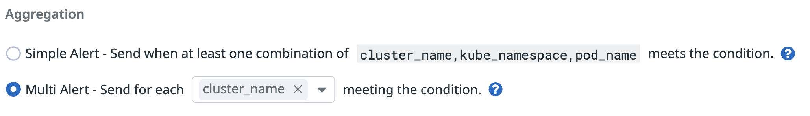
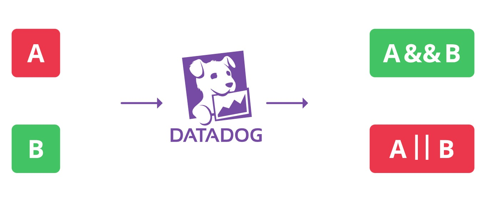
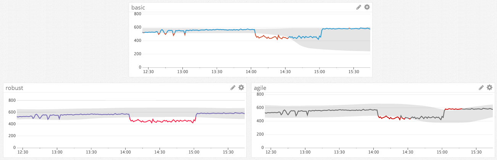
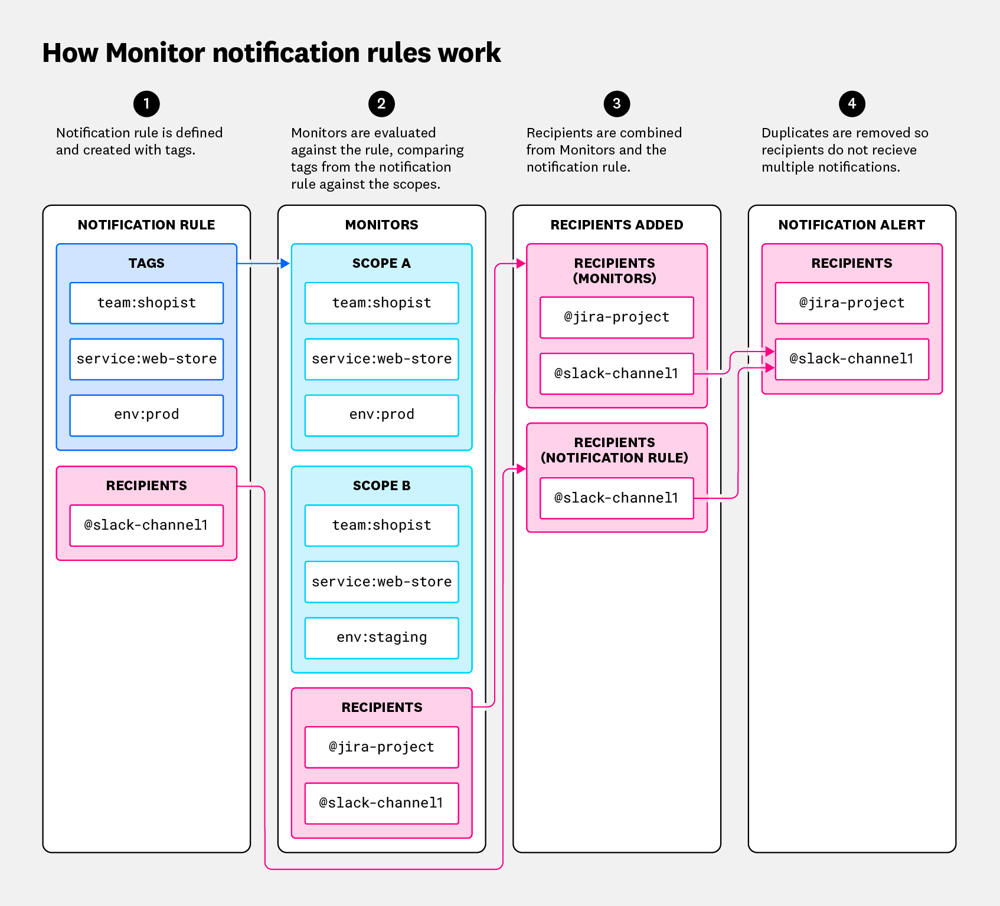
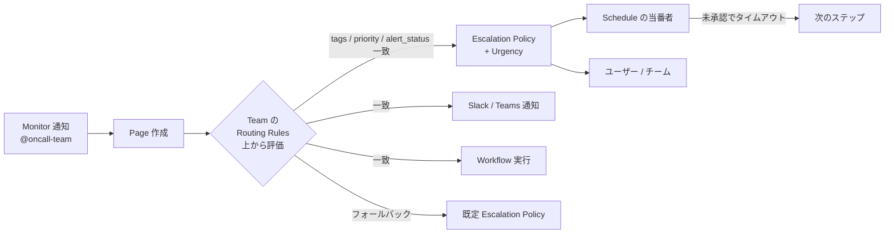

# アラート設計とノイズ削減

## 概要

本ファイルは、Datadog の Monitor（モニター）を運用する組織が「アラート疲れ（alert fatigue）」を防ぎ、**対応すべきアラートだけが、対応できる人に、必要な文脈付きで届く**状態を作るための実務知見をまとめた応用編である。以下の問いに答える。

- 何をアラートにし、何をページ（呼び出し）にすべきか（症状ベース vs 原因ベース、緊急度の3段階）
- フラッピング（OK⇔ALERT の往復）や重複通知を減らすには、どの Monitor 設定をどう使うか
- Composite / Anomaly / Outlier / Forecast / Watchdog Monitor をどう使い分けるか
- 通知の宛先をどう設計するか（Notification Rules、条件付き変数、Team ハンドル、On-Call）
- オンコール運用（Datadog On-Call のルーティング・エスカレーション・Urgency）と Monitor の連携
- 継続的な棚卸し（Monitor Quality など）と、よくある失敗例

Monitor の仕様（モニタータイプ一覧、API、権限など）の詳細は [Monitors](../02_リファレンス/platform/monitors.md)、通知と Downtime の仕様は [通知と Downtime](../02_リファレンス/platform/notifications-and-downtimes.md)、On-Call の仕様は [On-Call](../02_リファレンス/service-management/on-call.md)、イベント相関は [Event Management](../02_リファレンス/platform/event-management.md)、SLO バーンレートアラートの運用は [SLO 運用の実践](./08-slo-practices.md) を参照。Terraform 等でのモニター管理は [Monitoring as Code](./09-monitoring-as-code.md)、タグ設計は [タグ戦略の実践](./02-tagging-strategy.md) を参照。

> **本ファイルの記述方針:** 機能仕様は Datadog 公式ドキュメント（2026-11-02 時点で取得）に基づく。実務上の推奨のうち公式に明記されていないものには `【経験則】`、第三者ブログに基づくものには `【第三者情報】` を付ける。

---

## 1. アラート疲れとは何か・なぜ起きるか

### 1.1 アラート疲れの定義と症状

アラート疲れとは、通知が多すぎる・対応不要な通知が混ざる・内容から状況が分からない、といった状態が続き、オンコール担当者が通知を軽視・無視するようになる現象である。結果として本当に重要なアラートを見逃す。

Datadog 公式ブログ「Best practices to prevent alert fatigue」（2024-01-04 公開）は、ノイズとなるアラートを次の2類型で特定するよう勧めている [出典](https://www.datadoghq.com/blog/best-practices-to-prevent-alert-fatigue/)。

| 類型 | 定義 | 判定方法（ブログの例） | 主な対策 |
|---|---|---|---|
| Predictable alerts（予測可能なアラート） | 一定のパターンで発火するアラート | 約1週間の履歴を見て「次に鳴る時刻が予測できる」（例：毎週金曜 17:00〜18:00）なら予測可能と判断。アラートは予期せぬ事象だけで鳴るべき | Downtime（定期）、しきい値・クエリの見直し、Anomaly Monitor |
| Flappy alerts（フラッピングするアラート） | OK と ALERT を短時間で繰り返すアラート | 状態変化がどれくらい続くか、自動回復しているか。短い状態変化（例：約5分）ごとに通知されている、または放置で自然回復している場合は要対処 | 評価ウィンドウ延長、回復しきい値、`min` 集計、Composite |

ブログ中の具体例：「ディスク使用率が 5 分以上 90% を超えたらアラート」というモニターが、自動バックアップ時と一度きりのファイル転送時に発火したが、いずれも実害はなかった [出典](https://www.datadoghq.com/blog/best-practices-to-prevent-alert-fatigue/)。

### 1.2 アラート疲れの典型的な原因

| 原因 | 具体例 | 本ファイルの該当節 |
|---|---|---|
| 原因（cause）ベースのアラートが多すぎる | CPU・メモリ・個別プロセスなど内部指標ごとにページ | §2 |
| 評価ウィンドウが短すぎる / `avg`・`max` で一瞬のスパイクを拾う | `max(last_1m)` で瞬間値に反応 | §3.1, §3.2 |
| 回復しきい値なし | しきい値付近で値が揺れて OK⇔ALERT を往復 | §3.3 |
| 通知の粒度が細かすぎる | `host` × `service` でグルーピングし、1 障害で数十通 | §3.5 |
| 宛先が全員・全チャンネル | 全モニターを同じ Slack チャンネルへ | §5 |
| 計画作業・スケールイン時の誤報 | メンテナンス中のアラート、終了したインスタンスの No Data | §3.7, §3.8 |
| クラウドメトリクスの遅延 | CloudWatch 等のバックフィルで評価時点にデータが欠けて誤報 | §3.4 |
| 所有者不在の古いモニター | 退職者・旧サービスのモニターが鳴り続ける / 長期ミュート | §8 |
| 通知に文脈がない | タイトルが曖昧、Runbook なし、ダッシュボードリンクなし | §5.5 |

---

## 2. 設計原則：症状ベースアラートと緊急度の3段階

### 2.1 「広くアラートし、慎重にページする」

Datadog 公式ブログ「Monitoring 101: Alerting on what matters」（2015-06-30 公開、Alexis Lê-Quôc）は、アラート設計の基本原則として **"Alert liberally; page judiciously"（アラートは広く、ページは慎重に）** と **"Page on symptoms, rather than causes"（原因ではなく症状でページする）** を挙げている [出典](https://www.datadoghq.com/blog/monitoring-101-alerting/)。

> 注記: 同記事は 2015 年公開で 2 年以上前の情報である。ここでは考え方（フレームワーク）のみを引用しており、具体的な画面・機能は現行仕様と異なる可能性がある。

同記事はアラートを緊急度で 3 段階に分ける。

| 段階 | 緊急度 | 通知手段（記事の考え方） | 例 | Datadog での実装例 |
|---|---|---|---|---|
| Record（記録） | 低 | 誰にも通知しない。後で参照・相関分析に使う | 一時的なネットワーク輻輳 | 通知先なしのモニター、イベントとして記録、Event Management、ダッシュボード |
| Notification（通知） | 中 | 即時対応は不要。メールやチャットで知らせ、睡眠や集中を妨げない | データストアのディスク残量低下 | Slack / Teams / メール、Case Management、Jira チケット |
| Page（ページ） | 高 | 時間帯を問わず人間が即時対応する必要がある | ユーザー影響のあるエラー率上昇 | On-Call、PagerDuty、Opsgenie 等 |

アラートを作る前の 3 つの問い（同記事）[出典](https://www.datadoghq.com/blog/monitoring-101-alerting/)：

1. その問題は本物か（Is the issue real?）
2. 対応が必要か（Does it require attention?）
3. 緊急か（Is it urgent?）

3 つすべてに「はい」の場合のみページする。

### 2.2 症状（Symptom）と原因（Cause）

| 観点 | 症状ベース | 原因ベース |
|---|---|---|
| 定義 | ユーザーから見える問題の現れ（例：Web サイトの応答が遅い） | 問題の根底にある理由（例：DB レイテンシ高、アプリサーバー停止） |
| ページの適否 | ページに向く。ユーザー影響を直接表し、アーキテクチャ変更後も有効 | 原則ページしない。調査用の Record / Notification とし、ダッシュボードで参照 |
| Datadog での代表的シグナル | APM のサービスのエラー率・レイテンシ（p95/p99）・スループット、Synthetic テスト失敗、RUM のエラー率・Core Web Vitals、SLO バーンレート | `system.cpu.user`、`system.mem.used`、プロセス数、個別コンテナ再起動 |
| 例外 | — | ディスク容量など「有限で、枯渇すると回復できないリソース」は症状が出る前に知らせる価値がある（同記事） |

同記事は、ページすべき条件を「システムが許容できるスループット・レイテンシ・エラー率で有用な仕事をしなくなったとき」または「重要な有限リソースが枯渇しそうなとき」としている [出典](https://www.datadoghq.com/blog/monitoring-101-alerting/)。

### 2.3 Datadog で症状ベースアラートを作る手段

| 症状 | 推奨モニタータイプ / 機能 | 補足 |
|---|---|---|
| サービスのエラー率・レイテンシ | APM Monitor（APM Metrics）、Metric Monitor（`trace.*` メトリクス） | APM の詳細は [APM 運用の実践](./05-apm-practices.md) |
| 外形からの可用性・応答時間 | Synthetic Monitoring のテスト（アラート条件に `min_failure_duration`、`min_location_failed`） | `min_failure_duration` は最大 7200 秒、`min_location_failed` は 1 以上 [出典](https://docs.datadoghq.com/api/latest/monitors/create-a-monitor)。詳細は [Synthetic Monitoring](../02_リファレンス/dem/synthetic-monitoring.md) |
| 実ユーザーの体験劣化 | RUM Monitor | [RUM（ブラウザ）](../02_リファレンス/dem/rum-browser.md) |
| 信頼性目標に対する予算消費 | SLO のバーンレートアラート | §4.6、[SLO 運用の実践](./08-slo-practices.md) |
| ビジネス KPI の異常 | Anomaly Monitor（季節性あり）、Forecast Monitor | §4 |

`【経験則】` 実務では「ページは SLO バーンレート・Synthetic・主要 API のエラー率など、サービス単位で十数本以内」「インフラ指標（CPU、メモリ、Pod 再起動等）は Notification 以下」と階層化する設計がよく採られる。

### 2.4 アラート設計ポリシー（文書化すべき項目）

`【経験則】` チーム横断でノイズを減らすには、個々のモニター調整より先に「設計ポリシー」を定めるのが効果的である。Wantedly のテックブログ（2024-12-19 公開）では、2021 年の見直しで「棚卸し」「設計ポリシーの策定」「Runbook の紐付け」を行い、Runbook のカバレッジを CI で監視していると紹介されている `【第三者情報】` [出典](https://www.wantedly.com/companies/wantedly/post_articles/944079)（2024-12 公開）。

| ポリシー項目 | 決める内容の例 |
|---|---|
| 緊急度の定義 | P1〜P5（Datadog の Priority）と Record / Notification / Page の対応 |
| ページ対象の基準 | 「ユーザー影響あり」かつ「即時対応で改善できる」もののみ |
| 必須タグ | `service`、`env`、`team`、`priority` 等（Tag Policies で強制可能 [出典](https://docs.datadoghq.com/monitors/notify/)） |
| 命名規約 | `[env] service - 症状 (しきい値)` のように役割を問わず理解できる表現 |
| 通知本文の必須要素 | 影響、確認すべきダッシュボード、Runbook URL、エスカレーション先 |
| 宛先の決め方 | モニター本文に直接書くか、Notification Rules / Team ハンドルで集中管理するか（§5） |
| 見直し周期 | 四半期・半期など（Datadog ブログも定期的な見直しを推奨 [出典](https://www.datadoghq.com/blog/best-practices-to-prevent-alert-fatigue/)） |
| 例外プロセス | 新規ページ追加時のレビュー、長期ミュートの承認 |

運用設計全体については [運用設計](../03_導入編/13-operations-design.md) を参照。

---

## 3. ノイズ削減のための Monitor 設定

本節は「どの設定がどのノイズを減らすか」を整理する。各設定の仕様は [Monitor Configuration（公式）](https://docs.datadoghq.com/monitors/configuration/) と [Monitors](../02_リファレンス/platform/monitors.md) を参照。

### 3.1 ノイズの種類と効く設定（早見表）

| ノイズの種類 | 効く設定・機能 | 節 |
|---|---|---|
| 一瞬のスパイクで発火 | 評価ウィンドウ延長、集計方法 `min`（上限しきい値の場合）、`require_full_window` | 3.2 |
| しきい値付近で OK⇔ALERT を往復（フラッピング） | Alert / Warning Recovery Threshold、評価ウィンドウ延長、Composite | 3.3 |
| クラウドメトリクスの遅延による誤報 | Evaluation Delay（推奨 900 秒） | 3.4 |
| 1 障害で大量通知 | Notification Aggregation（Multi Alert のグルーピング次元削減、`notify_by`）、Simple Alert | 3.5 |
| 新規ホスト・コンテナ起動直後の誤報 | New Group Delay（デフォルト 60 秒） | 3.6 |
| スケールイン・終了済みインスタンスの No Data | No Data 設定、Group Retention、クラウド自動ミュート | 3.7 |
| 計画メンテナンス中のアラート | Downtime（単発・定期・RRULE） | 3.8 |
| 未解決アラートの再通知が多すぎる / 少なすぎる | Renotify（間隔・対象ステータス・回数） | 3.9 |
| 通知本文が長い・読みにくい | Notification Presets（`hide_query` 等）、タイトル設計 | 5.5 |

### 3.2 評価ウィンドウと集計方法

Monitor の評価ウィンドウ（Evaluation Window）と集計方法は、フラッピング対策の第一手である。Datadog ブログは「評価ウィンドウを長くすると、より多くのデータ点を見てから異常と判定するため、持続的な挙動にのみアラートでき、短いウィンドウはバックグラウンドタスクによるクエリ急増のような短時間のスパイクで誤報を生む」と説明している [出典](https://www.datadoghq.com/blog/best-practices-to-prevent-alert-fatigue/)。

**評価ウィンドウの仕様** [出典](https://docs.datadoghq.com/monitors/configuration/)

| 項目 | 内容 |
|---|---|
| Rolling（ローリング）ウィンドウのプリセット | 5 分、15 分、1 時間、カスタム |
| カスタム範囲（しきい値アラート） | 1 分〜48 時間 |
| Metric Monitor のカスタム上限 | 最大 1 か月 |
| Log Monitor の上限 | 最大 2 日 |
| Cumulative（累積）ウィンドウ | Current hour（最大 1 時間）、Current day（最大 24 時間）、Current month（月初来、Metric Monitor のみ） |

**評価頻度（デフォルト）** [出典](https://docs.datadoghq.com/monitors/configuration/)

| 評価ウィンドウ | 評価頻度 |
|---|---|
| 24 時間未満 | 1 分ごと |
| 24 時間以上 48 時間未満 | 10 分ごと |
| 48 時間以上 | 30 分ごと |

カスタムスケジュール（日次・週次・月次）で評価することもできる。

**集計方法（Aggregation）と「持続性」の表現** [出典](https://docs.datadoghq.com/monitors/configuration/)

| 集計 | 上限しきい値（above）での意味 | ノイズ観点 |
|---|---|---|
| `avg` | ウィンドウ内平均がしきい値超え | スパイクに引きずられることがある |
| `max` | **いずれか 1 点**でもしきい値超えでアラート | 最も敏感。ノイズが出やすい |
| `min` | **すべての点**がしきい値超えでアラート | 「N 分間継続して超過」を表現でき、フラッピング抑制に有効 |
| `sum` | 合計がしきい値超え | カウント系に使用 |

下限しきい値（below）の場合、`max` と `min` の意味は逆転する [出典](https://docs.datadoghq.com/monitors/configuration/)。

公式ガイド「Reduce alert flapping」も、`min` を使うと「タイムフレーム内のすべてのデータ点がしきい値を超えたときだけアラートし、短い落ち込みやスパイクを除外できる」としている [出典](https://docs.datadoghq.com/monitors/guide/reduce-alert-flapping/)。Wantedly の事例でも、`avg()` ではスパイクに引きずられるため `min()` を評価値にして「直近 N 分継続して閾値超え」を検知し、フラッピングを抑えたと紹介されている `【第三者情報】` [出典](https://www.wantedly.com/companies/wantedly/post_articles/944079)（2024-12 公開）。

**Require full window** [出典](https://docs.datadoghq.com/api/latest/monitors/create-a-monitor)

| 項目 | 内容 |
|---|---|
| API オプション | `require_full_window` |
| 意味 | 評価前にウィンドウ全体のデータが揃っている必要があるか |
| デフォルト | `false` |
| 推奨 | 疎な（sparse）メトリクスでは `false` を推奨（公式） |
| 対象 | Metric Monitor のみ |

**クエリ関数で信号を平滑化する** [出典](https://docs.datadoghq.com/monitors/guide/reduce-alert-flapping/)

| 手法 | 例 | 用途 |
|---|---|---|
| 時間シフト差分 | `abs(system.cpu.system{*} - week_before(system.cpu.system{*}))` | 先週同時刻との差でアラート |
| レート・移動平均 | `per_second()`、`rollup()`、移動平均関数 | 頻繁なスパイクを均して意味のあるしきい値を設定 |

関数の詳細は [メトリクスクエリと関数](../02_リファレンス/platform/metrics-query-and-functions.md) を参照。

### 3.3 回復しきい値（Recovery Threshold）

回復しきい値は、アラート状態からの回復に追加条件を課す設定で、しきい値付近の揺れによるフラッピングを防ぐ（ヒステリシス）。

| 設定 | 必須/任意 | 意味 [出典](https://docs.datadoghq.com/monitors/configuration/) |
|---|---|---|
| Alert threshold | 必須 | アラート通知を発火 |
| Warning threshold | 任意 | 警告通知を発火 |
| Alert recovery threshold | 任意 | ALERT からの回復条件を追加 |
| Warning recovery threshold | 任意 | WARN からの回復条件を追加 |

回復しきい値がない場合、値がアラート/警告しきい値の内側に戻った時点で回復する [出典](https://docs.datadoghq.com/monitors/configuration/)。

Datadog ブログの例：「CPU が 80% を超えたらアラート、70% を下回るまで回復しない」。また WARN と ALERT の両方に回復しきい値を設定することを推奨している [出典](https://www.datadoghq.com/blog/best-practices-to-prevent-alert-fatigue/)。

Service Check（Check Alert）の場合は、しきい値の代わりに「連続 N 回の `WARN`/`CRITICAL` でアラート」「連続 N 回の `OK` で回復」を設定する [出典](https://docs.datadoghq.com/monitors/configuration/)。

`【経験則】` 回復しきい値はアラートしきい値から「通常の揺れ幅」以上離す。揺れ幅は Monitor 編集画面の Evaluated Data プレビュー（過去の状態遷移と通知先を表示）で確認できる [出典](https://docs.datadoghq.com/monitors/configuration/)。

### 3.4 Evaluation Delay（クラウドメトリクスの遅延対策）

Evaluation Delay は評価ウィンドウを N 秒過去にずらす設定である [出典](https://docs.datadoghq.com/monitors/configuration/)。

| 項目 | 内容 |
|---|---|
| 最大値 | 86400 秒（24 時間） |
| 推奨値（クラウドプロバイダがバックフィルするメトリクス） | 900 秒（15 分） |
| 推奨値（除算の数式を使う場合） | 60 秒 |
| 例 | 900 秒・5 分ウィンドウの場合、7:00 の評価は 6:40〜6:45 のデータを対象にする |

AWS / Azure / Google Cloud のデータを使うのに Evaluation Delay がないモニターは、Monitor Quality で「Missing a delay」として検出される（誤報の原因になるため）[出典](https://docs.datadoghq.com/monitors/quality/)。クラウド連携の遅延仕様は [AWS Integration](../02_リファレンス/platform/aws-integration.md) 等を参照。

### 3.5 通知のグルーピング（Simple Alert / Multi Alert / notify_by）

通知の粒度は、障害 1 件あたりの通知数を決める最重要設定である。

**Notification Aggregation の仕様** [出典](https://docs.datadoghq.com/monitors/configuration/)

| 設定 | 動作 | 自動選択 |
|---|---|---|
| Simple Alert | 全ソースを集約した値が条件を満たしたとき 1 通知 | クエリにグルーピングがない場合のデフォルト |
| Multi Alert | 条件を満たした**グループごと**に 1 通知 | クエリに group by がある場合のデフォルト |
| Multi Alert の次元削減 | 通知グルーピングから次元を外すと、残った次元の値ごとに 1 通知。外した次元は UI 上 Sub Groups として表示 | — |

API では `notify_by` で通知粒度を指定する。値はクエリのグルーピングタグの部分集合でなければならず、`["*"]` を指定すると Simple Alert になる [出典](https://docs.datadoghq.com/api/latest/monitors/create-a-monitor)。



- **キャプション:** Monitor 作成/編集画面の「Aggregation（通知の集約）」設定
- **画面説明:** 2 つのラジオボタンが並ぶ。上段「Simple Alert - Send when at least one combination of `cluster_name, kube_namespace, pod_name` meets the condition.」（クエリのグルーピング次元の組み合わせのどれか 1 つが条件を満たしたら 1 通知）。下段「Multi Alert - Send for each `cluster_name` meeting the condition.」が選択されており、通知単位の次元として `cluster_name` だけが残されている（`kube_namespace` と `pod_name` は通知単位から外され Sub Groups 扱い）。これにより Pod 単位ではなくクラスター単位で通知される。
- **出典:** https://docs.datadoghq.com/monitors/configuration/ （取得日 2026-11-02）

**設計の考え方**

| 状況 | 推奨粒度 | 理由 |
|---|---|---|
| サービスの症状アラート（エラー率等） | `service`（＋`env`）単位 | Datadog ブログ例：`host` と `service` でグルーピングするとホストごとに通知されるが、`host` を外すとサービス単位で 1 通知になる [出典](https://www.datadoghq.com/blog/best-practices-to-prevent-alert-fatigue/) |
| ロードバランサ配下の各ホストの資源枯渇 | `host` 単位 Multi Alert | 公式ベストプラクティスは、スコープ違いの重複モニターを作らず 1 本の Multi Alert にまとめることを推奨 [出典](https://docs.datadoghq.com/monitors/guide/monitor_best_practices/) |
| Kubernetes の Pod 異常 | `kube_namespace` / `kube_deployment` / `kube_cluster_name` 単位 | `【経験則】` Pod 名は短命で次元が爆発するため通知単位にしない。詳細は [Kubernetes 監視の実践](./07-kubernetes-monitoring-practices.md) |
| 全体の SLA 判定 | Simple Alert | 1 件の判定で十分 |

> 注意: `host` タグのみで `service` タグがないメトリクスは、通知グルーピングの検出対象外になる（両方のタグを持つメトリクスは検出される）[出典](https://docs.datadoghq.com/monitors/configuration/)。

### 3.6 New Group Delay

New Group Delay は、過去 24 時間に見られなかった新しいグループ（ホスト・コンテナ等）について、起動直後の評価を遅らせる設定である [出典](https://docs.datadoghq.com/monitors/configuration/)。

| 項目 | 内容 |
|---|---|
| デフォルト | 60 秒 |
| 値 | 0 以上の整数（秒） |
| 対象 | Multi Alert モードのみ |
| API | `new_group_delay`（旧 `new_host_delay` は非推奨）[出典](https://docs.datadoghq.com/api/latest/monitors/create-a-monitor) |

`【経験則】` オートスケールやデプロイで起動直後に CPU が高い・ヘルスチェックが失敗するワークロードでは、起動時間に合わせて 300〜600 秒程度に延ばすことが多い。

### 3.7 No Data・Group Retention・自動解決

No Data（データ欠損）の扱いは、スケールインやデプロイ時の誤報、逆に「静かすぎるアラート」の両方に関わる。

**On missing data の選択肢** [出典](https://docs.datadoghq.com/monitors/configuration/)

| 選択肢 | 挙動 | 向く用途 |
|---|---|---|
| Evaluate as zero / Show last known status | 空の結果を 0 として評価（カウント系）/ 直前の状態を維持 | 一般的なメトリクス |
| Show NO DATA | ステータスを NO DATA にする（通知なし） | 可視化のみ |
| Show NO DATA and notify | NO DATA にして通知 | ハートビート、重要なデータ源 |
| Show OK | 解決（OK）にする | データが来ないこと＝正常のケース（エラーログ件数等） |

- クエリに `default_zero()` を含むと欠損は 0 に固定され、他の選択肢は無効になる。
- `default_zero()` なしの場合、カウントクエリのデフォルトは Evaluate as zero、それ以外は Show last known status。
- 欠損でアラートするには、モニターが一度はデータを評価している必要がある。
- API の `notify_no_data` のデフォルトは `false`。`no_data_timeframe` のデフォルトはクエリアラートで評価期間の 2 倍、Service Check で 24 時間 [出典](https://docs.datadoghq.com/api/latest/monitors/create-a-monitor)。

**Group Retention（非報告グループの保持）** [出典](https://docs.datadoghq.com/monitors/configuration/)

| 項目 | 内容 |
|---|---|
| デフォルト | 24 時間で非報告グループを削除 |
| Host Monitor / 欠損通知ありの Service Check | 48 時間 |
| Dynamic retention | グループ数の多いモニターでデフォルト有効。頻繁に出入りするグループの保持を短縮 |
| カスタム保持 | 1〜72 時間（APM Trace Analytics、Audit Logs、CI Pipelines、Error Tracking、Events、Logs、RUM の Multi Alert）。「On missing data」オプションが必要 |

**Auto Resolve** [出典](https://docs.datadoghq.com/monitors/configuration/)

| 項目 | 内容 |
|---|---|
| 選択肢 | Never（推奨）、After 1 hour、After 2 hours … |
| API | `timeout_h`（0〜24 時間）[出典](https://docs.datadoghq.com/api/latest/monitors/create-a-monitor) |
| 動作条件 | **データが止まったときのみ**機能。データが ALERT/WARN のまま届いている間は自動解決しない |
| 注意 | 自動解決後、次の評価で値が回復しきい値を満たさなければ再度アラートする |
| 代替 | データが来続ける未解決問題には Renotify を使う |

**クラウドの自動ミュート**：AWS EC2（CloudWatch のホスト状態）、Google Compute Engine（GCE API）、Azure VM（Azure Resource Health）で、手動またはオートスケールにより終了・停止したインスタンスのモニターは自動的にミュートされる [出典](https://docs.datadoghq.com/monitors/downtimes/)。

`【経験則】` オートスケール対象のホスト群に「Show NO DATA and notify」を付けると、スケールインのたびに No Data 通知が出る典型的なノイズになる。No Data 検知はハートビート的なモニター（Agent の `datadog.agent.up`、バッチの完了メトリクス等）に限定し、通常のリソースモニターでは通知しない設計が無難である。

### 3.8 Downtime（計画作業・定期的な静穏時間）

Downtime は通知を抑止するが、モニターの状態遷移自体は継続する [出典](https://docs.datadoghq.com/monitors/downtimes/)。予測可能なアラート（§1.1）の対策として有効。

| 項目 | 仕様 [出典](https://docs.datadoghq.com/monitors/downtimes/) |
|---|---|
| 対象指定 | モニター名、またはモニタータグ（タグ指定は最大 32 個、全タグを持つモニターが対象）。名前を空にすると全モニター |
| グループスコープ | 検索構文（例：`service:web-store AND env:dev`、`host:authentication-*`）。ネストは 2 階層まで。キーなしタグ・`?` ワイルドカードは不可。異なるキーにまたがるトップレベル OR は別 Downtime に分ける |
| スケジュール | 単発（One-time）、定期（Recurring）、RRULE（例：毎月第3月曜）。RRULE に `DTSTART` / `DTEND` / `DURATION` は含められない |
| 終了時の挙動 | 終了時点で ALERT / WARNING / NO DATA なら、デフォルトで新たに通知が送られる。**手動キャンセル時は終了通知なし** |
| 最初の回復通知のミュート | Downtime 前にアラートし Downtime 中に回復したモニターの、最初の回復通知をミュート可能 |
| 監査通知 | Downtime の予定・開始・キャンセル・期限切れ時にチーム/連携先へ通知可能（API 作成時は「Is cancelled」通知はデフォルトで除外） |
| レポート | 週次モニターレポートには Downtime 中のアラートも含まれる |
| 権限（Preview） | Manage Downtimes 権限。Downtime アクセス制御下では作成者が Muter / Editor 権限を持つモニターのみを抑止 |

Composite Monitor と Downtime の関係は §4.2 を参照。Downtime 仕様の詳細は [通知と Downtime](../02_リファレンス/platform/notifications-and-downtimes.md)。

### 3.9 Renotify（再通知）とエスカレーション

Renotify は未解決の問題をチームに再度知らせる機能 [出典](https://docs.datadoghq.com/monitors/notify/)。

| 項目 | 内容 |
|---|---|
| 設定項目 | 再通知間隔、再通知の対象ステータス（`alert` / `no data` / `warn`）、最大再通知回数（任意） |
| API | `renotify_interval`（分）、`renotify_statuses`（`renotify_interval` 設定時のデフォルトは Alert と No Data）、`renotify_occurrences`（回数）[出典](https://docs.datadoghq.com/api/latest/monitors/create-a-monitor) |
| エスカレーションメッセージ | `{{#is_renotify}}` ブロック（推奨）、Renotification message 欄、API の `escalation_message` |
| 注意 | 再通知には元のメッセージも含まれるため、`{{#is_renotify}}` には追加情報だけを書く |
| UI 上の間隔選択肢・デフォルト | 公開情報では確認できず |

例：本番だけ再通知時に上位者へエスカレーション [出典](https://docs.datadoghq.com/monitors/notify/variables/)

```text
{{#is_renotify}}
{{#is_match "env" "production"}}
  Escalation to @dev-team@company.com
{{/is_match}}
{{/is_renotify}}
```

> **On-Call との相互作用:** モニターが On-Call Team へ再通知を送る設定の場合、再通知時の動作は Page の状態で異なる。Resolved なら新しい Page を作成してチームのエスカレーションポリシーに回す。Acknowledged なら Page を再トリガーし、承認時に進行中だったステップから再開する。Triggered でエスカレーションポリシーの全ステップが実行済みなら Page を再トリガーし、最後のステップを再実行する。Triggered で未実行のステップが残っていれば再通知は何も起こさない [出典](https://docs.datadoghq.com/incident_response/on-call/pages/)。Datadog On-Call 側にエスカレーション（§6）を任せる場合、モニター側の Renotify を重ねると二重のエスカレーションになり得るため、どちらで再通知を制御するか決めておく `【経験則】`。

`【経験則】` Slack などの Notification レベルのアラートでは再通知を無効にするか長め（数時間）にし、Page レベルではページングツール側のエスカレーションで制御するのが一般的。

---

## 4. 高度なモニタータイプの使い分け（Composite / Anomaly / Outlier / Forecast / Watchdog）

### 4.1 使い分けの早見表

| モニタータイプ | 何を検知するか | 向くケース | 向かないケース | ノイズ観点の注意 |
|---|---|---|---|---|
| Metric（しきい値） | 固定しきい値の超過 | SLO 由来の明確な上限（エラー率 1% 等）、容量 | 季節性が強く正常値が時間帯で大きく変わる指標 | 最も予測可能・説明しやすい |
| Composite | 複数モニターの論理結合 | 「エラー率高い AND トラフィック十分」など条件の組み合わせ、低トラフィック時の誤報抑止 | 構成モニターのグループが揃わない場合 | 構成モニター自体の通知を止めないと二重通知になる |
| Anomaly | 過去の傾向・季節性からの逸脱 | 日次/週次パターンのあるトラフィック・売上・キュー長 | 新しいメトリクス、正当なレベルシフトが頻発する指標 | パラメータ（ウィンドウ、偏差）次第でノイジーになる |
| Outlier | 同種グループ内の外れ値 | 同一役割ホスト群のうち 1 台だけ異常 | 3 未満のメンバー、シャードのように意図的に挙動が分かれる群 | グループ単位でアラート可能 |
| Forecast | 将来値の予測としきい値 | ディスク枯渇予測、業績目標の追跡 | 急変する指標 | 「早期警告」なので Notification レベルが基本 |
| Watchdog | Watchdog が自動検知した異常 | 未知の異常の網羅的検知 | 明確な SLO を持つ指標の主アラート | スコープ（env、カテゴリ、チーム）で絞る |

以下、各タイプの仕様と設計上の勘所を示す。

### 4.2 Composite Monitor

Composite Monitor は既存の個別モニター（最大 10 個）を論理演算子で組み合わせ、構成モニターが同時に条件を満たしたときに発火する [出典](https://docs.datadoghq.com/monitors/types/composite/)。



- **キャプション:** Composite Monitor の概念図（公式ドキュメント冒頭の図）
- **画面説明:** 左にモニター A（赤＝ALERT）とモニター B（緑＝OK）があり、Datadog を経由して右に結果が示される。`A && B` は緑（OK＝アラートしない）、`A || B` は赤（ALERT）。AND は両方が満たされた場合のみ、OR はどちらかが満たされた場合に発火することを表す。
- **出典:** https://docs.datadoghq.com/monitors/types/composite/ （取得日 2026-11-02）

**仕様** [出典](https://docs.datadoghq.com/monitors/types/composite/)

| 項目 | 内容 |
|---|---|
| 構成モニター数 | 最大 10 |
| 構成モニターの種類 | Simple Alert、Multi Alert、混在可。Composite の入れ子（Composite of Composite）は不可 |
| 演算子 | `&&`、`\|\|`、`!`、括弧（例：`!(a && b)`、`a \|\| b && !c`、`(a \|\| b) && (c \|\| d)`） |
| 既定式 | 2 つ目のモニターを選ぶと `a && b` |
| API のクエリ | モニター ID で記述（例：`"1234 && 5678"`） |
| 独立性 | Composite の通知設定と構成モニターの通知設定は独立。Composite を削除しても構成モニターは残る。1 つのモニターを複数の Composite で再利用可能 |
| No Data | Composite で No Data を通知するには、Composite と構成モニターの両方で欠損通知を有効にする必要がある |
| 最終既知状態 | `notify_no_data` が false で評価結果が No Data になる場合、最終既知状態を使う |

**ステータス計算** [出典](https://docs.datadoghq.com/monitors/types/composite/)

重大度：Alert(4) > Warn(3) > No Data(2) > Ok(1)。Alert / Warn / No Data が「alert-worthy」。

| 演算 | 結果 |
|---|---|
| `A && B` | alert-worthy なら、A と B のうち**低い方**の重大度 |
| `A \|\| B` | alert-worthy なら、A と B のうち**高い方**の重大度 |
| `!A` | A が No Data → No Data、A が alert-worthy → Ok、A が非 alert-worthy → Alert |

| A | B | `A && B` | `A \|\| B` |
|---|---|---|---|
| Alert | Warn | Warn（通知） | Alert（通知） |
| Alert | Ok | Ok（通知なし） | Alert（通知） |
| Warn | Ok | Ok（通知なし） | Warn（通知） |

**Multi Alert 構成時のグループ一致ルール** [出典](https://docs.datadoghq.com/monitors/types/composite/)

| ルール | 内容 |
|---|---|
| 共通ソースのみ評価 | A が web01〜web05、B が web04〜web09 を報告 → 共通の web04・web05 のみ評価。1 評価サイクルで最大 2 アラート |
| タグ**値**で照合 | キーではなく値で比較（`service:web04` と `host:web04` は一致） |
| 多次元グループ | グループはタグの組み合わせ全体。`device,host` と `host` は組み合わせ可能だが、`device,host` と `host,url` は結果が出ない可能性 |
| Group Matching Error | 共通ソースがない場合、ステータスを計算できず**決して発火しない**（作成自体は可能） |
| UI 警告 | 共通グループがない場合に警告表示 |

**Downtime との関係** [出典](https://docs.datadoghq.com/monitors/types/composite/)

| 操作 | 影響 |
|---|---|
| Composite に Downtime | Composite の通知のみ抑止。構成モニターが直接チーム/サービスに通知していればそれは届く |
| 構成モニターに Downtime | Composite は抑止されない（例：A の `env:staging` を Downtime にしても Composite は発火し得る） |

**ノイズ削減での典型パターン**

| パターン | 式の例 | 根拠 |
|---|---|---|
| 低トラフィック時の誤報抑止 | `a && b`（a: エラー率 > 3%、b: 30 分のヒット数 > 100） | Datadog ブログの例 [出典](https://www.datadoghq.com/blog/best-practices-to-prevent-alert-fatigue/) |
| リソース複合条件 | `a && b`（a: CPU 高、b: ディスク高、同一 host） | 公式ガイドの例 [出典](https://docs.datadoghq.com/monitors/guide/reduce-alert-flapping/) |
| 異常検知 × 絶対値 | `a && b`（a: Anomaly、b: しきい値） | 公式ガイドは Anomaly / Outlier を Composite と組み合わせられるとしている [出典](https://docs.datadoghq.com/monitors/guide/reduce-alert-flapping/)。`【経験則】` 「季節性から外れ、かつ絶対値でも問題がある」ときだけ通知でき、Anomaly 単体のノイズを抑えられる |
| 依存先障害時の抑止 | `a && !b`（a: サービス異常、b: 依存 DB 異常） | `【経験則】` 依存先の障害で下流が一斉に鳴るのを抑える。b 側は DB チームに通知 |

`【経験則】` Composite を使う場合、構成モニター（a, b）は**通知先を空にする**か Record レベルにし、Composite だけが通知する構成にしないと、構成モニターと Composite の両方から通知が届き、かえってノイズが増える。通知先を空にした構成モニターは Monitor Quality の「Missing recipients」に出るため、命名やタグ（例：`role:composite-component`）で意図を明示しておく。

Composite の通知本文では構成モニターの変数（`{{ a.value }}`、`{{ a.status }}`、`{{ a.log.message }}` 等）を使える。ただしファセット/タグを参照するには構成モニターが同じタグ/ファセットでグルーピングされている必要がある [出典](https://docs.datadoghq.com/monitors/notify/variables/)。

### 4.3 Anomaly Monitor

Anomaly Monitor は、トレンド・曜日・時間帯のパターンを考慮してメトリクスが過去と異なる挙動をしたときに検知する [出典](https://docs.datadoghq.com/monitors/types/anomaly/)。

**アルゴリズムの使い分け** [出典](https://docs.datadoghq.com/monitors/types/anomaly/)

| アルゴリズム | 使う場面 | 特性 |
|---|---|---|
| `basic` | 繰り返しの季節パターンがない | 遅延ローリング分位点。少ないデータで素早く適応するが、季節性・長期トレンドを知らない |
| `agile` | 季節性があり、レベルが変化することが想定される | 頑健な SARIMA 系。レベルシフトに素早く適応するが、最近の長期異常に引きずられやすい。スケールに敏感 |
| `robust` | 季節性が安定し、緩やかなレベル変化も異常とみなしたい | 季節-トレンド分解。長い異常でも予測が安定するが、意図したレベル変化への追従が遅い |



- **キャプション:** 同一メトリクスに `basic`・`robust`・`agile` を適用したときの、急なレベル低下（14:00 頃）への反応比較
- **画面説明:** 3 つの時系列グラフ（上：basic、左下：robust、右下：agile）。灰色の帯が予測範囲（bounds）、赤い線が異常判定された区間。値は約 570 付近から 14:00 頃に約 450 へ下がり、15:00 頃に元へ戻る。basic は低下直後を異常とするがすぐ帯が下に広がり低下状態を正常扱いし始める。robust は低下期間全体（14:00〜15:00）を一貫して異常と判定する。agile は低下直後を異常とした後に新水準に適応し、15:00 過ぎに元の水準へ戻った時点を逆に異常と判定している。
- **出典:** https://docs.datadoghq.com/monitors/types/anomaly/ （取得日 2026-11-02）

**主要パラメータ** [出典](https://docs.datadoghq.com/monitors/types/anomaly/)

| パラメータ | 内容 | ノイズ調整の観点 |
|---|---|---|
| Deviations（`bounds`） | 灰色の帯の幅。正の数 | 大きくすると鈍感（ノイズ減） |
| Direction | `above or below`（デフォルト）/ `above` / `below` | 問題になる方向だけに絞るとノイズ半減が期待できる `【経験則】`（例：エラー数は `above` のみ） |
| Seasonality | `hourly` / `daily` / `weekly`（`agile`・`robust` のみ） | 業務パターンに合わせる |
| Trigger window | 異常が続く必要がある時間 | 短すぎると誤報 |
| Recovery window | 回復に必要な正常期間。トリガーウィンドウと同じ長さを推奨 | 最小値 = `trigger_window × (1 − threshold) + 1 分`、最大 = trigger window（例：閾値 50%・4h → 121 分〜4h） |
| カスタムウィンドウ範囲 | 15 分〜2 週間 | — |
| Alert threshold | ウィンドウ内で異常であるべき点の割合（0〜1） | `critical` はクエリの `threshold` と一致必須 |
| Daylight savings | `agile`/`robust` かつ `weekly`/`daily` のみ | 夏時間のある地域で誤報防止 |

**履歴要件と制約** [出典](https://docs.datadoghq.com/monitors/types/anomaly/)

| 項目 | 内容 |
|---|---|
| 必要な履歴 | 季節周期の 3 倍以上（weekly：3 週間、daily：3 日、hourly：3 時間） |
| 使用する履歴 | 季節性アルゴリズムは最大 6 週間 |
| 新しいメトリクス | 予測が不正確になりやすい。`robust`/`agile` は最初の数シーズン帯を表示しない |
| API での作成 | Enterprise プランが必要（公式記載） |
| API 推奨 | `interval` は `alert_window` の 1/5 以下、`query_window` は `alert_window` の約 5 倍、多くのモニターで `count_default_zero='true'` |

クエリ例（公式）：

```text
avg(last_1h):anomalies(avg:system.cpu.system{name:cassandra}, 'basic', 3, direction='above', alert_window='last_5m', interval=20, count_default_zero='true') >= 1
```

`【経験則】` Anomaly Monitor は「しきい値が決められない指標」に限定して使い、ページングには単体で使わない（§4.2 の Composite で絶対値条件と組み合わせる、または Notification レベルに留める）ほうが運用負荷が下がる。新サービスのリリース直後（履歴 3 週間未満）に weekly 季節性で作るのは避ける。

### 4.4 Outlier Monitor

Outlier Monitor は、グループ内のあるメンバーが同僚と異なる挙動をしたときに検知する [出典](https://docs.datadoghq.com/monitors/types/outlier/)。

| 項目 | 内容 |
|---|---|
| 前提 | グループ（host、AZ、パーティション等）があり、均一な挙動を示すメンバーが 3 以上 |
| アルゴリズム | DBSCAN（デフォルト、最大クラスター外を外れ値とする）、MAD（中央絶対偏差）、scaledDBSCAN、scaledMAD |
| Tolerance | 大きいほど許容範囲が広い（MAD では中央値からの偏差数） |
| %（MAD 系のみ） | 外れ値点の割合がこの値を超えたらグループ全体を外れ値と判定 |
| 時間ウィンドウ | 短いと単発スパイクに敏感、長いとアラートが遅れる |
| 選択指針 | 多くは DBSCAN。再起動時刻のずれなど小さなタイミング差を無視したいなら MAD。値が大きく密集しているなら scaled 系 |
| 注意 | シャードのように意図的に挙動が分かれる（banding）群は識別タグで分けて別監視 |

### 4.5 Forecast Monitor

Forecast Monitor は将来値を予測し、しきい値に達しそうなときに通知する [出典](https://docs.datadoghq.com/monitors/types/forecasts/)。

| 項目 | 内容 |
|---|---|
| アルゴリズム | Linear（季節性なし、モデル：default / simple / reactive）、Seasonal（hourly / daily / weekly） |
| 予測期間 | プリセット（24 時間、1 週間、1 か月等）またはカスタム 12 時間〜3 か月 |
| 履歴 | Seasonal は最低 2 シーズン、最大 6 シーズン使用 |
| 用途 | ディスク枯渇予測、ユーザー登録数などビジネス指標の目標追跡 |

`【経験則】` Forecast は Monitoring 101 でいう「有限リソースの早期警告」に当たり、営業時間内に対応すれば足りることが多い。Page ではなく Notification（チケット化）に向く。

### 4.6 SLO バーンレートアラート（症状ベースのページングの中核）

SLO のバーンレートアラートは、エラーバジェットがしきい値より速く消費されたときに通知する [出典](https://docs.datadoghq.com/service_management/service_level_objectives/burn_rate/)。

| 項目 | 内容 |
|---|---|
| Long window | 時間単位。1〜48 時間 |
| Short window | 分単位。UI では Long window の 1/12 に自動設定（API/Terraform では Long window より短い任意値） |
| 最大バーンレート | `1 / (1 − SLO 目標)`（99.9% なら 1000） |
| 対応 SLO | Metric-based、Time Slice、Monitor-based（Metric 系モニターのみで構成されたもの） |

30 日目標・99.9% の推奨値（公式） [出典](https://docs.datadoghq.com/service_management/service_level_objectives/burn_rate/)

| バーンレート | Long window | Short window | 消費される予算（理論値） |
|---|---|---|---|
| 14.4 | 1 時間 | 5 分 | 2% |
| 6 | 6 時間 | 30 分 | 5% |
| 3 | 24 時間 | 120 分 | 10% |

Wantedly の事例では、24 時間の Long window だけでは検知が遅かったため、Google SRE Workbook のマルチウィンドウ・マルチバーンレート方式への移行を進めていると述べられている `【第三者情報】` [出典](https://www.wantedly.com/companies/wantedly/post_articles/944079)（2024-12 公開）。SLO アラートの設計詳細は [SLO 運用の実践](./08-slo-practices.md) を参照。

### 4.7 Watchdog Monitor

Watchdog Monitor は、Watchdog（APM・インフラ・ログの自動異常検知）が見つけた問題で通知する [出典](https://docs.datadoghq.com/monitors/types/watchdog/)。

| 項目 | 内容 |
|---|---|
| 事前定義セレクタ | Environment（`env` タグ）、Alert Category（Watchdog アラートの種類を限定）、Team（Catalog 由来） |
| 追加スコープ | Watchdog イベント上のタグで絞り込み、Group By で通知の次元を設定。ワイルドカード可 |
| ログ異常 | `service`・`source`・`env` タグで照合 |

`【経験則】` Watchdog Monitor はスコープを本番 `env` と自チームに絞り、まずは Notification レベル（Slack）で運用して有効性を確認してからページ対象に昇格させるとノイズになりにくい。Watchdog の詳細は [Watchdog](../02_リファレンス/platform/watchdog.md) を参照。

---

## 5. 通知ルーティング設計

### 5.1 ルーティング手段の比較

| 手段 | 設定場所 | 長所 | 短所・注意 |
|---|---|---|---|
| モニター本文の `@` ハンドル | 各モニターの Message | 単純。モニター単位で明示的 | 宛先変更時に全モニター修正が必要（一括編集機能はある）[出典](https://docs.datadoghq.com/monitors/notify/) |
| 条件付き変数（`{{#is_alert}}`、`{{#is_match}}` 等） | 各モニターの Message | 状態・タグで宛先を出し分け | 本文が複雑化。タグ欠損時に無効ハンドルになり得る |
| Team ハンドル（`@team-handle`） | Teams の設定 | チームの設定済みチャンネルへ届く | チーム側の通知設定が前提 |
| Monitor Notification Rules | Monitor Settings > Notifications | タグで集中管理。モニター本文を触らずに宛先を一元変更 | スコープ構文の制約（§5.3） |
| On-Call（`@oncall-<team>`） | On-Call のチーム・Routing Rules | Urgency、営業時間、エスカレーション、承認 | シート課金（§9） |
| Event Management の相関 | Event Management | 関連アラートを 1 件の作業項目にまとめる | 設計と課金（サードパーティイベント）に注意 |

### 5.2 通知ハンドルの基本と落とし穴

モニター本文で使えるハンドル [出典](https://docs.datadoghq.com/monitors/notify/)：

| 宛先 | 構文 |
|---|---|
| Datadog ユーザー | `@<ユーザーのメールアドレス>` |
| 外部メール | `@<EMAIL>` |
| 連携 | `@slack-…`、`@pagerduty-…`、`@jira-…`、`@webhook-…`、`@teams-…`、`@servicenow-…` |
| Datadog Team | `@team-handle` |
| On-Call Team | `@oncall-<team-handle>`（例：`@oncall-checkout-operations`）[出典](https://docs.datadoghq.com/incident_response/on-call/pages/) |
| Incident | `@incident-…`（alert / warn / no data でトリガー） |
| Workflow | 既存 Workflow の追加 |

注意点 [出典](https://docs.datadoghq.com/monitors/notify/)：

- `@` の前にはスペースが必要。
- 括弧 `()` を含むハンドルはパースされず、通知されない。
- スラッシュ `/` を含むメールアドレスは非対応。
- Pending・無効化されたユーザーにはメールが届かない。

連携先ごとの設定は [通知・コラボレーション連携](../02_リファレンス/platform/collaboration-integrations.md) を参照。

### 5.3 Monitor Notification Rules（タグベースの集中ルーティング）

Monitor Notification Rules は、タグとルールで通知先を事前定義し、スコープに一致するすべてのモニター通知に適用する機能である [出典](https://docs.datadoghq.com/monitors/notify/notification_rules/)。Datadog ブログ（2025-08-25 公開）は、各モニターの通知メッセージを編集せずに宛先を集中管理できる機能として紹介している [出典](https://www.datadoghq.com/blog/dashboards-monitors-at-scale/)。



- **キャプション:** 「How Monitor notification rules work」— 通知ルールの評価から宛先統合までの 4 ステップ図
- **画面説明:** ①Notification Rule をタグ（`team:shopist`、`service:web-store`、`env:prod`）と受信者（`@slack-channel1`）で定義。②モニター（Scope A：`env:prod`、Scope B：`env:staging`、受信者 `@jira-project` と `@slack-channel1`）のタグをルールのスコープと比較。③モニターの受信者とルールの受信者を結合。④重複を除去し、最終的な通知先は `@jira-project` と `@slack-channel1` の 2 件（`@slack-channel1` は 1 回だけ通知）。
- **出典:** https://docs.datadoghq.com/monitors/notify/notification_rules/ （取得日 2026-11-02）

**仕様** [出典](https://docs.datadoghq.com/monitors/notify/notification_rules/)

| 項目 | 内容 |
|---|---|
| 設定場所 | Monitor Settings > Notifications > New Rule |
| スコープ演算子 | `AND`、`OR`、`NOT`（暗黙は `AND`） |
| ワイルドカード | `key:*` のみ（`env:prod-*` のような部分一致や `?` は不可） |
| 複数値 | `env:(prod OR staging)` |
| 非対応 | キーなしタグ（例：`prod`） |
| スコープ長 | 最大 3000 文字 |
| ルール数 | 組織あたりデフォルト 1000 |
| 受信者数 | ルールあたり最大 50 |
| Manual routing | 全受信者に通知、または条件付き受信者（ステータス：Alert / OK / Warn / No data、タグ：1 条件 1 キー:値） |
| Dynamic routing【Preview】 | `service` タグ（Catalog のサービス所有チーム）または `team` タグからチームのチャンネルを解決。Slack・メール・PagerDuty・Microsoft Teams に対応。Fallback 必須。利用はアカウントチーム/サポートへ連絡 |
| マッチング | 通知タグセット＝モニタータグ ∪ 発火グループのタグ。複数ルールが一致すると受信者は結合・重複除去 |
| 適用タイミング | ルール保存後に作成・更新されたモニターに適用 |
| 権限 | `monitor_config_policy_write` または `monitor_notification_rules_write`（後者は Preview） |
| Slack スレッド化 | 通知ルールで設定。1 アラートサイクル（非回復状態〜回復）の通知を 1 スレッドにまとめ、親メッセージに最新ステータスを表示 [出典](https://docs.datadoghq.com/monitors/notify/) |

**設計パターン** `【経験則】`

| ルール例 | スコープ | 条件付き受信者 |
|---|---|---|
| 本番の決済サービス | `service:payment AND env:prod` | Alert → `@oncall-payment`、Warn → `@slack-payment-alerts` |
| チーム既定 | `team:platform` | 全ステータス → `@slack-platform-alerts` |
| ステージング | `env:staging` | 全ステータス → `@slack-staging-alerts`（ページなし） |

> 注意: Notification Rules はモニター本文の `@` ハンドルと**結合**される（置換ではない）。図の例のとおり、モニター側にも宛先が書かれていれば両方に届く（同一宛先は重複除去）。移行時にモニター本文のハンドルを外さないと、意図しない宛先に残り続ける `【経験則】`。

タグ付けが前提となるため、`team`・`service`・`env` をモニターに必須化する（Tag Policies）ことが重要。詳細は [タグ戦略の実践](./02-tagging-strategy.md)。

### 5.4 条件付き変数によるルーティング

条件付き変数は、モニターの状態や属性に応じて本文・宛先を出し分ける [出典](https://docs.datadoghq.com/monitors/notify/variables/)。

| 変数 | 表示される条件 |
|---|---|
| `is_alert` / `is_warning` / `is_no_data` / `is_unknown` | 各状態 |
| `is_recovery` | ALERT・WARNING・UNKNOWN・NO DATA からの回復 |
| `is_alert_recovery` / `is_warning_recovery` / `is_no_data_recovery` | 各状態から OK への回復 |
| `is_alert_to_warning` | ALERT → WARNING |
| `is_renotify` | 再通知時 |
| `is_match "attr" "str"` | 属性が部分文字列を含む |
| `is_exact_match "attr" "str"` | 属性が完全一致 |
| `is_priority 'P1'` | 指定優先度（P1〜P5） |

各変数には否定形 `{{^name}}` がある。状態条件は相互排他なので個別ブロックにし、属性条件は状態条件の中にネストできる。

**Warn は Slack、Alert はページ**（典型的な緊急度の分離）：

```text
{{#is_warning}}
  エラー率が警告水準です。営業時間内に確認してください。 @slack-payment-alerts
{{/is_warning}}
{{#is_alert}}
  エラー率がアラート水準です。即時対応してください。 @oncall-payment
{{/is_alert}}
{{#is_recovery}}
  回復しました。 @slack-payment-alerts @oncall-payment
{{/is_recovery}}
```

> On-Call の Page は、モニター回復時の通知にその On-Call Team のメンションが含まれていると自動的に Resolved になる [出典](https://docs.datadoghq.com/incident_response/on-call/pages/)。上の例のように回復ブロックにも `@oncall-…` を含めないと、Page が開いたまま残る。

**動的ハンドルとフォールバック**（タグ欠損対策）[出典](https://docs.datadoghq.com/monitors/notify/variables/)：

```text
@slack-{{service.name}} There is an ongoing issue with {{service.name}}.

{{#is_exact_match "service.name" ""}}
  @slack-example
{{/is_exact_match}}
```

タグが欠損すると空文字に展開され、無効なハンドルになって通知が失われる。空文字との `is_exact_match` でフォールバック先を必ず用意する。

**優先度の状態別上書き**：`{{override_priority 'P2'}}` を本文に入れると、状態ごとに優先度を変えられる（P1〜P5）[出典](https://docs.datadoghq.com/monitors/notify/)。

### 5.5 通知本文とタイトルの設計

公式ベストプラクティスは以下を推奨している [出典](https://docs.datadoghq.com/monitors/guide/monitor_best_practices/)。

| 推奨 | 内容 |
|---|---|
| 明確なタイトル | 目的と監視対象が分かり、専門外の役割でも理解できる。タイトル＝通知の件名なので変数を入れすぎない |
| メタデータ | Priority、タグ、Team を付与し、フィルタ・優先度付け・ルーティングに使う |
| 変数で文脈を埋め込む | 影響システム、エラーメッセージ、超過しきい値などを本文へ |
| テンプレート活用 | 迷ったら Monitor Templates（タイトル・通知・メトリクス・しきい値のガイドライン付き）から始める |

`include_tags`（トリガーしたタグをタイトルに自動追加）、Notification Presets（`show_all`、`hide_query`、`hide_handles`、`hide_all`、`hide_query_and_handles`、`show_only_snapshot`、`hide_handles_and_footer`）で通知の情報量を調整できる [出典](https://docs.datadoghq.com/api/latest/monitors/create-a-monitor)。Slack とメールは基本的な書式（太字、斜体、インラインコード、リンク）のみ表示され、見出しや表はプレーンテキストになる [出典](https://docs.datadoghq.com/monitors/notify/)。

`【経験則】` 本文テンプレート例：

```text
{{#is_alert}}
**影響**
{{service.name}} ({{env.name}}) の 5xx エラー率が {{value}}% （しきい値 {{threshold}}%）。ユーザーの決済が失敗している可能性。

**一次対応**
1. ダッシュボード: https://app.datadoghq.com/dashboard/xxx
2. Runbook: https://wiki.example.com/runbooks/payment-5xx
3. 直近デプロイを確認し、必要ならロールバック

@oncall-payment
{{/is_alert}}
```

Test Notifications で、Host・Metric・Anomaly・Outlier・Forecast・Logs・RUM・APM・Composite 等の通知を送信前に確認できる（イベントエクスプローラーで `[TEST]` 表示）[出典](https://docs.datadoghq.com/monitors/notify/)。

---

## 6. オンコール運用との連携

### 6.1 Datadog On-Call の構成要素

Datadog On-Call は、Monitor・Incident・Security Signal などから Page（呼び出し）を発行し、チームのルーティングとエスカレーションで担当者に届ける [出典](https://docs.datadoghq.com/service_management/on-call/)。



| 概念 | 内容 [出典](https://docs.datadoghq.com/service_management/on-call/) |
|---|---|
| Page | 誰かを呼び出すイベント。ステータスは Triggered / Acknowledged / Resolved |
| Team | Page を扱う単位。On-Call の中心的な組織単位 |
| Routing Rules | チームごとの規則。Urgency の設定、イベントメタデータによるエスカレーションポリシーの振り分け、サポート時間の定義 |
| Escalation Policy | Page をスケジュール・ユーザー・チームへどう段階的に届けるか |
| Schedule | 当番表。複数レイヤー（タイムゾーン・シフト）可 |

On-Call は us2.ddog-gov.com では非対応 [出典](https://docs.datadoghq.com/service_management/on-call/)。

> **サイト差異:** On-Call は us2.ddog-gov.com（US1-FED 系の GovCloud サイトの一つ）では提供されない。Event Management の相関は app.ddog-gov.com と us2.ddog-gov.com で非対応 [出典](https://docs.datadoghq.com/events/correlation/)。AP1 を含む商用サイトでの提供差異は公開情報では確認できず。

### 6.2 Routing Rules と Urgency

| 項目 | 仕様 [出典](https://docs.datadoghq.com/service_management/on-call/routing_rules/) |
|---|---|
| 評価順 | 上から順。最後のルールは未一致アラートをエスカレーションポリシーへ送るフォールバック必須 |
| 条件構文 | Datadog クエリ構文。大文字小文字を区別（`tags.env:Prod` は `tags.env:prod` に一致しない） |
| 条件に使える属性 | `tags`（例：`tags.env:prod`）、`groups`（例：`groups.service:checkout-service`）、`priority`（1〜5、例：`priority:(1 OR 2)`）、`alert_status`（`error` / `warn` / `success`） |
| アクション | エスカレーションポリシーをページ（Urgency 指定）、Slack 送信、Microsoft Teams 送信、Workflow 実行、ServiceNow インシデント同期【Preview】 |
| Urgency | `DYNAMIC`（アラート状態で決定）、`HIGH`、`LOW`。応答者の通知設定に従って通知方法が変わる |
| Dynamic urgency | WARN しきい値超過 → Page は低 Urgency、ALERT しきい値超過 → 高 Urgency [出典](https://docs.datadoghq.com/incident_response/on-call/pages/) |
| サポート時間 | タイムゾーン・曜日・開始/終了時刻の区間を複数定義。時間内は即時エスカレーション。時間外で hold 有効なら Page は作成されエスカレーション通知は次の時間帯まで保留、hold 無効ならルールをスキップし次の一致ルールを評価 |
| Acknowledgment timeout | 承認後に指定時間内に解決されないと Triggered に戻して再通知 |

**ノイズ削減での活用** `【経験則】`

| 目的 | Routing Rules の設定例 |
|---|---|
| 警告は夜間に鳴らさない | `alert_status:warn` → Urgency `LOW`（応答者の Low urgency 通知設定を Push/メールのみにする） |
| 優先度で振り分け | `priority:(1 OR 2)` → 24/7 エスカレーションポリシー、それ以外 → サポート時間（平日日中）＋ hold |
| 非本番はページしない | `tags.env:staging` → Slack 送信のみ |

### 6.3 Escalation Policy の仕様

| 項目 | 仕様 [出典](https://docs.datadoghq.com/service_management/on-call/escalation_policies/) |
|---|---|
| ステップ数 | 最大 10 |
| 1 ステップの通知先 | 最大 10（ユーザー、チーム、スケジュール） |
| エスカレーションまでの時間 | 最小 1 分 |
| スケジュールに当番不在 | そのステップをスキップして次へ |
| 繰り返し | 未承認時にステップ全体を繰り返す回数を設定可能 |
| 自動解決 | 全ステップ・繰り返し完了後に Resolved にするか選択可能 |
| Notify All（デフォルト） | ステップ内の全通知先へ同時通知（例：ユーザー 1 名＋3 名チーム＋スケジュール当番 1 名 → 5 名） |
| Round Robin | 通知先を順番に割り当て負荷分散。未承認時は次の人ではなく次のステップへ進む（次の人へ回すには単一ステップを人数分以上繰り返す設定にする） |

`【経験則】` 「Notify All」でチーム全員を第 1 ステップに入れると、全員が毎回起こされアラート疲れが加速する。第 1 ステップはスケジュール当番 1 名、第 2 ステップで副当番、第 3 ステップでマネージャーまたはチーム全体、という段階構成が一般的である。

### 6.4 外部ページングツールとの併用

PagerDuty・Opsgenie 等を使う場合は、モニター本文または Notification Rules で `@pagerduty-<service>` 等へ送る。On-Call への移行や併用時は以下に注意 `【経験則】`。

| 論点 | 注意点 |
|---|---|
| 二重ページ | 移行期間中に `@pagerduty-…` と `@oncall-…` の両方を記載すると二重呼び出しになる。Notification Rules で切り替えを一元化すると安全 |
| 回復の連動 | 外部ツール側の自動解決は各連携の仕様に依存。Datadog On-Call では回復通知に `@oncall-…` を含めることが自動解決の条件 [出典](https://docs.datadoghq.com/incident_response/on-call/pages/) |
| エスカレーションの重複 | モニターの Renotify と外部ツールのエスカレーションの二重化を避ける |

On-Call の詳細仕様は [On-Call](../02_リファレンス/service-management/on-call.md)、インシデント化以降は [Incident Management](../02_リファレンス/service-management/incident-management.md)、Case 化は [Case Management](../02_リファレンス/service-management/case-management.md)、自動対応は [Workflow Automation](../02_リファレンス/service-management/workflow-automation.md) を参照。

### 6.5 オンコール運用の定常プロセス

| プロセス | 内容 | 根拠 |
|---|---|---|
| 週次のアラートレビュー | 先週鳴ったアラートを「対応した / 不要だった / 自然回復」に分類し、不要なものを調整 | Datadog ブログ：ノイジーなアラートを特定 → 予防措置 → 継続的見直しの3ステップ [出典](https://www.datadoghq.com/blog/best-practices-to-prevent-alert-fatigue/) |
| 定期見直し | 四半期・半期などチームに合う周期で設定を見直す | 同上 |
| ポストインシデントレビュー | 正しいモニターが鳴ったか、ノイジーすぎたモニターはないかを確認 | Datadog ブログ（2025-08 公開）[出典](https://www.datadoghq.com/blog/dashboards-monitors-at-scale/) |
| ページ数の KPI 化 | 当番 1 シフトあたりのページ数・夜間ページ数・自然回復率を追跡 | `【経験則】` |
| Runbook 整備 | ページ対象の全モニターに Runbook リンク | `【第三者情報】` Wantedly は Runbook カバレッジを CI で監視 [出典](https://www.wantedly.com/companies/wantedly/post_articles/944079)（2024-12 公開） |

---

## 7. イベント相関によるノイズ集約（Event Management）

Event Management の Event Correlation は、イベントを関係性やユーザー定義の設定でグループ化し、通知と課題の件数を減らす [出典](https://docs.datadoghq.com/events/correlation/)。相関には 2 種類ある [出典](https://docs.datadoghq.com/events/correlation/configuration/)。

| 種類 | 概要 |
|---|---|
| Pattern-based | 相関の方法をユーザーが制御。ML ベースのインテリジェントアラートで強化 |
| Intelligent | ML アプローチで設定不要（任意でイベントをフィルタ）。インフラ依存関係・テレメトリ・ヒューリスティクスで Monitor アラートを Case にまとめる。ページング連携に通知するモニター、または高優先度タグ付きモニターのアラートのみを対象とする旨の記載がある [出典](https://docs.datadoghq.com/events/correlation/intelligent/) |

**Pattern-based 相関の設定項目と制限** [出典](https://docs.datadoghq.com/events/correlation/patterns/)

| 項目 | 内容 |
|---|---|
| Event source | グループ化対象のソース |
| Filter | ソース内で除外するイベントのクエリ（任意） |
| Related events | 調査用に作業項目へ追加されるが、新規作業項目は作らない |
| Grouping tags | グループ化に使うイベントファセット |
| Minimum alert count | 作業項目作成に必要なアラート数 |
| Correlation window | 新しいアラートを作業項目に追加できる最大期間（最初の相関から） |
| Deduplication window | 既存アラートへの追加イベントを紐付ける期間 |
| 重複排除期間の延長 | 未解決アラートは最大 30 日イベントを受け取れる（相関ウィンドウは延長されない） |
| 作業項目あたりのアラート数 | 最大 500 |
| アラートあたりのイベント数 | 最大 100。超過分は回復イベントも含め破棄され、そのアラートは解決できなくなる |
| プレビュー | 最初の 1,000 件まで |
| 自動クローズ | 全アラートが解決したときのみ |
| パターン更新時 | すべてのライブ作業項目が停止し、以後のイベントは新しい作業項目になる |

`【経験則】` Event Correlation は「ノイズを減らす」最終手段ではなく、§3〜§5 で個々のモニターを整えたうえで、**大規模障害時に関連アラートを 1 件に束ねる**目的で使うのが効果的。100 イベント上限を考えると、フラッピングするモニターをそのまま相関に流すと、アラートが解決できなくなる事象が起こり得る。

Event Management の仕様は [Event Management](../02_リファレンス/platform/event-management.md) を参照。

---

## 8. 継続的な棚卸し：Monitor Quality とガバナンス

### 8.1 Monitor Quality

Monitor Quality は Manage Monitors ページの **Monitor Quality** タブで、事前定義ルールに基づき設定不備のあるモニターを一覧化する。最初のモニター作成後に自動で有効になり、チーム・作成者・サービス・環境でフィルタできる [出典](https://docs.datadoghq.com/monitors/quality/)。

| チェック項目 | 内容 | 推奨対応 |
|---|---|---|
| High volume of alerts | 頻繁に発火（アラート疲れの原因） | §3 の設定調整、ページ対象からの格下げ |
| Muted for over 60 days | Downtime で 60 日超ミュート（部分ミュート含む） | 不要なら削除、必要ならミュート解除 |
| Missing recipients | 通知先がない | 宛先追加、または意図的なら Composite 構成要素として明示 |
| Missing a delay | AWS / Azure / Google Cloud のデータを使うのに Evaluation Delay がない | Evaluation Delay（推奨 900 秒）を設定 |
| Misconfigured notification channels | `@` 通知の設定ミスで連携・Workflow・Case に届かない | ハンドル修正 |
| Composite monitors missing constituents | 構成モニターが削除された Composite（評価・通知されない） | 削除を推奨 |
| Stuck in alert state | ALERT 状態のまま | 原因調査と設定見直し |

各チェックの数値しきい値（「高頻度」の回数、「Stuck」の継続時間）は公開情報では確認できず [出典](https://docs.datadoghq.com/monitors/quality/)。

### 8.2 その他の棚卸し手段

| 手段 | 内容 | 出典 |
|---|---|---|
| Monitor Notifications Overview ダッシュボード | 最もノイジーなアラート、過去との比較トレンド、現在のアラートのライブサマリ | [Datadog ブログ](https://www.datadoghq.com/blog/best-practices-to-prevent-alert-fatigue/)（2024-01 公開） |
| モニター検索での定期クリーンアップ | タグ・作成日・発火頻度で古い/重複モニターを抽出 | [Datadog ブログ](https://www.datadoghq.com/blog/dashboards-monitors-at-scale/)（2025-08 公開） |
| チームベースのルーティング・所有権 | 所有者不在のモニターを作らない。Workflow で新規モニターの編集をタグ付けチームに制限 | 同上 |
| Audit Trail | モニターの作成・変更・削除の追跡 | [Audit Trail](../02_リファレンス/platform/audit-trail.md) |
| `notify_audit` | モニター変更時にタグ付けされたユーザーへ通知 | [API](https://docs.datadoghq.com/api/latest/monitors/create-a-monitor) |
| Monitoring as Code | Terraform でモニターを管理し、レビューを経て変更 | [Monitoring as Code](./09-monitoring-as-code.md) |

### 8.3 ノイズ削減の進め方（手順）

`【経験則】`（Datadog ブログの3ステップ [出典](https://www.datadoghq.com/blog/best-practices-to-prevent-alert-fatigue/) を実務手順に展開したもの）

| ステップ | 作業 | 使う機能 |
|---|---|---|
| 1. 計測 | 過去 2〜4 週間の通知数をモニター別・チーム別に集計。上位 10〜20 本を特定 | Monitor Notifications Overview、Monitor Quality「High volume of alerts」、イベントエクスプローラー |
| 2. 分類 | 各アラートを「対応した」「不要」「予測可能」「フラッピング」「宛先違い」に分類 | 週次レビュー |
| 3. 対処 | 不要 → 削除/格下げ、予測可能 → Downtime/Anomaly、フラッピング → ウィンドウ・`min`・回復しきい値・Composite、宛先違い → Notification Rules | §3〜§5 |
| 4. 構造化 | 緊急度 3 段階と必須タグを決め、ページ対象を症状ベースに限定 | §2、Tag Policies |
| 5. 定着 | 週次レビュー・四半期見直し・Monitor Quality のゼロ化をチーム目標に | §6.5、[組織への定着](./14-organizational-adoption.md) |

---

## 9. 課金への影響

アラート設計に関わる機能の課金単位を示す。数値は `03_導入編/02-pricing-by-product.md` と一致させている（US サイト・2026-11-02 時点の公式定価）。詳細は [製品別料金表](../03_導入編/02-pricing-by-product.md) を参照。

| 機能 | 課金単位 | 年契約 | 月契約 | オンデマンド |
|---|---|---|---|---|
| Monitors（モニター作成・通知自体） | 公式料金ページに Monitor 単体の課金行はない（各製品の利用料に含まれる扱い）。モニター数の課金は公開情報では確認できず | — | — | — |
| On-Call（Standalone） | シート / 月 | $20 | $24 | $29 |
| Incident Management（Standalone） | シート / 月 | $30 | $36 | $43.20 |
| Incident Response（On-Call＋Incident Management） | シート / 月 | $40 | $48 | $58 |
| Event Management | 相関パターンで評価されたイベント 1 件 / 月 | $0.10 | $0.12 | $0.14 |
| Workflow Automation | 100 実行 / 月 | $10 | $12 | $14 |

出典：[Pricing Comparison](https://www.datadoghq.com/pricing/list/)（取得日 2026-11-02）。

> **サイト差異:** 一部サイトでは価格が異なる（`02-pricing-by-product.md` に US 以外の価格列あり）。必ず正本を参照。

補足：

- On-Call のシートは、スケジュールへの参加・エスカレーションポリシーへの登録・ページ受信の通知設定に必要で、他チームへのページ送信や閲覧には不要（詳細は [製品別料金表](../03_導入編/02-pricing-by-product.md)）。
- Event Management は Datadog 生成イベント（Monitor アラート等）は無料で、サードパーティイベントの評価が課金対象（同上）。
- `【経験則】` ノイズ削減のために作るモニター側の工夫（クエリで新たなメトリクスを生成しない限り）は追加課金を生まない。ただし、Logs / APM のメトリクスを生成してモニターする場合はカスタムメトリクス課金が発生し得るため、[Custom Metrics と DogStatsD](../02_リファレンス/platform/custom-metrics-and-dogstatsd.md) と [コスト最適化](./01-cost-optimization.md) を参照。

---

## 10. よくある失敗例とアンチパターン

全体的なアンチパターン集は [よくある失敗とアンチパターン](./12-common-pitfalls.md) を参照。ここではアラート設計に固有の失敗を挙げる。

| # | 失敗例 | 何が起きるか | 対策 | 根拠 |
|---|---|---|---|---|
| 1 | 原因指標（CPU、メモリ）を全部ページ対象にする | 夜間ページの大半が対応不要に | 症状ベース（エラー率、レイテンシ、SLO バーンレート）でページ、原因は Notification/ダッシュボード | [Monitoring 101](https://www.datadoghq.com/blog/monitoring-101-alerting/)（2015-06 公開） |
| 2 | `max(last_1m)` や短ウィンドウで瞬間値を評価 | スパイクで頻繁に発火・自然回復 | ウィンドウ延長、`min` 集計 | [公式ガイド](https://docs.datadoghq.com/monitors/guide/reduce-alert-flapping/) |
| 3 | 回復しきい値を設定しない | しきい値付近でフラッピング | Alert/Warning Recovery Threshold | [Datadog ブログ](https://www.datadoghq.com/blog/best-practices-to-prevent-alert-fatigue/) |
| 4 | `host` × `service` の Multi Alert で全ホストに通知 | 1 障害で数十通 | 通知グルーピングから `host` を外す | 同上 |
| 5 | CloudWatch 等のメトリクスに Evaluation Delay なし | データ未着を異常と誤判定 | 900 秒の Evaluation Delay | [公式](https://docs.datadoghq.com/monitors/configuration/)、[Monitor Quality](https://docs.datadoghq.com/monitors/quality/) |
| 6 | `as_count()` のメトリクスに `avg` 集計でエラー率を計算 | 評価値が想定のエラーレートにならない（静かすぎる/うるさすぎるアラート） | `as_rate()` を使い `avg(last_5m):error/total` のように計算 | `【第三者情報】` [Wantedly](https://www.wantedly.com/companies/wantedly/post_articles/944079)（2024-12 公開） |
| 7 | 他ツールから移行時に設定をそのまま移植 | 集計・評価の意味が異なり「うるさい」「静かすぎる」アラートが混在 | 移行時に Evaluated Data プレビューで過去データに対する挙動を確認 | `【第三者情報】` 同上。移行全般は [他製品からの移行](../03_導入編/14-migration-from-other-tools.md) |
| 8 | Composite を作ったが構成モニターの通知を残す | 同じ事象で構成モニターと Composite の両方から通知 | 構成モニターの宛先を外す | `【経験則】`（Composite と構成モニターの通知は独立 [出典](https://docs.datadoghq.com/monitors/types/composite/)） |
| 9 | グルーピングが揃わないモニターで Composite | Group Matching Error で永遠に発火しない（静かすぎる） | 共通グループを持つモニター同士で組む。UI 警告を確認 | [公式](https://docs.datadoghq.com/monitors/types/composite/) |
| 10 | 構成モニターに Downtime を入れて Composite も止まると思い込む | Composite は抑止されず通知 | Composite 側にも Downtime を設定 | 同上 |
| 11 | 新サービス直後に weekly 季節性の Anomaly | 履歴不足で帯が出ない・誤報 | 3 週間以上の履歴後に設定。当初は `basic` やしきい値 | [公式](https://docs.datadoghq.com/monitors/types/anomaly/) |
| 12 | Anomaly の Direction を `both` のまま | 良い方向の変化（エラー減少）でも通知 | 問題方向に限定 | `【経験則】`（Direction の仕様は [公式](https://docs.datadoghq.com/monitors/types/anomaly/)） |
| 13 | `@slack-{{service.name}}` の動的ハンドルでタグ欠損 | 無効ハンドルで通知が消失 | `is_exact_match` の空文字判定でフォールバック | [公式](https://docs.datadoghq.com/monitors/notify/variables/) |
| 14 | ハンドルに括弧を含む・`@` 前にスペースなし | 通知されない | 構文確認、Test Notifications | [公式](https://docs.datadoghq.com/monitors/notify/) |
| 15 | オートスケール群で No Data 通知を有効化 | スケールインのたびに No Data 通知 | No Data はハートビート系に限定。自動ミュート・Group Retention を理解 | `【経験則】`（仕様は [公式](https://docs.datadoghq.com/monitors/configuration/)） |
| 16 | Auto Resolve で問題を「消す」 | データが来ている限り解決されず、解決後に再アラート | Renotify と根本対処 | [公式](https://docs.datadoghq.com/monitors/configuration/) |
| 17 | Downtime を手動キャンセルし、アラート継続中に気づかない | 手動キャンセル時は終了通知が送られない | 期限切れで終了させる、または終了後に状態確認 | [公式](https://docs.datadoghq.com/monitors/downtimes/) |
| 18 | Downtime を長期間放置 | 本当の障害も通知されない | Monitor Quality「Muted for over 60 days」を定期確認 | [公式](https://docs.datadoghq.com/monitors/quality/) |
| 19 | On-Call への回復通知にチームメンションを入れない | Page が Resolved にならず残り続ける | `{{#is_recovery}}` にも `@oncall-…` を含める | [公式](https://docs.datadoghq.com/incident_response/on-call/pages/) |
| 20 | モニターの Renotify と On-Call エスカレーションを重ねる | 全ステップ完了後や承認後も再通知のたびに Page が再トリガーされ（最後のステップの再実行、承認時ステップからの再開）、通知過多 | どちらで再通知するかを決める | [公式](https://docs.datadoghq.com/incident_response/on-call/pages/) |
| 21 | Escalation Policy の第 1 ステップにチーム全員（Notify All） | 毎回全員が起こされる | 当番 1 名 → 副当番 → 全体の段階構成 | `【経験則】`（仕様は [公式](https://docs.datadoghq.com/service_management/on-call/escalation_policies/)） |
| 22 | Routing Rules のタグ大文字小文字の不一致 | `tags.env:Prod` が `prod` に一致せずフォールバックへ | タグを小文字に正規化 | [公式](https://docs.datadoghq.com/service_management/on-call/routing_rules/) |
| 23 | Notification Rules 導入後もモニター本文のハンドルを残す | 旧宛先にも通知が届き続ける（結合される） | 移行時に本文側ハンドルを整理 | [公式](https://docs.datadoghq.com/monitors/notify/notification_rules/) |
| 24 | フラッピングするモニターを Event Correlation に流す | アラートあたり 100 イベント上限超過で回復イベントが破棄され、アラートが解決不能に | 先にモニター側でフラッピングを解消 | [公式](https://docs.datadoghq.com/events/correlation/patterns/) |
| 25 | 予測可能なアラート（毎週のバッチ等）を放置 | 「どうせいつもの」と通知が軽視される | 定期 Downtime（RRULE）、クエリ・しきい値の見直し | [Datadog ブログ](https://www.datadoghq.com/blog/best-practices-to-prevent-alert-fatigue/) |

---

## 11. チェックリスト

### 11.1 新規モニター作成時

| # | 確認項目 |
|---|---|
| 1 | このアラートは「本物・要対応・緊急」のどれに当たるか（Record / Notification / Page を決めたか） |
| 2 | ページ対象なら症状ベースか（ユーザー影響を表すか） |
| 3 | タイトルは誰が読んでも分かるか。変数を入れすぎていないか |
| 4 | `service`・`env`・`team` タグと Priority が付いているか |
| 5 | 評価ウィンドウと集計方法（`min` 等）は持続的な異常のみを捉えるか |
| 6 | 回復しきい値（Alert / Warning）を設定したか |
| 7 | クラウドメトリクスなら Evaluation Delay（900 秒）を設定したか |
| 8 | Multi Alert の通知粒度は対応単位（サービス/クラスター）になっているか |
| 9 | New Group Delay は起動時間に見合っているか |
| 10 | No Data の扱いは意図どおりか（オートスケール群で通知しない、ハートビートは通知する） |
| 11 | 通知本文に影響・ダッシュボード・Runbook があるか |
| 12 | 宛先は Notification Rules / Team / On-Call のどれで管理するか。重複していないか |
| 13 | 回復時の通知（特に `@oncall-…`）が含まれるか |
| 14 | Evaluated Data プレビューで過去の発火回数を確認したか |
| 15 | Test Notifications で通知を確認したか |

### 11.2 定期レビュー時

| # | 確認項目 |
|---|---|
| 1 | Monitor Quality の全チェックがゼロか（特に High volume、Muted >60 days、Missing recipients、Missing a delay） |
| 2 | 発火上位のモニターは対応につながったか |
| 3 | 夜間ページの件数と自然回復率 |
| 4 | 所有者（team タグ）不在のモニターはないか |
| 5 | 削除されたサービス・ホストのモニターが残っていないか |
| 6 | 直近インシデントで「鳴るべきなのに鳴らなかった」モニターはないか（静かすぎるアラート） |

---

## 12. 制限値・デフォルト値のまとめ（アラート設計関連）

本ファイルで扱った主な制限値・デフォルト値を再掲する。仕様の正本は各リファレンス。

| 項目 | 値 | 出典 |
|---|---|---|
| 評価ウィンドウ（しきい値アラートのカスタム） | 1 分〜48 時間（Metric は最大 1 か月、Log は最大 2 日） | [Configuration](https://docs.datadoghq.com/monitors/configuration/) |
| 評価頻度 | 24h 未満：1 分 / 24〜48h：10 分 / 48h 以上：30 分 | 同上 |
| Evaluation Delay 最大 | 86400 秒（推奨：クラウド 900 秒、除算 60 秒） | 同上 |
| New Group Delay デフォルト | 60 秒（Multi Alert のみ） | 同上 |
| Group Retention デフォルト | 24 時間（Host / Service Check で欠損通知ありは 48 時間）、カスタム 1〜72 時間 | 同上 |
| `require_full_window` デフォルト | `false` | [API](https://docs.datadoghq.com/api/latest/monitors/create-a-monitor) |
| `notify_no_data` デフォルト | `false` | 同上 |
| `no_data_timeframe` デフォルト | クエリアラート：評価期間の 2 倍 / Service Check：24 時間 | 同上 |
| `timeout_h`（Auto Resolve） | 0〜24 時間 | 同上 |
| `renotify_statuses` デフォルト | `renotify_interval` 設定時 Alert と No Data | 同上 |
| Synthetic `min_failure_duration` 最大 | 7200 秒 | 同上 |
| Composite 構成モニター数 | 最大 10（入れ子不可） | [Composite](https://docs.datadoghq.com/monitors/types/composite/) |
| Anomaly 履歴要件 | 季節周期の 3 倍（最大 6 週間使用）、カスタムウィンドウ 15 分〜2 週間 | [Anomaly](https://docs.datadoghq.com/monitors/types/anomaly/) |
| Outlier 最小メンバー数 | 3 | [Outlier](https://docs.datadoghq.com/monitors/types/outlier/) |
| Forecast カスタム予測期間 | 12 時間〜3 か月 | [Forecast](https://docs.datadoghq.com/monitors/types/forecasts/) |
| SLO バーンレート Long window | 1〜48 時間 | [Burn rate](https://docs.datadoghq.com/service_management/service_level_objectives/burn_rate/) |
| Downtime のタグ指定 | 最大 32 タグ、スコープのネスト 2 階層 | [Downtimes](https://docs.datadoghq.com/monitors/downtimes/) |
| Notification Rules | 組織あたり 1000（デフォルト）、ルールあたり受信者 50、スコープ 3000 文字 | [Notification Rules](https://docs.datadoghq.com/monitors/notify/notification_rules/) |
| Escalation Policy | 最大 10 ステップ、1 ステップ最大 10 通知先、最小 1 分 | [Escalation Policies](https://docs.datadoghq.com/service_management/on-call/escalation_policies/) |
| Event Correlation | 作業項目あたり 500 アラート、アラートあたり 100 イベント、重複排除延長最大 30 日 | [Patterns](https://docs.datadoghq.com/events/correlation/patterns/) |
| Monitor Quality の長期ミュート判定 | 60 日超 | [Monitor Quality](https://docs.datadoghq.com/monitors/quality/) |
| Renotify の UI 選択肢・デフォルト間隔 | 公開情報では確認できず | — |
| Monitor Quality「High volume」「Stuck」の判定しきい値 | 公開情報では確認できず | — |
| 組織あたりのモニター数上限 | 公開情報では確認できず（[Monitors](../02_リファレンス/platform/monitors.md) を参照） | — |

---

## 参照元

### Datadog 公式ドキュメント（取得日 2026-11-02）

- Monitor Configuration: https://docs.datadoghq.com/monitors/configuration/
- Monitor Notifications: https://docs.datadoghq.com/monitors/notify/
- Notification Variables: https://docs.datadoghq.com/monitors/notify/variables/
- Monitor Notification Rules: https://docs.datadoghq.com/monitors/notify/notification_rules/
- Composite Monitor: https://docs.datadoghq.com/monitors/types/composite/
- Anomaly Monitor: https://docs.datadoghq.com/monitors/types/anomaly/
- Outlier Monitor: https://docs.datadoghq.com/monitors/types/outlier/
- Forecast Monitor: https://docs.datadoghq.com/monitors/types/forecasts/
- Watchdog Monitor: https://docs.datadoghq.com/monitors/types/watchdog/
- Downtimes: https://docs.datadoghq.com/monitors/downtimes/
- Monitor Quality: https://docs.datadoghq.com/monitors/quality/
- Reduce alert flapping: https://docs.datadoghq.com/monitors/guide/reduce-alert-flapping/
- Monitor best practices: https://docs.datadoghq.com/monitors/guide/monitor_best_practices/
- API - Create a monitor: https://docs.datadoghq.com/api/latest/monitors/create-a-monitor
- On-Call: https://docs.datadoghq.com/service_management/on-call/
- On-Call Routing Rules: https://docs.datadoghq.com/service_management/on-call/routing_rules/
- On-Call Escalation Policies: https://docs.datadoghq.com/service_management/on-call/escalation_policies/
- On-Call Pages: https://docs.datadoghq.com/incident_response/on-call/pages/
- Event Correlation: https://docs.datadoghq.com/events/correlation/
- Correlation configuration: https://docs.datadoghq.com/events/correlation/configuration/
- Pattern-based correlation: https://docs.datadoghq.com/events/correlation/patterns/
- Intelligent Correlation: https://docs.datadoghq.com/events/correlation/intelligent/
- SLO Burn Rate Alerts: https://docs.datadoghq.com/service_management/service_level_objectives/burn_rate/

### Datadog 公式サイト・ブログ

- Pricing Comparison（取得日 2026-11-02）: https://www.datadoghq.com/pricing/list/
- Best practices to prevent alert fatigue（2024-01-04 公開）: https://www.datadoghq.com/blog/best-practices-to-prevent-alert-fatigue/
- Monitoring 101: Alerting on what matters（2015-06-30 公開。2 年以上前の情報のため考え方のみ引用）: https://www.datadoghq.com/blog/monitoring-101-alerting/
- Dashboards and monitors at scale（2025-08-25 公開）: https://www.datadoghq.com/blog/dashboards-monitors-at-scale/

### 第三者情報

- Wantedly「快適で役立つアラート - 歴史と実践」（2024-12-19 公開）: https://www.wantedly.com/companies/wantedly/post_articles/944079

### 画像出典（取得日 2026-11-02）

- notification-aggregation.png: https://docs.datadoghq.com/monitors/configuration/
- composite-overview.png: https://docs.datadoghq.com/monitors/types/composite/
- anomaly-alg-comparison-change.png: https://docs.datadoghq.com/monitors/types/anomaly/
- notification-rules-diagram.png: https://docs.datadoghq.com/monitors/notify/notification_rules/
