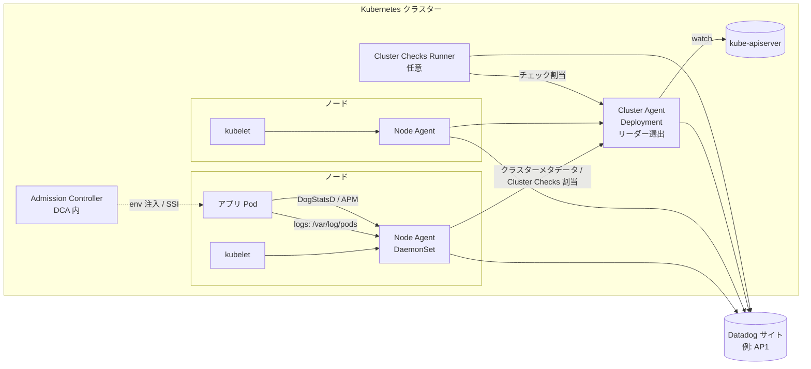
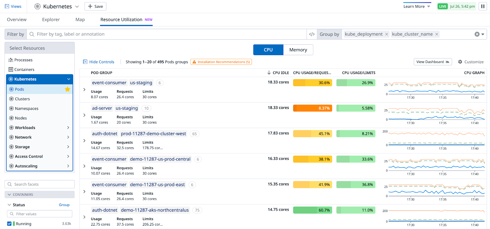

# Kubernetes 監視の実践

## 概要

本ファイルは、Datadog で Kubernetes クラスターを本番監視する際に、**どの構成を選び、どこで量を絞り、何に気を付けるか**という実践知見をまとめる。対象読者は、Datadog の Kubernetes 導入・運用を担当するプラットフォームエンジニア、SRE、コンサルタントである。

- 仕様（設定キーの全量、CRD、既定値、ディストリビューション別設定）は [コンテナ/Kubernetes向けAgent](../02_リファレンス/platform/kubernetes-and-containers-agent.md) を正とする。
- 画面（Containers Explorer、Kubernetes Explorer（旧称 Orchestrator Explorer）、Resource Utilization、Kubernetes Autoscaling）の仕様は [コンテナ・Kubernetes 監視](../02_リファレンス/infrastructure/container-and-kubernetes-monitoring.md) を参照。
- 本ファイルは上記リファレンスの内容を前提に、**判断基準・設計パターン・失敗例・トラブル対処**に絞る。

扱う範囲:

| 節 | テーマ | 主な問い |
|---|---|---|
| [1](#1-全体設計の考え方) | 全体設計 | Operator と Helm のどちらにするか。どの順で機能を広げるか |
| [2](#2-agent-構成の設計) | Agent 構成 | Cluster Agent・Cluster Checks Runner・KSM Core をどう配置するか |
| [3](#3-リソース設計) | リソース設計 | Agent の requests / limits をどう決め、どう見直すか |
| [4](#4-autodiscovery-の設計) | Autodiscovery | アノテーション・CRD・Helm 設定をどう使い分けるか |
| [5](#5-メトリクス量の制御) | メトリクス量 | カスタムメトリクスの膨張をどう防ぐか |
| [6](#6-ログ量の制御) | ログ量 | コンテナログをどこで絞るか |
| [7](#7-ベースラインのモニターとダッシュボード) | アラート | 最初に置くべきモニターは何か |
| [8](#8-マルチクラスタ運用) | マルチクラスタ | 命名・構成管理・アップグレードをどう統制するか |
| [9](#9-よくあるトラブルと対処) | トラブル | 典型的な症状と原因・対処 |

> 確度について: Datadog 公式は Agent / Cluster Agent の推奨リソース量や推奨レプリカ数を数値で公開していない（[コンテナ/Kubernetes向けAgent の制限値節](../02_リファレンス/platform/kubernetes-and-containers-agent.md#制限値クォータデフォルト値) 参照）。本ファイル中の数値例のうち公式出典のないものには `【経験則】` または `【第三者情報】` を付けている。

---

## 1. 全体設計の考え方

### 1.1 構成要素と役割分担

Kubernetes 上の Datadog は、ノードごとの **Node Agent（DaemonSet）**、クラスターに 1 つ（冗長化時は複数レプリカ）の **Cluster Agent（Deployment）**、任意の **Cluster Checks Runner（Deployment）** で構成される。Cluster Agent は API サーバーへのアクセスを集約するバッファとして機能し、ノード数 n 台分の Agent が API サーバーを直接叩くのを避ける。[出典](https://docs.datadoghq.com/containers/cluster_agent/)



| コンポーネント | 主な責務 | 監視上の論点 |
|---|---|---|
| Node Agent | kubelet・コンテナランタイムからのメトリクス、コンテナログ、DogStatsD・APM 受信、ノード上のインテグレーション（Endpoint Checks を含む） | ノードのサイズとワークロード密度に応じたリソース設計（[3](#3-リソース設計)） |
| Cluster Agent | クラスターレベルのメタデータ提供、Kubernetes イベント収集、Cluster Checks の配布、KSM Core チェック、External Metrics（HPA）、Admission Controller | 単一障害点にしない（[2.3](#23-cluster-agent-の冗長化)）、大規模時の負荷（[2.4](#24-大規模クラスターでの-ksm-core-と-cluster-checks-の分散)） |
| Cluster Checks Runner | Cluster Checks（KSM Core を含められる）を専用 Pod で実行 | クラスター規模・チェック数に応じたレプリカ数 |
| Operator（Operator 方式時） | `DatadogAgent` CR を reconcile し、上記を展開・更新 | Operator 自体のバージョン管理（[8.3](#83-バージョン管理とアップグレード)） |

各コンポーネントの仕様は [コンテナ/Kubernetes向けAgent §1・§6・§7](../02_リファレンス/platform/kubernetes-and-containers-agent.md#1-全体アーキテクチャ) を参照。

### 1.2 導入方式の選び方（Operator か Helm か）

Datadog は新規導入では **Datadog Operator を推奨**しており、Operator は主要クラウドプロバイダー上で v1.29.0 以降に Helm chart と機能パリティに達したとしている。[出典](https://docs.datadoghq.com/containers/datadog_operator/)

| 判断軸 | Operator を選ぶ | Helm を選ぶ |
|---|---|---|
| 新規導入・標準的なマネージド K8s（EKS / AKS / GKE / OpenShift） | ○（推奨） | — |
| ノードプールごとに Agent 設定・リソースを変えたい | ○（`DatadogAgentProfile`）[出典](https://docs.datadoghq.com/containers/datadog_operator/datadog_agent_profiles/) | values の分割・複数リリースで対応（煩雑）【経験則】 |
| Fleet Automation から Agent 設定を変更したい | ○（Operator v1.27 以降が前提の Product Preview）[出典](https://www.datadoghq.com/product-preview/configure-agent-kubernetes-operator/) | 対象外 |
| 展開状態を CR の status で確認したい | ○（Operator は展開状態・ヘルス・エラーを CRD の status に出す）[出典](https://docs.datadoghq.com/containers/datadog_operator/) | Helm リリースの状態のみ |
| Operator 非対応プラットフォーム（Talos、Flatcar など）や Helm 固有機能を使う | — | ○ |
| 既存の Helm ベース GitOps 資産が大きい | 移行コストを評価 | ○（移行手順は [リファレンス §3.4](../02_リファレンス/platform/kubernetes-and-containers-agent.md#34-helm-から-operator-への移行)） |

- APM の Single Step Instrumentation（SSI）は Agent と同じ Namespace の Pod を計装しないため、**Agent は専用 Namespace（例: `datadog`）に置く**。[出典](https://docs.datadoghq.com/containers/kubernetes/installation/)
- 公式は Operator を推奨（recommended）としており、手動 DaemonSet マニフェストは 3 つのインストール方式の 1 つとして載っている（明示的な非推奨表記はない）。[出典](https://docs.datadoghq.com/containers/kubernetes/installation/)

### 1.3 段階的な有効化の進め方

一度に全機能を有効化すると、課金とノイズとリソース消費が同時に跳ね上がり、原因切り分けが難しくなる【経験則】。以下の順で広げるのが扱いやすい。

| 段階 | 有効化するもの | 確認すること | 課金への主な影響 |
|---|---|---|---|
| 0. 準備 | `clusterName` の決定、Namespace、API キーの Secret、タグ規約（`env`・`team`・`service`） | 命名規則（[8.1](#81-クラスター命名とタグ)）、[タグ戦略の実践](02-tagging-strategy.md) | なし |
| 1. 基盤 | Node Agent + Cluster Agent、KSM Core（既定で有効）、Kubernetes イベント | `agent status`、Kubernetes Explorer にクラスターが出るか | ホスト（ノード）、コンテナ同梱枠超過 |
| 2. ログ | `logs.enabled`。`containerCollectAll` は方針を決めてから（[6.2](#62-containercollectall-の判断)） | 取り込み量の日次推移、除外ルール | ログ取り込み・インデックス |
| 3. APM | APM 受信、Admission Controller / SSI | サービスの `env`/`service`/`version` が揃っているか | APM ホスト、スパン |
| 4. 追加製品 | Process、Cloud Network Monitoring、USM、Workload Protection、Cloud Security など | 各製品の価値とホスト単位課金 | 製品ごとのホスト・コンテナ課金 |
| 5. 最適化 | Autoscaling、Resource Utilization による right-sizing | 推奨値の妥当性 | Kubernetes Autoscaling は vCPU 課金 |

全社的な展開計画は [Agent 展開設計](../03_導入編/10-agent-rollout-design.md) と [導入方法論](../03_導入編/08-implementation-methodology.md) を参照。

---

## 2. Agent 構成の設計

### 2.1 規模別の構成パターン

公式は規模の閾値（何ノード以上なら何を有効にするか）を数値で示していない。以下は公式の設定項目の説明（「大規模クラスター向け」等の記述）に基づき、規模感を【経験則】で当てはめた目安である。

| パターン | 目安規模【経験則】 | 構成 | 根拠となる公式記述 |
|---|---|---|---|
| 最小 | 検証環境・数ノード | Node Agent + Cluster Agent 1 レプリカ。KSM Core は Cluster Agent 上 | Helm 既定は `clusterAgent.replicas: 1`、`datadog.kubeStateMetricsCore.enabled: true` [出典](https://github.com/DataDog/helm-charts/blob/main/charts/datadog/values.yaml) |
| 標準（本番） | 数十〜数百ノード | Cluster Agent 2 レプリカ + PodDisruptionBudget + priorityClass。Node Agent に tolerations と resources を明示 | Cluster Checks Runner ガイドの Operator 例で Cluster Agent を 2 レプリカにしている [出典](https://docs.datadoghq.com/containers/guide/clustercheckrunners/) |
| 大規模 | 数百ノード以上、Pod 数が多い、Cluster Checks が多い | 上記 + Cluster Checks Runner（2 レプリカ以上）+ `kubeStateMetricsCore.useClusterCheckRunners: true`。必要に応じて KSM のシャーディング / ノード側 Pod 収集 / API サーバーキャッシュ | Helm の `useClusterCheckRunners` は「For large clusters」、`useApiServerCache` は「Recommended for large clusters」と説明 [出典](https://github.com/DataDog/helm-charts/blob/main/charts/datadog/values.yaml) |

Datadog 自身は、数十のクラスターを運用し、その一部は数千ノード規模でマルチクラウドにまたがると公表している。[出典](https://datadogon.datadoghq.com/talks/datadog-on-kubernetes-monitoring/)（2020-11-16 公開の Datadog on 講演。2 年以上前の情報）

### 2.2 Cluster Agent を必ず使う理由

Cluster Agent を使わない構成（Node Agent だけでイベントや KSM を集める構成）も設定上は可能だが、本番では Cluster Agent を前提にするのが実務上の標準である【経験則】。理由は次のとおり。

| 理由 | 内容 | 出典 |
|---|---|---|
| API サーバー負荷の低減 | Node Agent が個別に API サーバーへ問い合わせる代わりに Cluster Agent が集約する。Datadog は数百ノード・2 万以上の Pod/Endpoint のクラスターで API サーバー負荷が目に見えて下がったとしている | [Datadog ブログ（Cluster Agent 紹介）](https://www.datadoghq.com/blog/datadog-cluster-agent/)（2018 公開。2 年以上前の情報） |
| KSM Core の実行場所 | `kubernetes_state_core` チェックは Cluster Agent（または Cluster Checks Runner）で動く。Cluster Agent v1.12 以降が要件 | [KSM Core](https://docs.datadoghq.com/integrations/kubernetes_state_core/) |
| Admission Controller | `DD_AGENT_HOST`・Unified Service Tagging の環境変数注入、SSI は Cluster Agent の機能 | [Admission Controller](https://docs.datadoghq.com/containers/cluster_agent/admission_controller/) |
| イベントの重複防止 | 複数 Agent がイベントを集めると重複する。Cluster Agent 利用時は Cluster Agent が収集（リーダー選出） | [Configuration](https://docs.datadoghq.com/containers/kubernetes/configuration/) |
| HPA / Autoscaling | External Metrics Provider、`DatadogPodAutoscaler` は Cluster Agent が必要 | [リファレンス §6.6](../02_リファレンス/platform/kubernetes-and-containers-agent.md#66-external-metrics-providerhpa-連携) |

### 2.3 Cluster Agent の冗長化

Cluster Agent が停止すると、新規 Pod へのクラスタータグ付与、Admission Controller による注入、Cluster Checks、KSM、HPA 外部メトリクスが影響を受ける。Admission Controller の Helm 既定 `failurePolicy` は `Ignore` のため、Cluster Agent 停止中もアプリ Pod の作成自体はブロックされないが、**その間に作られた Pod には環境変数や SSI が注入されない**。[出典](https://github.com/DataDog/helm-charts/blob/main/charts/datadog/values.yaml)

| 設定 | Helm 既定 | 本番での推奨【経験則】 |
|---|---|---|
| `clusterAgent.replicas` | `1` | `2`（リーダー選出によりアクティブは 1、もう 1 つは待機） |
| `clusterAgent.pdb.create`（旧 `createPodDisruptionBudget` は非推奨） | `false` | `true`（`minAvailable: 1` 相当。chart のコメントでは既定 1） |
| `clusterAgent.priorityClassName` | 未設定（コメント例 `system-cluster-critical`） | 設定する |
| Pod の配置 | 指定なし | `podAntiAffinity` / トポロジー分散で別ノード・別ゾーンへ |

出典: [Helm chart values.yaml](https://github.com/DataDog/helm-charts/blob/main/charts/datadog/values.yaml)（chart 3.264.0 時点）

- リーダーリース期間は 60 秒。リーダー Pod が落ちてから待機側が引き継ぐまでにこの程度の空白が生じ得る。[出典](https://docs.datadoghq.com/containers/cluster_agent/commands/)
- Cluster Agent と Node Agent は同じバージョンに揃えることが推奨されている。[出典](https://docs.datadoghq.com/containers/kubernetes/installation/)

### 2.4 大規模クラスターでの KSM Core と Cluster Checks の分散

KSM Core はクラスター全体のオブジェクトを watch するため、クラスター規模に比例して Cluster Agent の負荷が増える。Helm chart は次の段階的な分散手段を用意している。[出典](https://github.com/DataDog/helm-charts/blob/main/charts/datadog/values.yaml)

| 手段 | Helm キー（既定値） | 効果 | 要件・トレードオフ |
|---|---|---|---|
| ① API タイムアウト延長 | Cluster Agent の環境変数 `DD_KUBERNETES_APISERVER_CLIENT_TIMEOUT`（既定 10 秒） | 大規模クラスターで KSM メトリクスが欠ける事象への対処 | [KSM Core](https://docs.datadoghq.com/integrations/kubernetes_state_core/) の公式記載 |
| ② API サーバーキャッシュ | `datadog.kubeStateMetricsCore.useApiServerCache`（`false`） | API サーバーへの負荷を下げる（chart の説明で大規模クラスターに推奨） | — |
| ③ 専用 Runner で実行 | `datadog.kubeStateMetricsCore.useClusterCheckRunners`（`false`）+ `clusterChecksRunner.enabled: true` | KSM を Cluster Agent から切り離し、専用ワーカーで実行。Runner を有効にした場合は本フラグも true にすることが推奨 | Runner の Deployment が増える |
| ④ 収集 Namespace の限定 | `datadog.kubeStateMetricsCore.namespaces`（`[]` = 全 Namespace） | 指定 Namespace のみ収集。RBAC も Namespace 単位の Role に絞られる（クラスタースコープのリソースは引き続き収集） | 対象外 Namespace の KSM メトリクスは欠ける |
| ⑤ Pod 収集をノード側へ | `datadog.kubeStateMetricsCore.podCollectionMode`（`default`）を `node_kubelet` | スケジュール済み Pod の KSM メトリクスを各 Node Agent が kubelet から収集し、単一 KSM インスタンスのボトルネックを解消。クラスター集計の `.total` 系は専用インスタンスで収集 | Agent / Cluster Agent 7.82 以降（Runner 利用時は Runner も 7.82 以降） |
| ⑥ シャーディング | `datadog.kubeStateMetricsCore.shardingEnabled`（`false`） | KSM を pods / nodes / その他の 3 インスタンスに分割し、別々の Cluster Check として配布 | Cluster Agent 7.83.0 以降、③が前提。**Pod メトリクスから `kube_region`、`kube_zone`、`container_runtime_version`、`kernel_version`、`kubelet_version`、`os_image` の 6 タグが消える**（エラーは出ない） |

- ⑥のタグ欠落は、ゾーン別ダッシュボードやモニターのグルーピングを壊す。導入前に `kube_zone` 等を使う資産を棚卸しする。[出典](https://github.com/DataDog/helm-charts/blob/main/charts/datadog/values.yaml)
- Cluster Checks Runner の Helm 既定レプリカ数は 2（`enabled` 既定 `false`）。chart のコメントは「HA にするなら 2 以上を維持し、Cluster Checks の数に応じて増やす」としている。Runner は `podAntiAffinity` で別ノードに配置される（Cluster Agent が Runner をノード名で識別するため）。[出典](https://docs.datadoghq.com/containers/guide/clustercheckrunners/)
- Runner の推奨台数・推奨リソースは公開情報では確認できず。

### 2.5 DaemonSet のスケジューリング

Node Agent が載っていないノードは「監視されていないノード」になり、しかも気付きにくい【経験則】。

| 論点 | 内容 | 出典 |
|---|---|---|
| taint 付きノード | DaemonSet は既定では taint 付きノードに載らない。GPU ノード、専用ノードプール、コントロールプレーンなどには `agents.tolerations`（Operator は `spec.override.nodeAgent.tolerations`）を追加する | [Porter ブログ](https://www.porter.run/blog/datadog-on-kubernetes-avoiding-common-pitfalls)【第三者情報】（2021-07-16 公開。2 年以上前の情報だが Kubernetes の仕様上現在も同様） |
| 優先度 | Helm は `agents.priorityClassCreate`（既定 `false`、作成時の値 `1000000000`）と `agents.priorityClassName` を持つ。ノードが満杯でも Agent が退避・スケジュール不能にならないよう優先度を与える【経験則】 | [values.yaml](https://github.com/DataDog/helm-charts/blob/main/charts/datadog/values.yaml) |
| ローリング更新 | Helm 既定 `agents.updateStrategy.rollingUpdate.maxUnavailable: "10%"`。大規模クラスターでは更新完了までの時間と、更新中の欠測範囲のバランスで調整する | 同上 |
| 監視漏れの検知 | `kubernetes_state.daemonset.desired` と `kubernetes_state.daemonset.ready` を比較するモニターで、Agent DaemonSet の未配置を検知する【経験則】 | メトリクス名は [KSM Core metadata](https://github.com/DataDog/integrations-core/blob/master/kubernetes_state_core/metadata.csv) |

### 2.6 ノードプールごとの差異を吸収する

ノードのサイズ（例: 4 vCPU と 64 vCPU）やワークロード密度が大きく異なるクラスターでは、全ノード一律の Agent リソースでは過不足が出る【経験則】。

- Operator の `DatadogAgentProfile`（DAP）は `profileAffinity`（ノードセレクター）で対象ノードを選び、Agent の設定・リソースを上書きする。DAP ごとに専用 DaemonSet が作られ、複数 DAP は異なるノードサブセットを対象にする必要がある。DAP は Operator v1.5.0 で導入され、v1.24.0 で GA になった。既定は無効。GKE Autopilot などノードのパッチを禁止する環境では使えない。[出典](https://docs.datadoghq.com/containers/datadog_operator/datadog_agent_profiles/)
- Helm で同じことをする場合は、`nodeSelector`/`affinity` を変えた複数リリースを作ることになり、RBAC や Cluster Agent の重複に注意が必要【経験則】。

### 2.7 機能有効化の判断表

| 機能 | 有効化キー（Operator / Helm） | 有効化を判断する問い | 課金・リソースへの影響 |
|---|---|---|---|
| ログ収集 | `features.logCollection.enabled` / `datadog.logs.enabled` | ログ基盤を Datadog に寄せるか。全量か選択か | ログ取り込み・インデックス。Agent の CPU・メモリ増 |
| APM | `features.apm.enabled` / `datadog.apm.portEnabled` 等 | 計装する言語・サービスはどれか | APM ホスト・スパン（[APM 運用の実践](05-apm-practices.md)） |
| Process Collection | `datadog.processAgent.processCollection`（Helm 既定 `false`） | プロセス単位の可視化が必要か | 追加製品（Process）。process-agent のリソース |
| Container Collection（Containers Explorer） | `datadog.processAgent.containerCollection`（Helm 既定 `true`） | — | Infrastructure に含まれる |
| Kubernetes Explorer | `orchestratorExplorer.enabled` | — | Infrastructure に含まれる |
| Prometheus 自動スクレイプ | `datadog.prometheusScrape.enabled`（Helm 既定 `false`） | 対象を限定できるか（[4.5](#45-prometheus--openmetrics-収集の設計)） | **カスタムメトリクス急増のリスク** |
| Cloud Network Monitoring / USM | system-probe 系 | ネットワーク・サービス間通信の可視化が必要か | ホスト単位の追加製品、system-probe のリソース |
| Workload Protection / Cloud Security | security-agent 系 | セキュリティ部門の要件 | コンテナ・ホスト単位の追加製品 |

有効化キーの全量は [リファレンス §5.2](../02_リファレンス/platform/kubernetes-and-containers-agent.md#52-機能の有効化キー) を参照。既定値は [Helm values.yaml](https://github.com/DataDog/helm-charts/blob/main/charts/datadog/values.yaml)（chart 3.264.0）に基づく。

### 2.8 Admission Controller の運用

| 論点 | 推奨・注意 | 出典 |
|---|---|---|
| 注入対象の選び方 | Helm 既定 `mutateUnlabelled: false` のため、Pod ラベル `admission.datadoghq.com/enabled: "true"` を付けた Pod だけに注入される。全 Pod 注入にするかはチームの合意を取ってから | [values.yaml](https://github.com/DataDog/helm-charts/blob/main/charts/datadog/values.yaml)、[Porter ブログ](https://www.porter.run/blog/datadog-on-kubernetes-avoiding-common-pitfalls)【第三者情報】（2021-07-16） |
| 起動順序 | Cluster Agent がアプリより先に起動している必要がある。Cluster Agent 不在時に作られた Pod には注入されない | [Container Troubleshooting](https://docs.datadoghq.com/containers/troubleshooting/) |
| アプリ側での上書き | Pod 自身が `DD_AGENT_HOST` / `DD_ENTITY_ID` を定義していると注入値より優先される。マニフェストから削除する | [Porter ブログ](https://www.porter.run/blog/datadog-on-kubernetes-avoiding-common-pitfalls)【第三者情報】 |
| SSI | Agent と同じ Namespace の Pod は計装されない | [Installation](https://docs.datadoghq.com/containers/kubernetes/installation/) |

---

## 3. リソース設計

### 3.1 公式の既定値と公開情報の範囲

- Helm chart は Node Agent の各コンテナ（`agent`、`traceAgent`、`processAgent`、`systemProbe`、`securityAgent` ほか）、Cluster Agent、Cluster Checks Runner のいずれも **`resources: {}`（未設定）** が既定である。つまり requests / limits を明示しない限り、BestEffort QoS で動く。[出典](https://github.com/DataDog/helm-charts/blob/main/charts/datadog/values.yaml)
- Datadog は Kubernetes 上の Agent の推奨 requests / limits を数値で公開していない（公開情報では確認できず）。
- 参考になる公式値は、ホスト Agent のオーバーヘッド計測（Agent 7.34.0、EC2 c5.xlarge で CPU 平均約 0.08%、メモリ約 130 MB RSS）程度である。詳細は [Datadog Agent §10](../02_リファレンス/platform/agent.md#10-agent-のリソース消費オーバーヘッド)。これはインテグレーションやログ量が少ない条件の値であり、Kubernetes ノードの Agent の見積りにはそのまま使えない【経験則】。
- 例外として、GKE Autopilot ではプラットフォーム側の既定リソース（CPU 50m、メモリ 100Mi）が小さいため OOMKill が起きやすく、リソース要求の明示が案内されている。[出典](https://docs.datadoghq.com/containers/kubernetes/distributions/)

### 3.2 Agent のリソース消費を左右する要因

| 要因 | 影響するコンテナ | 内容 | 出典 |
|---|---|---|---|
| ノード上の Pod / コンテナ数 | agent、process-agent | タグ付け（tagger）、コンテナメトリクス、Containers Explorer 用収集の対象が増える | 【経験則】 |
| インテグレーションのメトリクス数・インスタンス数 | agent | 大量のメトリクスを返すチェックや多数のチェックインスタンスは CPU・メモリを増やす。`agent status` の Collector 節で確認 | [High Agent CPU or Memory](https://docs.datadoghq.com/agent/troubleshooting/high_memory_usage/) |
| ログ量・DogStatsD 量 | agent | 転送するログや DogStatsD の量が非常に多いとリソースが増える | 同上 |
| 同時 tail ファイル数 | agent | `open_files_limit` を上げると Agent のリソース消費が増え得る | [Increase the Number of Log Files Tailed](https://docs.datadoghq.com/logs/guide/increase-number-of-log-files-tailed/) |
| APM のトラフィック | trace-agent | 受信上限の既定はメモリ 500,000,000 バイト、CPU 50%、接続 2000 / 30 秒。超過時は trace-agent が受信を絞る | [Kubernetes APM](https://docs.datadoghq.com/containers/kubernetes/apm/) |
| eBPF 系機能 | system-probe | Cloud Network Monitoring、USM、OOM Kill チェック等 | 【経験則】 |
| チェックの収集間隔 | agent | 既定 10〜15 秒。`min_collection_interval` を 60 秒以上にすると負荷を下げられる | [High Agent CPU or Memory](https://docs.datadoghq.com/agent/troubleshooting/high_memory_usage/) |

### 3.3 初期値の決め方と調整サイクル

公式推奨値がないため、**計測ベースで決める**のが原則である【経験則】。

1. 検証クラスターまたは本番の一部ノードプールに、requests のみ設定（limits は余裕を持たせる、または CPU limits なし）で展開する。
2. 1〜2 週間、ピーク時間帯を含めて Agent コンテナの `kubernetes.cpu.usage.total` と `kubernetes.memory.working_set` を `kube_container_name` 別・ノードプール別に観測する。
3. requests を p95 前後、メモリ limits を最大値に十分な余裕（例: 1.5〜2 倍）を持たせた値に設定する【経験則】。
4. ノードプール間で差が大きい場合は `DatadogAgentProfile` で分ける（[2.6](#26-ノードプールごとの差異を吸収する)）。
5. 機能追加（ログ全量収集、APM、CNM など）のたびに 2〜3 を繰り返す。

公開されている設定例（いずれも根拠となる計測値は示されていない）:

| 出典 | Node Agent（agent コンテナ）の例 | 注記 |
|---|---|---|
| Porter ブログ【第三者情報】（2021-07-16） | requests = limits = CPU 200m / メモリ 256Mi | 「適切な値はノードサイズと Agent の処理内容に依存する」と明記。2 年以上前の情報 [出典](https://www.porter.run/blog/datadog-on-kubernetes-avoiding-common-pitfalls) |
| OneUptime ブログ【第三者情報】（2026-03-20 公開、URL 表記より） | requests CPU 200m / メモリ 256Mi、limits CPU 500m / メモリ 512Mi | 根拠の説明なし [出典](https://oneuptime.com/blog/post/2026-03-20-datadog-agent-deployment-opentofu/view) |
| EKS Fargate 注入サイドカー（公式例） | CPU 200m / メモリ 256Mi | Fargate のサイドカー用の例示値 [出典](https://docs.datadoghq.com/integrations/eks_fargate/) |

> 注意【経験則】: Agent の CPU limits を厳しくすると CFS スロットリングでチェックやログ送信が遅延し、メトリクスの欠測やログの遅延として表れる。メモリ limits は OOMKill を避けるために必ず観測値より十分大きくする。CPU は requests のみ設定し limits を外す運用もよく採られる。

### 3.4 Agent 自身の監視

Agent の異常は「データが来ない」という形でしか見えないことが多いため、Agent 自体をモニター対象にする【経験則】。

| 監視対象 | メトリクス / 方法 | 意図 |
|---|---|---|
| Agent コンテナの OOMKill | `kubernetes_state.container.status_report.count.terminated`（`reason:oomkilled`、`kube_namespace:<Agent の Namespace>`） | メモリ limits 不足の検知 |
| Agent コンテナの再起動 | `kubernetes_state.container.restarts`（Agent の Namespace） | クラッシュループの検知 |
| CPU スロットリング | `kubernetes.cpu.cfs.throttled.periods` / `kubernetes.cpu.cfs.throttled.seconds` | CPU limits 不足の検知 |
| DaemonSet の配置漏れ | `kubernetes_state.daemonset.desired` − `kubernetes_state.daemonset.ready` | taint・リソース不足で起動できないノードの検知 |
| メモリ使用量の推移 | `kubernetes.memory.working_set`（`kube_container_name:agent` 等） | 機能追加・バージョンアップ後の増加傾向 |

メトリクス名は [KSM Core](https://github.com/DataDog/integrations-core/blob/master/kubernetes_state_core/metadata.csv) と [Kubelet](https://github.com/DataDog/integrations-core/blob/master/kubelet/metadata.csv) の metadata.csv で確認した（2026-11-02 時点）。

高負荷の原因調査には次を使う。[出典](https://docs.datadoghq.com/agent/troubleshooting/high_memory_usage/)

- `agent status` の Collector 節で、メトリクス数や実行時間の大きいチェックを特定する。
- デバッグモードで `agent flare --profile 30`（約 30 秒）を取得し、サポートに提出する。
- Agent Profiling チェック（Agent 7.67 以降）は、メモリ・CPU が閾値を超えたときにプロファイル付き flare を自動生成するため、断続的な事象の調査に向く。

### 3.5 アプリケーション側のリソース設計（Resource Utilization の活用）

Agent ではなくワークロード側の requests / limits の見直しには、Kubernetes Resource Utilization 画面を使う。Agent v7.45.0 以降と Kubernetes Explorer の有効化が要件で、直近の値だけでなく長めの期間を見て判断することが推奨されている。[出典](https://docs.datadoghq.com/containers/monitoring/kubernetes_resource_utilization/)



**キャプション:** Kubernetes Resource Utilization 画面（Pod グループ単位の CPU 使用量と requests / limits の比較）。

**画面の説明:** 上部タブは Overview / Explorer / Map / Resource Utilization（NEW 表記）。左ペインの Select Resources で Kubernetes > Pods を選択している（ほかに Clusters、Namespaces、Nodes、Workloads、Network、Storage、Access Control、Autoscaling）。上部に「Filter by」（タグ・ラベル・アノテーションで絞り込み）と「Group by」（例: `kube_deployment` と `kube_cluster_name`）がある。中央の CPU / Memory 切り替えボタンの下に Pod グループの表があり、列は POD GROUP（デプロイ名とクラスター名、Pod 数）、CPU IDLE（requests と使用量の差のコア数）、CPU USAGE/REQUESTS（%）、CPU USAGE/LIMITS（%）、CPU GRAPH（使用量・requests・limits の時系列）。各行の下に Usage / Requests / Limits のコア数が表示される。「Installation Recommendations」の警告リンクと「View Dashboard」「Customize」ボタンがある。

**出典:** https://docs.datadoghq.com/containers/monitoring/kubernetes_resource_utilization/ （画像: https://docs.dd-static.net/images/infrastructure/livecontainers/kubernetes_resource_utilization.758f880f3f5e365fa2c62650f03e87f9.png）、取得日 2026-11-02

- `Group by` に `kube_cluster_name` を入れると、同じデプロイメントのクラスター間比較ができ、マルチクラスタ運用で過剰な requests を持つクラスターを見つけやすい【経験則】。
- 推奨値を自動適用したい場合は Kubernetes Autoscaling（vCPU 課金）を検討する。仕様は [コンテナ・Kubernetes 監視 §7](../02_リファレンス/infrastructure/container-and-kubernetes-monitoring.md#7-kubernetes-autoscaling)。

---

## 4. Autodiscovery の設計

### 4.1 設定手段の使い分け

Autodiscovery の設定手段は複数あり、優先順位は (1) Pod アノテーション、(2) DatadogInstrumentation、(3) 自動設定（auto-configuration）と静的設定（Operator / Helm を含む）である。[出典](https://docs.datadoghq.com/containers/kubernetes/integrations/)

| 手段 | 向いているケース | 注意点 |
|---|---|---|
| Pod アノテーション（AD v2、Agent 7.36 以降） | アプリチームがマニフェストと一緒に監視設定を持つ | アノテーションは Deployment の `spec.template.metadata` に置く。`<CONTAINER_NAME>` はイメージ名ではなくコンテナ名。変更には Pod の再作成が必要 |
| DatadogInstrumentation CRD（Agent・Cluster Agent 7.82 以降） | サードパーティの Helm chart など、Pod テンプレートを編集しにくいワークロード。プラットフォームチームが集中管理したい場合 | 1 ワークロード / Service を対象にできるのは Namespace 内で 1 つ。同じ対象にアノテーションがあるとアノテーションが優先されるため重複を消す |
| Helm `datadog.confd` / Operator `extraConfd` | 全ノード共通の設定、ノードローカルのチェック | 静的設定のため、変更には Agent のロールアウトが必要 |
| Helm `clusterAgent.confd`（Cluster Checks） | マネージド DB・外部エンドポイント・クラスター内 Service など「ノードに紐付かない」対象 | Cluster Agent が 1 つの Agent / Runner にだけ割り当てる |
| auto-configuration（`auto_conf.yaml`） | Redis 等の一般的なイメージを無設定で監視 | 意図しないチェックが動くことがある。不要なら `datadog.ignoreAutoConfig` で無効化 |

各手段の書式は [リファレンス §9](../02_リファレンス/platform/kubernetes-and-containers-agent.md#9-autodiscovery) を参照。

### 4.2 責任分界のパターン

| パターン | プラットフォームチーム | アプリチーム | 向いている組織【経験則】 |
|---|---|---|---|
| A. アプリ主導 | Agent・Cluster Agent・共通除外ルール | Pod アノテーションでチェック・ログ設定、`tags.datadoghq.com/*` ラベル | チームが自律的で、マニフェストを各チームが持つ |
| B. プラットフォーム主導 | DatadogInstrumentation CR / `confd` で全チェックを定義 | `tags.datadoghq.com/*` ラベルのみ | 監視標準を強く統制したい、サードパーティ chart が多い |
| C. 混在 | 共通ミドルウェア（DB、キュー、Ingress）を CR で | 自社アプリをアノテーションで | 中〜大規模の一般的な形 |

- いずれのパターンでも、Unified Service Tagging のラベル（`tags.datadoghq.com/env`・`service`・`version`）はアプリのマニフェスト側で付ける。詳細は [タグ戦略の実践 §5](02-tagging-strategy.md#5-unified-service-tagging-の実装パターン)。
- 監視設定（モニター）もアプリと一緒に管理する場合は `DatadogMonitor` CRD が使える（[7.2](#72-monitoring-as-code-との連携)）。

### 4.3 Cluster Checks と Endpoint Checks の選択

| 監視対象 | 推奨手段 | 理由 | 出典 |
|---|---|---|---|
| クラスター外のマネージドサービス（RDS、Cloud SQL など）、外部 HTTP エンドポイント | Cluster Checks | ノードに依存しない。Cluster Agent が 1 回だけ実行させる | [Cluster Checks](https://docs.datadoghq.com/containers/cluster_agent/clusterchecks/) |
| Service の背後にある各 Pod（例: Service 経由で到達する各レプリカのメトリクス） | Endpoint Checks | Pod と同じノードの Agent で実行され、Pod のタグが正しく付く | [Cluster Check Runners](https://docs.datadoghq.com/containers/guide/clustercheckrunners/) |
| Pod 内コンテナ自体 | Pod アノテーション / CR | Node Agent がローカルで実行 | — |

- Cluster Checks が増えた場合は Cluster Checks Runner を導入し、Node Agent への割当てを避ける。Endpoint Checks は通常の Node Agent に残る。[出典](https://docs.datadoghq.com/containers/guide/clustercheckrunners/)
- 割当状況は Cluster Agent Pod で `agent clusterchecks` で確認する。

### 4.4 よくある Autodiscovery の誤り

| 誤り | 症状 | 対処 |
|---|---|---|
| アノテーションを Deployment の `metadata` に置いた | チェックが動かない | `spec.template.metadata.annotations` に置く |
| `<CONTAINER_NAME>` にイメージ名を書いた | チェックが動かない | `.spec.containers[].name` を使う |
| JSON の構文誤り、AD v1 と v2 の混在 | `agent configcheck` に出ない | `agent configcheck` で解決後の設定を確認 |
| 同じ対象にアノテーションと DatadogInstrumentation を両方設定 | CR の設定が効かない | アノテーションが優先されるため片方に寄せる |
| auto_conf と手動設定の重複 | 同じチェックが 2 重に動き、メトリクスが二重計上・タグ違いで並ぶ | `datadog.ignoreAutoConfig` に対象を追加 |
| Ready でない Pod を監視したい | 収集されない | `ad.datadoghq.com/tolerate-unready: "true"` |
| パスワードをアノテーションに直書き | 秘密情報の漏えい | `%%env_<VAR>%%` テンプレート変数か Secret Backend を使う |

出典: [Kubernetes Integrations](https://docs.datadoghq.com/containers/kubernetes/integrations/)、[Container Discovery Management](https://docs.datadoghq.com/containers/guide/container-discovery-management/)、[Template Variables](https://docs.datadoghq.com/containers/guide/template_variables/)

### 4.5 Prometheus / OpenMetrics 収集の設計

Kubernetes では多くのワークロードが Prometheus 形式のメトリクスを公開しているが、**汎用 Prometheus / OpenMetrics チェックで取り込んだメトリクスは既定でカスタムメトリクスとして課金される**。高度な設定なしで自動スクレイプを有効にするとカスタムメトリクスが大幅に増える可能性がある、と公式が注意している。[出典](https://docs.datadoghq.com/containers/kubernetes/prometheus/)

| 設計判断 | 推奨 | 出典・根拠 |
|---|---|---|
| 自動スクレイプ（`prometheus.io/scrape=true` の検出） | 有効化前に、注釈を持つ Pod / Service を `kubectl` の JSONPath で棚卸しする。`additionalConfigs.autodiscovery` でコンテナ名（`kubernetes_container_names`）やアノテーション（`kubernetes_annotations`）で対象を絞る（両方指定時は両方一致が必要） | [Prometheus and OpenMetrics](https://docs.datadoghq.com/containers/kubernetes/prometheus/) |
| `metrics` リスト | 必要なメトリクスだけを列挙する。`".*"` は全取得になる（`"*"` ではない） | 同上 |
| 返却上限 | `max_returned_metrics` の既定は 2000。上限に当たると以降が欠ける | 同上 |
| 公式インテグレーションの有無 | 対象ソフトウェアに公式インテグレーション（例: 各種ミドルウェア）があれば、汎用チェックよりそちらを優先する【経験則】 | 汎用チェックとの課金区分の違いは [Custom Metrics と DogStatsD](../02_リファレンス/platform/custom-metrics-and-dogstatsd.md) |
| ヒストグラム | `send_distribution_buckets` などの指定でメトリクス数が変わるため、試験環境で件数を確認してから本番に入れる【経験則】 | — |
| 自動スクレイプのチェックバージョン | Helm `datadog.prometheusScrape.version` 既定 `2`（OpenMetrics v2、Agent 7.34 以降） | [values.yaml](https://github.com/DataDog/helm-charts/blob/main/charts/datadog/values.yaml) |

---

## 5. メトリクス量の制御

### 5.1 Kubernetes でカスタムメトリクスが増える経路

Kubernetes では、自動付与タグとワークロードの入れ替わりによってタグの組み合わせが増えやすい。カスタムメトリクスは「メトリクス名 + タグ値の組み合わせ」ごとに数えられる。仕組みは [タグ戦略の実践 §6](02-tagging-strategy.md#6-カーディナリティ管理) と [コスト最適化 §4](01-cost-optimization.md#4-カスタムメトリクスのコスト最適化) を参照。

| 経路 | 増える理由 | 主な制御手段 |
|---|---|---|
| DogStatsD（アプリのカスタムメトリクス） | オリジン検出で付くタグの粒度（`orchestrator` で `pod_name`、`high` で `container_id`） | `DD_DOGSTATSD_TAG_CARDINALITY`（[5.2](#52-タグカーディナリティ設定)） |
| 汎用 OpenMetrics / Prometheus チェック | 取り込んだメトリクスが既定でカスタムメトリクス | `metrics` の限定、自動スクレイプ対象の限定（[4.5](#45-prometheus--openmetrics-収集の設計)） |
| labels as tags | Pod ラベル・アノテーションをタグ化すると、そのタグが関連メトリクスに付く。公式は「カスタムメトリクスは課金に影響し得る」と注意 | 必要なラベルだけを明示的に変換（[5.3](#53-labels-as-tags-の設計)） |
| チェックメトリクスのタグ粒度 | `DD_CHECKS_TAG_CARDINALITY` を上げると、カスタムメトリクスを返すチェックの時系列が増える | 既定 `low` を維持 |
| ログ・スパンベースメトリクス | `group by` に `pod_name` 等を入れる | 生成時の group by を最小化 |

### 5.2 タグカーディナリティ設定

| 設定 | 既定 | 推奨【経験則】 | 出典 |
|---|---|---|---|
| `DD_CHECKS_TAG_CARDINALITY`（Helm `datadog.checksCardinality`） | Agent 既定 `low`（Helm は未設定で Agent 既定に従う） | `low` のまま。Pod 単位で見たい特定チェックだけアノテーション `ad.datadoghq.com/<CONTAINER>.check_tag_cardinality` で上げる | [values.yaml](https://github.com/DataDog/helm-charts/blob/main/charts/datadog/values.yaml)、[リファレンス §9.2](../02_リファレンス/platform/kubernetes-and-containers-agent.md#92-pod-アノテーション) |
| `DD_DOGSTATSD_TAG_CARDINALITY`（Helm `datadog.dogstatsd.tagCardinality`） | `low` | `low` のまま。Pod 単位の分析はログ・APM・Live Containers で行う | [values.yaml](https://github.com/DataDog/helm-charts/blob/main/charts/datadog/values.yaml) |

各レベルで付与されるタグ（`low`: `kube_namespace`・`kube_deployment` 等、`orchestrator`: `pod_name` 等、`high`: `container_id` 等）は [Kubernetes Tag Extraction](https://docs.datadoghq.com/containers/kubernetes/tag/) と [タグ戦略の実践 §6.4](02-tagging-strategy.md#64-agent-のタグカーディナリティ設定) を参照。公式は「タグカーディナリティは取り込み前に付与され、課金に影響し得る」としている。

### 5.3 labels as tags の設計

| 原則 | 内容 | 出典 |
|---|---|---|
| 新方式を使う | Agent v7.58.0 以降では `kubernetesResourcesLabelsAsTags` / `kubernetesResourcesAnnotationsAsTags` の利用が推奨（旧 `podLabelsAsTags` 等との併用時は新方式が優先）。新方式自体は Agent・Cluster Agent v7.64 以降 | [Kubernetes Tag Extraction](https://docs.datadoghq.com/containers/kubernetes/tag/) |
| ワイルドカードを避ける | `"*": <PREFIX>_%%label%%` で全ラベルをタグ化できるが、`pod-template-hash` や `controller-revision-hash` など入れ替わりの多いラベルまでタグになりカーディナリティが増える【経験則】 | ワイルドカードは Agent v7.73.0 以降で KSM にも適用 |
| 伝播の仕様を前提に設計する | ワークロード（Deployment 等）のラベルは子リソース（Pod）へ伝播しない。Namespace のラベル・アノテーションは Pod・コンテナ・Namespace スコープの KSM メトリクスに伝播する | 同上 |
| チーム・コストセンターは Namespace ラベルで | `team`・`cost_center` のように Namespace 単位で決まる属性は Namespace ラベルからタグ化すると、全ワークロードに一括で付く【経験則】 | Namespace ラベルのタグ化は Agent v7.55.0 以降、KSM への付与は v7.70 以降 |
| KSM 専用の変換 | KSM Core だけにラベルを付けたい場合は `datadog.kubeStateMetricsCore.labelsAsTags` / `annotationsAsTags`。アノテーション名は kube-state-metrics の変換規則（例: `tags.datadoghq.com/version` → `tags_datadoghq_com_version`）に合わせる | [values.yaml](https://github.com/DataDog/helm-charts/blob/main/charts/datadog/values.yaml) |

### 5.4 KSM Core メトリクスの扱い

- KSM Core と kubelet 由来のメトリクス（`kubernetes_state.*`、`kubernetes.*`）は Datadog インテグレーションのメトリクスであり、汎用 OpenMetrics チェックとは扱いが異なる。課金区分の一般則は [Custom Metrics と DogStatsD](../02_リファレンス/platform/custom-metrics-and-dogstatsd.md) を参照。
- 一方、Custom Resource 由来のメトリクス（`kubernetes_state_customresource.*`）がカスタムメトリクス扱いかは公開情報では確認できず（[コンテナ・Kubernetes 監視の課金節](../02_リファレンス/infrastructure/container-and-kubernetes-monitoring.md#課金への影響)）。
- 収集対象リソースを増やすオプション（Helm 既定: `collectSecretMetrics: true`、`collectVpaMetrics: false`、`collectCrdMetrics: false`、`collectApiServicesMetrics: false`）は必要なものだけ有効にする。[出典](https://github.com/DataDog/helm-charts/blob/main/charts/datadog/values.yaml)
- 旧 `kubernetes_state` チェックとの同時実行は推奨されない（Helm の `ignoreLegacyKSMCheck: true` が既定）。移行期間以外は両方を動かさない。[出典](https://docs.datadoghq.com/integrations/kubernetes_state_core/)

### 5.5 コンテナ単位の除外（Container Discovery Management）

Container Discovery Management は、Agent が収集対象とするコンテナを絞る仕組みである。メトリクス収集から除外したコンテナは、Autodiscovery ベースのインテグレーションの対象からも外れる。[出典](https://docs.datadoghq.com/containers/guide/container-discovery-management/)

| 手段 | 使いどころ | 最低バージョン |
|---|---|---|
| 環境変数（`DD_CONTAINER_EXCLUDE` / `_METRICS` / `_LOGS` と `_INCLUDE` 系） | クラスター全体で除外したいコンテナ名・イメージ・Namespace の一覧がある場合（公式推奨の使い分け） | Agent 7.20 |
| Pod アノテーション（`ad.datadoghq.com/exclude` / `metrics_exclude` / `logs_exclude`、コンテナ単位版） | 個別 Pod の細かな除外（公式推奨の使い分け） | Agent 7.45 |
| CEL（`cel_workload_exclude` / `DD_CEL_WORKLOAD_EXCLUDE`） | Pod 名・Namespace・アノテーションを組み合わせた条件。構文エラー時は意図しない収集を避けるため Agent が終了する | Agent 7.73（Operator 経由は v1.23.0 以降） |
| セキュリティ製品別の include / exclude | Workload Protection、Cloud Security の対象コンテナを限定し、監視したいコンテナ分だけ課金されるようにする | Agent 7.70 |

運用上の注意:

- **CEL ルールは本番投入前に `agent workloadfilter verify-cel` で検証する**。エラーで Agent が終了すると、そのクラスターの全データが止まる。[出典](https://docs.datadoghq.com/containers/guide/container-discovery-management/)
- 除外設定は traces と DogStatsD には効かない。[出典](https://docs.datadoghq.com/containers/kubernetes/configuration/)
- `kubernetes.containers.running`、`kubernetes.pods.running` などの件数系メトリクスは除外設定に関係なく全コンテナを数える。
- pause コンテナは既定で除外され、収集対象外かつ課金対象のコンテナとしても数えられない。一般の除外設定がコンテナ課金の計数から外れるかは、公式ガイドに明記がない（課金ページは「監視するコンテナを制限するには Container Discovery Management を参照」とだけ記載）。効果は `datadog.estimated_usage.containers` の変化で確認する。[出典](https://docs.datadoghq.com/account_management/billing/containers/)、[コスト最適化 §6.4](01-cost-optimization.md#64-コンテナの最適化)

```yaml
# Helm 例: システム系 Namespace のメトリクスとログを除外し、
# Agent 自身のログも収集しない（値は空白区切りの正規表現）
datadog:
  containerExcludeMetrics: "kube_namespace:^kube-system$ kube_namespace:^kube-node-lease$"
  containerExcludeLogs: "kube_namespace:^kube-system$ image:gcr.io/datadoghq/agent.*"
```

> 判断のポイント【経験則】: `kube-system` のメトリクスを丸ごと除外すると CoreDNS や CNI の異常に気付けなくなる。除外は「ログは除外、メトリクスは残す」から始め、メトリクスは具体的なコンテナ名・イメージ単位で絞るほうが安全である。

### 5.6 推定使用量メトリクスによる監視

Kubernetes 起点の使用量増加は、デプロイやラベル追加をきっかけに突然起きる【経験則】。次の推定使用量メトリクスでモニターを作り、増分を追う。`.by_tag` 系は Usage Attribution で設定したタグ（例: `team`、`env`）で分解されるため、クラスター別に見たい場合は Usage Attribution 側のタグ設定を合わせて検討する。メトリクス一覧と予算アラートの例は [コスト最適化 §2.2〜2.3](01-cost-optimization.md#22-コスト最適化で使う主要な推定使用量メトリクス) を参照。

| 監視対象 | メトリクス例 |
|---|---|
| コンテナ数 | `datadog.estimated_usage.containers`、`datadog.estimated_usage.containers.by_tag` |
| カスタムメトリクス | `datadog.estimated_usage.metrics.custom` 系 |
| ログ取り込み | `datadog.estimated_usage.logs.ingested_bytes` 系 |

---

## 6. ログ量の制御

### 6.1 収集方式

| 方式 | 内容 | 推奨度 | 出典 |
|---|---|---|---|
| ファイル（`/var/log/pods`） | kubelet が書き出す stdout/stderr のファイルを tail。エフェメラルな Pod に強く、リソース消費が少ない | **公式推奨**。Helm 既定 `datadog.logs.containerCollectUsingFiles: true` | [Kubernetes Log Collection](https://docs.datadoghq.com/containers/kubernetes/log/)、[values.yaml](https://github.com/DataDog/helm-charts/blob/main/charts/datadog/values.yaml) |
| Docker ソケット | Docker API を繰り返し問い合わせる。Docker ランタイムが前提で、リソースを多く使う | 代替手段 | 同上 |

- containerd ではログファイルが `root` グループで読めるため、既定の非特権構成でも追加作業は不要。Docker ランタイムで非 root Agent の場合は `DD_LOGS_CONFIG_K8S_CONTAINER_USE_FILE=true` でファイル方式を強制する。[出典](https://docs.datadoghq.com/containers/kubernetes/log/)
- Helm の `datadog.logs.autoMultiLineDetection` は既定 `true`（一般的なマルチライン形式を自動検出）。[出典](https://github.com/DataDog/helm-charts/blob/main/charts/datadog/values.yaml)

### 6.2 containerCollectAll の判断

`containerCollectAll`（Operator `features.logCollection.containerCollectAll`、Helm `datadog.logs.containerCollectAll`）は既定 `false`。`true` にすると発見した全コンテナのログを既定タグ付きで収集し、`false` の場合は Autodiscovery のログ設定があるコンテナだけを収集する。[出典](https://docs.datadoghq.com/containers/kubernetes/log/)

| 方針 | 設定 | メリット | デメリット | 向いている環境【経験則】 |
|---|---|---|---|---|
| オプトアウト（全量 + 除外） | `containerCollectAll: true` + `DD_CONTAINER_EXCLUDE_LOGS` / `logs_exclude` アノテーション | 新規ワークロードのログ漏れがない。障害時に「ログがない」事態を避けられる | ノイズの多いコンテナ・システム系・Agent 自身のログまで課金対象。新規ワークロード追加で取り込み量が予告なく増える | ログを Datadog に一元化する方針で、取り込み量の監視と除外運用ができる組織 |
| オプトイン（指定のみ） | `containerCollectAll: false` + `ad.datadoghq.com/<CONTAINER>.logs` アノテーション / DatadogInstrumentation | 取り込み量を予測しやすい。`source`・`service` が必ず設定される | 設定漏れのワークロードはログが取れない | コスト統制が厳しい、ログ基盤が別にある |

- `containerCollectAll: true` の場合、`source` と `service` は既定でコンテナの短縮イメージ名になる。`tags.datadoghq.com/service` ラベルで `service` を設定できる。[出典](https://docs.datadoghq.com/containers/kubernetes/log/)
- 除外設定（`DD_CONTAINER_EXCLUDE_LOGS`、`ad.datadoghq.com/logs_exclude`）は include 設定より優先される。[出典](https://docs.datadoghq.com/containers/kubernetes/log/)

### 6.3 Agent 側でログを絞る手段

| 手段 | 粒度 | 削減対象 | 例 |
|---|---|---|---|
| コンテナ除外（環境変数・アノテーション・CEL） | コンテナ / Pod / Namespace | 取り込み + インデックス | ヘルスチェック用サイドカー、システム系 Namespace |
| `log_processing_rules`（`exclude_at_match`、`include_at_match`、`mask_sequences`） | ログ行 | 取り込み + インデックス | ヘルスチェックのアクセスログ、DEBUG 行の除外、秘密情報のマスク |
| グローバル処理ルール `DD_LOGS_CONFIG_PROCESSING_RULES` | Agent 全体 | 同上 | `"host"` キーのリネーム（[9](#9-よくあるトラブルと対処) のホスト誤認対策） |

```yaml
# Pod テンプレートのアノテーション例: ヘルスチェックのログを Agent 側で捨てる
metadata:
  annotations:
    ad.datadoghq.com/web.logs: |
      [{
        "source": "nginx",
        "service": "web",
        "log_processing_rules": [
          {"type": "exclude_at_match", "name": "exclude_healthcheck", "pattern": "GET /healthz"}
        ]
      }]
```

- 正規表現をアノテーションに書く場合は `\d` を `\\d` のようにエスケープする。設定例とインデックス側の除外フィルタ・Flex Logs との組み合わせは [コスト最適化 §3](01-cost-optimization.md#3-ログのコスト最適化) と [ログ管理の実践](06-log-management-practices.md) を参照。
- Agent 側で落としたログは Datadog 側で後から参照できない。監査・セキュリティ用途のログを捨てる前に、Observability Pipelines やアーカイブへの分岐を検討する（[Observability Pipelines](../02_リファレンス/logs/observability-pipelines.md)）【経験則】。

### 6.4 短命 Pod・Job のログ

| 論点 | 内容 | 出典 |
|---|---|---|
| 停止済みコンテナのログ | Agent v6.12 以降はファイル方式なら停止・クラッシュしたコンテナや init コンテナのログも、ファイルが残っている限り収集する | [Container Log Collection Troubleshooting](https://docs.datadoghq.com/containers/troubleshooting/log-collection/) |
| 新規コンテナの検出間隔 | Agent は約 5 秒ごとに新しいコンテナを走査する | 同上 |
| Job の `ttlSecondsAfterFinished` | 15 秒以上にする（短すぎると Agent が読む前にファイルが消える） | 同上 |
| 新規 Pod のタグ欠け | tagger がタグを揃える前に送られたログはタグが欠ける。`DD_LOGS_CONFIG_TAGGER_WARMUP_DURATION`（既定 0 秒、例 5）で送信を待たせる | 同上 |
| 新規ノードのホストタグ欠け | `DD_LOGS_CONFIG_EXPECTED_TAGS_DURATION`（例 `10m`）で既知のホストタグを一定時間ログに直接付与 | 同上 |

### 6.5 ログローテーションと tail 上限

- Kubernetes のコンテナログは kubelet がローテーションする。ローテーションが速すぎる（小さい `containerLogMaxSize` と高いログ出力レート）と、Agent が追いつく前に古いファイルが削除され、ログが欠ける可能性がある【経験則】。kubelet 側の設定値はディストリビューションにより異なるため、各クラウドのドキュメントで確認する。
- Agent が同時に tail できるファイル数は `logs_config.open_files_limit`（コンテナ環境では `DD_LOGS_CONFIG_OPEN_FILES_LIMIT`）で制御され、既定は 500（macOS は 200。バージョンにより異なる）。[出典](https://github.com/DataDog/datadog-agent/blob/main/pkg/config/example/datadog-agent_linux.yaml.example) 上げると Agent のリソース消費が増え得る。[出典](https://docs.datadoghq.com/logs/guide/increase-number-of-log-files-tailed/)
- 1 ノードに数百 Pod を詰め込むノードでは、ログの tail 数が上限に近づいていないか `agent status` の Logs Agent 節で確認する【経験則】。

---

## 7. ベースラインのモニターとダッシュボード

### 7.1 最初に置くモニター

アラート設計の一般原則（症状ベース、緊急度、通知のグルーピング）は [アラート設計とノイズ削減](03-alert-design-and-noise-reduction.md) を参照。Kubernetes では次のモニターをベースラインとし、`kube_cluster_name` と `kube_namespace`（またはチーム）でグルーピングする【経験則】。

| # | モニター | クエリの例 | 閾値の例 | 出典・根拠 |
|---|---|---|---|---|
| 1 | CrashLoopBackOff | `max(last_10m):sum:kubernetes_state.container.status_report.count.waiting{reason:crashloopbackoff} by {kube_cluster_name,kube_namespace,pod_name} >= 1` | ≥ 1 | [Datadog ブログ](https://www.datadoghq.com/blog/create-manage-kubernetes-alerts-datadog/)（2021-05-05 公開）。ブログは閾値を環境に合わせて調整するよう注記 |
| 2 | ImagePullBackOff | 同上で `reason:imagepullbackoff` | ≥ 1 | 同上 |
| 3 | スケジュール可能ノード比率 | `kubernetes_state.node.status` から schedulable / 全ノード を計算 | < 80% | 同上 |
| 4 | ノードの状態 | `kubernetes_state.node.by_condition`（Ready が true でない、MemoryPressure / DiskPressure / PIDPressure が true） | 状態一致 | [Datadog ブログ（Kubernetes メトリクス）](https://www.datadoghq.com/blog/monitoring-kubernetes-performance-metrics/)（2016-11-08 公開、2020-03-10 更新。2 年以上前の情報） |
| 5 | Deployment の可用性不足 | `kubernetes_state.deployment.replicas_unavailable` | 一定時間 > 0（ロールアウト中の一時的な差は除外するため評価窓を長めに） | 同上（ブログは「ロールアウト中の短い差は正常」と注記） |
| 6 | コンテナのメモリが limits に接近 | `kubernetes.memory.working_set` / `kubernetes.memory.limits` | 例: 90% 超が継続【経験則】 | 同上（limits 超過で OOMKill） |
| 7 | OOMKill の発生 | `kubernetes_state.container.status_report.count.terminated{reason:oomkilled}` | ≥ 1 | 【経験則】 |
| 8 | PVC / ボリューム使用率 | `kubernetes.kubelet.volume.stats.used_bytes` を容量で割る | 例: 80% | 同上（ブログは 80% 付近でのアラートを例示） |
| 9 | Job の失敗 | `kubernetes_state.job.failed` | ≥ 1 | 【経験則】 |
| 10 | Datadog Agent の配置漏れ・再起動 | [3.4](#34-agent-自身の監視) の各メトリクス | — | 【経験則】 |

- CPU limits の超過は終了ではなくスロットリングを起こすため、ページングよりダッシュボード監視（`kubernetes.cpu.cfs.throttled.*`）に向く。[出典](https://www.datadoghq.com/blog/monitoring-kubernetes-performance-metrics/)
- マネージド K8s（AKS、GKE など）では `kube_apiserver`、`kube_controller_manager`、`kube_scheduler`、`etcd` のチェックを利用者が実行できない。コントロールプレーン監視はセルフマネージドや EKS 等の対応範囲を [リファレンス §11.8](../02_リファレンス/platform/kubernetes-and-containers-agent.md#118-制御プレーン監視) で確認してから設計する。[出典](https://docs.datadoghq.com/containers/troubleshooting/)
- Pod 単位の異常に対し、Bits AI による Kubernetes Remediation で次の対処候補を提示する機能もある。仕様は [コンテナ・Kubernetes 監視 §8](../02_リファレンス/infrastructure/container-and-kubernetes-monitoring.md#8-kubernetes-remediation)。

### 7.2 Monitoring as Code との連携

`DatadogMonitor` CRD（Operator が提供）を使うと、モニターをアプリのマニフェストと同じリポジトリ・同じデプロイ単位で管理できる。Datadog ブログはチームがサービスと一緒にアラートを出荷する運用と、`integration:kubernetes` タグや `service` タグで APM と紐付ける運用を例示している。状態は `kubectl get datadogmonitor <name>` で確認できる。[出典](https://www.datadoghq.com/blog/create-manage-kubernetes-alerts-datadog/)（2021-05-05 公開）

```yaml
apiVersion: datadoghq.com/v1alpha1
kind: DatadogMonitor
metadata:
  name: web-crashloop
  namespace: web
spec:
  query: "max(last_10m):sum:kubernetes_state.container.status_report.count.waiting{reason:crashloopbackoff,kube_namespace:web} by {kube_cluster_name,pod_name} >= 1"
  type: "query alert"
  name: "[{{kube_cluster_name.name}}] web の Pod が CrashLoopBackOff"
  message: "Pod {{pod_name.name}} が CrashLoopBackOff。@slack-web-alerts"
  tags:
    - "integration:kubernetes"
    - "team:web"
```

Terraform との使い分けやレビュー運用は [Monitoring as Code](09-monitoring-as-code.md) を参照。

### 7.3 ダッシュボードと画面の使い分け

| 目的 | 使う画面 | 補足 |
|---|---|---|
| クラスター横断の健全性 | 標準の Kubernetes ダッシュボード（Overview）をクローンし、`kube_cluster_name` のテンプレート変数を追加 | 設計原則は [ダッシュボード設計の実践](04-dashboard-design-practices.md) |
| リソースの状態・マニフェスト確認 | Kubernetes Explorer | 画面仕様は [コンテナ・Kubernetes 監視 §4](../02_リファレンス/infrastructure/container-and-kubernetes-monitoring.md#4-kubernetes-explorer旧称-orchestrator-explorer) |
| コンテナ単位のリアルタイム確認 | Containers Explorer（旧称 Live Containers） | 同 §2 |
| requests / limits の見直し | Resource Utilization（[3.5](#35-アプリケーション側のリソース設計resource-utilization-の活用)） | 同 §6 |

---

## 8. マルチクラスタ運用

### 8.1 クラスター命名とタグ

Datadog 上でクラスターを識別する基本は `clusterName`（Operator `global.clusterName`、Helm `datadog.clusterName`）である。設定値はクラウドメタデータやノードラベルからの自動検出より優先される。検出された（または設定した）クラスター名はノード名のサフィックスとして付与され、クラスター間でノードを識別しやすくする。[出典](https://docs.datadoghq.com/containers/guide/kubernetes-cluster-name-detection/)

| 規則 | 内容 | 出典 |
|---|---|---|
| 文字種 | 小文字英字・数字・ドット・ハイフン・アンダースコアのみ。英数字で始まり英数字で終わる。末尾ピリオドなしの FQDN 風。ただし Installation / Configuration ページでは小文字英字・数字・ハイフンのみ、英字で始まり英数字で終わると記載されており、公式内で不一致がある。安全側では英字始まり・小文字英数字とハイフンのみにする【経験則】 | [Cluster Name Detection](https://docs.datadoghq.com/containers/guide/kubernetes-cluster-name-detection/)、[Installation](https://docs.datadoghq.com/containers/kubernetes/installation/)、[Configuration](https://docs.datadoghq.com/containers/kubernetes/configuration/) |
| 一意性 | 一意にする | 同上 |
| 長さ | 80 文字（Configuration ページの `DD_CLUSTER_NAME` の説明では 40 文字。公式内で不一致のため 40 文字以内に収めるのが安全【経験則】） | [リファレンス §3.7](../02_リファレンス/platform/kubernetes-and-containers-agent.md#37-クラスター名clustername-の規則) |
| 自動検出 | GKE（メタデータサーバー）、AKS（リソースグループ名から解析）、EKS（EC2 タグ `kubernetes.io/cluster/<NAME>: owned`。`ec2:DescribeTags` 権限が必要、EKS Pod Identity は非対応） | [Cluster Name Detection](https://docs.datadoghq.com/containers/guide/kubernetes-cluster-name-detection/) |

命名の実践【経験則】:

- **自動検出に頼らず必ず明示する。** IMDSv2 必須ノードで Agent が EC2 メタデータに届かずクラスター名を取得できず、Datadog 上で多くの情報が表示されなかった事例が報告されている。[出典](https://zenn.dev/inamuu/articles/a72149c6f41429)【第三者情報】（2024-12-25 公開）
- 名前に `<環境>-<リージョン>-<用途>-<連番>` のような規則を持たせ、別途 `env`・`region`・`team` をタグとして付ける。クラスター名の文字列をパースしてフィルタする運用は脆い。
- 同じ名前のクラスターを作り直す（Blue/Green でのクラスター入れ替えなど）場合、旧クラスターと新クラスターのデータが同じ `kube_cluster_name` で混ざる。入れ替え期間はサフィックスを変えるか、`cluster_generation` のような識別タグを足す。

タグ付与の層:

| 層 | 付与方法 | 例 |
|---|---|---|
| クラスター共通 | Helm `datadog.tags` / Operator `global.tags`（`DD_TAGS`） | `region:ap-northeast-1`、`platform:eks` |
| Namespace 単位 | Namespace ラベル → `kubernetesResourcesLabelsAsTags`（[5.3](#53-labels-as-tags-の設計)） | `team:payments` |
| ワークロード単位 | `tags.datadoghq.com/env`・`service`・`version` ラベル | `env:prod`、`service:checkout` |

> 注意【経験則】: 1 つのクラスターに複数の環境（staging と prod）を同居させる場合、`env` をクラスター共通タグ（`DD_TAGS`）で付けると全ワークロードが同じ `env` になる。この場合 `env` はワークロード単位（Unified Service Tagging）で付ける。全体のタグ方針は [タグ戦略の実践](02-tagging-strategy.md)。

### 8.2 構成管理（GitOps と Operator）

| 方式 | 内容 | 長所 | 注意点 |
|---|---|---|---|
| Helm + GitOps（Argo CD / Flux） | 共通 `values.yaml` + クラスター別オーバーレイ（`clusterName`、タグ、ノードプール差分） | 既存資産を活かせる。差分がコードレビューされる | chart の既定値変更をアップグレード時に追う必要がある |
| Operator + GitOps | `DatadogAgent` CR をクラスター別に管理し、Operator を各クラスターに配置 | CR の status で展開結果が見える。`DatadogAgentProfile`・`DatadogMonitor` 等の CRD を一元的に扱える | Operator 自体のアップグレードが必要 |
| Fleet Automation 経由の設定変更【Preview】 | Fleet Automation 画面から `DatadogAgent` CR を編集し、Operator が制御されたロールアウトで反映。ロールアウトが完了しなければ Operator が以前の設定に自動で戻す。APM・ログ収集・プロセス監視の有効化と調整に対応 | 多数クラスターの設定を画面から変更できる | Product Preview。Operator v1.27 以降、API キーで Remote Configuration が有効であることが前提。GitOps と併用すると Git 上の定義との差分（ドリフト）が生じ得る【経験則】 |

出典: [Datadog Operator](https://docs.datadoghq.com/containers/datadog_operator/)、[Product Preview: Configure the Datadog Agent in Kubernetes via the Datadog Operator](https://www.datadoghq.com/product-preview/configure-agent-kubernetes-operator/)、[Fleet Automation と Remote Configuration](../02_リファレンス/platform/fleet-automation.md)

- Datadog Operator のドキュメントは Fleet Automation によるリモート管理を Private Preview の機能として掲載している（公開ページとの表記差あり）。利用前にアカウントでの提供状況を確認する。[出典](https://docs.datadoghq.com/containers/datadog_operator/)
- Kubernetes の Datadog リソース（モニター等）を Terraform に取り込む手順は公式ガイド「How to Import Datadog Resources into Terraform」がある。[出典](https://docs.datadoghq.com/containers/guide/how-to-import-datadog-resources-into-terraform/)

### 8.3 バージョン管理とアップグレード

| 論点 | 内容 | 出典 |
|---|---|---|
| Fleet Automation のリモートアップグレード | コンテナ化されたワークロードの Agent のリモートアップグレードはサポートされない（対象は Linux / Windows の VM（Agent は Linux 7.69.0 以降、Windows 7.71.1 以降）。Remote Configuration と、対象 Agent での `remote_updates: true` が前提）。Kubernetes の Agent は Operator / Helm でバージョンを上げる | [Upgrade Agents](https://docs.datadoghq.com/agent/fleet_automation/upgrade_agents/) |
| Kubernetes と Agent の最低バージョン | Kubernetes 1.33 以降は Agent / Cluster Agent 7.67.0 以降が必要など、K8s のアップグレード時に Agent の最低版が上がる | [リファレンス §2.1](../02_リファレンス/platform/kubernetes-and-containers-agent.md#21-kubernetes-と-agent-の最低バージョン) |
| Node Agent と Cluster Agent の揃え | 同じバージョンに揃えることが推奨 | [Installation](https://docs.datadoghq.com/containers/kubernetes/installation/) |
| chart 既定タグとのずれ | chart の既定イメージタグは最新 Agent より遅れることがある。バージョンは `agents.image.tag` 等で明示的に固定する | [リファレンス §2.2](../02_リファレンス/platform/kubernetes-and-containers-agent.md#22-2026-11-02-時点の最新リリース) |

アップグレードの進め方【経験則】:

1. 検証クラスター → 本番の小さいクラスター（カナリア）→ 残りの本番クラスター の順にロールアウトする。
2. 各段階で、Agent のメモリ・CPU（[3.4](#34-agent-自身の監視)）、`agent status` のエラー、主要ダッシュボードの欠測、推定使用量メトリクス（カスタムメトリクス・ログ）の変化を確認する。
3. リリースノートで、既定値の変更（例: 新機能の既定有効化、タグの追加・削除）を確認する。KSM のシャーディングのように、有効化するとタグが変わる機能は特に注意する（[2.4](#24-大規模クラスターでの-ksm-core-と-cluster-checks-の分散)）。

### 8.4 API キーとシークレット

| 実践 | 内容 | 根拠 |
|---|---|---|
| Secret で渡す | API キー・App キーは Kubernetes Secret から参照し、values や CR に平文で書かない | Operator / Helm の既存 Secret 参照機能（[リファレンス §3](../02_リファレンス/platform/kubernetes-and-containers-agent.md#3-kubernetes-へのインストール)） |
| クラスター（または環境）ごとに API キーを分ける | 漏えい時の失効範囲を限定し、キー単位で送信元を追跡しやすくする | 【経験則】。キー管理は [API とキー管理](../02_リファレンス/platform/api-and-keys.md) |
| Secret Backend | インテグレーションのパスワード等は Secret Backend（`datadog.secretBackend.*`）や `%%env_<VAR>%%` で注入する | [values.yaml](https://github.com/DataDog/helm-charts/blob/main/charts/datadog/values.yaml) |
| Remote Configuration | Fleet Automation の設定変更や一部機能は API キーで Remote Configuration が有効であることが前提 | [Fleet Automation と Remote Configuration](../02_リファレンス/platform/fleet-automation.md) |

### 8.5 org・サイトの分割

- 1 つの org に全クラスターを集めると、`kube_cluster_name` での横断比較やダッシュボードの共有がしやすい。事業部ごとのアクセス制御・課金分離が必要な場合は、RBAC・データアクセス制御か、マルチ org を検討する。判断基準は [大規模・マルチorg運用](15-large-scale-and-multi-org.md) と [組織・ユーザー・権限管理](../02_リファレンス/platform/account-and-access-management.md) を参照。
- 各クラスターの Agent は `DD_SITE`（Helm `datadog.site`）で送信先サイトを 1 つ指定する。データ所在地の要件がある場合は AP1 などサイトを統一する。サイトの仕様は [Datadog Sites](../02_リファレンス/platform/datadog-sites.md)。

> **サイト差異:** 料金はサイトにより異なる（AP1 は US 価格の 1.25 倍。例: 追加コンテナのオンデマンドは US $0.002 / AP1 $0.0025 コンテナ・時）。Kubernetes Autoscaling は US1-FED で利用不可。[出典](https://www.datadoghq.com/pricing/list/)、[製品別料金表 §2.3](../03_導入編/02-pricing-by-product.md#23-infrastructure-の追加-skuコンテナカスタムメトリクスイベントほか)

### 8.6 クラスター横断での見え方の統一

| 項目 | 実践【経験則】 |
|---|---|
| ダッシュボード | `kube_cluster_name`・`env`・`team` のテンプレート変数を標準化し、全クラスター共通のダッシュボードを 1 つ持つ |
| モニター | クラスターごとにモニターを複製せず、`by {kube_cluster_name}` の Multi Alert にする。通知先はクラスターのタグ（`team` 等）で条件付き変数を使い振り分ける（[アラート設計とノイズ削減](03-alert-design-and-noise-reduction.md)） |
| 監視設定の標準 | 除外ルール、タグカーディナリティ、labels as tags の変換表を共通 values / CR テンプレートに置き、クラスター差分は最小限にする |
| 使用量の配賦 | `kube_cluster_name` や `team` 単位で Usage Attribution を設定する（[Usage・Usage Attribution・Cost Visibility](../02_リファレンス/platform/usage-and-cost-attribution.md)） |

---

## 9. よくあるトラブルと対処

### 9.1 症状別の早見表

| # | 症状 | 主な原因 | 対処 | 出典 |
|---|---|---|---|---|
| 1 | 一部ノードのメトリクス・ログがない | taint のあるノードに DaemonSet が載っていない | `tolerations` を追加。`kubernetes_state.daemonset.desired` と `ready` の差を監視 | [Porter ブログ](https://www.porter.run/blog/datadog-on-kubernetes-avoiding-common-pitfalls)【第三者情報】（2021-07-16） |
| 2 | AWS でホストが二重に表示される | Agent が EC2 メタデータ（IMDS）から `instance-id` を取得できず、AWS インテグレーション側のホストと統合されない | IMDS への到達を許可。IMDSv2 必須なら Agent 7.64.0 以降（既定で IMDSv2）または `DD_EC2_PREFER_IMDSV2=true`、**IMDS のホップ制限を 1 から 2 に上げる**。flare の `diagnose.log` で「EC2 Metadata availability diagnosis」を確認 | [Duplicate hosts](https://docs.datadoghq.com/containers/troubleshooting/duplicate_hosts/) |
| 3 | クラスター名が付かない・ノードが識別できない | 自動検出の失敗（EKS で `ec2:DescribeTags` 権限なし、IMDS 不達、GKE で Workload Identity によるメタデータ制限） | `clusterName` を明示 | [Cluster Name Detection](https://docs.datadoghq.com/containers/guide/kubernetes-cluster-name-detection/) |
| 4 | kubelet に接続できない（例: `Unable to detect the kubelet URL automatically`） | kubelet API の TLS 検証（既定で有効）が失敗 | 正しい CA（`hostCAPath`）を指定するか、`DD_KUBELET_TLS_VERIFY=false`（Helm `datadog.kubelet.tlsVerify: false`）で検証を無効化。無効化はセキュリティ要件と相談 | [Container Troubleshooting](https://docs.datadoghq.com/containers/troubleshooting/) |
| 5 | AKS で Agent が起動しない | kubelet 証明書ローテーション有効化後も `hostCAPath` 設定が残っている | 設定を見直す | [リファレンス §11.3](../02_リファレンス/platform/kubernetes-and-containers-agent.md#113-azure-aks) |
| 6 | ログが一切来ない | `DD_LOGS_ENABLED` 未設定、または有効だが対象コンテナがない（`containerCollectAll` も AD ログ設定もない） | `agent status` で `Logs Agent is not running` / `LogsProcessed: 0` を確認し設定を追加 | [Log Collection Troubleshooting](https://docs.datadoghq.com/containers/troubleshooting/log-collection/) |
| 7 | ログが別ホストに紐付く | ログの JSON に `host`・`hostname`・`syslog.hostname` 属性があり、予約属性として処理される | `@host:* OR @hostname:* OR @syslog.hostname:*` で該当ログを特定し、アプリ修正か `mask_sequences` で `"host"` を `"app_host"` などにリネーム | 同上 |
| 8 | Job / 短命 Pod のログが欠ける | ログファイルが Agent の読み取り前に消える | `ttlSecondsAfterFinished` を 15 秒以上。ファイル方式を使う | 同上 |
| 9 | 新しい Pod のログ・メトリクスにタグがない | tagger のタグ収集が間に合っていない | `DD_LOGS_CONFIG_TAGGER_WARMUP_DURATION` を設定 | 同上 |
| 10 | APM・DogStatsD がアプリから Agent に届かない | Admission Controller の注入対象外（ラベルなし）、Cluster Agent 不在時に Pod 作成、アプリ側の `DD_AGENT_HOST` 上書き | ラベル付与、Cluster Agent の冗長化、マニフェストからの環境変数削除。Pod 内で `printenv | grep DD_AGENT_HOST` を確認 | [Container Troubleshooting](https://docs.datadoghq.com/containers/troubleshooting/)、[Porter ブログ](https://www.porter.run/blog/datadog-on-kubernetes-avoiding-common-pitfalls)【第三者情報】 |
| 11 | HPA の外部メトリクスが取れない・ずれる | Cluster Agent が Node Agent にデータを渡せていない、または外部メトリクスクエリの一部が不正（**1 つでも不正なクエリがあると全クエリが無視される**） | Metrics Summary でクエリを確認。サポートには `kubectl describe hpa` と `kubectl describe DatadogMetric` の出力を提出 | [Container Troubleshooting](https://docs.datadoghq.com/containers/troubleshooting/) |
| 12 | 大規模クラスターで KSM メトリクスが欠ける | API サーバー呼び出しのタイムアウト（既定 10 秒） | `DD_KUBERNETES_APISERVER_CLIENT_TIMEOUT` を引き上げ、必要に応じ [2.4](#24-大規模クラスターでの-ksm-core-と-cluster-checks-の分散) の分散策 | [KSM Core](https://docs.datadoghq.com/integrations/kubernetes_state_core/) |
| 13 | コントロールプレーンのメトリクスがない | AKS・GKE などマネージドサービスではコントロールプレーンに到達できず、`kube_apiserver` 等のチェックを実行できない | 仕様。提供範囲を確認 | [Container Troubleshooting](https://docs.datadoghq.com/containers/troubleshooting/) |
| 14 | Agent が OOMKill される・再起動を繰り返す | requests / limits が実使用量に対して小さい。GKE Autopilot の既定リソースが小さい。全量ログ収集・大量メトリクスのチェック | [3](#3-リソース設計) の手順で再設計。`agent status` の Collector で重いチェックを特定 | [High Agent CPU or Memory](https://docs.datadoghq.com/agent/troubleshooting/high_memory_usage/)、[Distributions](https://docs.datadoghq.com/containers/kubernetes/distributions/) |
| 15 | Kubernetes イベントが重複する | 複数の Agent がイベントを収集している | Cluster Agent で収集する。Node Agent で収集する構成なら `DD_LEADER_ELECTION=true` | [Configuration](https://docs.datadoghq.com/containers/kubernetes/configuration/) |
| 16 | 導入後にカスタムメトリクスが急増 | Prometheus 自動スクレイプ、labels as tags のワイルドカード、DogStatsD のカーディナリティ引き上げ | [5](#5-メトリクス量の制御) の手段で制御。Metrics Summary で増えたメトリクスとタグを特定 | [Prometheus and OpenMetrics](https://docs.datadoghq.com/containers/kubernetes/prometheus/) |
| 17 | 想定よりコンテナ課金が多い | CrashLoopBackOff のコンテナ（計測間隔内に 10 秒超動けば課金対象）、短命コンテナの大量起動 | クラッシュループの解消、CI ランナー等の監視要否を判断 | [Containers Billing](https://docs.datadoghq.com/account_management/billing/containers/) |
| 18 | CEL 除外ルール投入後に Agent が起動しない | CEL の構文・構造エラー（意図しない収集を避けるため Agent が終了する仕様） | `agent workloadfilter verify-cel` で事前検証 | [Container Discovery Management](https://docs.datadoghq.com/containers/guide/container-discovery-management/) |
| 19 | SSI で一部 Pod が計装されない | Agent と同じ Namespace の Pod は対象外 | Agent を専用 Namespace に置く | [Installation](https://docs.datadoghq.com/containers/kubernetes/installation/) |
| 20 | EKS Fargate のサイドカーが起動失敗 | `runAsUser` の上書き | プロファイルで `runAsUser: 100` | [リファレンス §15](../02_リファレンス/platform/kubernetes-and-containers-agent.md#15-動作確認とトラブルシューティング) |

### 9.2 診断コマンド

| 目的 | コマンド | 出典 |
|---|---|---|
| Node Agent の全体状態 | `kubectl exec -it <AGENT_POD> -- agent status` | [Container Troubleshooting](https://docs.datadoghq.com/containers/troubleshooting/) |
| Autodiscovery で解決された設定 | `kubectl exec -it <AGENT_POD> -- agent configcheck` | [Log Collection Troubleshooting](https://docs.datadoghq.com/containers/troubleshooting/log-collection/) |
| ログのライブストリーム | `kubectl exec -it <AGENT_POD> -- agent stream-logs --name <NAMESPACE/POD/CONTAINER>` | 同上 |
| Cluster Checks の割当 | `kubectl exec <CLUSTER_AGENT_POD> -- agent clusterchecks` | [リファレンス §15](../02_リファレンス/platform/kubernetes-and-containers-agent.md#15-動作確認とトラブルシューティング) |
| Cluster Agent の状態 | `kubectl exec <CLUSTER_AGENT_POD> -- datadog-cluster-agent status` | 同上 |
| メトリクスエンドポイントの疎通 | `kubectl exec -it <AGENT_POD> -- curl -k -v "<METRIC_ENDPOINT>"`（Fargate・マネージドサービスでは不可） | [Container Troubleshooting](https://docs.datadoghq.com/containers/troubleshooting/) |
| サポート用 flare | `kubectl exec <AGENT_POD> -it agent flare <CASE_ID>`、Cluster Agent も同様。`kubectl describe pod <POD> > <FILE>.yaml` とマニフェスト（Helm values / Operator CR）も添付 | 同上 |
| Operator の展開状態 | `kubectl get datadogagent`、`kubectl datadog get` | [リファレンス §15](../02_リファレンス/platform/kubernetes-and-containers-agent.md#15-動作確認とトラブルシューティング) |

---

## 10. 導入・運用チェックリスト

| 区分 | チェック項目 | 参照 |
|---|---|---|
| 構成 | Operator / Helm の選定理由が記録されている | [1.2](#12-導入方式の選び方operator-か-helm-か) |
| 構成 | Agent は専用 Namespace にある | [1.2](#12-導入方式の選び方operator-か-helm-か) |
| 構成 | `clusterName` を明示し、命名規則に従っている | [8.1](#81-クラスター命名とタグ) |
| 構成 | Cluster Agent は 2 レプリカ + PDB + priorityClass | [2.3](#23-cluster-agent-の冗長化) |
| 構成 | taint のあるノードプールに tolerations が設定されている | [2.5](#25-daemonset-のスケジューリング) |
| 構成 | 大規模クラスターで KSM の分散策を検討済み | [2.4](#24-大規模クラスターでの-ksm-core-と-cluster-checks-の分散) |
| リソース | Node Agent / Cluster Agent / Runner の requests（必要に応じ limits）が計測に基づき設定されている | [3.3](#33-初期値の決め方と調整サイクル) |
| リソース | Agent の OOMKill・再起動・配置漏れのモニターがある | [3.4](#34-agent-自身の監視) |
| Autodiscovery | 設定手段と責任分界（アノテーション / CR / confd）が決まっている | [4.2](#42-責任分界のパターン) |
| Autodiscovery | 不要な auto_conf を `ignoreAutoConfig` で無効化した | [4.1](#41-設定手段の使い分け) |
| メトリクス | `DD_CHECKS_TAG_CARDINALITY` / `DD_DOGSTATSD_TAG_CARDINALITY` は `low`（変更時は理由を記録） | [5.2](#52-タグカーディナリティ設定) |
| メトリクス | labels as tags は明示的な変換表のみ（ワイルドカード不使用） | [5.3](#53-labels-as-tags-の設計) |
| メトリクス | Prometheus 自動スクレイプの対象と `metrics` が限定されている | [4.5](#45-prometheus--openmetrics-収集の設計) |
| ログ | `containerCollectAll` の方針（オプトイン / オプトアウト）が決まっている | [6.2](#62-containercollectall-の判断) |
| ログ | Agent 自身・システム系・ヘルスチェックのログ除外を設定 | [6.3](#63-agent-側でログを絞る手段) |
| ログ | Job の `ttlSecondsAfterFinished` が 15 秒以上 | [6.4](#64-短命-podjob-のログ) |
| アラート | ベースラインのモニター（CrashLoopBackOff、ノード状態、OOMKill 等）がある | [7.1](#71-最初に置くモニター) |
| コスト | 推定使用量メトリクス（コンテナ・カスタムメトリクス・ログ）のモニターがある | [5.6](#56-推定使用量メトリクスによる監視) |
| マルチクラスタ | 共通 values / CR テンプレートとクラスター別差分が Git 管理されている | [8.2](#82-構成管理gitops-と-operator) |
| マルチクラスタ | Agent アップグレードのカナリア手順がある | [8.3](#83-バージョン管理とアップグレード) |

---

## 制限値・クォータ・デフォルト値

本ファイルの判断に関わる主要な既定値・制限値をまとめる（全量は [コンテナ/Kubernetes向けAgent の制限値節](../02_リファレンス/platform/kubernetes-and-containers-agent.md#制限値クォータデフォルト値)）。Helm の値は chart 3.264.0（main ブランチ、2026-11-02 時点）に基づく。

| 項目 | 値 | 出典 |
|---|---|---|
| Node Agent / Cluster Agent / Runner の `resources`（Helm 既定） | `{}`（未設定） | [values.yaml](https://github.com/DataDog/helm-charts/blob/main/charts/datadog/values.yaml) |
| Cluster Agent レプリカ数（Helm 既定） | 1 | 同上 |
| Cluster Agent の PDB（Helm 既定） | 作成しない（`pdb.create` 未有効） | 同上 |
| Cluster Checks Runner（Helm 既定） | `enabled: false`、`replicas: 2` | 同上 |
| DaemonSet のローリング更新（Helm 既定） | `maxUnavailable: "10%"` | 同上 |
| Agent の priorityClass（Helm 既定） | 作成しない（作成時の値 `1000000000`、`PreemptLowerPriority`） | 同上 |
| KSM Core（Helm 既定） | 有効。`useApiServerCache: false`、`useClusterCheckRunners: false`、`shardingEnabled: false`、`podCollectionMode: default`、`namespaces: []` | 同上 |
| KSM シャーディングの要件 | Cluster Agent 7.83.0 以降 | 同上 |
| KSM `node_kubelet` Pod 収集の要件 | Agent / Cluster Agent 7.82 以降 | 同上 |
| Kubernetes API サーバークライアントタイムアウト | 10 秒（`DD_KUBERNETES_APISERVER_CLIENT_TIMEOUT`） | [KSM Core](https://docs.datadoghq.com/integrations/kubernetes_state_core/) |
| リーダーリース期間 | 60 秒 | [Cluster Agent Commands](https://docs.datadoghq.com/containers/cluster_agent/commands/) |
| `DD_CHECKS_TAG_CARDINALITY` / `DD_DOGSTATSD_TAG_CARDINALITY` | `low` / `low` | [values.yaml](https://github.com/DataDog/helm-charts/blob/main/charts/datadog/values.yaml) |
| `containerCollectAll` | `false` | [Kubernetes Log Collection](https://docs.datadoghq.com/containers/kubernetes/log/) |
| `containerCollectUsingFiles`（Helm 既定） | `true` | [values.yaml](https://github.com/DataDog/helm-charts/blob/main/charts/datadog/values.yaml) |
| `autoMultiLineDetection`（Helm 既定） | `true` | 同上 |
| 同時 tail ファイル数 `open_files_limit` | 500（macOS は 200。バージョンにより異なる） | [datadog-agent 設定例（Linux）](https://github.com/DataDog/datadog-agent/blob/main/pkg/config/example/datadog-agent_linux.yaml.example)、[リファレンス](../02_リファレンス/logs/log-collection.md#同時オープンファイル数とワイルドカード選択) |
| 新規コンテナの走査間隔（ログ） | 約 5 秒 | [Log Collection Troubleshooting](https://docs.datadoghq.com/containers/troubleshooting/log-collection/) |
| `DD_LOGS_CONFIG_TAGGER_WARMUP_DURATION` | 0 秒 | 同上 |
| Job の `ttlSecondsAfterFinished` 推奨 | 15 秒以上 | 同上 |
| `prometheusScrape.enabled`（Helm 既定） | `false`（有効時のチェックバージョン既定 `2`） | [values.yaml](https://github.com/DataDog/helm-charts/blob/main/charts/datadog/values.yaml) |
| OpenMetrics `max_returned_metrics` | 2000 | [Prometheus and OpenMetrics](https://docs.datadoghq.com/containers/kubernetes/prometheus/) |
| チェックの既定収集間隔 | 10〜15 秒 | [High Agent CPU or Memory](https://docs.datadoghq.com/agent/troubleshooting/high_memory_usage/) |
| APM 受信上限（Agent 既定） | メモリ 500,000,000 バイト、CPU 50%、接続 2000 / 30 秒 | [Kubernetes APM](https://docs.datadoghq.com/containers/kubernetes/apm/) |
| GKE Autopilot の既定コンテナリソース | CPU 50m、メモリ 100Mi | [Distributions](https://docs.datadoghq.com/containers/kubernetes/distributions/) |
| IMDS ホップ制限（重複ホスト対策） | 1 → 2 に引き上げ | [Duplicate hosts](https://docs.datadoghq.com/containers/troubleshooting/duplicate_hosts/) |
| Fleet Automation 経由の Operator 設定変更 | Operator v1.27 以降【Preview】 | [Product Preview](https://www.datadoghq.com/product-preview/configure-agent-kubernetes-operator/) |
| Agent / Cluster Agent の推奨 requests・limits、推奨レプリカ数、Runner の推奨台数 | 公開情報では確認できず | — |
| 規模別（ノード数・Pod 数）の構成切替の閾値 | 公開情報では確認できず | — |

---

## 課金への影響

Kubernetes 監視の設計判断は次の課金単位に直結する。以下の金額は公式料金ページの定価（**2026-11-02 時点、USD、US サイト**）。料金の正本は [製品別料金表](../03_導入編/02-pricing-by-product.md)、計算方法は [課金計算の仕組み](../03_導入編/03-billing-mechanics.md) を参照。

| 設計判断 | 課金単位 | 定価・仕様 | 出典 |
|---|---|---|---|
| Node Agent を載せるノード | Infrastructure ホスト | Pro: 年契約 $15 / 月契約・オンデマンド $18、Enterprise: $23 / $27（ホスト・月） | [Pricing list](https://www.datadoghq.com/pricing/list/) |
| ノードあたりのコンテナ密度 | 同梱枠超過のコンテナ | 同梱枠は Pro 5 / Enterprise 10 コンテナ/ホスト（アカウント全体で平均）。超過はオンデマンド $0.002/コンテナ・時、前払い $1/コンテナ・月。5 分間隔で計測。Agent コンテナと pause コンテナは対象外。計測間隔内に 10 秒超動いたコンテナは対象 | [Containers Billing](https://docs.datadoghq.com/account_management/billing/containers/)、[製品別料金表 §2.3](../03_導入編/02-pricing-by-product.md#23-infrastructure-の追加-skuコンテナカスタムメトリクスイベントほか) |
| Prometheus 収集・labels as tags・DogStatsD のカーディナリティ | カスタムメトリクス | 同梱枠は Pro 100 / Enterprise 200 個/ホスト（アカウント全体）。料金比較表上は 100 個あたり $5/月（年契約） | [製品別料金表 §2.3](../03_導入編/02-pricing-by-product.md#23-infrastructure-の追加-skuコンテナカスタムメトリクスイベントほか) |
| `containerCollectAll` とログ除外 | ログの取り込み GB・インデックス件数 | 単価は [製品別料金表](../03_導入編/02-pricing-by-product.md) | — |
| APM の有効化 | APM ホスト（Kubernetes ではノード単位）・スパン | [APM 運用の実践](05-apm-practices.md) | — |
| Kubernetes Autoscaling | オートスケール対象 vCPU・月 | $3（年契約）/ $3.60（月契約）/ $4.32（オンデマンド）。US1-FED では利用不可 | [Pricing list](https://www.datadoghq.com/pricing/list/) |
| GKE Autopilot / EKS Fargate | Serverless 区分（アクティブなタスク / Pod の月平均） | 詳細は [Serverless Monitoring](../02_リファレンス/infrastructure/serverless.md) | [Containers Billing](https://docs.datadoghq.com/account_management/billing/containers/) |
| Workload Protection / Cloud Security のコンテナ | コンテナ単位 | セキュリティ製品別の include / exclude（Agent 7.70 以降）で、監視したいコンテナ分だけ課金されるよう限定できる | [Container Discovery Management](https://docs.datadoghq.com/containers/guide/container-discovery-management/) |

> **サイト差異:** AP1 の価格は US の 1.25 倍（例: 追加コンテナ前払い $1.25/コンテナ・月、オンデマンド $0.0025/コンテナ・時、Kubernetes Autoscaling 年契約 $3.75/vCPU・月）。[出典](../03_導入編/02-pricing-by-product.md#23-infrastructure-の追加-skuコンテナカスタムメトリクスイベントほか)

- 前払いとオンデマンドの損益分岐、Enterprise とのエディション比較などコスト最適化の試算は [コスト最適化 §6](01-cost-optimization.md#6-ホストコンテナのコスト最適化) を参照。
- 既存顧客は契約書の条件が優先される。

---

## 参照元

公式ドキュメント（取得日 2026-11-02）:

- Kubernetes Installation: https://docs.datadoghq.com/containers/kubernetes/installation/
- Kubernetes Configuration: https://docs.datadoghq.com/containers/kubernetes/configuration/
- Kubernetes Distributions: https://docs.datadoghq.com/containers/kubernetes/distributions/
- Kubernetes Integrations（Autodiscovery）: https://docs.datadoghq.com/containers/kubernetes/integrations/
- Kubernetes Tag Extraction: https://docs.datadoghq.com/containers/kubernetes/tag/
- Kubernetes Log Collection: https://docs.datadoghq.com/containers/kubernetes/log/
- Kubernetes APM: https://docs.datadoghq.com/containers/kubernetes/apm/
- Kubernetes Prometheus and OpenMetrics: https://docs.datadoghq.com/containers/kubernetes/prometheus/
- Datadog Operator: https://docs.datadoghq.com/containers/datadog_operator/
- DatadogAgentProfile: https://docs.datadoghq.com/containers/datadog_operator/datadog_agent_profiles/
- Cluster Agent: https://docs.datadoghq.com/containers/cluster_agent/
- Cluster Agent Commands: https://docs.datadoghq.com/containers/cluster_agent/commands/
- Cluster Checks: https://docs.datadoghq.com/containers/cluster_agent/clusterchecks/
- Admission Controller: https://docs.datadoghq.com/containers/cluster_agent/admission_controller/
- Cluster Check Runners: https://docs.datadoghq.com/containers/guide/clustercheckrunners/
- Container Discovery Management: https://docs.datadoghq.com/containers/guide/container-discovery-management/
- Kubernetes Cluster Name Detection: https://docs.datadoghq.com/containers/guide/kubernetes-cluster-name-detection/
- Autodiscovery Template Variables: https://docs.datadoghq.com/containers/guide/template_variables/
- How to Import Datadog Resources into Terraform: https://docs.datadoghq.com/containers/guide/how-to-import-datadog-resources-into-terraform/
- Container Troubleshooting: https://docs.datadoghq.com/containers/troubleshooting/
- Duplicate hosts with Kubernetes on AWS: https://docs.datadoghq.com/containers/troubleshooting/duplicate_hosts/
- Container Log Collection Troubleshooting: https://docs.datadoghq.com/containers/troubleshooting/log-collection/
- Kubernetes Resource Utilization: https://docs.datadoghq.com/containers/monitoring/kubernetes_resource_utilization/
- Kubernetes State Metrics Core: https://docs.datadoghq.com/integrations/kubernetes_state_core/
- EKS Fargate: https://docs.datadoghq.com/integrations/eks_fargate/
- High Agent CPU or Memory Consumption: https://docs.datadoghq.com/agent/troubleshooting/high_memory_usage/
- Increase the Number of Log Files Tailed: https://docs.datadoghq.com/logs/guide/increase-number-of-log-files-tailed/
- Fleet Automation - Upgrade Agents: https://docs.datadoghq.com/agent/fleet_automation/upgrade_agents/
- Containers Billing: https://docs.datadoghq.com/account_management/billing/containers/

公式サイト・ブログ・GitHub:

- Pricing: https://www.datadoghq.com/pricing/ 、Pricing list: https://www.datadoghq.com/pricing/list/ （取得日 2026-11-02）
- Product Preview: Configure the Datadog Agent in Kubernetes via the Datadog Operator in Fleet Automation: https://www.datadoghq.com/product-preview/configure-agent-kubernetes-operator/ （取得日 2026-11-02）
- Datadog ブログ「Automatically create and manage Kubernetes alerts with Datadog」: https://www.datadoghq.com/blog/create-manage-kubernetes-alerts-datadog/ （2021-05-05 公開）
- Datadog ブログ「Monitoring Kubernetes performance metrics」: https://www.datadoghq.com/blog/monitoring-kubernetes-performance-metrics/ （2016-11-08 公開、2020-03-10 更新）
- Datadog ブログ「Datadog Cluster Agent」: https://www.datadoghq.com/blog/datadog-cluster-agent/ （2018 公開）
- Datadog on Kubernetes Monitoring（Datadog on 講演）: https://datadogon.datadoghq.com/talks/datadog-on-kubernetes-monitoring/ （2020-11-16）
- Helm chart `datadog` values.yaml（chart 3.264.0）: https://github.com/DataDog/helm-charts/blob/main/charts/datadog/values.yaml
- datadog-agent 設定例（Linux、`open_files_limit` の既定値）: https://github.com/DataDog/datadog-agent/blob/main/pkg/config/example/datadog-agent_linux.yaml.example （取得日 2026-11-04）
- KSM Core metadata.csv: https://github.com/DataDog/integrations-core/blob/master/kubernetes_state_core/metadata.csv
- Kubelet metadata.csv: https://github.com/DataDog/integrations-core/blob/master/kubelet/metadata.csv

第三者情報:

- Porter「Datadog on Kubernetes: Avoiding Common Pitfalls」: https://www.porter.run/blog/datadog-on-kubernetes-avoiding-common-pitfalls （2021-07-16 公開。2 年以上前の情報のため現行仕様と異なる可能性あり）
- inamuu「EKS に Helm で Datadog Agent を導入する」（Zenn）: https://zenn.dev/inamuu/articles/a72149c6f41429 （2024-12-25 公開）
- OneUptime「Datadog Agent deployment with OpenTofu」: https://oneuptime.com/blog/post/2026-03-20-datadog-agent-deployment-opentofu/view （2026-03-20 公開、URL 表記より）

関連ファイル:

- [コンテナ/Kubernetes向けAgent](../02_リファレンス/platform/kubernetes-and-containers-agent.md)
- [コンテナ・Kubernetes 監視](../02_リファレンス/infrastructure/container-and-kubernetes-monitoring.md)
- [Datadog Agent](../02_リファレンス/platform/agent.md)、[Agent 設定リファレンス](../02_リファレンス/platform/agent-configuration.md)
- [Fleet Automation と Remote Configuration](../02_リファレンス/platform/fleet-automation.md)
- [Custom Metrics と DogStatsD](../02_リファレンス/platform/custom-metrics-and-dogstatsd.md)
- [タグ戦略の実践](02-tagging-strategy.md)、[コスト最適化](01-cost-optimization.md)、[ログ管理の実践](06-log-management-practices.md)、[アラート設計とノイズ削減](03-alert-design-and-noise-reduction.md)、[Monitoring as Code](09-monitoring-as-code.md)、[大規模・マルチorg運用](15-large-scale-and-multi-org.md)、[よくある失敗とアンチパターン](12-common-pitfalls.md)
- [Agent 展開設計](../03_導入編/10-agent-rollout-design.md)、[製品別料金表](../03_導入編/02-pricing-by-product.md)
