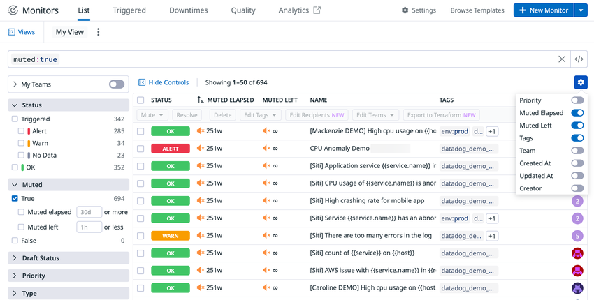
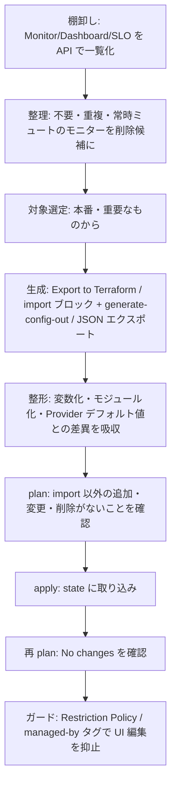
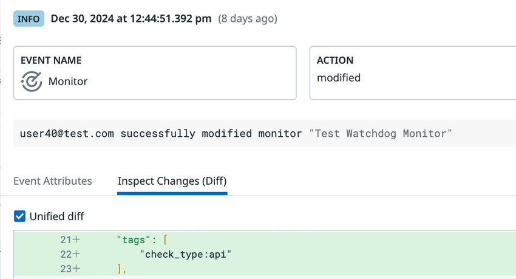
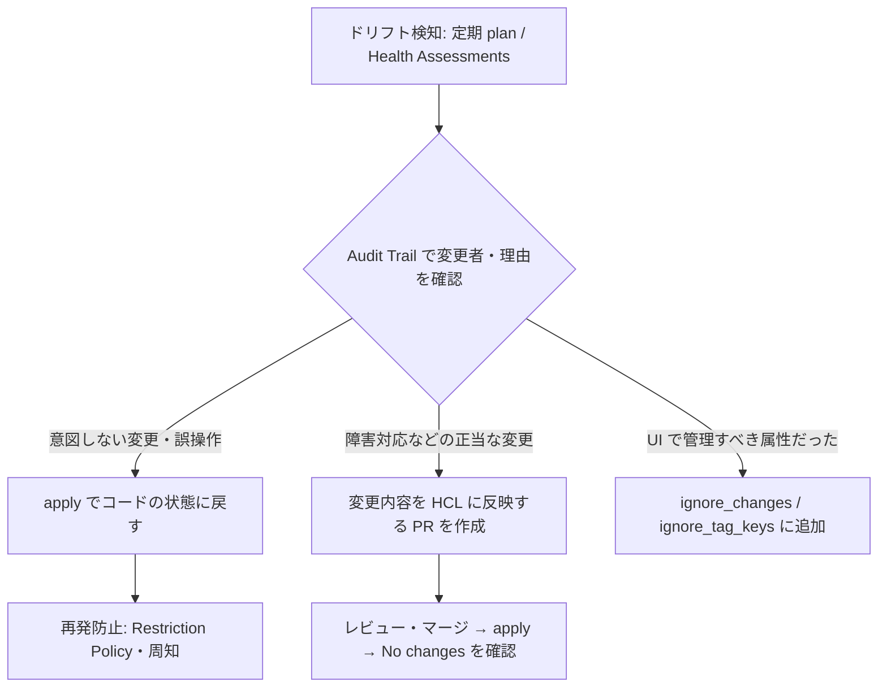
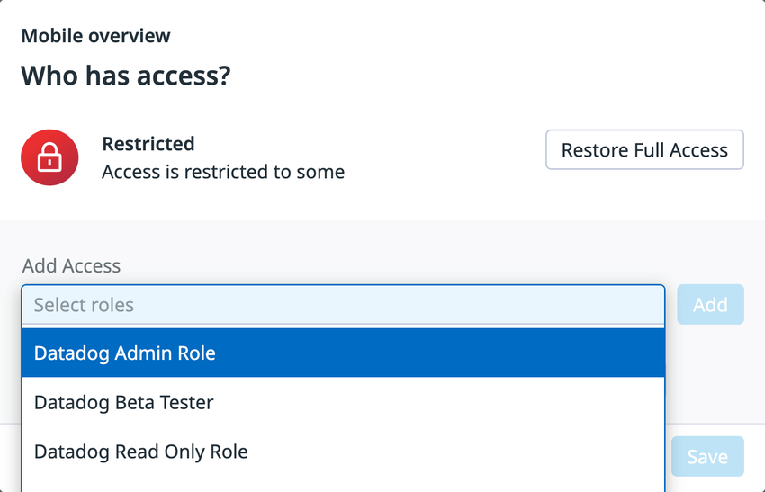
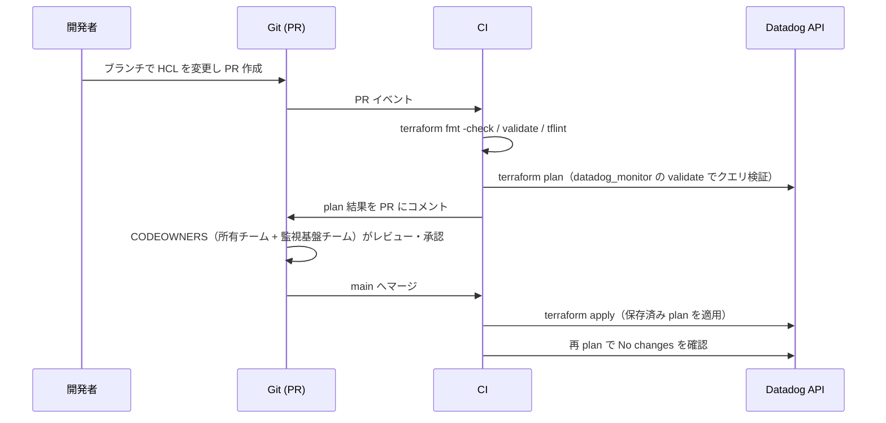
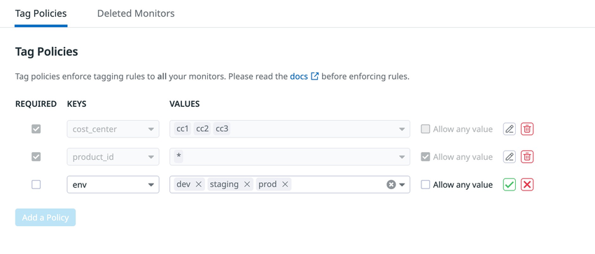

# Monitoring as Code

## 概要

Monitoring as Code（Observability as Code とも呼ばれる）は、Datadog の Monitor（モニター）、Dashboard（ダッシュボード）、SLO、Synthetic テスト、Log Pipeline、権限設定などの**監視設定をコード（主に Terraform の HCL）で定義し、Git でバージョン管理・レビューし、CI/CD から適用する**運用手法である。Datadog は公式に Terraform Provider（`DataDog/datadog`）を提供しており、公式ドキュメントでも「Terraform を使って Datadog リソースをプログラムで作成・管理できる」と案内している [出典](https://docs.datadoghq.com/getting_started/integrations/terraform/)。

本ファイルは、Terraform Provider の仕様そのもの（リソース一覧、Provider 引数の網羅）ではなく、**導入・運用経験に基づく実践知見**を扱う。対象範囲は次の 5 点である。

| 観点 | 本ファイルで扱う内容 |
|---|---|
| Terraform による管理 | 認証方式の選び方、管理対象リソースの選定、既存 UI 設定の取り込み（import） |
| ドリフト対策 | ドリフトの種類、検知（定期 plan / HCP Terraform Health / Audit Trail）、防止（Restriction Policy、`ignore_tag_keys` 等）、是正フロー |
| レビュー体制 | PR ベースのワークフロー、plan と apply の差（plan では検出できないエラー）、承認・権限分離、CODEOWNERS |
| モジュール化 | ディレクトリ構成、モジュール設計（サービス単位・監視パターン単位）、`for_each` による大量生成、JSON テンプレート |
| UI 変更との共存 | 「コード管理するもの / UI に残すもの」の線引き、UI→コードへの書き戻し手順、Version History・Audit Trail の活用 |

関連ファイル:

- Terraform Provider の仕様・リソース一覧・Provider 引数の詳細 → [Terraform と IaC](../02_リファレンス/platform/terraform-and-iac.md)
- Monitor の機能仕様 → [Monitors](../02_リファレンス/platform/monitors.md)、通知・Downtime → [通知と Downtime](../02_リファレンス/platform/notifications-and-downtimes.md)
- Dashboard の機能仕様 → [Dashboards](../02_リファレンス/platform/dashboards.md)
- API キー・Application キー → [API とキー管理](../02_リファレンス/platform/api-and-keys.md)
- 権限（RBAC・Granular Access）→ [組織・ユーザー・権限管理](../02_リファレンス/platform/account-and-access-management.md)
- 変更監査 → [Audit Trail](../02_リファレンス/platform/audit-trail.md)
- アラート設計そのもの（閾値・ノイズ削減）→ [アラート設計とノイズ削減](03-alert-design-and-noise-reduction.md)
- ダッシュボード設計 → [ダッシュボード設計の実践](04-dashboard-design-practices.md)
- タグ設計 → [タグ戦略の実践](02-tagging-strategy.md)
- 複数 org への展開 → [大規模・マルチorg運用](15-large-scale-and-multi-org.md)

---

## 1. なぜ Monitoring as Code か

### 1.1 UI 手作業運用で起きる問題

Datadog の監視設定を UI だけで運用すると、次の問題が起きやすい。これは Datadog 公式ブログ、および国内外の実務記事で共通して挙げられている。

| 問題 | 内容 | 出典 |
|---|---|---|
| 閾値・設定のばらつき | 担当者ごとに閾値や通知先がずれる | 【第三者情報】[Zenn: yuta28](https://zenn.dev/yuta28/articles/datadog_monitor_json_terraform)（2023-12-16 公開。2年以上前の記事のため、現行 Provider（v4）の仕様と異なる可能性がある） |
| 環境間の不一致 | dev / stg / prod で同じ監視が揃わない | 【第三者情報】[issoh](https://www.issoh.co.jp/tech/details/10105/)（2025-12-03 公開、2026-09-28 更新） |
| 変更履歴・レビューの欠如 | 誰がなぜ変えたかが Git に残らない。レビューを経ずに本番の閾値が変わる | [Datadog Blog: Managing Datadog with Terraform](https://www.datadoghq.com/blog/managing-datadog-with-terraform/)（2017-04-07 公開、2025-10-10 更新） |
| リソース作成と監視設定のずれ | インフラ作成時に監視が後付けになり、監視漏れが生じる | 同上 |
| 大量生成の手間 | サービス数 × 監視パターン数のモニターを手で作ることは現実的でない | 【第三者情報】[Sipfront Blog](https://sipfront.com/blog/2023/03/how-to-create-hundreds-of-datadog-monitors-with-a-few-lines-of-code-in-terraform/)（2023-03 公開。2年以上前の記事のため、Provider の現行仕様と異なる可能性がある） |

### 1.2 Datadog 公式の推奨事項

Datadog 公式ブログ「Managing Datadog with Terraform」（2025-10-10 更新）は、Terraform で Datadog を管理する際の推奨として次を挙げている [出典](https://www.datadoghq.com/blog/managing-datadog-with-terraform/)。

| 推奨事項 | 内容 |
|---|---|
| バージョン管理 | テンプレートを Git などで管理し、チームで共同編集する |
| レビュー | 変更は Pull Request とチームレビューを通す |
| plan の確認 | 本番では特に `terraform plan` で差分を確認してから apply する。削除時は `terraform plan -destroy` で削除対象を確認する |
| 秘密情報の扱い | 認証情報を provider ブロックに直書きしない。環境変数や、ソース管理から除外したファイル（`terraform.tfvars` 等）を使う |
| リモート state | チーム運用ではローカルの `terraform.tfstate` ではなくリモートバックエンドに state を置く |
| 単一の正（Single Source of Truth） | 変更がテンプレートの外で起きないよう、Terraform だけで管理する |
| 既存モニターの扱い | 既存モニターは import しない限り Terraform は変更しない |
| Provider デフォルト値 | 省略した任意項目には Terraform Provider 側のデフォルトが入り、API や UI のデフォルトと異なることがある |
| データソースの活用 | Synthetic のロケーション一覧などはハードコードせずデータソースで取得する |
| 依存順序 | Terraform はリソース間の参照から順序を決める。明示が必要なら `depends_on` を使う |

> 公式ブログの「Terraform だけで管理する」は理想形である。実務では UI での一時的な変更を完全に禁止すると、緊急時の修正が UI だけで行われてコードに戻らなくなる、という指摘もある（後述「6. UI 変更との共存」）。【第三者情報】[issoh](https://www.issoh.co.jp/tech/details/10105/)

---

## 2. ツールの選択肢

Datadog の設定をコード化する手段は Terraform 以外にもある。2026-11-02 時点の状況を整理する。

| 手段 | 位置づけ | 2026-11 時点の状況 | 用途 |
|---|---|---|---|
| Terraform Provider `DataDog/datadog` | Datadog 公式 Provider。Monitoring as Code の主流 | v4 系が最新（2026-11-02 に v4.28.0 リリース） [出典](https://github.com/DataDog/terraform-provider-datadog/releases) | 本番運用の標準 |
| `datadog_monitor_json` / `datadog_dashboard_json` | Terraform Provider 内の JSON ベースのリソース。UI からエクスポートした JSON をそのまま渡せる | 提供中 [出典](https://github.com/DataDog/terraform-provider-datadog/blob/master/docs/resources/monitor_json.md) | UI で作った設定の取り込み、ダッシュボード管理 |
| UI の「Export to Terraform」（Monitor 一覧） | Monitor 一覧で選択したモニターの Terraform 定義を生成する | 提供中 [出典](https://docs.datadoghq.com/monitors/manage/) | 既存モニターの移行 |
| Terraform `import` ブロック + `-generate-config-out` | Terraform 本体の機能（v1.5 以降、実験的） | 実験的機能 [出典](https://developer.hashicorp.com/terraform/language/import/generating-configuration) | 既存リソースの取り込み |
| Terraformer | 既存環境から HCL と state を逆生成するツール。Datadog 公式ガイドでも紹介されていた | **2026-03-16 にリポジトリがアーカイブ（保守終了）** [出典](https://github.com/GoogleCloudPlatform/terraformer) | 新規採用は非推奨 |
| CDK for Terraform（CDKTF） | TypeScript/Python 等で Terraform を書く | **2025-12-10 にサンセット・アーカイブ** [出典](https://github.com/hashicorp/terraform-cdk) | 新規採用は非推奨。HCL への変換（`cdktf synth --hcl`）が推奨移行経路 |
| Pulumi Datadog Provider | Pulumi から Datadog を管理 | 提供中（Pulumi 側が提供） | Pulumi を標準とする組織 |
| datadog-sync-cli | Datadog 公式の org 間同期 CLI。リソースを JSON として import し、別 org へ sync する | 提供中 [出典](https://github.com/DataDog/datadog-sync-cli) | org 移行、DR 用の複製、マルチ org 展開 |
| Datadog API 直接 | スクリプトから REST API を呼ぶ | 提供中 | Terraform 未対応の機能、一括操作 |
| Security Monitoring の Terraform エクスポート API | Security ルール等を Terraform 構成としてエクスポートする API（単体・一括 zip） | 提供中 [出典](https://docs.datadoghq.com/api/latest/security-monitoring/export-security-monitoring-resource-to-terraform/) | Cloud SIEM ルール等のコード化 |

> **選定の指針【経験則】**: 新規に Monitoring as Code を始めるなら Terraform（HCL）を第一候補とする。Terraformer と CDKTF はいずれもアーカイブ済みのため、新たな依存を作らない。org 間の丸ごとコピーは Terraform よりも datadog-sync-cli が向く。

---

## 3. Terraform による管理の基本設計

### 3.1 Provider のバージョンと最低要件

| 項目 | 内容 | 出典 |
|---|---|---|
| Provider ソース | `DataDog/datadog` | [Registry](https://registry.terraform.io/providers/DataDog/datadog/latest/docs) |
| 最新メジャー | v4（v4.0.0 は 2026-03-04 リリース） | [Release v4.0.0](https://github.com/DataDog/terraform-provider-datadog/releases/tag/v4.0.0) |
| 2026-11-02 時点の最新 | v4.28.0（2026-11-02） | [Releases](https://github.com/DataDog/terraform-provider-datadog/releases) |
| 必要な Terraform CLI | 1.1.5 以上（v4 で引き上げ。Terraform Plugin Framework / プロトコル v6 へ移行したため） | [v4 ブログ](https://www.datadoghq.com/blog/datadog-terraform-provider-v4/)（2026-03-20 公開） |
| リリース頻度 | 2026 年 8〜11 月は月 2〜4 回程度のマイナーリリース（v4.19.0〜v4.28.0） | [Releases](https://github.com/DataDog/terraform-provider-datadog/releases) |

Provider のリリース頻度が高く、新しいリソースが頻繁に追加される（例: v4.20.0 で `datadog_status_page`・`datadog_tag_rule`、v4.22.0 で `datadog_fleet_schedule`、v4.28.0 で GitHub OIDC 関連リソース）[出典](https://github.com/DataDog/terraform-provider-datadog/releases)。このため次の運用が実務上望ましい【経験則】。

- `required_providers` でバージョン制約（例: `~> 4.28`）を固定し、`.terraform.lock.hcl` をコミットする。
- Renovate / Dependabot で Provider 更新 PR を自動作成し、`plan` 差分がないことを確認してマージする。
- メジャーアップデート（v3→v4 など）は専用の移行作業として扱う（後述「10. Provider v4 移行時の注意」）。

```hcl
terraform {
  required_version = ">= 1.5.0"   # import ブロック等を使うなら 1.5 以上を推奨
  required_providers {
    datadog = {
      source  = "DataDog/datadog"
      version = "~> 4.28"
    }
  }
  backend "s3" { /* リモート state（チーム運用では必須） */ }
}

provider "datadog" {
  # api_key / app_key は書かずに環境変数 DD_API_KEY / DD_APP_KEY で渡す
  api_url = "https://api.ap1.datadoghq.com/"   # AP1（日本）の場合
}
```

### 3.2 サイト（`api_url`）の指定

Provider の `api_url`（環境変数 `DD_HOST`）のデフォルトは `https://api.datadoghq.com`（US1）であり、**US1 以外のサイトでは必ず指定が必要**である。値は `/api/` で終わらせてはならない [出典](https://registry.terraform.io/providers/DataDog/datadog/latest/docs)。

| サイト | Site URL | Provider の `api_url` の例 |
|---|---|---|
| US1 | https://app.datadoghq.com | `https://api.datadoghq.com/`（デフォルト） |
| US3 | https://us3.datadoghq.com | `https://api.us3.datadoghq.com/` |
| US5 | https://us5.datadoghq.com | `https://api.us5.datadoghq.com/` |
| EU1 | https://app.datadoghq.eu | `https://api.datadoghq.eu/` |
| AP1 | https://ap1.datadoghq.com | `https://api.ap1.datadoghq.com/` |
| AP2 | https://ap2.datadoghq.com | `https://api.ap2.datadoghq.com/` |
| US1-FED | https://app.ddog-gov.com | `https://api.ddog-gov.com/` |

> **サイト差異:** Datadog Site 一覧には上記のほか US2-FED（`us2.ddog-gov.com`）、UK1（`uk1.datadoghq.com`）も掲載されている [出典](https://docs.datadoghq.com/getting_started/site/)。API ドメインは `api.<site parameter>` の形式が一般的だが、各サイトの正確なエンドポイントは [Datadog Sites](../02_リファレンス/platform/datadog-sites.md) を参照。AP1 の org に対して `api_url` を指定し忘れると、US1 に対して認証が行われて `validate` で失敗する【経験則】。

### 3.3 認証方式の選び方

Terraform Provider v4 は、従来の API キー + Application キーに加えて、キーレスの認証方式をサポートしている [出典](https://registry.terraform.io/providers/DataDog/datadog/latest/docs)。

| 方式 | Provider 設定 / 環境変数 | 特徴 | 推奨用途 |
|---|---|---|---|
| API キー + Application キー | `api_key` / `app_key`、または `DD_API_KEY` / `DD_APP_KEY` | 従来方式。長期有効な静的秘密情報 | 小規模、移行初期 |
| Bearer Token | `bearer_token`、または `DD_BEARER_TOKEN` / `DATADOG_BEARER_TOKEN` | `ddpat_*`（個人アクセストークン）・`ddsat_*` 形式のトークンを Authorization ヘッダーで送る | トークン運用に統一する組織 |
| AWS Workload Identity Federation（WIF） | `cloud_provider_type = "aws"`、`org_uuid`（`DD_ORG_UUID`）、`cloud_provider_region` | Datadog キーも AWS 認証情報も Terraform に置かず、AWS SDK のデフォルト認証チェーンで得た AWS ID を Datadog に交換する。org で WIF が有効で、Identity Mapping が一致している必要がある。【Preview】 | AWS 上の CI ランナー（CodeBuild、EKS 上のランナー等） |
| HCP Terraform Dynamic Provider Credentials | `workload_identity_token_tag`（任意） | HCP Terraform のワークロード ID トークンを Datadog WIF で交換する（v4.26.0 で追加）。タグ未指定時は `DATADOG` タグ、次にタグなしトークンを探す | HCP Terraform / Terraform Enterprise |

認証の優先順位は「明示的な API/App キー、`bearer_token`、`cloud_provider_type` が、Dynamic Credentials より優先される」と記載されている [出典](https://registry.terraform.io/providers/DataDog/datadog/latest/docs)。

**Application キーの運用上の注意**（Datadog 公式ドキュメント）[出典](https://docs.datadoghq.com/account_management/api-app-keys/)

| 項目 | 内容 | Monitoring as Code での実践 |
|---|---|---|
| Scope（スコープ） | Application キーにスコープを付けて最小権限にできる。スコープなしのキーは作成ユーザーと同じ権限を持つ | Terraform 用キーには管理対象リソース（monitors、dashboards 等）の書き込みスコープだけを付与する |
| Service Account | Application キーはユーザー間で移譲できない。共有には Service Account を使う | **個人ユーザーのキーで CI を動かさない**。退職・異動でキーが無効化され apply が止まる事故を防ぐ【経験則】 |
| One-Time Read（OTR） | 有効時はキーの値が作成時にしか表示されない。2025-08-20 以降に作成された org はデフォルトで有効（変更不可）。既存 org は 3 か月連続で有効にすると恒久化 | Terraform で作成したキーの値は state に残るため、state の暗号化・アクセス制御が必須 |
| 保管 | AWS Secrets Manager、HashiCorp Vault、Azure Key Vault などのシークレットマネージャーに保管する。AWS Secrets Manager は Datadog API/App キーのマネージドローテーションに対応 | CI からはシークレットマネージャー経由で注入する |
| 有効期限 | キーは長期有効で自動失効しない | 定期ローテーション手順を運用設計に含める。可能ならキーレス方式（WIF）へ移行 |

### 3.4 Provider の挙動に関わるデフォルト値

| 引数 | デフォルト | 意味 | 実務上の論点 |
|---|---|---|---|
| `validate` | `true` | Provider 初期化時に認証情報を検証する。`false` にすると初期の認証情報検証をスキップする [出典](https://github.com/DataDog/terraform-provider-datadog/blob/master/docs/index.md) | 認証情報なしのオフライン CI チェックでは `false` にできるが、本番 plan では `true` のままにする。Monitor の `query` を plan 時に API で検証するかどうかは、Provider の `validate` ではなくリソース側の `datadog_monitor.validate`（`false` で plan 時の検証呼び出しをスキップ）で制御する [出典](https://github.com/DataDog/terraform-provider-datadog/blob/master/docs/resources/monitor.md) |
| `http_client_retry_enabled` | `true` | HTTP 429 と 5xx でリトライ | 大量リソースの apply でレート制限に当たった際の自動回復 |
| `http_client_retry_max_retries` | `3` | 最大リトライ回数 | 大規模構成では増やす検討余地 |
| `http_client_retry_timeout` | `60`（秒） | リトライのタイムアウト | 同上 |
| `http_client_retry_backoff_base` / `_multiplier` | `2` / `2` | 指数バックオフ | — |
| `http_client_retry_jitter` | `0`（秒） | リトライ時のランダム遅延上限 | 並列 apply が多い場合はジッターを入れる |
| `default_tags` | なし | 【実験的】Action Connections、Logs Indexes、Logs Pipelines、Monitors、Security Monitoring Rules、SLO に共通タグを付与 | `managed-by:terraform`、`team:xxx` を全リソースに付ける用途 |
| `ignore_tag_keys` | なし | 【実験的】Monitor と SLO のみ。指定したタグキーを差分対象外にする。各リソースの設定とマージされ、`:value` 部分は無視される | UI 側で運用者が付けるタグによるドリフトを抑止 |

出典: [Terraform Registry: Datadog Provider](https://registry.terraform.io/providers/DataDog/datadog/latest/docs)

### 3.5 何をコード管理するか（管理対象の選定）

すべてを Terraform 化するのが目的ではない。変更にレビューが必要で、環境ごとに同じ形で複製したいものから優先する。

| 区分 | 対象例 | 主な Terraform リソース | 推奨度 |
|---|---|---|---|
| 本番アラート | 本番の Monitor、Composite Monitor、通知先 | `datadog_monitor`、`datadog_monitor_json` | 高 |
| SLO | SLO、SLO アラート | `datadog_service_level_objective`、`datadog_slo_correction` | 高 |
| 権限・ガバナンス | Role、Team、Restriction Policy、Monitor Tag Policy | `datadog_role`、`datadog_team`、`datadog_restriction_policy`、`datadog_monitor_config_policy` | 高 |
| クラウド連携 | AWS / Azure / GCP Integration | `datadog_integration_aws_account`、`datadog_integration_gcp_sts` 等 | 高 |
| ログ設定 | Log Pipeline、Index、Exclusion Filter、Archive | `datadog_logs_custom_pipeline`、`datadog_logs_index`、`datadog_logs_archive` 等 | 高（コストに直結するため） |
| 定型ダッシュボード | サービス標準ダッシュボード、経営向けダッシュボード | `datadog_dashboard`、`datadog_dashboard_json` | 中 |
| Synthetic テスト | API テスト、Browser テスト | `datadog_synthetics_test`、`datadog_synthetics_global_variable` | 中〜高 |
| Downtime（定期） | 定期メンテナンスの Downtime | `datadog_downtime_schedule` | 中 |
| Webhook・連携 | Webhook | `datadog_webhook` | 中 |
| 一時的・探索的 | 障害調査用ダッシュボード、試行中のモニター、Notebook | （UI に残す） | 低 |
| 単発の Downtime | 障害対応時のミュート | （UI / API に残す） | 低 |

出典: リソース区分は [Datadog Docs: Terraform](https://docs.datadoghq.com/getting_started/integrations/terraform/)、優先度の考え方は【第三者情報】[issoh](https://www.issoh.co.jp/tech/details/10105/) および【経験則】。

> Downtime について、datadog-sync-cli のドキュメントでは旧 `downtimes` リソースが非推奨とされ、`downtime_schedules` が使われている [出典](https://github.com/DataDog/datadog-sync-cli)。Terraform でも新規は `datadog_downtime_schedule` を用いるのが安全である【経験則】。Downtime の仕様は [通知と Downtime](../02_リファレンス/platform/notifications-and-downtimes.md) を参照。

---

## 4. 既存 UI 設定の取り込み（移行）

既存の org では、UI で作られた数百〜数千のモニターやダッシュボードを Terraform 管理に移す作業が最初の山場になる。

### 4.1 取り込み手段の比較

| 手段 | 生成されるもの | 長所 | 短所・注意 |
|---|---|---|---|
| `terraform import` コマンド | state のみ | Terraform 標準 | HCL を事前に手で書く必要がある [出典](https://docs.datadoghq.com/integrations/faq/how-to-import-datadog-resources-into-terraform/) |
| `import` ブロック + `terraform plan -generate-config-out=<file>` | HCL の下書き + （apply で）state | Terraform 1.5 以降で HCL を自動生成できる。PR でレビュー可能 | **実験的機能**で形式が変わりうる。複雑なスキーマでは不正な構成が生成されることがある。出力先ファイルが既に存在するとエラー [出典](https://developer.hashicorp.com/terraform/language/import/generating-configuration) |
| UI の「Export to Terraform」（Monitor 一覧） | 選択したモニターの Terraform 定義 | 一覧から複数選択して一括生成できる | 出力形式やオプションの詳細は公式ドキュメントに記載なし [出典](https://docs.datadoghq.com/monitors/manage/) |
| UI の JSON エクスポート + `datadog_monitor_json` / `datadog_dashboard_json` | JSON をそのまま Terraform に渡す | UI と同じ JSON 表現のため差分が読みやすい。ダッシュボードに有効 | HCL の型チェック・変数参照が効きにくい。`templatefile()` で変数を埋め込む工夫が必要 【第三者情報】[Zenn](https://zenn.dev/yuta28/articles/datadog_monitor_json_terraform)（2023-12-16 公開。2年以上前の記事のため、現行 Provider（v4）の仕様と異なる可能性がある） |
| Terraformer | HCL + state | 一括で逆生成できた | **2026-03-16 アーカイブ済み**。生成物は Terraform v0.12.29 形式で、v0.13 以降は `terraform 0.13upgrade` が必要だった [出典](https://docs.datadoghq.com/integrations/faq/how-to-import-datadog-resources-into-terraform/) |

### 4.2 Monitor 一覧の「Export to Terraform」

Monitor の Manage 画面（Monitors > List）では、検索結果のチェックボックスでモニターを選択し、一括操作ボタン（Mute、Unmute、Resolve、Delete、Edit Recipients、Edit Tags、Edit Teams、**Export to Terraform**）を実行できる。Export to Terraform は「選択したモニターの Terraform 定義を生成する」機能である [出典](https://docs.datadoghq.com/monitors/manage/)。



- **キャプション:** Datadog の Monitors > List 画面。検索結果の上部に一括操作ボタンが並ぶ。
- **画面の説明:** 画面上部のタブは `List`、`Triggered`、`Downtimes`、`Quality`、`Analytics`、右上に `Settings`、`Browse Templates`、`+ New Monitor`。検索バーには `muted:true` が入力され、左側のファセットパネルに `Status`（Triggered / Alert / Warn / No Data / OK）、`Muted`、`Draft Status`、`Priority`、`Type` が並ぶ。結果テーブル（STATUS、MUTED ELAPSED、MUTED LEFT、NAME、TAGS 列）の上に `Mute`、`Resolve`、`Delete`、`Edit Tags`、`Edit Recipients`、`Edit Teams`、`Export to Terraform` の一括操作ボタンがある。右上の歯車メニューで表示列（Priority、Muted Elapsed、Muted Left、Tags、Team、Created At、Updated At、Creator）を切り替えられる。
- **出典:** https://docs.datadoghq.com/monitors/manage/ （取得日 2026-11-02）

> **ダッシュボードについて:** Dashboard は Configure メニューから JSON のエクスポート（ダウンロード）とインポートができる。インポートは「ダッシュボードの全内容を上書きする」 [出典](https://docs.datadoghq.com/dashboards/configure/)。ダッシュボード画面に Terraform 形式で直接エクスポートする機能があるかは、公開情報では確認できず。JSON を `datadog_dashboard_json` に渡すのが一般的な方法である。

### 4.3 推奨移行手順

以下は公式ドキュメント（Terraform の import 生成手順）と第三者記事をもとにした手順である。



| ステップ | 実施内容 | 根拠 |
|---|---|---|
| 1. 棚卸し | API で全モニター・ダッシュボードを取得し、作成者・最終更新・ミュート状態・通知先を一覧化 | 【経験則】 |
| 2. 整理 | 長期間ミュートされたまま、通知先なし、重複しているモニターは取り込まずに削除候補とする。削除したモニターは 7 日間 Deleted Monitors タブから復元できる [出典](https://docs.datadoghq.com/monitors/settings/) | 公式 + 【経験則】 |
| 3. 生成 | 数百規模なら UI の Export を先に使い、`-generate-config-out` の生成物は「下書き」として読み直す | 【第三者情報】[issoh](https://www.issoh.co.jp/tech/details/10105/) |
| 4. 整形 | 生成物にはデフォルト値・計算値が大量に含まれる。不要な属性を削除し、通知先・閾値を変数化する | [HashiCorp](https://developer.hashicorp.com/terraform/language/import/generating-configuration) |
| 5. plan | 「import 以外の add / change / destroy がない」ことを確認。差分が出たら HCL 側を実態に合わせる | 【第三者情報】[issoh](https://www.issoh.co.jp/tech/details/10105/) |
| 6. apply → 再 plan | apply 後にもう一度 plan して `No changes` を確認する | 同上 |
| 7. ガード | Restriction Policy で編集権限を絞る、`managed-by:terraform` タグを付ける | 後述「5.3」 |

**import ブロックの例**（Terraform 1.5 以降）

```hcl
# imports.tf（取り込み完了後に削除してよい）
import {
  to = datadog_monitor.api_latency_prod
  id = "1234567"          # モニター ID（URL の /monitors/ の後ろの数値）
}

import {
  to = datadog_dashboard_json.service_overview
  id = "abc-def-ghi"      # ダッシュボード ID
}
```

```bash
terraform plan -generate-config-out=generated.tf   # generated.tf が既に存在するとエラー
# generated.tf をレビュー・整形してから
terraform apply
terraform plan   # No changes を確認
```

**import ID の形式**（Provider ドキュメント）

| リソース | import ID | 例 |
|---|---|---|
| `datadog_monitor` | モニター ID（数値） | `terraform import datadog_monitor.bytes_received_localhost 2081` [出典](https://github.com/DataDog/terraform-provider-datadog/blob/master/docs/resources/monitor.md) |
| `datadog_monitor_json` | モニター ID | `terraform import datadog_monitor_json.monitor_json 123456` [出典](https://github.com/DataDog/terraform-provider-datadog/blob/master/docs/resources/monitor_json.md) |
| `datadog_dashboard_json` | ダッシュボード ID | `terraform import datadog_dashboard_json.my_service_dashboard sv7-gyh-kas` [出典](https://github.com/DataDog/terraform-provider-datadog/blob/master/docs/resources/dashboard_json.md) |
| `datadog_restriction_policy` | ポリシー ID（リソース ID） | `terraform import datadog_restriction_policy.<name> "<policy_id>"` [出典](https://github.com/DataDog/terraform-provider-datadog/blob/master/docs/resources/restriction_policy.md) |
| `datadog_application_key` | **v4 で import 不可**（"Resource Import Not Implemented"） | [v4 Upgrade Guide](https://github.com/DataDog/terraform-provider-datadog/blob/master/docs/guides/v4-upgrade-guide.md) |

### 4.4 取り込み時によく出る差分

| 差分の原因 | 内容 | 対処 |
|---|---|---|
| Provider デフォルトと UI デフォルトの違い | 省略した任意項目に Provider のデフォルトが入る（公式ブログが注意喚起） | 生成物の値を明示的に残す、または plan 差分を見て値を合わせる |
| タグの付与 | UI で後付けされたタグが差分になる | `ignore_tag_keys` で対象外にする（Monitor / SLO） |
| `restricted_roles` | v4 では更新時に一度だけ `known after apply` 表示になることがある | 想定内の差分として扱う（「10. Provider v4 移行時の注意」） |
| ダッシュボードのウィジェット順 | Terraformer では `--no-sort` を付けないとウィジェットが並べ替えられた [出典](https://docs.datadoghq.com/integrations/faq/how-to-import-datadog-resources-into-terraform/) | JSON ベースで管理し、順序を変更しない |
| `dashboard_lists` | `datadog_dashboard_json` の `dashboard_lists` を、Dashboard List を Terraform で管理している状態で併用すると挙動が不整合になる [出典](https://github.com/DataDog/terraform-provider-datadog/blob/master/docs/resources/dashboard_json.md) | どちらか一方で管理する |

---

## 5. ドリフト対策

### 5.1 Datadog におけるドリフトの種類

ドリフトとは、Terraform のコード（および state）と Datadog 上の実際の設定が食い違う状態を指す。

| 種類 | 典型例 | 影響 |
|---|---|---|
| UI での手修正 | 障害対応中に UI でモニター閾値を変更 | 次回 `apply` で**黙って元に戻る**。閾値変更の意図が失われる |
| UI での削除 | Terraform 管理のモニターを UI で削除 | 次回 `apply` で**再作成**される（別 ID になるため、ID 参照している Composite Monitor や SLO が壊れることがある【経験則】） |
| 他の自動化との競合 | API スクリプト、Workflow Automation、別の Terraform ワークスペースが同じリソースを更新 | apply のたびに設定が往復する |
| Provider 更新による差分 | Provider のスキーマ変更で差分が表示される | 実体は変わっていないのに plan が汚れる |
| 未管理リソースの増殖 | UI で新規作成されたモニター | Terraform からは見えない（plan で検出できない） |
| 運用者のタグ追加 | UI で `team` などのタグを付与 | タグ差分が毎回出る |

Terraform で作成したモニターを UI で修正すると、次の plan で差分が出て apply で元に戻る。これがドリフトの最も典型的な形である【第三者情報】[issoh](https://www.issoh.co.jp/tech/details/10105/)。

### 5.2 検知の手段

| 手段 | 検知できるもの | 検知できないもの | 備考 |
|---|---|---|---|
| 定期 `terraform plan`（CI のスケジュール実行） | Terraform 管理下リソースの設定差分・削除 | 未管理リソースの新規作成 | `terraform plan -detailed-exitcode` の終了コード 2（差分あり）で通知するのが定番【経験則】 |
| HCP Terraform の Health Assessments（Drift Detection） | 構成ドリフト（コードとの差分）。結果は Workspace の Health > Drift に表示 | state drift（構成に影響しない外部変更） | Standard / Premium エディション。Terraform 0.15.4 以上（Continuous Validation 併用は 1.3.0 以上）。Remote または Agent 実行モード。直近 run が成功している必要がある。run 実行中は評価がキャンセルされ次周期に回る [出典](https://developer.hashicorp.com/terraform/cloud-docs/workspaces/health) |
| Datadog Audit Trail | 誰がいつ何を変更したか（作成・変更・削除）、変更前後の Diff | — | 「どの変更が UI 由来か」を特定するのに使う。保持期間などの仕様は [Audit Trail](../02_リファレンス/platform/audit-trail.md) を参照 |
| Dashboard の Version History | ダッシュボードの変更履歴（ユーザー、日時、変更概要） | Monitor の変更 | 保持はデフォルト 30 日、Audit Trail 有効時は 90 日 [出典](https://docs.datadoghq.com/dashboards/guide/version_history/) |
| 未管理リソースの棚卸し | API で全モニターを取得し、`managed-by:terraform` タグのないものを列挙 | — | 定期ジョブで「タグなしモニター数」を監視するとよい【経験則】 |

**Audit Trail でモニターの変更を追う**（公式ガイド）[出典](https://docs.datadoghq.com/account_management/audit_trail/guides/track_monitor_access_and_configuration_changes/)

| 目的 | Audit Trail の検索クエリ |
|---|---|
| モニター作成 | `@evt.name:Monitor @asset.type:monitor @action:created` |
| モニター変更 | `@evt.name:Monitor @asset.type:monitor @action:modified` |
| モニター削除 | `@evt.name:Monitor @asset.type:monitor @action:deleted` |
| モニターの閲覧（API GET） | `@http.status_code:200 @http.method:GET @http.url_details.path:/api/v1/monitor/<monitor_id>` |

検索結果の行をクリックし、**Inspect Changes (Diff)** タブを開くと設定の差分が表示される。ファセットパネルで Asset ID / Asset Name による絞り込みもできる。



- **キャプション:** Audit Trail でモニター変更イベントを開いた詳細画面。
- **画面の説明:** 上部に `INFO` ラベルと発生日時、`EVENT NAME: Monitor`、`ACTION: modified` が表示され、「user40@test.com successfully modified monitor "Test Watchdog Monitor"」という変更概要が出る。下部のタブ `Event Attributes` / `Inspect Changes (Diff)` のうち Diff タブが選択され、`Unified diff` チェックボックスがオン。差分として `"tags": ["check_type:api"]` が追加された行が緑色で表示されている。
- **出典:** https://docs.datadoghq.com/account_management/audit_trail/guides/track_monitor_access_and_configuration_changes/ （取得日 2026-11-02）

> 公式ガイドには、モニター設定変更が UI 由来か API（Terraform）由来かを区別する専用フィールドの記載はない。実務では、Terraform 実行用の Service Account を専用に用意しておけば、Audit Trail のユーザー（変更者）で「Terraform 以外の変更」を絞り込める【経験則】。

**定期ドリフト検知ジョブの例（GitHub Actions）【経験則】**

```yaml
name: datadog-drift-check
on:
  schedule:
    - cron: "0 0 * * 1-5"   # 平日 09:00 JST
jobs:
  plan:
    runs-on: ubuntu-latest
    permissions: { id-token: write, contents: read }
    steps:
      - uses: actions/checkout@v4
      - uses: hashicorp/setup-terraform@v3
      - run: terraform init -input=false
      - id: plan
        run: terraform plan -input=false -lock=false -detailed-exitcode
        continue-on-error: true
        env:
          DD_API_KEY: ${{ secrets.DD_API_KEY }}
          DD_APP_KEY: ${{ secrets.DD_APP_KEY }}
      - if: steps.plan.outputs.exitcode == '2'
        run: echo "Drift detected" && exit 1   # Slack 通知等に接続
```

> ドリフト検知ジョブは `-lock=false` で state をロックしないようにし、通常の apply と衝突させない【経験則】。CI のアクション名・バージョンは例示であり、自組織の標準に合わせる。

### 5.3 防止の手段

| 手段 | 仕組み | 効果 | 出典 |
|---|---|---|---|
| Restriction Policy（Granular Access Control） | リソース単位で `editor` / `viewer` などのリレーションを Role・Team・User・Service Account・org に割り当てる。Terraform では `datadog_restriction_policy` | Terraform 管理リソースの編集権限を Terraform 用 Service Account と管理者チームに限定し、UI 手修正そのものを防ぐ | [Granular Access](https://docs.datadoghq.com/account_management/rbac/granular_access/)、[Provider Docs](https://github.com/DataDog/terraform-provider-datadog/blob/master/docs/resources/restriction_policy.md) |
| `managed-by:terraform` タグ | `default_tags` 等で全リソースに付与 | UI の一覧で「ここは直さない」と判別できる | 【第三者情報】[issoh](https://www.issoh.co.jp/tech/details/10105/) |
| 名前・説明文での明示 | モニター名の接頭辞やメッセージ本文に「Terraform 管理。変更は <repo URL> へ PR」と記載 | UI で開いた人がリポジトリにたどり着ける | 【経験則】 |
| `ignore_tag_keys` | 指定タグキーを差分対象外にする（Monitor / SLO のみ、実験的） | UI で付与されるタグとの共存 | [Registry](https://registry.terraform.io/providers/DataDog/datadog/latest/docs) |
| `lifecycle { ignore_changes = [...] }` | Terraform 標準機能で特定属性の差分を無視 | 運用者が UI で調整してよい属性（例: `message` の一部）を明示的に UI 側管理にする | Terraform 標準（【経験則】） |
| `notify_audit` | `true` にするとモニター変更時にタグ付けされたユーザーへ通知（デフォルト `false`） | 変更の可視化 | [Provider Docs](https://github.com/DataDog/terraform-provider-datadog/blob/master/docs/resources/monitor.md) |
| Monitor Tag Policies | すべてのモニターに必須タグ・許可値を強制 | `managed-by` や `team` タグの付け忘れを防ぐ | [Monitor Settings](https://docs.datadoghq.com/monitors/settings/) |

**Restriction Policy に対応するリソース**（Granular Access Control の対象、2026-11-02 時点、31 種類）[出典](https://docs.datadoghq.com/account_management/rbac/granular_access/)

Apps、AWS Accounts、Azure App Registrations、Work Management projects、Connections、Connection Groups、Cross Org Connections、**Dashboards**、Datastores、Dynamic Severity、Experiments、Feature Flags、Google Service Accounts、Integration Accounts、Integration Services、Integration Webhooks、**Logs Pipelines**、**Monitors**、**Notebooks**、Observability Pipelines、On-Call、Private Action Runner、Powerpacks、Reference tables、RUM apps、**Security rules**、Security suppressions、**Service Level Objectives**、Sheets、**Synthetic tests**、Workflows。いずれも Team・Role・User / Service Account 単位で制限できる。

> Provider ドキュメントの `datadog_restriction_policy` には「Dashboards のサポートはプライベートベータで、有効化には Datadog への連絡が必要」との注記が残っており [出典](https://github.com/DataDog/terraform-provider-datadog/blob/master/docs/resources/restriction_policy.md)、Dashboard 制限ガイドにも「Restriction Policy は Preview で、Support または CSM への連絡が必要」とある [出典](https://docs.datadoghq.com/dashboards/guide/how-to-use-terraform-to-restrict-dashboard-edit/)。一方 Granular Access の一覧には Dashboards が含まれる。ダッシュボードへの適用可否は自 org で事前検証すること（公式ドキュメント間で記述時点が異なる可能性がある）。

**Restriction Policy の例**（`resource_id` は `<リソースタイプ>:<ID>` 形式。principal は `role:` / `team:` / `user:` / `org:` + ID）[出典](https://github.com/DataDog/terraform-provider-datadog/blob/master/docs/resources/restriction_policy.md)

```hcl
data "datadog_current_user" "me" {}

# Terraform 管理モニターの編集を「SRE チーム + Terraform 用 Service Account」に限定し、閲覧は org 全体に開放
resource "datadog_restriction_policy" "api_latency_prod" {
  resource_id = "monitor:${datadog_monitor.api_latency_prod.id}"

  bindings {
    relation   = "editor"
    principals = [
      "team:${var.sre_team_id}",
      "user:${var.terraform_service_account_id}",
    ]
  }
  bindings {
    relation   = "viewer"
    principals = ["org:${data.datadog_current_user.me.org_id}"]
  }
}
```

Datadog の「Protecting Assets」ガイドは、Restriction Policy 運用について次を推奨している [出典](https://docs.datadoghq.com/getting_started/access_for_enterprises/protecting_assets/)。

| 推奨 | 内容 |
|---|---|
| Edit は所有チーム、View は org 全体 | View の制限は機微な資産に限る（View 制限は Notebook と Dashboard で対応） |
| チーム所有を境界にする | 非所有者は View のみ |
| 重要資産から始める | 本番モニター、主要な運用ダッシュボード |
| 管理者オーバーライドを先に用意 | 制限を適用する前に Admin / Platform チームを Edit に含める。`user_access_manage` 権限を持つユーザーは自分に権限を付与できる（フェイルセーフ） |
| 大量資産は Terraform / API で | 「数百の資産を手作業で管理することはスケールしない」 |

> **注意【経験則】:** Restriction Policy で Edit を Terraform 用 Service Account に限定すると、障害時に UI で閾値を一時変更することもできなくなる。後述「6.3 緊急変更（Break Glass）」の手順をセットで設計する。Downtime（ミュート）は通常 Monitor の編集権限とは別の権限で行えるため、緊急時はミュートで対応し、恒久修正は PR で行うのが現実的である（Downtime の権限仕様は [通知と Downtime](../02_リファレンス/platform/notifications-and-downtimes.md) を参照）。

### 5.4 是正フロー

ドリフトを検知したら、「コードに合わせる（UI 変更を戻す）」か「コードを実態に合わせる（UI 変更を取り込む）」のどちらかを明示的に選ぶ。HCP Terraform のドキュメントも、ドリフトの解消方法として「構成を apply して上書きする」か「構成を更新して変更を保持する」の 2 択を挙げている [出典](https://developer.hashicorp.com/terraform/cloud-docs/workspaces/health)。



| 判断基準 | 推奨対応 |
|---|---|
| 変更者が不明、レビューなしの閾値変更 | コードに戻す（apply） |
| 障害対応で閾値・通知先を変更した | 変更を HCL に書き戻す PR を 1 営業日以内に作る、などの SLA を決める【経験則】 |
| 運用者が日常的に UI で変える属性 | `lifecycle.ignore_changes` 等で「UI 管理」と明示する |
| UI で削除されたリソース | 本当に不要ならコードからも削除。必要なら apply で再作成（ID が変わる点に注意） |

---

## 6. UI 変更との共存

### 6.1 管理責任の線引き（推奨パターン）

Monitoring as Code を導入しても、UI を完全に閉じることは現実的ではない。重要なのは「どこまでがコード管理か」を明文化し、利用者が迷わないようにすることである。

| パターン | 内容 | 向いている組織 |
|---|---|---|
| A. 完全コード管理 | すべての監視設定を Terraform で管理。UI は閲覧と緊急ミュートのみ | 規制業種、変更管理が厳格な組織 |
| B. 層別管理（推奨） | 本番アラート・SLO・権限・連携・ログ設定はコード管理。探索的ダッシュボード・試行中モニター・Notebook は UI | 多くの組織 |
| C. 卒業モデル | 新しい監視は UI で作り、形が固まったらエクスポートして Terraform に移す | 監視の試行錯誤が多い開発組織 |
| D. ハイブリッド属性管理 | リソース本体はコード管理、特定属性（タグ・メッセージ・通知先等）は UI 管理（`ignore_changes`） | 運用チームと開発チームが分かれている組織 |

第三者記事では、「変更にレビューが必要で環境ごとに複製したいもの（本番モニター、SLO、AWS 連携、ロールと権限）」を Terraform 管理に、「一時的なダッシュボードや試行中のモニター」を UI 運用に残すこと、また障害調査用や試行錯誤中のものは UI で扱い、形が固まってから Terraform へ移す順番が推奨されている【第三者情報】[issoh](https://www.issoh.co.jp/tech/details/10105/)（2025-12-03 公開、2026-09-28 更新）。

### 6.2 管理状態を見分ける仕組み

| 手段 | 実装例 |
|---|---|
| タグ | `managed-by:terraform`、`repo:github.com/org/datadog-config`、`team:payments` |
| 名前の接頭辞 | `[TF] API latency high on {{service.name}}` |
| メッセージ本文のフッター | `This monitor is managed by Terraform. Edit via <repo URL>/monitors/payments.tf` |
| Team 割り当て | Team でフィルタし、所有チームを明示（Protecting Assets ガイドは Team Tag と Team フィルタの活用を推奨）[出典](https://docs.datadoghq.com/getting_started/access_for_enterprises/protecting_assets/) |
| ダッシュボードのアクセスインジケータ | 編集制限されたダッシュボードは右上にアクセスインジケータが表示される [出典](https://docs.datadoghq.com/dashboards/configure/) |



- **キャプション:** ダッシュボードの「Who has access?」ダイアログ（編集制限の設定画面）。
- **画面の説明:** ダッシュボード名（例: Mobile overview）の下に「Who has access?」と表示され、赤い鍵アイコンとともに `Restricted`（Access is restricted to some）の状態が示される。右側に `Restore Full Access` ボタン。下部の `Add Access` で `Select roles` ドロップダウンから Role（Datadog Admin Role、Datadog Beta Tester、Datadog Read Only Role など）を選んで `Add` し、`Save` で保存する。保存時には、操作者自身が所属する Role を少なくとも 1 つ含める必要がある [出典](https://docs.datadoghq.com/dashboards/configure/)。Terraform で管理する場合は同じ制御を `datadog_restriction_policy`（または `datadog_dashboard` の `restricted_roles`）で行う。
- **出典:** https://docs.datadoghq.com/dashboards/configure/ （取得日 2026-11-02）

### 6.3 緊急変更（Break Glass）手順の例【経験則】

| 段階 | 手順 |
|---|---|
| 1. 一次対応 | ノイズの多いアラートは Downtime（ミュート）で止める。閾値変更が必要なら、Break Glass 用の Role（管理者チーム）で UI から変更 |
| 2. 記録 | インシデントチャネルや Incident Management のタイムラインに変更内容と理由を残す |
| 3. 書き戻し | 期限内（例: 1 営業日）に HCL へ反映する PR を作成。Audit Trail の Diff を PR に貼るとレビューが速い |
| 4. 照合 | マージ・apply 後に plan で `No changes` を確認 |
| 5. ふりかえり | 書き戻されていない UI 変更がないか、定期ドリフト検知で確認 |

> 「作るたびに Pull Request を必須にすると、急ぎの修正が UI だけで済まされてコードに戻らなくなる」との指摘がある【第三者情報】[issoh](https://www.issoh.co.jp/tech/details/10105/)。PR 必須の範囲を本番の重要リソースに絞り、書き戻しを仕組み（ドリフト検知 + 期限）で担保するのが実務的である。

### 6.4 ダッシュボードの扱い

ダッシュボードはウィジェット数が多く HCL で書くと冗長になりやすい。実務では次の分担が多い。

| 方式 | 内容 | 長所 | 短所 |
|---|---|---|---|
| `datadog_dashboard`（HCL） | ウィジェットを HCL のブロックで記述 | 変数・`for_each`・モジュールが使える | 記述量が多く、UI との往復が難しい |
| `datadog_dashboard_json` | UI でエクスポートした JSON をそのまま管理 | UI で編集 → JSON エクスポート → PR の往復が容易 | 差分が JSON 全体になりレビューが重い |
| UI 管理 + Version History | コード管理しない | 手軽 | 変更履歴は 30 日（Audit Trail 有効時 90 日）のみ |

UI で作って書き出した JSON を `datadog_dashboard_json` で読み込み、Terraform は適用と履歴管理を担う形が推奨されている【第三者情報】[issoh](https://www.issoh.co.jp/tech/details/10105/)。

**Dashboard の Version History（コード管理しない場合の保険）** [出典](https://docs.datadoghq.com/dashboards/guide/version_history/)

| 項目 | 内容 |
|---|---|
| アクセス | ダッシュボード右上の **Configure** > **Version History** |
| 表示内容 | 変更したユーザー、日時、前バージョンとの差分の概要 |
| プレビュー | バージョンをクリックすると、変更箇所までスクロールしてウィジェットをハイライト |
| 復元 | **Restore this version**。全ユーザーに反映され、復元自体も新しい履歴として残る |
| クローン | 任意のバージョンから新規ダッシュボードを作成（現行は変更しない） |
| 保持期間 | デフォルト 30 日、Audit Trail 有効時 90 日 |
| 制約 | 保持期間内に編集がない場合、Version History は無効になる |

> Monitor にはダッシュボードと同等の Version History 機能に関する記載は、本調査の範囲の公開情報では確認できず。Monitor の変更履歴は Audit Trail（Inspect Changes (Diff)）で追う。

---

## 7. モジュール化

### 7.1 リポジトリ・ディレクトリ構成の例【経験則】

```
datadog-config/
├── modules/
│   ├── service-monitors/         # サービス標準モニター一式（APM レイテンシ・エラー率・スループット）
│   │   ├── main.tf
│   │   ├── variables.tf
│   │   ├── outputs.tf
│   │   └── templates/            # monitor JSON / message テンプレート
│   ├── k8s-workload-monitors/    # Kubernetes ワークロード標準モニター
│   ├── slo/                      # SLO + SLO アラート
│   └── service-dashboard/        # dashboard_json テンプレート
├── org/                          # org 全体設定（権限・タグポリシー・連携）
│   ├── roles.tf
│   ├── teams.tf
│   ├── monitor_policies.tf
│   └── integrations_aws.tf
├── services/
│   ├── payments/
│   │   ├── main.tf               # module "service-monitors" を呼ぶ
│   │   └── terraform.tfvars
│   └── search/
└── envs/                         # 環境差分（stg/prod の閾値・通知先）
```

| 設計論点 | 推奨【経験則】 | 理由 |
|---|---|---|
| state の分割 | org 全体設定（権限・連携）とサービス別監視は別 state にする | 権限設定の誤 apply の影響範囲を限定。plan 時間とロック競合を減らす |
| 所有境界 | サービス（チーム）ごとにディレクトリと state を分け、CODEOWNERS で所有者をレビュー必須に | 監視の所有者を明確化 |
| 環境差分 | 閾値・通知先・`env` タグを変数化し、モジュール本体は共通 | dev / stg / prod で同じ監視を揃える【第三者情報】[issoh](https://www.issoh.co.jp/tech/details/10105/) |
| モジュールの粒度 | 「監視パターン単位」（APM 標準、K8s 標準、RDS 標準）で切る | 監視テンプレートの再利用性 |
| バージョン管理 | 共有モジュールは Git タグでバージョンを切り、利用側で固定 | モジュール変更が全サービスに一斉波及するのを防ぐ |
| 命名 | モニター名に `{{service.name}}` 等の変数と `env` を含める | 通知の可読性 |

### 7.2 モジュールの例（サービス標準モニター）

```hcl
# modules/service-monitors/variables.tf
variable "service"   { type = string }
variable "env"       { type = string }
variable "team"      { type = string }
variable "notify"    { type = list(string) }        # 例: ["@slack-payments-alerts", "@oncall-payments"]
variable "thresholds" {
  type = object({
    latency_p99_ms = number
    error_rate_pct = number
  })
}

# modules/service-monitors/main.tf
locals {
  tags = ["service:${var.service}", "env:${var.env}", "team:${var.team}", "managed-by:terraform"]
  footer = "\n\n---\nManaged by Terraform: https://github.com/example/datadog-config/tree/main/services/${var.service}"
}

resource "datadog_monitor" "latency_p99" {
  name    = "[${var.env}] ${var.service} p99 latency is high"
  type    = "query alert"
  query   = "percentile(last_5m):p99:trace.http.request{service:${var.service},env:${var.env}} > ${var.thresholds.latency_p99_ms / 1000}"
  message = "p99 latency exceeded ${var.thresholds.latency_p99_ms}ms. ${join(" ", var.notify)}${local.footer}"

  monitor_thresholds {
    critical = var.thresholds.latency_p99_ms / 1000
  }

  notify_no_data    = false
  require_full_window = false
  priority          = var.env == "prod" ? 2 : 4
  tags              = local.tags
}
```

> クエリのメトリクス名（`trace.http.request` 等）はトレーサーの言語・インテグレーションにより異なる。実在するメトリクス名は [APM の概念とインジェスト制御](../02_リファレンス/apm/apm-concepts-and-ingestion.md) および [メトリクスクエリと関数](../02_リファレンス/platform/metrics-query-and-functions.md) で確認すること。上記は構造の例示である。

```hcl
# services/payments/main.tf
module "payments_monitors" {
  source   = "git::https://github.com/example/datadog-config.git//modules/service-monitors?ref=v1.4.0"
  for_each = toset(["stg", "prod"])

  service = "payments"
  env     = each.key
  team    = "payments"
  notify  = each.key == "prod" ? ["@oncall-payments", "@slack-payments-alerts"] : ["@slack-payments-dev"]
  thresholds = {
    latency_p99_ms = each.key == "prod" ? 800 : 1500
    error_rate_pct = 1
  }
}
```

### 7.3 JSON テンプレートによるモジュール化

UI で作成したモニター JSON を `datadog_monitor_json` + `templatefile()` で変数化するパターンも広く使われる。UI からエクスポートした JSON を `file()` で外部ファイル化し、`templatefile()` で `${...}` に変数を埋め込むことで、監視タイプごとに JSON を整理できる【第三者情報】[Zenn: yuta28](https://zenn.dev/yuta28/articles/datadog_monitor_json_terraform)（2023-12-16 公開。2年以上前の記事のため、現行 Provider（v4）の仕様と異なる可能性がある）。

```hcl
resource "datadog_monitor_json" "cpu_high" {
  for_each = var.hosts_groups
  monitor = templatefile("${path.module}/templates/cpu_high.json.tftpl", {
    env     = each.value.env
    group   = each.key
    notify  = each.value.notify
    warning = each.value.warning
    critical = each.value.critical
  })
}
```

| 観点 | `datadog_monitor`（HCL） | `datadog_monitor_json` |
|---|---|---|
| UI との往復 | 変換が必要 | UI の JSON をそのまま使える |
| 型チェック・補完 | 効く | 効かない（文字列） |
| 部分的な変数化 | 容易 | `templatefile()` が必要 |
| Provider のデフォルト値差分 | 起きやすい（省略項目に Provider デフォルトが入る） | JSON に書いた内容が基準 |
| `default_tags` / `ignore_tag_keys` の適用 | Monitors として対象 | 公開情報では確認できず |
| 向いている用途 | 大量の定型モニター、モジュール化 | UI で設計した複雑なモニターの取り込み |

### 7.4 大量生成時の注意

| 論点 | 内容 |
|---|---|
| API レート制限 | Datadog API の多くのエンドポイントはレート制限があり、制限値はレスポンスヘッダー（`X-RateLimit-Limit`、`X-RateLimit-Period`、`X-RateLimit-Remaining`、`X-RateLimit-Reset`、`X-RateLimit-Name`）で示される。引き上げは Support チケットで個別審査 [出典](https://docs.datadoghq.com/api/latest/rate-limits/)。Monitor API の具体的な制限値は公開情報では確認できず |
| 並列度 | 数千リソースの plan / apply では `-parallelism`（Terraform デフォルト 10）を下げる、Provider のリトライ設定を調整する【経験則】 |
| plan 時間 | リソース数に比例して refresh が増える。state 分割で 1 state あたり数百リソース程度に抑えると運用しやすい【経験則】 |
| `for_each` のキー | キーを変更すると destroy → create になりモニター ID が変わる。キーは安定した識別子（サービス名等）にする【経験則】 |

---

## 8. レビュー体制と CI/CD

### 8.1 標準ワークフロー



### 8.2 PR 段階のチェック項目

| チェック | 自動 / 手動 | 内容 |
|---|---|---|
| `terraform fmt -check`、`terraform validate` | 自動 | 構文・書式 |
| tflint / ポリシー（OPA / Sentinel 等） | 自動 | 必須タグ（`team`、`env`、`service`）、通知先の存在、`priority` 設定、本番モニターの `notify_no_data` 方針などを機械チェック【経験則】 |
| `terraform plan` | 自動 | リソース側の `datadog_monitor.validate` を `false` にしない限り、Monitor の `query` は plan 時に API で検証される（Provider の `validate` は初期化時の認証情報検証であり、別の引数） [出典](https://github.com/DataDog/terraform-provider-datadog/blob/master/docs/resources/monitor.md) |
| plan のサマリ確認 | 手動 | **destroy / replace が含まれていないか**を最優先で確認（`type` は作成後変更不可のため、変更すると再作成になる） |
| アラート設計レビュー | 手動 | 閾値の根拠、通知先、Runbook リンク、評価ウィンドウ。設計観点は [アラート設計とノイズ削減](03-alert-design-and-noise-reduction.md) |
| 権限変更レビュー | 手動 | Role・Restriction Policy の変更は監視基盤チーム / セキュリティの承認を必須に |

### 8.3 plan では検出できないエラー

plan が成功しても apply で失敗するケースがある、という実務報告が多い。

| 事象 | 内容 | 出典 |
|---|---|---|
| plan は通るが apply で失敗 | 「terraform plan では問題なくても apply 時にエラーが起きて失敗するということが多々」あった。PR で plan、マージ後に apply する運用では、エラー時にブランチを切り直す手間が生じた | 【第三者情報】[Zenn: yuta28](https://zenn.dev/yuta28/articles/datadog_monitor_json_terraform)（2023-12-16 公開。2年以上前の記事のため、現行 Provider（v4）の仕様と異なる可能性がある） |
| 存在しないメトリクス | `query` に存在しないメトリクス名を書いても検証を通る（Datadog 側はメトリクスが「まだ送られていない」可能性を許容する）。結果としてモニターは作成されるが永遠に No Data になる | 同上 + 【経験則】 |
| 通知ハンドルの誤り | `@slack-xxx` などの通知先ハンドルの誤記は、メッセージ文字列として扱われるため plan で検出されにくい | 【経験則】 |
| 権限不足 | Application キーのスコープ不足、Restriction Policy による編集拒否は apply 時に判明 | 【経験則】 |

**対策【経験則】**

- マージ前に stg 用 org（またはサンドボックス org）で apply まで実行する「pre-merge apply」を行う。
- 保存済み plan（`terraform plan -out=tfplan` → `terraform apply tfplan`）を使い、レビューした内容と適用内容を一致させる。
- 新規モニターは `draft_status = "draft"`（ドラフトは通知を送らない、デフォルトは `published`）で作成し、動作確認後に `published` に切り替える [出典](https://github.com/DataDog/terraform-provider-datadog/blob/master/docs/resources/monitor.md)。
- 通知先ハンドル一覧を変数・定数化し、tflint やポリシーで許可リスト照合する。

### 8.4 権限分離

| 役割 | 権限【経験則】 |
|---|---|
| 開発者（各チーム） | 自チームディレクトリへの PR 作成。Datadog では自チーム資産の閲覧・ミュート |
| CODEOWNERS（所有チーム） | 自チーム監視の PR 承認 |
| 監視基盤チーム（Platform / SRE） | 共有モジュール・org 設定の承認、Break Glass 権限 |
| CI 実行主体 | Terraform 専用 Service Account（スコープ付き Application キー、または WIF）。人間はこのキーを使わない |
| 本番 apply | main ブランチからのみ。GitHub Environments 等の保護ルールで承認者を要求 |

### 8.5 適用基盤の選択肢

| 基盤 | 特徴 |
|---|---|
| HCP Terraform / Terraform Enterprise | リモート実行、state 管理、Health Assessments（Standard / Premium）、Dynamic Provider Credentials（Datadog Provider v4.26.0 以降が対応）[出典](https://registry.terraform.io/providers/DataDog/datadog/latest/docs) |
| GitHub Actions / GitLab CI | 自前でワークフローを構築。AWS 上で実行する場合は AWS WIF【Preview】でキーレス化できる |
| Atlantis 等の PR オートメーション | PR コメントで plan / apply を実行 |

---

## 9. ガバナンス機能との組み合わせ

### 9.1 Monitor Tag Policies

Monitor Tag Policies は、**すべての Datadog モニター**にタグ規則を強制する org 設定である（Monitors > Settings > Tag Policies）[出典](https://docs.datadoghq.com/monitors/settings/)。Terraform では `datadog_monitor_config_policy`（`policy_type = "tag"`）で管理できる [出典](https://github.com/DataDog/terraform-provider-datadog/blob/master/docs/resources/monitor_config_policy.md)。

| 項目 | 内容 |
|---|---|
| ルール種別 | 必須タグ + 許可値指定 / 必須タグのみ（値は任意）/ 任意タグ + 許可値指定 |
| 適用範囲 | 設定後、すべてのモニターに適用。新規モニターはポリシー準拠が必須 |
| 既存の非準拠モニター | アラート・通知は継続するが、他の設定を変更する前にポリシーに合わせる必要がある |
| 必要な権限 | `MONITOR_CONFIG_POLICY_WRITE_PERMISSION` |
| ポリシー数の上限 | 公開情報では確認できず |
| Terraform 引数 | `tag_policy { tag_key, tag_key_required, valid_tag_values }`。`policy_type` には `downtime`（`max_duration_ms` で Downtime の最大期間を制限）もある |



- **キャプション:** Monitors > Settings の Tag Policies タブ。
- **画面の説明:** タブは `Tag Policies` と `Deleted Monitors`。「Tag policies enforce tagging rules to all your monitors」と注意書きがある。表は `REQUIRED`（チェックボックス）、`KEYS`、`VALUES`、`Allow any value` の列で構成される。例として `cost_center`（必須、値 `cc1`/`cc2`/`cc3`）、`product_id`（必須、`*` で任意の値を許可）、`env`（任意、値 `dev`/`staging`/`prod`）が設定されている。下部に `Add a Policy` ボタン。
- **出典:** https://docs.datadoghq.com/monitors/settings/ （取得日 2026-11-02）

> **Monitoring as Code での注意【経験則】:** Tag Policy を新規に有効化すると、既存の Terraform 管理モニターのうち非準拠のものは、次回変更時に apply が失敗しうる（「他の設定を変更する前にポリシーに合わせる必要がある」ため）。先に Terraform 側で全モニターに必須タグを付与してから、ポリシーを有効化する順序にする。

```hcl
resource "datadog_monitor_config_policy" "require_team" {
  policy_type = "tag"
  tag_policy {
    tag_key          = "team"
    tag_key_required = true
    valid_tag_values = ["payments", "search", "platform"]
  }
}
```

### 9.2 削除されたモニターの復元

削除されたモニターは 7 日間保持され、Monitors > Settings の **Deleted Monitors** タブから選択して **Restore** で復元できる。削除された Synthetic モニターは復元できない [出典](https://docs.datadoghq.com/monitors/settings/)。

> Terraform で誤って destroy したモニターを UI から復元した場合、元の ID で復活するかどうかは公開情報では確認できず。復元後は state との整合（`terraform import` し直し等）を確認する必要がある【経験則】。

### 9.3 org 間の複製・DR

複数 org（本番 org / 検証 org、リージョン別 org、子 org）に同じ監視設定を展開する場合の選択肢は次の通り。詳細は [大規模・マルチorg運用](15-large-scale-and-multi-org.md) を参照。

| 方法 | 内容 |
|---|---|
| Terraform のマルチ Provider | `provider "datadog" { alias = "eu" ... }` のように Provider をエイリアスで複数定義し、同じモジュールを org ごとに適用 |
| datadog-sync-cli | Datadog 公式の org 間同期ツール。`import`（送信元を JSON 保存）→ `diffs`（差分確認）→ `sync`（送信先に作成・更新）、または `migrate`（import + sync）。`--cleanup` で送信元から削除されたリソースを送信先でも削除。Monitor、Dashboard、Dashboard List、Notebook、SLO、Synthetic テスト / グローバル変数、Logs Pipeline / Index / Archive、Restriction Policy、Role、Team、User、Downtime Schedule、Sensitive Data Scanner など 35 種に対応（うち `downtimes`・`logs_custom_pipelines` は非推奨。2026-11-04 確認）。ローカルの `resources` ディレクトリが同期の正となる [出典](https://github.com/DataDog/datadog-sync-cli) |

> Terraform 管理のリソースを datadog-sync-cli で別 org に複製すると、送信先 org では Terraform 管理外のリソースになる。両ツールの管理範囲を重ねない設計にする【経験則】。

---

## 10. Provider v4 移行時の注意

Terraform Provider v4.0.0（2026-03-04）は破壊的変更を含む。v3 系のまま使い続けることも可能で、既存の構成はアップグレードするまで引き続き動作する [出典](https://www.datadoghq.com/blog/datadog-terraform-provider-v4/)（2026-03-20 公開）、[v4 Upgrade Guide](https://github.com/DataDog/terraform-provider-datadog/blob/master/docs/guides/v4-upgrade-guide.md)。ただし Releases ページでは v3.91.0（2026-03-04）より後に v3 系のリリースはなく、今後の新機能は v4 系にのみ入る可能性が高い【推定】 [出典](https://github.com/DataDog/terraform-provider-datadog/releases)。

| 変更 | 内容 | 移行手順 |
|---|---|---|
| Terraform CLI 要件 | 1.1.5 以上 | CI の Terraform バージョンを確認 |
| 実装基盤 | Terraform Plugin SDK v2 → Plugin Framework（プロトコル v6） | — |
| `datadog_monitor.locked` | **削除** | 削除し、`datadog_restriction_policy` で編集権限を制御 |
| `datadog_monitor.restricted_roles` | 非推奨（引き続きサポート）。**sticky（設定が保持される）挙動**に変更。全制限を外すには明示的に `[]` を設定。`restriction_policy` との併用は競合の原因。更新時に一度だけ `known after apply` 差分が出ることがある。※ v4.0.0 のリリースノートは「Removed 'locked' and deprecated 'restricted_roles' field in favor of restriction policy」という表記で、`restricted_roles` も削除されたと読める。一方、Upgrade Guide とブログは引き続きサポート（sticky 挙動）としている。公式情報の間で表現が食い違うため、実環境で挙動を確認すること [出典](https://github.com/DataDog/terraform-provider-datadog/releases/tag/v4.0.0) | `restricted_roles` を外し、`datadog_restriction_policy` に移行 |
| `datadog_application_key` | import 機能を削除。データソースを削除（One-Time Read モードではキー値が作成時にしか得られないため） | 既存の import ブロックを適用後に削除。キー値はシークレットマネージャーへ。state 上の既存キーは引き続き動作 |
| AWS 連携 | `datadog_integration_aws`、`datadog_integration_aws_tag_filter`、`datadog_integration_aws_log_collection`、`datadog_integration_aws_lambda_arn` を**削除**し `datadog_integration_aws_account` に統合 | 各 AWS アカウントを `datadog_integration_aws_account` に `terraform import`（AWS Account Config ID は List all AWS integrations API で取得）→ 旧リソースを `terraform state rm` |
| `datadog_integration_aws_event_bridge` | v2 API にアップグレード | plan で差分確認 |

**移行の進め方【経験則】**

1. v3 系の最新版（v3.91.0。2026-03-04 リリース [出典](https://github.com/DataDog/terraform-provider-datadog/releases)）で plan をクリーンにしておく。
2. 非推奨警告（deprecated）を v3 のうちに解消する（`locked` の削除、AWS 連携の移行）。
3. stg 用 state で v4 に上げ、plan 差分を全件レビューする。
4. 本番へ展開。`restricted_roles` の一時的な `known after apply` は想定内として扱う。

---

## 11. よくある失敗とアンチパターン

| 失敗 | 何が起きるか | 対策 |
|---|---|---|
| 個人の Application キーで CI を実行 | 作成者の退職・権限変更で apply が止まる。Audit Trail 上で人間の変更と区別できない | Service Account + スコープ付きキー、または WIF |
| state をローカル管理 | 複数人の apply で state が分岐し、リソースが二重作成される | リモート backend + ロック |
| 全リソースを 1 state に | plan が数十分かかり、ロック競合で開発が止まる | org 設定 / チーム別に state を分割 |
| UI 変更を禁止しただけ | 緊急時に UI で変更され、次の apply で黙って戻る（障害の再発） | Break Glass 手順 + ドリフト検知 + 書き戻し期限 |
| PR を全変更で必須化 | 急ぎの変更が UI で行われコードに戻らない【第三者情報】[issoh](https://www.issoh.co.jp/tech/details/10105/) | PR 必須範囲を重要リソースに限定 |
| plan だけで本番マージ | apply 時にエラーが出てブランチを切り直す【第三者情報】[Zenn](https://zenn.dev/yuta28/articles/datadog_monitor_json_terraform)（2023-12-16 公開。2年以上前の記事のため、現行 Provider（v4）の仕様と異なる可能性がある） | stg org での pre-merge apply、ドラフトモニター |
| `type` の変更 | モニター `type` は作成後変更できないため再作成となり、ID が変わる [出典](https://github.com/DataDog/terraform-provider-datadog/blob/master/docs/resources/monitor.md) | plan の replace を必ずレビュー。ID 参照している SLO・Composite・ダッシュボードを確認 |
| Provider バージョン未固定 | 自動で新バージョンが入り、スキーマ変更で差分が噴出 | バージョン制約 + lock ファイル + 更新 PR |
| Terraformer / CDKTF への新規依存 | アーカイブ済みでセキュリティ修正もない | import ブロック / Export to Terraform、HCL へ移行 |
| Tag Policy を後から有効化 | 非準拠モニターの変更 apply が失敗 | 先にコードで必須タグを付与してから有効化 |
| 秘密情報を state に残したまま共有 | Application キー等の値は state に保存される | state の暗号化・アクセス制御、キーは Terraform 外で発行も検討 |

その他の失敗パターンは [よくある失敗とアンチパターン](12-common-pitfalls.md) を参照。

---

## 12. 制限値・クォータ・デフォルト値

Monitoring as Code に関係する主な値を整理する（2026-11-02 時点）。

| 項目 | 値 | 出典 |
|---|---|---|
| Terraform CLI 最低バージョン（Provider v4） | 1.1.5 | [Registry](https://registry.terraform.io/providers/DataDog/datadog/latest/docs) |
| `import` ブロックによる構成生成 | Terraform 1.5 以降、実験的 | [HashiCorp](https://developer.hashicorp.com/terraform/language/import/generating-configuration) |
| Provider `api_url` デフォルト | `https://api.datadoghq.com`（US1） | [Registry](https://registry.terraform.io/providers/DataDog/datadog/latest/docs) |
| Provider `validate` デフォルト | `true` | 同上 |
| HTTP リトライ | 有効、最大 3 回、タイムアウト 60 秒、バックオフ base 2 / multiplier 2、ジッター 0 秒 | 同上 |
| `datadog_monitor.require_full_window` | `true` | [Provider Docs](https://github.com/DataDog/terraform-provider-datadog/blob/master/docs/resources/monitor.md) |
| `datadog_monitor.notify_no_data` | `false`（`no_data_timeframe` は 10 分） | 同上 |
| `datadog_monitor.include_tags` | `true` | 同上 |
| `datadog_monitor.draft_status` | `published` | 同上 |
| `datadog_monitor.on_missing_data` | 既定値は明記なし（`default` オプションの挙動はクエリタイプによって異なる） | 同上 |
| `datadog_monitor.new_host_delay` | `300`（非推奨。`new_group_delay` を使う） | 同上 |
| `datadog_monitor.notify_audit` | `false` | 同上 |
| `datadog_monitor.priority` | 1（高）〜5（低） | 同上 |
| API キー数上限 | org あたりデフォルト 50（Support 依頼で引き上げ。Managed キーは対象外） | [API and App Keys](https://docs.datadoghq.com/account_management/api-app-keys/) |
| Application キー数上限 | 公開情報では確認できず | — |
| One-Time Read のデフォルト | 2025-08-20 以降作成の org は有効（変更不可） | 同上 |
| API レート制限 | エンドポイントごとに異なり、レスポンスヘッダーで通知。Monitor API の値は公開情報では確認できず | [Rate Limits](https://docs.datadoghq.com/api/latest/rate-limits/) |
| Dashboard Version History 保持 | 30 日（Audit Trail 有効時 90 日） | [Version History](https://docs.datadoghq.com/dashboards/guide/version_history/) |
| 削除モニターの保持 | 7 日（Synthetic モニターは復元不可） | [Monitor Settings](https://docs.datadoghq.com/monitors/settings/) |
| Granular Access Control 対象 | 31 種類のリソース | [Granular Access](https://docs.datadoghq.com/account_management/rbac/granular_access/) |
| Monitor Tag Policy の数の上限 | 公開情報では確認できず | — |
| HCP Terraform Health Assessments | Standard / Premium、Terraform 0.15.4 以上（Continuous Validation は 1.3.0 以上） | [HashiCorp](https://developer.hashicorp.com/terraform/cloud-docs/workspaces/health) |
| Monitor・Dashboard の作成数上限 | 本ファイルの範囲では確認せず。[Monitors](../02_リファレンス/platform/monitors.md)、[Dashboards](../02_リファレンス/platform/dashboards.md) を参照 | — |

---

## 13. 課金への影響

Terraform Provider や Datadog API の利用自体に追加料金はかからない（Provider はオープンソース）。ただし、**コードで作成・変更したリソースが課金対象製品の使用量を生む**点に注意する。料金の数値は [製品別料金表](../03_導入編/02-pricing-by-product.md) を正とする。

| コード化の対象 | 課金への影響 | 注意点【経験則】 |
|---|---|---|
| Monitor / Dashboard / SLO | 公開料金ページで、モニター・ダッシュボード数を課金単位とする記載は本調査では確認できず | — |
| Synthetic テスト（`datadog_synthetics_test`） | Synthetic Monitoring はテスト実行回数ベースで課金 | `for_each` で環境 × ロケーション × 頻度を掛け合わせると実行回数が急増する。plan 時に実行回数を試算 |
| Log Index / Exclusion Filter / Retention（`datadog_logs_index` 等） | インデックス化ログ量・保持期間が課金に直結 | 除外フィルタや保持期間の変更は必ずコストレビューを経る |
| Metrics の Tag 設定（Metrics without Limits 等） | カスタムメトリクス数に影響 | [Custom Metrics と DogStatsD](../02_リファレンス/platform/custom-metrics-and-dogstatsd.md) |
| クラウド連携（`datadog_integration_aws_account` 等） | 監視対象ホスト・リソースが増えると Infrastructure 等の課金が増える | メトリクス収集のネームスペース・タグフィルタをコードで制御 |
| HCP Terraform | Datadog ではなく HashiCorp 側の料金（Health Assessments は Standard / Premium） | — |

詳細は [料金体系の全体像](../03_導入編/01-pricing-overview.md)、[課金計算の仕組み](../03_導入編/03-billing-mechanics.md)、[コスト最適化](01-cost-optimization.md) を参照。

---

## 14. 導入チェックリスト

| # | 項目 | 完了条件 |
|---|---|---|
| 1 | 管理範囲の定義 | 「コード管理 / UI 管理」の対象一覧を文書化し周知 |
| 2 | 認証 | Terraform 専用 Service Account、スコープ付き Application キー（または WIF / Dynamic Credentials） |
| 3 | サイト | `api_url` が自 org のサイト（AP1 なら `https://api.ap1.datadoghq.com/`）になっている |
| 4 | state | リモート backend、ロック、暗号化、アクセス制御 |
| 5 | Provider 固定 | バージョン制約と `.terraform.lock.hcl`、更新 PR の自動化 |
| 6 | リポジトリ構成 | モジュール・state 分割・CODEOWNERS |
| 7 | CI | fmt / validate / lint / plan コメント / 保存済み plan で apply / 再 plan |
| 8 | 取り込み | 既存リソースを import し、`No changes` を確認 |
| 9 | 識別 | `managed-by:terraform` タグ、名前接頭辞、メッセージのリポジトリリンク |
| 10 | 防止 | Restriction Policy で編集権限を限定、管理者オーバーライドを先に設定 |
| 11 | 検知 | 定期 plan または HCP Health Assessments、Audit Trail の確認手順 |
| 12 | Break Glass | 緊急時の UI 変更手順と書き戻し期限 |
| 13 | ガバナンス | Monitor Tag Policy（必須タグ付与後に有効化） |
| 14 | v4 対応 | `locked` 削除、`restricted_roles` → Restriction Policy、AWS 連携リソース統合 |

---

## 参照元

**Datadog 公式ドキュメント**

- Datadog Docs: Terraform（Getting Started） — https://docs.datadoghq.com/getting_started/integrations/terraform/
- Datadog Docs: How to import Datadog resources into Terraform — https://docs.datadoghq.com/integrations/faq/how-to-import-datadog-resources-into-terraform/
- Datadog Docs: Manage Monitors — https://docs.datadoghq.com/monitors/manage/
- Datadog Docs: Monitor Settings（Tag Policies / Deleted Monitors） — https://docs.datadoghq.com/monitors/settings/
- Datadog Docs: Dashboards Configure — https://docs.datadoghq.com/dashboards/configure/
- Datadog Docs: Dashboard Version History — https://docs.datadoghq.com/dashboards/guide/version_history/
- Datadog Docs: How to use Terraform to restrict the editing of a dashboard — https://docs.datadoghq.com/dashboards/guide/how-to-use-terraform-to-restrict-dashboard-edit/
- Datadog Docs: Granular Access Control — https://docs.datadoghq.com/account_management/rbac/granular_access/
- Datadog Docs: Protecting Assets — https://docs.datadoghq.com/getting_started/access_for_enterprises/protecting_assets/
- Datadog Docs: Track monitor access and configuration changes（Audit Trail） — https://docs.datadoghq.com/account_management/audit_trail/guides/track_monitor_access_and_configuration_changes/
- Datadog Docs: API and Application Keys — https://docs.datadoghq.com/account_management/api-app-keys/
- Datadog Docs: Rate Limits — https://docs.datadoghq.com/api/latest/rate-limits/
- Datadog Docs: Restriction Policies API — https://docs.datadoghq.com/api/latest/restriction-policies/
- Datadog Docs: Export security monitoring resource to Terraform（API） — https://docs.datadoghq.com/api/latest/security-monitoring/export-security-monitoring-resource-to-terraform/
- Datadog Docs: Datadog Sites — https://docs.datadoghq.com/getting_started/site/

**Datadog 公式ブログ**

- Announcing the Datadog Terraform provider v4.0.0（2026-03-20 公開） — https://www.datadoghq.com/blog/datadog-terraform-provider-v4/
- Managing Datadog with Terraform（2017-04-07 公開、2025-10-10 更新） — https://www.datadoghq.com/blog/managing-datadog-with-terraform/

**Datadog 公式 GitHub / Terraform Registry**

- Terraform Registry: DataDog/datadog Provider — https://registry.terraform.io/providers/DataDog/datadog/latest/docs
- terraform-provider-datadog — https://github.com/DataDog/terraform-provider-datadog
- terraform-provider-datadog Releases（v4.28.0: 2026-11-02 ほか） — https://github.com/DataDog/terraform-provider-datadog/releases
- Release v4.0.0（2026-03-04） — https://github.com/DataDog/terraform-provider-datadog/releases/tag/v4.0.0
- v4 Upgrade Guide — https://github.com/DataDog/terraform-provider-datadog/blob/master/docs/guides/v4-upgrade-guide.md
- Resource: datadog_monitor — https://github.com/DataDog/terraform-provider-datadog/blob/master/docs/resources/monitor.md
- Resource: datadog_monitor_json — https://github.com/DataDog/terraform-provider-datadog/blob/master/docs/resources/monitor_json.md
- Resource: datadog_dashboard_json — https://github.com/DataDog/terraform-provider-datadog/blob/master/docs/resources/dashboard_json.md
- Resource: datadog_restriction_policy — https://github.com/DataDog/terraform-provider-datadog/blob/master/docs/resources/restriction_policy.md
- Resource: datadog_monitor_config_policy — https://github.com/DataDog/terraform-provider-datadog/blob/master/docs/resources/monitor_config_policy.md
- datadog-sync-cli — https://github.com/DataDog/datadog-sync-cli

**HashiCorp / OSS**

- Terraform: Generating configuration（import ブロック） — https://developer.hashicorp.com/terraform/language/import/generating-configuration
- HCP Terraform: Health Assessments（Drift Detection） — https://developer.hashicorp.com/terraform/cloud-docs/workspaces/health
- Terraformer（2026-03-16 アーカイブ） — https://github.com/GoogleCloudPlatform/terraformer
- CDK for Terraform（2025-12-10 アーカイブ） — https://github.com/hashicorp/terraform-cdk

**第三者情報（技術ブログ）**

- 【第三者情報】Zenn: Datadog モニターを Terraform で管理するなら datadog_monitor_json（yuta28、2023-12-16 公開） — https://zenn.dev/yuta28/articles/datadog_monitor_json_terraform
- 【第三者情報】issoh: Datadog × Terraform 運用ガイド（2025-12-03 公開、2026-09-28 更新） — https://www.issoh.co.jp/tech/details/10105/
- 【第三者情報】Sipfront: How to create hundreds of Datadog monitors with a few lines of code in Terraform（2023-03 公開。現行 Provider と差異の可能性あり） — https://sipfront.com/blog/2023/03/how-to-create-hundreds-of-datadog-monitors-with-a-few-lines-of-code-in-terraform/

**画像（取得日 2026-11-02、著作権は Datadog, Inc. に帰属）**

- `assets/images/monitoring-as-code/monitor-manage-page.png` — https://docs.datadoghq.com/monitors/manage/
- `assets/images/monitoring-as-code/audit-trail-monitor-change-diff.png` — https://docs.datadoghq.com/account_management/audit_trail/guides/track_monitor_access_and_configuration_changes/
- `assets/images/monitoring-as-code/dashboard-access-popup.png` — https://docs.datadoghq.com/dashboards/configure/
- `assets/images/monitoring-as-code/monitor-tag-policies.png` — https://docs.datadoghq.com/monitors/settings/
