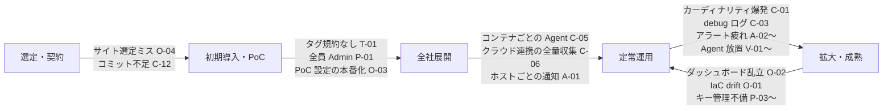
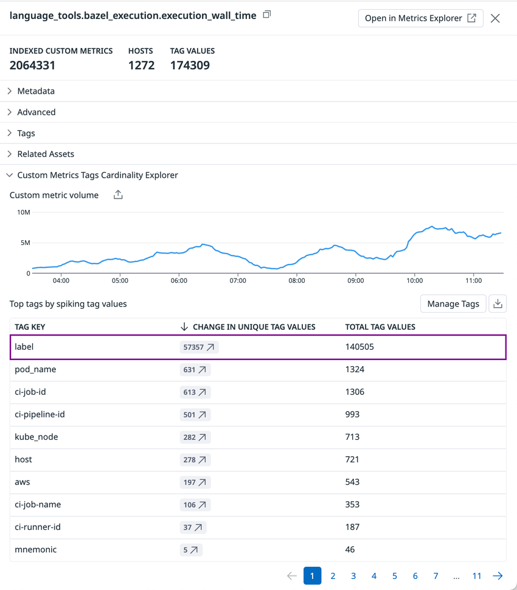
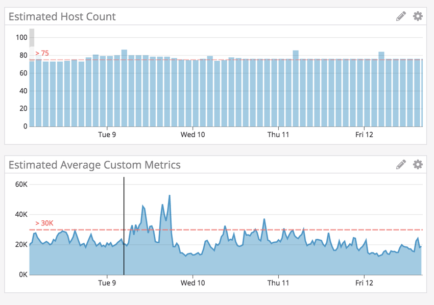
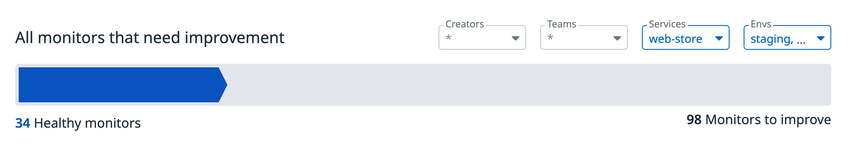

# よくある失敗とアンチパターン

## 概要

本ファイルは、Datadog の導入・運用で**繰り返し起きる失敗パターン（アンチパターン）**を、横断的なカタログとしてまとめる。対象は次の 6 群である。

| 群 | ID 接頭辞 | 代表的な失敗 | 主な被害 |
|---|---|---|---|
| コスト急増 | `C-` | カスタムメトリクスのカーディナリティ爆発、ログの全量インデックス、コンテナごとの Agent、使用量監視の不在 | 請求額の急増。請求書が届くまで気づかない |
| タグ不統一 | `T-` | `env:prod` と `env:production` の混在、Unified Service Tagging 未設定、高カーディナリティタグ | 相関が切れる、モニターが分断される、コストが増える |
| アラート過多 | `A-` | ホストごとの通知、フラッピング、クラウドメトリクスの評価遅延なし、宛先なし、長期ミュート | アラート疲れ、重大アラートの見落とし |
| 権限設計ミス | `P-` | 全員 Admin、Standard ロールのままでの保持期間変更、個人ユーザーに紐づくアプリケーションキー | 予期しないコスト増、自動化の停止、情報漏えい |
| Agent バージョン放置 | `V-` | 古い Agent、Agent v5/v6 の残存、バージョン混在 | 送信停止、二重課金、機能の不足、リモート管理不可 |
| 運用プロセス | `O-` | IaC 外の手動変更、ダッシュボード乱立、サイト選定ミス、PoC 設定のまま本番化 | ガバナンス崩壊、移行コスト |

各パターンは原則として「**症状 → 原因（仕組み） → 検知方法 → 対策 → 課金への影響**」の順に記述する。公式ドキュメントで仕組みが確認できる事実には出典を付け、実務上の知見には確度ラベル（`【経験則】`・`【第三者情報】`・`【推定】`）を付ける。

本ファイルは「何が失敗か」と「どう気づき、どう止めるか」に絞る。個々の対策の詳しい設定手順は、次の専門ファイルを正とする。

| テーマ | 詳細ファイル |
|---|---|
| コスト削減策全般 | [コスト最適化](./01-cost-optimization.md) |
| タグ設計 | [タグ戦略の実践](./02-tagging-strategy.md)、[Tagging（タグ）](../02_リファレンス/platform/tagging.md) |
| アラート設計 | [アラート設計とノイズ削減](./03-alert-design-and-noise-reduction.md) |
| 権限 | [組織・ユーザー・権限管理](../02_リファレンス/platform/account-and-access-management.md)、[API とキー管理](../02_リファレンス/platform/api-and-keys.md) |
| Agent の更新 | [Datadog Agent](../02_リファレンス/platform/agent.md)、[Fleet Automation と Remote Configuration](../02_リファレンス/platform/fleet-automation.md)、[Agent 展開設計](../03_導入編/10-agent-rollout-design.md) |
| 料金の数値 | [製品別料金表（料金の正本）](../03_導入編/02-pricing-by-product.md)、[課金計算の仕組み](../03_導入編/03-billing-mechanics.md) |

> **料金の扱い:** 本ファイル中の単価は [製品別料金表](../03_導入編/02-pricing-by-product.md) の値（公式料金ページ、2026-11-02〜03 取得、US/EU1 サイト、年契約）を引用する。AP1（日本）サイトは US の 1.25 倍の単価が掲載されている（例：Logs Ingestion は US $0.10/GB、AP1 $0.125/GB）。試算は定価ベースであり、契約上の値引きは反映しない。

---

## 1. 失敗パターンの全体像

### 1.1 なぜ Datadog で失敗が起きやすいか

Datadog の失敗パターンの多くは、次の 3 つの性質から生じる。

| 性質 | 内容 | 失敗への結びつき |
|---|---|---|
| 従量課金の単位が多い | ホスト、コンテナ、カスタムメトリクス（Timeseries 課金モデルではメトリクス名 × タグ値の組み合わせ、Metric Name 課金モデルではメトリクス名とデータ点数）、ログの取り込み GB とインデックス件数、スパンの取り込み GB とインデックス件数、テスト実行回数、セッション数など、製品ごとに課金単位が違う [出典](https://docs.datadoghq.com/account_management/billing/) | 「ホスト数 × 単価」で見積もった予算から外れる。設定 1 行（タグ 1 つ、ログレベル 1 つ）の変更が請求額を大きく動かす |
| 誰でもすぐに設定できる | Datadog Standard Role の既定権限で、モニター作成、ログ Index の変更、除外フィルタの編集などができる [出典](https://docs.datadoghq.com/account_management/rbac/permissions/) | 統制のないまま設定・ダッシュボード・モニターが増える |
| 導入直後は問題が見えない | 監視対象と利用者が増える半年後あたりから、ダッシュボードとアラートの乱立や、請求額の内訳を説明できない状態が表面化する【第三者情報】[出典](https://www.issoh.co.jp/tech/details/16515/)（2026-08-13 公開、2026-09-27 更新） | 初期設計（タグ・権限・コスト監視）を後回しにすると、後からの是正コストが大きい |

### 1.2 失敗が起きるタイミング（ライフサイクル）

### 1.3 失敗パターン早見表

| ID | 失敗パターン | 主な症状 | 主な検知手段 | 詳細 |
|---|---|---|---|---|
| C-01 | 高カーディナリティタグによるカスタムメトリクス爆発 | カスタムメトリクス数が急増 | `datadog.estimated_usage.metrics.custom.by_metric`、Metrics Volume Management | [2.1](#21-c-01-高カーディナリティタグによるカスタムメトリクス爆発) |
| C-02 | Histogram / Distribution の乗数を見落とす | 1 メトリクスが 5〜10 倍に化ける | Metrics Summary | [2.2](#22-c-02-histogram--distribution-の乗数を見落とす) |
| C-03 | ログの全量インデックス・debug ログの流入 | インデックス件数の急増 | `datadog.estimated_usage.logs.ingested_events`、日次クォータ | [2.3](#23-c-03-ログの全量インデックスdebug-ログの流入) |
| C-04 | 除外フィルタで取り込み課金も減ると誤解 | 除外したのに請求が下がらない | `datadog.estimated_usage.logs.ingested_bytes` | [2.4](#24-c-04-除外フィルタで取り込み課金も減ると誤解する) |
| C-05 | コンテナごとに Agent を入れる | ホスト数が数倍に | `datadog.estimated_usage.hosts` | [2.5](#25-c-05-コンテナごとに-agent-を入れる) |
| C-06 | クラウド連携で全リソースを収集 | 想定外の EC2 / VM がホスト課金 | Infrastructure List、`hosts.by_tag` | [2.6](#26-c-06-クラウド連携で全リソースを収集する) |
| C-07 | 短命コンテナ・CI Pod を監視対象に含める | コンテナ時間の急増 | `datadog.estimated_usage.containers` | [2.7](#27-c-07-短命コンテナci-pod-を監視対象に含める) |
| C-08 | APM のサンプリング・保持を全量に設定 | 取り込み GB・インデックススパンの急増 | `datadog.estimated_usage.apm.*` | [2.8](#28-c-08-apm-のサンプリング保持を全量に設定する) |
| C-09 | Synthetic の頻度 × ロケーション数の掛け算 | テスト実行回数の急増 | `datadog.estimated_usage.synthetics.*` | [2.9](#29-c-09-synthetic-の頻度--ロケーション数を掛け算で見ない) |
| C-10 | RUM / Session Replay を全量で送る | セッション数の急増 | `datadog.estimated_usage.rum.*` | [2.10](#210-c-10-rum--session-replay-を全量で送る) |
| C-11 | ログ・スパン由来のメトリクスを無計画に作る | カスタムメトリクス枠の消費 | Metrics Summary | [2.11](#211-c-11-ログスパン由来のメトリクスを無計画に作る) |
| C-12 | コミット（契約量）設計の失敗 | オンデマンド単価での超過課金 | Plan & Usage | [2.12](#212-c-12-コミット契約量設計の失敗) |
| C-13 | 使用量を監視せず請求書で気づく | 月末に初めて判明 | 推定使用量メトリクスのモニター | [2.13](#213-c-13-使用量を監視せず請求書で気づく) |
| C-14 | 「99 パーセンタイル課金だからスパイクは無料」と誤解 | 持続的な増加がそのまま課金 | `datadog.estimated_usage.hosts` | [2.14](#214-c-14-99-パーセンタイル課金の誤解) |
| T-01 | タグ規約がない・値がゆれる | 同じ環境が複数に分かれる | Tag 一覧、Metrics Summary | [3.1](#31-t-01-タグ規約がない値がゆれる) |
| T-02 | Unified Service Tagging（UST）未設定 | メトリクス・トレース・ログの相関が切れる | Software Catalog、APM | [3.2](#32-t-02-unified-service-tagging-を設定しない) |
| T-03 | 予約タグ（`env`/`service`/`version`）の流用 | 統合ビューが崩れる | — | [3.3](#33-t-03-予約タグの流用と複数ソースによる多値化) |
| T-04 | 大文字・空白・記号の扱いを知らない | 意図しないタグ値 | — | [3.4](#34-t-04-正規化ルール大文字空白記号を知らない) |
| T-05 | `team` などオーナータグの陳腐化 | 誤ルーティング | Usage Attribution、Software Catalog | [3.5](#35-t-05-オーナータグの陳腐化) |
| T-06 | ホスト名が変わる・重複する | 同じマシンが別ホストとして表示 | Infrastructure List | [3.6](#36-t-06-ホスト名の変化重複) |
| T-07 | 過去データを後から付け直せると思う | 移行後に過去比較ができない | — | [3.7](#37-t-07-過去データを後からタグ付けし直せると思う) |
| A-01 | ホスト単位・Pod 単位で通知する | 1 障害で数十〜数百通知 | Monitor Notifications Overview | [4.1](#41-a-01-ホスト単位pod-単位で通知する) |
| A-02 | フラッピング（回復しきい値なし・短い評価ウィンドウ） | OK⇔ALERT の往復 | Monitor Quality「High volume of alerts」 | [4.2](#42-a-02-フラッピング) |
| A-03 | クラウドメトリクスに評価遅延を設定しない | 誤検知 | Monitor Quality「Missing a delay」 | [4.3](#43-a-03-クラウドメトリクスに評価遅延を設定しない) |
| A-04 | 原因ベースのアラートを全部ページする | 夜間呼び出しの増加 | 通知数の推移 | [4.4](#44-a-04-原因ベースのアラートをすべてページする) |
| A-05 | 宛先なし・誤った通知ハンドル | 誰にも届かない | Monitor Quality「Missing recipients」等 | [4.5](#45-a-05-宛先なし誤った通知ハンドル長期ミュート) |
| A-06 | 長期ミュート・ALERT 張り付き | 監視が実質停止 | Monitor Quality「Muted for over 60 days」 | [4.5](#45-a-05-宛先なし誤った通知ハンドル長期ミュート) |
| A-07 | 通知本文に対応手順がない | 初動が遅い | — | [4.6](#46-a-07-通知本文に判断材料がない) |
| A-08 | 作りっぱなしで棚卸ししない | モニター数の増加、品質低下 | Monitor Quality | [4.7](#47-a-08-作りっぱなしで棚卸ししない) |
| P-01 | 全員に Datadog Admin Role を付与 | 請求・キー・ユーザーを誰でも操作 | ロール別ユーザー数 | [5.1](#51-p-01-全員に-datadog-admin-role-を付与する) |
| P-02 | 既定の Standard ロールのまま運用 | 誰でも Index の保持期間・除外フィルタを変更 | Audit Trail | [5.2](#52-p-02-既定の-standard-ロールのまま運用する) |
| P-03 | 個人ユーザーのアプリケーションキーで自動化 | 退職・無効化で自動化が止まる | キー一覧の所有者 | [5.3](#53-p-03-個人ユーザーのアプリケーションキーで自動化する) |
| P-04 | API キーの共用・ソースコードへの埋め込み | 漏えい時に全体停止 | キー一覧 | [5.4](#54-p-04-api-キーの共用ソースコードへの埋め込み) |
| P-05 | カスタムロールの自動更新を考慮しない | 新機能が使えない／意図せず権限が広がる | ロール設定 | [5.5](#55-p-05-カスタムロールとマルチ-org-の落とし穴) |
| P-06 | Audit Trail を無効のまま運用 | 誰が変えたか追えない | Audit Trail 設定 | [5.6](#56-p-06-audit-trail-を有効にしない) |
| V-01 | サポート終了 OS 上の Agent を放置 | 更新不可 | Fleet Automation | [6.1](#61-v-01-サポート上限のある-os-上の-agent-を放置する) |
| V-02 | Agent v5 / v6 を残す | 送信停止（v5 証明書）、Python 2 チェック | Fleet Automation | [6.2](#62-v-02-agent-v5--v6-を残す) |
| V-03 | 古い Agent による課金・挙動の差 | 二重課金、pause コンテナの課金 | Infrastructure List | [6.3](#63-v-03-古い-agent-による課金挙動の差) |
| V-04 | リモート管理できない古い Agent | Fleet Automation で更新不可 | Fleet Automation | [6.4](#64-v-04-リモート管理できない古い-agent) |
| V-05 | `latest` タグや固定しないバージョン指定 | 予期しない更新・バージョン混在 | Fleet Automation | [6.5](#65-v-05-バージョン指定のアンチパターン) |
| O-01 | UI 手動変更と IaC の混在 | drift、意図しない上書き | Terraform plan、Audit Trail | [7.1](#71-o-01-ui-手動変更と-iac-の混在) |
| O-02 | ダッシュボード・モニターの乱立 | 探せない、信用されない | — | [7.2](#72-o-02-ダッシュボードモニターの乱立) |
| O-03 | PoC 設定のまま本番化 | 全量収集・全員 Admin が残る | — | [7.3](#73-o-03-poc-の設定のまま本番化する) |
| O-04 | サイト（リージョン）選定ミス | データ移行不可 | — | [7.4](#74-o-04-サイトリージョン選定ミス) |
| O-05 | 移行・並行運用期間の二重コスト | 旧ツールと二重払い | — | [7.5](#75-o-05-移行並行運用期間の二重コスト) |

---

## 2. コスト急増のアンチパターン

Datadog のコスト急増は、**「量（ボリューム）× 単価」の量が、設定変更や新規サービスで一気に増える**ことで起きる。費用を動かす量は製品ごとに異なる。代表的な課金単位は次のとおり（単価の正本は [製品別料金表](../03_導入編/02-pricing-by-product.md)）。

| 量 | 課金単位 | 単価例（US、年契約、2026-11-02 時点） | 急増のきっかけ |
|---|---|---|---|
| ホスト | 月間の時間ごとのホスト数の上位 1% を除いた最大値 | エディション別（[料金表](../03_導入編/02-pricing-by-product.md) 参照） | Agent の入れ方、クラウド連携の範囲、オートスケール |
| コンテナ | 同梱枠（Pro 5 / Enterprise 10 コンテナ/ホスト）超過分 | $1/コンテナ/月（前払い）、$0.002/コンテナ時間（オンデマンド） | 短命コンテナ、CI Pod |
| カスタムメトリクス | メトリクス名 × タグ値の組み合わせの月平均（Timeseries 課金モデルの場合。Metric Name 課金モデルではメトリクス名数とデータ点数） | $5/100 個/月（インデックス）、Ingested $0.10/100 個（Timeseries 課金モデル） | 高カーディナリティタグ（Metric Name 課金モデルでは送信頻度・データ点の増加も） |
| ログ取り込み | 非圧縮 GB | $0.10/GB | debug ログ、新サービス |
| ログインデックス | 100 万件（保持期間別） | 15 日保持 $1.70/100 万件 | 全量インデックス、保持期間の延長 |
| APM 取り込みスパン | GB（同梱 150 GB/APM ホスト/月） | $0.10/GB | サンプリング 100% |
| APM インデックススパン | 100 万件（同梱 100 万件/APM ホスト/月） | 15 日保持 $1.70/100 万件 | 保持フィルタの広げすぎ |
| Synthetic | テスト実行回数 | API $5/1 万回、Browser $12/1,000 回 | 頻度 × ロケーション数 |

出典：[Pricing Comparison](https://www.datadoghq.com/pricing/list/)、[Billing](https://docs.datadoghq.com/account_management/billing/)、[製品別料金表](../03_導入編/02-pricing-by-product.md)

### 2.1 C-01 高カーディナリティタグによるカスタムメトリクス爆発

**症状:** カスタムメトリクス数（Plan & Usage の Custom Metrics、`datadog.estimated_usage.metrics.custom`）がある日を境に数倍〜数十倍に増える。同梱枠を超えた分が請求される。

**仕組み:** Timeseries（カーディナリティ）課金モデルでは、Datadog のカスタムメトリクスは「**メトリクス名とタグ値（`host` タグを含む）の組み合わせ**」ごとに 1 つと数える。課金対象数は「各時間の一意なカスタムメトリクス数の合計 ÷ 月の時間数」で求める月平均である。この課金モデルでは、データ点の送信頻度やクエリ回数は課金に影響しない [出典](https://docs.datadoghq.com/account_management/billing/custom_metrics/)。

> **課金モデルの違い:** 上記と本節以降の個数計算は **Timeseries（カーディナリティ）課金モデル**の説明である。カスタムメトリクスには **Metric Name 課金モデル**もあり、契約上の SKU は Timeseries 課金と相互排他である。Metric Name 課金では、インデックス済みデータ点を送った一意なメトリクス名の数（Metric-Name）、メトリクス名あたりの基準量を超えたインデックス済みデータ点（Indexed Points）、インデックス量の 5 倍を超えた取り込みデータ点（Ingested Points）で課金されるため、**送信頻度やデータ点の量が費用に影響する** [出典](https://docs.datadoghq.com/account_management/billing/metric_name_pricing/)。自社の契約がどちらのモデルかを確認すること（[製品別料金表 2.5](../03_導入編/02-pricing-by-product.md)）。

公式の計算例では、`request.Latency` を 2 ホスト × 2 エンドポイント × 2 ステータスコードの範囲で送ると、実際に発生した組み合わせ 4 通りがカスタムメトリクス 4 個（COUNT / RATE / GAUGE の場合）になる [出典](https://docs.datadoghq.com/account_management/billing/custom_metrics/)。ここに上限のない値（ユーザー ID、リクエスト ID、タイムスタンプ等）をタグとして足すと、組み合わせ数はその値の種類数に比例して増える。

公式ドキュメントも「タグは、エポックタイムスタンプ、ユーザー ID、リクエスト ID のような上限のないソースから作るべきではない」と明記している [出典](https://docs.datadoghq.com/getting_started/tagging/)。

**典型的な原因:**

| 原因 | 例 | 備考 |
|---|---|---|
| ID 系の値をタグにする | `user_id`、`request_id`、`order_id`、`session_id`、`trace_id` | 最も多い原因。値はログやトレースの属性に入れる |
| Pod 名・コンテナ ID をカスタムメトリクスのタグにする | `pod_name`、`container_id`、`ci-job-id` | Pod の再作成のたびに新しい値が増える |
| URL のパスをそのままタグにする | `/users/12345/orders/678` | パスパラメータを正規化しないと値が無限に増える |
| エラーメッセージ全文をタグにする | `error_message:...` | 例外メッセージに ID が含まれる |
| Prometheus / OpenMetrics の全ラベルをそのまま取り込む | Exporter の全メトリクス・全ラベル | Kubernetes では大きな数になりやすい【第三者情報】 |

**検知:**

- **Metrics Volume Management**：全ユーザーが、最大のメトリクスや急増しているメトリクスをリアルタイムの推定値で確認できる [出典](https://docs.datadoghq.com/metrics/guide/custom_metrics_governance/)。
- **Custom Metrics Tags Cardinality Explorer**：メトリクスのサイドパネルで、どのタグキーがカーディナリティを押し上げているかを確認できる [出典](https://docs.datadoghq.com/metrics/guide/custom_metrics_governance/)。
- **推定使用量メトリクスのモニター**：公式ガイドは `datadog.estimated_usage.metrics.custom.by_metric` にメトリクスモニターを作る例（しきい値 700,000）を示し、変化率の Change Alert、Anomaly、Forecast の各モニターも選択肢に挙げている [出典](https://docs.datadoghq.com/metrics/guide/custom_metrics_governance/)。

- **キャプション:** Metrics Summary のメトリクスサイドパネルにある Custom Metrics Tags Cardinality Explorer。急増したカスタムメトリクスの原因タグを特定する画面。
- **画面の説明:** 上部にメトリクス名（例：`language_tools.bazel_execution.execution_wall_time`）と「INDEXED CUSTOM METRICS」（例：2,064,331）、「HOSTS」（1,272）、「TAG VALUES」（174,309）が表示される。その下に Metadata、Advanced、Tags、Related Assets の折りたたみ節があり、「Custom Metrics Tags Cardinality Explorer」を開くと、カスタムメトリクス量の時系列グラフ（Custom metric volume）と、「Top tags by spiking tag values」表が表示される。表の列は TAG KEY、CHANGE IN UNIQUE TAG VALUES（一意な値の増加数）、TOTAL TAG VALUES。例では `label` タグが 57,357 増・計 140,505 で最上位にあり、`pod_name`、`ci-job-id`、`ci-pipeline-id` など一時的な ID 系のタグが続く。右上の **Manage Tags** ボタンから Metrics without Limits™ のタグ設定に進める。
- **出典:** [Metrics Volume Management](https://docs.datadoghq.com/metrics/volume/)（画像取得日 2026-11-03）

**対策:**

| 段階 | 対策 | 補足 |
|---|---|---|
| 予防 | タグ規約で「メトリクスに付けてよいタグ」を決め、ID 系はログ・スパン属性に回す | 【経験則】[タグ戦略の実践](./02-tagging-strategy.md) |
| 予防 | `metric_tags_write`（Metric Tags Write）権限を絞る。変更は Events Explorer で `tags:audit "Queryable tag configuration"` を検索して追跡する | 権限名は [Permissions](https://docs.datadoghq.com/account_management/rbac/permissions/) の表記。[ガバナンスガイド](https://docs.datadoghq.com/metrics/guide/custom_metrics_governance/) は `metrics_tags_write` と表記している（権限の絞り込みと Events Explorer での追跡の出典はガバナンスガイド） |
| 是正 | Metrics without Limits™ で、インデックスするタグを必要なものに限定する | 取り込み分は Ingested Custom Metrics として別課金（$0.10/100 個） |
| 是正 | クエリされていないメトリクスを特定（Metrics Summary の Query Activity 30/60/90 日、Related Assets「Not used in any asset」）して止める | 公式は「クエリされていないメトリクスに適用すると平均で最大 70% 削減」と記載 [出典](https://docs.datadoghq.com/metrics/guide/custom_metrics_governance/) |
| 是正 | 送信元（アプリ・DogStatsD・OpenMetrics チェック）でタグやメトリクスを絞る | 根本対策。詳細は [Custom Metrics と DogStatsD](../02_リファレンス/platform/custom-metrics-and-dogstatsd.md) |

> **注意:** Metrics without Limits™ で外したタグは、元に戻しても**過去分はバックフィルされない** [出典](https://docs.datadoghq.com/metrics/guide/custom_metrics_governance/)。ダッシュボード・モニター・SLO で使っているタグ（Related Assets で確認）を外さないこと。

**課金への影響（試算）:** 例として、`checkout.latency`（GAUGE）に `endpoint`（20 値）と `user_id`（実際に出現する 10,000 値）を付けると、組み合わせは最大 200,000 個になる。同梱枠を超えた分が対象であり、年契約の定価 $5/100 個/月で換算すると 200,000 個は最大で **$10,000/月** に相当する【推定】（全組み合わせが毎時出現し、同梱枠をすでに使い切っている前提の上限値。インデックス済みカスタムメトリクスの超過単価は契約で定めるとドキュメントにある [出典](https://docs.datadoghq.com/account_management/billing/custom_metrics/)）。

### 2.2 C-02 Histogram / Distribution の乗数を見落とす

**症状:** 1 つのメトリクスを足しただけなのに、カスタムメトリクス数が 5 倍、10 倍で増える。

**仕組み:** 公式の計算例（タグの組み合わせ 4 通り）では次のとおりになる [出典](https://docs.datadoghq.com/account_management/billing/custom_metrics/)。

| メトリクスタイプ | カウント方法 | 4 通りの組み合わせでの個数 |
|---|---|---|
| COUNT / RATE / GAUGE | 組み合わせ数 | 4 |
| HISTOGRAM | 組み合わせ数 × 集計値の数（既定 5：`avg`、`count`、`median`、`95percentile`、`max`） | 20 |
| DISTRIBUTION | 組み合わせ数 × サーバー側の集計 5 種 | 20 |
| DISTRIBUTION + パーセンタイル（p50/p75/p90/p95/p99） | 上記 + 組み合わせ数 × 5 | 40 |

- HISTOGRAM は Agent 側の設定で送る集計値を増減でき、増減に応じて個数も変わる [出典](https://docs.datadoghq.com/account_management/billing/custom_metrics/)。
- HISTOGRAM（Agent 側集計）は送信後にタグを絞れない。一方 DISTRIBUTION は Metrics without Limits™ のタグ設定とパーセンタイルの有効・無効を後から変えられる。「個別メトリクスにしてタグを絞る方が結果的に安い」場合もある【第三者情報】。
- 上表は Timeseries 課金モデルの数え方である。Metric Name 課金モデルでも、DISTRIBUTION には取り込み量・インデックス量の両方に乗数（既定 5 倍、パーセンタイル有効時 10 倍）がかかる [出典](https://docs.datadoghq.com/account_management/billing/metric_name_pricing/)。

**対策:** パーセンタイルは本当に必要なメトリクスだけ有効にする。高カーディナリティなタグを持つメトリクスには HISTOGRAM を使わない。詳細は [Custom Metrics と DogStatsD](../02_リファレンス/platform/custom-metrics-and-dogstatsd.md) と [コスト最適化](./01-cost-optimization.md) を参照。

### 2.3 C-03 ログの全量インデックス・debug ログの流入

**症状:** Indexed Logs（インデックス済みログイベント）の件数が急増する。新規システムや debug レベルのログを有効にした直後に起きやすい。

**公開事例【第三者情報】:** 国内のユーザー会（Japan Datadog User Group #13）の発表では、開発中のシステムが多数のサーバーから大量のログを送り、月額が約 $90,000 から約 $120,000 に 1 か月で増えた。請求書が届くまで気づけなかった、と報告されている [出典](https://speakerdeck.com/shiroigit/jddug-number-13-datadog-no-liao-jin-wojian-shi-sitemita)（2025-11-15 公開）。

**仕組み:** ログは「取り込み（GB）」と「インデックス（件数 × 保持期間）」の 2 段階で課金される。インデックスの単価は保持期間で変わり、US 年契約で 3 日 $1.06、7 日 $1.27、15 日 $1.70、30 日 $2.50（いずれも 100 万件/月）である（[製品別料金表](../03_導入編/02-pricing-by-product.md)）。インデックスは、ログが最初にフィルタに一致した Index に入る（first match）[出典](https://docs.datadoghq.com/logs/log_configuration/indexes/)。

**典型的な原因:**

| 原因 | 説明 |
|---|---|
| Index が 1 つだけで、フィルタが `*` | 全ログが同じ保持期間でインデックスされる |
| 日次クォータ（Daily quota）未設定 | 上限なしにインデックスされ続ける |
| アプリの log level が `DEBUG` のまま本番に出る | 件数が桁違いに増える |
| ヘルスチェック・アクセスログを全件インデックス | 価値の低いログが件数の大半を占める |
| 保持期間を長くした Index にすべて入れる | 長期保持はアーカイブ / Flex Logs の方が安い |

**検知:** 公式ガイドは次を推奨している [出典](https://docs.datadoghq.com/logs/guide/best-practices-for-log-management/)。

| 検知 | 設定 |
|---|---|
| インデックス件数の異常検知 | `datadog.estimated_usage.logs.ingested_events` を `datadog_is_excluded:false` で絞り、`service` と `datadog_index` でグループ化した Anomaly モニター |
| 月初からの累積監視 | 上記メトリクスにメトリクスモニターの累積ウィンドウ（cumulative window）を組み合わせる |
| 日次クォータの 80% 到達 | 過去 24 時間でクォータの 80% に達したら通知 |
| 日次クォータ到達 | Event Monitor で `source:datadog datadog_index:* "daily quota reached"` を `datadog_index` でグループ化、しきい値 1 |

**対策:**

| 対策 | 内容 | 出典 |
|---|---|---|
| Index を保持期間・用途で分ける | 7 日と 30 日など、要件ごとに Index を作る | [出典](https://docs.datadoghq.com/logs/guide/best-practices-for-log-management/) |
| 日次クォータと警告しきい値 | クォータは 100 万件単位で設定。警告しきい値はクォータの % で最小 50%。既定のリセット時刻は 14:00 UTC。変更は即時反映 | [出典](https://docs.datadoghq.com/logs/log_configuration/indexes/) |
| 除外フィルタ（Exclusion Filter） | Log Patterns で多いパターンを特定し、パターンのサイドパネルから除外フィルタを追加 | [出典](https://docs.datadoghq.com/logs/guide/best-practices-for-log-management/) |
| ログベースメトリクス | 除外したログの傾向は、ログから生成したメトリクスで残す | 同上 |
| 長期保持は Flex Logs / アーカイブ | 頻繁に検索するログは標準 Index、まれに検索するログは Flex Logs やアーカイブ（Archive Search） | 同上 |
| 送信元での抑止 | Agent の `log_processing_rules`、Observability Pipelines で送る前に落とす（取り込み課金も減る） | [ログ管理の実践](./06-log-management-practices.md) |

> **日次クォータの副作用:** クォータに達するとそれ以降のログはインデックスされず、検索できなくなる（Live Tail、アーカイブ、ログベースメトリクスには残る）[出典](https://docs.datadoghq.com/logs/log_configuration/indexes/)。障害時にログが見られない事態を避けるため、クォータは通常量より余裕を持たせる（例：通常の約 1.5 倍で警告）【第三者情報】[出典](https://www.issoh.co.jp/tech/details/16515/)（2026-08-13 公開）。

**課金への影響（試算）:** 1 日 1 億件の debug ログが 15 日保持の Index に 30 日間入ると、30 億件 × $1.70/100 万件 = **$5,100/月**（US 年契約の定価、取り込み課金は別）【推定】。

### 2.4 C-04 除外フィルタで取り込み課金も減ると誤解する

**症状:** Index の除外フィルタを入れたのに、請求額の「Logs Ingestion」が下がらない。

**仕組み:** 除外フィルタは**インデックスから外す**機能であり、取り込みは済んでいる。除外されたログは Live Tail を流れ、ログベースメトリクスの生成とアーカイブの対象にもなる [出典](https://docs.datadoghq.com/logs/log_configuration/indexes/)。推定使用量メトリクス `datadog.estimated_usage.logs.ingested_events` は「除外されたログを含む取り込みイベント総数」と定義されている [出典](https://docs.datadoghq.com/account_management/billing/usage_metrics/)。したがって取り込み課金（$0.10/GB）は除外フィルタでは減らない。

| 削減したいもの | 効く手段 | 効かない手段 |
|---|---|---|
| インデックス件数 | 除外フィルタ、日次クォータ、Index フィルタ | — |
| 取り込み GB | Agent 側フィルタ（`log_processing_rules`）、Observability Pipelines、送信元のログレベル、クラウドのログ転送設定（Forwarder のフィルタ） | 除外フィルタ、日次クォータ |

> **除外フィルタの評価順:** Index の除外フィルタは**最初に一致した有効なフィルタだけ**が適用され、後続のフィルタは評価されない。順序はドラッグ＆ドロップで変える [出典](https://docs.datadoghq.com/logs/log_configuration/indexes/)。広いフィルタを上に置くと、下の細かいサンプリング設定が効かない。
>
> **パース前の属性で書いたフィルタは一致しない:** Index フィルタはパイプライン処理の後に評価されるため、パースしていない属性を条件にしたフィルタは一致しない【第三者情報】[出典](https://www.issoh.co.jp/tech/details/16515/)（2026-08-13 公開）。

### 2.5 C-05 コンテナごとに Agent を入れる

**症状:** Infrastructure のホスト数が、実際のノード数の数倍になる。

**仕組み:** 公式ドキュメントは「コンテナは、ホストごとに 1 つのコンテナ化 Agent で監視することを推奨」しており、**各コンテナに Agent を入れると、各コンテナがホストとして課金される**と明記している [出典](https://docs.datadoghq.com/account_management/billing/)。APM でも、コンテナごとに Agent を入れると各コンテナが 1 APM ホストとして扱われる（Kubernetes では APM は Pod ではなくノード単位の課金）（[製品別料金表](../03_導入編/02-pricing-by-product.md)）。

**対策:** Kubernetes は DaemonSet（Datadog Operator / Helm）で 1 ノード 1 Agent。ECS on EC2 も 1 インスタンス 1 Agent。サイドカー型が必要なのは ECS Fargate などノードにアクセスできない環境に限る（Fargate はタスク単位の課金体系）。詳細は [コンテナ/Kubernetes向けAgent](../02_リファレンス/platform/kubernetes-and-containers-agent.md)、[Kubernetes 監視の実践](./07-kubernetes-monitoring-practices.md)。

### 2.6 C-06 クラウド連携で全リソースを収集する

**症状:** Agent を入れていない EC2 / VM が大量にホストとして課金される。開発用・一時的なインスタンスまで課金対象になる。

**仕組み（AWS の例）:** Datadog は Agent を動かしている AWS ホストと、AWS インテグレーションが検出した EC2 インスタンスを課金する。Agent が動いている EC2 をインテグレーションも検出した場合は二重課金されない。ELB、RDS、DynamoDB はインフラのホスト課金の対象外で、課金対象は EC2（ホスト）、Lambda（アクティブ関数）、CloudWatch カスタムメトリクス（カスタムメトリクス）とコンテナである [出典](https://docs.datadoghq.com/account_management/billing/aws/)。

**対策:**

| 対策 | 内容 | 出典 |
|---|---|---|
| タグによる収集範囲の限定 | AWS インテグレーションの Metric Collection タブで、EC2、Lambda、ELB 各種、RDS、SQS、Step Functions、CloudWatch カスタムメトリクスをタグで絞る。除外は `!` 記法（例：`!datadog:no`）。EC2 の除外は接続された EBS ボリュームにも適用される | [出典](https://docs.datadoghq.com/account_management/billing/aws/) |
| CloudWatch カスタムメトリクスの取捨選択 | CloudWatch のカスタムメトリクスは課金対象。他サービスのメトリクスのフィルタは課金に影響しない | 同上 |
| Azure / Google Cloud も同様にフィルタ | VM や App Service Plan をタグで絞る | [Azure Integration](../02_リファレンス/platform/azure-integration.md)、[Google Cloud Integration](../02_リファレンス/platform/gcp-integration.md) |

> **除外記法の注意:** `!` を使った除外では、対象リソースに指定のタグが**付いていない**ことを確認すること、とドキュメントにある [出典](https://docs.datadoghq.com/account_management/billing/aws/)。タグ値は小文字化され、空白はアンダースコアに変換されるため、AWS 側のタグ表記と一致しないことがある（[T-04](#34-t-04-正規化ルール大文字空白記号を知らない) 参照）。

IMDSv2 必須の EC2 で Agent が古い場合の二重カウントは [V-03](#63-v-03-古い-agent-による課金挙動の差) を参照。

### 2.7 C-07 短命コンテナ・CI Pod を監視対象に含める

**症状:** コンテナの使用量（コンテナ時間）が同梱枠を大きく超える。

**仕組み:** コンテナは同梱枠（Pro 5 / Enterprise 10 コンテナ/ホスト）をアカウント全体で平均して計算する。オンデマンド分は 5 分ごとの使用量を 1 時間で平均（合計 ÷ 12）し、そこから同梱枠を差し引いて時間ごとに合計する。公式例では、ある 5 分間だけ 1,200 個のオンデマンドコンテナがあると 100 コンテナ時間として計量される [出典](https://docs.datadoghq.com/account_management/billing/containers/)。Kubernetes の pause コンテナは課金されない（EKS の pause コンテナ除外は Agent v7.20 以降が必要）[出典](https://docs.datadoghq.com/account_management/billing/containers/)。Pod 内のコンテナは、計量間隔のうち **10 秒を超えて動いていれば課金対象**であり、`CrashLoopBackoff` の Pod のコンテナも含まれる（Agent コンテナ自体は数えない）[出典](https://docs.datadoghq.com/account_management/billing/containers/)。再起動を繰り返す壊れた Pod を放置すると、障害だけでなくコンテナ課金も積み上がる。

**対策:** CI のビルド Pod、CronJob、サイドカーなど価値の低い短命コンテナは、Agent の `DD_CONTAINER_EXCLUDE` 系設定や Container Discovery Management で除外する。メトリクスとログは別々に除外できるため、バッチ失敗時のログは残すといった使い分けができる。include 設定は exclude 設定より優先されるため、include を併用すると除外が効かないことがある【第三者情報】[出典](https://www.issoh.co.jp/tech/details/16515/)（2026-08-13 公開）。設定キーの詳細は [コスト最適化](./01-cost-optimization.md) と [Agent 設定リファレンス](../02_リファレンス/platform/agent-configuration.md) を参照。

### 2.8 C-08 APM のサンプリング・保持を全量に設定する

**症状:** APM の Ingested Spans（GB）と Indexed Spans（件数）が同梱枠（150 GB/APM ホスト/月、100 万件/APM ホスト/月）を大きく超える。

**仕組み:** Datadog SDK の既定では Agent がヘッドベースサンプリングの目標を **10 トレース/秒/Agent**（`DD_APM_TARGET_TPS`、既定 10）に調整し、エラーサンプラーも既定で最大 10 トレース/秒/Agent（`DD_APM_ERROR_TPS`）を追加で取り込む [出典](https://docs.datadoghq.com/tracing/trace_pipeline/ingestion_mechanisms/)。アプリ側で `DD_TRACE_SAMPLING_RULES`（Java / Python / Go では `DD_TRACE_SAMPLE_RATE` は非推奨）でサンプリング率を 1.0 にすると、この自動調整を上書きして全トレースが取り込まれる。さらに、ブラウザ RUM は `traceSampleRate` 未設定時に既定で 100% のトレースを送り、Synthetic の HTTP / ブラウザテストも既定で 100% のテストがバックエンドトレースを生成する [出典](https://docs.datadoghq.com/tracing/trace_pipeline/ingestion_mechanisms/)。

| アンチパターン | 何が増えるか | 対策 |
|---|---|---|
| 全サービスで sample rate 1.0 | 取り込み GB | クリティカルパス（決済・認証）だけ高く、高頻度の読み取りは低く【第三者情報】 |
| 保持フィルタ（Retention Filter）を `*` 100% で作る | インデックススパン | 目的別に絞った保持フィルタ。Intelligent Retention Filter を活用 |
| ヘルスチェックのトレースを取り込む | 取り込み GB | サンプリングルールで除外 |
| OpenTelemetry SDK に Datadog SDK の既定値が効くと思う | 取り込み GB | 10 トレース/秒の目標は Datadog SDK のみに適用。OTel SDK は自前でサンプリングを設定する【第三者情報】[出典](https://www.issoh.co.jp/tech/details/16515/) |

- 保持フィルタの作成・変更（`apm_retention_filter_write`）と、サービスごとのインジェスト設定（`apm_service_ingest_write`）は既定で Datadog Admin Role の権限である [出典](https://docs.datadoghq.com/account_management/rbac/permissions/)。
- 詳細は [APM の概念とインジェスト制御](../02_リファレンス/apm/apm-concepts-and-ingestion.md)、[APM 運用の実践](./05-apm-practices.md)。

### 2.9 C-09 Synthetic の頻度 × ロケーション数を掛け算で見ない

**症状:** Synthetic のテスト実行回数が見積もりの数十倍になる。

**仕組み:** Synthetic は**テスト実行回数**で課金され、実行回数は「頻度 × ロケーション数 ×（ブラウザテストはブラウザ・デバイス数）」で増える。

**課金への影響（試算）:** ブラウザテスト 1 本を 1 分間隔・5 ロケーションで実行すると、60 × 24 × 30 × 5 = 216,000 回/月。Browser Tests の定価 $12/1,000 回（US 年契約）で **$2,592/月**【推定】（定価ベースの単純計算）。同じテストを 15 分間隔・2 ロケーションにすると 5,760 回/月 ≒ $69/月。

**対策:** 重要度に応じて頻度を決める（クリティカルな API は短く、画面遷移系のブラウザテストは長く）。ロケーションはユーザーの所在地に合わせて絞る。CI から実行する Continuous Testing は別の課金単位（[製品別料金表](../03_導入編/02-pricing-by-product.md)）。詳細は [Synthetic Monitoring](../02_リファレンス/dem/synthetic-monitoring.md)。

### 2.10 C-10 RUM / Session Replay を全量で送る

**症状:** RUM のセッション数が急増する。トラフィックの多いサイトで Session Replay を全セッション有効にした場合に起きやすい。

**仕組み:** Browser SDK の `sessionSampleRate` は追跡するセッション全体の割合で、既定は 100%（全セッション）である。`sessionReplaySampleRate` は全体のサンプリングの**後に**適用され、追跡したセッションのうち Browser RUM & Session Replay として収集する割合を決める（SDK v5.0.0 以降の既定は 0）。Browser RUM と Browser RUM & Session Replay は別の料金項目である [出典](https://docs.datadoghq.com/real_user_monitoring/guide/sampling-browser-plans/)。

**対策:** SDK のサンプリング率（`sessionSampleRate`、`sessionReplaySampleRate`）を要件に応じて設定する。RUM without Limits を使う場合は、取り込みは全量・保持は保持フィルタで選ぶ形になるため、保持フィルタの設計が費用を決める。詳細は [RUM（ブラウザ）](../02_リファレンス/dem/rum-browser.md)、[Session Replay と Product Analytics](../02_リファレンス/dem/session-replay-and-product-analytics.md)、[コスト最適化](./01-cost-optimization.md)。

### 2.11 C-11 ログ・スパン由来のメトリクスを無計画に作る

**症状:** アプリのカスタムメトリクスを増やしていないのに、カスタムメトリクス数が増える。

**仕組み:** ログベースメトリクスとスパンベースメトリクスは、どちらもカスタムメトリクスとして扱われ、カスタムメトリクスとして課金される（同梱枠も消費する）[出典](https://docs.datadoghq.com/logs/log_configuration/logs_to_metrics/) [出典](https://docs.datadoghq.com/tracing/trace_pipeline/generate_metrics/)（単価は [製品別料金表](../03_導入編/02-pricing-by-product.md)）。ログ属性の高カーディナリティな値（`@usr.id` 等）で group by するとカスタムメトリクスが爆発する（[C-01](#21-c-01-高カーディナリティタグによるカスタムメトリクス爆発) と同じ仕組み）。公式ドキュメントも、タイムスタンプ、ユーザー ID、リクエスト ID のような上限のない属性や極端に高カーディナリティな属性での group by を避けるよう求めている [出典](https://docs.datadoghq.com/logs/log_configuration/logs_to_metrics/)。

**対策:** ログ・スパンからメトリクスを作るときも、group by に使う属性は上限のある値に限る【経験則】。

### 2.12 C-12 コミット（契約量）設計の失敗

**症状:** 契約したコミット量を毎月超え、超過分が**オンデマンド単価**で課金される。逆に、過大なコミットで使わない分を払い続ける。

**仕組み:** 多くの SKU で、年契約・月契約・オンデマンドの単価が異なる。例えばログの 15 日保持インデックスは、US で年契約 $1.70、月契約 $2.04、オンデマンド $2.55（100 万件/月）であり、オンデマンドは年契約の 1.5 倍である（[製品別料金表](../03_導入編/02-pricing-by-product.md)）。Log Management の課金ドキュメントは、インフラの健全性の可視性を保つことが重要なため使用量は月間コミットに制限されないとし、超過した場合はコミット分を差し引いたうえで、オンデマンド使用量が 50% の割増で課金されると記載している [出典](https://docs.datadoghq.com/account_management/billing/log_management/)。

**対策:** 導入初期は数か月分の実績（Plan & Usage、推定使用量メトリクス）からコミット量を決め、契約更新時に見直す【経験則】。値引き・契約条件は非公開のため、詳細は [購入経路と契約](../03_導入編/06-procurement-and-contracts.md)、[コスト見積り手法](../03_導入編/05-cost-estimation.md) を参照。

### 2.13 C-13 使用量を監視せず請求書で気づく

**症状:** 月末の請求書、または Plan & Usage を見たときに初めてコスト増に気づく（[C-03](#23-c-03-ログの全量インデックスdebug-ログの流入) の公開事例も同じ構図）。

**仕組みと対策:** Datadog は**推定使用量メトリクス**（`datadog.estimated_usage.*`）を提供しており、グラフ化・モニター化できる。公式ガイドによると使用量メトリクスは無料で、15 か月保持される [出典](https://docs.datadoghq.com/logs/guide/best-practices-for-log-management/)。ユーザー会の発表では、①時間あたりのログ量 × 単価が一定額（例：$500）を超えたら通知するしきい値監視、②日次のログ量が通常から 30% 以上外れたら通知する異常検知、の 2 方式が紹介されている【第三者情報】[出典](https://speakerdeck.com/shiroigit/jddug-number-13-datadog-no-liao-jin-wojian-shi-sitemita)（2025-11-15 公開）。

- **キャプション:** 推定使用量メトリクスをダッシュボードに表示し、しきい値線を重ねた例。
- **画面の説明:** 上段は「Estimated Host Count」の棒グラフで、時間ごとの推定ホスト数（約 75〜85）と赤い破線のしきい値「> 75」が表示されている。下段は「Estimated Average Custom Metrics」の面グラフで、推定カスタムメトリクス数（平常時は約 20K）と赤い破線のしきい値「> 30K」が表示され、火曜〜水曜にかけて 50K 超のスパイクが見える。どちらも同じメトリクスでモニターを作れば、請求前に異常に気づける。
- **出典:** [Estimated Usage Metrics](https://docs.datadoghq.com/account_management/billing/usage_metrics/)（画像取得日 2026-11-03）

主要な推定使用量メトリクスは [9 章](#9-検知に使う推定使用量メトリクス) に一覧する。

### 2.14 C-14 99 パーセンタイル課金の誤解

**症状:** 「ホストは 99 パーセンタイル課金だからオートスケールの増加は課金されない」と考えていたが、請求ホスト数が増えている。

**仕組み:** Datadog はホスト数を毎時計測し、月末に**時間ごとの値の下位 99% の最大値（上位 1% の時間を除いた最大値）**を請求ホスト数とする。上位 1% を除くのは短時間のスパイクの影響を減らすためであり、**持続的な増加はそのまま課金される** [出典](https://docs.datadoghq.com/account_management/billing/)。1 か月（720 時間）の 1% は約 7 時間であり、それを超えて続くピークは課金に反映される【推定】（720 時間月の単純計算）。

また、報告が止まったホスト（`INACTIVE`）は課金されないが、Infrastructure List から消えるまで最大 2 時間かかる [出典](https://docs.datadoghq.com/account_management/billing/)。詳細は [課金計算の仕組み](../03_導入編/03-billing-mechanics.md)。

---

## 3. タグ不統一のアンチパターン

タグは Datadog のフィルタ・集計・相関・通知ルーティング・コスト配賦（Usage Attribution）の基盤である。タグの失敗は、可視化・アラート・コストのすべてに波及する。タグ仕様は [Tagging（タグ）](../02_リファレンス/platform/tagging.md)、設計手法は [タグ戦略の実践](./02-tagging-strategy.md) を参照。

### 3.1 T-01 タグ規約がない・値がゆれる

**症状:** `env:prod`、`env:production`、`env:prd` が混在し、ダッシュボードやモニターで同じ環境が別物として分かれる。チームごとに独自のタグキー（`app`、`application`、`svc`）が乱立する。

**原因と影響【第三者情報】:** Datadog パートナーの RapDev は、タグ戦略の典型的な失敗として次の 7 つを挙げている [出典](https://rapdev.io/blog/top-7-mistakes-in-datadog-tagging-strategies)（2026-03-03 公開）。

| # | 失敗 | 影響 |
|---|---|---|
| 1 | 全社共通のタグ標準がない | データが分断され、障害時に相関できない |
| 2 | 統合サービスタグ（`env`/`service`/`version`）を独自用途に流用 | Datadog の相関モデルと統合ビューが壊れる |
| 3 | 高カーディナリティなタグ値 | カスタムメトリクス数とコストの増加 |
| 4 | タグ値のゆれ（`env:prod` と `env:production`） | ダッシュボードやサービスビューが分断される |
| 5 | タグを「どう集計・検索するか」を考えずに付ける | 信用されないフィルタ、壊れやすいアラート |
| 6 | `team` / `owner` などオーナータグの陳腐化 | 誤ルーティング、対応の遅れ |
| 7 | ガバナンス・検証の仕組みがない | タグの無秩序な増加、クエリ低速化、モニターのデータ欠落 |

**対策:**

- タグキーと許容値の一覧（タグ辞書）を作り、IaC（Terraform のデフォルトタグ、Helm values）で強制する【経験則】。
- 公式は `<key>:<value>` 形式を推奨し、複数ソースで同じキーが重複しないよう区別しやすいキー名（例：`infra_service`）を勧めている [出典](https://docs.datadoghq.com/getting_started/tagging/)。
- モニターについては Tag Policies（モニターに必須タグを強制する機能）を使える。詳細は [タグ戦略の実践](./02-tagging-strategy.md)。

### 3.2 T-02 Unified Service Tagging を設定しない

**症状:** APM のサービスページからログやインフラメトリクスに移れない。デプロイ前後の比較（Deployment Tracking）ができない。

**仕組み:** Unified Service Tagging（統合サービスタグ付け）は、予約タグ `env`、`service`、`version` でメトリクス・トレース・ログなどを結び付ける仕組みである [出典](https://docs.datadoghq.com/getting_started/tagging/)。設定には、アプリ（SDK）側の `DD_ENV`・`DD_SERVICE`・`DD_VERSION` と、コンテナのラベル（`tags.datadoghq.com/env` 等）の両方を揃える必要がある [出典](https://docs.datadoghq.com/getting_started/tagging/unified_service_tagging/)。

**よくある崩れ方【経験則】:**

| 崩れ方 | 結果 |
|---|---|
| SDK には `DD_SERVICE` を設定したが、ログ側は `service` 未設定 | Logs と Traces の相関が切れる |
| `version` を設定しない | デプロイの比較ができない |
| `service` にインテグレーション名（例：`postgres`）が入り、アプリ単位で揃わない | Software Catalog が分断 |
| 環境ごとに `env` 値の付け方が違う | 同一サービスが別環境扱い |

**公式ドキュメントが注意点として挙げる崩れ方:** [出典](https://docs.datadoghq.com/getting_started/tagging/unified_service_tagging/)（2026-11-03 取得）

| 落とし穴 | 仕組み・結果 | 対策 |
|---|---|---|
| Agent が古い | UST には Agent 6.19.x / 7.19.x 以降が必要。SDK にも最低バージョンがある（例：Java 0.50.0+、Python 0.38.0+、Go 1.24.0+） | Agent と SDK を上げる（[6 章](#6-agent-バージョン放置のアンチパターン)） |
| `env` が二重に付く | Agent のグローバル `env` と Pod レベルの異なる `env` を両方設定すると、データに両方の値が付く | `env` の付与元を 1 つに決める（[T-03](#33-t-03-予約タグの流用と複数ソースによる多値化)） |
| ログの `service` がイメージ名になる | Autodiscovery のログ設定がないと、コンテナログの `service` は既定でコンテナの short image 名になる | `tags.datadoghq.com/service` ラベルまたはログ設定で明示 |
| `version` を固定値にする | `version` はデプロイごとに変わる前提の値。異なるコードに同じ値を付けると Deployment Tracking が機能しない | CI でコミット SHA やリリース番号を注入 |
| 非コンテナ環境のシステムメトリクスに `version` を付ける | 公式は非推奨 | `version` はプロセス（SDK）単位で付ける |
| プロセスメトリクスで `service` が 2 つになる | Agent 設定のグローバル `service` とプロセスチェックの `service` が両方付く | `service` はプロセスチェック側だけで設定 |
| OpenTelemetry で `service` が意図と違う | OTel では `service.name` / `service.version` / `deployment.environment.name` のリソース属性で設定。`OTEL_SERVICE_NAME` は `OTEL_RESOURCE_ATTRIBUTES` 内の `service.name` より優先される | どちらか一方に統一（[OpenTelemetry 活用戦略](./10-opentelemetry-strategy.md)） |
| ECS Fargate でタグが付かない | タグは Agent コンテナではなくアプリケーションコンテナに設定する。Fluent Bit / FireLens 構成ではメトリクス・トレースのみ対応し、ログは対象外 | アプリ側コンテナに `DD_*` と `com.datadoghq.tags.*` ラベル |
| DogStatsD のタグが上書きされない | カスタム StatsD のタグは追記型（append-only）で、同じキーに別の値を送るとすべて付く | 送信側で `env` 等を重複させない |

サービス名の詳細な設計は [APM 運用の実践](./05-apm-practices.md)、[Software Catalog（旧 Service Catalog）](../02_リファレンス/platform/software-catalog.md) を参照。

### 3.3 T-03 予約タグの流用と複数ソースによる多値化

**症状:** 1 つのホストやメトリクスに `env:prod` と `env:staging` の両方が付き、フィルタ結果が直感と合わない。

**仕組み:**

- 予約タグキーは `host`、`device`、`source`、`service`、`env`、`version`、`team` であり、それぞれ特定の機能に使われる（`team` はリソースのオーナー割り当て）[出典](https://docs.datadoghq.com/getting_started/tagging/)。これらを独自の意味で使うと機能が正しく動かない。
- Datadog Agent は、異なるソース（Agent 設定、クラウドタグ、コンテナラベル等）から付いたタグの**優先順位を決めない**。そのため 1 つのキーが複数の値を持ちうる。公式は、期待する値を明示的にフィルタするよう勧めている [出典](https://docs.datadoghq.com/getting_started/tagging/)。

**対策:** `env` などの予約タグは 1 つのソースから付ける運用にする。クラウド側のタグ（AWS のリソースタグ等）と Agent の `DD_TAGS` で同じキーを使わない【経験則】。

### 3.4 T-04 正規化ルール（大文字・空白・記号）を知らない

**症状:** AWS のタグ `Environment=Production` が `environment:production` になる、`DD_TAGS` に空白入りの値を入れたらタグが分裂した、など。

**仕様:** [出典](https://docs.datadoghq.com/getting_started/tagging/)

| ルール | 内容 |
|---|---|
| 最大長 | 200 文字（`<key>:<value>` ではキー・コロン・値の合計） |
| 大文字小文字 | スパンタグとメトリクスタグは小文字に正規化される。タグキーにキャメルケースを使わない。スパン属性・ログ属性は大文字小文字を区別し、正規化されない |
| 先頭文字 | 英字で始める（数字で始まるタグは製品によって動作が一貫せず、カーディナリティも増えうる） |
| 使用可能文字 | 英字（Unicode 可）、数字、`_`、`-`、`:`、`.`、`/`。HTTP で取り込むログのみ `@` も可 |
| 変換 | 上記以外の文字（カンマ、絵文字、バックスラッシュ、空白など）はアンダースコアに変換 |
| `DD_TAGS` の空白 | `DD_TAGS` の値の空白はアンダースコアに**変換されない**。`DD_TAGS="test:this is a test"` は 4 つのタグになる。空白を含む値は YAML 設定やインテグレーションのアノテーションで指定する |

**影響:** ログ属性は大文字小文字を区別するがメトリクスタグは小文字化されるため、ログとメトリクスで同じ値を書いたつもりでも一致しないことがある。キーの大文字小文字が混在すると、正規化後に衝突する【第三者情報】[出典](https://www.issoh.co.jp/tech/details/16515/)（2026-08-13 公開）。

### 3.5 T-05 オーナータグの陳腐化

**症状:** 組織変更後もモニターやダッシュボードの `team` タグが旧チームのままで、アラートが誤ったチームに届く。Usage Attribution でコストの配賦先が実態と合わない。

**対策【経験則】:**

- `team` タグの値は Datadog Teams のハンドルと揃え、Software Catalog のオーナー情報を正とする。
- 組織変更時の更新手順（タグ、通知ハンドル、Team メンバー）を運用手順に入れる。
- 四半期ごとにタグを棚卸しする（国内記事も四半期の見直しを推奨【第三者情報】[出典](https://www.issoh.co.jp/tech/details/16515/)）。

コスト配賦の仕組みは [Usage・Usage Attribution・Cost Visibility](../02_リファレンス/platform/usage-and-cost-attribution.md) を参照。

### 3.6 T-06 ホスト名の変化・重複

**症状:** 同じマシンが 2 つのホストとして Infrastructure List に並ぶ。Agent のアップグレード後にホスト名が変わり、ダッシュボードやモニターの `host:` 条件が外れる。

**仕組み:** Agent はホスト名を次の順で決める：`agent-hostname`（明示設定。`ip-` や `domu` で始まる場合は使わない）→ `hostname`（Linux では `hostname -f`）→ `instance-id`（EC2 メタデータに到達できる場合）→ DNS のホスト名。`localhost.localdomain` のような一意でない値はスキップされる [出典](https://docs.datadoghq.com/agent/faq/how-datadog-agent-determines-the-hostname/)。

| 起こりうる変化 | 条件 | 対策 |
|---|---|---|
| FQDN → 短いホスト名 | Agent v5 → v6 以降への移行（Linux / macOS）。v5 は `hostname -f`、v6 は `os.Hostname()` | `hostname_fqdn: true` で v5 の挙動を維持 |
| Windows の FQDN | 既定は修飾なしのホスト名。`hostname_fqdn: true` は Windows Agent v6.5 以降で有効 | 必要なら `hostname_fqdn: true` |
| GCE のホスト名 | v5 から移行し `gce_updated_hostname` が未設定・false の場合、インスタンス名からプロジェクト ID を含む GCE ホスト名に変わる | 移行前に確認 |
| EC2 メタデータに届かない | instance-id が使えず `ip-192-0-0-1` のような DNS 名にフォールバック | IMDS への到達性、IMDSv2 対応（[V-03](#63-v-03-古い-agent-による課金挙動の差)） |

ホスト名を設定ファイルまたは `DD_HOSTNAME` で明示すれば、多くの変化を避けられる [出典](https://docs.datadoghq.com/agent/faq/how-datadog-agent-determines-the-hostname/)。ただし、ゴールデンイメージに固定のホスト名を焼き込むと、複数マシンが同じホスト名で報告する事故になる【経験則】。

### 3.7 T-07 過去データを後からタグ付けし直せると思う

**症状:** タグ規約を後から決めて設定を直したが、過去のメトリクスやログには新しいタグが付かず、移行前後で比較できない。

**事実:** 取り込み済みのデータに後からタグを付け直すことは基本的にできない。命名規約はデータを送る前に決めておく必要がある【第三者情報】[出典](https://www.issoh.co.jp/tech/details/16515/)（2026-08-13 公開）。Metrics without Limits™ で外したタグも、元に戻したときに過去分はバックフィルされない [出典](https://docs.datadoghq.com/metrics/guide/custom_metrics_governance/)。

**対策:** 全社展開前にタグ規約（最低限 `env`、`service`、`version`、`team`）を確定する。過去データとの整合が必要なクエリは、新旧タグの両方を条件に入れる【経験則】。

---

## 4. アラート過多のアンチパターン

アラート過多（アラート疲れ）は、通知が多すぎる、または無関係な通知が多いために重大な問題を見落とす状態である [出典](https://www.datadoghq.com/blog/best-practices-to-prevent-alert-fatigue/)（2024-01-04 公開）。設計原則と設定の詳細は [アラート設計とノイズ削減](./03-alert-design-and-noise-reduction.md) を正とし、本章は失敗パターンと公式の検知手段に絞る。

### 4.1 A-01 ホスト単位・Pod 単位で通知する

**症状:** 1 つのサービス障害で、ホスト数・Pod 数ぶんの通知が届く。

**対策:** Multi Alert のグループ化から `host` などの次元を外し、サービス単位で 1 通知にする（公式ブログの推奨）[出典](https://www.datadoghq.com/blog/best-practices-to-prevent-alert-fatigue/)。オートスケールで終了したリソースのアラートは自動でミュートされる（同ブログ）。それでも Pod 単位のアラートが必要な場合は、ページングではなくチケットなどに回す【経験則】。

### 4.2 A-02 フラッピング

**症状:** モニターが OK と ALERT を短時間で行き来し（flappy alert）、同じ通知が繰り返し届く。決まった時刻に毎回鳴る予測可能なアラート（predictable alert）も同類のノイズである [出典](https://www.datadoghq.com/blog/best-practices-to-prevent-alert-fatigue/)。

| 原因 | 対策（公式ブログ） |
|---|---|
| 評価ウィンドウが短く、一瞬のスパイクで鳴る | 評価ウィンドウを長くし、状態が続いたときだけ鳴らす |
| しきい値付近で値が揺れる | 回復しきい値（Recovery Threshold）を設定する。例：CPU 80% 超で ALERT、70% 未満で回復 |
| 単一条件で判断している | Composite Monitor で複数条件の AND（例：エラー率 3% 超かつ 30 分のバックエンド呼び出し 100 超） |
| 定期バッチなど既知の変動 | Downtime（1 回限り / 定期）でその時間帯を静かにする |
| 固定しきい値が合わない | Anomaly Monitor（自動しきい値） |

出典：[Best practices to prevent alert fatigue](https://www.datadoghq.com/blog/best-practices-to-prevent-alert-fatigue/)（2024-01-04 公開）

> **評価頻度の仕様（同ブログ）:** 評価ウィンドウが 24 時間未満のモニターは 1 分ごと、24 時間超は 10 分ごと、48 時間超は 30 分ごとに評価される。

> **自動解決の誤用:** 自動解決（auto-resolve）はデータが止まった場合の後始末であり、通常の回復判定に頼るべきではない【第三者情報】[出典](https://www.issoh.co.jp/tech/details/16515/)（2026-08-13 公開）。

### 4.3 A-03 クラウドメトリクスに評価遅延を設定しない

**症状:** AWS / Azure / Google Cloud のメトリクスを使うモニターが、データ到着前の欠損や部分値で誤検知する。

**仕組み:** クラウドインテグレーションのデータはクローラーが各クラウドの API から取得するため遅れて届く。評価遅延（Evaluation Delay）を設定しないモニターは誤検知しうる。Monitor Quality は、クラウドデータを使いながら評価遅延のないモニターを「Missing a delay」として一覧表示する [出典](https://docs.datadoghq.com/monitors/quality/)。

### 4.4 A-04 原因ベースのアラートをすべてページする

**症状:** CPU 使用率、ディスク I/O、個別プロセスなど「原因」のアラートがすべて夜間のオンコールを呼び出す。ユーザー影響がないのに起こされ、本当に重要な呼び出しへの反応が鈍る。

**対策【経験則】:** ページングはユーザー影響（エラー率・レイテンシ・SLO バーンレート）の症状ベースアラートに限り、原因系はチケットや Slack チャンネルに回す。夜間に対応が必要なビジネス影響があるものだけをページする方針は国内記事でも推奨されている【第三者情報】[出典](https://www.issoh.co.jp/tech/details/16515/)。設計手法は [アラート設計とノイズ削減](./03-alert-design-and-noise-reduction.md)、[SLO 運用の実践](./08-slo-practices.md)、[On-Call](../02_リファレンス/service-management/on-call.md)。

### 4.5 A-05 宛先なし・誤った通知ハンドル・長期ミュート

**症状:** アラートは発生しているのに誰にも届いていない。Downtime を解除し忘れて監視が実質止まっている。

**検知:** Monitor Quality が次の品質問題を自動で一覧表示する [出典](https://docs.datadoghq.com/monitors/quality/)。

| Monitor Quality の項目 | 判定内容 | 対応するアンチパターン |
|---|---|---|
| High volume of alerts | 頻繁に発火するモニター（数値しきい値は非公開） | A-01、A-02 |
| Muted for over 60 days | 60 日を超えてミュート（一部ミュートを含む）されているモニター | A-06 長期ミュート |
| Missing recipients | 通知設定に宛先がないモニター | A-05 |
| Missing a delay | クラウドデータを使うが評価遅延がないモニター | A-03 |
| Misconfigured notification channels | `@` 通知先の設定ミスで期待するチャンネルに届かない | A-05 |
| Composite monitors missing constituents | 削除済みの構成モニターを参照する Composite Monitor（評価・通知が止まる） | A-08 |
| Stuck in alert state | ALERT 状態が続いているモニター（期間のしきい値は非公開） | A-06 |

Monitor Quality は Manage Monitors ページの **Monitor Quality** タブにあり、最初のモニターを作ると自動で有効になる。作成者・チーム・サービス・環境で絞り込める [出典](https://docs.datadoghq.com/monitors/quality/)。

- **キャプション:** Monitor Quality ページ上部。改善が必要なモニター数の集計とフィルタ。
- **画面の説明:** 左に見出し「All monitors that need improvement」、右に Creators、Teams、Services、Envs の 4 つのドロップダウンフィルタがある（例では Services に `web-store`、Envs に `staging, ...` を選択）。その下の横長のバーが健全なモニターと改善対象モニターの比率を示し、左下に「34 Healthy monitors」、右下に「98 Monitors to improve」と表示される。この下に品質問題の種類ごとのモニター一覧が続く。
- **出典:** [Monitor Quality](https://docs.datadoghq.com/monitors/quality/)（画像取得日 2026-11-03）

### 4.6 A-07 通知本文に判断材料がない

**症状:** 通知を受けた担当者が、影響範囲、見るべきダッシュボード、最初の手順を調べ直す必要がある。

**対策:** 公式ブログは、問題に直接関係する情報を通知本文に含めることがアラート疲れを減らすとし、条件付き変数で担当チームへのルーティングや状況別のメッセージを出す方法を紹介している [出典](https://www.datadoghq.com/blog/best-practices-to-prevent-alert-fatigue/)。本文には影響サービス、ダッシュボードのリンク、最初の対応を入れる【第三者情報】[出典](https://www.issoh.co.jp/tech/details/16515/)。テンプレートは [アラート設計とノイズ削減](./03-alert-design-and-noise-reduction.md) を参照。

### 4.7 A-08 作りっぱなしで棚卸ししない

**症状:** 退役したサービスのモニター、誰も見ないモニター、重複モニターが積み上がり、Monitor Quality の改善対象が増え続ける。

**対策:**

- 四半期または半年ごとにアラートを見直す（公式ブログの推奨）[出典](https://www.datadoghq.com/blog/best-practices-to-prevent-alert-fatigue/)。
- **Monitor Notifications Overview** ダッシュボード（最もノイズの多いアラート、過去との比較、現在のアラートの要約）で騒がしいモニターから直す [出典](https://www.datadoghq.com/blog/best-practices-to-prevent-alert-fatigue/)。調整はチーム単位で行う（同ブログ）。
- 通知のうち実際の対応につながった割合を測り、低ければ削る【第三者情報】[出典](https://www.issoh.co.jp/tech/details/16515/)。
- モニターを IaC で管理し、オーナー（`team` タグ）を必須にする（[Monitoring as Code](./09-monitoring-as-code.md)）。

---

## 5. 権限設計ミスのアンチパターン

権限設計の詳細仕様は [組織・ユーザー・権限管理](../02_リファレンス/platform/account-and-access-management.md)、キー管理は [API とキー管理](../02_リファレンス/platform/api-and-keys.md) を参照。

### 5.1 P-01 全員に Datadog Admin Role を付与する

**症状:** 誰でも請求情報の閲覧、API キーの失効、ユーザー管理ができる。誤操作でキーが失効し、データ送信が止まる。

**仕組み:** 既定のマネージドロールは 3 つある [出典](https://docs.datadoghq.com/account_management/rbac/)。

| ロール | できること |
|---|---|
| Datadog Admin Role | 請求情報の閲覧、API キーの失効、ユーザー管理、読み取り専用ダッシュボードの設定、Standard ユーザーの Admin への昇格 |
| Datadog Standard Role | ダッシュボード・モニター・イベント・ノートブックなどの閲覧と変更、ユーザーの招待 |
| Datadog Read Only Role | 閲覧のみ（編集不可） |

- Standard は Read Only の全権限を含み、Admin は Standard と Read Only の全権限を含む [出典](https://docs.datadoghq.com/account_management/rbac/permissions/)。
- 複数ロールを持つユーザーは各ロールの権限の和集合を持つ。「ロールが多いほどアクセス範囲が広がる」[出典](https://docs.datadoghq.com/account_management/rbac/)。

**対策【経験則】:** Admin は少数のプラットフォーム管理者に限る。一般ユーザーは Standard またはカスタムロール、閲覧者や外部パートナーは Read Only にする。SAML のグループマッピングでロールを自動付与し、手動付与を減らす。

### 5.2 P-02 既定の Standard ロールのまま運用する

**症状:** あるチームがログ Index の保持期間を 15 日から 30 日に延ばした、あるいは除外フィルタを無効にした結果、翌月の請求が増える。

**仕組み:** 既定の権限割り当てでは、コストに直結する次の操作が **Datadog Standard Role** で可能である [出典](https://docs.datadoghq.com/account_management/rbac/permissions/)。

| 権限 | 既定で持つロール | コスト・運用への影響 |
|---|---|---|
| `logs_modify_indexes`（Index の変更） | Standard | 保持期間・フィルタ・日次クォータの変更 → インデックス費用 |
| `logs_write_exclusion_filters`（除外フィルタ） | Standard | 除外フィルタの無効化 → インデックス件数増 |
| `logs_write_pipelines`（パイプライン） | Standard | パースの変更 → 属性ずれ、Index フィルタ不一致 |
| `metric_tags_write`（Metric Tags Write） | Standard | Metrics without Limits™ のタグ設定変更 → カスタムメトリクス数 |
| `monitors_write`、`monitors_downtime` | Standard | モニターの作成・変更、Downtime（ミュート）の設定 |
| `security_monitoring_rules_write` | Standard | Cloud SIEM 検知ルールの変更 |
| `user_access_invite` | Standard | ユーザーの招待 |
| `api_keys_read` | Standard | API キーの閲覧 |
| `user_app_keys` | Standard | 自分のアプリケーションキーの管理 |
| `api_keys_write`、`org_app_keys_write` | Admin | API キーの作成・失効、他ユーザーのアプリケーションキー管理 |
| `logs_write_archives` | Admin | ログアーカイブの設定 |
| `apm_retention_filter_write`、`apm_service_ingest_write` | Admin | APM の保持フィルタ・インジェスト設定 |
| `billing_read`、`usage_read` | Admin | 請求・使用量の閲覧 |
| `data_scanner_write` | Admin | Sensitive Data Scanner の設定 |
| `user_access_manage` | Admin | ロールの作成・編集、ユーザー管理 |

公式のログ管理ベストプラクティスも、**Index の保持期間を変更できないカスタム RBAC ロールを作り、予定外のコスト急増を避ける**こと、ログのパース変更者を制限することを推奨している [出典](https://docs.datadoghq.com/logs/guide/best-practices-for-log-management/)。

**対策:**

1. 「Standard から Index・除外フィルタ・Metric Tags 系の権限を外したカスタムロール」を一般ユーザー用に作る【経験則】。
2. 変更は Audit Trail で追跡する（[P-06](#56-p-06-audit-trail-を有効にしない)）。
3. ダッシュボードやモニターなど個別リソースの編集者は Granular Access Control（Restriction Policy）で絞る（[組織・ユーザー・権限管理](../02_リファレンス/platform/account-and-access-management.md)）。

### 5.3 P-03 個人ユーザーのアプリケーションキーで自動化する

**症状:** 担当者の異動・退職でアカウントを無効化したら、Terraform、CI、社内スクリプトが一斉に 403 で失敗する。

**仕組み:** アプリケーションキーは**作成したユーザーに紐づき**、既定でそのユーザーの権限を持つ。**ユーザーが無効化されると、そのユーザーが作ったアプリケーションキーは失効する**（API キーは削除されず有効なまま）。セキュリティ上の理由から、アプリケーションキーを別ユーザーに移すことはできない。共有が必要ならサービスアカウントを使う [出典](https://docs.datadoghq.com/account_management/api-app-keys/)。

**対策:**

- 自動化（Terraform、CI/CD、Workflow Automation の接続など）はサービスアカウントのアプリケーションキーで行う [出典](https://docs.datadoghq.com/account_management/api-app-keys/)。
- アプリケーションキーにはスコープを付け、必要な権限だけを与える。スコープ付きキーは指定スコープ以外の権限を持たない。ユーザーのロールが変わってもキーのスコープは変わらない [出典](https://docs.datadoghq.com/account_management/api-app-keys/)。
- 逆に、退職者のアカウントを無効化しても**その人が作った API キーは残る**ため、API キーは別途棚卸しする。

### 5.4 P-04 API キーの共用・ソースコードへの埋め込み

**症状:** 全環境が 1 つの API キーを共用しており、漏えい時にキーを失効すると全環境のデータ送信が止まる。リポジトリにキーが平文で残っている。

**仕組みと公式の推奨:** [出典](https://docs.datadoghq.com/account_management/api-app-keys/)

| 項目 | 内容 |
|---|---|
| 有効期限 | キーは長期有効で、組み込みの有効期限がない。ソースコードや環境ファイルではなくシークレットマネージャーに保管する |
| キーの分割 | デプロイ方式ごとに別の API キーを使えば、1 つだけローテーション・失効しても他に影響しない |
| API キー数の上限 | 既定で 1 org あたり最大 50 個（マネージドキーは数えない）。増やすにはサポートに依頼 |
| 失効の取り消し | 失効した API キーは 7 日間は復元できる。アプリケーションキーの失効は取り消せない |
| One-Time Read（OTR）モード | アプリケーションキーのシークレットは作成時のみ表示。2025-08-20 以降に作成された新しい親 org では常時有効。既存 org は有効化後 3 か月間は切り替え可能で、3 か月連続で有効だと恒久化する。変更には `org_app_keys_write` と `org_management` の両方が必要。作成直後にシークレットマネージャーへ保存しないと再取得できない |
| Actions API アクセス | App Builder、Actions Connections、Workflow Automation の API を使うには、アプリケーションキーで Actions API access を有効にする必要がある（既定は無効）。自動化が 403 になる原因になりやすい |
| ブラウザ・モバイル | API キーはブラウザ・モバイル・TV アプリからの送信に使えない（クライアント側に露出するため）。クライアントトークンを使う。クライアントトークンは作成者が無効化されても有効なまま残り、削除すると復元できない |
| 伝播 | 作成・失効したキーの反映に数秒かかる。直後の 401 / 403 は想定内。短い指数バックオフで再試行する |

**漏えい時の公式手順:** ①対象キーを失効（影響範囲が広い・不明な場合は②〜④を先に行う）→ ②公開ファイルとコミット履歴から削除 → ③新しいキーを作成 → ④影響サービスを更新 → ⑤不審なユーザー・リソース・権限変更がないか監査 [出典](https://docs.datadoghq.com/account_management/api-app-keys/)。

### 5.5 P-05 カスタムロールとマルチ org の落とし穴

| 落とし穴 | 仕組み | 対策 |
|---|---|---|
| カスタムロールに新機能の権限が付かない | マネージドロールは Datadog が機能追加に合わせて自動更新できるが、カスタムロールは Automatic Updates を有効にしない限り新製品・新機能の権限を受け取らない。有効にしても、選んだテンプレートの**新しい**権限だけを受け取る [出典](https://docs.datadoghq.com/account_management/rbac/permissions/) | 新機能リリース時にカスタムロールを見直す運用を入れる【経験則】 |
| ロール変更が即座に全員に効く | ロールを変更すると、そのロールの全ユーザーの権限が更新される。ロールを削除した場合も同様 [出典](https://docs.datadoghq.com/account_management/rbac/) | ロール変更は IaC でレビューする |
| 親子 org でロールが共有されない | ユーザーのロールは親 org と子 org で共有されない [出典](https://docs.datadoghq.com/account_management/rbac/) | org ごとにロール設計を複製するか、Organization Groups の機能を検討（[大規模・マルチorg運用](./15-large-scale-and-multi-org.md)） |
| ロール未所持のユーザー | ロールのないユーザーは Datadog を実質使えないが、限定的なアクセスは残る [出典](https://docs.datadoghq.com/account_management/rbac/) | SAML マッピングで漏れなくロールを付与 |

### 5.6 P-06 Audit Trail を有効にしない

**症状:** 「誰が Index の保持期間を変えたか」「誰がモニターを消したか」を後から追えない。

**対策:** Audit Trail を有効にする。有効時の既定保持期間は 90 日（3 / 7 / 15 / 30 / 90 日から選択）で、ログ Index の保持期間変更、パイプライン変更、ダッシュボード削除、ロール変更などの製品固有イベントを記録する（[Audit Trail](../02_リファレンス/platform/audit-trail.md)）。公式のログ管理ベストプラクティスは、Audit Trail で `@evt.name:"Log Management" @action:queried` を検索し、ほとんど検索されない Index を保持期間短縮や Flex Logs の候補にする使い方も紹介している [出典](https://docs.datadoghq.com/logs/guide/best-practices-for-log-management/)。Audit Trail は別課金である（同出典）。

---

## 6. Agent バージョン放置のアンチパターン

Datadog は Agent を**マイナーリリース・パッチリリースのたびに更新する**ことを推奨している [出典](https://docs.datadoghq.com/agent/versions/upgrade_between_agent_minor_versions/)。古い Agent を放置すると、機能不足だけでなく、データ送信停止や課金上の不利益が起きる。Agent の詳細は [Datadog Agent](../02_リファレンス/platform/agent.md)、展開・更新設計は [Agent 展開設計](../03_導入編/10-agent-rollout-design.md) を参照。

> **EOL の扱い:** 2026-11-02 時点で、Agent v6 系・v7 系の正式なサポート終了（EOL）日を明記した公式ページは公開情報では確認できず。公式は Agent v6 利用者に v7 へのアップグレードを推奨している（[Datadog Agent](../02_リファレンス/platform/agent.md) 参照）。

### 6.1 V-01 サポート上限のある OS 上の Agent を放置する

**症状:** 古い OS のホストで最新 Agent を入れようとするとインストールに失敗する。そのホストだけ新機能や修正が入らない。

**仕組み:** 対応プラットフォームには、Agent バージョンの上限が設定された OS がある [出典](https://docs.datadoghq.com/agent/supported_platforms/)。

| OS | Agent 6 の上限 | Agent 7 の上限 |
|---|---|---|
| RHEL / CentOS / Oracle Linux 6.x | 6.51.1 以下 | 7.51.1 以下 |
| Debian 7（wheezy、systemd） | 6.35.2 以下 | 7.35.2 以下 |
| SUSE Enterprise Linux 11 SP4（systemd） | 6.32.4 以下 | 7.32.4 以下 |
| Windows Server 2008 R2 | 6.45.1 以下（Go の時計ずれの既知問題あり） | 7.45.1 以下 |
| Windows Server 2012 / 2012 R2、Windows 8.1 | 6.46.0 以下 | 7.46.0 以下 |
| macOS 10.12 | 6.34.0 以下 | 7.34.0 以下 |
| macOS 10.13 | 6.38.2 以下 | 7.38.2 以下 |
| macOS 10.14 | — | 7.39.0〜7.61.0 |
| macOS 11 | — | 7.39.0〜7.74.1 |

出典：[Supported Platforms](https://docs.datadoghq.com/agent/supported_platforms/)（2026-11-02 取得）

**対策【経験則】:** OS の EOL 計画と Agent の更新計画を一体で管理する。上限のある OS 上では Agent のバージョンを上限に固定（`DD_AGENT_MINOR_VERSION` 等）し、自動更新で失敗し続けないようにする。

### 6.2 V-02 Agent v5 / v6 を残す

| リスク | 内容 | 出典 |
|---|---|---|
| Agent v5 の送信停止（2026 年） | Datadog は 2026-04-20 に新しいルート証明書（Sectigo）で署名した SSL 証明書を展開した。Agent v5 の 5.32.7 未満（埋め込み証明書バンドルが欠落・不完全な場合）は新しい Sectigo Root CA を持たず、TLS 検証に失敗してメトリクス・ログ・トレースを送れなくなる。推奨対応は Agent v7 へのアップグレード | [出典](https://docs.datadoghq.com/agent/faq/agent-5-sectigo-root-ca-rotation/)、[Datadog Agent](../02_リファレンス/platform/agent.md) |
| Python 2 のカスタムチェック | Agent v7 は Python 3 のカスタムチェックのみをサポートする。v6 から上げる前に互換性を確認する。v5 からの移行ではカスタムチェックは自動移行されず、Python 2 から 3 への手動移行が必要 | [出典](https://docs.datadoghq.com/agent/versions/upgrade_between_agent_minor_versions/) |
| ホスト名の変化 | v5 → v6 以降でホスト名が FQDN から短縮名に変わりうる（[T-06](#36-t-06-ホスト名の変化重複)） | [出典](https://docs.datadoghq.com/agent/faq/how-datadog-agent-determines-the-hostname/) |
| v5 → v7 の Windows 移行 | Windows では一度 v6 に上げてから v7 の手順を踏む | [出典](https://docs.datadoghq.com/agent/versions/upgrade_between_agent_minor_versions/) |

### 6.3 V-03 古い Agent による課金・挙動の差

古い Agent は、課金や既定の挙動でも不利になる。

| 事象 | 条件 | 影響 | 出典 |
|---|---|---|---|
| EC2 の二重カウント防止が効かない | Datadog は EC2 インスタンスメタデータで二重課金を防ぐ。IMDSv2 必須のインスタンスでは **Agent 7.64.0 以降**、または `ec2_prefer_imdsv2: true` が必要 | Agent とインテグレーションが同じ EC2 を別ホストとして扱いうる | [出典](https://docs.datadoghq.com/account_management/billing/aws/) |
| EKS の pause コンテナが除外されない | pause コンテナは課金されないが、AWS EKS の pause コンテナ除外には **Agent v7.20 以降**が必要 | コンテナ数が多く数えられる | [出典](https://docs.datadoghq.com/account_management/billing/containers/) |
| APM の Rare Sampler の既定が異なる | Agent 6/7.33〜6/7.40.x は既定で有効、**7.41.0 以降は既定で無効**（`DD_APM_ENABLE_RARE_SAMPLER`） | Agent のバージョンが混在すると取り込みスパン量の傾向が揃わない | [出典](https://docs.datadoghq.com/tracing/trace_pipeline/ingestion_mechanisms/) |
| Remote Configuration の既定 | Agent 7.47.0 以降は `remote_configuration.enabled` が既定 `true`（GovCloud・FIPS は明示が必要） | 古い Agent では Remote Configuration を使う機能が動かない | [出典](https://docs.datadoghq.com/agent/guide/setup_remote_config/) |

### 6.4 V-04 リモート管理できない古い Agent

**症状:** Fleet Automation の Fleet View には表示されるが、リモートアップグレードや設定変更ができない。

**仕組み:** Fleet Automation は古い Agent や OTel Collector のバージョンを特定・更新する機能を持つが、Fleet View に表示されることとリモート管理が有効なことは別である [出典](https://docs.datadoghq.com/agent/fleet_automation/)。リモート管理には Remote Configuration の有効化と `remote_updates: true` が必要で [出典](https://docs.datadoghq.com/agent/fleet_automation/remote_management/)、機能ごとに最低バージョンがある（下表。詳細は [Fleet Automation と Remote Configuration](../02_リファレンス/platform/fleet-automation.md)）。

| 機能 | 最低 Agent バージョン | 対応環境 | 出典 |
|---|---|---|---|
| Fleet View の構成表示 | 7.47.0 以降で既定有効 | 全般 | [出典](https://docs.datadoghq.com/agent/fleet_automation/fleet_view/) |
| リモートアップグレード | Linux 7.69.0 以降、Windows 7.71.1 以降 | Linux / Windows の VM のみ（コンテナ不可） | [出典](https://docs.datadoghq.com/agent/fleet_automation/upgrade_agents/) |
| `remote_updates` の既定 `true` | 7.73.0 以降（それより前は明示が必要） | — | [出典](https://docs.datadoghq.com/agent/guide/setup_remote_config/) |
| `datadog.yaml` のリモート設定 | 7.73 以降（インテグレーション・シークレットの設定は 7.76 以降） | Linux VM（インストールスクリプトまたは Ansible Datadog Role で導入）、Windows VM | [出典](https://docs.datadoghq.com/agent/fleet_automation/configure_agents/) |

> **メジャーバージョン移行の注意:** v6 → v7 は Linux ではインストールスクリプトに `DD_UPGRADE="true"` を付けて `install_script_agent7.sh` を実行する方法が案内されているが、**カスタム Agent チェックは自動では移行されない** [出典](https://docs.datadoghq.com/agent/guide/upgrade/)。カスタムチェックの Python 3 対応を先に済ませる。

値は表中の公式ドキュメント（2026-11-04 確認）による。整理は [Fleet Automation と Remote Configuration](../02_リファレンス/platform/fleet-automation.md) を参照。

> **サイト差異:** US1-FED / US2-FED では Fleet View は Preview であり、Agent と SDK のアップグレードはサポートされない [出典](https://docs.datadoghq.com/agent/fleet_automation/)。

**つまり:** リモート管理に対応したバージョンに一度上げるまでは、従来どおりの手作業や構成管理ツールで更新するしかない。古い Agent を放置するほど、更新の手間が増える【経験則】。

**権限:** Fleet Automation の Agent Upgrade、Agent Configuration Management、Agent Flare Collection の各権限は Access Control で付与する [出典](https://docs.datadoghq.com/agent/fleet_automation/)。

### 6.5 V-05 バージョン指定のアンチパターン

| アンチパターン | 問題 | 推奨【経験則】 |
|---|---|---|
| コンテナイメージに `latest` や `7` などの浮動タグを使う | ノードの再作成のたびに異なるバージョンが入り、クラスタ内でバージョンが混在する。挙動差（[V-03](#63-v-03-古い-agent-による課金挙動の差)）の切り分けが難しい | Helm / Operator でバージョンを明示し、検証環境 → 本番の順に上げる |
| 一度固定したバージョンを更新しない | 数年前のバージョンのまま残る | 定期更新（例：四半期）を運用カレンダーに入れる。公式はマイナー・パッチごとの更新を推奨 |
| 全ホストを一斉に更新する | 不具合時に全体へ影響 | 段階展開（カナリア → 一部 → 全体）。Fleet Automation のスケジュール機能や Terraform で対象・バージョン・メンテナンスウィンドウを定義できる [出典](https://docs.datadoghq.com/agent/fleet_automation/) |
| インストールスクリプトを無条件に実行する | スクリプトは既定で最新版を入れる | 必要なら `DD_AGENT_MINOR_VERSION` でマイナーバージョンを固定 [出典](https://docs.datadoghq.com/agent/versions/upgrade_between_agent_minor_versions/) |
| APM SDK（トレーサー）を放置する | Agent だけ更新して SDK が古いまま | Fleet Automation の SDK 更新機能や依存関係更新の仕組みで管理 |

---

## 7. 運用プロセスのアンチパターン

### 7.1 O-01 UI 手動変更と IaC の混在

**症状:** Terraform で管理しているモニターを UI で修正したら、次の `terraform apply` で上書きされて元に戻った。逆に、UI で作ったモニターが IaC 管理外で放置される。

**対策【経験則】:** 「IaC 管理対象は UI で編集しない（または編集をロックする）」という境界を決める。Restriction Policy で IaC 管理リソースの編集者をサービスアカウントに限定する方法がある。Audit Trail で手動変更を検知する。詳細は [Monitoring as Code](./09-monitoring-as-code.md)、[Terraform と IaC](../02_リファレンス/platform/terraform-and-iac.md)。

### 7.2 O-02 ダッシュボード・モニターの乱立

**症状:** 似たダッシュボードが数百あり、障害時にどれを見ればよいか分からない。古いダッシュボードの数値が間違っていて信用されない。

**対策【経験則】:** ダッシュボードを「サービス概要」「チーム別」「調査用（個人・一時的）」に分け、正式なものにはオーナーと `team` タグを付ける。一時的なものは Notebook を使う。命名規則とリスト（Dashboard Lists）で整理する。詳細は [ダッシュボード設計の実践](./04-dashboard-design-practices.md)。無秩序なダッシュボードの増加は避けるべきパターンとして国内記事でも挙げられている【第三者情報】[出典](https://www.issoh.co.jp/tech/details/16515/)。

### 7.3 O-03 PoC の設定のまま本番化する

**症状:** PoC で「とりあえず全部」入れた設定（全ログのインデックス、全インテグレーションの有効化、全員 Admin、個人の API キー）がそのまま本番運用に残る。

**対策【経験則】:** PoC から本番への移行時に、次を「本番化チェック」として見直す。

| 項目 | PoC で残りがちな状態 | 本番での状態 |
|---|---|---|
| ログ | Index 1 つ、`*` フィルタ、クォータなし | 用途別 Index、日次クォータ、除外フィルタ |
| インテグレーション | 全リソース収集 | タグで収集範囲を限定 |
| 権限 | 全員 Admin | Admin 少数、カスタムロール |
| キー | 個人のアプリケーションキー、共用 API キー | サービスアカウント、環境別 API キー |
| タグ | 未定義 | タグ規約、UST |
| 使用量監視 | なし | 推定使用量メトリクスのモニター |
| サイト | 試用時のサイト | 要件で決めたサイト（[O-04](#74-o-04-サイトリージョン選定ミス)） |

監視対象は「障害時に人が確認するもの」に絞り、全ホストを一律にフル監視する、全ログをインデックスするといった運用は避ける【第三者情報】[出典](https://www.issoh.co.jp/tech/details/16515/)。導入の進め方は [導入方法論](../03_導入編/08-implementation-methodology.md)。

### 7.4 O-04 サイト（リージョン）選定ミス

**症状:** US1 で運用を始めたあと、データを国内に置く要件が判明した。

**事実:** 既存 org のサイトを後から変更する機能は公式ドキュメントにない。取り込み済みのテレメトリを別サイトへ移す公式の手段もない。datadog-sync-cli はダッシュボードやモニターなどの設定を移すツールで、README は取り込み済みのログやメトリクスなどの移行を目的としないと明記している [出典](https://github.com/DataDog/datadog-sync-cli)。移行期間中は Agent の Dual Shipping（`additional_endpoints`）で、メトリクス・ログ・トレースを複数の org（別サイトを含む）へ同時に送れる [出典](https://docs.datadoghq.com/agent/configuration/dual-shipping/)。詳細は [Datadog Sites（サイト）](../02_リファレンス/platform/datadog-sites.md)。

> **サイト差異:** サイトによって提供機能・価格が異なる（例：AP1 の掲載単価は US の 1.25 倍）。サイトは要件定義の段階で決める（[要件定義とアーキテクチャ設計](../03_導入編/09-requirements-and-architecture-design.md)）。

### 7.5 O-05 移行・並行運用期間の二重コスト

**症状:** 旧監視ツールから Datadog へ移行する間、両方の費用が発生し、並行期間が想定より長引く。

**対策【経験則】:** 並行運用の終了条件（アラートの同等性確認、ダッシュボードの移行完了）と期限を移行計画に明記する。Datadog 側のコミット開始時期を、移行の進み具合に合わせて契約と調整する。詳細は [他製品からの移行](../03_導入編/14-migration-from-other-tools.md)。

---

## 8. 予防のためのガードレールとチェックリスト

### 8.1 導入時に入れておくガードレール

| ガードレール | 防ぐ失敗 | 実装手段 |
|---|---|---|
| 推定使用量メトリクスのモニター（ホスト、コンテナ、カスタムメトリクス、ログ取り込み・インデックス、APM、Synthetic、RUM） | C-01〜C-14 | Metric Monitor（しきい値・Change・Anomaly・Forecast） |
| ログ Index の日次クォータと 80% 警告 | C-03 | Index 設定、Event Monitor |
| コスト系権限の制限（Index、除外フィルタ、Metric Tags） | P-02、C-01、C-03 | カスタムロール |
| サービスアカウントとスコープ付きアプリケーションキー | P-03 | Service Accounts |
| 環境別・用途別 API キーとシークレットマネージャー | P-04 | Secrets Manager / Vault 等 |
| Audit Trail の有効化と重要変更の通知 | P-06 | Audit Trail Monitor |
| タグ規約と IaC での強制、モニターの Tag Policies | T-01〜T-05 | Terraform、Helm、Tag Policies |
| Agent バージョンの定期更新とリモート管理の有効化 | V-01〜V-05 | Fleet Automation、IaC |
| Monitor Quality の定期確認 | A-01〜A-08 | Monitor Quality タブ |

### 8.2 定期レビューのチェックリスト【経験則】

| 頻度 | 確認項目 |
|---|---|
| 毎週 | 推定使用量メトリクスの急増、日次クォータ到達の有無、Monitor Quality の新規項目 |
| 毎月 | Plan & Usage の製品別使用量とコミットの比較、上位カスタムメトリクス、上位ログサービス、ノイズの多いモニター上位 |
| 四半期 | タグの棚卸し（値のゆれ、陳腐化した `team`）、未使用メトリクス（Query Activity）、未使用ダッシュボード、アラートの見直し（公式ブログも四半期または半年ごとの見直しを推奨 [出典](https://www.datadoghq.com/blog/best-practices-to-prevent-alert-fatigue/)）、Agent バージョン分布、ロールとキーの棚卸し |
| 契約更新前 | 実績に基づくコミット量の見直し、オンデマンド超過の有無 |

### 8.3 変更時のチェック（コストに影響する変更）【経験則】

テレメトリの追加・変更はコストを伴う変更として扱う。第三者の解説でも、「1 メトリクスにつきタグの組み合わせが何通りになるか」を実装前に計算しておくことが勧められている【第三者情報】（[一創](https://www.issoh.co.jp/tech/details/16515/)、2026-08-13 公開、2026-09-27 更新）。

- 新しいカスタムメトリクス：タグの組み合わせ数を見積もったか。ID 系タグはないか。HISTOGRAM / パーセンタイルは必要か。
- 新しいログソース：1 日の件数・GB を見積もったか。どの Index に入るか。除外・クォータはあるか。
- APM のサンプリング変更：取り込み GB の増加を見積もったか。保持フィルタは目的別か。
- Synthetic テスト追加：頻度 × ロケーション数 × 30 日の実行回数を計算したか。
- インテグレーション追加：課金対象リソース（ホスト、カスタムメトリクス）が増えないか。

---

## 9. 検知に使う推定使用量メトリクス

推定使用量メトリクスはほぼリアルタイムの推定値で、請求額の確定値ではない。主なものは次のとおり [出典](https://docs.datadoghq.com/account_management/billing/usage_metrics/)。

| 使用量 | メトリクス名 | 定義（公式） | 主に検知する失敗 |
|---|---|---|---|
| Infrastructure Hosts | `datadog.estimated_usage.hosts`、`.hosts.by_tag` | 直近 1 時間に見えた一意なホスト数 | C-05、C-06、C-14 |
| Containers | `datadog.estimated_usage.containers`、`.containers.by_tag` | 直近 1 時間に見えた一意なコンテナ数 | C-07 |
| Indexed Custom Metrics | `datadog.estimated_usage.metrics.custom`、`.custom.by_metric`、`.custom.by_tag` | 直近 1 時間の一意なインデックス済みカスタムメトリクス | C-01、C-02、C-11 |
| Ingested Custom Metrics | `datadog.estimated_usage.metrics.custom.ingested`、`.ingested.by_metric`、`.ingested.by_tag` | 直近 1 時間の一意な取り込みカスタムメトリクス | C-01 |
| Logs Ingested Bytes | `datadog.estimated_usage.logs.ingested_bytes` | ログ取り込みの総バイト数 | C-03、C-04 |
| Logs Ingested Events | `datadog.estimated_usage.logs.ingested_events` | 除外されたログを含む取り込みイベント総数（`datadog_is_excluded:false` でインデックス分に絞れる） | C-03 |
| APM Hosts | `datadog.estimated_usage.apm_hosts`、`.apm_hosts.by_tag` | 直近 1 時間の一意な APM ホスト | C-05 |
| APM Ingested Bytes / Spans | `datadog.estimated_usage.apm.ingested_bytes`、`.apm.ingested_spans` | 取り込みスパンの量・数 | C-08 |
| APM Indexed Spans | `datadog.estimated_usage.apm.indexed_spans` | タグベースの保持フィルタでインデックスされたスパン数 | C-08 |
| RUM Sessions | `datadog.estimated_usage.rum.sessions`（RUM without Limits は `.rum.ingested_sessions`、`.rum.indexed_sessions`） | RUM セッション数 | C-10 |
| Synthetic | `datadog.estimated_usage.synthetics.api_test_runs`、`.synthetics.browser_test_runs`、`.synthetics.parallel_testing_slots`（Continuous Testing の並列テストスロット） | テスト実行回数・並列テストスロットの推定 | C-09 |
| Serverless | `datadog.estimated_usage.serverless.aws_lambda_functions`、`.serverless.invocations` | 一意な関数数、呼び出し数 | — |
| Sensitive Data Scanner | `datadog.estimated_usage.sds.scanned_bytes` | スキャン量 | — |

**モニター例【経験則】:**

| 目的 | クエリの考え方 | モニタータイプ |
|---|---|---|
| カスタムメトリクスの急増 | `datadog.estimated_usage.metrics.custom.by_metric` を `metric_name` 別に | しきい値（公式例 700,000）または Change Alert [出典](https://docs.datadoghq.com/metrics/guide/custom_metrics_governance/) |
| サービス別ログのインデックス量の異常 | `datadog.estimated_usage.logs.ingested_events{datadog_is_excluded:false}` を `service`、`datadog_index` 別に | Anomaly [出典](https://docs.datadoghq.com/logs/guide/best-practices-for-log-management/) |
| 月間予算の超過見込み | 同上を累積ウィンドウで | Metric（cumulative window）または Forecast |
| ホスト数の想定超過 | `datadog.estimated_usage.hosts` | しきい値（コミット量付近） |

使用量の可視化・配賦は [Usage・Usage Attribution・Cost Visibility](../02_リファレンス/platform/usage-and-cost-attribution.md)、具体的な削減手順は [コスト最適化](./01-cost-optimization.md) を参照。

---

## 10. 制限値・デフォルト値（本ファイルで扱う仕様）

| 項目 | 値 | 出典 |
|---|---|---|
| ホストの請求計算 | 時間ごとの値の上位 1% を除いた最大値（99 パーセンタイル） | [出典](https://docs.datadoghq.com/account_management/billing/) |
| 非報告ホストが Infrastructure List から消えるまで | 最大 2 時間 | 同上 |
| カスタムメトリクスの同梱枠 | Pro 100 / Enterprise 200（取り込み・インデックスとも、ホストあたり、アカウント全体で合算） | [出典](https://docs.datadoghq.com/account_management/billing/custom_metrics/) |
| HISTOGRAM の既定集計数 | 5（組み合わせあたりカスタムメトリクス 5 個） | 同上 |
| DISTRIBUTION のパーセンタイル | 有効化で組み合わせあたり +5 | 同上 |
| コンテナの同梱枠 | Pro 5 / Enterprise 10 コンテナ/ホスト（アカウント全体で平均） | [出典](https://docs.datadoghq.com/account_management/billing/containers/) |
| オンデマンドコンテナの計量 | 5 分ごとの使用量を 1 時間で平均（÷12） | 同上 |
| EKS pause コンテナ除外の Agent 要件 | Agent v7.20 以降 | 同上 |
| IMDSv2 必須 EC2 で二重課金防止に必要な Agent | 7.64.0 以降、または `ec2_prefer_imdsv2: true` | [出典](https://docs.datadoghq.com/account_management/billing/aws/) |
| タグの最大長 | 200 文字 | [出典](https://docs.datadoghq.com/getting_started/tagging/) |
| ログ Index の最大数 | 既定 100（サポートに依頼で増加） | [出典](https://docs.datadoghq.com/logs/log_configuration/indexes/) |
| 日次クォータのリセット時刻 | 既定 14:00 UTC（変更可） | 同上 |
| 日次クォータの警告しきい値 | クォータの %、最小 50% | 同上 |
| 推定使用量メトリクスの保持・料金 | 15 か月保持、無料 | [出典](https://docs.datadoghq.com/logs/guide/best-practices-for-log-management/) |
| APM ヘッドベースサンプリングの目標 | 10 トレース/秒/Agent（`DD_APM_TARGET_TPS`） | [出典](https://docs.datadoghq.com/tracing/trace_pipeline/ingestion_mechanisms/) |
| APM エラーサンプラー | 最大 10 トレース/秒/Agent（`DD_APM_ERROR_TPS`、0 で無効） | 同上 |
| APM Rare Sampler | 最大 5 トレース/秒/Agent。7.41.0 以降は既定無効 | 同上 |
| Monitor Quality の長期ミュート判定 | 60 日超 | [出典](https://docs.datadoghq.com/monitors/quality/) |
| Monitor Quality の高頻度アラート・ALERT 張り付きの判定基準 | 公開情報では確認できず | 同上 |
| モニターの評価頻度 | 評価ウィンドウ 24 時間未満：1 分ごと、24 時間超：10 分ごと、48 時間超：30 分ごと | [出典](https://www.datadoghq.com/blog/best-practices-to-prevent-alert-fatigue/) |
| API キーの上限 | 既定 50 個/org（マネージドキーを除く） | [出典](https://docs.datadoghq.com/account_management/api-app-keys/) |
| 失効 API キーの復元期限 | 7 日 | 同上 |
| Audit Trail の既定保持期間 | 90 日（有効時。3/7/15/30/90 日から選択） | [Audit Trail](../02_リファレンス/platform/audit-trail.md) |
| Agent v5 の証明書変更日 | 2026-04-20（5.32.7 未満が影響を受けうる） | [出典](https://docs.datadoghq.com/agent/faq/agent-5-sectigo-root-ca-rotation/) |

---

## 11. 課金への影響（まとめ）

| 失敗 | 課金単位 | 単価の参照先 |
|---|---|---|
| C-01、C-02、C-11 | カスタムメトリクス（Timeseries 課金モデル：インデックス / 取り込み、100 個単位） | [製品別料金表 2.3・2.5](../03_導入編/02-pricing-by-product.md) |
| C-01、C-02、C-11 | カスタムメトリクス（Metric Name 課金モデル：メトリクス名数、インデックス済み / 取り込みデータ点。Timeseries 課金とは相互排他） | [製品別料金表 2.5](../03_導入編/02-pricing-by-product.md)、[Metric Name Pricing](https://docs.datadoghq.com/account_management/billing/metric_name_pricing/) |
| C-03、C-04、C-12 | ログ取り込み GB、インデックス 100 万件（保持期間別）、Flex Logs | [製品別料金表 7.1](../03_導入編/02-pricing-by-product.md) |
| C-05、C-06、C-14 | ホスト（Infrastructure / APM） | [製品別料金表 2](../03_導入編/02-pricing-by-product.md) |
| C-07 | コンテナ（前払い / コンテナ時間） | [製品別料金表 2.3](../03_導入編/02-pricing-by-product.md) |
| C-08 | 取り込みスパン GB、インデックススパン 100 万件 | [製品別料金表（APM）](../03_導入編/02-pricing-by-product.md) |
| C-09 | API / Browser テスト実行回数 | [製品別料金表 11.2](../03_導入編/02-pricing-by-product.md) |
| C-10 | RUM セッション、Session Replay | [製品別料金表 11](../03_導入編/02-pricing-by-product.md) |
| P-06 | Audit Trail（別課金） | [Audit Trail](../02_リファレンス/platform/audit-trail.md) |

課金計算の仕組み（時間平均、ハイウォーターマーク、日割り）は [課金計算の仕組み](../03_導入編/03-billing-mechanics.md) を参照。Billing ドキュメントには、関連する記述が別々の節に分かれて載っている。コンテナごとに Agent を入れると各コンテナが課金上ホストとして数えられること（Containers 節）、スパイクの影響を減らすために除外されるのは上位 1% の時間だけであること（Overview）、サーバーレスで同梱枠を超えたインデックススパンは月末に課金されること（Serverless 節）、初月は実際の登録日に基づいて日割りされ、請求サイクルは UTC の毎月 1 日に始まること（Overview）である [出典](https://docs.datadoghq.com/account_management/billing/)。これらは予期しないコスト増につながりやすい【経験則】。

---

## 12. 公開情報では確認できなかった事項

| 事項 | 状況 |
|---|---|
| Agent v6 系・v7 系の正式な EOL 日 | 公開情報では確認できず（公式は v7 への移行を推奨） |
| Monitor Quality の「High volume of alerts」「Stuck in alert state」の判定しきい値 | 公開情報では確認できず |
| インデックス済みカスタムメトリクスの超過単価（契約ごと） | ドキュメントは「契約で定める」とし、料金比較表には $5/100 個（US 年契約）が掲載。契約単価は個別 |
| 除外フィルタ適用後のログの取り込み課金を明記した一文 | Indexes ページには明記なし。推定使用量メトリクスの定義（除外ログを含む取り込みイベント）と料金体系（取り込みは非圧縮 GB）から、除外しても取り込み課金は発生すると判断 |
| カーディナリティ爆発による Datadog 公式の具体的なコスト事例 | 公開情報では確認できず（第三者・競合ベンダーの記事のみ） |

---

## 関連ファイル

- [コスト最適化](./01-cost-optimization.md)
- [タグ戦略の実践](./02-tagging-strategy.md)
- [アラート設計とノイズ削減](./03-alert-design-and-noise-reduction.md)
- [ログ管理の実践](./06-log-management-practices.md)
- [APM 運用の実践](./05-apm-practices.md)
- [Kubernetes 監視の実践](./07-kubernetes-monitoring-practices.md)
- [Monitoring as Code](./09-monitoring-as-code.md)
- [ダッシュボード設計の実践](./04-dashboard-design-practices.md)
- [組織への定着](./14-organizational-adoption.md)
- [大規模・マルチorg運用](./15-large-scale-and-multi-org.md)
- [運用設計](../03_導入編/13-operations-design.md)
- [Agent 展開設計](../03_導入編/10-agent-rollout-design.md)
- [製品別料金表（料金の正本）](../03_導入編/02-pricing-by-product.md)
- [課金計算の仕組み](../03_導入編/03-billing-mechanics.md)
- [Tagging（タグ）](../02_リファレンス/platform/tagging.md)
- [Custom Metrics と DogStatsD](../02_リファレンス/platform/custom-metrics-and-dogstatsd.md)
- [Monitors（モニター）](../02_リファレンス/platform/monitors.md)
- [通知と Downtime](../02_リファレンス/platform/notifications-and-downtimes.md)
- [組織・ユーザー・権限管理](../02_リファレンス/platform/account-and-access-management.md)
- [API とキー管理](../02_リファレンス/platform/api-and-keys.md)
- [Datadog Agent](../02_リファレンス/platform/agent.md)
- [Fleet Automation と Remote Configuration](../02_リファレンス/platform/fleet-automation.md)
- [Indexes・保持・アーカイブ](../02_リファレンス/logs/log-indexes-retention-archives.md)

## 参照元

### Datadog 公式ドキュメント（取得日 2026-11-02〜03）

- Billing https://docs.datadoghq.com/account_management/billing/
- Custom Metrics Billing https://docs.datadoghq.com/account_management/billing/custom_metrics/
- Container Billing https://docs.datadoghq.com/account_management/billing/containers/
- AWS Integration Billing https://docs.datadoghq.com/account_management/billing/aws/
- Log Management Billing https://docs.datadoghq.com/account_management/billing/log_management/
- Estimated Usage Metrics https://docs.datadoghq.com/account_management/billing/usage_metrics/
- Best Practices for Custom Metrics Governance https://docs.datadoghq.com/metrics/guide/custom_metrics_governance/
- Metrics Volume Management https://docs.datadoghq.com/metrics/volume/
- Best Practices for Log Management https://docs.datadoghq.com/logs/guide/best-practices-for-log-management/
- Log Indexes https://docs.datadoghq.com/logs/log_configuration/indexes/
- Ingestion Mechanisms（APM） https://docs.datadoghq.com/tracing/trace_pipeline/ingestion_mechanisms/
- Getting Started with Tags https://docs.datadoghq.com/getting_started/tagging/
- Unified Service Tagging https://docs.datadoghq.com/getting_started/tagging/unified_service_tagging/
- How does Datadog determine the Agent hostname? https://docs.datadoghq.com/agent/faq/how-datadog-agent-determines-the-hostname/
- Monitor Quality https://docs.datadoghq.com/monitors/quality/
- Role Based Access Control https://docs.datadoghq.com/account_management/rbac/
- Datadog Role Permissions https://docs.datadoghq.com/account_management/rbac/permissions/
- API and Application Keys https://docs.datadoghq.com/account_management/api-app-keys/
- Supported Platforms https://docs.datadoghq.com/agent/supported_platforms/
- Upgrade between Agent minor versions https://docs.datadoghq.com/agent/versions/upgrade_between_agent_minor_versions/
- Agent 5 Sectigo Root CA rotation https://docs.datadoghq.com/agent/faq/agent-5-sectigo-root-ca-rotation/
- Fleet Automation https://docs.datadoghq.com/agent/fleet_automation/
- Remote Agent Management https://docs.datadoghq.com/agent/fleet_automation/remote_management/（取得日 2026-11-04）
- Fleet View https://docs.datadoghq.com/agent/fleet_automation/fleet_view/
- Upgrade Agents（Fleet Automation） https://docs.datadoghq.com/agent/fleet_automation/upgrade_agents/（取得日 2026-11-04）
- Configure Agents（Fleet Automation） https://docs.datadoghq.com/agent/fleet_automation/configure_agents/（取得日 2026-11-04）
- Remote Configuration for Fleet Automation https://docs.datadoghq.com/agent/guide/setup_remote_config/（取得日 2026-11-04）
- Upgrade the Datadog Agent https://docs.datadoghq.com/agent/guide/upgrade/
- Metric Name Pricing https://docs.datadoghq.com/account_management/billing/metric_name_pricing/（取得日 2026-11-04）
- Generate Metrics from Ingested Logs https://docs.datadoghq.com/logs/log_configuration/logs_to_metrics/（取得日 2026-11-04）
- Generate Metrics from Spans https://docs.datadoghq.com/tracing/trace_pipeline/generate_metrics/（取得日 2026-11-04）
- Browser RUM & Session Replay Sampling https://docs.datadoghq.com/real_user_monitoring/guide/sampling-browser-plans/（取得日 2026-11-04）
- Dual Shipping https://docs.datadoghq.com/agent/configuration/dual-shipping/（取得日 2026-11-04）

### GitHub（Datadog 公式リポジトリ）

- datadog-sync-cli https://github.com/DataDog/datadog-sync-cli（取得日 2026-11-04）

### Datadog 公式サイト・ブログ

- Pricing Comparison https://www.datadoghq.com/pricing/list/（取得日 2026-11-02〜03、数値は [製品別料金表](../03_導入編/02-pricing-by-product.md) を正とする）
- Best practices to prevent alert fatigue https://www.datadoghq.com/blog/best-practices-to-prevent-alert-fatigue/（2024-01-04 公開）

### 第三者情報

- RapDev「Top 7 Mistakes in Datadog Tagging Strategies」 https://rapdev.io/blog/top-7-mistakes-in-datadog-tagging-strategies（2026-03-03 公開）
- 一創「Datadog運用のベストプラクティス：タグ設計・監視対象の絞り込み・アラート・コスト抑制」 https://www.issoh.co.jp/tech/details/16515/（2026-08-13 公開、2026-09-27 更新）
- Japan Datadog User Group #13「Datadog『の』料金を監視してみた」 https://speakerdeck.com/shiroigit/jddug-number-13-datadog-no-liao-jin-wojian-shi-sitemita（2025-11-15 公開）

### 画像出典（取得日 2026-11-03）

- `metrics-tags-explorer.png`：https://docs.datadoghq.com/metrics/volume/
- `usage-metrics-estimated.png`：https://docs.datadoghq.com/account_management/billing/usage_metrics/
- `monitor-quality-filter.png`：https://docs.datadoghq.com/monitors/quality/
