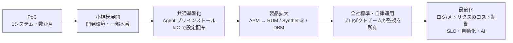

# 導入事例

## 概要

本ファイルは、Datadog の**公開されている導入事例**を、国内（日本企業）と海外に分けて整理したものである。各事例について「企業名・業種・規模」「導入前の課題」「システム構成」「利用している Datadog 製品」「定量・定性の効果」「出典と公開日」を表形式でまとめ、最後に業種別・目的別の傾向と、提案や社内説明で事例を使う際の注意点を整理する。

本ファイルが答える主な質問は次のとおり。

- 「日本の金融機関で Datadog を使っている公開事例はあるか」「通信・メディア・エネルギーではどうか」
- 「Datadog 導入で MTTR（平均復旧時間）や障害調査時間はどれくらい短縮されたと公表されているか」
- 「マルチクラウド（AWS / Azure / Google Cloud / OCI）環境での事例はあるか」
- 「Datadog のログコストを削減した事例はあるか、どんな施策を取ったか」
- 「Datadog の選定理由として各社は何を挙げているか」

事例の情報源は大きく 2 種類ある。

| 情報源 | 本ファイルでの扱い | 確度ラベル |
|---|---|---|
| Datadog 公式の導入事例ページ（`datadoghq.com/ja/case-studies/`、`datadoghq.com/case-studies/`） | 事例の主たる根拠。ベンダー公開のため、数値は企業側の申告値でありベンダー視点で編集されている点に留意 | ラベルなし（公式情報） |
| 企業テックブログ・第三者メディア | コスト最適化など、公式事例では語られにくい実務知見の根拠 | `【第三者情報】`（公開日を併記） |

> **注意:** Datadog 公式事例ページの多くは**本文に公開日の記載がない**。本ファイルでは、各ページからリンクされている PDF のファイル名に含まれる日付コード（例：`case_study_ikyu_220712.pdf` → 2022-07-12）を「PDF 日付コード」として併記する。これはファイル名からの推定であり、正式な公開日ではないため `【推定】` 扱いとする。本文中に「〇年〇月時点」と明記された数値はその時点を併記する。

関連ファイル：

- 製品の全体像は [製品ポートフォリオ全体像](../01_入門編/04-product-map.md)
- 選定時の比較観点は [製品選定と競合比較](../03_導入編/07-selection-and-competitive-comparison.md)
- 導入の進め方は [導入方法論](../03_導入編/08-implementation-methodology.md)
- 他製品からの乗り換えは [他製品からの移行](../03_導入編/14-migration-from-other-tools.md)
- コスト削減の手法そのものは [コスト最適化](./01-cost-optimization.md)、[ログ管理の実践](./06-log-management-practices.md)
- 組織への展開は [組織への定着](./14-organizational-adoption.md)
- 料金の数値は [製品別料金表（料金の正本）](../03_導入編/02-pricing-by-product.md)

## 公開事例の所在と件数

Datadog の公開事例は日本語サイトと英語サイトで掲載内容が異なる。

| 掲載場所 | URL | 2026-11-02 時点の掲載状況 |
|---|---|---|
| 日本語版 導入事例一覧 | https://www.datadoghq.com/ja/case-studies/ | 日本企業 27 社 ＋ 海外企業 17 社程度（計 44 件前後）が一覧表示される |
| 英語版 Customer Stories 一覧 | https://www.datadoghq.com/case-studies/ | 一覧の初期表示は 10 件（Porsche Informatik、Auth0、Forbes、Itaú Unibanco、SAS、Toyota Motor North America、Cognizant TriZetto、Autodesk、PayPal、Posten Bring）。英語版は動画中心の「customer-testimonial」形式も混在 |

日本語版一覧に掲載されている日本企業（2026-11-02 時点、五十音・アルファベット混在で一覧の表示順）：

| # | 企業名 | 事例 URL |
|---|---|---|
| 1 | 三井住友ファイナンス&リース（assetforce） | https://www.datadoghq.com/ja/case-studies/assetforce |
| 2 | 弁護士ドットコム | https://www.datadoghq.com/ja/case-studies/bengo4com |
| 3 | ビズリーチ | https://www.datadoghq.com/ja/case-studies/bizreach |
| 4 | Vポイントマーケティング（旧 CCCMKホールディングス） | https://www.datadoghq.com/ja/case-studies/ccc-mk-holdings |
| 5 | Classi | https://www.datadoghq.com/ja/case-studies/classi |
| 6 | ココナラ | https://www.datadoghq.com/ja/case-studies/coconala |
| 7 | サイバーエージェント | https://www.datadoghq.com/ja/case-studies/cyberagent |
| 8 | DMM.com | https://www.datadoghq.com/ja/case-studies/dmm-com |
| 9 | 大日本印刷（DNP） | https://www.datadoghq.com/ja/case-studies/dnp |
| 10 | 一休 | https://www.datadoghq.com/ja/case-studies/ikyu |
| 11 | ジェーシービー（JCB） | https://www.datadoghq.com/ja/case-studies/jcb |
| 12 | JR西日本ITソリューションズ | https://www.datadoghq.com/ja/case-studies/jr-west-it-solutions-company |
| 13 | ミスミグループ本社 | https://www.datadoghq.com/ja/case-studies/misumi |
| 14 | マネーフォワード | https://www.datadoghq.com/ja/case-studies/money-forward |
| 15 | 日本経済新聞社 | https://www.datadoghq.com/ja/case-studies/nikkei |
| 16 | NTTドコモ | https://www.datadoghq.com/ja/case-studies/nttdocomo |
| 17 | ヌーラボ | https://www.datadoghq.com/ja/case-studies/nulab |
| 18 | ワンキャリア | https://www.datadoghq.com/ja/case-studies/one-career |
| 19 | プレイド | https://www.datadoghq.com/ja/case-studies/plaid |
| 20 | SBペイメントサービス | https://www.datadoghq.com/ja/case-studies/sb-payment-service |
| 21 | SBI証券 | https://www.datadoghq.com/ja/case-studies/sbi-securities |
| 22 | 住信SBIネット銀行 | https://www.datadoghq.com/ja/case-studies/sbi-sumishin-net-bank |
| 23 | ソフトバンク | https://www.datadoghq.com/ja/case-studies/softbank |
| 24 | SOMPO Light Vortex | https://www.datadoghq.com/ja/case-studies/sompo-light-vortex |
| 25 | 東京ガス | https://www.datadoghq.com/ja/case-studies/tokyo-gas |
| 26 | TOPPANシステムインテグレーション | https://www.datadoghq.com/ja/case-studies/toppan |
| 27 | ウォンテッドリー | https://www.datadoghq.com/ja/case-studies/wantedly |

[出典](https://www.datadoghq.com/ja/case-studies/)（2026-11-02 取得）

本ファイルでは、このうち 22 社（上表の 1, 3, 4, 7〜16, 19〜27）の事例本文を確認して詳細を記載した。弁護士ドットコム、Classi、ココナラ、ヌーラボ、ワンキャリアは一覧での掲載のみ確認しており、本文の詳細は本ファイルでは扱っていない（各 URL を参照）。

## 国内事例サマリー（一覧）

国内の公開事例を、業種・規模・構成・主な効果で一覧にする。数値は各事例ページの記載どおり。

| 企業 | 業種 | 規模（記載値） | クラウド / 構成 | 主な利用製品 | 主な定量効果 | PDF 日付コード【推定】 |
|---|---|---|---|---|---|---|
| サイバーエージェント | インターネット広告・メディア・ゲーム | 1万数千台のサーバーすべてに Agent | AWS 中心、コンテナ・マネージドサービス | Metrics、Logs、Watchdog、Notebooks、Serverless、Incident Management | 申請から数時間で利用開始できる社内提供体制 | 2022-09-10 |
| NTTドコモ | 通信 | 46 システム中 32 の主要システム、監視対象 2,000〜3,000（Fargate 含む） | AWS ＋ Google Cloud、Lambda / Fargate | Dashboards、APM、Forecast、Anomaly detection | 業務量 2 倍でも残業減、専属運用者ほぼゼロ | 2022-09-10 |
| ソフトバンク | 通信 | 利用者約 300 名、約 50 インテグレーション | Kubernetes、AWS → Azure（マルチクラウド）＋オンプレ | APM、インフラ・ミドルウェア監視、Dashboards、Logs | リリースサイクル 3ヶ月→1週間、本番デプロイ 2週間→1日 | 2022-07-12 |
| マネーフォワード | 金融（FinTech） | 従業員 2,148 名、ユーザー 1,500 万人超、50 以上のプロダクト | オンプレ ＋ AWS（移行中）、100 以上のマイクロサービス | Infra、APM、Profiler、RUM、Synthetics、Cloud Network Monitoring、DBM、Logs | プロダクトチームによる自律的な監視運用 | 記載なし |
| 日本経済新聞社 | メディア | 従業員 3,054 名（2023-12 末）、日経 ID 約 1,100 万人 | AWS、複数 EKS クラスター | Logs、APM、Dashboards、DBM、RUM（予定）、Terraform 管理 | エラー検知から原因調査まで最短 5 分、SRE 増員なしで複数サービス運用 | 記載なし |
| JCB | 金融（クレジットカード） | 会員 1億4,000万以上 | Google Cloud、Kubernetes、Anthos Service Mesh、GitLab で IaC | APM、SLO、Integrations | MTTD 短縮・運用工数削減（数値記載なし） | 2023-02-28 |
| 住信SBIネット銀行 | 金融（銀行） | 従業員 746 名、約 50 の商用システム | AWS、マイクロサービス基盤構築中 | Infra、Dashboards、Logs、On-Call | 顧客影響調査 数十分以上→1分 | 記載なし |
| SBI証券 | 金融（証券） | 口座 1,300 万超、Datadog 利用者約 350 名 | オンプレ → AWS 移行 | Infra、Logs、RUM、APM、DBM、NPM、NDM、Audit Trail、Synthetics、Error Tracking、On-Call（ベータ版） | DBM で 100 インスタンス以上、検知項目 2 倍以上、障害対応時間「数時間」短縮 | 2025-03-18 |
| SBペイメントサービス | 金融（決済） | 秒間 1,000 件近いリクエスト | 複数の決済システム | APM、NDM、Infra、Dashboards | 独自ダッシュボード 15 種類以上、早期原因把握 | 2025-01-15 |
| 三井住友ファイナンス&リース | 金融（リース） | 記載なし | 記載なし | Dashboards、ログフィルタリング、通知（Twilio 連携） | 監視未経験チームで 3ヶ月で導入、4ヶ月後に正式リリース | 2021-08-05 |
| DMM.com | 動画配信 | 従業員 2,730 名、会員 5,146 万人、Datadog 利用約 160 名 | Google Cloud（GKE） | Infra、Logs、APM、RUM、Network、Profiler、Notebooks、Monitors（Terraform） | 日次ダッシュボード確認 15 分 | 2026-02-10 |
| 東京ガス | エネルギー | 単体 3,190 名 / 連結 15,504 名、利用者約 60 名 | Azure、Kubernetes（評価中） | APM、Custom Metrics、DBM、Infra、Logs、RUM | 原因究明〜解決の工数 約 30% 減、検知率・原因解明率 5〜10 倍 | 2026-04-20 |
| ミスミグループ本社 | 製造・流通（FA 部品） | 顧客 33 万社以上、売上 3,000 億円超 | AWS（マイクロサービス）＋ Google Cloud（SAP S/4HANA） | Infra、APM、Logs、Dashboards、TAM 支援 | 台湾子会社だけで 670 ホスト、ログ 1億6,500万件、APM 250 アプリ（2023-03 時点） | 2023-08-07 |
| プレイド | SaaS（CX プラットフォーム） | 顧客企業 614 社（2023-02）、利用エンジニア約 50 名 | Google Cloud ＋ AWS | Custom Metrics、Logs、APM、Cloud SIEM、Monitors | Datadog 利用 8 年以上、Monitor 起点の自動スケール | 2023-05-24 |
| ウォンテッドリー | IT サービス（ビジネス SNS） | 従業員 120 名、ユーザー 432 万人 | AWS、Amazon EKS | Infra、Logs、APM、SLO、RUM | 継続利用 11 年、約 150 マイクロサービス監視 | 2025-12-24 |
| Vポイントマーケティング | マーケティング | 従業員約 500 名、V ポイント有効 ID 約 1.3 億 | ハイブリッド、Azure / AWS / Google Cloud / OCI | Infra、Logs、APM、API Tests、Cloud Security、Sensitive Data Scanner、On-Call | 約 20 サービス監視、利用者約 60 名 | 2026-04-24 |
| SOMPO Light Vortex | 保険グループのデジタル子会社 | 数個のプロダクト | AWS ＋ GCP、Terraform | Logs、Synthetics、RUM、Incident Management | 障害調査時間 70〜80% 短縮 | 2023-02-22 |
| JR西日本ITソリューションズ | IT サービス（鉄道グループ） | 従業員約 570 名、利用者約 70 名 | オンプレ（外形監視）＋ AWS（サーバーレス） | Synthetics、Infra、Logs、APM、DBM、RUM | 監視フロー作成可能者 2〜3人→約 15人、S3 利用料 約 20% 削減 | 2026-03-17 |
| ビズリーチ | HR | 約 20 チーム・約 150 名が利用（2024-05） | マイクロサービス化、カナリアリリース | APM、Logs、RUM（Session Replay）、Dashboards | 6 年でチーム 5 倍・開発者 2 倍の成長を支える | 2024-07-17 |
| 一休 | 旅行・飲食予約 | 300 台以上のサーバー、50〜60 人が日常的に閲覧 | AWS EC2 中心 ＋ 一部オンプレ、Lambda / K8s へ移行中 | Infra、APM、Synthetics、Logs、Anomaly、NDM | デプロイ頻度 10 倍以上（2週間に1度→1日数回） | 2022-07-12 |
| 大日本印刷（DNP） | 印刷・IC カード・セキュリティ | 最新フレームワークのプロジェクト 30 件超 | マルチクラウド（AWS / Azure 等） | 標準監視、APM、RUM（期待）、Watchdog（検証中） | 情報収集のための再デプロイ（最大 1 週間）がゼロに | 2022-09-10 |
| TOPPANシステムインテグレーション | IT サービス（MSP） | 従業員 2,350 名 | 顧客環境のリモート監視運用サービス、マルチ org 管理 | Infra、Synthetics、Logs | スクリプト工数 1週間→数時間、アラート発報 5分→0分 | 記載なし |

## 国内事例の詳細

### サイバーエージェント（全社標準のモニタリング基盤）

サイバーエージェントの事例は、**ボトムアップ（口コミ）で広がり全社標準になった**大規模事例として引用されることが多い。

| 項目 | 内容 |
|---|---|
| 企業 | 株式会社サイバーエージェント（1998 年設立） |
| 業種 | インターネット広告、メディア（ABEMA、Ameba、AWA）、ゲーム、AI・DX 支援 |
| 規模 | 「1万数千台のサーバーすべてに Datadog エージェントが入っています」 |
| 導入前の課題 | オンプレミス時代の監視ツールは運用負荷が大きく、エンジニアの時間がプロジェクトの目的に使えない／コンテナやクラウドのマネージドサービスに向かない／監視ツール自体が監視対象になる循環 |
| 構成 | 2015 年頃から AWS を中心にクラウド移行、コンテナとマネージドサービスを活用 |
| 利用製品 | メトリクス（カスタムメトリクス含む）、Log Management、Slack / PagerDuty 通知、Watchdog、Notebooks、Serverless Monitoring、Incident Management |
| 効果 | 社内の提供体制により、利用申請から「数時間後」には使い始められる。モニタリング投資（ツール費・人件費）をプロジェクト予算とバランスさせやすい |
| 発言者 | AI 事業本部 DX 本部 兼 CTO 統括室、グループ IT 推進本部 全社データ技術局 局長 |
| 公開日 | 本文に記載なし。PDF 日付コード 2022-09-10【推定】 |

ポイント：

- サイバーエージェントは、プロジェクトごとのツール選定の自由度が高い組織であり、その中で Datadog が「社内のあらゆるプロジェクトで活用されている」状態に至った点が強調されている。
- 社内の申請・払い出しの仕組み（組織横断の提供体制）を整えたことが、拡大の前提になっている。大規模組織での org 設計は [大規模・マルチorg運用](./15-large-scale-and-multi-org.md) を参照。

[出典](https://www.datadoghq.com/ja/case-studies/cyberagent/)

### NTTドコモ（マルチクラウド、DevOps 化と運用の自動化）

| 項目 | 内容 |
|---|---|
| 企業 | 株式会社NTTドコモ |
| 業種 | 通信（モバイル、ブロードバンド、スマートライフサービス） |
| 規模 | 46 システムのうち 32 の主要システムを Datadog で監視。AWS Fargate を含めると監視対象は約 2,000〜3,000 |
| 導入前の課題 | 障害切り分けに時間がかかる／メトリクスやログを見る人が限られ状況共有のコミュニケーションコストが大きい／開発から運用への引き継ぎ資料作成の負担 |
| 構成 | AWS（2012 年頃〜）と Google Cloud（2014 年〜）のマルチクラウド。AWS Lambda / Fargate を多用。開発組織が運用も担う体制へ統合 |
| 利用製品 | Dashboards（人気ランキング機能を含む）、APM、Forecast（予測）、Anomaly detection（異常検知）、Slack 連携。Cloud Workload Security（現 Workload Protection）は今後の関心事項として言及 |
| 効果 | 「仕事が 2 倍になったのに、残業が減ったのです」／異常検知の Slack 通知を約 2 時間で構築／「今では実質的に専属の運用者はほぼゼロです」 |
| 発言者 | サービスデザイン部 第三クラウド推進 担当部長 |
| 公開日 | 本文に記載なし。PDF 日付コード 2022-09-10【推定】 |

ポイント：

- NTTドコモの事例は「Dev と Ops の統合（You build it, you run it）」の文脈で Datadog が共通基盤になった例である。
- 選定理由として SaaS 型で運用負荷が低いこと、マルチクラウド対応が挙げられている。

[出典](https://www.datadoghq.com/ja/case-studies/nttdocomo)

### ソフトバンク（アジャイル / DevOps 環境の監視基盤）

| 項目 | 内容 |
|---|---|
| 企業 | ソフトバンク株式会社 |
| 業種 | 通信 |
| 規模 | 開発者から運用者まで約 300 名が利用。約 50 のインテグレーションを導入（既存監視システムとの連携を含む）。事例時点で約 2 年の利用 |
| 導入前の課題 | 2018 年からアジャイル開発・DevOps 環境を構築。DevOps 環境での監視負荷の低減、開発全工程の可視化が必要／既存の監視ツールがコンテナ環境に適さない |
| 構成 | クラウド上の Kubernetes コンテナ環境。当初 AWS のみ、のちに Microsoft Azure に拡張（マルチクラウド）。オンプレミスとも連携 |
| 利用製品 | APM、リソース・ミドルウェア監視、Dashboards、Log Management |
| 効果 | 開発のリリースサイクル「3ヶ月から1週間」／本番デプロイ「2週間から1日」／ユニットテスト 1 日「4500以上」／初期導入「わずか1ヶ月」／ホスト設定「10分程度でホスト100台」 |
| 発言者 | IT-OT イノベーション本部 CoE 統括部、コアネットワーク本部 クラウド基盤開発統括部 クラウドネイティブ技術部 部長 ほか |
| 公開日 | 本文に記載なし。PDF 日付コード 2022-07-12【推定】 |

ポイント：

- ソフトバンクの事例では、Datadog を「リリース後の運用保守の道具」ではなく、**開発段階から APM で API 性能を確認する道具**として使っている点が語られている。
- 「アプリとインフラ担当の共通言語」というマルチクラウド横断の可視化が評価されている。
- リリースサイクル短縮は DevOps 全体の取り組みの成果であり、Datadog 単独の効果ではない点に注意（事例でも DevOps 環境構築の一部として記述）。

[出典](https://www.datadoghq.com/ja/case-studies/softbank)

### マネーフォワード（100 以上のマイクロサービスとプロダクトチームの自律運用）

| 項目 | 内容 |
|---|---|
| 企業 | 株式会社マネーフォワード（2012 年設立、東京都港区） |
| 業種 | 金融サービス（FinTech、個人向け家計簿アプリ・法人向けバックオフィス SaaS） |
| 規模 | 従業員 2,148 名、ユーザー 1,500 万人突破、50 以上のプロダクト |
| 導入前の課題 | サービス拡大による運用負荷増／障害の原因分析や予兆把握が属人化／AWS とオンプレミスのハイブリッド運用／マイクロサービス監視／OSS ツールは専門知識が必要で高度なメトリクス分析が困難 |
| 構成 | オンプレミス ＋ AWS（移行中）。2019 年からマイクロサービス化、100 以上のマイクロサービスで 50 以上のプロダクトを構成。共通アプリケーション基盤に Datadog Agent をプリインストール |
| 利用製品 | Infrastructure Monitoring、APM、Continuous Profiler、RUM、Synthetic Monitoring（プロダクトごとの外形監視、PagerDuty / Slack 連携）、Cloud Network Monitoring（旧称 Network Performance Monitoring / NPM）、Database Monitoring、Indexed Logs、Dashboards |
| 効果 | プロダクト開発チームが自ら監視設定と改善を行う／基盤構築時に AWS 等のインテグレーションで監視が自動的に始まる |
| 利用開始 | 2017 年 5 月 |
| 発言者 | サービス基盤本部 Enabling SRE グループ リーダー、同 テックリード |
| 公開日 | 本文に記載なし |

ポイント：

- マネーフォワードの事例は「**Enabling SRE**（SRE がプロダクトチームを支援して自律させる）」モデルの典型例。共通基盤に Agent を組み込み、プロダクトチームが追加作業なしに監視を始められるようにしている。
- 「プロダクト開発チーム自身が…自律的にプロダクトの信頼性を確保できていることが、Datadog の導入によって得られた最大のメリット」と述べている。

[出典](https://www.datadoghq.com/ja/case-studies/money-forward)

### 日本経済新聞社（B2B 情報サービスと日経 ID 基盤）

| 項目 | 内容 |
|---|---|
| 企業 | 株式会社日本経済新聞社（東京都千代田区） |
| 業種 | メディア |
| 規模 | 従業員 3,054 名（2023 年 12 月末）、日経 ID 会員約 1,100 万人、日経 ID 開発チーム約 10 名、Datadog で運用する B2B サービス 4 つ |
| 導入前の課題 | サービスごとに AWS アカウントが分かれ Amazon CloudWatch では横断監視が非効率／エンジニアが複数プロダクトを兼務／オンプレミス時代の日経 ID 基盤では監視ルール追加に管理チームへの依頼が必要／サービス数に対し SRE 人員が限られる |
| 構成 | AWS（2011 年〜）。B2B サービスは複数の Amazon EKS クラスター。日経 ID 基盤はオンプレミスから AWS へ移行し、2020 年から Datadog 監視 |
| 利用製品 | Log Management、APM、AWS メトリクス、Dashboards（EKS クラスター用カスタム）、DB / スロークエリ監視、RUM（日経 ID フロントエンドで予定）、PagerDuty / Slack 連携、Terraform による監視設定のコード管理 |
| 効果 | エラー検知から原因調査まで「最短5分」／「SRE チームのメンバーを増やすことなく複数のサービスの運用が可能」／1 サービスを数名の開発メンバーで監視 |
| 発言者 | 技術戦略ユニット サービス基盤第一グループ、プラットフォーム推進室 プラットフォームグループ |
| 公開日 | 本文に記載なし（従業員数は 2023 年 12 月末時点） |

[出典](https://www.datadoghq.com/ja/case-studies/nikkei)

監視設定の Terraform 管理については [Monitoring as Code](./09-monitoring-as-code.md) と [Terraform と IaC](../02_リファレンス/platform/terraform-and-iac.md) を参照。

### JCB（Google Cloud 上のクラウドネイティブ基盤 JDEP と SRE）

| 項目 | 内容 |
|---|---|
| 企業 | 株式会社ジェーシービー（1961 年設立、日本唯一の国際カードブランド） |
| 業種 | クレジットカード・決済 |
| 規模 | 会員 1億4,000万以上、加盟店約 3,900 万 |
| 導入前の課題 | オンプレミスの既存システムは変更に時間がかかりビジネススピードが落ちる／障害対応に時間がかかる／リモートでのオンコール対応が困難 |
| 構成 | 新規に構築したクラウドネイティブ基盤 JCB Digital Enablement Platform（JDEP）。Google Cloud、Kubernetes、Anthos Service Mesh、GitLab。Datadog の設定を GitLab に保存しコードとしてデプロイ（IaC）、環境変数で環境間の再利用 |
| 利用製品 | APM（障害初動調査）、アラートレベル別の自動検知（Critical はオンコール担当、Warning はチャット）、SLI / SLO（SLO テンプレートを共有ダッシュボードに利用）、Integrations。Watchdog・異常検知は今後、外形監視は試行中 |
| 効果 | MTTD 短縮、運用工数削減（数値記載なし）。SRE チームが 2 チームに拡大。今後の目標として変更リードタイム短縮・デプロイ頻度向上・MTTR 短縮・変更失敗率低減（DORA 指標）を掲げる |
| 選定理由 | 「インテグレーションの数が多く、新しい環境に対しても対応が早く導入が簡単であることが決め手」／「運用の効率化という点で Datadog は IaC 化が容易なことが大きい」 |
| 発言者 | デジタルソリューション開発部 DX テックグループ 主査 |
| 公開日 | 本文に記載なし。PDF 日付コード 2023-02-28【推定】 |

[出典](https://www.datadoghq.com/ja/case-studies/jcb)

SLO 運用は [SLO 運用の実践](./08-slo-practices.md)、DORA 指標は [DORA Metrics・Quality Gates・Code Coverage](../02_リファレンス/software-delivery/software-delivery-insights.md) を参照。

### 住信SBIネット銀行（国内データセンター、監視の民主化、On-Call）

| 項目 | 内容 |
|---|---|
| 企業 | 住信SBIネット銀行株式会社（2007 年設立、2023 年 3 月東証スタンダード上場） |
| 業種 | 金融（銀行） |
| 規模 | 従業員 746 名（2024-03-31、連結）、預金口座 800 万超・預金 10 兆円・住宅ローン取扱 12 兆円（2025 年 1 月）、BaaS パートナー 22 社（2025 年 2 月）、AWS 上の商用システム約 50 |
| 導入前の課題 | 障害時の顧客影響調査がサーバーログの手作業集計で遅い／ログ調査に本番サーバーへのアクセス経路申請が必要／監視が複数ツールに分散しネットワーク起因かサーバー起因か切り分けにくい／オペレーターへのアラート架電が 1 日約 100 件／監視定義の変更に承認プロセスが必要で開発チームが直接参照できない |
| 構成 | 2017 年からクラウド移行、2020 年 1 月に非勘定系商用システムを AWS へ移行完了。2022 年からマイクロサービス基盤構築、インターネットバンキングのマイクロサービス化を 2026 年内に完了予定 |
| 利用製品 | Infrastructure Monitoring、Dashboards（2021 年〜）、Log Management、On-Call（アラート架電の自動化）。APM、RUM、Browser Tests、AI による異常予兆は計画・検討中 |
| 効果 | 障害時の顧客影響調査「数十分以上→1分」／約 50 システムを Datadog で監視／開発・運用メンバー「全社員の約半数」が利用 |
| 導入経緯 | 2023 年に Datadog の東京データセンター（AP1 サイト）が開設され国内リージョンが利用可能に → 2024 年 9 月採用決定 → 2024 年 10 月 Agent 導入開始 → 2025 年夏本格稼働予定（事例記載時点） |
| 発言者 | システム運営部長、同 オペレーショングループリーダー、同 プリンシパル |
| 公開日 | 本文に記載なし（記載データは 2025 年 2 月時点が最新） |

> **サイト差異:** 住信SBIネット銀行・SBI証券・TOPPANシステムインテグレーションの事例では、**国内（東京）にデータを置けること**が採用の要件・決め手として挙げられている。日本向けサイトは `AP1`（ap1.datadoghq.com）。サイトごとの機能差やデータ保存場所は [Datadog Sites（サイト）](../02_リファレンス/platform/datadog-sites.md) を参照。

[出典](https://www.datadoghq.com/ja/case-studies/sbi-sumishin-net-bank)

On-Call の仕様は [On-Call](../02_リファレンス/service-management/on-call.md) を参照。

### SBI証券（オンプレミスから AWS への勘定系移行と 10 以上の OSS ツール統合）

| 項目 | 内容 |
|---|---|
| 企業 | 株式会社SBI証券（統合支援：SBIシンプレクス・ソリューションズ） |
| 業種 | 金融（オンライン証券） |
| 規模 | 従業員 910 名（単体、2024 年 3 月）、証券口座 1,300 万超、預り資産 40 兆円超（2024 年 7 月）、1 日 2 兆円超の取引、Datadog 利用者約 350 名 |
| 導入前の課題 | 監視とログ管理の統合／監視環境の可視化／障害対応の迅速化／エンジニア負荷の軽減。AWS ネイティブサービスではマルチアカウントの一元管理ができず機能も不足（アカウントごとの監視・ログ収集が必要） |
| 構成 | 取引システムをオンプレミスから AWS へ移行（2022 年 11 月プロジェクト開始）。対象はフロントアプリ、統合 DB、バッチ、注文処理基盤。各サーバーに Agent。導入前は 10 以上の OSS 監視ツールを併用 |
| 利用製品 | Infrastructure Monitoring、Log Management、RUM、APM、Database Monitoring、Network Performance Monitoring（現 Cloud Network Monitoring）、Network Device Monitoring、Audit Trail、Synthetic Monitoring、Error Tracking（2024 年 7 月〜）、Watchdog アラート。On-Call（ベータ版を本番利用中）。App Builder、Workflow Automation による復旧プロセスの自動化を計画 |
| 効果 | DBM で統合 DB「100インスタンス以上」を監視／アラート検知項目がオンプレ比「2倍以上」／障害対応時間がオンプレ比で「数時間」短縮／利用者「約350名」 |
| 選定理由 | 「要件として国内にデータを置く必要があり、唯一対応していたのが Datadog でした」（SBIシンプレクス・ソリューションズ） |
| 導入経緯 | 2023 年 4 月 約 3ヶ月の PoC → 2023 年 10 月 開発環境・一部システムで小規模展開 → 本格展開 |
| 発言者 | SBI証券 執行役員 リテール IT 部長、SBIシンプレクス・ソリューションズ アーキテクチャ推進部 部長 |
| 公開日 | 本文に記載なし。PDF 日付コード 2025-03-18【推定】 |

[出典](https://www.datadoghq.com/ja/case-studies/sbi-securities)

注記：「データを国内に置けるのは唯一 Datadog だった」という発言は、事例当時（2023 年頃）の同社要件・比較対象における評価であり、現在の競合各社の国内リージョン提供状況を示すものではない。競合比較は [製品選定と競合比較](../03_導入編/07-selection-and-competitive-comparison.md) を参照。

### SBペイメントサービス（決済システムの APM 更改）

| 項目 | 内容 |
|---|---|
| 企業 | SBペイメントサービス株式会社（ソフトバンクグループ、東京都港区） |
| 業種 | 金融サービス（決済代行） |
| 規模 | ページ上に「320」の数値（従業員数と推定されるがラベルなし）。システム本部の約 80%（約 80 名）が Datadog を利用 |
| 導入前の課題 | 既存 APM ツールのライセンス期限到来で 3 社を比較／「1秒間に1,000件近くのリクエスト」が来る高トランザクション／決済遅延のビジネス影響が大きく分単位の対応が必要／従来監視は履歴を約 1 週間しか保持できない |
| 構成 | キャリア決済「ソフトバンクまとめて支払い」、ソフトバンクカード、加盟店向け決済代行システムなど相互接続された複数システム。キャリア・カード会社への外部接続の応答時間をダッシュボード化。テスト環境で負荷試験しタイムアウト値を調整 |
| 利用製品 | APM（2021 年〜、まずキャリア決済とカードシステム）、Network Device Monitoring（後から追加）、Infrastructure Monitoring、Dashboards |
| 効果 | 「秒間1,000件」規模の監視／「早期原因把握」／独自ダッシュボード「15種類以上」／1 年以上のデータを保持して分析 |
| 発言者 | システム本部 システム運用統括部 部長 ほか |
| 公開日 | 本文に記載なし。PDF 日付コード 2025-01-15【推定】 |

[出典](https://www.datadoghq.com/ja/case-studies/sb-payment-service)

### 三井住友ファイナンス&リース（assetforce：監視未経験チームでの短期立ち上げ）

| 項目 | 内容 |
|---|---|
| 企業 | 三井住友ファイナンス&リース株式会社（SMFL）、戦略子会社 SMFLみらいパートナーズ |
| 業種 | ファイナンス・リース（資産管理クラウド「assetforce」） |
| 規模 | 公開情報では確認できず（「業界大手企業」とのみ記載） |
| 導入前の課題 | 短期間で監視環境を構築し開発と運用を一体化／正式リリースに向けた安定運用／チームの多くが監視・運用管理の未経験者 |
| 利用内容 | 既存テンプレートを複製したダッシュボード、機密性の高いログを分析対象から除外するフィルタリング、Slack・メール・ダッシュボード・SMS 通知、API による Twilio 通知フロー、CPU / メモリ等はデフォルト設定のまま利用。サポート窓口・営業担当にも相談 |
| 効果 | 「3ヶ月で導入」／「導入後4ヶ月でサービスを正式リリース」／「ノイズレスの通知」 |
| 教訓 | 通知は取得できる指標起点ではなく「人」起点で設計することが重要 |
| 公開日 | 本文に記載なし。PDF 日付コード 2021-08-05【推定】（4 年以上前の事例のため、UI・機能は現行と異なる可能性あり） |

注記：同ページの「棚卸し工数 90% 削減」等の数値は assetforce 製品が顧客にもたらした効果であり、Datadog の導入効果ではない。

[出典](https://www.datadoghq.com/ja/case-studies/assetforce)

### DMM.com（DMM TV の GKE 基盤とフルスタック監視）

| 項目 | 内容 |
|---|---|
| 企業 | 合同会社DMM.com（東京都港区） |
| 業種 | 動画配信（DMM TV） |
| 規模 | 従業員 2,730 名・DMM 会員 5,146 万人（2025 年 2 月）、DMM TV はアニメ約 6,300 作品・エンタメ 21 万本超、Datadog 利用約 160 名（4 チーム 136 名 ＋ PM 等の閲覧ユーザー、2025 年 11 月） |
| 導入前の課題 | フロントエンド・バックエンドの変更による性能影響の把握／DMM TV の高速開発に合わせた早期の監視導入／日常監視とキャンペーン・ライブイベント時の特別監視の両立／旧オンプレ環境は CPU・メモリ中心のリソース監視でエンドツーエンドではなかった |
| 構成 | Google Cloud（GKE 中心）。オンプレミスの旧「DMM動画」をサブスクとして再構築し 2022 年 12 月に DMM TV 開始。APM と RUM を連携しフロント・バック双方から追跡。キャパシティ計画のため負荷試験環境も Datadog で監視 |
| 利用製品 | Infrastructure Monitoring、Log Management、APM、RUM、Network Monitoring、Continuous Profiler、Notebooks（チーム間の知見共有）、Monitors（Slack とオンコールへ通知、設定は Terraform 管理）。Browser Tests は今後注力 |
| 効果 | 日次のダッシュボード確認は約 15 分、2〜3 日の時間軸で日常監視／SRE 側からアプリの課題も確認できる |
| 選定理由 | 「スモールスタートで始められる完全従量課金制であることと、ダッシュボード作成の容易さの 2 点」 |
| 利用開始 | DMM.com としては 2019 年から利用 |
| 公開日 | 本文に記載なし。PDF 日付コード 2026-02-10【推定】 |

[出典](https://www.datadoghq.com/ja/case-studies/dmm-com)

### 東京ガス（myTOKYOGAS の Azure 移行と APM / RUM / DBM）

| 項目 | 内容 |
|---|---|
| 企業 | 東京ガス株式会社（東京都港区）、バックエンド運用は東京ガスiネット |
| 業種 | エネルギー |
| 規模 | 単体 3,190 名、連結 15,504 名（2024-03-31）。Datadog 利用者はフロントエンド・バックエンドのエンジニアと業務担当者で約 60 名 |
| 導入前の課題 | Web 会員サービス「myTOKYOGAS」のリニューアル、Microsoft Azure への基盤移行、フロントエンドの全面刷新、エラー原因の早期特定、オブザーバビリティ向上。検針票のペーパーレス化で myTOKYOGAS が「お客様との唯一といっていい接点」になる |
| 構成 | Microsoft Azure（2023 年 11 月移行・リニューアル）。フロントエンドは 2022 年 4 月発足の内製チーム。バックエンドはリフト＆シフトで、従来は死活・ポート・ログ監視のみ。APM でバックエンドと基幹システム間のレイテンシー・エラー率を追跡。Kubernetes のマイクロサービス基盤（2024 年 11 月一部リリース）は Datadog 適用を評価中 |
| 利用製品 | APM、Custom Metrics、Database Monitoring、Infrastructure Monitoring、Log Management、RUM。Monitors・Dashboards も利用 |
| 効果 | 障害時の原因究明〜解決の工数「30％減」／障害の検知率・原因解明率「5～10倍増」／投資効率の向上・顧客体験の向上（画面表示遅延の削減、数値なし） |
| 導入時期 | 2023 年 3 月〜6 月 |
| 公開日 | 本文に記載なし。PDF 日付コード 2026-04-20【推定】 |

[出典](https://www.datadoghq.com/ja/case-studies/tokyo-gas)

東京ガスの内製開発チームは、その後のログコスト最適化をテックブログで公開している（後述「[コスト最適化に関する第三者公開事例](#コスト最適化に関する第三者公開事例)」）。

### ミスミグループ本社（基幹システム刷新 NEWTON とマルチクラウド）

| 項目 | 内容 |
|---|---|
| 企業 | 株式会社ミスミグループ本社（1963 年設立） |
| 業種 | FA 部品・金型部品等のメーカー事業と流通事業 |
| 規模 | 顧客「グローバル33万社以上」、取扱「3,000万点超」、売上高「3,000億円を超えた」 |
| 導入前の課題 | 1989 年構築のメインフレーム基幹システムが事業規模に合わない／監視は Zabbix、システムごとにダッシュボード・ログ分析ツールが異なる／システム・チーム横断の障害切り分けが遅い／マイクロサービス化で依存関係が増える |
| 構成 | NEWTON プロジェクトで基幹システムを疎結合マイクロサービスで再構築。マイクロサービスは AWS（2020 年採用）、取引管理の SAP S/4HANA は Google Cloud のマルチクラウド |
| 利用製品 | Infrastructure Monitoring、APM、Log Management、Dashboards、開発時の性能テスト（LCP 等フロントエンド指標）、Technical Account Manager（TAM）支援 |
| 効果（2023 年 3 月時点、台湾子会社のみ） | 監視ホスト「670台」、ログ「1億6,500万件」、APM 監視アプリ「250個」 |
| 選定理由 | 「インフラ・アプリ横断の監視機能がオールインワンで提供されること」 |
| 導入経緯 | 2020 年 4 月 PoC → 2022 年 8 月 台湾子会社で新基幹＋Datadog 稼働 → 2023 年 4 月 2 社目の海外子会社 → 2024 年度に米・欧・中・日へ展開予定（事例時点） |
| 公開日 | 本文に記載なし。PDF 日付コード 2023-08-07【推定】 |

[出典](https://www.datadoghq.com/ja/case-studies/misumi)

### プレイド（KARTE：マルチテナント・低レイテンシー SaaS と Cloud SIEM）

| 項目 | 内容 |
|---|---|
| 企業 | 株式会社プレイド（2011 年設立）。CX プラットフォーム「KARTE」（2015 年 3 月提供開始） |
| 業種 | マーケティング / CX SaaS |
| 規模 | 顧客企業 614 社（2023 年 2 月）、Datadog 利用エンジニア約 50 名。日中の負荷差は「2倍近い」、セール・イベント時は平常の「数倍から10倍以上」 |
| 導入前の課題 | マルチテナント・低レイテンシー・高負荷・大規模・マルチクラウドで、安定性と障害からの迅速な復旧が必須。「1秒以内で分析してアクションを起こす」リアルタイム性が求められる。当初は OSS 監視ツールを利用 |
| 構成 | Google Cloud ＋ AWS を適材適所で利用。Cloud Spanner の CPU 負荷上昇で Datadog Monitor が発火 → GCP Eventarc → Cloud Run でコマンド実行、という自動スケールのワークフロー |
| 利用製品 | Custom Metrics（インスタンス監視と自動アラート）、ログ収集、APM、Cloud SIEM（不正ログインのリアルタイム検知等）、Monitors、Dashboards |
| 効果 | Datadog「8年以上」の継続利用。数値での改善率の記載はなし |
| 評価点 | 「UI のわかりやすさとレスポンスの速さ」 |
| 利用開始 | 2015 年 2 月（KARTE リリースの 1 か月前） |
| 公開日 | 本文に記載なし。PDF 日付コード 2023-05-24【推定】 |

[出典](https://www.datadoghq.com/ja/case-studies/plaid)

Monitor を起点にした自動化の考え方は [Workflow Automation](../02_リファレンス/service-management/workflow-automation.md) も参照。

### ウォンテッドリー（11 年の継続利用、Kubernetes / EKS と SLO）

| 項目 | 内容 |
|---|---|
| 企業 | ウォンテッドリー株式会社（東京都港区） |
| 業種 | IT サービス（ビジネス SNS「Wantedly」、Engagement Suite、Wantedly Hire） |
| 規模 | 従業員 120 名、ユーザー 432 万人、利用企業 43,000 社。Datadog 利用者約 50 名、監視マイクロサービス約 150 |
| 導入前（拡大前）の課題 | 432 万人が使うサービスの安定運用／事業・組織拡大に伴うオブザーバビリティ強化／異常の早期検知と迅速な対応／SLO 導入による信頼性向上／マイクロサービス間依存によるデバッグの難しさ／MTTR 短縮 |
| 構成の変遷 | 2012 コンテナ型 PaaS で開始 → 2014 AWS 移行（Docker）・Datadog 導入 → 2016 Kubernetes でマイクロサービス → 2018 全サービス Kubernetes 化・APM 試行・SLO 導入開始 → 2020 Datadog Logs で SLO 基盤の試作 → 2022 自前 K8s から Amazon EKS へ → 2024 APM を Datadog APM に集約、SLO 監視を Datadog SLO に移行 |
| 利用製品 | Infrastructure Monitoring、Logs、APM、SLO、RUM。Watchdog アラートを受信。Bits AI による一次調査を検討中 |
| 仕組み | Agent の Autodiscovery でコンテナのメトリクスを収集。マイクロサービスは社内共通ライブラリと EKS デプロイが必須で、ログ・メトリクスが自動収集される。重大インシデントはインシデント管理ツール経由で Slack 緊急チャンネルへ |
| 効果 | 継続利用「11年」（2025 年時点）、約 150 マイクロサービスを監視 |
| 公開日 | 本文に記載なし。PDF 日付コード 2025-12-24【推定】 |

[出典](https://www.datadoghq.com/ja/case-studies/wantedly)

ウォンテッドリーは Japan Datadog User Group（JDDUG）への参加（2020 年〜）も事例中で言及している。

### Vポイントマーケティング（旧 CCCMKホールディングス：4 クラウド＋オンプレの統合監視）

| 項目 | 内容 |
|---|---|
| 企業 | Vポイントマーケティング株式会社（事例掲載時の社名：CCCMKホールディングス株式会社、神奈川県横浜市） |
| 業種 | マーケティング・コンサルティング、ポイントアライアンス事業 |
| 規模 | 従業員約 500 名（2025 年 12 月）、V ポイント有効 ID 約 1.3 億 |
| 導入前の課題 | サービス基盤のクラウドネイティブ化／リソース監視からの脱却／アプリ監視による SLO 改善／エンドツーエンド監視／監視ツールの統合と属人化解消。Zabbix、Azure Monitor、Amazon CloudWatch 等がシステムごとにサイロ化し、運用チーム・ベンダーも別 |
| 構成 | クラウドとオンプレミスのハイブリッド。システムごとに Azure / AWS / Google Cloud / OCI を選択するマルチクラウド。V ポイントアプリのバックエンドをクラウドでモダナイズ。オンプレ基幹は 2030 年の EOSL を前にクラウド移行予定。全サービス共通ダッシュボード |
| 利用製品 | Infrastructure Monitoring、Logs、APM、API Tests、Cloud Security（旧称 Cloud Security Management / CSM）、Sensitive Data Scanner、On-Call |
| 効果 | V ポイントサービス「約20サービス」を監視、APM 対象の V 会員向け「5サービス」、利用者「約60名」。APM 対象が増えてもダッシュボードの新規構築が不要 |
| 導入経緯 | 1 システムで PoC → 2024 年 12 月契約 → 2025 年 4 月 複数システムで監視開始 |
| 公開日 | 本文に記載なし。PDF 日付コード 2026-04-24【推定】 |

[出典](https://www.datadoghq.com/ja/case-studies/ccc-mk-holdings)

### SOMPO Light Vortex（スタートアップ型子会社のスモールスタートと IaC）

| 項目 | 内容 |
|---|---|
| 企業 | SOMPO Light Vortex 株式会社（2021 年 7 月設立、SOMPO ホールディングスのデジタル子会社） |
| 業種 | ヘルスケアサービス（Light PASS、WiTH Health） |
| 規模 | 数個のプロダクトと LP。従業員数は公開情報では確認できず |
| 導入前の課題 | クラウドベンダーの監視ツール（CloudWatch 等）ではクラウド横断監視ができず、ロググループ横断検索にも制約／インシデント管理を案件ごとの Google スプレッドシートで行い標準化されていない／低コスト・スモールスタートで AWS と GCP の複数プロダクトを監視でき、IaC 対応、非エンジニアとも共有できるツールが必要 |
| 構成 | AWS ＋ GCP（プロダクトごとに異なる）。アラートや Slack 通知を Terraform でコード管理 |
| 利用製品 | Logs、アラート、Synthetic Monitoring（外形監視・ヘルスチェック）、RUM、Incident Management、Terraform 連携。SLO、API / Browser Tests、Session Replay、Cloud SIEM を計画 |
| 効果 | 「障害調査時間は70%から80%短縮できた」。通常 3 時間程度かかる監視設定を Terraform で短縮（短縮後の数値記載なし） |
| 選定理由 | 「スモールスタートに適していること、Terraform との相性、エンジニア以外と情報共有しやすいこと、セキュリティに力を入れていること」 |
| 公開日 | 本文に記載なし。PDF 日付コード 2023-02-22【推定】 |

[出典](https://www.datadoghq.com/ja/case-studies/sompo-light-vortex)

### JR西日本ITソリューションズ（外形監視の置き換えと AWS コスト最適化）

| 項目 | 内容 |
|---|---|
| 企業 | 株式会社JR西日本ITソリューションズ（大阪市） |
| 業種 | IT サービス（JR 西日本グループ） |
| 規模 | 従業員約 570 名（2026 年 2 月）、Datadog 利用者約 70 名（ベンダー、JR 西日本社員を含む） |
| 導入前の課題 | 10 年以上使った自前ホスティングの外形監視ソフトがサポート終了／監視スクリプトを書けるのが少数で属人化／正常なサービスをエラー判定する誤検知が多く調査工数が増加／オンプレサーバーに接続できる端末が限られ結果共有が困難／AWS サーバーレス化を見据え、既存ツールでは AWS マネージドサービスを監視しにくい |
| 構成 | 観光サイト「JRおでかけネット」のオンプレミスサービスを外形監視。一部を AWS へ移行しサーバーレス（Lambda 等）化。外形監視と AWS 監視を 1 プラットフォームに集約 |
| 利用製品 | Synthetic Monitoring（GUI でフロー作成）、Infrastructure Monitoring、Log Management、APM、Database Monitoring、RUM（RUM・DBM は試用段階）、Notebooks、Dashboards、アラート |
| 効果 | 監視フローを作成できる人：本文では「2、3人に限定されていた対応可能者が15人まで増えた」（2〜3人→約 15人。ページ上部の Key results 欄の表記は「3人→15人以上」）／APM による AWS リソース最適化で「コストを20％削減」（本文では S3 の過剰な LIST リクエスト是正で S3 利用料約 20% 削減）／導入後の設定変更「13件」はすべて内製対応／研修に約 15 名参加 |
| 導入経緯 | 2024 年 2 月 外形監視開始 → 2025 年 9 月 新 AWS システムの監視開始 |
| 公開日 | 本文に記載なし。PDF 日付コード 2026-03-17【推定】 |

[出典](https://www.datadoghq.com/ja/case-studies/jr-west-it-solutions-company)

ポイント：Datadog 自体の費用削減ではなく、**APM で見つけたアプリの非効率（S3 LIST の過剰発行）を直してクラウド費用を下げた**例。クラウド費用側の可視化は [Cloud Cost Management](../02_リファレンス/infrastructure/cloud-cost-management.md) を参照。

### ビズリーチ（技術的負債の解消とリアーキテクチャ）

| 項目 | 内容 |
|---|---|
| 企業 | 株式会社ビズリーチ（東京都渋谷区、Visional グループ） |
| 業種 | HR・採用サービス |
| 規模 | Visional グループ 2,149 名（2023 年 7 月末）。BizReach：スカウト可能会員 236 万人以上、累計導入企業 28,900 社以上、登録ヘッドハンター 7,300 人以上（2024 年 1 月末）。Datadog 利用は約 20 チーム・約 150 名（2024 年 5 月） |
| 導入前の課題 | 急成長に監視環境が追いつかず、内製環境は基本的なログ監視のみ／データ量急増によるスロークエリ／大量のエラーログ／2018 年頃に技術的負債が生産性を低下させていた |
| 構成 | 企業・ヘッドハンター・会員向けプロダクトと社内ツール群。2018 年以降マイクロサービス化・社内 API 化、2020 年頃からリアーキテクチャ。新旧アプリを並行稼働し 10%・50% と段階的に切り替えるカナリアリリース |
| 利用製品 | APM、Log Management、Browser RUM（Session Replay 含む）、Dashboards、Slack へのアラート転送 |
| 効果 | 「2018年から6年間でチームは5倍の約20チームに増加、開発者は2倍増」の成長を支える／新卒でもすぐ使いこなせる |
| 公開日 | 本文に記載なし。PDF 日付コード 2024-07-17【推定】 |

[出典](https://www.datadoghq.com/ja/case-studies/bizreach)

### 一休（デプロイ頻度 10 倍以上）

| 項目 | 内容 |
|---|---|
| 企業 | 株式会社一休（1998 年設立、「一休.com」） |
| 業種 | オンライン旅行・レストラン予約 |
| 規模 | Datadog で監視するサーバー「300台以上」（大半が AWS EC2、一部オンプレ）、インフラメトリクスを日常的に見るエンジニア「50〜60人」 |
| 導入前の課題 | メトリクス・ログがツールに分散し原因分析が遅い（「職人技と運が必要」）／リリース後の性能劣化でタイムアウト（DB クエリタイムアウト、再帰呼び出し多発）／社内インフラ監視は正常でもユーザー影響を見逃す／手動デプロイで 2 週間に 1 度のリリース |
| 構成 | AWS EC2 中心 ＋ 一部オンプレ。サーバーレス（Lambda）と Kubernetes へ段階移行中。CI/CD は GitHub ＋ CircleCI |
| 利用製品 | Infrastructure Monitoring、Dashboards、Slack 連携アラート（グラフ添付）、APM、Synthetic Monitoring、Log Management、Anomaly detection、Network Device Monitoring（社内システム） |
| 効果 | 「デプロイが10倍以上に」（2週間に1度 → 1日数回）／利用歴約 6 年 |
| 公開日 | 本文に記載なし。PDF 日付コード 2022-07-12【推定】 |

[出典](https://www.datadoghq.com/ja/case-studies/ikyu)

### 大日本印刷（DNP：マルチクラウドの標準監視ソリューション）

| 項目 | 内容 |
|---|---|
| 企業 | 大日本印刷株式会社 |
| 業種 | 総合印刷、IC カード製造・発行、デジタルセキュリティ |
| 規模 | 顧客は国内外で数万社規模、国内 IC カードシェア No.1。2017 年からクラウド活用、最新フレームワークのプロジェクト 30 件超 |
| 導入前の課題 | マルチクラウド化で各クラウド標準監視（CloudWatch、Azure Monitor 等）が並立し学習コスト増／クラウド横断のデータ突合が手作業で障害対応が長期化／アプリ応答問題の情報収集に再デプロイが必要で顧客調整に 1 週間かかることも |
| 構成 | ログ・メトリクス・トレースを単一プラットフォームに集約し自動相関。当初は各クラウド標準監視のデータ収集とモニターをそのまま移行して開始 |
| 利用製品 | 標準監視ソリューションとして Datadog を採用（2021 年〜）、APM を拡大、RUM に期待、Watchdog で予兆検知を検証中 |
| 効果 | 「1週間かかる」情報収集作業が「ゼロになる」（定性）。MTTD / MTTR の数値は記載なし |
| 公開日 | 本文に記載なし。PDF 日付コード 2022-09-10【推定】 |

[出典](https://www.datadoghq.com/ja/case-studies/dnp)

### TOPPANシステムインテグレーション（MSP としての 24/365 リモート監視運用サービス）

| 項目 | 内容 |
|---|---|
| 企業 | TOPPANシステムインテグレーション株式会社（東京都港区、TOPPAN グループ、1975 年設立） |
| 業種 | IT サービス（マネージドサービス） |
| 規模 | 従業員 2,350 名（2025-04-01） |
| 導入前の課題 | デジタル新規事業の創出／顧客システムのクラウド化に伴う運用課題の解決／監視運用負荷の軽減、ガバナンス強化、人材確保 |
| 構成 | TOPPAN グループのデータセンター内の「IT サポートセンター」から 24 時間 365 日のリモート監視運用サービスを提供。Datadog とサードパーティのインシデント管理ツールを連携し、検知時に顧客とオペレーターへ自動通知。**東京リージョンで稼働すること**と、**マルチ org 管理で顧客ごとに独立運用できること**が選定理由の一部 |
| 利用製品 | Infrastructure Monitoring、Synthetic Monitoring、Log Management。APM・Database Monitoring を予定 |
| 効果 | スクリプト作成工数「1週間 → 数時間」／アラート発報までの時間「5分 → 0分」／サービス導入期間「約2カ月」／1 年で「4プロジェクト」に提供 |
| 経緯 | 2022 年「NEXT PROJECT」発足 → 2023 年 10 月 初の顧客導入 → 2024 年 2 月 リモート監視運用サービス開始 |
| 公開日 | 本文に記載なし（PDF ファイル名に日付コードなし） |

[出典](https://www.datadoghq.com/ja/case-studies/toppan)

MSP / パートナーとしての複数 org 運用は [大規模・マルチorg運用](./15-large-scale-and-multi-org.md) と [組織・ユーザー・権限管理](../02_リファレンス/platform/account-and-access-management.md) を参照。

## 海外事例サマリー（一覧）

| 企業 | 国 / 業種 | 規模（記載値） | 主な利用製品 | 主な定量効果 | PDF 日付コード【推定】 |
|---|---|---|---|---|---|
| Itaú Unibanco | ブラジル / 金融（中南米最大の銀行） | 顧客 7,000 万超・18 か国、従業員 9 万超（技術 約 1.7 万）、ログ月 8 PB | APM、Infra、Flex Logs、Observability Pipelines、RUM（RUM Without Limits）、Watchdog、Bits AI | 13 ツール廃止、解決時間 35% 減、インシデント率 40% 減、ログ量 40% 減・ログ関連コスト 13.6% 減、RUM 消費 50% 減 | 2026-06-25 |
| Auth0（Okta） | 米国 / IT セキュリティ（CIAM） | 30 以上のクラスター、ログ月 50〜100 億件、コアサービス可用性 99.99% | APM、Flex Logs、DBM、RUM、Infra、Synthetics | RCA 年間 1,000 時間以上削減、ログクエリ 94% 高速化、ログ管理コスト 19% 削減、検知・解決 2.5 倍高速 | 2026-01-29 |
| Porsche Informatik | オーストリア / 自動車ソフトウェア | 従業員約 950 名、うち 900 名以上が Datadog 利用 | APM、Logs、DBM、RUM、Infra、Synthetics | 監視ツール 10→1、可用性 99.5% | 2025-07-01 |
| SAS | 米国 / ソフトウェア・AI | 従業員約 1 万人以上、100 以上のマイクロサービス | APM、DBM、Logs、Kubernetes、OpenTelemetry 取り込み、Notebooks | 単一マイクロサービスで CPU 1/4、機能性能 7.5 倍、Azure テストで計算コスト 75% 減 | 2026-02-02 |
| PayPal | 米国 / 金融（決済） | 物理ホスト 7 万超、コンテナホスト 40 万超、毎分 2 億超のメトリクス | APM、RUM、OpenTelemetry、Dashboards | 数値の改善率は記載なし（24/7 監視、インサイト到達時間短縮） | 2025-06-18 |
| Cognizant TriZetto | 米国 / ヘルスケア（請求・保険請求処理） | 医療提供者 34.7 万超、年間 26 億件超のトランザクション | 製品名の記載なし（ダッシュボード、メトリクス、しきい値アラート） | 監視ツール 4→1、99.99% 稼働（要件と成果の区別は不明確） | 記載なし |

### Itaú Unibanco（大規模ログのコスト制御：Flex Logs ＋ Observability Pipelines）

| 項目 | 内容 |
|---|---|
| 企業 | Itaú Unibanco（ブラジル・サンパウロ、創業 101 年、中南米最大の銀行） |
| 規模 | 顧客 7,000 万超（18 か国）、従業員 9 万超（技術者約 1.7 万）、数千のアプリケーション、顧客接点の 97% がデジタル、ログ量は月 8 PB |
| 課題 | 2028 年までのフルクラウド移行／高可用性・性能・レジリエンス要求の高まり／ログとトレースがツールに分散しインシデント時の相関が困難／ログ・アラート量の増大／マルチクラウド・ハイブリッド・オンプレ混在／大規模ログ取り込みのコスト制御 |
| 構成 | 主要クラウドは AWS（EC2、Lambda、マネージド DB を可視化）。Observability Pipelines でサンプリング、重複する WARN / ERROR の除去、ヘルスチェック等の低価値ログのフィルタリング。中央チームがデータ取り込み・識別・タグ付けの標準を定義 |
| 利用製品 | APM、Bits AI、Infrastructure Monitoring、Flex Logs、Log Management、RUM（RUM Without Limits）、Observability Pipelines、Watchdog |
| 効果 | クラウド環境のオブザーバビリティカバレッジ「100%」／問題解決時間「35%」短縮／インシデント率「40%」減／13 ツールを廃止／Watchdog で最大 3 時間早く異常検知／フロントエンドのエラー検知可視性 70% 向上／Observability Pipelines 導入後に日次ログ量 40% 減・ログ関連コスト 13.6% 減／RUM Without Limits で RUM 消費 50% 減 |
| 発言者 | Associate Director |
| 公開日 | 本文に記載なし。PDF 日付コード 2026-06-25【推定】 |

[出典](https://www.datadoghq.com/case-studies/itau-unibanco)

関連：[Observability Pipelines](../02_リファレンス/logs/observability-pipelines.md)、[Indexes・保持・アーカイブ](../02_リファレンス/logs/log-indexes-retention-archives.md)（Flex Logs）、[RUM（ブラウザ）](../02_リファレンス/dem/rum-browser.md)（RUM Without Limits）。

### Auth0（Okta）（Flex Logs で全量ログ保持とコスト削減）

| 項目 | 内容 |
|---|---|
| 企業 | Auth0（Okta の顧客 ID・アクセス管理プラットフォーム）。事例ページのプロファイル欄（About Auth0）に従業員「8,000+ Employees」、本社サンフランシスコと記載 |
| 規模 | コアサービス可用性 99.99%、ログ月 50〜100 億件超、30 以上のクラスター |
| 課題 | 30 以上のクラスターにまたがる監視・ログ管理の集約（従来はサンプリングやクラスター分散で凌いでいた）／エンドユーザーのログイン影響前の検知・解決の短縮／大規模でのコスト制御／メトリクス・トレース・ログの統合 |
| 構成 | 段階導入：まずトレースとインフラメトリクスを 1 プラットフォームで相関 → 次に全ログを Datadog へ。Flex Logs により 100% のログ量をコスト増なしで保持。導入作業は「6 週間」 |
| 利用製品 | APM、Flex Logs、Database Monitoring、RUM、Infrastructure Monitoring、Synthetic Monitoring |
| 効果 | RCA の工数「1,000+ hours」/年削減／開発生産性向上「$488K」／ログクエリ「94% faster」／ログ管理「19% cost savings」／検知・解決 2.5 倍高速化／RCA・解決コスト 45% 減 |
| 発言者 | VP Engineering、Senior Engineering Manager（Observability and AI Productivity）、Okta CTO ほか |
| 公開日 | 本文に記載なし。PDF 日付コード 2026-01-29【推定】 |

[出典](https://www.datadoghq.com/case-studies/auth0)

### Porsche Informatik（Volkswagen グループ向けソフトウェアのツール統合）

| 項目 | 内容 |
|---|---|
| 企業 | Porsche Informatik（オーストリア・ザルツブルク、Porsche Holding Salzburg の子会社） |
| 業種 | 自動車ソフトウェア（ディーラー管理、自動車金融、流通・物流計画。VW、Audi、Porsche、Lamborghini、Bentley 等向け） |
| 規模 | 従業員約 950 名、うち 900 名以上が Datadog を利用 |
| 課題 | クラウド採用とアプリ拡大による複雑化／ツール分断で横断可視性が不足／99.5% の稼働目標維持／トラブルシュートの高速化と MTTR 短縮 |
| 利用製品 | APM、Log Management、Database Monitoring、RUM、Infrastructure Monitoring、Synthetics、Dashboards |
| 効果 | 「99.5% application availability」／監視ツール「10 → 1」／「900+」名が単一プラットフォームを利用／トラブルシュートが「an order of magnitude（1 桁）」高速化 |
| 発言者 | CEO/CDO、Head of Infrastructure and Cloud Services、CTO |
| 公開日 | 本文に記載なし。PDF 日付コード 2025-07-01【推定】 |

[出典](https://www.datadoghq.com/case-studies/porsche-informatik)

### SAS（APM / DBM によるマイクロサービス性能改善と OpenTelemetry）

| 項目 | 内容 |
|---|---|
| 企業 | SAS（米国ノースカロライナ州、分析・AI ソフトウェア。SAS Viya） |
| 規模 | 従業員約 1 万人以上、クラウドネイティブ基盤に 100 以上のマイクロサービス |
| 課題 | オブザーバビリティが分断され問題の起点特定に時間がかかる／MTTR 短縮と性能改善のための単一ソリューション／継続的デリバリーに耐える速さのインサイト |
| 構成 | 分散マイクロサービス、Kubernetes、マルチクラウド（Azure でのテストを含む） |
| 利用製品 | APM、Database Monitoring、Log Management、Kubernetes メトリクス、OpenTelemetry によるカスタムスパン・メトリクス取り込み、Notebooks。Bits AI、Continuous Profiler、RUM 拡大を評価中 |
| 効果（単一マイクロサービスでの観測値と明記） | CPU 使用量「↓4x」／機能性能「7.5x」高速化／Azure テストで計算コスト「↓75%」／デバッグサイクル「Hours → Minutes」／N+1 アンチパターン修正で呼び出しあたり約 300 倍の効率化 |
| 公開日 | 本文に記載なし。PDF 日付コード 2026-02-02【推定】 |

[出典](https://www.datadoghq.com/case-studies/sas)

注記：SAS の数値は**単一マイクロサービスでの改善値**であり、全社の効果として引用しないこと。

### PayPal（OpenTelemetry と Datadog Agent のハイブリッド）

| 項目 | 内容 |
|---|---|
| 企業 | PayPal（米国サンノゼ、Venmo・Braintree・Honey・Xoom 等のブランド） |
| 規模 | 従業員約 2.4 万人、約 200 市場。物理ホスト 70,000 超・コンテナホスト 400,000 超を監視し、毎分 2 億超のメトリクスを生成 |
| 課題 | Google Cloud / Azure / AWS ＋ オンプレのマルチクラウドでの包括的可視化／複数ブランドにまたがるトランザクションの E2E 可視化／モバイル・Web のクライアント側可視化／プラットフォーム非依存性の維持 |
| 構成 | **コアブランドは OTel Collector、他ブランドは Datadog Agent** のハイブリッド。独自の OTel パイプラインでサンプリング・加工し、大きな改修なしに OTel データを Datadog に送信。400 のアプリケーションチームに Observability Champion を置き「train the trainer」で展開 |
| 利用製品 | APM、RUM、OpenTelemetry サポート、Dashboards、アラート、メトリクスからトレースへの遷移 |
| 効果 | 24/7 監視、マーチャント・顧客の健全性のリアルタイム可視化、インサイト到達時間とデバッグ時間の短縮（数値の記載なし） |
| 公開日 | 本文に記載なし。PDF 日付コード 2025-06-18【推定】 |

[出典](https://www.datadoghq.com/case-studies/paypal)

OTel と Agent の使い分けは [OpenTelemetry 活用戦略](./10-opentelemetry-strategy.md)、組織展開（チャンピオン制度）は [組織への定着](./14-organizational-adoption.md) を参照。

### Cognizant TriZetto（ヘルスケア請求処理、4 ツール統合）

| 項目 | 内容 |
|---|---|
| 企業 | TriZetto Provider Solutions（Cognizant グループ） |
| 業種 | ヘルスケア（レベニューサイクル、保険請求管理） |
| 規模 | 医療提供者 347,000 超、年間 26 億件超のトランザクション、年間 10 億ドル超の取引 |
| 課題 | 99.99% 稼働の要件、障害の予防／可視性不足で顧客からの連絡で障害を知ることがあった／サーバー性能アラートの誤検知 |
| 利用内容 | 製品名の明記なし。4 つの既存監視ツールを置き換え、単一ダッシュボード、メトリクス、しきい値アラート、顧客向け運用ダッシュボード |
| 効果 | 「99.99% uptime」／「4 tools → 1」（コストとインサイト到達時間を改善）／「Decreased MTTR/MTTD」（数値なし） |
| 発言者 | CIO |
| 公開日 | 公開情報では確認できず |

[出典](https://www.datadoghq.com/customer-testimonial/cognizant)

## コスト最適化に関する第三者公開事例

Datadog 公式事例は導入効果が中心で、**Datadog 自体の費用をどう抑えたか**は語られにくい。以下は企業テックブログ等で公開された事例で、いずれも `【第三者情報】` である。施策の一般論は [コスト最適化](./01-cost-optimization.md)、料金の数値は [製品別料金表](../03_導入編/02-pricing-by-product.md) を正とする。

### 東京ガス内製開発チーム：Datadog Logs のコスト半減と Archive Search 導入【第三者情報】

[出典](https://tech-blog.tokyo-gas.co.jp/entry/2026/10/06/084741)（2026-10-06 公開、東京ガス内製開発チーム Tech Blog、クラウドプラットフォームチーム）

| 項目 | 内容 |
|---|---|
| 対象 | myTOKYOGAS（toC サービス）の Datadog Logs |
| 課題 | 請求の大半が取り込み（Ingest）ではなく**インデックス（Index）**由来。ログを送りすぎ、ほぼ全量を標準インデックスに 30 日保持していた |
| 施策 1 | 未使用ログの転送停止：Azure Monitor 診断設定で送っていた App Service・Application Gateway・DB 等のログのうち App Service コンソールログ以外の転送を停止（ログはストレージアカウントに残す）。dev 環境で先行し他環境へ展開 |
| 施策 2 | Exclusion Filters：繰り返しログ、処理の開始・終了だけを示すログ、調査でほぼ使わないログをインデックス対象外に（アプリのログ出力自体は変更しない） |
| 施策 3 | 標準インデックスの保持期間を 30 日 → 15 日に短縮 |
| 施策 4 | 15 日超のログは Amazon S3 にアーカイブし、必要時に **Archive Search** で検索（リハイドレート不要、結果は最大 24 時間保持、最大 100,000 件） |
| 施策 5 | S3 バケット・権限・Datadog 設定を IaC 化 |
| 効果 | 転送停止だけでログコスト「3〜4割削減」、全体で「ほぼ半減できる見込み」 |
| 教訓 | 共有 org では保持期間変更が他チームに波及し、**合意形成が設定作業より難しい**／削減提案には調査能力を維持する代替策（Archive Search 等）をセットで示す／Monitor・Dashboard のクエリ分析で実際に使われているログを確認してから削る／Archive Search はスキャン範囲に応じてコストが増えるため利用者・検索ルールを決め利用量を追跡する |

### Nealle（ニーリー）：ALB ログのメトリクス化でログコスト約 70% 削減【第三者情報】

[出典](https://nealle-dev.hatenablog.com/entry/2025/08/18/131030)（2025-08-18 公開、Nealle Developer's Blog、SRE チーム）

| 項目 | 内容 |
|---|---|
| 課題 | サービス拡大でログコストが増え続けていた。転送ログの約 7 割が AWS ALB アクセスログ |
| 施策 1 | Log Pipeline の Grok Parser で属性抽出、Category Processor でステータスコード分類と URL パス正規化 → **Generate Metrics**（ログからのメトリクス生成）でリクエスト数・レイテンシーをメトリクス化 → インデックスの Exclusion Filter で ALB ログを除外。SLI / SLO 計測を維持したままインデックスを停止 |
| 施策 2 | 環境ごとにインデックス保持期間を設定：本番 90 日、本番以外 30 日（`env:prod` 等の環境タグが全ログに一貫付与されていることが前提）。全環境のログは別途 S3 にアーカイブ |
| 効果 | 「およそ70%のログコストを削減」。90 日保持のインデックスログは 85〜90% 程度削減 |
| 教訓 | インデックス停止前に、そのログが SLI / SLO 等の別用途で使われていないか確認する／タグの一貫性が前提条件／S3 アーカイブを安全策として残す |

ログからのメトリクス生成は [Log Pipelines と処理](../02_リファレンス/logs/log-pipelines-and-processing.md)、タグ設計は [タグ戦略の実践](./02-tagging-strategy.md) を参照。

### メドピア：監視コストの見直しで年間約 1,000 万円削減【第三者情報】

[出典](https://tech.medpeer.co.jp/entry/20240422-monitoring-cost-reduction)（2024-04-23 公開、メドピア開発者ブログ）

| 項目 | 内容 |
|---|---|
| 課題 | 監視対象・課金対象サービスの増加で徐々にコストが増加 |
| 施策 1 | 利用量の事前コミット（コミットで 20〜30% 程度安くなると記載）。監視リソースの増減が多いため年単位ではなく月単位のコミットを選択 |
| 施策 2 | APM のサンプリング調整：`DD_APM_MAX_TPS=1` で取り込み量を抑え、`DD_APM_ENABLE_RARE_SAMPLER` で希少トレースを確保 |
| 施策 3 | 未使用リージョン・未使用 AWS サービスのメトリクス収集を停止。EC2 は `datadog:true` タグ付きのみ監視（タグフィルターなしでは全 EC2 が監視対象になり想定外の増加を招く） |
| 施策 4 | CloudWatch メトリクスで足りるものは CloudWatch Alarms に移行 |
| 施策 5 | APM を使わない EC2 ホストは Datadog Agent から CloudWatch Agent に移し、Infrastructure の課金ホストを削減。APM 対象ホストは Datadog に残す |
| Datadog に残したもの | Synthetic テスト（CloudWatch Synthetics の方が約 3 倍高いと試算）、SLO、APM |
| 効果 | 「年間 1 千万円ほど削減」 |
| 教訓 | 削減の多くは AWS ネイティブへの移管によるもの。ハイブリッド監視は複雑さ・アラート形式の不統一を生むが、削減額に見合うと判断 |

注記：同記事中の単価や割引率は 2024 年時点の同社の記述であり、現行の定価とは異なる可能性がある。料金は [製品別料金表](../03_導入編/02-pricing-by-product.md) と [課金計算の仕組み](../03_導入編/03-billing-mechanics.md) を正とする。`DD_APM_ENABLE_RARE_SAMPLER` 等の APM サンプリング設定の現行仕様は [APM の概念とインジェスト制御](../02_リファレンス/apm/apm-concepts-and-ingestion.md) を参照（Rare Sampler のデフォルト挙動は Agent バージョンにより変更されている）。

### Coinbase：年間約 6,500 万ドルの請求が話題になった事例【第三者情報】

[出典](https://blog.pragmaticengineer.com/datadog-65m-year-customer-mystery/)（2023-05-11 公開、The Pragmatic Engineer）

| 項目 | 内容 |
|---|---|
| 発端 | Datadog の 2023 年第 1 四半期決算説明会で、アナリストが「再発しない大口の前払い請求」に言及。逆算すると約 6,500 万ドル |
| 報道内容 | The Pragmatic Engineer が Coinbase の現・元エンジニアへの取材として、**Coinbase の 2021 年分の利用に対する請求**（2022 年第 1 四半期に支払い）と報じた |
| 背景（報道による） | 2021 年の暗号資産取引ブームと IPO 後の成長優先で、インフラコストへの関心が低かった |
| その後（報道による） | Coinbase は Datadog からの乗り換えを準備していたが、Datadog が魅力的な条件を提示して関係を維持し、以後の請求は大幅に小さくなる見込み |
| 確度 | Datadog も Coinbase も公式には顧客名・金額を認めていない。報道ベースの情報 |

この事例は、**利用量課金のガバナンス（使用量の監視、コミット契約、タグによる費用配賦）を欠くと請求が急増しうる**例としてしばしば引用される。費用の可視化は [Usage・Usage Attribution・Cost Visibility](../02_リファレンス/platform/usage-and-cost-attribution.md)、契約形態は [購入経路と契約](../03_導入編/06-procurement-and-contracts.md) を参照。

## 横断分析：事例から読み取れる傾向

本節は上記の公開事例を本ナレッジの執筆者が整理・集計したものであり、Datadog 全体の顧客傾向を統計的に示すものではない（`【推定】` を含む）。

### 業種別の事例マップ

| 業種 | 国内事例 | 海外事例 | 共通する論点 |
|---|---|---|---|
| 銀行・証券・カード・決済・リース | 住信SBIネット銀行、SBI証券、JCB、SBペイメントサービス、マネーフォワード、三井住友ファイナンス&リース | Itaú Unibanco、PayPal | 国内データ保存（AP1）、オンプレ → クラウド移行、高トランザクション、On-Call / 架電、監査（Audit Trail） |
| 通信 | NTTドコモ、ソフトバンク | ― | マルチクラウド、DevOps 化、運用専任者の削減 |
| メディア・動画・コンテンツ | 日本経済新聞社、DMM.com、サイバーエージェント | Forbes（一覧のみ） | EKS / GKE、イベント時のスパイク、RUM |
| エネルギー・社会インフラ | 東京ガス、JR西日本ITソリューションズ | ― | 顧客接点サービスの刷新、外形監視、内製化 |
| 製造・流通 | ミスミグループ本社、大日本印刷 | Porsche Informatik、Toyota Motor North America（一覧のみ） | 基幹システム刷新、マルチクラウド、グローバル展開 |
| SaaS・インターネット | プレイド、ウォンテッドリー、ビズリーチ、一休、Vポイントマーケティング | Auth0、SAS | マイクロサービス、SLO、長期継続利用、ログコスト |
| IT サービス・MSP | TOPPANシステムインテグレーション、JR西日本ITソリューションズ | Cognizant TriZetto | マルチ org、顧客別運用、ツール統合 |
| 保険・ヘルスケア | SOMPO Light Vortex | Cognizant TriZetto | スモールスタート、IaC、SIEM |

### クラウド構成別

| 構成 | 事例 |
|---|---|
| AWS 中心 | サイバーエージェント、日本経済新聞社、住信SBIネット銀行、SBI証券、ウォンテッドリー、一休、マネーフォワード（オンプレ併用）、Itaú Unibanco |
| Google Cloud 中心 | JCB（GKE 系 / Anthos Service Mesh）、DMM.com（GKE） |
| Azure 中心 | 東京ガス |
| マルチクラウド | NTTドコモ（AWS＋GC）、ソフトバンク（AWS＋Azure）、ミスミ（AWS＋GC）、プレイド（GC＋AWS）、SOMPO Light Vortex（AWS＋GCP）、Vポイントマーケティング（Azure＋AWS＋GC＋OCI）、DNP、PayPal（GC＋Azure＋AWS）、SAS |
| オンプレ併用・ハイブリッド | マネーフォワード、ソフトバンク、Vポイントマーケティング、JR西日本ITソリューションズ、一休、PayPal、Itaú Unibanco |
| Kubernetes を明記 | ソフトバンク、日本経済新聞社（EKS）、JCB、DMM.com（GKE）、ウォンテッドリー（EKS）、東京ガス（評価中）、SAS |

各クラウドとの連携仕様は [AWS Integration](../02_リファレンス/platform/aws-integration.md)、[Azure Integration](../02_リファレンス/platform/azure-integration.md)、[Google Cloud Integration](../02_リファレンス/platform/gcp-integration.md) を参照。

### 利用製品の出現頻度（本ファイル掲載 28 事例の集計）

本ファイルで詳細を記載した国内 22 社・海外 6 社の計 28 事例について、事例本文で「利用中」と明記された製品を数えた（計画・検討中は除く）。【推定】

| 製品 | 出現数（目安） | 主な事例 |
|---|---|---|
| Infrastructure Monitoring / メトリクス / Dashboards | ほぼ全事例 | ― |
| Log Management（Flex Logs 含む） | 約 20 | ほぼ全事例 |
| APM | 約 20 | ソフトバンク、マネーフォワード、日経、JCB、SBI証券、SBペイメント、東京ガス、ミスミ、Itaú、SAS ほか |
| RUM | 約 12 | マネーフォワード、SBI証券、DMM、東京ガス、ウォンテッドリー、ビズリーチ、Itaú、Auth0、PayPal ほか |
| Synthetic Monitoring | 約 9 | マネーフォワード、SBI証券、一休、SOMPO LV、JR西日本ITS、TOPPAN SI、Auth0、Porsche ほか |
| Database Monitoring | 約 8 | マネーフォワード、SBI証券、東京ガス、日経、JR西日本ITS（試用）、Auth0、Porsche、SAS |
| SLO | 2 | JCB、ウォンテッドリー（参考・件数外：Nealle の第三者事例） |
| Watchdog / 異常検知 | 約 6 | サイバーエージェント、NTTドコモ、一休、SBI証券、ウォンテッドリー、Itaú |
| Network（Cloud Network Monitoring / NDM） | 約 5 | マネーフォワード、SBI証券、SBペイメント、一休（NDM）、DMM |
| Continuous Profiler | 2 | マネーフォワード、DMM |
| Incident Management / On-Call | 約 5 | サイバーエージェント、SOMPO LV、住信SBIネット銀行（On-Call）、Vポイントマーケティング（On-Call）、SBI証券（On-Call ベータ版） |
| セキュリティ（Cloud SIEM / Cloud Security / Sensitive Data Scanner / Audit Trail） | 3 | プレイド（Cloud SIEM）、Vポイントマーケティング（Cloud Security・SDS）、SBI証券（Audit Trail） |
| Observability Pipelines | 1 | Itaú Unibanco |
| OpenTelemetry | 2 | PayPal、SAS |
| Terraform / IaC による設定管理 | 4 | 日経、JCB（GitLab）、DMM、SOMPO LV（参考・件数外：東京ガスのテックブログ） |

読み取れること【推定】：

- 国内事例の多くは **Infrastructure ＋ Logs ＋ APM** を中核に、RUM / Synthetics / DBM へ段階的に広げている。
- セキュリティ製品（Cloud SIEM、Cloud Security 等）や Bits AI は「今後検討」として言及されることが多く、オブザーバビリティ用途ほど公開事例は多くない。
- 2025 年以降の海外事例（Itaú、Auth0）は **Flex Logs、Observability Pipelines、RUM Without Limits** といった「データ量とコストの制御」機能を前面に出している。

### 選定理由として挙げられたもの

| 選定理由 | 事例 |
|---|---|
| インフラ・アプリ横断のオールインワン / 統合 | ミスミ、Vポイントマーケティング、DNP、Porsche、Itaú、TriZetto |
| マルチクラウド対応 | NTTドコモ、ソフトバンク、DNP、SOMPO LV、Vポイントマーケティング |
| SaaS で運用負荷が低い（監視基盤自体の運用が不要） | サイバーエージェント、NTTドコモ |
| インテグレーションの多さ・導入の速さ | JCB、ソフトバンク（約 50 インテグレーション、100 ホストを約 10 分） |
| IaC（Terraform 等）との相性 | JCB、SOMPO LV、日経、DMM |
| 国内（東京）にデータを置ける | SBI証券、住信SBIネット銀行、TOPPAN SI |
| スモールスタート・従量課金 | DMM.com、SOMPO LV |
| UI のわかりやすさ・応答速度、非エンジニアとの共有 | プレイド、SOMPO LV、Vポイントマーケティング |
| マルチ org 管理（顧客ごとの独立運用） | TOPPAN SI |
| OpenTelemetry との相互運用 | PayPal |
| 既存ツールのサポート終了・ライセンス期限 | JR西日本ITS（外形監視ソフト EOS）、SBペイメント（APM ライセンス期限） |

### 公表されている効果指標の型

| 効果の型 | 代表的な公表値 | 事例 |
|---|---|---|
| 調査・復旧時間の短縮 | 障害調査時間 70〜80% 短縮／顧客影響調査 数十分以上→1分／検知から原因調査まで最短 5 分／解決時間 35% 短縮／原因究明〜解決工数 30% 減 | SOMPO LV、住信SBIネット銀行、日経、Itaú、東京ガス |
| 検知力の向上 | 検知率・原因解明率 5〜10 倍／検知項目 2 倍以上／最大 3 時間早い異常検知 | 東京ガス、SBI証券、Itaú |
| 開発速度 | デプロイ 10 倍以上／リリースサイクル 3ヶ月→1週間 | 一休、ソフトバンク |
| 運用体制・人員 | 専属運用者ほぼゼロ／SRE 増員なしで複数サービス運用／監視フロー作成者 2〜3人→約 15人 | NTTドコモ、日経、JR西日本ITS |
| ツール統合 | 13 ツール廃止／10→1／4→1／10 以上の OSS から統合 | Itaú、Porsche、TriZetto、SBI証券 |
| コスト | ログ関連コスト 13.6% 減／ログ管理 19% 減／AWS（S3）コスト約 20% 減／計算コスト 75% 減（単一サービス） | Itaú、Auth0、JR西日本ITS、SAS |
| 導入期間 | 初期導入 1ヶ月／3ヶ月で導入／サービス導入 約 2ヶ月 | ソフトバンク、SMFL、TOPPAN SI |

### 導入アプローチのパターン

| フェーズ | 事例での具体例 |
|---|---|
| PoC | SBI証券（2023-04、約 3ヶ月）、ミスミ（2020-04）、Vポイントマーケティング（1 システムで PoC 後 2024-12 契約） |
| 小規模展開 | SBI証券（2023-10 開発環境・一部）、住信SBIネット銀行（2024-10 Agent 導入開始） |
| 共通基盤化 | マネーフォワード（共通アプリ基盤に Agent プリインストール）、ウォンテッドリー（共通ライブラリ＋EKS デプロイ必須で自動収集）、サイバーエージェント（数時間で払い出し） |
| 製品拡大 | ウォンテッドリー（Infra → APM → SLO → RUM）、SBペイメント（APM → NDM） |
| 全社標準・自律運用 | マネーフォワード（Enabling SRE）、NTTドコモ（Dev が Ops を担う）、住信SBIネット銀行（監視の民主化） |
| 最適化 | 東京ガス・Nealle（ログ）、Itaú（Observability Pipelines）、Auth0（Flex Logs） |

詳細な進め方は [導入方法論](../03_導入編/08-implementation-methodology.md)、[Agent 展開設計](../03_導入編/10-agent-rollout-design.md)、[組織への定着](./14-organizational-adoption.md) を参照。

## 事例を提案・社内説明で使う際の注意

| 注意点 | 内容 |
|---|---|
| ベンダー公開情報である | 公式事例は Datadog が編集・公開したもので、数値は第三者検証されていない。効果は「企業が公表した値」として引用する |
| 効果の帰属 | ソフトバンクのリリースサイクル短縮や一休のデプロイ頻度向上は DevOps / CI/CD 全体の取り組みの成果であり、Datadog 単独の効果ではない |
| 適用範囲の限定 | SAS は単一マイクロサービス、ミスミは台湾子会社のみの数値。全社効果として誇張しない |
| 時点 | 公開日がページに無い事例が多い。PDF 日付コードや本文中の「〇年〇月時点」を必ず併記し、2 年以上前の事例は製品名・機能が変わっている可能性を注記する（例：NPM → Cloud Network Monitoring、CSM → Cloud Security、CWS → Workload Protection） |
| 料金・契約条件 | 公式事例に料金・割引率は記載されない。Coinbase 等の金額は報道ベース。見積りは [コスト見積り手法](../03_導入編/05-cost-estimation.md) で行う |
| 社名変更 | CCCMKホールディングスは Vポイントマーケティングに社名変更済み（事例 URL は旧名のまま） |
| 掲載の変動 | 公式事例は予告なく追加・削除・改稿される。引用時は URL と取得日を残す |

### 質問タイプ別の参照先

| 想定質問 | 参照すべき事例 |
|---|---|
| 国内金融機関で使われているか／国内データ保存は | 住信SBIネット銀行、SBI証券、JCB、SBペイメントサービス、マネーフォワード |
| 大規模（数千〜数万ホスト）の事例は | サイバーエージェント（1 万数千台）、PayPal（物理 7 万＋コンテナ 40 万）、NTTドコモ（2,000〜3,000 対象）、Itaú（月 8 PB ログ） |
| マルチクラウドの事例は | Vポイントマーケティング（4 クラウド）、NTTドコモ、ソフトバンク、ミスミ、プレイド、PayPal |
| 小規模・スモールスタートの事例は | SOMPO Light Vortex、三井住友ファイナンス&リース、DMM.com |
| ログコストを下げた事例は | 東京ガス（テックブログ）、Nealle、Itaú（Observability Pipelines）、Auth0（Flex Logs） |
| MSP / SIer として顧客監視に使う事例は | TOPPANシステムインテグレーション |
| OpenTelemetry の事例は | PayPal、SAS |
| SLO 運用の事例は | JCB、ウォンテッドリー、Nealle（第三者事例：ログ由来メトリクスで SLI） |
| 開発段階・性能テストでの活用は | ソフトバンク、ミスミ、SBペイメントサービス、SAS |
| 他ツールからの移行・統合は | ミスミ（Zabbix）、Vポイントマーケティング（Zabbix / Azure Monitor / CloudWatch）、SBI証券（10 以上の OSS）、Porsche（10→1）、Itaú（13 ツール廃止）、JR西日本ITS（自前外形監視） |

## 課金への影響（事例から読み取れる点）

公式事例は料金に触れないが、効果や第三者事例から課金上の論点が読み取れる。課金単位と定価は [製品別料金表](../03_導入編/02-pricing-by-product.md)、仕組みは [課金計算の仕組み](../03_導入編/03-billing-mechanics.md) を参照。

| 論点 | 事例 | 該当する課金単位（概要） |
|---|---|---|
| ログはインデックス（保持）側のコストが支配的になりやすい | 東京ガス、Nealle | Log Management は取り込み量と、インデックスしたイベント数×保持期間で課金。Flex Logs は別体系 |
| 送る前に減らす | Itaú（Observability Pipelines） | Observability Pipelines 自体も課金対象 |
| 全量保持とコストの両立 | Auth0（Flex Logs） | Flex Logs のストレージ／コンピュート課金 |
| ホスト課金の対象範囲 | メドピア（タグフィルターで EC2 を限定、非 APM ホストを除外） | Infrastructure / APM はホスト単位（コンテナ・Fargate は別単位） |
| RUM の消費量 | Itaú（RUM Without Limits で 50% 減） | RUM はセッション単位 |
| 契約形態 | メドピア（月単位コミット）、Coinbase（大口前払い） | 年契約・月契約・オンデマンドで単価が異なる |

## 確認できなかった事項

- 公式事例ページの正式な公開日（多くは本文に記載がなく、PDF ファイル名の日付コードで推定）。
- 弁護士ドットコム、Classi、ココナラ、ヌーラボ、ワンキャリア、および海外の Forbes、Toyota Motor North America、Autodesk、Posten Bring 等の事例本文の詳細（本ファイルでは未確認）。
- 各社の Datadog 利用金額・契約条件・割引率（公式事例には記載なし。Coinbase の金額も報道ベースで公式確認なし）。
- 各社が利用している Datadog サイト（AP1 / US1 等）の明示（国内データ保存を要件とした事例を除き、公開情報では確認できず）。

## 参照元

Datadog 公式（2026-11-02 取得）

- https://www.datadoghq.com/ja/case-studies/
- https://www.datadoghq.com/case-studies/
- https://www.datadoghq.com/ja/case-studies/cyberagent/
- https://www.datadoghq.com/ja/case-studies/nttdocomo
- https://www.datadoghq.com/ja/case-studies/softbank
- https://www.datadoghq.com/ja/case-studies/money-forward
- https://www.datadoghq.com/ja/case-studies/nikkei
- https://www.datadoghq.com/ja/case-studies/jcb
- https://www.datadoghq.com/ja/case-studies/sbi-sumishin-net-bank
- https://www.datadoghq.com/ja/case-studies/sbi-securities
- https://www.datadoghq.com/ja/case-studies/sb-payment-service
- https://www.datadoghq.com/ja/case-studies/assetforce
- https://www.datadoghq.com/ja/case-studies/dmm-com
- https://www.datadoghq.com/ja/case-studies/tokyo-gas
- https://www.datadoghq.com/ja/case-studies/misumi
- https://www.datadoghq.com/ja/case-studies/plaid
- https://www.datadoghq.com/ja/case-studies/wantedly
- https://www.datadoghq.com/ja/case-studies/ccc-mk-holdings
- https://www.datadoghq.com/ja/case-studies/sompo-light-vortex
- https://www.datadoghq.com/ja/case-studies/jr-west-it-solutions-company
- https://www.datadoghq.com/ja/case-studies/bizreach
- https://www.datadoghq.com/ja/case-studies/ikyu
- https://www.datadoghq.com/ja/case-studies/dnp
- https://www.datadoghq.com/ja/case-studies/toppan
- https://www.datadoghq.com/case-studies/itau-unibanco
- https://www.datadoghq.com/case-studies/auth0
- https://www.datadoghq.com/case-studies/porsche-informatik
- https://www.datadoghq.com/case-studies/sas
- https://www.datadoghq.com/case-studies/paypal
- https://www.datadoghq.com/customer-testimonial/cognizant

第三者情報

- 東京ガス内製開発チーム Tech Blog「Datadog Logs のコスト半減に向けた取り組みと Archive Search 導入」（2026-10-06 公開）: https://tech-blog.tokyo-gas.co.jp/entry/2026/10/06/084741
- Nealle Developer's Blog「Datadog のコスト最適化〜ログのコストを 70% 削減した話〜」（2025-08-18 公開）: https://nealle-dev.hatenablog.com/entry/2025/08/18/131030
- メドピア開発者ブログ「監視にかかるコストを見直し半額にした話」（2024-04-23 公開）: https://tech.medpeer.co.jp/entry/20240422-monitoring-cost-reduction
- The Pragmatic Engineer「Datadog's $65M/year customer mystery solved」（2023-05-11 公開）: https://blog.pragmaticengineer.com/datadog-65m-year-customer-mystery/
