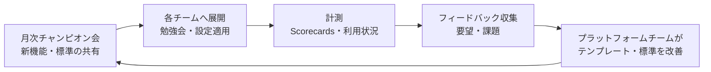
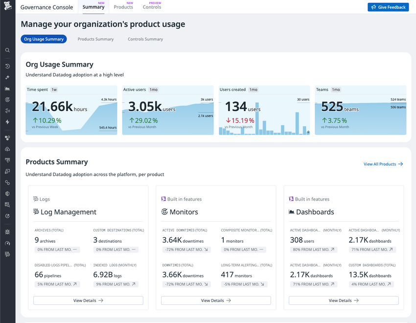
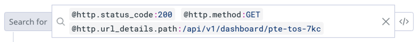
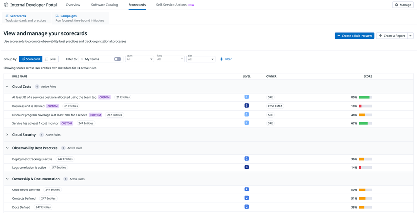
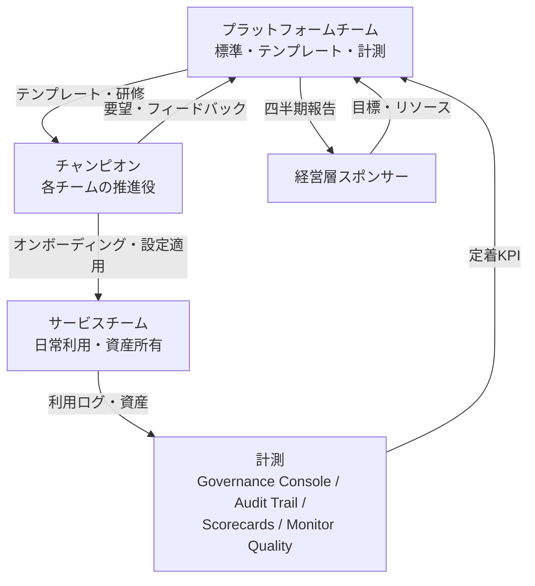

# 組織への定着

## 概要

Datadog の組織への定着とは、Datadog の契約・Agent 展開・初期ダッシュボード作成が終わった後に、**開発・運用・セキュリティの各チームが日常業務で Datadog を自律的に使い、標準（タグ、オーナー、SLO、モニター）が守られ続ける状態**を作ることを指す。本ファイルは 04_応用編として、次の問いに答える。

- 定着を誰が推進するのか（プラットフォームチーム／中央オブザーバビリティチームの責務と体制）
- SRE 文化（オーナーシップ、SLO、ポストモーテム、ダッシュボードを見る習慣）をどう根付かせるか
- 役割別にどう教育するか（社内勉強会、ハンズオン、Learning Center・認定資格の使い方）
- 社内チャンピオン制度をどう設計・運営するか
- 定着度をどう計測・可視化するか（Governance Console、Audit Trail、Dashboard Usage API、Monitor Quality、Scorecards、Campaigns、Teams）

Datadog の公式資料（Datadog TAM による「中央チームの責務」記事、Observability Maturity Framework、Scorecards/Campaigns ドキュメント等）と、国内外の公開事例（Stripe、Asian Development Bank、ヌーラボ、JCB、東芝デジタルソリューションズ、primeNumber、YOUTRUST、VISITS Technologies）に基づく。公式情報以外に依拠する記述には `【第三者情報】`、実務上の一般的な知見には `【経験則】` を付ける。

> 本ファイルは「組織・人・習慣」の観点に絞る。Datadog サポート窓口・Learning Center・認定資格の仕様は [サポートと教育](../03_導入編/15-support-and-training.md)、運用体制の RACI・Governance Controls の一覧は [運用設計](../03_導入編/13-operations-design.md)、ユーザー・ロール・Teams の仕様は [組織・ユーザー・権限管理](../02_リファレンス/platform/account-and-access-management.md) を参照。

## 関連ファイル

| テーマ | ファイル |
|---|---|
| 導入プロジェクトの進め方（Plan / Build / Run） | [導入方法論](../03_導入編/08-implementation-methodology.md) |
| 運用体制・RACI・Governance Console の Controls 一覧 | [運用設計](../03_導入編/13-operations-design.md) |
| Learning Center・認定資格・コミュニティ（JDDUG）・有償 Enablement | [サポートと教育](../03_導入編/15-support-and-training.md) |
| ユーザー・ロール・Teams・SSO | [組織・ユーザー・権限管理](../02_リファレンス/platform/account-and-access-management.md) |
| Audit Trail の仕様（イベント、保持、課金） | [Audit Trail](../02_リファレンス/platform/audit-trail.md) |
| Software Catalog・IDP・Scorecards・Campaigns の仕様 | [Software Catalog（旧 Service Catalog）](../02_リファレンス/platform/software-catalog.md) |
| 利用量・コストのチーム別配賦 | [Usage・Usage Attribution・Cost Visibility](../02_リファレンス/platform/usage-and-cost-attribution.md) |
| タグ標準（`team`・`service`・`env`） | [タグ戦略の実践](./02-tagging-strategy.md) |
| SLO の運用 | [SLO 運用の実践](./08-slo-practices.md) |
| アラート疲れの防止 | [アラート設計とノイズ削減](./03-alert-design-and-noise-reduction.md) |
| ダッシュボードの標準化 | [ダッシュボード設計の実践](./04-dashboard-design-practices.md) |
| テンプレートの配布（Terraform 等） | [Monitoring as Code](./09-monitoring-as-code.md) |
| 大規模・複数 org の運用 | [大規模・マルチorg運用](./15-large-scale-and-multi-org.md) |
| 失敗パターン全般 | [よくある失敗とアンチパターン](./12-common-pitfalls.md) |
| 導入事例 | [導入事例](./13-case-studies.md) |

---

## 1. 「定着」の定義と成熟度

### 1.1 導入と定着の違い

Datadog の導入完了と定着は別の状態である。【経験則】

| 観点 | 導入完了の状態 | 定着した状態 |
|---|---|---|
| 利用者 | 導入担当（インフラ／SRE）中心 | 開発者・運用・セキュリティ・PM まで日常的に利用 |
| 資産の作成者 | 導入担当がダッシュボード・モニターを作る | 各サービスチームが自分で作り、保守する |
| 資産の所有者 | 不明確（作成者個人） | `team` タグ／Datadog Teams で所有チームが明確 |
| 障害対応 | SSH してログを見る、別ツールを併用 | Datadog 上でメトリクス・トレース・ログを横断して調査 |
| 標準 | 文書はあるが守られていない | Scorecards・Tag Policies 等で自動的に点検されている |
| 改善 | 導入プロジェクト終了で止まる | 定期レビュー・利用状況の可視化で継続的に改善 |

東芝デジタルソリューションズの事例（Datadog Live Tokyo 2025 講演の参加レポート）では、インフラ側 SRE は Datadog を使いこなしていた一方、アプリ側 SRE はサーバーに SSH してログを確認しており、見ているメトリクスも異なるために原因の切り分けが難しかったと紹介されている。これは「導入済みだが定着していない」典型例である。【第三者情報】[出典](https://zenn.dev/primenumber/articles/c4999d290ceadb)（2025-06-06 公開）

### 1.2 Datadog の Observability Maturity Framework（5 段階）

Datadog は Knowledge Center で、オブザーバビリティの成熟度を 5 段階で整理している。定着の到達目標を議論する共通言語として使える。[出典](https://www.datadoghq.com/knowledge-center/observability-maturity-framework/)

| 段階 | 名称 | 特徴 | 主な Datadog 機能 | この段階のリスク・課題 |
|---|---|---|---|---|
| 1 | Monitoring（基盤） | インフラ・アプリ・システムの健全性を可視化 | インフラメトリクス、ログ、APM、Software Catalog、Monitors、Dashboards、異常検知 | 優先度付けのないデータの洪水、古いドキュメントに散在する対処手順、所有者が不明確 |
| 2 | Incident Response | 検知→トリアージ→ポストモーテムのライフサイクルを定義。ランブックをインシデントに紐付け | On-Call、Incident Management、Case Management、共有 Notebooks | 自動化や AI の前に構造化された対応が必要 |
| 3 | Semi-Automated Remediation | 予測可能な繰り返し作業（トイル）を削減 | Event Management（関連シグナルの相関）、承認付き Workflow Automation | 人の監督を残す設計が必要 |
| 4 | Platform Standardization | 共有の標準・ゴールデンパスを日常運用に組み込む | テンプレート、ゴールデンパス、標準 SLO、カバレッジ・ランブック有無・SLO 遵守を測るスコアカード、標準に沿ったセルフサービス | — |
| 5 | Autonomous and Adaptive Systems | 人の介入を最小化するクローズドループ | インテリジェントなトリアージ、過去インシデントに基づく AI の修正提案、シグナル起点の自動ワークフロー | — |

同ページは組織・文化面について次を指摘している。[出典](https://www.datadoghq.com/knowledge-center/observability-maturity-framework/)

- 多くの組織では、チームやサービスごとに複数の段階が同時に存在する。
- 成熟度はチェックリストを埋めることではない（"Observability maturity is not about checking boxes."）。
- 現在の痛みから始め、クイックウィンで勢いを作る。
- チームごとに独自に作るとサイロ・重複・不整合が生じるため、共有のワークフローと標準に揃える。
- 所有者を早期に明確にする（不明確な所有は対応遅延を招く）。
- 標準化・自動化はチーム単位で段階的に採用できる。

段階 4（Platform Standardization）が「組織への定着」の到達点に相当し、プラットフォームチームが主導する領域である。【経験則】

成熟度モデルを導入計画に使う考え方は、DASH 2023 の Datadog 講演「Best Practices for Planning Your Datadog Adoption Journey with an Observability Maturity Model」（2023-08-02、Observability Theater）でも扱われている。講演紹介では、組織が平均 12 以上の監視ツールを使っているというツール乱立の問題を挙げ、成熟度モデルを導入計画の指針として紹介している。[出典](https://dash.datadoghq.com/2023/observability-theater/best-practices-for-planning-your-datadog-adoption-journey-with-an-observability-maturity-model)

---

## 2. 推進体制：プラットフォームチーム

### 2.1 中央オブザーバビリティチームの責務（Datadog TAM の整理）

Datadog の Technical Account Manager が執筆した Architecture Center の記事（2024-11-14 公開）は、オブザーバビリティを全社で成功させるための**中央チーム（central team）**の責務を次のように整理している。[出典](https://www.datadoghq.com/architecture/achieving-observability-excellence-key-central-responsibilities/)

| 区分 | 責務 | 具体的な活動 |
|---|---|---|
| 基盤 | ツールの選定と契約 | 要件定義、ベンダー評価、拡張性・柔軟性・コストを含む条件交渉 |
| 基盤 | トレーニング | 入門〜上級の段階的トレーニング、新入社員・新機能向けの継続トレーニング、ベンダーの無料リソースの活用。**トレーニング修了者にのみプラットフォームへのアクセスを許可する**運用も選択肢 |
| セキュリティ・コンプライアンス | 脆弱性対応 | オブザーバビリティ製品（Agent 等）の各バージョンの脆弱性確認、新規 CVE の調査と必要時のアップグレード強制 |
| コスト管理 | 配賦 | チーム・コストセンターへのコスト配賦。オブザーバビリティ支出とクラウド支出を比較し、観測が不足しているサービス・価値の高いサービスを特定 |
| アクセス制御 | RBAC | 責務と階層に基づくロール定義、Audit Trail による API 利用のレビュー、サービスアカウントの推進、RBAC で保護された資産の Terraform リポジトリ提供 |
| 標準化 | データ収集・SLI | データ収集の標準化、SLO とエラーバジェットにつながる SLI の定義、タグ規約の強制と逸脱の監視 |
| 評価と拡大 | 定着度の評価 | **製品の採用率・利用分析でチームの準備度を評価し、採用が低い領域に教育を集中**。計装・モニタリング・アラートのテンプレートとベストプラクティスを提供 |
| コミュニティ | 社内コミュニティ | 社内コミュニティを育て、成功事例とツールをチーム間で共有（例：あるチームが作った Kubernetes コスト最適化ツールが全社採用された） |

### 2.2 Datadog 自身の Core Observability チーム

Datadog 社内にも、他の Datadog エンジニアリングチームのオブザーバビリティのベースラインを上げ、Datadog の管理に伴う摩擦を減らす **Core Observability team** が存在する。Datadog Summit London 2025（2025-03-04）のセッション「Datadog on Datadog. Insights from the Core Observability Team」では、2,000 人以上のエンジニアが日々デプロイする自社エンジニアリング組織での経験、よくあるアンチパターン、大規模環境での実践戦略を扱うと紹介されている。セッションの詳細内容（具体的な施策）は公開ページからは確認できず、録画の視聴が必要である。[出典](https://www.datadoghq.com/ja/summit/london25/agenda/sre_observability/)、[出典](https://datadogon.datadoghq.com/episodes/datadog-on-datadog)

### 2.3 体制モデルの選択

プラットフォームチームの体制には、組織規模に応じて主に 3 つのモデルがある。【経験則】

| モデル | 構成 | 向いている組織 | 長所 | 短所 |
|---|---|---|---|---|
| 集中型 | プラットフォームチーム（または SRE チーム）がダッシュボード・モニターまで作成・保守 | 〜数チーム、サービス数が少ない | 品質が揃う、立ち上げが速い | プラットフォームチームがボトルネックになる。サービスチームが「見る人」にならない |
| ハブ＆スポーク型 | プラットフォームチーム（ハブ）が標準・テンプレート・ガバナンスを担い、各チームのチャンピオン（スポーク）が自チームの資産を作る | 数チーム〜数十チーム | 標準と自律のバランスが良い。定着の主流モデル | チャンピオンの確保と負荷管理が必要 |
| 分散型（セルフサービス） | 各チームが完全に自律。プラットフォームチームはガードレール（Scorecards、Governance Controls、IaC モジュール）のみ提供 | 大規模、成熟度段階 4 以上 | スケールする | 標準の自動点検が整っていないと無秩序化する |

国内の公開事例では次のような体制が語られている。【第三者情報】

| 企業 | 体制・進め方 | 出典 |
|---|---|---|
| ヌーラボ | 監視ツールが乱立していた状態から、Platform チームが検証を重ね、プロダクト SRE が実運用でトライアルしてから Datadog に一元化 | [出典](https://zenn.dev/primenumber/articles/c4999d290ceadb)（2025-06-06 公開、Datadog Live Tokyo 2025 参加レポート） |
| JCB | プラットフォーム・SRE・アプリの各チームが Datadog を見ており、SRE チームが主管。各チームと一緒にダッシュボードを設計して認識を揃える。SLO ダッシュボードのテンプレートを用意 | [出典](https://sreake.com/blog/datadog_seminar/)（2022-04-08 公開。4 年以上前の情報のため現行機能とは差がありうる） |
| VISITS Technologies | プロダクトごとに Datadog org を分け、各エンジニアは自プロダクトの org にのみ参加。全社横断導入で「最低限の監視」が標準化された。Terraform で類似構成のモニター・ダッシュボードを複製 | [出典](https://qiita.com/syogun/items/f0209d61587c77773886)（2019-12-20 公開。6 年以上前の情報で、現行の Teams・マルチ org 機能とは前提が異なる） |

### 2.4 役割と責任分担（ハブ＆スポーク型の例）

【経験則】（2.1 の公式整理と国内事例に基づく）

| タスク | プラットフォームチーム | チャンピオン | サービスチーム | 経営層スポンサー |
|---|---|---|---|---|
| 定着目標・KPI の設定 | R | C | I | A |
| タグ・命名・オーナー標準の策定 | A/R | C | I | — |
| Agent・インテグレーションの展開と保守 | A/R | C | I | — |
| テンプレート（ダッシュボード・モニター・SLO）の提供 | A/R | C | I | — |
| 自チームのダッシュボード・モニター・SLO 作成 | C | R | A | — |
| 自チームのオンボーディング・勉強会 | C | A/R | I | — |
| 標準遵守の自動点検（Scorecards 等） | A/R | I | I | — |
| 定着度レビュー（月次・四半期） | A/R | C | I | I |
| 成功事例の社内発信 | R | R | C | I |

（R=実行、A=説明責任、C=相談、I=報告）運用全体の RACI は [運用設計](../03_導入編/13-operations-design.md) を参照。

### 2.5 プラットフォームチームが提供すべき「製品」

プラットフォームチームは Datadog を社内向けの「製品」として提供する、という考え方が定着に効く。【経験則】

| 提供物 | 内容 | Datadog 側の実装手段 |
|---|---|---|
| ゴールデンパス | 「新サービスを本番に出すまでにやること」を手順化（USM タグ付与、APM 計装、ログ相関、標準モニター、SLO） | Software Catalog のエンティティ定義、Self-Service Actions、Scorecards（[Software Catalog](../02_リファレンス/platform/software-catalog.md)） |
| テンプレート | 標準ダッシュボード、標準モニター、SLO テンプレート | Terraform モジュール、ダッシュボードのクローン元（[Monitoring as Code](./09-monitoring-as-code.md)） |
| ガードレール | タグ必須、所有者必須、不要資産の掃除 | Tag Policies、Governance Console Controls（[運用設計](../03_導入編/13-operations-design.md)） |
| ドキュメント | 社内向け「Datadog の使い方」ポータル、FAQ、ランブック | 社内 Wiki、Notebooks、Software Catalog の Docs リンク |
| 窓口 | 相談・申請・障害報告の受付 | 社内 Slack チャンネル、Case Management、App Builder のフォーム |
| 計測 | 定着 KPI のダッシュボード | 本ファイル 6 章 |

---

## 3. SRE 文化の醸成

### 3.1 SRE 文化の要素と Datadog の機能の対応

SRE 文化の醸成は、ツールの機能を「習慣」に結び付けることで進む。【経験則】

| 文化の要素 | 習慣（行動） | 支える Datadog 機能 | 詳細 |
|---|---|---|---|
| オーナーシップ | すべてのサービス・モニター・ダッシュボードに所有チームがある | Datadog Teams、`team` タグ、Software Catalog の owner | [組織・ユーザー・権限管理](../02_リファレンス/platform/account-and-access-management.md) |
| 信頼性の合意 | ビジネスと開発が SLO を合意し、エラーバジェットで判断する | SLO、Burn Rate アラート | [SLO 運用の実践](./08-slo-practices.md) |
| 症状ベースのアラート | ユーザー影響があるときだけ人を起こす | Monitors、Composite、SLO アラート | [アラート設計とノイズ削減](./03-alert-design-and-noise-reduction.md) |
| 非難しない振り返り | インシデント後にポストモーテムを書き、学びを共有する | Incident Management の Postmortem テンプレート、Notebooks | [Incident Management](../02_リファレンス/service-management/incident-management.md) |
| データで会話する | 定例でダッシュボードを見る、議論の根拠にグラフを貼る | Dashboards、Notebooks、共有リンク | [ダッシュボード設計の実践](./04-dashboard-design-practices.md) |
| トイル削減 | 繰り返し対応を自動化する | Workflow Automation、App Builder | [Workflow Automation](../02_リファレンス/service-management/workflow-automation.md) |
| 継続的改善 | アラートとダッシュボードを定期的に棚卸しする | Monitor Quality、Governance Console | 本ファイル 6 章 |

### 3.2 「ダッシュボードを見る場」を定例に組み込む

国内の公開事例で繰り返し語られている有効策は、**既存の定例会議に Datadog を見る時間を組み込む**ことである。【第三者情報】

| 企業 | 施策 | 結果 | 出典 |
|---|---|---|---|
| primeNumber | 週 1 回のプロダクト開発チームのミーティングで、アプリエンジニアが 1 週間の監視ダッシュボードの動向を確認する場を設けた（以前は SRE が担当） | ダッシュボードの見方が分からない状態から、監視やメトリクスを見る文化を醸成できた | [出典](https://zenn.dev/primenumber/articles/c4999d290ceadb)（2025-06-06 公開） |
| primeNumber（著者の過去経験） | 担当外プロダクトのアプリエンジニアに Datadog の使い方を教えた | ダッシュボードが充実し、朝会で毎日確認する習慣が生まれた | 同上 |
| 東芝デジタルソリューションズ | APM を使ったアプリ寄りのダッシュボードを作ってアプリ側 SRE に共有 | アプリ側から「もっとこんな情報が見たい」という要望が自然に生まれ、ダッシュボードが継続的に拡充 | 同上 |
| VISITS Technologies | プロダクトミーティングで直近のアラートを振り返り、既知・対応中・鳴り続けるべきかを判断。チャット上でアラートに反応して他のエンジニアに意味を伝えた | 「最低限の監視」の標準化 | [出典](https://qiita.com/syogun/items/f0209d61587c77773886)（2019-12-20 公開） |

定例への組み込み方の例。【経験則】

| 会議 | 頻度 | 見るもの | 所要時間 |
|---|---|---|---|
| チーム朝会 | 毎日 | サービス概要ダッシュボード（エラー率・レイテンシ・直近デプロイ） | 2〜3 分 |
| チーム定例 | 週次 | 1 週間のトレンド、発報したアラートの振り返り、SLO の残エラーバジェット | 10〜15 分 |
| 部門定例 | 月次 | SLO 達成状況、インシデント件数・MTTR、Scorecards の推移 | 15 分 |
| 経営報告 | 四半期 | SLO・顧客影響・コスト（チーム別配賦） | 5〜10 分 |

### 3.3 APM の価値を「体験」させてから広げる

3-shake（Sreake）の登壇（2022-03-01 開催のイベント）では、APM のメリットを理解してもらってから組織全体に広めるステップを重視し、負荷試験などの場面で部分的に導入してアプリチームに改善のスピードを体験してもらう方法が勧められている。また、クリティカルユーザージャーニーの洗い出しにはビジネス側と開発側の協力が不可欠であり、SRE・運用メンバーによるアラートの継続的なチューニングにはアプリチームとの協調が必要と述べられている。【第三者情報】[出典](https://sreake.com/blog/datadog_seminar/)（2022-04-08 公開。4 年以上前の情報）

### 3.4 ポストモーテムを Datadog 上で回す

Datadog Incident Management では、解決したインシデントの **Post-Incident** タブでテンプレートを選び「Generate Postmortem」を実行するとポストモーテムが生成される。作成先はテンプレートで指定し、Datadog Notebooks、Confluence、Google Drive から選べる。ポストモーテムには、テンプレートの変数を通じてインシデントのデータが自動で入る（AI 生成の変数が埋まるのは Post-Incident タブから生成した場合のみ）。Datadog 上で回す場合は作成先を Notebooks にすると、Post-Incident タブ上でそのまま編集できる。[出典](https://docs.datadoghq.com/incident_response/incident_management/post_incident/postmortems/)

定着の観点では次の運用が有効である。【経験則】

| 運用 | 狙い |
|---|---|
| 全社共通のポストモーテムテンプレートを 1 つ用意する（概要、影響、タイムライン、根本原因、うまくいったこと、改善アクション） | 書き方のばらつきをなくし、書くハードルを下げる |
| 「個人を責めない」ことをテンプレート冒頭に明記する | 非難しない文化（blameless）を明文化する |
| 改善アクションに「追加すべきモニター・ダッシュボード・SLO」を必ず含める | 障害のたびに Datadog の活用度が上がる |
| 月次でポストモーテムの読み合わせ会を開く | 他チームの学びを横展開する |

Incident Management は**シート課金**であり、インシデントの更新・タスク割当等を行うユーザーにシートが必要（作成・閲覧・チャンネル参加は不要）。年契約の US サイト定価は Standalone で $30/シート/月（2026-11-02 時点）。詳細は [製品別料金表](../03_導入編/02-pricing-by-product.md) を参照。

### 3.5 オーナーシップを Datadog Teams で表現する

Datadog Teams は、ユーザーのグループがダッシュボード、サービス、モニター、インシデント、Slack チャンネル・Jira ボード・GitHub リポジトリ等へのリンクを整理し、自チームの資産を優先表示するための機能である。[出典](https://docs.datadoghq.com/account_management/teams/)

| 定着に効く機能 | 内容 |
|---|---|
| Team handle | `team:<handle>` でダッシュボード・インシデント・モニター・Resource Catalog・Catalog エンティティ・SLO・Synthetic テスト・Synthetic の Global Variables・Private Locations に紐付く。Datadog Team として定義されていない handle はタグとして振る舞う |
| Team filter | 一覧ページ・ダッシュボード・ノートブックを選択したチームに絞り込む。ピン留めした選択はアカウント単位ではなく**ブラウザ単位**で保存される。各セクションの表示は最大 50 件 |
| 通知 | Team に Slack／Microsoft Teams チャンネルを登録すると、`@team-<handle>` 宛てのモニター通知がそのチャンネルに届く |
| 階層 | サブチームを作り、Teams map で可視化できる |
| メンバー同期 | UI/API のみ、SAML（IdP が決定する "SAML strict"）、All sources（SAML を起点に UI/API で上書き可）から選択 |

[出典](https://docs.datadoghq.com/account_management/teams/)

「自分のチームの画面」がすぐ出てくることは、サービスチームが Datadog を自分事として使い始める最初の一歩になる。オンボーディング時に Team への所属と Team filter のピン留めを必ず行う運用が有効である。【経験則】

---

## 4. 教育プログラム

### 4.1 教育の設計原則

【経験則】

| 原則 | 内容 |
|---|---|
| 役割別に分ける | 全員に同じ研修をしない。「見る人」「作る人」「管理する人」で内容を変える |
| 自社データで教える | 公式のサンプル環境だけでなく、自社の本番ダッシュボード・実際のインシデントを題材にする |
| 業務の直前に教える | APM 研修は計装開始の直前、SLO 研修は SLO 策定の直前に行う |
| 公式リソースを土台にする | Learning Center・認定資格を社内カリキュラムに組み込み、社内研修は「自社の標準」に集中する |
| 継続する | 新入社員向け・新機能向けの研修を定期開催する（2.1 の公式整理でも推奨） |

### 4.2 役割別カリキュラム例

公式の Learning Path・認定資格の一覧と仕様は [サポートと教育](../03_導入編/15-support-and-training.md) を参照。以下は社内研修との組み合わせ例である。【経験則】

| 対象 | レベル | 社内研修の内容 | 組み合わせる公式リソース | 到達目標 |
|---|---|---|---|---|
| 全エンジニア | 入門 | 自社の org 構成、ログイン（SSO）、Team filter、主要ダッシュボードの場所、タグ規約 | Learning Center「Core Skills Learning Path」 | 自チームのダッシュボードを開き、障害時に見るべき画面が分かる |
| アプリ開発者 | 実践 | 自社の計装方法（SSI／ライブラリ）、Unified Service Tagging、ログとトレースの相関、Error Tracking | Backend／Frontend Learning Path | 自サービスのトレースからボトルネックを特定できる |
| SRE・運用 | 実践 | 標準モニター・SLO の作り方、通知ルーティング、On-Call、ポストモーテム | SRE Learning Path | 自チームのモニターと SLO を作成・保守できる |
| セキュリティ | 実践 | Cloud SIEM・Cloud Security の運用手順 | Application Security／Cloud Security／Cloud SIEM Learning Path | 検知ルールのトリアージができる |
| チャンピオン | 上級 | 自社標準の詳細、Terraform テンプレート、Scorecards の読み方、コスト配賦 | Datadog Fundamentals 認定 → 専門認定 | 自チームのオンボーディングと相談対応ができる |
| 管理者 | 上級 | ロール・Teams・キー管理、Audit Trail、Governance Console、Usage | Configuration Learning Path | org の設定と点検を担当できる |
| PM・マネージャー | 入門 | SLO の読み方、ビジネス KPI ダッシュボード、インシデントの見方 | — | SLO とエラーバジェットで判断できる |

### 4.3 社内勉強会・ハンズオンの形式

国内事例では、導入直後に SRE 以外のメンバー向け勉強会を開く例が多い。【第三者情報】

| 企業 | 形式 | 出典 |
|---|---|---|
| YOUTRUST | 導入後、SRE 以外のメンバー向けに Datadog 勉強会を実施。誰でもデータからサービス状態を把握できる状態を目指す | [出典](https://tech.youtrust.co.jp/entry/2025/01/28/datadog_Initial_introduction)（2025-01-28 公開） |
| VISITS Technologies | 週次のエンジニア勉強会で Datadog の主要機能を扱った | [出典](https://qiita.com/syogun/items/f0209d61587c77773886)（2019-12-20 公開） |

勉強会の形式と使い分け。【経験則】

| 形式 | 時間 | 内容 | 向いている対象 |
|---|---|---|---|
| ランチ勉強会（LT） | 30 分 | 新機能紹介、便利なクエリ、成功事例 | 全員 |
| ハンズオン | 90〜120 分 | 自社の検証環境で計装→ダッシュボード→モニター作成を体験 | アプリ開発者、新規チーム |
| 障害対応ドリル（Game Day） | 2〜3 時間 | 疑似障害を起こし、Datadog だけで原因を特定する | SRE、オンコール担当 |
| オフィスアワー | 毎週 1 時間 | プラットフォームチームが常駐し、相談を受ける | 全員 |
| 読み合わせ会 | 30〜60 分 | ポストモーテム、他チームのダッシュボード紹介 | チーム横断 |

Datadog Japan はハンズオンセミナー・ワークショップを開催しており、参加レポートが公開されている（例：アイレットの iret.media 記事）。社外のハンズオンを新規チームの入門に使い、社内研修では自社標準に集中する分担が効率的である。【第三者情報】[出典](https://iret.media/151183)（2025-05-08 公開）、[出典](https://iret.media/135106)（2025-01-16 公開）

### 4.4 アクセスと教育の紐付け

2.1 の公式整理は、**トレーニングを修了したユーザーにのみプラットフォームへのアクセスを許可する**運用を選択肢として挙げている。[出典](https://www.datadoghq.com/architecture/achieving-observability-excellence-key-central-responsibilities/)

実装例。【経験則】

| 方式 | 実装 | 注意点 |
|---|---|---|
| ロール段階化 | 初期は Read Only ロール、研修修了で Standard（またはカスタムロール）に昇格 | 昇格手続きが遅いと定着を妨げる。IdP グループ連携（SAML ロールマッピング）で自動化する |
| 本番 org の分離 | 研修・検証は別 org（または検証用環境）で実施 | 別 org は管理・課金の考慮が必要（[大規模・マルチorg運用](./15-large-scale-and-multi-org.md)） |
| 編集権限の限定 | 本番のモニター・ダッシュボードは所有 Team のみ編集可 | Restriction Policies（Granular Access Control）の設計が必要 |

ロール・SAML マッピングの仕様は [組織・ユーザー・権限管理](../02_リファレンス/platform/account-and-access-management.md) を参照。

### 4.5 オンボーディングチェックリスト（新規参加者向け）

【経験則】

| # | 項目 | 確認方法 |
|---|---|---|
| 1 | SSO で Datadog にログインできる | ログイン成功 |
| 2 | 所属 Team に追加され、Team filter をピン留めした | Teams ページ |
| 3 | 自チームのサービス概要ダッシュボードをブックマークした | — |
| 4 | タグ規約（`env`・`service`・`version`・`team`）を理解した | 社内ドキュメント |
| 5 | 自チームのモニターの通知先（`@team-<handle>`・Slack）を把握した | Monitors 一覧を Team で絞り込み |
| 6 | Learning Center の Core Skills を修了した | Learning Center の修了記録 |
| 7 | 社内 Datadog 相談チャンネルに参加した | Slack |
| 8 | 自チームの Scorecards の状態を確認した | Software Catalog → Scorecards |

---

## 5. チャンピオン制度

### 5.1 チャンピオン制度とは

社内チャンピオン制度は、各チーム（スポーク）に Datadog の推進役を置き、プラットフォームチーム（ハブ）の取り組みを各チームに浸透させる仕組みである。**Datadog が社外向けに運営する「Datadog Champions」プログラムとは別物**である点に注意する（5.4 参照）。

### 5.2 公開事例

| 事例 | 内容 | 出典 |
|---|---|---|
| Stripe（Datadog Summit 講演を元にした公式ブログ） | 自チーム以外のパワーユーザーを見つけてアクセス権を与え、「何をすれば（何を提供すれば）もっと楽になるか」を積極的に聞く。パワーユーザーが投資意識を持った支持者となり、普及を助ける。その他、各チームのニーズ理解、価値と成功指標の定義、早期の共有とフィードバック、継続的なコミュニケーション、懐疑派の声を聞いて調整、が挙げられている | [出典](https://www.datadoghq.com/blog/introducing-observability-through-monitoring/)（2017-01-19 公開。9 年以上前の情報だが、組織論としての内容は現在も参照価値がある） |
| Asian Development Bank（DASH 2023 講演） | Director of Infrastructure and Technology が「How to Build an Observability Champions Program」として、信頼性を高めた Observability Champions プログラムの構築を講演（2023-08-03） | [出典](https://dashcon.io/2023/breakout-sessions/how-to-build-an-observability-champions-program) |
| Asian Development Bank（公式 eBook） | ゲーミフィケーション、クラウドソーシング、軽量なガバナンスで統合オブザーバビリティプラットフォームの採用を促進。実装を加速し採用を広げるチャンピオンプログラムの設計を扱う。具体的な施策・数値は登録制の eBook 本文にあり、公開ページでは確認できず | [出典](https://www.datadoghq.com/ebook/adb-observability-platform-adoption/) |

### 5.3 制度設計

以下は公開事例と一般的な実務知見に基づく設計例である。【経験則】

**選定**

| 項目 | 設計例 |
|---|---|
| 人数 | 1 チーム（5〜10 人程度）に 1 人。大規模チームは 2 人（主・副） |
| 選定基準 | 自チームのサービスに詳しい、発信意欲がある、上長が業務時間の確保に合意している。Datadog の熟練度は必須ではない |
| 任期 | 半期〜1 年。交代時は引き継ぎ会を設ける |
| 業務時間 | 業務時間の 5〜10% を目安に上長と合意する |

**役割**

| 役割 | 内容 |
|---|---|
| 自チームの窓口 | Datadog の質問を一次受けし、解決できないものをプラットフォームチームへエスカレーション |
| 標準の展開 | タグ・オーナー・標準モニター・SLO を自チームに適用し、Scorecards のスコアを上げる |
| オンボーディング | 新規参加者のチェックリスト（4.5）を伴走 |
| フィードバック | 自チームの要望・不満をプラットフォームチームに伝える（Stripe 事例の「何を提供すれば楽になるか」） |
| 発信 | 自チームの成功事例を社内で共有 |
| 先行検証 | 新機能・Preview 機能を先に試す |

**インセンティブ**

| 種類 | 例 |
|---|---|
| 学習機会 | 認定資格の受験費用負担、DASH・Datadog Summit Tokyo・JDDUG への参加支援 |
| 権限 | 新機能の先行利用、カスタムロールでの拡張権限（例：自チームの Team 管理） |
| 評価 | 人事評価の目標に推進活動を明記する（Datadog Summit Tokyo 2024 の参加レポートでは、SRE の役割として人事評価指標との連動が挙げられていたと紹介されている【第三者情報】[出典](https://techblog.dt-dynamics.com/entry/2024/10/25/093000)（2024-10-25 公開）） |
| 可視化 | Campaigns のリーダーボード、社内表彰 |

**運営サイクル**

| 会議体 | 頻度 | 内容 |
|---|---|---|
| チャンピオン会 | 月次 60 分 | 新機能紹介、標準の変更、各チームの Scorecards 状況、困りごと共有 |
| チャンピオン用 Slack チャンネル | 常時 | 質問・情報共有 |
| 四半期振り返り | 四半期 | 定着 KPI のレビュー、表彰、次四半期の Campaign 決定 |

### 5.4 Datadog 公式のコミュニティプログラムとの関係

Datadog は社外コミュニティ向けに次のプログラムを運営している。社内チャンピオンの成長目標や外部発信の場として活用できる。

| プログラム | 内容 | 出典 |
|---|---|---|
| Datadog Ambassadors | Datadog の専門家コミュニティ。2023 年開始 | [出典](https://www.datadoghq.com/blog/ambassadors-champions-2026/)（2026-05-26 公開） |
| Datadog Champions | 2026 年新設。コンテンツ発信やコミュニティ活動でエコシステムに貢献する実践者を表彰。初年度は 11 か国 25 名。特典は Champions ディレクトリでの紹介と Credly バッジ、認定試験の無料受験バウチャー、DASH パス、Datadog 製品チームと直接つながる非公開コミュニティ。正式な応募手続きの記載はなく、Datadog の公開 Slack（`chat.datadoghq.com`）経由での連絡が案内されている | 同上 |
| Japan Datadog User Group（JDDUG） | 日本のユーザーコミュニティ。東京・札幌・福岡・沖縄に支部 | [サポートと教育](../03_導入編/15-support-and-training.md) を参照 |

社内チャンピオンが JDDUG で登壇したり、ブログで発信したりすることは、本人の動機付けと社外からの知見獲得の両方に効く。【経験則】

---

## 6. 利用状況の可視化（定着度の計測）

### 6.1 定着 KPI の体系

定着度は「使われているか（Adoption）」「正しく使われているか（Quality）」「成果が出ているか（Outcome）」の 3 層で測る。【経験則】（2.1 の公式整理「採用率・利用分析でチームの準備度を評価する」に基づく）

| 層 | KPI | 計測手段（Datadog） | 目標例 |
|---|---|---|---|
| Adoption | 月間アクティブユーザー数（MAU）／ライセンス対象者比 | Governance Console（Active users）、Audit Trail（ログインイベント） | エンジニアの 70% 以上 |
| Adoption | 月間アクティブダッシュボード数、閲覧ユーザー数 | Governance Console（Dashboards）、Dashboard Usage API | 前月比で増加 |
| Adoption | 利用時間 | Governance Console（Time spent） | 前月比で増加 |
| Adoption | チーム別の資産数（ダッシュボード・モニター・SLO） | Monitors／Dashboards／SLO 一覧の Team 絞り込み、API | 全チームで 1 件以上 |
| Quality | `team` タグ付与率（モニター・ダッシュボード・サービス） | Governance Console Controls、Scorecards「Team defined」 | 95% 以上 |
| Quality | Scorecards の Level 1 到達率 | Scorecards（By Team） | Tier 1 サービスの 100% |
| Quality | 問題のあるモニター数（宛先なし、長期ミュート、Alert 張り付き） | Monitor Quality | 継続的に減少 |
| Quality | 未使用ダッシュボード数 | Dashboard Usage API（`filter[viewed_before]`）、Governance Console | 四半期ごとに棚卸し |
| Outcome | SLO 設定済みサービス比率・SLO 達成率 | SLO、Scorecards「Have any SLOs defined」 | Tier 1 サービスの 100% |
| Outcome | MTTD／MTTR、インシデント件数 | Incident Management | 改善傾向 |
| Outcome | チーム別コスト配賦率 | Usage Attribution | 配賦不能分 10% 未満 |

> 注：目標値はいずれも設定例【経験則】であり、Datadog の公式推奨値ではない。

### 6.2 データソースの一覧

| データソース | 取れる情報 | 提供条件・注意点 | 出典 |
|---|---|---|---|
| Governance Console（Summary / Products） | Time spent、Active users、Users created、Teams 数、製品別の利用状況（例：月間アクティブダッシュボード数・利用ユーザー数） | **Enterprise プランのみ**、サポートに依頼して利用開始。権限 `governance_console_read`。US1-FED／US2-FED 非対応 | [出典](https://docs.datadoghq.com/account_management/governance_console/) |
| Audit Trail | ログイン、API リクエスト、ダッシュボードの閲覧（GET）・作成・変更・削除などのユーザー操作 | 有料（支出に対する %）。保持期間は有効時の既定 90 日（3／7／15／30／90 日から選択） | [出典](https://docs.datadoghq.com/account_management/audit_trail/) |
| Dashboard Usage API | ダッシュボードごとの総閲覧数、最終閲覧日時、最終編集日時、ウィジェット数、品質スコア、Teams | 【Preview】。閲覧系フィールドは RUM に依存（後述） | [出典](https://docs.datadoghq.com/api/latest/dashboards/get-usage-stats-for-all-dashboards/) |
| Dashboard List の Popularity | ダッシュボードの相対的な人気（最大 5 本のバー） | 1 日 1 回更新。公開 URL 経由のトラフィックは除外 | [出典](https://docs.datadoghq.com/dashboards/list/) |
| Monitor Quality | 改善が必要なモニター（アラート過多、60 日超のミュート、宛先なし等） | 最初のモニター作成後に自動で有効 | [出典](https://docs.datadoghq.com/monitors/quality/) |
| Scorecards | サービス等のエンティティごとのベストプラクティス遵守状況（チーム別集計） | US1-FED／US2-FED 非対応 | [出典](https://docs.datadoghq.com/internal_developer_portal/scorecards/) |
| Campaigns | 期限付き施策の進捗（チーム別達成率、推移。リーダーボードはブログによる） | 【Preview】（ブログによる）。US1-FED／US2-FED 非対応（ドキュメントによる） | [出典](https://docs.datadoghq.com/internal_developer_portal/campaigns/)、[出典](https://www.datadoghq.com/blog/idp-campaigns/)（2025-11-21 公開） |
| Usage Attribution / Plan & Usage | チーム・タグ別の利用量 | 詳細は [Usage・Usage Attribution・Cost Visibility](../02_リファレンス/platform/usage-and-cost-attribution.md) | — |

### 6.3 Governance Console で全体像を見る

Governance Console は、Datadog の利用状況・普及状況・設定を一元的に見て、ポリシーと既定設定を適用する画面である。Summary には Total Org Usage があり、チーム・サービス・製品をまたいだ利用状況として、アクティブユーザー、ダッシュボード、モニター、製品内の利用時間の推移を示す。公式ブログ（2026-04-17 公開）は、タグ付与率、資産の所有、製品の利用率、コントロールの採用状況を追うことでガバナンスのギャップが分かると説明している。[出典](https://docs.datadoghq.com/account_management/governance_console/)、[出典](https://www.datadoghq.com/blog/governance-console/)

*キャプション：Governance Console の Summary 画面（Org Usage Summary と Products Summary）。*
*画面説明：上部タブは Summary、Products、Controls。見出し「Manage your organization's product usage」の下に Org Usage Summary があり、Time spent（1 週間の利用時間と前週比）、Active users（1 か月のアクティブユーザー数と前月比）、Users created（1 か月の新規ユーザー数）、Teams（Team 数）の 4 枚のカードが並ぶ。その下の Products Summary には Log Management、Monitors、Dashboards（月間アクティブダッシュボード数・利用ユーザー数、カスタムダッシュボード総数）などの製品カードが前月比とともに表示され、各カードに「View Details」ボタンがある。定着度の月次レビューでは、この Org Usage Summary の 4 指標をそのまま定着 KPI の Adoption 層として使える。*
*出典：https://docs.datadoghq.com/account_management/governance_console/ （2026-11-02 取得）*

Governance Console の Controls（未使用ダッシュボード、`team` タグのないモニター、どの Team にも属さないユーザー等の検出・通知・自動是正）の一覧と段階的な導入方法は [運用設計](../03_導入編/13-operations-design.md) にまとめている。定着の観点では、特に次の Controls が「所有者がいて、使われている」状態の維持に効く。

| Control | 定着上の意味 |
|---|---|
| Users in No Teams | どの Team にも属さないユーザー＝オンボーディング未完了 |
| Monitors／Dashboards／Notebooks without Team Tags | 所有者不明の資産 |
| APM Services without Team Tags | 所有者不明のサービス |
| Dashboards Owned by Disabled Users | 退職・異動者の資産の引き継ぎ漏れ |
| Teams without Notification Channels | チームへの通知経路がない |
| Unused Dashboards | 使われていないダッシュボード（既定 30 日、最大 60 日） |
| Persistent Alert Monitors | 無視されているアラート（既定 7 日） |

[出典](https://docs.datadoghq.com/account_management/governance_console/controls/)

> Governance Console を使えない（Enterprise 以外の）プランでは、Audit Trail、Dashboard Usage API、Monitor Quality、各種 API を組み合わせて同等の計測を作る。【経験則】

### 6.4 Audit Trail でユーザーの利用を測る

Audit Trail は Datadog 上のユーザー操作とAPI リクエストを記録する。定着計測に使える代表的なクエリは次のとおり。[出典](https://docs.datadoghq.com/account_management/audit_trail/events/)、[出典](https://docs.datadoghq.com/account_management/audit_trail/guides/track_dashboard_usage)

| 目的 | クエリ | 可視化の例 |
|---|---|---|
| ログインしたユーザー数 | `@evt.name:Authentication @action:login` | ユーザーのメールアドレスでグループ化し、ユニーク数を Query Value／時系列で表示 |
| 特定ダッシュボードの閲覧者 | `@http.status_code:200 @http.method:GET @http.url_details.path:/api/v1/dashboard/<dashboard_id>` | Group into を `User Email`、Visualize as を **Top List** |
| ダッシュボードの作成 | `@evt.name:Dashboard @asset.type:dashboard @action:created` | 作成者別・週別の件数 |
| ダッシュボードの変更 | `@evt.name:Dashboard @asset.type:dashboard @action:modified` | 変更の多いダッシュボード（＝育っている資産） |
| ダッシュボードの削除 | `@evt.name:Dashboard @asset.type:dashboard @action:deleted` | 棚卸しの実績 |
| API 利用 | `@evt.name:Request @action:accessed` | API キー・サービスアカウント別の件数（自動化の浸透度） |

*キャプション：Audit Trail Explorer の検索バーに、特定ダッシュボードの閲覧（GET リクエスト）を抽出するクエリを入力した状態。*
*画面説明：「Search for」欄に `@http.status_code:200`、`@http.method:GET`、`@http.url_details.path:/api/v1/dashboard/pte-tos-7kc` の 3 条件が入力されている。`pte-tos-7kc` はダッシュボード URL の `/dashboard/` の後ろにある ID。この検索結果を Group into「User Email」・Visualize as「Top List」にすると、そのダッシュボードをよく見ているユーザーのランキングが得られる。*
*出典：https://docs.datadoghq.com/account_management/audit_trail/guides/track_dashboard_usage （2026-11-02 取得）*

Audit Trail の使い方の注意。

| 項目 | 内容 |
|---|---|
| 保持期間 | 有効時の既定 90 日（3／7／15／30／90 日から選択）。無効化すると 7 日に戻る。前年同月比などの長期比較には、集計値を別途保存する（例：月次でメトリクス化・エクスポート）【経験則】 |
| アーカイブ | Amazon S3、Google Cloud Storage、Azure Storage へ 15 分ごとに書き出せる |
| ダッシュボード | 標準の Audit Trail overview ダッシュボードをクローンして、定着計測用のウィジェットを追加できる |
| モニター | 特定の監査イベント（例：ダッシュボード削除）にモニターを設定できる |
| 権限 | 有効化・無効化は Audit Trail Write、閲覧は Audit Trail Read |
| 課金 | 月額利用料（spend）に対する %（年契約 2%、月契約・オンデマンド 3%、2026-11-02 時点）。他の Datadog 製品の購入が前提 |

[出典](https://docs.datadoghq.com/account_management/audit_trail/)、[出典](https://www.datadoghq.com/pricing/list/)。仕様の詳細は [Audit Trail](../02_リファレンス/platform/audit-trail.md) を参照。

### 6.5 Dashboard Usage API で使われていないダッシュボードを見つける

Datadog の Dashboards API には、組織内の全ダッシュボードの利用統計を返すエンドポイントがある（【Preview】）。[出典](https://docs.datadoghq.com/api/latest/dashboards/get-usage-stats-for-all-dashboards/)

| 項目 | 内容 |
|---|---|
| エンドポイント | `GET /api/v2/dashboards/usage`（サイトごとの API ホスト、例：AP1 は `https://api.ap1.datadoghq.com`） |
| 提供段階 | Preview。仕様が変わる可能性がある。v2 クライアントでは unstable operation `v2.list_dashboards_usage` の有効化が必要 |
| 権限 | `dashboards_read`（OAuth アプリも同スコープ） |
| `page[limit]` | 1 ページの件数。サーバー上限 500（超えると 400）。既定値は公開情報では確認できず |
| `page[offset]` | 0 起点の開始位置 |
| `filter[edited_before]` | ISO 8601（タイムゾーンオフセット必須）。`edited_at` がこれより前のダッシュボード |
| `filter[viewed_before]` | ISO 8601（オフセット必須）。`viewed_at` がこれより前、**および一度も閲覧されていない**ダッシュボード |
| 主な応答属性 | `title`、`author`、`created_at`、`edited_at`、`teams`、`dashboard_quality_score`（0〜1 または `null`）、`viewer`、`viewed_at`、`total_views`、`total_views_by_type`、`widget_count`、`widget_count_by_type` |
| 更新頻度・期間 | 閲覧数は 1 日 1 回更新。2025-01 以降に記録された閲覧のみを含む |
| 注意 | 閲覧データは RUM（Real User Monitoring）に依存すると記載されており、RUM のない org では `viewer`・`viewed_at` が欠落または `null`、`total_views` が 0 となり、`filter[viewed_before]` はすべてのダッシュボードを返す。「RUM のない org」が顧客自身の RUM 契約を指すのか、Datadog 側の計測を指すのかは公開情報では確認できず。利用前に自 org で値が返るかを確認すること |

活用例。【経験則】

| 用途 | 方法 |
|---|---|
| 未使用ダッシュボードの棚卸し | `filter[viewed_before]` に 90 日前を指定し、所有 Team に削除・アーカイブを依頼 |
| チーム別の利用度 | `teams` 属性で集計し、ダッシュボードの閲覧が少ないチームを教育対象にする |
| 品質の改善 | `dashboard_quality_score` が低いダッシュボードを [ダッシュボード設計の実践](./04-dashboard-design-practices.md) に沿って改善 |
| 人気ダッシュボードの横展開 | `total_views` 上位を「おすすめダッシュボード」として社内ポータルで紹介 |

画面だけで確認する場合は、Dashboard List の **Popularity** 列（組織内で最も人気のダッシュボードを 5 本のバーとし、他は相対評価。1 日 1 回更新、新しいダッシュボードは最大 24 時間 0 本、公開 URL 経由のトラフィックは除外）が使える。削除したダッシュボードは **Recently Deleted** に 30 日間残り、復元できる。[出典](https://docs.datadoghq.com/dashboards/list/)

### 6.6 Monitor Quality でアラートの健全性を見る

Monitor Quality は Manage Monitors ページのタブで、改善が必要なモニターを一覧化する。Team・作成者・サービス・環境で絞り込めるため、チーム別の定着レビューに使える。[出典](https://docs.datadoghq.com/monitors/quality/)

| 検出項目 | 内容 | 定着上の意味 |
|---|---|---|
| High volume of alerts | 頻繁に発報し、アラート疲れの原因になる | 誰も見ていない／見られなくなる兆候 |
| Muted for over 60 days | 60 日を超えてミュート（一部ミュートを含む）されている | 放置された監視 |
| Missing recipients | 通知先が設定されていない | 所有者不在 |
| Missing a delay | クラウドインテグレーション（AWS、Azure、Google Cloud）のメトリクスに評価遅延が設定されていない | 標準テンプレート未適用 |
| Misconfigured notification channels | `@` 通知先が正しく転送されない | 設定ミス |
| Composite monitors missing constituents | 削除済みのサブモニターを参照している Composite | 保守されていない |
| Stuck in alert state | `ALERT` 状態のまま | アラートが無視されている |

### 6.7 Scorecards で「正しく使われているか」を測る

Scorecards は、Catalog に登録されたエンティティ（サービス等）を定義した基準で自動評価する Internal Developer Portal（IDP）の機能で、プラットフォームエンジニアがソフトウェアの健全性を測りベストプラクティスを広めるために使う。標準の Scorecards は 24 時間ごとに評価され、各ルールは合否（pass/fail）で判定される。[出典](https://docs.datadoghq.com/internal_developer_portal/scorecards/)

**標準のスコアカードとルール**

| スコアカード | ルール | 基準 |
|---|---|---|
| Production Readiness | Have any SLOs defined | SLO が 1 つ以上ある |
| Production Readiness | Have any monitors defined | モニターが 1 つ以上ある |
| Production Readiness | Specified on-call | オンコール担当が設定されている |
| Production Readiness | Last deployment occurred within the last 3 months | 直近 3 か月にデプロイがある（APM／USM サービス） |
| Observability Best Practices | Deployment tracking is active | Unified Service Tagging で `version` タグが設定されている（APM／USM サービス） |
| Observability Best Practices | Logs correlation is active | APM とログが相関している（直近 1 時間のログで評価、APM サービス） |
| Ownership & Documentation | Team defined | Catalog に Team が設定されている |
| Ownership & Documentation | Contacts defined | 連絡先が設定されている |
| Ownership & Documentation | Code repos defined | コードリポジトリがリンクされている |
| Ownership & Documentation | Docs defined | ドキュメントがリンクされている |

[出典](https://docs.datadoghq.com/internal_developer_portal/scorecards/scorecard_configuration/)

**レベル**

| レベル | 名称 | 意味 |
|---|---|---|
| Level 0 | — | 初期状態 |
| Level 1 | Basic | すべての本番エンティティに求める最低限（オンコール担当、モニタリング、Team 定義など） |
| Level 2 | Intermediate | 多くのエンティティに求める良い実践（SLO 定義、ドキュメントのリンクなど） |
| Level 3 | Advanced | 成熟したチーム向けの目標。すべてに当てはまるとは限らない |

レベルを指定しないルールは Level 3 扱い。エンティティは各レベルのルールをすべて満たすと次のレベルに進む。スコアは「エンティティ×ルールの結果のうち合格した割合」であり、全ルールに合格したエンティティの割合ではない。By Kind／By Team ビューは各エンティティのスコアの平均。スコープ（`kind`、`team`、`tier`、カスタムタグ）で評価対象を絞れ、標準ルールは `kind:service` から始まる。カスタムルールは Scorecards API または Workflow Automation で結果を送り、`skip` にした結果はスコアから除外される。結果は自動レポートとして Slack に配信できる。[出典](https://docs.datadoghq.com/internal_developer_portal/scorecards/scorecard_configuration/)、[出典](https://docs.datadoghq.com/internal_developer_portal/scorecards/)

*キャプション：Internal Developer Portal の Scorecards 画面（「View and manage your scorecards」）。*
*画面説明：最上部のタブは Overview、Software Catalog、Scorecards、Self-Service Actions。Scorecards の下に「Scorecards（Track standards and practices）」と「Campaigns（Run focused, time-bound initiatives）」のサブタブがある。右上に「Create a Rule」（PREVIEW 表示）と「Create a Report」ボタン。Group by で Scorecard／Level を切り替え、Filter to で My Teams のトグル、team・kind・tier のドロップダウンで絞り込める。表示例は「326 entities with metadata for 33 active rules」。表は RULE NAME・LEVEL・OWNER・SCORE の列で、Cloud Costs（例：「At least 80 % of a services costs are allocating using the team tag」などの CUSTOM ルール）、Cloud Security、Observability Best Practices（Deployment tracking is active 36%、Logs correlation is active 14%）、Ownership & Documentation（Code Repos Defined 50%、Contacts Defined 51%、Docs Defined 38%）のグループごとに、合格率がバーで表示されている。カスタムルールで組織独自の標準（コスト配賦タグ等）も同じ画面で追跡できることが分かる。*
*出典：https://docs.datadoghq.com/internal_developer_portal/scorecards/ （2026-11-02 取得）*

定着施策としての使い方。【経験則】

| 段階 | 使い方 |
|---|---|
| 導入初期 | Ownership & Documentation の「Team defined」から始め、所有者の明確化を最優先にする |
| 展開期 | Level 1 を全 Tier 1 サービスの必達目標にし、By Team ビューを月次チャンピオン会で共有する |
| 成熟期 | 自社標準（コスト配賦タグ、ランブックリンク、Burn Rate アラート等）をカスタムルールで追加し、Level 2〜3 を目標にする |
| 注意 | スコアを人事評価や罰則に直結させると、形式的な対応（中身のない SLO・モニター）が増える。改善の会話のきっかけとして使う |

### 6.8 Campaigns で期限付きの施策を進める

Campaigns は、Scorecards のルールを共通の目標の下にまとめ、エンティティとチームをまたいで期限付きの施策の進捗を追跡する機能である（【Preview】。Preview であることは公式ブログに記載があり、ドキュメントには表示がない）。Scorecards が長期的なベストプラクティスを定義するのに対し、Campaigns はランタイム移行、セキュリティ是正、コスト最適化などの期限付きの取り組みに使う。[出典](https://docs.datadoghq.com/internal_developer_portal/campaigns/)、[出典](https://www.datadoghq.com/blog/idp-campaigns/)（2025-11-21 公開）

| 項目 | 内容 |
|---|---|
| 作成場所 | Scorecards の Campaigns タブ |
| 権限 | Service Catalog Write と Work Management Write |
| 設定項目 | 名前、キー（既定で自動生成）、説明、所有チーム、開始日、終了日（任意）、スコープ（例：`kind:service AND tier:1`）、対象ルール、ルールごとのガイダンス（ドキュメントリンク、是正用 Workflow、手順） |
| 進捗表示 | 全体の達成率、チーム別・ルール別の進捗、失敗しているエンティティ・チーム・ルールの絞り込み、チーム間の採用率比較、推移、更新の送信・フォローアップチケットの作成 |
| 開発者側の表示 | Catalog のエンティティページの Scorecards タブに、関連するルールと期限が表示される |
| Slack | 達成率の要約、上位チームの紹介、遅れている Campaign の通知を Slack に送れる（任意）（ブログによる。ドキュメントは「更新の送信」とのみ記載） |
| リーダーボード | 100% 達成したチームのリーダーボードを表示（ブログによる） |
| サイト | US1-FED／US2-FED 非対応 |

定着の観点では、Campaigns は「チャンピオン制度の四半期テーマ」と相性が良い。例：Q1「全サービスの Team 定義」、Q2「Tier 1 サービスの SLO 設定」、Q3「ログとトレースの相関」。リーダーボードは ADB 事例のゲーミフィケーションと同じ効果を狙える。【経験則】

### 6.9 定着ダッシュボードの構成例

プラットフォームチームが月次レビューで使う「Datadog 定着ダッシュボード」の構成例。【経験則】

| セクション | ウィジェット | データソース |
|---|---|---|
| 概要 | MAU、ライセンス対象者比、前月比 | Audit Trail（ログインのユニークユーザー数） |
| 概要 | 新規ユーザー数、Team 数、どの Team にも属さないユーザー数 | Audit Trail、Governance Console（参考値として転記） |
| 利用 | チーム別のログインユーザー数（Top List） | Audit Trail（ユーザーの属性と Team の対応付けが必要） |
| 利用 | 週別のダッシュボード作成・変更件数 | Audit Trail |
| 品質 | Scorecards のチーム別スコア、Level 1 到達率 | Scorecards（画面・レポート） |
| 品質 | Monitor Quality の検出件数 | Monitor Quality（画面）または Monitors API の集計 |
| 成果 | SLO 達成状況（SLO List ウィジェット） | SLO |
| 成果 | インシデント件数・MTTR | Incident Management |
| コスト | チーム別利用量 | Usage Attribution |

> 注：Scorecards や Monitor Quality の値を Datadog のダッシュボードウィジェットとして直接表示できるかは公開情報では確認できず。API で取得してカスタムメトリクスとして送る場合はカスタムメトリクス課金が発生しうる。

---

## 7. 段階的な展開ロードマップ

導入プロジェクト完了後 12 か月の定着ロードマップ例。【経験則】（導入プロジェクト自体の進め方は [導入方法論](../03_導入編/08-implementation-methodology.md)）

| 期間 | テーマ | 主な施策 | 完了の目安 |
|---|---|---|---|
| 0〜3 か月 | 足場づくり | プラットフォームチーム発足、タグ・オーナー標準の策定、Teams と SAML 同期、全員向け入門研修、社内相談チャンネル開設、パイロット 2〜3 チームで週次ダッシュボードレビュー開始 | パイロットチームで MAU 80%、Scorecards「Team defined」100% |
| 3〜6 か月 | 横展開 | チャンピオン任命（全チーム）、役割別研修、テンプレート（Terraform モジュール）配布、Monitor Quality による月次棚卸し、成功事例の社内発信 | 全チームにチャンピオン、Tier 1 サービスの Level 1 到達 |
| 6〜9 か月 | 標準の自動点検 | カスタム Scorecards ルールの追加、Campaigns で四半期テーマ、Governance Console Controls の通知開始（Enterprise の場合）、ポストモーテムの全社テンプレート | Tier 1 サービスの SLO 設定 100% |
| 9〜12 か月 | 自律運用 | 未使用資産の自動是正、チーム別コスト配賦の定例化、チャンピオンの交代と育成、次年度の成熟度目標設定 | 定着 KPI を四半期で経営報告 |

---

## 8. 社内コミュニケーション

Stripe 事例は、変化するプロセスと文化に向き合うため、新しいプラットフォームの展開中はチームに情報を伝え続けることを重視している。[出典](https://www.datadoghq.com/blog/introducing-observability-through-monitoring/)（2017-01-19 公開）。ADB 事例は、成功事例とベストプラクティスを現場チームと経営層の両方に共有したとしている。[出典](https://www.datadoghq.com/ebook/adb-observability-platform-adoption/)

【経験則】

| チャネル | 頻度 | 内容 |
|---|---|---|
| 社内 Slack（`#datadog-help` 等） | 常時 | 質問受付。回答はプラットフォームチームとチャンピオンで分担 |
| 社内 Slack（`#datadog-news` 等） | 週次 | 新機能（Datadog のリリース情報）、自社標準の変更、Tips |
| ニュースレター | 月次 | 定着 KPI、Scorecards の上位チーム、成功事例 |
| 社内ポータル | 常時 | ゴールデンパス、テンプレート、FAQ、おすすめダッシュボード |
| 全社発表（LT 大会等） | 四半期 | 「Datadog で障害を X 分で特定した」などの成功事例 |
| 経営報告 | 四半期 | SLO・インシデント・コストの推移と投資対効果 |

成功事例の発信では、「MTTR が短縮した」「SSH でのログ確認が不要になった」など、エンジニアにとっての直接の利益を強調する（Stripe 事例でも、文化を育てるには他のエンジニアを直接助けることを強調すると述べている）。

---

## 9. アンチパターン

| アンチパターン | 症状 | 対策 | 確度 |
|---|---|---|---|
| 導入担当だけが使う | ダッシュボード・モニターがすべて SRE 作成。アプリ開発者はログインしない | 定例でダッシュボードを見る場を作る、アプリ寄りダッシュボードを共有する（3.2） | 【第三者情報】国内事例 |
| 導入プロジェクトで終わる | 導入完了後に推進役が解散し、標準が守られなくなる | プラットフォームチームを恒常組織にする（2.1） | 【経験則】 |
| 所有者不在 | 退職者が作ったダッシュボード、宛先のないモニターが増える | Teams・`team` タグ必須、Governance Console／Monitor Quality で点検（6.3、6.6） | 公式機能に基づく |
| 研修が一度きり | 新入社員や新機能に追随できない | 定期研修とオフィスアワー（4.1、4.3） | 公式整理に基づく |
| ダッシュボードの乱立 | 似たダッシュボードが大量にあり、どれを見ればよいか分からない | テンプレートとおすすめダッシュボード、未使用の棚卸し（6.5） | 【経験則】 |
| アラート疲れ | 鳴りっぱなしのアラートが無視され、Datadog 自体が信用されなくなる | [アラート設計とノイズ削減](./03-alert-design-and-noise-reduction.md) | 【経験則】 |
| スコアの形骸化 | Scorecards の合格のためだけの空の SLO・モニター | スコアを罰則に使わない、レビューで中身を確認（6.7） | 【経験則】 |
| チャンピオンの燃え尽き | 業務時間外の対応、評価されない | 業務時間の合意、評価への反映（5.3） | 【経験則】 |
| 懐疑派の無視 | 旧ツールに固執するチームが残り、ツールが二重化 | 懐疑派の懸念を改善点として聞く（Stripe 事例） | 公式ブログ |
| ツール乱立の継続 | 旧監視ツールと Datadog を並行運用し続ける | 移行計画と期限を決める（[他製品からの移行](../03_導入編/14-migration-from-other-tools.md)） | 【第三者情報】ヌーラボ事例 |

その他の失敗パターンは [よくある失敗とアンチパターン](./12-common-pitfalls.md) を参照。

---

## 10. 定着施策で参照する主な数値・デフォルト値

| 項目 | 値 | 出典 |
|---|---|---|
| Scorecards 標準ルールの評価頻度 | 24 時間ごと（1 日 1 回） | [出典](https://docs.datadoghq.com/internal_developer_portal/scorecards/) |
| Scorecards 標準ルール数 | 10（Production Readiness 4、Observability Best Practices 2、Ownership & Documentation 4） | [出典](https://docs.datadoghq.com/internal_developer_portal/scorecards/scorecard_configuration/) |
| Scorecards のレベル | Level 0〜3。レベル未指定のルールは Level 3 | 同上 |
| 「Last deployment」ルールの期間 | 直近 3 か月 | 同上 |
| 「Logs correlation」ルールの評価対象 | 直近 1 時間のログ | 同上 |
| Audit Trail 保持期間 | 有効時の既定 90 日（3／7／15／30／90 日）。無効時 7 日 | [出典](https://docs.datadoghq.com/account_management/audit_trail/) |
| Audit Trail アーカイブの書き出し間隔 | 15 分ごと | 同上 |
| Dashboard Usage API の `page[limit]` 上限 | 500 | [出典](https://docs.datadoghq.com/api/latest/dashboards/get-usage-stats-for-all-dashboards/) |
| Dashboard Usage API の閲覧数の更新 | 1 日 1 回、2025-01 以降の閲覧のみ | 同上 |
| Dashboard List Popularity の更新 | 1 日 1 回（新規は最大 24 時間 0 本） | [出典](https://docs.datadoghq.com/dashboards/list/) |
| 削除ダッシュボードの復元可能期間 | 30 日 | 同上 |
| Monitor Quality「長期ミュート」の閾値 | 60 日超 | [出典](https://docs.datadoghq.com/monitors/quality/) |
| Monitor Quality「アラート過多」「Alert 張り付き」の閾値 | 公開情報では確認できず | 同上 |
| Governance Console「Unused Dashboards」の閾値 | 既定 30 日、最大 60 日 | [出典](https://docs.datadoghq.com/account_management/governance_console/controls/) |
| Governance Console「Persistent Alert Monitors」の閾値 | 既定 7 日 | 同上 |
| Teams filter の各セクション表示件数 | 最大 50 件 | [出典](https://docs.datadoghq.com/account_management/teams/) |
| Campaigns の上限（数・対象エンティティ数） | 公開情報では確認できず | — |

---

## 11. 課金への影響

定着施策そのものに Datadog の追加料金は発生しないが、計測・推進に使う機能には課金対象のものがある。料金の数値は [製品別料金表](../03_導入編/02-pricing-by-product.md) を正本とする（以下は 2026-11-02 時点の公式定価）。

| 機能 | 課金 | 備考 |
|---|---|---|
| Audit Trail | 月額利用料（spend）に対する %：年契約 2%、月契約 3%、オンデマンド 3% | 他の Datadog 製品の購入が前提 [出典](https://www.datadoghq.com/pricing/list/) |
| Governance Console | Enterprise プランでのみ提供（個別の料金行は料金ページに掲載なし） | [エディション・プラン](../03_導入編/04-editions-and-plans.md) |
| Incident Management（ポストモーテム） | シート制。Standalone 年契約 $30／月契約 $36／オンデマンド $43.20（US サイト、1 シート/月） | 作成・閲覧・チャンネル参加はシート不要 |
| Scorecards・Campaigns・Teams | 料金ページに個別の料金行は掲載されていない（Pricing List で確認） | IDP の Standard 機能は既存の全顧客に提供と告知（"Standard IDP features are now available to all existing customers."）[出典](https://www.datadoghq.com/blog/internal-developer-portal/)（2025-06-10 公開）。詳細は [Software Catalog](../02_リファレンス/platform/software-catalog.md) |
| ユーザー数 | Datadog の主要製品はホスト・データ量等の課金で、ユーザー数による課金ではない（Incident Management・On-Call 等のシート制製品を除く） | 定着でユーザーが増えても直接の課金増にはならないが、各チームが計測対象（ホスト、ログ、スパン、カスタムメトリクス）を増やすとコストが増える。チーム別配賦は [Usage・Usage Attribution・Cost Visibility](../02_リファレンス/platform/usage-and-cost-attribution.md) |
| 定着計測用のカスタムメトリクス | API で取得した値をカスタムメトリクスとして送ると、カスタムメトリクス課金の対象になりうる | [Custom Metrics と DogStatsD](../02_リファレンス/platform/custom-metrics-and-dogstatsd.md) |
| 教育 | Learning Center は無料。認定試験・有償 Technical Enablement は別料金 | [サポートと教育](../03_導入編/15-support-and-training.md) |

> 定着が進むと計測対象が増えてコストも増える。定着施策とコスト管理（チーム別配賦、予算アラート）は同時に進める。【経験則】詳細は [コスト最適化](./01-cost-optimization.md)。

---

## 12. 確認できなかった事項

- Asian Development Bank のチャンピオンプログラムの具体的な施策・人数・成果（登録制 eBook と DASH 2023 講演の本編にあり、公開ページでは確認できず）。
- Datadog 社内の Core Observability team の具体的な施策（Summit London 2025 セッションの紹介文のみ確認）。
- Dashboard Usage API の「RUM に依存」の意味（顧客側の RUM 契約が必要なのか、Datadog 側の計測を指すのか）と `page[limit]` の既定値。
- Monitor Quality の「High volume of alerts」「Stuck in alert state」の判定閾値、Monitor Quality に必要な権限。
- Scorecards・Monitor Quality の値をダッシュボードウィジェットとして直接表示する方法。
- Campaigns の上限値（作成数・対象エンティティ数）と GA 時期。
- Governance Console の Summary 指標（Active users、Time spent）の厳密な定義（何をもってアクティブとするか）。
- チャンピオン制度の人数比・業務時間比率について、Datadog 公式の推奨値（本ファイルの値は【経験則】）。

---

## 参照元

### Datadog 公式ドキュメント

- Governance Console: https://docs.datadoghq.com/account_management/governance_console/
- Governance Console Controls: https://docs.datadoghq.com/account_management/governance_console/controls/
- Audit Trail: https://docs.datadoghq.com/account_management/audit_trail/
- Audit Trail Events: https://docs.datadoghq.com/account_management/audit_trail/events/
- Track Dashboard Access and Configuration Changes: https://docs.datadoghq.com/account_management/audit_trail/guides/track_dashboard_usage
- Get usage stats for all dashboards（API）: https://docs.datadoghq.com/api/latest/dashboards/get-usage-stats-for-all-dashboards/
- Dashboard List: https://docs.datadoghq.com/dashboards/list/
- Monitor Quality: https://docs.datadoghq.com/monitors/quality/
- Scorecards: https://docs.datadoghq.com/internal_developer_portal/scorecards/
- Scorecard Configuration: https://docs.datadoghq.com/internal_developer_portal/scorecards/scorecard_configuration/
- Campaigns: https://docs.datadoghq.com/internal_developer_portal/campaigns/
- Teams: https://docs.datadoghq.com/account_management/teams/
- Postmortems: https://docs.datadoghq.com/incident_response/incident_management/post_incident/postmortems/

### Datadog 公式サイト・ブログ・講演

- Achieving Observability Excellence: Key Central Responsibilities（2024-11-14 公開）: https://www.datadoghq.com/architecture/achieving-observability-excellence-key-central-responsibilities/
- What Is the Observability Maturity Framework?: https://www.datadoghq.com/knowledge-center/observability-maturity-framework/
- Building blocks: Introducing observability through monitoring（Stripe、2017-01-19 公開）: https://www.datadoghq.com/blog/introducing-observability-through-monitoring/
- Governance Console ブログ（2026-04-17 公開）: https://www.datadoghq.com/blog/governance-console/
- IDP Campaigns ブログ（2025-11-21 公開）: https://www.datadoghq.com/blog/idp-campaigns/
- Ship software quickly and confidently with Datadog IDP（2025-06-10 公開）: https://www.datadoghq.com/blog/internal-developer-portal/
- Datadog Ambassadors / Champions 2026（2026-05-26 公開）: https://www.datadoghq.com/blog/ambassadors-champions-2026/
- ADB eBook（Breaking Down Silos With a Unified Observability Platform）: https://www.datadoghq.com/ebook/adb-observability-platform-adoption/
- DASH 2023「How to Build an Observability Champions Program」: https://dashcon.io/2023/breakout-sessions/how-to-build-an-observability-champions-program
- DASH 2023「Best Practices for Planning Your Datadog Adoption Journey with an Observability Maturity Model」（2023-08-02）: https://dash.datadoghq.com/2023/observability-theater/best-practices-for-planning-your-datadog-adoption-journey-with-an-observability-maturity-model
- Datadog Summit London 2025「Datadog on Datadog. Insights from the Core Observability Team」: https://www.datadoghq.com/ja/summit/london25/agenda/sre_observability/
- Datadog On: Datadog on Datadog（2025-03-04）: https://datadogon.datadoghq.com/episodes/datadog-on-datadog
- Pricing List（2026-11-02 取得）: https://www.datadoghq.com/pricing/list/

### 第三者情報

- primeNumber「Datadog Live Tokyo 2025 に参加しました」（Zenn、2025-06-06 公開）: https://zenn.dev/primenumber/articles/c4999d290ceadb
- YOUTRUST Tech Blog「Datadog導入時に行ったこと」（2025-01-28 公開）: https://tech.youtrust.co.jp/entry/2025/01/28/datadog_Initial_introduction
- Qiita「Datadogを全社的に導入した時にやったこと」（2019-12-20 公開）: https://qiita.com/syogun/items/f0209d61587c77773886
- Sreake「導入企業に聞く！Datadogを活用するベストプラクティスとは！？」イベントリポート（2022-04-08 公開）: https://sreake.com/blog/datadog_seminar/
- DTダイナミクス テックブログ「Datadog Summit Tokyo 2024参加レポ」（2024-10-25 公開）: https://techblog.dt-dynamics.com/entry/2024/10/25/093000
- iret.media「Datadog ワークショップ〜フロントエンドにもオブザーバビリティを！〜」（2025-05-08 公開）: https://iret.media/151183
- iret.media「Datadog ハンズオンセミナーに参加してきました！」（2025-01-16 公開）: https://iret.media/135106

### 画像

- `assets/images/organizational-adoption/governance-console-overview.png`（出典：https://docs.datadoghq.com/account_management/governance_console/ 、2026-11-02 取得）
- `assets/images/organizational-adoption/audit-trail-dashboard-access-query.png`（出典：https://docs.datadoghq.com/account_management/audit_trail/guides/track_dashboard_usage 、2026-11-02 取得）
- `assets/images/organizational-adoption/scorecards-overview.png`（出典：https://docs.datadoghq.com/internal_developer_portal/scorecards/ 、2026-11-02 取得）
- 画像の著作権は Datadog, Inc. に帰属する。社内参照目的に限り利用する。
